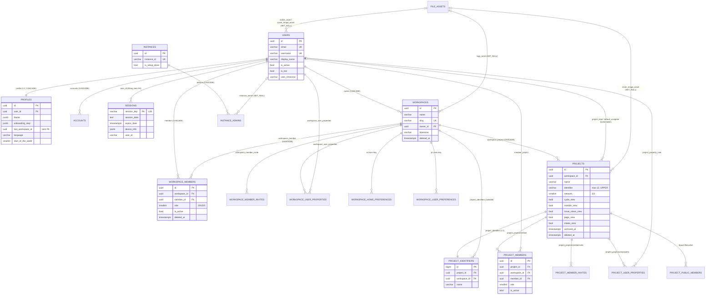

# A02a – Datenmodell Teil 1: Kern (Basisklassen, Identität, Workspace, Projekt, Plattform-Entitäten, Instanz)

> **Status:** IST-Analyse (Plane v1.4.2 Community Edition, Repo-Stand dieses Workspaces)
> **Bindende Leitplanken:** `migration/architecture/00-grundsatzentscheidungen.md` (ADR-000 … ADR-006)
> **Analysierte Quellen (vollständig gelesen):**
> `apps/api/plane/db/models/base.py`, `apps/api/plane/db/mixins.py`, `apps/api/plane/db/models/__init__.py`, `user.py`, `workspace.py`, `project.py`, `session.py`, `device.py`, `social_connection.py`, `api.py`, `webhook.py`, `asset.py`, `favorite.py`, `recent_visit.py`, `sticky.py`, `analytic.py`, `exporter.py`, `importer.py`, `deploy_board.py`, `integration/__init__.py`, `integration/base.py`, `integration/github.py`, `integration/slack.py` (alle unter `apps/api/plane/db/models/`), `apps/api/plane/license/models/__init__.py`, `apps/api/plane/license/models/instance.py`, alle 18 Dateien in `apps/api/plane/db/management/commands/`, beide Commands in `apps/api/plane/license/management/commands/`, alle 8 Dateien in `apps/api/plane/seeds/data/`.
> **Zur Verhaltensklärung zusätzlich gelesen:** `apps/api/plane/bgtasks/deletion_task.py`, `bgtasks/workspace_seed_task.py`, `bgtasks/cleanup_task.py`, `bgtasks/recent_visited_task.py`, `bgtasks/file_asset_task.py`, `bgtasks/exporter_expired_task.py`, `bgtasks/logger_task.py`, `middleware/logger.py`, `api/middleware/api_authentication.py`, `authentication/utils/login.py`, `authentication/adapter/base.py`, `authentication/adapter/oauth.py`, `settings/common.py`, `celery.py`, `utils/constants.py`, `utils/color.py`, `utils/path_validator.py`, `utils/uuid.py`, `utils/instance_config_variables/*`, `license/utils/encryption.py`, `license/utils/instance_value.py`, relevante Serializer/Views (jeweils an der Stelle zitiert).
> Alle Pfade relativ zum Repo-Root. Abkürzung: `M/` = `apps/api/plane/db/models/`, `API/` = `apps/api/plane/`.

---

## Inhaltsverzeichnis

1. Überblick & Verantwortlichkeiten
2. Vollständige Inventare
   - 2.1 Abstrakte Basisklassen, Mixins, Manager
   - 2.2 Model-Übersicht (alle 47 konkreten Models dieses Bereichs)
   - 2.3 Feldtabellen je Model
   - 2.4 Enums / Choices / Konstanten
   - 2.5 JSONField-Strukturen (genutzte Keys)
   - 2.6 Unique-Constraints & Indizes (vollständig)
   - 2.7 Signals
   - 2.8 Management-Commands
   - 2.9 Seeds
   - 2.10 RESTRICTED_WORKSPACE_SLUGS
   - 2.11 InstanceConfiguration-Schlüssel
   - 2.12 PostgreSQL-spezifische Features
   - 2.13 Mermaid-ER-Diagramme
3. Verhalten / Logik / Abläufe im Detail (inkl. Edge-Cases)
4. Abhängigkeiten zu anderen Bereichen
5. Migrationshinweise für .NET / EF Core / Angular
6. Offene Punkte

---

## 1. Überblick & Verantwortlichkeiten

### 1.1 Zweck des Bereichs

Der Bereich umfasst das **Fundament des Plane-Datenmodells**:

| Teilbereich | Inhalt | Quelle |
|---|---|---|
| Basisklassen | UUID-PK, Zeitstempel, Audit-User (`created_by`/`updated_by` via `crum`), Soft-Delete (`deleted_at`) inkl. Manager/QuerySet, Change-Tracking-Mixin, Workspace-/Projekt-Scoping-Basisklassen | `M/base.py`, `apps/api/plane/db/mixins.py`, `M/workspace.py` (`WorkspaceBaseModel`), `M/project.py` (`ProjectBaseModel`) |
| Identität | `User` (Custom-Auth-User, Login per E-Mail), `Profile` (1:1-Benutzereinstellungen/Onboarding), `Account` (OAuth-Konten), `Session` (DB-Session-Backend), `Device`/`DeviceSession` (Mobile/Push – in CE ungenutzt), `SocialLoginConnection` (in CE ungenutzt) | `M/user.py`, `M/session.py`, `M/device.py`, `M/social_connection.py` |
| Mandant „Workspace" | `Workspace`, Mitgliedschaft, Einladungen, Themes, Benutzer-Properties, Quick-Links, Home-Widgets, Sidebar-Präferenzen, `Team` (Altlast) | `M/workspace.py` |
| Projekt | `Project` inkl. Feature-Toggles, Mitglieder, Einladungen, Identifier-Registry, Public-Members, Benutzer-Properties, Alt-Deploy-Board | `M/project.py` |
| Plattform-Entitäten | API-Tokens + API-Request-Log, Webhooks + Webhook-Log + Projekt-Webhook, Datei-Assets, Favoriten (mit Ordnern), „Zuletzt besucht", Stickies, gespeicherte Analytics-Views, Export-Historie, Importer (Altlast), Publish-/Deploy-Boards, Integrationen GitHub/Slack (Altlast) | `M/api.py`, `M/webhook.py`, `M/asset.py`, `M/favorite.py`, `M/recent_visit.py`, `M/sticky.py`, `M/analytic.py`, `M/exporter.py`, `M/importer.py`, `M/deploy_board.py`, `M/integration/*` |
| Instanz („God Mode") | `Instance`, `InstanceAdmin`, `InstanceConfiguration`, `ChangeLog` | `apps/api/plane/license/models/instance.py` |
| Betrieb | 18 + 2 Management-Commands, Workspace-Seed-Daten (Demo-Projekt) | `apps/api/plane/db/management/commands/*`, `apps/api/plane/license/management/commands/*`, `apps/api/plane/seeds/data/*` |

### 1.2 Technische Rahmenbedingungen des Originals

| Aspekt | Original | Quelle |
|---|---|---|
| ORM / DB | Django 5.2.17, `django.db.backends.postgresql`, optional Read-Replica (`ENABLE_READ_REPLICA=1`, Router `plane.utils.core.dbrouters.ReadReplicaRouter`: Reads auf `replica` wenn Request-Kontext es erlaubt, Writes/Migrationen immer `default`) | `apps/api/pyproject.toml`, `API/settings/common.py` Z. 212–244, `API/utils/core/dbrouters.py` |
| Django-Apps (Labels) | Models dieses Bereichs liegen in App-Label `db` (alle außer Instanz) und `license` (Instanz) | `API/settings/common.py` Z. 98–119 |
| Auth-User-Model | `AUTH_USER_MODEL = "db.User"` | `API/settings/common.py` Z. 209 |
| Default-Auto-Field | `django.db.models.BigAutoField` – relevant nur für Models ohne eigenes `id` (hier: `ProjectIdentifier`) | `API/settings/common.py` Z. 322 |
| Aktueller Benutzer im Model-Layer | `crum.CurrentRequestUserMiddleware` (Thread-Local) → `crum.get_current_user()` in `BaseModel.save()` | `API/settings/common.py` Z. 131, `M/base.py` |
| Session-Backend | `SESSION_ENGINE = "plane.db.models.session"`, Cookie `session-id` (Default-Name), Lebensdauer `SESSION_COOKIE_AGE` = 604800 s (7 Tage); Admin-Cookie `admin-session-id`, `ADMIN_SESSION_COOKIE_AGE` = 3600 s | `API/settings/common.py` Z. 424–432 |
| Hard-Delete-Frist | `HARD_DELETE_AFTER_DAYS` = 60 (env) | `API/settings/common.py` Z. 472 |
| Log-Aufbewahrung | `API_ACTIVITY_LOG_RETENTION_DAYS` = 14, `WEBHOOK_LOG_RETENTION_DAYS` = 14, `EMAIL_LOG_RETENTION_DAYS` = 7 (negative/ungültige Werte → Default) | `API/settings/common.py` Z. 475–501 |
| Datei-Limit | `FILE_SIZE_LIMIT` = 5242880 Byte (5 MiB), auch `DATA_UPLOAD_MAX_MEMORY_SIZE` | `API/settings/common.py` Z. 389, 403 |
| Seed-Verzeichnis | `SEED_DIR = BASE_DIR/seeds` | `API/settings/common.py` Z. 600 |
| Hintergrundjobs | Celery + `django_celery_beat` (DatabaseScheduler) | `API/celery.py` |

### 1.3 Nutzung der Models in der Community Edition (CE)

Mehrere Models existieren im Schema, werden aber in der CE **nirgends** gelesen/geschrieben (geprüft per Volltextsuche über `apps/api/plane` ohne `migrations/` und `db/models/`). Sie sind Indizien für Bezahl-/Cloud-/Mobile-Funktionen und müssen nach ADR-001 fachlich bewertet werden (siehe Abschnitt 5/6):

| Model | CE-Nutzung | Indiz |
|---|---|---|
| `Team` (`teams`) | keine (nur Model) | Vorläufer der „Teamspaces" (EE); `TeamMember`/`TeamPage` wurden in Migration `API/db/migrations/0086_issueversion_alter_teampage_unique_together_and_more.py` gelöscht, Tabelle `teams` blieb |
| `ProjectDeployBoard` (`project_deploy_boards`) | keine (als „DEPRECATED" kommentiert) | ersetzt durch `DeployBoard` |
| `ProjectWebhook` (`project_webhooks`) | keine | projektbezogene Webhooks (vermutl. EE) – angelegt in `API/db/migrations/0106_auto_20250912_0845.py` |
| `Device`, `DeviceSession` | keine | Mobile-App / Push-Notifications |
| `SocialLoginConnection` | keine | Alt-Social-Login, enthält `Jira` als Medium |
| `Integration`, `WorkspaceIntegration`, `GithubRepository`, `GithubRepositorySync`, `GithubIssueSync`, `GithubCommentSync`, `SlackProjectSync` | keine (nur OpenAPI-Parameternamen in `API/utils/openapi/parameters.py`) | Alt-Integrationen (in EE durch „Silo"-Integrationen ersetzt) |
| `Importer` | nur Serializer (`API/app/serializers/importer.py`) und `API/utils/porters/formatters.py` | Alt-Importer (GitHub/Jira) |
| `ChangeLog` (`changelogs`) | keine | Release-Changelog im God-Mode |
| `WorkspaceTheme` | API vorhanden (`workspaces/<slug>/workspace-themes/`, `API/app/views/workspace/base.py` Z. 323–337), Frontend nutzt sie nicht (keine Treffer in `apps/web`, `packages`) | Workspace-Themes |
| `WorkspaceMember.getting_started_checklist`, `.tips`, `.explored_features` | nur Migrationen setzen Werte | Onboarding-Checkliste / AI-Chat / GitHub-/Slack-Integration (EE) |
| `Profile.is_smooth_cursor_enabled`, `.is_app_rail_docked`, `.notification_view_mode`, `.product_tour`, `.is_navigation_tour_completed`, `.is_subscribed_to_changelog`, `.mobile_*`, `.goals` | im CE-Frontend nicht referenziert (Suche in `apps/web`, `apps/space`, `apps/admin`, `packages`) | Produkt-Tour, App-Rail, Mobile, Changelog (Cloud/EE) |
| `Project.is_time_tracking_enabled`, `.is_issue_type_enabled` | nur Activity-Helper `apps/web/components/common/activity/helper.tsx` | Zeiterfassung, Work-Item-Typen (EE) |
| `ExporterHistory.type = "issue_worklogs"` | nie gesetzt | Worklog-Export (EE Zeiterfassung) |
| `DeployBoard.entity_name` ≠ `"project"` | CE verwendet ausschließlich `"project"` (alle Treffer in `API/space/views/*`, `API/app/views/project/base.py`) | Publish von Pages/Views/Cycles/Modules/Intake (EE) |
| `DeployBoard.is_activity_enabled`, `.is_disabled` | keine | EE-Publish-Optionen |

---

## 2. Vollständige Inventare

### 2.1 Abstrakte Basisklassen, Mixins, Manager

#### 2.1.1 Vererbungshierarchie

```
models.Model
├── TimeAuditModel (abstract)        created_at, updated_at                       apps/api/plane/db/mixins.py
├── UserAuditModel (abstract)        created_by, updated_by                       apps/api/plane/db/mixins.py
├── SoftDeleteModel (abstract)       deleted_at, objects/all_objects, delete()    apps/api/plane/db/mixins.py
└── AuditModel (abstract) = TimeAuditModel + UserAuditModel + SoftDeleteModel    apps/api/plane/db/mixins.py
    └── BaseModel (abstract)         id (UUID-PK), save() mit crum-Audit          apps/api/plane/db/models/base.py
        ├── WorkspaceBaseModel (abstract)  workspace (Pflicht), project (optional) apps/api/plane/db/models/workspace.py
        └── ProjectBaseModel (abstract)    project (Pflicht), workspace (Pflicht)  apps/api/plane/db/models/project.py
ChangeTrackerMixin (Python-Mixin, kein Model)                                     apps/api/plane/db/mixins.py
```

#### 2.1.2 Felder der Basisklassen

| Klasse | Feld | Django-Typ | Optionen | Quelle |
|---|---|---|---|---|
| `TimeAuditModel` | `created_at` | `DateTimeField` | `auto_now_add=True`, verbose „Created At" | `apps/api/plane/db/mixins.py` |
| `TimeAuditModel` | `updated_at` | `DateTimeField` | `auto_now=True`, verbose „Last Modified At" | `apps/api/plane/db/mixins.py` |
| `UserAuditModel` | `created_by` | `ForeignKey("db.User")` | `on_delete=SET_NULL`, `null=True`, `related_name="%(class)s_created_by"` (Klassenname klein, z. B. `workspace_created_by`) | `apps/api/plane/db/mixins.py` |
| `UserAuditModel` | `updated_by` | `ForeignKey("db.User")` | `on_delete=SET_NULL`, `null=True`, `related_name="%(class)s_updated_by"` | `apps/api/plane/db/mixins.py` |
| `SoftDeleteModel` | `deleted_at` | `DateTimeField` | `null=True`, `blank=True`, verbose „Deleted At" | `apps/api/plane/db/mixins.py` |
| `BaseModel` | `id` | `UUIDField` | `default=uuid.uuid4`, `unique=True`, `editable=False`, `db_index=True`, `primary_key=True` | `apps/api/plane/db/models/base.py` |
| `WorkspaceBaseModel` | `workspace` | `ForeignKey("db.Workspace")` | `CASCADE`, `related_name="workspace_%(class)s"`, **Pflicht** | `M/workspace.py` Z. 185–195 |
| `WorkspaceBaseModel` | `project` | `ForeignKey("db.Project")` | `CASCADE`, `related_name="project_%(class)s"`, `null=True` | `M/workspace.py` Z. 185–195 |
| `ProjectBaseModel` | `project` | `ForeignKey(Project)` | `CASCADE`, `related_name="project_%(class)s"`, **Pflicht** | `M/project.py` Z. 230–239 |
| `ProjectBaseModel` | `workspace` | `ForeignKey("db.Workspace")` | `CASCADE`, `related_name="workspace_%(class)s"`, **Pflicht** | `M/project.py` Z. 230–239 |

**Kurzbezeichnung im Folgenden:** „**BaseModel-Standardfelder**" = `id`, `created_at`, `updated_at`, `deleted_at`, `created_by_id`, `updated_by_id`. „**AuditModel-Standardfelder**" = dieselben ohne UUID-`id`.

#### 2.1.3 Manager / QuerySets

| Name | Verhalten | Quelle |
|---|---|---|
| `SoftDeletionQuerySet.delete(soft=True)` | `soft=True` (Default): `UPDATE … SET deleted_at = now()` für alle Zeilen des QuerySets – **ohne** Kaskade, **ohne** Signals, **ohne** `save()`. `soft=False`: echtes Django-`delete()` (mit Django-Kaskaden). | `apps/api/plane/db/mixins.py` |
| `SoftDeletionManager` (`objects`) | `get_queryset()` liefert `SoftDeletionQuerySet` gefiltert auf `deleted_at IS NULL` | `apps/api/plane/db/mixins.py` |
| `all_objects` | normaler `models.Manager()` – sieht auch gelöschte Zeilen; `.delete()` darauf ist **Hard-Delete** | `apps/api/plane/db/mixins.py` |
| `UserManager` (Django) | `User.objects` – Standard-Django-UserManager (kein Soft-Delete) | `M/user.py` Z. 131 |
| `_base_manager` (Django-intern) | Für Vorwärts-FK-Zugriffe (`obj.workspace`) nutzt Django den Basis-Manager → **soft-gelöschte Eltern werden über FK-Navigation weiterhin geladen**; Rückwärts-Relationen (`workspace.workspace_member.all()`) verwenden den Default-Manager `objects` (gefiltert). | Django-Semantik; relevant für EF-Global-Query-Filter (Abschnitt 5) |

#### 2.1.4 Überschriebene `save()`/`delete()` der Basisklassen

| Klasse | Methode | Logik | Quelle |
|---|---|---|---|
| `SoftDeleteModel` | `delete(using=None, soft=True)` | `soft=True`: `self.deleted_at = timezone.now()`, `self.save(using=using)`, dann **asynchron** Celery-Task `soft_delete_related_objects.delay(app_label, model_name, pk)`. `soft=False`: Django-Hard-Delete. | `apps/api/plane/db/mixins.py` |
| `BaseModel` | `save(*args, created_by_id=None, disable_auto_set_user=False, **kwargs)` | Wenn `disable_auto_set_user=False`: (a) `created_by_id` übergeben → `self.created_by_id = created_by_id` (sonst nichts); (b) sonst `user = crum.get_current_user()`: `None`/anonym → `created_by = None` **und** `updated_by = None`; neu (`_state.adding`) → `created_by = user`, `updated_by = None`; Update → `updated_by = user`. Danach `super().save()`. | `M/base.py` |
| `BaseModel` | `__str__` | `str(self.id)` | `M/base.py` |
| `WorkspaceBaseModel` | `save()` | Wenn `self.project` gesetzt → `self.workspace = self.project.workspace` (lädt Projekt) | `M/workspace.py` Z. 192–195 |
| `ProjectBaseModel` | `save()` | **Immer** `self.workspace = self.project.workspace` (lädt Projekt + Workspace per Query) | `M/project.py` Z. 237–239 |
| `ChangeTrackerMixin` | `__init__`, `save()` | Erfasst beim Instanziieren die Originalwerte (`TRACKED_FIELDS` oder alle nicht-deferred Felder via `attname`); `save()` legt `self._changes_on_save = self.changed_fields` ab, speichert, setzt Tracking zurück. API: `has_changed(field)`, `changed_fields`, `old_values`. Deferred Felder werden nie getrackt. | `apps/api/plane/db/mixins.py` |

### 2.2 Model-Übersicht (alle 47 konkreten Models)

Legende Basis: **BM** = `BaseModel` (UUID-PK + Audit + Soft-Delete + crum), **WBM** = `WorkspaceBaseModel`, **PBM** = `ProjectBaseModel`, **AM** = `AuditModel` (ohne BaseModel-`save()`), **TAM** = `TimeAuditModel` (nur Zeitstempel, kein Soft-Delete).
Spalte „Export": ob in `M/__init__.py` exportiert.

| # | Klasse | App | `db_table` | Basis | PK | Soft-Delete | Export | CE genutzt | Quelle |
|---|---|---|---|---|---|---|---|---|---|
| 1 | `User` | db | `users` | `AbstractBaseUser`, `PermissionsMixin` | UUID | nein | ja | ja | `M/user.py` |
| 2 | `Profile` | db | `profiles` | TAM | UUID (eigenes Feld) | nein | ja | ja | `M/user.py` |
| 3 | `Account` | db | `accounts` | TAM | UUID (eigenes Feld) | nein | ja | ja | `M/user.py` |
| 4 | `Workspace` | db | `workspaces` | BM | UUID | ja (+Slug-Suffix) | ja | ja | `M/workspace.py` |
| 5 | `WorkspaceMember` | db | `workspace_members` | BM | UUID | ja | ja | ja | `M/workspace.py` |
| 6 | `WorkspaceMemberInvite` | db | `workspace_member_invites` | BM | UUID | ja | ja | ja | `M/workspace.py` |
| 7 | `Team` | db | `teams` | BM | UUID | ja | nein | nein | `M/workspace.py` |
| 8 | `WorkspaceTheme` | db | `workspace_themes` | BM | UUID | ja | ja | nur API | `M/workspace.py` |
| 9 | `WorkspaceUserProperties` | db | `workspace_user_properties` | BM | UUID | ja | ja | ja | `M/workspace.py` |
| 10 | `WorkspaceUserLink` | db | `workspace_user_links` | WBM | UUID | ja | ja | ja | `M/workspace.py` |
| 11 | `WorkspaceHomePreference` | db | `workspace_home_preferences` | BM | UUID | ja | ja | ja | `M/workspace.py` |
| 12 | `WorkspaceUserPreference` | db | `workspace_user_preferences` | BM | UUID | ja | ja | ja | `M/workspace.py` |
| 13 | `Project` | db | `projects` | `ChangeTrackerMixin` + BM | UUID | ja | ja | ja | `M/project.py` |
| 14 | `ProjectMemberInvite` | db | `project_member_invites` | PBM | UUID | ja | ja | ja | `M/project.py` |
| 15 | `ProjectMember` | db | `project_members` | PBM | UUID | ja | ja | ja | `M/project.py` |
| 16 | `ProjectIdentifier` | db | `project_identifiers` | AM | **BigAutoField** | ja | ja | ja | `M/project.py` |
| 17 | `ProjectDeployBoard` | db | `project_deploy_boards` | PBM | UUID | ja | nein | nein (deprecated) | `M/project.py` |
| 18 | `ProjectPublicMember` | db | `project_public_members` | PBM | UUID | ja | ja | ja | `M/project.py` |
| 19 | `ProjectUserProperty` | db | `project_user_properties` | PBM | UUID | ja | ja | ja | `M/project.py` |
| 20 | `Session` | db | `sessions` | `AbstractBaseSession` | `session_key` (CharField 128) | nein | ja | ja | `M/session.py` |
| 21 | `Device` | db | `devices` | BM | UUID | ja | ja | nein | `M/device.py` |
| 22 | `DeviceSession` | db | `device_sessions` | BM | UUID | ja | ja | nein | `M/device.py` |
| 23 | `SocialLoginConnection` | db | `social_login_connections` | BM | UUID | ja | ja | nein | `M/social_connection.py` |
| 24 | `APIToken` | db | `api_tokens` | BM | UUID | ja | ja | ja | `M/api.py` |
| 25 | `APIActivityLog` | db | `api_activity_logs` | BM | UUID | ja (Cleanup = Hard-Delete) | ja | ja | `M/api.py` |
| 26 | `Webhook` | db | `webhooks` | BM | UUID | ja | ja | ja | `M/webhook.py` |
| 27 | `WebhookLog` | db | `webhook_logs` | BM | UUID | ja (Cleanup = Hard-Delete) | ja | ja | `M/webhook.py` |
| 28 | `ProjectWebhook` | db | `project_webhooks` | PBM | UUID | ja | nein | nein | `M/webhook.py` |
| 29 | `FileAsset` | db | `file_assets` | BM | UUID | ja (+`is_deleted`-Flag) | ja | ja | `M/asset.py` |
| 30 | `UserFavorite` | db | `user_favorites` | WBM | UUID | ja (API löscht hart) | ja | ja | `M/favorite.py` |
| 31 | `UserRecentVisit` | db | `user_recent_visits` | WBM | UUID | ja | ja | ja | `M/recent_visit.py` |
| 32 | `Sticky` | db | `stickies` | BM | UUID | ja | ja | ja | `M/sticky.py` |
| 33 | `AnalyticView` | db | `analytic_views` | BM | UUID | ja | ja | ja | `M/analytic.py` |
| 34 | `ExporterHistory` | db | `exporters` | BM | UUID | ja | ja | ja | `M/exporter.py` |
| 35 | `Importer` | db | `importers` | PBM | UUID | ja | ja | nur Serializer | `M/importer.py` |
| 36 | `DeployBoard` | db | `deploy_boards` | WBM | UUID | ja | ja | ja | `M/deploy_board.py` |
| 37 | `Integration` | db | `integrations` | AM + eigenes UUID-`id` | UUID | ja | ja | nein | `M/integration/base.py` |
| 38 | `WorkspaceIntegration` | db | `workspace_integrations` | BM | UUID | ja | ja | nein | `M/integration/base.py` |
| 39 | `GithubRepository` | db | `github_repositories` | PBM | UUID | ja | ja | nein | `M/integration/github.py` |
| 40 | `GithubRepositorySync` | db | `github_repository_syncs` | PBM | UUID | ja | ja | nein | `M/integration/github.py` |
| 41 | `GithubIssueSync` | db | `github_issue_syncs` | PBM | UUID | ja | ja | nein | `M/integration/github.py` |
| 42 | `GithubCommentSync` | db | `github_comment_syncs` | PBM | UUID | ja | ja | nein | `M/integration/github.py` |
| 43 | `SlackProjectSync` | db | `slack_project_syncs` | PBM | UUID | ja | ja | nein | `M/integration/slack.py` |
| 44 | `Instance` | license | `instances` | BM | UUID | ja | ja (`license/models`) | ja | `apps/api/plane/license/models/instance.py` |
| 45 | `InstanceAdmin` | license | `instance_admins` | BM | UUID | ja | ja | ja | `apps/api/plane/license/models/instance.py` |
| 46 | `InstanceConfiguration` | license | `instance_configurations` | BM | UUID | ja | ja | ja | `apps/api/plane/license/models/instance.py` |
| 47 | `ChangeLog` | license | `changelogs` | BM | UUID | ja | nein | nein | `apps/api/plane/license/models/instance.py` |
| – | (implizit) M2M-Tabellen von `User` aus `PermissionsMixin`: `users_groups` (→ `auth.Group`, `related_name="user_set"`, `related_query_name="user"`) und `users_user_permissions` (→ `auth.Permission`) | db | `users_groups`, `users_user_permissions` | Django-intern | BigAuto | nein | – | nein (Gruppen/Permissions werden nicht verwendet) | `M/user.py`, `API/db/migrations/0001_initial.py` Z. 127–140 |

> Zählung: **47 konkrete Model-Klassen** (Zeilen 1–47) + 2 automatisch erzeugte Django-M2M-Hilfstabellen. (Das `__init__.py` exportiert zusätzlich Models aus Teil A02b – Issue, Cycle, Module, Page, State, Label, Estimate, Intake, Notification, View, Draft, Description, IssueType –, die hier nicht behandelt werden.)

### 2.3 Feldtabellen je Model

Spaltenlegende: **Null** = `null=True`, **Blank** = `blank=True` (nur Formular-/Serializer-Validierung), **Default** = Python-Default (kein DB-Default – in diesem Bereich nutzt kein Feld `db_default`, Django-Migrationen hinterlassen daher keine `DEFAULT`-Klausel in der DB), **Länge** = `max_length`. FK-Spalten heißen in der DB `<feld>_id`. Wenn nicht anders erwähnt: `null=False`, `blank=False`, keine Choices, kein Index (außer FK-Index, den Django für jede `ForeignKey` automatisch anlegt).

---

#### 2.3.1 `User` — Tabelle `users` — `M/user.py` Z. 56–197

Basis: `AbstractBaseUser`, `PermissionsMixin` (Django). **Kein** `BaseModel`: kein Soft-Delete, kein `created_by`/`updated_by`, kein crum.

| Feld | Typ | Null | Blank | Default | Länge | Weitere Optionen / Bemerkung |
|---|---|---|---|---|---|---|
| `id` | `UUIDField` | – | – | `uuid.uuid4` | – | PK, `unique`, `db_index`, `editable=False` |
| `password` | `CharField` (geerbt `AbstractBaseUser`) | nein | nein | – | 128 | Django-Hash-Format (`pbkdf2_sha256$…`) |
| `last_login` | `DateTimeField` (geerbt) | ja | ja | – | – | Django-intern (`login()` setzt ihn) |
| `username` | `CharField` | nein | nein | – | 128 | `unique=True` |
| `mobile_number` | `CharField` | ja | ja | – | 255 | |
| `email` | `CharField` | ja | ja | – | 255 | `unique=True`; `USERNAME_FIELD`; wird in `save()` normalisiert (lower/strip) |
| `display_name` | `CharField` | nein | nein | `""` | 255 | in `save()` automatisch befüllt, wenn leer |
| `first_name` | `CharField` | nein | ja | – | 255 | |
| `last_name` | `CharField` | nein | ja | – | 255 | |
| `avatar` | `TextField` | nein | ja | – | – | Legacy-URL (Fallback zu `avatar_asset`) |
| `avatar_asset` | `ForeignKey(FileAsset)` | ja | ja | – | – | `on_delete=SET_NULL`, `related_name="user_avatar"` |
| `cover_image` | `URLField` | ja | ja | – | 800 | Legacy-URL |
| `cover_image_asset` | `ForeignKey(FileAsset)` | ja | ja | – | – | `SET_NULL`, `related_name="user_cover_image"` |
| `date_joined` | `DateTimeField` | nein | – | – | – | `auto_now_add=True` |
| `created_at` | `DateTimeField` | nein | – | – | – | `auto_now_add=True` |
| `updated_at` | `DateTimeField` | nein | – | – | – | `auto_now=True` |
| `last_location` | `CharField` | nein | ja | – | 255 | im Code nie geschrieben (nur read-only im `UserSerializer`) |
| `created_location` | `CharField` | nein | ja | – | 255 | nie geschrieben |
| `is_superuser` | `BooleanField` | nein | – | `False` | – | überschreibt `PermissionsMixin`-Feld; `save()` erzwingt `is_staff=True` wenn gesetzt |
| `is_managed` | `BooleanField` | nein | – | `False` | – | nie geschrieben |
| `is_password_expired` | `BooleanField` | nein | – | `False` | – | nie geschrieben |
| `is_active` | `BooleanField` | nein | – | `True` | – | Deaktivierung statt Löschung |
| `is_staff` | `BooleanField` | nein | – | `False` | – | |
| `is_email_verified` | `BooleanField` | nein | – | `False` | – | |
| `is_password_autoset` | `BooleanField` | nein | – | `False` | – | `True` = Passwort vom System gesetzt (Magic-Link/OAuth/Bot); `reset_password`-Command setzt `False` |
| `is_password_reset_required` | `BooleanField` | nein | – | `False` | – | (Migration `0116`) |
| `token` | `CharField` | nein | ja | – | 64 | wird bei **jedem** `save()` neu generiert, sobald `token_updated_at` ≠ NULL (siehe 3.7) |
| `last_active` | `DateTimeField` | ja | – | `timezone.now` | – | |
| `last_login_time` | `DateTimeField` | ja | – | – | – | |
| `last_logout_time` | `DateTimeField` | ja | – | – | – | |
| `last_login_ip` | `CharField` | nein | ja | – | 255 | |
| `last_logout_ip` | `CharField` | nein | ja | – | 255 | |
| `last_login_medium` | `CharField` | nein | – | `"email"` | 20 | Werte im Code: `email`, `magic-code`, `google`, `github`, `gitlab`, `gitea` (`self.provider` in `API/authentication/adapter/base.py` Z. 233; Typ `TCoreLoginMediums` in `packages/types/src/instance/auth.ts` Z. 86) |
| `last_login_uagent` | `TextField` | nein | ja | – | – | |
| `token_updated_at` | `DateTimeField` | ja | – | – | – | wird bei Login gesetzt (`API/authentication/adapter/base.py` Z. 238) |
| `is_bot` | `BooleanField` | nein | – | `False` | – | Bot-User (z. B. Workspace-Seed-Bot) |
| `bot_type` | `CharField` | ja | ja | – | 30 | fachlich `BotTypeEnum` (`WORKSPACE_SEED`), aber **ohne** `choices` deklariert |
| `user_timezone` | `CharField` | nein | – | `"UTC"` | 255 | `choices = pytz.common_timezones` (Wert = Label) |
| `is_email_valid` | `BooleanField` | nein | – | `False` | – | nie geschrieben |
| `masked_at` | `DateTimeField` | ja | – | – | – | nie geschrieben (Anonymisierung/Masking – Cloud) |
| `groups` | M2M `auth.Group` (geerbt) | – | ja | – | – | Tabelle `users_groups`, ungenutzt |
| `user_permissions` | M2M `auth.Permission` (geerbt) | – | ja | – | – | Tabelle `users_user_permissions`, ungenutzt |

Meta: `db_table="users"`, `ordering=("-created_at",)`, `verbose_name="User"`. Klassenattribute: `USERNAME_FIELD="email"`, `REQUIRED_FIELDS=["username"]`, `objects=UserManager()`.
Properties: `avatar_url` (→ `avatar_asset.asset_url`, sonst `avatar`, sonst `None`), `cover_image_url` (analog), `full_name` (`f"{first_name} {last_name}".strip()`). Classmethod `get_display_name(email)` (siehe 3.7). `__str__` = `"{username} <{email}>"`.

#### 2.3.2 `Profile` — Tabelle `profiles` — `M/user.py` Z. 200–268

Basis: `TimeAuditModel` (nur `created_at`/`updated_at`), eigenes UUID-`id`. Kein Soft-Delete.

| Feld | Typ | Null | Blank | Default | Länge | Weitere Optionen / Bemerkung |
|---|---|---|---|---|---|---|
| `id` | `UUIDField` | – | – | `uuid.uuid4` | – | PK, `unique`, `db_index` |
| `user` | `OneToOneField("db.User")` | nein | – | – | – | `CASCADE`, `related_name="profile"` (→ implizit `unique`) |
| `theme` | `JSONField` | nein | – | `dict` | – | Struktur siehe 2.5 |
| `is_app_rail_docked` | `BooleanField` | nein | – | `True` | – | |
| `is_tour_completed` | `BooleanField` | nein | – | `False` | – | |
| `onboarding_step` | `JSONField` | nein | – | `get_default_onboarding()` | – | `{"profile_complete": false, "workspace_create": false, "workspace_invite": false, "workspace_join": false}` |
| `use_case` | `TextField` | ja | ja | – | – | Frontend speichert mehrere Use-Cases als `". "`-verketteten String (`apps/web/components/onboarding/steps/usecase/root.tsx` Z. 42, 50) |
| `role` | `CharField` | ja | ja | – | 300 | Job-Rolle (Werte aus `USER_ROLES` in `packages/constants/src/workspace.ts`) |
| `is_onboarded` | `BooleanField` | nein | – | `False` | – | |
| `last_workspace_id` | `UUIDField` | ja | – | – | – | **kein FK**; wird beim Workspace-Löschen per Query auf NULL gesetzt (`API/app/views/workspace/base.py` `remove_last_workspace_ids_from_user_settings`) |
| `billing_address_country` | `CharField` | nein | – | `"INDIA"` | 255 | Billing (ADR-001: entfällt) |
| `billing_address` | `JSONField` | ja | – | – | – | Billing |
| `has_billing_address` | `BooleanField` | nein | – | `False` | – | Billing |
| `company_name` | `CharField` | nein | ja | – | 255 | gesetzt beim Instanz-Admin-Signup (`API/license/api/views/admin.py` Z. 245) |
| `notification_view_mode` | `CharField` | nein | – | `"full"` | 255 | `choices`: `full`=„Full", `compact`=„Compact" |
| `is_smooth_cursor_enabled` | `BooleanField` | nein | – | `False` | – | |
| `is_mobile_onboarded` | `BooleanField` | nein | – | `False` | – | |
| `mobile_onboarding_step` | `JSONField` | nein | – | `get_mobile_default_onboarding()` | – | `{"profile_complete": false, "workspace_create": false, "workspace_join": false}` |
| `mobile_timezone_auto_set` | `BooleanField` | nein | – | `False` | – | |
| `language` | `CharField` | nein | – | `"en"` | 255 | UI-Sprache (i18n-Locale-Code) |
| `start_of_the_week` | `PositiveSmallIntegerField` | nein | – | `0` (SUNDAY) | – | `choices`: 0 Sunday, 1 Monday, 2 Tuesday, 3 Wednesday, 4 Thursday, 5 Friday, 6 Saturday |
| `goals` | `JSONField` | nein | – | `dict` | – | im Code nicht befüllt |
| `background_color` | `CharField` | nein | – | `get_random_color()` | 255 | `"#"` + 6 Zeichen aus `string.hexdigits` (Groß-/Kleinschreibung gemischt möglich) – `API/utils/color.py` |
| `is_navigation_tour_completed` | `BooleanField` | nein | – | `False` | – | |
| `has_marketing_email_consent` | `BooleanField` | nein | – | `False` | – | |
| `is_subscribed_to_changelog` | `BooleanField` | nein | – | `False` | – | |
| `product_tour` | `JSONField` | nein | – | `get_default_product_tour()` | – | `{"work_items": false, "cycles": false, "modules": false, "intake": false, "pages": false}` |
| `created_at` / `updated_at` | `DateTimeField` | – | – | auto | – | TimeAuditModel |

Meta: `db_table="profiles"`, `ordering=("-created_at",)`. Innere Klasse `NotificationViewMode(TextChoices)`.
Anlage: nicht per Signal, sondern explizit: `API/authentication/adapter/base.py` Z. 388 (`Profile.objects.create(user=user)` beim Signup), `API/authentication/views/app/magic.py` Z. 109 und `API/authentication/utils/redirection_path.py` Z. 10 (`get_or_create`), `API/license/api/views/admin.py` Z. 245 (Admin-Signup mit `company_name`).

#### 2.3.3 `Account` — Tabelle `accounts` — `M/user.py` Z. 271–295

Basis: `TimeAuditModel`, eigenes UUID-`id`. Kein Soft-Delete.

| Feld | Typ | Null | Blank | Default | Länge | Weitere Optionen / Bemerkung |
|---|---|---|---|---|---|---|
| `id` | `UUIDField` | – | – | `uuid.uuid4` | – | PK |
| `user` | `ForeignKey("db.User")` | nein | – | – | – | `CASCADE`, `related_name="accounts"` |
| `provider_account_id` | `CharField` | nein | – | – | 255 | ID beim OAuth-Provider |
| `provider` | `CharField` | nein | – | – | **keine** (→ `varchar` ohne Länge) | `choices`: `google`=„Google", `github`=„Github", `gitlab`=„GitLab". **Achtung:** Code schreibt auch `gitea` (`API/authentication/provider/oauth/gitea.py` Z. 21 → `API/authentication/adapter/oauth.py` `create_update_account`), Choices werden in der DB nicht erzwungen |
| `access_token` | `TextField` | nein | – | – | – | Klartext |
| `access_token_expired_at` | `DateTimeField` | ja | – | – | – | |
| `refresh_token` | `TextField` | ja | ja | – | – | Klartext |
| `refresh_token_expired_at` | `DateTimeField` | ja | – | – | – | |
| `last_connected_at` | `DateTimeField` | nein | – | `timezone.now` | – | |
| `id_token` | `TextField` | nein | ja | – | – | |
| `metadata` | `JSONField` | nein | – | `dict` | – | nie befüllt |
| `created_at` / `updated_at` | auto | | | | | |

Meta: `unique_together=["provider", "provider_account_id"]`, `db_table="accounts"`, `ordering=("-created_at",)`.

#### 2.3.4 `Session` — Tabelle `sessions` — `M/session.py`

Basis: `django.contrib.sessions.base_session.AbstractBaseSession` (Meta erbt `AbstractBaseSession.Meta`).

| Feld | Typ | Null | Blank | Default | Länge | Weitere Optionen / Bemerkung |
|---|---|---|---|---|---|---|
| `session_key` | `CharField` | nein | – | – | **128** (Django-Standard wäre 40) | **PK** |
| `session_data` | `TextField` (geerbt) | nein | – | – | – | signiertes/encodiertes Session-Dict |
| `expire_date` | `DateTimeField` (geerbt) | nein | – | – | – | `db_index=True` |
| `device_info` | `JSONField` | ja | ja | `None` | – | `{"user_agent", "ip_address", "domain"}` (siehe 2.5) |
| `user_id` | `CharField` | ja | – | – | 50 | `db_index=True`; **kein FK**, String der User-UUID aus `_auth_user_id` |

Zugehörig: `SessionStore(DBSessionStore)` mit `get_model_class()→Session`, `_get_new_session_key()` (128 Zeichen aus `a-z0-9`, Kollisionsprüfung per `exists()`), `create_model_instance(data)` (setzt `user_id = data.get("_auth_user_id")`, `device_info` nur wenn `dict`, sonst `None`). `Session.get_session_store_class()` → `SessionStore`.

#### 2.3.5 `Device` — Tabelle `devices` — `M/device.py` Z. 11–27

Basis: BM.

| Feld | Typ | Null | Blank | Default | Länge | Weitere Optionen |
|---|---|---|---|---|---|---|
| BaseModel-Standardfelder | | | | | | |
| `user` | `ForeignKey(AUTH_USER_MODEL)` | nein | – | – | – | `CASCADE`, `related_name="devices"` |
| `device_id` | `CharField` | ja | ja | – | 255 | |
| `device_type` | `CharField` | nein | – | – | 255 | `choices` `DeviceType`: `ANDROID`=„Android", `IOS`=„iOS", `WEB`=„Web", `DESKTOP`=„Desktop" |
| `push_token` | `CharField` | ja | ja | – | 255 | |
| `is_active` | `BooleanField` | nein | – | `True` | – | |

Meta: `db_table="devices"`, **kein** `ordering`.

#### 2.3.6 `DeviceSession` — Tabelle `device_sessions` — `M/device.py` Z. 30–42

Basis: BM.

| Feld | Typ | Null | Blank | Default | Länge | Weitere Optionen |
|---|---|---|---|---|---|---|
| BaseModel-Standardfelder | | | | | | |
| `device` | `ForeignKey(Device)` | nein | – | – | – | `CASCADE`, `related_name="sessions"` |
| `session` | `ForeignKey("db.Session")` | nein | – | – | – | `CASCADE`, `related_name="device_sessions"` (FK auf String-PK `session_key`) |
| `is_active` | `BooleanField` | nein | – | `True` | – | |
| `user_agent` | `CharField` | ja | ja | – | 255 | |
| `ip_address` | `GenericIPAddressField` | ja | ja | – | – | PostgreSQL-Typ `inet` |
| `start_time` | `DateTimeField` | nein | – | – | – | `auto_now_add=True` |
| `end_time` | `DateTimeField` | ja | ja | – | – | |

Meta: `db_table="device_sessions"`, kein `ordering`.

#### 2.3.7 `SocialLoginConnection` — Tabelle `social_login_connections` — `M/social_connection.py`

Basis: BM.

| Feld | Typ | Null | Blank | Default | Länge | Weitere Optionen |
|---|---|---|---|---|---|---|
| BaseModel-Standardfelder | | | | | | |
| `medium` | `CharField` | nein | – | `None` (!) | 20 | `choices`: (`"Google"`, „google"), (`"Github"`, „github"), (`"GitLab"`, „gitlab"), (`"Jira"`, „jira") – **gespeicherter Wert ist großgeschrieben**, Label klein (vertauscht gegenüber `Account`) |
| `last_login_at` | `DateTimeField` | ja | – | `timezone.now` | – | |
| `last_received_at` | `DateTimeField` | ja | – | `timezone.now` | – | |
| `user` | `ForeignKey(AUTH_USER_MODEL)` | nein | – | – | – | `CASCADE`, `related_name="user_login_connections"` |
| `token_data` | `JSONField` | ja | – | – | – | |
| `extra_data` | `JSONField` | ja | – | – | – | |

Meta: `db_table="social_login_connections"`, `ordering=("-created_at",)`.

---

#### 2.3.8 `Workspace` — Tabelle `workspaces` — `M/workspace.py` Z. 119–182

Basis: BM.

| Feld | Typ | Null | Blank | Default | Länge | Weitere Optionen / Bemerkung |
|---|---|---|---|---|---|---|
| BaseModel-Standardfelder | | | | | | |
| `name` | `CharField` | nein | – | – | 80 | verbose „Workspace Name"; Serializer: keine URL, mind. ein alphanumerisches Zeichen |
| `logo` | `TextField` | ja | ja | – | – | Legacy-URL |
| `logo_asset` | `ForeignKey("db.FileAsset")` | ja | ja | – | – | `SET_NULL`, `related_name="workspace_logo"` |
| `owner` | `ForeignKey(AUTH_USER_MODEL)` | nein | – | – | – | **`CASCADE`**, `related_name="owner_workspace"` |
| `slug` | `SlugField` | nein | – | – | 48 | `db_index=True`, `unique=True` (**global, auch über soft-gelöschte Zeilen** → deshalb Slug-Suffix beim Löschen), `validators=[slug_validator]` (Reserved-Liste 2.10) |
| `organization_size` | `CharField` | ja | ja | – | 20 | Frontend-Werte `ORGANIZATION_SIZE`: `Just myself`, `2-10`, `11-50`, `51-200`, `201-500`, `500+` (`packages/constants/src/workspace.ts` Z. 10) |
| `timezone` | `CharField` | nein | – | `"UTC"` | 255 | `choices = pytz.common_timezones`; Default-Zeitzone neuer Projekte |
| `background_color` | `CharField` | nein | – | `get_random_color()` | 255 | |

Meta: `db_table="workspaces"`, `ordering=("-created_at",)`. Property `logo_url` (→ `logo_asset.asset_url`, sonst `logo`, sonst `None`). `delete()` überschrieben (3.3). `__str__` = `name`.

#### 2.3.9 `WorkspaceMember` — Tabelle `workspace_members` — `M/workspace.py` Z. 198–231

Basis: BM.

| Feld | Typ | Null | Blank | Default | Länge | Weitere Optionen / Bemerkung |
|---|---|---|---|---|---|---|
| BaseModel-Standardfelder | | | | | | |
| `workspace` | `ForeignKey("db.Workspace")` | nein | – | – | – | `CASCADE`, `related_name="workspace_member"` |
| `member` | `ForeignKey(AUTH_USER_MODEL)` | nein | – | – | – | `CASCADE`, `related_name="member_workspace"` |
| `role` | `PositiveSmallIntegerField` | nein | – | `5` | – | `choices` `ROLE_CHOICES`: 20 Admin, 15 Member, 5 Guest |
| `company_role` | `TextField` | ja | ja | – | – | |
| `view_props` | `JSONField` | nein | – | `get_default_props()` (Workspace-Variante) | – | siehe 2.5 |
| `default_props` | `JSONField` | nein | – | `get_default_props()` | – | |
| `issue_props` | `JSONField` | nein | – | `get_issue_props()` | – | `{"subscribed": true, "assigned": true, "created": true, "all_issues": true}` |
| `is_active` | `BooleanField` | nein | – | `True` | – | Entfernen/Verlassen setzt `False` (kein Löschen) |
| `getting_started_checklist` | `JSONField` | nein | – | `dict` | – | (Migration `0116`) |
| `tips` | `JSONField` | nein | – | `dict` | – | |
| `explored_features` | `JSONField` | nein | – | `dict` | – | |

Meta: `unique_together=["workspace", "member", "deleted_at"]`; `UniqueConstraint(fields=["workspace","member"], condition=Q(deleted_at__isnull=True), name="workspace_member_unique_workspace_member_when_deleted_at_null")`; `db_table="workspace_members"`; `ordering=("-created_at",)`.

#### 2.3.10 `WorkspaceMemberInvite` — Tabelle `workspace_member_invites` — `M/workspace.py` Z. 234–258

Basis: BM.

| Feld | Typ | Null | Blank | Default | Länge | Weitere Optionen / Bemerkung |
|---|---|---|---|---|---|---|
| BaseModel-Standardfelder | | | | | | |
| `workspace` | `ForeignKey("db.Workspace")` | nein | – | – | – | `CASCADE`, `related_name="workspace_member_invite"` |
| `email` | `CharField` | nein | – | – | 255 | View speichert `strip().lower()` (`API/app/views/workspace/invite.py` Z. 93) |
| `accepted` | `BooleanField` | nein | – | `False` | – | |
| `token` | `CharField` | nein | – | – | 255 | JWT HS256 mit `SECRET_KEY` über `{"email": <Request-Objekt {email, role}>, "timestamp": <float>}` (`API/app/views/workspace/invite.py` Z. 95–99) |
| `message` | `TextField` | ja | – | – | – | |
| `responded_at` | `DateTimeField` | ja | – | – | – | gesetzt bei Annahme/Ablehnung; danach keine erneute Antwort möglich |
| `role` | `PositiveSmallIntegerField` | nein | – | `5` | – | `ROLE_CHOICES` |

Meta: `unique_together=["email", "workspace", "deleted_at"]`; `UniqueConstraint(["email","workspace"], deleted_at IS NULL, name="workspace_member_invite_unique_email_workspace_when_deleted_at_null")`; `db_table="workspace_member_invites"`; `ordering=("-created_at",)`.

#### 2.3.11 `Team` — Tabelle `teams` — `M/workspace.py` Z. 261–283 (in CE ungenutzt)

Basis: BM.

| Feld | Typ | Null | Blank | Default | Länge | Weitere Optionen |
|---|---|---|---|---|---|---|
| BaseModel-Standardfelder | | | | | | |
| `name` | `CharField` | nein | – | – | 255 | verbose „Team Name" |
| `description` | `TextField` | nein | ja | – | – | |
| `workspace` | `ForeignKey(Workspace)` | nein | – | – | – | `CASCADE`, `related_name="workspace_team"` |
| `logo_props` | `JSONField` | nein | – | `dict` | – | `TLogoProps` |

Meta: `unique_together=["name","workspace","deleted_at"]`; `UniqueConstraint(["name","workspace"], deleted_at IS NULL, name="team_unique_name_workspace_when_deleted_at_null")`; `db_table="teams"`; `ordering=("-created_at",)`.

#### 2.3.12 `WorkspaceTheme` — Tabelle `workspace_themes` — `M/workspace.py` Z. 286–307

Basis: BM.

| Feld | Typ | Null | Blank | Default | Länge | Weitere Optionen |
|---|---|---|---|---|---|---|
| BaseModel-Standardfelder | | | | | | |
| `workspace` | `ForeignKey("db.Workspace")` | nein | – | – | – | `CASCADE`, `related_name="themes"` |
| `name` | `CharField` | nein | – | – | 300 | |
| `actor` | `ForeignKey(AUTH_USER_MODEL)` | nein | – | – | – | `CASCADE`, `related_name="themes"` |
| `colors` | `JSONField` | nein | – | `dict` | – | Struktur im Code nicht definiert |

Meta: `unique_together=["workspace","name","deleted_at"]`; `UniqueConstraint(["workspace","name"], deleted_at IS NULL, name="workspace_theme_unique_workspace_name_when_deleted_at_null")`; `db_table="workspace_themes"`; `ordering=("-created_at",)`.

#### 2.3.13 `WorkspaceUserProperties` — Tabelle `workspace_user_properties` — `M/workspace.py` Z. 310–351

Basis: BM.

| Feld | Typ | Null | Blank | Default | Länge | Weitere Optionen / Bemerkung |
|---|---|---|---|---|---|---|
| BaseModel-Standardfelder | | | | | | |
| `workspace` | `ForeignKey("db.Workspace")` | nein | – | – | – | `CASCADE`, `related_name="workspace_user_properties"` |
| `user` | `ForeignKey(AUTH_USER_MODEL)` | nein | – | – | – | `CASCADE`, `related_name="workspace_user_properties"` |
| `filters` | `JSONField` | nein | – | `get_default_filters()` (workspace.py) | – | flach, 9 Keys (2.5) |
| `display_filters` | `JSONField` | nein | – | `get_default_display_filters()` (workspace.py) | – | **verschachtelt** `{"display_filters": {...}}` (Quirk, abweichend von `ProjectUserProperty`) |
| `display_properties` | `JSONField` | nein | – | `get_default_display_properties()` (workspace.py) | – | **verschachtelt** `{"display_properties": {...}}` (Quirk) |
| `rich_filters` | `JSONField` | nein | – | `dict` | – | Rich-Filter-Ausdruck (siehe A02b/Filter-Analyse) |
| `navigation_project_limit` | `IntegerField` | nein | – | `10` | – | Sidebar: Anzahl angezeigter Projekte (`apps/web/hooks/use-navigation-preferences.ts`) |
| `navigation_control_preference` | `CharField` | nein | – | `"ACCORDION"` | 25 | `choices` `NavigationControlPreference`: `ACCORDION`=„Accordion", `TABBED`=„Tabbed" |

Meta: `unique_together=["workspace","user","deleted_at"]`; `UniqueConstraint(["workspace","user"], deleted_at IS NULL, name="workspace_user_properties_unique_workspace_user_when_deleted_at_null")`; `db_table="workspace_user_properties"`; `ordering=("-created_at",)`. Anlage lazy per `get_or_create` in `API/app/views/workspace/user.py` Z. 271–296 (GET und PATCH).

#### 2.3.14 `WorkspaceUserLink` (Quick Links) — Tabelle `workspace_user_links` — `M/workspace.py` Z. 354–371

Basis: **WBM** (hat zusätzlich optionales `project`).

| Feld | Typ | Null | Blank | Default | Länge | Weitere Optionen / Bemerkung |
|---|---|---|---|---|---|---|
| BaseModel-Standardfelder + `workspace` (Pflicht) + `project` (optional, `related_name="project_workspaceuserlink"`) | | | | | | `workspace related_name="workspace_workspaceuserlink"` |
| `title` | `CharField` | ja | ja | – | 255 | |
| `url` | `TextField` | nein | – | – | – | Serializer: ohne `http://`/`https://` wird `http://` vorangestellt; Django-`URLValidator`; Duplikat-URL je (workspace, owner) → `{"error": "URL already exists for this workspace and owner"}` (`API/app/serializers/workspace.py` `WorkspaceUserLinkSerializer`) |
| `metadata` | `JSONField` | nein | – | `dict` | – | nie befüllt |
| `owner` | `ForeignKey(AUTH_USER_MODEL)` | nein | – | – | – | `CASCADE`, `related_name="owner_workspace_user_link"` |

Meta: `db_table="workspace_user_links"`, `ordering=("-created_at",)`, **keine** Unique-Constraints (Duplikatprüfung nur im Serializer).

#### 2.3.15 `WorkspaceHomePreference` — Tabelle `workspace_home_preferences` — `M/workspace.py` Z. 374–414

Basis: BM.

| Feld | Typ | Null | Blank | Default | Länge | Weitere Optionen / Bemerkung |
|---|---|---|---|---|---|---|
| BaseModel-Standardfelder | | | | | | |
| `workspace` | `ForeignKey("db.Workspace")` | nein | – | – | – | `CASCADE`, `related_name="workspace_user_home_preferences"` |
| `user` | `ForeignKey(AUTH_USER_MODEL)` | nein | – | – | – | `CASCADE`, `related_name="workspace_user_home_preferences"` |
| `key` | `CharField` | nein | – | – | 255 | fachlich `HomeWidgetKeys` (ohne DB-Choices): `quick_links`, `recents`, `my_stickies`, `new_at_plane`, `quick_tutorial` |
| `is_enabled` | `BooleanField` | nein | – | `True` | – | |
| `config` | `JSONField` | nein | – | `dict` | – | nie befüllt |
| `sort_order` | `FloatField` | nein | – | `65535` | – | |

Meta: `unique_together=["workspace","user","key","deleted_at"]`; `UniqueConstraint(["workspace","user","key"], deleted_at IS NULL, name="workspace_user_home_preferences_unique_workspace_user_key_when_deleted_at_null")`; `db_table="workspace_home_preferences"`; `ordering=("-created_at",)`.

#### 2.3.16 `WorkspaceUserPreference` (Sidebar-Navigation) — Tabelle `workspace_user_preferences` — `M/workspace.py` Z. 417–455

Basis: BM.

| Feld | Typ | Null | Blank | Default | Länge | Weitere Optionen / Bemerkung |
|---|---|---|---|---|---|---|
| BaseModel-Standardfelder | | | | | | |
| `workspace` | `ForeignKey("db.Workspace")` | nein | – | – | – | `CASCADE`, `related_name="workspace_user_preferences"` |
| `user` | `ForeignKey(AUTH_USER_MODEL)` | nein | – | – | – | `CASCADE`, `related_name="workspace_user_preferences"` |
| `key` | `CharField` | nein | – | – | 255 | fachlich `UserPreferenceKeys`: `views`, `active_cycles`, `analytics`, `drafts`, `your_work`, `archives`, `stickies` |
| `is_pinned` | `BooleanField` | nein | – | `False` | – | |
| `sort_order` | `FloatField` | nein | – | `65535` | – | |

Meta: `unique_together=["workspace","user","key","deleted_at"]`; `UniqueConstraint(["workspace","user","key"], deleted_at IS NULL, name="workspace_user_preferences_unique_workspace_user_key_when_deleted_at_null")`; `db_table="workspace_user_preferences"`; `ordering=("-created_at",)`.

---

#### 2.3.17 `Project` — Tabelle `projects` — `M/project.py` Z. 68–227

Basis: `ChangeTrackerMixin` + BM, `TRACKED_FIELDS = ["timezone"]`.

| Feld | Typ | Null | Blank | Default | Länge | Weitere Optionen / Bemerkung |
|---|---|---|---|---|---|---|
| BaseModel-Standardfelder | | | | | | |
| `name` | `CharField` | nein | – | – | 255 | verbose „Project Name"; Serializer: darf nicht `FORBIDDEN_IDENTIFIER_CHARS_PATTERN` matchen → Fehlercode `PROJECT_NAME_CANNOT_CONTAIN_SPECIAL_CHARACTERS`; Duplikat im Workspace → `PROJECT_NAME_ALREADY_EXIST` (`API/app/serializers/project.py`) |
| `description` | `TextField` | nein | ja | – | – | Klartext-Beschreibung |
| `description_text` | `JSONField` | ja | ja | – | – | verbose „Project Description RT" (Legacy) |
| `description_html` | `JSONField` (!) | ja | ja | – | – | verbose „Project Description HTML"; Typ ist JSON, Inhalt HTML-String; Serializer sanitisiert per `validate_html_content` |
| `network` | `PositiveSmallIntegerField` | nein | – | `2` | – | `choices`: 0 „Secret" (privat), 2 „Public"; Enum `ProjectNetwork` (`SECRET=0`, `PUBLIC=2`) |
| `workspace` | `ForeignKey("db.WorkSpace")` | nein | – | – | – | `CASCADE`, `related_name="workspace_project"` (Referenzname case-insensitiv) |
| `identifier` | `CharField` | nein | – | – | 12 | `db_index=True`; `save()` → `strip().upper()`; Serializer: verbotene Zeichen → `PROJECT_IDENTIFIER_CANNOT_CONTAIN_SPECIAL_CHARACTERS`, Duplikat → `PROJECT_IDENTIFIER_ALREADY_EXIST` |
| `default_assignee` | `ForeignKey(AUTH_USER_MODEL)` | ja | ja | – | – | **`CASCADE`** (!), `related_name="default_assignee"` |
| `project_lead` | `ForeignKey(AUTH_USER_MODEL)` | ja | ja | – | – | **`CASCADE`** (!), `related_name="project_lead"` |
| `emoji` | `CharField` | ja | ja | – | 255 | Legacy (ersetzt durch `logo_props`) |
| `icon_prop` | `JSONField` | ja | – | – | – | Legacy |
| `module_view` | `BooleanField` | nein | – | `False` | – | Feature-Toggle Modules |
| `cycle_view` | `BooleanField` | nein | – | `False` | – | Feature-Toggle Cycles |
| `issue_views_view` | `BooleanField` | nein | – | `False` | – | Feature-Toggle Views |
| `page_view` | `BooleanField` | nein | – | `True` | – | Feature-Toggle Pages |
| `intake_view` | `BooleanField` | nein | – | `False` | – | Feature-Toggle Intake; API-Alias `inbox_view` (Serializer `source="intake_view"`); Aktivieren legt Default-`Intake` an (`API/app/views/project/base.py` `partial_update`) |
| `is_time_tracking_enabled` | `BooleanField` | nein | – | `False` | – | EE-Feature Zeiterfassung |
| `is_issue_type_enabled` | `BooleanField` | nein | – | `False` | – | EE-Feature Work-Item-Typen |
| `guest_view_all_features` | `BooleanField` | nein | – | `False` | – | Gäste sehen alle Work-Items/Pages/Views (nicht nur eigene) |
| `cover_image` | `TextField` | ja | ja | – | – | Legacy-URL |
| `cover_image_asset` | `ForeignKey("db.FileAsset")` | ja | ja | – | – | `SET_NULL`, `related_name="project_cover_image"` |
| `estimate` | `ForeignKey("db.Estimate")` | ja | – | – | – | `SET_NULL`, `related_name="projects"` |
| `archive_in` | `IntegerField` | nein | – | `0` | – | Validatoren `MinValueValidator(0)`, `MaxValueValidator(12)` – Monate bis Auto-Archivierung (0 = aus) |
| `close_in` | `IntegerField` | nein | – | `0` | – | Validatoren 0..12 – Monate bis Auto-Close (0 = aus) |
| `logo_props` | `JSONField` | nein | – | `dict` | – | `TLogoProps` (2.5) |
| `default_state` | `ForeignKey("db.State")` | ja | – | – | – | `SET_NULL`, `related_name="default_state"` |
| `archived_at` | `DateTimeField` | ja | – | – | – | Projekt-Archivierung |
| `timezone` | `CharField` | nein | – | `"UTC"` | 255 | `choices = pytz.common_timezones`; bei Neuanlage ohne explizite TZ = Workspace-TZ |
| `external_source` | `CharField` | ja | ja | – | 255 | Import-Herkunft |
| `external_id` | `CharField` | ja | ja | – | 255 | Import-ID |

Klassenattribute: `NETWORK_CHOICES=((0,"Secret"),(2,"Public"))`, `TIMEZONE_CHOICES`, `FORBIDDEN_IDENTIFIER_CHARS_PATTERN = r"^.*[&+,:;$^}{*=?@#|'<>.()%!-].*$"` (verbotene Zeichen: `& + , : ; $ ^ } { * = ? @ # | ' < > . ( ) % ! -`).
Instanzattribut: `is_timezone_provided` (in `__init__`: `kwargs.get("timezone") is not None`).
Property `cover_image_url`. Meta: `unique_together=[["identifier","workspace","deleted_at"],["name","workspace","deleted_at"]]`; Constraints `project_unique_identifier_workspace_when_deleted_at_null` (identifier, workspace | deleted_at IS NULL), `project_unique_name_workspace_when_deleted_at_null` (name, workspace | deleted_at IS NULL); `db_table="projects"`; `ordering=("-created_at",)`.
Methoden: `save()` (3.4), `_retime_intake_snoozes(old_timezone)` (3.4).

#### 2.3.18 `ProjectMemberInvite` — Tabelle `project_member_invites` — `M/project.py` Z. 242–257

Basis: PBM.

| Feld | Typ | Null | Blank | Default | Länge | Weitere Optionen |
|---|---|---|---|---|---|---|
| BaseModel-Standardfelder + `project` + `workspace` (PBM, `related_name="project_projectmemberinvite"` / `"workspace_projectmemberinvite"`) | | | | | | |
| `email` | `CharField` | nein | – | – | 255 | |
| `accepted` | `BooleanField` | nein | – | `False` | – | |
| `token` | `CharField` | nein | – | – | 255 | JWT (`API/app/views/project/invite.py` Z. 82) |
| `message` | `TextField` | ja | – | – | – | |
| `responded_at` | `DateTimeField` | ja | – | – | – | |
| `role` | `PositiveSmallIntegerField` | nein | – | `5` | – | `ROLE_CHOICES` (20/15/5) |

Meta: `db_table="project_member_invites"`, `ordering=("-created_at",)`, **keine** Unique-Constraints.

#### 2.3.19 `ProjectMember` — Tabelle `project_members` — `M/project.py` Z. 260–310

Basis: PBM.

| Feld | Typ | Null | Blank | Default | Länge | Weitere Optionen / Bemerkung |
|---|---|---|---|---|---|---|
| BaseModel-Standardfelder + `project` + `workspace` (PBM, `related_name="project_projectmember"` / `"workspace_projectmember"`) | | | | | | |
| `member` | `ForeignKey(AUTH_USER_MODEL)` | **ja** | ja | – | – | `CASCADE`, `related_name="member_project"` (nullable – fachlich immer gesetzt) |
| `comment` | `TextField` | ja | ja | – | – | |
| `role` | `PositiveSmallIntegerField` | nein | – | `5` | – | `ROLE_CHOICES` |
| `view_props` | `JSONField` | nein | – | `get_default_props()` (project.py: `filters` + `display_filters`) | – | |
| `default_props` | `JSONField` | nein | – | `get_default_props()` | – | |
| `preferences` | `JSONField` | nein | – | `get_default_preferences()` | – | `{"pages": {"block_display": true}, "navigation": {"default_tab": "work_items", "hide_in_more_menu": []}}`; Merge-Update über `ProjectMemberPreferenceSerializer.validate_preferences` (`dict.update`) |
| `sort_order` | `FloatField` | nein | – | `65535` | – | Legacy (Projekt-Sortierung liegt seit Migration `0115` in `ProjectUserProperty.sort_order`) |
| `is_active` | `BooleanField` | nein | – | `True` | – | Entfernen setzt `False` |

Meta: `unique_together=["project","member","deleted_at"]`; `UniqueConstraint(["project","member"], deleted_at IS NULL, name="project_member_unique_project_member_when_deleted_at_null")`; `db_table="project_members"`; `ordering=("-created_at",)`. `save()` (3.5).

#### 2.3.20 `ProjectIdentifier` — Tabelle `project_identifiers` — `M/project.py` Z. 313–331

Basis: **AM** (kein `BaseModel`: Integer-PK `BigAutoField`, **kein** crum-Autosetzen). Kommentar im Code: „TODO: Remove workspace relation later".

| Feld | Typ | Null | Blank | Default | Länge | Weitere Optionen / Bemerkung |
|---|---|---|---|---|---|---|
| `id` | `BigAutoField` | – | – | Sequenz | – | PK (via `DEFAULT_AUTO_FIELD`) |
| AuditModel-Standardfelder (`created_at`, `updated_at`, `deleted_at`, `created_by`, `updated_by`) | | | | | | |
| `workspace` | `ForeignKey("db.Workspace")` | **ja** | – | – | – | `CASCADE`, `related_name="project_identifiers"` |
| `project` | `OneToOneField(Project)` | nein | – | – | – | `CASCADE`, `related_name="project_identifier"` |
| `name` | `CharField` | nein | – | – | 12 | `db_index=True` |

Meta: `unique_together=["name","workspace","deleted_at"]`; `UniqueConstraint(["name","workspace"], deleted_at IS NULL, name="unique_name_workspace_when_deleted_at_null")`; `db_table="project_identifiers"`; `ordering=("-created_at",)`.
Angelegt in `ProjectSerializer.create()` (`API/app/serializers/project.py`), geprüft/gelöscht über `ProjectIdentifierEndpoint` (`API/app/views/project/base.py` Z. 445–472: GET `?name=` → `{"exists": n, "identifiers": [...]}`, DELETE `{"name": ...}`).

#### 2.3.21 `ProjectDeployBoard` (DEPRECATED) — Tabelle `project_deploy_boards` — `M/project.py` Z. 348–367

Basis: PBM. Kommentar: „DEPRECATED TODO: used to get the old anchors for the project deploy boards". In CE nicht verwendet.

| Feld | Typ | Null | Blank | Default | Länge | Weitere Optionen |
|---|---|---|---|---|---|---|
| BaseModel-Standardfelder + `project` + `workspace` | | | | | | |
| `anchor` | `CharField` | nein | – | `get_anchor()` = `uuid4().hex` | 255 | `unique=True`, `db_index=True` |
| `comments` | `BooleanField` | nein | – | `False` | – | |
| `reactions` | `BooleanField` | nein | – | `False` | – | |
| `intake` | `ForeignKey("db.Intake")` | ja | – | – | – | `SET_NULL`, `related_name="board_intake"` |
| `votes` | `BooleanField` | nein | – | `False` | – | |
| `views` | `JSONField` | nein | – | `get_default_views()` | – | `{"list": true, "kanban": true, "calendar": true, "gantt": true, "spreadsheet": true}` |

Meta: `unique_together=["project","anchor"]`, `db_table="project_deploy_boards"`, `ordering=("-created_at",)`.

#### 2.3.22 `ProjectPublicMember` — Tabelle `project_public_members` — `M/project.py` Z. 370–389

Basis: PBM.

| Feld | Typ | Null | Blank | Default | Länge | Weitere Optionen / Bemerkung |
|---|---|---|---|---|---|---|
| BaseModel-Standardfelder + `project` + `workspace` | | | | | | |
| `member` | `ForeignKey(AUTH_USER_MODEL)` | nein | – | – | – | `CASCADE`, `related_name="public_project_members"` |

Meta: `unique_together=["project","member","deleted_at"]`; `UniqueConstraint(["project","member"], deleted_at IS NULL, name="project_public_member_unique_project_member_when_deleted_at_null")`; `db_table="project_public_members"`; `ordering=("-created_at",)`.
Semantik: Nicht-Mitglieder, die auf einem öffentlichen Board (Space) kommentieren/reagieren/voten, werden per `get_or_create` als Public-Member erfasst („for workspace tracking", `API/space/views/issue.py` Z. 327, 448, 545).

#### 2.3.23 `ProjectUserProperty` — Tabelle `project_user_properties` — `M/project.py` Z. 392–423

Basis: PBM. Historie: hieß `IssueUserProperty`; Umbenennung + neue Felder `preferences`, `sort_order` in `API/db/migrations/0114_projectuserproperty_delete_issueuserproperty_and_more.py`; Datenübernahme aus `ProjectMember` in `0115_auto_20260105_1406.py`.

| Feld | Typ | Null | Blank | Default | Länge | Weitere Optionen / Bemerkung |
|---|---|---|---|---|---|---|
| BaseModel-Standardfelder + `project` + `workspace` (`related_name="project_projectuserproperty"` / `"workspace_projectuserproperty"`) | | | | | | |
| `user` | `ForeignKey(AUTH_USER_MODEL)` | nein | – | – | – | `CASCADE`, `related_name="project_property_user"` |
| `filters` | `JSONField` | nein | – | `issue.get_default_filters()` | – | flach, 9 Keys (2.5) – Funktion aus `M/issue.py` Z. 47 |
| `display_filters` | `JSONField` | nein | – | `issue.get_default_display_filters()` | – | **flach** (7 Keys) – `M/issue.py` Z. 61 |
| `display_properties` | `JSONField` | nein | – | `issue.get_default_display_properties()` | – | **flach** (13 Keys) – `M/issue.py` Z. 73 |
| `rich_filters` | `JSONField` | nein | – | `dict` | – | |
| `preferences` | `JSONField` | nein | – | `get_default_preferences()` | – | wie `ProjectMember.preferences` |
| `sort_order` | `FloatField` | nein | – | `65535` | – | maßgeblich für die Projekt-Sortierung in der Sidebar/Projektliste (`API/app/views/project/base.py` Z. 55–105: `order_by("sort_order","name")`) |

Meta: `unique_together=["user","project","deleted_at"]`; `UniqueConstraint(["user","project"], deleted_at IS NULL, name="project_user_property_unique_user_project_when_deleted_at_null")`; `db_table="project_user_properties"`; `ordering=("-created_at",)`.

---

#### 2.3.24 `APIToken` — Tabelle `api_tokens` — `M/api.py` Z. 23–46

Basis: BM.

| Feld | Typ | Null | Blank | Default | Länge | Weitere Optionen / Bemerkung |
|---|---|---|---|---|---|---|
| BaseModel-Standardfelder | | | | | | |
| `label` | `CharField` | nein | – | `generate_label_token()` = `uuid4().hex` | 255 | |
| `description` | `TextField` | nein | ja | – | – | |
| `is_active` | `BooleanField` | nein | – | `True` | – | |
| `last_used` | `DateTimeField` | ja | – | – | – | bei jeder erfolgreichen Authentifizierung aktualisiert |
| `token` | `CharField` | nein | – | `generate_token()` = `"plane_api_" + uuid4().hex` | 255 | `unique=True`, `db_index=True`; **Klartext** gespeichert; nur in Create-Response sichtbar (`APITokenReadSerializer` exkludiert `token`) |
| `user` | `ForeignKey(AUTH_USER_MODEL)` | nein | – | – | – | `CASCADE`, `related_name="bot_tokens"` |
| `user_type` | `PositiveSmallIntegerField` | nein | – | `0` | – | `choices`: 0 „Human", 1 „Bot" (View setzt `1` wenn `request.user.is_bot`) |
| `workspace` | `ForeignKey("db.Workspace")` | ja | – | – | – | `CASCADE`, `related_name="api_tokens"`; persönliche Tokens haben seit Migration `0115` `workspace=NULL` |
| `expired_at` | `DateTimeField` | ja | ja | – | – | `NULL` = läuft nie ab |

Meta: `db_table="api_tokens"`, `ordering=("-created_at",)`, verbose_name_plural „API Tokems" (Tippfehler im Original). Entfernte Felder: `is_service`, `allowed_rate_limit` (Migration `0123_remove_apitoken_is_service_and_allowed_rate_limit.py`).

#### 2.3.25 `APIActivityLog` — Tabelle `api_activity_logs` — `M/api.py` Z. 49–74

Basis: BM.

| Feld | Typ | Null | Blank | Default | Länge | Bemerkung |
|---|---|---|---|---|---|---|
| BaseModel-Standardfelder | | | | | | `created_by` immer NULL (Celery-Kontext) |
| `token_identifier` | `CharField` | nein | – | – | 255 | **HMAC-SHA256(SECRET_KEY, api_key)** hex – nie der Klartext-Key (`API/middleware/logger.py` `APITokenLogMiddleware`) |
| `path` | `CharField` | nein | – | – | 255 | |
| `method` | `CharField` | nein | – | – | 10 | |
| `query_params` | `TextField` | ja | ja | – | – | `QUERY_STRING` |
| `headers` | `TextField` | ja | ja | – | – | `str(dict)` der Request-Header, `x-api-key`, `authorization`, `cookie` → `"[REDACTED]"` |
| `body` | `TextField` | ja | ja | – | – | UTF-8; PNG/JPEG/PDF-Signatur → `"[Binary Content]"`; nicht decodierbar → `"[Could not decode content]"` |
| `response_code` | `PositiveIntegerField` | nein | – | – | – | |
| `response_body` | `TextField` | ja | ja | – | – | wie `body` |
| `ip_address` | `GenericIPAddressField` | ja | ja | – | – | `inet` |
| `user_agent` | `CharField` | ja | ja | – | 512 | |

Meta: `db_table="api_activity_logs"`, `ordering=("-created_at",)`. Geschrieben asynchron über Celery `process_logs` (`API/bgtasks/logger_task.py`), nur wenn Request-Header `X-Api-Key` vorhanden.

#### 2.3.26 `Webhook` — Tabelle `webhooks` — `M/webhook.py` Z. 34–62

Basis: BM.

| Feld | Typ | Null | Blank | Default | Länge | Weitere Optionen / Bemerkung |
|---|---|---|---|---|---|---|
| BaseModel-Standardfelder | | | | | | |
| `workspace` | `ForeignKey("db.Workspace")` | nein | – | – | – | `CASCADE`, `related_name="workspace_webhooks"` |
| `url` | `URLField` | nein | – | – | 1024 | Validatoren `validate_schema` (nur `http`/`https`, sonst „Invalid schema. Only HTTP and HTTPS are allowed.") und `validate_domain` (`netloc` ∈ {`localhost`, `127.0.0.1`} → „Local URLs are not allowed."); Serializer zusätzlich SSRF-Prüfung (`validate_url` mit `WEBHOOK_ALLOWED_IPS/HOSTS`, `WEBHOOK_DISALLOWED_DOMAINS` + eigener Host) |
| `is_active` | `BooleanField` | nein | – | `True` | – | |
| `secret_key` | `CharField` | nein | – | `generate_token()` = `"plane_wh_" + uuid4().hex` | 255 | HMAC-Signaturschlüssel; nur bei Erstellung/Regenerierung ausgeliefert (`show_secret_key`-Kontext in `API/app/serializers/webhook.py`) |
| `project` | `BooleanField` | nein | – | `False` | – | Event-Abo „project" |
| `issue` | `BooleanField` | nein | – | `False` | – | Event-Abo „issue" |
| `module` | `BooleanField` | nein | – | `False` | – | Event-Abo „module" |
| `cycle` | `BooleanField` | nein | – | `False` | – | Event-Abo „cycle" |
| `issue_comment` | `BooleanField` | nein | – | `False` | – | Event-Abo „issue_comment" |
| `is_internal` | `BooleanField` | nein | – | `False` | – | interne Webhooks (Migration `0086`) |
| `version` | `CharField` | nein | – | `"v1"` | 50 | Payload-Version (Migration `0113`) |

Meta: `unique_together=["workspace","url","deleted_at"]`; `UniqueConstraint(["workspace","url"], deleted_at IS NULL, name="webhook_url_unique_url_when_deleted_at_null")`; `db_table="webhooks"`; `ordering=("-created_at",)`.

#### 2.3.27 `WebhookLog` — Tabelle `webhook_logs` — `M/webhook.py` Z. 65–91

Basis: BM.

| Feld | Typ | Null | Blank | Default | Länge | Bemerkung |
|---|---|---|---|---|---|---|
| BaseModel-Standardfelder | | | | | | |
| `workspace` | `ForeignKey("db.Workspace")` | nein | – | – | – | `CASCADE`, `related_name="webhook_logs"` |
| `webhook` | `UUIDField` | nein | – | – | – | **kein FK** (Log überlebt Webhook-Löschung) |
| `event_type` | `CharField` | ja | ja | – | 255 | |
| `request_method` | `CharField` | ja | ja | – | 10 | |
| `request_headers` | `TextField` | ja | ja | – | – | |
| `request_body` | `TextField` | ja | ja | – | – | |
| `response_status` | `TextField` | ja | ja | – | – | Text, nicht Integer |
| `response_headers` | `TextField` | ja | ja | – | – | |
| `response_body` | `TextField` | ja | ja | – | – | |
| `retry_count` | `PositiveSmallIntegerField` | nein | – | `0` | – | Celery-Retry-Nummer |

Meta: `db_table="webhook_logs"`, `ordering=("-created_at",)`. Geschrieben in `API/bgtasks/webhook_task.py` Z. 101–118.

#### 2.3.28 `ProjectWebhook` — Tabelle `project_webhooks` — `M/webhook.py` Z. 94–109 (in CE ungenutzt)

Basis: PBM.

| Feld | Typ | Null | Blank | Default | Länge | Weitere Optionen |
|---|---|---|---|---|---|---|
| BaseModel-Standardfelder + `project` + `workspace` | | | | | | |
| `webhook` | `ForeignKey("db.Webhook")` | nein | – | – | – | `CASCADE`, `related_name="project_webhooks"` |

Meta: `unique_together=["project","webhook","deleted_at"]`; `UniqueConstraint(["project","webhook"], deleted_at IS NULL, name="project_webhook_unique_project_webhook_when_deleted_at_null")`; `db_table="project_webhooks"`; `ordering=("-created_at",)`.

#### 2.3.29 `FileAsset` — Tabelle `file_assets` — `M/asset.py` Z. 31–103

Basis: BM.

| Feld | Typ | Null | Blank | Default | Länge | Weitere Optionen / Bemerkung |
|---|---|---|---|---|---|---|
| BaseModel-Standardfelder | | | | | | |
| `attributes` | `JSONField` | nein | – | `dict` | – | `{"name", "type", "size"}` (2.5) |
| `asset` | `FileField` | nein | – | – | 800 | `upload_to=get_upload_path` (3.10); DB-Spalte `varchar(800)` mit S3-Objekt-Key |
| `user` | `ForeignKey("db.User")` | ja | – | – | – | `CASCADE`, `related_name="assets"` |
| `workspace` | `ForeignKey("db.Workspace")` | ja | – | – | – | `CASCADE`, `related_name="assets"` |
| `draft_issue` | `ForeignKey("db.DraftIssue")` | ja | – | – | – | `CASCADE`, `related_name="assets"` |
| `project` | `ForeignKey("db.Project")` | ja | – | – | – | `CASCADE`, `related_name="assets"` |
| `issue` | `ForeignKey("db.Issue")` | ja | – | – | – | `CASCADE`, `related_name="assets"` |
| `comment` | `ForeignKey("db.IssueComment")` | ja | – | – | – | `CASCADE`, `related_name="assets"` |
| `page` | `ForeignKey("db.Page")` | ja | – | – | – | `CASCADE`, `related_name="assets"` |
| `entity_type` | `CharField` | ja | ja | – | 255 | fachlich `EntityTypeContext` (ohne DB-Choices), Werte 2.4 |
| `entity_identifier` | `CharField` | ja | ja | – | 255 | ID der besitzenden Entität als String |
| `is_deleted` | `BooleanField` | nein | – | `False` | – | zusätzlich zu `deleted_at` (Asset-Views setzen beides, `API/app/views/asset/v2.py` Z. 78–80, 235–239, 284–286, 504–508, 594–596, 730–733) |
| `is_archived` | `BooleanField` | nein | – | `False` | – | im Asset-Code nicht gesetzt |
| `external_id` | `CharField` | ja | ja | – | 255 | |
| `external_source` | `CharField` | ja | ja | – | 255 | |
| `size` | `FloatField` | nein | – | `0` | – | Bytes |
| `is_uploaded` | `BooleanField` | nein | – | `False` | – | `True` nach Upload-Bestätigung (PATCH auf Asset) |
| `storage_metadata` | `JSONField` | ja | ja | `dict` | – | Ergebnis S3 `head_object` (2.5) |

Meta: `db_table="file_assets"`, `ordering=("-created_at",)`, `indexes`: `asset_entity_type_idx` (entity_type), `asset_entity_identifier_idx` (entity_identifier), `asset_entity_idx` (entity_type, entity_identifier), `asset_asset_idx` (asset).
Hilfsfunktionen: `get_upload_path(instance, filename)`, `file_size(value)` (Validator „File too large. Size should not exceed 5 MB." – **hier nicht am Feld registriert**, nur bei `IssueAttachment` in `M/issue.py` Z. 400). Property `asset_url` (3.10). `__str__` = `str(self.asset)`.

#### 2.3.30 `UserFavorite` — Tabelle `user_favorites` — `M/favorite.py`

Basis: **WBM**.

| Feld | Typ | Null | Blank | Default | Länge | Weitere Optionen / Bemerkung |
|---|---|---|---|---|---|---|
| BaseModel-Standardfelder + `workspace` (Pflicht, `related_name="workspace_userfavorite"`) + `project` (optional, `related_name="project_userfavorite"`) | | | | | | |
| `user` | `ForeignKey(AUTH_USER_MODEL)` | nein | – | – | – | `CASCADE`, `related_name="favorites"` |
| `entity_type` | `CharField` | nein | – | – | 100 | Werte (aus `API/app/serializers/favorite.py` `get_entity_model_and_serializer`): `cycle`, `issue`, `module`, `view`, `page`, `project`, `folder` |
| `entity_identifier` | `UUIDField` | ja | ja | – | – | NULL bei Ordnern |
| `name` | `CharField` | ja | ja | – | 255 | Ordnername |
| `is_folder` | `BooleanField` | nein | – | `False` | – | |
| `sequence` | `FloatField` | nein | – | `65535` | – | `save()`: bei Neuanlage `max(sequence im Workspace) + 10000` (3.6) |
| `parent` | `ForeignKey("self")` | ja | ja | – | – | `CASCADE`, `related_name="parent_folder"` – Ordnerzuordnung (eine Ebene in der UI) |

Meta: `unique_together=["entity_type","user","entity_identifier","deleted_at"]`; `UniqueConstraint(["entity_type","entity_identifier","user"], deleted_at IS NULL, name="user_favorite_unique_entity_type_entity_identifier_user_when_deleted_at_null")`; `indexes`: `fav_entity_type_idx` (entity_type), `fav_entity_identifier_idx` (entity_identifier), `fav_entity_idx` (entity_type, entity_identifier); `db_table="user_favorites"`; `ordering=("-created_at",)`.

#### 2.3.31 `UserRecentVisit` — Tabelle `user_recent_visits` — `M/recent_visit.py`

Basis: **WBM**.

| Feld | Typ | Null | Blank | Default | Länge | Weitere Optionen / Bemerkung |
|---|---|---|---|---|---|---|
| BaseModel-Standardfelder + `workspace` + `project` (optional) | | | | | | `related_name="workspace_userrecentvisit"` / `"project_userrecentvisit"` |
| `entity_identifier` | `UUIDField` | ja | – | – | – | |
| `entity_name` | `CharField` | nein | – | – | 30 | tatsächlich geschriebene Werte (klein): `project`, `issue`, `page`, `view`, `cycle`, `module` (`recent_visited_task.delay`-Aufrufe in `API/app/views/project/base.py` Z. 250, `issue/base.py` Z. 168/307/619/1361, `page/base.py` Z. 234, `module/base.py` Z. 644, `view/base.py` Z. 115/344, `cycle/base.py` Z. 471). Das Enum `EntityNameEnum` (Großbuchstaben `VIEW`, `PAGE`, `ISSUE`, `CYCLE`, `MODULE`, `PROJECT`) ist **ungenutzt**. |
| `user` | `ForeignKey(AUTH_USER_MODEL)` | nein | – | – | – | `CASCADE`, `related_name="user_recent_visit"` |
| `visited_at` | `DateTimeField` | nein | – | – | – | `auto_now=True` |

Meta: `db_table="user_recent_visits"`, `ordering=("-created_at",)`, keine Constraints.

#### 2.3.32 `Sticky` — Tabelle `stickies` — `M/sticky.py`

Basis: BM.

| Feld | Typ | Null | Blank | Default | Länge | Weitere Optionen / Bemerkung |
|---|---|---|---|---|---|---|
| BaseModel-Standardfelder | | | | | | |
| `name` | `TextField` | ja | ja | – | – | Serializer: `required=False` |
| `description` | `JSONField` | nein | ja | `dict` | – | Editor-JSON (ProseMirror/Tiptap) |
| `description_html` | `TextField` | nein | ja | `"<p></p>"` | – | Serializer: `validate_html_content` (Sanitizing) |
| `description_stripped` | `TextField` | ja | ja | – | – | in `save()` per `strip_tags(description_html)` berechnet; Suche `?query=` per `icontains` |
| `description_binary` | `BinaryField` | ja | – | – | – | Yjs-Update (`bytea`); Serializer: `validate_binary_data` |
| `logo_props` | `JSONField` | nein | – | `dict` | – | |
| `color` | `CharField` | ja | ja | – | 255 | |
| `background_color` | `CharField` | ja | ja | – | 255 | Farbpalette `apps/web/components/editor/sticky-editor/color-palette.tsx` |
| `workspace` | `ForeignKey("db.Workspace")` | nein | – | – | – | `CASCADE`, `related_name="stickies"` |
| `owner` | `ForeignKey(AUTH_USER_MODEL)` | nein | – | – | – | `CASCADE`, `related_name="stickies"` |
| `sort_order` | `FloatField` | nein | – | `65535` | – | `save()`: Neuanlage `max(sort_order im Workspace) + 10000`; Liste sortiert `-sort_order` |

Meta: `db_table="stickies"`, `ordering=("-created_at",)`, verbose_name_plural „Stickies".

#### 2.3.33 `AnalyticView` — Tabelle `analytic_views` — `M/analytic.py`

Basis: BM.

| Feld | Typ | Null | Blank | Default | Länge | Bemerkung |
|---|---|---|---|---|---|---|
| BaseModel-Standardfelder | | | | | | |
| `workspace` | `ForeignKey("db.Workspace")` | nein | – | – | – | `CASCADE`, `related_name="analytics"` |
| `name` | `CharField` | nein | – | – | 255 | |
| `description` | `TextField` | nein | ja | – | – | |
| `query` | `JSONField` | nein | – | – (Pflicht) | – | **Django-ORM-Filter-Dict** (Ergebnis von `issue_filters(query_dict, "POST")`), wird direkt als `**filter` in `Issue.issue_objects.filter()` verwendet (`API/app/views/analytic/base.py` Z. 201–208) |
| `query_dict` | `JSONField` | nein | – | `dict` | – | Roh-Parameter inkl. `x_axis`, `y_axis` |

Meta: `db_table="analytic_views"`, `ordering=("-created_at",)`, verbose „Analytic".

#### 2.3.34 `ExporterHistory` — Tabelle `exporters` — `M/exporter.py`

Basis: BM.

| Feld | Typ | Null | Blank | Default | Länge | Weitere Optionen / Bemerkung |
|---|---|---|---|---|---|---|
| BaseModel-Standardfelder | | | | | | |
| `name` | `CharField` | ja | ja | – | 255 | verbose „Exporter Name" |
| `type` | `CharField` | nein | – | `"issue_exports"` | 50 | `choices`: `issue_exports`=„Issue Exports", `issue_worklogs`=„Issue Worklogs" |
| `workspace` | `ForeignKey("db.WorkSpace")` | nein | – | – | – | `CASCADE`, `related_name="workspace_exporters"` |
| `project` | `ArrayField(UUIDField(default=uuid4))` | ja | ja | – | – | PostgreSQL `uuid[]` der exportierten Projekte (als Strings übergeben) |
| `provider` | `CharField` | nein | – | – | 50 | `choices`: `json`, `csv`, `xlsx` |
| `status` | `CharField` | nein | – | `"queued"` | 50 | `choices`: `queued`=„Queued", `processing`=„Processing", `completed`=„Completed", `failed`=„Failed" |
| `reason` | `TextField` | nein | ja | – | – | Fehlermeldung bei `failed` |
| `key` | `TextField` | nein | ja | – | – | S3-Key der Exportdatei |
| `url` | `URLField` | ja | ja | – | 800 | Presigned-URL; nach 8 Tagen auf NULL gesetzt + S3-Objekt gelöscht |
| `token` | `CharField` | nein | – | `uuid4().hex` | 255 | `unique=True`; Job-Korrelation für Celery |
| `initiated_by` | `ForeignKey(AUTH_USER_MODEL)` | nein | – | – | – | `CASCADE`, `related_name="workspace_exporters"` |
| `filters` | `JSONField` | ja | ja | – | – | |
| `rich_filters` | `JSONField` | ja | ja | `dict` | – | |

Meta: `db_table="exporters"`, `ordering=("-created_at",)`.

#### 2.3.35 `Importer` — Tabelle `importers` — `M/importer.py` (in CE funktional ungenutzt)

Basis: PBM.

| Feld | Typ | Null | Blank | Default | Länge | Weitere Optionen |
|---|---|---|---|---|---|---|
| BaseModel-Standardfelder + `project` + `workspace` | | | | | | |
| `service` | `CharField` | nein | – | – | 50 | `choices`: `github`=„GitHub", `jira`=„Jira" |
| `status` | `CharField` | nein | – | `"queued"` | 50 | `choices`: `queued`, `processing`, `completed`, `failed` |
| `initiated_by` | `ForeignKey(AUTH_USER_MODEL)` | nein | – | – | – | `CASCADE`, `related_name="imports"` |
| `metadata` | `JSONField` | nein | – | `dict` | – | |
| `config` | `JSONField` | nein | – | `dict` | – | |
| `data` | `JSONField` | nein | – | `dict` | – | |
| `token` | `ForeignKey("db.APIToken")` | nein | – | – | – | `CASCADE`, `related_name="importer"` |
| `imported_data` | `JSONField` | ja | – | – | – | |

Meta: `db_table="importers"`, `ordering=("-created_at",)`.

#### 2.3.36 `DeployBoard` (Publish-Einstellungen) — Tabelle `deploy_boards` — `M/deploy_board.py`

Basis: **WBM**.

| Feld | Typ | Null | Blank | Default | Länge | Weitere Optionen / Bemerkung |
|---|---|---|---|---|---|---|
| BaseModel-Standardfelder + `workspace` (Pflicht, wird bei gesetztem `project` aus Projekt abgeleitet) + `project` (optional) | | | | | | `related_name="workspace_deployboard"` / `"project_deployboard"` |
| `entity_identifier` | `UUIDField` | ja | – | – | – | ID der publizierten Entität (bei `project` = `project_id`, per Migration `0125` erzwungen) |
| `entity_name` | `CharField` | ja | ja | – | 30 | fachlich `TYPE_CHOICES` (ohne DB-Choices): `project`=„Project", `issue`=„Issue", `module`=„Module", `cycle`=„Task" (sic), `page`=„Page", `view`=„View", `intake`=„Intake" |
| `anchor` | `CharField` | nein | – | `get_anchor()` = `uuid4().hex` | 255 | `unique=True`, `db_index=True`; öffentliche URL-Kennung |
| `is_comments_enabled` | `BooleanField` | nein | – | `False` | – | |
| `is_reactions_enabled` | `BooleanField` | nein | – | `False` | – | |
| `intake` | `ForeignKey("db.Intake")` | ja | – | – | – | `SET_NULL`, `related_name="publish_intake"`; muss zum selben Projekt gehören (View-Prüfung) |
| `is_votes_enabled` | `BooleanField` | nein | – | `False` | – | |
| `view_props` | `JSONField` | nein | – | `dict` | – | Layout-Freigaben `{"list","kanban","calendar","gantt","spreadsheet"}` → bool |
| `is_activity_enabled` | `BooleanField` | nein | – | `True` | – | in CE ungenutzt |
| `is_disabled` | `BooleanField` | nein | – | `False` | – | in CE ungenutzt |

Meta: `unique_together=["entity_name","entity_identifier","deleted_at"]`; `UniqueConstraint(["entity_name","entity_identifier"], deleted_at IS NULL, name="deploy_board_unique_entity_name_entity_identifier_when_deleted_at_null")`; `db_table="deploy_boards"`; `ordering=("-created_at",)`. `__str__` = `"{entity_identifier} <{entity_name}>"`.

#### 2.3.37 `Integration` — Tabelle `integrations` — `M/integration/base.py` Z. 16–38 (in CE ungenutzt)

Basis: **AM** + eigenes UUID-`id` (kein `BaseModel.save()` → kein crum-Autosetzen).

| Feld | Typ | Null | Blank | Default | Länge | Weitere Optionen |
|---|---|---|---|---|---|---|
| `id` | `UUIDField` | – | – | `uuid.uuid4` | – | PK, `unique`, `db_index` |
| AuditModel-Standardfelder | | | | | | |
| `title` | `CharField` | nein | – | – | 400 | |
| `provider` | `CharField` | nein | – | – | 400 | `unique=True` |
| `network` | `PositiveIntegerField` | nein | – | `1` | – | `choices`: 1 „Private", 2 „Public" |
| `description` | `JSONField` | nein | – | `dict` | – | |
| `author` | `CharField` | nein | ja | – | 400 | |
| `webhook_url` | `TextField` | nein | ja | – | – | |
| `webhook_secret` | `TextField` | nein | ja | – | – | |
| `redirect_url` | `TextField` | nein | ja | – | – | |
| `metadata` | `JSONField` | nein | – | `dict` | – | |
| `verified` | `BooleanField` | nein | – | `False` | – | |
| `avatar_url` | `TextField` | ja | ja | – | – | |

Meta: `db_table="integrations"`, `ordering=("-created_at",)`.

#### 2.3.38 `WorkspaceIntegration` — Tabelle `workspace_integrations` — `M/integration/base.py` Z. 41–60

Basis: BM.

| Feld | Typ | Null | Default | Weitere Optionen |
|---|---|---|---|---|
| BaseModel-Standardfelder | | | | |
| `workspace` | `ForeignKey("db.Workspace")` | nein | – | `CASCADE`, `related_name="workspace_integrations"` |
| `actor` | `ForeignKey("db.User")` | nein | – | `CASCADE`, `related_name="integrations"` (Bot-User) |
| `integration` | `ForeignKey("db.Integration")` | nein | – | `CASCADE`, `related_name="integrated_workspaces"` |
| `api_token` | `ForeignKey("db.APIToken")` | nein | – | `CASCADE`, `related_name="integrations"` |
| `metadata` | `JSONField` | nein | `dict` | |
| `config` | `JSONField` | nein | `dict` | |

Meta: `unique_together=["workspace","integration"]` (ohne `deleted_at`!), `db_table="workspace_integrations"`, `ordering=("-created_at",)`.

#### 2.3.39 `GithubRepository` — Tabelle `github_repositories` — `M/integration/github.py` Z. 14–29

Basis: PBM. Felder: `name` CharField(500); `url` URLField(null=True, Länge 200 Default); `config` JSONField(default=dict); `repository_id` BigIntegerField; `owner` CharField(500). Meta: `db_table="github_repositories"`, `ordering=("-created_at",)`, verbose „Repository".

#### 2.3.40 `GithubRepositorySync` — Tabelle `github_repository_syncs` — `M/integration/github.py` Z. 32–51

Basis: PBM.

| Feld | Typ | Null | Default | Weitere Optionen |
|---|---|---|---|---|
| `repository` | `OneToOneField("db.GithubRepository")` | nein | – | `CASCADE`, `related_name="syncs"` |
| `credentials` | `JSONField` | nein | `dict` | |
| `actor` | `ForeignKey("db.User")` | nein | – | `CASCADE`, `related_name="user_syncs"` |
| `workspace_integration` | `ForeignKey("db.WorkspaceIntegration")` | nein | – | `CASCADE`, `related_name="github_syncs"` |
| `label` | `ForeignKey("db.Label")` | ja | – | `SET_NULL`, `related_name="repo_syncs"` |

Meta: `unique_together=["project","repository"]`, `db_table="github_repository_syncs"`.

#### 2.3.41 `GithubIssueSync` — Tabelle `github_issue_syncs` — `M/integration/github.py` Z. 54–70

Basis: PBM. Felder: `repo_issue_id` BigIntegerField; `github_issue_id` BigIntegerField; `issue_url` URLField(blank=False); `issue` FK `db.Issue` CASCADE `related_name="github_syncs"`; `repository_sync` FK `db.GithubRepositorySync` CASCADE `related_name="issue_syncs"`. Meta: `unique_together=["repository_sync","issue"]`, `db_table="github_issue_syncs"`. (`__str__` referenziert nicht existentes `self.repository` – Bug ohne Wirkung.)

#### 2.3.42 `GithubCommentSync` — Tabelle `github_comment_syncs` — `M/integration/github.py` Z. 73–87

Basis: PBM. Felder: `repo_comment_id` BigIntegerField; `comment` FK `db.IssueComment` CASCADE `related_name="comment_syncs"`; `issue_sync` FK `db.GithubIssueSync` CASCADE `related_name="comment_syncs"`. Meta: `unique_together=["issue_sync","comment"]`, `db_table="github_comment_syncs"`.

#### 2.3.43 `SlackProjectSync` — Tabelle `slack_project_syncs` — `M/integration/slack.py`

Basis: PBM. Felder: `access_token` CharField(300); `scopes` TextField; `bot_user_id` CharField(50); `webhook_url` URLField(1000); `data` JSONField(default=dict); `team_id` CharField(30); `team_name` CharField(300); `workspace_integration` FK `db.WorkspaceIntegration` CASCADE `related_name="slack_syncs"`. Meta: `unique_together=["team_id","project"]`, `db_table="slack_project_syncs"`.

---

#### 2.3.44 `Instance` — Tabelle `instances` — `apps/api/plane/license/models/instance.py` Z. 22–50

Basis: BM. Es existiert genau **eine** Zeile (Code nutzt `Instance.objects.first()`/`.last()`).

| Feld | Typ | Null | Blank | Default | Länge | Bemerkung |
|---|---|---|---|---|---|---|
| BaseModel-Standardfelder | | | | | | |
| `instance_name` | `CharField` | nein | – | – | 255 | Registrierung setzt „Plane Community Edition“; Admin-Signup überschreibt mit `company_name` (`API/license/api/views/admin.py` Z. 258) |
| `whitelist_emails` | `TextField` | ja | ja | – | – | im Code ungenutzt |
| `instance_id` | `CharField` | nein | – | – | 255 | `unique=True`; `secrets.token_hex(12)` (24 Hex-Zeichen) |
| `current_version` | `CharField` | nein | – | – | 255 | env `APP_VERSION` oder `package.json.version` oder `"v0.1.0"` |
| `latest_version` | `CharField` | ja | ja | – | 255 | GitHub-Release-Check |
| `edition` | `CharField` | nein | – | `"PLANE_COMMUNITY"` | 255 | `InstanceEdition.PLANE_COMMUNITY` (einziger Enum-Wert) |
| `domain` | `TextField` | nein | ja | – | – | |
| `last_checked_at` | `DateTimeField` | nein | – | – | – | Pflicht |
| `namespace` | `CharField` | ja | ja | – | 255 | |
| `is_telemetry_enabled` | `BooleanField` | nein | – | `True` | – | steuert Telemetrie-Push (`API/license/bgtasks/telemetry_metrics.py`) |
| `is_support_required` | `BooleanField` | nein | – | `True` | – | ungenutzt |
| `is_setup_done` | `BooleanField` | nein | – | `False` | – | Instanz-Setup (erster Admin) abgeschlossen; Auth-Views prüfen es |
| `is_signup_screen_visited` | `BooleanField` | nein | – | `False` | – | |
| `is_verified` | `BooleanField` | nein | – | `False` | – | |
| `is_test` | `BooleanField` | nein | – | `False` | – | env `IS_TEST == "1"` |
| `is_current_version_deprecated` | `BooleanField` | nein | – | `False` | – | |

Meta: `db_table="instances"`, `ordering=("-created_at",)`. Entfernte Felder: `license_key`, `user_count`; `product` → `edition` umbenannt (`API/license/migrations/0005_rename_product_instance_edition_and_more.py`).

#### 2.3.45 `InstanceAdmin` — Tabelle `instance_admins` — `apps/api/plane/license/models/instance.py` Z. 53–69

Basis: BM.

| Feld | Typ | Null | Default | Weitere Optionen |
|---|---|---|---|---|
| BaseModel-Standardfelder | | | | |
| `user` | `ForeignKey(AUTH_USER_MODEL)` | **ja** | – | `SET_NULL`, `related_name="instance_owner"` |
| `instance` | `ForeignKey(Instance)` | nein | – | `CASCADE`, `related_name="admins"` |
| `role` | `PositiveIntegerField` | nein | `20` | `choices` `((20, "Admin"),)` |
| `is_verified` | `BooleanField` | nein | `False` | |

Meta: `unique_together=["instance","user"]`, `db_table="instance_admins"`, `ordering=("-created_at",)`.

#### 2.3.46 `InstanceConfiguration` — Tabelle `instance_configurations` — `apps/api/plane/license/models/instance.py` Z. 72–83

Basis: BM.

| Feld | Typ | Null | Blank | Default | Länge | Bemerkung |
|---|---|---|---|---|---|---|
| BaseModel-Standardfelder | | | | | | |
| `key` | `CharField` | nein | – | – | 100 | `unique=True` (Schlüsselliste 2.11) |
| `value` | `TextField` | ja | ja | `None` | – | bei `is_encrypted=True` Fernet-Ciphertext |
| `category` | `TextField` | nein | – | – | – | `AUTHENTICATION`, `WORKSPACE_MANAGEMENT`, `GOOGLE`, `GITHUB`, `GITLAB`, `GITEA`, `SMTP`, `AI`, `UNSPLASH` |
| `is_encrypted` | `BooleanField` | nein | – | `False` | – | |

Meta: `db_table="instance_configurations"`, `ordering=("-created_at",)`.

#### 2.3.47 `ChangeLog` — Tabelle `changelogs` — `apps/api/plane/license/models/instance.py` Z. 86–100 (in CE ungenutzt)

Basis: BM. Felder: `title` CharField(255); `description` TextField(blank); `version` CharField(255); `tags` JSONField(default=list); `release_date` DateTimeField(null); `is_release_candidate` BooleanField(default=False). Meta: `db_table="changelogs"`, `ordering=("-created_at",)`.

---

### 2.4 Enums / Choices / Konstanten

| Name | Werte (DB-Wert → Label) | Verwendung | Quelle |
|---|---|---|---|
| `ROLE_CHOICES` (Workspace) | `20` → Admin, `15` → Member, `5` → Guest | `WorkspaceMember.role`, `WorkspaceMemberInvite.role` (Default 5) | `M/workspace.py` Z. 19 |
| `ROLE_CHOICES` (Projekt) | identisch 20/15/5 | `ProjectMember.role`, `ProjectMemberInvite.role` (Default 5) | `M/project.py` Z. 21 |
| `ROLE` (Enum) | `ADMIN=20`, `MEMBER=15`, `GUEST=5` | Projekt-Code; zusätzlich identische Enums in `API/app/permissions/base.py` Z. 13 und `API/utils/permissions/base.py` Z. 13; Frontend `EUserWorkspaceRoles`/`EUserProjectRoles` (`packages/types/src/workspace.ts`, `packages/types/src/project/projects.ts`) | `M/project.py` Z. 24–27 |
| `ROLE_CHOICES` (Instanz) | `20` → Admin | `InstanceAdmin.role` | `apps/api/plane/license/models/instance.py` Z. 15 |
| `ProjectNetwork` (Enum) / `NETWORK_CHOICES` | `0` → Secret, `2` → Public (kein Wert 1) | `Project.network` (Default 2) | `M/project.py` Z. 30–36, 71 |
| `BotTypeEnum` (TextChoices) | `WORKSPACE_SEED` → „Workspace Seed" | `User.bot_type` (Seed-Bot) | `M/user.py` Z. 52–53 |
| `Profile.NotificationViewMode` | `full` → Full, `compact` → Compact | `Profile.notification_view_mode` | `M/user.py` Z. 209–211 |
| `Profile.START_OF_THE_WEEK_CHOICES` | `0` Sunday, `1` Monday, `2` Tuesday, `3` Wednesday, `4` Thursday, `5` Friday, `6` Saturday | `Profile.start_of_the_week`; Frontend `EStartOfTheWeek` (`packages/types/src/users.ts`) | `M/user.py` Z. 201–221 |
| `Account.PROVIDER_CHOICES` | `google` → Google, `github` → Github, `gitlab` → GitLab (Code schreibt zusätzlich `gitea`) | `Account.provider` | `M/user.py` Z. 272–276 |
| `USER_TIMEZONE_CHOICES`, `Workspace.TIMEZONE_CHOICES`, `Project.TIMEZONE_CHOICES` | `pytz.common_timezones` (Wert = Label, IANA-Namen) | `User.user_timezone`, `Workspace.timezone`, `Project.timezone` (Default `UTC`) | `M/user.py` Z. 119, `M/workspace.py` Z. 120, `M/project.py` Z. 118 |
| `WorkspaceUserProperties.NavigationControlPreference` | `ACCORDION` → Accordion, `TABBED` → Tabbed | `navigation_control_preference` | `M/workspace.py` Z. 311–313 |
| `WorkspaceHomePreference.HomeWidgetKeys` | `quick_links`, `recents`, `my_stickies`, `new_at_plane`, `quick_tutorial` | `key` (nur Python-Konstante) | `M/workspace.py` Z. 377–382 |
| `WorkspaceUserPreference.UserPreferenceKeys` | `views`, `active_cycles`, `analytics`, `drafts`, `your_work`, `archives`, `stickies` | `key` (nur Python-Konstante) | `M/workspace.py` Z. 420–427 |
| `Device.DeviceType` | `ANDROID` → Android, `IOS` → iOS, `WEB` → Web, `DESKTOP` → Desktop | `Device.device_type` | `M/device.py` Z. 12–16 |
| `SocialLoginConnection.medium` choices | `Google`, `Github`, `GitLab`, `Jira` (Labels klein) | `medium` | `M/social_connection.py` |
| `APIToken.user_type` | `0` → Human, `1` → Bot | | `M/api.py` |
| `FileAsset.EntityTypeContext` | `ISSUE_ATTACHMENT`, `ISSUE_DESCRIPTION`, `COMMENT_DESCRIPTION`, `PAGE_DESCRIPTION`, `USER_COVER`, `USER_AVATAR`, `WORKSPACE_LOGO`, `PROJECT_COVER`, `DRAFT_ISSUE_ATTACHMENT`, `DRAFT_ISSUE_DESCRIPTION` | `FileAsset.entity_type` (ohne DB-Choices). Frontend-Enum `EFileAssetType` (`packages/types/src/enums.ts` Z. 61–75) kennt zusätzlich die **EE-Werte** `TEAM_SPACE_DESCRIPTION`, `INITIATIVE_DESCRIPTION`, `PROJECT_DESCRIPTION`, `TEAM_SPACE_COMMENT_DESCRIPTION`, aber nicht `DRAFT_ISSUE_ATTACHMENT` | `M/asset.py` Z. 36–46 |
| `EntityNameEnum` (recent visit) | `VIEW`, `PAGE`, `ISSUE`, `CYCLE`, `MODULE`, `PROJECT` | **ungenutzt** (gespeichert werden Kleinbuchstaben) | `M/recent_visit.py` Z. 13–19 |
| `DeployBoard.TYPE_CHOICES` | `project` Project, `issue` Issue, `module` Module, `cycle` „Task", `page` Page, `view` View, `intake` Intake | `entity_name` (ohne DB-Choices); Frontend `TPublishEntityType = "project" \| "page"` (`packages/types/src/publish.ts`) | `M/deploy_board.py` Z. 20–28 |
| `ExporterHistory.type` | `issue_exports`, `issue_worklogs` | | `M/exporter.py` |
| `ExporterHistory.provider` | `json`, `csv`, `xlsx` | | `M/exporter.py` |
| `ExporterHistory.status`, `Importer.status` | `queued`, `processing`, `completed`, `failed` | | `M/exporter.py`, `M/importer.py` |
| `Importer.service` | `github` → GitHub, `jira` → Jira | | `M/importer.py` |
| `Integration.network` | `1` → Private, `2` → Public | | `M/integration/base.py` |
| `InstanceEdition` (Enum) | `PLANE_COMMUNITY` | `Instance.edition` | `apps/api/plane/license/models/instance.py` Z. 18–19 |
| `UserFavorite.entity_type` (implizit) | `cycle`, `issue`, `module`, `view`, `page`, `project`, `folder` | | `API/app/serializers/favorite.py` |
| `UserRecentVisit.entity_name` (implizit) | `project`, `issue`, `page`, `view`, `cycle`, `module`; Liste-API filtert auf `issue`, `page`, `project` | | `API/app/views/workspace/recent_visit.py` |
| `Project.FORBIDDEN_IDENTIFIER_CHARS_PATTERN` | `^.*[&+,:;$^}{*=?@#\|'<>.()%!-].*$` | Validierung `name` **und** `identifier` | `M/project.py` Z. 145 |
| Theme-Werte (`Profile.theme.theme`) | `system`, `light`, `dark`, `light-contrast`, `dark-contrast`, `custom` | Frontend `THEME_OPTIONS`/`THEMES` | `packages/constants/src/themes.ts` Z. 7–79 |
| Organisationsgröße | `Just myself`, `2-10`, `11-50`, `51-200`, `201-500`, `500+` | `Workspace.organization_size` | `packages/constants/src/workspace.ts` Z. 10 |
| Job-Rollen (`Profile.role`) | `Product / Project Manager`, `Development / Engineering`, `Founder / Executive`, `Freelancer / Consultant`, `Marketing / Growth`, `Sales / Business Development`, `Support / Operations`, `Student / Professor`, `Human Resources`, `Other` | | `packages/constants/src/workspace.ts` Z. 101 ff. |
| Use-Cases (`Profile.use_case`) | `Plan and track product roadmaps`, `Manage engineering sprints`, `Coordinate cross-functional projects`, `Replace our current tool`, `Just exploring` (mit `". "` verkettet) | | `packages/constants/src/workspace.ts` Z. 297–303 |
| Login-Medien (`User.last_login_medium`) | `email`, `magic-code`, `github`, `gitlab`, `google`, `gitea` | | `packages/types/src/instance/auth.ts` Z. 86 |

### 2.5 JSONField-Strukturen (im Code genutzte Keys)

| Model.Feld | Default | Struktur / genutzte Keys | Quelle (Nutzung) |
|---|---|---|---|
| `Profile.theme` | `{}` | `{ "theme": "system"\|"light"\|"dark"\|"light-contrast"\|"dark-contrast"\|"custom", "primary"?: "#hex", "background"?: "#hex", "darkPalette"?: bool }` – Frontend schickt beim Update immer das **komplette** Theme-Objekt | `apps/web/store/user/profile.store.ts` Z. 46–51, 229–243; `packages/types/src/users.ts` Z. 105–110; `apps/web/components/core/theme/custom-theme-selector.tsx` |
| `Profile.onboarding_step` | s. 2.3.2 | `profile_complete`, `workspace_create`, `workspace_invite`, `workspace_join` (bool) | `M/user.py` Z. 25–31 |
| `Profile.mobile_onboarding_step` | s. 2.3.2 | `profile_complete`, `workspace_create`, `workspace_join` | `M/user.py` Z. 34–39 |
| `Profile.product_tour` | alle `false` | `work_items`, `cycles`, `modules`, `intake`, `pages` (bool) | `M/user.py` Z. 42–49; Migration `0118` setzte Bestandsdaten auf `true` |
| `Profile.billing_address` | `null` | frei (Billing) | – |
| `Profile.goals` | `{}` | frei, ungenutzt | – |
| `Account.metadata` | `{}` | ungenutzt | – |
| `Session.device_info` | `null` | `{ "user_agent": str, "ip_address": str, "domain": str }` | `API/authentication/utils/login.py` Z. 21–26 |
| `WorkspaceMember.view_props` / `default_props` | `get_default_props()` (workspace.py) | `{ "filters": {priority, state, state_group, assignees, created_by, labels, start_date, target_date, subscriber: null}, "display_filters": {group_by: null, order_by: "-created_at", type: null, sub_issue: true, show_empty_groups: true, layout: "list", calendar_date_range: ""}, "display_properties": {assignee, attachment_count, created_on, due_date, estimate, key, labels, link, priority, start_date, state, sub_issue_count, updated_on: true} }`; POST `workspaces/<slug>/workspace-views/` (`WorkspaceMemberUserViewsEndpoint`) überschreibt `view_props` komplett mit Request-Body (Default `{}`) | `M/workspace.py` Z. 22–59; `API/app/views/workspace/member.py` `WorkspaceMemberUserViewsEndpoint` |
| `WorkspaceMember.issue_props` | `{"subscribed": true, "assigned": true, "created": true, "all_issues": true}` | | `M/workspace.py` Z. 110–111 |
| `WorkspaceMember.getting_started_checklist` | `{}` | Migration `0118` setzt für Bestand: `project_created`, `project_joined`, `work_item_created`, `team_members_invited`, `page_created`, `ai_chat_tried`, `integration_linked`, `view_created`, `sticky_created` (bool) | `API/db/migrations/0118_remove_workspaceuserproperties_product_tour_and_more.py` |
| `WorkspaceMember.tips` | `{}` | Bestand: `{"mobile_app_download": true}` | ebd. |
| `WorkspaceMember.explored_features` | `{}` | Bestand: `{"github_integrated": true, "slack_integrated": true, "ai_chat_tried": true}` | ebd. |
| `WorkspaceUserProperties.filters` | flach | 9 Keys wie oben `filters` | `M/workspace.py` Z. 62–73 |
| `WorkspaceUserProperties.display_filters` | `{"display_filters": {…7 Keys…}}` | **verschachtelt** | `M/workspace.py` Z. 76–87 |
| `WorkspaceUserProperties.display_properties` | `{"display_properties": {…13 Keys…}}` | **verschachtelt** | `M/workspace.py` Z. 90–107 |
| `WorkspaceUserProperties.rich_filters`, `ProjectUserProperty.rich_filters`, `ExporterHistory.rich_filters` | `{}` | Rich-Filter-Ausdruck (z. B. Seed `{"priority__in": "urgent"}`), Details in Filter-Analyse | `API/seeds/data/views.json` |
| `ProjectMember.view_props` / `default_props` | `get_default_props()` (project.py) | wie Workspace-Variante, aber **ohne** `display_properties` | `M/project.py` Z. 39–61 |
| `ProjectMember.preferences`, `ProjectUserProperty.preferences` | `{"pages": {"block_display": true}, "navigation": {"default_tab": "work_items", "hide_in_more_menu": []}}` | `navigation.default_tab` (Tab-Key), `navigation.hide_in_more_menu` (Liste Tab-Keys) – Typ `IProjectMemberNavigationPreferences` | `M/project.py` Z. 64–65; `packages/types/src/project/projects.ts` Z. 115–125 |
| `ProjectUserProperty.filters` / `display_filters` / `display_properties` | flach (`M/issue.py` Z. 47–88) | Seed-Variante `display_filters`: `layout`, `calendar{layout, show_weekends}`, `group_by`, `order_by`, `sub_issue`, `sub_group_by`, `show_empty_groups`; `display_properties` zusätzlich `cycle`, `modules`, `issue_type`, `customer_count`, `customer_request_count` | `API/bgtasks/workspace_seed_task.py` Z. 130–169 |
| `Project.logo_props`, `Team.logo_props`, `Sticky.logo_props` | `{}` | `TLogoProps = { "in_use": "emoji"\|"icon", "emoji"?: {"value"?: "<Unicode-Codepoint dezimal>", "url"?: str}, "icon"?: {"name"?: str, "color"?: str, "background_color"?: str} }` | `packages/types/src/common.ts` Z. 19–30; Seed `API/seeds/data/projects.json` |
| `Project.description_text`, `Project.description_html`, `Project.icon_prop` | `null` | Legacy | – |
| `ProjectDeployBoard.views` | 5 Layouts `true` | `list`, `kanban`, `calendar`, `gantt`, `spreadsheet` | `M/project.py` Z. 338–345 |
| `DeployBoard.view_props` | `{}` | gleiche 5 Layout-Keys (bool), View-Default beim Publish: alle `true` | `API/app/views/project/base.py` Z. 556–583; `packages/types/src/publish.ts` `TProjectPublishViewProps` |
| `FileAsset.attributes` | `{}` | `{ "name": <Dateiname>, "type": <MIME-Type>, "size": <Bytes, auf FILE_SIZE_LIMIT begrenzt> }`; PATCH nach Upload darf `attributes` ersetzen | `API/app/views/asset/v2.py` Z. 190, 228, 434, 485, 675, 715; `API/authentication/adapter/base.py` (Avatar) |
| `FileAsset.storage_metadata` | `{}` | `{ "ContentType", "ContentLength", "LastModified" (ISO), "ETag", "Metadata": {} }` aus S3 `head_object`; `null` wenn Objekt fehlt | `API/settings/storage.py` Z. 153–169; `API/bgtasks/storage_metadata_task.py` |
| `Sticky.description` | `{}` | ProseMirror-JSON | – |
| `AnalyticView.query` | Pflicht | Django-Lookup-Dict (z. B. `{"state__in": [...]}`) | `API/app/serializers/analytic.py` |
| `AnalyticView.query_dict` | `{}` | `x_axis`, `y_axis` (Pflicht beim Abruf, Werte aus `VALID_ANALYTICS_FIELDS`/`VALID_YAXIS`) plus Issue-Filterparameter (Eingabe für `issue_filters`); `segment` wird **nicht** gespeichert, sondern beim Abruf per Query-String übergeben | `API/app/views/analytic/base.py` Z. 196–232 |
| `ExporterHistory.filters` | `null` | ungenutzt in CE-Export-View | – |
| `Importer.metadata/config/data/imported_data` | `{}`/`null` | frei | – |
| `Integration.description/metadata`, `WorkspaceIntegration.metadata/config`, `GithubRepository.config`, `GithubRepositorySync.credentials`, `SlackProjectSync.data` | `{}` | frei (ungenutzt) | – |
| `SocialLoginConnection.token_data/extra_data` | `null` | frei (ungenutzt) | – |
| `WorkspaceTheme.colors` | `{}` | frei (Frontend nutzt Feature nicht) | – |
| `WorkspaceUserLink.metadata` | `{}` | ungenutzt | – |
| `WorkspaceHomePreference.config` | `{}` | ungenutzt (API liefert es aus) | `API/app/views/workspace/home.py` |
| `ChangeLog.tags` | `[]` | Liste | – |

### 2.6 Unique-Constraints & Indizes (vollständig, ohne automatische FK-Indizes)

**a) Einspaltige Unique-/Index-Felder**

| Tabelle | Spalte | Art | Quelle |
|---|---|---|---|
| `users` | `username` | UNIQUE | `M/user.py` |
| `users` | `email` | UNIQUE (NULL erlaubt, mehrere NULL möglich) | `M/user.py` |
| `profiles` | `user_id` | UNIQUE (OneToOne) | `M/user.py` |
| `sessions` | `session_key` | PK | `M/session.py` |
| `sessions` | `expire_date` | INDEX | Django `AbstractBaseSession` |
| `sessions` | `user_id` | INDEX | `M/session.py` |
| `workspaces` | `slug` | UNIQUE + INDEX (global, inkl. gelöschter) | `M/workspace.py` |
| `projects` | `identifier` | INDEX | `M/project.py` |
| `project_identifiers` | `name` | INDEX | `M/project.py` |
| `project_identifiers` | `project_id` | UNIQUE (OneToOne) | `M/project.py` |
| `project_deploy_boards` | `anchor` | UNIQUE + INDEX | `M/project.py` |
| `deploy_boards` | `anchor` | UNIQUE + INDEX | `M/deploy_board.py` |
| `api_tokens` | `token` | UNIQUE + INDEX | `M/api.py` |
| `exporters` | `token` | UNIQUE | `M/exporter.py` |
| `integrations` | `provider` | UNIQUE | `M/integration/base.py` |
| `github_repository_syncs` | `repository_id` | UNIQUE (OneToOne) | `M/integration/github.py` |
| `instances` | `instance_id` | UNIQUE | `apps/api/plane/license/models/instance.py` |
| `instance_configurations` | `key` | UNIQUE | `apps/api/plane/license/models/instance.py` |

PostgreSQL-Detail: Django legt für jede `varchar`-Spalte mit `unique`/`db_index` zusätzlich einen `<…>_like`-Index mit `varchar_pattern_ops` an (für `LIKE 'x%'`) – betrifft obige `CharField`/`SlugField`-Spalten.

**b) Mehrspaltige `unique_together` (ohne Bedingung)**

| Tabelle | Spalten | Quelle |
|---|---|---|
| `accounts` | (`provider`, `provider_account_id`) | `M/user.py` |
| `workspace_members` | (`workspace_id`, `member_id`, `deleted_at`) | `M/workspace.py` |
| `workspace_member_invites` | (`email`, `workspace_id`, `deleted_at`) | `M/workspace.py` |
| `teams` | (`name`, `workspace_id`, `deleted_at`) | `M/workspace.py` |
| `workspace_themes` | (`workspace_id`, `name`, `deleted_at`) | `M/workspace.py` |
| `workspace_user_properties` | (`workspace_id`, `user_id`, `deleted_at`) | `M/workspace.py` |
| `workspace_home_preferences` | (`workspace_id`, `user_id`, `key`, `deleted_at`) | `M/workspace.py` |
| `workspace_user_preferences` | (`workspace_id`, `user_id`, `key`, `deleted_at`) | `M/workspace.py` |
| `projects` | (`identifier`, `workspace_id`, `deleted_at`) und (`name`, `workspace_id`, `deleted_at`) | `M/project.py` |
| `project_members` | (`project_id`, `member_id`, `deleted_at`) | `M/project.py` |
| `project_identifiers` | (`name`, `workspace_id`, `deleted_at`) | `M/project.py` |
| `project_deploy_boards` | (`project_id`, `anchor`) | `M/project.py` |
| `project_public_members` | (`project_id`, `member_id`, `deleted_at`) | `M/project.py` |
| `project_user_properties` | (`user_id`, `project_id`, `deleted_at`) | `M/project.py` |
| `webhooks` | (`workspace_id`, `url`, `deleted_at`) | `M/webhook.py` |
| `project_webhooks` | (`project_id`, `webhook_id`, `deleted_at`) | `M/webhook.py` |
| `user_favorites` | (`entity_type`, `user_id`, `entity_identifier`, `deleted_at`) | `M/favorite.py` |
| `deploy_boards` | (`entity_name`, `entity_identifier`, `deleted_at`) | `M/deploy_board.py` |
| `workspace_integrations` | (`workspace_id`, `integration_id`) | `M/integration/base.py` |
| `github_repository_syncs` | (`project_id`, `repository_id`) | `M/integration/github.py` |
| `github_issue_syncs` | (`repository_sync_id`, `issue_id`) | `M/integration/github.py` |
| `github_comment_syncs` | (`issue_sync_id`, `comment_id`) | `M/integration/github.py` |
| `slack_project_syncs` | (`team_id`, `project_id`) | `M/integration/slack.py` |
| `instance_admins` | (`instance_id`, `user_id`) | `apps/api/plane/license/models/instance.py` |

Hinweis: Da `NULL ≠ NULL` in PostgreSQL, verhindert ein `unique_together` mit `deleted_at` **keine** Duplikate aktiver Zeilen (`deleted_at IS NULL`); dafür existieren die partiellen Constraints in c).

**c) Partielle Unique-Constraints (`condition = deleted_at IS NULL`)**

| Constraint-Name | Tabelle | Spalten |
|---|---|---|
| `workspace_member_unique_workspace_member_when_deleted_at_null` | `workspace_members` | `workspace_id`, `member_id` |
| `workspace_member_invite_unique_email_workspace_when_deleted_at_null` | `workspace_member_invites` | `email`, `workspace_id` |
| `team_unique_name_workspace_when_deleted_at_null` | `teams` | `name`, `workspace_id` |
| `workspace_theme_unique_workspace_name_when_deleted_at_null` | `workspace_themes` | `workspace_id`, `name` |
| `workspace_user_properties_unique_workspace_user_when_deleted_at_null` | `workspace_user_properties` | `workspace_id`, `user_id` |
| `workspace_user_home_preferences_unique_workspace_user_key_when_deleted_at_null` | `workspace_home_preferences` | `workspace_id`, `user_id`, `key` |
| `workspace_user_preferences_unique_workspace_user_key_when_deleted_at_null` | `workspace_user_preferences` | `workspace_id`, `user_id`, `key` |
| `project_unique_identifier_workspace_when_deleted_at_null` | `projects` | `identifier`, `workspace_id` |
| `project_unique_name_workspace_when_deleted_at_null` | `projects` | `name`, `workspace_id` |
| `project_member_unique_project_member_when_deleted_at_null` | `project_members` | `project_id`, `member_id` |
| `unique_name_workspace_when_deleted_at_null` | `project_identifiers` | `name`, `workspace_id` |
| `project_public_member_unique_project_member_when_deleted_at_null` | `project_public_members` | `project_id`, `member_id` |
| `project_user_property_unique_user_project_when_deleted_at_null` | `project_user_properties` | `user_id`, `project_id` |
| `webhook_url_unique_url_when_deleted_at_null` | `webhooks` | `workspace_id`, `url` |
| `project_webhook_unique_project_webhook_when_deleted_at_null` | `project_webhooks` | `project_id`, `webhook_id` |
| `user_favorite_unique_entity_type_entity_identifier_user_when_deleted_at_null` | `user_favorites` | `entity_type`, `entity_identifier`, `user_id` (Ordner mit `entity_identifier IS NULL` kollidieren nie) |
| `deploy_board_unique_entity_name_entity_identifier_when_deleted_at_null` | `deploy_boards` | `entity_name`, `entity_identifier` |

**d) Explizite Indizes (`Meta.indexes`)**

| Index-Name | Tabelle | Spalten |
|---|---|---|
| `asset_entity_type_idx` | `file_assets` | `entity_type` |
| `asset_entity_identifier_idx` | `file_assets` | `entity_identifier` |
| `asset_entity_idx` | `file_assets` | `entity_type`, `entity_identifier` |
| `asset_asset_idx` | `file_assets` | `asset` |
| `fav_entity_type_idx` | `user_favorites` | `entity_type` |
| `fav_entity_identifier_idx` | `user_favorites` | `entity_identifier` |
| `fav_entity_idx` | `user_favorites` | `entity_type`, `entity_identifier` |

**e) Fehlende Constraints (bewusst/unbewusst)**: `project_member_invites` (keine Eindeutigkeit email/projekt), `workspace_user_links` (Eindeutigkeit nur im Serializer), `user_recent_visits` (Eindeutigkeit nur per Task-Logik), `api_tokens.label`, `stickies`, `webhook_logs.webhook` (kein FK).

### 2.7 Signals

Volltextsuche nach `@receiver`, `post_save`, `pre_save`, `post_delete`, `pre_delete`, `m2m_changed`, `.connect(` in `apps/api/plane` (ohne Migrationen) ergibt **genau einen** Receiver:

| Receiver | Signal / Sender | Bedingung | Wirkung | Quelle |
|---|---|---|---|---|
| `create_user_notification` | `post_save`, `sender=User` | `created and not instance.is_bot` | `UserNotificationPreference.objects.create(user=instance, property_change=True, state_change=True, comment=True, mention=True, issue_completed=True)` (Model aus `M/notification.py`, Teil A02b) | `M/user.py` Z. 298–312 |

Celery-Signals (`after_setup_logger`, `after_setup_task_logger` in `API/celery.py`) betreffen nur Logging.

### 2.8 Management-Commands

Aufruf in Containern (`apps/api/bin/docker-entrypoint-api.sh`): `wait_for_db` → `wait_for_migrations` → `register_instance "$MACHINE_SIGNATURE"` (SHA-256 aus Hostname, MAC, CPU, RAM, Disk) → `configure_instance` → `create_bucket` → `clear_cache` → `collectstatic` → gunicorn/uvicorn. Worker/Beat: `wait_for_db`, `wait_for_migrations` (`docker-entrypoint-worker.sh`, `docker-entrypoint-beat.sh`). Migrator: `wait_for_db`, `migrate` (`docker-entrypoint-migrator.sh`).

| Command | Argumente / Eingaben | Verhalten | Fehler-/Randfälle | Quelle |
|---|---|---|---|---|
| `activate_user` | Positional `email` | `User.objects.filter(email=email).first()` → `is_active=True`, `save()` | Fehlt User → `CommandError("Error: User with {email} does not exists")`. E-Mail wird nicht normalisiert (Groß-/Kleinschreibung muss passen). | `API/db/management/commands/activate_user.py` |
| `clear_cache` | Optional `--key` | mit Key: `cache.delete(key)`; sonst `cache.clear()` (Redis) | Exceptions → „Failed to clear cache" (kein Exit-Code ≠ 0) | `…/clear_cache.py` |
| `copy_issue_comment_to_description` | – | Batches à 500 `IssueComment` mit `description_id IS NULL` (sortiert `created_at`) → je Kommentar `Description` (`description_json=comment_json`, `description_html=comment_html`, `description_stripped=comment_stripped`, `project_id`, `workspace_id`, `created_by_id`, `updated_by_id`, `created_at`, `updated_at` übernommen) per `bulk_create`, dann `IssueComment.description_id` per `bulk_update`; je Batch eine Transaktion | Datenmigrations-Hilfe (für Greenfield irrelevant) | `…/copy_issue_comment_to_description.py` |
| `create_bucket` | – (env `AWS_S3_ENDPOINT_URL`, `AWS_ACCESS_KEY_ID`, `AWS_SECRET_ACCESS_KEY`, `AWS_REGION`, `AWS_S3_BUCKET_NAME`) | `head_bucket`; 404 → `create_bucket`; 403 → Fehlermeldung „forbidden" | nie Exit ≠ 0 | `…/create_bucket.py` |
| `create_dummy_data` | interaktiv: „Workspace Name", „Workspace slug", „Your email", „Enter Member emails (comma separated)", „Number of projects…", je Projekt Anzahl Issues/Cycles/Modules/Pages/Intake-Issues | legt `Workspace` (owner=User) + `WorkspaceMember` (role 20) für Ersteller und alle existierenden Member-E-Mails (role 20, `ignore_conflicts`) an; ruft `plane.bgtasks.dummy_data_task.create_dummy_data(...)` **synchron** (nicht `.delay`), Meldung trotzdem „Data is pushed to the queue" | Slug leer/existiert → Fehler; Ersteller muss existieren; alle Exceptions → „Command errored out …" | `…/create_dummy_data.py` |
| `create_instance_admin` | Positional `admin_email` | `InstanceAdmin.objects.get_or_create(user, instance=Instance.objects.last(), role=20)` | Bereits Admin → innerer `CommandError` wird vom breiten `except` gefangen → `print(e)` + `CommandError("Failed to create the instance admin.")` | `…/create_instance_admin.py` |
| `create_project_member` | `--project_id`, `--user_email`, `--role` (int) | prüft User, Projekt, aktive WorkspaceMember-Mitgliedschaft; existierendes (nicht soft-gelöschtes) `ProjectMember` → `update(is_active=True, role=role)`, sonst `create(...)` (löst `ProjectMember.save()`-Logik aus); dann `ProjectUserProperty.get_or_create` | **Bug:** `options.get("role", 20)` liefert bei fehlendem `--role` `None` (argparse-Default) → NOT-NULL-Fehler bzw. `role=None`. `CommandError` wird nur ausgegeben, nicht weitergeworfen. | `…/create_project_member.py` |
| `fix_duplicate_sequences` | Positional `issue_identifier` (`PROJ-123`), interaktiv „Workspace slug" | Projekt per `identifier__iexact` + Slug; alle `Issue` mit `sequence_id`; wenn > 1: Transaktion + `SELECT pg_advisory_xact_lock(convert_uuid_to_integer(project.id))`, `last_sequence = max(IssueSequence.sequence)`, Duplikate ab dem 2. Treffer (Reihenfolge = Default-Ordering) erhalten `last+index+1`, inkl. Update der `IssueSequence`-Zeile | Format ≠ 2 Teile oder Nicht-Integer → `CommandError` | `…/fix_duplicate_sequences.py`, `API/utils/uuid.py` |
| `reactivate_workspace_member` | Positional `slug`, `email` | normalisiert (`strip`, `lower`), sucht User, Workspace, Mitgliedschaft (nicht soft-gelöscht); aktiv → Erfolgsmeldung; sonst `is_active=True`, `save(update_fields=["is_active","updated_at"], disable_auto_set_user=True)`; Hinweis auf weiterhin inaktive Projektmitgliedschaften (Anzahl) und deaktivierten User-Account | `CommandError` bei fehlenden Daten | `…/reactivate_workspace_member.py` |
| `reset_password` | Positional `email`, interaktiv Passwort 2× (`getpass`) | `set_password`, `is_password_autoset=False`, `save()` | Mismatch/leer → stderr; `is_password_strong` (zxcvbn-Score ≥ 3 auf ersten/letzten `ZXCVBN_MAX_LENGTH` Zeichen) false → `CommandError("Password is too common please set a complex password")` | `…/reset_password.py`, `API/authentication/utils/password.py` |
| `sync_issue_description_version` | interaktiv Batch-Größe, Countdown | `schedule_issue_description_version.delay(batch_size=<str>, countdown=int)` | Datenmigrations-Hilfe | `…/sync_issue_description_version.py` |
| `sync_issue_version` | interaktiv Batch-Größe, Countdown | `schedule_issue_version.delay(...)` | Datenmigrations-Hilfe | `…/sync_issue_version.py` |
| `test_email` | Positional `to_email` | SMTP-Konfiguration via `get_email_configuration()` (InstanceConfiguration oder env), `get_connection(host, int(port), user, password, use_tls == "1", use_ssl == "1", timeout=30)`, Template `emails/test_email.html`, Betreff „Test email from Plane", Text-Teil via `generate_plain_text_from_html` | Fehler → „Error: Email could not be delivered due to …" | `…/test_email.py` |
| `update_bucket` | – (env wie `create_bucket`) | prüft Bucket, testet Rechte `s3:ListBucket`, `s3:GetObject`, `s3:PutObject` (Testobjekt `test_permission_check.txt`, anschließend gelöscht), `s3:PutBucketPolicy`; alle ok → Bucket-Policy, die **alle existierenden Objekte** öffentlich lesbar macht („Bucket is private, but existing objects remain public."); sonst schreibt `permissions.json` mit der Policy | Migrationshilfe öffentlich → privat | `…/update_bucket.py` |
| `update_deleted_workspace_slug` | Positional `slug`, `--dry-run` | `Workspace.all_objects.get(slug)`; nicht gelöscht → Warnung; Slug endet bereits auf `__<Ziffern>` → Warnung; sonst `slug = f"{slug}__{int(deleted_at.timestamp())}"` (`save(update_fields=["slug"])` in Transaktion) | Reparatur für Altbestände | `…/update_deleted_workspace_slug.py` |
| `wait_for_db` | – | Schleife bis `connections["default"]` verfügbar | **Wirkungslos**: Zugriff auf `connections[...]` baut keine Verbindung auf, `OperationalError` tritt hier nie auf → kehrt sofort zurück | `…/wait_for_db.py` |
| `wait_for_migrations` | – | prüft alle 10 s via `MigrationExecutor.migration_plan(leaf_nodes)`, bis keine Migration offen ist | | `…/wait_for_migrations.py` |
| `configure_instance` | – (env `SECRET_KEY` Pflicht) | für jeden Eintrag aus `instance_config_variables` (2.11): `InstanceConfiguration.get_or_create(key)`; **nur bei Neuanlage** werden `category`, `is_encrypted`, `value` (aus env; verschlüsselt per Fernet wenn `is_encrypted`) gesetzt; bestehende Keys bleiben unverändert („configuration already exists") | spätere env-Änderungen wirken nicht mehr, wenn `SKIP_ENV_VAR` aktiv | `apps/api/plane/license/management/commands/configure_instance.py` |
| `register_instance` | Positional `machine_signature` (wird nur auf Nicht-Leere geprüft, nicht gespeichert) | `current_version` = env `APP_VERSION` ∨ `package.json.version` ∨ `"v0.1.0"`; `latest_version` = GitHub `GET https://api.github.com/repos/makeplane/plane/releases/latest` (`tag_name`, Timeout 10 s, Fallback current); keine Instanz → `Instance.create(instance_name="Plane Community Edition", instance_id=secrets.token_hex(12), current_version, latest_version, last_checked_at=now, is_test=(env IS_TEST=="1"), edition="PLANE_COMMUNITY")`; sonst Update dieser Felder; danach `push_instance_metrics.delay()` (Telemetrie) | Internet-Zugriff (GitHub) – Airgapped-relevant | `apps/api/plane/license/management/commands/register_instance.py` |

### 2.9 Seeds (`apps/api/plane/seeds/data/`)

**Konsument:** ausschließlich Celery-Task `workspace_seed(workspace_id)` in `API/bgtasks/workspace_seed_task.py`, ausgelöst nach jeder Workspace-Erstellung per `workspace_seed.delay(serializer.data["id"])` (`API/app/views/workspace/base.py` Z. 138). Dateien werden über `settings.SEED_DIR/data/<name>` gelesen (`read_seed_file`; fehlende Datei/JSON-Fehler → `None` + Log, Schritt wird übersprungen). Die numerischen `id`s sind **nur Seed-interne Referenzen** und werden auf neue UUIDs gemappt.

| Datei | Inhalt (vollständig) | Verwendung / Mapping |
|---|---|---|
| `projects.json` | 1 Projekt: `id` 1, `name` „Plane Demo Project" (**ignoriert**), `identifier` „PDP" (**ignoriert**), `description` (englischer Willkommenstext, 1 Absatz), `network` 2, `cover_image` Unsplash-URL `https://images.unsplash.com/photo-1691230995681-480d86cbc135?…&w=870&q=80`, `logo_props` `{"emoji": {"url": "https://cdn.jsdelivr.net/npm/emoji-datasource-apple/img/apple/64/1f447.png", "value": "128071"}, "in_use": "emoji"}` | `Project(**seed, name=workspace.name, identifier=<erste 5 alphanumerische Zeichen des Workspace-Namens>, cycle_view=True, module_view=True, issue_views_view=True)`; `save(created_by_id=bot, disable_auto_set_user=True)` (Identifier wird in `Project.save` großgeschrieben, TZ = Workspace-TZ) |
| `states.json` | 5 States: Backlog `#A3A3A3` seq 15000 `backlog` default=true; Todo `#3A3A3A` 25000 `unstarted`; In Progress `#F59E0B` 35000 `started`; Done `#16A34A` 45000 `completed`; Cancelled `#EF4444` 55000 `cancelled` | `State(**seed, project_id=map, workspace)`; **kein Triage-State** (wird bei Intake lazy angelegt, `API/app/views/intake/base.py` Z. 247–251). Farben weichen von `DEFAULT_STATES` (`M/state.py` Z. 24–62) ab. |
| `labels.json` | `admin` `#0693e3` sort 85535; `concepts` `#9900ef` sort 95535 | `Label(**seed, project_id, workspace)` |
| `cycles.json` | „Cycle 1: Getting Started with Plane" (sort 1, tz UTC, `type` CURRENT); „Cycle 2: Collaboration & Customization" (sort 2, tz UTC, `type` UPCOMING) | CURRENT: `start = now`, `end = start + 14 d`; UPCOMING: `start = (letzter Cycle nach end_date).end_date + 1 d` (sonst `now + 14 d`), `end = start + 14 d`; `owned_by = bot` |
| `modules.json` | „Core Workflow (System)" (sort 1, `planned`, Beschreibung „Manage, visualize, and track your work items across views."); „Onboarding Flow (Feature)" (sort 2, `backlog`, „Everything about getting started - creating a project, inviting teammates."); „Workspace Setup (Area)" (sort 3, `in-progress`, „The personalization layer - settings, labels, automations.") | `start_date = now + index·2 d`, `target_date = start + 14 d` |
| `issues.json` | 7 Work-Items: #1 „Welcome to Plane 👋" (seq 1, sort 1000, State Done, Prio urgent, Cycle 1, Module [1], Labels []); #2 „1. Create Projects 🎯" (seq 2, 2000, Todo, high, C1, M[1], L[2]); #3 „2. Invite your team 🤜🤛" (seq 3, 3000, Backlog, high, C1, M[1,2], L[]); #4 „3. Create and assign Work Items ✏️" (seq 4, 4000, In Progress, high, C1, M[1,2], L[2]); #5 „4. Visualize your work 🔮" (seq 5, 5000, In Progress, none, C2, M[2], L[]); #6 „5. Use Cycles to time box tasks 🗓️" (seq 6, 6000, Backlog, low, C2, M[2,3], L[2]); #7 „6. Customize your settings ⚙️" (seq 7, 7000, Backlog, none, C2, M[2,3], L[]). Jeweils `description_html` (Editor-HTML mit `callout-component`, `image-component`) und – außer #2 – `description_stripped` | `Issue(**seed, state_id, project_id, workspace)`; zusätzlich je Issue `IssueSequence`, `IssueActivity(verb="created", comment="created the issue", actor=bot, epoch=time.time())`, `IssueLabel` je Label, `CycleIssue`, `ModuleIssue` je Modul |
| `views.json` | 1 View „Project Urgent Tasks" (Beschreibung identisch, `access` 1, `filters` {}, `display_filters` {layout list, calendar {month, show_weekends false}, group_by state, order_by sort_order, sub_issue false, sub_group_by null, show_empty_groups false}, `display_properties` (18 Keys inkl. `customer_count`, `customer_request_count`, `issue_type` – alle true), `sort_order` 75535, `rich_filters` `{"priority__in": "urgent"}`) | `IssueView(**seed, project_id, workspace, owned_by=bot)` |
| `pages.json` | 2 Pages: „Project Design Spec" (`access` 0 = public, `type` PROJECT, HTML ~10 KB mit Tabellen/Emojis/Codeblock, `description` = ProseMirror-JSON **als String**, `logo_props` Objekt 🚀); „Project Draft proposal" (`access` 1 = private, `type` PROJECT, Taskliste/Codeblock, `logo_props` **als JSON-String** 🧱) | `Page(workspace, is_global=False, access, name, description_json=seed.get("description_json", {}), description_html, description_binary=None, description_stripped, owned_by=bot)` + `ProjectPage` wenn `type == "PROJECT"`. **Edge:** Seed-Key heißt `description`, gelesen wird `description_json` → JSON bleibt `{}`; `logo_props` wird gar nicht übernommen. |

**Ablauf `workspace_seed`** (Reihenfolge, `API/bgtasks/workspace_seed_task.py` Z. 504–571):
1. Bot-User anlegen: `username=f"bot_user_{workspace.id}"`, `display_name="Plane"`, `first_name="Plane"`, `last_name=""`, `is_bot=True`, `bot_type="WORKSPACE_SEED"`, `email=f"bot_user_{workspace.id}@{hostname(WEB_URL) or 'plane.so'}"`, zufälliges gehashtes Passwort, `is_password_autoset=True` (Signal legt wegen `is_bot` **keine** Notification-Preference an).
2. `WorkspaceMember(workspace, bot, role=20, company_role="")`.
3. Projekt + `ProjectMember` für **alle** Workspace-Mitglieder inkl. Bot (per `bulk_create` → `ProjectMember.save()` läuft **nicht**) + explizite `ProjectUserProperty` je Mitglied mit Seed-spezifischen `display_filters`/`display_properties` (Z. 130–169: layout list, group_by state, order_by sort_order; Properties `cycle`, `labels`, `modules`, `due_date`, `start_date`, `sub_issue_count`, `attachment_count` = false).
4. States → 5. Labels → 6. Cycles → 7. Modules → 8. Issues (+Sequenzen, Activities, Labels, Cycle-/Module-Zuordnung) → 9. Views → 10. Pages.
Fehler → Log + Re-Raise (Celery-Task schlägt fehl, Workspace bleibt bestehen, ggf. teilbefüllt; keine Transaktion).

**Externe URLs in Seeds (Airgapped-relevant, ADR-004):** `https://images.unsplash.com/photo-1691230995681-480d86cbc135…` (Cover), `https://cdn.jsdelivr.net/npm/emoji-datasource-apple/img/apple/64/{1f447,1f680,1f9f1,1f4a1,1f4cc,1f516}.png` (Emoji-Bilder), `https://media.docs.plane.so/seed_assets/{21,31,32,33,41,51,61}.png` (Tutorial-Screenshots in `issues.json`).

### 2.10 `RESTRICTED_WORKSPACE_SLUGS` (vollständig, Reihenfolge wie Quelle)

Quelle `apps/api/plane/utils/constants.py`; **identisch** (programmatisch verglichen) mit `RESTRICTED_URLS` in `packages/constants/src/workspace.ts` Z. 12–78. 65 Einträge, davon 62 eindeutig (Duplikate: `config`, `mobile`, `monitor`).

`404`, `accounts`, `api`, `create-workspace`, `god-mode`, `installations`, `invitations`, `onboarding`, `profile`, `spaces`, `workspace-invitations`, `password`, `flags`, `monitor`, `monitoring`, `ingest`, `plane-pro`, `plane-ultimate`, `enterprise`, `plane-enterprise`, `disco`, `silo`, `chat`, `calendar`, `drive`, `channels`, `upgrade`, `billing`, `sign-in`, `sign-up`, `signin`, `signup`, `config`, `live`, `admin`, `m`, `import`, `importers`, `integrations`, `integration`, `configuration`, `initiatives`, `initiative`, `config`, `workflow`, `workflows`, `epics`, `epic`, `story`, `mobile`, `dashboard`, `desktop`, `onload`, `real-time`, `one`, `pages`, `mobile`, `business`, `pro`, `settings`, `monitor`, `license`, `licenses`, `instances`, `instance`

**Slug-Regeln gesamt:**

| Regel | Durchsetzung | Quelle |
|---|---|---|
| Pflicht, max. 48 Zeichen | View-Check (`len(slug) > 48` → 400 „The maximum length for name is 80 and for slug is 48") + `SlugField(max_length=48)` | `API/app/views/workspace/base.py` Z. 101–114 |
| Nur `^[a-zA-Z0-9_-]+$` | Serializer `validate_slug` → „Slug can only contain letters, numbers, hyphens (-), and underscores (_)" | `API/app/serializers/workspace.py` |
| Nicht in Reserved-Liste (exakter, case-sensitiver Vergleich) | Model-Validator `slug_validator` und Serializer → „Slug is not valid" | `M/workspace.py` Z. 114–116, `API/app/serializers/workspace.py` |
| Global eindeutig | `unique=True`; Integrity-Fehler → 409 `{"slug": "The workspace with the slug already exists"}` | `API/app/views/workspace/base.py` Z. 146–150 |
| Groß-/Kleinschreibung | wird **nicht** normalisiert (Slug „Acme" ≠ „acme" in der DB) | – |
| Beim Soft-Delete | `slug = f"{slug}__{epoch}"` (gibt Slug frei) | `M/workspace.py` Z. 156–176 |
| Name | Pflicht, ≤ 80, keine URL (`contains_url`), mind. ein Buchstabe/Ziffer (`has_alphanumeric`) | `API/app/views/workspace/base.py`, `API/app/serializers/workspace.py` |
| Verfügbarkeitsprüfung | `GET workspace-slug-check/?slug=` → `{"status": true}` wenn kein **aktiver** Workspace den Slug hat und er nicht reserviert ist; leer → 400 „Workspace Slug is required“ (`API/app/views/workspace/base.py` Z. 215–226). Frontend erzeugt Slugs per `toLocaleLowerCase().trim().replace(/ /g, "-")` und prüft `RESTRICTED_URLS` zusätzlich clientseitig (`apps/web/components/workspace/create-workspace-form.tsx` Z. 74–75, 149) | – |
| Workspace-Erstellung abschaltbar | `DISABLE_WORKSPACE_CREATION == "1"` (InstanceConfiguration/env) → 403 „Workspace creation is not allowed" | `API/app/views/workspace/base.py` Z. 83–96 |

### 2.11 `InstanceConfiguration`-Schlüssel (vollständig)

Quelle: `apps/api/plane/utils/instance_config_variables/core.py` (`extended.py` ist leer: `extended_config_variables = []`). Default = env-Variable gleichen Namens, sonst angegebener Wert.

| Key | Kategorie | Default | Verschlüsselt |
|---|---|---|---|
| `ENABLE_SIGNUP` | AUTHENTICATION | `"1"` | nein |
| `ENABLE_EMAIL_PASSWORD` | AUTHENTICATION | `"1"` | nein |
| `ENABLE_MAGIC_LINK_LOGIN` | AUTHENTICATION | `"0"` | nein |
| `DISABLE_WORKSPACE_CREATION` | WORKSPACE_MANAGEMENT | `"0"` | nein |
| `IS_GOOGLE_ENABLED` | GOOGLE | `"0"` | nein |
| `GOOGLE_CLIENT_ID` | GOOGLE | env | nein |
| `GOOGLE_CLIENT_SECRET` | GOOGLE | env | **ja** |
| `ENABLE_GOOGLE_SYNC` | GOOGLE | `"0"` | nein |
| `IS_GITHUB_ENABLED` | GITHUB | `"0"` | nein |
| `GITHUB_CLIENT_ID` | GITHUB | env | nein |
| `GITHUB_CLIENT_SECRET` | GITHUB | env | **ja** |
| `GITHUB_ORGANIZATION_ID` | GITHUB | env | nein |
| `ENABLE_GITHUB_SYNC` | GITHUB | `"0"` | nein |
| `IS_GITLAB_ENABLED` | GITLAB | `"0"` | nein |
| `GITLAB_HOST` | GITLAB | env | nein |
| `GITLAB_CLIENT_ID` | GITLAB | env | nein |
| `GITLAB_CLIENT_SECRET` | GITLAB | env | **ja** |
| `ENABLE_GITLAB_SYNC` | GITLAB | `"0"` | nein |
| `IS_GITEA_ENABLED` | GITEA | `"0"` | nein |
| `GITEA_HOST` | GITEA | env | nein |
| `GITEA_CLIENT_ID` | GITEA | env | nein |
| `GITEA_CLIENT_SECRET` | GITEA | env | **ja** |
| `ENABLE_GITEA_SYNC` | GITEA | `"0"` | nein |
| `ENABLE_SMTP` | SMTP | `"0"` | nein |
| `EMAIL_HOST` | SMTP | `""` | nein |
| `EMAIL_HOST_USER` | SMTP | `""` | nein |
| `EMAIL_HOST_PASSWORD` | SMTP | `""` | **ja** |
| `EMAIL_PORT` | SMTP | `"587"` | nein |
| `EMAIL_FROM` | SMTP | `""` | nein |
| `EMAIL_USE_TLS` | SMTP | `"1"` | nein |
| `EMAIL_USE_SSL` | SMTP | `"0"` | nein |
| `LLM_API_KEY` | AI | env | **ja** |
| `LLM_PROVIDER` | AI | `"openai"` | nein |
| `LLM_MODEL` | AI | `"gpt-4o-mini"` | nein |
| `GPT_ENGINE` | AI | `"gpt-3.5-turbo"` (deprecated, „use LLM_MODEL") | nein |
| `UNSPLASH_ACCESS_KEY` | UNSPLASH | `""` | **ja** |

Lesen: `get_configuration_value([{key, default}])` – bei `SKIP_ENV_VAR` (Default `"1"`, `API/settings/common.py` Z. 401) aus DB (entschlüsselt bei `is_encrypted`), fehlender Key → `default`; sonst direkt aus env (`apps/api/plane/license/utils/instance_value.py`). Verschlüsselung: Fernet mit Schlüssel `base64url(PBKDF2-HMAC-SHA256(SECRET_KEY, salt=b"salt", 100000 Iterationen))`; Fehler → Leerstring (`apps/api/plane/license/utils/encryption.py`).

### 2.12 PostgreSQL-spezifische Features (dieser Bereich)

| # | Feature | Wo | Quelle |
|---|---|---|---|
| 1 | Partielle Unique-Indizes (`UNIQUE … WHERE deleted_at IS NULL`) – 17 Stück | 2.6 c) | Model-`Meta.constraints` |
| 2 | `uuid`-Spaltentyp für alle UUID-PKs/FKs | alle BM-Models | `M/base.py` |
| 3 | `jsonb` (Django `JSONField` auf PostgreSQL = `jsonb`) | 2.5 | – |
| 4 | Array-Spalte `uuid[]` (`ArrayField(UUIDField)`) | `ExporterHistory.project` | `M/exporter.py` |
| 5 | `inet` (`GenericIPAddressField`) | `DeviceSession.ip_address`, `APIActivityLog.ip_address` | `M/device.py`, `M/api.py` |
| 6 | `bytea` (`BinaryField`) | `Sticky.description_binary` | `M/sticky.py` |
| 7 | `varchar` ohne Längenangabe (`CharField` ohne `max_length`, ab Django 4.2 auf PostgreSQL erlaubt) | `Account.provider` | `M/user.py` Z. 281 |
| 8 | `varchar_pattern_ops`-„_like"-Indizes (automatisch für unique/indizierte `varchar`) | 2.6 a) | Django-PostgreSQL-Backend |
| 9 | Transaktionale Advisory-Locks `pg_advisory_xact_lock(bigint)` mit SHA-256-abgeleitetem 64-Bit-Schlüssel aus der Projekt-UUID | `fix_duplicate_sequences` (und Issue-Sequenzvergabe, A02b) | `API/db/management/commands/fix_duplicate_sequences.py`, `API/utils/uuid.py` |
| 10 | Zeilensperren `SELECT … FOR UPDATE` | `Project._retime_intake_snoozes` | `M/project.py` Z. 184–188 |
| 11 | `INSERT … ON CONFLICT DO NOTHING` (`bulk_create(ignore_conflicts=True)`) gegen partielle Unique-Indizes | Home-/User-Preferences, Invites, Project-Member-Properties, Dummy-Data | `API/app/views/workspace/home.py`, `user_preference.py`, `invite.py`, `API/app/views/project/member.py` Z. 136 |
| 12 | Window-Funktion `ROW_NUMBER() OVER (PARTITION BY … ORDER BY created_at DESC)` für Versions-Cleanup | `cleanup_task` (PageVersion, IssueDescriptionVersion) | `API/bgtasks/cleanup_task.py` |
| 13 | Read-Replica-Routing (zweite PostgreSQL-Verbindung) | global | `API/utils/core/dbrouters.py` |
| 14 | Kein Einsatz von pgvector, `pg_trgm`, Volltextsuche, `CREATE EXTENSION` oder `RunSQL` in den Migrationen (Volltextsuche in `db/migrations/*.py` ohne Treffer) | – | `API/db/migrations/` |

### 2.13 Mermaid-ER-Diagramme

#### 2.13.1 Kern: Identität, Workspace, Projekt, Instanz



#### 2.13.2 Plattform-Entitäten rund um Workspace/Projekt

```mermaid
erDiagram
    WORKSPACES ||--o{ API_TOKENS : "api_tokens (nullable)"
    USERS ||--o{ API_TOKENS : "bot_tokens"
    WORKSPACES ||--o{ WEBHOOKS : "workspace_webhooks"
    WORKSPACES ||--o{ WEBHOOK_LOGS : "webhook_logs"
    WEBHOOKS ||..o{ WEBHOOK_LOGS : "webhook (UUID, kein FK)"
    WEBHOOKS ||--o{ PROJECT_WEBHOOKS : "project_webhooks"
    PROJECTS ||--o{ PROJECT_WEBHOOKS : "project_projectwebhook"
    WORKSPACES ||--o{ FILE_ASSETS : "assets (nullable)"
    PROJECTS ||--o{ FILE_ASSETS : "assets (nullable)"
    USERS ||--o{ FILE_ASSETS : "assets (nullable)"
    WORKSPACES ||--o{ USER_FAVORITES : "workspace_userfavorite"
    USERS ||--o{ USER_FAVORITES : "favorites"
    USER_FAVORITES |o--o{ USER_FAVORITES : "parent (Ordner)"
    WORKSPACES ||--o{ USER_RECENT_VISITS : "workspace_userrecentvisit"
    USERS ||--o{ USER_RECENT_VISITS : "user_recent_visit"
    WORKSPACES ||--o{ STICKIES : "stickies"
    USERS ||--o{ STICKIES : "owner"
    WORKSPACES ||--o{ WORKSPACE_USER_LINKS : "Quick Links"
    USERS ||--o{ WORKSPACE_USER_LINKS : "owner"
    WORKSPACES ||--o{ ANALYTIC_VIEWS : "analytics"
    WORKSPACES ||--o{ EXPORTERS : "workspace_exporters"
    USERS ||--o{ EXPORTERS : "initiated_by"
    WORKSPACES ||--o{ DEPLOY_BOARDS : "workspace_deployboard"
    PROJECTS |o--o{ DEPLOY_BOARDS : "project (nullable)"

    API_TOKENS {
        uuid id PK
        varchar token UK "plane_api_..."
        uuid user_id FK
        uuid workspace_id FK "nullable"
        timestamptz expired_at
        timestamptz last_used
    }
    WEBHOOKS {
        uuid id PK
        varchar url "max 1024"
        varchar secret_key "plane_wh_..."
        bool project
        bool issue
        bool module
        bool cycle
        bool issue_comment
    }
    FILE_ASSETS {
        uuid id PK
        varchar asset "S3-Key, 800"
        varchar entity_type
        varchar entity_identifier
        bool is_uploaded
        jsonb attributes
    }
    USER_FAVORITES {
        uuid id PK
        varchar entity_type
        uuid entity_identifier "NULL bei Ordner"
        bool is_folder
        float sequence
        uuid parent_id FK
    }
    DEPLOY_BOARDS {
        uuid id PK
        varchar entity_name "project/..."
        uuid entity_identifier
        varchar anchor UK
        jsonb view_props
    }
    EXPORTERS {
        uuid id PK
        uuid_array project
        varchar provider "json/csv/xlsx"
        varchar status
        varchar token UK
    }
```



---

## 3. Verhalten / Logik / Abläufe im Detail (inkl. Edge-Cases)

### 3.1 Audit-Felder: automatisches Setzen von `created_by` / `updated_by` (crum)

Quelle: `M/base.py`; Middleware `crum.CurrentRequestUserMiddleware` (`API/settings/common.py` Z. 131).

```
BaseModel.save(created_by_id=None, disable_auto_set_user=False):
  if disable_auto_set_user: (nichts setzen)
  elif created_by_id:        self.created_by_id = created_by_id          # updated_by bleibt unverändert
  else:
      user = crum.get_current_user()
      if user is None or user.is_anonymous:  self.created_by = None; self.updated_by = None   # (!) auch bei Updates
      elif self._state.adding:               self.created_by = user; self.updated_by = None
      else:                                  self.updated_by = user
  super().save(...)
```

| Situation | Ergebnis | Beleg |
|---|---|---|
| HTTP-Request mit eingeloggtem User, Neuanlage | `created_by = user`, `updated_by = NULL` | `M/base.py` |
| HTTP-Request, Update | `updated_by = user`, `created_by` unverändert | `M/base.py` |
| Celery-Task / Management-Command / anonymer Request, **Neuanlage** | `created_by = updated_by = NULL` | `M/base.py` |
| Celery-Task / Command / anonym, **Update ohne `update_fields`** | **`created_by` und `updated_by` werden auf NULL überschrieben** (Datenverlust) – betrifft z. B. jedes rekursiv soft-gelöschte Objekt in `soft_delete_related_objects` (`related_obj.save()`), `hard_delete`-Vorstufe | `API/bgtasks/deletion_task.py` |
| Celery, Update mit `update_fields` ohne Audit-Spalten | Audit-Spalten werden nicht geschrieben → unverändert (z. B. Exporter-Status, `storage_metadata`) | `API/bgtasks/export_task.py` Z. 125, `API/bgtasks/storage_metadata_task.py` |
| Celery, `save(update_fields=["created_by_id","updated_by_id"])` nach manuellem Setzen | wird durch `save()` wieder auf NULL gesetzt (wirkungslos) – `UserRecentVisit` hat deshalb immer `created_by = NULL` | `API/bgtasks/recent_visited_task.py` Z. 46–56 |
| `save(created_by_id=bot.id, disable_auto_set_user=True)` (Seed) | `disable_auto_set_user` hat Vorrang → `created_by_id` stammt aus dem Konstruktor-Kwarg `created_by_id=bot.id` | `API/bgtasks/workspace_seed_task.py` |
| `save(update_fields=[…], disable_auto_set_user=True)` | Audit unverändert (explizit genutzt, um NULL-Überschreiben zu vermeiden) | `API/db/management/commands/reactivate_workspace_member.py` Z. 543–547 |
| `QuerySet.update()`, `bulk_create()`, `bulk_update()` | umgehen `save()` → keine Audit-Automatik, kein `auto_now` bei `update()` (Code setzt `updated_at=timezone.now()` teils manuell) | `API/app/views/workspace/member.py` Z. 130, 172, 213 |
| Models mit `AuditModel` statt `BaseModel` (`ProjectIdentifier`, `Integration`) | **keine** Automatik; `created_by` bleibt NULL, sofern nicht explizit gesetzt | `M/project.py`, `M/integration/base.py` |

### 3.2 Soft-Delete, Kaskade, Hard-Delete, Aufbewahrung

**a) Instanz-Löschung** `obj.delete()` (Default `soft=True`, `apps/api/plane/db/mixins.py`):
1. `deleted_at = now()`, `save()` (→ Audit: `updated_by = current user`).
2. `soft_delete_related_objects.delay(app_label, model_name, pk)` (Celery, **asynchron, eventual consistent**).

**b) Kaskaden-Task** `soft_delete_related_objects` (`API/bgtasks/deletion_task.py` Z. 17–107):
- Lädt Instanz per `all_objects` (auch bereits gelöscht).
- Iteriert alle **Rückwärts-Relationen** (`one_to_many` oder `one_to_one`, `auto_created`, nicht `concrete`) – d. h. alle Models, die per FK/OneToOne auf diese Instanz zeigen (inkl. M2M-Through-Models).
- `on_delete = DO_NOTHING` → übersprungen.
- `on_delete = SET_NULL` → FK der referenzierenden Zeilen wird **sofort auf NULL** gesetzt (auch wenn nur soft gelöscht wird!). Beispiele: Soft-Delete eines `FileAsset` nullt `users.avatar_asset_id`/`workspaces.logo_asset_id`/`projects.cover_image_asset_id`; Soft-Delete eines `State` nullt `projects.default_state_id`; Soft-Delete eines `Estimate` nullt `projects.estimate_id`; Soft-Delete eines `Intake` nullt `deploy_boards.intake_id`.
- sonst (`CASCADE`, …): jede referenzierende, noch nicht gelöschte Zeile (Manager `objects`) mit `deleted_at`-Feld bekommt `deleted_at = now()`, `save()` und wird **rekursiv** (synchron im selben Task) weiterverarbeitet. Zeilen ohne `deleted_at` (z. B. `Profile`, `Account`, `Session`) bleiben unangetastet.
- Fehler je Relation werden per `print` geloggt und übersprungen.
- Abschließend: Instanz selbst bekommt `deleted_at`, falls noch nicht gesetzt.
- `restore_related_objects` ist ein leerer Stub (`pass`) → **es gibt keine Wiederherstellung** mit Kaskade.

**c) QuerySet-Löschung** `Model.objects.filter(...).delete()` → nur `UPDATE deleted_at = now()` auf die getroffenen Zeilen, **keine Kaskade, kein Task**. Genutzt u. a. in `ProjectViewSet.destroy` (`DeployBoard.objects.filter(project_id=pk).delete()`, `UserFavorite.objects.filter(project_id=pk).delete()` – `API/app/views/project/base.py` Z. 383–418), `ProjectIdentifierEndpoint.delete`, `ProjectArchiveUnarchiveEndpoint.post` (Favoriten), `delete_unuploaded_file_asset` (`API/bgtasks/file_asset_task.py`).

**d) Hard-Delete** `obj.delete(soft=False)` bzw. `Model.all_objects…delete()` → echtes `DELETE` mit Django-Kaskaden (`CASCADE` in Python emuliert, `SET_NULL` per UPDATE). Explizit hart: Favoriten-Löschung (`API/app/views/workspace/favorite.py` `favorite.delete(soft=False)`), Cleanup-Tasks.

**e) Periodische Jobs dieses Bereichs** (`API/celery.py`):

| Job | Zeitplan (UTC) | Wirkung | Quelle |
|---|---|---|---|
| `deletion_task.hard_delete` | täglich 00:00 | `all_objects.filter(deleted_at < now − HARD_DELETE_AFTER_DAYS(60)).delete()` – zuerst Workspace, Project, Cycle, Module, Issue, Page, IssueView, Label, State, IssueActivity, IssueComment, IssueLink, IssueReaction, UserFavorite, ModuleIssue, CycleIssue, Estimate, EstimatePoint, danach **jedes** Model mit `deleted_at` (`apps.get_models()`). Physische S3-Dateien werden dabei **nicht** gelöscht. | `API/bgtasks/deletion_task.py` Z. 115–185 |
| `exporter_expired_task.delete_old_s3_link` | täglich 01:30 **und** 03:45 (doppelt registriert) | Exporte mit `url IS NOT NULL` und `created_at ≤ now − 8 Tage`: S3-Objekt `key` löschen, `url = NULL` | `API/bgtasks/exporter_expired_task.py` |
| `file_asset_task.delete_unuploaded_file_asset` | täglich 02:00 | `FileAsset.objects.filter(created_at < now − UNUPLOADED_ASSET_DELETE_DAYS (env, Default 7), is_uploaded=False).delete()` → **Soft-Delete** (QuerySet), Hard-Delete später durch `hard_delete` | `API/bgtasks/file_asset_task.py` |
| `cleanup_task.delete_api_logs` | täglich 02:30 | `APIActivityLog` mit `created_at ≤ now − 14 d` hart löschen (Batches à 500) | `API/bgtasks/cleanup_task.py` |
| `cleanup_task.delete_webhook_logs` | täglich 03:30 | `WebhookLog` mit `created_at ≤ now − 14 d` hart löschen | `API/bgtasks/cleanup_task.py` |
| `license.bgtasks.telemetry_metrics.push_instance_metrics` | alle `METRICS_PUSH_INTERVAL_MINUTES` (Default 360) | Telemetrie (entfällt, ADR-004) | `API/celery.py` Z. 54–57 |

**f) Lese-Semantik:** `objects` filtert `deleted_at IS NULL`; Vorwärts-FK-Navigation (`member.workspace`) lädt auch soft-gelöschte Eltern (Django `_base_manager`); Rückwärts-Relationen filtern. Partielle Unique-Indizes erlauben Neuanlage nach Soft-Delete; `unique=True`-Einzelspalten (Workspace-Slug, Tokens, Anchors) gelten auch für gelöschte Zeilen.

### 3.3 Workspace löschen (Slug-Freigabe)

Quelle `M/workspace.py` Z. 156–176, View `API/app/views/workspace/base.py` `destroy` (nur Workspace-Admin):
1. View setzt `Profile.last_workspace_id = NULL` für alle Profile, die auf diesen Workspace zeigen.
2. `Workspace.delete()` → `SoftDeleteModel.delete()` (deleted_at, save, Kaskaden-Task).
3. Danach `slug = f"{slug}__{int(deleted_at.timestamp())}"`, `save(update_fields=["slug"])`.

Edge-Cases: (a) Slugs mit mehr als 36 Zeichen ergeben `> 48` Zeichen → `varchar(48)`-Überlauf beim zweiten `save()` (PostgreSQL-Fehler „value too long"), obwohl der Workspace bereits soft-gelöscht ist (keine Transaktion) – Slug bleibt dann blockiert. (b) Altbestände ohne Suffix repariert `update_deleted_workspace_slug`. (c) Hard-Delete nach 60 Tagen entfernt die Zeile endgültig. (d) `owner`-FK ist `CASCADE`: ein Hard-Delete des Owners löscht den Workspace hart (Users werden in der App aber nur deaktiviert).

### 3.4 `Project.save()` – Identifier, Zeitzone, Intake-Snoozes

Quelle `M/project.py` Z. 124–127, 169–227.
1. `identifier = identifier.strip().upper()` (immer).
2. Neuanlage ohne explizites `timezone`-Kwarg (`is_timezone_provided` in `__init__`) → `timezone = Workspace.timezone` (zusätzliche Query über `workspace_id`).
3. Update: ermittelt, ob `timezone` tatsächlich geschrieben wird (nicht deferred, `update_fields` None oder enthält `timezone`; `update_fields` wird zu Tupel materialisiert). Alter Wert aus `ChangeTrackerMixin.old_values` oder – falls beim Laden deferred – per Query.
4. Bei TZ-Änderung in **einer Transaktion**: `super().save()` + `_retime_intake_snoozes(old_tz)`: alle `IntakeIssue` des Projekts mit `status = SNOOZED (0)` und `snoozed_till IS NOT NULL` werden per `SELECT … FOR UPDATE` gesperrt; neues `snoozed_till = Mitternacht des gleichen lokalen Kalendertags (alte TZ) in der neuen TZ` (`project_day_start`, `API/utils/timezone_converter.py` Z. 98–100); `bulk_update`. Grund: Snoozes sind als Tagesbeginn in Projekt-TZ gespeichert; der 5-Minuten-Beat `unsnooze_expired_intake_issues` darf keinen Mischzustand sehen.

Weitere Projekt-Regeln (aus Serializer/Views, für das Datenmodell relevant): Name/Identifier eindeutig je Workspace unter aktiven Projekten; `ProjectIdentifier` wird bei Projekterstellung angelegt (`ProjectSerializer.create`) und beim Projekt-Soft-Delete über die OneToOne-Kaskade mit soft-gelöscht → Identifier wieder frei; Archivierte Projekte (`archived_at`) sind nicht änderbar („Archived projects cannot be updated"); Projektanlage erzeugt Admin-`ProjectMember` für Ersteller (+ ggf. Lead) und die 6 `DEFAULT_STATES` (inkl. Triage) – Details Projekt-Analyse.

### 3.5 `ProjectMember.save()` → automatische `ProjectUserProperty`

Quelle `M/project.py` Z. 276–292. Nur bei **Neuanlage** und gesetztem `member`:
1. `min_sort_order = MIN(ProjectUserProperty.sort_order)` über alle (aktiven) Properties dieses Users im Workspace.
2. `ProjectUserProperty.objects.create(workspace_id, project, user=member, sort_order = min − 10000 oder 65535)` → neues Projekt erscheint in der Sidebar **ganz oben**.
3. Danach erst `super().save()`.

Edge-Cases: (a) Existiert bereits eine aktive `ProjectUserProperty` (User,Projekt) – z. B. nach Soft-Delete/Neuanlage eines Members ohne Property-Löschung – wirft Schritt 2 einen Unique-Fehler und das Member wird nicht angelegt. (b) Ohne Transaktion bleibt die Property bestehen, wenn Schritt 3 scheitert. (c) `bulk_create` von `ProjectMember` (Seed, Bulk-Add-View) umgeht diese Logik; die Views legen die Properties dann selbst per `bulk_create(ignore_conflicts=True)` an (`API/app/views/project/member.py` Z. 97–136, `API/app/views/project/invite.py` Z. 176).
Hinweis Doppelhaltung: `ProjectMember.preferences`/`sort_order` werden weiterhin von `ProjectMemberPreferenceEndpoint` (`PATCH …/projects/<id>/preferences/member/<member_id>/`) bzw. `ProjectUserViewsEndpoint` (`POST …/projects/<id>/project-views/`) geschrieben, während die Projektliste nach `ProjectUserProperty.sort_order` sortiert (`API/app/views/project/base.py` Z. 55–105, 475–495; `API/app/views/project/member.py` Z. 383–400).

### 3.6 Sortier-Defaults (`UserFavorite`, `Sticky`, Preferences)

| Model | Regel bei Neuanlage | Quelle |
|---|---|---|
| `UserFavorite` | `sequence = MAX(sequence)` aller aktiven Favoriten **des Workspaces** (nicht nur des Users; bei gesetztem `project` über `project.workspace`) `+ 10000`; ohne Vorgänger 65535 | `M/favorite.py` `save()` |
| `Sticky` | `sort_order = MAX(sort_order)` aller aktiven Stickies **des Workspaces** `+ 10000`; Liste sortiert absteigend (`-sort_order`) → neues Sticky oben | `M/sticky.py` `save()`, `API/app/views/workspace/sticky.py` |
| `Sticky.description_stripped` | bei **jedem** Save: `None` wenn `description_html` leer/None, sonst `strip_tags(description_html)` (HTMLParser-basiert) | `M/sticky.py`, `API/utils/html_processor.py` Z. 28–31 |
| `WorkspaceHomePreference` | GET legt fehlende Keys außer `quick_tutorial`/`new_at_plane` an: `quick_links` 999, `recents` 998, `my_stickies` 997 (Algorithmus: pro fehlendem Key `sort_order = 1000 − n`, `bulk_create(ignore_conflicts=True)` inkl. bereits gesammelter Keys) | `API/app/views/workspace/home.py` |
| `WorkspaceUserPreference` | GET legt fehlende Keys an: `sort_order = 65535 + i·10000` (i = Index in der Liste fehlender Keys; bei einem neuen User also `views` 65535, `active_cycles` 75535, `analytics` 85535, `drafts` 95535, `your_work` 105535, `archives` 115535, `stickies` 125535), `is_pinned = True` für `drafts`, `your_work`, `stickies`, sonst `False`; Antwort: Dict `{key: {is_pinned, sort_order}}` sortiert nach `sort_order`; PATCH nimmt Liste `[{key, is_pinned?, sort_order?}]` | `API/app/views/workspace/user_preference.py` |
| `ProjectUserProperty` | `min − 10000` (siehe 3.5) | `M/project.py` |

### 3.7 `User.save()` und Anzeigename

Quelle `M/user.py` Z. 169–197:
1. `email = email.lower().strip()` (**`email=None` führt zu `AttributeError`** – faktisch Pflichtfeld trotz `null=True`).
2. `mobile_number` unverändert (No-Op-Zuweisung).
3. Wenn `token_updated_at IS NOT NULL`: `token = uuid4().hex + uuid4().hex` (64 Zeichen) **und** `token_updated_at = now()` – d. h. nach dem ersten Login wird bei **jedem** User-Save ein neues Token erzeugt. Das Token wird in der CE nirgends ausgewertet.
4. Leerer `display_name` → Teil vor `@` der E-Mail (die Bedingung `len(email.split("@"))` ist immer wahr; der Zufalls-Fallback mit 6 ASCII-Buchstaben wird in `save()` nie erreicht).
5. `is_superuser → is_staff = True`.

`User.get_display_name(email)` (genutzt beim OAuth-Sync): leere E-Mail → 6 zufällige ASCII-Buchstaben; genau ein `@` → Local-Part; sonst Zufallsstring.

### 3.8 Signal: Benachrichtigungs-Präferenzen

Bei jeder User-Neuanlage (nicht Bot) entsteht `UserNotificationPreference` mit allen fünf Flags `True` (`M/user.py` Z. 298–312). Bot-User (Seed) erhalten keine Präferenz.

### 3.9 Sessions

- Session-Key: 128 Zeichen `[a-z0-9]`, kollisionsgeprüft (`M/session.py` `_get_new_session_key`).
- Beim Login (`API/authentication/utils/login.py`): Django `login()`, bei Admin-Login `set_expiry(ADMIN_SESSION_COOKIE_AGE=3600)`, danach `session["device_info"] = {user_agent, ip_address, domain}` und `session.save()` → `create_model_instance` überträgt `_auth_user_id` → Spalte `user_id` und `device_info` → Spalte `device_info`.
- Cookies: App `session-id` (7 Tage), Admin `admin-session-id` (1 h); eigene Middleware `plane.authentication.middleware.session.SessionMiddleware` wählt das Cookie anhand des Pfads: enthält `request.path` den Teilstring `instances` → `admin-session-id`, sonst `session-id` (`API/authentication/middleware/session.py` Z. 22–27; Details Auth-Analyse).
- `DeviceSession` (FK auf `sessions.session_key`) wird in der CE nicht befüllt.

### 3.10 `FileAsset`: Speicherpfad, URL, Lebenszyklus

**Upload-Pfad** `get_upload_path(instance, filename)` (`M/asset.py` Z. 19–23): `filename = sanitize_filename(filename) or uuid4().hex`; mit Workspace → `"{workspace_id}/{uuid4hex}-{filename}"`, sonst `"user-{uuid4hex}-{filename}"`. `sanitize_filename` (`API/utils/path_validator.py`): entfernt Steuerzeichen (0–31, 127), `\`→`/`, `basename`, entfernt `..`, trimmt, entfernt führende Punkte; leer → `None`.
Hinweis: Die Asset-v2-Views erzeugen Keys meist selbst (z. B. `copy` → `f"{workspace.id}/{uuid4hex}-{attributes.name}"`, `API/bgtasks/copy_s3_object.py` Z. 97); OAuth-Avatare `"{uuid4hex}-user-avatar.{ext}"` (`API/authentication/adapter/base.py`).

**Property `asset_url`** (`M/asset.py` Z. 82–103):

| `entity_type` | URL |
|---|---|
| `WORKSPACE_LOGO`, `USER_AVATAR`, `USER_COVER`, `PROJECT_COVER` | `/api/assets/v2/static/{id}/` |
| `ISSUE_ATTACHMENT` | `/api/assets/v2/workspaces/{workspace.slug}/projects/{project_id}/issues/{issue_id}/attachments/{id}/` |
| `ISSUE_DESCRIPTION`, `COMMENT_DESCRIPTION`, `PAGE_DESCRIPTION`, `DRAFT_ISSUE_DESCRIPTION` | `/api/assets/v2/workspaces/{workspace.slug}/projects/{project_id}/{id}/` |
| sonst (inkl. `DRAFT_ISSUE_ATTACHMENT`, `NULL`) | `None` |

`User.avatar_url`/`cover_image_url`, `Workspace.logo_url`, `Project.cover_image_url` bevorzugen das Asset und fallen auf die Legacy-URL-Spalte zurück.

**Lebenszyklus:** (1) Client fordert Presigned-Upload an → `FileAsset` mit `is_uploaded=False`, `attributes={name,type,size}`; (2) Client lädt direkt nach S3 hoch; (3) PATCH bestätigt → `is_uploaded=True`, ggf. `attributes` ersetzt, `storage_metadata` per Celery `get_asset_object_metadata` (S3 `head_object`); (4) Löschen setzt `is_deleted=True` + `deleted_at`; Wiederherstellen setzt beides zurück (`API/app/views/asset/v2.py` Z. 594–596); (5) nie bestätigte Uploads werden nach 7 Tagen soft-gelöscht, nach weiteren 60 Tagen hart. Details der Endpunkte: Asset-Analyse.

### 3.11 API-Tokens: Authentifizierung & Request-Logging

- Erzeugung (`API/app/views/api.py` `ApiTokenEndpoint.post`, `users/api-tokens/`): `label` (Default `uuid4().hex`), `description`, `expired_at` aus Request, `user_type = 1 if user.is_bot else 0`, `workspace = NULL`. Antwort enthält einmalig `token`. Liste/Detail ohne `token`, `is_active` wird dort **berechnet** (`expired_at is None or now < expired_at`) statt aus der Spalte gelesen (`API/app/serializers/api.py`). PATCH: read-only sind `token`, `expired_at`, `created_at`, `updated_at`, `workspace`, `user`, `is_active`, `last_used`, `user_type` – fachlich änderbar sind `label` und `description` (technisch akzeptiert der `fields="__all__"`-Serializer auch `deleted_at`/`created_by`/`updated_by`, ein Härtungsbedarf). DELETE = Soft-Delete.
- Prüfung (`API/api/middleware/api_authentication.py`, identisch `API/app/middleware/api_authentication.py`): Header `X-Api-Key`; gültig wenn `token` passt, `is_active=True`, `user.is_active=True`, (`expired_at > now` oder NULL); sonst `AuthenticationFailed("Given API token is not valid")`. Bei Erfolg `last_used = now()` (`save(update_fields=["last_used"])`).
- Logging (`API/middleware/logger.py` `APITokenLogMiddleware`, global in `MIDDLEWARE`): für **jeden** Request mit `X-Api-Key`-Header (auch ungültige Keys) wird asynchron ein `APIActivityLog` geschrieben (Felder 2.3.25), Aufbewahrung 14 Tage.

### 3.12 „Zuletzt besucht" (`UserRecentVisit`)

`recent_visited_task(entity_name, entity_identifier, user_id, project_id, slug)` (`API/bgtasks/recent_visited_task.py`):
1. Existiert Eintrag (entity_name, entity_identifier, user, project, workspace) → `visited_at = now()` (DB-Fehler werden ignoriert).
2. Sonst: hat der User genau **20** Einträge im Workspace → ältester nach `created_at` wird **soft**-gelöscht; dann Neuanlage. (Bei > 20 – etwa durch Race-Conditions – wird nichts gelöscht, die Liste wächst.)
3. Lesen (`API/app/views/workspace/recent_visit.py`): optional `?entity_name=`, immer eingeschränkt auf `issue`, `page`, `project`, Default-Ordering `-created_at` (nicht `visited_at`!), max. 20; `entity_data` je Typ (Issue: id, name, state, priority, assignees, type, sequence_id, project_id, project_identifier; Page: id, name, logo_props, project_id, owned_by, project_identifier; Project: id, name, logo_props, project_members (aktive Nicht-Bot-IDs), identifier) – `None`, wenn Entität nicht mehr existiert.

### 3.13 Favoriten (`UserFavorite`)

(`API/app/views/workspace/favorite.py`, `API/app/serializers/favorite.py`; nur Workspace-Admin/-Member, keine Gäste)
- Liste: Top-Level (`parent IS NULL`) Favoriten des Users; Workspace-weite Einträge außer `page`, plus Projekt-Einträge nur bei aktiver Projektmitgliedschaft. `…/user-favorites/<id>/group/` liefert die Kinder eines Ordners.
- Anlegen: existiert (workspace, user, entity_type, entity_identifier) bereits → bestehender Eintrag mit 200; sonst Sichtbarkeitsprüfung `get_favorite_entities` (aktive Projektmitgliedschaft, nicht archiviertes Projekt; private Pages/Views nur für Owner; Gäste ohne `guest_view_all_features` nur eigene Pages/Views; Workspace-Views: eigene oder `access=1` für Nicht-Gäste) → `IntegrityError` → 400 „Favorite already exists".
- PATCH nur `name`, `sequence`, `parent`. DELETE = **Hard-Delete**.
- `entity_data` je Typ: `project` {id, name, logo_props}, `page` {id, name, logo_props, project_id}, `cycle`/`module`/`view` {id, name, logo_props, project_id}, `issue` und `folder` → `None`.

### 3.14 Workspace-Erstellung (datenmodellrelevante Seiteneffekte)

`API/app/views/workspace/base.py` `WorkSpaceViewSet.create`: Konfig `DISABLE_WORKSPACE_CREATION` prüfen → Name/Slug-Regeln (2.10) → `Workspace(owner=request.user)` → `WorkspaceMember(role=20, company_role=request.data.company_role or "")` → Antwort mit `total_members`, `role=20` → `workspace_seed.delay(id)` (2.9). Die Liste `GET workspaces/` und `users/me/workspaces/` zählen `total_members` nur aktive Nicht-Bot-Mitglieder (Seed-Bot wird ausgeblendet).

### 3.15 Mitgliedschafts-Lebenszyklus (Datenmodell-Sicht)

- Entfernen/Verlassen eines Workspace-Mitglieds: `WorkspaceMember.is_active = False` (kein Soft-Delete) **und** alle aktiven `ProjectMember` des Users im Workspace `is_active = False` (`API/app/views/workspace/member.py` Z. 137–206). Sperren: man kann sich nicht selbst entfernen; niedrigere Rolle kann höhere nicht entfernen; alleiniger Admin eines Projekts kann nicht entfernt werden/gehen; letzter Workspace-Admin kann nicht gehen.
- Rollenwechsel auf Guest: alle `ProjectMember` des Users im Workspace werden auf `role = 5` gesetzt (Transaktion).
- Reaktivierung: Join/Invite-Flows (Auth-Analyse) bzw. Command `reactivate_workspace_member` (Projektmitgliedschaften bleiben inaktiv).
- Einladungen: Rolle des Eingeladenen ≤ Rolle des Einladenden; E-Mail lowercase; Token = JWT; Annahme nur einmal (`responded_at`); PATCH nur `role`.

### 3.16 Instanz-Registrierung, -Konfiguration, -Admins

- Registrierung beim API-Start (`register_instance`, 2.8): genau eine `Instance`-Zeile; `edition` immer `PLANE_COMMUNITY`; Telemetrie-Push.
- Konfiguration (`configure_instance`, 2.8/2.11): einmaliges Seeding aus env; danach Pflege im God-Mode (InstanceConfiguration-API, Admin-Analyse).
- Admin-Setup: erster Admin über God-Mode-Signup (`API/license/api/views/admin.py`, nur solange `is_setup_done=False` und kein `InstanceAdmin` existiert, sonst Fehler `ADMIN_ALREADY_EXIST`; legt `User(username=uuid4().hex, is_password_autoset=False)`, `Profile(company_name)`, `InstanceAdmin(user, instance)` an und setzt `Instance.is_setup_done=True`, `instance_name=company_name`, `is_telemetry_enabled` aus dem Formular – `API/license/api/views/admin.py` Z. 225–262; Detail Admin-Analyse) oder Command `create_instance_admin`.

### 3.17 Publish/Deploy-Board

- Ein Board je (entity_name, entity_identifier) unter aktiven Zeilen; CE: nur `entity_name="project"`, `entity_identifier = project_id = project` (Konsistenz per Migration `0125_reset_project_deploy_board_identity.py` erzwungen: abweichende Boards werden umgehängt oder – bei Kollision – soft-gelöscht).
- Anlage/Update (`API/app/views/project/base.py` `DeployBoardViewSet.create`, `…/projects/<id>/project-deploy-boards/`): `get_or_create(entity_name="project", entity_identifier=project_id, project_id=project_id)`, dann `intake_id`, `view_props` (Request-Key `views`, Default alle 5 Layouts `true`), `is_votes_enabled`, `is_comments_enabled`, `is_reactions_enabled`. Projekt muss zum Slug gehören (404), Intake muss zum Projekt gehören (400 „Intake is not valid").
- Öffentlicher Zugriff (Space) ausschließlich über `anchor` (32 Hex-Zeichen).
- Projekt-Soft-Delete löscht Boards per QuerySet-Soft-Delete.

### 3.18 Exporte

`POST workspaces/<slug>/export-issues/` (Admin/Member): `provider ∈ {csv, xlsx, json}` sonst 400 „Provider '<x>' not found."; ohne `project` → alle aktiven, nicht archivierten Projekte, in denen der User Mitglied ist; legt `ExporterHistory(type="issue_exports", status="queued", initiated_by)` an und startet `issue_export_task` (Status `processing` → `completed` mit `url`/`key` oder `failed` mit `reason`). `GET` erfordert `per_page` und `cursor` (sonst 400), Sortierung nur über Allowlist `EXPORTER_HISTORY_ORDER_BY_ALLOWLIST` (`API/app/views/exporter/base.py`, `API/utils/order_queryset.py`). Download-URL läuft nach 8 Tagen ab (3.2 e).

### 3.19 Gespeicherte Analytics-Views

- Anlage (nur Workspace-Admin, `WorkSpaceAdminPermission`): `query = issue_filters(query_dict, "POST")` bzw. `{}`.
- **Bug Update:** `AnalyticViewSerializer.update` liest `validated_data.get("query_data")` (Tippfehler) und setzt `query` zuletzt auf `issue_filters({}, "PATCH")` → jedes Update leert den gespeicherten Filter (`API/app/serializers/analytic.py`).
- Abruf (`saved-analytic-view/<id>/`, Admin/Member): `Issue.issue_objects.filter(**query)` eingeschränkt auf Projekte mit aktiver Mitgliedschaft; `x_axis`/`y_axis` aus `query_dict` validiert; `segment` aus Query-String.

### 3.20 Change-Tracking

`ChangeTrackerMixin` wird in diesem Bereich nur von `Project` (`TRACKED_FIELDS=["timezone"]`) genutzt (in A02b zusätzlich `Issue` mit `state_id`, `IntakeIssue`). `_changes_on_save` steht nach `save()` zur Verfügung; deferred Felder werden nicht getrackt.

### 3.21 Read-Replica

Bei `ENABLE_READ_REPLICA=1`: Views mit `use_read_replica = True` (z. B. `QuickLinkViewSet`, `UserRecentVisitViewSet`, `WorkspaceStickyViewSet`, `WorkspaceFavoriteEndpoint`, `WorkspaceUserPreferenceViewSet`) lesen über die Replica; Writes gehen immer an Primary (`API/utils/core/dbrouters.py`, Middleware `plane.middleware.db_routing.ReadReplicaRoutingMiddleware`). Achtung: `WorkspaceUserPreferenceViewSet.get` **schreibt** (bulk_create) trotz Replica-Flag – Writes werden vom Router korrekt auf Primary geleitet, anschließende Reads können Replikationsverzögerung sehen.

### 3.22 Sammlung weiterer Edge-Cases / Quirks des Originals

| # | Edge-Case / Quirk | Wirkung | Quelle |
|---|---|---|---|
| 1 | `WorkspaceUserProperties.display_filters/display_properties` Defaults sind eine Ebene zu tief verschachtelt | Neuer Datensatz liefert `{"display_filters": {"display_filters": …}}`-artige Struktur, bis das Frontend erstmals PATCHt | `M/workspace.py` Z. 76–107 |
| 2 | `Account.provider`-Choices kennen `gitea` nicht | DB enthält `gitea`, Django-Validierung (`full_clean`) würde scheitern | `M/user.py`, `API/authentication/provider/oauth/gitea.py` |
| 3 | `SocialLoginConnection.medium` mit vertauschten Werten/Labels und `default=None` bei NOT NULL | Anlage ohne `medium` scheitert | `M/social_connection.py` |
| 4 | `Project.description_html` ist `JSONField` | speichert HTML als JSON-String | `M/project.py` Z. 75 |
| 5 | `Project.default_assignee`/`project_lead` mit `CASCADE` | Hard-Delete eines Users würde Projekte löschen | `M/project.py` Z. 79–92 |
| 6 | `ProjectMember.member` nullable | fachlich nie NULL | `M/project.py` Z. 261–267 |
| 7 | `WebhookLog.webhook` ohne FK | Logs referenzieren gelöschte Webhooks | `M/webhook.py` |
| 8 | `FileAsset.file_size`-Validator nicht registriert | Größenlimit wird in Views (`size_limit = min(size, FILE_SIZE_LIMIT)`) statt im Model durchgesetzt | `M/asset.py`, `API/app/views/asset/v2.py` |
| 9 | `UserRecentVisit.created_by` immer NULL | siehe 3.1 | `API/bgtasks/recent_visited_task.py` |
| 10 | Soft-Delete-Kaskade nullt `created_by`/`updated_by` | Audit-Verlust bei kaskadierten Zeilen | 3.1, 3.2 |
| 11 | Soft-Delete eines Assets/States/Estimates/Intakes nullt referenzierende FKs sofort | Nach Restore fehlen Verknüpfungen | `API/bgtasks/deletion_task.py` |
| 12 | Workspace-Slug > 36 Zeichen nicht sauber löschbar | Slug bleibt belegt | 3.3 |
| 13 | `delete_old_s3_link` doppelt eingeplant | harmlos (idempotent) | `API/celery.py` |
| 14 | `wait_for_db` wartet nicht wirklich | Startreihenfolge muss anders gesichert werden | `API/db/management/commands/wait_for_db.py` |
| 15 | `create_project_member` ohne `--role` | `role=None` → Fehler | `API/db/management/commands/create_project_member.py` |
| 16 | Workspace-Create: `IntegrityError` ohne „already exists" im Text | View gibt `None` zurück (→ 500) | `API/app/views/workspace/base.py` Z. 146–150 |
| 17 | `WorkspaceMemberInvite.token` (JWT) in `varchar(255)` | sehr lange E-Mail-Adressen können die Länge überschreiten | `API/app/views/workspace/invite.py` Z. 95–99 |
| 18 | `get_random_color()` nutzt `string.hexdigits` (enthält `a-f` **und** `A-F`) | Farben in gemischter Schreibweise | `API/utils/color.py` |
| 19 | Seeds: `description_json`/`logo_props` von Pages werden nicht übernommen; Seed-Projekt-Identifier aus Workspace-Namen (kann Unicode-Buchstaben enthalten, da `str.isalnum`) | Demo-Pages ohne JSON-Inhalt/Logo; Identifier ggf. nicht-ASCII | `API/bgtasks/workspace_seed_task.py` Z. 85, 362–374 |
| 20 | `AnalyticView`-Update leert `query` | siehe 3.19 | `API/app/serializers/analytic.py` |
| 21 | `User.token` wird bei jedem Save rotiert | unnötige Writes | 3.7 |
| 22 | `WorkspaceProjectDeployBoardEndpoint` verwendet `.values_list` ohne Aufruf | Endpunkt wirft Fehler (Space-Bereich) | `API/space/views/project.py` Z. 32–34 |

---

## 4. Abhängigkeiten zu anderen Bereichen

| Richtung | Anderer Bereich | Art der Abhängigkeit | Belege |
|---|---|---|---|
| ausgehend | **A02b Datenmodell Teil 2** (Issue, IssueComment, Page, DraftIssue, State, Label, Estimate, Intake/IntakeIssue, UserNotificationPreference, IssueView, Description, Cycle, Module) | FKs aus diesem Bereich: `FileAsset.issue/comment/page/draft_issue`, `Project.estimate/default_state`, `DeployBoard.intake`, `ProjectDeployBoard.intake`, `GithubRepositorySync.label`, `GithubIssueSync.issue`, `GithubCommentSync.comment`; `ProjectUserProperty`-Defaults aus `M/issue.py`; Signal erzeugt `UserNotificationPreference`; `Project._retime_intake_snoozes` ändert `IntakeIssue`; Seed erzeugt State/Label/Issue/Cycle/Module/Page/View | `M/asset.py`, `M/project.py`, `M/deploy_board.py`, `M/user.py`, `API/bgtasks/workspace_seed_task.py` |
| eingehend | A02b | Alle `ProjectBaseModel`/`WorkspaceBaseModel`-Ableitungen und Soft-Delete-Mechanik stammen aus diesem Bereich; FKs auf `User`, `Workspace`, `Project` | `M/base.py`, `apps/api/plane/db/mixins.py` |
| eingehend | **Authentifizierung** (`apps/api/plane/authentication/*`) | nutzt `User`, `Profile`, `Account`, `Session`/`SessionStore`, `WorkspaceMemberInvite`, `ProjectMemberInvite`, `Instance.is_setup_done`, `FileAsset` (OAuth-Avatar), `InstanceConfiguration` (Provider-Schalter) | `API/authentication/adapter/base.py`, `adapter/oauth.py`, `utils/login.py`, `middleware/session.py` |
| eingehend | **Instanz/God-Mode** (`apps/api/plane/license/api/*`, `apps/admin`) | CRUD auf `Instance`, `InstanceAdmin`, `InstanceConfiguration`; Admin-Signup | `API/license/api/views/admin.py`, `views/configuration.py`, `views/instance.py` |
| eingehend | **Workspace-/Projekt-API** (`apps/api/plane/app/views/workspace/*`, `project/*`) | Geschäftsregeln (Rollen, Einladungen, Join, Archivierung, Feature-Toggles), Preferences-Default-Erzeugung | 3.13–3.15 |
| eingehend | **Assets/Storage** (`API/app/views/asset/v2.py`, `API/settings/storage.py`, `API/bgtasks/copy_s3_object.py`, `storage_metadata_task.py`) | Lebenszyklus `FileAsset`, S3-Keys, Presigned-URLs | 3.10 |
| eingehend | **Webhooks** (`API/bgtasks/webhook_task.py`, `API/app/views/webhook/base.py`) | Versand, Signatur mit `secret_key`, `WebhookLog` | 2.3.26–2.3.27 |
| eingehend | **Public API** (`apps/api/plane/api/*`) | `APIToken`-Authentifizierung, `Sticky`-API (`API/api/views/sticky.py`), Invites (`API/api/views/invite.py`) | 3.11 |
| eingehend | **Space/Publish** (`apps/api/plane/space/*`, `apps/space`) | `DeployBoard` per `anchor`, `ProjectPublicMember` | 3.17 |
| eingehend | **Analytics/Export** | `AnalyticView`, `ExporterHistory` | 3.18–3.19 |
| eingehend | **Hintergrundjobs/Betrieb** (`API/celery.py`, `API/bgtasks/*`, `apps/api/bin/*`) | Hard-Delete, Cleanup, Seeds, Commands | 2.8, 3.2 |
| eingehend | **Frontend** (`packages/types`, `packages/constants`, `apps/web/store/*`) | JSON-Strukturen (`TUserProfile`, `IUserTheme`, `TLogoProps`, Navigation-Preferences, `TPublishSettings`), Enums (Rollen, Wochentage, Asset-Typen), `RESTRICTED_URLS` | 2.4, 2.5 |
| eingehend | **Realtime/Live** (`apps/live`) | `Sticky.description_binary` (Yjs-Binärformat) analog zu Pages | `M/sticky.py` |

---

## 5. Migrationshinweise für .NET 10 / EF Core 10 / Angular

> Bindend: ADR-001 (eine Edition, alles aktiv), ADR-002 (Realtime in .NET), ADR-003 (Greenfield, Schema darf neu entworfen werden, **fachliche Semantik bleibt**, API-Verträge in `snake_case`), ADR-004 (self-hosted/airgapped), ADR-005 (UI 1:1).

### 5.1 Was 1:1 übertragbar ist

| Element | Empfehlung |
|---|---|
| Tabellen-/Spaltennamen | `EFCore.NamingConventions` → `UseSnakeCaseNamingConvention()`; Tabellennamen **wie im Original** (`users`, `workspaces`, `workspace_members`, …) per `ToTable()` – erleichtert Agenten den Abgleich mit dem Original-Code und Contract-Tests. |
| UUID-PKs | `Guid` → PostgreSQL `uuid`. **Achtung:** Activity-Logik prüft UUID-Version 4 (`API/utils/uuid.py` `is_valid_uuid`, genutzt in `API/bgtasks/issue_activities_task.py` Z. 129–1567). Entweder durchgängig `Guid.NewGuid()` (v4) verwenden oder die Prüfung beim Portieren auf „gültige UUID" lockern; bei `Guid.CreateVersion7()` (bessere Index-Lokalität) **muss** Letzteres geschehen. |
| `ProjectIdentifier.id` | Greenfield: auf `Guid` vereinheitlichen (keine fachliche Bedeutung der Integer-ID; API liefert sie in `ProjectIdentifierEndpoint` aus → Contract prüfen). |
| Zeitstempel | `DateTimeOffset` bzw. `DateTime (Kind=Utc)` → `timestamptz`. `created_at`/`updated_at` im `SaveChangesInterceptor` setzen; `date_joined` = `created_at`. |
| Enums | C#-Enums mit **identischen Werten**: Rollen als `short` (20/15/5), `network` (0/2), `start_of_the_week` (0–6), `user_type` (0/1), `Integration.network` (1/2); String-Enums (`notification_view_mode`, `navigation_control_preference`, `device_type`, Exporter-`status`/`provider`/`type`, `FileAsset.entity_type`, `DeployBoard.entity_name`, Favoriten-`entity_type`, Recent-Visit-`entity_name`, Home-/Sidebar-Keys) als `string`-Spalte mit Value-Converter, Werte exakt wie Original (Groß-/Kleinschreibung!). |
| JSON-Felder | `jsonb`. Bekannte Strukturen (2.5) als typisierte Owned Types/`ToJson()` (EF Core 10 Complex Types mit JSON-Mapping) oder `JsonDocument`/`JsonObject`, wenn das Frontend beliebige Keys schreibt (`theme`, `view_props`, `display_filters`, `rich_filters`, `preferences`, `logo_props`). Für 1:1-API-Kompatibilität (Merge-/Overwrite-Semantik, unbekannte Keys erhalten) empfiehlt sich `JsonObject` statt starrer POCOs. |
| `ArrayField(UUID)` | `List<Guid>`/`Guid[]` → `uuid[]` (Npgsql nativ). |
| `GenericIPAddressField` | `System.Net.IPAddress` → `inet` (Npgsql nativ). |
| `BinaryField` | `byte[]` → `bytea`. |
| Partielle Unique-Indizes | `HasIndex(...).IsUnique().HasFilter("deleted_at IS NULL").HasDatabaseName("<Original-Name>")` für alle 17 Constraints aus 2.6 c). Die redundanten `unique_together` mit `deleted_at` (2.6 b) entfallen ersatzlos. |
| Weitere Indizes | 2.6 d) 1:1; FK-Indizes legt EF per Konvention an. `varchar_pattern_ops`-Indizes nur dort, wo `LIKE 'x%'`/`StartsWith` tatsächlich genutzt wird; für `icontains`-Suchen (z. B. `Sticky.description_stripped`) besser `pg_trgm`-GIN-Index (in PostgreSQL enthalten, airgapped-tauglich). |
| Längenbegrenzungen | `HasMaxLength()` exakt wie Original (Validierungsfehler-Verhalten für das UI). |
| Defaults | Als C#-Initialisierer **und** – wo sinnvoll – `HasDefaultValue`/`HasDefaultValueSql` (Django setzt keine DB-Defaults; EF-Defaults sind ein zulässiger Mehrwert). Zufallsfarbe `background_color` im Code erzeugen (Format `#` + 6 Zeichen aus `0-9a-fA-F`). |
| Seeds | JSON-Dateien aus `apps/api/plane/seeds/data/` als Embedded Resources übernehmen; Seed-Logik als idempotenter Domain-Service (Abschnitt 2.9), ausgelöst über Outbox/Background-Job nach Workspace-Erstellung. |
| `RESTRICTED_WORKSPACE_SLUGS` | 1:1 als Konstante im Backend **und** im Angular-Frontend (identische Liste, 2.10). |
| InstanceConfiguration-Keys | 1:1 (2.11) inkl. Kategorien und Verschlüsselungs-Flag. |

### 5.2 Was neu gebaut werden muss

| Thema | Original | .NET-Ziel |
|---|---|---|
| Audit (`created_by`/`updated_by`) | crum-Thread-Local + `BaseModel.save()` | `ICurrentActor`-Service (HTTP: Claims-User; Hintergrundjobs: explizit übergebener Actor; Seed: Bot-User) + `SaveChangesInterceptor`. **Bug nicht übernehmen:** Ohne Actor darf `created_by` bei Updates **nicht** genullt werden. `ExecuteUpdate/ExecuteDelete`-Pfade müssen `updated_at`/`updated_by` explizit setzen. |
| Soft-Delete | `SoftDeletionManager` (`objects`) / `all_objects`; Instanz-Delete → Celery-Kaskade per Reflection | `ISoftDeletable` + **globaler Query-Filter** (EF Core 10: benannte Filter, selektiv per `IgnoreQueryFilters(["SoftDelete"])` abschaltbar = `all_objects`). `SaveChangesInterceptor` wandelt `EntityState.Deleted` in `Modified + deleted_at` um (außer bei explizitem Hard-Delete). Kaskade **deklarativ** je Aggregat (explizite Liste der abhängigen Entitäten, keine Reflection), ausgeführt als Hintergrundjob (Outbox) – eventual consistency wie im Original – oder synchron in derselben Transaktion (empfohlen für kleine Aggregate). SET_NULL-Effekte beim Soft-Delete wie im Original nachbilden (UI-sichtbar, z. B. `default_state` wird leer). |
| Unterschied Navigation | Django lädt soft-gelöschte Eltern über Vorwärts-FKs | EF-Query-Filter greifen auch bei Includes/Navigations → für Pflicht-Navigationen auf soft-löschbare Eltern (z. B. `WorkspaceMember.Workspace`) Warnung 10622; entweder Filter auch auf abhängige Entitäten (Aggregat-Kaskade stellt Konsistenz her) oder gezielt `IgnoreQueryFilters`. Verhaltensgleichheit testen (z. B. Member eines gelöschten Workspaces). |
| Hard-Delete-Job | Celery-Beat `hard_delete` 00:00 UTC, 60 Tage | Hosted Job (Quartz.NET oder `BackgroundService` + Cronos, Persistenz in PostgreSQL) mit konfigurierbarer Frist (`HardDeleteAfterDays`, Default 60), Löschreihenfolge FK-sicher bzw. DB-FKs mit `ON DELETE CASCADE/SET NULL` passend zu `on_delete` konfigurieren, damit `ExecuteDelete` funktioniert. Zusätzlich (Verbesserung) S3-Objekte gelöschter `FileAsset`s entfernen. |
| Cleanup-Jobs | API-/Webhook-Logs 14 Tage, Exporte 8 Tage, unbestätigte Uploads 7 Tage | gleiche Jobs, Fristen als Instanz-Einstellungen (ADR-001: keine Plan-Limits, großzügige Defaults). |
| Workspace-Slug-Freigabe | `unique` global + Suffix `__<epoch>` beim Löschen | Empfehlung: **partieller** Unique-Index (`deleted_at IS NULL`) auf `slug` – Suffix-Mechanik entfällt; falls Suffix beibehalten wird, Spaltenlänge ≥ 60 wählen (Bug 3.3 vermeiden). Slug-Vergleich wie Original case-sensitiv (Frontend liefert lowercase). |
| Workspace/Projekt-Scoping | `WorkspaceBaseModel`/`ProjectBaseModel.save()` leitet `workspace` aus `project` ab | Explizit im Domain-Service setzen **und** per zusammengesetztem FK `(project_id, workspace_id) → projects(id, workspace_id)` (Alternate Key) in der DB absichern – verhindert Mandanten-Inkonsistenz ohne Zusatz-Query. |
| `Project.save()`-Seiteneffekte | Identifier-Uppercasing, TZ-Vererbung, Snooze-Retiming | Domain-Methoden (`Project.Create(...)`, `Project.ChangeTimezone(newTz)`) mit Transaktion und `SELECT … FOR UPDATE` (EF: `FromSql(... FOR UPDATE)`) auf betroffene IntakeIssues. Zeitzonen: IANA-IDs (.NET auf Linux nativ, sonst NodaTime/TZDB); Choice-Liste = `pytz.common_timezones` (für 1:1-Dropdowns exportieren). |
| `ProjectMember`-Anlage | `save()` legt `ProjectUserProperty` an | Domain-Service „AddProjectMember" legt beides in **einer** Transaktion an (idempotent per `ON CONFLICT DO NOTHING`), Sortierung `min − 10000`. Doppelhaltung `ProjectMember.preferences/sort_order` vs. `ProjectUserProperty` auflösen (Offener Punkt 6.3). |
| Sessions | Django-DB-Sessions (128-Zeichen-Key, `device_info`, `user_id`), zwei Cookies (`session-id`, `admin-session-id` – Auswahl über Pfad `instances`) | ASP.NET Core Cookie-Authentication mit serverseitigem `ITicketStore` in PostgreSQL (Tabelle `sessions` mit `session_key`, `ticket`, `expire_date`, `device_info jsonb`, `user_id uuid`), zwei Schemes (App 7 Tage, Admin 1 h), gleiche Cookie-Namen für Frontend-Kompatibilität. Zusätzlich Data-Protection-Keys in PostgreSQL persistieren (airgapped, mehrere Instanzen). |
| Passwörter | Django PBKDF2-Hashformat | ASP.NET Identity `PasswordHasher` (Greenfield, kein Import nötig – ADR-003). Passwortstärke-Regel (zxcvbn-Score ≥ 3, geprüft auf den ersten und letzten 128 Zeichen) mit einem .NET-Port von zxcvbn (z. B. NuGet `zxcvbn-core`) nachbilden. |
| Verschlüsselte Instanz-Konfiguration | Fernet, Schlüssel aus `SECRET_KEY` (PBKDF2, statisches Salt) | ASP.NET Core Data Protection (Purpose „InstanceConfiguration") oder AES-GCM mit aus einem Instanz-Secret abgeleitetem Schlüssel; Keys in DB persistieren. |
| API-Tokens | Klartext-Token (`plane_api_<32hex>`) unique, `X-Api-Key` | Gleiches Präfix/Format (Clients/Integrationen), aber **Hash** (SHA-256) speichern + Präfix-Lookup-Spalte; Klartext nur in Create-Response. Authentication-Handler „ApiKey". Request-Log-Middleware mit HMAC-Token-Identifier und Header-Redaction wie Original. |
| Webhook-Secret | `plane_wh_<32hex>` Klartext | Muss für HMAC-Signatur im Klartext verfügbar sein → mit Data Protection verschlüsselt speichern. |
| Instanz-Registrierung | GitHub-Release-Abfrage, Telemetrie-Push | ADR-004: Version aus Assembly-Metadaten; Update-Check und Telemetrie entfallen bzw. optional/abschaltbar (Default aus). `edition`-Feld und `InstanceEdition` entfallen (ADR-001). |
| Management-Commands | `manage.py …` | .NET-CLI (`System.CommandLine`) im API-Projekt oder eigenes `Plane.Cli`-Projekt; Start-Sequenz (Migrationen, Instanz-Registrierung, Konfig-Seeding, Bucket-Erstellung, Cache-Clear) als Aspire-„Migration-Service"/`IHostedService` mit Health-Checks (ersetzt `wait_for_db`/`wait_for_migrations` durch Aspire `WaitFor`). Zu portierende Commands: `activate_user`, `reset_password`, `create_instance_admin`, `reactivate_workspace_member`, `create_project_member` (Bug fixen), `test_email`, `clear_cache`, `create_bucket`, `create_dummy_data` (Dev), `fix_duplicate_sequences`. **Nicht** portieren (reine Datenmigrationen des Originals, Greenfield): `copy_issue_comment_to_description`, `sync_issue_version`, `sync_issue_description_version`, `update_deleted_workspace_slug` (bei partiellem Index unnötig), `update_bucket`. |
| Read-Replica | DB-Router + Middleware, `use_read_replica` je View | Optional: zweiter `DbContext`/`NpgsqlDataSource` mit Replica-Connection-String, Endpunkt-Metadaten `[UseReadReplica]`; Default aus. |
| Advisory Locks | `pg_advisory_xact_lock(sha256(uuid)[:8])` | Raw SQL via `Database.ExecuteSqlInterpolatedAsync`; gleiche Ableitung (64-Bit signed, Big-Endian) beibehalten, falls parallele Systeme dieselben Locks nutzen – sonst frei. |
| Analytics-Views | Django-ORM-Lookup-Dict in `query` | **Nicht** übertragbar: nur `query_dict` speichern und beim Abruf über den portierten Filter-Builder in LINQ/SQL übersetzen; Update-Bug (3.19) nicht übernehmen. |
| Datei-Assets | `FileField` + S3 (MinIO) | `FileAsset`-Entity mit `asset_key`-String; Storage-Abstraktion für S3-kompatible Backends (MinIO lokal, airgapped). URL-Schema `asset_url` (3.10) 1:1, weil das Frontend diese Pfade direkt verwendet. |

### 5.3 Paid-Edition-relevante Datenmodell-Erweiterungen (ADR-001: alle Features aktiv)

Aus diesem Bereich ergeben sich folgende Hinweise auf Bezahl-/Cloud-Funktionen, deren Datenmodell in der CE fehlt oder nur rudimentär existiert (Fachanalyse in den jeweiligen Feature-Dokumenten):

| Indiz im CE-Code | Bedeutung für das Zielsystem | Quelle |
|---|---|---|
| `Project.is_time_tracking_enabled`, `ExporterHistory.type="issue_worklogs"` | Zeiterfassung (Worklogs) + Worklog-Export implementieren; Toggle bleibt (fachliche Einstellung) | `M/project.py`, `M/exporter.py` |
| `Project.is_issue_type_enabled`, Seed-Property `issue_type` | Work-Item-Typen | `M/project.py`, `API/seeds/data/views.json` |
| Seed-Properties `customer_count`, `customer_request_count` | Customers-Feature | `API/seeds/data/views.json`, `API/bgtasks/workspace_seed_task.py` |
| `EFileAssetType.TEAM_SPACE_DESCRIPTION`, `TEAM_SPACE_COMMENT_DESCRIPTION`, `INITIATIVE_DESCRIPTION`, `PROJECT_DESCRIPTION`; Model `Team` | Teamspaces, Initiativen, Rich-Text-Projektbeschreibung → `FileAsset.entity_type`-Werte und `asset_url`-Regeln erweitern | `packages/types/src/enums.ts`, `M/workspace.py` |
| `DeployBoard.TYPE_CHOICES` (`issue`, `module`, `cycle`, `page`, `view`, `intake`), `is_activity_enabled`, `is_disabled`; Reserved-Slugs `pages`, `views` | Publish von Pages/Views/Cycles/Modules/Intake-Formularen | `M/deploy_board.py`, `packages/types/src/publish.ts` |
| `ProjectWebhook` | projektbezogene Webhooks | `M/webhook.py` |
| `Device`, `DeviceSession`, `Profile.is_mobile_onboarded`, `mobile_onboarding_step`, `mobile_timezone_auto_set`, `WorkspaceMember.tips.mobile_app_download` | Mobile-App/Push (für Web-Port nur Schema/API, falls Mobile-Clients unterstützt werden sollen) | `M/device.py`, `M/user.py` |
| `WorkspaceMember.getting_started_checklist`, `explored_features` (`ai_chat_tried`, `github_integrated`, `slack_integrated`), `Profile.product_tour`, `is_navigation_tour_completed`, `WorkspaceHomePreference`-Keys `new_at_plane`, `quick_tutorial` | Onboarding-Checkliste, Produkt-Tour, AI-Chat („Plane AI"), Integrationen | `M/workspace.py`, `M/user.py`, Migration `0118` |
| `Integration`, `WorkspaceIntegration`, `GithubRepository*`, `GithubIssueSync`, `GithubCommentSync`, `SlackProjectSync`, `Importer(service=github/jira)`, `SocialLoginConnection(medium=Jira)`, Reserved-Slugs `silo`, `importers`, `integrations` | Integrationen/Importer (GitHub, GitLab, Slack, Jira …) – ADR-004: optional/abschaltbar; Altmodelle nicht 1:1 übernehmen, sondern aus der Integrations-Feature-Analyse neu entwerfen | `M/integration/*`, `M/importer.py` |
| Reserved-Slugs `initiatives`, `epics`, `workflows`, `dashboard`, `chat`, `drive`, `calendar`, `channels`, `one`, `pro`, `business`, `enterprise`, `billing`, `upgrade`, `license(s)` | EE-Routen (Initiativen, Epics, Workflows, Dashboards, Chat, Drive …); Billing/Upgrade/License entfallen (ADR-001), Slugs bleiben trotzdem reserviert (UI-/Routing-Kompatibilität) | `apps/api/plane/utils/constants.py` |
| `Profile.billing_address*`, `has_billing_address`, `Instance.edition`, `InstanceEdition` | Billing/Lizenz → **entfällt** (ADR-001) | `M/user.py`, `apps/api/plane/license/models/instance.py` |
| `ChangeLog`, `Profile.is_subscribed_to_changelog`, `INSTANCE_CHANGELOG_URL` | „What's new"/Changelog – airgapped nur mit lokal gebündelten Inhalten | `apps/api/plane/license/models/instance.py`, `API/settings/common.py` |
| `User.masked_at`, `is_managed` | Cloud-Account-Masking/Managed Users (SSO/SCIM in EE) – bei EE-Auth-Features (SAML/OIDC, SCIM) berücksichtigen | `M/user.py` |

### 5.4 Angular-spezifische Hinweise

- **Typen** aus `packages/types/src` (u. a. `users.ts`, `workspace.ts`, `project/projects.ts`, `common.ts` `TLogoProps`, `navigation-preferences.ts`, `publish.ts`, `enums.ts`) 1:1 als TypeScript-Interfaces übernehmen (Angular nutzt ebenfalls TypeScript) – Feldnamen `snake_case` beibehalten (ADR-003).
- **Theme**: Profil-Theme-Update sendet das gesamte `theme`-Objekt (`apps/web/store/user/profile.store.ts` Z. 229–243); optimistic update + Rollback bei Fehler nachbilden.
- **Konstanten** (`RESTRICTED_URLS`, `ORGANIZATION_SIZE`, `USER_ROLES`, `USE_CASES`, `THEME_OPTIONS`) aus `packages/constants/src/workspace.ts`/`themes.ts` übernehmen; i18n-Keys (`user_roles.*`, `role_details.*`) aus `packages/i18n`.
- **Slug-Eingabe**: Lowercasing/Leerzeichen→`-` und Reserved-Check clientseitig wie `apps/web/components/workspace/create-workspace-form.tsx`.
- **Zeitzonen-Dropdowns**: Liste muss `pytz.common_timezones` entsprechen (Backend-Endpunkt bzw. generierte Konstante), sonst weichen Auswahlmöglichkeiten vom Original ab.

### 5.5 Fallstricke (Kurzliste)

1. Audit-NULL-Bug und Soft-Delete-SET_NULL-Effekte (3.1, 3.2) bewusst entscheiden – Audit-Bug **nicht** übernehmen, SET_NULL-Effekt nachbilden.
2. EF-Query-Filter wirken auch auf Navigations – Django nicht (3.2 f).
3. `WorkspaceUserProperties`-Defaults sind verschachtelt (3.22 #1) – Frontend-Verhalten prüfen, bevor „korrigiert" wird (API-Vertrag!).
4. `UserRecentVisit.entity_name` klein, `EntityNameEnum` groß – Kleinbuchstaben verwenden.
5. `SocialLoginConnection.medium`/`Account.provider` – tatsächliche Werte (`gitea`) zulassen.
6. Mehrere Sortierfelder (`sort_order`/`sequence`) sind Floats mit Lücken 10000 und Default 65535 – Float (`double precision`) beibehalten, Reorder-Logik des Frontends hängt daran.
7. `FileAsset.asset_url` liefert relative Pfade, die das Frontend direkt nutzt – Routen identisch halten.
8. Unique-`workspaces.slug` ist case-sensitiv; Frontend lowercased – keine `citext`-Umstellung ohne Abstimmung.
9. Seeds enthalten externe URLs (Unsplash, jsDelivr, media.docs.plane.so) – für ADR-004 als lokale Assets bündeln und Seed-HTML umschreiben.
10. `Project.description_html` als JSON – im Zielschema als `text` modellieren, API-Vertrag (String) beibehalten.

---

## 6. Offene Punkte

| # | Frage | Kontext | Vorschlag |
|---|---|---|---|
| 6.1 | Soll die Soft-Delete-Kaskade synchron (Transaktion) oder asynchron (wie Original) laufen? | 3.2 b; UI zeigt im Original kurzzeitig noch Kind-Objekte | synchron für Workspace-/Projekt-interne Aggregate ≤ N Zeilen, sonst Outbox-Job; Entscheidung im Architektur-Dokument „Persistenz" |
| 6.2 | Workspace-Slug: partieller Unique-Index statt Suffix-Umbenennung? | 3.3, Bug bei langen Slugs | partieller Index (Empfehlung 5.2) |
| 6.3 | Doppelhaltung `ProjectMember.preferences/sort_order` vs. `ProjectUserProperty.preferences/sort_order` | 3.5; welche Quelle liest das Frontend für Navigation-Tabs? | in Projekt-/Navigation-Analyse klären; Ziel: nur `ProjectUserProperty` |
| 6.4 | Sollen die in CE ungenutzten Models (`Team`, `ProjectDeployBoard`, `Device*`, `SocialLoginConnection`, Alt-Integrationen, `Importer`, `ChangeLog`, `WorkspaceTheme`) überhaupt angelegt werden? | 1.3 | Nur, wenn die Feature-Analysen der Bezahl-Editionen (Teamspaces, Mobile, Integrationen, Importer) sie benötigen; Alt-Integrationen/`ProjectDeployBoard` nicht übernehmen |
| 6.5 | Datenmodell der Bezahl-Features (Teamspaces, Initiativen, Customers, Worklogs, Work-Item-Typen, Publish weiterer Entitäten, Projekt-Webhooks) | Nicht im CE-Code enthalten – nur Indizien (5.3) | aus Feature-Analyse/Produktdokumentation ableiten; ggf. Rückfrage beim Auftraggeber zur Detailtiefe |
| 6.6 | Mobile-Unterstützung (Device/Push) im Scope? | ADR-005 nennt Web, God-Mode, Space – keine Mobile-Apps | Rückfrage beim Auftraggeber; ohne Mobile-Clients nur Schema vorhalten oder weglassen |
| 6.7 | API-Token-Hashing ändert Verhalten „Token später nicht mehr abrufbar" nicht (Original zeigt es auch nur bei Erstellung) – unkritisch? | 5.2 | ja, Hashing umsetzen |
| 6.8 | `WorkspaceUserProperties`-Verschachtelungs-Quirk: Frontend-Verhalten bei Erstabruf prüfen (liest `display_filters.display_filters`?) | 3.22 #1 | in Workspace-Views-/Filter-Analyse prüfen, Vertrag dann exakt nachbilden |
| 6.9 | Zeitzonenliste: `pytz.common_timezones` (Python-Version-abhängig) vs. .NET-TZDB | 5.2 | Liste einmalig aus dem Original exportieren und als Ressource versionieren |
| 6.10 | Sollen Seed-Inhalte (englische Tutorial-Texte, Bilder) lokalisiert/ersetzt werden? | 2.9, ADR-004/005 | 1:1 übernehmen, Bilder lokal bündeln |
