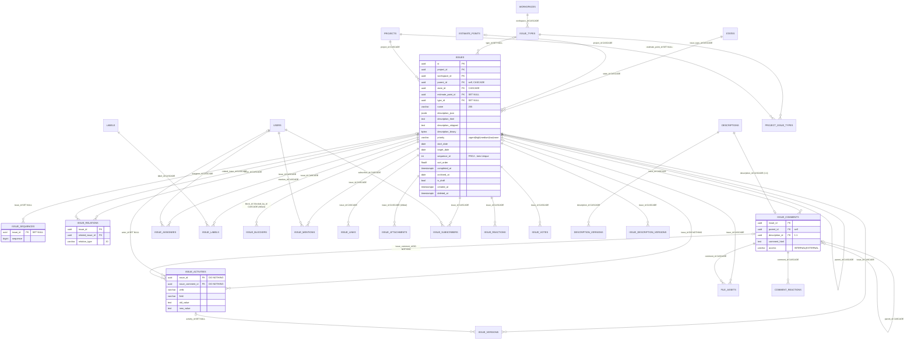
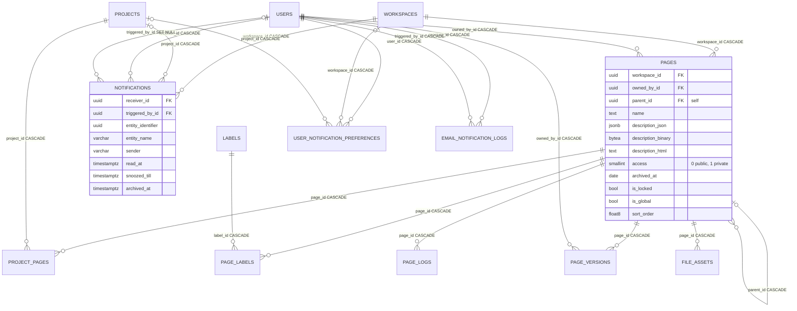

# A02b – Datenmodell Teil 2: Arbeitsobjekte (Work Items, States, Labels, Estimates, Cycles, Modules, Views, Pages, Intake, Notifications) + Migrations-Analyse

> **Status:** IST-Analyse (Plane v1.4.2 Community Edition, Repo-Stand dieses Workspaces)
> **Bindende Leitplanken:** `migration/architecture/00-grundsatzentscheidungen.md` (ADR-000 … ADR-006)
> **Vollständig gelesene Quellen (Kern dieses Bereichs):** `apps/api/plane/db/models/issue.py`, `issue_type.py`, `draft.py`, `description.py`, `state.py`, `label.py`, `estimate.py`, `cycle.py`, `module.py`, `view.py`, `page.py`, `intake.py`, `notification.py`, außerdem `base.py`, `__init__.py`, `apps/api/plane/db/mixins.py`; **alle 126 Dateien** in `apps/api/plane/db/migrations/` (Operationen systematisch extrahiert, alle `RunPython`-Funktionen vollständig gelesen).
> **Zur Verhaltensklärung zusätzlich gelesen:** `apps/api/plane/db/models/project.py` (`ProjectBaseModel`, `Project.save`, `_retime_intake_snoozes`), `workspace.py` (`WorkspaceBaseModel`), `asset.py`, `favorite.py`, `deploy_board.py`; `apps/api/plane/utils/uuid.py`, `utils/html_processor.py`, `utils/timezone_converter.py`, `utils/issue_filters.py`, `utils/content_validator.py`, `utils/filters/converters.py`, `utils/filters/filter_migrations.py`, `utils/cycle_transfer_issues.py`; `apps/api/plane/bgtasks/deletion_task.py`, `issue_description_version_task.py`, `issue_description_version_sync.py`, `issue_version_sync.py`, `page_version_task.py`, `page_transaction_task.py`, `cleanup_task.py`, `issue_automation_task.py`, `notification_task.py` (Erzeugungsteile), `email_notification_task.py` (Stacking), `copy_s3_object.py`, `work_item_link_task.py`, `workspace_seed_task.py` (Issue-Teil), `dummy_data_task.py` (Sequenz-Teil); `apps/api/plane/celery.py`; `apps/api/plane/settings/common.py`; `apps/api/plane/db/management/commands/fix_duplicate_sequences.py`; relevante Views/Serializer (an der Stelle zitiert); Frontend: `apps/web/components/editor/rich-text/description-input/root.tsx`, `apps/web/components/issues/issue-detail/main-content.tsx`, `apps/web/hooks/use-page-fallback.ts`, `packages/editor/src/helpers/yjs-utils.ts`, `packages/types/src/{enums.ts,views.ts,inbox.ts,common.ts,cycle/cycle.ts,module/modules.ts}`, `packages/constants/src/estimates.ts`, `apps/web/store/cycle.store.ts`.
> Alle Pfade relativ zum Repo-Root. **Abkürzungen:** `M/` = `apps/api/plane/db/models/`, `MIG/` = `apps/api/plane/db/migrations/`, `API/` = `apps/api/plane/`, `BM` = `BaseModel`, `PBM` = `ProjectBaseModel`, `WBM` = `WorkspaceBaseModel`, `CTM` = `ChangeTrackerMixin`.
> **Abgrenzung:** Basisklassen, Identität, Workspace, Projekt, FileAsset, Favoriten, Recent Visits, Stickies, Webhooks, API-Tokens, Exporte, Deploy-Boards, Integrationen und Instanz-Modelle → `migration/analysis/02a-datenmodell-kern.md`. API-Verhalten (Endpunkte, Berechtigungen, Listen-Algorithmus) → `migration/analysis/04-api-intern-arbeitsobjekte.md`. Editor/Realtime → `migration/analysis/12-editor-echtzeit-live.md`. Bezahlfunktionen → `migration/features/2x-*.md`.

---

## Inhaltsverzeichnis

1. Überblick & Verantwortlichkeiten
2. Vollständige Inventare
   - 2.1 Gemeinsame Basisfelder (Kurzreferenz)
   - 2.2 Model-Übersicht (alle 49 konkreten Models dieses Bereichs)
   - 2.3 Feldtabellen je Model (49 Tabellen)
   - 2.4 Manager je Model
   - 2.5 Enums / Choices / Konstanten (alle Werte)
   - 2.6 JSONField-Strukturen (im Code genutzte Keys)
   - 2.7 Unique-Constraints, partielle Indizes, Indizes (vollständig)
   - 2.8 `save()`-/`delete()`-Overrides und Klassenmethoden (Übersicht)
   - 2.9 Signals
   - 2.10 Fremdschlüssel aus anderen Bereichen in diesen Bereich
   - 2.11 Migrations-Analyse: PostgreSQL-Spezifika (vollständig)
   - 2.12 Migrations-Analyse: alle Datenmigrationen (`RunPython`) mit Logik
   - 2.13 Mermaid-ER-Diagramme der Arbeitsobjekte
3. Verhalten / Logik / Abläufe im Detail (inkl. Edge-Cases)
4. Abhängigkeiten zu anderen Bereichen
5. Migrationshinweise für .NET 10 / EF Core 10 / Angular
6. Offene Punkte
- Anhang A: Kompaktübersicht aller 126 Migrationsdateien

---

## 1. Überblick & Verantwortlichkeiten

### 1.1 Zweck des Bereichs

Dieser Bereich umfasst **alle fachlichen Arbeitsobjekte** von Plane – d. h. alles, womit Nutzer innerhalb eines Projekts/Workspaces arbeiten:

| Teilbereich | Models | Quelle |
|---|---|---|
| Work Items (intern „Issue") inkl. Verknüpfungen | `Issue`, `IssueAssignee`, `IssueLabel`, `IssueRelation`, `IssueBlocker` (Altlast), `IssueMention`, `IssueLink`, `IssueAttachment` (Altlast), `IssueSequence`, `IssueSubscriber`, `IssueReaction`, `IssueVote` | `M/issue.py` |
| Verlauf, Kommentare, Versionen | `IssueActivity`, `IssueComment`, `CommentReaction`, `IssueVersion`, `IssueDescriptionVersion`, `Description`, `DescriptionVersion` | `M/issue.py`, `M/description.py` |
| Work-Item-Typen (Bezahl-Feature-Gerüst) | `IssueType`, `ProjectIssueType` | `M/issue_type.py` |
| Entwürfe | `DraftIssue`, `DraftIssueAssignee`, `DraftIssueLabel`, `DraftIssueModule`, `DraftIssueCycle` | `M/draft.py` |
| Workflow-Stammdaten | `State` (+ `StateGroup`, `DEFAULT_STATES`), `Label`, `Estimate`, `EstimatePoint` | `M/state.py`, `M/label.py`, `M/estimate.py` |
| Planung | `Cycle`, `CycleIssue`, `CycleUserProperties`, `Module`, `ModuleMember`, `ModuleIssue`, `ModuleLink`, `ModuleUserProperties` | `M/cycle.py`, `M/module.py` |
| Gespeicherte Ansichten | `IssueView` | `M/view.py` |
| Wissen | `Page`, `PageLog`, `PageLabel`, `ProjectPage`, `PageVersion` | `M/page.py` |
| Eingang/Triage | `Intake`, `IntakeIssue` | `M/intake.py` |
| Benachrichtigungen | `Notification`, `UserNotificationPreference`, `EmailNotificationLog` | `M/notification.py` |

Zusätzlich analysiert: **alle Migrationen** (`MIG/0001_initial.py` … `MIG/0125_reset_project_deploy_board_identity.py`, 126 Dateien inkl. `__init__.py`) auf PostgreSQL-Spezifika und Datenmigrationen.

### 1.2 Kernaussagen (Management-Summary)

| # | Aussage | Quelle |
|---|---|---|
| K1 | Alle 49 Models erben von `BaseModel` (UUID-PK, Audit, Soft-Delete); 40 davon zusätzlich projekt- (`ProjectBaseModel`, 31) oder workspace-gescoped (`WorkspaceBaseModel`, 9 – mit optionalem `project`). 9 Models (`IssueType`, `Page`, `PageLog`, `PageLabel`, `ProjectPage`, `PageVersion`, `Notification`, `UserNotificationPreference`, `EmailNotificationLog`) erben direkt von `BaseModel` und deklarieren `workspace`/`project` selbst. | `M/base.py`, `M/project.py` Z. 230–239, `M/workspace.py` Z. 185–195 |
| K2 | Der **Default-Manager von `Issue` ist `issue_objects` (`IssueManager`)**, nicht `objects`: er blendet Triage-, archivierte, Draft- und Issues archivierter Projekte aus. Das beeinflusst in Django alle Rückwärts-Relationen (z. B. Sub-Issues). | `M/issue.py` Z. 92–101, 172; `MIG/0082_alter_issue_managers_alter_cycleissue_issue_and_more.py` (`AlterModelManagers`) |
| K3 | Die Vergabe der fortlaufenden Work-Item-Nummer (`sequence_id`, angezeigt als `PROJ-123`) erfolgt in `Issue.save()` unter einem **transaktionalen PostgreSQL-Advisory-Lock** pro Projekt (`pg_advisory_xact_lock`) über `MAX(issue_sequences.sequence)+1`; es gibt **keinen** Unique-Constraint auf (`project_id`, `sequence_id`). | `M/issue.py` Z. 180–214, `API/utils/uuid.py` |
| K4 | Rich-Text liegt in bis zu **vier** Repräsentationen vor: `description_html` (kanonisch für API/Anzeige), `description_json` (ProseMirror-JSON), `description_binary` (Yjs-Update, `bytea`) und abgeleitet `description_stripped` (Klartext, in `save()` berechnet). Für Work Items sendet die Web-UI **nur HTML**; nur Pages pflegen alle drei Primärformate (über den Live-Server). | `M/issue.py` Z. 137–140, 200–221; `apps/web/components/issues/issue-detail/main-content.tsx` Z. 117–122; `packages/editor/src/helpers/yjs-utils.ts` |
| K5 | In den Migrationen gibt es **kein** `RunSQL`, keine Trigger, keine SQL-Funktionen, keine expliziten Sequenzen, keine GIN-/Trigram-/Volltext-Indizes und kein `CREATE EXTENSION`. PostgreSQL-spezifisch sind: partielle Unique-Constraints (`… WHERE deleted_at IS NULL`), ein partieller Index (`intake_issue_snoozed_till_idx … WHERE status = 0`), 22 `AddIndexConcurrently`-Operationen in drei nicht-atomaren Migrationen, `ArrayField`-Spalten, `jsonb`, `bytea` sowie 56 `RunPython`-Operationen in 33 Migrationsdateien. | `MIG/*` (Abschnitt 2.11/2.12) |
| K6 | 25 Bugs/Quirks im Original betreffen das Datenmodell direkt (vollständig in 3.14; die gravierendsten: `track_page_version` erzeugt nie Versionen, `IssueVersion.log_issue_version` scheitert immer, Workspace-Labels global eindeutig, `IssueView.access` vs. `Page.access` invertiert, Hard-Delete von Issues kollidiert vermutlich mit `DO_NOTHING`-FKs). | jeweils dort |

### 1.3 Nutzung in der Community Edition (CE) vs. Bezahl-Editionen

| Model / Feld | In CE genutzt? | Bedeutung für das Zielsystem (ADR-001: alle Features aktiv) | Quelle |
|---|---|---|---|
| `IssueBlocker` | nein (nur `MIG/0043` → `IssueRelation`) | nicht übernehmen | `M/issue.py` Z. 258–269 |
| `IssueAttachment` | nein (nicht in `M/__init__.py` exportiert; Daten in `MIG/0079` nach `FileAsset` kopiert) | nicht übernehmen; Attachments = `FileAsset(entity_type="ISSUE_ATTACHMENT")` (02a) | `M/issue.py` Z. 387–412, `API/app/serializers/base.py` Z. 36–42 |
| `Issue.point` | nur Legacy-Analytics `Sum("point")` | nicht übernehmen (durch `estimate_point` ersetzt) | `API/app/views/analytic/base.py` Z. 390–391, `MIG/0067_issue_estimate.py` |
| `Issue.is_draft` | Lesend/Filter; seit `MIG/0077` eigene Tabelle `draft_issues` | Feld behalten (Filter `is_draft`), Drafts als `DraftIssue` | `API/app/serializers/issue.py` Z. 119–124 |
| `IssueSequence.deleted` | nein | weglassen | – |
| `IssueVersion` | nur Backfill-Command `sync_issue_version`; Live-Task `issue_task` wird nie aufgerufen; `log_issue_version` fehlerhaft | Eigenschafts-Historie: fachlich klären (6.4) | `API/bgtasks/issue_version_sync.py` |
| `Description`, `DescriptionVersion` | `Description` nur als 1:1-Spiegel von `IssueComment`; `DescriptionVersion` ungenutzt | Kommentar-Versionierung (EE?) klären | `M/issue.py` Z. 481–530 |
| `IssueType`, `ProjectIssueType`, `Issue.type` | nur lesend (Archiv-Filter `type__is_epic`, Public-API Default-Typ) | **Bezahl-Feature Work-Item-Typen & Epics** – vollständig implementieren | `API/app/views/issue/archive.py` Z. 99, `API/api/serializers/issue.py` Z. 66–67, 190–197 |
| `IssueComment.parent` | nein (nicht client-schreibbar) | Kommentar-Antworten (Threads) | `API/app/views/issue/comment.py` Z. 28–30 |
| `IssueComment.access="EXTERNAL"` | ja (Kommentare aus Space/Public-Board) | übernehmen | `API/space/views/issue.py` Z. 96, 310 |
| `IssueRelation` `start_before`/`finish_before`/`implemented_by` | Datenmodell ja, UI hinter Flag bzw. EE | aktivieren | 04-Dokument 3.7 |
| `EstimateType` | nur `categories`, `points`; Frontend kennt zusätzlich `time` (`is_ee: true`) | `time` ergänzen (Zeit-Schätzungen) | `M/estimate.py` Z. 13–16, `packages/constants/src/estimates.ts` Z. 12–16, 122–140 |
| `Cycle.version` | nur gelesen (Default 1); Frontend unterscheidet `version === 2` (Fortschritt aus `progress`-Array) | Version-2-Fortschritt (EE) klären | `apps/web/store/cycle.store.ts` Z. 245–252 |
| `Cycle.timezone` | nur Public-API-Feld; Logik nutzt `Project.timezone` | übernehmen, Semantik klären | `API/api/serializers/cycle.py` Z. 48, `API/app/views/cycle/base.py` Z. 82–85 |
| `Page.parent`, `is_global`, `moved_to_page`, `moved_to_project`, `PageVersion.sub_pages_data` | `parent` ist im `PageSerializer` schreibbar (`API/app/serializers/page.py` Z. 36–56); `is_global` nur Suche (`is_global=True`) und Seeds (`is_global=False`); `moved_to_*`, `sub_pages_data` ungenutzt | Wiki/verschachtelte Pages/Verschieben (EE) → `migration/features/26-paid-wissen-pages-wiki.md` | `API/app/views/search/base.py` Z. 745–760 |
| `IntakeIssue.source` `FORMS`/`EMAIL`, `source_email`, `extra` | CE schreibt nur `IN_APP` | Intake-Formulare & E-Mail-Intake | `packages/types/src/inbox.ts` Z. 27–31 |
| `Notification.entity_name` | CE erzeugt nur `"issue"` | weitere Entitäten der Bezahl-Editionen (Liste aus den Feature-Analysen `migration/features/*` ableiten) | `API/bgtasks/notification_task.py` Z. 164, 371 |
| `UserNotificationPreference.workspace/project` | nein (nur globale Zeile je User) | ggf. pro Workspace/Projekt | `API/bgtasks/notification_task.py` (`UserNotificationPreference.objects.get(user_id=…)`) |
| `EmailNotificationLog.entity`, `old_value`, `new_value` | nein | weglassen oder klären | – |
| `Notification.message_html`, `message_stripped` | nein | weglassen oder klären | – |
| `Label.project = NULL` (Workspace-Labels) | Strukturell vorhanden, CE-Endpunkte arbeiten projektbezogen | Workspace-Labels (EE?) klären | `M/label.py` Z. 26–40 |

---

## 2. Vollständige Inventare

### 2.1 Gemeinsame Basisfelder (Kurzreferenz; Details in 02a)

Jede Tabelle dieses Bereichs enthält zusätzlich zu den in 2.3 gelisteten Feldern:

| Basis | Spalte | Typ (PG) | null | Default | FK / on_delete / related_name | Quelle |
|---|---|---|---|---|---|---|
| BM | `id` | `uuid` PK | nein | `uuid4()` (Python) | – | `M/base.py` Z. 18 |
| BM (`TimeAuditModel`) | `created_at` | `timestamptz` | nein | `auto_now_add` | – | `apps/api/plane/db/mixins.py` Z. 19 |
| BM | `updated_at` | `timestamptz` | nein | `auto_now` | – | `mixins.py` Z. 20 |
| BM (`UserAuditModel`) | `created_by_id` | `uuid` | ja | aktueller User (crum) | `users`, `SET_NULL`, `%(class)s_created_by` | `mixins.py` Z. 29–35 |
| BM | `updated_by_id` | `uuid` | ja | aktueller User beim Update | `users`, `SET_NULL`, `%(class)s_updated_by` | `mixins.py` Z. 36–42 |
| BM (`SoftDeleteModel`) | `deleted_at` | `timestamptz` | ja | – | – | `mixins.py` Z. 64 |
| PBM | `project_id` | `uuid` | **nein** | – | `projects`, `CASCADE`, `project_%(class)s` | `M/project.py` Z. 231 |
| PBM | `workspace_id` | `uuid` | nein | in `save()` aus `project.workspace` überschrieben | `workspaces`, `CASCADE`, `workspace_%(class)s` | `M/project.py` Z. 232, 237–239 |
| WBM | `workspace_id` | `uuid` | nein | in `save()` aus `project.workspace` überschrieben, **falls** `project` gesetzt | `workspaces`, `CASCADE`, `workspace_%(class)s` | `M/workspace.py` Z. 186, 192–195 |
| WBM | `project_id` | `uuid` | **ja** | – | `projects`, `CASCADE`, `project_%(class)s` | `M/workspace.py` Z. 187 |

Typ-Abbildung Django → PostgreSQL (für alle folgenden Tabellen): `CharField(n)` → `varchar(n)`, `TextField` → `text`, `JSONField` → `jsonb`, `BinaryField` → `bytea`, `UUIDField` → `uuid`, `DateField` → `date`, `DateTimeField` → `timestamptz` (`USE_TZ = True`, `TIME_ZONE = "UTC"`, `API/settings/common.py` Z. 318–319), `FloatField` → `double precision`, `IntegerField` → `integer`, `PositiveIntegerField` → `integer` + `CHECK (>= 0)`, `PositiveSmallIntegerField` → `smallint` + `CHECK (>= 0)`, `PositiveBigIntegerField` → `bigint` + `CHECK (>= 0)`, `BooleanField` → `boolean`, `SlugField` → `varchar(100)` + Index, `URLField` → `varchar(200)`, `FileField` → `varchar(100)`, `ArrayField(X, size=10)` → `X[]` (Größe nur Django-validiert). **Alle Defaults sind Python-seitig** (Django 5 ohne `db_default`) – die DB-Spalten haben keine `DEFAULT`-Klausel. `TextField`/`CharField` ohne expliziten Default und ohne `null=True` erhalten beim Anlegen über das ORM den Leerstring `""`.

### 2.2 Model-Übersicht (alle 49 konkreten Models)

| # | Model | Tabelle | Basis | Datei / Zeilen | Zweck | CE-Status |
|---|---|---|---|---|---|---|
| 1 | `Issue` | `issues` | CTM + PBM | `M/issue.py` Z. 104–255 | Work Item | aktiv |
| 2 | `IssueBlocker` | `issue_blockers` | PBM | `M/issue.py` Z. 258–269 | Alt-Blocker-Relation | Altlast |
| 3 | `IssueRelation` | `issue_relations` | PBM | `M/issue.py` Z. 296–320 | Relation zwischen Work Items | aktiv |
| 4 | `IssueMention` | `issue_mentions` | PBM | `M/issue.py` Z. 323–342 | Erwähnte Nutzer in Beschreibung | aktiv |
| 5 | `IssueAssignee` | `issue_assignees` | PBM | `M/issue.py` Z. 345–368 | M2M Issue↔User (Bearbeiter) | aktiv |
| 6 | `IssueLink` | `issue_links` | PBM | `M/issue.py` Z. 371–384 | Externe Links | aktiv |
| 7 | `IssueAttachment` | `issue_attachments` | PBM | `M/issue.py` Z. 398–412 | Alt-Anhänge | Altlast |
| 8 | `IssueActivity` | `issue_activities` | PBM | `M/issue.py` Z. 415–448 | Änderungsverlauf | aktiv |
| 9 | `IssueComment` | `issue_comments` | CTM + PBM | `M/issue.py` Z. 451–540 | Kommentare | aktiv |
| 10 | `IssueLabel` | `issue_labels` | PBM | `M/issue.py` Z. 543–554 | M2M Issue↔Label | aktiv |
| 11 | `IssueSequence` | `issue_sequences` | PBM | `M/issue.py` Z. 557–571 | Nummernregister je Projekt | aktiv |
| 12 | `IssueSubscriber` | `issue_subscribers` | PBM | `M/issue.py` Z. 574–597 | Abonnenten | aktiv |
| 13 | `IssueReaction` | `issue_reactions` | PBM | `M/issue.py` Z. 600–624 | Emoji-Reaktionen auf Issue | aktiv |
| 14 | `CommentReaction` | `comment_reactions` | PBM | `M/issue.py` Z. 627–651 | Emoji-Reaktionen auf Kommentar | aktiv |
| 15 | `IssueVote` | `issue_votes` | PBM | `M/issue.py` Z. 654–674 | Up-/Downvotes (Public Board) | aktiv |
| 16 | `IssueVersion` | `issue_versions` | PBM | `M/issue.py` Z. 677–779 | Eigenschafts-Snapshots | nur Backfill |
| 17 | `IssueDescriptionVersion` | `issue_description_versions` | PBM | `M/issue.py` Z. 782–822 | Beschreibungs-Historie | aktiv |
| 18 | `IssueType` | `issue_types` | BM | `M/issue_type.py` Z. 14–32 | Work-Item-Typ (Workspace) | Gerüst (EE) |
| 19 | `ProjectIssueType` | `project_issue_types` | PBM | `M/issue_type.py` Z. 35–55 | Zuordnung Typ↔Projekt | Gerüst (EE) |
| 20 | `DraftIssue` | `draft_issues` | WBM | `M/draft.py` Z. 16–136 | Entwurf eines Work Items | aktiv |
| 21 | `DraftIssueAssignee` | `draft_issue_assignees` | WBM | `M/draft.py` Z. 139–162 | M2M Draft↔User | aktiv |
| 22 | `DraftIssueLabel` | `draft_issue_labels` | WBM | `M/draft.py` Z. 165–176 | M2M Draft↔Label | aktiv |
| 23 | `DraftIssueModule` | `draft_issue_modules` | WBM | `M/draft.py` Z. 179–198 | M2M Draft↔Module | aktiv |
| 24 | `DraftIssueCycle` | `draft_issue_cycles` | WBM | `M/draft.py` Z. 201–224 | Draft↔Cycle | aktiv |
| 25 | `Description` | `descriptions` | WBM | `M/description.py` Z. 10–29 | Generischer Rich-Text-Container | nur Kommentar-Spiegel |
| 26 | `DescriptionVersion` | `description_versions` | WBM | `M/description.py` Z. 32–56 | Historie zu `Description` | ungenutzt |
| 27 | `State` | `states` | PBM | `M/state.py` Z. 79–126 | Workflow-Status | aktiv |
| 28 | `Label` | `labels` | WBM | `M/label.py` Z. 11–57 | Label (hierarchisch) | aktiv |
| 29 | `Estimate` | `estimates` | PBM | `M/estimate.py` Z. 18–40 | Schätzsystem eines Projekts | aktiv |
| 30 | `EstimatePoint` | `estimate_points` | PBM | `M/estimate.py` Z. 43–57 | Schätzwert | aktiv |
| 31 | `Cycle` | `cycles` | PBM | `M/cycle.py` Z. 60–101 | Iteration/Sprint | aktiv |
| 32 | `CycleIssue` | `cycle_issues` | PBM | `M/cycle.py` Z. 104–127 | Zuordnung Issue→Cycle | aktiv |
| 33 | `CycleUserProperties` | `cycle_user_properties` | PBM | `M/cycle.py` Z. 130–157 | Anzeige-/Filter-Einstellungen je User & Cycle | aktiv |
| 34 | `Module` | `modules` | PBM | `M/module.py` Z. 67–127 | Modul/Epic-artige Gruppe | aktiv |
| 35 | `ModuleMember` | `module_members` | PBM | `M/module.py` Z. 130–149 | M2M Module↔User | aktiv |
| 36 | `ModuleIssue` | `module_issues` | PBM | `M/module.py` Z. 152–171 | M2M Module↔Issue | aktiv |
| 37 | `ModuleLink` | `module_links` | PBM | `M/module.py` Z. 174–187 | Links eines Moduls | aktiv |
| 38 | `ModuleUserProperties` | `module_user_properties` | PBM | `M/module.py` Z. 190–217 | Anzeige-/Filter-Einstellungen je User & Modul | aktiv |
| 39 | `IssueView` | `issue_views` | WBM | `M/view.py` Z. 58–99 | Gespeicherte Ansicht (Projekt oder Workspace) | aktiv |
| 40 | `Page` | `pages` | BM | `M/page.py` Z. 23–76 | Seite/Dokument | aktiv |
| 41 | `PageLog` | `page_logs` | BM | `M/page.py` Z. 80–117 | In Seiten referenzierte Entitäten (Mentions, Bilder) | aktiv |
| 42 | `PageLabel` | `page_labels` | BM | `M/page.py` Z. 120–132 | M2M Page↔Label | aktiv (über `PageSerializer.labels`, `API/app/serializers/page.py` Z. 61–115) |
| 43 | `ProjectPage` | `project_pages` | BM | `M/page.py` Z. 135–155 | M2M Page↔Project | aktiv |
| 44 | `PageVersion` | `page_versions` | BM | `M/page.py` Z. 158–182 | Seiten-Historie | aktiv (aber Erzeugung defekt, 3.6) |
| 45 | `Intake` | `intakes` | PBM | `M/intake.py` Z. 16–39 | Eingangskorb eines Projekts | aktiv |
| 46 | `IntakeIssue` | `intake_issues` | CTM + PBM | `M/intake.py` Z. 54–110 | Eingangs-Eintrag (Status, Snooze, Duplikat) | aktiv |
| 47 | `Notification` | `notifications` | BM | `M/notification.py` Z. 13–69 | In-App-Benachrichtigung | aktiv |
| 48 | `UserNotificationPreference` | `user_notification_preferences` | BM | `M/notification.py` Z. 81–118 | E-Mail-Präferenzen | aktiv |
| 49 | `EmailNotificationLog` | `email_notification_logs` | BM | `M/notification.py` Z. 121–149 | Warteschlange/Log für E-Mail-Digests | aktiv |

### 2.3 Feldtabellen je Model

Legende: **null** = DB-NULL erlaubt; **blank** = Django-Formular/Serializer erlaubt leer; „—" = nicht gesetzt. Basisfelder (2.1) werden nicht wiederholt. FK-Spalten heißen `<feld>_id`. Jede FK-Spalte hat automatisch einen B-Tree-Index (Django-Default).

#### 2.3.1 `Issue` — Tabelle `issues` — `M/issue.py` Z. 104–255 (Basis `ChangeTrackerMixin`, `ProjectBaseModel`; `TRACKED_FIELDS = ["state_id"]`)

| Feld | Typ | null | blank | Default | Choices / Validatoren | FK → Ziel, on_delete, related_name | Bemerkung |
|---|---|---|---|---|---|---|---|
| `parent` | FK `uuid` | ja | ja | — | — | `issues` (self), `CASCADE`, `parent_issue` | Sub-Issue-Hierarchie; Löschen des Elternteils löscht Kinder (soft) |
| `state` | FK `uuid` | ja | ja | in `save()` Default-State | — | `states`, `CASCADE`, `state_issue` | `_ensure_default_state()` |
| `point` | `integer` | ja | ja | — | `MinValueValidator(0)`, `MaxValueValidator(12)` | — | Legacy (vor `MIG/0067` hieß es `estimate_point`) |
| `estimate_point` | FK `uuid` | ja | ja | — | — | `estimate_points`, `SET_NULL`, `issue_estimates` | aktuelle Schätzung |
| `name` | `varchar(255)` | nein | nein | — | — | — | Pflicht; `verbose_name="Issue Name"` |
| `description_json` | `jsonb` | nein | ja | `{}` | — | — | ProseMirror-JSON; bis `MIG/0117` Spaltenname `description` |
| `description_html` | `text` | nein | ja | `"

"` | — | — | kanonische HTML-Darstellung |
| `description_stripped` | `text` | ja | ja | — | — | — | in `save()` = `strip_tags(description_html)` bzw. `NULL` |
| `description_binary` | `bytea` | ja | — | — | — | — | Yjs-Update (s. 3.5) |
| `priority` | `varchar(30)` | nein | nein | `"none"` | `urgent`, `high`, `medium`, `low`, `none` (`PRIORITY_CHOICES`) | — | `verbose_name="Issue Priority"` |
| `start_date` | `date` | ja | ja | — | — | — | |
| `target_date` | `date` | ja | ja | — | — | — | „Due date" in der UI |
| `assignees` | M2M | — | ja | — | — | `users` über `IssueAssignee` (`through_fields=("issue","assignee")`), `related_name="assignee"` | keine eigene Spalte |
| `sequence_id` | `integer` | nein | — | `1` | — | — | in `save()` vergeben; **kein Unique** |
| `labels` | M2M | — | ja | — | — | `labels` über `IssueLabel`, `related_name="labels"` | keine eigene Spalte |
| `sort_order` | `double precision` | nein | — | `65535` | — | — | in `save()` überschrieben (3.3) |
| `completed_at` | `timestamptz` | ja | — | — | — | — | in `save()` gepflegt |
| `archived_at` | **`date`** | ja | — | — | — | — | Datum, kein Zeitstempel |
| `is_draft` | `boolean` | nein | — | `False` | — | — | nach Anlage read-only (`API/app/serializers/issue.py` Z. 119–124) |
| `external_source` | `varchar(255)` | ja | ja | — | — | — | Importe/Public API |
| `external_id` | `varchar(255)` | ja | ja | — | — | — | |
| `type` | FK `uuid` | ja | ja | — | — | `issue_types`, `SET_NULL`, `issue_type` | Work-Item-Typ (EE) |

Meta: `db_table="issues"`, `ordering=("-created_at",)`, **keine** Constraints/Indizes außer FK- und PK-Indizes. Manager: `issue_objects = IssueManager()` (Default-Manager, s. 2.4), geerbt `objects`, `all_objects`. Helfer-Funktionen auf Modulebene (`get_default_properties`, `get_default_filters`, `get_default_display_filters`, `get_default_display_properties`, `M/issue.py` Z. 29–88) werden nur noch von alten Migrationen referenziert (`MIG/0046…`, `MIG/0052…`).

#### 2.3.2 `IssueBlocker` — Tabelle `issue_blockers` — `M/issue.py` Z. 258–269 (PBM, Altlast)

| Feld | Typ | null | FK → Ziel, on_delete, related_name |
|---|---|---|---|
| `block` | FK `uuid` | nein | `issues`, `CASCADE`, `blocker_issues` |
| `blocked_by` | FK `uuid` | nein | `issues`, `CASCADE`, `blocked_issues` |

Meta: `ordering=("-created_at",)`. Daten wurden in `MIG/0043_alter_analyticview_created_by_and_more.py` (`create_issue_relation`) als `IssueRelation(relation_type="blocked_by")` übernommen.

#### 2.3.3 `IssueRelation` — Tabelle `issue_relations` — `M/issue.py` Z. 296–320 (PBM)

| Feld | Typ | null | Default | FK → Ziel, on_delete, related_name | Bemerkung |
|---|---|---|---|---|---|
| `issue` | FK `uuid` | nein | — | `issues`, `CASCADE`, `issue_relation` | „Subjekt" der Relation |
| `related_issue` | FK `uuid` | nein | — | `issues`, `CASCADE`, `issue_related` | „Objekt" |
| `relation_type` | `varchar(20)` | nein | `"blocked_by"` | — | **ohne `choices`** – Modell akzeptiert jeden String ≤ 20 Zeichen; fachliche Werte siehe `IssueRelationChoices` (2.5) |

Meta: `unique_together=["issue","related_issue","deleted_at"]`; `UniqueConstraint(fields=["issue","related_issue"], condition=deleted_at IS NULL, name="issue_relation_unique_issue_related_issue_when_deleted_at_null")`; `ordering=("-created_at",)`. Pro gerichtetem Paar höchstens **eine** aktive Relation (unabhängig vom Typ); die Gegenrichtung (`related_issue`,`issue`) ist DB-seitig nicht ausgeschlossen.

#### 2.3.4 `IssueMention` — Tabelle `issue_mentions` — `M/issue.py` Z. 323–342 (PBM)

| Feld | Typ | null | FK → Ziel, on_delete, related_name |
|---|---|---|---|
| `issue` | FK `uuid` | nein | `issues`, `CASCADE`, `issue_mention` |
| `mention` | FK `uuid` | nein | `users`, `CASCADE`, `issue_mention` |

Meta: `unique_together=["issue","mention","deleted_at"]`; partiell eindeutig `issue_mention_unique_issue_mention_when_deleted_at_null` (`issue`,`mention`); `ordering=("-created_at",)`.

#### 2.3.5 `IssueAssignee` — Tabelle `issue_assignees` — `M/issue.py` Z. 345–368 (PBM)

| Feld | Typ | null | FK → Ziel, on_delete, related_name |
|---|---|---|---|
| `issue` | FK `uuid` | nein | `issues`, `CASCADE`, `issue_assignee` |
| `assignee` | FK `uuid` | nein | `users`, `CASCADE`, `issue_assignee` |

Meta: `unique_together=["issue","assignee","deleted_at"]`; partiell eindeutig `issue_assignee_unique_issue_assignee_when_deleted_at_null`; `ordering=("-created_at",)`.

#### 2.3.6 `IssueLink` — Tabelle `issue_links` — `M/issue.py` Z. 371–384 (PBM)

| Feld | Typ | null | blank | Default | FK | Bemerkung |
|---|---|---|---|---|---|---|
| `title` | `varchar(255)` | ja | ja | — | — | vom Nutzer oder Crawler |
| `url` | `text` | nein | nein | — | — | seit `MIG/0061_project_logo_props.py` `TextField` (vorher `URLField`) |
| `issue` | FK `uuid` | nein | — | — | `issues`, `CASCADE`, `issue_link` | |
| `metadata` | `jsonb` | nein | — | `{}` | — | Crawler-Ergebnis (2.6) |

Meta: `ordering=("-created_at",)`; keine Unique-Constraints (doppelte URLs erlaubt).

#### 2.3.7 `IssueAttachment` — Tabelle `issue_attachments` — `M/issue.py` Z. 398–412 (PBM, Altlast)

| Feld | Typ | null | Default | FK | Bemerkung |
|---|---|---|---|---|---|
| `attributes` | `jsonb` | nein | `{}` | — | z. B. `size`, `name` |
| `asset` | `varchar(100)` (`FileField`) | nein | — | — | `upload_to=get_upload_path` → `"{workspace_id}/{uuid4().hex}-{sanitize_filename(name) or uuid4().hex}"`; Validator `file_size` (> `FILE_SIZE_LIMIT`, Default 5 242 880 Byte → „File too large. Size should not exceed 5 MB.") |
| `issue` | FK `uuid` | nein | — | `issues`, `CASCADE`, `issue_attachment` | |
| `external_source`, `external_id` | `varchar(255)` | ja | — | — | |

Meta: `ordering=("-created_at",)`. Nicht in `M/__init__.py` exportiert; Daten in `MIG/0079_auto_20241009_0619.py` nach `file_assets` kopiert.

#### 2.3.8 `IssueActivity` — Tabelle `issue_activities` — `M/issue.py` Z. 415–448 (PBM)

| Feld | Typ | null | blank | Default | FK → Ziel, on_delete, related_name | Bemerkung |
|---|---|---|---|---|---|---|
| `issue` | FK `uuid` | ja | — | — | `issues`, **`DO_NOTHING`**, `issue_activity` | seit `MIG/0108` `DO_NOTHING` – Verlauf bleibt nach Löschen |
| `verb` | `varchar(255)` | nein | — | `"created"` | — | geschriebene Werte: `created`, `updated`, `deleted`, `removed` (`API/bgtasks/issue_activities_task.py`); `removed` ist für „Schätzung entfernt" vorgesehen, die Zeile scheitert aber statisch betrachtet an `field="estimate_" + new_estimate.estimate.type` mit `new_estimate = None` (Z. 490–501, `AttributeError`) |
| `field` | `varchar(255)` | ja | ja | — | — | geschriebene Werte (vollständig, `API/bgtasks/issue_activities_task.py`): `archived_at`, `assignees`, `attachment`, `comment`, `cycles`, `description`, `draft`, `estimate_points`/`estimate_categories` (`"estimate_" + estimate.type`), `intake`, `issue`, `labels`, `link`, `modules`, `name`, `parent`, `priority`, `reaction`, `start_date`, `state`, `target_date`, `vote` sowie Relationstypen als Feldname (`blocked_by`, `blocking`, `relates_to`, `duplicate`, `start_before`, `start_after`, `finish_before`, `finish_after`, `implemented_by`, `implements`); `NULL` bei Anlage |
| `old_value` | `text` | ja | ja | — | — | Anzeige-Wert alt |
| `new_value` | `text` | ja | ja | — | — | Anzeige-Wert neu |
| `comment` | `text` | nein | ja | `""` | — | menschenlesbarer Satz („created the issue") |
| `attachments` | `varchar(200)[]` (`ArrayField(URLField, size=10)`) | nein | ja | `[]` | — | |
| `issue_comment` | FK `uuid` | ja | — | — | `issue_comments`, **`DO_NOTHING`**, `issue_comment` | |
| `actor` | FK `uuid` | ja | — | — | `users`, `SET_NULL`, `issue_activities` | |
| `old_identifier` | `uuid` | ja | — | — | — | ID des alten Werts (z. B. State-ID) |
| `new_identifier` | `uuid` | ja | — | — | — | |
| `epoch` | `double precision` | ja | — | — | — | Unix-Zeitstempel der Aktion (Sortierung/Gruppierung) |

Meta: `ordering=("-created_at",)`.

#### 2.3.9 `IssueComment` — Tabelle `issue_comments` — `M/issue.py` Z. 451–540 (Basis CTM + PBM; `TRACKED_FIELDS = ["comment_stripped","comment_json","comment_html"]`)

| Feld | Typ | null | blank | Default | Choices | FK → Ziel, on_delete, related_name | Bemerkung |
|---|---|---|---|---|---|---|---|
| `comment_stripped` | `text` | nein | ja | `""` | — | — | in `save()` berechnet |
| `comment_json` | `jsonb` | nein | ja | `{}` | — | — | Web-Client sendet es **nicht** (nur HTML) |
| `comment_html` | `text` | nein | ja | `"

"` | — | — | |
| `description` | OneToOne `uuid` | ja | — | — | — | `descriptions`, `CASCADE`, `issue_comment_description` | Spiegel in `Description` (`MIG/0109`) |
| `attachments` | `varchar(200)[]` (size 10) | nein | ja | `[]` | — | — | |
| `issue` | FK `uuid` | nein | — | — | — | `issues`, `CASCADE`, `issue_comments` | |
| `actor` | FK `uuid` | ja | — | — | — | `users`, `CASCADE`, `comments` | „System can also create comment" |
| `access` | `varchar(100)` | nein | — | `"INTERNAL"` | `INTERNAL`, `EXTERNAL` | — | `EXTERNAL` = aus Public Board (Space) |
| `external_source`, `external_id` | `varchar(255)` | ja | ja | — | — | — | |
| `edited_at` | `timestamptz` | ja | ja | — | — | — | `MIG/0091` |
| `parent` | FK `uuid` | ja | ja | — | — | `issue_comments` (self), `CASCADE`, `parent_issue_comment` | Antworten (`MIG/0109`), in CE nicht schreibbar |

Meta: `ordering=("-created_at",)`.

#### 2.3.10 `IssueLabel` — Tabelle `issue_labels` — `M/issue.py` Z. 543–554 (PBM)

| Feld | Typ | null | FK → Ziel, on_delete, related_name |
|---|---|---|---|
| `issue` | FK `uuid` | nein | `issues`, `CASCADE`, `label_issue` |
| `label` | FK `uuid` | nein | `labels`, `CASCADE`, `label_issue` |

Meta: `ordering=("-created_at",)`; **kein** Unique-Constraint (Duplikate DB-seitig möglich).

#### 2.3.11 `IssueSequence` — Tabelle `issue_sequences` — `M/issue.py` Z. 557–571 (PBM)

| Feld | Typ | null | Default | FK → Ziel, on_delete, related_name | Bemerkung |
|---|---|---|---|---|---|
| `issue` | FK `uuid` | ja | — | `issues`, `SET_NULL`, `issue_sequence` | „keep the sequence even if the issue is deleted" |
| `sequence` | `bigint` (`PositiveBigIntegerField`, `CHECK >= 0`) | nein | `1` | — | `db_index=True` (seit `MIG/0072`) |
| `deleted` | `boolean` | nein | `False` | — | ungenutzt |

Meta: `ordering=("-created_at",)`; kein Unique.

#### 2.3.12 `IssueSubscriber` — Tabelle `issue_subscribers` — `M/issue.py` Z. 574–597 (PBM)

| Feld | Typ | null | FK → Ziel, on_delete, related_name |
|---|---|---|---|
| `issue` | FK `uuid` | nein | `issues`, `CASCADE`, `issue_subscribers` |
| `subscriber` | FK `uuid` | nein | `users`, `CASCADE`, `issue_subscribers` |

Meta: `unique_together=["issue","subscriber","deleted_at"]`; partiell eindeutig `issue_subscriber_unique_issue_subscriber_when_deleted_at_null`; `ordering=("-created_at",)`.

#### 2.3.13 `IssueReaction` — Tabelle `issue_reactions` — `M/issue.py` Z. 600–624 (PBM)

| Feld | Typ | null | FK → Ziel, on_delete, related_name | Bemerkung |
|---|---|---|---|---|
| `actor` | FK `uuid` | nein | `users`, `CASCADE`, `issue_reactions` | |
| `issue` | FK `uuid` | nein | `issues`, `CASCADE`, `issue_reactions` | |
| `reaction` | `text` | nein | — | Emoji als Text (seit `MIG/0098` `TextField`) |

Meta: `unique_together=["issue","actor","reaction","deleted_at"]`; partiell eindeutig `issue_reaction_unique_issue_actor_reaction_when_deleted_at_null`; `ordering=("-created_at",)`.

#### 2.3.14 `CommentReaction` — Tabelle `comment_reactions` — `M/issue.py` Z. 627–651 (PBM)

| Feld | Typ | null | FK → Ziel, on_delete, related_name |
|---|---|---|---|
| `actor` | FK `uuid` | nein | `users`, `CASCADE`, `comment_reactions` |
| `comment` | FK `uuid` | nein | `issue_comments`, `CASCADE`, `comment_reactions` |
| `reaction` | `text` | nein | — |

Meta: `unique_together=["comment","actor","reaction","deleted_at"]`; partiell eindeutig `comment_reaction_unique_comment_actor_reaction_when_deleted_at_null`; `ordering=("-created_at",)`. Quirk: `__str__` greift auf nicht existentes `self.issue` zu (`AttributeError`).

#### 2.3.15 `IssueVote` — Tabelle `issue_votes` — `M/issue.py` Z. 654–674 (PBM)

| Feld | Typ | null | Default | Choices | FK → Ziel, on_delete, related_name |
|---|---|---|---|---|---|
| `issue` | FK `uuid` | nein | — | — | `issues`, `CASCADE`, `votes` |
| `actor` | FK `uuid` | nein | — | — | `users`, `CASCADE`, `votes` |
| `vote` | `integer` | nein | `1` | `-1` = `DOWNVOTE`, `1` = `UPVOTE` | — |

Meta: `unique_together=["issue","actor","deleted_at"]`; partiell eindeutig `issue_vote_unique_issue_actor_when_deleted_at_null`; `ordering=("-created_at",)`.

#### 2.3.16 `IssueVersion` — Tabelle `issue_versions` — `M/issue.py` Z. 677–779 (PBM)

| Feld | Typ | null | blank | Default | Choices | FK → Ziel, on_delete, related_name |
|---|---|---|---|---|---|---|
| `parent` | `uuid` | ja | ja | — | — | (kein FK) |
| `state` | `uuid` | ja | ja | — | — | (kein FK) |
| `estimate_point` | `uuid` | ja | ja | — | — | (kein FK) |
| `name` | `varchar(255)` | nein | nein | — | — | — |
| `priority` | `varchar(30)` | nein | — | `"none"` | wie `Issue` | — |
| `start_date`, `target_date` | `date` | ja | ja | — | — | — |
| `assignees` | `uuid[]` | nein | ja | `[]` | — | — |
| `sequence_id` | `integer` | nein | — | `1` | — | — |
| `labels` | `uuid[]` | nein | ja | `[]` | — | — |
| `sort_order` | `double precision` | nein | — | `65535` | — | — |
| `completed_at` | `timestamptz` | ja | — | — | — | — |
| `archived_at` | `date` | ja | — | — | — | — |
| `is_draft` | `boolean` | nein | — | `False` | — | — |
| `external_source`, `external_id` | `varchar(255)` | ja | ja | — | — | — |
| `type` | `uuid` | ja | ja | — | — | (kein FK) |
| `cycle` | `uuid` | ja | ja | — | — | (kein FK) |
| `modules` | `uuid[]` | nein | ja | `[]` | — | — |
| `properties` | `jsonb` | nein | — | `{}` | — | „issue properties" (immer `{}`) |
| `meta` | `jsonb` | nein | — | `{}` | — | „issue meta" (immer `{}`) |
| `last_saved_at` | `timestamptz` | nein | — | `timezone.now` | — | — |
| `issue` | FK `uuid` | nein | — | — | — | `issues`, `CASCADE`, `versions` |
| `activity` | FK `uuid` | ja | — | — | — | `issue_activities`, `SET_NULL`, `versions` |
| `owned_by` | FK `uuid` | nein | — | — | — | `users`, `CASCADE`, `issue_versions` |

Meta: `ordering=("-created_at",)`. Klassenmethode `log_issue_version(issue, user)` (3.6). Die Beschreibungsfelder wurden in `MIG/0087_remove_issueversion_description_and_more.py` entfernt (→ `IssueDescriptionVersion`).

#### 2.3.17 `IssueDescriptionVersion` — Tabelle `issue_description_versions` — `M/issue.py` Z. 782–822 (PBM)

| Feld | Typ | null | blank | Default | FK → Ziel, on_delete, related_name |
|---|---|---|---|---|---|
| `issue` | FK `uuid` | nein | — | — | `issues`, `CASCADE`, `description_versions` |
| `description_binary` | `bytea` | ja | — | — | — |
| `description_html` | `text` | nein | ja | `"

"` | — |
| `description_stripped` | `text` | ja | ja | — | — |
| `description_json` | `jsonb` | nein | ja | `{}` | — |
| `last_saved_at` | `timestamptz` | nein | — | `timezone.now` | — |
| `owned_by` | FK `uuid` | nein | — | — | `users`, `CASCADE`, `issue_description_versions` |

Meta: **kein** `ordering`, keine Constraints. Klassenmethode `log_issue_description_version(issue, user)` (3.6). Kein `save()`-Override (Werte werden 1:1 vom Issue kopiert).

#### 2.3.18 `IssueType` — Tabelle `issue_types` — `M/issue_type.py` Z. 14–32 (BM)

| Feld | Typ | null | blank | Default | FK → Ziel, on_delete, related_name | Bemerkung |
|---|---|---|---|---|---|---|
| `workspace` | FK `uuid` | nein | — | — | `workspaces`, `CASCADE`, `issue_types` | Typen sind workspaceweit |
| `name` | `varchar(255)` | nein | nein | — | — | **kein** Unique (Constraints in `MIG/0074` entfernt) |
| `description` | `text` | nein | ja | `""` | — | |
| `logo_props` | `jsonb` | nein | — | `{}` | — | `TLogoProps` (2.6) |
| `is_epic` | `boolean` | nein | — | `False` | — | Epics = Typ mit `is_epic=True` |
| `is_default` | `boolean` | nein | — | `False` | — | |
| `is_active` | `boolean` | nein | — | `True` | — | |
| `level` | `double precision` | nein | — | `0` | — | Hierarchie-Ebene |
| `external_source`, `external_id` | `varchar(255)` | ja | ja | — | — | |

Meta: kein `ordering`, keine Constraints.

#### 2.3.19 `ProjectIssueType` — Tabelle `project_issue_types` — `M/issue_type.py` Z. 35–55 (PBM)

| Feld | Typ | null | Default | FK → Ziel, on_delete, related_name |
|---|---|---|---|---|
| `issue_type` | FK `uuid` | nein | — | `issue_types`, `CASCADE`, `project_issue_types` |
| `level` | `integer` (`PositiveIntegerField`, `CHECK >= 0`) | nein | `0` | — |
| `is_default` | `boolean` | nein | `False` | — |

Meta: `unique_together=["project","issue_type","deleted_at"]`; partiell eindeutig `project_issue_type_unique_project_issue_type_when_deleted_at_null`; `ordering=("project","issue_type")`.

#### 2.3.20 `DraftIssue` — Tabelle `draft_issues` — `M/draft.py` Z. 16–136 (WBM – `project` optional)

| Feld | Typ | null | blank | Default | Choices | FK → Ziel, on_delete, related_name |
|---|---|---|---|---|---|---|
| `parent` | FK `uuid` | ja | ja | — | — | `issues`, `CASCADE`, `draft_parent_issue` |
| `state` | FK `uuid` | ja | ja | in `save()` | — | `states`, `CASCADE`, `state_draft_issue` |
| `estimate_point` | FK `uuid` | ja | ja | — | — | `estimate_points`, `SET_NULL`, `draft_issue_estimates` |
| `name` | `varchar(255)` | **ja** | ja | — | — | — |
| `description_json` | `jsonb` | nein | ja | `{}` | — | — (bis `MIG/0117`: `description`) |
| `description_html` | `text` | nein | ja | `"

"` | — | — |
| `description_stripped` | `text` | ja | ja | — | — | — |
| `description_binary` | `bytea` | ja | — | — | — | — |
| `priority` | `varchar(30)` | nein | — | `"none"` | wie `Issue` | — |
| `start_date`, `target_date` | `date` | ja | ja | — | — | — |
| `assignees` | M2M | — | ja | — | — | `users` über `DraftIssueAssignee` (`through_fields=("draft_issue","assignee")`), `draft_assignee` |
| `labels` | M2M | — | ja | — | — | `labels` über `DraftIssueLabel`, `draft_labels` |
| `sort_order` | `double precision` | nein | — | `65535` | — | — |
| `completed_at` | `timestamptz` | ja | — | — | — | — |
| `external_source`, `external_id` | `varchar(255)` | ja | ja | — | — | — |
| `type` | FK `uuid` | ja | ja | — | — | `issue_types`, `SET_NULL`, `draft_issue_type` |

Meta: `ordering=("-created_at",)`. Kein `sequence_id`, kein `archived_at`, kein `is_draft`, kein `point`.

#### 2.3.21 `DraftIssueAssignee` — Tabelle `draft_issue_assignees` — `M/draft.py` Z. 139–162 (WBM)

| Feld | Typ | null | FK → Ziel, on_delete, related_name |
|---|---|---|---|
| `draft_issue` | FK `uuid` | nein | `draft_issues`, `CASCADE`, `draft_issue_assignee` |
| `assignee` | FK `uuid` | nein | `users`, `CASCADE`, `draft_issue_assignee` |

Meta: `unique_together=["draft_issue","assignee","deleted_at"]`; partiell eindeutig `draft_issue_assignee_unique_issue_assignee_when_deleted_at_null`; `ordering=("-created_at",)`.

#### 2.3.22 `DraftIssueLabel` — Tabelle `draft_issue_labels` — `M/draft.py` Z. 165–176 (WBM)

| Feld | Typ | null | FK → Ziel, on_delete, related_name |
|---|---|---|---|
| `draft_issue` | FK `uuid` | nein | `draft_issues`, `CASCADE`, `draft_label_issue` |
| `label` | FK `uuid` | nein | `labels`, `CASCADE`, `draft_label_issue` |

Meta: `ordering=("-created_at",)`; kein Unique.

#### 2.3.23 `DraftIssueModule` — Tabelle `draft_issue_modules` — `M/draft.py` Z. 179–198 (WBM)

| Feld | Typ | null | FK → Ziel, on_delete, related_name |
|---|---|---|---|
| `module` | FK `uuid` | nein | `modules`, `CASCADE`, `draft_issue_module` |
| `draft_issue` | FK `uuid` | nein | `draft_issues`, `CASCADE`, `draft_issue_module` |

Meta: `unique_together=["draft_issue","module","deleted_at"]`; partiell eindeutig `module_draft_issue_unique_issue_module_when_deleted_at_null`; `ordering=("-created_at",)`.

#### 2.3.24 `DraftIssueCycle` — Tabelle `draft_issue_cycles` — `M/draft.py` Z. 201–224 (WBM)

| Feld | Typ | null | FK → Ziel, on_delete, related_name | Bemerkung |
|---|---|---|---|---|
| `draft_issue` | FK `uuid` | nein | `draft_issues`, `CASCADE`, `draft_issue_cycle` | bis `MIG/0082` `OneToOneField` |
| `cycle` | FK `uuid` | nein | `cycles`, `CASCADE`, `draft_issue_cycle` | |

Meta: `unique_together=["draft_issue","cycle","deleted_at"]`; partiell eindeutig `draft_issue_cycle_when_deleted_at_null`; `ordering=("-created_at",)`.

#### 2.3.25 `Description` — Tabelle `descriptions` — `M/description.py` Z. 10–29 (WBM)

| Feld | Typ | null | blank | Default |
|---|---|---|---|---|
| `description_json` | `jsonb` | nein | ja | `{}` |
| `description_html` | `text` | nein | ja | `"

"` |
| `description_binary` | `bytea` | ja | — | — |
| `description_stripped` | `text` | ja | ja | in `save()` mit **`django.utils.html.strip_tags`** |

Meta: `ordering=("-created_at",)`.

#### 2.3.26 `DescriptionVersion` — Tabelle `description_versions` — `M/description.py` Z. 32–56 (WBM)

| Feld | Typ | null | blank | Default | FK → Ziel, on_delete, related_name |
|---|---|---|---|---|---|
| `description` | FK `uuid` | nein | — | — | `descriptions`, `CASCADE`, `versions` |
| `description_json` | `jsonb` | nein | ja | `{}` | — |
| `description_html` | `text` | nein | ja | `"

"` | — |
| `description_binary` | `bytea` | ja | — | — | — |
| `description_stripped` | `text` | ja | ja | in `save()` (Django-`strip_tags`) | — |

Meta: `ordering=("-created_at",)`. In CE nirgends beschrieben.

#### 2.3.27 `State` — Tabelle `states` — `M/state.py` Z. 79–126 (PBM)

| Feld | Typ | null | blank | Default | Choices | Bemerkung |
|---|---|---|---|---|---|---|
| `name` | `varchar(255)` | nein | nein | — | — | eindeutig je Projekt (aktiv) |
| `description` | `text` | nein | ja | `""` | — | |
| `color` | `varchar(255)` | nein | nein | — | — | Hex-Farbe, z. B. `#60646C` |
| `slug` | `varchar(100)` (`SlugField`, indiziert inkl. `_like`-Index) | nein | ja | in `save()` = `slugify(name)` | — | |
| `sequence` | `double precision` | nein | — | `65535` | — | Sortierung innerhalb der Gruppe/Liste; in `save()` beim Anlegen überschrieben |
| `group` | `varchar(20)` | nein | — | `"backlog"` | `backlog`, `unstarted`, `started`, `completed`, `cancelled`, `triage` (`StateGroup`) | |
| `is_triage` | `boolean` | nein | — | `False` | — | Legacy-Kennzeichen (`MIG/0063`); neue Triage-States setzen es **nicht** (3.9) |
| `default` | `boolean` | nein | — | `False` | — | Default-State für neue Issues |
| `external_source`, `external_id` | `varchar(255)` | ja | ja | — | — | |

Meta: `unique_together=["name","project","deleted_at"]`; partiell eindeutig `state_unique_name_project_when_deleted_at_null`; `ordering=("sequence",)`. Manager: `objects = StateManager()` (ohne Triage), `all_state_objects = models.Manager()`, `triage_objects = TriageStateManager()`, geerbt `all_objects`. Konstante `DEFAULT_STATES` (2.5).

#### 2.3.28 `Label` — Tabelle `labels` — `M/label.py` Z. 11–57 (WBM – `project` optional)

| Feld | Typ | null | blank | Default | FK → Ziel, on_delete, related_name |
|---|---|---|---|---|---|
| `parent` | FK `uuid` | ja | ja | — | `labels` (self), `CASCADE`, `parent_label` |
| `name` | `varchar(255)` | nein | nein | — | — |
| `description` | `text` | nein | ja | `""` | — |
| `color` | `varchar(255)` | nein | ja | `""` | — |
| `sort_order` | `double precision` | nein | — | `65535` | — (in `save()` überschrieben) |
| `external_source`, `external_id` | `varchar(255)` | ja | ja | — | — |

Meta: `UniqueConstraint(fields=["name"], condition=project IS NULL AND deleted_at IS NULL, name="unique_name_when_project_null_and_not_deleted")`; `UniqueConstraint(fields=["project","name"], condition=project IS NOT NULL AND deleted_at IS NULL, name="unique_project_name_when_not_deleted")`; `ordering=("-created_at",)`. Kein `unique_together` mehr (in `MIG/0084` entfernt).

#### 2.3.29 `Estimate` — Tabelle `estimates` — `M/estimate.py` Z. 18–40 (PBM)

| Feld | Typ | null | blank | Default | Choices |
|---|---|---|---|---|---|
| `name` | `varchar(255)` | nein | nein | — | — |
| `description` | `text` | nein | ja | `""` | — |
| `type` | `varchar(255)` | nein | — | `"categories"` | `categories`, `points` (`EstimateType`, `MIG/0121`) |
| `last_used` | `boolean` | nein | — | `False` | aktives Schätzsystem des Projekts |

Meta: `unique_together=["name","project","deleted_at"]`; partiell eindeutig `estimate_unique_name_project_when_deleted_at_null`; `ordering=("name",)`. Rückwärts: `Project.estimate` (FK `SET_NULL`, `related_name="projects"`, `M/project.py`).

#### 2.3.30 `EstimatePoint` — Tabelle `estimate_points` — `M/estimate.py` Z. 43–57 (PBM)

| Feld | Typ | null | blank | Default | Validatoren | FK → Ziel, on_delete, related_name |
|---|---|---|---|---|---|---|
| `estimate` | FK `uuid` | nein | — | — | — | `estimates`, `CASCADE`, `points` |
| `key` | `integer` | nein | — | `0` | `MinValueValidator(0)` (seit `MIG/0119`; vorher zusätzlich Max 12) | — |
| `description` | `text` | nein | ja | `""` | — | — |
| `value` | `varchar(255)` | nein | nein | — | — | — |

Meta: `ordering=("value",)` (**String-Sortierung**: `"10"` < `"2"`); keine Unique-Constraints (`MIG/0030` entfernte `unique_together`).

#### 2.3.31 `Cycle` — Tabelle `cycles` — `M/cycle.py` Z. 60–101 (PBM)

| Feld | Typ | null | blank | Default | Choices | FK → Ziel, on_delete, related_name |
|---|---|---|---|---|---|---|
| `name` | `varchar(255)` | nein | nein | — | — | — (kein Unique!) |
| `description` | `text` | nein | ja | `""` | — | — |
| `start_date` | `timestamptz` | ja | ja | — | — | — |
| `end_date` | `timestamptz` | ja | ja | — | — | — |
| `owned_by` | FK `uuid` | nein | — | — | — | `users`, `CASCADE`, `owned_by_cycle` |
| `view_props` | `jsonb` | nein | — | `{}` | — | — |
| `sort_order` | `double precision` | nein | — | `65535` | — | — (in `save()` überschrieben) |
| `external_source`, `external_id` | `varchar(255)` | ja | ja | — | — | — |
| `progress_snapshot` | `jsonb` | nein | — | `{}` | — | Fortschritts-Schnappschuss beim Abschluss/Transfer (2.6) |
| `archived_at` | `timestamptz` | ja | — | — | — | — |
| `logo_props` | `jsonb` | nein | — | `{}` | — | — |
| `timezone` | `varchar(255)` | nein | — | `"UTC"` | `pytz.common_timezones` (`TIMEZONE_CHOICES`) | — |
| `version` | `integer` | nein | — | `1` | — | — |

Meta: `ordering=("-created_at",)`; keine Constraints.

#### 2.3.32 `CycleIssue` — Tabelle `cycle_issues` — `M/cycle.py` Z. 104–127 (PBM)

| Feld | Typ | null | FK → Ziel, on_delete, related_name | Bemerkung |
|---|---|---|---|---|
| `issue` | FK `uuid` | nein | `issues`, `CASCADE`, `issue_cycle` | bis `MIG/0082` `OneToOneField` (ein Issue ⇒ max. ein Cycle); jetzt nur noch applikationsseitig erzwungen |
| `cycle` | FK `uuid` | nein | `cycles`, `CASCADE`, `issue_cycle` | |

Meta: `unique_together=["issue","cycle","deleted_at"]`; partiell eindeutig `cycle_issue_when_deleted_at_null` (`cycle`,`issue`); `ordering=("-created_at",)`.

#### 2.3.33 `CycleUserProperties` — Tabelle `cycle_user_properties` — `M/cycle.py` Z. 130–157 (PBM)

| Feld | Typ | null | Default | FK → Ziel, on_delete, related_name |
|---|---|---|---|---|
| `cycle` | FK `uuid` | nein | — | `cycles`, `CASCADE`, `cycle_user_properties` |
| `user` | FK `uuid` | nein | — | `users`, `CASCADE`, `cycle_user_properties` |
| `filters` | `jsonb` | nein | `get_default_filters()` (2.6) | — |
| `display_filters` | `jsonb` | nein | `get_default_display_filters()` | — |
| `display_properties` | `jsonb` | nein | `get_default_display_properties()` | — |
| `rich_filters` | `jsonb` | nein | `{}` (`MIG/0104`) | — |

Meta: `unique_together=["cycle","user","deleted_at"]`; partiell eindeutig `cycle_user_properties_unique_cycle_user_when_deleted_at_null`; `ordering=("-created_at",)`.

#### 2.3.34 `Module` — Tabelle `modules` — `M/module.py` Z. 67–127 (PBM)

| Feld | Typ | null | blank | Default | Choices | FK → Ziel, on_delete, related_name |
|---|---|---|---|---|---|---|
| `name` | `varchar(255)` | nein | nein | — | — | — |
| `description` | `text` | nein | ja | `""` | — | — |
| `description_text` | `jsonb` | ja | ja | — | — | — („Module Description RT", ungenutzt) |
| `description_html` | **`jsonb`** | ja | ja | — | — | — („Module Description HTML", JSON-Typ!) |
| `start_date` | `date` | ja | — | — | — | — |
| `target_date` | `date` | ja | — | — | — | — |
| `status` | `varchar(20)` | nein | — | `"planned"` | `backlog`, `planned`, `in-progress`, `paused`, `completed`, `cancelled` | — |
| `lead` | FK `uuid` | ja | — | — | — | `users`, `SET_NULL`, `module_leads` |
| `members` | M2M | — | ja | — | — | `users` über `ModuleMember` (`through_fields=("module","member")`), `module_members` |
| `view_props` | `jsonb` | nein | — | `{}` | — | — |
| `sort_order` | `double precision` | nein | — | `65535` | — | — (in `save()` überschrieben) |
| `external_source`, `external_id` | `varchar(255)` | ja | ja | — | — | — |
| `archived_at` | `timestamptz` | ja | — | — | — | — |
| `logo_props` | `jsonb` | nein | — | `{}` | — | — |

Meta: `unique_together=["name","project","deleted_at"]`; partiell eindeutig `module_unique_name_project_when_deleted_at_null`; `ordering=("-created_at",)`.

#### 2.3.35 `ModuleMember` — Tabelle `module_members` — `M/module.py` Z. 130–149 (PBM)

| Feld | Typ | null | FK → Ziel, on_delete, related_name |
|---|---|---|---|
| `module` | FK `uuid` | nein | `modules`, `CASCADE`, (Default `modulemember`) |
| `member` | FK `uuid` | nein | `users`, `CASCADE`, (Default `modulemember`) |

Meta: `unique_together=["module","member","deleted_at"]`; partiell eindeutig `module_member_unique_module_member_when_deleted_at_null`; `ordering=("-created_at",)`.

#### 2.3.36 `ModuleIssue` — Tabelle `module_issues` — `M/module.py` Z. 152–171 (PBM)

| Feld | Typ | null | FK → Ziel, on_delete, related_name | Bemerkung |
|---|---|---|---|---|
| `module` | FK `uuid` | nein | `modules`, `CASCADE`, `issue_module` | |
| `issue` | FK `uuid` | nein | `issues`, `CASCADE`, `issue_module` | bis `MIG/0058` `OneToOneField`; jetzt n:m |

Meta: `unique_together=["issue","module","deleted_at"]`; partiell eindeutig `module_issue_unique_issue_module_when_deleted_at_null`; `ordering=("-created_at",)`.

#### 2.3.37 `ModuleLink` — Tabelle `module_links` — `M/module.py` Z. 174–187 (PBM)

| Feld | Typ | null | blank | Default | FK → Ziel, on_delete, related_name |
|---|---|---|---|---|---|
| `title` | `varchar(255)` | ja | ja | — | — |
| `url` | **`varchar(200)`** (`URLField`) | nein | nein | — | — |
| `module` | FK `uuid` | nein | — | — | `modules`, `CASCADE`, `link_module` |
| `metadata` | `jsonb` | nein | — | `{}` | — |

Meta: `ordering=("-created_at",)`. Unterschied zu `IssueLink.url` (`text`): Modul-Links sind auf 200 Zeichen begrenzt.

#### 2.3.38 `ModuleUserProperties` — Tabelle `module_user_properties` — `M/module.py` Z. 190–217 (PBM)

Felder identisch zu `CycleUserProperties` (2.3.33), FK `module` → `modules`, `CASCADE`, `module_user_properties`; `user` → `users`, `CASCADE`, `module_user_properties`. Meta: `unique_together=["module","user","deleted_at"]`; partiell eindeutig `module_user_properties_unique_module_user_when_deleted_at_null`; `ordering=("-created_at",)`; `verbose_name_plural="Module User Property"`.

#### 2.3.39 `IssueView` — Tabelle `issue_views` — `M/view.py` Z. 58–99 (WBM – `project` NULL = Workspace-Ansicht)

| Feld | Typ | null | blank | Default | Choices | FK → Ziel, on_delete, related_name |
|---|---|---|---|---|---|---|
| `name` | `varchar(255)` | nein | nein | — | — | — |
| `description` | `text` | nein | ja | `""` | — | — |
| `query` | `jsonb` | nein | nein | — (in `save()` berechnet) | — | — |
| `filters` | `jsonb` | nein | — | `{}` | — | — |
| `display_filters` | `jsonb` | nein | — | `get_default_display_filters()` | — | — |
| `display_properties` | `jsonb` | nein | — | `get_default_display_properties()` | — | — |
| `rich_filters` | `jsonb` | nein | — | `{}` | — | — |
| `access` | `smallint` (`PositiveSmallIntegerField`) | nein | — | `1` | `0` = Private, `1` = Public | — |
| `sort_order` | `double precision` | nein | — | `65535` | — | — (in `save()` überschrieben) |
| `logo_props` | `jsonb` | nein | — | `{}` | — | — |
| `owned_by` | FK `uuid` | nein | — | — | — | `users`, `CASCADE`, `views` |
| `is_locked` | `boolean` | nein | — | `False` | — | — |
| `archived_at` | `timestamptz` | ja | — | — | — | — (`MIG/0120`) |

Meta: `ordering=("-created_at",)`; keine Constraints. (`get_default_filters()` in `M/view.py` Z. 14–25 existiert, wird aber **nicht** als Default von `filters` verwendet.)

#### 2.3.40 `Page` — Tabelle `pages` — `M/page.py` Z. 23–76 (BM)

| Feld | Typ | null | blank | Default | Choices | FK → Ziel, on_delete, related_name |
|---|---|---|---|---|---|---|
| `workspace` | FK `uuid` | nein | — | — | — | `workspaces`, `CASCADE`, `pages` |
| `name` | `text` | nein | ja | `""` | — | — |
| `description_json` | `jsonb` | nein | ja | `{}` | — | — (bis `MIG/0117`: `description`) |
| `description_binary` | `bytea` | ja | — | — | — | — |
| `description_html` | `text` | nein | ja | `"

"` | — | — |
| `description_stripped` | `text` | ja | ja | in `save()` | — | — |
| `owned_by` | FK `uuid` | nein | — | — | — | `users`, `CASCADE`, `pages` |
| `access` | `smallint` (`PositiveSmallIntegerField`) | nein | — | `0` | `0` = Public, `1` = Private (Konstanten `PUBLIC_ACCESS=0`, `PRIVATE_ACCESS=1`) | — |
| `color` | `varchar(255)` | nein | ja | `""` | — | — |
| `labels` | M2M | — | ja | — | — | `labels` über `PageLabel`, `pages` |
| `parent` | FK `uuid` | ja | ja | — | — | `pages` (self), `CASCADE`, `child_page` |
| `archived_at` | **`date`** | ja | — | — | — | — |
| `is_locked` | `boolean` | nein | — | `False` | — | — |
| `view_props` | `jsonb` | nein | — | `get_view_props()` = `{"full_width": false}` | — | — |
| `logo_props` | `jsonb` | nein | — | `{}` | — | — |
| `is_global` | `boolean` | nein | — | `False` | — | — |
| `projects` | M2M | — | — | — | — | `projects` über `ProjectPage`, `pages` |
| `moved_to_page` | `uuid` | ja | ja | — | — | (kein FK) |
| `moved_to_project` | `uuid` | ja | ja | — | — | (kein FK) |
| `sort_order` | `double precision` | nein | — | `65535` (`DEFAULT_SORT_ORDER`) | — | — |
| `external_id`, `external_source` | `varchar(255)` | ja | ja | — | — | — |

Meta: `ordering=("-created_at",)`. Seit `MIG/0068` kein direktes `project`-Feld mehr (n:m über `ProjectPage`).

#### 2.3.41 `PageLog` — Tabelle `page_logs` — `M/page.py` Z. 80–117 (BM)

| Feld | Typ | null | blank | Default | FK → Ziel, on_delete, related_name | Bemerkung |
|---|---|---|---|---|---|---|
| `transaction` | `uuid` | nein | — | `uuid4()` | — | = `id`-Attribut der Editor-Komponente |
| `page` | FK `uuid` | nein | — | — | `pages`, `CASCADE`, `page_log` | |
| `entity_identifier` | `uuid` | ja | ja | — | — | referenzierte Entität (User/Issue/Asset-ID) |
| `entity_name` | `varchar(30)` | nein | nein | — | — | `verbose_name="Transaction Type"`; **ohne** `choices` (`TYPE_CHOICES` definiert, aber nicht angebunden) |
| `entity_type` | `varchar(30)` | ja | ja | — | — | (`MIG/0102`), CE schreibt `NULL` |
| `workspace` | FK `uuid` | nein | — | — | `workspaces`, `CASCADE`, `workspace_page_log` | |

Meta: `unique_together=["page","transaction"]` (**nicht** partiell, gilt auch für soft-gelöschte Zeilen); Indizes `pagelog_entity_type_idx` (`entity_type`), `pagelog_entity_id_idx` (`entity_identifier`), `pagelog_entity_name_idx` (`entity_name`), `pagelog_type_id_idx` (`entity_type`,`entity_identifier`), `pagelog_name_id_idx` (`entity_name`,`entity_identifier`); `ordering=("-created_at",)`.

#### 2.3.42 `PageLabel` — Tabelle `page_labels` — `M/page.py` Z. 120–132 (BM)

| Feld | Typ | null | FK → Ziel, on_delete, related_name |
|---|---|---|---|
| `label` | FK `uuid` | nein | `labels`, `CASCADE`, `page_labels` |
| `page` | FK `uuid` | nein | `pages`, `CASCADE`, `page_labels` |
| `workspace` | FK `uuid` | nein | `workspaces`, `CASCADE`, `workspace_page_label` |

Meta: `ordering=("-created_at",)`; kein Unique.

#### 2.3.43 `ProjectPage` — Tabelle `project_pages` — `M/page.py` Z. 135–155 (BM)

| Feld | Typ | null | FK → Ziel, on_delete, related_name |
|---|---|---|---|
| `project` | FK `uuid` | nein | `projects`, `CASCADE`, `project_pages` |
| `page` | FK `uuid` | nein | `pages`, `CASCADE`, `project_pages` |
| `workspace` | FK `uuid` | nein | `workspaces`, `CASCADE`, `project_pages` |

Meta: `unique_together=["project","page","deleted_at"]`; partiell eindeutig `project_page_unique_project_page_when_deleted_at_null`; `ordering=("-created_at",)`.

#### 2.3.44 `PageVersion` — Tabelle `page_versions` — `M/page.py` Z. 158–182 (BM)

| Feld | Typ | null | blank | Default | FK → Ziel, on_delete, related_name |
|---|---|---|---|---|---|
| `workspace` | FK `uuid` | nein | — | — | `workspaces`, `CASCADE`, `page_versions` |
| `page` | FK `uuid` | nein | — | — | `pages`, `CASCADE`, `page_versions` |
| `last_saved_at` | `timestamptz` | nein | — | `timezone.now` | — |
| `owned_by` | FK `uuid` | nein | — | — | `users`, `CASCADE`, `page_versions` |
| `description_binary` | `bytea` | ja | — | — | — |
| `description_html` | `text` | nein | ja | `"

"` | — |
| `description_stripped` | `text` | ja | ja | in `save()` | — |
| `description_json` | `jsonb` | nein | ja | `{}` | — |
| `sub_pages_data` | `jsonb` | nein | ja | `{}` | — (`MIG/0093`) |

Meta: `ordering=("-created_at",)`.

#### 2.3.45 `Intake` — Tabelle `intakes` — `M/intake.py` Z. 16–39 (PBM; bis `MIG/0085` Model `Inbox`, Tabelle `inboxes`)

| Feld | Typ | null | blank | Default |
|---|---|---|---|---|
| `name` | `varchar(255)` | nein | nein | — (Auto-Anlage: `f"{project.name} Intake"`) |
| `description` | `text` | nein | ja | `""` |
| `is_default` | `boolean` | nein | — | `False` |
| `view_props` | `jsonb` | nein | — | `{}` |
| `logo_props` | `jsonb` | nein | — | `{}` |

Meta: `unique_together=["name","project","deleted_at"]`; partiell eindeutig `intake_unique_name_project_when_deleted_at_null`; `ordering=("name",)`. Rückwärts: `DeployBoard.intake` (FK `SET_NULL`, `publish_intake`, `M/deploy_board.py` Z. 35).

#### 2.3.46 `IntakeIssue` — Tabelle `intake_issues` — `M/intake.py` Z. 54–110 (CTM + PBM; `TRACKED_FIELDS = ["snoozed_till"]`)

| Feld | Typ | null | blank | Default | Choices | FK → Ziel, on_delete, related_name |
|---|---|---|---|---|---|---|
| `intake` | FK `uuid` | nein | — | — | — | `intakes`, `CASCADE`, `issue_intake` |
| `issue` | FK `uuid` | nein | — | — | — | `issues`, `CASCADE`, `issue_intake` |
| `status` | `integer` | nein | — | `-2` | `-2` Pending, `-1` Rejected, `0` Snoozed, `1` Accepted, `2` Duplicate | — |
| `snoozed_till` | `timestamptz` | ja | — | — | — | — (in `save()` auf 00:00 Projekt-TZ normalisiert) |
| `duplicate_to` | FK `uuid` | ja | — | — | — | `issues`, `SET_NULL`, `intake_duplicate` |
| `source` | `varchar(255)` | ja | ja | `"IN_APP"` | (Model ohne `choices`; `SourceType.IN_APP`) | — |
| `source_email` | `text` | ja | ja | — | — | — |
| `external_source`, `external_id` | `varchar(255)` | ja | ja | — | — | — |
| `extra` | `jsonb` | nein | — | `{}` | — | — |

Meta: Index `intake_issue_snoozed_till_idx` auf `snoozed_till` **WHERE `status = 0`** (partiell, `MIG/0124`); `ordering=("-created_at",)`; **kein** Unique auf `issue`.

#### 2.3.47 `Notification` — Tabelle `notifications` — `M/notification.py` Z. 13–69 (BM)

| Feld | Typ | null | blank | Default | FK → Ziel, on_delete, related_name | Bemerkung |
|---|---|---|---|---|---|---|
| `workspace` | FK `uuid` | nein | — | — | `workspaces`, `CASCADE`, `notifications` | |
| `project` | FK `uuid` | ja | — | — | `projects`, `CASCADE`, `notifications` | |
| `data` | `jsonb` | ja | — | — | — | Snapshot (2.6) |
| `entity_identifier` | `uuid` | ja | — | — | — | Issue-ID |
| `entity_name` | `varchar(255)` | nein | — | — | — | CE: immer `"issue"` |
| `title` | `text` | nein | — | — | — | Aktivitätssatz (`issue_activity.comment`) |
| `message` | `jsonb` | ja | — | — | — | bei Mentions: Kommentar-/Erwähnungstext |
| `message_html` | `text` | nein | ja | `"

"` | — | ungenutzt |
| `message_stripped` | `text` | ja | ja | — | — | ungenutzt |
| `sender` | `varchar(255)` | nein | — | — | — | `in_app:issue_activities:created`, `in_app:issue_activities:assigned`, `in_app:issue_activities:subscribed`, `in_app:issue_activities:mentioned` |
| `triggered_by` | FK `uuid` | ja | — | — | `users`, `SET_NULL`, `triggered_notifications` | |
| `receiver` | FK `uuid` | nein | — | — | `users`, `CASCADE`, `received_notifications` | |
| `read_at` | `timestamptz` | ja | — | — | — | gelesen |
| `snoozed_till` | `timestamptz` | ja | — | — | — | |
| `archived_at` | `timestamptz` | ja | — | — | — | |

Meta: `ordering=("-created_at",)`; 9 Indizes (2.7).

#### 2.3.48 `UserNotificationPreference` — Tabelle `user_notification_preferences` — `M/notification.py` Z. 81–118 (BM)

| Feld | Typ | null | Default | FK → Ziel, on_delete, related_name |
|---|---|---|---|---|
| `user` | FK `uuid` | nein | — | `users`, `CASCADE`, `notification_preferences` |
| `workspace` | FK `uuid` | ja | — | `workspaces`, `CASCADE`, `workspace_notification_preferences` |
| `project` | FK `uuid` | ja | — | `projects`, `CASCADE`, `project_notification_preferences` |
| `property_change` | `boolean` | nein | `True` | — |
| `state_change` | `boolean` | nein | `True` | — |
| `comment` | `boolean` | nein | `True` | — |
| `mention` | `boolean` | nein | `True` | — |
| `issue_completed` | `boolean` | nein | `True` | — |

Meta: `ordering=("-created_at",)`; **kein** Unique (Code erwartet genau eine Zeile je User: `UserNotificationPreference.objects.get(user_id=…)` in `API/bgtasks/notification_task.py`). Anlage per Signal beim User-Anlegen (02a 3.8). `get_default_preference()` (`M/notification.py` Z. 72–78) ist ungenutzt.

#### 2.3.49 `EmailNotificationLog` — Tabelle `email_notification_logs` — `M/notification.py` Z. 121–149 (BM)

| Feld | Typ | null | blank | Default | FK → Ziel, on_delete, related_name | Bemerkung |
|---|---|---|---|---|---|---|
| `receiver` | FK `uuid` | nein | — | — | `users`, `CASCADE`, `email_notifications` | |
| `triggered_by` | FK `uuid` | nein | — | — | `users`, `CASCADE`, `triggered_emails` | |
| `entity_identifier` | `uuid` | ja | — | — | — | Issue-ID |
| `entity_name` | `varchar(255)` | nein | — | — | — | `"issue"` |
| `data` | `jsonb` | ja | — | — | — | Snapshot inkl. `workspace_slug`, `project_id`, `activity_time` |
| `processed_at` | `timestamptz` | ja | — | — | — | vom Stacking-Job gesetzt |
| `sent_at` | `timestamptz` | ja | — | — | — | nach Versand |
| `entity` | `varchar(200)` | nein | nein | `""` | — | ungenutzt |
| `old_value`, `new_value` | `varchar(300)` | ja | ja | — | — | ungenutzt |

Meta: `ordering=("-created_at",)`.

### 2.4 Manager je Model

| Model | Manager (Attribut) | Klasse | Filter | Default-Manager? | Quelle |
|---|---|---|---|---|---|
| alle 49 | `objects` | `SoftDeletionManager` (`SoftDeletionQuerySet`) | `deleted_at IS NULL`; `QuerySet.delete()` = `UPDATE … SET deleted_at = now()` | ja (außer `Issue`) | `apps/api/plane/db/mixins.py` Z. 48–58, 66 |
| alle 49 | `all_objects` | `models.Manager` | keiner (inkl. gelöschter) | nein | `mixins.py` Z. 67 |
| `Issue` | `issue_objects` | `IssueManager(SoftDeletionManager)` | `deleted_at IS NULL` **und** `NOT (state.group = 'triage')` **und** `archived_at IS NULL` **und** `project.archived_at IS NULL` **und** `is_draft = false` | **ja** – lokal deklariert ⇒ vor den geerbten Managern einsortiert; `MIG/0082` zeichnet ihn per `AlterModelManagers` als Default auf | `M/issue.py` Z. 92–101, 172 |
| `State` | `objects` | `StateManager(SoftDeletionManager)` | `deleted_at IS NULL` **und** `group <> 'triage'` | ja (überschreibt geerbtes `objects`) | `M/state.py` Z. 65–69, 95 |
| `State` | `all_state_objects` | `models.Manager` | keiner (inkl. gelöschter **und** Triage) | nein | `M/state.py` Z. 96 |
| `State` | `triage_objects` | `TriageStateManager(SoftDeletionManager)` | `deleted_at IS NULL` **und** `group = 'triage'` | nein | `M/state.py` Z. 72–76, 97 |

Hinweis zu `IssueManager`: `exclude(state__group="triage")` über einen nullable FK lässt Issues **ohne** State in der Menge (SQL: `NOT (state.group = 'triage' AND state.group IS NOT NULL)`). Die Nutzung von `issue_objects` vs. `objects` je Endpunkt ist in `migration/analysis/04-api-intern-arbeitsobjekte.md` 3.1/3.6 beschrieben (527 Fundstellen von `Issue.objects`/`issue_objects` in `API/` außerhalb der Migrationen, inkl. Tests).

### 2.5 Enums / Choices / Konstanten (alle Werte)

| Name | Typ | Werte (DB-Wert → Label) | Verwendet in | Quelle |
|---|---|---|---|---|
| `PRIORITY_CHOICES` | Tupel | `urgent` → Urgent, `high` → High, `medium` → Medium, `low` → Low, `none` → None | `Issue.priority`, `IssueVersion.priority`, `DraftIssue.priority` | `M/issue.py` Z. 107–113, 678–684; `M/draft.py` Z. 17–23 |
| `StateGroup` | `TextChoices` | `backlog` → Backlog, `unstarted` → Unstarted, `started` → Started, `completed` → Completed, `cancelled` → Cancelled, `triage` → Triage | `State.group` | `M/state.py` Z. 14–20 |
| `DEFAULT_STATES` | Liste | 1) `Backlog`, `#60646C`, sequence 15000, group `backlog`, `default: True`; 2) `Todo`, `#60646C`, 25000, `unstarted`; 3) `In Progress`, `#F59E0B`, 35000, `started`; 4) `Done`, `#46A758`, 45000, `completed`; 5) `Cancelled`, `#9AA4BC`, 55000, `cancelled`; 6) `Triage`, `#4E5355`, 65000, `triage` | Projekt-Anlage (`bulk_create`) in `API/app/views/project/base.py` Z. 282–296 und `API/api/views/project.py` Z. 269 | `M/state.py` Z. 24–62 |
| `IssueRelationChoices` | `TextChoices` | `duplicate` → Duplicate, `relates_to` → Relates To, `blocked_by` → Blocked By, `start_before` → Start Before, `finish_before` → Finish Before, `implemented_by` → Implemented By | Default von `IssueRelation.relation_type` (nicht als `choices`) | `M/issue.py` Z. 272–278 |
| `IssueRelationChoices._RELATION_PAIRS` | Tupel (vorwärts, rückwärts) | (`blocked_by`, `blocking`), (`relates_to`, `relates_to`), (`duplicate`, `duplicate`), (`start_before`, `start_after`), (`finish_before`, `finish_after`), (`implemented_by`, `implements`) | `_REVERSE_MAPPING` → Export (`API/utils/exporters/schemas/issue.py` Z. 194–202) | `M/issue.py` Z. 283–293 |
| `IssueComment.access` | Tupel | `INTERNAL`, `EXTERNAL` | `IssueComment.access` | `M/issue.py` Z. 467–471 |
| `IssueVote.vote` | Tupel | `-1` → DOWNVOTE, `1` → UPVOTE | `IssueVote.vote` | `M/issue.py` Z. 657 |
| `EstimateType` | `TextChoices` | `categories` → Categories, `points` → Points | `Estimate.type` | `M/estimate.py` Z. 13–16 |
| (Frontend) `EEstimateSystem` | TS-Enum | `points`, `categories`, `time` (`time`: `is_ee: true`) | Projekt-Einstellungen Estimates | `packages/constants/src/estimates.ts` Z. 12–16, 122–140; `packages/types/src/enums.ts` Z. 42–46 |
| `ModuleStatus` | `TextChoices` | `backlog`, `planned`, `in-progress`, `paused`, `completed`, `cancelled` (Labels in `Module.status`: Backlog, Planned, In Progress, Paused, Completed, Cancelled) | `Module.status` (choices inline; `ModuleStatus` selbst wird im Model nicht referenziert) | `M/module.py` Z. 58–64, 74–85 |
| `Cycle.TIMEZONE_CHOICES` | Tupel | alle `pytz.common_timezones` (`(tz, tz)`) | `Cycle.timezone` | `M/cycle.py` Z. 78–79 |
| `IssueView.access` | Tupel | `0` → Private, `1` → Public | `IssueView.access`; TS `EViewAccess { PRIVATE, PUBLIC }` | `M/view.py` Z. 66; `packages/types/src/views.ts` Z. 15–18 |
| `Page.ACCESS_CHOICES` / Feld-Choices | Tupel | `0` → Public, `1` → Private (**invertiert ggü. `IssueView`!**) | `Page.access`; TS `EPageAccess { PUBLIC = 0, PRIVATE = 1 }` | `M/page.py` Z. 24–28, 37; `packages/types/src/enums.ts` Z. 22–25 |
| `Page.DEFAULT_SORT_ORDER` | int | `65535` | `Page.sort_order`, Reverse-Migration `MIG/0106` | `M/page.py` Z. 26 |
| `PageLog.TYPE_CHOICES` | Tupel (nicht angebunden) | `to_do` → To Do, `issue` → issue, `image` → Image, `video` → Video, `file` → File, `link` → Link, `cycle` → Cycle, `module` → Module, `back_link` → Back Link, `forward_link` → Forward Link, `page_mention` → Page Mention, `user_mention` → User Mention | – (faktisch geschriebene `entity_name`-Werte: `image` und der `entity_name`-Attributwert der `mention-component`, z. B. `user_mention`) | `M/page.py` Z. 81–94; `API/bgtasks/page_transaction_task.py` Z. 21–38 |
| `SourceType` | `TextChoices` | `IN_APP` | `IntakeIssue.source` (Default) | `M/intake.py` Z. 42–43 |
| (Frontend) `EInboxIssueSource` | TS-Enum | `IN_APP`, `FORMS`, `EMAIL` | Intake-UI | `packages/types/src/inbox.ts` Z. 27–31 |
| `IntakeIssueStatus` | `IntegerChoices` | `PENDING = -2`, `REJECTED = -1`, `SNOOZED = 0`, `ACCEPTED = 1`, `DUPLICATE = 2` (Feld-Labels: Pending, Rejected, Snoozed, Accepted, Duplicate; TS: `DECLINED = -1`) | `IntakeIssue.status` | `M/intake.py` Z. 46–51, 59–68; `packages/types/src/inbox.ts` Z. 19–25 |
| `Notification.sender` (Werte) | String | `in_app:issue_activities:created`, `in_app:issue_activities:assigned`, `in_app:issue_activities:subscribed`, `in_app:issue_activities:mentioned` | `Notification.sender` | `API/bgtasks/notification_task.py` Z. 160, 313–317, 533 |
| `get_default_preference()` | dict (ungenutzt) | `property_change.email=True`, `state.email=True`, `comment.email=True`, `mentions.email=True` | – | `M/notification.py` Z. 82–88 |

### 2.6 JSONField-Strukturen (im Code genutzte Keys)

| Feld | Struktur | Schreiber / Leser | Quelle |
|---|---|---|---|
| `*.logo_props` (`IssueType`, `Cycle`, `Module`, `IssueView`, `Page`, `Intake`) | `TLogoProps`: `{ in_use: "emoji" \| "icon", emoji?: { value?: string, url?: string }, icon?: { name?: string, color?: string, background_color?: string } }` | Web-UI Logo-Picker | `packages/types/src/common.ts` Z. 19–30 |
| `Cycle.view_props`, `Module.view_props` | `{ filters: IIssueFilterOptions }` (Legacy; nach `MIG/0044` nur `filters`) | Web-UI (Legacy) | `packages/types/src/cycle/cycle.ts` Z. 107–109; `packages/types/src/module/modules.ts` Z. 84–86; `MIG/0044_auto_20230913_0709.py` |
| `CycleUserProperties.filters`, `ModuleUserProperties.filters` (Default) | `{ priority: null, state: null, state_group: null, assignees: null, created_by: null, labels: null, start_date: null, target_date: null, subscriber: null }` | Legacy-Filter | `M/cycle.py` Z. 16–27, `M/module.py` Z. 14–25 |
| `*.display_filters` (Default; `CycleUserProperties`, `ModuleUserProperties`, `IssueView`) | `{ group_by: null, order_by: "-created_at", type: null, sub_issue: true, show_empty_groups: true, layout: "list", calendar_date_range: "" }` | Layout-/Gruppierungs-Einstellungen | `M/cycle.py` Z. 30–39, `M/module.py` Z. 28–37, `M/view.py` Z. 28–37 |
| `*.display_properties` (Default) | `{ assignee, attachment_count, created_on, due_date, estimate, key, labels, link, priority, start_date, state, sub_issue_count, updated_on }` – alle `true` | Sichtbare Spalten/Eigenschaften | `M/cycle.py` Z. 42–57, `M/module.py` Z. 40–55, `M/view.py` Z. 40–55 |
| `*.rich_filters` (`CycleUserProperties`, `ModuleUserProperties`, `IssueView`) | Filterbaum `{"and":[{"state_id__in":"uuid1,uuid2"}, …]}` (Knoten `and`/`or`/`not`, Blätter `<feld>__<op>`) | Neue Filter-UI; Grammatik in 04-Dokument 2.18.2 | `API/utils/filters/converters.py`; 04-Dokument |
| `IssueView.filters` | Legacy-Filter-Dict (Keys wie oben; Werte Listen) | Legacy | `M/view.py` Z. 62 |
| `IssueView.query` | Ergebnis von `issue_filters(filters, "POST")`: Django-Lookup-Dict, z. B. `{"state__in": [...], "priority__in": [...], "labels__in": [...], "target_date__gte": "…"}` | nur intern; bei leerem `filters` → `{}` | `M/view.py` Z. 79–81; `API/utils/issue_filters.py` Z. 428–463 |
| `IssueLink.metadata` | Erfolg: `{ title: string\|null, favicon: "data:<mime>;base64,…", url, favicon_url: string\|null }`; Fehler: `{ error: "Unexpected error: …", title: null, favicon: null, url, … }` | Celery `crawl_work_item_link_title` | `API/bgtasks/work_item_link_task.py` Z. 141–160, 248–259 |
| `ModuleLink.metadata` | `{}` bzw. vom Client gesetzt | – | `M/module.py` Z. 178 |
| `IssueAttachment.attributes` | `{ name, size, … }` | Altlast | `MIG/0079_auto_20241009_0619.py` (`attributes.get("size", 0)`) |
| `Cycle.progress_snapshot` | `{ total_issues, completed_issues, cancelled_issues, started_issues, unstarted_issues, backlog_issues, distribution: { labels, assignees, completion_chart }, estimate_distribution: {} \| { labels, assignees, completion_chart } }` | geschrieben beim Cycle-Transfer/Abschluss; gelesen in Cycle-Detail/Analytics | `API/utils/cycle_transfer_issues.py` Z. 410–431; `API/app/views/cycle/base.py` Z. 717–723 |
| `Page.view_props` | `{ full_width: boolean }` (Default `false`) | Page-Header „Full width" | `M/page.py` Z. 19–20 |
| `PageVersion.sub_pages_data` | `{}` (CE schreibt immer leeres Dict) | EE (Unterseiten-Snapshot) | `API/bgtasks/page_version_task.py` Z. 28 |
| `Intake.view_props` | `{}` | – | `M/intake.py` Z. 20 |
| `IntakeIssue.extra` | `{}` in CE; Leser: `IssueSerializer` (`source_data[0].extra`) und Activity-Endpunkt | EE (Formular-/E-Mail-Metadaten) | `API/app/serializers/issue.py` Z. 355; `API/app/views/issue/activity.py` Z. 76 |
| `IssueVersion.properties`, `.meta` | immer `{}` | – | `M/issue.py` Z. 771–772 |
| `Notification.data` | `{ issue: { id, name, identifier, sequence_id, state_name, state_group }, issue_activity: { id, verb, field, actor, new_value, old_value, issue_comment, old_identifier, new_identifier } }` (bei Mention-Notifications ohne `issue_comment`) | `notification_task` | `API/bgtasks/notification_task.py` Z. 158–186, 365–405 |
| `Notification.message` | JSON-**String**, z. B. `"You have been mentioned in the issue <name>"` bzw. `"<display_name> has mentioned you in a comment in issue <name>"` | Mention-Notifications | `API/bgtasks/notification_task.py` (Mention-Zweig) |
| `EmailNotificationLog.data` | wie `Notification.data`, zusätzlich `issue.project_id`, `issue.workspace_slug`, `issue_activity.activity_time` | `notification_task` → `stack_email_notification` | `API/bgtasks/notification_task.py` Z. 410–450 |
| `description_json`, `comment_json` | ProseMirror/Tiptap-Dokument `{ type: "doc", content: [ … ] }` (Schema der Rich-Text- bzw. Document-Editor-Extensions) | Live-Server/Editor | `packages/editor/src/helpers/yjs-utils.ts` |

### 2.7 Unique-Constraints, partielle Indizes, Indizes (vollständig für diesen Bereich)

**a) Partielle Unique-Constraints** (`UNIQUE … WHERE …`; PostgreSQL-spezifisch) – 23 aktive:

| # | Tabelle | Spalten | Bedingung | Name | eingeführt in |
|---|---|---|---|---|---|
| 1 | `issue_relations` | `issue_id`, `related_issue_id` | `deleted_at IS NULL` | `issue_relation_unique_issue_related_issue_when_deleted_at_null` | `MIG/0073` |
| 2 | `issue_mentions` | `issue_id`, `mention_id` | `deleted_at IS NULL` | `issue_mention_unique_issue_mention_when_deleted_at_null` | `MIG/0073` |
| 3 | `issue_assignees` | `issue_id`, `assignee_id` | `deleted_at IS NULL` | `issue_assignee_unique_issue_assignee_when_deleted_at_null` | `MIG/0073` |
| 4 | `issue_subscribers` | `issue_id`, `subscriber_id` | `deleted_at IS NULL` | `issue_subscriber_unique_issue_subscriber_when_deleted_at_null` | `MIG/0073` |
| 5 | `issue_reactions` | `issue_id`, `actor_id`, `reaction` | `deleted_at IS NULL` | `issue_reaction_unique_issue_actor_reaction_when_deleted_at_null` | `MIG/0073` |
| 6 | `comment_reactions` | `comment_id`, `actor_id`, `reaction` | `deleted_at IS NULL` | `comment_reaction_unique_comment_actor_reaction_when_deleted_at_null` | `MIG/0073` |
| 7 | `issue_votes` | `issue_id`, `actor_id` | `deleted_at IS NULL` | `issue_vote_unique_issue_actor_when_deleted_at_null` | `MIG/0073` |
| 8 | `project_issue_types` | `project_id`, `issue_type_id` | `deleted_at IS NULL` | `project_issue_type_unique_project_issue_type_when_deleted_at_null` | `MIG/0074` |
| 9 | `draft_issue_assignees` | `draft_issue_id`, `assignee_id` | `deleted_at IS NULL` | `draft_issue_assignee_unique_issue_assignee_when_deleted_at_null` | `MIG/0077` |
| 10 | `draft_issue_modules` | `draft_issue_id`, `module_id` | `deleted_at IS NULL` | `module_draft_issue_unique_issue_module_when_deleted_at_null` | `MIG/0077` |
| 11 | `draft_issue_cycles` | `draft_issue_id`, `cycle_id` | `deleted_at IS NULL` | `draft_issue_cycle_when_deleted_at_null` | `MIG/0082` |
| 12 | `states` | `name`, `project_id` | `deleted_at IS NULL` | `state_unique_name_project_when_deleted_at_null` | `MIG/0073` |
| 13 | `labels` | `name` | `project_id IS NULL AND deleted_at IS NULL` | `unique_name_when_project_null_and_not_deleted` | `MIG/0084` |
| 14 | `labels` | `project_id`, `name` | `project_id IS NOT NULL AND deleted_at IS NULL` | `unique_project_name_when_not_deleted` | `MIG/0084` |
| 15 | `estimates` | `name`, `project_id` | `deleted_at IS NULL` | `estimate_unique_name_project_when_deleted_at_null` | `MIG/0073` |
| 16 | `cycle_issues` | `cycle_id`, `issue_id` | `deleted_at IS NULL` | `cycle_issue_when_deleted_at_null` | `MIG/0082` |
| 17 | `cycle_user_properties` | `cycle_id`, `user_id` | `deleted_at IS NULL` | `cycle_user_properties_unique_cycle_user_when_deleted_at_null` | `MIG/0073` |
| 18 | `modules` | `name`, `project_id` | `deleted_at IS NULL` | `module_unique_name_project_when_deleted_at_null` | `MIG/0073` |
| 19 | `module_members` | `module_id`, `member_id` | `deleted_at IS NULL` | `module_member_unique_module_member_when_deleted_at_null` | `MIG/0073` |
| 20 | `module_issues` | `issue_id`, `module_id` | `deleted_at IS NULL` | `module_issue_unique_issue_module_when_deleted_at_null` | `MIG/0073` |
| 21 | `module_user_properties` | `module_id`, `user_id` | `deleted_at IS NULL` | `module_user_properties_unique_module_user_when_deleted_at_null` | `MIG/0073` |
| 22 | `project_pages` | `project_id`, `page_id` | `deleted_at IS NULL` | `project_page_unique_project_page_when_deleted_at_null` | `MIG/0073` |
| 23 | `intakes` | `name`, `project_id` | `deleted_at IS NULL` | `intake_unique_name_project_when_deleted_at_null` | `MIG/0085` (vorher `inbox_unique_name_project_when_deleted_at_null`, `MIG/0073`) |

(Historisch zusätzlich, heute **nicht** mehr vorhanden: `IssueType` hatte zeitweise `issue_type_unique_name_project_when_deleted_at_null` (`MIG/0073`) bzw. `issue_type_unique_name_workspace_when_deleted_at_null` (`MIG/0074` hinzugefügt und in derselben Migration wieder entfernt) – aktuell **keine**; `issue_user_property_unique_user_project_when_deleted_at_null` gehört zu `ProjectUserProperty`, 02a.) Effektiv also **23** aktive partielle Unique-Constraints in diesem Bereich.

**b) `unique_together` (inkl. `deleted_at`)** – zusätzlich zu a) auf: `issue_relations` (`issue`,`related_issue`,`deleted_at`), `issue_mentions`, `issue_assignees`, `issue_subscribers`, `issue_reactions` (`issue`,`actor`,`reaction`,`deleted_at`), `comment_reactions` (`comment`,`actor`,`reaction`,`deleted_at`), `issue_votes` (`issue`,`actor`,`deleted_at`), `project_issue_types` (`project`,`issue_type`,`deleted_at`), `draft_issue_assignees`, `draft_issue_modules`, `draft_issue_cycles`, `states` (`name`,`project`,`deleted_at`), `estimates` (`name`,`project`,`deleted_at`), `cycle_issues` (`issue`,`cycle`,`deleted_at`), `cycle_user_properties`, `modules` (`name`,`project`,`deleted_at`), `module_members`, `module_issues`, `module_user_properties`, `project_pages`, `intakes` (`name`,`project`,`deleted_at`). **Semantik in PostgreSQL:** Da `NULL` ≠ `NULL`, greift ein Unique mit `deleted_at` nur zwischen zwei **gelöschten** Zeilen mit identischem Zeitstempel – faktisch wirkungslos; die eigentliche Regel ist a). **Nicht partiell und voll wirksam:** `page_logs` `unique_together=["page","transaction"]` (`M/page.py` Z. 103).

**c) Normale Indizes (nicht FK):**

| Tabelle | Name | Spalten | Bedingung | Erzeugt in | Quelle |
|---|---|---|---|---|---|
| `page_logs` | `pagelog_entity_type_idx` | `entity_type` | – | `MIG/0103` (concurrently) | `M/page.py` Z. 108–114 |
| `page_logs` | `pagelog_entity_id_idx` | `entity_identifier` | – | `MIG/0103` | dto. |
| `page_logs` | `pagelog_entity_name_idx` | `entity_name` | – | `MIG/0103` | dto. |
| `page_logs` | `pagelog_type_id_idx` | `entity_type`, `entity_identifier` | – | `MIG/0103` | dto. |
| `page_logs` | `pagelog_name_id_idx` | `entity_name`, `entity_identifier` | – | `MIG/0103` | dto. |
| `notifications` | `notif_entity_identifier_idx` | `entity_identifier` | – | `MIG/0103` | `M/notification.py` Z. 40–65 |
| `notifications` | `notif_entity_name_idx` | `entity_name` | – | `MIG/0103` | dto. |
| `notifications` | `notif_read_at_idx` | `read_at` | – | `MIG/0103` | dto. |
| `notifications` | `notif_entity_idx` | `receiver_id`, `read_at` | – | `MIG/0103` | dto. |
| `notifications` | `notif_receiver_status_idx` | `receiver_id`, `workspace_id`, `read_at`, `created_at` | – | `MIG/0111` (concurrently) | dto. |
| `notifications` | `notif_receiver_entity_idx` | `receiver_id`, `workspace_id`, `entity_name`, `read_at` | – | `MIG/0111` | dto. |
| `notifications` | `notif_receiver_state_idx` | `receiver_id`, `workspace_id`, `snoozed_till`, `archived_at` | – | `MIG/0111` | dto. |
| `notifications` | `notif_receiver_sender_idx` | `receiver_id`, `workspace_id`, `sender` | – | `MIG/0111` | dto. |
| `notifications` | `notif_entity_lookup_idx` | `workspace_id`, `entity_identifier`, `entity_name` | – | `MIG/0111` | dto. |
| `intake_issues` | `intake_issue_snoozed_till_idx` | `snoozed_till` | **`status = 0`** (partiell) | `MIG/0124` (concurrently) | `M/intake.py` Z. 87–94 |
| `issue_sequences` | (auto) | `sequence` | – | `MIG/0072` (`db_index=True`) | `M/issue.py` Z. 564 |
| `states` | (auto, + `_like`) | `slug` | – | `SlugField` | `M/state.py` Z. 83 |

**d) Tabellen ohne fachlichen Unique-Schutz** (Duplikate DB-seitig möglich): `issues` (`project_id`,`sequence_id`!), `issue_labels`, `draft_issue_labels`, `page_labels`, `estimate_points`, `cycles` (Name), `issue_views`, `issue_links`, `module_links`, `intake_issues` (`issue_id`), `issue_types`, `user_notification_preferences` (`user_id`), `issue_sequences`, `issue_activities`, `issue_comments`, `issue_versions`, `issue_description_versions`, `page_versions`, `descriptions`, `description_versions`, `notifications`, `email_notification_logs`, `pages`.

### 2.8 `save()`-/`delete()`-Overrides und Klassenmethoden (Übersicht; Details in 3.x)

| Model | Methode | Wirkung (Kurz) | Quelle |
|---|---|---|---|
| alle (BM) | `save(created_by_id=None, disable_auto_set_user=False)` | Audit-Felder aus `crum.get_current_user()` | `M/base.py` Z. 24–44 |
| alle (SoftDeleteModel) | `delete(soft=True)` | `deleted_at=now`, `save()`, Celery `soft_delete_related_objects` | `mixins.py` Z. 72–82 |
| PBM | `save()` | `workspace = project.workspace` | `M/project.py` Z. 237–239 |
| WBM | `save()` | wenn `project`: `workspace = project.workspace` | `M/workspace.py` Z. 192–195 |
| CTM | `__init__`/`save()` | Ursprungswerte merken; `_changes_on_save`; nach Save zurücksetzen | `mixins.py` Z. 126–221 |
| `Issue` | `save()` | Default-State, `completed_at`, Advisory-Lock, `sequence_id`, `description_stripped`, `sort_order`, `IssueSequence`-Zeile | `M/issue.py` Z. 180–255 (3.2) |
| `IssueComment` | `save()` | `comment_stripped`; `Description` anlegen/synchronisieren (atomar) | `M/issue.py` Z. 481–530 (3.4) |
| `IssueVersion` | `log_issue_version(issue, user)` (classmethod) | Snapshot – scheitert immer (3.6) | `M/issue.py` Z. 736–779 |
| `IssueDescriptionVersion` | `log_issue_description_version(issue, user)` | Snapshot der Beschreibung | `M/issue.py` Z. 800–822 |
| `DraftIssue` | `save()` | Default-State bzw. `completed_at`; `description_stripped`; `sort_order` | `M/draft.py` Z. 84–132 (3.3) |
| `Description`, `DescriptionVersion` | `save()` | `description_stripped` (Django-`strip_tags`) | `M/description.py` Z. 22–29, 49–56 |
| `State` | `save()` | `slug = slugify(name)`; beim Anlegen `sequence = max+15000` | `M/state.py` Z. 117–126 |
| `Label` | `save()` | beim Anlegen `sort_order = max(project)+10000` | `M/label.py` Z. 46–54 |
| `Cycle` | `save()` | beim Anlegen `sort_order = min(project)−10000` | `M/cycle.py` Z. 88–97 |
| `Module` | `save()` | beim Anlegen `sort_order = min(project)−10000` | `M/module.py` Z. 115–124 |
| `IssueView` | `save()` | `query = issue_filters(filters,"POST")`; beim Anlegen `sort_order = max+10000` (Projekt- bzw. Workspace-Ebene) | `M/view.py` Z. 79–95 |
| `Page`, `PageVersion` | `save()` | `description_stripped` | `M/page.py` Z. 70–77, 175–182 |
| `IntakeIssue` | `save()` | `snoozed_till` auf 00:00 der Projekt-Zeitzone | `M/intake.py` Z. 100–110 |
| `Project` (02a) | `save()` → `_retime_intake_snoozes(old_tz)` | Snoozes bei TZ-Wechsel umrechnen | `M/project.py` Z. 167–227 |

### 2.9 Signals

Keine Signals in den Model-Dateien dieses Bereichs. Einziger `@receiver` im Backend: `post_save` auf `User` → legt `UserNotificationPreference` an (`M/user.py` Z. 298 ff., Details 02a 3.8). Seiteneffekte dieses Bereichs laufen ausschließlich über `save()`-Overrides und explizite Celery-Aufrufe in Views (04-Dokument 1.4/2.19).

### 2.10 Fremdschlüssel aus anderen Bereichen in diesen Bereich

| Quelle (Tabelle.Spalte) | Ziel | on_delete | related_name | Quelle |
|---|---|---|---|---|
| `projects.estimate_id` | `estimates` | `SET_NULL` | `projects` | `M/project.py` |
| `projects.default_state_id` | `states` | `SET_NULL` | `default_state` | `M/project.py` |
| `deploy_boards.intake_id` | `intakes` | `SET_NULL` | `publish_intake` | `M/deploy_board.py` Z. 35 |
| `file_assets.issue_id` | `issues` | `CASCADE` | `assets` | `M/asset.py` Z. 54 |
| `file_assets.comment_id` | `issue_comments` | `CASCADE` | `assets` | `M/asset.py` Z. 55 |
| `file_assets.page_id` | `pages` | `CASCADE` | `assets` | `M/asset.py` Z. 56 |
| `file_assets.draft_issue_id` | `draft_issues` | `CASCADE` | `assets` | `M/asset.py` Z. 52 |
| `user_favorites.entity_identifier` | Cycle/Module/Page/View/Project (polymorph, **kein FK**) | – | – | `M/favorite.py` |
| `user_recent_visits.entity_identifier` | polymorph über `entity_name` (Werte siehe 02a 2.3.31; kein FK) | – | – | `M/recent_visit.py` Z. 24 |
| `deploy_boards.entity_identifier` | polymorph gemäß `DeployBoard.TYPE_CHOICES`: `project`, `issue`, `module`, `cycle`, `page`, `view`, `intake` (kein FK; CE nutzt `project`) | – | – | `M/deploy_board.py` Z. 20–28 |

### 2.11 Migrations-Analyse: PostgreSQL-Spezifika (vollständig)

Systematische Suche über alle 126 Dateien in `MIG/` nach `RunSQL`, `cursor`/`execute`, `CREATE`, `pg_`, `setval`, `CreateExtension`/`TrigramExtension`, `GinIndex`/`GistIndex`/`BTreeIndex`/`HashIndex`, `SearchVector`, `opclasses`, `condition=`, `AddIndexConcurrently`, `atomic = False`, `ArrayField`, `BinaryField`, `GenericIPAddressField`, `AlterModelManagers`:

| Kategorie | Befund | Dateien |
|---|---|---|
| `RunSQL` | **keine** | – |
| Trigger | **keine** | – |
| SQL-Funktionen / Stored Procedures | **keine** | – |
| Explizite Sequenzen (`CREATE SEQUENCE`, `setval`) | **keine**. Einzige implizite Identity: `project_identifiers.id` (`BigAutoField`, 02a). Die Work-Item-Nummer ist **keine** DB-Sequenz, sondern Applikationslogik (`issue_sequences`, 3.2). `MIG/0125_reset_project_deploy_board_identity.py` betrifft trotz des Namens **keine** Sequenz, sondern `deploy_boards.entity_identifier` (Datenkorrektur). | – |
| Extensions (`CREATE EXTENSION`, `pg_trgm`, `vector`, `unaccent`) | **keine** | – |
| GIN-/GiST-/Trigram-/Hash-/BRIN-Indizes, `opclasses` | **keine** (alle Suchen per `ILIKE` ohne Index, z. B. `API/app/views/search/base.py` Z. 83–94) | – |
| Volltextsuche (`SearchVector`, `tsvector`) | **keine** | – |
| Partielle Unique-Constraints (`UniqueConstraint(condition=…)`) | 34 in `MIG/0073`, je 2 in `MIG/0074`, `MIG/0077`, `MIG/0082`, `MIG/0084`, je 1 in `MIG/0085`, `MIG/0088`, `MIG/0089`, `MIG/0090`, `MIG/0106`, `MIG/0114`; entfernt: 2 in `MIG/0074`, 1 in `MIG/0084`, 1 in `MIG/0085`, 1 in `MIG/0114` (vollständige Namensliste dieses Bereichs: 2.7 a; Rest 02a 2.6) | s. links |
| Partieller (nicht eindeutiger) Index | 1: `intake_issue_snoozed_till_idx` auf `intake_issues(snoozed_till) WHERE status = 0` | `MIG/0124_intakeissue_intake_issue_snoozed_till_idx.py` |
| `AddIndexConcurrently` (`CREATE INDEX CONCURRENTLY`, erfordert `atomic = False`) | 22 Operationen: `MIG/0103` (15: `asset_entity_type_idx`, `asset_entity_identifier_idx`, `asset_entity_idx`, `notif_entity_identifier_idx`, `notif_entity_name_idx`, `notif_read_at_idx`, `notif_entity_idx`, `pagelog_entity_type_idx`, `pagelog_entity_id_idx`, `pagelog_entity_name_idx`, `pagelog_type_id_idx`, `pagelog_name_id_idx`, `fav_entity_type_idx`, `fav_entity_identifier_idx`, `fav_entity_idx`), `MIG/0111` (6: `notif_receiver_status_idx`, `notif_receiver_entity_idx`, `notif_receiver_state_idx`, `notif_receiver_sender_idx`, `notif_entity_lookup_idx`, `asset_asset_idx`), `MIG/0124` (1: `intake_issue_snoozed_till_idx`). Kommentar in `MIG/0124` Z. 7–8: bei Abbruch bleibt ein `INVALID` Index, vorher `DROP INDEX CONCURRENTLY IF EXISTS intake_issue_snoozed_till_idx;` | `MIG/0103_fileasset_asset_entity_type_idx_and_more.py`, `MIG/0111_notification_notif_receiver_status_idx_and_more.py`, `MIG/0124_…` |
| Nicht-atomare Migrationen (`atomic = False`) | 3 | `MIG/0103`, `MIG/0111`, `MIG/0124` |
| `ArrayField` (PostgreSQL-Arrays) | `issue_activities.attachments` und `issue_comments.attachments` (`varchar(200)[]`, `MIG/0001_initial.py`; ein drittes Array `issues.attachments` wurde in `MIG/0027_auto_20230409_0312.py` entfernt), `issue_versions.assignees`/`labels`/`modules` (`uuid[]`, `MIG/0086`), `exporters.project` (`uuid[]`, `MIG/0041`, 02a) | `MIG/0001`, `MIG/0027`, `MIG/0041`, `MIG/0086` |
| `jsonb` (`JSONField`) | durchgängig (2.6) | – |
| `bytea` (`BinaryField`) | `issues`/`draft_issues`/`pages`/`page_versions`/`issue_description_versions`/`descriptions`/`description_versions`.`description_binary` (`MIG/0065`, `MIG/0066`, `MIG/0070`, `MIG/0077`, `MIG/0087`, `MIG/0101`), `stickies` (02a) | dto. |
| `AlterModelManagers` | 1: `Issue` → `issue_objects` als Default-Manager (Migrationsstatus; DB-neutral) | `MIG/0082` |
| Raw SQL / Advisory Locks außerhalb der Migrationen (zur Vollständigkeit) | `SELECT pg_advisory_xact_lock(%s)` in `Issue.save()` und im Command `fix_duplicate_sequences`; `SELECT … FOR UPDATE` in `Project._retime_intake_snoozes`; Window-Funktion `ROW_NUMBER() OVER (PARTITION BY page_id/issue_id ORDER BY created_at DESC)` im Cleanup | `M/issue.py` Z. 189–193, `API/db/management/commands/fix_duplicate_sequences.py` Z. 61–67, `M/project.py` Z. 183–188, `API/bgtasks/cleanup_task.py` Z. 107–146 |
| Migrationen, die App-Code importieren (Greenfield-relevant: nicht ohne Plane-Code reproduzierbar) | 27 Dateien: Default-Callables/Validatoren/Upload-Pfade aus `plane.db.models.*` in `MIG/0011` (`project`), `MIG/0016` (`asset`), `MIG/0018` (`api`), `MIG/0026` (`project`), `MIG/0027` (`issue` – `get_upload_path`/`file_size`), `MIG/0037` (`user`), `MIG/0039` (`workspace`), `MIG/0040` (`project`), `MIG/0041` (`exporter`, `project`), `MIG/0045` (`workspace`), `MIG/0046` (`issue.get_default_properties`), `MIG/0047` (`api`, `webhook`), `MIG/0050` (`workspace`), `MIG/0052` (`cycle`, `issue`, `module`, `view`, `workspace` – `get_default_*`), `MIG/0064` (`page.get_view_props`), `MIG/0065` (`user`), `MIG/0067` (`deploy_board`), `MIG/0075` (`asset`), `MIG/0078` (`asset`), `MIG/0086` (`webhook`), `MIG/0087` (`user`), `MIG/0113` (`workspace`), `MIG/0114` (`project`), `MIG/0118` (`user`); Enum `plane.db.models.intake.SourceType` in `MIG/0094`; `plane.utils.color` in `MIG/0099`; `plane.utils.filters.LegacyToRichFiltersConverter` + `plane.utils.filters.filter_migrations` in `MIG/0107` | s. links |

### 2.12 Migrations-Analyse: alle Datenmigrationen (`RunPython`) mit Logik

56 `RunPython`-Operationen in 33 Dateien. Für das Greenfield-Zielsystem (ADR-003) sind sie **nicht** zu portieren, sie dokumentieren aber Formatwechsel und fachliche Regeln (Spalte „Relevanz").

| Datei | Funktion | Logik (vollständig) | Relevanz für Zielsystem |
|---|---|---|---|
| `MIG/0035_auto_20230704_2225.py` | `update_company_organization_size` | `Workspace.organization_size = str(company_size)` für alle Workspaces (bulk, 100) | keine |
| `MIG/0037_issue_archived_at_project_archive_in_and_more.py` | `onboarding_default_steps` | Für `User.is_onboarded=True`: `onboarding_step={workspace_join, profile_complete, workspace_create, workspace_invite: True}`, `is_tour_completed=True` | Onboarding-Schema (02a) |
| `MIG/0038_auto_20230720_1505.py` | `restructure_theming` | `User.theme` von `{accent,bgBase,sidebar,textBase,darkPalette}` nach `{primary, background, sidebarBackground, text, sidebarText, palette:"bg,text,accent,sidebar,text", darkPalette}` | Theme-Format (02a) |
| `MIG/0039_auto_20230723_2203.py` | `rename_field` | `IssueActivity.field "assignee" → "assignees"` | Activity-Feldname `assignees` |
| dto. | `update_workspace_member_props` | `WorkspaceMember.view_props` in neues Schema `{filters:{type:null}, groupByProperty:null, issueView:"list", orderBy:"-created_at", showEmptyGroups:true, properties:{…}}` | keine |
| dto. | `update_project_member_sort_order` | `ProjectMember.sort_order = random.randint(1, 65536)` | keine |
| `MIG/0041_cycle_sort_order_issuecomment_access_and_more.py` | `generate_display_name` | `User.display_name = email.split("@")[0]` (sonst 6 Zufallsbuchstaben) | Default-Anzeigename (02a) |
| dto. | `rectify_field_issue_activity` | erneut `field "assignee" → "assignees"` | – |
| dto. | `update_assignee_issue_activity` | Activities `field="assignees"`: E-Mail in `new_value`/`old_value` durch `display_name` ersetzen, `new_identifier`/`old_identifier` = User-ID, letztes Wort in `comment` ersetzen | Activity zeigt Anzeigenamen + Identifier |
| dto. | `update_name_activity` | `comment.replace("start date", "name")` für `field="name"` | – |
| dto. | `random_cycle_order` | `Cycle.sort_order = randint(1, 65536)` | – |
| dto. | `random_module_order` | `Module.sort_order = randint(1, 65536)` | – |
| dto. | `update_user_issue_properties` | `IssueProperty.properties["start_date"] = True` | – |
| dto. | `workspace_member_properties` | `view_props.properties.start_date = True`, `default_props.properties.start_date = True` | – |
| `MIG/0042_alter_analyticview_created_by_and_more.py` | `update_user_timezones` | `User.user_timezone = "UTC"` für alle | Default `UTC` |
| `MIG/0043_alter_analyticview_created_by_and_more.py` | `create_issue_relation` | je `IssueBlocker` → `IssueRelation(issue=block, related_issue=blocked_by, relation_type="blocked_by")` (Fehler werden nur gedruckt) | Semantik `blocked_by`: `issue` ist blockiert durch `related_issue` |
| dto. | `update_issue_priority_choice` | `Issue.priority NULL → "none"` | Priority nie `NULL` |
| `MIG/0044_auto_20230913_0709.py` | `update_workspace_member_view_props`, `update_project_member_view_props`, `update_cycle_props`, `update_module_props` | camelCase-View-Props (`groupByProperty`, `orderBy`, `showSubIssues`, `showEmptyGroups`, `issueView`, `calendarDateRange`, `properties`) → `filters`/`display_filters`/`display_properties` (Defaults: `order_by "-created_at"`, `sub_issue true`, `show_empty_groups true`, `layout "list"`, `calendar_date_range ""`, alle Properties `true`); bei Cycle/Module nur wenn Key `filter` vorhanden (Tippfehler – trifft praktisch nie) | Default-Strukturen 2.6 |
| `MIG/0045_issueactivity_epoch_workspacemember_issue_props_and_more.py` | `update_issue_activity_priority` | `field="priority"`: leere `new_value`/`old_value` → `"none"` | – |
| dto. | `update_issue_activity_blocked` | `field "blocks" → "blocked_by"` | Activity-Feldname |
| `MIG/0046_label_sort_order_alter_analyticview_created_by_and_more.py` | `random_sort_ordering` | `Label.sort_order = randint(0, 65535)` | – |
| `MIG/0049_auto_20231116_0713.py` | `update_pages` | `PageBlock`s in `Page.description_html` einbetten: Issue-Blöcke als `<issue-embed-component id="{uuid4hex}" entity_name="issue" entity_identifier="{issue_id}" sequence_id="{seq}" project_identifier="{ident}" title="{block.name}"></issue-embed-component>` + `PageLog(transaction=…, entity_name="issue")`; sonst `<h2>{name}</h2>` + `description_html` | Format der Issue-Embeds (EE-Pages) |
| `MIG/0050_user_use_case_alter_workspace_organization_size.py` | `user_password_autoset` | `User.is_password_autoset = True` für alle | – |
| `MIG/0053_auto_20240102_1315.py` | `workspace_user_properties` | je `WorkspaceMember` eine `WorkspaceUserProperties` mit `display_filters`/`display_properties` aus `view_props` | – |
| dto. | `project_user_properties` | `IssueProperty.filters`/`display_filters` aus `ProjectMember.view_props` | – |
| dto. | `issue_view` | `GlobalView` → `IssueView` (Workspace-Ebene, `filters = query_data.filters`) | Workspace-Views = `IssueView` mit `project NULL` |
| `MIG/0055_auto_20240108_0648.py` | `create_widgets`, `create_dashboards`, `create_dashboard_widgets` | Alt-Dashboard (Widgets `overview_stats`, `assigned_issues`, `created_issues`, `issues_by_state_groups`, `issues_by_priority`, `recent_activity`, `recent_projects`, `recent_collaborators`; „Home dashboard" je User); Tabellen in `MIG/0092` gelöscht | keine |
| `MIG/0057_auto_20240122_0901.py` | `create_notification_preferences` | je Nicht-Bot-User eine `UserNotificationPreference` (`ignore_conflicts=True`) | genau eine globale Präferenz je User |
| `MIG/0059_auto_20240208_0957.py` | `widgets_filter_change` | Widget-Filter auf `duration:"none"`, `tab:"pending"` | keine |
| `MIG/0061_project_logo_props.py` | `update_project_logo_props` (in der `Migration`-Klasse definiert) | `Project.logo_props = {in_use: "emoji" if emoji else "icon", emoji:{value, url:""}, icon:{name, color}}` aus `emoji`/`icon_prop` | `TLogoProps` |
| `MIG/0063_state_is_triage_alter_state_group.py` | `update_project_state_group` | States `group="backlog" AND name="Triage"` → `is_triage=True, group="triage"` | Triage-Gruppe |
| `MIG/0065_auto_20240415_0937.py` | `migrate_user_profile` | User-Felder → `Profile` (theme, tour, use_case, onboarding, last_workspace, billing) | 02a |
| dto. | `user_favorite_migration` | `CycleFavorite`/`ModuleFavorite`/`ProjectFavorite`/`PageFavorite`/`IssueViewFavorite` → `UserFavorite(entity_type ∈ {cycle, module, project, page, view})` | Favoriten-`entity_type`-Werte |
| `MIG/0067_issue_estimate.py` | `issue_estimate_point` | `Issue.point` (Key) → `Issue.estimate_point` (FK auf `EstimatePoint` mit gleichem `key` im Projekt-Estimate); Activities `estimate_point`: `new/old_identifier` = Point-ID, `new/old_value` = Point-`value` (wirft bei fehlendem Key `AttributeError`) | Activity speichert `value` + ID |
| dto. | `last_used_estimate` | `Estimate.last_used=True` für alle in `Project.estimate` verwendeten | `last_used` = aktiv |
| dto. | `populate_deploy_board` | `ProjectDeployBoard` → `DeployBoard(entity_name="project", anchor=uuid4().hex, …)` | 02a |
| `MIG/0068_remove_pagelabel_project_remove_pagelog_project_and_more.py` | `migrate_pages` | je `Page` eine `ProjectPage(project_id=page.project_id)` | Pages n:m zu Projekten |
| `MIG/0069_alter_account_provider_and_more.py` | `populate_views_owned_by` | `IssueView.owned_by = created_by` | Owner = Ersteller |
| `MIG/0076_alter_projectmember_role_and_more.py` | `update_workspace_project_member_role` | Rolle `10` (Viewer) → `5` (Guest) | 02a |
| `MIG/0077_draftissue_cycle_user_timezone_project_user_timezone_and_more.py` | `migrate_draft_issues` | `Issue(is_draft=True)` → `DraftIssue` inkl. Assignees, Labels, Module, Cycle (Originale werden **nicht** gelöscht – auskommentiert) | Altdaten `is_draft=True` bleiben in `issues` (unsichtbar via `issue_objects`) |
| `MIG/0079_auto_20241009_0619.py` | `move_attachment_to_fileasset` | `IssueAttachment` → `FileAsset(entity_type="ISSUE_ATTACHMENT", size=attributes.size)` | Attachments = FileAsset |
| dto. | `mark_existing_file_uploads` | `FileAsset.is_uploaded = True` für alle | 02a |
| `MIG/0094_auto_20250425_0902.py` | `set_default_source_type` | `IntakeIssue.source ILIKE "in-app"` → `"IN_APP"` | Wert `IN_APP` |
| `MIG/0106_auto_20250912_0845.py` | `set_page_sort_order` (Reverse: `reverse_set_page_sort_order` → 65535) | alle Pages (inkl. gelöschter) nach `name` sortiert, `sort_order = 100, 200, 300, …` (Batches 3000) | Initiale Page-Reihenfolge alphabetisch |
| `MIG/0107_migrate_filters_to_rich_filters.py` | `migrate_filters_to_rich_filters` (Reverse: `reverse_migrate_rich_filters_to_filters` leert `rich_filters`) | `LegacyToRichFiltersConverter` auf `IssueView`, `WorkspaceUserProperties`, `ModuleUserProperties`, `IssueUserProperty`, `CycleUserProperties` (Mapping `state→state_id`, `labels→label_id`, `cycle→cycle_id`, `module→module_id`, `assignees→assignee_id`, `mentions→mention_id`, `created_by→created_by_id`, `state_group`, `priority`, `project→project_id`, `start_date`, `target_date`) | Rich-Filter-Format (04-Dokument 2.18.2) |
| `MIG/0112_auto_20251124_0603.py` | `create_triage_state` | 1) alle `group="triage"`-States: `name="Triage"`, `color="#4E5355"`, `sequence=65000`, `default=False`; 2) Projekte ohne Triage-State bekommen einen (Name `Triage`, bei Namenskonflikt `Triage-{project_id[:5]}`); 3) Issues mit `IntakeIssue.status ∈ {-2, 0}` erhalten den Triage-State des Projekts (Subquery) | **Invariante:** jedes Projekt hat genau einen Triage-State; offene Intake-Issues stehen im Triage-State |
| `MIG/0113_webhook_version.py` | `populate_product_tour` | `WorkspaceUserProperties.product_tour = {work_items, cycles, modules, intake, pages: True}` | 02a |
| `MIG/0115_auto_20260105_1406.py` | `move_issue_user_properties_to_project_user_properties` | `ProjectMember.preferences/sort_order` → `ProjectUserProperty` | 02a |
| dto. | `migrate_existing_api_tokens` | Nicht-Service-Tokens von Nicht-Bots: `workspace_id = NULL` | 02a |
| `MIG/0118_remove_workspaceuserproperties_product_tour_and_more.py` | `migrate_all_the_product_tour_to_true` | `Profile.is_navigation_tour_completed=True`, `WorkspaceMember.getting_started_checklist` (alle 9 Keys `True`), `tips={mobile_app_download:True}`, `explored_features={github_integrated, slack_integrated, ai_chat_tried: True}`, `Profile.product_tour` alle `True` | 02a |
| `MIG/0125_reset_project_deploy_board_identity.py` | `reset_project_deploy_board_identity` | `DeployBoard(entity_name="project")` mit `entity_identifier ≠ project_id`: Identifier freigeben, dann auf `project_id` setzen, falls kein anderes Board mit gleichem `deleted_at` existiert; sonst (aktives Board) soft-löschen | Invariante: Projekt-Board `entity_identifier = project_id` (02a) |

### 2.13 Mermaid-ER-Diagramme der Arbeitsobjekte

Konventionen: Tabellennamen wie im Original; Basisfelder (2.1) sind nur bei `ISSUES` exemplarisch aufgeführt; Kanten-Label = FK-Spalte und `on_delete`. `PROJECTS`, `WORKSPACES`, `USERS`, `FILE_ASSETS` sind in 02a modelliert. Alle `project_id`/`workspace_id`-Kanten der PBM/WBM-Tabellen sind zur Lesbarkeit weggelassen (immer `CASCADE`).

#### 2.13.1 Work Items: Kern, Verknüpfungen, Verlauf, Versionen

#### 2.13.2 Stammdaten, Planung, Ansichten, Entwürfe, Intake

```mermaid
erDiagram
    STATES {
        varchar name
        varchar color
        float8 sequence
        varchar group "backlog|unstarted|started|completed|cancelled|triage"
        bool default
    }
    LABELS {
        uuid parent_id FK "self"
        uuid project_id FK "NULL = Workspace-Label"
        varchar name
        float8 sort_order
    }
    CYCLES {
        timestamptz start_date
        timestamptz end_date
        jsonb progress_snapshot
        timestamptz archived_at
        int version
    }
    MODULES {
        varchar status "backlog|planned|in-progress|paused|completed|cancelled"
        date start_date
        date target_date
        timestamptz archived_at
    }
    INTAKE_ISSUES {
        int status "-2|-1|0|1|2"
        timestamptz snoozed_till
        varchar source "IN_APP"
    }
    PROJECTS ||--o{ STATES : "project_id CASCADE"
    STATES |o--o{ PROJECTS : "projects.default_state_id SET NULL"
    LABELS |o--o{ LABELS : "parent_id CASCADE"
    PROJECTS |o--o{ LABELS : "project_id CASCADE (nullable)"
    PROJECTS ||--o{ ESTIMATES : "project_id CASCADE"
    ESTIMATES ||--o{ ESTIMATE_POINTS : "estimate_id CASCADE"
    ESTIMATES |o--o{ PROJECTS : "projects.estimate_id SET NULL"
    PROJECTS ||--o{ CYCLES : "project_id CASCADE"
    USERS ||--o{ CYCLES : "owned_by_id CASCADE"
    CYCLES ||--o{ CYCLE_ISSUES : "cycle_id CASCADE"
    ISSUES ||--o{ CYCLE_ISSUES : "issue_id CASCADE (fachlich max. 1 aktiv)"
    CYCLES ||--o{ CYCLE_USER_PROPERTIES : "cycle_id CASCADE"
    USERS ||--o{ CYCLE_USER_PROPERTIES : "user_id CASCADE"
    PROJECTS ||--o{ MODULES : "project_id CASCADE"
    USERS |o--o{ MODULES : "lead_id SET NULL"
    MODULES ||--o{ MODULE_MEMBERS : "module_id CASCADE"
    USERS ||--o{ MODULE_MEMBERS : "member_id CASCADE"
    MODULES ||--o{ MODULE_ISSUES : "module_id CASCADE"
    ISSUES ||--o{ MODULE_ISSUES : "issue_id CASCADE"
    MODULES ||--o{ MODULE_LINKS : "module_id CASCADE"
    MODULES ||--o{ MODULE_USER_PROPERTIES : "module_id CASCADE"
    WORKSPACES ||--o{ ISSUE_VIEWS : "workspace_id CASCADE"
    PROJECTS |o--o{ ISSUE_VIEWS : "project_id CASCADE (NULL = Workspace-View)"
    USERS ||--o{ ISSUE_VIEWS : "owned_by_id CASCADE"
    WORKSPACES ||--o{ DRAFT_ISSUES : "workspace_id CASCADE"
    PROJECTS |o--o{ DRAFT_ISSUES : "project_id CASCADE (nullable)"
    ISSUES |o--o{ DRAFT_ISSUES : "parent_id CASCADE"
    STATES |o--o{ DRAFT_ISSUES : "state_id CASCADE"
    ESTIMATE_POINTS |o--o{ DRAFT_ISSUES : "estimate_point_id SET NULL"
    ISSUE_TYPES |o--o{ DRAFT_ISSUES : "type_id SET NULL"
    DRAFT_ISSUES ||--o{ DRAFT_ISSUE_ASSIGNEES : "draft_issue_id CASCADE"
    DRAFT_ISSUES ||--o{ DRAFT_ISSUE_LABELS : "draft_issue_id CASCADE"
    LABELS ||--o{ DRAFT_ISSUE_LABELS : "label_id CASCADE"
    DRAFT_ISSUES ||--o{ DRAFT_ISSUE_MODULES : "draft_issue_id CASCADE"
    MODULES ||--o{ DRAFT_ISSUE_MODULES : "module_id CASCADE"
    DRAFT_ISSUES ||--o{ DRAFT_ISSUE_CYCLES : "draft_issue_id CASCADE"
    CYCLES ||--o{ DRAFT_ISSUE_CYCLES : "cycle_id CASCADE"
    DRAFT_ISSUES ||--o{ FILE_ASSETS : "draft_issue_id CASCADE"
    PROJECTS ||--o{ INTAKES : "project_id CASCADE"
    INTAKES ||--o{ INTAKE_ISSUES : "intake_id CASCADE"
    ISSUES ||--o{ INTAKE_ISSUES : "issue_id CASCADE"
    ISSUES |o--o{ INTAKE_ISSUES : "duplicate_to_id SET NULL"
    INTAKES |o--o{ DEPLOY_BOARDS : "deploy_boards.intake_id SET NULL"
```

#### 2.13.3 Pages und Benachrichtigungen

---

## 3. Verhalten / Logik / Abläufe im Detail (inkl. Edge-Cases)

### 3.1 Soft-Delete, Manager-Semantik und Lösch-Kaskaden in diesem Bereich

Grundmechanik (Soft-Delete per `deleted_at`, asynchroner Kaskaden-Task `soft_delete_related_objects`, `QuerySet.delete()` ohne Kaskade, `hard_delete` nach `HARD_DELETE_AFTER_DAYS` = 60) ist in 02a 3.2 beschrieben. Bereichsspezifisch gilt:

**a) Default-Manager-Effekt (`Issue.issue_objects`).** Django verwendet für Rückwärts-Relationen (z. B. `state.state_issue`, `issue.parent_issue`, `estimate_point.issue_estimates`, `project.project_issue`) die Klasse des Default-Managers des Ziel-Models. Bei `Issue` ist das `IssueManager` (`M/issue.py` Z. 92–101, `MIG/0082`). Folgen:
- Überall, wo Code Rückwärts-Relationen ohne expliziten Manager nutzt, fehlen archivierte, Draft-, Triage-Issues und Issues archivierter Projekte.
- Der Kaskaden-Task nutzt im **CASCADE-Zweig** ausdrücklich `manager="objects"` (`API/bgtasks/deletion_task.py` Z. 80–81) → archivierte/Triage-/Draft-Kinder werden mitgelöscht. Im **SET_NULL-Zweig** dagegen `getattr(instance, related_name).all()` (Z. 56–58) → bei Ziel `Issue` greift `IssueManager`: Beim Soft-Delete eines `EstimatePoint` werden `issues.estimate_point_id` nur für **sichtbare** Issues genullt; archivierte/Triage-/Draft-Issues behalten den Verweis auf den gelöschten Punkt.
- Forward-FK-Zugriffe (`issue.state`, `issue.parent`) laden über den Base-Manager auch gelöschte/gefilterte Ziele.

**b) Kaskaden-Matrix (Soft-Delete per `instance.delete()`):**

| Gelöschtes Objekt | wird soft-gelöscht (CASCADE, rekursiv) | wird genullt (SET_NULL, sofort) | bleibt unverändert (DO_NOTHING / kein FK) | Quelle |
|---|---|---|---|---|
| `Issue` | Sub-Issues (`parent`), `IssueRelation` (beide Richtungen), `IssueBlocker`, `IssueMention`, `IssueAssignee`, `IssueLink`, `IssueAttachment`, `IssueComment` (→ deren `CommentReaction`, Antwort-Kommentare, `FileAsset(comment)`), `IssueLabel`, `IssueSubscriber`, `IssueReaction`, `IssueVote`, `IssueVersion`, `IssueDescriptionVersion`, `CycleIssue`, `ModuleIssue`, `IntakeIssue` (über `issue`), `DraftIssue` mit `parent = Issue` (!), `FileAsset(issue)` | `IssueSequence.issue_id`, `IntakeIssue.duplicate_to_id` | `IssueActivity` (Verlauf bleibt, inkl. „deleted the issue"-Eintrag), `UserFavorite`/`UserRecentVisit` (polymorph) | Models 2.3; `API/bgtasks/issue_activities_task.py` Z. 674–695 |
| `State` | alle `Issue` und `DraftIssue` mit diesem State (Issue-Fall durch View-Guard verhindert: „The state is not empty, only empty states can be deleted"; **Drafts nicht geprüft**) | `projects.default_state_id` | – | `API/app/views/state/base.py` Z. 117–138 |
| `Label` | Kind-Labels (`parent`, rekursiv inkl. deren Zuordnungen), `IssueLabel`, `DraftIssueLabel`, `PageLabel` | – | – | `M/label.py`, `M/issue.py`, `M/draft.py`, `M/page.py` |
| `Estimate` | `EstimatePoint` (→ rekursiv: `issues.estimate_point_id` / `draft_issues.estimate_point_id` = NULL, s. a)) | `projects.estimate_id` | – | `M/estimate.py`, `API/app/views/estimate/base.py` Z. 149 |
| `Cycle` | `CycleIssue`, `CycleUserProperties`, `DraftIssueCycle` | – | `UserFavorite(entity_type="cycle")` | `M/cycle.py`, `M/draft.py` |
| `Module` | `ModuleIssue`, `ModuleMember`, `ModuleLink`, `ModuleUserProperties`, `DraftIssueModule` | – | Favoriten | `M/module.py`, `M/draft.py` |
| `IssueView` | – | – | Favoriten | `M/view.py` |
| `Page` | Unterseiten (`parent`, rekursiv), `PageLog`, `PageLabel`, `ProjectPage`, `PageVersion`, `FileAsset(page)` | – | Favoriten, `moved_to_*` (UUID) | `M/page.py`, `M/asset.py` |
| `Intake` | `IntakeIssue` (die zugehörigen Issues bleiben im Triage-State → unsichtbar) | `deploy_boards.intake_id` | – | `M/intake.py`, `M/deploy_board.py` |
| `IssueComment` | `CommentReaction`, Antworten (`parent`), `FileAsset(comment)` | – | `IssueActivity.issue_comment_id`; die `Description` (Forward-1:1) bleibt verwaist | `M/issue.py` Z. 455–477 |
| `Description` | `IssueComment` (1:1 `CASCADE` – Löschen der Beschreibung löscht den Kommentar), `DescriptionVersion` | – | – | `M/issue.py` Z. 455–457 |
| `IssueType` | `ProjectIssueType` | `issues.type_id`, `draft_issues.type_id` (bei `issues` nur sichtbare, s. a)) | – | `M/issue_type.py` |

**c) Hard-Delete und `DO_NOTHING`.** `IssueActivity.issue` und `IssueActivity.issue_comment` sind `DO_NOTHING` (`MIG/0108`). Django legt trotzdem einen DB-FK-Constraint an (deferrable). Der tägliche `hard_delete` (`API/bgtasks/deletion_task.py` Z. 114–185) löscht soft-gelöschte `Issue`s **vor** `IssueActivity` und ohne `try/except`; da Activities beim Soft-Delete nicht mitgelöscht werden, verletzt das endgültige Löschen eines einzelnen Issues bzw. Kommentars den FK → `IntegrityError` → der Task bricht ab (die Folgeschritte für `Page`, `IssueView`, `Label`, `State`, `IssueActivity`, `IssueComment`, `IssueLink`, `IssueReaction`, `UserFavorite`, `ModuleIssue`, `CycleIssue`, `Estimate`, `EstimatePoint` und die generische Schleife über alle Models laufen dann nicht). **Statische Analyse, nicht durch Ausführung verifiziert** (Projekt-/Workspace-Löschung ist nicht betroffen, weil Activities dort über `project`/`workspace` mitkaskadieren). → Offener Punkt 6.3.

**d) Eindeutigkeit nach Soft-Delete.** Alle partiellen Unique-Constraints (2.7 a) erlauben Neuanlage nach Soft-Delete. Ausnahme `page_logs (page_id, transaction)`: voll eindeutig → ein soft-gelöschter Log blockiert die Neuanlage derselben Transaktion; `page_transaction` nutzt `bulk_create(ignore_conflicts=True)` → der Log bleibt **stillschweigend gelöscht** (3.12).

### 3.2 `Issue.save()` – Ablauf der Anlage und Änderung (`M/issue.py` Z. 180–255)

**Anlage (`self._state.adding`):**
1. `_ensure_default_state()`: Wenn `state is None` → `State.objects.filter(~Q(is_triage=True), project=…, default=True).first()`; sonst irgendein State des Projekts (`State.objects` schließt Triage-Gruppe und gelöschte States aus; Reihenfolge `ordering=("sequence",)` → niedrigste Sequenz). Fehlt jeder State, bleibt `state = NULL`.
2. `_sync_completed_at(kwargs)`: Bei gesetztem State: Gruppe `completed` → `completed_at = now()`, sonst `completed_at = NULL`. Falls `update_fields` übergeben, wird `completed_at` ergänzt.
3. `transaction.atomic()` öffnen.
4. `lock_key = convert_uuid_to_integer(project.id)`: SHA-256 über den UUID-String (`str(uuid)`, Kleinbuchstaben mit Bindestrichen), erste 8 Byte big-endian als **vorzeichenbehafteter** 64-Bit-Integer (`API/utils/uuid.py` Z. 18–25).
5. `SELECT pg_advisory_xact_lock(lock_key)` – serialisiert alle Anlagen desselben Projekts bis Transaktionsende.
6. `last_sequence = MAX(issue_sequences.sequence) WHERE project_id = … AND deleted_at IS NULL`; `sequence_id = last_sequence + 1` (bzw. `1`, wenn keine/0).
7. `description_stripped = NULL`, wenn `description_html` leer/`None`, sonst `plane.utils.html_processor.strip_tags(description_html)` (`HTMLParser` mit `convert_charrefs=True`: Tags entfernt, Entities dekodiert, Whitespace unverändert; `API/utils/html_processor.py`).
8. `largest = MAX(issues.sort_order) WHERE project_id = … AND state_id = … AND deleted_at IS NULL` (über `Issue.objects`, d. h. inkl. archivierter/Draft/Triage) → falls vorhanden `sort_order = largest + 10000` (übergebener Wert wird überschrieben; nur im leeren State bleibt der übergebene bzw. Default 65535).
9. `INSERT` (über CTM → PBM: `workspace = project.workspace` → BM: Audit-Felder).
10. `IssueSequence.objects.create(issue=self, sequence=sequence_id, project=project)`.
11. Commit → Lock frei.

**Änderung:**
1. `_ensure_default_state()` (falls `state` auf `NULL` gesetzt wurde, wird erneut ein Default gewählt – `state = NULL` ist nicht persistierbar, solange das Projekt States hat).
2. `_sync_completed_at`: nur wenn `has_changed("state_id")` (Vergleich mit dem Wert beim Laden; nach jedem `save()` zurückgesetzt). Wechsel in **irgendeinen** `completed`-State setzt `completed_at = now()` neu (auch `completed` → anderer `completed`-State); Wechsel in jede andere Gruppe (inkl. `cancelled`) setzt `NULL`.
3. `description_stripped` neu berechnen.
4. `UPDATE`.

**Edge-Cases:**
- Kein DB-Unique auf (`project_id`, `sequence_id`) → Duplikate nur durch den Lock verhindert; Reparatur-Command `fix_duplicate_sequences <PROJ-123>` (fragt Workspace-Slug interaktiv ab, vergibt Duplikaten neue Nummern `max+1…` unter demselben Advisory-Lock; `API/db/management/commands/fix_duplicate_sequences.py`).
- Pfade **ohne** `save()` umgehen Nummernvergabe/`completed_at`/`sort_order`: `Issue.objects.bulk_create` in `API/bgtasks/dummy_data_task.py` Z. 281–330 (eigene Nummernberechnung, `ignore_conflicts=True`), `bulk_update(["state"])` in `close_old_issues` (`API/bgtasks/issue_automation_task.py` Z. 135 – `completed_at` wird beim automatischen Schließen **nicht** gesetzt), `bulk_update(["archived_at"])`, `bulk_update(["start_date","target_date"])`, `bulk_update(["parent"])`.
- Workspace-Seed: `issue.save(created_by_id=bot, disable_auto_set_user=True)` erzeugt bereits eine `IssueSequence`; danach legt `workspace_seed_task` **eine zweite** `IssueSequence` (Default `sequence=1`) für dasselbe Issue an (`API/bgtasks/workspace_seed_task.py` Z. 286–299) – harmlos für `MAX`, aber doppelte Zeilen.
- `IssueSequence.issue` wird beim Löschen des Issues `NULL` → Nummern werden **nie wiederverwendet**; die nächste Nummer zeigt `ProjectSerializer.next_work_item_sequence` (`API/app/serializers/project.py` Z. 132–135).
- Felder mit `.only()`/`.defer()` ohne `state_id` → nicht getrackt → `completed_at` wird nicht aktualisiert.
- `IssueManager` blendet `is_draft=True` aus; Alt-Drafts aus der Zeit vor `MIG/0077` liegen weiterhin in `issues` (Migration löschte sie nicht).

### 3.3 Sortier- und Reihenfolge-Logik (alle Models dieses Bereichs)

| Model | Feld | Default | Regel beim Anlegen (`save()`) | Effekt | Umgehung | Quelle |
|---|---|---|---|---|---|---|
| `Issue` | `sort_order` | 65535 | `max(project, state) + 10000` | neue Issues ans Ende der Spalte/Gruppe | `bulk_create` | `M/issue.py` Z. 206–210 |
| `DraftIssue` | `sort_order` | 65535 | `max(DraftIssue: project, state) + 10000` | dto. | – | `M/draft.py` Z. 117–121 |
| `State` | `sequence` | 65535 | `max(State.objects: project) + 15000` (Triage & gelöschte ausgenommen; übergebener Wert wird **überschrieben**) | neue States ans Ende | `bulk_create` (Projekt-Anlage mit festen 15000…65000) | `M/state.py` Z. 117–126 |
| `Label` | `sort_order` | 65535 | `max(Label.objects: project) + 10000`; bei `project = NULL` Maximum über **alle** Workspace-Labels **aller** Workspaces | ans Ende | `bulk_create` (`BulkCreateIssueLabelsEndpoint`, Farbe `#{randint(0, 0xFFFFFF+1):06X}` – kann `#1000000` ergeben) | `M/label.py` Z. 46–54; `API/app/views/issue/label.py` Z. 90–112 |
| `Cycle` | `sort_order` | 65535 | `min(project) − 10000` | neue Cycles **an den Anfang** | – | `M/cycle.py` Z. 88–97 |
| `Module` | `sort_order` | 65535 | `min(project) − 10000` | an den Anfang | – | `M/module.py` Z. 115–124 |
| `IssueView` | `sort_order` | 65535 | Projekt-View: `max(project) + 10000`; Workspace-View: `max(workspace, project IS NULL) + 10000` | ans Ende | – | `M/view.py` Z. 83–93 |
| `Page` | `sort_order` | 65535 | **keine** Logik in `save()`/Serializer (Feld nicht im `PageSerializer`) | – | `MIG/0106` setzte 100, 200, … alphabetisch | `M/page.py` Z. 55; `API/app/serializers/page.py` Z. 36–56 |
| `EstimatePoint` | – | – | Meta `ordering=("value",)` = alphabetische String-Sortierung | `"10"` vor `"2"` | – | `M/estimate.py` Z. 54–57 |
| `Intake` | – | – | `ordering=("name",)` | – | – | `M/intake.py` Z. 39 |
| `ProjectIssueType` | `level` | 0 | – | `ordering=("project","issue_type")` | – | `M/issue_type.py` Z. 52 |

Alle Sortierfelder sind `double precision`; das Frontend berechnet Zwischenwerte beim Drag & Drop (04-/08-Dokument). Lücken von 10000/15000 sind Vertragsbestandteil.

### 3.4 `IssueComment.save()` und der `Description`-Spiegel (`M/issue.py` Z. 481–530)

1. `comment_stripped = strip_tags(comment_html)` (Plane-Variante, Entities dekodiert), bei `comment_html == ""` → `""`.
2. In `transaction.atomic()`: `super().save()` (CTM erfasst `_changes_on_save` für `comment_stripped`, `comment_json`, `comment_html`).
3. **Neu** oder `description_id` fehlt (Alt-Kommentare vor `MIG/0109`): `Description.objects.create(workspace_id, project_id, created_by_id, updated_by_id, description_stripped=comment_stripped, description_json=comment_json, description_html=comment_html)` → `Description.save()` berechnet `description_stripped` **neu** mit `django.utils.html.strip_tags` (Entities bleiben als `&amp;` erhalten → Abweichung zu `comment_stripped`); danach zweites `super().save(update_fields=["description_id"])` (setzt nebenbei `updated_by` = aktueller User, weil die Instanz nicht mehr „adding" ist).
4. **Update**: nur geänderte Felder werden per `Description.objects.filter(pk=…).update(description_html|description_stripped|description_json=…, updated_by_id, updated_at=comment.updated_at)` gespiegelt (kein `save()` → hier wird die Plane-`strip_tags`-Variante übernommen).
5. Der Web-Client sendet nur `comment_html` (`apps/web/components/comments/comment-create.tsx` Z. 132, `apps/web/components/comments/card/edit-form.tsx` Z. 91) → `comment_json`/`description_json` bleiben `{}`; schreibbar sind laut View nur `comment_html`, `comment_json`, `access` (`API/app/views/issue/comment.py` Z. 28–30).
6. `edited_at` wird von der View beim Update gesetzt (`serializer.save(edited_at=timezone.now())`, `API/app/views/issue/comment.py` Z. 140), nicht im Model.

### 3.5 Die Beschreibungsformate (`description_html`, `description_json`, `description_binary`, `description_stripped`)

**a) Formate**

| Format | Typ | Inhalt | Kanonisch für | Erzeugt durch |
|---|---|---|---|---|
| `description_html` | `text`, Default `

` | HTML-Serialisierung des Tiptap-Dokuments inkl. Plane-Custom-Tags (`mention-component`, `image-component`, `issue-embed-component` (EE), Callouts mit `data-*`-Attributen) | API-Antworten, Rendering in Listen/Peek/Space, Activities (`old_value`/`new_value` bei `field="description"`), Versions-Erkennung („hat sich geändert?"), `page_transaction` (Mentions/Bilder), Asset-Kopie | Web-Editor (Issues, Drafts, Intake, Kommentare), Live-Server (Pages), Seeds, Public API |
| `description_json` | `jsonb`, Default `{}` | ProseMirror-JSON `{type:"doc",content:[…]}` | Live-Server/Editor-Interop; PDF-Export | Live-Server (`getAllDocumentFormatsFrom…BinaryData`), `/convert-document`, REST-Fallback; für Issues aus der Web-UI **nicht** gesendet (bleibt `{}`) |
| `description_binary` | `bytea`, NULL | **Yjs-Update** (`Y.encodeStateAsUpdate(yDoc)`), Inhalt im `Y.XmlFragment` **`"default"`**; beim Document-Editor (Pages) optional zusätzlich `Y.XmlFragment` **`"title"`** | Kollaborative Bearbeitung (Hocuspocus/Yjs) – nur Pages (und Stickies, 02a) | Live-Server beim Speichern; Client-Fallback; `copy_s3_objects_of_description_and_assets` (via `/convert-document`) |
| `description_stripped` | `text`, NULL | Klartext ohne Tags | Export-Spalte „Description" (`API/utils/exporters/schemas/issue.py` Z. 97), Sticky-Suche, Basis für künftige Volltext-/Vektor-Suche | **immer** serverseitig in `save()` (`Issue`, `DraftIssue`, `Page`, `PageVersion`, `Description`, `DescriptionVersion`); bei `IssueDescriptionVersion` kopiert |

Varianten-Abbildung (Schema-Extensions): Work Items/Drafts/Kommentare = **Rich-Text-Editor** (`RICH_TEXT_EDITOR_EXTENSIONS`), Pages = **Document-Editor** (`DOCUMENT_EDITOR_EXTENSIONS`) (`packages/editor/src/helpers/yjs-utils.ts` Z. 27–28). Kommentare nutzen `comment_html`/`comment_json`/`comment_stripped` (ohne Binary).

**b) Wo welche Formate je Entität existieren**

| Entität | `_html` | `_json` | `_binary` | `_stripped` | Bemerkung |
|---|---|---|---|---|---|
| `Issue` | ✔ | ✔ | ✔ | ✔ (save) | Web schreibt nur HTML |
| `DraftIssue` | ✔ | ✔ | ✔ | ✔ (save) | |
| `IssueDescriptionVersion` | ✔ | ✔ | ✔ | ✔ (Kopie) | |
| `IssueComment` | `comment_html` | `comment_json` | – | `comment_stripped` (save) | + `Description`-Spiegel |
| `Description` / `DescriptionVersion` | ✔ | ✔ | ✔ | ✔ (save, Django-Variante) | |
| `Page` / `PageVersion` | ✔ | ✔ | ✔ | ✔ (save) | Live-Server pflegt alle drei |
| `Notification` | `message_html` | `message` | – | `message_stripped` | ungenutzt bis auf `message` |
| `Module`, `Project` | `description_html` (**`jsonb`**), `description_text` (`jsonb`) | – | – | – | Legacy; tatsächlich genutzt: `description` (`text`) |
| `Cycle`, `State`, `Label`, `Estimate`, `IssueView`, `Intake`, `IssueType` | – | – | – | – | nur `description` (`text`) |

**c) Erzeugungs- und Lesepfade**

| Pfad | Ablauf | Quelle |
|---|---|---|
| Work-Item-Beschreibung bearbeiten (Detail/Peek) | Tiptap-Rich-Text-Editor (nicht kollaborativ) → `onChange(json, html)` → Debounce **1500 ms** (zusätzlich Speichern beim Unmount) → `PATCH workspaces/{slug}/projects/{project_id}/issues/{issue_id}/` (`API/app/urls/issue.py` Z. 60) mit **nur** `description_html` (+ optional `skip_activity: "true"` bei „Migration-Updates"); Server: HTML-Sanitizing (`validate_html_content`, `nh3`, erlaubte Tags/Attribute 2.6/`API/utils/content_validator.py` Z. 29–150) → `Issue.save()` (stripped) → Activity `field="description"` (aufeinanderfolgende Änderungen desselben Nutzers werden zusammengeführt, `API/bgtasks/issue_activities_task.py` Z. 78–110) → `issue_description_version_task` | `apps/web/components/editor/rich-text/description-input/root.tsx` Z. 151–215; `apps/web/components/issues/issue-detail/main-content.tsx` Z. 117–122; `API/app/serializers/issue.py` Z. 145–157 |
| Work Item anlegen (Modal) | `description_html` aus Formular (Default `

`) | `apps/web/components/issues/issue-modal/form.tsx` Z. 239, `base.tsx` Z. 391 |
| Page laden | Live-Server `GET workspaces/{slug}/projects/{project_id}/pages/{page_id}/description/` (`API/app/urls/page.py` Z. 57) → `application/octet-stream` (Binary); leer → HTML → Binary konvertieren (`getBinaryDataFromDocumentEditorHTMLString(html, title)`) | 12-Dokument 3.4; 04-Dokument G14 |
| Page speichern | Live-Server: Y.Doc → `getAllDocumentFormatsFromDocumentEditorBinaryData` → `PATCH …/pages/{id}/description/` `{description_binary: Base64, description_html, description_json}` → `PageBinaryUpdateSerializer` (Base64-Decode, `validate_binary_data`: ≤ 10 MB, ≥ 4 Byte, erste 200 Zeichen ohne `<html`, `<!doctype`, `<script`, `javascript:`, `data:`, `<iframe`; HTML-Sanitizing) → `Page.save()` → `page_transaction` + `track_page_version` | `API/app/serializers/page.py` Z. 173–222; `API/utils/content_validator.py` Z. 15–68 |
| Page-REST-Fallback (WebSocket verloren) | Client holt Binary (oder konvertiert HTML), `editor.getDocument()` → `{binary, html, json}` → gleicher PATCH | `apps/web/hooks/use-page-fallback.ts` Z. 40–75 |
| Page duplizieren / Assets kopieren | `copy_s3_objects_of_description_and_assets(entity_name ∈ {PAGE, ISSUE})`: `image-component`-Assets kopieren, `src` ersetzen, `POST {LIVE_URL}/convert-document/` (Variante invertiert: PAGE→`rich`, sonst `document`, 12-Dokument E2) → `description_json` + `description_binary` setzen, `save()` | `API/bgtasks/copy_s3_object.py` Z. 125–158 |
| Public API / Space | akzeptiert `description_binary` (validiert), `description_html` | `API/api/serializers/issue.py` Z. 118–121; `API/space/serializer/issue.py` Z. 296–299 |

**d) Konsistenz-Regeln / Edge-Cases**
- Es gibt **keine** serverseitige Synchronisation zwischen den Formaten: Wer nur HTML schreibt (Work Items), lässt `description_json`/`description_binary` veralten. Für Pages ist der Live-Server (künftig .NET, ADR-002) die einzige Instanz, die alle drei konsistent erzeugt.
- `description_stripped = NULL` nur bei leerem HTML; `

` ergibt `""`.
- Zwei `strip_tags`-Implementierungen: Plane (`html.parser`, Entities dekodiert, ein Durchlauf) in `Issue`, `DraftIssue`, `Page`, `PageVersion`, `IssueComment`; Django (`django.utils.html.strip_tags`, Entities bleiben kodiert, iterativ) in `Description`, `DescriptionVersion`.
- `validate_binary_data` prüft nur Größe/Musterfreiheit, **nicht**, ob es ein gültiges Yjs-Update ist.

### 3.6 Versionierung (Work Items, Pages, Descriptions)

| Model | Erzeugung | Merge-Regel | Limit / Aufräumen | Lesen | Quelle |
|---|---|---|---|---|---|
| `IssueDescriptionVersion` | `issue_description_version_task.delay(updated_issue=<JSON alter Zustand>, issue_id, user_id, is_creating)` aus Issue-Create/-Update (`API/app/views/issue/base.py` Z. 484, 710); Abbruch, wenn `description_html` unverändert und nicht `is_creating` | jüngste Version (nach `last_saved_at`) gehört demselben User **und** ist ≤ 600 s alt → überschreiben (`description_json/html/binary/stripped`, `last_saved_at`), sonst neue Zeile (`log_issue_description_version`: `owned_by_id = user_id`, `created_by/updated_by` vom Issue kopiert) | täglich 03:15 UTC `cleanup_task.delete_issue_description_versions`: je Issue alle bis auf die **20 neuesten** (nach `created_at`) **hart** löschen (Batches à 500) – Korrektur zu 04-Dokument 3.13 („kein Limit") | `GET workspaces/{slug}/projects/{project_id}/work-items/{work_item_id}/description-versions/[{pk}/]` (`API/app/urls/issue.py` Z. 266–275; analog `…/intake-work-items/{id}/description-versions/`, `API/app/urls/intake.py` Z. 57–62; Liste paginiert, Felder `id, workspace, project, issue, last_saved_at, owned_by, created_at, updated_at, created_by, updated_by`; Detail inkl. `description_binary/html/stripped/json`); Gäste ohne `guest_view_all_features` nur für eigene Issues | `API/bgtasks/issue_description_version_task.py`; `API/bgtasks/cleanup_task.py` Z. 128–146, 192–199; `API/celery.py` Z. 89–92; `API/app/views/issue/version.py` |
| `IssueDescriptionVersion` (Backfill) | `sync_issue_description_version` (Batches 5000, Countdown 300 s; Owner = `updated_by` → `created_by` → erster Projekt-Admin) | – | – | – | `API/bgtasks/issue_description_version_sync.py` |
| `IssueVersion` | nur Backfill `sync_issue_version` (Command) bzw. `create_issue_version`; der Live-Task `issue_task` wird **nirgends** aufgerufen | `issue_task`: ≤ 600 s & gleicher Owner → Felder überschreiben | – | `GET workspaces/{slug}/projects/{project_id}/issues/{issue_id}/versions/[{pk}/]` (`IssueVersionEndpoint`, Liste paginiert; Detail-Felder siehe `IssueVersionDetailSerializer`, `API/app/serializers/issue.py` Z. 991–1027; `API/app/urls/issue.py` Z. 256–265) | `API/bgtasks/issue_version_sync.py`; `API/app/views/issue/version.py` Z. 27–66 |
| `IssueVersion.log_issue_version` | – | – | – | – | **defekt**: `Module.objects.filter(issue=issue)` → `FieldError` (Module hat kein Feld `issue`; korrekt wäre `ModuleIssue.objects.filter(issue=issue).values_list("module_id")`), Exception wird geloggt → `False` (`M/issue.py` Z. 743–779) |
| `PageVersion` | `track_page_version.delay(page_id, existing_instance, user_id)` nach `PATCH …/description/` | ≤ 600 s & gleicher Owner → überschreiben, sonst neu; > 20 Versionen → älteste (nach `last_saved_at`) soft-löschen | täglich 03:00 UTC `delete_page_versions`: > 20 je Page (nach `created_at`) hart löschen | 04-Dokument (Pages) | `API/bgtasks/page_version_task.py`; `API/bgtasks/cleanup_task.py` Z. 107–125 |
| `PageVersion` (Bug) | Task greift auf `page.description` zu (seit `MIG/0117` heißt das Feld `description_json`) → `AttributeError` → geloggt → **es entstehen nie Page-Versionen** | – | – | – | `API/bgtasks/page_version_task.py` Z. 45, 61 |
| `DescriptionVersion` | nirgends | – | – | – | – |

### 3.7 State-Gruppen, `completed_at` und Triage

- Gruppen-Semantik: `backlog` < `unstarted` < `started` < `completed` / `cancelled`; `triage` ist eine **unsichtbare** Sondergruppe für Intake-Issues (`IssueManager` blendet sie aus, `StateManager` ebenso).
- **Invariante seit `MIG/0112`:** jedes Projekt besitzt genau einen State der Gruppe `triage` (Name `Triage`, Farbe `#4E5355`, `sequence` 65000, `default=False`). Neue Projekte erhalten ihn über `DEFAULT_STATES` (Eintrag 6). Fehlt er bei Intake-Anlage, wird er nachträglich angelegt (`API/app/views/intake/base.py` Z. 247–257, ebenso `API/space/views/intake.py` Z. 138 ff., `API/api/views/intake.py` Z. 175 ff.).
- Quirks: (1) `is_triage` wird bei neuen Triage-States **nicht** gesetzt (nur `group`); Filter `~Q(is_triage=True)` sind daher Altlast, maßgeblich ist `group`. (2) Bei Nachanlage via `State.objects.create(sequence=65000)` überschreibt `State.save()` die Sequenz mit `max(non-triage)+15000` (z. B. 70000).
- `completed_at` ist rein abgeleitet (3.2); Analytics/Workspace-Statistiken werten es aus (`ExtractMonth/Day/Week("completed_at")`, `API/app/views/analytic/base.py` Z. 297, `API/app/views/workspace/base.py` Z. 257, `API/app/views/workspace/user.py` Z. 593).
- `DraftIssue.save()` setzt `completed_at` bei **jedem** Speichern neu (`now()` bei Gruppe `completed`, sonst `NULL`), aber **nicht**, wenn der State erst im selben `save()` per Default gewählt wird (`M/draft.py` Z. 84–110).
- Automatisierung (Projekt-Einstellung `archive_in`/`close_in` in Monaten, 0 = aus; täglich 01:00 UTC): Auto-Archiv setzt `archived_at = heute` für `completed`/`cancelled`-Issues, die seit `archive_in × 30` Tagen nicht aktualisiert wurden, deren Cycle beendet/Module-Zieldatum vergangen ist und deren Intake-Status ∈ {1, −1, 2} oder ohne Intake; Auto-Close betrifft Issues der Gruppen `backlog`/`unstarted`/`started`, die seit `close_in × 30` Tagen nicht aktualisiert wurden (gleiche Cycle-/Module-/Intake-Bedingungen), und setzt den State auf `project.default_state` (im Projekt gewählter Auto-Close-Zielstatus) bzw. – falls `NULL` – den **ersten `cancelled`-State irgendeines Projekts** (`State.objects.filter(group="cancelled").first()`, ohne Projektfilter → Bug) per `bulk_update` (ohne `completed_at`) (`API/bgtasks/issue_automation_task.py` Z. 26–148).

### 3.8 Intake & Snooze-Zeitlogik

- Status-Maschine und Rechte: 04-Dokument 3.14.
- `IntakeIssue.save()` (`M/intake.py` Z. 100–110): Wenn `snoozed_till` gesetzt **und** (neu **oder** geändert) → in die Projekt-Zeitzone (`Project.timezone`, `pytz`) umrechnen, Datum nehmen, **00:00 dieses Tages in der Projekt-TZ** speichern (`project_day_start`, `API/utils/timezone_converter.py` Z. 98–100). Ein Snooze ist also tagesgenau; ein Zeitpunkt „heute 15:00" wird auf „heute 00:00" (Vergangenheit) gezogen und beim nächsten Beat-Lauf sofort aufgeweckt. Für reine Datumsstrings sorgt `snooze_day_start("YYYY-MM-DD", project_id)` dafür, dass nicht UTC-Mitternacht verwendet wird (Z. 103–112).
- Zeitzonenwechsel des Projekts: `Project.save()` → `_retime_intake_snoozes(old_tz)` in derselben Transaktion: `SELECT … FOR UPDATE` auf alle `status=0 AND snoozed_till IS NOT NULL` des Projekts, Datum in alter TZ → 00:00 in neuer TZ, `bulk_update` (`M/project.py` Z. 169–227).
- Beat-Task alle 5 Minuten `unsnooze_expired_intake_issues`: `UPDATE intake_issues SET status=-2, snoozed_till=NULL, updated_at=now WHERE status=0 AND snoozed_till <= now` (nutzt den partiellen Index; keine Activity, kein Signal) (`API/bgtasks/issue_automation_task.py` Z. 151–170; `API/celery.py` Z. 52–55).
- Intake-Anlage: Intake pro Projekt automatisch beim Aktivieren von `intake_view` (`name = f"{project.name} Intake"`, `is_default=True`, `API/app/views/project/base.py` Z. 359–366); Issue wird mit Triage-State angelegt; `source = "IN_APP"`.
- `IntakeIssue.issue` hat keinen Unique-Schutz; fachlich 1:1 (UI erwartet genau einen Eintrag je Issue; `source_data[0]` im Serializer).

### 3.9 Relationen, Hierarchien und Zuordnungen

| Thema | Datenmodell-Regel | Applikationsregel (Verweis) | Quelle |
|---|---|---|---|
| Sub-Issues | `issues.parent_id` (self, CASCADE), beliebige Tiefe, kein Zyklus-Schutz in der DB | Zyklus-/Projektprüfung in Views (04-Dokument 3.8) | `M/issue.py` Z. 114–120 |
| Relationen | eine Zeile je gerichtetem Paar; Typ aus Sicht von `issue` (`blocked_by`: `issue` ist blockiert durch `related_issue`); Gegenrichtung wird berechnet (`_REVERSE_MAPPING`) | Speichern/Anzeige-Matrix: 04-Dokument 3.7 | `M/issue.py` Z. 272–320 |
| Cycle-Zuordnung | DB erlaubt mehrere aktive `CycleIssue` je Issue (nur (`cycle`,`issue`) eindeutig) – historisch 1:1 (`OneToOneField` bis `MIG/0082`) | Hinzufügen **verschiebt** eine bestehende Zuordnung (`cycle_id` umschreiben) statt neu anzulegen; abgeschlossene Cycles (`end_date < now`) nehmen keine Issues an | `API/app/views/cycle/issue.py` Z. 230–299 |
| Module-Zuordnung | n:m (seit `MIG/0058`), eindeutig je (`issue`,`module`) | – | `M/module.py` Z. 152–171 |
| Labels | Hierarchie über `labels.parent_id` (CASCADE) | – | `M/label.py` |
| Pages | Hierarchie `pages.parent_id` (CASCADE); n:m zu Projekten (`project_pages`); `is_global` | 26-Feature-Dokument | `M/page.py` |
| Cycle-Transfer | beim Übertragen unvollständiger Issues wird `progress_snapshot` des Quell-Cycles mit Zählern/Verteilungen eingefroren | 04-Dokument 3.15.5 | `API/utils/cycle_transfer_issues.py` Z. 405–431 |
| Schätzungen | `Estimate` (Projekt) → `EstimatePoint` (`key` numerisch, `value` Anzeige); Issue referenziert Punkt per FK; aktives System = `Project.estimate` + `Estimate.last_used` | Schätzungs-Wechsel schreibt `issues.estimate_point_id` per `QuerySet.update` um (`API/app/views/estimate/base.py` Z. 202–223) | `M/estimate.py` |
| Work-Item-Typen | `IssueType` workspaceweit, Projekt-Freischaltung über `ProjectIssueType` (`is_default`, `level`); Public API wählt bei fehlendem Typ den Default-Typ des Projekts | – | `API/api/serializers/issue.py` Z. 190–197 |

### 3.10 Gespeicherte Ansichten (`IssueView`)

- `save()` berechnet bei **jedem** Speichern `query = issue_filters(filters, "POST")` (Legacy-Lookup-Dict; leer → `{}`), d. h. `query` ist ein Cache der Legacy-Filter. Neue UI filtert über `rich_filters` (04-Dokument 2.18.2); `display_filters`/`display_properties` steuern Layout und Spalten.
- `project IS NULL` → Workspace-Ansicht („Views" im Workspace), sonst Projekt-Ansicht.
- `access`: `0` privat (nur `owned_by` sieht sie), `1` öffentlich (Default) – **umgekehrt** zu `Page.access`.
- `is_locked`: Sperre gegen Bearbeitung durch andere; `archived_at` (`MIG/0120`) Archivierung.

### 3.11 Benachrichtigungen und E-Mail-Log

- **Erzeugung** (Celery `notifications`, nach `issue_activity`): für Activity-Typen außer Cycle/Module-Zuordnung, Reaktionen, Votes, Draft-Typen. Empfänger = aktive Projektmitglieder unter den `IssueSubscriber`n (ohne Akteur, ohne neu Erwähnte); `sender` je Empfänger: Ersteller → `…:created`, Assignee (wenn Ersteller kein Assignee) → `…:assigned`, sonst `…:subscribed`; Mentions → `…:mentioned` (Beschreibung: „You have been mentioned in the issue …", Kommentar: „… has mentioned you in a comment in issue …"). `field="description"` erzeugt keine Benachrichtigung. Erwähnte werden automatisch Subscriber (`bulk_create(ignore_conflicts=True)`). (`API/bgtasks/notification_task.py` Z. 190–460, 520–640)
- **E-Mail-Entscheidung** je Activity über die **globale** `UserNotificationPreference` des Empfängers, Prüfreihenfolge: (1) `field="state"` und `state_change` → senden; (2) `field="state"` und `issue_completed` und neuer State in Gruppe `completed` → senden; (3) `field="comment"` und `comment` → senden; (4) sonst, wenn `property_change` → senden (greift auch für `state`/`comment`, wenn deren eigene Präferenz aus ist – Quirk); Mentions separat über `mention` (`API/bgtasks/notification_task.py` Z. 330–352, Mention-Zweig).
- **E-Mail-Stacking** (Beat alle 5 Minuten `stack_email_notification`): alle `processed_at IS NULL` nach `receiver` gruppiert, je Issue und Akteur gebündelt → `send_email_notification` (Redis-Lock `send_email_notif_{issue}_{receiver}_{ids}`, 300 s; Abbruch wenn Redis-Key `str(issue_id)` mit Base-URL fehlt) → `sent_at`; anschließend `processed_at = now` für alle verarbeiteten (`API/bgtasks/email_notification_task.py` Z. 34–85, 153–290).
- **Lesestatus** in der UI: `read_at`, `snoozed_till`, `archived_at` (Indizes 2.7 c).
- **Aufbewahrung:** `EmailNotificationLog` mit `sent_at ≤ now − EMAIL_LOG_RETENTION_DAYS` (Default 7) täglich 02:45 UTC hart löschen (`API/bgtasks/cleanup_task.py` Z. 96–104, `API/settings/common.py` Z. 500); Logs mit `sent_at IS NULL` werden nie gelöscht. `Notification` hat **keine** Aufbewahrungsregel.

### 3.12 `PageLog` – Referenz-Protokoll der Seiteninhalte

`page_transaction(new_html, old_html, page_id)` (`API/bgtasks/page_transaction_task.py`):
1. Parst alte und neue HTML mit BeautifulSoup auf `mention-component` (Attribute `id`, `entity_identifier`, `entity_name`, `entity_type`) und `image-component` (`id`, `src`).
2. Je Komponente mit `id`: neu (oder es gibt noch gar keine Logs der Seite) → `PageLog(transaction=id, entity_identifier=entity_identifier bzw. src, entity_name=entity_name bzw. "image", entity_type=None)`; `bulk_create(batch_size=50, ignore_conflicts=True)`.
3. IDs, die alt vorhanden und neu verschwunden sind → `PageLog.objects.filter(transaction__in=…).delete()` (**soft**, und **ohne** `page_id`-Filter → trifft auch gleiche Komponenten-IDs in anderen Seiten, z. B. nach Duplizieren).
4. Edge-Cases: `transaction`/`entity_identifier` sind `uuid` – Nicht-UUID-Werte (z. B. Legacy-Bild-URLs als `src`) lassen den gesamten Bulk-Insert scheitern (Exception geloggt); wegen voller Eindeutigkeit (`page`,`transaction`) bleiben soft-gelöschte Logs beim Wieder-Einfügen derselben Komponente gelöscht.

### 3.13 Sonstiges Verhalten einzelner Felder

| Feld | Verhalten | Quelle |
|---|---|---|
| `IssueLink.metadata` | nach Anlage/Änderung asynchron gecrawlt (Titel, Favicon als Data-URI, Fallback-SVG) | `API/bgtasks/work_item_link_task.py` Z. 110–260 |
| `IssueComment.access` | `EXTERNAL` für Kommentare aus dem Public Board; Space zeigt nur `EXTERNAL`-Kommentare | `API/space/views/issue.py` Z. 96, 271, 310 |
| `IssueVote.vote` | Up-/Downvote im Public Board (`is_votes_enabled` am `DeployBoard`) | `API/space/views/issue.py` |
| `Cycle.start_date/end_date` | `timestamptz`; Eingaben werden in Projekt-TZ interpretiert und nach UTC umgerechnet | 04-Dokument 3.15.2 |
| `Module.start_date/target_date` | reine Datumsfelder (`date`) | `M/module.py` Z. 72–73 |
| `Issue.archived_at`, `Page.archived_at` | **`date`** (Tagesgenauigkeit); `Cycle/Module/IssueView.archived_at` sind `timestamptz` | Models |
| `Issue.is_draft` | nach Anlage unveränderlich | `API/app/serializers/issue.py` Z. 119–124 |
| `Issue.type` | Archiv-Liste schließt Epics aus (`type IS NULL OR NOT type.is_epic`) | `API/app/views/issue/archive.py` Z. 99 |

### 3.14 Vollständige Liste der Quirks / Bugs dieses Bereichs (Entscheidung „nachbauen oder korrigieren")

| # | Quirk / Bug | Auswirkung | Empfehlung Zielsystem | Quelle |
|---|---|---|---|---|
| Q1 | Default-Manager `issue_objects` filtert Rückwärts-Relationen | Unterschiedliche Sichtbarkeit je Codepfad | Explizite Query-Spezifikationen statt globalem Filter (5.2) | 3.1 a |
| Q2 | Soft-Delete eines `EstimatePoint`/`IssueType` nullt FKs nur bei sichtbaren Issues | verwaiste FKs auf archivierten/Triage-Issues | korrigieren (alle Issues) | 3.1 a |
| Q3 | Hard-Delete einzelner Issues/Kommentare vs. `DO_NOTHING`-FK der Activities | `hard_delete` bricht vermutlich ab | Activity-Referenz ohne FK-Constraint oder `ON DELETE SET NULL`/Kaskade beim Hard-Delete (6.3) | 3.1 c |
| Q4 | Kein Unique auf (`project_id`,`sequence_id`) | Duplikate möglich | Unique-Index anlegen (Greenfield) | 3.2 |
| Q5 | `close_old_issues` setzt `completed_at` nicht und nimmt ggf. fremden `cancelled`-State | falsche Analytics/State aus anderem Projekt | korrigieren (State des Projekts, `completed_at` gemäß Gruppe) | 3.7 |
| Q6 | Workspace-Seed legt doppelte `IssueSequence` an | Datenmüll | korrigieren | 3.2 |
| Q7 | `Label` ohne Projekt: Name **global** (workspaceübergreifend) eindeutig; `sort_order`-Maximum workspaceübergreifend | Kollisionen zwischen Mandanten | Unique (`workspace_id`,`name`) WHERE `project_id IS NULL` | 2.7 a #13, 3.3 |
| Q8 | `IssueView.access` 0=privat/1=öffentlich, `Page.access` 0=öffentlich/1=privat | Verwechslungsgefahr | Werte 1:1 beibehalten (API-Vertrag), im Code Enums mit sprechenden Namen | 2.5 |
| Q9 | `EstimatePoint` alphabetisch sortiert | `"10"` vor `"2"` | 1:1 beibehalten (UI-Erwartung prüfen) oder nach `key` | 2.3.30 |
| Q10 | `track_page_version` nutzt `page.description` | keine Page-Versionen | intendiertes Verhalten umsetzen | 3.6 |
| Q11 | `IssueVersion.log_issue_version` → `FieldError` | keine Eigenschafts-Snapshots | korrigieren, falls Feature gewünscht | 3.6 |
| Q12 | `State.save()` überschreibt übergebene `sequence`; Triage-State-Nachanlage erhält 70000 statt 65000; `is_triage` nicht gesetzt | Reihenfolge-Abweichungen | Triage-State immer `sequence 65000`, Flag ableiten | 3.7 |
| Q13 | `DraftIssue.completed_at` bei jedem Save neu | Zeitstempel ändert sich ohne Statuswechsel | wie `Issue` (nur bei Wechsel) | 3.7 |
| Q14 | `Description.description_stripped` (Django) ≠ `IssueComment.comment_stripped` (Plane) | Entities unterschiedlich | eine Implementierung | 3.4 |
| Q15 | Soft-Delete eines Kommentars lässt `Description` verwaist; Löschen der `Description` löscht den Kommentar | Datenleichen / Richtungsfehler | Kommentar besitzt Beschreibung (Owned Entity) | 3.1 b |
| Q16 | `PageLog`-Löschung ohne `page_id`-Filter, voll eindeutiger Unique | fremde Logs gelöscht, Logs bleiben gelöscht | partieller Unique + Seitenfilter | 3.12 |
| Q17 | State-Löschung soft-löscht `DraftIssue`s im State ohne Prüfung | Datenverlust bei Drafts | Guard auch für Drafts | 3.1 b |
| Q18 | `CommentReaction.__str__` → `AttributeError` | nur Admin/Logging | irrelevant | 2.3.14 |
| Q19 | `IssueRelation.relation_type` ohne `choices`, `implements` wird nicht gedreht | ungültige Typen speicherbar | Enum-Validierung (04-Dokument 3.7) | 2.3.3 |
| Q20 | `UserNotificationPreference` ohne Unique, Code nutzt `.get(user_id=…)` | `MultipleObjectsReturned` bei Duplikaten | Unique (`user_id`) WHERE `workspace_id IS NULL AND project_id IS NULL` | 2.3.48 |
| Q21 | `IntakeIssue.snoozed_till` mit Uhrzeit „heute" → sofortiges Aufwecken | UX | 1:1 (Snooze tagesgenau, UI bietet nur Tage) | 3.8 |
| Q22 | `IssueLink.url` `text`, `ModuleLink.url` `varchar(200)` | lange URLs bei Modulen abgelehnt | 1:1 Validierungsgrenze beibehalten oder vereinheitlichen (UI-Fehlertexte prüfen) | 2.3.6, 2.3.37 |
| Q23 | Legacy-Analytics `Sum("point")` | Summen immer `NULL` | auf `estimate_point.value` umstellen | `API/app/views/analytic/base.py` Z. 390–391 |
| Q24 | Alt-Drafts mit `issues.is_draft = true` | unsichtbare Zeilen | Greenfield: nicht relevant | 2.12 (`MIG/0077`) |
| Q25 | Activity „Schätzung entfernt" (`verb="removed"`) wird wegen `new_estimate.estimate.type` bei `None` nicht erzeugt | Lücke im Verlauf | korrigieren (Feldname aus alter Schätzung ableiten) | `API/bgtasks/issue_activities_task.py` Z. 476–507 |

---

## 4. Abhängigkeiten zu anderen Bereichen

| Bereich / Dokument | Abhängigkeit | Richtung |
|---|---|---|
| `migration/analysis/02a-datenmodell-kern.md` | `BaseModel`/Mixins (Audit, Soft-Delete, Change-Tracking), `Workspace`, `Project` (Feature-Toggles `cycle_view`, `module_view`, `issue_views_view`, `page_view`, `intake_view`, `is_time_tracking_enabled`, `is_issue_type_enabled`, `guest_view_all_features`, `archive_in`, `close_in`, `timezone`, `estimate`, `default_state`), `ProjectMember`-Rollen, `User`, `FileAsset` (Attachments/Bilder, `entity_type`), `UserFavorite`, `UserRecentVisit`, `DeployBoard` (Publish, `intake`), Soft-Delete-Kaskade und Hard-Delete (3.2), Signal für Notification-Präferenzen | dieser Bereich baut darauf auf |
| `migration/analysis/04-api-intern-arbeitsobjekte.md` | Endpunkte, Berechtigungen, Listen-/Gruppierungs-Algorithmus (`issue_objects`-Nutzung), Legacy- und Rich-Filter, Relationen-Matrix, Intake-Zustandsmaschine, Cycle-/Module-Logik, Pages-Endpunkte; **Korrektur aus diesem Dokument:** Issue-Beschreibungsversionen sind durch den Cleanup-Job auf 20 je Issue begrenzt (3.6) | API nutzt dieses Datenmodell |
| `migration/analysis/03-api-intern-workspace-projekt-user.md` | Projekt-Anlage (Default-States, Triage-State, Intake-Anlage), Projekt-Zeitzone | Seiteneffekte auf diesen Bereich |
| `migration/analysis/12-editor-echtzeit-live.md` | Rich-Text-/Document-Editor-Schema, Yjs-Struktur (`default`/`title`-Fragmente), Live-Server-Persistenz von `description_binary/html/json`, `/convert-document`, HTML-Custom-Tags (`mention-component`, `image-component`) | Erzeuger der Beschreibungsformate |
| `migration/analysis/08-frontend-web-architektur.md` | MobX-Stores für Issues/Cycles/Modules/Pages/Intake/Notifications; Sortier-Drag-&-Drop (Zwischenwerte für `sort_order`), Debounce-Autosave | Konsument |
| `migration/analysis/11-frontend-admin-space.md` | Space/Public-Board: `IssueVote`, `IssueReaction`, `CommentReaction`, `IssueComment(access="EXTERNAL")`, Public-Intake | Konsument |
| `migration/analysis/01-gesamtarchitektur-infrastruktur.md` | Celery-Beat-Jobs (Unsnooze 5 min, E-Mail-Stacking 5 min, Archive/Close 01:00, Hard-Delete 00:00, Cleanups 02:30–03:30), Redis-Locks | Hintergrundverarbeitung |
| `migration/features/20-paid-spuren-im-repo.md` | Bezahl-Features mit Datenmodell-Spuren in diesem Bereich: PF-01 (Time-Estimates), PF-03 (Worklogs), PF-05/06/08 (Work-Item-Typen, Custom Properties, Hierarchie), PF-09/PF-10 (Gantt-Abhängigkeiten, Implements), PF-14 (Epics), PF-34/36/37 (Intake-Assignees, -Formulare, -E-Mail), PF-39 (Kommentar-Antworten), PF-40 (Votes in der App), PF-44 (Publish Views), PF-46/47 (Progress/Cycle-Reports, `progress_snapshot`, `Cycle.version`), PF-71/72/73/74/76/78/80 (Embeds, Page-Links, Publish Pages, Wiki, Page-Versionen, Nested Pages, Verschieben) | Erweiterungen des Datenmodells |
| `migration/features/21-paid-api-referenz-developer-docs.md` | EE-API-Felder auf Work Items/Typen/Properties/Worklogs/Epics | Erweiterungen |
| `migration/features/25-paid-workflows-automation-templates.md` | Workflows (State-Übergänge), Automationen, Work-Item-/Page-Templates (nutzen die Beschreibungsformate) | Erweiterungen |
| `migration/features/26-paid-wissen-pages-wiki.md` | `Page.parent`, `is_global`, `moved_to_*`, `sub_pages_data`, Page-Versionen, Wiki | Erweiterungen |

---

## 5. Migrationshinweise für .NET 10 / EF Core 10 / Angular

### 5.1 Was 1:1 übertragbar ist

| Aspekt | Umsetzung in EF Core 10 / Npgsql | Quelle Original |
|---|---|---|
| Tabellen- und Spaltennamen | `snake_case` beibehalten (z. B. `EFCore.NamingConventions` `UseSnakeCaseNamingConvention()` oder explizites `ToTable`/`HasColumnName`); erleichtert Contract-Tests und das Lesen des Originals (ADR-003/006) | 2.3 |
| Primärschlüssel | `Guid` → `uuid`; Erzeugung clientseitig (`Guid.CreateVersion7()` empfohlen für Index-Lokalität – Wire-Format bleibt UUID-String) | `M/base.py` |
| Basisfelder | abstrakte Basisklassen `AuditableEntity` (Id, CreatedAt, UpdatedAt, CreatedById, UpdatedById, DeletedAt), `WorkspaceScopedEntity` (+ WorkspaceId, ProjectId?), `ProjectScopedEntity` (+ ProjectId, WorkspaceId); `WorkspaceId` beim Speichern aus dem Projekt ableiten (Interceptor) | 2.1 |
| Typen | `varchar(n)` → `HasMaxLength(n)`; `text` → `string`; `jsonb` → typisierte Records mit `.ToJson()` bzw. `JsonDocument`/`JsonElement` für offene Strukturen (`rich_filters`, `query`, `Notification.data`, `IntakeIssue.extra`, `IssueLink.metadata`); `bytea` → `byte[]`; `uuid[]` → `List<Guid>`; `varchar(200)[]` → `List<string>`; `date` → `DateOnly`; `timestamptz` → `DateTimeOffset` bzw. `DateTime` (Kind UTC); `double precision` → `double` | 2.1 Typ-Abbildung |
| Enums | Wire-Werte exakt übernehmen: Strings (`priority`, `group`, `relation_type`, `Module.status`, `access` bei Kommentaren, `Estimate.type`, `IntakeIssue.source`, `Notification.sender`), Integer (`IntakeIssue.status` −2…2, `IssueVote.vote` ±1, `IssueView.access`, `Page.access`) per `HasConversion<string>()` bzw. explizitem Mapping | 2.5 |
| Partielle Unique-Constraints | `HasIndex(…).IsUnique().HasFilter("deleted_at IS NULL").HasDatabaseName("<Originalname>")` für alle 23 aus 2.7 a; die faktisch wirkungslosen `unique_together`-Varianten mit `deleted_at` **nicht** übernehmen | 2.7 |
| Partieller Index | `HasIndex(x => x.SnoozedTill).HasFilter("status = 0").HasDatabaseName("intake_issue_snoozed_till_idx")` | `M/intake.py` Z. 87–94 |
| Notification-/PageLog-Indizes | 1:1 als `HasIndex` mit Originalnamen (2.7 c) | `M/notification.py`, `M/page.py` |
| Defaults | als C#-Initialwerte **und** zusätzlich `HasDefaultValue`/`HasDefaultValueSql` (z. B. `'

'`, `'{}'::jsonb`, `65535`, `'none'`, `-2`) – robust gegen Roh-SQL-Inserts | 2.3 |
| Konstanten | `DEFAULT_STATES` (Namen, Farben, Sequenzen 15000…65000, `default` nur Backlog), Default-JSON-Strukturen (`display_filters`, `display_properties`, `filters`, `view_props`), `TLogoProps` | 2.5, 2.6 |
| Sortierfelder | `double`, Schrittweiten 10000/15000, Startwert 65535, Cycles/Module „min − 10000" | 3.3 |
| `snoozed_till`-Normalisierung | Domänenmethode `IntakeIssue.Snooze(DateOnly day, TimeZoneInfo projectTz)` → `00:00` lokal → UTC; `TimeZoneInfo.FindSystemTimeZoneById` mit IANA-IDs (.NET ≥ 6 auf Linux nativ; Liste = `pytz.common_timezones`, vgl. 02a 6.9) | 3.8 |

### 5.2 Was neu gebaut werden muss (inkl. Empfehlung)

| Thema | Original | Ziel (Empfehlung) |
|---|---|---|
| **Work-Item-Nummern** | `pg_advisory_xact_lock(sha256-int64(project_id))` + `MAX(issue_sequences)+1`, kein Unique | Zählertabelle `project_issue_counters(project_id PK, last_sequence bigint)` mit `UPDATE … SET last_sequence = last_sequence + @n RETURNING last_sequence` (Row-Lock, bulk-fähig) **plus** `UNIQUE (project_id, sequence_id)` auf `issues`; `issue_sequences` entfällt oder dient nur als Historie. Alternative (verhaltensgleich): Advisory-Lock in expliziter EF-Transaktion; Schlüssel in C#: `BinaryPrimitives.ReadInt64BigEndian(SHA256.HashData(Encoding.UTF8.GetBytes(projectId.ToString("D"))))` (Python `str(uuid)` = Kleinbuchstaben mit Bindestrichen = `ToString("D")`). `next_work_item_sequence` = `last_sequence + 1`. |
| **Abgeleitete Felder** (`description_stripped`, `comment_stripped`, `slug`, `completed_at`, `workspace_id` aus Projekt, `sort_order`/`sequence` beim Anlegen, `IssueView.query`) | `save()`-Overrides | EF-`SaveChangesInterceptor` bzw. Domänenmethoden; eine einzige `StripTags`-Implementierung mit Plane-Semantik (Tags entfernen, Entities dekodieren, Text-Nodes ohne Trenner konkatenieren – z. B. AngleSharp `TextContent` gegen Testfälle aus dem Original verifizieren). `completed_at` nur bei State-Wechsel (Change-Tracker `OriginalValues`). |
| **Soft-Delete** | `objects`-Manager + asynchroner Kaskaden-Task | EF Core 10 **benannte Query-Filter** (`HasQueryFilter("SoftDelete", e => e.DeletedAt == null)`, gezielt abschaltbar via `IgnoreQueryFilters(["SoftDelete"])`); Kaskade als Domänen-Service gemäß Matrix 3.1 b (inkl. SET-NULL-Fälle), synchron in derselben Transaktion oder per Outbox (02a 6.1). |
| **Sichtbarkeit von Issues** (`issue_objects`) | Default-Manager mit Filter | **kein** globaler Filter (Q1); stattdessen `IQueryable<Issue>.Visible()` = `DeletedAt == null && State.Group != "triage" && ArchivedAt == null && Project.ArchivedAt == null && !IsDraft` – Nutzung je Endpunkt laut 04-Dokument. |
| **Triage-Invariante** | Migration + Nachanlage in Views | Bei Projekt-Anlage anlegen; partieller Unique-Index `states(project_id) WHERE "group" = 'triage' AND deleted_at IS NULL`; `sequence` fest 65000; Triage-States per `group` erkennen (Feld `is_triage` entfallen lassen oder ableiten). |
| **Cycle-Einfachzuordnung** | nur App-Logik | partieller Unique-Index `cycle_issues(issue_id) WHERE deleted_at IS NULL` (Greenfield) + Verschiebe-Logik wie Original. |
| **Weitere Unique-Lücken schließen** | Duplikate möglich | partielle Uniques auf `issue_labels(issue_id,label_id)`, `draft_issue_labels(draft_issue_id,label_id)`, `page_labels(page_id,label_id)`, `intake_issues(issue_id)`, `user_notification_preferences(user_id) WHERE workspace_id IS NULL AND project_id IS NULL`, `labels(workspace_id,name) WHERE project_id IS NULL` (Q7), `page_logs(page_id,transaction) WHERE deleted_at IS NULL` (Q16). |
| **Beschreibungsformate** (3.5) | Python validiert/sanitisiert; Node-Live-Server konvertiert Yjs ↔ JSON ↔ HTML | .NET-Pipeline: (1) HTML-Sanitizing mit Allowlist aus `API/utils/content_validator.py` (z. B. `Ganss.Xss.HtmlSanitizer`); (2) `description_binary` als `byte[]`, Transport Base64 bzw. `application/octet-stream`; (3) **kritisch (ADR-002):** serverseitige Konvertierung Y.Doc (YDotNet) → ProseMirror-JSON → HTML ohne Node erfordert eine .NET-Portierung des `y-prosemirror`-Mappings und der Tiptap-HTML-Serialisierung für beide Schemas (Rich-Text, Document) – oder die Angular-Clients liefern HTML/JSON beim Speichern mit (Server validiert). Betroffene serverseitige Flows: Page-Speichern im Realtime-Server, Erst-Laden aus HTML, Page-Duplizieren (`/convert-document`), PDF-Export, Templates (EE). Früher Spike (ADR-002) muss das klären. |
| **Versionierung** | drei Tasks, zwei defekt | ein generischer `VersioningService` (Merge-Fenster 600 s je Owner, max. N Versionen – N als Instanz-Einstellung, Default 20 bzw. großzügiger, ADR-001 / PF-76), für `IssueDescriptionVersion` **und** `PageVersion` (intendiertes Verhalten, Q10); `IssueVersion` nur nach fachlicher Entscheidung (6.4). |
| **Hintergrundjobs** | Celery/Beat + Redis-Locks | `BackgroundService`/Quartz.NET im Aspire-„worker"-Projekt mit PostgreSQL-Outbox: Unsnooze (5 min), E-Mail-Stacking (5 min; Lock via `pg_try_advisory_lock` statt Redis), Auto-Archive/-Close (täglich, Q5 korrigiert), Hard-Delete (täglich, Q3 gelöst), Version-/Log-Cleanups (täglich), Page-Transaktionen, Link-Crawling (ADR-004: abschaltbar, airgapped ohne externe Requests). |
| **Zusätzliche Performance-Indizes** (Original: nur FK-Einzelindizes) | – | Für die Listen-Algorithmen (04-Dokument 3.1) und Sortierlogik: `issues(project_id, state_id, sort_order) WHERE deleted_at IS NULL`, `issues(project_id, sequence_id)` (unique), `issues(project_id) WHERE deleted_at IS NULL AND archived_at IS NULL AND is_draft = false`, `issue_activities(issue_id, created_at DESC)`, `issue_comments(issue_id, created_at)`, `cycle_issues(cycle_id) WHERE deleted_at IS NULL`, `module_issues(module_id) WHERE deleted_at IS NULL`, `issue_description_versions(issue_id, last_saved_at DESC)`, `page_versions(page_id, last_saved_at DESC)`; per Lasttest gegen Referenzdaten bestätigen. |
| **Suche / Vektorsuche** | `ILIKE` ohne Index; keine Volltext-/Vektorsuche in CE | `pg_trgm`-GIN-Indizes auf `issues.name`, `issues.description_stripped`, `pages.name`, `pages.description_stripped` (Contrib-Extension, airgap-tauglich); für „Advanced Search" (PF-53) PostgreSQL-Volltext (`tsvector`, generierte Spalte aus `name` + `description_stripped`) statt OpenSearch; für Plane AI / semantische Suche (PF-82) **pgvector**: Tabelle `content_embeddings(entity_type, entity_id, chunk_index, content, embedding vector(<dim>), updated_at)` mit HNSW-Index, gespeist aus `description_stripped`/`comment_stripped` per Outbox. |
| **Bezahl-Erweiterungen des Datenmodells** (ADR-001) | fehlen bzw. nur Gerüst | (a) Work-Item-Typen voll: `IssueType` + `ProjectIssueType` + Custom Properties/Options/Values (Modell aus 21-Dokument 4.7), Typ-Hierarchie (`level`); (b) Epics = `IssueType.is_epic`; (c) `EstimateType.time` (PF-01); (d) Worklogs-Tabelle (PF-03, `Project.is_time_tracking_enabled`); (e) Intake `source ∈ {IN_APP, FORMS, EMAIL}`, `source_email`, `extra`, Intake-Assignees (PF-34/36/37); (f) Kommentar-Antworten über `IssueComment.parent` (PF-39); (g) Relationstypen `start_before/finish_before/implemented_by` inkl. Gegenrichtungen (PF-09/10); (h) Pages: Nesting (`parent`), Wiki (`is_global`), Verschieben (`moved_to_*`), `sub_pages_data` (26-Dokument); (i) `Cycle.version = 2` mit Fortschrittsreihen (`progress[]`, PF-46/47) – Schema aus Feature-Analyse; (j) `Notification.entity_name` für weitere Entitäten. |

### 5.3 Angular-spezifische Hinweise

- **Typen**: TS-Interfaces aus `packages/types/src` übernehmen (Enums `EViewAccess`, `EPageAccess`, `EInboxIssueStatus`, `EInboxIssueSource`, `EEstimateSystem`, `TLogoProps`, Cycle/Module-Typen) – Feldnamen `snake_case` (ADR-003).
- **Access-Inversion** (Q8) im Code mit Enums kapseln; nie Literalwerte `0/1` vergleichen.
- **Beschreibungen**: Autosave-Debounce 1500 ms + Speichern beim Verlassen nachbilden (`apps/web/components/editor/rich-text/description-input/root.tsx`); für Work Items nur `description_html` senden (Vertrag), `skip_activity` bei Migrations-Updates.
- **Sortierung**: Drag-&-Drop-Zwischenwerte (`double`) wie im Original berechnen; neue Cycles/Module erscheinen oben, neue Issues/States/Labels/Views unten (3.3).
- **Estimates**: Anzeige-Sortierung der Punkte entspricht dem Backend (`ordering=("value",)`) – bei Abweichungen in der UI das Original-Verhalten prüfen (Q9).
- **Datumsfelder**: `Issue.start_date/target_date`, `Module.start_date/target_date`, `Issue.archived_at`, `Page.archived_at` sind reine Daten (`YYYY-MM-DD`); `Cycle.start_date/end_date` sind Zeitstempel in UTC mit Projekt-TZ-Interpretation.

### 5.4 Fallstricke (Kurzliste)

1. `issue_objects` als Default-Manager nicht als globalen EF-Filter nachbauen (Navigationen würden gefiltert) – 3.1 a.
2. Nummernvergabe muss transaktionssicher sein; ohne Unique-Index fallen Duplikate erst in der UI auf – 3.2.
3. `State.save()` überschreibt `sequence`; `bulk_create` nicht – Tests mit Original-Werten (15000…65000) – 3.3.
4. `Label`-Unique für Workspace-Labels ist im Original global – bewusst korrigieren – Q7.
5. `IssueView.access` ≠ `Page.access` – Q8.
6. `archived_at` ist bei Issues/Pages `date`, sonst `timestamptz` – 3.13.
7. Soft-Delete-SET-NULL wirkt sofort, CASCADE-Soft-Delete rekursiv – Matrix 3.1 b einhalten.
8. `description_json` von Work Items ist im Original praktisch leer – keine Logik darauf stützen.
9. Hard-Delete und Activity-FKs (Q3) frühzeitig entscheiden.
10. `ModuleLink.url` max. 200 Zeichen vs. `IssueLink.url` unbegrenzt – Q22.
11. Snooze ist tagesgenau in Projekt-TZ; TZ-Wechsel des Projekts verschiebt offene Snoozes – 3.8.
12. Page-Versionen entstehen im Original nie (Q10) – UI-Referenz-Screenshots für die Versionsansicht ggf. aus einer korrigierten Instanz bzw. der Bezahl-Edition gewinnen.

---

## 6. Offene Punkte

| # | Frage | Kontext | Vorschlag |
|---|---|---|---|
| 6.1 | Soll die Default-Begrenzung von Beschreibungs-/Page-Versionen (20) beibehalten werden? | 3.6; ADR-001 (Plan-Limits entfallen), PF-76 (Pro „2 days", Business „3 months", Enterprise „Unlimited") | Instanz-Einstellung, Default „unbegrenzt" mit optionalem Limit; Merge-Fenster 600 s beibehalten |
| 6.2 | Werden die Original-Bugs Q1–Q25 korrigiert oder für Verhaltensgleichheit nachgebaut? | 3.14; ADR-005 verlangt UI-Gleichheit, nicht Bug-Gleichheit | Vorschlag je Zeile in 3.14; Bestätigung durch Auftraggeber |
| 6.3 | Wie wird der Verlauf (`IssueActivity`) beim endgültigen Löschen eines Issues behandelt? | 3.1 c (statisch festgestellter Konflikt `DO_NOTHING` vs. Hard-Delete) | Activities ohne FK-Constraint auf `issue_id`/`issue_comment_id` (weiche Referenz) und beim Hard-Delete mitlöschen; Verhalten durch Test gegen laufendes Original verifizieren |
| 6.4 | Wird die Eigenschafts-Historie (`IssueVersion`) als Feature benötigt? | in CE faktisch tot (3.6) | nur, wenn eine Bezahl-Funktion (z. B. „Time Capsule" PF-51 / Baselines PF-32) sie benötigt; sonst weglassen |
| 6.5 | Werden Workspace-Labels (`labels.project_id IS NULL`) als Funktion angeboten? | 1.3, Q7 | Nur mit korrigiertem Unique je Workspace; fachliche Quelle in den Feature-Dokumenten suchen |
| 6.6 | Wie wird die serverseitige Yjs↔JSON↔HTML-Konvertierung in reinem .NET gelöst? | 3.5, ADR-002 | Spike: YDotNet + eigene Schema-Serialisierung vs. Client-gelieferte Formate; Entscheidung vor Implementierung von Pages/Templates |
| 6.7 | Werden Work-Item-Beschreibungen im Zielsystem ebenfalls kollaborativ (Yjs) bearbeitet? | Original: nicht kollaborativ (nur HTML); `description_binary` existiert aber am Model; PF-70 „Real-time Collab" | Zunächst 1:1 (nicht kollaborativ); Option für spätere Erweiterung im Schema behalten |
| 6.8 | `Cycle.timezone` – eigene Zeitzone je Cycle oder immer Projekt-Zeitzone? | Feld existiert, Logik nutzt `Project.timezone` (1.3) | Projekt-Zeitzone verwenden, Feld für API-Kompatibilität mitführen |
| 6.9 | Datenmodell der EE-Erweiterungen (Custom Properties, Worklogs, Intake-Formulare, Cycle-Version 2, Workflows) | 5.2 letzte Zeile; nicht im CE-Code | aus `migration/features/*` ableiten; ggf. Rückfrage zur Detailtiefe |
| 6.10 | Soll `pg_trgm`/Volltext/pgvector bereits im MVP angelegt werden? | 5.2 Suche | `pg_trgm` sofort (Performance), Volltext/pgvector mit den Features „Advanced Search"/„Plane AI" |

---

## Anhang A: Kompaktübersicht aller 126 Migrationsdateien

Spalten: Operationen (Typ×Anzahl), betroffene Models (`C:` angelegt, `D:` gelöscht, `R:` umbenannt von, `A:` Tabelle umbenannt), `RunPython`-Funktionen, Besonderheiten. `__init__.py` ist leer (Paketmarker). Erzeugt durch statische Auswertung der Dateien in `MIG/`.

| Datei | Operationen | Models (C/D/R/A) | `RunPython` | Besonderheiten |
|---|---|---|---|---|
| `0001_initial.py` | AddField×15, AlterUniqueTogether×2, CreateModel×27 | `C:User`, `C:Cycle`, `C:Issue`, `C:Project`, `C:Team`, `C:Workspace`, `C:WorkspaceMemberInvite`, `C:View`, `C:TimelineIssue`, `C:TeamMember`, `C:State`, `C:SocialLoginConnection`, `C:Shortcut`, `C:ProjectMemberInvite`, `C:ProjectIdentifier`, `C:Label`, `C:IssueSequence`, `C:IssueProperty`, `C:IssueLabel`, `C:IssueComment`, `C:IssueBlocker`, `C:IssueAssignee`, `C:IssueActivity`, `C:FileAsset`, `C:CycleIssue`, `C:WorkspaceMember`, `C:ProjectMember` | – | `ArrayField` |
| `0002_auto_20221104_2239.py` | AddField×5, AlterField×1, AlterModelOptions×1, RenameField×1 | – | – | – |
| `0003_auto_20221109_2320.py` | AlterField×1, AlterUniqueTogether×1 | – | – | – |
| `0004_alter_state_sequence.py` | AlterField×1 | – | – | – |
| `0005_auto_20221114_2127.py` | AlterField×2 | – | – | – |
| `0006_alter_cycle_status.py` | AlterField×1 | – | – | – |
| `0007_label_parent.py` | AddField×1 | – | – | – |
| `0008_label_colour.py` | AddField×1 | – | – | – |
| `0009_auto_20221208_0310.py` | AddField×2 | – | – | – |
| `0010_auto_20221213_0037.py` | AddField×1, AlterField×1, AlterUniqueTogether×2 | – | – | – |
| `0011_auto_20221222_2357.py` | AddField×9, AlterUniqueTogether×1, CreateModel×3 | `C:Module`, `C:ModuleMember`, `C:ModuleIssue` | – | importiert App-Code |
| `0012_auto_20230104_0117.py` | AddField×2, AlterField×1, AlterModelTable×29, AlterUniqueTogether×1, CreateModel×1 | `A:cycle`, `A:cycleissue`, `A:fileasset`, `A:issue`, `A:issueactivity`, `A:issueassignee`, `A:issueblocker`, `A:issuecomment`, `A:issuelabel`, `A:issueproperty`, `A:issuesequence`, `A:label`, `A:module`, `A:modulemember`, `A:project`, `A:projectidentifier`, `A:projectmember`, `A:projectmemberinvite`, `A:shortcut`, `A:socialloginconnection`, `A:state`, `A:team`, `A:teammember`, `A:timelineissue`, `A:user`, `A:view`, `A:workspace`, `A:workspacemember`, `A:workspacememberinvite`, `C:ModuleLink` | – | – |
| `0013_auto_20230107_0041.py` | AddField×4, AlterField×1 | – | – | – |
| `0014_alter_workspacememberinvite_unique_together.py` | AlterUniqueTogether×1 | – | – | – |
| `0015_auto_20230107_1636.py` | AddField×2, RenameField×1 | – | – | – |
| `0016_auto_20230107_1735.py` | AddField×1, AlterField×1 | – | – | importiert App-Code |
| `0017_alter_workspace_unique_together.py` | AlterUniqueTogether×1 | – | – | – |
| `0018_auto_20230130_0119.py` | AddField×1, AlterField×3, CreateModel×1 | `C:APIToken` | – | importiert App-Code |
| `0019_auto_20230131_0049.py` | AlterField×2 | – | – | – |
| `0020_auto_20230214_0118.py` | AddField×6, AlterField×4, RenameField×1 | – | – | – |
| `0021_auto_20230223_0104.py` | AlterField×1, CreateModel×7 | `C:GithubRepository`, `C:Integration`, `C:WorkspaceIntegration`, `C:IssueLink`, `C:GithubRepositorySync`, `C:GithubIssueSync`, `C:GithubCommentSync` | – | – |
| `0022_auto_20230307_0304.py` | AddField×3, CreateModel×3, RemoveField×2 | `C:ProjectFavorite`, `C:ModuleFavorite`, `C:CycleFavorite` | – | – |
| `0023_auto_20230316_0040.py` | AlterUniqueTogether×1, CreateModel×3, DeleteModel×1 | `C:Importer`, `C:IssueView`, `C:IssueViewFavorite`, `D:View` | – | – |
| `0024_auto_20230322_0138.py` | AddField×4, AlterField×2, CreateModel×3 | `C:Page`, `C:PageBlock`, `C:PageFavorite` | – | – |
| `0025_auto_20230331_0203.py` | AddField×5, CreateModel×1 | `C:PageLabel` | – | – |
| `0026_alter_projectmember_view_props.py` | AlterField×1 | – | – | importiert App-Code |
| `0027_auto_20230409_0312.py` | AddField×2, CreateModel×3, RemoveField×1 | `C:Estimate`, `C:IssueAttachment`, `C:EstimatePoint` | – | importiert App-Code |
| `0028_auto_20230414_1703.py` | AddField×1, AlterField×1, CreateModel×1 | `C:WorkspaceTheme` | – | – |
| `0029_auto_20230502_0126.py` | AddField×3, CreateModel×1 | `C:SlackProjectSync` | – | – |
| `0030_alter_estimatepoint_unique_together.py` | AlterUniqueTogether×1 | – | – | – |
| `0031_analyticview.py` | CreateModel×1 | `C:AnalyticView` | – | – |
| `0032_auto_20230520_2015.py` | AddField×1, RenameField×1 | – | – | – |
| `0033_auto_20230618_2125.py` | AddField×4, AlterUniqueTogether×1, CreateModel×2 | `C:Inbox`, `C:InboxIssue` | – | – |
| `0034_auto_20230628_1046.py` | DeleteModel×2, RemoveField×5 | `D:Shortcut`, `D:TimelineIssue` | – | – |
| `0035_auto_20230704_2225.py` | AddField×1, AlterField×2, RemoveField×1, RunPython×1 | – | `update_company_organization_size` | – |
| `0036_alter_workspace_organization_size.py` | AlterField×1 | – | – | – |
| `0037_issue_archived_at_project_archive_in_and_more.py` | AddField×6, CreateModel×2, RunPython×1 | `C:Notification`, `C:IssueSubscriber` | `onboarding_default_steps` | importiert App-Code |
| `0038_auto_20230720_1505.py` | RunPython×1 | – | `restructure_theming` | – |
| `0039_auto_20230723_2203.py` | AddField×2, AlterField×1, RunPython×3 | – | `rename_field`, `update_workspace_member_props`, `update_project_member_sort_order` | importiert App-Code |
| `0040_projectmember_preferences_user_cover_image_and_more.py` | AddField×2, AlterField×2, CreateModel×2 | `C:IssueReaction`, `C:CommentReaction` | – | importiert App-Code |
| `0041_cycle_sort_order_issuecomment_access_and_more.py` | AddField×4, AlterField×1, CreateModel×3, RunPython×8 | `C:ExporterHistory`, `C:ProjectDeployBoard`, `C:IssueVote` | `generate_display_name`, `rectify_field_issue_activity`, `update_assignee_issue_activity`, `update_name_activity`, `random_cycle_order`, `random_module_order`, `update_user_issue_properties`, `workspace_member_properties` | `ArrayField`; importiert App-Code |
| `0042_alter_analyticview_created_by_and_more.py` | AlterField×3, CreateModel×1, RunPython×1 | `C:ProjectPublicMember` | `update_user_timezones` | – |
| `0043_alter_analyticview_created_by_and_more.py` | AddField×1, AlterField×1, CreateModel×1, RunPython×2 | `C:IssueRelation` | `create_issue_relation`, `update_issue_priority_choice` | – |
| `0044_auto_20230913_0709.py` | RunPython×4 | – | `update_workspace_member_view_props`, `update_project_member_view_props`, `update_cycle_props`, `update_module_props` | – |
| `0045_issueactivity_epoch_workspacemember_issue_props_and_more.py` | AddField×2, CreateModel×1, RunPython×2 | `C:GlobalView` | `update_issue_activity_priority`, `update_issue_activity_blocked` | importiert App-Code |
| `0046_label_sort_order_alter_analyticview_created_by_and_more.py` | AddField×1, AlterField×186, CreateModel×1, RunPython×1 | `C:IssueMention` | `random_sort_ordering` | importiert App-Code |
| `0047_webhook_apitoken_description_apitoken_expired_at_and_more.py` | AddField×6, AlterField×1, CreateModel×3 | `C:Webhook`, `C:WebhookLog`, `C:APIActivityLog` | – | importiert App-Code |
| `0048_auto_20231116_0713.py` | AddField×3, CreateModel×1 | `C:PageLog` | – | – |
| `0049_auto_20231116_0713.py` | RunPython×1 | – | `update_pages` | – |
| `0050_user_use_case_alter_workspace_organization_size.py` | AddField×2, AlterField×2, RunPython×1 | – | `user_password_autoset` | importiert App-Code |
| `0051_cycle_external_id_cycle_external_source_and_more.py` | AddField×14 | – | – | – |
| `0052_auto_20231220_1141.py` | AddField×5, AlterField×2, CreateModel×3, RenameField×2 | `C:WorkspaceUserProperties`, `C:ModuleUserProperties`, `C:CycleUserProperties` | – | importiert App-Code |
| `0053_auto_20240102_1315.py` | RunPython×3 | – | `workspace_user_properties`, `project_user_properties`, `issue_view` | – |
| `0054_dashboard_widget_dashboardwidget.py` | CreateModel×3 | `C:Dashboard`, `C:Widget`, `C:DashboardWidget` | – | – |
| `0055_auto_20240108_0648.py` | RunPython×3 | – | `create_widgets`, `create_dashboards`, `create_dashboard_widgets` | – |
| `0056_usernotificationpreference_emailnotificationlog.py` | CreateModel×2 | `C:UserNotificationPreference`, `C:EmailNotificationLog` | – | – |
| `0057_auto_20240122_0901.py` | RunPython×1 | – | `create_notification_preferences` | – |
| `0058_alter_moduleissue_issue_and_more.py` | AlterField×1, AlterUniqueTogether×1 | – | – | – |
| `0059_auto_20240208_0957.py` | RunPython×1 | – | `widgets_filter_change` | – |
| `0060_cycle_progress_snapshot.py` | AddField×1 | – | – | – |
| `0061_project_logo_props.py` | AddField×1, AlterField×1, RunPython×1 | – | `update_project_logo_props` | – |
| `0062_cycle_archived_at_module_archived_at_and_more.py` | AddField×3, AlterField×1 | – | – | – |
| `0063_state_is_triage_alter_state_group.py` | AddField×1, AlterField×1, RunPython×1 | – | `update_project_state_group` | – |
| `0064_auto_20240409_1134.py` | AddField×1 | – | – | importiert App-Code |
| `0065_auto_20240415_0937.py` | AddField×4, AlterField×4, AlterModelTable×1, CreateModel×4, RemoveField×11, RunPython×2 | `C:Session`, `C:Profile`, `C:Account`, `A:workspaceuserproperties`, `C:UserFavorite` | `migrate_user_profile`, `user_favorite_migration` | `BinaryField`; importiert App-Code |
| `0066_account_id_token_cycle_logo_props_module_logo_props.py` | AddField×9 | – | – | `BinaryField` |
| `0067_issue_estimate.py` | AddField×2, AlterField×2, CreateModel×1, RenameField×1, RunPython×3 | `C:DeployBoard` | `issue_estimate_point`, `last_used_estimate`, `populate_deploy_board` | importiert App-Code |
| `0068_remove_pagelabel_project_remove_pagelog_project_and_more.py` | AddField×3, AlterField×3, CreateModel×2, RemoveField×3, RunPython×1 | `C:ProjectPage`, `C:TeamPage` | `migrate_pages` | – |
| `0069_alter_account_provider_and_more.py` | AddField×2, AlterField×3, RunPython×1 | – | `populate_views_owned_by` | – |
| `0070_apitoken_is_service_exporterhistory_filters_and_more.py` | AddField×8, CreateModel×2 | `C:PageVersion`, `C:IssueType` | – | `BinaryField` |
| `0071_rename_issueproperty_issueuserproperty_and_more.py` | AddField×2, AlterField×1, AlterModelOptions×1, AlterModelTable×1, RenameModel×1 | `R:IssueProperty`, `A:issueuserproperty` | – | – |
| `0072_issueattachment_external_id_and_more.py` | AddField×2, AlterField×3, CreateModel×1, RemoveField×2 | `C:UserRecentVisit` | – | – |
| `0073_alter_commentreaction_unique_together_and_more.py` | AddConstraint×34, AddField×82, AlterUniqueTogether×66 | – | – | 34× partieller Unique-Constraint |
| `0074_deploy_board_and_project_issues.py` | AddConstraint×2, AddField×9, AlterField×2, AlterModelOptions×1, AlterUniqueTogether×4, CreateModel×1, RemoveConstraint×2, RemoveField×4 | `C:ProjectIssueType` | – | 2× partieller Unique-Constraint; 2× Constraint entfernt |
| `0075_alter_fileasset_asset.py` | AlterField×1 | – | – | importiert App-Code |
| `0076_alter_projectmember_role_and_more.py` | AddField×1, AlterField×4, RunPython×1 | – | `update_workspace_project_member_role` | – |
| `0077_draftissue_cycle_user_timezone_project_user_timezone_and_more.py` | AddConstraint×2, AddField×13, AlterField×2, AlterUniqueTogether×2, CreateModel×5, RunPython×1 | `C:DraftIssue`, `C:DraftIssueModule`, `C:DraftIssueLabel`, `C:DraftIssueCycle`, `C:DraftIssueAssignee` | `migrate_draft_issues` | 2× partieller Unique-Constraint; `BinaryField` |
| `0078_fileasset_comment_fileasset_entity_type_and_more.py` | AddField×15, AlterField×4 | – | – | importiert App-Code |
| `0079_auto_20241009_0619.py` | RunPython×2 | – | `move_attachment_to_fileasset`, `mark_existing_file_uploads` | – |
| `0080_fileasset_draft_issue_alter_fileasset_entity_type.py` | AddField×1, AlterField×1 | – | – | – |
| `0081_remove_globalview_created_by_and_more.py` | AddField×2, AlterUniqueTogether×4, DeleteModel×7, RemoveField×32 | `D:CycleFavorite`, `D:GlobalView`, `D:IssueViewFavorite`, `D:ModuleFavorite`, `D:PageBlock`, `D:PageFavorite`, `D:ProjectFavorite` | – | – |
| `0082_alter_issue_managers_alter_cycleissue_issue_and_more.py` | AddConstraint×2, AlterField×2, AlterModelManagers×1, AlterUniqueTogether×2 | – | – | 2× partieller Unique-Constraint; Default-Manager `issue_objects` |
| `0083_device_workspace_timezone_and_more.py` | AddField×2, AlterField×3, CreateModel×2 | `C:Device`, `C:DeviceSession` | – | – |
| `0084_remove_label_label_unique_name_project_when_deleted_at_null_and_more.py` | AddConstraint×2, AddField×4, AlterField×2, AlterUniqueTogether×1, RemoveConstraint×1 | – | – | 2× partieller Unique-Constraint; 1× Constraint entfernt |
| `0085_intake_intakeissue_remove_inboxissue_created_by_and_more.py` | AddConstraint×1, AlterField×6, AlterModelOptions×2, AlterModelTable×2, RemoveConstraint×1, RenameField×4, RenameModel×2 | `R:Inbox`, `A:Intake`, `R:InboxIssue`, `A:IntakeIssue` | – | 1× partieller Unique-Constraint; 1× Constraint entfernt |
| `0086_issueversion_alter_teampage_unique_together_and_more.py` | AddField×2, AlterField×2, AlterUniqueTogether×1, CreateModel×1, DeleteModel×2, RemoveField×7 | `C:IssueVersion`, `D:TeamMember`, `D:TeamPage` | – | `ArrayField`; `BinaryField`; importiert App-Code |
| `0087_remove_issueversion_description_and_more.py` | AddField×5, AlterField×1, CreateModel×2, RemoveField×4 | `C:Sticky`, `C:IssueDescriptionVersion` | – | `BinaryField`; importiert App-Code |
| `0088_sticky_sort_order_workspaceuserlink.py` | AddConstraint×1, AddField×1, AlterField×1, AlterUniqueTogether×1, CreateModel×1 | `C:WorkspaceUserLink` | – | 1× partieller Unique-Constraint |
| `0089_workspacehomepreference_and_more.py` | AddConstraint×1, AddField×1, AlterField×2, AlterUniqueTogether×1, CreateModel×1 | `C:WorkspaceHomePreference` | – | 1× partieller Unique-Constraint |
| `0090_rename_dashboard_deprecateddashboard_and_more.py` | AddConstraint×1, AlterField×1, AlterModelOptions×3, AlterModelTable×3, AlterUniqueTogether×1, CreateModel×1, RenameModel×3 | `R:Dashboard`, `R:DashboardWidget`, `R:Widget`, `A:deprecateddashboard`, `A:deprecateddashboardwidget`, `A:deprecatedwidget`, `C:WorkspaceUserPreference` | – | 1× partieller Unique-Constraint |
| `0091_issuecomment_edited_at_and_more.py` | AddField×2, AlterField×2 | – | – | – |
| `0092_alter_deprecateddashboardwidget_unique_together_and_more.py` | AlterUniqueTogether×1, DeleteModel×3, RemoveField×4 | `D:DeprecatedDashboard`, `D:DeprecatedDashboardWidget`, `D:DeprecatedWidget` | – | – |
| `0093_page_moved_to_page_page_moved_to_project_and_more.py` | AddField×3 | – | – | – |
| `0094_auto_20250425_0902.py` | AddField×1, RunPython×1 | – | `set_default_source_type` | importiert App-Code |
| `0095_page_external_id_page_external_source.py` | AddField×2 | – | – | – |
| `0096_user_is_email_valid_user_masked_at.py` | AddField×2 | – | – | – |
| `0097_project_external_id_project_external_source.py` | AddField×2 | – | – | – |
| `0098_profile_is_app_rail_docked_and_more.py` | AddField×1, AlterField×2 | – | – | – |
| `0099_profile_background_color_profile_goals_and_more.py` | AddField×3 | – | – | importiert App-Code |
| `0100_profile_has_marketing_email_consent_and_more.py` | AddField×1, AlterField×4 | – | – | – |
| `0101_description_descriptionversion.py` | CreateModel×2 | `C:Description`, `C:DescriptionVersion` | – | `BinaryField` |
| `0102_page_sort_order_pagelog_entity_type_and_more.py` | AddField×2, AlterField×1 | – | – | – |
| `0103_fileasset_asset_entity_type_idx_and_more.py` | AddIndexConcurrently×15 | – | – | `atomic = False`; `CREATE INDEX CONCURRENTLY` |
| `0104_cycleuserproperties_rich_filters_and_more.py` | AddField×6 | – | – | – |
| `0105_alter_project_cycle_view_and_more.py` | AlterField×4 | – | – | – |
| `0106_auto_20250912_0845.py` | AddConstraint×1, AlterField×1, AlterUniqueTogether×1, CreateModel×1, RunPython×1 | `C:ProjectWebhook` | `set_page_sort_order` | 1× partieller Unique-Constraint |
| `0107_migrate_filters_to_rich_filters.py` | RunPython×1 | – | `migrate_filters_to_rich_filters` | importiert App-Code |
| `0108_alter_issueactivity_issue_comment.py` | AlterField×2 | – | – | – |
| `0109_issuecomment_description_and_parent_id.py` | AddField×2 | – | – | – |
| `0110_workspaceuserproperties_navigation_control_preference_and_more.py` | AddField×2 | – | – | – |
| `0111_notification_notif_receiver_status_idx_and_more.py` | AddIndexConcurrently×6 | – | – | `atomic = False`; `CREATE INDEX CONCURRENTLY` |
| `0112_auto_20251124_0603.py` | RunPython×1 | – | `create_triage_state` | – |
| `0113_webhook_version.py` | AddField×5, RunPython×1 | – | `populate_product_tour` | importiert App-Code |
| `0114_projectuserproperty_delete_issueuserproperty_and_more.py` | AddConstraint×1, AddField×2, AlterField×1, AlterModelOptions×1, AlterModelTable×1, RemoveConstraint×1, RenameModel×1 | `A:issueuserproperty`, `R:IssueUserProperty` | – | 1× partieller Unique-Constraint; 1× Constraint entfernt; importiert App-Code |
| `0115_auto_20260105_1406.py` | RunPython×2 | – | `move_issue_user_properties_to_project_user_properties`, `migrate_existing_api_tokens` | – |
| `0116_workspacemember_explored_features_and_more.py` | AddField×5 | – | – | – |
| `0117_rename_description_draftissue_description_json_and_more.py` | RenameField×3 | – | – | – |
| `0118_remove_workspaceuserproperties_product_tour_and_more.py` | AddField×1, RemoveField×1, RunPython×1 | – | `migrate_all_the_product_tour_to_true` | importiert App-Code |
| `0119_alter_estimatepoint_key.py` | AlterField×1 | – | – | – |
| `0120_issueview_archived_at.py` | AddField×1 | – | – | – |
| `0121_alter_estimate_type.py` | AlterField×1 | – | – | – |
| `0122_alter_draftissue_assignees_alter_issue_assignees_and_more.py` | AlterField×3 | – | – | – |
| `0123_remove_apitoken_is_service_and_allowed_rate_limit.py` | RemoveField×2 | – | – | – |
| `0124_intakeissue_intake_issue_snoozed_till_idx.py` | AddIndexConcurrently×1 | – | – | `atomic = False`; `CREATE INDEX CONCURRENTLY`; partieller Index `status = 0` |
| `0125_reset_project_deploy_board_identity.py` | RunPython×1 | – | `reset_project_deploy_board_identity` | – |
