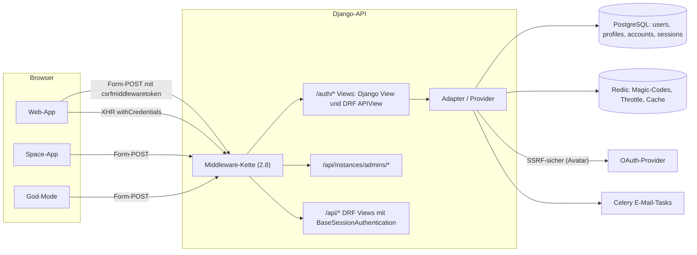
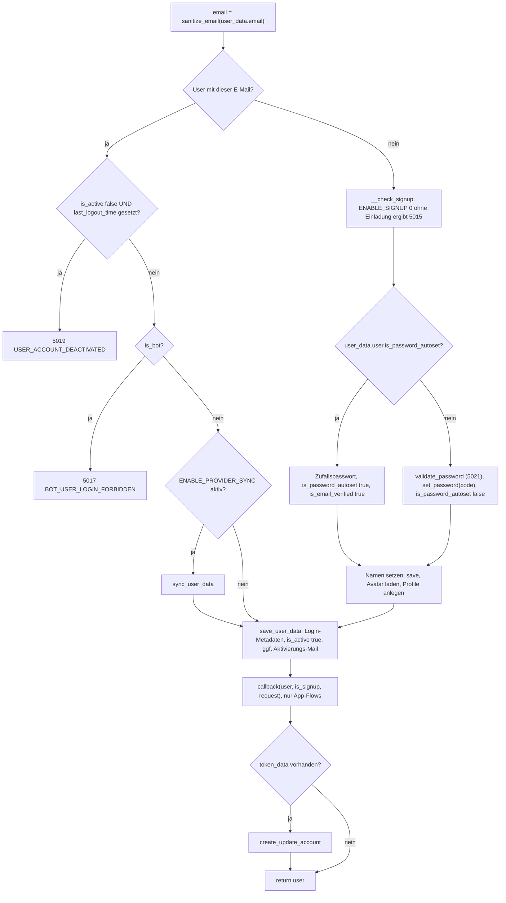
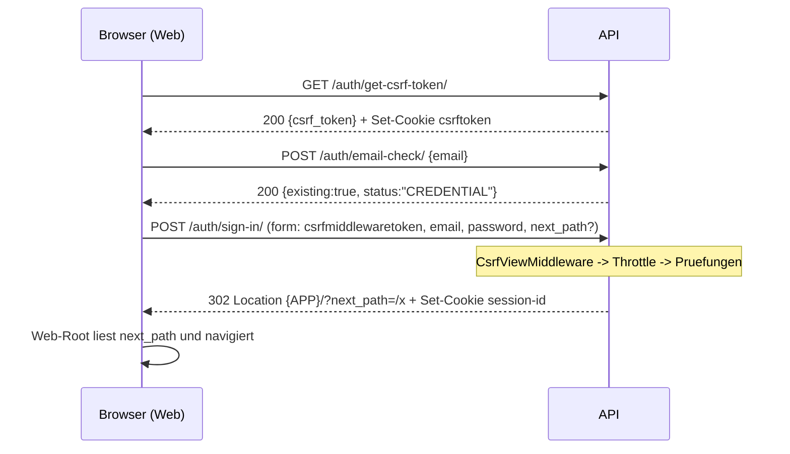

# A06 – Authentifizierung, Sicherheit & Querschnitt (IST-Analyse)

> **Status:** IST-Analyse Plane v1.4.2 Community Edition (AGPL-3.0). Keine Code-Änderungen am Original.
> **Bindend:** `migration/architecture/00-grundsatzentscheidungen.md` (ADR-000 … ADR-006). Für diesen Bereich besonders relevant: ADR-001 (eine Edition, alle Bezahl-Auth-Features wie SAML/OIDC/LDAP/2FA aktiv – Erweiterungspunkte siehe 5.6), ADR-003 (Greenfield, aber JSON-Verträge, Fehlercodes und Redirect-Parameter fachlich 1:1), ADR-004 (Self-hosted/Airgapped: OAuth-Provider optional, keine Pflicht-Abhängigkeit), ADR-005 (UI 1:1 – das Frontend wertet `error_code` aus Redirect-Query-Parametern aus).
>
> **Bereich (vollständig gelesen):**
> - `apps/api/plane/authentication/` komplett: `adapter/{base,credential,oauth,error,exception}.py`, `provider/credentials/{email,magic_code}.py`, `provider/oauth/{github,google,gitlab,gitea}.py`, `middleware/session.py`, `session.py`, `rate_limit.py`, `urls.py`, `utils/{host,login,oauth_state,password,redirection_path,user_auth_workflow,workspace_project_join}.py`, `views/common.py`, `views/app/{check,email,github,gitlab,gitea,google,magic,password_management,signout}.py`, `views/space/{check,email,github,gitlab,gitea,google,magic,password_management,signout}.py`, `views/__init__.py`, `apps.py`
> - Instanz-Admin-Auth (God-Mode): `apps/api/plane/license/api/views/admin.py`, `apps/api/plane/license/api/permissions/instance.py`, `apps/api/plane/license/api/views/base.py`, `apps/api/plane/license/urls.py`, `apps/api/plane/license/utils/{instance_value,encryption}.py`
> - Permissions: `apps/api/plane/app/permissions/{__init__,base,workspace,project,page}.py` und die Kopie `apps/api/plane/utils/permissions/*`
> - Middleware: `apps/api/plane/middleware/{apps,db_routing,logger,request_body_size}.py`; Throttles: `apps/api/plane/throttles/asset.py`, `apps/api/plane/api/rate_limit.py`
> - `apps/api/plane/utils/` komplett (jede Datei, siehe 2.13)
> - Settings: `apps/api/plane/settings/{common,production,local,test,redis}.py`, Session-Modell `apps/api/plane/db/models/session.py`
>
> **Zur Verhaltensklärung zusätzlich gelesen:** `apps/api/plane/urls.py`, `apps/api/plane/app/views/base.py`, `apps/api/plane/space/views/base.py`, `apps/api/plane/api/views/base.py`, `apps/api/plane/api/middleware/api_authentication.py`, `apps/api/plane/app/views/user/base.py` (Deaktivierung, E-Mail-Änderung, Accounts), `apps/api/plane/app/views/workspace/invite.py`, `apps/api/plane/app/views/project/invite.py`, `apps/api/plane/app/serializers/{webhook,user,workspace,issue,page}.py` (Teile), `apps/api/plane/db/models/{user,webhook,project}.py` (Teile), `apps/api/plane/bgtasks/{forgot_password_task,magic_link_code_task,webhook_task,work_item_link_task}.py` (Teile), `apps/api/plane/license/api/views/instance.py`, `apps/api/templates/csrf_failure.html`, Tests `apps/api/plane/tests/contract/app/{test_authentication,test_oauth_callback_state_app,test_session_origin_check_app,test_password_strength_input_bound_app}.py`, Frontend-Aufrufer `apps/web/services/auth.service.ts`, `apps/web/services/api.service.ts`, `apps/web/helpers/authentication.helper.tsx`, `apps/web/components/account/auth-forms/*.tsx`, `apps/space/hooks/oauth/core.tsx`, `apps/admin/app/(all)/(home)/sign-in-form.tsx`, `apps/admin/components/instance/setup-form.tsx`, `packages/constants/src/auth/index.ts`, `packages/utils/src/auth.ts`.
>
> **Konventionen / Abkürzungen für Quellpfade:** `AUTH/` = `apps/api/plane/authentication/`, `UT/` = `apps/api/plane/utils/`, `PERM/` = `apps/api/plane/app/permissions/`, `MW/` = `apps/api/plane/middleware/`, `LIC/` = `apps/api/plane/license/`, `SET/` = `apps/api/plane/settings/`, `M/` = `apps/api/plane/db/models/`, `BG/` = `apps/api/plane/bgtasks/`, `V/` = `apps/api/plane/app/views/`, `T/` = `apps/api/plane/tests/`, `WEB/` = `apps/web/`, `SPC/` = `apps/space/`, `ADM/` = `apps/admin/`. Rollen: **A** = Admin (20), **M** = Member (15), **G** = Guest (5). `{APP}` = Ergebnis von `base_host(is_app=True)`, `{SPACE}` = `base_host(is_space=True)`, `{ADMIN}` = `base_host(is_admin=True)` (siehe 3.1.1).
>
> **Nachbardokumente:** A01 `migration/analysis/01-gesamtarchitektur-infrastruktur.md` (Settings/ENV-Tabelle, Cookie-Tabelle 2.14, Storage), A02a `02a-datenmodell-kern.md` (Modelle `User`, `Profile`, `Account`, `Session`, `Instance*`), A03 `03-api-intern-workspace-projekt-user.md` (User-Endpunkte U-01 … inkl. Deaktivierung U-03, E-Mail-Änderung U-06/U-07, Assets, Webhooks), A04 `04-api-intern-arbeitsobjekte.md` (Issue-Listen-Abfrage: Filter/Grouper/Paginator im Detail), A08 `08-frontend-web-architektur.md` (Auth-Wrapper, Stores), A11 `11-frontend-admin-space.md` (God-Mode/Space-UI inkl. Fehlertext-Mapping), A12 `12-editor-echtzeit-live.md` (Live-Server-Auth per Cookie), F20 `migration/features/20-paid-spuren-im-repo.md` (Bezahl-Auth-Features PF-93 … PF-98).

---

## Inhaltsverzeichnis

1. Überblick & Verantwortlichkeiten
2. Vollständige Inventare
   - 2.1 Endpunkte unter `/auth/` (37 Routen)
   - 2.2 Instanz-Admin-Auth-Endpunkte unter `/api/instances/` und Session-Abfragen
   - 2.3 `AUTHENTICATION_ERROR_CODES` (vollständig, mit Verwendung)
   - 2.4 Auth-Provider (Credential + OAuth)
   - 2.5 Adapter-Klassen und -Methoden
   - 2.6 Auth-relevante Instanz-Konfigurationsschlüssel (DB/ENV) mit Defaults je Lesestelle
   - 2.7 Sicherheitsrelevante Django-Settings
   - 2.8 Middleware-Kette
   - 2.9 Throttles / Rate-Limits
   - 2.10 Berechtigungsklassen und `allow_permission`
   - 2.11 Session-Inhalte, Cookies, Redis-/Cache-Schlüssel
   - 2.12 Exception-Handler und Fehlerformate
   - 2.13 `apps/api/plane/utils/` – jede Datei
   - 2.14 Sicherheitsmechanismen (1:1 zu übernehmen)
3. Verhalten, Logik und Abläufe im Detail
4. Abhängigkeiten zu anderen Bereichen
5. Migrationshinweise für .NET / EF Core / Angular
6. Offene Punkte

---

## 1. Überblick & Verantwortlichkeiten

Der Bereich A06 umfasst alles, was **wer darf was** und **wie wird eine Anfrage technisch abgesichert und verarbeitet** entscheidet:

| Baustein | Verantwortung | Quelle |
|---|---|---|
| Authentifizierungs-App (`plane.authentication`) | Interaktive Logins für **Web-App** (`/auth/…`) und **Space/Public-Boards** (`/auth/spaces/…`): E-Mail+Passwort, Magic-Code per E-Mail, OAuth (Google, GitHub, GitLab, Gitea); Sign-out; Passwort vergessen/zurücksetzen/ändern/setzen; E-Mail-Existenzprüfung; CSRF-Token-Ausgabe | `AUTH/urls.py`, `AUTH/views/**` |
| Adapter/Provider-Schicht | Einheitlicher Ablauf „Benutzerdaten ermitteln → Benutzer anlegen oder finden → Schutzprüfungen → Login-Metadaten speichern → Post-Login-Workflow → OAuth-Account speichern“ | `AUTH/adapter/base.py`, `AUTH/adapter/oauth.py`, `AUTH/adapter/credential.py`, `AUTH/provider/**` |
| Instanz-Admin-Auth (God-Mode) | Erst-Einrichtung (Admin-Sign-up, nur einmal), Admin-Sign-in/-out, Admin-Session, Admin-Verwaltung | `LIC/api/views/admin.py`, `LIC/urls.py` |
| Session-Mechanik | Eigene `SessionMiddleware` mit **zwei Cookies** (`session-id` für Web/Space, `admin-session-id` für Pfade mit `instances`), DB-gestützte Sessions (Tabelle `sessions`) mit `device_info` und `user_id` | `AUTH/middleware/session.py`, `M/session.py`, `SET/common.py` |
| Schreib-Schutz für Cookie-Auth | DRF-`BaseSessionAuthentication`: CSRF-Token wird **nicht** geprüft, stattdessen **Origin-Allowlist**; Django-`CsrfViewMiddleware` für die Formular-POST-Views unter `/auth/` und Admin-Auth | `AUTH/session.py`, `SET/common.py` |
| Rate-Limits | `AuthenticationThrottle` (IP-basiert, Default 10/min), `EmailVerificationThrottle` (3/h/User), DRF-Default `AnonRateThrottle` (30/min), `AssetRateThrottle` (5/min/Asset), `ApiKeyRateThrottle` (60/min/Key) | `AUTH/rate_limit.py`, `apps/api/plane/throttles/asset.py`, `apps/api/plane/api/rate_limit.py`, `SET/common.py` |
| Berechtigungen | Rollenmodell Admin=20/Member=15/Guest=5 auf Workspace- und Projektebene; DRF-Permission-Klassen und Decorator `allow_permission`; Seitenzugriff `ProjectPagePermission`; Instanz-Admin `InstanceAdminPermission`; Gast-Sichtbarkeit über `Project.guest_view_all_features` | `PERM/*.py`, `LIC/api/permissions/instance.py` |
| Querschnitts-Middleware | Read-Replica-Routing, Request-Logging, Logging externer API-Aufrufe (API-Key) in PostgreSQL, 413-Mapping für zu große Bodies | `MW/*.py` |
| Querschnitts-Utilities | Paginierung (Cursor/Offset, gruppiert), Issue-Filter (Legacy + Rich-Filter), Sortier-/Gruppier-Allowlists, HTML-Sanitizing (nh3), Binärdaten-Prüfung, SSRF-sicherer HTTP-Client, Redirect-/Pfad-Validierung, Dateinamen-Sanitizing, CSV-Injection-Schutz, Caching-Decorator, Zeitzonen-Umrechnung, Analytics-/Burndown-Berechnung, Export-Framework, OpenAPI-Helfer, Telemetrie-Endpunkt-Helfer | `UT/**` |

**Architekturskizze (IST):**



**Zentrale IST-Eigenschaften (Kurzfassung):**
1. Alle interaktiven Logins sind **klassische HTML-Formular-POSTs** (kein JSON), die mit **HTTP 302** auf die jeweilige Frontend-Basis-URL antworten; Fehler werden als **Query-Parameter** (`error_code`, `error_message`, ggf. `email`, …) übertragen (`AUTH/views/app/email.py`, `UT/path_validator.py` `get_safe_redirect_url`).
2. Nur Hilfs-Endpunkte (`email-check`, `magic-generate`, `forgot-password`, `get-csrf-token`, `change-password`, `set-password`) sind JSON-APIs (`AUTH/views/app/check.py`, `AUTH/views/app/magic.py`, `AUTH/views/app/password_management.py`, `AUTH/views/common.py`).
3. Es gibt **keine** JWT/Bearer-Tokens für Browser-Clients; Auth erfolgt ausschließlich über Server-Sessions in der DB (`SESSION_ENGINE = "plane.db.models.session"`, `SET/common.py`). Die öffentliche REST-API `/api/v1/` nutzt dagegen `X-Api-Key` (`apps/api/plane/api/middleware/api_authentication.py`).
4. Ein Benutzer kann nur über **eine E-Mail-Adresse** identifiziert werden; OAuth-Logins verknüpfen sich automatisch per E-Mail mit bestehenden Konten (Schutz: nur **verifizierte** Provider-E-Mails, `AUTH/provider/oauth/*.py`).

---

## 2. Vollständige Inventare

### 2.1 Endpunkte unter `/auth/` (37 Routen)

Mount-Punkt: `path("auth/", include("plane.authentication.urls"))` (`apps/api/plane/urls.py`). Alle Routen enden mit `/`. „Django View“ = `django.views.View` (unterliegt `CsrfViewMiddleware` → Formularfeld `csrfmiddlewaretoken` + Cookie `csrftoken` Pflicht bei POST); „DRF APIView“ = `rest_framework.views.APIView` mit DRF-Default-Authentifizierung `SessionAuthentication` (CSRF-Token-Prüfung **nur**, wenn der Aufrufer bereits angemeldet ist) – siehe 3.14.

| # | Methode | Pfad | URL-Name | View-Klasse (Datei) | Basis | Auth | Throttle | Eingabe | Erfolg | Fehler |
|---|---|---|---|---|---|---|---|---|---|---|
| 1 | POST | `/auth/sign-in/` | `sign-in` | `SignInAuthEndpoint` (`AUTH/views/app/email.py`) | Django View | anonym | `@throttle_auth_redirect(is_app=True)` | Form: `email`, `password`, `next_path?` | 302 → `{APP}` bzw. `{APP}/?next_path=…` (3.3) | 302 → `{APP}/?[next_path=…&]error_code=…&error_message=…[&email=…]` |
| 2 | POST | `/auth/sign-up/` | `sign-up` | `SignUpAuthEndpoint` (`AUTH/views/app/email.py`) | Django View | anonym | `@throttle_auth_redirect(is_app=True)` | Form: `email`, `password`, `next_path?` | wie 1 | wie 1 |
| 3 | POST | `/auth/spaces/sign-in/` | `space-sign-in` | `SignInAuthSpaceEndpoint` (`AUTH/views/space/email.py`) | Django View | anonym | `@throttle_auth_redirect(is_space=True)` | Form: `email`, `password`, `next_path?` | 302 → `{SPACE ohne /}{next_path}` (3.8) | 302 → `{SPACE ohne /}/?…error_code…` |
| 4 | POST | `/auth/spaces/sign-up/` | `space-sign-up` | `SignUpAuthSpaceEndpoint` (`AUTH/views/space/email.py`) | Django View | anonym | `@throttle_auth_redirect(is_space=True)` | wie 3 | wie 3 | wie 3 |
| 5 | POST | `/auth/sign-out/` | `sign-out` | `SignOutAuthEndpoint` (`AUTH/views/app/signout.py`) | Django View | (Session) | – | Form: `csrfmiddlewaretoken` | 302 → `{APP}` | immer 302 → `{APP}` |
| 6 | POST | `/auth/spaces/sign-out/` | `space-sign-out` | `SignOutAuthSpaceEndpoint` (`AUTH/views/space/signout.py`) | Django View | (Session) | – | Form: `next_path?` | 302 → `get_safe_redirect_url({SPACE}, next_path)` | immer 302 (gleich) |
| 7 | GET | `/auth/get-csrf-token/` | `get_csrf_token` | `CSRFTokenEndpoint` (`AUTH/views/common.py`) | DRF APIView | `AllowAny` | Default `AnonRateThrottle` (30/min anonym) | – | 200 `{"csrf_token": "<token>"}` + setzt Cookie `csrftoken` | – |
| 8 | POST | `/auth/magic-generate/` | `magic-generate` | `MagicGenerateEndpoint` (`AUTH/views/app/magic.py`) | DRF APIView | `AllowAny` | `AuthenticationThrottle` | JSON: `email` | 200 `{"key": "magic_<email>"}` | 400 `{error_code, error_message[, email]}`; ungültige E-Mail → unbehandelte `ValidationError` (500, 3.24 E-07) |
| 9 | POST | `/auth/magic-sign-in/` | `magic-sign-in` | `MagicSignInEndpoint` (`AUTH/views/app/magic.py`) | Django View | anonym | `@throttle_auth_redirect(is_app=True)` | Form: `email`, `code`, `next_path?` | 302 → `{APP}/?next_path=…` (3.6) | 302 mit `error_code` |
| 10 | POST | `/auth/magic-sign-up/` | `magic-sign-up` | `MagicSignUpEndpoint` (`AUTH/views/app/magic.py`) | Django View | anonym | `@throttle_auth_redirect(is_app=True)` | Form: `email`, `code`, `next_path?` | 302 | 302 mit `error_code` |
| 11 | POST | `/auth/spaces/magic-generate/` | `space-magic-generate` | `MagicGenerateSpaceEndpoint` (`AUTH/views/space/magic.py`) | DRF APIView | `AllowAny` | `AuthenticationThrottle` | JSON: `email` | 200 `{"key": …}` | 400 |
| 12 | POST | `/auth/spaces/magic-sign-in/` | `space-magic-sign-in` | `MagicSignInSpaceEndpoint` (`AUTH/views/space/magic.py`) | Django View | anonym | `@throttle_auth_redirect(is_space=True)` | Form: `email`, `code`, `next_path?` | 302 → `{SPACE ohne /}{next_path}` | 302 mit `error_code` |
| 13 | POST | `/auth/spaces/magic-sign-up/` | `space-magic-sign-up` | `MagicSignUpSpaceEndpoint` (`AUTH/views/space/magic.py`) | Django View | anonym | `@throttle_auth_redirect(is_space=True)` | wie 12 | wie 12 | wie 12 |
| 14 | GET | `/auth/google/` | `google-initiate` | `GoogleOauthInitiateEndpoint` (`AUTH/views/app/google.py`) | Django View | anonym | – | Query: `next_path?` | 302 → Google-Autorisierungs-URL | 302 → `{APP}/?…error_code…` |
| 15 | GET | `/auth/google/callback/` | `google-callback` | `GoogleCallbackEndpoint` (`AUTH/views/app/google.py`) | Django View | anonym | – | Query: `code`, `state` | 302 → `{APP}/?next_path=…` | 302 mit `error_code` (`5115`, …) |
| 16 | GET | `/auth/spaces/google/` | `space-google-initiate` | `GoogleOauthInitiateSpaceEndpoint` (`AUTH/views/space/google.py`) | Django View | anonym | – | Query: `next_path?` (wird **nicht** in Session gespeichert) | 302 → Google | 302 |
| 17 | GET | `/auth/spaces/google/callback/` | `space-google-callback` | `GoogleCallbackSpaceEndpoint` (`AUTH/views/space/google.py`) | Django View | anonym | – | Query: `code`, `state` | **Defekt** (Namensschatten `base_host`, 3.24 E-01) | – |
| 18 | GET | `/auth/github/` | `github-initiate` | `GitHubOauthInitiateEndpoint` (`AUTH/views/app/github.py`) | Django View | anonym | – | Query: `next_path?` | 302 → GitHub | 302 |
| 19 | GET | `/auth/github/callback/` | `github-callback` | `GitHubCallbackEndpoint` (`AUTH/views/app/github.py`) | Django View | anonym | – | Query: `code`, `state` | 302 | 302 (`5120`, `5122`, `5124`, …) |
| 20 | GET | `/auth/spaces/github/` | `space-github-initiate` | `GitHubOauthInitiateSpaceEndpoint` (`AUTH/views/space/github.py`) | Django View | anonym | – | Query: `next_path?` (nicht gespeichert) | 302 → GitHub | 302 |
| 21 | GET | `/auth/spaces/github/callback/` | `space-github-callback` | `GitHubCallbackSpaceEndpoint` (`AUTH/views/space/github.py`) | Django View | anonym | – | Query: `code`, `state` | **Defekt** (3.24 E-01) | – |
| 22 | GET | `/auth/gitlab/` | `gitlab-initiate` | `GitLabOauthInitiateEndpoint` (`AUTH/views/app/gitlab.py`) | Django View | anonym | – | Query: `next_path?` | 302 → GitLab | 302 |
| 23 | GET | `/auth/gitlab/callback/` | `gitlab-callback` | `GitLabCallbackEndpoint` (`AUTH/views/app/gitlab.py`) | Django View | anonym | – | Query: `code`, `state` | 302 | 302 (`5121`, `5124`, …) |
| 24 | GET | `/auth/spaces/gitlab/` | `space-gitlab-initiate` | `GitLabOauthInitiateSpaceEndpoint` (`AUTH/views/space/gitlab.py`) | Django View | anonym | – | Query: `next_path?` (nicht gespeichert) | 302 → GitLab | 302 |
| 25 | GET | `/auth/spaces/gitlab/callback/` | `space-gitlab-callback` | `GitLabCallbackSpaceEndpoint` (`AUTH/views/space/gitlab.py`) | Django View | anonym | – | Query: `code`, `state` | **Defekt** (3.24 E-01) | – |
| 26 | POST | `/auth/email-check/` | `email-check` | `EmailCheckEndpoint` (`AUTH/views/app/check.py`) | DRF APIView | `AllowAny` | `AuthenticationThrottle` | JSON: `email` | 200 `{"existing": bool, "status": "MAGIC_CODE"\|"CREDENTIAL"}` | 400 `{error_code, error_message}` (`5000`, `5010`, `5005`) |
| 27 | POST | `/auth/spaces/email-check/` | `email-check` (Name doppelt) | `EmailCheckSpaceEndpoint` (`AUTH/views/space/check.py`) | DRF APIView | `AllowAny` | `AuthenticationThrottle` | JSON: `email` | wie 26 | wie 26 |
| 28 | POST | `/auth/forgot-password/` | `forgot-password` | `ForgotPasswordEndpoint` (`AUTH/views/app/password_management.py`) | DRF APIView | `AllowAny` | `AuthenticationThrottle` | JSON: `email` | 200 `{"message": "Check your email to reset your password"}` | 400 (`5000`, `5025`, `5005`, `5060`) |
| 29 | POST | `/auth/reset-password/<uidb64>/<token>/` | `forgot-password` (Name doppelt) | `ResetPasswordEndpoint` (`AUTH/views/app/password_management.py`) | Django View | anonym | – | Pfad: `uidb64`, `token`; Form: `password` | 302 → `urljoin({APP}, "sign-in?success=True")` | 302 → `urljoin({APP}, "accounts/reset-password?error_code=…&error_message=…")` (`5125`, `5020`, `5021`, `5130`) |
| 30 | POST | `/auth/spaces/forgot-password/` | `space-forgot-password` | `ForgotPasswordSpaceEndpoint` (`AUTH/views/space/password_management.py`) | DRF APIView | `AllowAny` | `AuthenticationThrottle` | JSON: `email` | 200 wie 28 (Link zeigt auf `{SPACE}`) | 400 wie 28 |
| 31 | POST | `/auth/spaces/reset-password/<uidb64>/<token>/` | `space-forgot-password` (Name doppelt) | `ResetPasswordSpaceEndpoint` (`AUTH/views/space/password_management.py`) | Django View | anonym | – | wie 29 | 302 → `{SPACE}` | 302 → `{SPACE}/accounts/reset-password/?…` (doppelter Slash, 3.24 E-05) |
| 32 | POST | `/auth/change-password/` | `forgot-password` (Name doppelt) | `ChangePasswordEndpoint` (`AUTH/views/common.py`) | DRF APIView | `IsAuthenticated` (Default) + CSRF-Header `X-CSRFToken` | `AuthenticationThrottle` | JSON: `old_password` (wenn Passwort nicht autoset), `new_password` | 200 `{"message": "Password updated successfully"}` | 400 (`5138`, `5135`, `5021`) |
| 33 | POST | `/auth/set-password/` | `set-password` | `SetUserPasswordEndpoint` (`AUTH/views/common.py`) | DRF APIView | `IsAuthenticated` + CSRF-Header | Default (`AnonRateThrottle` greift nicht für Angemeldete) | JSON: `password` | 200 `UserSerializer`-JSON | 400 (`5145`, `5020`) |
| 34 | GET | `/auth/gitea/` | `gitea-initiate` | `GiteaOauthInitiateEndpoint` (`AUTH/views/app/gitea.py`) | Django View | anonym | – | Query: `next_path?` (validiert gespeichert) | 302 → Gitea | 302 → `urljoin({APP}, "?…")` |
| 35 | GET | `/auth/gitea/callback/` | `gitea-callback` | `GiteaCallbackEndpoint` (`AUTH/views/app/gitea.py`) | Django View | anonym | – | Query: `code`, `state` | 302 → `urljoin(session.host, path)` (3.7.6) | 302 → `urljoin(session.host, "?…")` |
| 36 | GET | `/auth/spaces/gitea/` | `space-gitea-initiate` | `GiteaOauthInitiateSpaceEndpoint` (`AUTH/views/space/gitea.py`) | Django View | anonym | – | Query: `next_path?` (validiert gespeichert) | 302 → Gitea | 302 → `{SPACE}?…` |
| 37 | GET | `/auth/spaces/gitea/callback/` | `space-gitea-callback` | `GiteaCallbackSpaceEndpoint` (`AUTH/views/space/gitea.py`) | Django View | anonym | – | Query: `code`, `state` | 302 → `{SPACE}{next_path}` | 302 → `{SPACE}?…` |

Hinweise zum Inventar:
- Doppelte URL-Namen: `email-check` (26/27), `forgot-password` (28/29/32), `space-forgot-password` (30/31) (`AUTH/urls.py`). Für `reverse()` daher nicht eindeutig; in .NET eindeutige Routennamen vergeben.
- Die Space-Frontend-App nutzt für OAuth **nicht** die Space-Routen 16/20/24/36, sondern die App-Routen `/auth/<provider>/?next_path=…` (`SPC/hooks/oauth/core.tsx`). Zudem baut jeder OAuth-Provider die `redirect_uri` **fest** auf `/auth/<provider>/callback/` (App-Callback), auch wenn die Space-Initiate-Route verwendet wird (`AUTH/provider/oauth/github.py`, `google.py`, `gitlab.py`, `gitea.py`). Die Space-Callback-Routen 17/21/25/37 werden vom Provider also nie angesprungen.
- `ChangePasswordEndpoint`/`SetUserPasswordEndpoint` setzen keine `authentication_classes` → DRF-Default `rest_framework.authentication.SessionAuthentication` (`SET/common.py` `REST_FRAMEWORK.DEFAULT_AUTHENTICATION_CLASSES`) → **klassische Django-CSRF-Token-Prüfung** (Header `X-CSRFToken`, den das Frontend aus `/auth/get-csrf-token/` holt: `WEB/services/auth.service.ts` `setPassword(token, …)` sendet `X-CSRFTOKEN`).

### 2.2 Instanz-Admin-Auth-Endpunkte unter `/api/instances/` und Session-Abfragen

Mount: `path("api/instances/", include("plane.license.urls"))` (`apps/api/plane/urls.py`). Alle Pfade enthalten `instances` → Cookie `admin-session-id` (3.13). Vollständige God-Mode-Endpunkte siehe A11/A03; hier nur die Auth-bezogenen.

| # | Methode | Pfad | View (Datei) | Basis | Berechtigung | Throttle | Eingabe | Erfolg | Fehler |
|---|---|---|---|---|---|---|---|---|---|
| AD-1 | POST | `/api/instances/admins/sign-up/` | `InstanceAdminSignUpEndpoint` (`LIC/api/views/admin.py`) | Django View (`permission_classes` wirkungslos) | anonym, nur solange keine Einrichtung erfolgt | `@throttle_auth_redirect(is_admin=True)` | Form: `email`, `password`, `first_name` (Pflicht), `last_name`, `company_name`, `is_telemetry_enabled` (`"True"`/`"False"`, Default `True`) | 302 → `urljoin({ADMIN}, "general/")` | 302 → `urljoin({ADMIN}, "?error_code=…&error_message=…&email=…&first_name=…&last_name=…&company_name=…&is_telemetry_enabled=…")` (`5000`, `5150`, `5155`, `5160`, `5180`, `5021`) |
| AD-2 | POST | `/api/instances/admins/sign-in/` | `InstanceAdminSignInEndpoint` (`LIC/api/views/admin.py`) | Django View | anonym | `@throttle_auth_redirect(is_admin=True)` | Form: `email`, `password` | 302 → `urljoin({ADMIN}, "general/")` | 302 → `urljoin({ADMIN}, "?error_code=…")` (`5000`, `5170`, `5160`, `5185`, `5175`, `5190`) |
| AD-3 | POST | `/api/instances/admins/sign-out/` | `InstanceAdminSignOutEndpoint` (`LIC/api/views/admin.py`) | Django View (`permission_classes` wirkungslos) | Session (`admin-session-id`) | – | Form: `csrfmiddlewaretoken` | 302 → `{ADMIN ohne /}` | immer 302 (gleich) |
| AD-4 | GET | `/api/instances/admins/session/` | `InstanceAdminUserSessionEndpoint` | `LIC/api/views/base.py` `BaseAPIView` | `AllowAny` | Default | – | 200 `{"is_authenticated": true, "user": InstanceAdminMeSerializer}` wenn angemeldet **und** `InstanceAdmin` existiert, sonst `{"is_authenticated": false}` | – |
| AD-5 | GET | `/api/instances/admins/me/` | `InstanceAdminUserMeEndpoint` | `BaseAPIView` | `InstanceAdminPermission` | Default | – | 200 `InstanceAdminMeSerializer` | 403 |
| AD-6 | GET/POST | `/api/instances/admins/` | `InstanceAdminEndpoint` | `BaseAPIView` | `InstanceAdminPermission` | Default | POST JSON: `email`, `role` (Default 20) | GET 200 Liste (gecacht 2 h, global); POST 201 | POST: ohne `email` → 400 `{"error": "Email is required"}`; keine Instanz → 403 `{"error": "Instance is not registered yet"}`; unbekannter User → `User.DoesNotExist` → 404 `{"error": "The required object does not exist."}` (Basis-Handler) |
| AD-7 | DELETE | `/api/instances/admins/<uuid:pk>/` | `InstanceAdminEndpoint.delete` | `BaseAPIView` | `InstanceAdminPermission` | Default | – | 204 | – |

Verwandte Session-Abfrage der Web-/Space-App: `GET /api/users/session/` → `UserSessionEndpoint` (`V/user/base.py`, `AllowAny`): 200 `{"is_authenticated": true, "user": UserMeSerializer}` bzw. `{"is_authenticated": false}` (Details A03).

### 2.3 `AUTHENTICATION_ERROR_CODES` (vollständig, mit Verwendung)

Definition: `AUTH/adapter/error.py`. Format jeder Fehlerausgabe: `AuthenticationException.get_error_dict()` → `{"error_code": <int>, "error_message": "<KEY>", …payload}` (Payload-Schlüssel werden flach angehängt, typ. `email`). Frontend-Spiegel: `WEB/helpers/authentication.helper.tsx` `EAuthenticationErrorCodes` (Strings) + `errorCodeMessages`; Space: `SPC/helpers/authentication.helper.tsx`; Admin: A11. „FE“ = im Web-Enum vorhanden.

| Schlüssel | Code | Ausgelöst in (Quelle) | Payload | FE |
|---|---|---|---|---|
| `INSTANCE_NOT_CONFIGURED` | 5000 | alle Views mit `Instance.objects.first()` `None` oder `not is_setup_done` (`AUTH/views/app/{email,magic,check,password_management,github,google,gitlab,gitea}.py`, Space-Pendants), Admin `LIC/api/views/admin.py` (nur `instance is None`) | – | ja |
| `INVALID_EMAIL` | 5005 | `Adapter.sanitize_email` (`AUTH/adapter/base.py`), `EmailCheck*`, `ForgotPassword*` | `email` (nur Adapter) | ja |
| `EMAIL_REQUIRED` | 5010 | `EmailCheck*` | – | ja |
| `SIGNUP_DISABLED` | 5015 | `Adapter.__check_signup` (`AUTH/adapter/base.py`) | `email` | ja |
| `MAGIC_LINK_LOGIN_DISABLED` | 5016 | `MagicCodeProvider.__init__` (`AUTH/provider/credentials/magic_code.py`) | `email` | ja |
| `BOT_USER_LOGIN_FORBIDDEN` | 5017 | `Adapter.complete_login_or_signup` | `email` | ja |
| `PASSWORD_LOGIN_DISABLED` | 5018 | **nirgends ausgelöst** | – | ja |
| `USER_ACCOUNT_DEACTIVATED` | 5019 | `Adapter.complete_login_or_signup` (inaktiv **und** `last_logout_time` gesetzt) | `email` | ja |
| `INVALID_PASSWORD` | 5020 | `SetUserPasswordEndpoint` (leer **oder** zu schwach!), `ResetPassword*` (leer) | – | ja |
| `PASSWORD_TOO_WEAK` | 5021 | `Adapter.validate_password`, `ChangePasswordEndpoint`, `ResetPassword*`, Admin-Sign-up | `email` (Adapter), Admin-Formularfelder | ja |
| `SMTP_NOT_CONFIGURED` | 5025 | `MagicCodeProvider.__init__` (`EMAIL_HOST` leer), `ForgotPassword*` | `email` (Magic) | ja |
| `USER_ALREADY_EXIST` | 5030 | `SignUp*`, `MagicSignUp*`, `EmailProvider.set_user_data` (is_signup) | `email` (nur Passwort-Views) | ja |
| `AUTHENTICATION_FAILED_SIGN_UP` | 5035 | `EmailProvider.set_user_data` (nur theoretisch: Zweig `is_signup` erreicht Passwortprüfung nie) | `email` | ja |
| `REQUIRED_EMAIL_PASSWORD_SIGN_UP` | 5040 | `SignUp*` | `email` (`"False"` wenn leer) | ja |
| `INVALID_EMAIL_SIGN_UP` | 5045 | `SignUp*` | `email` | ja |
| `INVALID_EMAIL_MAGIC_SIGN_UP` | 5050 | **nirgends ausgelöst** | – | ja |
| `MAGIC_SIGN_UP_EMAIL_CODE_REQUIRED` | 5055 | `MagicSignUp*` | – | ja |
| `EMAIL_PASSWORD_AUTHENTICATION_DISABLED` | 5056 | `EmailProvider.__init__` (`ENABLE_EMAIL_PASSWORD == "0"`) | – | **nein** |
| `USER_DOES_NOT_EXIST` | 5060 | `SignIn*`, `MagicSignIn*`, `EmailProvider.set_user_data`, `ForgotPassword*` | `email` (Passwort-Views, EmailProvider) | ja |
| `AUTHENTICATION_FAILED_SIGN_IN` | 5065 | `EmailProvider.set_user_data` (falsches Passwort) | `email` | ja |
| `REQUIRED_EMAIL_PASSWORD_SIGN_IN` | 5070 | `SignIn*` | `email` | ja |
| `INVALID_EMAIL_SIGN_IN` | 5075 | `SignIn*` | `email` | ja |
| `INVALID_EMAIL_MAGIC_SIGN_IN` | 5080 | **nirgends ausgelöst** | – | ja |
| `MAGIC_SIGN_IN_EMAIL_CODE_REQUIRED` | 5085 | `MagicSignIn*` | – | ja |
| `INVALID_MAGIC_CODE_SIGN_IN` | 5090 | `MagicCodeProvider._raise_for_email` (User existiert) | `email` | ja |
| `INVALID_MAGIC_CODE_SIGN_UP` | 5092 | dto. (User existiert nicht) | `email` | ja |
| `EXPIRED_MAGIC_CODE_SIGN_IN` | 5095 | dto. | `email` | ja |
| `EXPIRED_MAGIC_CODE_SIGN_UP` | 5097 | dto. | `email` | ja |
| `EMAIL_CODE_ATTEMPT_EXHAUSTED_SIGN_IN` | 5100 | `MagicCodeProvider.initiate` (>4 Codes/600 s) und `set_user_data` (5. Fehlversuch) | `email` | ja |
| `EMAIL_CODE_ATTEMPT_EXHAUSTED_SIGN_UP` | 5102 | dto. | `email` | ja |
| `OAUTH_NOT_CONFIGURED` | 5104 | `OauthAdapter.authentication_error_code` Fallback (unbekannter Provider) | – | ja |
| `GOOGLE_NOT_CONFIGURED` | 5105 | `GoogleOAuthProvider.__init__` | – | ja |
| `GITHUB_NOT_CONFIGURED` | 5110 | `GitHubOAuthProvider.__init__` | – | ja |
| `GITLAB_NOT_CONFIGURED` | 5111 | `GitLabOAuthProvider.__init__` | – | ja |
| `GITEA_NOT_CONFIGURED` | 5112 | `GiteaOAuthProvider.__init__` (fehlend oder Schema ≠ http/https) | – | **nein** |
| `GOOGLE_OAUTH_PROVIDER_ERROR` | 5115 | Google-Callback (State/Code), Token-/Userinfo-Fehler | – | ja |
| `GITHUB_OAUTH_PROVIDER_ERROR` | 5120 | GitHub-Callback, Token-/Userinfo-/E-Mail-Fehler | – | ja |
| `GITLAB_OAUTH_PROVIDER_ERROR` | 5121 | GitLab-Callback, Token-/Userinfo-Fehler | – | ja |
| `GITHUB_USER_NOT_IN_ORG` | 5122 | `GitHubOAuthProvider.set_user_data` | – | **nein** |
| `GITEA_OAUTH_PROVIDER_ERROR` | 5123 | Gitea-Callback, Token-/Userinfo-/E-Mail-Fehler (`error_message` teils mit Zusatztext `": Failed to fetch emails"`, `": No emails found"`, `": Exception occurred while fetching emails"`) | – | **nein** |
| `OAUTH_PROVIDER_UNVERIFIED_EMAIL` | 5124 | Google (`verified_email is not True`), GitHub (kein primary+verified), GitLab (`confirmed_at` leer), Gitea (keine verifizierte) | – | **nein** |
| `INVALID_PASSWORD_TOKEN` | 5125 | `ResetPassword*` (uid unbekannt/ungültig – nur App –, Token ungültig **oder abgelaufen**) | – | ja |
| `EXPIRED_PASSWORD_TOKEN` | 5130 | `ResetPassword*` nur bei `DjangoUnicodeDecodeError` (fehlerhaftes `uidb64`) | – | ja |
| `INCORRECT_OLD_PASSWORD` | 5135 | `ChangePasswordEndpoint` | `error: "Old password is not correct"` | ja |
| `MISSING_PASSWORD` | 5138 | `ChangePasswordEndpoint` | `error: "Old password is missing"` bzw. `"Old or new password is missing"` | ja |
| `INVALID_NEW_PASSWORD` | 5140 | **nirgends ausgelöst** | – | ja |
| `PASSWORD_ALREADY_SET` | 5145 | `SetUserPasswordEndpoint` | `error: "Your password is already set please change your password from profile"` | ja |
| `ADMIN_ALREADY_EXIST` | 5150 | Admin-Sign-up (Pre-Check und im Lock) | – | ja |
| `REQUIRED_ADMIN_EMAIL_PASSWORD_FIRST_NAME` | 5155 | Admin-Sign-up | Formularfelder | ja |
| `INVALID_ADMIN_EMAIL` | 5160 | Admin-Sign-up/-in | Formularfelder bzw. `email` | ja |
| `INVALID_ADMIN_PASSWORD` | 5165 | **nirgends ausgelöst** | – | ja |
| `REQUIRED_ADMIN_EMAIL_PASSWORD` | 5170 | Admin-Sign-in | `email` | ja |
| `ADMIN_AUTHENTICATION_FAILED` | 5175 | Admin-Sign-in (Bot, falsches Passwort, kein `InstanceAdmin`) | `email` | ja |
| `ADMIN_USER_ALREADY_EXIST` | 5180 | Admin-Sign-up (E-Mail existiert) | Formularfelder | ja |
| `ADMIN_USER_DOES_NOT_EXIST` | 5185 | Admin-Sign-in | `email` | ja |
| `ADMIN_USER_DEACTIVATED` | 5190 | Admin-Sign-in (`not user.is_active`, **vor** Passwortprüfung) | – | ja |
| `RATE_LIMIT_EXCEEDED` | 5900 | `throttle_auth_redirect` (Redirect), `auth_exception_handler` (jede DRF-`Throttled`-Exception → 429) | – | ja |
| `AUTHENTICATION_FAILED` | 5999 | **nirgends ausgelöst** | – | nein |

Beachte: Die Fehlerseiten im Frontend erwarten `error_code` als **String** in der URL; JSON-Antworten liefern `int`. Der Web-Enum enthält 5056, 5112, 5122, 5123, 5124, 5999 nicht → das Frontend zeigt für diese Codes keinen spezifischen Text (Verhalten der Fallback-Anzeige siehe A11/A08). ADR-005: Für 1:1-Verhalten diese Lücke **nicht** stillschweigend schließen, sondern als Entscheidung dokumentieren (Offener Punkt OP-06).

### 2.4 Auth-Provider (Credential + OAuth)

| Provider (`provider`-String) | Klasse (Datei) | Basis | Konfig-Schlüssel (DB → ENV-Default) | Scope | Autorisierungs-URL | Token-URL | Userinfo-URL(s) | E-Mail-Verifikationsregel | `user_data`-Mapping | Token-Ablauf-Berechnung |
|---|---|---|---|---|---|---|---|---|---|---|
| `email` | `EmailProvider` (`AUTH/provider/credentials/email.py`) | `CredentialAdapter` | `ENABLE_EMAIL_PASSWORD` (ENV ohne Default → `None`) | – | – | – | – | keine (`is_email_verified` bleibt `False` bei Sign-up) | `{"email": key, "user": {avatar:"", first_name:"", last_name:"", provider_id:"", is_password_autoset: False}}` | – |
| `magic-code` | `MagicCodeProvider` (`AUTH/provider/credentials/magic_code.py`) | `CredentialAdapter` | `EMAIL_HOST` (ENV), `ENABLE_MAGIC_LINK_LOGIN` (ENV-Default `"1"`) | – | – | – | – | Besitz der E-Mail durch Code nachgewiesen → `is_email_verified=True` bei Sign-up | `{"email": data.email, "user": {…, is_password_autoset: True}}` | – |
| `google` | `GoogleOAuthProvider` (`AUTH/provider/oauth/google.py`) | `OauthAdapter` | `GOOGLE_CLIENT_ID`, `GOOGLE_CLIENT_SECRET` | `https://www.googleapis.com/auth/userinfo.email https://www.googleapis.com/auth/userinfo.profile` | `https://accounts.google.com/o/oauth2/v2/auth?client_id&scope&redirect_uri&response_type=code&access_type=offline&prompt=consent&state` | `https://oauth2.googleapis.com/token` (POST form, `grant_type=authorization_code`) | `https://www.googleapis.com/oauth2/v2/userinfo` | `verified_email is True` (fehlend = abgelehnt) | `email`←`email`; `avatar`←`picture`; `first_name`←`given_name`; `last_name`←`family_name`; `provider_id`←`id` | `datetime.fromtimestamp(expires_in)` (**fachlich falsch**: Dauer als Epoch → 1970, 3.24 E-09) |
| `github` | `GitHubOAuthProvider` (`AUTH/provider/oauth/github.py`) | `OauthAdapter` | `GITHUB_CLIENT_ID`, `GITHUB_CLIENT_SECRET`, `GITHUB_ORGANIZATION_ID` | `read:user user:email` (+ ` read:org`, wenn Organisation gesetzt) | `https://github.com/login/oauth/authorize?client_id&redirect_uri&scope&state` | `https://github.com/login/oauth/access_token` (POST, Header `Accept: application/json`, ohne `grant_type`) | `https://api.github.com/user`; E-Mails `https://api.github.com/user/emails`; Org `https://api.github.com/orgs/{org}/memberships/{login}` (200 = Mitglied) | primary **und** verified | `email`←E-Mail-Liste; `provider_id`←`id`; `avatar`←`avatar_url`; `first_name`←`name`; `last_name`←`family_name` (GitHub liefert keins → `None` → `""`) | wie Google (falsch) |
| `gitlab` | `GitLabOAuthProvider` (`AUTH/provider/oauth/gitlab.py`) | `OauthAdapter` | `GITLAB_CLIENT_ID`, `GITLAB_CLIENT_SECRET`, `GITLAB_HOST` (ENV-Default `https://gitlab.com`) | `read_user` | `{host}/oauth/authorize?client_id&redirect_uri&response_type=code&scope&state` | `{host}/oauth/token` (POST, `Accept: application/json`, `grant_type`) | `{host}/api/v4/user` | `confirmed_at` gesetzt | `email`←`email`; `provider_id`←`id`; `avatar`←`avatar_url`; `first_name`←`name`; `last_name`←`family_name` | `fromtimestamp(created_at + expires_in)` (korrekt) |
| `gitea` | `GiteaOAuthProvider` (`AUTH/provider/oauth/gitea.py`) | `OauthAdapter` | `GITEA_CLIENT_ID`, `GITEA_CLIENT_SECRET`, `GITEA_HOST` (kein Default; Schema muss `http`/`https` sein, Trailing-Slashes entfernt) | `openid email profile read:user` | `{host}/login/oauth/authorize?client_id&scope&redirect_uri&response_type=code&state` | `{host}/login/oauth/access_token` (POST, `Accept: application/json`, `grant_type`) | `{host}/api/v1/user`; E-Mails `{host}/api/v1/user/emails` | primary+verified, sonst erste verified; keine → 5124 | `email`←E-Mail-Liste; `provider_id`←`str(id)`; `avatar`←`avatar_url`; `first_name`←`full_name` oder `login`; `last_name`←`""` | `now + expires_in` (korrekt) |

Gemeinsam für alle OAuth-Provider:
- `redirect_uri = "{https|http}://{request.get_host()}/auth/<provider>/callback/"` – Schema aus `request.is_secure()` (in Produktion über `SECURE_PROXY_SSL_HEADER = ("HTTP_X_FORWARDED_PROTO", "https")`, `SET/production.py`), Host aus `Host`-Header (abhängig von `ALLOWED_HOSTS`, Default `*`, `SET/common.py`).
- `state = uuid.uuid4().hex`, in Session-Schlüssel `state` gespeichert (`AUTH/views/app/*.py`); Prüfung `validate_oauth_state` (constant-time, einmalig, `AUTH/utils/oauth_state.py`).
- Kein PKCE, kein `nonce`, keine ID-Token-Prüfung (Gitea fordert `openid`, verwendet `id_token` aber nur zur Speicherung).
- Token-/Userinfo-Requests über `requests` **ohne** Timeout und **ohne** SSRF-Schutz (`AUTH/adapter/oauth.py` `get_user_token`, `get_user_response`; GitHub/Gitea E-Mail-Abrufe) – nur der Avatar-Download ist SSRF-geschützt (`AUTH/adapter/base.py` `download_and_upload_avatar`).
- `requests.RequestException` → `*_OAUTH_PROVIDER_ERROR`; Antwort wird nicht geloggt (enthält Token).
- Konfigurationsschalter `IS_<PROVIDER>_ENABLED` werden **nicht** im Backend-Flow geprüft – nur Client-ID/Secret (`AUTH/provider/oauth/*.py`); `IS_*_ENABLED` steuert ausschließlich die Anzeige der Buttons über `GET /api/instances/` (`LIC/api/views/instance.py`). Ein deaktivierter, aber noch konfigurierter Provider ist per Direktaufruf von `/auth/<provider>/` weiter nutzbar (3.24 E-10).

### 2.5 Adapter-Klassen und -Methoden

| Klasse / Methode | Datei | Verhalten |
|---|---|---|
| `Adapter.__init__(request, provider, callback=None)` | `AUTH/adapter/base.py` | setzt `request`, `provider`, `callback`, `token_data=None`, `user_data=None`, Logger `plane.authentication` |
| `Adapter.sanitize_email(email)` | dto. | leer → `INVALID_EMAIL`; `str(email).lower().strip()`; `django.core.validators.validate_email` → sonst `INVALID_EMAIL` (Payload `email`) |
| `Adapter.validate_password(email)` | dto. | `is_password_strong(self.code)` (zxcvbn ≥ 3) sonst `PASSWORD_TOO_WEAK` |
| `Adapter.__check_signup(email)` | dto. | `ENABLE_SIGNUP` (DB → ENV-Default `"1"`); `"0"` **und** keine `WorkspaceMemberInvite` mit dieser E-Mail (egal ob angenommen) → `SIGNUP_DISABLED` |
| `Adapter.get_avatar_download_headers()` | dto. | `{}` (Erweiterungspunkt) |
| `Adapter.check_sync_enabled()` | dto. | `ENABLE_<PROVIDER>_SYNC == "1"` für `google`/`github`/`gitlab`/`gitea` (DB → ENV-Default `"0"`), sonst `False` |
| `Adapter.download_and_upload_avatar(avatar_url, user)` | dto. | SSRF-sicherer GET (`pinned_fetch_following_redirects`, Timeout 10 s, max. 5 Redirects, Stream); `Content-Length` > `DATA_UPLOAD_MAX_MEMORY_SIZE` → `None`; Content-Type-Allowlist `image/jpeg`→`jpg`, `image/jpg`→`jpg`, `image/png`, `image/gif`, `image/webp` (sonst `None`); Chunk-Lesen 8 KiB mit Größenlimit; Objektname `"{uuid4hex}-user-avatar.{ext}"`; Upload über `S3Storage.upload_file`; `FileAsset` mit `attributes={"name": "<provider>-avatar.<ext>", "type", "size"}`, `entity_type=USER_AVATAR`, `is_uploaded=True`, `storage_metadata`; jede Exception → `log_exception` + `None` |
| `Adapter.save_user_data(user)` | dto. | `last_login_medium=provider`, `last_active`, `last_login_time`, `last_login_ip=get_client_ip`, `last_login_uagent`, `token_updated_at=now`; `was_inactive = not is_active`; `is_active=True`; `save()`; wenn vorher inaktiv → Celery `user_activation_email(base_host(request), user.id)` |
| `Adapter.delete_old_avatar(user)` | dto. | löscht eigenes Avatar-`FileAsset` aus Storage + DB, setzt `avatar_asset=None`, `avatar=""`; fremdes Asset → nur Link lösen (ohne `save`) |
| `Adapter.sync_user_data(user)` | dto. | übernimmt `first_name`, `last_name`, `display_name` (fehlend → `User.get_display_name(email)`), löscht altes Avatar, lädt neues; Upload-Fehler → `avatar = <Provider-URL>` |
| `Adapter.complete_login_or_signup()` | dto. | Ablauf siehe 3.1.3 |
| `CredentialAdapter.authenticate()` | `AUTH/adapter/credential.py` | `set_user_data()` → `complete_login_or_signup()` |
| `OauthAdapter.__init__(…)` | `AUTH/adapter/oauth.py` | speichert `client_id`, `scope`, `redirect_uri`, `auth_url`, `token_url`, `userinfo_url`, `client_secret`, `code` |
| `OauthAdapter.authentication_error_code()` | dto. | Provider → `GOOGLE_/GITHUB_/GITLAB_/GITEA_OAUTH_PROVIDER_ERROR`, sonst `OAUTH_NOT_CONFIGURED` |
| `OauthAdapter.authenticate()` | dto. | `set_token_data()` → `set_user_data()` → `complete_login_or_signup()` |
| `OauthAdapter.get_user_token(data, headers)` | dto. | `requests.post(token_url, data=…)`; `raise_for_status`; JSON |
| `OauthAdapter.get_user_response()` | dto. | `requests.get(userinfo_url, Authorization: Bearer <access_token>)` |
| `OauthAdapter.create_update_account(user)` | dto. | `Account` per (`user`, `provider`, `provider_account_id`) suchen → aktualisieren (`access_token`, `refresh_token`, `access_token_expired_at`, `refresh_token_expired_at`, `last_connected_at=now`, `id_token`) oder anlegen; `DatabaseError`/`IntegrityError` (z. B. Unique (`provider`, `provider_account_id`) bei anderem Plane-User) → nur geloggt |
| `MagicCodeProvider.initiate()` | `AUTH/provider/credentials/magic_code.py` | siehe 3.5 |
| `MagicCodeProvider.set_user_data()` | dto. | siehe 3.6 |
| `MagicCodeProvider._raise_for_email(error, email)` | dto. | hängt `_SIGN_IN` an, wenn User existiert, sonst `_SIGN_UP` |
| `EmailProvider.set_user_data()` | `AUTH/provider/credentials/email.py` | Sign-up: User existiert → `USER_ALREADY_EXIST`; Sign-in: User fehlt → `USER_DOES_NOT_EXIST`; `check_password` falsch → `AUTHENTICATION_FAILED_SIGN_IN` |

### 2.6 Auth-relevante Instanz-Konfigurationsschlüssel (DB/ENV) mit Defaults je Lesestelle

Lesemechanik `get_configuration_value(keys)` (`LIC/utils/instance_value.py`): Wenn `SKIP_ENV_VAR` (ENV `SKIP_ENV_VAR`, Default `"1"`, `SET/common.py`) wahr → Werte aus Tabelle `InstanceConfiguration` (`key`, `value`, `is_encrypted`; verschlüsselte per Fernet entschlüsselt, `LIC/utils/encryption.py`), fehlende Schlüssel → übergebener `default`; sonst direkt `os.environ.get(key, default)`. Seeding der DB-Werte aus `UT/instance_config_variables/core.py` über Management-Command `configure_instance` (`LIC/management/commands/configure_instance.py`). **Alle Werte sind Strings** (`"0"`/`"1"`).

| Schlüssel | Kategorie | verschlüsselt | Seed-Default (`core.py`) | Default an Lesestelle(n) | Wirkung |
|---|---|---|---|---|---|
| `ENABLE_SIGNUP` | AUTHENTICATION | nein | ENV oder `"1"` | `AUTH/adapter/base.py`: ENV oder `"1"`; `LIC/api/views/instance.py`: ENV oder **`"0"`** | `"0"` → Neuanmeldung nur mit Workspace-Einladung |
| `ENABLE_EMAIL_PASSWORD` | AUTHENTICATION | nein | ENV oder `"1"` | `AUTH/provider/credentials/email.py`: ENV ohne Default (`None` ≠ `"0"` → erlaubt); Instance-Endpoint: `"1"` | `"0"` → `EmailProvider` wirft 5056 |
| `ENABLE_MAGIC_LINK_LOGIN` | AUTHENTICATION | nein | ENV oder **`"0"`** | Magic-Provider/Email-Check/Instance-Endpoint: ENV oder **`"1"`** | `"0"` → 5016; Email-Check liefert `CREDENTIAL` |
| `DISABLE_WORKSPACE_CREATION` | WORKSPACE_MANAGEMENT | nein | `"0"` | Instance-Endpoint `"0"` | nur UI/Workspace-Erstellung (A03) |
| `IS_GOOGLE_ENABLED`, `IS_GITHUB_ENABLED`, `IS_GITLAB_ENABLED`, `IS_GITEA_ENABLED` | GOOGLE/GITHUB/GITLAB/GITEA | nein | `"0"` | Instance-Endpoint `"0"` | nur Anzeige der Login-Buttons |
| `GOOGLE_CLIENT_ID` / `GOOGLE_CLIENT_SECRET` | GOOGLE | nein / **ja** | ENV | ENV | Pflicht für Google |
| `ENABLE_GOOGLE_SYNC` | GOOGLE | nein | `"0"` | `"0"` | IdP-Profilsync bei jedem Login |
| `GITHUB_CLIENT_ID` / `GITHUB_CLIENT_SECRET` / `GITHUB_ORGANIZATION_ID` | GITHUB | nein / **ja** / nein | ENV | ENV | Org-Pflichtmitgliedschaft wenn gesetzt |
| `ENABLE_GITHUB_SYNC` | GITHUB | nein | `"0"` | `"0"` | wie oben |
| `GITLAB_HOST` / `GITLAB_CLIENT_ID` / `GITLAB_CLIENT_SECRET` | GITLAB | nein / nein / **ja** | ENV | Host-Default `https://gitlab.com` | Self-hosted GitLab möglich |
| `ENABLE_GITLAB_SYNC` | GITLAB | nein | `"0"` | `"0"` | |
| `GITEA_HOST` / `GITEA_CLIENT_ID` / `GITEA_CLIENT_SECRET` | GITEA | nein / nein / **ja** | ENV | kein Default | |
| `ENABLE_GITEA_SYNC` | GITEA | nein | `"0"` | `"0"` | |
| `ENABLE_SMTP`, `EMAIL_HOST`, `EMAIL_HOST_USER`, `EMAIL_HOST_PASSWORD` (**ja**), `EMAIL_PORT` (`587`), `EMAIL_FROM`, `EMAIL_USE_TLS` (`"1"`), `EMAIL_USE_SSL` (`"0"`) | SMTP | s. links | s. links | `get_email_configuration` (`LIC/utils/instance_value.py`): `EMAIL_FROM`-Default `"Team Plane <team@mailer.plane.so>"` | „SMTP konfiguriert“ ⇔ `bool(EMAIL_HOST)`; `ENABLE_SMTP` wird im Auth-Pfad nicht gelesen |
| `LLM_API_KEY` (**ja**), `LLM_PROVIDER` (`openai`), `LLM_MODEL` (`gpt-4o-mini`), `GPT_ENGINE` (deprecated, `gpt-3.5-turbo`) | AI | | | | A03 |
| `UNSPLASH_ACCESS_KEY` (**ja**) | UNSPLASH | | | | A03 |

`UT/instance_config_variables/extended.py`: `extended_config_variables = []` (EE-Erweiterungspunkt, F20 S47).

Auth-relevante **reine ENV-Variablen** (nicht in DB): `AUTHENTICATION_RATE_LIMIT` (Default `10/minute`, `AUTH/rate_limit.py`), `SESSION_COOKIE_AGE` (604800), `SESSION_COOKIE_NAME` (`session-id`), `COOKIE_DOMAIN`, `SESSION_SAVE_EVERY_REQUEST` (`"0"`), `ADMIN_SESSION_COOKIE_AGE` (3600), `CORS_ALLOWED_ORIGINS`, `WEB_URL`, `APP_BASE_URL`, `ADMIN_BASE_URL`, `ADMIN_BASE_PATH` (`/god-mode/`), `SPACE_BASE_URL`, `SPACE_BASE_PATH` (`/spaces/`), `LIVE_BASE_URL`, `LIVE_BASE_PATH` (`/live/`), `APP_BASE_PATH` (`/`, ungenutzt im Auth-Pfad), `SECRET_KEY`, `NUM_PROXIES`, `API_KEY_RATE_LIMIT` (`60/minute`), `WEBHOOK_ALLOWED_IPS`, `WEBHOOK_ALLOWED_HOSTS`, `WEBHOOK_DISALLOWED_DOMAINS`, `ALLOWED_HOSTS` (`*`), `FILE_SIZE_LIMIT` (5242880) (`SET/common.py`).

### 2.7 Sicherheitsrelevante Django-Settings

Quelle, wenn nicht anders genannt: `SET/common.py`. „Django-Default“ = nicht explizit gesetzt, Wert gemäß Django 5.2.17 (`apps/api/pyproject.toml`).

| Setting | Wert / Herleitung | Bedeutung |
|---|---|---|
| `SECRET_KEY` | ENV `SECRET_KEY` oder `get_random_secret_key()` (auch bei leerem String); kritischer Log, wenn `60gp0byfz2dvffa45cxl20p1scy9xbpf6d8c5y0geejgkyp1b5` oder `change-this-key-on-deployment` | signiert Sessions/CSRF/Password-Reset-Tokens, Ableitung des Fernet-Schlüssels (`LIC/utils/encryption.py`: `pbkdf2_hmac("sha256", SECRET_KEY, b"salt", 100000)`), HMAC-Token-ID im API-Log (`MW/logger.py`). Zufallsschlüssel pro Prozess ⇒ mehrere Worker ohne gesetzten Key können Sessions/Reset-Tokens gegenseitig nicht verifizieren |
| `DEBUG` | ENV, Default `0` (production), `1` (local) | Fehlerseiten, `cache_response` deaktiviert bei DEBUG (`UT/cache.py`) |
| `ALLOWED_HOSTS` | ENV, Default `*` | `Host`-Header ungeprüft → OAuth-`redirect_uri` folgt dem Host-Header |
| `SECURE_PROXY_SSL_HEADER` | `("HTTP_X_FORWARDED_PROTO", "https")` nur in `SET/production.py` | `request.is_secure()` |
| `AUTH_USER_MODEL` | `db.User` | |
| `AUTHENTICATION_BACKENDS` | `("django.contrib.auth.backends.ModelBackend",)` | `user_can_authenticate` lehnt `is_active=False` ab (Session wird anonym) |
| `PASSWORD_HASHERS` | Django-Default (PBKDF2-SHA256, 1 000 000 Iterationen in Django 5.2) | Greenfield: Hash-Format frei wählbar (ADR-003) |
| `AUTH_PASSWORD_VALIDATORS` | `UserAttributeSimilarityValidator`, `MinimumLengthValidator`, `CommonPasswordValidator`, `NumericPasswordValidator` | **wird nirgends aufgerufen** (kein `password_validation.validate_password` im Code); maßgeblich ist zxcvbn (3.16) |
| `PASSWORD_RESET_TIMEOUT` | `3600` s | Gültigkeit der Reset-Tokens |
| `SESSION_ENGINE` | `plane.db.models.session` | DB-Sessions, Tabelle `sessions` (`M/session.py`) |
| `SESSION_COOKIE_NAME` | ENV `SESSION_COOKIE_NAME`, Default `session-id` | Web/Space |
| `ADMIN_SESSION_COOKIE_NAME` | `admin-session-id` (fest) | God-Mode |
| `SESSION_COOKIE_AGE` | ENV, Default `604800` (7 Tage) | absolute Laufzeit (nicht gleitend, außer `SESSION_SAVE_EVERY_REQUEST`) |
| `ADMIN_SESSION_COOKIE_AGE` | ENV, Default `3600` | Admin-Cookie-`Max-Age` + `set_expiry` beim Admin-Login |
| `SESSION_COOKIE_DOMAIN` / `CSRF_COOKIE_DOMAIN` | ENV `COOKIE_DOMAIN`, Default `None` (host-only) | |
| `SESSION_COOKIE_SECURE` / `CSRF_COOKIE_SECURE` | `_cookies_secure(WEB_URL, cors_allowed_origins, APP_BASE_URL)`: `True`, wenn der **erste nicht-leere** Wert aus `WEB_URL`, `APP_BASE_URL` (getrimmt, lowercase) mit `https://` beginnt, **oder** die CORS-Liste nicht leer ist und kein Eintrag den Teilstring `http:` enthält | Tests `T/unit/settings/test_cookie_secure.py` |
| `SESSION_COOKIE_HTTPONLY` / `CSRF_COOKIE_HTTPONLY` | `True` / `True` | CSRF-Token muss per `GET /auth/get-csrf-token/` geholt werden (JS kann Cookie nicht lesen) |
| `SESSION_COOKIE_SAMESITE` / `CSRF_COOKIE_SAMESITE` | Django-Default `Lax` | ⇒ Web-App und API müssen **same-site** betrieben werden, sonst fehlen Cookies bei Formular-POSTs |
| `SESSION_COOKIE_PATH` | Django-Default `/` | |
| `SESSION_SAVE_EVERY_REQUEST` | ENV `"1"` → `True`, Default `False` | gleitende Session |
| `SESSION_EXPIRE_AT_BROWSER_CLOSE` | Django-Default `False` | |
| `CSRF_TRUSTED_ORIGINS` | = `cors_allowed_origins` (ENV `CORS_ALLOWED_ORIGINS`, kommagetrennt, getrimmt) | für `CsrfViewMiddleware`-Origin-Prüfung |
| `CSRF_COOKIE_NAME` / `CSRF_HEADER_NAME` / `CSRF_COOKIE_AGE` | Django-Defaults `csrftoken` / `HTTP_X_CSRFTOKEN` / 31 449 600 s | |
| `CSRF_FAILURE_VIEW` | `plane.authentication.views.common.csrf_failure` | rendert `apps/api/templates/csrf_failure.html` (HTML-Karte „CSRF Verification Failed“, Button „Go to Home Page“ → `root_url = base_host(request)`) mit HTTP 200 (Django ruft die View ohne Status-Override auf; die View setzt keinen 403-Status) |
| `CORS_ALLOW_CREDENTIALS` | `True` | |
| `CORS_ALLOWED_ORIGINS` / `CORS_ALLOW_ALL_ORIGINS` | Liste aus ENV; **leer → `CORS_ALLOW_ALL_ORIGINS = True`** | mit Credentials ⇒ jede Origin wird gespiegelt (Schutz faktisch nur durch `SameSite=Lax`) |
| `CORS_ALLOW_HEADERS` | `corsheaders.defaults.default_headers` + `X-API-Key` | |
| `REST_FRAMEWORK.DEFAULT_AUTHENTICATION_CLASSES` | `("rest_framework.authentication.SessionAuthentication",)` | gilt für Views ohne eigene Klasse (Auth-JSON-Views) |
| `REST_FRAMEWORK.DEFAULT_PERMISSION_CLASSES` | `("rest_framework.permissions.IsAuthenticated",)` | |
| `REST_FRAMEWORK.DEFAULT_THROTTLE_CLASSES` / `DEFAULT_THROTTLE_RATES` | `AnonRateThrottle`; `{"anon": "30/minute", "asset_id": "5/minute"}` | |
| `REST_FRAMEWORK.NUM_PROXIES` | nur wenn ENV `NUM_PROXIES` eine Dezimalzahl mit ≤ 3 Ziffern ist; sonst Warnung und DRF-Default `None` | Client-IP für Throttles (3.15) |
| `REST_FRAMEWORK.EXCEPTION_HANDLER` | `plane.authentication.adapter.exception.auth_exception_handler` | 2.12 |
| `REST_FRAMEWORK.DEFAULT_RENDERER_CLASSES` | `("rest_framework.renderers.JSONRenderer",)` | |
| `REST_FRAMEWORK.DEFAULT_FILTER_BACKENDS` | `("django_filters.rest_framework.DjangoFilterBackend",)` | |
| `REST_FRAMEWORK.SCHEMA_COERCE_PATH_PK` | `False` | |
| `DATA_UPLOAD_MAX_MEMORY_SIZE` | ENV `FILE_SIZE_LIMIT`, Default 5 242 880 | Body-Limit → 413 (`MW/request_body_size.py`) und Avatar-Limit |
| `FILE_SIZE_LIMIT` | ENV, Default 5 242 880 | Upload-Obergrenze (A03/A04) |
| `ATTACHMENT_MIME_TYPES` / `INLINE_SAFE_MIME_TYPES` | vollständige Listen in A01 2.12 | Upload-/Download-Schutz |
| `X_FRAME_OPTIONS` | Django-Default `DENY` (`XFrameOptionsMiddleware`) | |
| `SECURE_CONTENT_TYPE_NOSNIFF` / `SECURE_REFERRER_POLICY` / `SECURE_CROSS_ORIGIN_OPENER_POLICY` | Django-Defaults `True` / `same-origin` / `same-origin` (`SecurityMiddleware`) | |
| `SECURE_HSTS_SECONDS` / `SECURE_SSL_REDIRECT` | Django-Defaults `0` / `False` | TLS-Terminierung im Proxy |
| `WEBHOOK_ALLOWED_IPS` | ENV kommagetrennte IPs/CIDRs → `ipaddress.ip_network(strict=False)`; ungültige → Warnung, übersprungen | SSRF-Allowlist |
| `WEBHOOK_ALLOWED_HOSTS` | ENV kommagetrennt, `strip().rstrip(".").lower()` | Host-Allowlist (überspringt IP-Blockprüfung, Pinning bleibt) |
| `WEBHOOK_DISALLOWED_DOMAINS` | ENV kommagetrennt, normalisiert | Domain-Sperrliste inkl. Subdomains |
| `IS_SELF_MANAGED` | `True` | Instance-Endpoint |
| `CACHES.default` | `django_redis.cache.RedisCache` auf `REDIS_URL`; bei `rediss://` mit `CONNECTION_POOL_KWARGS = REDIS_SSL_KWARGS` (`ssl_cert_reqs` aus URL-Query oder ENV `REDIS_SSL_CERT_REQS`, Default `required`; `ssl_check_hostname = cert_reqs != "none"`; optional `ssl_ca_certs` aus ENV `REDIS_SSL_CA_CERTS`) | Throttle-Zähler, `cache_response`, E-Mail-Änderungscodes |
| `redis_instance()` | `SET/redis.py`: `redis.Redis.from_url(REDIS_URL, db=0[, **REDIS_SSL_KWARGS])` | Magic-Codes (direkt, ohne Django-Key-Präfix) |

### 2.8 Middleware-Kette

Reihenfolge laut `MIDDLEWARE` (`SET/common.py`), erweitert um bedingte Einträge.

| # | Middleware | Quelle | Verhalten |
|---|---|---|---|
| 1 | `corsheaders.middleware.CorsMiddleware` | django-cors-headers 4.9.0 | CORS-Header, Preflight |
| 2 | `django.middleware.security.SecurityMiddleware` | Django | Security-Header (2.7) |
| 3 | `whitenoise.middleware.WhiteNoiseMiddleware` | whitenoise 6.12.0 | statische Dateien (`STATIC_URL=/static/`) |
| 4 | `plane.authentication.middleware.session.SessionMiddleware` | `AUTH/middleware/session.py` | Cookie-Auswahl nach Pfad, Speichern/Löschen (3.13) |
| 5 | `django.middleware.common.CommonMiddleware` | Django | `APPEND_SLASH` (Default `True`) |
| 6 | `django.middleware.csrf.CsrfViewMiddleware` | Django | Token-/Origin-Prüfung für Nicht-DRF-POSTs (DRF-Views sind `csrf_exempt`) |
| 7 | `django.contrib.auth.middleware.AuthenticationMiddleware` | Django | `request.user` (lazy) inkl. Session-Hash-Prüfung |
| 8 | `django.middleware.clickjacking.XFrameOptionsMiddleware` | Django | `X-Frame-Options: DENY` |
| 9 | `crum.CurrentRequestUserMiddleware` | django-crum 0.7.9 | Thread-lokaler aktueller User für `created_by`/`updated_by` in Modellen (A02a) |
| 10 | `django.middleware.gzip.GZipMiddleware` | Django | Kompression |
| 11 | `plane.middleware.request_body_size.RequestBodySizeLimitMiddleware` | `MW/request_body_size.py` | liest `request.body`; `RequestDataTooBig` → 413 `{"error": "REQUEST_BODY_TOO_LARGE", "detail": "The size of the request body exceeds the maximum allowed size."}` |
| 12 | `plane.middleware.logger.APITokenLogMiddleware` | `MW/logger.py` | nur bei Header `X-Api-Key`: Celery `process_logs(log_data)` mit `token_identifier = HMAC-SHA256(SECRET_KEY, api_key)`, `path`, `method`, `query_params`, `headers` (redigiert: `x-api-key`, `authorization`, `cookie` → `[REDACTED]`, als `str(dict)`), `body`, `response_body` (Binär-Signaturen PNG/JPEG/PDF → `[Binary Content]`, nicht UTF-8 → `[Could not decode content]`, leer → `None`), `response_code`, `ip_address`, `user_agent` |
| 13 | `plane.middleware.logger.RequestLoggerMiddleware` | `MW/logger.py` | Logger `plane.api.request` (INFO) `"{method} {full_path} {status}"` mit `extra`: `path`, `method`, `status_code`, `duration_ms`, `remote_addr`, `user_agent`, `user_id`; ausgenommen `GET /` (Health-Check) |
| 14 (bedingt) | `plane.middleware.db_routing.ReadReplicaRoutingMiddleware` | `MW/db_routing.py` | nur bei ENV `ENABLE_READ_REPLICA=1` angehängt (3.23) |
| 15 (bedingt) | `debug_toolbar.middleware.DebugToolbarMiddleware` | `SET/local.py` | nur lokal bei `DEBUG` |

`MW/apps.py`: `AppConfig` `plane.middleware` (keine Logik).

### 2.9 Throttles / Rate-Limits

| Klasse | Quelle | Schlüssel (Cache) | Rate | Anwendung | Antwort bei Überschreitung |
|---|---|---|---|---|---|
| `AuthenticationThrottle(SimpleRateThrottle)` | `AUTH/rate_limit.py` | `throttle_authentication_<ident>`; `ident` = DRF `get_ident(request)` (Client-IP, 3.15) – **auch für angemeldete Benutzer IP-basiert** | ENV `AUTHENTICATION_RATE_LIMIT`, Default `10/minute` (beim Import gelesen) | DRF `throttle_classes` bei Email-Check (app/space), Magic-Generate (app/space), Forgot-Password (app/space), Change-Password; `UserEndpoint.get_throttles` für `generate_email_verification_code` und `update_email` (`V/user/base.py`); manuell via `throttle_auth_redirect` | DRF-Pfad: `Throttled` → `auth_exception_handler` → 429 `{"error_code": 5900, "error_message": "RATE_LIMIT_EXCEEDED"}` (+ `Retry-After`). Die Methode `throttle_failure_view` wird von DRF nie aufgerufen (toter Code) |
| `throttle_auth_redirect(is_app, is_space, is_admin)` | `AUTH/rate_limit.py` | wie oben (`authentication_throttle_allows` instanziiert `AuthenticationThrottle`) | wie oben | Decorator auf POST von Sign-in/-up (app/space), Magic-Sign-in/-up (app/space), Admin-Sign-in/-up | 302 → `get_safe_redirect_url(base_host(…), next_path=POST.next_path, params={error_code: 5900, error_message: "RATE_LIMIT_EXCEEDED"})` – **vor** jedem DB-Zugriff |
| `EmailVerificationThrottle(UserRateThrottle)` | `AUTH/rate_limit.py` | `throttle_email_verification_<user_id>` | `3/hour` | `generate_email_verification_code` | 429 (wie oben) |
| `AnonRateThrottle` (DRF-Default) | `SET/common.py` | `throttle_anon_<ident>` | `30/minute` | alle DRF-Views ohne eigene `throttle_classes`, nur für **anonyme** Anfragen | 429 `{"error_code": 5900, …}` |
| `AssetRateThrottle(SimpleRateThrottle)` | `apps/api/plane/throttles/asset.py` | `throttle_asset_<asset_id>` (pro Asset, nicht pro User!); ohne `asset_id` kein Throttle | `asset_id` = `5/minute` | `DuplicateAssetEndpoint` (`V/asset/v2.py`) | 429 (wie oben) |
| `ApiKeyRateThrottle(SimpleRateThrottle)` | `apps/api/plane/api/rate_limit.py` | `api_key:<X-Api-Key>` (Klartext-Key im Cache-Schlüssel) | ENV `API_KEY_RATE_LIMIT`, Default `60/minute` | alle `/api/v1/`-Views (`apps/api/plane/api/views/base.py` `get_throttles`) | 429; bei Erfolg `request.META["X-RateLimit-Remaining"]`/`["X-RateLimit-Reset"]` → Response-Header (`finalize_response`) |
| Magic-Code-Ausgabe | `AUTH/provider/credentials/magic_code.py` | Redis `magic_<email>:issued` (INCR + EXPIRE 600 beim ersten Mal, Lua) | max. 4 Codes / 600 s Fenster (nicht verlängert) | `initiate()` | 400 `EMAIL_CODE_ATTEMPT_EXHAUSTED_SIGN_IN/_SIGN_UP` |
| Magic-Code-Prüfung | dto. | Redis `magic_<email>:verify_attempts` (INCR, TTL = Rest-TTL des Codes, min. 1 s) | max. 5 Vergleiche pro ausgegebenem Code | `set_user_data()` | 5. Fehlversuch → Code gelöscht + `…EXHAUSTED…` |
| E-Mail-Änderungscodes | `V/user/base.py` | Django-Cache `email_update_issued:<new_email>` (add 0 / incr, TTL 3600) | `EMAIL_UPDATE_CODES_PER_TARGET = 5` je Zieladresse/Stunde (kontoübergreifend) | `generate_email_verification_code` | `self.throttled()` → 429 |
| E-Mail-Änderung Prüfversuche | dto. | `magic_email_update_<user_id>_<email>:verify_attempts` (TTL 600) | `MagicCodeProvider.MAX_VERIFY_ATTEMPTS = 5` | `update_email` | 400 `{"error": "Invalid verification code"}`, ab 5 Versuchen Code gelöscht |

### 2.10 Berechtigungsklassen und `allow_permission`

**Rollenwerte** (`PERM/base.py` `ROLE(Enum)`: `ADMIN = 20`, `MEMBER = 15`, `GUEST = 5`; gleiche Werte als Modulkonstanten `Admin`, `Member`, `Guest` in `PERM/workspace.py`; `ROLE_CHOICES = ((20, "Admin"), (15, "Member"), (5, "Guest"))` in `M/workspace.py`; `ROLE` auch aus `M/project.py` importiert in `PERM/project.py`). Workspace- und Projektmitgliedschaft sind getrennte Tabellen (`WorkspaceMember`, `ProjectMember`), jeweils mit `role` und `is_active`. Alle Prüfungen verlangen `is_active=True`.

`view.workspace_slug` = `kwargs["slug"]`; `view.project_id` = `kwargs["project_id"]` bzw. bei URL-Name `project` `kwargs["pk"]` (`V/base.py`).

| Klasse | Datei | Anonym | GET/HEAD/OPTIONS | POST | PUT/PATCH | DELETE | Verwendet in (Anzahl Vorkommen) |
|---|---|---|---|---|---|---|---|
| `WorkSpaceBasePermission` | `PERM/workspace.py` | False | True (jeder Angemeldete; Filterung in Queryset) | True (jeder darf Workspace anlegen) | WS-Rolle = A | WS-Rolle = A | `V/workspace/base.py` (2) |
| `WorkspaceOwnerPermission` | dto. | False | WS-Rolle = A | = A | = A | = A | `apps/api/plane/api/views/invite.py` (1) |
| `WorkSpaceAdminPermission` | dto. | False | WS-Rolle ∈ {A, M} (Name irreführend!) | dto. | dto. | dto. | `V/analytic/base.py`, `V/workspace/invite.py`, `V/workspace/base.py`, `api/views/member.py`, `api/views/project.py` (7) |
| `WorkspaceEntityPermission` | dto. | False | aktives WS-Mitglied (jede Rolle) | WS-Rolle ∈ {A, M} | dto. | dto. | `V/workspace/{member,base,estimate,state,user}.py` (6) |
| `WorkspaceViewerPermission` | dto. | False | aktives WS-Mitglied | dto. | dto. | dto. | `V/workspace/{cycle,module,label,user}.py` (6) |
| `WorkspaceUserPermission` | dto. | False | aktives WS-Mitglied (identisch zu Viewer) | dto. | dto. | dto. | `V/search/base.py`, `V/project/member.py`, `api/views/asset.py`, `api/views/sticky.py` (4) |
| `WorkspaceMemberPermission` | dto. (nur `PERM`, nicht in `UT/permissions`) | False | aktives WS-Mitglied, Workspace aus `kwargs["workspace_id"]` **oder** `kwargs["slug"]`; keins → False | dto. | dto. | dto. | `V/asset/base.py` (3) |
| `ProjectBasePermission` | `PERM/project.py` | False | aktives WS-Mitglied | WS-Rolle ∈ {A, M} (Projekt anlegen) | aktives Projektmitglied mit Rolle A **oder** (aktives Projektmitglied beliebiger Rolle **und** WS-Rolle A) | wie PUT | `V/issue/label.py`, `api/views/project.py` (5) |
| `ProjectMemberPermission` | dto. | False | aktives Projektmitglied (Projekt aus URL) | Projektrolle ∈ {A, M} im URL-Projekt | Projektrolle ∈ {A, M} | Projektrolle ∈ {A, M} | `V/project/base.py`, `api/views/member.py`, `api/views/issue.py` (8) |
| `ProjectEntityPermission` | dto. | False | aktives Projektmitglied; wenn View `project_identifier` hat: Projekt über `project__identifier` | Projektrolle ∈ {A, M} | dto. | dto. | 42 Vorkommen (`V/estimate/base.py`, `V/module/{base,archive}.py`, `V/issue/{activity,link,sub_issue,relation,archive,subscriber}.py`, `api/views/{cycle,module,issue,estimate,state}.py`) |
| `ProjectAdminPermission` | dto. | False | Projektrolle A **oder** (Projektmitglied **und** WS-Rolle A) | dto. | dto. | dto. | `api/views/{cycle,member,issue,state}.py` (6) |
| `ProjectLitePermission` | dto. | False | aktives Projektmitglied | dto. | dto. | dto. | `V/module/base.py`, `V/issue/subscriber.py`, `api/views/{intake,issue}.py` (8) |
| `ProjectPagePermission` | `PERM/page.py` | False | siehe 3.19.4 | | | | `V/page/base.py`, `V/page/version.py` (5) |
| `InstanceAdminPermission` | `LIC/api/permissions/instance.py` | False | `InstanceAdmin` mit `role >= 15` für `Instance.objects.first()` | dto. | dto. | dto. | `LIC/api/views/{configuration,base,instance,admin,workspace}.py` (9) |
| `IsAuthenticated` (DRF) | Default | False | angemeldet | | | | Default aller Basisklassen |
| `AllowAny` (DRF) | | True | | | | | Auth-JSON-Views, Session-Abfragen, Instance-GET |

**Decorator `allow_permission(allowed_roles, level="PROJECT", creator=False, model=None)`** (`PERM/base.py`), 196 Verwendungen in 38 View-Dateien (`V/**`):

1. Nur wenn `creator and model`: (a) User muss aktives WS-Mitglied des `kwargs["slug"]` sein, sonst sofort 403; (b) bei `level != "WORKSPACE"` zusätzlich aktives Projektmitglied von `kwargs["project_id"]`, sonst 403; (c) existiert `model.objects.filter(id=kwargs["pk"], created_by=request.user)` → **erlauben** (Ersteller-Bypass). Sonst weiter mit 2.
2. `allowed_roles` (Enum oder int) → Werte.
3. `level == "WORKSPACE"`: aktives `WorkspaceMember` mit `role in allowed` → erlauben.
4. sonst (PROJECT): aktives `ProjectMember` mit `role in allowed` → erlauben; **sonst** wenn aktives `ProjectMember` (beliebige Rolle) **und** aktives `WorkspaceMember` mit Rolle 20 → erlauben (WS-Admin-Override, nur bei Projektmitgliedschaft).
5. sonst 403 `{"error": "You don't have the required permissions."}`.

Ersteller-Verwendungen (`creator=True`): `V/workspace/draft.py` (Z. 186, 223, 236), `V/workspace/sticky.py` (Z. 54, 58 – `allowed_roles=[]`, d. h. nur Ersteller), `V/module/base.py` (Z. 724), `V/view/base.py` (Z. 87, 121, 350, 372), `V/issue/base.py` (Z. 493, 628, 718), `V/issue/comment.py` (Z. 129, 167), `V/issue/attachment.py` (Z. 64, 154), `V/cycle/base.py` (Z. 478), `V/intake/base.py` (Z. 335, 507, 554). Öffentliche API: eigene Funktion `user_has_issue_permission(…, allow_creator=True)` (`apps/api/plane/api/views/issue.py` Z. 167).

**Kopie `UT/permissions/`** (`base.py`, `workspace.py`, `project.py`, `page.py`, `__init__.py`): inhaltsgleich zu `PERM/*` bis auf (a) fehlende `WorkspaceMemberPermission`, (b) abweichender Kommentar in `project.py`; verwendet von `apps/api/plane/api/serializers/member.py`, `apps/api/plane/api/views/member.py`, `apps/api/plane/api/views/invite.py`. In .NET **eine** Implementierung.

### 2.11 Session-Inhalte, Cookies, Redis-/Cache-Schlüssel

**Session-Modell** `Session(AbstractBaseSession)` (`M/session.py`, Tabelle `sessions`): `session_key` `CharField(128, PK)`, `session_data` (signiert/kodiert, Django), `expire_date` (Django), `device_info` `JSONField(null)`, `user_id` `CharField(50, null, db_index)`. `SessionStore(DBSessionStore)`: Schlüssel = `get_random_string(128, [a-z0-9])` (Kollisionsprüfung), `create_model_instance` setzt bei **jedem** Speichern `user_id = data["_auth_user_id"]` und `device_info` (nur wenn `dict`).

| Session-Schlüssel | Gesetzt von | Inhalt | Gelesen von |
|---|---|---|---|
| `_auth_user_id` | `django.contrib.auth.login` (via `user_login`, `AUTH/utils/login.py`) | User-UUID als String | `AuthenticationMiddleware`, `SessionStore.create_model_instance` |
| `_auth_user_backend` | dto. | `django.contrib.auth.backends.ModelBackend` | dto. |
| `_auth_user_hash` | dto. | HMAC des Passwort-Hashes (`get_session_auth_hash`) | Validierung bei jedem Request → Passwortwechsel invalidiert alle anderen Sessions |
| `_session_expiry` | `request.session.set_expiry(ADMIN_SESSION_COOKIE_AGE)` nur bei Admin-Login | `3600` | `get_expiry_age()` |
| `device_info` | `user_login` | `{"user_agent", "ip_address" (get_client_ip), "domain" (base_host je Kontext)}` | gespiegelt in `sessions.device_info` |
| `state` | OAuth-Initiate (alle 8) | `uuid4().hex` | `validate_oauth_state` (löscht nach Erfolg) |
| `host` | OAuth-Initiate (alle 8) | `base_host(is_app=True)` bzw. `base_host(is_space=True)` | nur Gitea-App-Callback (`AUTH/views/app/gitea.py`); Space-Callbacks GitHub/Google/GitLab (fehlerhaft, E-01) |
| `next_path` | OAuth-Initiate App (alle 4), Space nur Gitea; bei Gitea validiert | String | alle OAuth-Callbacks; **wird nie gelöscht** (3.24 E-11) |

**Cookies:**

| Cookie | Gesetzt | Attribute |
|---|---|---|
| `session-id` | `SessionMiddleware.process_response` bei modifizierter, nicht leerer Session und Status < 500, Pfad ohne `instances` | `Max-Age = get_expiry_age()` (Default 604800), `Expires`, `Domain=COOKIE_DOMAIN`, `Path=/`, `Secure` (2.7), `HttpOnly`, `SameSite=Lax` |
| `admin-session-id` | dto., Pfad enthält `instances` | `Max-Age = ADMIN_SESSION_COOKIE_AGE` (3600) unabhängig von der Session-Expiry, sonst wie oben |
| `csrftoken` | `get_token()` (einziger expliziter Aufruf: `GET /auth/get-csrf-token/`, `AUTH/views/common.py`) durch `CsrfViewMiddleware.process_response` | Django-Defaults, `HttpOnly`, `Secure` wie Session, `Domain=COOKIE_DOMAIN` |

**Redis / Cache-Schlüssel:**

| Schlüssel | Speicher | Wert | TTL | Quelle |
|---|---|---|---|---|
| `magic_<email>` | Redis direkt (`redis_instance()`, db 0) | JSON `{"current_attempt": 0, "email": "<email>", "token": "<6-stellig>"}` (`current_attempt` nur Rolling-Deploy-Kompatibilität) | 600 s | `AUTH/provider/credentials/magic_code.py` |
| `magic_<email>:issued` | Redis direkt | Integer-Zähler | 600 s ab erstem Code | dto. |
| `magic_<email>:verify_attempts` | Redis direkt | Integer-Zähler | Rest-TTL des Codes (min. 1) | dto. |
| `throttle_<scope>_<ident>` | Django-Cache (Redis, Key-Präfix `:1:`) | Liste von Zeitstempeln (DRF-History) | Dauer des Fensters | DRF `SimpleRateThrottle` |
| `api_key:<key>` | Django-Cache | dto. | dto. | `apps/api/plane/api/rate_limit.py` |
| `<full_path>[:<user_id>]` | Django-Cache | `{"data": response.data, "status": 200}` | Decorator-Parameter | `UT/cache.py` (2.13) |
| `magic_email_update_<user_id>_<email>` | Django-Cache | JSON `{"token": "<6-stellig>"}` | 600 s | `V/user/base.py` |
| `magic_email_update_<user_id>_<email>:verify_attempts` | Django-Cache | Zähler | 600 s | dto. |
| `email_update_issued:<email>` | Django-Cache | Zähler | 3600 s | dto. |

### 2.12 Exception-Handler und Fehlerformate

| Komponente | Quelle | Verhalten |
|---|---|---|
| `auth_exception_handler(exc, context)` | `AUTH/adapter/exception.py` | ruft DRF-`exception_handler`; `NotAuthenticated` → Status **401** (DRF würde bei Session-Auth 403 liefern; Body `{"detail": "Authentication credentials were not provided."}`); `Throttled` → Body ersetzt durch `{"error_code": 5900, "error_message": "RATE_LIMIT_EXCEEDED"}`, Status 429 (Header aus DRF bleiben, inkl. `Retry-After`). Gilt für **alle** DRF-Views (global konfiguriert) |
| `BaseViewSet.handle_exception` / `BaseAPIView.handle_exception` | `V/base.py`; analog `LIC/api/views/base.py`, `apps/api/plane/space/views/base.py`, `apps/api/plane/api/views/base.py` | nach DRF-Handler: `IntegrityError` → 400 `{"error": "The payload is not valid"}`; Django-`ValidationError` → 400 `{"error": "Please provide valid detail"}`; `ObjectDoesNotExist` → 404 `{"error": "The required object does not exist."}`; `KeyError` → 400 `{"error": "The required key does not exist."}`; sonst `log_exception` + 500 `{"error": "Something went wrong please try again later"}`. `dispatch` fängt ebenfalls alle Exceptions; bei `DEBUG` Ausgabe der Query-Anzahl |
| `custom_404_view` | `V/error_404.py`, `handler404` in `apps/api/plane/urls.py` | 404 `{"error": "Page not found."}` |
| `csrf_failure` | `AUTH/views/common.py` | HTML-Seite `csrf_failure.html` |
| `RequestBodySizeLimitMiddleware` | `MW/request_body_size.py` | 413 JSON |
| DRF `PermissionDenied` aus `enforce_csrf` | `AUTH/session.py` | 403 `{"detail": "CSRF Failed: origin not allowed"}` |
| DRF-Standard-CSRF (`SessionAuthentication`) | DRF | 403 `{"detail": "CSRF Failed: …"}` (z. B. „CSRF token missing.“) |
| Auth-Redirect-Fehler | `UT/path_validator.py` `get_safe_redirect_url` | `{base}/?[next_path=<roh>&]error_code=<int>&error_message=<KEY>[&<payload…>]` (Payload `urlencode`) |

### 2.13 `apps/api/plane/utils/` – jede Datei

Spalte „Verwender“: Module außerhalb von `UT/`, die importieren (Tests ausgenommen; ermittelt per Import-Suche über `apps/api/plane/**/*.py`).

| Datei | Zweck | Wichtige Funktionen/Klassen und Verhalten | Verwender |
|---|---|---|---|
| `UT/__init__.py` | Paketmarker | leer | – |
| `UT/analytics_plot.py` | Klassische Analytics-Diagramme und Burndown | `VALID_ANALYTICS_FIELDS` = `state_id`, `state__group`, `labels__id`, `assignees__id`, `estimate_point__value`, `issue_cycle__cycle_id`, `issue_module__module_id`, `priority`, `start_date`, `target_date`, `created_at`, `completed_at`; `VALID_YAXIS` = `issue_count`, `estimate`. `annotate_with_monthly_dimension(qs, field, attr)` → `"<Jahr>-<Monat>"` (Monat ohne führende Null); `extract_axis` (Datumsfelder → Monatsdimension, sonst `F(x_axis)`; ungültig → `ValueError`); `sort_data` (Priorität in Reihenfolge `low, medium, high, urgent, none`, sonst alphabetisch mit `none` zuletzt); `build_graph_plot(qs, x_axis, y_axis, segment)` → Dict `{dimension: [ {dimension, [segment,] count oder estimate} ]}` (Null-Dimensionen ausgeschlossen; Estimate = `Sum(Cast(estimate_point__value, Float))`); `burndown_plot(queryset, slug, project_id, plot_type, cycle_id, module_id)` → `{ "YYYY-MM-DD": <offen> }` (Zukunftstage `None`) für jeden Tag Start…Ende (Cycle: `start_date.date()`…`end_date.date()`, Module: `start_date`…`target_date`); `plot_type="points"` nur wenn Projekt-Estimate `type="points"` | `BG/analytic_plot_export.py`, `V/analytic/base.py`, `V/module/{base,archive}.py`, `V/cycle/{base,archive}.py`, `UT/cycle_transfer_issues.py` |
| `UT/build_chart.py` | Neue Analytics-Charts (Workspace/Projekt) | `x_axis_mapper` (13 Schlüssel `STATES`, `STATE_GROUPS`, `LABELS`, `ASSIGNEES`, `ESTIMATE_POINTS`, `CYCLES`, `MODULES`, `PRIORITY`, `START_DATE`, `TARGET_DATE`, `CREATED_AT`, `COMPLETED_AT`, `CREATED_BY`); `get_x_axis_field()` → (id-Feld, Name-Feld, Zusatzfilter z. B. `label_issue__deleted_at__isnull`); `get_y_axis_filter` (`WORK_ITEM_COUNT` → `{"id": F("id")}`); `build_simple_chart_response` → `[{key, name, count}]` (leere Werte → `"None"`); `build_grouped_chart_response` → (Liste `{key, name, count, <group_key>: n}`, `schema {group_key: group_name}`), leere Schlüssel → `"none"`/`"None"`; `build_number_chart_response`; `build_analytics_chart(qs, x_axis, group_by, date_filter)` → `{"data", "schema"}`; ungültige Achse → DRF-`ValidationError` | `V/analytic/project_analytics.py`, `V/analytic/advance.py` |
| `UT/cache.py` | Response-Cache-Decorator | `generate_cache_key(path, auth_header)` = `"path"` bzw. `"path:<user_id>"`; `cache_response(timeout=3600, path=None, user=True)`: Schlüssel aus `request.get_full_path()` (inkl. Query) + User-ID (wenn `user` und angemeldet); Treffer → `Response(data, status)`; speichert nur Status 200 und nur wenn **nicht** `DEBUG`; `invalidate_cache_directly(path, url_params, user, request, multiple)`: `:<kwarg>`-Platzhalter aus `request.resolver_match.kwargs` ersetzen, `multiple=True` → `cache.delete_many(cache.keys("*<key>*"))` (Redis-`KEYS`-Scan), sonst `cache.delete(key)`; `invalidate_cache(…)` Decorator invalidiert **vor** Ausführung der View. Gecachte Endpunkte: `GET /api/workspaces/{slug}/estimates/` (2 h, pro User, `V/workspace/estimate.py`), `GET /api/workspaces/{slug}/labels/` (2 h, pro User, `V/workspace/label.py`), `GET /api/instances/` (2 h global), `GET /api/instances/configurations/` (2 h global), `GET /api/instances/admins/` (2 h global) | `V/asset/v2.py`, `V/estimate/base.py`, `V/workspace/{member,invite,estimate,label}.py`, `V/state/base.py`, `V/issue/label.py`, `LIC/api/views/{configuration,instance,admin}.py`, `AUTH/views/common.py`, `AUTH/utils/workspace_project_join.py` |
| `UT/color.py` | Zufallsfarbe | `get_random_color()` → `"#"` + 6 Zeichen aus `string.hexdigits` (enthält Groß- und Kleinbuchstaben) | `M/workspace.py`, `M/user.py`, Migration `0099` |
| `UT/constants.py` | Reservierte Workspace-Slugs | `RESTRICTED_WORKSPACE_SLUGS` (65 Einträge, 62 eindeutig; Duplikate `config`, `mobile`, `monitor`): `404, accounts, api, create-workspace, god-mode, installations, invitations, onboarding, profile, spaces, workspace-invitations, password, flags, monitor, monitoring, ingest, plane-pro, plane-ultimate, enterprise, plane-enterprise, disco, silo, chat, calendar, drive, channels, upgrade, billing, sign-in, sign-up, signin, signup, config, live, admin, m, import, importers, integrations, integration, configuration, initiatives, initiative, config, workflow, workflows, epics, epic, story, mobile, dashboard, desktop, onload, real-time, one, pages, mobile, business, pro, settings, monitor, license, licenses, instances, instance` – exakter Vergleich (case-sensitiv) | `S/workspace.py`, `V/workspace/base.py`, `LIC/api/serializers/workspace.py`, `LIC/api/views/workspace.py`, `M/workspace.py` |
| `UT/content_validator.py` | HTML-Sanitizing und Binärdaten-Prüfung | `MAX_SIZE = 10 MiB`; `SUSPICIOUS_BINARY_PATTERNS` = `<html`, `<!doctype`, `<script`, `javascript:`, `data:`, `<iframe`; `validate_binary_data(data)` (str → base64-Dekodierung, sonst „Invalid base64 encoding“; > 10 MiB; < 4 Byte; erste 200 dekodierte Zeichen enthalten Muster → ungültig) → `(bool, msg)`; `validate_html_content(html)` → `(True, None, None)` bei leer, `(False, "HTML content exceeds maximum size limit (10MB)", None)`, sonst `nh3.clean(html, tags=ALLOWED_TAGS, attributes=ATTRIBUTES, url_schemes={"http","https","mailto","tel"})` → `(True, None, clean)`; Entfernungen werden als Warnung `HTML sanitization removals: {json}` geloggt (`_compute_html_sanitization_diff` mit BeautifulSoup); Exception → `(False, "Failed to sanitize HTML", None)`. `ALLOWED_TAGS = nh3.ALLOWED_TAGS ∪ {mention-component, label, input, image-component}`; `ATTRIBUTES` vollständig in 2.14 S-07. `has_alphanumeric(value)` (Unicode-`isalnum`) | `S/{page,issue,project,workspace,draft}.py`, `apps/api/plane/api/serializers/{issue,project,sticky}.py`, `apps/api/plane/api/views/intake.py`, `LIC/api/serializers/workspace.py`, `apps/api/plane/space/views/intake.py`, `apps/api/plane/space/serializer/issue.py` |
| `UT/core/__init__.py` | Re-Export | `ReadReplicaRouter`, `ReadReplicaControlMixin`, `set_use_read_replica`, `should_use_read_replica`, `clear_read_replica_context` | `MW/db_routing.py`, `V/base.py`, `apps/api/plane/api/views/base.py`, `SET/common.py` |
| `UT/core/dbrouters.py` | DB-Router | `db_for_read` → `"replica"` wenn Kontext-Flag, sonst `"default"`; `db_for_write` → `"default"`; `allow_migrate` nur `default` | `SET/common.py` (`DATABASE_ROUTERS`, nur bei `ENABLE_READ_REPLICA=1`) |
| `UT/core/request_scope.py` | Request-lokales Flag | `asgiref.local.Local()`; `set_use_read_replica(bool)`, `should_use_read_replica()` (Default `False`), `clear_read_replica_context()` | `MW/db_routing.py`, Router |
| `UT/core/mixins/__init__.py`, `UT/core/mixins/view.py` | View-Mixin | `ReadReplicaControlMixin.use_read_replica = True` (Basisklassen `V/base.py` überschreiben mit `False`; einzelne Views setzen `True`, z. B. `UserEndpoint`) | `V/base.py`, `apps/api/plane/api/views/base.py` |
| `UT/csv_utils.py` | CSV-/XLSX-Formel-Injection-Schutz | `_CSV_FORMULA_TRIGGERS = {"=", "+", "-", "@", "\t", "\r", "\n"}`; `sanitize_csv_value(v)` → `"'" + v` wenn String mit Trigger beginnt; `sanitize_csv_row(row)` | `BG/analytic_plot_export.py`, `V/workspace/base.py`, `UT/exporters/formatters.py`, `UT/porters/formatters.py` |
| `UT/cycle_transfer_issues.py` | Unerledigte Issues in anderen Cycle übertragen + Fortschritts-Snapshot | `transfer_cycle_issues(slug, project_id, cycle_id, new_cycle_id, request, user_id)`: Ziel-Cycle beendet (`end_date < now`) → `{"success": False, "error": "The cycle where the issues are transferred is already completed"}`; Quell-Cycle fehlt → `"Source cycle not found"`; berechnet Zähler je State-Gruppe, Verteilungen nach Assignee (`display_name`, `assignee_id`, `avatar_url` = `/api/assets/v2/static/<asset>/` oder `avatar`, total/completed/pending) und Label (`label_name`, `color`, `label_id`, …), Burndown (`burndown_plot`), bei Punkte-Estimates zusätzlich Estimate-Verteilungen; speichert `Cycle.progress_snapshot` = `{total_issues, completed_issues, cancelled_issues, started_issues, unstarted_issues, backlog_issues, distribution{labels, assignees, completion_chart}, estimate_distribution{labels, assignees, completion_chart} bzw. {} ohne Punkte-Estimate}`; verschiebt `CycleIssue` mit State-Gruppe ∈ {backlog, unstarted, started}, nicht archiviert, kein Draft (`bulk_update`); Celery `issue_activity(type="cycle.activity.created", requested_data={"cycles_list": []}, current_instance={"updated_cycle_issues": [{old_cycle_id,new_cycle_id,issue_id}], "created_cycle_issues": []}, notification=True, origin=base_host(is_app))` → `{"success": True}` | `V/cycle/base.py`, `apps/api/plane/api/views/cycle.py` |
| `UT/date_utils.py` | Datumsbereiche für Analytics | `get_analytics_date_range(date_filter, start_date, end_date)`: `yesterday` (nur current), `last_7_days` (current heute−7…heute, previous −14…−8), `last_30_days` (−30…0 / −60…−31), `last_3_months` (−90…0 / −180…−91), `custom` (nur current, Parsefehler → `None`); `get_chart_period_range` → (start, end) Tupel für `yesterday`/`last_7_days`/`last_30_days`/`last_3_months`; `get_analytics_filters(slug, user, type, date_filter, project_ids)` → `{base_filters, project_filters, analytics_date_range, chart_period_range}` (nur Projekte, in denen User aktives Mitglied ist, nicht gelöscht/archiviert) | `V/analytic/project_analytics.py`, `V/analytic/advance.py` |
| `UT/email.py` | Text-Alternative für HTML-Mails | `_remove_style_blocks` (einmaliger Vorwärtsscan, case-insensitiv); `generate_plain_text_from_html(html)`: Style-Blöcke entfernen → `strip_tags` → `html.unescape` → ≥ 3 Leerzeilen auf 2 reduzieren → `"\n\n" + trim + "\n\n"` | alle Mail-Tasks `BG/*_task.py` (11), `apps/api/plane/db/management/commands/test_email.py` |
| `UT/error_codes.py` | Fachliche Fehlercodes | `ERROR_CODES = {INVALID_ARCHIVE_STATE_GROUP: 4091, INVALID_ISSUE_DATES: 4100, INVALID_ISSUE_START_DATE: 4101, INVALID_ISSUE_TARGET_DATE: 4102, PAGE_LOCKED: 4701, PAGE_ARCHIVED: 4702}` | `V/page/base.py`, `V/issue/archive.py` |
| `UT/exception_logger.py` | Zentrales Exception-Logging | `log_exception(e, warning=False)`: Logger `plane.exception`, `warning` → `logger.warning(str(e))`, sonst `logger.exception(e)`; bei `DEBUG` zusätzlich `traceback` auf DEBUG | 40+ Module (BG-Tasks, Views, Storage, Middleware, Encryption, Adapter) |
| `UT/exporters/README.md` | Doku des Schema-Exporters | – | – |
| `UT/exporters/__init__.py` | Re-Export | `Exporter`, `ExportSchema`, Feldtypen, Formatter, `IssueExportSchema` | **nur Tests** (`T/unit/utils/test_xlsx_export_sanitization.py`) – produktiv ungenutzt |
| `UT/exporters/exporter.py` | Schema-basierter Exporter | `Exporter(format_type ∈ {csv,json,xlsx}, schema_class, options)`; `export(filename, data, fields)` → (`filename.<ext>`, content); `register_formatter` | – |
| `UT/exporters/formatters.py` | Formatter | CSV (`QUOTE_ALL`, Listen mit `", "`, Dicts als JSON, `sanitize_csv_row`), JSON (Labels als Schlüssel), XLSX (openpyxl, `sanitize_csv_row`); leere Daten → `""`, `"[]"`, leeres Workbook | – |
| `UT/exporters/schemas/base.py` | Feldtypen + Metaklasse | `ExportField(source, default, label)` mit Punktpfad-Auflösung; `StringField`, `NumberField`, `DateField` (`%a, %d %b %Y`), `DateTimeField` (`%a, %d %b %Y %I:%M:%S %Z%z`), `BooleanField`, `ListField`, `JSONField`; `ExportSchemaMeta` sammelt `_declared_fields`; `ExportSchema.serialize` (bevorzugt `prepare_<feld>`), `get_context_data`, `serialize_queryset` | – |
| `UT/exporters/schemas/issue.py` | Issue-Export-Schema | 31 Felder (`id` = `<IDENT>-<seq>`, `project_identifier`, `project_name`, `project_id`, `sequence_id`, `name`, `description` (`description_stripped`), `priority`, `start_date`, `target_date`, `state_name`, `created_at`, `updated_at`, `completed_at`, `archived_at`, `module_name`, `created_by`, `labels`, `comments`, `estimate`, `link`, `assignees`, `subscribers_count`, `attachment_count`, `attachment_links`, `cycle_name`, `cycle_start_date`, `cycle_end_date`, `parent`, `relations`) | – |
| `UT/filters/__init__.py` | Re-Export | `ComplexFilterBackend`, `LegacyToRichFiltersConverter`, `BaseFilterSet`, `IssueFilterSet` | `V/workspace/user.py`, `V/module/issue.py`, `V/view/base.py`, `V/issue/{base,archive}.py`, `V/cycle/issue.py`, Migration `0107_migrate_filters_to_rich_filters.py` |
| `UT/filters/filter_backend.py` | JSON-Rich-Filter (`?filters=<json>`) | `ComplexFilterBackend.filter_param = "filters"`, `default_max_depth = 5` (View-Attribut `complex_filter_max_depth`); Struktur: genau **ein** Operator `and`/`or` (nicht-leere Liste von Objekten) oder `not` (Objekt) pro Ebene, keine Mischung mit Feldern; Blätter: nur Skalare/`null`/nicht-leere Skalar-Listen; nur Felder aus `view.filterset_class.base_filters` (sonst 400 `invalid_filter_field`; ohne FilterSet `filtering_not_enabled`); Blatt → `QueryDict` → FilterSet → `build_combined_q`; Fehlercodes `invalid_filter_type`, `invalid_json`, `max_depth_exceeded`, `invalid_filter_node`, `empty_filter_object`, `multiple_logical_operators`, `mixed_operator_and_fields`, `invalid_operator_children`, `invalid_operator_child_type`, `invalid_not_child`, `invalid_leaf`, `operator_in_leaf`, `empty_list_value`, `non_scalar_list_item`, `invalid_value_type`, `filterset_missing`, `invalid_filterset`, `missing_build_combined_q` (Body `{"message", "code"[, "errors"]}`) | über `filters/__init__` |
| `UT/filters/filterset.py` | FilterSets | `UUIDInFilter`, `CharInFilter`, `DateCSVRangeFilter`; `BaseFilterSet` (ergänzt `<name>__exact` automatisch, `build_combined_q` nur für übergebene Schlüssel, Exclude-Unterstützung, `distinct` bei Bedarf); `IssueFilterSet`: `assignee_id[__in]`, `cycle_id[__in]`, `module_id[__in]`, `mention_id[__in]`, `label_id[__in]`, `subscriber_id[__in]` (jeweils mit `deleted_at IS NULL` der Relation), `created_by_id[__in]`, `is_archived`, `state_group[__in]`, `state_id[__in]`, `project_id[__in]`, `created_at`/`created_at__exact` (`__date`), `created_at__range` (`date__range`), dto. `updated_at`, Meta: `start_date` (`exact`,`range`), `target_date` (`exact`,`range`), `is_draft` (`exact`), `priority` (`exact`,`in`) | dto. |
| `UT/filters/converters.py` | Legacy → Rich-Filter | `LegacyToRichFiltersConverter`: Mapping `state→state_id`, `labels→label_id`, `cycle→cycle_id`, `module→module_id`, `assignees→assignee_id`, `mentions→mention_id`, `created_by→created_by_id`, `state_group`, `priority`, `project→project_id`, `start_date`, `target_date`; UUID-/Choice-/Datumsvalidierung (dateutil); Listen → `__in` (kommagetrennt), Einzelwert → `__exact`; Datum: ein Wert → `__exact`, genau ein `after` + ein `before` → `__range` (min/max), relative (`N_weeks`/`N_months`) oder > 2 Werte → übersprungen; Ergebnis Einzelblatt oder `{"and": [...]}`; `strict` sammelt Fehler → `ValueError` | dto. |
| `UT/filters/filter_migrations.py` | Datenmigrations-Helfer | `migrate_single_model_filters`, `migrate_models_filters_to_rich_filters`, `clear_models_rich_filters` (bulk_update 1000) | Migration `0107` – für Greenfield **nicht** zu portieren |
| `UT/global_paginator.py` | Seiten-Paginierung (Seite statt Offset) | `PAGINATOR_MAX_LIMIT = 1000`; Cursor `"<page_size>:<page>:<offset>"`; `paginate(base_queryset, queryset, cursor, on_result)` → `{prev_cursor, cursor, next_cursor, prev_page_results, next_page_results, page_count, total_results, total_pages, results}`; `page_size = 0` → Division durch 0 (3.24 E-15) | `V/issue/base.py`, `V/issue/version.py`, `V/intake/base.py` |
| `UT/grouper.py` | Issue-Gruppierung | `issue_queryset_grouper(qs, group_by, sub_group_by)` (Annotationen `assignee_ids`, `label_ids`, `module_ids` per ArrayAgg-Subquery, nicht für die gruppierte M2M-Spalte; Soft-Delete-Filter je Gruppe); `issue_on_results(issues, group_by, sub_group_by)` → `values()` mit 23 Pflichtfeldern + ID-Listen; `issue_group_values(field, slug, project_id, filters, queryset, user)` → alle möglichen Gruppenschlüssel (`labels__id`, `issue_module__module_id`, `cycle_id` jeweils + `"None"`; `priority` `["low","medium","high","urgent","none"]`; `state__group` 5 Gruppen; Datums-/`created_by`-Werte aus Queryset); ohne Projekt **und** User → `ValueError` | `V/workspace/user.py`, `V/module/issue.py`, `V/issue/{base,archive}.py`, `V/cycle/issue.py` (Details A04) |
| `UT/host.py` | Basis-URLs | `base_host(request, is_admin, is_space, is_app)` (3.1.1) – wirft `ImproperlyConfigured("APP_BASE_URL or WEB_URL is not set")`, wenn beide fehlen; `user_ip(request)` | 27 Module (Views mit `origin`-Angabe für Activities/Mails, `AUTH/adapter/base.py`, `AUTH/utils/login.py`, `UT/cycle_transfer_issues.py`) |
| `UT/html_processor.py` | HTML → Text | `MLStripper(HTMLParser)`, `strip_tags(html)` (Daten-Konkatenation, Entities dekodiert) | `M/{page,issue,draft,sticky}.py` (`*_stripped`-Felder) |
| `UT/imports.py` | dynamischer Submodul-Import | `import_submodules(context, root_module, path)` | **ungenutzt** |
| `UT/instance_config_variables/{__init__,core,extended}.py` | Seed-Liste Instanz-Konfiguration | siehe 2.6 | `LIC/management/commands/configure_instance.py` |
| `UT/ip_address.py` | SSRF-IP-Prüfung, Client-IP | `_BLOCKED_NETWORKS` (10 Netze, 2.14 S-01); `_embedded_ipv4(ip)` (IPv4-mapped, 6to4, Teredo Server+Client, NAT64 `64:ff9b::/96`); `is_blocked_ip(ip)`; `_is_allowed_ip`; `resolve_and_validate(hostname, allowed_ips, require_safe)` → Liste IP-Strings (Zone-ID entfernt, dedupliziert); `validate_url(url, allowed_ips, allowed_hosts)`; `get_client_ip(request)` = erstes Element von `X-Forwarded-For`, sonst `REMOTE_ADDR` | `BG/work_item_link_task.py`, `MW/logger.py`, `S/webhook.py`, `LIC/api/views/admin.py`, `AUTH/adapter/base.py`, `AUTH/utils/{login,host}.py`, `UT/{url_security,host}.py` |
| `UT/issue_filters.py` | Legacy-Query-Parameter-Filter | `issue_filters(query_params, method, prefix="")` mit 25 Schlüsseln: `state`, `state_group`, `estimate_point`, `priority`, `parent`, `labels`, `assignees`, `mentions`, `created_by`, `logged_by`, `name`, `created_at`, `updated_at`, `start_date`, `target_date`, `completed_at`, `type`, `project`, `cycle`, `module`, `intake_status`, `inbox_status`, `sub_issue`, `subscriber`, `start_target_date`; GET: kommagetrennt, `"null"` entfernt, UUID-Validierung, `"None"` → `__isnull=True`; Datumssyntax `<datum>;after` / `<datum>;before` oder `<N>_weeks;…` / `<N>_months;…` mit Richtung `after`/`before` und Bezug `fromnow`/`ago`; Detailbeschreibung A03 3.4.1 / A04 | 15 Module (Views, Serializer `analytic`/`view`, `M/view.py`, `BG/analytic_plot_export.py`, Space) |
| `UT/issue_relation_mapper.py` | Relationstypen | `get_inverse_relation` (`start_after↔start_before`, `finish_after↔finish_before`, `blocked_by↔blocking`, `implemented_by↔implements`); `get_actual_relation` (gespeicherte Form: `start_after→start_before`, `finish_after→finish_before`, `blocking→blocked_by`, `implements→implemented_by`, Rest identisch) | `BG/issue_activities_task.py`, `V/issue/relation.py`, `apps/api/plane/api/views/issue.py` |
| `UT/issue_search.py` | Issue-Suche | `search_issues(query, qs)`: `name__icontains` ODER `project__identifier__icontains` ODER (bei `len(query) <= 20`) `sequence_id` = jede Ganzzahl `\b\d+\b` aus der Query; `distinct()` | `V/search/issue.py` |
| `UT/logging.py` | Log-Rotation | `SizedTimedRotatingFileHandler` (Zeit- **und** Größenrotation) | `SET/production.py` |
| `UT/markdown.py` | Markdown-Renderer | `markdown = mistune.Markdown()` | **ungenutzt** |
| `UT/openapi/README.md` | Doku | – | – |
| `UT/openapi/__init__.py` | Re-Export aller OpenAPI-Helfer (≈150 Namen) | – | `apps/api/plane/api/views/*.py` (12), `apps/api/plane/api/apps.py`, `SET/openapi.py` |
| `UT/openapi/auth.py` | drf-spectacular-Auth-Extension | `APIKeyAuthenticationExtension` (`target_class = plane.api.middleware.api_authentication.APIKeyAuthentication`, Security-Schema `apiKey` im Header `X-API-Key`) | über `__init__` |
| `UT/openapi/decorators.py` | Endpunkt-Doku-Decorator | `user_docs`, `workspace_docs`, `project_docs`, `cycle_docs`, `issue_docs`, `intake_docs`, `asset_docs`, `work_item_docs`, `label_docs`, `issue_link_docs`, `issue_comment_docs`, `issue_activity_docs`, `issue_attachment_docs`, `work_item_relation_docs`, `module_docs`, `module_issue_docs`, `state_docs`, `sticky_docs`, `estimate_docs`, `estimate_point_docs` (Tags + Standard-401/403/404 + Pfadparameter) | dto. |
| `UT/openapi/examples.py`, `parameters.py`, `responses.py` | OpenAPI-Beispiele, Parameter, Antworten | Konstanten (z. B. `WORKSPACE_SLUG_PARAMETER`, `CURSOR_PARAMETER`, `PER_PAGE_PARAMETER`, `UNAUTHORIZED_RESPONSE`, `create_paginated_response`) | dto. |
| `UT/openapi/hooks.py` | Schema-Hooks | `preprocess_filter_api_v1_paths` (nur `/api/v1/`, ohne `PUT`, ohne Pfade mit `server`); `generate_operation_summary` | `SET/openapi.py` `PREPROCESSING_HOOKS` (nur bei `ENABLE_DRF_SPECTACULAR=1`) |
| `UT/order_queryset.py` | Sortier-/Gruppier-Allowlists | Allowlists `ISSUE_ORDER_BY_ALLOWLIST` (14), `INTAKE_ISSUE_ORDER_BY_ALLOWLIST` (11), `ACTIVITY_…` (2), `PROJECT_…` (5), `VIEW_…` (3), `NOTIFICATION_…` (2), `PAGE_…` (4), `EXPORTER_HISTORY_…` (2), `CYCLE_…` (6), `MODULE_…` (7), `ISSUE_GROUP_BY_ALLOWLIST` (11) – vollständige Werte in A03 2.2 / A04; `sanitize_order_by(value, allowed, default="-created_at")` (höchstens ein `-`, `--x` → Default); `order_issue_queryset(qs, order_by_param)` (Priorität per `Case` urgent=0…none=4, State-Gruppe, M2M per `Min`, sonst + `-created_at`) → (qs, effektiver Sortierschlüssel) | 19 Module |
| `UT/otlp_endpoints.py` | Telemetrie-Ziel | `_DEFAULT_OTLP_ENDPOINT = "https://telemetry.plane.so"`; `grpc_endpoint_from_url` (Port aus URL, sonst `443` bei https, sonst `4317`); `get_otlp_grpc_endpoint()`, `get_otlp_http_metrics_url()` (`…/v1/metrics`) | `LIC/bgtasks/telemetry_metrics.py` – **entfällt** (ADR-004: keine Telemetrie nach außen) |
| `UT/paginator.py` | Cursor-Paginierung | `Cursor("<value>:<offset>:<is_prev>")`, `CursorResult`, `MAX_LIMIT = 1000`, `BadPaginationError`; `OffsetPaginator` (Seite = `offset`, Seitengröße = `limit`, Sortierung `F(key).asc/desc(nulls_last)` + `-created_at`, liest `limit+1`), `GroupedOffsetPaginator` (Window `ROW_NUMBER() OVER (PARTITION BY group ORDER BY key, created_at DESC)`, `FIELD_MAPPER` für M2M `labels__id→label_ids`, `assignees__id→assignee_ids`, `issue_module__module_id→module_ids`), `SubGroupedOffsetPaginator`; `BasePaginator.get_per_page` (Default 1000, > max → 400 `"Invalid per_page value. Cannot exceed 1000."`, nicht numerisch → 400 `"Invalid per_page parameter."`), `paginate(...)` validiert `group_by`/`sub_group_by` gegen `ISSUE_GROUP_BY_ALLOWLIST` (sonst 400 `"Invalid group_by field: …"`), ungültiger Cursor → 400 `"Invalid cursor parameter."`, `BadPaginationError` → 400 `"Error in parsing"`; Antwort-Envelope `{grouped_by, sub_grouped_by, total_count, next_cursor, prev_cursor, next_page_results, prev_page_results, count, total_pages, total_results, extra_stats, results}` (Details A03 2.2 / A04) | 13 Module |
| `UT/path_validator.py` | Redirect-/Dateinamen-Sicherheit | `sanitize_filename`, `_contains_suspicious_patterns`, `get_allowed_hosts`, `validate_next_path`, `get_safe_redirect_url` (3.1.2) | Auth-Views (13), Asset-Views, `M/asset.py`, `M/issue.py`, `LIC/api/views/admin.py`, `AUTH/rate_limit.py` |
| `UT/permissions/*` | Kopie der Permissions | 2.10 | `apps/api/plane/api/{serializers,views}/member.py`, `apps/api/plane/api/views/invite.py` |
| `UT/porters/__init__.py`, `exporter.py` | Serializer-basierter Exporter | `DataExporter(serializer_class, format_type, **kwargs)`: `serialize` (DRF `many=True`), `export(filename, qs)` → (`filename.<ext>`, content), `to_string`, `to_file`, `get_available_formats` | `BG/export_task.py` (Issue-Export, A03) |
| `UT/porters/formatters.py` | Formatter mit Encode/Decode | `JSONFormatter(indent=2)`; `CSVFormatter(flatten=True, delimiter=",", prettify_headers=True)` (verschachtelte Dicts → `a__b`, Listen → JSON, Header `created_by_name` → `Created By Name`, Formel-Schutz, `decode` mit Header-Normalisierung + Unflatten); `XLSXFormatter(prettify_headers=True, list_joiner=", ")` (Listen gejoint, Dicts JSON, Formel-Schutz, `decode`) | dto. |
| `UT/porters/serializers/{__init__,issue}.py` | Issue-Export-Serializer | `IssueExportSerializer(IssueSerializer)` Felder: `project_name`, `project_identifier`, `parent`, `identifier`, `sequence_id`, `name`, `state_name`, `priority`, `assignees` (nur aktive, `full_name`), `subscribers`, `created_by_name`, `start_date`, `target_date`, `completed_at`, `created_at`, `updated_at`, `archived_at`, `estimate`, `labels` (ohne soft-deleted), `cycles`, `modules`, `links` (`{url, title}`, `title` fällt auf `url` zurück), `relations` (`{type, issue, direction}` mit `direction` = `outgoing`/`incoming`), `comments` (`{comment, created_by, created_at "%Y-%m-%d %H:%M:%S"}`), `sub_issues_count`, `link_count`, `attachment_count`, `is_draft` | dto. |
| `UT/serializers.py` | Payload-Bereinigung | `writable_data(serializer, data)` entfernt Read-only-Felder aus Activity-/Webhook-Payloads | `V/issue/base.py`, `V/intake/base.py`, `apps/api/plane/api/views/{intake,issue}.py` |
| `UT/timezone_converter.py` | Zeitzonen | `user_timezone_converter(qs_oder_dict, fields, tz)` (pytz, `astimezone`); `convert_to_utc(date, project_id, is_start_date)` (Projekt-TZ; Start = 00:00:01 lokal bzw. **jetzt**, wenn heute; Ende = 23:59:00 lokal); `project_day_start(day, tz)`; `snooze_day_start(value, project_id)` (nur `YYYY-MM-DD` → Mitternacht Projekt-TZ, sonst `None`); `convert_utc_to_project_timezone(utc, project_id)` | `S/{cycle,intake}.py`, `V/module/{base,archive}.py`, `V/issue/{base,sub_issue,version}.py`, `V/cycle/base.py`, `V/intake/base.py`, `apps/api/plane/api/serializers/{cycle,intake}.py`, `M/{intake,project}.py` |
| `UT/url.py` | URL-Erkennung/-Validierung | `URL_PATTERN` (http(s)://…, `www.`-Domain, Domain mit TLD 2–6 Buchstaben, IPv4); `contains_url(value)` (> 1000 Zeichen → `False`!, je Zeile max. 500 Zeichen); `is_valid_url` (Schema + Netloc); `get_url_components`; `normalize_url_path` (Mehrfach-Slashes im Pfad) | `BG/copy_s3_object.py`, `S/{workspace,user}.py` (Namen dürfen keine URL enthalten), `V/workspace/base.py`, `SET/common.py`, `LIC/api/serializers/workspace.py` |
| `UT/url_security.py` | SSRF-sicherer HTTP-Client | `PinnedIPAdapter(server_hostname)` (TLS-SNI/Zertifikat gegen Original-Host, Verbindung zur IP); `_split_target(url)` (nur http/https, Port-Default, Basic-Auth aus URL); `_request_to_ip(…)` (eigene `requests.Session`, `trust_env=False`, keine Proxies, `allow_redirects=False`, `verify=True`, `Host`-Header = Original-Host[:Port], IPv6 in Klammern; bei `stream=True` Session-Schließen an `response.close` gekoppelt); `_fetch_validated_hop` (Allowlist-Hosts überspringen nur die Blockprüfung, Pinning bleibt; probiert alle aufgelösten IPs); `pinned_fetch(method, url, *, allowed_ips, allowed_hosts, headers, timeout=30)`; `pinned_fetch_following_redirects(…, max_redirects=5)` (301/302/303/307/308 manuell, je Hop neu validiert, `urljoin`, `TooManyRedirects`) | `BG/webhook_task.py`, `BG/work_item_link_task.py`, `AUTH/adapter/base.py` |
| `UT/uuid.py` | UUID-Helfer | `is_valid_uuid(s)` (nur Version 4); `convert_uuid_to_integer(uuid)` (erste 8 Byte SHA-256, signed big-endian → 64-bit, z. B. für Advisory-Locks) | `BG/issue_activities_task.py`, `BG/copy_s3_object.py`, `apps/api/plane/db/management/commands/fix_duplicate_sequences.py`, `M/issue.py` |

**Allowlists aus `UT/order_queryset.py` (vollständig):**

| Konstante | Werte (ohne `-`; Sanitizer akzeptiert genau ein führendes `-`) | Verwendung |
|---|---|---|
| `ISSUE_ORDER_BY_ALLOWLIST` | `created_at`, `updated_at`, `sequence_id`, `sort_order`, `target_date`, `start_date`, `completed_at`, `archived_at`, `priority`, `state__name`, `state__group`, `assignees__first_name`, `labels__name`, `issue_module__module__name` | `order_issue_queryset` |
| `INTAKE_ISSUE_ORDER_BY_ALLOWLIST` | `issue__created_at`, `issue__updated_at`, `issue__sequence_id`, `issue__sort_order`, `issue__target_date`, `issue__start_date`, `issue__priority`, `issue__state__name`, `created_at`, `updated_at`, `status` | Intake-Listen |
| `ACTIVITY_ORDER_BY_ALLOWLIST` | `created_at`, `updated_at` | User-/Member-Aktivität |
| `PROJECT_ORDER_BY_ALLOWLIST` | `created_at`, `updated_at`, `name`, `network`, `sort_order` | Projektliste |
| `VIEW_ORDER_BY_ALLOWLIST` | `created_at`, `updated_at`, `name` | Views |
| `NOTIFICATION_ORDER_BY_ALLOWLIST` | `created_at`, `updated_at` | Notifications |
| `PAGE_ORDER_BY_ALLOWLIST` | `created_at`, `updated_at`, `name`, `sort_order` | Pages |
| `EXPORTER_HISTORY_ORDER_BY_ALLOWLIST` | `created_at`, `updated_at` | Export-Historie |
| `CYCLE_ORDER_BY_ALLOWLIST` | `created_at`, `updated_at`, `name`, `start_date`, `end_date`, `sort_order` | Cycles |
| `MODULE_ORDER_BY_ALLOWLIST` | `created_at`, `updated_at`, `name`, `start_date`, `target_date`, `status`, `sort_order` | Module |
| `ISSUE_GROUP_BY_ALLOWLIST` | `state_id`, `state__group`, `priority`, `labels__id`, `assignees__id`, `issue_module__module_id`, `cycle_id`, `project_id`, `created_by`, `target_date`, `start_date` | `BasePaginator.paginate` (gruppiert) |

`order_issue_queryset(qs, order_by_param)` im Detail: Parameter zuerst `sanitize_order_by(…, ISSUE_ORDER_BY_ALLOWLIST, "-created_at")`. `priority`/`-priority` → Annotation `priority_order` (`urgent`=0, `high`=1, `medium`=2, `low`=3, `none`=4, als `CharField`), Rückgabe-Sortierschlüssel `"-priority_order"` für `priority` bzw. `"priority_order"` für `-priority` (der Paginator sortiert nach diesem Schlüssel neu); `state__group`/`-state__group` → `state_order` (`backlog`=0 … `cancelled`=4; Default 5; bei `-state__group` umgekehrte Liste), Rückgabe `"state_order"` bzw. `"-state_order"`; `labels__name`, `assignees__first_name`, `issue_module__module__name` (±) → `Min(<feld>)` als `min_values`, Rückgabe `"min_values"`/`"-min_values"`; sonst `order_by(param[, "-created_at"])` (ohne Zusatz, wenn `created_at` im Parameter). Rückgabe immer `(queryset, effektiver_schlüssel)`.

**Legacy-Filter `UT/issue_filters.py` `issue_filters(query_params, method, prefix)` (vollständig):** GET-Werte sind kommagetrennte Strings (Element `"null"` wird entfernt; enthält die Liste `""`, wird der Filter nicht gesetzt); bei anderen Methoden (`POST` aus gespeicherten Views/Analytics) wird der Wert direkt übernommen. `filter_valid_uuids` verwirft ungültige UUIDs still.

| Schlüssel | GET-Lookup | Nicht-GET-Lookup | Zusatz |
|---|---|---|---|
| `state` | `state__in` (UUIDs) | `state__in` | – |
| `state_group` | `state__group__in` | dto. | – |
| `estimate_point` | `estimate_point__in` | dto. | – |
| `priority` | `priority__in` | dto. | – |
| `parent` | `parent__in` (UUIDs); `"None"` → `parent__isnull=True` | `parent__in` | – |
| `labels` | `labels__in`; `"None"` → `labels__isnull=True` | `labels__in` | immer `label_issue__deleted_at__isnull=True` |
| `assignees` | `assignees__in`; `"None"` → `assignees__isnull=True` | `assignees__in` | immer `issue_assignee__deleted_at__isnull=True` |
| `mentions` | `issue_mention__mention__id__in` | dto. | – |
| `created_by` | `created_by__in`; `"None"` → `created_by__isnull=True` | `created_by__in` | – |
| `logged_by` | `logged_by__in`; `"None"` → `logged_by__isnull=True` | `logged_by__in` | – |
| `name` | `name__icontains` (wenn ≠ `""`) | dto. | – |
| `created_at`, `updated_at`, `completed_at` | `date_filter` auf `<feld>__date` | `date_filter` mit Liste | – |
| `start_date`, `target_date` | `date_filter` auf Feld | **exakter Wert** `start_date`/`target_date` | – |
| `type` | `state__group__in`: `backlog` → `[backlog]`; `active` → `[unstarted, started]`; sonst alle 5 Gruppen | dto. | – |
| `project` | `project__in` (UUIDs) | `project__in` | – |
| `cycle` | `issue_cycle__cycle_id__in`; `"None"` → `issue_cycle__cycle_id__isnull=True` | `issue_cycle__cycle_id__in` | immer `issue_cycle__deleted_at__isnull=True` |
| `module` | `issue_module__module_id__in`; `"None"` → `…__isnull=True` | `issue_module__module_id__in` | immer `issue_module__deleted_at__isnull=True` |
| `intake_status` | `issue_intake__status__in` | `issue_intake__status__in` = Wert von **`inbox_status`** (Tippfehler im Original) | – |
| `inbox_status` | `issue_intake__status__in` | dto. | – |
| `sub_issue` | Wert ≠ `"false"` → kein Filter; `"false"` (Default) → `parent__isnull=True` | dto. | – |
| `subscriber` | `issue_subscribers__subscriber_id__in` | dto. | immer `issue_subscribers__deleted_at__isnull=True` |
| `start_target_date` | `"true"` → `target_date__isnull=False` und `start_date__isnull=False` | dto. | – |

`date_filter(issue_filter, date_term, queries)` je Element `q`: `q.split(";")`; ≥ 2 Teile und Teil 0 passt auf `^\d+_(weeks|months)$` und genau 3 Teile → relativ: `after` → `__gte`, sonst `__lte`; `fromnow` → `heute + N`, sonst `heute − N` (Monate = 30 Tage); ≥ 2 Teile ohne Muster → `after` enthalten → `<term>__gte = Teil 0`, sonst `__lte`; 1 Teil → `<term>__contains = Teil 0`.

**Hinweis „telemetry“:** In `UT/` existiert keine Datei `telemetry.py`; Telemetrie-Bezug hat nur `UT/otlp_endpoints.py` (Verwender `LIC/bgtasks/telemetry_metrics.py`).

### 2.14 Sicherheitsmechanismen (1:1 zu übernehmen)

| ID | Mechanismus | Genaue Regel | Quelle | Tests |
|---|---|---|---|---|
| S-01 | **SSRF: IP-Blockliste** | blockiert: `is_private`, `is_loopback`, `is_reserved`, `is_link_local`, `is_multicast`, `is_unspecified` **und** explizit `0.0.0.0/8`, `100.64.0.0/10`, `169.254.0.0/16`, `255.255.255.255/32`, `::ffff:0:0/96`, `64:ff9b::/96`, `64:ff9b:1::/48`, `2002::/16`, `2001::/32`, `fec0::/10`; rekursive Prüfung eingebetteter IPv4 (IPv4-mapped, 6to4, Teredo Server **und** Client, NAT64 `64:ff9b::/96` niedrige 32 Bit); fail-closed; Allowlist `WEBHOOK_ALLOWED_IPS` (CIDR) hebt Blockade auf | `UT/ip_address.py` | `T/unit/bg_tasks/test_ssrf_advisories.py`, `test_url_security.py` |
| S-02 | **SSRF: DNS-Rebinding-Schutz (IP-Pinning)** | einmal auflösen + validieren, dann **zur validierten IP verbinden**; Host-Header/SNI/Zertifikat = Original-Host; keine Umgebungs-Proxies; Redirects nie automatisch, sondern (wo erlaubt) je Hop neu validieren (max. 5) | `UT/url_security.py` | dto. |
| S-03 | **Webhook-URL-Validierung** | Modell-Validatoren: Schema ∈ {http, https}, Netloc ∉ {`localhost`, `127.0.0.1`} (`M/webhook.py`); Serializer: `validate_url` (S-01) mit `WEBHOOK_ALLOWED_IPS`/`WEBHOOK_ALLOWED_HOSTS` → sonst 400 `{"url": "Invalid or disallowed webhook URL."}`; Host ∈ `WEBHOOK_ALLOWED_HOSTS` → fertig; sonst Host = oder Subdomain von `WEBHOOK_DISALLOWED_DOMAINS` ∪ {Request-Host ohne Port} → 400 `{"url": "URL domain or its subdomain is not allowed."}` (Loop-Guard); Zustellung per `pinned_fetch("POST", …, timeout=30)` **ohne** Redirect-Folgen; Signatur `X-Plane-Signature = HMAC-SHA256(secret_key, json.dumps(payload))`; `secret_key` (`plane_wh_<uuid4hex>`) nur bei Erstellung/Regenerierung ausgegeben (`show_secret_key`-Kontext) | `S/webhook.py`, `M/webhook.py`, `BG/webhook_task.py` | `T/contract/app/test_webhook_secret_key_scope_app.py` |
| S-04 | **Link-Vorschau (Work-Item-Links)** | `safe_get` = `pinned_fetch_following_redirects(GET, timeout=1, max 5)`; Favicon-URL zusätzlich `validate_url_ip`; Fallback `HEAD /favicon.ico` per `pinned_fetch(timeout=2)` | `BG/work_item_link_task.py` | `T/unit/bg_tasks/test_work_item_link_task.py` |
| S-05 | **OAuth-Avatar-Download** | S-02 mit Timeout 10 s, max. 5 Redirects, Stream; Größenlimit `DATA_UPLOAD_MAX_MEMORY_SIZE` (Header **und** gelesene Bytes); Content-Type-Allowlist JPEG/PNG/GIF/WebP | `AUTH/adapter/base.py` | – |
| S-06 | **OAuth-E-Mail-Verifizierung** (Account-Takeover-Schutz GHSA-7j95-vh8g-f365) | Google `verified_email is True`; GitHub primary **und** verified; GitLab `confirmed_at`; Gitea primary+verified, sonst verified; sonst 5124 | `AUTH/provider/oauth/*.py` | – |
| S-07 | **HTML-Sanitizing (nh3)** | Tags: nh3-Default-Tags ∪ `mention-component`, `label`, `input`, `image-component`. Attribute: `*`: `class, id, title, role, aria-label, aria-hidden, style, start, type, xmlns, data-tight, data-node-type, data-type, data-checked, data-background-color, data-text-color, data-name, data-id, data-icon-name, data-icon-color, data-background, data-emoji-unicode, data-emoji-url, data-logo-in-use, data-block-type`; `a`: `href, target`; `image-component`: `id, width, height, aspectRatio, aspectratio, src, alignment, status`; `img`: `width, height, aspectRatio, aspectratio, alignment, src, alt, title`; `mention-component`: `id, entity_identifier, entity_name`; `th`: `colspan, rowspan, colwidth, background, style`; `td`: `colspan, rowspan, colwidth, background, textColor, textcolor, style`; `tr`: `background, textColor, textcolor, style`; `pre`: `language`; `code`: `language, spellcheck`; `input`: `type, checked`. URL-Schemata: `http, https, mailto, tel`. Limit 10 MiB. Angewendet (Fehler → 400 `{"error": "html content is not valid"}` bzw. Feldfehler): `IssueCreateSerializer.description_html` (`apps/api/plane/app/serializers/issue.py`), `IssueCommentSerializer.comment_html` (dto.), `ProjectSerializer.description_html` (`apps/api/plane/app/serializers/project.py`), `StickySerializer.description_html` (`apps/api/plane/app/serializers/workspace.py`), `DraftIssueCreateSerializer.description_html` (`apps/api/plane/app/serializers/draft.py`), `PageBinaryUpdateSerializer.description_html` (`apps/api/plane/app/serializers/page.py`, Fehlertext = Validator-Meldung), öffentliche API `IssueSerializer.description_html`, `IssueCommentSerializer.comment_html` (`apps/api/plane/api/serializers/issue.py`), `ProjectSerializer.description_html` (`apps/api/plane/api/serializers/project.py`), `StickySerializer.description_html` (`apps/api/plane/api/serializers/sticky.py`), Intake-Erstellung (`apps/api/plane/api/views/intake.py`, `apps/api/plane/space/views/intake.py`: Ergebnis ohne Fehlerprüfung übernommen), Space `IssueCreateSerializer.description_html` (`apps/api/plane/space/serializer/issue.py`) | `UT/content_validator.py` + Serializer (2.13) | – |
| S-08 | **Binärdaten-Prüfung (Yjs-Dokumente)** | `validate_binary_data` (base64, ≤ 10 MiB, ≥ 4 Byte, keine HTML/JS-Muster in ersten 200 Zeichen) für `description_binary` | `UT/content_validator.py` | – |
| S-09 | **Upload-Validierung** | Dateiname `sanitize_filename` (Steuerzeichen 0–31/127 weg, `\`→`/`, Basename, `..` weg, trim, führende Punkte weg, leer → `None`/`"unnamed"`); MIME-Allowlists (`ATTACHMENT_MIME_TYPES` für Anhänge; Bilder-only `image/jpeg`, `image/png`, `image/webp`, `image/jpg`, `image/gif` für Avatar/Cover/Logo); Größe `min(size, FILE_SIZE_LIMIT)` als `content-length-range` in Presigned-POST; Download inline nur für `INLINE_SAFE_MIME_TYPES`, sonst `attachment` | `UT/path_validator.py`, `V/asset/v2.py`, `V/issue/attachment.py`, `SET/storage.py`, `SET/common.py` (Details A01/A03/A04) | `T/unit/utils/test_path_validator.py`, `T/contract/app/test_static_asset_disposition_app.py` |
| S-10 | **Open-Redirect-Schutz** | `validate_next_path` + `get_safe_redirect_url` + `url_has_allowed_host_and_scheme` gegen `get_allowed_hosts()` (3.1.2) | `UT/path_validator.py` | `T/unit/utils/test_path_validator.py` |
| S-11 | **Origin-Check statt CSRF-Token für XHR** | 3.14.1 | `AUTH/session.py` | `T/unit/views/test_session_origin_check.py`, `T/contract/app/test_session_origin_check_app.py` |
| S-12 | **Django-CSRF für Formular-POSTs** | `csrfmiddlewaretoken` + Cookie `csrftoken` + Origin/Referer-Prüfung gegen Host bzw. `CSRF_TRUSTED_ORIGINS` | `SET/common.py`, Frontend-Formulare | – |
| S-13 | **OAuth-State** | `uuid4().hex` in Session; Callback: nicht-leer, vorhanden, `secrets.compare_digest`, Einmalverwendung (nur bei Treffer gelöscht; Fehlversuch lässt gespeicherten State bestehen) | `AUTH/utils/oauth_state.py` | `T/contract/app/test_oauth_callback_state_app.py` |
| S-14 | **Brute-Force-Schutz** | `AuthenticationThrottle` 10/min/IP vor DB-Zugriff; Magic-Code max. 4 Ausgaben/600 s und 5 Prüfungen/Code (atomar per Lua `INCR`+`EXPIRE`); E-Mail-Änderung 3/h/User + 5/h/Zieladresse + 5 Prüfungen | `AUTH/rate_limit.py`, `AUTH/provider/credentials/magic_code.py`, `V/user/base.py` | `T/contract/app/test_authentication.py` (`TestAuthenticationThrottle`, `TestMagicSignInVerifyAttempts`, `TestMagicSignUpVerifyAttempts`) |
| S-15 | **Kontosperren** | Bots (`is_bot`) nie interaktiv (5017; Admin: 5175); deaktiviert (`is_active=False` **und** `last_logout_time` gesetzt) → 5019; Admin-Login prüft `is_active` → 5190 | `AUTH/adapter/base.py`, `LIC/api/views/admin.py` | `TestBotUserLoginBlocked`, `TestBotUserAdminSignInBlocked` |
| S-16 | **Admin-Erst-Einrichtung atomar** (GHSA-p548-28jp-wr4p) | Pre-Check `is_setup_done or InstanceAdmin.objects.exists()` (global), dann `transaction.atomic()` + `select_for_update()` auf `Instance` + erneute Prüfung | `LIC/api/views/admin.py` | – |
| S-17 | **Passwortstärke** | zxcvbn-Score ≥ 3 auf dem ersten **oder** letzten 128-Zeichen-Fenster (DoS-Schutz) | `AUTH/utils/password.py` | `T/contract/app/test_password_strength_input_bound_app.py`, `T/unit/utils/test_zxcvbn_imports.py` |
| S-18 | **Sitzungsbindung an Passwort** | Django-Session-Hash: jede Passwortänderung invalidiert alle anderen Sessions; Plane loggt die aktuelle Session nach Change/Set neu ein | Django + `AUTH/views/common.py` | – |
| S-19 | **ORM-Injection-Schutz** | `order_by` nur über Allowlists (`sanitize_order_by`), `group_by`/`sub_group_by` nur über `ISSUE_GROUP_BY_ALLOWLIST` (GHSA-wwgj-929g-42cm), Rich-Filter nur über deklarierte FilterSet-Felder + Tiefenlimit 5, Analytics-Achsen über `VALID_ANALYTICS_FIELDS`/`x_axis_mapper` | `UT/order_queryset.py`, `UT/paginator.py`, `UT/filters/filter_backend.py`, `UT/analytics_plot.py`, `UT/build_chart.py` | `T/unit/utils/test_order_by_sanitize.py`, `test_order_queryset.py`, `test_paginator.py`, `T/contract/app/test_*_order_by_allowlist_app.py` |
| S-20 | **CSV-/XLSX-Formel-Injection** | Präfix `'` bei Startzeichen `= + - @ \t \r \n` (auch Header) | `UT/csv_utils.py` | `T/unit/utils/test_csv_export_sanitization.py`, `test_xlsx_export_sanitization.py` |
| S-21 | **URL-Verbot in Namen** | `contains_url` für Workspace-Name, Vor-/Nachname; Workspace-Name zusätzlich `has_alphanumeric` | `UT/url.py`, `S/{workspace,user}.py`, `LIC/api/serializers/workspace.py` | `T/unit/utils/test_url.py` |
| S-22 | **Reservierte Slugs** | `RESTRICTED_WORKSPACE_SLUGS`, Regex `^[a-zA-Z0-9_-]+$` | `UT/constants.py`, `S/workspace.py`, `M/workspace.py` | – |
| S-23 | **Secret-Hygiene** | Warnung bei bekannten `SECRET_KEY`-Platzhaltern und MinIO-Default-Secret; Instanz-Secrets Fernet-verschlüsselt (`is_encrypted`); API-Key im Log nur als HMAC; sensible Header redigiert; Access-Token nie geloggt | `SET/common.py`, `LIC/utils/encryption.py`, `MW/logger.py`, `AUTH/adapter/oauth.py` | – |
| S-24 | **Einladungs-Annahme nur durch Eingeladenen** | Workspace-/Projekt-Join erfordert angemeldeten User mit gleicher E-Mail (GHSA-4vj8-p63v-8p24, GHSA-g36h-p63v-g9c7); öffentliche Einladungsansicht ohne Token | `V/workspace/invite.py`, `V/project/invite.py` | `T/contract/app/test_workspace_invitation_update_app.py`, `test_project_join_cross_project_activation.py` |
| S-25 | **Body-Größenlimit** | 413 statt 400 | `MW/request_body_size.py` | – |
| S-26 | **Scope-Prüfungen (IDOR)** | Seiten nur über aktive `ProjectPage`-Verknüpfung des URL-Projekts (GHSA-g49r/GHSA-ghcr); Projekt-Sub-Ressourcen nur im URL-Projekt (`ProjectMemberPermission.POST`) | `PERM/page.py`, `PERM/project.py` | `T/contract/app/test_page_guest_view_scope_app.py`, `test_page_version_project_scope_app.py`, `test_creator_project_membership_app.py`, `test_project_member_is_active_authz.py`, `test_issue_list_guest_scope_app.py`, `test_search_guest_scope_app.py`, `test_issue_subresource_scope_app.py`, `test_sub_issue_cross_project_scope_app.py`, `test_module_project_scope_app.py`, `test_issue_id_project_scope_app.py`, `test_issue_history_scope_app.py`, `test_workspace_*_scope_app.py` (6 Dateien), `test_space_asset_comment_scope_app.py`, `test_spaces_board_object_scope_app.py`, `test_deploy_board_project_scope_app.py`, `test_favorite_entity_scope_app.py`, `test_user_owned_fk_scope_app.py`, `test_asset_role_scope_app.py`, `test_draft_to_issue_owner_scope_app.py`, `test_state_admin_scope_app.py` |

---

## 3. Verhalten, Logik und Abläufe im Detail

### 3.1 Gemeinsame Bausteine

#### 3.1.1 `base_host(request, is_admin=False, is_space=False, is_app=False)`

Zwei inhaltsgleiche Implementierungen: `AUTH/utils/host.py` (von allen Auth-Views importiert) und `UT/host.py` (von `AUTH/adapter/base.py`, `AUTH/utils/login.py` und Fach-Views). Unterschied: `UT/host.py` wirft `ImproperlyConfigured("APP_BASE_URL or WEB_URL is not set")`, wenn `WEB_URL` und `APP_BASE_URL` fehlen; die Auth-Variante liefert dann `None` (Folgefehler bei String-Verkettung).

| Kontext | Ergebnis |
|---|---|
| `base_origin` | `settings.WEB_URL or settings.APP_BASE_URL` |
| `is_admin` | Pfad `ADMIN_BASE_PATH` (kein String → `/god-mode/`), führender und abschließender `/` erzwungen; `ADMIN_BASE_URL + Pfad`, sonst `base_origin + Pfad` → z. B. `http://localhost/god-mode/` |
| `is_space` | analog mit `SPACE_BASE_PATH` (Default `/spaces/`) und `SPACE_BASE_URL` → z. B. `http://localhost/spaces/` |
| `is_app` | `APP_BASE_URL`, sonst `base_origin` (ohne abschließenden `/`, sofern so konfiguriert) |
| keiner | `base_origin` |

`ADMIN_BASE_URL`, `SPACE_BASE_URL`, `APP_BASE_URL`, `LIVE_BASE_URL` werden in `SET/common.py` auf `None` gesetzt, wenn `is_valid_url` (Schema + Netloc) fehlschlägt. Ein Basis-URL-Wert mit abschließendem `/` erzeugt `//` (z. B. `https://x.com//god-mode/`).

#### 3.1.2 Redirect-Validierung (`UT/path_validator.py`)

`validate_next_path(next_path) -> str`:
1. kein String oder leer → `""`; Länge > 500 → `""`.
2. alle `\` entfernen; alle `\t`, `\r`, `\n` entfernen (WHATWG-Verhalten).
3. `urlparse`: hat Schema oder Netloc → nur `.path` behalten.
4. muss mit `/` beginnen, sonst `""`; beginnt mit `//` → `""`; enthält `..` → `""`.
5. `_contains_suspicious_patterns` (case-insensitiv Teilstring): `javascript:`, `data:`, `vbscript:`, `file:`, `ftp:`, `%2e%2e`, `%2f%2f`, `%5c%5c`, `<script`, `<iframe`, `<object`, `<embed`, `<form`, `onload=`, `onerror=`, `onclick=` → `""`.
6. sonst unverändert (inkl. Query-String im Pfad).

`get_allowed_hosts()` = Netlocs (inkl. Port) von `WEB_URL`, `APP_BASE_URL`, `ADMIN_BASE_URL`, `SPACE_BASE_URL` (nicht `LIVE_BASE_URL`), dedupliziert.

`get_safe_redirect_url(base_url, next_path="", params={})`:
1. `validated = validate_next_path(next_path)`; `base_url = base_url.rstrip("/")`.
2. Query-Teile: `"next_path=" + validated` (**roh, nicht URL-kodiert**) falls nicht leer; dann `urlencode(params)` falls vorhanden.
3. mit Teilen: `url = f"{base_url}/?{teil1&teil2}"`, sonst `url = base_url`.
4. `url_has_allowed_host_and_scheme(url, allowed_hosts=get_allowed_hosts())` → `url`; sonst Fallback `base_url + ("?" + encoded_params if params else "")` (ohne `next_path`).

Konsequenz für alle App-Flows (außer Gitea): Erfolgs-Redirect geht **immer auf die Wurzel der Web-App** (`{APP}` bzw. `{APP}/?next_path=/pfad`); das Frontend navigiert anschließend selbst (Root-Seite liest `next_path`, A08). Werte aus `get_redirection_path` wie `onboarding` oder `<slug>` haben keinen führenden `/` und werden deshalb verworfen (3.24 E-12).

#### 3.1.3 `Adapter.complete_login_or_signup()` (`AUTH/adapter/base.py`)



Details:
- Neuer User: `User(email=email, username=uuid4().hex)`; `first_name`/`last_name` aus `user_data.user` (`None` → `""`); `display_name` wird von `User.save()` aus dem E-Mail-Lokalteil erzeugt (`M/user.py`); `User.save()` normalisiert `email.lower().strip()` und erneuert `token` bei gesetztem `token_updated_at`.
- Avatar bei Neuanlage: bei erfolgreichem Upload `avatar_asset = asset` **und** `avatar = <Provider-URL>`; sonst nur `avatar = <URL>`; gespeichert erst in `save_user_data`.
- `Profile.objects.create(user=user)` nur bei Neuanlage; der `post_save`-Signal auf `User` legt weitere Standarddaten an (A02a).
- Sync (`ENABLE_<P>_SYNC=1`) nur bei bestehenden Usern: überschreibt Namen/Display-Name und ersetzt Avatar.
- `user.is_active=True` wird für **jeden** erfolgreichen Login gesetzt (relevant nur für vorprovisionierte, nie abgemeldete Konten).

#### 3.1.4 `user_login(request, user, is_app=False, is_admin=False, is_space=False)` (`AUTH/utils/login.py`)

1. `django.contrib.auth.login(request, user)`: Session enthält bereits `_auth_user_id` **und** (anderer User **oder** abweichender Session-Hash, z. B. nach Passwortänderung) → `session.flush()` (alle Daten weg, neuer Schlüssel); Session enthält `_auth_user_id` desselben Users mit gültigem Hash → keine Rotation; Session ohne angemeldeten User (z. B. OAuth mit `state`/`host`/`next_path`) → `session.cycle_key()` (neuer Schlüssel, Daten bleiben); setzt `_auth_user_id`, `_auth_user_backend`, `_auth_user_hash`; `rotate_token` (neues CSRF-Token); Signal `user_logged_in` → `update_last_login` setzt `user.last_login` (invalidiert offene Passwort-Reset-Tokens, 3.10).
2. `is_admin` → `session.set_expiry(ADMIN_SESSION_COOKIE_AGE)`.
3. `session["device_info"] = {"user_agent": HTTP_USER_AGENT or "", "ip_address": get_client_ip, "domain": base_host(kontext)}`; `session.save()`.

#### 3.1.5 `get_redirection_path(user)` (`AUTH/utils/redirection_path.py`)

1. `Profile.get_or_create(user)`; `not is_onboarded` → `"onboarding"`.
2. `profile.last_workspace_id` und aktive Mitgliedschaft → `"<slug>"`.
3. sonst ältester (`created_at`) Workspace mit aktiver Mitgliedschaft → `"<slug>"`.
4. sonst existiert `WorkspaceMemberInvite(email=user.email)` → `"invitations"`.
5. sonst `"create-workspace"`.

#### 3.1.6 `post_user_auth_workflow(user, is_signup, request)` (`AUTH/utils/user_auth_workflow.py` → `AUTH/utils/workspace_project_join.py`)

Nur in App-Flows (E-Mail-Sign-in/-up, Magic-Sign-in/-up, OAuth-Callbacks App) als `callback` übergeben; Space- und Admin-Flows rufen ihn nicht auf.

1. Angenommene Workspace-Einladungen (`WorkspaceMemberInvite(email, accepted=True)`) → `WorkspaceMember.bulk_create(workspace_id, member, role=invite.role, ignore_conflicts=True)`; je Einladung Cache-Invalidierung `"/api/workspaces/<slug>/members/"` (`multiple=True`, ohne User).
2. Angenommene Projekt-Einladungen (`ProjectMemberInvite(email, accepted=True)`) → `WorkspaceMember.bulk_create(role = invite.role falls ∈ {5, 15}, sonst 15; created_by_id = invite.created_by_id)` und `ProjectMember.bulk_create(workspace_id, role (gleiche Regel), member, created_by_id)` – **ohne `project_id`** (3.24 E-02).
3. Beide Einladungsmengen löschen.

Hinweis: Seit Einladungen nur noch von angemeldeten Eingeladenen angenommen werden können (S-24), entstehen angenommene Workspace-Einladungen ohne sofortige Mitgliedschaft praktisch nicht mehr; angenommene **Projekt**-Einladungen werden beim Annehmen aber **nicht gelöscht** (`V/project/invite.py`) und treffen bei jedem folgenden App-Login Schritt 2.

### 3.2 E-Mail-Prüfung (`POST /auth/email-check/`, `/auth/spaces/email-check/`)

Quelle: `AUTH/views/app/check.py`, `AUTH/views/space/check.py` (identisch).

1. Throttle `AuthenticationThrottle` (429 `5900`).
2. Instanz fehlt / nicht eingerichtet → 400 `5000`.
3. `EMAIL_HOST` (Default `""`), `ENABLE_MAGIC_LINK_LOGIN` (Default `"1"`) lesen.
4. `email` fehlt/leer → 400 `5010`; `str(email).lower().strip()`; ungültig → 400 `5005`.
5. User existiert → 200 `{"existing": true, "status": "MAGIC_CODE"}` wenn `is_password_autoset` **und** SMTP **und** Magic aktiv, sonst `"CREDENTIAL"`.
6. User existiert nicht → 200 `{"existing": false, "status": "MAGIC_CODE"}` wenn SMTP **und** Magic aktiv, sonst `"CREDENTIAL"`.

`ENABLE_EMAIL_PASSWORD` und `ENABLE_SIGNUP` werden hier **nicht** berücksichtigt. Ist ein Konto mit `is_password_autoset=True` vorhanden, SMTP aber nicht konfiguriert, liefert die Prüfung `CREDENTIAL`, obwohl das Konto kein bekanntes Passwort hat (Login unmöglich; Reset ebenfalls SMTP-pflichtig).

### 3.3 Passwort-Sign-in (App) `POST /auth/sign-in/`



Server-Schritte (`AUTH/views/app/email.py` `SignInAuthEndpoint.post`), jeder Fehler = 302 `get_safe_redirect_url({APP}, POST.next_path, error_dict)`:

| Schritt | Prüfung | Fehler |
|---|---|---|
| 0 | `CsrfViewMiddleware` (Token + Origin/Referer) | HTML `csrf_failure.html` |
| 1 | `throttle_auth_redirect(is_app=True)` | 5900 |
| 2 | `Instance.objects.first()` vorhanden und `is_setup_done` | 5000 |
| 3 | `email` und `password` nicht leer | 5070 (`email` = `str(email)`, bei fehlendem Feld `"False"`) |
| 4 | `email.strip().lower()`, `validate_email` | 5075 |
| 5 | User existiert | 5060 |
| 6 | `EmailProvider.__init__`: `ENABLE_EMAIL_PASSWORD == "0"` | 5056 |
| 7 | `check_password` | 5065 |
| 8 | `complete_login_or_signup` (3.1.3) | 5019, 5017, 5005 |
| 9 | Erfolg: `user_login(is_app)`; `path = next_path or get_redirection_path(user)`; 302 `get_safe_redirect_url({APP}, path)` | – |

### 3.4 Passwort-Sign-up (App) `POST /auth/sign-up/`

`SignUpAuthEndpoint.post` (`AUTH/views/app/email.py`): Schritte 0–2 wie 3.3; leer → 5040; ungültige E-Mail → 5045; User existiert → 5030; `EmailProvider(is_signup=True)` → 5056 / 5030; `complete_login_or_signup`: 5015 (Sign-up gesperrt ohne Einladung), 5021 (Passwort zu schwach); Neuanlage mit `is_password_autoset=False`, `is_email_verified=False`; Erfolg wie 3.3 Schritt 9 (neuer User ⇒ `onboarding`, verworfen ⇒ Redirect auf `{APP}`).

### 3.5 Magic-Code anfordern `POST /auth/magic-generate/` (und Space)

Quelle: `AUTH/views/app/magic.py` `MagicGenerateEndpoint`, `AUTH/provider/credentials/magic_code.py`.

1. Throttle (429 `5900`); Instanz-Check → 400 `5000`.
2. `email = request.data.get("email", "").strip().lower()`; `validate_email` (Fehler wird **nicht** abgefangen → 500; Nicht-String → `AttributeError` → 500).
3. `MagicCodeProvider(request, key=email)`: `EMAIL_HOST` leer → 400 `5025`; `ENABLE_MAGIC_LINK_LOGIN == "0"` → 400 `5016` (Payload `email`).
4. `initiate()`:
   - `token = str(secrets.randbelow(900000) + 100000)` (6 Ziffern, 100000–999999);
   - `key = "magic_" + email`;
   - `issued = EVAL(INCR + EXPIRE 600 beim ersten Mal, key + ":issued")`; `issued > 4` → 400 `5100` (User existiert) bzw. `5102`;
   - `SET key {"current_attempt": 0, "email", "token"} EX 600` (überschreibt einen früheren Code);
   - `DEL key + ":verify_attempts"`.
5. Celery `magic_link(email, key, token)` (`BG/magic_link_code_task.py`): Betreff `"Your unique Plane login code is {token}"`, Template `emails/auth/magic_signin.html` (`{"code", "email"}`), Text-Teil per `generate_plain_text_from_html`, SMTP aus `get_email_configuration()` (`use_tls = EMAIL_USE_TLS == "1"`, `use_ssl = EMAIL_USE_SSL == "1"`); Fehler nur geloggt.
6. 200 `{"key": "magic_<email>"}`.

### 3.6 Magic-Sign-in / -Sign-up (App) `POST /auth/magic-sign-in/`, `/auth/magic-sign-up/`

Gemeinsam: Throttle-Redirect; `code = POST.code.strip()`, `email = POST.email.strip().lower()`, `next_path = POST.next_path`.

| Schritt | Sign-in (`MagicSignInEndpoint`) | Sign-up (`MagicSignUpEndpoint`) |
|---|---|---|
| leer | 5085 | 5055 |
| Existenz | User fehlt → 5060 (ohne Payload) | User existiert → 5030 (ohne Payload) |
| Provider | `MagicCodeProvider(key=f"magic_{email}", code, callback=post_user_auth_workflow)` → 5025/5016 | dto. |
| Code-Prüfung | Zustandsautomat unten | dto. |
| Login | `complete_login_or_signup` (5019/5017), `Profile.get_or_create`, `user_login(is_app)` | `complete_login_or_signup` (5015; Neuanlage mit `is_password_autoset=True`, `is_email_verified=True`), `user_login(is_app)` |
| Ziel | `is_password_autoset and profile.is_onboarded` → `"/"` (**`next_path` ignoriert**), sonst `next_path or get_redirection_path` | `next_path or get_redirection_path` |

**Zustandsautomat `MagicCodeProvider.set_user_data()`** (Konstanten `MAX_VERIFY_ATTEMPTS = 5`, `MAX_CODES_PER_WINDOW = 4`, `ISSUE_WINDOW_SECONDS = 600`):

```text
email := key ohne Präfix "magic_"
wenn EXISTS(key):
    ttl := TTL(key); wenn ttl <= 0 oder None: ttl := 1
    attempts := EVAL(INCR + EXPIRE ttl beim ersten Mal, key:verify_attempts)
    raw := GET(key)                         # nach dem Zählen gelesen
    exhausted := attempts > 5
    wenn raw != None und nicht exhausted:
        wenn str(raw.token) == str(code):   # Vergleich NICHT constant-time
            user_data := {email: raw.email, user: {avatar:"", first_name:"", last_name:"", provider_id:"", is_password_autoset: True}}
            DEL key, key:verify_attempts, key:issued
            return
        exhausted := attempts == 5
    wenn exhausted:
        DEL key, key:verify_attempts        # key:issued bleibt (Ausgabelimit gilt weiter)
        raise EMAIL_CODE_ATTEMPT_EXHAUSTED_{SIGN_IN|SIGN_UP}
    wenn raw != None: raise INVALID_MAGIC_CODE_{SIGN_IN|SIGN_UP}
raise EXPIRED_MAGIC_CODE_{SIGN_IN|SIGN_UP}
```

Variante `_SIGN_IN`/`_SIGN_UP` richtet sich nach **Existenz des Users**, nicht nach dem Endpunkt. Verhalten im Testfall (`T/contract/app/test_authentication.py` `TestMagicSignInVerifyAttempts`): Fehlversuche 1–4 → `INVALID_MAGIC_CODE_*`; 5. Fehlversuch → `EMAIL_CODE_ATTEMPT_EXHAUSTED_*` + Code gelöscht; richtiger Code im 5. Versuch → Erfolg; danach jeder Versuch → `EXPIRED_MAGIC_CODE_*`; Neuausgabe setzt den Versuchszähler zurück.

### 3.7 OAuth (App)

#### 3.7.1 Initiate `GET /auth/<provider>/?next_path=…`

(`AUTH/views/app/{google,github,gitlab,gitea}.py` `*OauthInitiateEndpoint.get`)
1. `session["host"] = base_host(is_app=True)`.
2. `next_path` vorhanden → `session["next_path"] = str(next_path)` (Gitea: `str(validate_next_path(next_path))`).
3. Instanz-Check → 302 Fehler 5000.
4. `state = uuid4().hex`; Provider-Konstruktor (nicht konfiguriert → 5105/5110/5111/5112 als 302-Fehler); **erst danach** `session["state"] = state`; 302 → Autorisierungs-URL des Providers (2.4).

#### 3.7.2 Callback `GET /auth/<provider>/callback/?code=…&state=…`

1. `next_path = session.get("next_path")`.
2. `validate_oauth_state(request, state)` scheitert → 302 `<P>_OAUTH_PROVIDER_ERROR`.
3. `code` fehlt → 302 `<P>_OAUTH_PROVIDER_ERROR` (ein vom Provider gesendetes `error=access_denied` wird nicht ausgewertet).
4. `Provider(request, code, callback=post_user_auth_workflow).authenticate()`: `set_token_data` → `set_user_data` → `complete_login_or_signup` (inkl. `create_update_account`).
5. `user_login(is_app)`; `path = next_path or get_redirection_path(user)`; 302 `get_safe_redirect_url({APP}, path)`.
6. `AuthenticationException` → 302 `get_safe_redirect_url({APP}, next_path, error)`.

#### 3.7.3 GitHub-Spezifika

- Organisation (`GITHUB_ORGANIZATION_ID` gesetzt): Scope + `read:org`; nach Userinfo `GET https://api.github.com/orgs/{org}/memberships/{login}` mit Bearer-Token; Status ≠ 200 → 5122 (Org/Login werden bewusst nicht geloggt).
- E-Mail: `GET https://api.github.com/user/emails` (Header `Authorization: Bearer …`, `Accept: application/json`); Antwort keine Liste → 5120; erste mit `primary` **und** `verified` → sonst 5124; Netzwerkfehler → 5120.
- Token-Request ohne `grant_type`, mit `Accept: application/json`.

#### 3.7.4 Google-Spezifika

- `access_type=offline`, `prompt=consent` (Refresh-Token bei jedem Login).
- `verified_email is not True` → 5124.

#### 3.7.5 GitLab-Spezifika

- Host konfigurierbar (`GITLAB_HOST`, Default `https://gitlab.com`; **keine** Schema-Prüfung, im Gegensatz zu Gitea).
- `confirmed_at` leer → 5124.

#### 3.7.6 Gitea-Spezifika (abweichende Redirect-Logik)

- `GITEA_HOST` Pflicht, Schema `http`/`https` (sonst 5112), Trailing-Slashes entfernt.
- E-Mail über `{host}/api/v1/user/emails`: `!response.ok` → 5123 `"GITEA_OAUTH_PROVIDER_ERROR: Failed to fetch emails"`; leer → `"…: No emails found"`; primary+verified, sonst verified, sonst 5124; Netzwerkfehler → `"…: Exception occurred while fetching emails"`.
- `provider_id = str(id)`; `first_name = full_name or login`; `last_name = ""`.
- Redirects (App): Basis `host = session["host"] or base_host(is_app)`; Fehler → `urljoin(host, "?" + urlencode(params))` mit `params["next_path"]` (Initiate: validiert; State-Fehler im Callback: **unvalidiert**, sonst validiert); Erfolg → `urljoin(host, path)` mit `path = validate_next_path(next_path)` bzw. `get_redirection_path(user)` – d. h. **direkter Sprung** auf `/pfad`, `onboarding`, `<slug>`, `invitations`, `create-workspace` (relativ zu `host`), **ohne** `url_has_allowed_host_and_scheme`.

### 3.8 Space-Flows (Unterschiede zur App)

Quellen `AUTH/views/space/*.py`.

| Aspekt | Space-Verhalten |
|---|---|
| Basis-URL | `{SPACE}` = `(SPACE_BASE_URL or WEB_URL or APP_BASE_URL) + SPACE_BASE_PATH` |
| Post-Login-Workflow | **kein** `callback` → angenommene Einladungen werden nicht verarbeitet |
| Erfolgs-Redirect (Passwort, Magic, Gitea) | `next = validate_next_path(next_path)`; `url = {SPACE}.rstrip("/") + next`; `url_has_allowed_host_and_scheme(url, get_allowed_hosts())` → `url`, sonst `{SPACE}` (Gitea-Space: `{SPACE} + next` ohne Host-Prüfung) |
| Fehler-Redirect | `get_safe_redirect_url({SPACE}, next_path, error)` → `{SPACE ohne /}/?next_path=…&error_code=…` (Gitea-Space: `{SPACE}?…`) |
| Magic-Sign-in | keine Profil-/Onboarding-Sonderregel |
| OAuth GitHub/Google/GitLab Initiate | `next_path` wird **nicht** in die Session geschrieben; `redirect_uri` = App-Callback |
| OAuth GitHub/Google/GitLab Callback | lokale Variable `base_host = request.session.get("host")` überschattet die Funktion → jeder Aufruf `base_host(request=…)` wirft `TypeError` → HTTP 500 (E-01) |
| OAuth Gitea | funktionsfähig, `next_path` validiert in Session |
| Sign-out | `next_path` aus Formular, Redirect `get_safe_redirect_url({SPACE}, next_path)` |
| Forgot-Password | wie App, Link-Basis `{SPACE}` (→ `…/spaces//accounts/reset-password/?…`, E-05); liest zusätzlich `EMAIL_HOST_USER`/`EMAIL_HOST_PASSWORD` (ungenutzt) |
| Reset-Password | Erfolg → 302 `{SPACE}`; Fehler → `{SPACE}/accounts/reset-password/?…`; `ValueError`/`User.DoesNotExist` beim uid-Dekodieren **nicht** abgefangen → 500 (E-04) |
| Space-Frontend-Nutzung | Passwort/Magic/Sign-out über `/auth/spaces/…` (`SPC/components/account/auth-forms/password.tsx`, `unique-code.tsx`, `SPC/components/issues/navbar/user-avatar.tsx`); OAuth über **App**-Routen `/auth/<provider>/?next_path=…` (`SPC/hooks/oauth/core.tsx`) ⇒ Rückkehr landet auf `{APP}/?next_path=…` |

### 3.9 Sign-out

| Variante | Quelle | Ablauf |
|---|---|---|
| App `POST /auth/sign-out/` | `AUTH/views/app/signout.py` | `User.objects.get(pk=request.user.id)` (anonym → `DoesNotExist` → direkt Redirect ohne Logout); `last_logout_ip = get_client_ip`, `last_logout_time = now`, `save()`; `logout(request)` (`session.flush()`: DB-Zeile gelöscht, neue leere Session → Middleware löscht Cookie `session-id`; Signal `user_logged_out`); 302 `{APP}` |
| Space `POST /auth/spaces/sign-out/` | `AUTH/views/space/signout.py` | wie App; 302 `get_safe_redirect_url({SPACE}, POST.next_path)` |
| Admin `POST /api/instances/admins/sign-out/` | `LIC/api/views/admin.py` | wie App (Cookie `admin-session-id`); 302 `get_safe_redirect_url({ADMIN}, "")` = `{ADMIN}` ohne `/` |
| Web-Client | `WEB/services/auth.service.ts` `signOut(baseUrl)` | holt CSRF-Token, erzeugt dynamisch `<form method=POST action="{baseUrl}/auth/sign-out/">` mit `csrfmiddlewaretoken` und sendet ab |

`last_logout_time` wird auch beim normalen Abmelden gesetzt und ist das Kriterium „explizit deaktiviert“ in 3.1.3 (in Kombination mit `is_active=False`).

### 3.10 Passwort vergessen / zurücksetzen

**Anfordern** `POST /auth/forgot-password/` (`AUTH/views/app/password_management.py` `ForgotPasswordEndpoint`):
1. Throttle (429 `5900`); Instanz → 400 `5000`; `EMAIL_HOST` leer → 400 `5025`.
2. `validate_email(email)` (fehlend/ungültig → 400 `5005`); **keine** Kleinschreibung/Trim → `User.objects.filter(email=email)` ist case-sensitiv (gespeichert wird lowercase) ⇒ `User@x.de` → 400 `5060` (E-14).
3. User existiert: `uidb64 = urlsafe_base64_encode(smart_bytes(user.id))`, `token = PasswordResetTokenGenerator().make_token(user)`; Celery `forgot_password(first_name, email, uidb64, token, current_site={APP})` → Link `"{current_site}/accounts/reset-password/?uidb64={uidb64}&token={token}&email={email}"` (Werte nicht URL-kodiert), Betreff `"A new password to your Plane account has been requested"`, Template `emails/auth/forgot_password.html` (`first_name`, `forgot_password_url`, `email`); 200 `{"message": "Check your email to reset your password"}`.
4. Kein User → 400 `5060` (Konto-Enumeration möglich, vom Frontend so erwartet).

**Token-Semantik** (Django `PasswordResetTokenGenerator`): `"<ts_base36>-<hmac>"`, HMAC-SHA256 mit `SECRET_KEY` über `user.pk`, Passwort-Hash, `last_login` (ohne Mikrosekunden), Zeitstempel und E-Mail; gültig `PASSWORD_RESET_TIMEOUT = 3600` s. Ungültig nach Passwortänderung, **nach jedem Login** (`last_login` ändert sich) und nach E-Mail-Änderung. Abgelaufene Tokens liefern `check_token = False` → `5125` (nicht `5130`).

**Zurücksetzen** `POST /auth/reset-password/<uidb64>/<token>/` (Formular aus `WEB/components/account/auth-forms/reset-password.tsx`, Felder `csrfmiddlewaretoken`, `email` (nur Anzeige), `password`, `confirm_password`):

| Schritt | Fehler (302 `urljoin({APP}, "accounts/reset-password?" + urlencode(err))`) |
|---|---|
| `uidb64` dekodieren, `User.objects.get(id=…)` | `ValueError`/`DoesNotExist` → 5125; `DjangoUnicodeDecodeError` → 5130 |
| `check_token(user, token)` | 5125 |
| `password` leer | 5020 |
| `is_password_strong` | 5021 |
| Erfolg | `set_password`, `is_password_autoset=False`, `save()` → 302 `urljoin({APP}, "sign-in?success=True")`; **kein** Login; alle bestehenden Sessions des Users werden durch den geänderten Session-Hash ungültig |

Fehler-Redirects enthalten `uidb64`/`token` nicht mehr; die Seite kann danach nicht erneut absenden (E-16). `is_active` wird nicht geprüft.

### 3.11 Passwort ändern / setzen

**Ändern** `POST /auth/change-password/` (`AUTH/views/common.py` `ChangePasswordEndpoint`; JSON; DRF-CSRF-Header Pflicht; `IsAuthenticated`; Throttle 10/min/IP):
1. `user = User.objects.get(pk=request.user.id)`.
2. `is_password_autoset == False` und `old_password` fehlt → 400 `{error_code: 5138, error_message: "MISSING_PASSWORD", error: "Old password is missing"}`.
3. `new_password` fehlt → 400 `5138` mit `error: "Old or new password is missing"`.
4. nicht autoset und `check_password(old)` falsch → 400 `5135` (`error: "Old password is not correct"`).
5. schwach → 400 `5021`.
6. `set_password`, `is_password_autoset=False`, `save()`, `user_login(is_app=True)` → 200 `{"message": "Password updated successfully"}`.

**Setzen** `POST /auth/set-password/` (`SetUserPasswordEndpoint`; JSON; CSRF-Header; `IsAuthenticated`; Decorator `@invalidate_cache("/api/users/me/")` – Schlüssel `"/api/users/me/:<user_id>"`):
1. `is_password_autoset == False` → 400 `5145` (`error: "Your password is already set please change your password from profile"`).
2. `password` leer **oder** schwach → 400 `5020` (nicht 5021).
3. `set_password`, `is_password_autoset=False`, `save()`, `user_login(is_app=True)` → 200 `UserSerializer(user).data`.

### 3.12 Instanz-Admin (God-Mode)

**Erst-Einrichtung** `POST /api/instances/admins/sign-up/` (`InstanceAdminSignUpEndpoint`, Formular `ADM/components/instance/setup-form.tsx`): Reihenfolge Throttle-Redirect (Decorator) → `invalidate_cache("/api/instances/")` → Instanz fehlt → 5000 → `instance.is_setup_done or InstanceAdmin.objects.exists()` → 5150 → Pflichtfelder `email`, `password`, `first_name` → 5155 → E-Mail ungültig → 5160 → E-Mail existiert → 5180 → Passwort schwach → 5021 → `transaction.atomic()` + `Instance.select_for_update()` + erneute Prüfung → 5150 → `User.create(first_name, last_name, email, username=uuid4hex, password=make_password(pw), is_password_autoset=False)`, `Profile.create(user, company_name)`, `is_active=True` + Login-Metadaten, `InstanceAdmin.create(user, instance)` (Rolle = Modell-Default 20, `LIC/models/instance.py`), `instance.is_setup_done=True`, `instance_name=company_name`, `is_telemetry_enabled=<Formularwert>` → nach dem Commit `user_login(is_admin=True)` → 302 `urljoin({ADMIN}, "general/")`. Fehler-Redirects tragen alle Formularwerte (außer Passwort) als Query zurück.

**Anmeldung** `POST /api/instances/admins/sign-in/` (`InstanceAdminSignInEndpoint`, Formular `ADM/app/(all)/(home)/sign-in-form.tsx`): Throttle → Instanz fehlt → 5000 (kein `is_setup_done`-Check) → leer → 5170 → ungültig → 5160 → User fehlt → 5185 → `is_bot` → 5175 → `not is_active` → 5190 (**vor** Passwortprüfung) → Passwort falsch → 5175 → kein `InstanceAdmin` (beliebige Rolle) → 5175 → Login-Metadaten (`is_active=True`, `last_active`, `last_login_time`, `last_login_ip`, `last_login_uagent`, `token_updated_at`; **nicht** `last_login_medium`) → `user_login(is_admin=True)` (Session-Expiry 3600 s) → 302 `urljoin({ADMIN}, "general/")`.

**Zugriffsprüfung** danach: `InstanceAdminPermission` verlangt `InstanceAdmin.role >= 15` (Rolle < 15 kann sich anmelden, erhält aber auf allen Admin-APIs 403).

CLI-Pendants (keine HTTP-Endpunkte): `python manage.py create_instance_admin <email>` (Rolle 20, `Instance.objects.last()`), `activate_user <email>` (setzt `is_active=True`), `reset_password <email>` (interaktiv, zxcvbn-Prüfung) (`apps/api/plane/db/management/commands/`).

### 3.13 Session-Mechanik

1. **Cookie-Auswahl** (`AUTH/middleware/session.py` `process_request`): `"instances" in request.path` → Cookie `admin-session-id`, sonst `session-id` → `SessionStore(session_key)`. Es ist ein **Teilstring**-Vergleich auf dem gesamten Pfad (E-08).
2. **Speichern** (`process_response`): Cookie vorhanden und Session leer → Cookie löschen (`Path`, `Domain`, `SameSite` wie gesetzt) + `Vary: Cookie`. Sonst bei Zugriff `Vary: Cookie`; bei `modified` (oder `SESSION_SAVE_EVERY_REQUEST`) und nicht leer: `Max-Age`/`Expires` = `None` bei `expire_at_browser_close`, sonst Admin-Pfad → `ADMIN_SESSION_COOKIE_AGE`, sonst `get_expiry_age()`; nur bei Status < 500: `session.save()` (`UpdateError` → `SessionInterrupted`), `Set-Cookie` mit Attributen aus 2.11.
3. **Speicher**: DB-Tabelle `sessions` (2.11), `expire_date` = Speicherzeit + Expiry-Alter. Abgelaufene Zeilen werden **nie bereinigt** (kein `clearsessions`-Task in `BG/` oder Celery-Beat; E-18).
4. **Gültigkeit**: absolute 7 Tage (bzw. 1 h Admin) ab letztem Speichern; gewöhnliche API-Anfragen modifizieren die Session nicht ⇒ kein Gleiten.
5. **Validierung je Request** (Django `AuthenticationMiddleware` → `get_user`): User laden, `ModelBackend.user_can_authenticate` (`is_active`), Session-Hash gegen aktuellen Passwort-Hash (constant-time) – Abweichung → `session.flush()` → anonym.
6. **Anonyme Sessions** entstehen bei OAuth-Initiate (Schreiben von `host`/`state`/`next_path`).
7. **Session-Liste pro User**: `sessions.user_id` ermöglicht `Session.objects.filter(user_id=…).delete()` (Kontodeaktivierung, `V/user/base.py`); eine UI zur Sitzungsverwaltung existiert in CE nicht.
8. **Live-Server**: authentifiziert WebSocket-Verbindungen, indem er den Cookie-Header des Browsers an `GET /api/users/me/` weiterreicht (A12); Anfragen ohne `Origin`-Header passieren den Origin-Check.

### 3.14 CSRF, Origin-Check, CORS

#### 3.14.1 `BaseSessionAuthentication.enforce_csrf` (`AUTH/session.py`)

Gilt für alle Views mit `authentication_classes = [BaseSessionAuthentication]` (`V/base.py` `BaseViewSet`/`BaseAPIView`, `apps/api/plane/space/views/base.py`, `LIC/api/views/base.py`) und nur, wenn die Session-Authentifizierung einen User ergeben hat (DRF ruft `enforce_csrf` nach erfolgreichem Session-Login).

```text
wenn method ∈ {GET, HEAD, OPTIONS, TRACE}: erlauben
origin := Header Origin
wenn origin fehlt: erlauben                      # Nicht-Browser (Live-Server, curl)
norm := normalize_origin(origin)                 # "scheme://netloc".lower(), sonst None
wenn norm == None: ablehnen                      # inkl. "null"
wenn netloc(norm) == request.get_host().lower(): erlauben   # Schema ignoriert
wenn norm ∈ allowed_origins(): erlauben
ablehnen → 403 {"detail": "CSRF Failed: origin not allowed"}
allowed_origins() (lru_cache, einmal pro Prozess) := normalize({WEB_URL, APP_BASE_URL, ADMIN_BASE_URL, SPACE_BASE_URL, LIVE_BASE_URL} ∪ CORS_ALLOWED_ORIGINS ∪ CSRF_TRUSTED_ORIGINS)
```

#### 3.14.2 Django-`CsrfViewMiddleware` (Formular-POSTs)

Für `django.views.View`-Endpunkte (alle Login-/Logout-/Reset-POSTs, Admin-Auth): erwartet Formularfeld `csrfmiddlewaretoken` passend zum Cookie `csrftoken` (Masking), prüft `Origin` gegen Request-Host bzw. `CSRF_TRUSTED_ORIGINS` und bei HTTPS ohne Origin den `Referer`. Frontends holen das Token über `GET /auth/get-csrf-token/` (`WEB/services/auth.service.ts` `requestCSRFToken`, `packages/services/src/auth/auth.service.ts`, Admin `ADM/…/sign-in-form.tsx`). Fehlschlag → HTML-Seite (2.12).

#### 3.14.3 DRF-Default-`SessionAuthentication` (Auth-JSON-Views)

`ChangePasswordEndpoint`, `SetUserPasswordEndpoint`, `CSRFTokenEndpoint`, `EmailCheck*`, `MagicGenerate*`, `ForgotPassword*` nutzen die klassische Django-CSRF-Prüfung **nur für angemeldete Aufrufer** (Header `X-CSRFToken`). Ein angemeldeter Benutzer, der ohne Header z. B. `/auth/email-check/` aufruft, erhält 403 `{"detail": "CSRF Failed: CSRF token missing."}` (E-17).

#### 3.14.4 CORS

`django-cors-headers`: `CORS_ALLOW_CREDENTIALS=True`; bei leerem `CORS_ALLOWED_ORIGINS` werden **alle** Origins mit Credentials gespiegelt; zusätzliche erlaubte Header `X-API-Key`. Browserseitiger Schutz entsteht dann nur durch `SameSite=Lax` (kein Cookie bei Cross-Site-XHR) und den Origin-Check für Schreibzugriffe.

### 3.15 Rate-Limiting im Detail

- DRF-`SimpleRateThrottle`: gleitendes Fenster über eine im Cache gespeicherte Liste von Zeitstempeln; Rate-Format `"<n>/<s|m|h|d…>"` (erstes Zeichen der Periode zählt).
- Client-Identität `get_ident(request)` (DRF 3.17.2): `NUM_PROXIES` gesetzt → bei `0` oder fehlendem `X-Forwarded-For` `REMOTE_ADDR`, sonst `XFF.split(",")[-min(n, len)]`; `NUM_PROXIES` **nicht** gesetzt (Default) → kompletter `X-Forwarded-For`-String ohne Leerzeichen bzw. `REMOTE_ADDR` ⇒ ohne `NUM_PROXIES` kann ein Client durch eigene `X-Forwarded-For`-Werte das Limit umgehen (E-19). `get_client_ip` (Login-/Logout-IP, Logs, `device_info`) nimmt stets das **erste** XFF-Element (vom Client fälschbar).
- Throttle-Prüfung erfolgt in DRF in `initial()` **nach** Authentifizierung und Permission-Checks; `throttle_auth_redirect` prüft vor jeder Logik.

### 3.16 Passwort-Policy

| Ebene | Regel | Quelle |
|---|---|---|
| Backend (verbindlich) | `is_password_strong(pw)`: `zxcvbn(pw[:128])["score"] >= 3` **oder** `zxcvbn(pw[-128:])["score"] >= 3` (Fenster als Set, bei ≤ 128 Zeichen ein Aufruf); keine Mindestlänge, keine Zeichenklassen | `AUTH/utils/password.py` (zxcvbn 4.4.28) |
| Anwendung | Sign-up E-Mail (5021), Reset (5021), Change (5021), Set (5020), Admin-Sign-up (5021), CLI `reset_password` | 3.4, 3.10, 3.11, 3.12 |
| Frontend Web/Admin | `getPasswordStrength`: leer → `empty`; < 8 → `length_not_valid`; Groß- **und** Kleinbuchstabe **und** Ziffer **und** Sonderzeichen aus ``!@#$%^&*()-_+=[]{}\|;:'",.<>?/`` → `strength_valid`, sonst `strength_not_valid`; `PASSWORD_MIN_LENGTH = 8` | `packages/utils/src/auth.ts`, `packages/constants/src/auth/index.ts` |
| Frontend Space | `SPACE_PASSWORD_CRITERIA`: nur „Min 8 characters“ | `packages/constants/src/auth/index.ts` |
| Nicht genutzt | Django `AUTH_PASSWORD_VALIDATORS` | `SET/common.py` |

Beide Ebenen müssen in der Zielarchitektur erhalten bleiben (das Frontend blockiert vor dem Absenden; das Backend kann trotzdem 5021 liefern, z. B. `Password1!` hat zxcvbn-Score < 3).

### 3.17 Kontodeaktivierung und Reaktivierung

Deaktivierung `DELETE /api/users/me/` (`V/user/base.py` `UserEndpoint.deactivate`, vollständig in A03 U-03): Instanz-Admin → 400; Mitgliedschaften deaktivieren; Workspace-Einladungen der E-Mail löschen; **alle Sessions** (`Session.user_id`) löschen; Profil zurücksetzen; `is_password_autoset=True` + Zufallspasswort; `is_active=False`, `last_logout_ip`, `last_logout_time=now`; Celery `user_deactivation_email`; `logout`; 204.

Wirkung auf Auth-Flows:

| Flow | Ergebnis für deaktivierten User |
|---|---|
| Passwort-Sign-in | 5065 (Passwort wurde randomisiert; die Prüfung in 3.1.3 wird nicht erreicht) |
| Magic-Code / OAuth | 5019 `USER_ACCOUNT_DEACTIVATED` |
| Admin-Sign-in | 5190 (Deaktivierung für Instanz-Admins ohnehin gesperrt) |
| Bestehende Sessions | gelöscht; zusätzlich lehnt `ModelBackend` inaktive User ab |
| API-Key (`/api/v1/`) | `APIToken` wird nur akzeptiert, wenn `user__is_active=True` (`apps/api/plane/api/middleware/api_authentication.py`) |
| Passwort-Reset | weiterhin möglich (kein `is_active`-Check), Login danach trotzdem gesperrt |

Reaktivierung: **kein** HTTP-Endpunkt in CE; nur CLI `activate_user` (setzt `is_active=True`; `last_logout_time` bleibt, ist dann aber irrelevant) und `reactivate_workspace_member <slug> <email>` (Mitgliedschaften). Vorprovisionierte Konten (`is_active=False`, `last_logout_time=None`) werden beim ersten erfolgreichen Login automatisch aktiviert + Aktivierungs-Mail (`BG/user_activation_email_task.py`); in CE erzeugt kein Codepfad solche Konten (Erweiterungspunkt für SCIM/LDAP, 5.6).

### 3.18 E-Mail-Verifizierung und E-Mail-Änderung

- `User.is_email_verified` wird nur bei Neuanlage per Magic-Code oder OAuth auf `True` gesetzt (3.1.3); bei E-Mail/Passwort-Sign-up bleibt es `False`; es gibt **keinen** Verifizierungs-Flow für bestehende Konten und keine Funktion, die das Flag auswertet (Suche nach `is_email_verified` außerhalb Adapter/User-View/Serializer ergibt keine Prüfung).
- Weiteres Feld `is_email_valid` (`M/user.py`) wird im Auth-Pfad nicht verwendet.
- E-Mail-Änderung (A03 U-06/U-07): Code an neue Adresse (6-stellig, 10 min, Cache `magic_email_update_<user_id>_<email>`), Limits 3/h/User, 5/h/Zieladresse, 5 Prüfversuche (constant-time Vergleich), danach `email` ersetzen, `is_email_verified=False`, Cache löschen, **Logout**, Bestätigungsmails an neue und alte Adresse (`BG/user_email_update_task.py`).

### 3.19 Berechtigungsmodell im Detail

#### 3.19.1 Ebenen

- **Workspace-Ebene**: `WorkspaceMember(workspace, member, role, is_active)`.
- **Projekt-Ebene**: `ProjectMember(project, workspace, member, role, is_active)`; Projektzugriff setzt grundsätzlich aktive Projektmitgliedschaft voraus. Ein Workspace-Admin hat **keinen** impliziten Projektzugriff; er wird nur dann wie ein Projekt-Admin behandelt, wenn er (mit beliebiger Rolle) aktives Projektmitglied ist (`allow_permission`, `ProjectBasePermission`, `ProjectAdminPermission`).
- **Instanz-Ebene**: `InstanceAdmin(instance, user, role)`; `role >= 15` für Admin-APIs.

#### 3.19.2 Gast-Sichtbarkeit (`Project.guest_view_all_features`, Default `False`, `M/project.py`)

Regel: Ein **Gast** (Projektrolle 5) sieht nur Objekte, die er **selbst erstellt** hat (Issues, Intake-Issues) bzw. **besitzt** (Pages `owned_by`, Views `owned_by`), es sei denn, das Projekt hat `guest_view_all_features=True`. Umsetzungsstellen (jede muss in .NET identisch greifen):

| Stelle | Quelle |
|---|---|
| Issue-Liste, gruppierte Liste, `bulk`-Abrufe, Detail (403 `{"error": "You are not allowed to view this issue"}`), Issue-Subquery-Pfad | `V/issue/base.py` Z. 97–108, 311–323, 597–616, 910–921, 1033–1058, 1339–1351 |
| Kommentare | `V/issue/comment.py` Z. 94 |
| Issue-Versionen | `V/issue/version.py` Z. 99 |
| Intake | `V/intake/base.py` Z. 220, 544, 596 |
| Views (Liste/Detail) | `V/view/base.py` Z. 157–161, 308, 320–332 |
| Pages | `V/page/base.py` Z. 222, 297, 444; `PERM/page.py` |
| Suche (Issues, Pages, Views, Intake, Workspace-Suche) | `V/search/base.py` Z. 96–100, 177–182, 229–234, 266–270, 428, 540, 641, 750; `V/search/issue.py` Z. 111–114 |
| Workspace-Profil/Stats | `V/workspace/user.py` `_visible_issues_q` Z. 72–80, Z. 314–320 |
| Favoriten | `apps/api/plane/app/serializers/favorite.py` Z. 74–97 |
| Export | `BG/export_task.py` Z. 149–153 |
| Projekt-Felder (lesen/schreiben) | `V/project/base.py` Z. 191, `apps/api/plane/api/serializers/project.py` Z. 87 |

Gemeinsames Prädikat (Beispiel `_visible_issues_q`, `V/workspace/user.py`): aktives, nicht gelöschtes Projektmitglied **und** (`role > 5` **oder** `project.guest_view_all_features` **oder** `created_by = user`).

#### 3.19.3 Methodenmatrix der Standardklassen

Siehe Tabelle 2.10. Besonderheiten: `WorkSpaceAdminPermission` erlaubt Admin **und** Member; `ProjectMemberPermission` verlangt für **alle** schreibenden Methoden Rolle A/M im URL-Projekt; `ProjectEntityPermission` erlaubt Lesen per `project_identifier`; alle Klassen liefern bei Ablehnung eines **angemeldeten** Users DRF-Standard 403 `{"detail": "You do not have permission to perform this action."}`, bei **anonymen** Anfragen DRF `NotAuthenticated` → durch `auth_exception_handler` 401 `{"detail": "Authentication credentials were not provided."}` (löst im Web-Client den Redirect `/?next_path=<pfad>` aus, `WEB/services/api.service.ts`); `allow_permission` liefert 403 `{"error": "You don't have the required permissions."}` (läuft erst nach `IsAuthenticated`).

#### 3.19.4 `ProjectPagePermission` (`PERM/page.py`)

1. Anonym → False.
2. `_check_access_and_get_role`: Rolle des aktiven Projektmitglieds (`ProjectMember.role`); keins → False.
3. Mit `page_id`: Page muss im Workspace liegen **und** über eine aktive (`deleted_at IS NULL`) `ProjectPage`-Verknüpfung zum URL-Projekt gehören, sonst False. Eigentümer (`owned_by`) → True. Gast ohne `guest_view_all_features` → False. Private Page (`access == Page.PRIVATE_ACCESS`) → `_has_private_page_action_access` → **False** (nur Eigentümer, bereits oben erlaubt).
4. Methodenregel `_check_project_action_access(role)`: POST → A/M; GET/HEAD/OPTIONS → A/M/G; PUT/PATCH → A/M; DELETE → **nur A**; sonst False.

Erweiterungshaken (`_check_access_and_get_role`, `_has_private_page_action_access`) sind für EE-Funktionen (geteilte private Seiten, F26) vorgesehen.

### 3.20 Fehlerbehandlung (Querschnitt)

Siehe 2.12. Zusätzlich: Auth-Formular-Views (Django `View`) fangen nur `AuthenticationException`; jede andere Exception (z. B. `IntegrityError` aus E-02, `TypeError` aus E-01) führt zu Django-HTTP-500 ohne JSON-Body.

### 3.21 Caching

`cache_response`/`invalidate_cache` (2.13 `UT/cache.py`). Verhaltensdetails:
- Schlüssel enthält den **vollen Pfad inkl. Query-String**; Invalidierung mit `user=False` und ohne `multiple` trifft **nicht** die pro User gecachten Einträge (`path:<uid>`): z. B. `V/issue/label.py` invalidiert bei Update/Delete `"/api/workspaces/<slug>/labels/"` ohne `multiple`, gecacht wird aber `"/api/workspaces/<slug>/labels/:<uid>"` ⇒ bis zu 2 h veraltete Label-Liste für andere Benutzer (E-20). `V/state/base.py` invalidiert `"workspaces/:slug/states/"` ohne `/api/`-Präfix (No-op; States sind ungecacht).
- `cache.keys("*…*")` erfordert django-redis (`KEYS`-Befehl, O(N)).
- Bei `DEBUG` wird nichts gecacht.

### 3.22 Logging

- Logger-Namen und Ziele (`SET/production.py`): `plane.api.request`, `plane.api`, `plane.worker`, `plane.exception` (+ Datei `logs/plane-error.log` bzw. `plane-debug.log`, Rotation 1 MiB × 5 per `SizedTimedRotatingFileHandler`), `plane.external`, `plane.authentication`, `plane.migrations`; JSON-Formatter `pythonjsonlogger`.
- Auth-Logging: Warnungen ohne Geheimnisse (keine Tokens, keine Org-ID), `logger.debug("Email found", extra={"email"})` (GitHub).
- API-Aktivitätslog: siehe Middleware 12 (2.8); Aufbewahrung `API_ACTIVITY_LOG_RETENTION_DAYS` (Default 14, `SET/common.py`).

### 3.23 Read-Replica-Routing

Aktiv nur bei `ENABLE_READ_REPLICA=1` (Datenbank `replica` aus `DATABASE_READ_REPLICA_URL` oder `POSTGRES_READ_REPLICA_*`; Router + Middleware werden angehängt, `SET/common.py`). Middleware: Nicht-GET/HEAD/OPTIONS → `set_use_read_replica(False)`; in `process_view` für Lesemethoden `use_read_replica` der View (Funktion → `view_class` → `cls`), fehlend → Primär; Kontext in `finally` und `process_exception` gelöscht. Router: Lesen → `replica` bei Flag, Schreiben/Migrationen → `default`. Basisklassen setzen `use_read_replica = False` (`V/base.py`, `apps/api/plane/api/views/base.py`). `use_read_replica = True` steht in 57 View-Klassen (Anzahl je Datei): `apps/api/plane/api/views/asset.py` (1), `cycle.py` (6), `intake.py` (2), `issue.py` (15), `member.py` (4), `module.py` (6), `project.py` (4), `state.py` (2), `sticky.py` (1); `V/issue/activity.py` (1), `V/notification/base.py` (1), `V/project/base.py` (1), `V/project/member.py` (1), `V/user/base.py` (1, `UserEndpoint`), `V/workspace/base.py` (1), `V/workspace/estimate.py` (1), `V/workspace/favorite.py` (1), `V/workspace/label.py` (1), `V/workspace/member.py` (2), `V/workspace/quick_link.py` (1), `V/workspace/recent_visit.py` (1), `V/workspace/state.py` (1), `V/workspace/sticky.py` (1), `V/workspace/user_preference.py` (1).

### 3.24 Edge-Cases und Abweichungen (IST, für die Portierung zu entscheiden)

| ID | Beobachtung | Quelle | Auswirkung |
|---|---|---|---|
| E-01 | Space-Callbacks GitHub/Google/GitLab: `base_host = request.session.get("host")` überschattet die Funktion `base_host` | `AUTH/views/space/{github,google,gitlab}.py` | jeder Aufruf → `TypeError` → HTTP 500; Routen werden vom Frontend ohnehin nicht genutzt (2.1) |
| E-02 | `ProjectMember.bulk_create` ohne `project_id` im Post-Login-Workflow | `AUTH/utils/workspace_project_join.py` | sobald eine angenommene `ProjectMemberInvite` zur E-Mail existiert: NOT-NULL-Verletzung (`ignore_conflicts` deckt das nicht ab) → HTTP 500 bei jedem App-Login dieses Users (zu verifizieren, OP-03) |
| E-03 | Unterschiedliche Defaults `ENABLE_SIGNUP` (Adapter `"1"`, Instance-Endpoint `"0"`) und `ENABLE_MAGIC_LINK_LOGIN` (Seed `"0"`, Lesestellen `"1"`) | 2.6 | ohne DB-Eintrag widersprechen sich UI-Anzeige und Backend-Verhalten |
| E-04 | Space-Reset fängt `ValueError`/`DoesNotExist` nicht | `AUTH/views/space/password_management.py` | 500 statt 5125 |
| E-05 | Doppelte Slashes in Space-Reset-Link und -Fehler-Redirect | dto. | `…/spaces//accounts/reset-password/…` |
| E-06 | Admin-Sign-in prüft `is_active` vor dem Passwort | `LIC/api/views/admin.py` | verrät Deaktivierungsstatus ohne Passwort |
| E-07 | Magic-Generate: ungültige E-Mail / Nicht-String → unbehandelte Exception | `AUTH/views/{app,space}/magic.py` | 500 statt 400 |
| E-08 | Cookie-Auswahl per Teilstring `"instances"` im Pfad | `AUTH/middleware/session.py` | ein Workspace-Slug wie `my-instances` (zulässig, da nur exakte Slugs reserviert sind) führt dazu, dass alle `/api/workspaces/my-instances/…`-Aufrufe das Admin-Cookie lesen → Benutzer erscheint abgemeldet |
| E-09 | GitHub/Google: `access_token_expired_at = fromtimestamp(expires_in)` | `AUTH/provider/oauth/{github,google}.py` | gespeichertes Ablaufdatum liegt in 1970 |
| E-10 | `IS_<P>_ENABLED` nur UI-Schalter | `AUTH/provider/oauth/*.py`, `LIC/api/views/instance.py` | deaktivierter, aber konfigurierter Provider per Direktaufruf nutzbar |
| E-11 | `session["next_path"]` wird nie gelöscht | `AUTH/views/app/*.py` | späterer OAuth-Login ohne `next_path` in derselben Browser-Session springt zum alten Ziel |
| E-12 | Ergebnis von `get_redirection_path` ohne führenden `/` wird verworfen | `UT/path_validator.py` | Redirect immer auf `{APP}`; Frontend entscheidet Ziel |
| E-13 | Magic-Sign-in ignoriert `next_path`, wenn `is_password_autoset` und onboarded | `AUTH/views/app/magic.py` | Deep-Links nach Magic-Login gehen verloren (Ziel `{APP}/?next_path=/`) |
| E-14 | Forgot-Password ohne Kleinschreibung der E-Mail | `AUTH/views/{app,space}/password_management.py` | Groß-/Kleinschreibung führt zu 5060 |
| E-15 | `global_paginator` mit `page_size = 0` | `UT/global_paginator.py` | `ZeroDivisionError` → 500 |
| E-16 | Reset-Fehler-Redirect verliert `uidb64`/`token` | `AUTH/views/app/password_management.py` | Formular danach nicht erneut nutzbar |
| E-17 | Auth-JSON-Views prüfen klassisches CSRF-Token für angemeldete Aufrufer | `SET/common.py` (DRF-Default) | 403 für angemeldete Benutzer ohne `X-CSRFToken` |
| E-18 | Keine Bereinigung abgelaufener Sessions | `M/session.py`, `BG/` | Tabelle `sessions` wächst unbegrenzt |
| E-19 | Throttle-Identität ohne `NUM_PROXIES` aus vollständigem XFF | DRF `get_ident` | Rate-Limit per Header umgehbar |
| E-20 | Cache-Invalidierung trifft pro-User-Schlüssel nicht | `V/issue/label.py`, `UT/cache.py` | veraltete Daten bis 2 h |
| E-21 | `AccountSerializer` mit `fields="__all__"` | `apps/api/plane/app/serializers/user.py`, `GET /api/users/me/accounts/` (`V/user/base.py` `AccountEndpoint`) | OAuth-`access_token`/`refresh_token`/`id_token` werden an den eigenen Browser ausgeliefert |
| E-22 | OAuth-Tokens im Klartext in `accounts` | `M/user.py` `Account` | bei Greenfield verschlüsselt speichern oder nicht speichern (OP-05) |
| E-23 | Magic-Code-Vergleich nicht constant-time | `AUTH/provider/credentials/magic_code.py` | geringe Relevanz (6 Ziffern, 5 Versuche) |
| E-24 | OAuth-HTTP-Aufrufe ohne Timeout | `AUTH/adapter/oauth.py`, `AUTH/provider/oauth/{github,gitea}.py` | hängende Worker bei nicht erreichbarem Provider |
| E-25 | `InstanceAdminSignOutEndpoint`/`InstanceAdminSignUpEndpoint` setzen `permission_classes` auf einer Django-`View` | `LIC/api/views/admin.py` | wirkungslos (keine Prüfung) |
| E-26 | `PASSWORD_LOGIN_DISABLED`, `INVALID_EMAIL_MAGIC_SIGN_IN/_UP`, `INVALID_NEW_PASSWORD`, `INVALID_ADMIN_PASSWORD`, `AUTHENTICATION_FAILED` werden nie ausgelöst | `AUTH/adapter/error.py` | im Vertrag behalten (Frontend kennt sie) |
| E-27 | `get_safe_redirect_url` hängt `next_path` unkodiert an | `UT/path_validator.py` | `&` im `next_path` zerlegt die Query |
| E-28 | Zufälliger `SECRET_KEY` je Prozess, wenn ENV fehlt | `SET/common.py` | Sessions/Reset-Tokens/verschlüsselte Konfig nicht prozessübergreifend gültig |

---

## 4. Abhängigkeiten zu anderen Bereichen

| Bereich / Dokument | Richtung | Inhalt der Abhängigkeit |
|---|---|---|
| A01 Gesamtarchitektur/Infrastruktur (`01-gesamtarchitektur-infrastruktur.md`) | nutzt | ENV-/Settings-Tabelle, Redis (Cache + direkter Client), Celery-Worker für Mails, S3/MinIO-Storage (`S3Storage.upload_file`, `get_object_metadata`, `delete_files`), Reverse-Proxy (`X-Forwarded-Proto`, `X-Forwarded-For`), Templates `apps/api/templates/{csrf_failure.html, emails/auth/forgot_password.html, emails/auth/magic_signin.html, emails/user/user_activation.html, emails/user/user_deactivation.html, emails/user/email_updated.html}` |
| A02a Datenmodell Kern (`02a-datenmodell-kern.md`) | nutzt | `User` (`email`, `username`, `is_active`, `is_bot`, `bot_type`, `is_password_autoset`, `is_email_verified`, `last_login_*`, `last_logout_*`, `last_login_medium`, `token`, `token_updated_at`, `avatar`, `avatar_asset`, `display_name`, `user_timezone`), `Profile` (`is_onboarded`, `last_workspace_id`, `onboarding_step`, `company_name`), `Account`, `Session`, `WorkspaceMember`, `ProjectMember`, `WorkspaceMemberInvite`, `ProjectMemberInvite`, `FileAsset` (`USER_AVATAR`), `Instance`, `InstanceAdmin`, `InstanceConfiguration`, `APIToken`, `Project.guest_view_all_features`, `Page.access`/`owned_by`, `ProjectPage` |
| A03 Interne API Workspace/Projekt/User (`03-api-intern-workspace-projekt-user.md`) | wird genutzt / nutzt | Permission-Klassen und `allow_permission` auf allen Endpunkten; User-Endpunkte (Session-Abfrage, Deaktivierung, E-Mail-Änderung mit `AuthenticationThrottle`/`EmailVerificationThrottle`/`MagicCodeProvider.MAX_VERIFY_ATTEMPTS`, Accounts); Einladungs-Annahme (Voraussetzung für `post_user_auth_workflow`); Webhooks (SSRF S-01–S-03); Assets (S-09); Suche/Export/Analytics (Gast-Regeln, `UT/porters`, `UT/build_chart.py`, `UT/date_utils.py`, `UT/analytics_plot.py`); Paginierung/Cache |
| A04 Interne API Arbeitsobjekte (`04-api-intern-arbeitsobjekte.md`) | wird genutzt | `UT/{paginator,grouper,order_queryset,issue_filters,global_paginator}.py`, `UT/filters/*`, `UT/content_validator.py`, `UT/timezone_converter.py`, `UT/cycle_transfer_issues.py`, `UT/issue_relation_mapper.py`, `UT/error_codes.py`, `ProjectPagePermission`, Gast-Sichtbarkeit (3.19.2) |
| Öffentliche REST-API `/api/v1/` (Analyse ausstehend; Paid-Referenz F21 `migration/features/21-paid-api-referenz-developer-docs.md`) | wird genutzt | `APIKeyAuthentication` (Header `X-Api-Key`, `APIToken` aktiv + nicht abgelaufen + User aktiv, `last_used` aktualisiert), `ApiKeyRateThrottle` + `X-RateLimit-*`-Header, `APITokenLogMiddleware`, `UT/permissions/*`, `UT/openapi/*` |
| Space/Public-API `/api/public/` (A11 Frontend; Backend-Analyse siehe Space-Dokument) | wird genutzt | `BaseSessionAuthentication`, Space-Auth-Flows (3.8) |
| God-Mode-API `/api/instances/` (A11) | wird genutzt | Admin-Auth (2.2, 3.12), `InstanceAdminPermission`, Konfigurationsschlüssel 2.6 (Pflege der Auth-Methoden im God-Mode) |
| A08 Web-Frontend (`08-frontend-web-architektur.md`) | wird genutzt von | Auth-Formulare (Form-POST mit `csrfmiddlewaretoken`, `email`, `password`, `code`, `next_path`), `requestCSRFToken`, `emailCheck`, `generateUniqueCode`, `sendResetPasswordLink`, `setPassword` (Header `X-CSRFTOKEN`), `signOut` (dynamisches Formular), 401-Interceptor → `/?next_path=…`, Fehler-Mapping `EAuthenticationErrorCodes`, Rollen-Prüfungen `allowPermissions` (gleiche Rollenwerte) |
| A11 Admin/Space-Frontend (`11-frontend-admin-space.md`) | wird genutzt von | Admin-Setup/-Login-Formulare, Admin-Sign-out-Formular, Space-Login (Passwort/Magic über `/auth/spaces/…`, OAuth über App-Routen), Fehlertexte je Code |
| A12 Editor/Echtzeit/Live (`12-editor-echtzeit-live.md`) | nutzt | Live-Server authentifiziert per weitergereichtem Cookie gegen `GET /api/users/me/`; Origin-Check lässt Anfragen ohne `Origin` zu; in .NET (ADR-002) kann der Realtime-Endpunkt die Session direkt prüfen |
| Hintergrund-Jobs (`apps/api/plane/bgtasks/`) | nutzt | `magic_link`, `forgot_password`, `user_activation_email`, `user_deactivation_email`, `send_email_update_magic_code`, `send_email_update_confirmation`, `process_logs` (API-Log), `webhook_send_task`, `crawl_work_item_link_title_and_favicon`, `issue_activity` (Cycle-Transfer) |
| F20 Paid-Spuren (`migration/features/20-paid-spuren-im-repo.md`) | erweitert | PF-93 SAML/OIDC + Domain-Verifizierung, PF-94 Domain Security, PF-95 2FA + Passkeys, PF-96 Password Policy, PF-97 LDAP, PF-98 IdP-Group-Sync/SCIM, Session-Expiry-Konfiguration, OAuth-Bridge (JWT-Validierung für API, F20 Z. 984), Audit-Logs (PF-57–59); Erweiterungspunkte S17, S43, S47, S52 |
| F26 Paid Pages/Wiki (`migration/features/26-paid-wissen-pages-wiki.md`) | erweitert | Haken `ProjectPagePermission._has_private_page_action_access` / `_check_access_and_get_role` für geteilte private Seiten |

---

## 5. Migrationshinweise für .NET / EF Core / Angular

### 5.1 Zielbild der Authentifizierung (Empfehlung)

| Thema | IST (Django) | Ziel (.NET 10 / ASP.NET Core / EF Core 10 / Aspire) |
|---|---|---|
| Benutzer-/Passwortverwaltung | `AbstractBaseUser`, PBKDF2 | ASP.NET Core Identity **Core** (`AddIdentityCore<PlaneUser>()`, ohne UI) für Passwort-Hashing (`PasswordHasher<T>`, V3) und Security-Stamp; eigene Entität `PlaneUser` mit allen Plane-Feldern (A02a). Kein Identity-UI, keine Identity-Cookies-Defaults |
| Sessions | DB-Sessions, opaker 128-Zeichen-Schlüssel im Cookie | Eigenes Cookie-Authentifizierungsschema **pro Kontext** (`PlaneWeb` → Cookie `session-id`, `PlaneAdmin` → `admin-session-id`) mit `ITicketStore` auf PostgreSQL-Tabelle `sessions` (Spalten `session_key` 128, `user_id`, `device_info jsonb`, `expire_date`, serialisiertes Ticket). Cookie-Wert = Session-Schlüssel ⇒ serverseitige Sperre (Deaktivierung löscht alle Zeilen), `device_info` und Laufzeiten wie IST. Scheme-Auswahl über **Pfadpräfix** `/api/instances/` (Korrektur E-08, siehe OP-01) |
| Session-Gültigkeit | absolut 7 Tage / Admin 1 h; Hash-Bindung an Passwort | `ExpireTimeSpan` 604800 s / 3600 s, `SlidingExpiration = SESSION_SAVE_EVERY_REQUEST`; `OnValidatePrincipal` prüft Security-Stamp (ersetzt `_auth_user_hash`) und `is_active`; nach Passwort-Änderung/-Setzen aktuelle Session neu ausstellen; Hintergrundjob zur Bereinigung abgelaufener Sessions (Korrektur E-18) |
| Cookie-Attribute | `HttpOnly`, `SameSite=Lax`, `Secure` nach `_cookies_secure`, `Domain=COOKIE_DOMAIN` | identisch konfigurieren; `_cookies_secure`-Logik 1:1 portieren (Tests `T/unit/settings/test_cookie_secure.py` übernehmen) |
| Data Protection | `SECRET_KEY` | `AddDataProtection().PersistKeysToDbContext<…>()` (PostgreSQL) + Anwendungsname; für Fernet-äquivalente Verschlüsselung der Instanz-Konfiguration eigener `IDataProtector`-Zweck „InstanceConfiguration“ (Greenfield: kein Fernet-Kompatibilitätszwang) |
| CSRF Formular-POST | Django-Token `csrfmiddlewaretoken` + Cookie `csrftoken` | ASP.NET Core Antiforgery mit `FormFieldName = "csrfmiddlewaretoken"`, `HeaderName = "X-CSRFToken"`, Cookie `csrftoken` (`HttpOnly`); `GET /auth/get-csrf-token/` liefert `{"csrf_token": antiforgery.GetAndStoreTokens(ctx).RequestToken}`; zusätzlich Origin/Referer-Prüfung gegen Host und `CSRF_TRUSTED_ORIGINS`; Fehlerseite `csrf_failure.html` 1:1 (HTML, Status 200) |
| CSRF XHR | Origin-Allowlist | Endpoint-Filter/Middleware „SessionOriginCheck“ exakt nach 3.14.1 (inkl. „kein Origin → erlaubt“, Schema ignoriert, `null` → abgelehnt), nur für cookie-authentifizierte Anfragen mit unsicheren Methoden; 403 `{"detail": "CSRF Failed: origin not allowed"}` |
| Auth-JSON-Views | DRF-`SessionAuthentication` (Token-CSRF für Angemeldete) | Antiforgery-Validierung für `change-password`/`set-password` (Frontend sendet `X-CSRFTOKEN`); für `email-check`, `magic-generate`, `forgot-password` Verhalten E-17 bewusst entscheiden (OP-02) |
| CORS | `CORS_ALLOW_ALL_ORIGINS` bei leerer Liste | `AddCors` mit `WithOrigins(CORS_ALLOWED_ORIGINS)` + `AllowCredentials` + Header `X-API-Key`; leere Liste: Default-Verhalten bewusst entscheiden (Empfehlung: nur eigene Basis-URLs, OP-04) |
| Rate-Limits | DRF-Throttles im Redis-Cache | `Microsoft.AspNetCore.RateLimiting` mit eigenen `PartitionedRateLimiter`-Policies; verteilter Zähler in Redis (Aspire `AddRedis`, Client `Aspire.StackExchange.Redis`) – Airgapped-tauglich, da lokal; Policies: `auth` (IP, `AUTHENTICATION_RATE_LIMIT`), `anon` (IP, 30/min), `email_verification` (User, 3/h), `asset_id` (Asset, 5/min), `api_key` (Key, `API_KEY_RATE_LIMIT`, Header `X-RateLimit-Remaining`/`X-RateLimit-Reset`); Ablehnung: JSON-Endpunkte 429 `{"error_code": 5900, "error_message": "RATE_LIMIT_EXCEEDED"}` + `Retry-After`, Formular-Endpunkte 302 mit Fehlerparametern (3.1.2). Client-IP über `ForwardedHeadersMiddleware` (`ForwardLimit = NUM_PROXIES`, `KnownProxies`/`KnownNetworks`) – Korrektur E-19 |
| Magic-Codes | Redis-Keys + Lua | Redis (`StringIncrement` + `KeyExpire` atomar per Lua/Transaction) mit identischen Schlüsselnamen, TTLs und Limits; alternativ PostgreSQL-Tabelle mit `UPDATE … RETURNING` – Semantik des Zustandsautomaten 3.6 bitgenau übernehmen (Contract-Tests `TestMagicSignInVerifyAttempts` portieren); Vergleich constant-time (`CryptographicOperations.FixedTimeEquals`) |
| Passwort-Reset-Token | Django `PasswordResetTokenGenerator` | eigener Token-Provider mit gleicher Invalidierungssemantik (HMAC über User-ID, Passwort-Hash, `last_login`, Zeitstempel, E-Mail; Gültigkeit 3600 s); `uidb64` = Base64URL der UUID; Route `POST /auth/reset-password/{uidb64}/{token}/` beibehalten |
| Passwortstärke | zxcvbn (Python) | .NET-Port von zxcvbn (Score-Kompatibilität mit `zxcvbn` 4.4.28 per Testvektoren prüfen – Web-Frontend nutzt **nicht** zxcvbn, daher muss nur das Backend konsistent sein); Fenster-Regel 128 Zeichen |
| OAuth | manuell (requests) | eigene, schlanke Implementierung je Provider über `IHttpClientFactory` (benannte Clients mit Timeout, Korrektur E-24), **nicht** die ASP.NET-Remote-Auth-Handler (diese erzwingen eigene Correlation-Cookies/Callback-Pfade und erschweren die Fehler-Redirect-Semantik); Routen `/auth/<provider>/`, `/auth/<provider>/callback/` unverändert (God-Mode zeigt diese Callback-URLs an: `ADM/app/(all)/(dashboard)/authentication/{google,github,gitlab,gitea}/form.tsx`); `state` in der Server-Session; Verified-Email-Regeln S-06 1:1; optional PKCE (Verbesserung) |
| Provider-Registry | 4 feste Klassen | Interface `IAuthProvider` (Credential/OAuth/SAML/OIDC/LDAP) + Registry, damit Paid-Provider (5.6) ohne Sonderwege andocken; gemeinsamer Ablauf `CompleteLoginOrSignup` (3.1.3) als Domain-Service |
| Avatar-Download | SSRF-sicher | gemeinsamer `SafeHttpClient` (5.4) |
| Berechtigungen | DRF-Klassen + Decorator | ASP.NET-Core-Authorization mit Requirements je Klasse aus 2.10 (`WorkspaceRoleRequirement(roles, methodMatrix)`, `ProjectRoleRequirement`, `CreatorOrRoleRequirement`, `ProjectPageRequirement`, `InstanceAdminRequirement`) + Endpoint-Metadaten analog `allow_permission(allowed_roles, level, creator, model)`; Fehlerkörper exakt wie IST (DRF-`detail` vs. `error`) |
| Gast-Sichtbarkeit | verteilte Q-Filter | zentrale EF-Core-Spezifikationen/Extension-Methods (`VisibleTo(user)`) für Issues, Intake, Pages, Views, Kommentare, Versionen, Suche, Export, Favoriten (3.19.2); keine globalen Query-Filter (Kontext-abhängig) |
| Fehlerformat | `AuthenticationException.get_error_dict()` | `AuthError(code, key, payload)` + Helper `ToQuery()`/`ToJson()`; Zahlencodes/Schlüssel exakt aus 2.3 (Konstanten-Klasse, gemeinsam mit Angular generieren) |

### 5.2 1:1 übertragbar (fachlich identisch nachbauen)

1. Alle 37 `/auth/`-Routen und die Admin-Auth-Routen (2.1, 2.2) mit Methoden, Formularfeldnamen, JSON-Feldern, Statuscodes, Redirect-Zielen und Query-Parametern – das Angular-Frontend muss die Formulare weiterhin als **echte Browser-Formular-POSTs** absenden (Full-Page-Navigation, kein XHR), da die Antworten 302-Redirects mit Fehler-Query sind.
2. `AUTHENTICATION_ERROR_CODES` vollständig inkl. nie ausgelöster Codes (2.3).
3. Redirect-Bausteine `validate_next_path`, `get_safe_redirect_url`, `get_allowed_hosts`, `base_host` (3.1.1, 3.1.2) – inkl. „Erfolg → Web-Root mit `?next_path=`“.
4. Ablauf `complete_login_or_signup` (3.1.3), `save_user_data`, `sync_user_data`, `delete_old_avatar`, `download_and_upload_avatar` (2.5).
5. Magic-Code-Logik (3.5, 3.6) mit allen Limits.
6. E-Mail-Check-Semantik (3.2).
7. Passwort-Flows (3.10, 3.11) inkl. der Fehlercode-Eigenheit 5020 bei `set-password`.
8. Admin-Erst-Einrichtung mit Sperre (S-16) und Admin-Login-Reihenfolge (3.12).
9. Rollen, Permission-Matrix, `allow_permission`-Semantik inkl. WS-Admin-Override und Ersteller-Bypass (2.10, 3.19).
10. Sicherheitsmechanismen S-01 bis S-26 (2.14).
11. Utilities: Paginierungs-Envelopes und Cursor-Formate (`"<value>:<offset>:<is_prev>"`, global `"<size>:<page>:<offset>"`), Allowlists, Legacy-Filter-Syntax, Rich-Filter-JSON inkl. Fehlercodes, Grouper-Ausgabe, Zeitzonen-Regeln, Analytics-Formate, Cycle-Transfer-Snapshot, CSV-Sanitizing, `contains_url`-Regex inkl. Längengrenzen, reservierte Slugs, Relations-Mapping, Issue-Suche.
12. Logging-Redaktion (API-Key nur als HMAC, sensible Header `[REDACTED]`) und 413-Antwort.

### 5.3 Neu zu bauen bzw. technisch anders

| Thema | IST | Ziel / Hinweis |
|---|---|---|
| Middleware-Pipeline | Django-`MIDDLEWARE` (2.8) | Reihenfolge in ASP.NET: `ForwardedHeaders` → `ExceptionHandler` (JSON-Formate 2.12) → `HSTS/SecurityHeaders` (`X-Frame-Options: DENY`, `X-Content-Type-Options: nosniff`, `Referrer-Policy: same-origin`, `Cross-Origin-Opener-Policy: same-origin`) → `StaticFiles` → `Cors` → `RequestBodySizeLimit` (413-JSON; `KestrelServerLimits.MaxRequestBodySize`/`FormOptions` auf `FILE_SIZE_LIMIT`) → `Authentication` (Scheme-Auswahl nach Pfad) → `SessionOriginCheck` → `RateLimiter` → `Authorization` → `Antiforgery` (nur Formular-Endpunkte) → `RequestLogging` (Serilog/`ILogger` mit Feldern aus 2.8 Nr. 13) → `ApiKeyActivityLog` (für `/api/v1/`) → Endpunkte. `Response-Compression` für GZip |
| Aktueller Benutzer für Audit-Felder | `crum` | `IHttpContextAccessor` + EF-Core-`SaveChangesInterceptor` für `created_by`/`updated_by` (A02a) |
| Read-Replica | Router + Middleware | zweiter `DbContext`-Pool bzw. `IDbContextFactory` mit Replica-Connection-String, ausgewählt über Endpoint-Metadaten `[UseReadReplica]` nur für GET/HEAD/OPTIONS; optional (Aspire-Parameter `ENABLE_READ_REPLICA`) |
| Response-Cache | django-redis `KEYS` | `HybridCache`/`IDistributedCache` mit **Tags** statt Pattern-Delete (Tags `instances`, `workspace:{slug}:labels`, `workspace:{slug}:estimates`, `user:{id}:me`); Invalidierung pro Tag behebt E-20 |
| Exporter | zwei parallele Frameworks (`UT/exporters` ungenutzt, `UT/porters` aktiv) | nur das aktive Verhalten (`UT/porters`) portieren (CSV mit Flatten/Header-Prettify, JSON `indent=2`, XLSX via ClosedXML/OpenXML); `UT/exporters` nicht portieren |
| Datenmigrations-Helfer | `UT/filters/filter_migrations.py` | entfällt (ADR-003 Greenfield) |
| Telemetrie | `UT/otlp_endpoints.py` → `telemetry.plane.so` | entfällt (ADR-004); OpenTelemetry nur gegen lokal konfigurierten Collector (Aspire-Dashboard) |
| OpenAPI | drf-spectacular + `UT/openapi/*` | `Microsoft.AspNetCore.OpenApi` mit Transformern für `/api/v1/` (Filter: nur `/api/v1/`, ohne `PUT`), Security-Schema `ApiKeyAuthentication` (`X-API-Key`) |
| E-Mail-Text-Teil | `generate_plain_text_from_html` | HTML→Text-Konverter mit identischen Schritten (Style-Blöcke, Tags, Entities, Leerzeilen-Normalisierung) |
| HTML-Sanitizing | nh3 (ammonia/Rust) | `Ganss.Xss.HtmlSanitizer` mit exakt den Tags/Attributen/Schemata aus S-07; **Achtung**: nh3-Default-Tags (ammonia `ALLOWED_TAGS`) vollständig nachbilden und Testkorpus aus gespeicherten Editor-HTMLs gegen beide Sanitizer vergleichen; `data-*`-Attribute **nicht** per Wildcard freigeben (IST erlaubt nur die gelisteten); Entfernungs-Diff als Warn-Log |
| SSRF-Client | `requests` + `PinnedIPAdapter` | `SocketsHttpHandler` mit `ConnectCallback`: DNS selbst auflösen (`Dns.GetHostAddressesAsync`), jede IP gegen S-01 prüfen (inkl. IPv4-mapped/6to4/Teredo/NAT64-Dekodierung), zur geprüften IP verbinden; `SslOptions.TargetHost` = Original-Host; `UseProxy = false`; `AllowAutoRedirect = false` + manuelle Redirect-Schleife; Streaming mit Größenlimit |
| Hintergrund-Jobs | Celery | gemäß Architekturentscheidung für Jobs (A01); Auth-Mails asynchron, Fehler nur loggen (IST) |

### 5.4 Fallstricke

1. **Formular-POST + 302 beibehalten.** Ein Umbau auf JSON-Login würde Frontend-Komponenten (`WEB/components/account/auth-forms/*.tsx`, `SPC/components/account/auth-forms/*.tsx`, Admin-Formulare) verändern; ADR-005 verlangt Verhaltensgleichheit. Angular: native `<form method="POST" action="{API_BASE_URL}/auth/…">` mit verstecktem `csrfmiddlewaretoken`, Fehleranzeige aus `ActivatedRoute.queryParams` (`error_code`, `error_message`, `email`).
2. **Same-Site-Betrieb.** Wegen `SameSite=Lax` müssen Web, Space, Admin und API unter derselben Site laufen (Aspire-AppHost: gemeinsamer Reverse-Proxy/YARP mit Pfad-Routing `/`, `/spaces/`, `/god-mode/`, `/api/`, `/auth/`, `/live/`).
3. **`next_path`-Kodierung.** `get_safe_redirect_url` hängt `next_path` unkodiert an; das Frontend liest es per `URLSearchParams` – bei Port nicht „korrigieren“, ohne das Frontend-Parsing zu prüfen (E-27).
4. **Fehlercodes als String vs. Zahl.** Query-Parameter sind Strings, JSON-Bodies Zahlen (2.3).
5. **Default-Inkonsistenzen** (E-03) bewusst entscheiden; Empfehlung: ein zentraler Konfigurationsdienst mit genau einem Default je Schlüssel (`ENABLE_SIGNUP="1"`, `ENABLE_MAGIC_LINK_LOGIN="1"`, `ENABLE_EMAIL_PASSWORD="1"`) und Seed beim ersten Start.
6. **IS_*_ENABLED vs. Credentials** (E-10): Empfehlung, im Backend zusätzlich `IS_<P>_ENABLED == "1"` zu prüfen (Sicherheitsverbesserung ohne UI-Änderung) – OP-07.
7. **Session-Hash-Semantik:** Django invalidiert bei Passwortänderung alle anderen Sessions **automatisch**; mit ASP.NET-Security-Stamp muss das explizit implementiert und getestet werden (inkl. Reset-Flow, der den User nicht einloggt).
8. **Reset-Token-Invalidierung nach Login:** Django bindet Tokens an `last_login`; ein generischer Identity-Token-Provider tut das nicht – eigener Provider erforderlich (5.1).
9. **Konto-Enumeration** ist fachlich gewollt (Email-Check, `USER_DOES_NOT_EXIST`, Magic-Varianten); nicht „härten“, ohne das Frontend anzupassen.
10. **zxcvbn-Score-Abweichungen** zwischen Implementierungen: Testvektoren aus `T/contract/app/test_password_strength_input_bound_app.py` und typischen Passwörtern; Abweichungen dokumentieren.
11. **`allow_permission`-Reihenfolge**: Ersteller-Bypass prüft Workspace-/Projektmitgliedschaft **vor** dem Objekt; bei fehlender Mitgliedschaft sofort 403 (nicht 404).
12. **DRF-401 vs. 403**: Anonyme Anfragen müssen 401 liefern (Frontend-Interceptor), Session-Origin-Ablehnung 403 mit `detail`.
13. **`"instances"`-Teilstring** (E-08): bei Korrektur auf Präfix prüfen, dass alle God-Mode-Aufrufe unter `/api/instances/` liegen (A11) – Web-App ruft `GET /api/instances/` anonym auf (Cookie irrelevant).
14. **Zwei Kopien** `PERM/*` und `UT/permissions/*` sowie `AUTH/utils/host.py`/`UT/host.py`: jeweils nur eine Implementierung bauen.
15. **Gitea-Sonderweg** (3.7.6): direkter Pfad-Redirect statt `?next_path=` – entweder 1:1 übernehmen oder auf das Standardverhalten vereinheitlichen (OP-08); die Redirect-Ziele `onboarding`/`<slug>`/`invitations`/`create-workspace` müssen als Angular-Routen existieren.
16. **Space-OAuth**: Space-Frontend nutzt App-Routen; Space-Callback-Routen sind defekt (E-01) – Empfehlung: Space-OAuth-Routen funktionsfähig nachbauen (mit Space-Redirect-Logik), Frontend-Verhalten aber wie IST (App-Routen) lassen.
17. **Throttle vor DB-Zugriff** bei Formular-Endpunkten (Decorator-Semantik) – Rate-Limiter muss vor Model-Binding/DB greifen.
18. **`ProjectMember`-Bug E-02** nicht übernehmen; Projekt-Einladungen korrekt mit `project_id` verarbeiten (OP-03).

### 5.5 Angular-spezifische Hinweise

- CSRF-Token per `AuthService.requestCSRFToken()` (`GET /auth/get-csrf-token/`) vor jedem Formular-POST holen und in `<input type="hidden" name="csrfmiddlewaretoken">` setzen (identisch zu `WEB/components/account/auth-forms/password.tsx`, das das Feld per `querySelector` befüllt).
- HTTP-Interceptor: `withCredentials: true`; bei 401 außer auf `/` → `window.location.replace("/?next_path=" + encodeURIComponent(pathname))` (`WEB/services/api.service.ts`).
- Fehlertext-Mapping `EAuthenticationErrorCodes` + `errorCodeMessages` 1:1 (inkl. Lücken, OP-06) aus `WEB/helpers/authentication.helper.tsx`, `SPC/helpers/authentication.helper.tsx`, Admin (A11).
- Passwortstärke-Anzeige nach `packages/utils/src/auth.ts` (Web/Admin) bzw. `SPACE_PASSWORD_CRITERIA` (Space).
- Rollenprüfungen (`allowPermissions`) mit denselben numerischen Rollen (A08).

### 5.6 Erweiterungspunkte für die Bezahl-Auth-Features (ADR-001: alle aktiv)

Die IST-Struktur bietet folgende Andockstellen, die in der Zielarchitektur als erstklassige Erweiterungen entworfen werden müssen (fachliche Beschreibung in F20):

| Paid-Feature (F20) | Andockstelle im IST | Zielarchitektur-Hinweis |
|---|---|---|
| PF-93 SAML/OIDC (Workspace-SSO mit verifizierten Domains) | `TExtendedLoginMediums`, `useExtendedOAuthConfig` (leer), `extended_config_variables = []`, `Adapter`-Schnittstelle (`provider`, `user_data`, `complete_login_or_signup`) | neue Provider in der Registry (`Sustainsys.Saml2` bzw. eigener SAML-SP; OIDC über `Microsoft.IdentityModel.Protocols.OpenIdConnect`), Login-Ergebnis über denselben Domain-Service; Domain-Verifizierung per DNS-TXT (Airgapped: Resolver konfigurierbar) |
| PF-94 Domain Security | `__check_signup`, Einladungs-Prüfung | Domain-Allow-/Denylist-Prüfung im gleichen Schritt wie `SIGNUP_DISABLED` |
| PF-95 2FA + Passkeys | `user_login` (zentraler Login-Abschluss) | Zwischenzustand „Teilanmeldung“ vor `user_login`; TOTP (Identity-`AuthenticatorTokenProvider`) und WebAuthn (`Fido2NetLib`); Redirect-Semantik wie IST erweitern |
| PF-96 Password Policy | `is_password_strong` | konfigurierbare Policy (Länge, Klassen, zxcvbn-Score, Historie) an allen Stellen aus 3.16 |
| PF-97 LDAP | `CredentialAdapter` | LDAP-Provider (`System.DirectoryServices.Protocols`) als weiterer Credential-Provider (`provider="ldap"`), Felder „Username“/Passwort |
| PF-98 IdP-Group-Sync / SCIM | vorprovisionierte Konten (`is_active=False`, `last_logout_time=None` → Aktivierung beim ersten Login, 3.17), `ENABLE_<P>_SYNC` | SCIM-2.0-Endpunkte für User/Gruppen; Gruppen → Workspace-/Projektrollen |
| Session-Expiry-Konfiguration (God-Mode-Doku) | `SESSION_COOKIE_AGE`, `ADMIN_SESSION_COOKIE_AGE` | Instanz-Einstellung statt ENV |
| OAuth-Bridge (JWT für API, F20 Z. 984) | `APIKeyAuthentication` | zusätzliches JWT-Bearer-Schema für `/api/v1/` mit JWKS-Cache |
| Custom Roles / GAC (F20 Z. 794) | feste Rollen 20/15/5, `allow_permission` | Permission-Modell so entwerfen, dass Rollen auf Rechte-Sets abgebildet werden; die drei Standardrollen bleiben mit identischen Werten |
| Audit-Logs (PF-57–59) | `APITokenLogMiddleware`, `RequestLoggerMiddleware` | strukturierte Audit-Events aus denselben Pipeline-Punkten |
| Geteilte private Seiten (F26) | `ProjectPagePermission._has_private_page_action_access` | Requirement-Handler mit Freigabeliste |

### 5.7 Zu portierende Tests (Contract-/Unit-Tests als Abnahmekriterien)

`T/contract/app/test_authentication.py` (Magic-Generate, Sign-in, Magic-Sign-in/-up, Verify-Attempts, Throttles inkl. Admin, Bot-Sperren), `T/contract/app/test_oauth_callback_state_app.py`, `T/contract/app/test_session_origin_check_app.py`, `T/unit/views/test_session_origin_check.py`, `T/contract/app/test_password_strength_input_bound_app.py`, `T/contract/app/test_user_email_change_app.py`, `T/contract/app/test_api_token.py`, `T/unit/middleware/{test_api_authentication,test_db_routing,test_logger}.py`, `T/unit/settings/{test_cookie_secure,test_num_proxies,test_retention,test_storage,test_storage_credentials}.py`, `T/unit/utils/{test_csv_export_sanitization,test_email,test_grouper,test_issue_datetime_filters,test_issue_filters,test_order_by_sanitize,test_order_queryset,test_paginator,test_path_validator,test_redis,test_url,test_uuid,test_xlsx_export_sanitization,test_zxcvbn_imports}.py`, `T/unit/bg_tasks/{test_ssrf_advisories,test_url_security,test_work_item_link_task}.py`, `T/unit/views/{test_base_dispatch,test_non_object_json_body}.py` sowie die Scope-Tests aus S-26.

---

## 6. Offene Punkte

| ID | Frage | Kontext | Vorschlag |
|---|---|---|---|
| OP-01 | Sollen bekannte IST-Fehler (E-01, E-02, E-04, E-05, E-07, E-08, E-14, E-15, E-16, E-18, E-19, E-20, E-24) korrigiert oder 1:1 nachgebaut werden? | ADR-005 betrifft UI; Backend-Bugs sind nicht vertraglich | Korrigieren, jeweils mit Contract-Test und Vermerk; Verhalten für den Erfolgsfall unverändert |
| OP-02 | E-17: Sollen `email-check`/`magic-generate`/`forgot-password` für angemeldete Aufrufer ein CSRF-Token verlangen? | DRF-Nebeneffekt | einheitlich: Origin-Check (wie XHR-Endpunkte), kein Token |
| OP-03 | E-02: Wie werden angenommene Projekt-Einladungen beim Login korrekt verarbeitet (mit `project_id`), und sollen sie nach Annahme gelöscht werden? | `AUTH/utils/workspace_project_join.py`, `V/project/invite.py` | `ProjectMember` mit `project_id` anlegen/aktivieren, Einladung danach löschen |
| OP-04 | CORS-Default bei leerer `CORS_ALLOWED_ORIGINS`: alles erlauben (IST) oder nur eigene Basis-URLs? | 3.14.4 | nur eigene Basis-URLs (sicherer, Airgapped-neutral) |
| OP-05 | OAuth-Tokens (`accounts.access_token`, `refresh_token`, `id_token`) speichern? Wenn ja verschlüsselt; Ausgabe über `GET /api/users/me/accounts/` (E-21)? | CE nutzt die Tokens nach dem Login nicht | nur Metadaten speichern bzw. verschlüsselt; API ohne Token-Felder |
| OP-06 | Frontend-Lücken im Fehler-Mapping (5056, 5112, 5122, 5123, 5124, 5999) 1:1 übernehmen oder Texte ergänzen? | ADR-005 | Texte ergänzen (sichtbare Abweichung nur im Fehlerfall) – Entscheidung Auftraggeber |
| OP-07 | Backend-Prüfung von `IS_<P>_ENABLED` ergänzen? | E-10 | ja |
| OP-08 | Gitea-Redirect-Sonderweg vereinheitlichen? | 3.7.6 | vereinheitlichen auf `get_safe_redirect_url` |
| OP-09 | Rate-Limit- und Magic-Code-Speicher: Redis (Parität) oder PostgreSQL (eine Komponente weniger)? | ADR-000/004 | Redis über Aspire (bereits für Cache/Realtime-Fan-out sinnvoll) |
| OP-10 | Sollen Sitzungen gleitend sein (`SESSION_SAVE_EVERY_REQUEST`) und eine Sitzungsverwaltung (Liste/Abmelden einzelner Geräte) angeboten werden? | `device_info` wird gespeichert, aber nirgends angezeigt | IST beibehalten; Sitzungsverwaltung nur, falls ein Paid-Feature es verlangt (F20 prüfen) |
| OP-11 | Wie wird die Erst-Einrichtung in Aspire automatisiert (Seed von `InstanceConfiguration`, `Instance`-Registrierung, optional Admin per CLI)? | `configure_instance`, `register_instance`, `create_instance_admin` | Startup-Job im AppHost + CLI-Befehle im .NET-Tool |
| OP-12 | Welche Paid-Auth-Features (PF-93–PF-98) werden in Phase 1 implementiert und mit welchem UI-Vorbild (UI im CE-Repo nicht vorhanden, nur i18n-Schlüssel)? | F20 | Klärung mit Auftraggeber |
