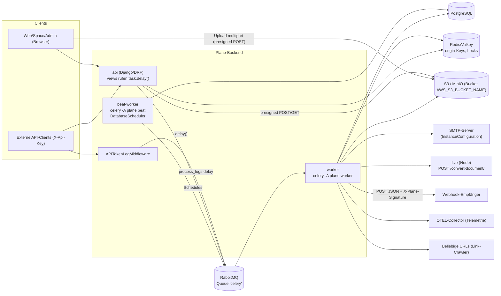
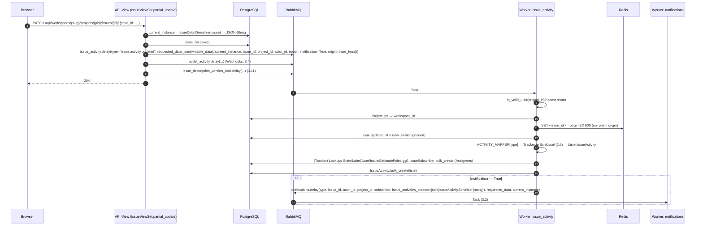
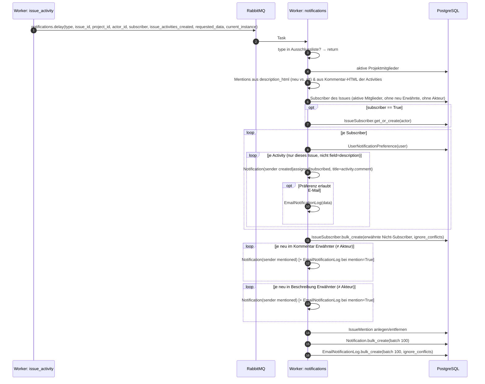
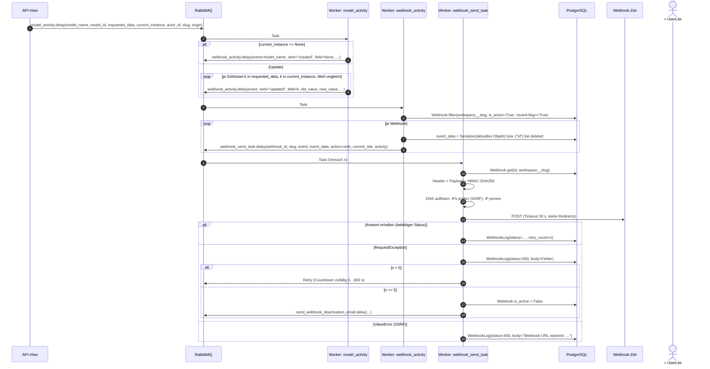
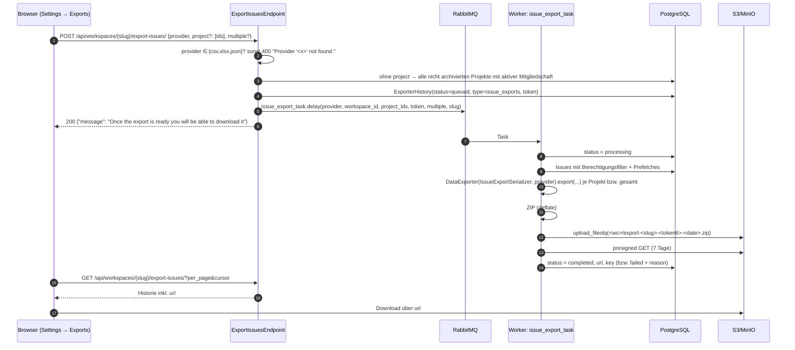
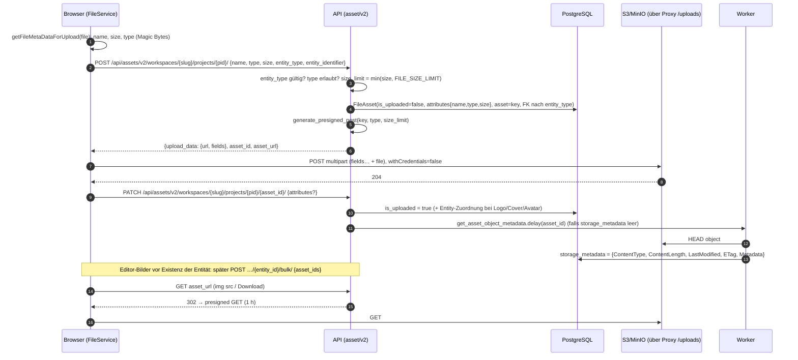

# A07 – Hintergrundverarbeitung, E-Mail, Storage, Webhooks (IST-Analyse)

> **Bereich:** `apps/api/plane/bgtasks/` (komplett, 33 Dateien), Celery-Konfiguration/Beat (`apps/api/plane/celery.py`, `apps/api/plane/settings/common.py`), Issue-Activity-Pipeline, Notification-/E-Mail-Pipeline, Webhooks inkl. SSRF-Schutz, Exporte (Issues CSV/JSON/XLSX, Analytics-CSV per Mail), Cleanup/Deletion, Page-/Description-Versionen, Page-Transaktionen, File-Assets/S3/MinIO inkl. Upload-Flow, E-Mail-Templates, SMTP-Konfiguration.
>
> **Gelesene Quellen (vollständig):** alle Dateien unter `apps/api/plane/bgtasks/` (`__init__.py`, `apps.py`, `analytic_plot_export.py`, `cleanup_task.py`, `copy_s3_object.py`, `deletion_task.py`, `dummy_data_task.py`, `email_notification_task.py`, `export_task.py`, `exporter_expired_task.py`, `file_asset_task.py`, `forgot_password_task.py`, `issue_activities_task.py`, `issue_automation_task.py`, `issue_description_version_sync.py`, `issue_description_version_task.py`, `issue_version_sync.py`, `logger_task.py`, `magic_link_code_task.py`, `notification_task.py`, `page_transaction_task.py`, `page_version_task.py`, `project_add_user_email_task.py`, `project_invitation_task.py`, `recent_visited_task.py`, `storage_metadata_task.py`, `user_activation_email_task.py`, `user_deactivation_email_task.py`, `user_email_update_task.py`, `webhook_task.py`, `work_item_link_task.py`, `workspace_invitation_task.py`, `workspace_seed_task.py`), `apps/api/plane/license/bgtasks/telemetry_metrics.py`, `apps/api/plane/celery.py`, `apps/api/plane/settings/{common,production,storage,redis}.py`, `apps/api/plane/utils/{url_security,ip_address,email,host,exception_logger,csv_utils,issue_relation_mapper,analytics_plot}.py`, `apps/api/plane/utils/porters/**`, `apps/api/plane/license/utils/{instance_value,encryption}.py`, `apps/api/plane/license/api/views/configuration.py`, `apps/api/plane/utils/instance_config_variables/core.py` (SMTP-Teil), `apps/api/plane/db/mixins.py`, `apps/api/plane/db/models/{asset,webhook,notification,exporter,page (PageLog/PageVersion),issue (IssueActivity/IssueVersion/IssueDescriptionVersion/IssueSubscriber/Manager),api (APIActivityLog),recent_visit,intake (Status-Enum),user (post_save-Signal)}.py`, `apps/api/plane/app/views/asset/{base,v2}.py`, `apps/api/plane/app/views/issue/attachment.py`, `apps/api/plane/app/views/exporter/base.py`, `apps/api/plane/app/views/webhook/base.py`, `apps/api/plane/app/serializers/webhook.py`, `apps/api/plane/app/views/analytic/base.py` (Export-Endpunkt), `apps/api/plane/middleware/logger.py`, `apps/api/plane/throttles/asset.py`, `apps/api/plane/authentication/adapter/base.py` (Avatar-Upload, Aktivierungs-Mail), alle Aufrufstellen der Tasks (per Skript extrahiert, siehe 2.4), alle E-Mail-Templates unter `apps/api/templates/`, `apps/api/plane/seeds/data/*.json` (Inhaltsübersicht), Frontend-Gegenstücke `packages/services/src/file/{helper,file-upload.service}.ts`, `apps/web/services/file.service.ts`, `apps/web/components/web-hooks/**`, `apps/web/components/exporter/**`, `apps/web/components/settings/profile/content/pages/notifications/email-notification-form.tsx`, `apps/web/components/automation/auto-{archive,close}-automation.tsx`, `apps/web/components/analytics/export.ts`, `apps/proxy/Caddyfile.ce`, `docker-compose.yml`, `apps/api/bin/docker-entrypoint-{worker,beat}.sh`.
>
> **Pfad-Konvention:** Alle Pfade relativ zum Repo-Root. `BG/` = `apps/api/plane/bgtasks/`. Zeilenangaben („Z.“) beziehen sich auf den Stand v1.4.2.
>
> **Bezug zu Grundsatzentscheidungen** (`migration/architecture/00-grundsatzentscheidungen.md`): ADR-001 (keine Plan-Stufen; Limits werden konfigurierbar), ADR-002 (kein Node zur Laufzeit → `convert-document` des Live-Servers muss in .NET), ADR-003 (Greenfield → Sync-/Backfill-Tasks entfallen), ADR-004 (Airgapped → externe Bild-URLs in E-Mails, Telemetrie, Link-Crawler müssen abschaltbar/gebündelt sein).

## Inhaltsverzeichnis

1. [Überblick & Verantwortlichkeiten](#1-überblick--verantwortlichkeiten)
   - 1.1 Zweck · 1.2 Laufzeitarchitektur · 1.3 Verantwortlichkeiten · 1.4 Querschnittliche Muster
2. [Vollständige Inventare](#2-vollständige-inventare)
   - 2.1 Celery-Konfiguration · 2.2 Beat-Jobs · 2.3 Task-Inventar · 2.4 Aufrufstellen `issue_activity` · 2.5 Activity-Typen · 2.6 Feld-Tracker · 2.7 Alle erzeugten IssueActivity-Varianten · 2.8 Notification-Strukturen · 2.9 Benachrichtigungs-Präferenzen · 2.10 Webhooks · 2.11 SSRF-Schutz · 2.12 Issue-Export · 2.13 Analytics-Export · 2.14 Cleanup/Retention · 2.15 Versionierung & Page-Logs · 2.16 Storage/Assets · 2.17 E-Mail · 2.18 ENV-Variablen des Bereichs · 2.19 Redis-Schlüssel des Bereichs
3. [Verhalten/Logik/Abläufe im Detail](#3-verhaltenlogikabläufe-im-detail)
4. [Abhängigkeiten zu anderen Bereichen](#4-abhängigkeiten-zu-anderen-bereichen)
5. [Migrationshinweise für .NET/EF Core bzw. Angular](#5-migrationshinweise-für-netef-core-bzw-angular)
6. [Offene Punkte](#6-offene-punkte)

---

## 1. Überblick & Verantwortlichkeiten

### 1.1 Zweck

Die Hintergrundverarbeitung entkoppelt alle Seiteneffekte von HTTP-Requests. Views der internen API (`apps/api/plane/app/views/**`), der externen API (`apps/api/plane/api/views/**`), der Space-API (`apps/api/plane/space/views/**`), der Authentifizierung (`apps/api/plane/authentication/**`), Middleware (`apps/api/plane/middleware/logger.py`) und Modell-Mixins (`apps/api/plane/db/mixins.py`) rufen Celery-Tasks mit `.delay(...)` auf. Zeitgesteuerte Aufgaben laufen über Celery Beat (`apps/api/plane/celery.py`). Fachlich deckt der Bereich ab:

- **Aktivitätsprotokoll** (Work-Item-Historie, „Activity“-Tab) – `BG/issue_activities_task.py`
- **In-App-Benachrichtigungen** (Inbox) und **E-Mail-Benachrichtigungen** (gebündelt alle 5 Minuten) – `BG/notification_task.py`, `BG/email_notification_task.py`
- **Webhooks** (ausgehende HTTP-POSTs mit HMAC-Signatur, Retry, Auto-Deaktivierung) – `BG/webhook_task.py`
- **Exporte** (Work Items als CSV/JSON/XLSX in ZIP auf S3; Analytics als CSV per E-Mail) – `BG/export_task.py`, `BG/analytic_plot_export.py`
- **Automationen** (Auto-Archivieren, Auto-Schließen, Intake-Unsnooze) – `BG/issue_automation_task.py`
- **Datenpflege** (Soft-Delete-Kaskade, Hard-Delete nach Frist, Log-/Versions-Cleanup, abgelaufene Exporte, nie hochgeladene Assets) – `BG/deletion_task.py`, `BG/cleanup_task.py`, `BG/exporter_expired_task.py`, `BG/file_asset_task.py`
- **Versionierung** (Page-Versionen, Issue-Description-Versionen, Backfill-Jobs) – `BG/page_version_task.py`, `BG/issue_description_version_task.py`, `BG/issue_description_version_sync.py`, `BG/issue_version_sync.py`
- **Page-Transaktionen** (Index der Erwähnungen/Bilder in Seiten) – `BG/page_transaction_task.py`
- **Assets** (Storage-Metadaten, Kopieren von S3-Objekten bei Duplikation) – `BG/storage_metadata_task.py`, `BG/copy_s3_object.py`
- **Transaktions-E-Mails** (Magic-Code, Passwort-Reset, Einladungen, Projekt-Hinzufügung, (De-)Aktivierung, E-Mail-Änderung, Webhook-Deaktivierung) – `BG/*_email_task.py`, `BG/magic_link_code_task.py`, `BG/forgot_password_task.py`, `BG/workspace_invitation_task.py`, `BG/project_invitation_task.py`
- **Sonstiges**: Link-Metadaten-Crawler (Titel/Favicon), „Zuletzt besucht“, Workspace-Seed (Demo-Projekt), Dummy-Daten (Dev-Tool), API-Request-Log (externe API), Telemetrie (OTLP).

### 1.2 Laufzeitarchitektur



Quellen: `apps/api/plane/celery.py`, `apps/api/plane/settings/common.py` Z. 356–386, `apps/api/bin/docker-entrypoint-worker.sh`, `apps/api/bin/docker-entrypoint-beat.sh`, `docker-compose.yml` (Services `worker`, `beat-worker`, `plane-mq`, `plane-redis`, `plane-minio`), `apps/proxy/Caddyfile.ce` (Route `/{$BUCKET_NAME}/*` → `plane-minio:9000`).

### 1.3 Verantwortlichkeiten

| Teilbereich | Verantwortung | Kern-Dateien | Persistenz |
|---|---|---|---|
| Task-Infrastruktur | Celery-App, Broker, Serializer, Beat-Schedule, Logging | `apps/api/plane/celery.py`, `apps/api/plane/settings/common.py` | Tabellen von `django_celery_beat` (DatabaseScheduler) |
| Aktivitäten | Diff alt/neu → `IssueActivity`-Zeilen; triggert Notifications | `BG/issue_activities_task.py` | `issue_activities` |
| Benachrichtigungen | Empfängerermittlung, Erwähnungen, Subscriber-Pflege, `Notification` + `EmailNotificationLog` | `BG/notification_task.py` | `notifications`, `email_notification_logs`, `issue_subscribers`, `issue_mentions` |
| E-Mail-Batching | 5-Minuten-Bündelung je Empfänger/Issue, Versand `issue-updates.html` | `BG/email_notification_task.py` | `email_notification_logs.processed_at/sent_at` |
| Webhooks | Feld-Diff → Events → HTTP-POST, Logging, Retry, Deaktivierung | `BG/webhook_task.py`, `apps/api/plane/utils/url_security.py`, `apps/api/plane/utils/ip_address.py` | `webhooks`, `webhook_logs` |
| Exporte | ZIP mit CSV/JSON/XLSX, Upload S3, presigned URL | `BG/export_task.py`, `apps/api/plane/utils/porters/**` | `exporters` |
| Analytics-Export | CSV aus Diagramm-Distribution per Mail | `BG/analytic_plot_export.py` | – |
| Automationen | Auto-Archive/Close (täglich), Unsnooze (5 min) | `BG/issue_automation_task.py` | `issues`, `intake_issues` |
| Datenpflege | Soft-Delete-Kaskade, Hard-Delete, Cleanup | `BG/deletion_task.py`, `BG/cleanup_task.py`, `BG/exporter_expired_task.py`, `BG/file_asset_task.py` | alle Soft-Delete-Tabellen |
| Versionierung | PageVersion, IssueDescriptionVersion (+ Backfill), IssueVersion (Backfill) | `BG/page_version_task.py`, `BG/issue_description_version_task.py`, `BG/issue_description_version_sync.py`, `BG/issue_version_sync.py` | `page_versions`, `issue_description_versions`, `issue_versions` |
| Page-Transaktionen | Index von Mentions/Bildern | `BG/page_transaction_task.py` | `page_logs` |
| Storage | S3-Client, presigned POST/GET, Metadaten, Kopie | `apps/api/plane/settings/storage.py`, `BG/storage_metadata_task.py`, `BG/copy_s3_object.py`, `apps/api/plane/app/views/asset/v2.py` | `file_assets` + Objektspeicher |
| Transaktions-Mails | 10 Mail-Arten mit Templates | `BG/*mail*`, `BG/magic_link_code_task.py`, `BG/forgot_password_task.py`, `BG/*invitation_task.py`, `apps/api/templates/emails/**` | `workspace_member_invites.message`, `project_member_invites.message` |
| Sonstiges | Link-Crawler, Recent Visits, Seed, Dummy-Daten, API-Log, Telemetrie | `BG/work_item_link_task.py`, `BG/recent_visited_task.py`, `BG/workspace_seed_task.py`, `BG/dummy_data_task.py`, `BG/logger_task.py`, `apps/api/plane/license/bgtasks/telemetry_metrics.py` | `issue_links.metadata`, `user_recent_visits`, diverse, `api_activity_logs` |

### 1.4 Querschnittliche Muster (gelten für fast alle Tasks)

| Muster | Beschreibung | Quelle |
|---|---|---|
| Auslösung | `task.delay(**kwargs)` direkt im View, **nicht** in `transaction.on_commit` (einzige Ausnahme: Projekt-Erstellung der externen API nutzt `transaction.on_commit(_dispatch_model_activity, robust=True)`). Folge: Tasks können vor dem Commit laufen und Datensätze noch nicht sehen. | `apps/api/plane/api/views/project.py` Z. 281–301 |
| Serialisierung | JSON (`CELERY_TASK_SERIALIZER = "json"`, `CELERY_ACCEPT_CONTENT = ["application/json"]`). Komplexe Werte werden vorab mit `json.dumps(..., cls=DjangoJSONEncoder)` zu Strings gemacht (`requested_data`, `current_instance`). UUIDs werden meist als `str` übergeben. | `apps/api/plane/settings/common.py` Z. 368–371 |
| Fehlerbehandlung | Nahezu jeder Task hat `try/except Exception` → `log_exception(e)` (Logger `plane.exception`) und `return`. Kein Re-Raise ⇒ **kein Retry**. Ausnahmen: `webhook_send_task` (Autoretry), `workspace_seed` (re-raise ohne Retry), `notifications` (nur `print(e)`), `create_dummy_data`/`hard_delete`/`delete_old_s3_link`/`delete_unuploaded_file_asset`/`stack_email_notification`/`soft_delete_related_objects` (kein try/except). | `apps/api/plane/utils/exception_logger.py`, alle `BG/*.py` |
| Result-Backend | Keines konfiguriert; Rückgabewerte werden verworfen. | `apps/api/plane/settings/common.py` |
| Queues/Routing | Keine `task_routes`, keine benannten Queues → Standard-Queue `celery`. Ein Worker-Typ verarbeitet alles. | `apps/api/plane/settings/common.py`, `apps/api/bin/docker-entrypoint-worker.sh` |
| Zeitzone | `CELERY_TIMEZONE = TIME_ZONE` (= `"UTC"` in `common.py`); Beat-Zeiten sind UTC. | `apps/api/plane/settings/common.py` Z. 368 |
| Logging | Worker-Logger `plane.worker` (JSON-Formatter), Celery-Logger via Signal `after_setup_logger`/`after_setup_task_logger` mit `JsonFormatter`. | `apps/api/plane/celery.py`, `apps/api/plane/settings/production.py` |
| E-Mail-Versand | Jeder Mail-Task lädt SMTP-Konfiguration zur Laufzeit über `get_email_configuration()`, baut eine neue `get_connection(...)` und sendet `EmailMultiAlternatives` (Text = aus HTML generiert via `generate_plain_text_from_html`, HTML als Alternative). `ENABLE_SMTP` wird **nicht** geprüft. | `apps/api/plane/license/utils/instance_value.py`, `apps/api/plane/utils/email.py` |
| Origin/Basis-URL | `base_host(request, is_app=True)` liefert `APP_BASE_URL` oder `WEB_URL` (nicht request-abhängig) und wird als `origin`/`current_site` an Tasks übergeben. | `apps/api/plane/utils/host.py` |

---

## 2. Vollständige Inventare

### 2.1 Celery-Konfiguration

| Einstellung | Wert | Quelle |
|---|---|---|
| App-Name | `Celery("plane")` | `apps/api/plane/celery.py` Z. 41 |
| Settings-Modul-Default | `DJANGO_SETTINGS_MODULE=plane.settings.production` | `apps/api/plane/celery.py` Z. 20 |
| Konfigurationsquelle | `app.config_from_object("django.conf:settings", namespace="CELERY")` | `apps/api/plane/celery.py` Z. 45 |
| Broker | `CELERY_BROKER_URL = AMQP_URL` falls gesetzt, sonst `amqp://{RABBITMQ_USER}:{RABBITMQ_PASSWORD}@{RABBITMQ_HOST}:{RABBITMQ_PORT}/{RABBITMQ_VHOST}` (Defaults `guest`/`guest`/`localhost`/`5672`/`/`) | `apps/api/plane/settings/common.py` Z. 355–366 |
| Task-/Result-Serializer | `json` / `json`; `CELERY_ACCEPT_CONTENT = ["application/json"]` | `apps/api/plane/settings/common.py` Z. 369–371 |
| Zeitzone | `CELERY_TIMEZONE = TIME_ZONE` | `apps/api/plane/settings/common.py` Z. 368 |
| Explizite Imports | `CELERY_IMPORTS = (issue_automation_task, exporter_expired_task, file_asset_task, email_notification_task, cleanup_task, license.bgtasks.telemetry_metrics, dummy_data_task, issue_version_sync, issue_description_version_sync)` | `apps/api/plane/settings/common.py` Z. 374–387 |
| Autodiscovery | `app.autodiscover_tasks()` (findet keine `tasks.py`; übrige Task-Module werden indirekt über Imports geladen – siehe A01 §2.17.3) | `apps/api/plane/celery.py` Z. 131 |
| Beat-Scheduler | `django_celery_beat.schedulers.DatabaseScheduler` (Schedule aus `beat_schedule` wird in DB-Tabellen gespiegelt) | `apps/api/plane/celery.py` Z. 133; `INSTALLED_APPS` enthält `django_celery_beat` (`apps/api/plane/settings/common.py` Z. 118) |
| Logging-Hooks | `after_setup_logger`, `after_setup_task_logger` → `StreamHandler` mit `JsonFormatter` | `apps/api/plane/celery.py` Z. 112–127 |
| Metrik-Intervall | `METRICS_PUSH_INTERVAL_MINUTES` (ENV, Default 360; gültig 1…10 000 000, sonst 360) | `apps/api/plane/celery.py` Z. 26–37 |
| Redis-Verbindung beim Import | `ri = redis_instance()` (ungenutzt) | `apps/api/plane/celery.py` Z. 22 |
| Worker-Start | `celery -A plane worker -l info` nach `wait_for_db` + `wait_for_migrations` | `apps/api/bin/docker-entrypoint-worker.sh` |
| Beat-Start | `celery -A plane beat -l info` nach `wait_for_db` + `wait_for_migrations` | `apps/api/bin/docker-entrypoint-beat.sh` |
| Queues | keine Definition → Default-Queue `celery`; keine Prioritäten, kein Rate-Limit, keine Time-Limits | – |

### 2.2 Beat-Jobs (vollständig, UTC)

| # | Beat-Name | Task | Intervall | Fachlicher Zweck | Parameter / ENV |
|---|---|---|---|---|---|
| B1 | `check-every-five-minutes-to-send-email-notifications` | `plane.bgtasks.email_notification_task.stack_email_notification` | `crontab(minute="*/5")` – alle 5 Min | Bündelt unverarbeitete `EmailNotificationLog`-Zeilen je Empfänger/Issue und stößt Versand an | – |
| B2 | `check-every-five-minutes-to-unsnooze-intake-issues` | `plane.bgtasks.issue_automation_task.unsnooze_expired_intake_issues` | alle 5 Min | Gesnoozte Intake-Einträge mit `snoozed_till <= now` → `PENDING` | – |
| B3 | `push-instance-metrics` | `plane.license.bgtasks.telemetry_metrics.push_instance_metrics` | `schedule(run_every=timedelta(minutes=METRICS_PUSH_INTERVAL_MINUTES))` (Default 6 h) | OTLP-Gauges zu Instanz-/Workspace-Zählern | `METRICS_PUSH_INTERVAL_MINUTES`, `OTLP_METRICS_PROTOCOL`, `OTEL_EXPORTER_OTLP_METRICS_INSECURE`, `SERVICE_NAME`, `WEB_URL` |
| B4 | `check-every-day-to-delete-hard-delete` | `plane.bgtasks.deletion_task.hard_delete` | täglich 00:00 | Endgültiges Löschen soft-gelöschter Zeilen älter als Frist | `HARD_DELETE_AFTER_DAYS` (Default 60) |
| B5 | `check-every-day-to-archive-and-close` | `plane.bgtasks.issue_automation_task.archive_and_close_old_issues` | täglich 01:00 | Projekt-Automationen Auto-Archive (`archive_in`) und Auto-Close (`close_in`) | Projektfelder `archive_in`, `close_in`, `default_state` |
| B6 | `check-every-day-to-delete_exporter_history` | `plane.bgtasks.exporter_expired_task.delete_old_s3_link` | täglich 01:30 | Export-ZIPs älter 8 Tage aus S3 löschen, `url=None` | – (8 Tage hart kodiert) |
| B7 | `check-every-day-to-delete-file-asset` | `plane.bgtasks.file_asset_task.delete_unuploaded_file_asset` | täglich 02:00 | Nie bestätigte Uploads (`is_uploaded=False`) älter N Tage soft-löschen | `UNUPLOADED_ASSET_DELETE_DAYS` (Default 7) |
| B8 | `check-every-day-to-delete-api-logs` | `plane.bgtasks.cleanup_task.delete_api_logs` | täglich 02:30 | `APIActivityLog` hart löschen | `API_ACTIVITY_LOG_RETENTION_DAYS` (Default 14) |
| B9 | `check-every-day-to-delete-email-notification-logs` | `plane.bgtasks.cleanup_task.delete_email_notification_logs` | täglich 02:45 | Versendete `EmailNotificationLog` hart löschen | `EMAIL_LOG_RETENTION_DAYS` (Default 7) |
| B10 | `check-every-day-to-delete-page-versions` | `plane.bgtasks.cleanup_task.delete_page_versions` | täglich 03:00 | Je Page alle Versionen jenseits der 20 neuesten hart löschen | 20 hart kodiert |
| B11 | `check-every-day-to-delete-issue-description-versions` | `plane.bgtasks.cleanup_task.delete_issue_description_versions` | täglich 03:15 | Je Issue alle Description-Versionen jenseits der 20 neuesten hart löschen | 20 hart kodiert |
| B12 | `check-every-day-to-delete-webhook-logs` | `plane.bgtasks.cleanup_task.delete_webhook_logs` | täglich 03:30 | `WebhookLog` hart löschen | `WEBHOOK_LOG_RETENTION_DAYS` (Default 14) |
| B13 | `check-every-day-to-delete-exporter-history` | `plane.bgtasks.exporter_expired_task.delete_old_s3_link` | täglich 03:45 | **Duplikat** von B6 (gleicher Task, zweiter Lauf) | – |

Quelle aller Zeilen: `apps/api/plane/celery.py` Z. 47–109; ENV-Auswertung `apps/api/plane/settings/common.py` Z. 472–500, `BG/file_asset_task.py` Z. 23.

### 2.3 Task-Inventar (alle `@shared_task`)

Spalten: **Retry** = automatische Wiederholung; **Fehler** = Verhalten bei Exception.

| # | Task (Modul `plane.bgtasks.*` bzw. `plane.license.bgtasks.*`) | Signatur | Auslöser / Aufrufer | Retry | Fehler | Seiteneffekte |
|---|---|---|---|---|---|---|
| T1 | `analytic_plot_export.analytic_export_task` | `(email, data, slug, user_id)` | `ExportAnalyticsEndpoint.post` (`apps/api/plane/app/views/analytic/base.py` Z. 256), URL `POST /api/workspaces/<slug>/export-analytics/` | nein | `log_exception`, kein Mailversand | Mail „Your Export is ready“ mit CSV-Anhang `<slug>-analytics.csv` |
| T2 | `analytic_plot_export.export_analytics_to_csv_email` | `(data, headers, keys, email, slug)` | **kein Aufrufer im CE** | nein | `log_exception` | Mail mit CSV-Anhang |
| T3 | `cleanup_task.delete_api_logs` | `()` | Beat B8 | nein | Batch-Fehler geloggt, nächster Batch | Hard-Delete `api_activity_logs` |
| T4 | `cleanup_task.delete_email_notification_logs` | `()` | Beat B9 | nein | dto. | Hard-Delete `email_notification_logs` mit `sent_at <= cutoff` |
| T5 | `cleanup_task.delete_page_versions` | `()` | Beat B10 | nein | dto. | Hard-Delete `page_versions` (Rang > 20 je `page_id`, nach `created_at desc`) |
| T6 | `cleanup_task.delete_issue_description_versions` | `()` | Beat B11 | nein | dto. | Hard-Delete `issue_description_versions` (Rang > 20 je `issue_id`) |
| T7 | `cleanup_task.delete_webhook_logs` | `()` | Beat B12 | nein | dto. | Hard-Delete `webhook_logs` |
| T8 | `copy_s3_object.copy_s3_objects_of_description_and_assets` | `(entity_name, entity_identifier, project_id, slug, user_id)` | `PageDuplicateEndpoint.post` (`apps/api/plane/app/views/page/base.py` Z. 617) | nein | `log_exception`, `return []` | Neue `FileAsset`-Zeilen + S3-`copy_object`, `description_html` umgeschrieben, `description_json`/`description_binary` via Live-Server |
| T9 | `deletion_task.soft_delete_related_objects` | `(app_label, model_name, instance_pk, using=None)` | `SoftDeleteModel.delete(soft=True)` (`apps/api/plane/db/mixins.py` Z. 78) – **bei jedem** Soft-Delete eines Modells mit `deleted_at` | nein | kein globales try; pro Relation `print(...)` + weiter | Rekursives Setzen von `deleted_at` bzw. `SET_NULL` auf abhängigen Zeilen |
| T10 | `deletion_task.hard_delete` | `()` | Beat B4 | nein | keine Behandlung (Exception bricht Lauf ab) | Hard-Delete aller Modelle mit `deleted_at < now − HARD_DELETE_AFTER_DAYS` |
| – | `deletion_task.restore_related_objects` | `(app_label, model_name, instance_pk, using=None)` | **kein Task** (Decorator auskommentiert), Rumpf `pass` | – | – | – |
| T11 | `dummy_data_task.create_dummy_data` | `(slug, email, members, issue_count, cycle_count, module_count, pages_count, intake_issue_count)` | Management-Command `create_dummy_data` – **synchron** aufgerufen, nicht `.delay` (`apps/api/plane/db/management/commands/create_dummy_data.py` Z. 57–68) | nein | keine | Projekt, Mitglieder, States, 50 Labels, Cycles, Module, Pages, Page-Labels, Issues, Intake-Issues, Zuordnungen |
| T12 | `email_notification_task.stack_email_notification` | `()` | Beat B1 | nein | keine Behandlung | `processed_at=now` auf allen gelesenen Logs; je (Empfänger, Issue) ein `send_email_notification.delay` |
| T13 | `email_notification_task.send_email_notification` | `(issue_id, notification_data, receiver_id, email_notification_ids)` | T12 | nein | Lock freigeben, `log_exception` | Mail `issue-updates.html`; `sent_at=now` auf allen `email_notification_ids` |
| T14 | `export_task.issue_export_task` | `(provider, workspace_id, project_ids, token_id, multiple, slug)` | `ExportIssuesEndpoint.post` (`apps/api/plane/app/views/exporter/base.py` Z. 50), URL `POST /api/workspaces/<slug>/export-issues/` | nein | `ExporterHistory.status="failed"`, `reason=str(e)` | ZIP-Upload nach S3, `ExporterHistory.url/key/status` |
| T15 | `exporter_expired_task.delete_old_s3_link` | `()` | Beat B6, B13 | nein | keine Behandlung | S3 `delete_object`, `ExporterHistory.url=None` |
| T16 | `file_asset_task.delete_unuploaded_file_asset` | `()` | Beat B7 | nein | keine Behandlung | **Soft**-Delete (`deleted_at`) von `FileAsset` mit `is_uploaded=False` und `created_at < now − N Tage`; S3-Objekt bleibt |
| T17 | `forgot_password_task.forgot_password` | `(first_name, email, uidb64, token, current_site)` | `ForgotPasswordEndpoint.post` (`apps/api/plane/authentication/views/app/password_management.py` Z. 87, `current_site=base_host(is_app=True)`), `ForgotPasswordSpaceEndpoint.post` (`apps/api/plane/authentication/views/space/password_management.py` Z. 99, `current_site=base_host(is_space=True)`) | nein | `log_exception` | Mail `emails/auth/forgot_password.html` |
| T18 | `issue_activities_task.issue_activity` | `(type, requested_data, current_instance, issue_id, actor_id, project_id, epoch, subscriber=True, notification=False, origin=None, intake=None)` | 78 Aufrufstellen (siehe 2.4) | nein | `log_exception`, nichts gespeichert | `IssueActivity`-Zeilen, `issues.updated_at`, Redis-Key `<issue_id>` (600 s), `IssueSubscriber` (Assignees), `notifications.delay` |
| T19 | `issue_automation_task.archive_and_close_old_issues` | `()` | Beat B5 | nein | je Teilfunktion `log_exception` | `issues.archived_at` bzw. `issues.state_id`; je Issue `issue_activity.delay` |
| T20 | `issue_automation_task.unsnooze_expired_intake_issues` | `()` | Beat B2 | nein | `log_exception`, `return 0` | `intake_issues.status=-2`, `snoozed_till=NULL`, `updated_at=now` (Bulk-Update, keine Activity) |
| T21 | `issue_description_version_sync.sync_issue_description_version` | `(batch_size=5000, offset=0, countdown=300)` | T22 bzw. rekursiv sich selbst via `apply_async(countdown=countdown)` | nein (Ketten-Fortsetzung) | `log_exception` (Kette bricht ab) | Backfill `issue_description_versions` |
| T22 | `issue_description_version_sync.schedule_issue_description_version` | `(batch_size=5000, countdown=300)` | Command `sync_issue_description_version` | nein | – | startet T21 |
| T23 | `issue_description_version_task.issue_description_version_task` | `(updated_issue, issue_id, user_id, is_creating=False)` | `IssueViewSet.create` (Z. 484, `is_creating=True`), `IssueViewSet.partial_update` (Z. 710), `IntakeIssueViewSet.create` (`apps/api/plane/app/views/intake/base.py` Z. 294), `IntakeIssueViewSet.partial_update` (Z. 456) | nein | `log_exception` | Neue oder aktualisierte `IssueDescriptionVersion` |
| T24 | `issue_version_sync.issue_task` | `(updated_issue, issue_id, user_id)` | **kein Aufrufer im CE** | nein | `log_exception` | `IssueVersion` aktualisieren/anlegen |
| T25 | `issue_version_sync.sync_issue_version` | `(batch_size=5000, offset=0, countdown=300)` | T26 / rekursiv | nein | `log_exception` | Backfill `issue_versions` |
| T26 | `issue_version_sync.schedule_issue_version` | `(batch_size=5000, countdown=300)` | Command `sync_issue_version` | nein | – | startet T25 |
| T27 | `logger_task.process_logs` | `(log_data, **_)` | `APITokenLogMiddleware.process_request` (`apps/api/plane/middleware/logger.py` Z. 158) – jede Anfrage mit Header `X-Api-Key` | nein | `log_exception` | `APIActivityLog`-Zeile |
| T28 | `magic_link_code_task.magic_link` | `(email, key, token)` | `MagicGenerateEndpoint.post` (`apps/api/plane/authentication/views/app/magic.py` Z. 57), `MagicGenerateSpaceEndpoint.post` (`apps/api/plane/authentication/views/space/magic.py` Z. 56) | nein | `log_exception` | Mail `emails/auth/magic_signin.html`; Parameter `key` ungenutzt |
| T29 | `notification_task.notifications` | `(type, issue_id, project_id, actor_id, subscriber, issue_activities_created, requested_data, current_instance)` | T18 bei `notification=True` | nein | `print(e)` (kein Logging!) | `Notification`, `EmailNotificationLog`, `IssueSubscriber`, `IssueMention` |
| T30 | `page_transaction_task.page_transaction` | `(new_description_html, old_description_html, page_id)` | `PageViewSet.create` (Z. 160), `PageViewSet.partial_update` (Z. 204, nur wenn `description_html` im Request), `PagesDescriptionViewSet.partial_update` (Z. 558, dto.), `PageDuplicateEndpoint.post` (Z. 610) – alle `apps/api/plane/app/views/page/base.py` | nein | `log_exception` | `PageLog` anlegen/soft-löschen |
| T31 | `page_version_task.track_page_version` | `(page_id, existing_instance, user_id)` | `PagesDescriptionViewSet.partial_update` (Z. 565) – Speichern durch Live-Server | nein | `log_exception` | `PageVersion` anlegen/aktualisieren; älteste soft-löschen bei > 20 |
| T32 | `project_add_user_email_task.project_add_user_email` | `(current_site, project_member_id, invitor_id)` | `ProjectMemberViewSet.create` (`apps/api/plane/app/views/project/member.py` Z. 144), je neu hinzugefügtem Mitglied | nein | `log_exception` | Mail `emails/notifications/project_addition.html` |
| T33 | `project_invitation_task.project_invitation` | `(email, project_id, token, current_site, invitor)` | **kein Aufrufer im CE** | nein | `DoesNotExist` still; sonst `log_exception` | Mail `emails/invitations/project_invitation.html`; `ProjectMemberInvite.message` = Klartext |
| T34 | `recent_visited_task.recent_visited_task` | `(entity_name, entity_identifier, user_id, project_id, slug)` | 10 Aufrufstellen (siehe 3.15) | nein | `log_exception` | `UserRecentVisit` upsert, max. 20 je User/Workspace |
| T35 | `storage_metadata_task.get_asset_object_metadata` | `(asset_id)` | Upload-Bestätigung (10 Aufrufstellen, siehe 2.16.6) | nein | `DoesNotExist` still; sonst `log_exception` | `FileAsset.storage_metadata` = S3 `head_object`-Ergebnis |
| T36 | `user_activation_email_task.user_activation_email` | `(current_site, user_id)` | `Adapter.save_user_data` (`apps/api/plane/authentication/adapter/base.py` Z. 248) – Login eines bisher inaktiven Users | nein | `log_exception` | Mail `emails/user/user_activation.html` |
| T37 | `user_deactivation_email_task.user_deactivation_email` | `(current_site, user_id)` | `UserEndpoint.deactivate` (`apps/api/plane/app/views/user/base.py` Z. 370) | nein | `log_exception` | Mail `emails/user/user_deactivation.html` |
| T38 | `user_email_update_task.send_email_update_magic_code` | `(email, token)` | `UserEndpoint.generate_email_verification_code` (`apps/api/plane/app/views/user/base.py` Z. 178) | nein | `log_exception` | Mail `emails/auth/magic_signin.html` mit Betreff „Verify your new email address“ |
| T39 | `user_email_update_task.send_email_update_confirmation` | `(email)` | `UserEndpoint.update_email` (Z. 270 neue Adresse, Z. 272 alte Adresse) | nein | `log_exception` | Mail `emails/user/email_updated.html` (2×) |
| T40 | `webhook_task.send_webhook_deactivation_email` | `(webhook_id, receiver_id, current_site, reason)` | T41 nach Erschöpfung der Retries | nein | `log_exception(warning=True)` | Mail `emails/notifications/webhook-deactivate.html` an `webhook.created_by` |
| T41 | `webhook_task.webhook_send_task` | `(self, webhook_id, slug, event, event_data, action, current_site, activity)` (`bind=True`) | T42 | **ja**: `autoretry_for=(requests.RequestException,)`, `retry_backoff=600`, `max_retries=5`, `retry_jitter=True` | Netzwerkfehler → Log + Retry; SSRF-`ValueError` → Log 400, kein Retry | HTTP-POST, `WebhookLog`; nach 5 Retries `is_active=False` + T40 |
| T42 | `webhook_task.webhook_activity` | `(event, verb, field, old_value, new_value, actor_id, slug, current_site, event_id, old_identifier, new_identifier)` | T43; direkt bei Projekt-Löschung (`apps/api/plane/app/views/project/base.py` Z. 401, `apps/api/plane/api/views/project.py` Z. 633) | nein | `ObjectDoesNotExist` still; sonst `log_exception` | je passendem aktivem Webhook ein T41 |
| T43 | `webhook_task.model_activity` | `(model_name, model_id, requested_data, current_instance, actor_id, slug, origin=None)` | 22 Aufrufstellen (siehe 2.10.3) | nein | keine Behandlung | je geändertem Feld ein T42 (bzw. ein „created“) |
| T44 | `work_item_link_task.crawl_work_item_link_title` | `(id, url)` | `IssueLinkViewSet.create` (`apps/api/plane/app/views/issue/link.py` Z. 54), `IssueLinkViewSet.partial_update` (Z. 85, nur bei URL-Änderung), `IssueLinkListCreateAPIEndpoint.post` (`apps/api/plane/api/views/issue.py` Z. 1214), `IssueLinkDetailAPIEndpoint.patch` (Z. 1331) | nein | intern abgefangen (Ergebnis enthält `error`) | `IssueLink.metadata = {title, favicon, url, favicon_url}` |
| T45 | `workspace_invitation_task.workspace_invitation` | `(email, workspace_id, token, current_site, inviter)` | `WorkspaceInvitationsViewset.create` (`apps/api/plane/app/views/workspace/invite.py` Z. 120), je Einladung | nein | `DoesNotExist` still; sonst `log_exception` | Mail `emails/invitations/workspace_invitation.html`; `WorkspaceMemberInvite.message` = Klartext der Mail |
| T46 | `workspace_seed_task.workspace_seed` | `(workspace_id)` | `WorkSpaceViewSet.create` (`apps/api/plane/app/views/workspace/base.py` Z. 138) | nein | `logger.error` + **re-raise** | Bot-User, Demo-Projekt mit States/Labels/Cycles/Modulen/Issues/Views/Pages |
| T47 | `license.bgtasks.telemetry_metrics.push_instance_metrics` | `()` | Beat B3; Command `register_instance` (`apps/api/plane/license/management/commands/register_instance.py` Z. 90) | nein | `logger.exception` | OTLP-Export an Collector (nur wenn `Instance.is_telemetry_enabled`) |

### 2.4 Aufrufstellen von `issue_activity` (vollständig, 78)

Spalten: `notification` = ob anschließend `notifications.delay` läuft; `origin` = ob ein `origin=base_host(...)` übergeben wird (Voraussetzung dafür, dass E-Mail-Benachrichtigungen überhaupt versendet werden, siehe 3.3); `subscriber` = ob der Akteur als Subscriber eingetragen wird (nur wirksam bei `notification=True`). Pfade relativ zum Repo-Root. Ermittelt per Quelltext-Extraktion aller `issue_activity.delay(`-Aufrufe (Tests ausgenommen).

| # | Datei | View/Funktion | `type` | `notification` | `origin` | `subscriber` |
|---|---|---|---|---|---|---|
| C1 | `apps/api/plane/api/views/cycle.py` Z. 1044 | `CycleIssueListCreateAPIEndpoint.post` | `cycle.activity.created` | True | True | True (Default) |
| C2 | `apps/api/plane/api/views/cycle.py` Z. 1154 | `CycleIssueDetailAPIEndpoint.delete` | `cycle.activity.deleted` | False (Default) | False | True (Default) |
| C3 | `apps/api/plane/api/views/cycle.py` Z. 631 | `CycleDetailAPIEndpoint.delete` | `cycle.activity.deleted` | False (Default) | False | True (Default) |
| C4 | `apps/api/plane/api/views/intake.py` Z. 213 | `IntakeIssueListCreateAPIEndpoint.post` | `issue.activity.created` | False (Default) | False | True (Default) |
| C5 | `apps/api/plane/api/views/intake.py` Z. 410 | `IntakeIssueDetailAPIEndpoint.patch` | `issue.activity.updated` | False (Default) | False | True (Default) |
| C6 | `apps/api/plane/api/views/intake.py` Z. 431 | `IntakeIssueDetailAPIEndpoint.patch` | `intake.activity.created` | False | True | True (Default) |
| C7 | `apps/api/plane/api/views/issue.py` Z. 1218 | `IssueLinkListCreateAPIEndpoint.post` | `link.activity.created` | False (Default) | False | True (Default) |
| C8 | `apps/api/plane/api/views/issue.py` Z. 1332 | `IssueLinkDetailAPIEndpoint.patch` | `link.activity.updated` | False (Default) | False | True (Default) |
| C9 | `apps/api/plane/api/views/issue.py` Z. 1365 | `IssueLinkDetailAPIEndpoint.delete` | `link.activity.deleted` | False (Default) | False | True (Default) |
| C10 | `apps/api/plane/api/views/issue.py` Z. 1508 | `IssueCommentListCreateAPIEndpoint.post` | `comment.activity.created` | False (Default) | False | True (Default) |
| C11 | `apps/api/plane/api/views/issue.py` Z. 1648 | `IssueCommentDetailAPIEndpoint.patch` | `comment.activity.updated` | False (Default) | False | True (Default) |
| C12 | `apps/api/plane/api/views/issue.py` Z. 1694 | `IssueCommentDetailAPIEndpoint.delete` | `comment.activity.deleted` | False (Default) | False | True (Default) |
| C13 | `apps/api/plane/api/views/issue.py` Z. 2085 | `IssueAttachmentDetailAPIEndpoint.delete` | `attachment.activity.deleted` | True | True | True (Default) |
| C14 | `apps/api/plane/api/views/issue.py` Z. 2223 | `IssueAttachmentDetailAPIEndpoint.patch` | `attachment.activity.created` | True | True | True (Default) |
| C15 | `apps/api/plane/api/views/issue.py` Z. 2575 | `IssueRelationListCreateAPIEndpoint.post` | `issue_relation.activity.created` | True | True | True (Default) |
| C16 | `apps/api/plane/api/views/issue.py` Z. 506 | `IssueListCreateAPIEndpoint.post` | `issue.activity.created` | True | True | True (Default) |
| C17 | `apps/api/plane/api/views/issue.py` Z. 667 | `IssueDetailAPIEndpoint.put` | `issue.activity.updated` | True | True | True (Default) |
| C18 | `apps/api/plane/api/views/issue.py` Z. 727 | `IssueDetailAPIEndpoint.put` | `issue.activity.created` | True | True | True (Default) |
| C19 | `apps/api/plane/api/views/issue.py` Z. 815 | `IssueDetailAPIEndpoint.patch` | `issue.activity.updated` | True | True | True (Default) |
| C20 | `apps/api/plane/api/views/issue.py` Z. 874 | `IssueDetailAPIEndpoint.delete` | `issue.activity.deleted` | False (Default) | False | True (Default) |
| C21 | `apps/api/plane/api/views/module.py` Z. 562 | `ModuleDetailAPIEndpoint.delete` | `module.activity.deleted` | False (Default) | True | True (Default) |
| C22 | `apps/api/plane/api/views/module.py` Z. 764 | `ModuleIssueListCreateAPIEndpoint.post` | `module.activity.created` | False (Default) | True | True (Default) |
| C23 | `apps/api/plane/api/views/module.py` Z. 929 | `ModuleIssueDetailAPIEndpoint.delete` | `module.activity.deleted` | False (Default) | False | True (Default) |
| C24 | `apps/api/plane/app/views/cycle/base.py` Z. 484 | `CycleViewSet.destroy` | `cycle.activity.deleted` | True | True | True (Default) |
| C25 | `apps/api/plane/app/views/cycle/issue.py` Z. 301 | `CycleIssueViewSet.create` | `cycle.activity.created` | True | True | True (Default) |
| C26 | `apps/api/plane/app/views/cycle/issue.py` Z. 327 | `CycleIssueViewSet.destroy` | `cycle.activity.deleted` | True | True | True (Default) |
| C27 | `apps/api/plane/app/views/estimate/base.py` Z. 210 | `EstimatePointEndpoint.destroy` | `issue.activity.updated` | False (Default) | False | True (Default) |
| C28 | `apps/api/plane/app/views/estimate/base.py` Z. 229 | `EstimatePointEndpoint.destroy` | `issue.activity.updated` | False (Default) | False | True (Default) |
| C29 | `apps/api/plane/app/views/intake/base.py` Z. 281 | `IntakeIssueViewSet.create` | `issue.activity.created` | True | True | True (Default) |
| C30 | `apps/api/plane/app/views/intake/base.py` Z. 443 | `IntakeIssueViewSet.partial_update` | `issue.activity.updated` | True | True | True (Default) |
| C31 | `apps/api/plane/app/views/intake/base.py` Z. 465 | `IntakeIssueViewSet.partial_update` | `intake.activity.created` | False | True | True (Default) |
| C32 | `apps/api/plane/app/views/issue/archive.py` Z. 264 | `IssueArchiveViewSet.archive` | `issue.activity.updated` | True | True | True (Default) |
| C33 | `apps/api/plane/app/views/issue/archive.py` Z. 288 | `IssueArchiveViewSet.unarchive` | `issue.activity.updated` | True | True | True (Default) |
| C34 | `apps/api/plane/app/views/issue/archive.py` Z. 328 | `BulkArchiveIssuesEndpoint.post` | `issue.activity.updated` | True | True | True (Default) |
| C35 | `apps/api/plane/app/views/issue/attachment.py` Z. 163 | `IssueAttachmentV2Endpoint.delete` | `attachment.activity.deleted` | True | True | True (Default) |
| C36 | `apps/api/plane/app/views/issue/attachment.py` Z. 219 | `IssueAttachmentV2Endpoint.patch` | `attachment.activity.created` | True | True | True (Default) |
| C37 | `apps/api/plane/app/views/issue/attachment.py` Z. 50 | `IssueAttachmentEndpoint.post` | `attachment.activity.created` | True | True | True (Default) |
| C38 | `apps/api/plane/app/views/issue/attachment.py` Z. 76 | `IssueAttachmentEndpoint.delete` | `attachment.activity.deleted` | True | True | True (Default) |
| C39 | `apps/api/plane/app/views/issue/base.py` Z. 1157 | `IssueBulkUpdateDateEndpoint.post` | `issue.activity.updated` | False (Default) | False | True (Default) |
| C40 | `apps/api/plane/app/views/issue/base.py` Z. 1170 | `IssueBulkUpdateDateEndpoint.post` | `issue.activity.updated` | False (Default) | False | True (Default) |
| C41 | `apps/api/plane/app/views/issue/base.py` Z. 422 | `IssueViewSet.create` | `issue.activity.created` | True | True | True (Default) |
| C42 | `apps/api/plane/app/views/issue/base.py` Z. 689 | `IssueViewSet.partial_update` | `issue.activity.updated` | True | True | True (Default) |
| C43 | `apps/api/plane/app/views/issue/base.py` Z. 730 | `IssueViewSet.destroy` | `issue.activity.deleted` | True | True | False |
| C44 | `apps/api/plane/app/views/issue/comment.py` Z. 105 | `IssueCommentViewSet.create` | `comment.activity.created` | True | True | True (Default) |
| C45 | `apps/api/plane/app/views/issue/comment.py` Z. 143 | `IssueCommentViewSet.partial_update` | `comment.activity.updated` | True | True | True (Default) |
| C46 | `apps/api/plane/app/views/issue/comment.py` Z. 174 | `IssueCommentViewSet.destroy` | `comment.activity.deleted` | True | True | True (Default) |
| C47 | `apps/api/plane/app/views/issue/comment.py` Z. 220 | `CommentReactionViewSet.create` | `comment_reaction.activity.created` | True | True | True (Default) |
| C48 | `apps/api/plane/app/views/issue/comment.py` Z. 248 | `CommentReactionViewSet.destroy` | `comment_reaction.activity.deleted` | True | True | True (Default) |
| C49 | `apps/api/plane/app/views/issue/link.py` Z. 107 | `IssueLinkViewSet.destroy` | `link.activity.deleted` | True | True | True (Default) |
| C50 | `apps/api/plane/app/views/issue/link.py` Z. 55 | `IssueLinkViewSet.create` | `link.activity.created` | True | True | True (Default) |
| C51 | `apps/api/plane/app/views/issue/link.py` Z. 87 | `IssueLinkViewSet.partial_update` | `link.activity.updated` | True | True | True (Default) |
| C52 | `apps/api/plane/app/views/issue/reaction.py` Z. 52 | `IssueReactionViewSet.create` | `issue_reaction.activity.created` | True | True | True (Default) |
| C53 | `apps/api/plane/app/views/issue/reaction.py` Z. 75 | `IssueReactionViewSet.destroy` | `issue_reaction.activity.deleted` | True | True | True (Default) |
| C54 | `apps/api/plane/app/views/issue/relation.py` Z. 286 | `IssueRelationViewSet.create` | `issue_relation.activity.created` | True | True | True (Default) |
| C55 | `apps/api/plane/app/views/issue/relation.py` Z. 332 | `IssueRelationViewSet.remove_relation` | `issue_relation.activity.deleted` | True | True | True (Default) |
| C56 | `apps/api/plane/app/views/issue/sub_issue.py` Z. 252 | `SubIssuesEndpoint.post` | `issue.activity.updated` | True | True | True (Default) |
| C57 | `apps/api/plane/app/views/module/base.py` Z. 730 | `ModuleViewSet.destroy` | `module.activity.deleted` | True | True | True (Default) |
| C58 | `apps/api/plane/app/views/module/issue.py` Z. 244 | `ModuleIssueViewSet.create_module_issues` | `module.activity.created` | True | True | True (Default) |
| C59 | `apps/api/plane/app/views/module/issue.py` Z. 293 | `ModuleIssueViewSet.create_issue_modules` | `module.activity.created` | True | True | True (Default) |
| C60 | `apps/api/plane/app/views/module/issue.py` Z. 314 | `ModuleIssueViewSet.create_issue_modules` | `module.activity.deleted` | True | True | True (Default) |
| C61 | `apps/api/plane/app/views/module/issue.py` Z. 349 | `ModuleIssueViewSet.destroy` | `module.activity.deleted` | True | True | True (Default) |
| C62 | `apps/api/plane/app/views/workspace/draft.py` Z. 287 | `WorkspaceDraftIssueViewSet.create_draft_to_issue` | `issue.activity.created` | True | True | True (Default) |
| C63 | `apps/api/plane/app/views/workspace/draft.py` Z. 309 | `WorkspaceDraftIssueViewSet.create_draft_to_issue` | `cycle.activity.created` | True | True | True (Default) |
| C64 | `apps/api/plane/app/views/workspace/draft.py` Z. 344 | `WorkspaceDraftIssueViewSet.create_draft_to_issue` | `module.activity.created` | True | True | True (Default) |
| C65 | `apps/api/plane/bgtasks/issue_automation_task.py` Z. 137 | `.close_old_issues` | `issue.activity.updated` | True | False | False |
| C66 | `apps/api/plane/bgtasks/issue_automation_task.py` Z. 74 | `.archive_old_issues` | `issue.activity.updated` | True | False | False |
| C67 | `apps/api/plane/space/views/intake.py` Z. 169 | `IntakeIssuePublicViewSet.create` | `issue.activity.created` | False (Default) | False | True (Default) |
| C68 | `apps/api/plane/space/views/intake.py` Z. 237 | `IntakeIssuePublicViewSet.partial_update` | `issue.activity.updated` | False (Default) | False | True (Default) |
| C69 | `apps/api/plane/space/views/issue.py` Z. 312 | `IssueCommentPublicViewSet.create` | `comment.activity.created` | False (Default) | False | True (Default) |
| C70 | `apps/api/plane/space/views/issue.py` Z. 356 | `IssueCommentPublicViewSet.partial_update` | `comment.activity.updated` | False (Default) | False | True (Default) |
| C71 | `apps/api/plane/space/views/issue.py` Z. 385 | `IssueCommentPublicViewSet.destroy` | `comment.activity.deleted` | False (Default) | False | True (Default) |
| C72 | `apps/api/plane/space/views/issue.py` Z. 451 | `IssueReactionPublicViewSet.create` | `issue_reaction.activity.created` | False (Default) | False | True (Default) |
| C73 | `apps/api/plane/space/views/issue.py` Z. 481 | `IssueReactionPublicViewSet.destroy` | `issue_reaction.activity.deleted` | False (Default) | False | True (Default) |
| C74 | `apps/api/plane/space/views/issue.py` Z. 548 | `CommentReactionPublicViewSet.create` | `comment_reaction.activity.created` | False (Default) | False | True (Default) |
| C75 | `apps/api/plane/space/views/issue.py` Z. 584 | `CommentReactionPublicViewSet.destroy` | `comment_reaction.activity.deleted` | False (Default) | False | True (Default) |
| C76 | `apps/api/plane/space/views/issue.py` Z. 653 | `IssueVotePublicViewSet.create` | `issue_vote.activity.created` | False (Default) | False | True (Default) |
| C77 | `apps/api/plane/space/views/issue.py` Z. 673 | `IssueVotePublicViewSet.destroy` | `issue_vote.activity.deleted` | False (Default) | False | True (Default) |
| C78 | `apps/api/plane/utils/cycle_transfer_issues.py` Z. 461 | `.transfer_cycle_issues` | `cycle.activity.created` | True | True | True (Default) |

Beobachtungen zu 2.4 (alle aus den genannten Stellen abgeleitet):

- **Externe API** (`apps/api/plane/api/views/*.py`) sendet für Kommentare (C10–C12), Links (C7–C9), Intake (C4–C6), Work-Item-Löschung (C20), Cycle-Entfernung (C2, C3) und Modul-Zuordnungen (C21–C23) **keine** Benachrichtigungen (`notification` Default `False`); für Work-Item-Create/Update (C16–C19), Relationen (C15), Anhänge (C13, C14) und Cycle-Zuordnung (C1) dagegen schon.
- **Space-API** (`apps/api/plane/space/views/*.py`, öffentliche Boards: Intake, Kommentare, Reaktionen, Votes; C67–C77) erzeugt Activities, aber **nie** Notifications.
- `EstimatePointEndpoint.destroy` (C27, C28) und `IssueBulkUpdateDateEndpoint.post` (C39, C40, Gantt-Drag) erzeugen Activities **ohne** Notifications und ohne `origin`.
- `IssueViewSet.destroy` (C43) ist die einzige View-Stelle mit `subscriber=False`; die Automationen (C65 Auto-Close, C66 Auto-Archive) senden ebenfalls `subscriber=False` und **ohne** `origin`.
- Die Typen `issue_draft.activity.created|updated|deleted` werden von **keiner** Stelle ausgelöst (Draft→Issue nutzt `issue.activity.created`/`cycle.activity.created`/`module.activity.created`, C62–C64).
- Der Parameter `intake` (übergeben in C30, C31) wird im Task nicht verwendet (`BG/issue_activities_task.py` Z. 1561).

### 2.5 Activity-Typen (`ACTIVITY_MAPPER`, `BG/issue_activities_task.py` Z. 1586–1614)

| `type` | Handler | Notifications möglich? (`BG/notification_task.py` Z. 205–219) | Erwartete Eingaben | Aufrufstellen (2.4) |
|---|---|---|---|---|
| `issue.activity.created` | `create_issue_activity` | ja | `requested_data` (JSON-String, optional `assignee_ids`) | C4, C16, C18, C29, C41, C62, C67 |
| `issue.activity.updated` | `update_issue_activity` | ja | `requested_data`, `current_instance` (JSON-Strings mit Feldern aus 2.6) | C5, C17, C19, C27, C28, C30, C32, C33, C34, C39, C40, C42, C56, C65, C66, C68 |
| `issue.activity.deleted` | `delete_issue_activity` | ja (scheitert faktisch, siehe 3.2.6) | – | C20, C43 |
| `comment.activity.created` | `create_comment_activity` | ja | `requested_data` = serialisierter Kommentar (`id`, `comment_html`) | C10, C44, C69 |
| `comment.activity.updated` | `update_comment_activity` | ja | `requested_data` (`comment_html`), `current_instance` (`id`, `comment_html`) | C11, C45, C70 |
| `comment.activity.deleted` | `delete_comment_activity` | ja | `requested_data` (`comment_id`) | C12, C46, C71 |
| `cycle.activity.created` | `create_cycle_issue_activity` | **nein** (ausgeschlossen) | `current_instance` = `{"updated_cycle_issues": [{old_cycle_id,new_cycle_id,issue_id}], "created_cycle_issues": "<Django-serializers-JSON-String>"}`; `issue_id=None` | C1, C25, C63, C78 |
| `cycle.activity.deleted` | `delete_cycle_issue_activity` | nein | `requested_data` = `{cycle_id, cycle_name?, issues: [ids]}` | C2, C3, C24, C26 |
| `module.activity.created` | `create_module_issue_activity` | nein | `requested_data` = `{module_id}` | C22, C58, C59, C64 |
| `module.activity.deleted` | `delete_module_issue_activity` | nein | `requested_data` = `{module_id}`, `current_instance` = `{module_name}` | C21, C23, C57, C60, C61 |
| `link.activity.created` | `create_link_activity` | ja | `requested_data` = serialisierter Link (`id`, `url`) | C7, C50 |
| `link.activity.updated` | `update_link_activity` | ja | `requested_data` (`url`), `current_instance` (`id`, `url`) | C8, C51 |
| `link.activity.deleted` | `delete_link_activity` | ja | `current_instance` (`url`) | C9, C49 |
| `attachment.activity.created` | `create_attachment_activity` | ja | `current_instance` = serialisierter Anhang (`id`, `asset`) | C14, C36, C37 |
| `attachment.activity.deleted` | `delete_attachment_activity` | ja | – | C13, C35, C38 |
| `issue_relation.activity.created` | `create_issue_relation_activity` | ja | `requested_data` = `{relation_type, issues: [ids]}`, `current_instance=None` | C15, C54 |
| `issue_relation.activity.deleted` | `delete_issue_relation_activity` | ja | `requested_data` = `{related_issue, relation_type}` | C55 |
| `issue_reaction.activity.created` | `create_issue_reaction_activity` | nein | `requested_data` (`reaction`) | C52, C72 |
| `issue_reaction.activity.deleted` | `delete_issue_reaction_activity` | nein | `current_instance` = `{reaction, identifier}` | C53, C73 |
| `comment_reaction.activity.created` | `create_comment_reaction_activity` | nein | `requested_data` (`reaction`) | C47, C74 |
| `comment_reaction.activity.deleted` | `delete_comment_reaction_activity` | nein | `current_instance` = `{reaction, identifier, comment_id}` | C48, C75 |
| `issue_vote.activity.created` | `create_issue_vote_activity` | nein | `requested_data` (`vote`) | C76 |
| `issue_vote.activity.deleted` | `delete_issue_vote_activity` | nein | `current_instance` = `{vote, identifier}` | C77 |
| `issue_draft.activity.created` | `create_draft_issue_activity` | nein | – | **keine** |
| `issue_draft.activity.updated` | `update_draft_issue_activity` | nein | `requested_data` (`is_draft`) | **keine** |
| `issue_draft.activity.deleted` | `delete_draft_issue_activity` | nein | – | **keine** |
| `intake.activity.created` | `create_intake_activity` | ja (aber alle Aufrufer `notification=False`) | `requested_data` (`status`), `current_instance` (Intake-Serializer mit `status`) | C6, C31 |

Ein unbekannter `type` erzeugt keine Activity, aber trotzdem `issues.updated_at=now` und ggf. den Redis-Origin-Key (Z. 1573–1584, 1616).

### 2.6 Feld-Tracker bei `issue.activity.updated` (`ISSUE_ACTIVITY_MAPPER`, `BG/issue_activities_task.py` Z. 636–654)

Die Funktion iteriert über **alle Schlüssel von `requested_data`** und ruft – falls vorhanden – den Tracker auf. Nicht gemappte Schlüssel (z. B. `sort_order`, `type_id`, `is_draft`, `description_json`, `description_binary`) erzeugen **keine** Activity.

| Schlüssel in `requested_data` | Tracker | Quelle (Z.) |
|---|---|---|
| `name` | `track_name` | 50–74 |
| `parent_id`, `parent` (externe API) | `track_parent` | 115–167 |
| `priority` | `track_priority` | 171–195 |
| `state_id`, `state` (externe API) | `track_state` | 199–236 |
| `description_html` | `track_description` | 78–111 |
| `target_date` | `track_target_date` | 240–266 |
| `start_date` | `track_start_date` | 270–296 |
| `label_ids`, `labels` (externe API) | `track_labels` | 300–367 |
| `assignee_ids`, `assignees` (externe API) | `track_assignees` | 371–460 |
| `estimate_point` | `track_estimate_points` | 463–507 |
| `archived_at` | `track_archive_at` | 510–556 |
| `closed_to` | `track_closed_to` (nur Automation) | 559–586 |

Hilfsfunktion `extract_ids(data, primary_key, fallback_key)`: nimmt `data[primary_key]`, falls Schlüssel vorhanden, sonst `data[fallback_key]`, jeweils als Menge von Strings (Z. 41–46). Dadurch funktionieren `label_ids`/`labels` und `assignee_ids`/`assignees` gleichermaßen.

### 2.7 Alle erzeugten `IssueActivity`-Varianten (vollständig)

Modell `IssueActivity` (`apps/api/plane/db/models/issue.py` Z. 415–448): `issue` (FK, `DO_NOTHING`, nullable), `verb` (Default `"created"`), `field`, `old_value` (Text), `new_value` (Text), `comment` (Text), `attachments` (Array URL, max. 10, ungenutzt), `issue_comment` (FK), `actor` (FK `SET_NULL`), `old_identifier` (UUID), `new_identifier` (UUID), `epoch` (Float) + `ProjectBaseModel`-Felder (`project`, `workspace`, `created_at`, `updated_at`, `created_by`, `updated_by`, `deleted_at`, `id`). Die `comment`-Texte sind **englische Klartexte** und werden u. a. als `Notification.title` übernommen (siehe 2.8).

| # | Auslöser (Handler) | `field` | `verb` | `old_value` | `new_value` | `old_identifier` | `new_identifier` | `comment` (exakt) | Bedingungen / Besonderheiten |
|---|---|---|---|---|---|---|---|---|---|
| A1 | `create_issue_activity` | `NULL` | `created` | – | – | – | – | `created the issue` | Wird sofort per `objects.create` gespeichert (nicht im Bulk); danach `created_at := issue.created_at`, `actor_id := issue.created_by_id` überschrieben (Z. 599–611). Enthält `requested_data.assignee_ids` → zusätzlich A10 je Assignee. |
| A2 | `track_name` | `name` | `updated` | alter Name | neuer Name | – | – | `updated the name to` | nur wenn ungleich |
| A3 | `track_description` | `description` | `updated` | altes `description_html` | neues `description_html` | – | – | `updated the description to` | **Deduplizierung:** Ist die jüngste Activity des Issues (`order_by("-created_at").first()`) bereits `field="description"` vom selben Akteur, wird **keine** neue Zeile angelegt, sondern nur deren `created_at=now` gesetzt (Z. 89–96). |
| A4 | `track_parent` | `parent` | `updated` | `"<IDENT>-<seq>"` alter Parent oder `""` | `"<IDENT>-<seq>"` neuer Parent oder `""` | alte Parent-ID | neue Parent-ID | `updated the parent issue to` | Parent wird nur im selben Projekt gesucht; ungültige UUID → keine Activity; neuer Parent nicht gefunden → keine Activity. |
| A5 | `track_priority` | `priority` | `updated` | alte Priorität (`urgent`/`high`/`medium`/`low`/`none`) | neue | – | – | `updated the priority to` | |
| A6 | `track_state` | `state` | `updated` | alter State-Name oder `NULL` | neuer State-Name oder `NULL` | alte State-ID | neue State-ID | `updated the state to` | Ungültige UUIDs werden zu `None` normalisiert. |
| A7 | `track_target_date` | `target_date` | `updated` | altes Datum (String) oder `""` | neues oder `""` | – | – | `updated the target date to` | |
| A8 | `track_start_date` | `start_date` | `updated` | altes Datum oder `""` | neues oder `""` | – | – | `updated the start date to ` (mit Leerzeichen am Ende) | |
| A9 | `track_labels` (hinzugefügt) | `labels` | `updated` | `""` | Label-Name | `NULL` | Label-ID | `added label ` | Je hinzugefügtem Label eine Zeile; Label muss im Projekt existieren. |
| A9b | `track_labels` (entfernt) | `labels` | `updated` | Label-Name | `""` | Label-ID | `NULL` | `removed label ` | je entferntem Label |
| A10 | `track_assignees` (hinzugefügt) | `assignees` | `updated` | `""` | `display_name` | – | User-ID | `added assignee ` | Nur aktive Projektmitglieder mit Rolle ≥ 15 (Member), nicht gelöscht. **Seiteneffekt:** Assignee wird `IssueSubscriber` (bulk, `ignore_conflicts`), `created_by=updated_by=assignee` (Z. 419–431). |
| A10b | `track_assignees` (entfernt) | `assignees` | `updated` | `display_name` | `""` | User-ID | – | `removed assignee ` | Nur Workspace-Mitglieder (nicht gelöscht); `is_active` nicht gefordert. |
| A11 | `track_estimate_points` | `estimate_<Estimate.type>` → `estimate_points` oder `estimate_categories` (`EstimateType`, `apps/api/plane/db/models/estimate.py` Z. 13–15; `type` ist CharField, andere Werte technisch möglich) | `updated` | alter Wert (`EstimatePoint.value`) | neuer Wert | alte EstimatePoint-ID | neue ID | `updated the estimate point to ` | Neue ID gesetzt aber nicht gefunden → keine Activity. **Defekt:** Beim Entfernen (`estimate_point=None`) wird `verb="removed"` vorbereitet, aber `field="estimate_" + new_estimate.estimate.type` greift auf `None` zu → `AttributeError` → **gesamter Task bricht ab, keine einzige Activity dieses Updates wird gespeichert** (Z. 490–501). |
| A12 | `track_archive_at` (Wiederherstellen) | `archived_at` | `updated` | `archive` | `restore` | – | – | `has restored the issue` | wenn neuer Wert `None` |
| A12b | `track_archive_at` (Automation) | `archived_at` | `updated` | `NULL` | `archive` | – | – | `Plane has archived the issue` | `requested_data.automation == True` |
| A12c | `track_archive_at` (manuell) | `archived_at` | `updated` | `NULL` | `manual_archive` | – | – | `Actor has archived the issue` | sonst |
| A13 | `track_closed_to` | `state` | `updated` | `NULL` | State-Name | `NULL` | State-ID | `Plane updated the state to ` | nur aus Auto-Close; `State.objects.get` (Exception bei fehlendem State) |
| A14 | `delete_issue_activity` | `issue` | `deleted` | – | – | – | – | `deleted the issue` | |
| A15 | `create_comment_activity` | `comment` | `created` | – | `comment_html` | – | Kommentar-ID | `created a comment` | `issue_comment_id` = Kommentar-ID |
| A16 | `update_comment_activity` | `comment` | `updated` | altes `comment_html` | neues | Kommentar-ID | Kommentar-ID | `updated a comment` | nur wenn `comment_html` im Request **und** geändert (Zugriffsänderungen ohne HTML → keine Activity) |
| A17 | `delete_comment_activity` | `comment` | `deleted` | – | – | – | – | `deleted the comment` | `issue_comment_id = requested_data.comment_id` |
| A18 | `create_cycle_issue_activity` (verschoben) | `cycles` | `updated` | alter Cycle-Name oder `""` | neuer oder `""` | alte Cycle-ID | neue | `updated cycle from <alt>\n                to <neu>` (mehrzeiliger f-String inkl. Einrückung, Z. 824–825) | Je Eintrag in `updated_cycle_issues`; setzt `issue.updated_at=now` |
| A18b | `create_cycle_issue_activity` (neu) | `cycles` | `created` | `""` | Cycle-Name | – | Cycle-ID | `added cycle <Name>` | Je Eintrag in `created_cycle_issues` (`fields.cycle`, `fields.issue`); `issue.updated_at=now` |
| A19 | `delete_cycle_issue_activity` | `cycles` | `deleted` | Cycle-Name (bzw. `cycle_name` aus Request, wenn Cycle schon gelöscht) | `""` | `cycle_id` | – | `removed this issue from <Name>` | je Issue in `requested_data.issues`; `issue.updated_at=now` |
| A20 | `create_module_issue_activity` | `modules` | `created` | `""` | Modul-Name | – | `module_id` | `added module <Name>` | `issue.updated_at=now` |
| A21 | `delete_module_issue_activity` | `modules` | `deleted` | `module_name` | `""` | `module_id` | – | `removed this issue from <module_name>` | |
| A22 | `create_link_activity` | `link` | `created` | – | URL | – | Link-ID | `created a link` | |
| A23 | `update_link_activity` | `link` | `updated` | alte URL | neue URL | Link-ID | Link-ID | `updated a link` | nur bei URL-Änderung |
| A24 | `delete_link_activity` | `link` | `deleted` | alte URL | `""` | – | – | `deleted the link` | |
| A25 | `create_attachment_activity` | `attachment` | `created` | – | `current_instance.asset` | – | Anhang-ID | `created an attachment` | |
| A26 | `delete_attachment_activity` | `attachment` | `deleted` | – | – | – | – | `deleted the attachment` | |
| A27 | `create_issue_reaction_activity` | `reaction` | `created` | `NULL` | Reaktions-Code (Emoji-Codepoint) | `NULL` | Reaction-ID | `added the reaction` | Reaction-ID wird über `IssueReaction(reaction, project_id, actor_id).first()` gesucht – **ohne Issue-Filter** (kann ID einer gleichen Reaktion auf einem anderen Issue liefern). |
| A28 | `delete_issue_reaction_activity` | `reaction` | `deleted` | Reaktions-Code | `NULL` | `identifier` | `NULL` | `removed the reaction` | |
| A29 | `create_comment_reaction_activity` | `reaction` | `created` | `NULL` | Reaktions-Code | `NULL` | CommentReaction-ID | `added the reaction` | `issue_id` = Issue des gefundenen Kommentars; Suche `CommentReaction(reaction, project_id, actor_id).first()` **ohne Kommentar-Filter** → kann falschem Kommentar/Issue zugeordnet werden; bei keinem Treffer `TypeError` beim Entpacken → Task bricht ab. |
| A30 | `delete_comment_reaction_activity` | `reaction` | `deleted` | Reaktions-Code | `NULL` | `identifier` | `NULL` | `removed the reaction` | `issue_id` aus `IssueComment(comment_id)` |
| A31 | `create_issue_vote_activity` | `vote` | `updated` (!) | `NULL` | Vote-Wert (`1`/`-1`) | – | – | `added the vote` | |
| A32 | `delete_issue_vote_activity` | `vote` | `deleted` | Vote-Wert | `NULL` | `identifier` | – | `removed the vote` | |
| A33 | `create_issue_relation_activity` (Quelle) | `<relation_type>` (`blocking`, `blocked_by`, `duplicate`, `relates_to`, `start_before`, `start_after`, `finish_before`, `finish_after`, `implements`, `implemented_by`) | `updated` | `""` | `"<IDENT>-<seq>"` des Ziel-Issues | Ziel-Issue-ID (**in `old_identifier`!**) | – | `added <relation_type> relation` | je Ziel-Issue; Ziel nur im Workspace gesucht (projektübergreifend erlaubt) |
| A33b | `create_issue_relation_activity` (Gegenseite) | `get_inverse_relation(relation_type)` | `updated` | `""` | `"<IDENT>-<seq>"` des Quell-Issues | Quell-Issue-ID | – | `added <inverse> relation` | auf dem Ziel-Issue; Inverse: `start_after↔start_before`, `finish_after↔finish_before`, `blocked_by↔blocking`, `implemented_by↔implements`, sonst identisch (`apps/api/plane/utils/issue_relation_mapper.py`) |
| A34 | `delete_issue_relation_activity` (Quelle) | `relation_type` | `deleted` | `"<IDENT>-<seq>"` Ziel | `""` | `related_issue` | – | `deleted <relation_type> relation` | |
| A34b | `delete_issue_relation_activity` (Gegenseite) | `blocking`↔`blocked_by` getauscht, sonst gleich (**nur** diese Paarung wird invertiert, nicht `start_*`/`finish_*`/`implement*`) | `deleted` | `"<IDENT>-<seq>"` Quelle | `""` | `related_issue` (**nicht** die Quell-ID) | – | `deleted <relation_type> relation` (nicht invertiert) | |
| A35 | `create_draft_issue_activity` | `draft` | `created` | – | – | – | – | `drafted the issue` | ungenutzt |
| A36 | `update_draft_issue_activity` | `NULL` bzw. `draft` | `updated` | – | – | – | – | `created the issue` (wenn `is_draft=False`) bzw. `updated the draft issue` | ungenutzt |
| A37 | `delete_draft_issue_activity` | `draft` | `deleted` | – | – | – | – | `deleted the draft issue` | ungenutzt; ohne `issue_id` |
| A38 | `create_intake_activity` | `intake` | **Status-Integer als String** (`"-2"`, `"-1"`, `"0"`, `"1"`, `"2"`) | Status-Text alt (`Pending`, `Rejected`, `Snoozed`, `Accepted`, `Duplicate`) | Status-Text neu | – | – | `updated the intake status` | nur wenn `requested_data.status` gesetzt (Z. 1524–1545) |

Gemeinsame Felder aller Varianten: `project_id`, `workspace_id` (aus `Project`), `actor_id` (Ausnahme A1), `epoch` (vom Aufrufer, `int(timezone.now().timestamp())`). Alle Zeilen außer A1 werden am Ende per `IssueActivity.objects.bulk_create(issue_activities)` gespeichert (Z. 1630).

### 2.8 Notification-Strukturen

#### 2.8.1 Modell `Notification` (`apps/api/plane/db/models/notification.py` Z. 13–66)

| Feld | Typ | Belegung durch `notifications`-Task |
|---|---|---|
| `workspace` | FK Workspace | `project.workspace` |
| `project` | FK Project, nullable | Projekt des Issues |
| `data` | JSON | siehe 2.8.3 |
| `entity_identifier` | UUID | `issue_id` |
| `entity_name` | Char(255) | immer `"issue"` |
| `title` | Text | Subscriber-Benachrichtigung: `IssueActivity.comment` (z. B. `"updated the state to"`); Erwähnungen: leer (`""`, nicht gesetzt) |
| `message` | JSON (!) | Erwähnungen: String `"You have been mentioned in the issue <name>"` bzw. `"<display_name> has mentioned you in a comment in issue <name>"`; sonst `NULL` |
| `message_html` | Text, Default `<p></p>` | nicht gesetzt |
| `message_stripped` | Text | nicht gesetzt |
| `sender` | Char(255) | siehe 2.8.2 |
| `triggered_by` | FK User (`SET_NULL`) | Akteur |
| `receiver` | FK User (`CASCADE`) | Empfänger |
| `read_at`, `snoozed_till`, `archived_at` | DateTime | Inbox-Status (durch Notification-API gesetzt, nicht durch Tasks) |

Indizes: `entity_identifier`; `entity_name`; `read_at`; `(receiver, read_at)`; `(receiver, workspace, read_at, created_at)`; `(receiver, workspace, entity_name, read_at)`; `(receiver, workspace, snoozed_till, archived_at)`; `(receiver, workspace, sender)`; `(workspace, entity_identifier, entity_name)`.

#### 2.8.2 `sender`-Werte (vollständig)

| Wert | Bedeutung | Regel (`BG/notification_task.py`) |
|---|---|---|
| `in_app:issue_activities:created` | Empfänger ist Ersteller des Issues | `issue.created_by_id == subscriber` (Z. 312–313) |
| `in_app:issue_activities:assigned` | Empfänger ist Assignee | `subscriber in issue_assignees and issue.created_by_id not in issue_assignees` (Z. 314–315) |
| `in_app:issue_activities:subscribed` | sonstiger Subscriber | sonst (Z. 316–317) |
| `in_app:issue_activities:mentioned` | Erwähnung in Beschreibung oder Kommentar | Z. 160, 533 |

Die Inbox-API filtert Tab „Mentions“ über `sender__icontains="mentioned"` und schließt Erwähnungen aus dem Unread-Zähler der anderen Tabs aus (`apps/api/plane/app/views/notification/base.py` Z. 55–104, 201–230). Der `sender`-String ist damit **API-relevant** und muss exakt übernommen werden.

#### 2.8.3 `Notification.data` (JSON)

Variante „Subscriber“ (Z. 374–404):

```json
{
  "issue": {"id": "<uuid>", "name": "<str>", "identifier": "<PROJ>", "sequence_id": 42,
            "state_name": "<str>", "state_group": "backlog|unstarted|started|completed|cancelled|triage"},
  "issue_activity": {"id": "<uuid>", "verb": "<str>", "field": "<str|'None'>", "actor": "<uuid>",
                     "new_value": "<str|'None'>", "old_value": "<str|'None'>",
                     "issue_comment": "<comment_stripped oder ''>",
                     "old_identifier": "<uuid>|null", "new_identifier": "<uuid>|null"}
}
```

Alle Werte in `issue_activity` außer `old_identifier`/`new_identifier` sind per `str(...)` erzwungen – ein Python-`None` wird zum String **`"None"`** (z. B. `field` bei A1, `old_value` bei A15). Variante „Erwähnung im Kommentar“ (`create_mention_notification`, Z. 157–187): wie oben, aber ohne `issue_comment`. Variante „Erwähnung in Beschreibung, Folge-Edit“ (Z. 530–571): `issue` zusätzlich mit `project_id`, `workspace_slug`; `issue_activity` aus der **letzten** Activity des Issues (`last_activity`), `old_identifier`/`new_identifier` aber aus der Schleifenvariablen `issue_activity` der vorherigen Schleife (Defekt, siehe 3.2.6).

#### 2.8.4 Modell `EmailNotificationLog` (`apps/api/plane/db/models/notification.py` Z. 122–150) und `data`

| Feld | Typ | Belegung |
|---|---|---|
| `receiver` | FK User | Empfänger |
| `triggered_by` | FK User | Akteur |
| `entity_identifier` | UUID | `issue_id` |
| `entity_name` | Char | `"issue"` |
| `data` | JSON | siehe unten |
| `processed_at` | DateTime | von `stack_email_notification` gesetzt (= „eingeplant“) |
| `sent_at` | DateTime | von `send_email_notification` nach erfolgreichem Versand |
| `entity`, `old_value`, `new_value` | Char | **ungenutzt** (immer leer) |

`data`-Struktur (Subscriber-Variante, Z. 415–448):

```json
{
  "issue": {"id","name","identifier","project_id","workspace_slug","sequence_id","state_name","state_group"},
  "issue_activity": {"id","verb","field","actor","new_value","old_value","issue_comment",
                     "old_identifier","new_identifier","activity_time": "<created_at der Activity, ISO-String>"}
}
```

Erwähnungs-Varianten: `issue_activity.field = "mention"`, kein `issue_comment`; bei Beschreibungs-Erwähnungen fehlt `issue.project_id`/`issue.workspace_slug`, `activity_time` ist `str(last_activity.created_at)` (Python-Format `YYYY-MM-DD HH:MM:SS.ffffff+00:00`) statt ISO mit `Z`.

### 2.9 Benachrichtigungs-Präferenzen (`UserNotificationPreference`)

Modell `apps/api/plane/db/models/notification.py` Z. 79–119; Anlage automatisch per `post_save`-Signal für jeden neuen Nicht-Bot-User mit allen Flags `True` (`apps/api/plane/db/models/user.py` Z. 298–312). API `GET|PATCH /api/users/me/notification-preferences/` (`apps/api/plane/app/urls/notification.py`, `UserNotificationPreferenceEndpoint` in `apps/api/plane/app/views/notification/base.py` Z. 296–315). UI: Profil-Einstellungen „Notifications“ (`apps/web/components/settings/profile/content/pages/notifications/email-notification-form.tsx`).

| Modellfeld | Default | UI-Label (i18n-Key) | Wirkung im Task (`BG/notification_task.py` Z. 331–349, 480, 572, 621) |
|---|---|---|---|
| `property_change` | `True` | `property_changes` / `property_changes_description` | E-Mail für **jede** Activity (Fallback-Zweig `elif preference.property_change`) – auch für `state`/`comment`, wenn deren spezielle Präferenz aus ist |
| `state_change` | `True` | `state_change` / `state_change_description` | E-Mail bei `field == "state"` |
| `issue_completed` | `True` | `issue_completed` / `issue_completed_description` | E-Mail bei `field == "state"` und neuer State in Gruppe `completed` (nur geprüft, wenn `state_change` aus ist) |
| `comment` | `True` | `comments` / `comments_description` | E-Mail bei `field == "comment"` |
| `mention` | `True` | `mentions` / `mentions_description` | E-Mail bei Erwähnung (Beschreibung/Kommentar) |
| `workspace`, `project` | `NULL` | – | ungenutzt (Präferenzen sind global je User; `objects.get(user_id=…)` würde bei mehreren Zeilen scheitern) |

Präferenzen steuern **nur E-Mails**; In-App-Benachrichtigungen werden immer erzeugt. `get_default_preference()` (Z. 70–76) ist ein Dict-Default ohne Verwendung im Task.

### 2.10 Webhooks

#### 2.10.1 Modelle (`apps/api/plane/db/models/webhook.py`)

| Modell / Feld | Typ / Default | Bedeutung |
|---|---|---|
| `Webhook.workspace` | FK Workspace (`CASCADE`) | Besitzer |
| `Webhook.url` | URLField(max 1024), Validatoren `validate_schema` (nur `http`/`https`), `validate_domain` (verbietet `localhost`, `127.0.0.1`) | Ziel |
| `Webhook.is_active` | Bool, `True` | aktiv; wird nach erschöpften Retries `False` |
| `Webhook.secret_key` | Char(255), Default `"plane_wh_" + uuid4().hex` | HMAC-Schlüssel |
| `Webhook.project`, `issue`, `module`, `cycle`, `issue_comment` | Bool, `False` | Event-Abonnements |
| `Webhook.is_internal` | Bool, `False` | ungenutzt im CE |
| `Webhook.version` | Char(50), `"v1"` | ungenutzt im CE |
| Constraints | `unique_together (workspace, url, deleted_at)`; partieller Unique-Index `(workspace, url) WHERE deleted_at IS NULL` | eine URL je Workspace |
| `WebhookLog.workspace` | FK | |
| `WebhookLog.webhook` | **UUIDField** (keine FK) | Webhook-ID |
| `WebhookLog.event_type` | Char(255) | `event` (z. B. `issue`) |
| `WebhookLog.request_method` | Char(10) | tatsächlich die **Aktion** (`created`/`updated`/`deleted`), nicht die HTTP-Methode |
| `WebhookLog.request_headers`, `request_body` | Text | `str(dict)` – Python-Repr (einfache Anführungszeichen, `None`, `True`), **kein JSON** |
| `WebhookLog.response_status` | Text | Statuscode als String; `500` bei Netzwerkfehler; `400` bei SSRF-Ablehnung |
| `WebhookLog.response_headers` | Text | `str(response.headers)` bzw. `""` |
| `WebhookLog.response_body` | Text | `response.text`, Fehlermeldung oder `"Webhook URL rejected: <grund>"` |
| `WebhookLog.retry_count` | PositiveSmallInt | `self.request.retries` (0–5) |
| `ProjectWebhook` | `webhook` FK + `ProjectBaseModel` | **ungenutzt** im CE |

#### 2.10.2 Events, Filter und Payload-Daten

| `event` (Header `X-Plane-Event`) | Webhook-Flag (Filter in `webhook_activity`, `BG/webhook_task.py` Z. 433–448) | Serializer für `data` (`SERIALIZER_MAPPER`, Z. 58–68) | Ausgelöst im CE? |
|---|---|---|---|
| `project` | `project=True` | `plane.api.serializers.ProjectSerializer` (`fields="__all__"` + `total_members`, `total_cycles`, `total_modules`, `is_member`, `sort_order`, `member_role`, `is_deployed`, `cover_image_url`; `apps/api/plane/api/serializers/project.py`) | ja: created/updated/deleted |
| `issue` | `issue=True` | `IssueExpandSerializer` mit `context={"expand": ["labels","assignees"]}` (alle Issue-Felder + `cycle` (CycleLite), `module` (ModuleLite), `labels` [{id,name,color}], `assignees` [UserLite], `state` {id,name,color,group}, `description` = `description_json`; `apps/api/plane/api/serializers/issue.py` Z. 842–882) | ja: created/updated (**kein** deleted) |
| `cycle` | `cycle=True` | `CycleSerializer` (`__all__` + Zähler `total_issues`, `cancelled_issues`, `completed_issues`, `started_issues`, `unstarted_issues`, `backlog_issues`, `total_estimates`, `completed_estimates`, `started_estimates`) | ja: created/updated |
| `module` | `module=True` | `ModuleSerializer` (`__all__` + `members`, Zähler wie Cycle ohne Estimates) | ja: created/updated |
| `issue_comment` | `issue_comment=True` | `IssueCommentSerializer` (alle Felder außer `comment_stripped`, `comment_json`, + `is_member`) | ja: created/updated |
| `cycle_issue` | `cycle=True` | `CycleIssueSerializer` | **nein** (kein Aufrufer) |
| `module_issue` | `module=True` | `ModuleIssueSerializer` | **nein** |
| `intake_issue` | **kein Filter** → alle aktiven Webhooks | `IntakeIssueSerializer` (`__all__` + `issue_detail`, `inbox`) | **nein** |
| `user` | kein Filter | `UserLiteSerializer` | nur intern für `activity.actor` |

Das Attribut `webhook_event = "<name>"` an mehreren ViewSets (z. B. `apps/api/plane/app/views/issue/base.py` Z. 211, `apps/api/plane/app/views/cycle/issue.py` Z. 46) ist ein **Überbleibsel ohne Wirkung** (kein Mixin wertet es aus).

#### 2.10.3 Auslösestellen (vollständig)

`model_activity` (22 Stellen; Spalte „Art“: `created` wenn `current_instance=None`, sonst Feld-Diff):

| # | Datei | View/Funktion | `model_name` | Art | `requested_data` |
|---|---|---|---|---|---|
| W1 | `apps/api/plane/api/views/cycle.py` Z. 338 | `CycleListCreateAPIEndpoint.post` | `cycle` | created | `request.data` |
| W2 | `apps/api/plane/api/views/cycle.py` Z. 594 | `CycleDetailAPIEndpoint.patch` | `cycle` | updated (Diff) | `request.data` |
| W3 | `apps/api/plane/api/views/issue.py` Z. 519 | `IssueListCreateAPIEndpoint.post` | `issue` | created | `request.data` |
| W4 | `apps/api/plane/api/views/issue.py` Z. 679 | `IssueDetailAPIEndpoint.put` | `issue` | updated (Diff) | `accepted_data` |
| W5 | `apps/api/plane/api/views/issue.py` Z. 739 | `IssueDetailAPIEndpoint.put` | `issue` | created | `request.data` |
| W6 | `apps/api/plane/api/views/issue.py` Z. 827 | `IssueDetailAPIEndpoint.patch` | `issue` | updated (Diff) | `accepted_data` |
| W7 | `apps/api/plane/api/views/issue.py` Z. 1519 | `IssueCommentListCreateAPIEndpoint.post` | `issue_comment` | created | `request.data` |
| W8 | `apps/api/plane/api/views/issue.py` Z. 1658 | `IssueCommentDetailAPIEndpoint.patch` | `issue_comment` | updated (Diff) | `request.data` |
| W9 | `apps/api/plane/api/views/module.py` Z. 231 | `ModuleListCreateAPIEndpoint.post` | `module` | created | `request.data` |
| W10 | `apps/api/plane/api/views/module.py` Z. 489 | `ModuleDetailAPIEndpoint.patch` | `module` | updated (Diff) | `request.data` |
| W11 | `apps/api/plane/api/views/project.py` Z. 291 | `ProjectListCreateAPIEndpoint._dispatch_model_activity` | `project` | created | `request.data` |
| W12 | `apps/api/plane/api/views/project.py` Z. 585 | `ProjectDetailAPIEndpoint.patch` | `project` | updated (Diff) | `request.data` |
| W13 | `apps/api/plane/app/views/cycle/base.py` Z. 319 | `CycleViewSet.create` | `cycle` | created | `request.data` |
| W14 | `apps/api/plane/app/views/cycle/base.py` Z. 398 | `CycleViewSet.partial_update` | `cycle` | updated (Diff) | `request.data` |
| W15 | `apps/api/plane/app/views/issue/base.py` Z. 474 | `IssueViewSet.create` | `issue` | created | `request.data` |
| W16 | `apps/api/plane/app/views/issue/base.py` Z. 700 | `IssueViewSet.partial_update` | `issue` | updated (Diff) | `accepted_data` |
| W17 | `apps/api/plane/app/views/issue/comment.py` Z. 117 | `IssueCommentViewSet.create` | `issue_comment` | created | `data` |
| W18 | `apps/api/plane/app/views/issue/comment.py` Z. 155 | `IssueCommentViewSet.partial_update` | `issue_comment` | updated (Diff) | `data` |
| W19 | `apps/api/plane/app/views/module/base.py` Z. 340 | `ModuleViewSet.create` | `module` | created | `request.data` |
| W20 | `apps/api/plane/app/views/module/base.py` Z. 709 | `ModuleViewSet.partial_update` | `module` | updated (Diff) | `request.data` |
| W21 | `apps/api/plane/app/views/project/base.py` Z. 301 | `ProjectViewSet.create` | `project` | created | `request.data` |
| W22 | `apps/api/plane/app/views/project/base.py` Z. 370 | `ProjectViewSet.partial_update` | `project` | updated (Diff) | `request.data` |

Direkte `webhook_activity`-Aufrufe (ohne `model_activity`):

| # | Datei | View | `event` | `verb` |
|---|---|---|---|---|
| WD1 | `apps/api/plane/api/views/project.py` Z. 633 | `ProjectDetailAPIEndpoint.delete` | `project` | `deleted` |
| WD2 | `apps/api/plane/app/views/project/base.py` Z. 401 | `ProjectViewSet.destroy` | `project` | `deleted` |

Nicht ausgelöst werden Webhooks u. a. bei: Löschen von Work Items, Cycles, Modulen, Kommentaren; Archivierung; Cycle-/Modul-Zuordnungen; Bulk-Operationen; Automationen; Intake-Aktionen; Links/Anhängen/Reaktionen. (Grundlage: vollständige Aufrufliste oben.)

#### 2.10.4 HTTP-Request (`webhook_send_task`, `BG/webhook_task.py` Z. 242–389)

| Aspekt | Wert |
|---|---|
| Methode | immer `POST` |
| Header | `Content-Type: application/json`, `User-Agent: Autopilot`, `X-Plane-Delivery: <uuid4>` (neu je Versuch), `X-Plane-Event: <event>`, optional `X-Plane-Signature: <hex>`; `Host` = Original-Hostname (wegen IP-Pinning) |
| Signatur | `hex(HMAC-SHA256(key=webhook.secret_key (UTF-8), msg=json.dumps(payload) (UTF-8)))`; nur wenn `secret_key` nicht leer. `json.dumps` mit Python-Defaults (Trenner `", "`/`": "`, `ensure_ascii=True`); der Body wird von `requests` mit denselben Defaults erzeugt → Signatur passt zu den Roh-Bytes. |
| Body | `{"event": <event>, "action": <verb>, "webhook_id": "<uuid>", "workspace_id": "<uuid>", "workspace_slug": "<slug>", "data": <event_data>, "activity": {"field": <str\|null>, "new_value": <any>, "old_value": <any>, "actor": <UserLite>, "old_identifier": null, "new_identifier": null}}` |
| `action` | Mapping `{"POST":"create","PATCH":"update","PUT":"update","DELETE":"delete"}.get(action, action)` – da immer `created`/`updated`/`deleted` übergeben wird, greift das Mapping nie; Payload enthält `created`/`updated`/`deleted`. |
| `data` bei `deleted` | `{"id": "<uuid>"}` |
| `data` sonst | **aktueller** DB-Stand zum Zeitpunkt der Ausführung von `webhook_activity` (nicht Snapshot zum Änderungszeitpunkt); Werte durch `DjangoJSONEncoder` normalisiert |
| Timeout | 30 s |
| Redirects | werden **nicht** verfolgt (`allow_redirects=False`) |
| Proxy | deaktiviert (`trust_env=False`, `proxies={http:None,https:None}`) |
| TLS | `verify=True`; SNI/Zertifikatsprüfung gegen Original-Hostname trotz IP-Verbindung (`PinnedIPAdapter`) |
| Retry | nur bei `requests.RequestException` (Verbindungsfehler, Timeout, DNS-Fehler beim Connect). **HTTP-Fehlerstatus (4xx/5xx) gelten als Erfolg** (kein Retry, keine Deaktivierung). Celery: `retry_backoff=600` mit `retry_backoff_max`-Default 600 und `retry_jitter=True` ⇒ Wartezeit je Retry zufällig 0…600 s; `max_retries=5` ⇒ max. 6 Versuche. |
| Deaktivierung | Beim 6. Fehlschlag (`self.request.retries >= 5`): `Webhook.is_active=False` (Bulk-Update) + `send_webhook_deactivation_email.delay(webhook_id, receiver_id=webhook.created_by_id, reason=str(e), current_site)` |
| Log | Jeder Versuch → `WebhookLog` (Erfolg: echter Status; Netzwerkfehler: `500`; SSRF: `400`) |

#### 2.10.5 Webhook-Verwaltungs-API (Kontext; Detailanalyse in A03)

| Methode | Pfad | Rolle | Verhalten | Quelle |
|---|---|---|---|---|
| POST | `/api/workspaces/<slug>/webhooks/` | Workspace-Admin | Anlage; SSRF-Prüfung + Disallowed-Domains + Request-Host als Loop-Guard; Antwort **mit** `secret_key`; Duplikat-URL → 409 `{"error": "URL already exists for the workspace"}` | `apps/api/plane/app/views/webhook/base.py` Z. 21–38, `apps/api/plane/app/serializers/webhook.py` Z. 26–91 |
| GET | `/api/workspaces/<slug>/webhooks/` bzw. `/<pk>/` | Admin | Liste/Detail ohne `secret_key` | Z. 40–77 |
| PATCH | `/api/workspaces/<slug>/webhooks/<pk>/` | Admin | Update; URL erneut validiert | Z. 79–104 |
| DELETE | `/api/workspaces/<slug>/webhooks/<pk>/` | Admin | Soft-Delete | Z. 106–110 |
| POST | `/api/workspaces/<slug>/webhooks/<pk>/regenerate/` | Admin | neues Secret, Antwort mit `secret_key` | Z. 113–120 |
| GET | `/api/workspaces/<slug>/webhook-logs/<webhook_id>/` | Admin | alle Logs (ohne Pagination); **im CE-Frontend nicht verwendet** | Z. 123–128 |

UI (`apps/web/components/web-hooks/**`): Event-Auswahl „all“ vs. „individual“ mit Optionen Projects/Cycles/Work items/Modules/Work item comments (`form/individual-event-options.tsx`), Secret-Anzeige + CSV-Download (`utils.ts` → Spalten `id,url,created_at,updated_at,is_active,secret_key,project,issue,module,cycle,issue_comment,workspace`).

### 2.11 SSRF-Schutz (Webhooks, Link-Crawler, Avatar-Download)

| Baustein | Verhalten | Quelle |
|---|---|---|
| `is_blocked_ip(ip)` | blockiert `is_private`, `is_loopback`, `is_reserved`, `is_link_local`, `is_multicast`, `is_unspecified` sowie explizit `0.0.0.0/8`, `100.64.0.0/10`, `169.254.0.0/16`, `255.255.255.255/32`, `::ffff:0:0/96`, `64:ff9b::/96`, `64:ff9b:1::/48`, `2002::/16`, `2001::/32`, `fec0::/10`; rekursiv eingebettete IPv4 aus IPv4-mapped, 6to4, Teredo (Server+Client), NAT64 `64:ff9b::/96` | `apps/api/plane/utils/ip_address.py` Z. 15–99 |
| `resolve_and_validate(host, allowed_ips, require_safe)` | `getaddrinfo`; Fehler/IDNA-Fehler → `ValueError("Hostname could not be resolved")`; jede aufgelöste IP geprüft (Zone-ID entfernt); IPs in `allowed_ips` erlaubt; liefert deduplizierte IP-Liste zum Pinnen | Z. 109–162 |
| `validate_url(url, allowed_ips, allowed_hosts)` | nur `http`/`https`; Hosts aus `allowed_hosts` (case-insensitive, ohne Punkt am Ende) überspringen Prüfung; sonst `resolve_and_validate` | Z. 165–203 |
| `pinned_fetch(method, url, …)` | resolve+validate einmal, Verbindung zur **IP-Literal-URL**, `Host`-Header = Original, TLS-SNI = Original, keine Redirects, kein Proxy; mehrere IPs nacheinander probiert; trusted Hosts (`WEBHOOK_ALLOWED_HOSTS`) werden ebenfalls gepinnt | `apps/api/plane/utils/url_security.py` Z. 157–225 |
| `pinned_fetch_following_redirects(…, max_redirects=5)` | wie oben, Redirects (301/302/303/307/308) manuell mit Re-Validierung je Hop; > 5 → `TooManyRedirects` | Z. 228–272 |
| Webhook-Anlage | `validate_url` + `WEBHOOK_DISALLOWED_DOMAINS` + Request-Host (Domain und Subdomains) → `{"url": "Invalid or disallowed webhook URL."}` bzw. `{"url": "URL domain or its subdomain is not allowed."}` | `apps/api/plane/app/serializers/webhook.py` Z. 26–54 |
| Webhook-Versand | `pinned_fetch(..., allowed_ips=WEBHOOK_ALLOWED_IPS, allowed_hosts=WEBHOOK_ALLOWED_HOSTS)`; `ValueError` → Log 400, **kein** Retry, **keine** Deaktivierung | `BG/webhook_task.py` Z. 317–385 |
| Link-Crawler | `pinned_fetch_following_redirects` **ohne** Allowlists (Timeout 1 s); Favicon-`href` zusätzlich `validate_url_ip`; Fallback `HEAD /favicon.ico` (Timeout 2 s) | `BG/work_item_link_task.py` |

### 2.12 Issue-Export (`ExporterHistory`, `issue_export_task`)

#### 2.12.1 Modell `ExporterHistory` (`apps/api/plane/db/models/exporter.py` Z. 24–63; Tabelle `exporters`)

| Feld | Typ / Default | Bedeutung |
|---|---|---|
| `name` | Char(255), nullable | ungenutzt |
| `type` | Char(50), Choices `issue_exports` (Default), `issue_worklogs` | CE nutzt nur `issue_exports`; `issue_worklogs` = Paid-Spur (PF-03) |
| `workspace` | FK | |
| `project` | Array(UUID), nullable | gewählte Projekt-IDs |
| `provider` | Char(50), Choices `json`, `csv`, `xlsx` | Format |
| `status` | Char(50), Choices `queued` (Default), `processing`, `completed`, `failed` | Lebenszyklus |
| `reason` | Text | Fehlermeldung bei `failed` |
| `key` | Text | S3-Key des ZIP |
| `url` | URL(800), nullable | presigned Download-URL (7 Tage gültig), nach 8 Tagen `NULL` |
| `token` | Char(255), unique, Default `uuid4().hex` | Korrelation View ↔ Task |
| `initiated_by` | FK User | Auslöser (Berechtigungsfilter!) |
| `filters`, `rich_filters` | JSON | ungenutzt im Task |

#### 2.12.2 Exportspalten (`IssueExportSerializer`, `apps/api/plane/utils/porters/serializers/issue.py`)

Reihenfolge = `Meta.fields`; CSV/XLSX-Kopfzeile = `key.replace("_"," ").title()` (`apps/api/plane/utils/porters/formatters.py` Z. 70–72, 182–184).

| # | Schlüssel (JSON) | CSV/XLSX-Kopf | Quelle / Berechnung |
|---|---|---|---|
| 1 | `project_name` | `Project Name` | `project.name` |
| 2 | `project_identifier` | `Project Identifier` | `project.identifier` |
| 3 | `parent` | `Parent` | `"<parent.project.identifier>-<parent.sequence_id>"` oder `""` |
| 4 | `identifier` | `Identifier` | `"<project.identifier>-<sequence_id>"` |
| 5 | `sequence_id` | `Sequence Id` | Modellfeld |
| 6 | `name` | `Name` | Modellfeld |
| 7 | `state_name` | `State Name` | `state.name` |
| 8 | `priority` | `Priority` | Modellfeld |
| 9 | `assignees` | `Assignees` | Liste `full_name` aktiver Assignees |
| 10 | `subscribers` | `Subscribers` | Liste `full_name` aller Subscriber |
| 11 | `created_by_name` | `Created By Name` | `created_by.full_name` |
| 12 | `start_date` | `Start Date` | Modellfeld |
| 13 | `target_date` | `Target Date` | Modellfeld |
| 14 | `completed_at` | `Completed At` | Modellfeld |
| 15 | `created_at` | `Created At` | Modellfeld |
| 16 | `updated_at` | `Updated At` | Modellfeld |
| 17 | `archived_at` | `Archived At` | Modellfeld |
| 18 | `estimate` | `Estimate` | `estimate_point.value` oder `""` |
| 19 | `labels` | `Labels` | Label-Namen (nur `IssueLabel.deleted_at IS NULL`) |
| 20 | `cycles` | `Cycles` | Cycle-Namen aller `issue_cycle` |
| 21 | `modules` | `Modules` | Modul-Namen aller `issue_module` |
| 22 | `links` | `Links` | Liste `{url, title (oder url)}` |
| 23 | `relations` | `Relations` | Liste `{type, issue: "<IDENT>-<seq>", direction: "outgoing"\|"incoming"}` |
| 24 | `comments` | `Comments` | Liste `{comment: comment_stripped, created_by: actor.full_name, created_at: "YYYY-MM-DD HH:MM:SS"}` (aufsteigend nach `created_at`) |
| 25 | `sub_issues_count` | `Sub Issues Count` | Read-only-IntegerField ohne Annotation im Export-Queryset → DRF `SkipField` → **Spalte fehlt** voraussichtlich (zu verifizieren) |
| 26 | `link_count` | `Link Count` | dto. |
| 27 | `attachment_count` | `Attachment Count` | dto. |
| 28 | `is_draft` | `Is Draft` | Modellfeld |

#### 2.12.3 Formate (`apps/api/plane/utils/porters/formatters.py`, `exporter.py`)

| Format | Klasse | Kodierung | Listen | Objekte | Sonstiges |
|---|---|---|---|---|---|
| `csv` | `CSVFormatter(flatten=True, delimiter=",", prettify_headers=True)` | UTF-8 String | `json.dumps(list)` (z. B. `["Alice", "Bob"]`) | verschachtelte Dicts → Schlüssel `a__b`; Listen von Dicts → JSON-String | Kopfzeilen aus Vereinigung aller Schlüssel in Erstauftrittsreihenfolge; leere Daten → leerer String (keine Kopfzeile) |
| `json` | `JSONFormatter(indent=2)` | `json.dumps(data, indent=2, default=str)` | nativ | nativ | – |
| `xlsx` | `XLSXFormatter(prettify_headers=True, list_joiner=", ")` (openpyxl, ein Sheet „Sheet“) | Bytes | `", ".join(str(v))` → Listen von Dicts werden als **Python-Repr** (`{'url': …}`) verkettet | `json.dumps(dict)` | `None` → `""`; leere Daten → leere Arbeitsmappe |

Formel-Injection-Schutz (CSV und XLSX): Strings, die mit `=`, `+`, `-`, `@`, Tab, CR oder LF beginnen, erhalten ein vorangestelltes `'` (`apps/api/plane/utils/csv_utils.py`).

Dateien im ZIP (`ZIP_DEFLATED`): `multiple=True` → je Projekt `"<slug>-<project_id>.<ext>"`; sonst eine Datei `"<slug>-<workspace_id>.<ext>"`. S3-Key des ZIP: `"<workspace_id>/export-<slug>-<token[:6]>-<YYYY-MM-DD>.zip"` (`BG/export_task.py` Z. 46).

### 2.13 Analytics-Export (`analytic_export_task`)

| Aspekt | Wert | Quelle |
|---|---|---|
| Eingabe | `request.data` mit `x_axis` (Pflicht, ∈ `VALID_ANALYTICS_FIELDS`), `y_axis` (Pflicht, ∈ `issue_count`, `estimate`), `segment` (optional, ∈ `VALID_ANALYTICS_FIELDS`, ≠ `x_axis`) sowie Filter-Parameter für `issue_filters(data, "POST")` | `apps/api/plane/app/views/analytic/base.py` Z. 235–261, `apps/api/plane/utils/analytics_plot.py` Z. 25–40 |
| `VALID_ANALYTICS_FIELDS` | `state_id`, `state__group`, `labels__id`, `assignees__id`, `estimate_point__value`, `issue_cycle__cycle_id`, `issue_module__module_id`, `priority`, `start_date`, `target_date`, `created_at`, `completed_at` | `apps/api/plane/utils/analytics_plot.py` |
| Datenbasis | `Issue.issue_objects` (ohne Triage/Archiv/Draft/archivierte Projekte) im Workspace, eingeschränkt auf Projekte mit aktiver Mitgliedschaft des Users | `BG/analytic_plot_export.py` Z. 349–356 |
| Spaltenköpfe (`row_mapping`) | `state__name`→`State`, `state__group`→`State Group`, `labels__id`→`Label`, `assignees__id`→`Assignee Name`, `start_date`→`Start Date`, `target_date`→`Due Date`, `completed_at`→`Completed At`, `created_at`→`Created At`, `issue_count`→`Issue Count`, `priority`→`Priority`, `estimate`→`Estimate`, `issue_cycle__cycle_id`→`Cycle`, `issue_module__module_id`→`Module`; alles andere → `X-Axis` bzw. `Y-Axis` (betrifft `state_id`, `estimate_point__value`) | Z. 28–42 |
| Zeilen ohne Segment | `[Dimension, count\|estimate]`; Dimension-IDs werden durch Namen ersetzt (Assignee `"<first> <last>"`, Label, State, Cycle, Modul) | Z. 297–343 |
| Zeilen mit Segment | Kopf `[X, Y, <segment-1>, …]` (Segmentwerte aus Menge → **nicht deterministische Reihenfolge**); Zeile `[Dimension, Summe, Wert je Segment oder "0"]`; Segment-IDs im Kopf durch Namen ersetzt | Z. 187–294 |
| CSV | `csv.writer(..., quoting=csv.QUOTE_ALL)`, Formel-Schutz | Z. 180–185 |
| Versand | Betreff `Your Export is ready`, Template `emails/exports/analytics.html` (ohne Variablen), Anhang `<slug>-analytics.csv` (MIME automatisch), `fail_silently=False` | Z. 52–86 |
| Frontend | Das CE-Web-Frontend exportiert Analytics **clientseitig** (`export-to-csv`, `apps/web/components/analytics/export.ts`) und ruft `export-analytics/` nicht auf | `apps/web/components/analytics/export.ts` |

### 2.14 Cleanup, Löschung und Aufbewahrung

| Mechanismus | Ziel | Kriterium | Löschart | Batch | Quelle |
|---|---|---|---|---|---|
| `SoftDeleteModel.delete()` | jede Instanz eines `SoftDeleteModel` (alle `BaseModel`-Ableitungen) | Aufruf `instance.delete()` | `deleted_at=now` + `save()`, dann `soft_delete_related_objects.delay` | – | `apps/api/plane/db/mixins.py` Z. 59–80 |
| `SoftDeletionQuerySet.delete()` | `Model.objects.filter(...).delete()` | Queryset | `UPDATE … SET deleted_at=now` (**ohne** Kaskade/Task) | – | `apps/api/plane/db/mixins.py` Z. 48–53 |
| `soft_delete_related_objects` | rückwärtige 1:n/1:1-Relationen | `on_delete`: `DO_NOTHING` → überspringen; `SET_NULL` → FK auf `NULL`; sonst (`CASCADE` …) → `deleted_at=now` + Rekursion | soft | – | `BG/deletion_task.py` Z. 17–105 |
| `hard_delete` | `Workspace`, `Project`, `Cycle`, `Module`, `Issue`, `Page`, `IssueView`, `Label`, `State`, `IssueActivity`, `IssueComment`, `IssueLink`, `IssueReaction`, `UserFavorite`, `ModuleIssue`, `CycleIssue`, `Estimate`, `EstimatePoint` (in dieser Reihenfolge), danach **alle** Modelle mit Attribut `deleted_at` | `deleted_at < now − HARD_DELETE_AFTER_DAYS` (Default 60) | hart (`all_objects…delete()`, Django-Kaskade) | nein | `BG/deletion_task.py` Z. 113–193 |
| `delete_api_logs` | `APIActivityLog` | `created_at <= now − API_ACTIVITY_LOG_RETENTION_DAYS` (14) | hart | 500 | `BG/cleanup_task.py` Z. 88–96, 157–163 |
| `delete_email_notification_logs` | `EmailNotificationLog` | `sent_at <= now − EMAIL_LOG_RETENTION_DAYS` (7); **nie versendete Logs (`sent_at IS NULL`) bleiben dauerhaft** | hart | 500 | Z. 99–107 |
| `delete_page_versions` | `PageVersion` | Rang > 20 je `page_id` (`ROW_NUMBER() OVER (PARTITION BY page_id ORDER BY created_at DESC)`) | hart | 500 | Z. 110–127 |
| `delete_issue_description_versions` | `IssueDescriptionVersion` | Rang > 20 je `issue_id` | hart | 500 | Z. 130–147 |
| `delete_webhook_logs` | `WebhookLog` | `created_at <= now − WEBHOOK_LOG_RETENTION_DAYS` (14) | hart | 500 | Z. 150–160 |
| `delete_old_s3_link` | `ExporterHistory` mit `url IS NOT NULL` | `created_at <= now − 8 Tage` | S3-Objekt löschen, `url=NULL` (Zeile bleibt) | nein | `BG/exporter_expired_task.py` |
| `delete_unuploaded_file_asset` | `FileAsset` mit `is_uploaded=False` | `created_at < now − UNUPLOADED_ASSET_DELETE_DAYS` (7) | **soft** (Queryset-Delete), S3-Objekt bleibt; harte Löschung später via `hard_delete` | nein | `BG/file_asset_task.py` |
| `track_page_version` | älteste `PageVersion` (nach `last_saved_at`) | wenn > 20 nicht gelöschte Versionen | soft (`instance.delete()`) | – | `BG/page_version_task.py` Z. 72–74 |
| `recent_visited_task` | älteste `UserRecentVisit` (nach `created_at`) | wenn genau 20 Einträge je User/Workspace | soft (`instance.delete()`) | – | `BG/recent_visited_task.py` Z. 36–43 |
| Retention-ENV-Parser `_retention_days` | – | unset/ungültig/negativ → Default | – | – | `apps/api/plane/settings/common.py` Z. 475–488 |

### 2.15 Versionierung und Page-Logs

| Modell | Felder (fachlich) | Erzeugung | Quelle |
|---|---|---|---|
| `PageVersion` (`page_versions`) | `workspace`, `page`, `last_saved_at` (Default now), `owned_by`, `description_binary`, `description_html` (Default `<p></p>`), `description_stripped` (in `save()` aus HTML via `strip_tags`), `description_json`, `sub_pages_data` (immer `{}`) | `track_page_version` | `apps/api/plane/db/models/page.py` Z. 158–182 |
| `IssueDescriptionVersion` (`issue_description_versions`) | `ProjectBaseModel` + `issue`, `description_binary`, `description_html`, `description_stripped`, `description_json`, `last_saved_at`, `owned_by` | `issue_description_version_task`, Backfill `sync_issue_description_version` | `apps/api/plane/db/models/issue.py` Z. 782–822 |
| `IssueVersion` (`issue_versions`) | `parent`, `state`, `estimate_point`, `type`, `cycle` (UUIDs ohne FK), `name`, `priority`, `start_date`, `target_date`, `assignees[]`, `labels[]`, `modules[]`, `sequence_id`, `sort_order`, `completed_at`, `archived_at`, `is_draft`, `external_source`, `external_id`, `properties`, `meta`, `last_saved_at`, `issue` (FK), `activity` (FK `SET_NULL`), `owned_by` | nur Backfill `sync_issue_version` (und ungenutztes `issue_task`) | `apps/api/plane/db/models/issue.py` Z. 677–779 |
| `PageLog` (`page_logs`) | `transaction` (UUID = Komponenten-`id`), `page`, `entity_identifier` (UUID), `entity_name` (Char 30), `entity_type` (Char 30, immer `NULL`), `workspace`; `unique_together (page, transaction)`; `TYPE_CHOICES` (`to_do`, `issue`, `image`, `video`, `file`, `link`, `cycle`, `module`, `back_link`, `forward_link`, `page_mention`, `user_mention`) werden **nicht** als Choices erzwungen | `page_transaction` | `apps/api/plane/db/models/page.py` Z. 80–117 |

`page_transaction`-Komponenten (`COMPONENT_MAP`, `BG/page_transaction_task.py` Z. 20–37):

| HTML-Tag | gelesene Attribute | `entity_name` | `entity_identifier` |
|---|---|---|---|
| `mention-component` | `id`, `entity_identifier`, `entity_name`, `entity_type` | Attribut `entity_name` (Editor-Werte `user_mention`, `issue`, `project`, `cycle`, `module`, `page`; `packages/types/src/search.ts` Z. 15) | Attribut `entity_identifier` |
| `image-component` | `id`, `src` | `"image"` | Attribut `src` (Asset-UUID) |

### 2.16 Storage / Assets

#### 2.16.1 Storage-Konfiguration (`apps/api/plane/settings/common.py` Z. 327–352, `apps/api/plane/settings/storage.py`)

| Einstellung | Wert / Herkunft | Wirkung |
|---|---|---|
| `STORAGES["default"]` | `plane.settings.storage.S3Storage` (Ableitung von `storages.backends.s3boto3.S3Boto3Storage`) | Default-Storage für `FileField` (`FileAsset.asset`) |
| `STORAGES["staticfiles"]` | `whitenoise.storage.CompressedManifestStaticFilesStorage` | statische Dateien (u. a. `/static/logos/*.png` für Mails) |
| `USE_MINIO` | ENV `USE_MINIO` (`1` = MinIO) | Client-Endpunkt-Logik, Export-URL-Logik |
| `AWS_ACCESS_KEY_ID`, `AWS_SECRET_ACCESS_KEY` | ENV (ohne Fallback; Warnung bei `secret-key` + MinIO) | Credentials |
| `AWS_STORAGE_BUCKET_NAME` | ENV `AWS_S3_BUCKET_NAME`, Default `uploads` (in `S3Storage.__init__` **ohne** Default!) | Bucket |
| `AWS_REGION` | ENV, Default `""` | Region |
| `AWS_DEFAULT_ACL` | `public-read` | django-storages-Default |
| `AWS_QUERYSTRING_AUTH` | `False` | |
| `AWS_S3_FILE_OVERWRITE` | `False` | |
| `AWS_S3_ENDPOINT_URL` | ENV `AWS_S3_ENDPOINT_URL` oder `MINIO_ENDPOINT_URL` | interner Endpunkt |
| `AWS_S3_CUSTOM_DOMAIN` | bei MinIO: `"<WEB_URL.netloc>/<bucket>"` | öffentliche Basis (Proxy `/uploads/*` → MinIO, `apps/proxy/Caddyfile.ce`) |
| `AWS_S3_URL_PROTOCOL` | bei MinIO: `"<WEB_URL.scheme>:"` | |
| `SIGNED_URL_EXPIRATION` | ENV, Default `3600` s | Gültigkeit presigned POST/GET |
| `FILE_SIZE_LIMIT` | ENV, Default `5242880` (5 MiB); identisch `DATA_UPLOAD_MAX_MEMORY_SIZE` | Upload-Obergrenze; Caddy `request_body max_size {$FILE_SIZE_LIMIT}` |
| `MINIO_ENDPOINT_SSL` | ENV `1` → `https` für den Request-Host-Endpunkt | |
| `ATTACHMENT_MIME_TYPES` | Liste in `common.py` Z. 502–593 (siehe 2.16.4) | erlaubte Typen für Work-Item-Anhänge |
| `INLINE_SAFE_MIME_TYPES` | `image/jpeg`, `image/jpg`, `image/png`, `image/gif`, `image/webp` | nur diese werden inline ausgeliefert |

`S3Storage.__init__(request=None)` (Z. 28–64): Bei `USE_MINIO=1` und vorhandenem `request` wird der boto3-Client mit `endpoint_url = "<https|request.scheme>://<request.get_host()>"` erzeugt – presigned URLs zeigen damit auf den **öffentlichen Host** (Proxy leitet `/<bucket>/` an MinIO). Ohne `request` (Worker) → `AWS_S3_ENDPOINT_URL`. Signatur immer `s3v4`. `S3Storage.url(name)` liefert nur den Key zurück (Z. 23–24). `__init__` ruft **nicht** `super().__init__()` auf (Auswirkung auf klassische `FileField`-Uploads siehe 6. Offene Punkte).

#### 2.16.2 `S3Storage`-Methoden

| Methode | Verhalten | Aufrufer |
|---|---|---|
| `generate_presigned_post(object_name, file_type, file_size, expiration=None)` | `Fields={"Content-Type": file_type, "key": object_name}`; `Conditions=[{"bucket"}, ["content-length-range", 1, file_size], {"Content-Type": file_type}, {"key": object_name}]` (bzw. `["starts-with", "$key", prefix]`, wenn Key mit `${filename}` beginnt); Rückgabe boto3-Dict `{"url": …, "fields": {...}}`; `ClientError` → `print` + `None` | alle Upload-Init-Endpunkte (2.16.5) |
| `generate_presigned_url(object_name, expiration=None, http_method="GET", disposition="inline", filename=None, content_type=None)` | `ResponseContentDisposition = "<disposition>; filename*=UTF-8''<urlquote(filename)>"` (leerer/kein String → zufälliger Hex-Name); `inline` nur wenn `content_type` (normalisiert, ohne Parameter) in `INLINE_SAFE_MIME_TYPES` → dann `ResponseContentType` gepinnt, sonst `attachment` | Download-/Anzeige-Endpunkte |
| `get_object_metadata(object_name)` | `head_object` → `{ContentType, ContentLength, LastModified (ISO), ETag, Metadata}`; 404/NoSuchKey → `None` ohne Log | `get_asset_object_metadata`, Avatar-Import |
| `copy_object(object_name, new_object_name)` | serverseitige Kopie im selben Bucket | `DuplicateAssetEndpoint`, `copy_s3_objects_of_description_and_assets` |
| `upload_file(file_obj, object_name, content_type=None, extra_args={})` | `upload_fileobj` (veränderliches Default-Argument `extra_args`!) | OAuth-Avatar-Import (`apps/api/plane/authentication/adapter/base.py` Z. 205) |
| `delete_files(object_names)` | `delete_objects` (Batch) | OAuth-Avatar-Ersatz (`…/adapter/base.py` Z. 259) |

#### 2.16.3 Modell `FileAsset` und Entity-Typen (`apps/api/plane/db/models/asset.py`)

Felder: `attributes` (JSON `{name, type, size}`), `asset` (FileField max 800, Upload-Pfad `get_upload_path`: `"<workspace_id>/<uuid4hex>-<sanitized name>"` bzw. `"user-<uuid4hex>-<name>"`), `user`, `workspace`, `draft_issue`, `project`, `issue`, `comment`, `page` (alle FK `CASCADE`, nullable), `entity_type`, `entity_identifier` (Char, ungenutzt bei v2), `is_deleted`, `is_archived`, `external_id`, `external_source`, `size` (Float), `is_uploaded` (Bool, Default `False`), `storage_metadata` (JSON, Default `{}`) + `BaseModel`. Indizes auf `entity_type`, `entity_identifier`, `(entity_type, entity_identifier)`, `asset`. Validator `file_size` (Meldung fest „5 MB“).

| `entity_type` | FK-Zuordnung beim Upload (`get_entity_id_field`) | `asset_url` (Property) | Erlaubte MIME-Typen beim Upload | Upload-Endpunkt(e) |
|---|---|---|---|---|
| `USER_AVATAR` | `user_id` | `/api/assets/v2/static/<id>/` | jpeg, png, webp, jpg, gif | `POST /api/assets/v2/user-assets/` |
| `USER_COVER` | `user_id` | `/api/assets/v2/static/<id>/` | dto. | dto. |
| `WORKSPACE_LOGO` | `workspace_id` (nur Workspace-Admin) | `/api/assets/v2/static/<id>/` | dto. | `POST /api/assets/v2/workspaces/<slug>/` |
| `PROJECT_COVER` | `project_id` | `/api/assets/v2/static/<id>/` | dto. | `POST /api/assets/v2/workspaces/<slug>/` bzw. `…/projects/<project_id>/` |
| `ISSUE_ATTACHMENT` | `issue_id` | `/api/assets/v2/workspaces/<slug>/projects/<project_id>/issues/<issue_id>/attachments/<id>/` | `ATTACHMENT_MIME_TYPES` | `POST /api/assets/v2/workspaces/<slug>/projects/<project_id>/issues/<issue_id>/attachments/` |
| `ISSUE_DESCRIPTION` | `issue_id` | `/api/assets/v2/workspaces/<slug>/projects/<project_id>/<id>/` | jpeg, png, webp, jpg, gif | `POST …/projects/<project_id>/` |
| `COMMENT_DESCRIPTION` | `comment_id` | dto. | dto. | `POST …/projects/<project_id>/`; Space: `POST /api/public/assets/v2/anchor/<anchor>/` |
| `PAGE_DESCRIPTION` | `page_id` | dto. | dto. | `POST …/projects/<project_id>/` bzw. Workspace-Endpunkt |
| `DRAFT_ISSUE_DESCRIPTION` | `draft_issue_id` (nur Projekt-Endpunkt, `copy_s3`) | dto. | dto. | `POST …/projects/<project_id>/` |
| `DRAFT_ISSUE_ATTACHMENT` | **nirgends gemappt** | `None` | – | – |

#### 2.16.4 `ATTACHMENT_MIME_TYPES` (vollständig, `apps/api/plane/settings/common.py` Z. 502–593)

Bilder: `image/jpeg`, `image/png`, `image/gif`, `image/svg+xml`, `image/webp`, `image/tiff`, `image/bmp`; Dokumente: `application/pdf`, `application/msword`, `application/vnd.openxmlformats-officedocument.wordprocessingml.document`, `application/vnd.ms-excel`, `application/vnd.openxmlformats-officedocument.spreadsheetml.sheet`, `application/vnd.ms-powerpoint`, `application/vnd.openxmlformats-officedocument.presentationml.presentation`, `text/plain`, `text/markdown`, `application/rtf`, `application/vnd.oasis.opendocument.spreadsheet`, `application/vnd.oasis.opendocument.text`, `application/vnd.oasis.opendocument.presentation`, `application/vnd.oasis.opendocument.graphics`; Visio: `application/vnd.visio`; Netpbm: `image/x-portable-graymap`, `image/x-portable-bitmap`, `image/x-portable-pixmap`; `application/vnd.oasis.opendocument.database`; Audio: `audio/mpeg`, `audio/wav`, `audio/ogg`, `audio/midi`, `audio/x-midi`, `audio/aac`, `audio/flac`, `audio/x-m4a`; Video: `video/mp4`, `video/mpeg`, `video/ogg`, `video/webm`, `video/quicktime`, `video/x-msvideo`, `video/x-ms-wmv`; Archive: `application/zip`, `application/x-rar`, `application/x-rar-compressed`, `application/x-tar`, `application/gzip`, `application/x-zip`, `application/x-zip-compressed`, `application/x-7z-compressed`, `application/x-compressed`, `application/x-compressed-tar`, `application/x-compressed-tar-gz`, `application/x-compressed-tar-bz2`, `application/x-compressed-tar-zip` (2×), `application/x-compressed-tar-7z`, `application/x-compressed-tar-rar`; 3D: `model/gltf-binary`, `model/gltf+json`, `application/octet-stream`; Fonts: `font/ttf`, `font/otf`, `font/woff`, `font/woff2`; Sonstige: `text/css`, `text/javascript`, `application/json`, `text/xml`, `text/csv`, `application/xml`, `application/x-sql`, `application/x-gzip`, `text/markdown` (2×).

Frontend ermittelt `type` per Magic-Bytes (`file-type`, erste 4 KiB) und sendet `""`, wenn unbekannt (`packages/services/src/file/helper.ts` Z. 46–80) – unbekannte Typen werden dann serverseitig abgelehnt.

#### 2.16.5 Asset-Endpunkte (interne App-API, vollständig)

| Methode | Pfad (`/api/…`) | Klasse | Berechtigung | Verhalten |
|---|---|---|---|---|
| POST | `assets/v2/user-assets/` | `UserAssetsV2Endpoint.post` | angemeldet | nur `USER_AVATAR`/`USER_COVER`, Bildtypen; Key `"<uuid4hex>-<name>"` (ohne Workspace-Präfix); Antwort `{upload_data, asset_id, asset_url}` |
| PATCH | `assets/v2/user-assets/<asset_id>/` | `.patch` | Besitzer | `is_uploaded=True`, Metadaten-Task falls `storage_metadata` leer, altes Avatar/Cover soft-löschen (`is_deleted`, `deleted_at`), `user.avatar_asset_id`/`cover_image_asset_id` setzen, `avatar=""`/`cover_image=None`, Cache-Invalidierung `/api/users/me/` und `/api/users/me/settings/`; `attributes` aus Body; 204 |
| DELETE | `assets/v2/user-assets/<asset_id>/` | `.delete` | Besitzer | `is_deleted=True`, `deleted_at`, FK am User auf `NULL`; 204 |
| POST | `assets/v2/workspaces/<slug>/` | `WorkspaceFileAssetEndpoint.post` | WS Admin/Member/Guest; `WORKSPACE_LOGO` nur Admin (403 „Only workspace admins can upload a workspace logo.“) | jeder gültige `entity_type`, aber nur Bildtypen; Key `"<workspace_id>/<uuid4hex>-<name>"` |
| PATCH | `assets/v2/workspaces/<slug>/<asset_id>/` | `.patch` | Projektzugriff (bei Projekt-Assets) + `can_modify_asset` | wie User-PATCH; Logo: Workspace `logo=""`, `logo_asset_id`, Cache `/api/workspaces/`, `/api/users/me/workspaces/`, `/api/instances/`; Cover: Projekt `cover_image=""`, `cover_image_asset_id` |
| DELETE | `assets/v2/workspaces/<slug>/<asset_id>/` | `.delete` | dto. | soft + FK am Workspace/Projekt `NULL` |
| GET | `assets/v2/workspaces/<slug>/<asset_id>/` | `.get` | WS-Rolle + Projektzugriff | 404 wenn nicht hochgeladen; 302-Redirect auf presigned GET (`attachment`) |
| GET | `assets/v2/static/<asset_id>/` | `StaticFileAssetEndpoint.get` | **AllowAny** | nur `USER_AVATAR`, `USER_COVER`, `WORKSPACE_LOGO`, `PROJECT_COVER`; 302 auf presigned GET `inline` (für sichere Bildtypen) |
| POST | `assets/v2/workspaces/<slug>/restore/<asset_id>/` | `AssetRestoreEndpoint.post` | WS-Rolle + `can_modify_asset` | `is_deleted=False`, `deleted_at=NULL` (auch soft-gelöschte via `all_objects`) |
| POST | `assets/v2/workspaces/<slug>/projects/<project_id>/` | `ProjectAssetEndpoint.post` | Projekt Admin/Member/Guest | Bildtypen; FK gem. 2.16.3 + `project_id` |
| PATCH | `assets/v2/workspaces/<slug>/projects/<project_id>/<pk>/` | `.patch` | `can_modify_asset` | `is_uploaded=True`, Metadaten-Task, `attributes` |
| DELETE | dto. | `.delete` | `can_modify_asset` | soft (`is_deleted`, `deleted_at`) |
| GET | dto. | `.get` | Projektrolle | 302 presigned GET `attachment` (Editor-Bilder werden so per `` geladen) |
| POST | `assets/v2/workspaces/<slug>/projects/<project_id>/<entity_id>/bulk/` | `ProjectBulkAssetEndpoint.post` | Projektrolle | Body `asset_ids`; nur eigene Uploads (`created_by`) im Workspace, `project_id` gleich oder `NULL`; Typ des **ersten** Assets bestimmt Aktion: `PROJECT_COVER` → `project_id` setzen + Cover setzen (Admin nötig); `ISSUE_DESCRIPTION` → `issue_id`+`project_id`; `COMMENT_DESCRIPTION` → `comment_id`; `PAGE_DESCRIPTION` → `page_id`; `DRAFT_ISSUE_DESCRIPTION` → `draft_issue_id`; `IntegrityError` ignoriert; 204 |
| GET | `assets/v2/workspaces/<slug>/check/<asset_id>/` | `AssetCheckEndpoint.get` | WS-Rolle | `{"exists": bool}` (nicht soft-gelöscht) |
| POST | `assets/v2/workspaces/<slug>/duplicate-assets/<asset_id>/` | `DuplicateAssetEndpoint.post` | WS-Rolle; Throttle `AssetRateThrottle` (Scope `asset_id`, **5/minute je Asset-ID**, `apps/api/plane/settings/common.py` Z. 144) | Body `project_id`, `entity_id`, `entity_type`; Quelle muss im selben Workspace hochgeladen sein; neue Zeile + `copy_object`, `is_uploaded=True`; Antwort `{"asset_id"}` |
| GET | `assets/v2/workspaces/<slug>/download/<asset_id>/` | `WorkspaceAssetDownloadEndpoint.get` | WS-Rolle | 302 presigned `attachment` |
| GET | `assets/v2/workspaces/<slug>/projects/<project_id>/download/<asset_id>/` | `ProjectAssetDownloadEndpoint.get` | Projektrolle | 302 presigned `attachment` |
| POST | `assets/v2/workspaces/<slug>/projects/<project_id>/issues/<issue_id>/attachments/` | `IssueAttachmentV2Endpoint.post` | Projektrolle | Typ ∈ `ATTACHMENT_MIME_TYPES`; Antwort `{upload_data, asset_id, attachment, asset_url}` |
| PATCH | `…/attachments/<pk>/` | `.patch` | Projektrolle | falls noch nicht hochgeladen: Activity `attachment.activity.created` + `is_uploaded=True`; Metadaten-Task |
| DELETE | `…/attachments/<pk>/` | `.delete` | Admin oder Ersteller | soft + Activity `attachment.activity.deleted` |
| GET | `…/attachments/` bzw. `…/attachments/<pk>/` | `.get` | Projektrolle | Liste (nur hochgeladene) bzw. 302 presigned `attachment` (400 wenn nicht hochgeladen) |
| POST/GET | `workspaces/<slug>/projects/<project_id>/issues/<issue_id>/issue-attachments/` | `IssueAttachmentEndpoint` (v1, Multipart) | Projektrolle | Upload über Django-`FileField` (S3 via django-storages) + Activity |
| DELETE | `…/issue-attachments/<pk>/` | `IssueAttachmentEndpoint.delete` | Admin oder Ersteller | `asset.delete(save=False)` (S3) + Soft-Delete + Activity |
| GET/POST | `workspaces/<slug>/file-assets/`, `workspaces/file-assets/<workspace_id>/<asset_key>/` | `FileAssetEndpoint` (Legacy) | WS-Mitglied | Legacy-Upload/Liste; DELETE setzt nur `is_deleted=True` |
| POST | `workspaces/file-assets/<workspace_id>/<asset_key>/restore/` | `FileAssetViewSet.restore` | `can_modify_asset` | `is_deleted=False` |
| GET/POST/DELETE | `users/file-assets/`, `users/file-assets/<asset_key>/` | `UserAssetsEndpoint` (Legacy) | angemeldet | Legacy |

Quellen: `apps/api/plane/app/urls/asset.py`, `apps/api/plane/app/urls/issue.py` Z. 126–145, `apps/api/plane/app/views/asset/{base,v2}.py`, `apps/api/plane/app/views/issue/attachment.py`. Weitere Upload-Endpunkte: Space (`apps/api/plane/space/urls/asset.py`: `assets/v2/anchor/<anchor>/…`, nur `COMMENT_DESCRIPTION`, nur bei `deploy_board.is_comments_enabled`, GET öffentlich für `ISSUE_DESCRIPTION`/`COMMENT_DESCRIPTION`) und externe API (`apps/api/plane/api/urls/asset.py`: `assets/user-assets/`, `assets/user-assets/server/`, `workspaces/<slug>/assets/`; `GenericAssetEndpoint` mit `external_id`/`external_source`-Duplikatprüfung → 409).

`can_modify_asset(user, asset)` (`apps/api/plane/app/views/asset/v2.py` Z. 31–67): `WORKSPACE_LOGO` → nur WS-Admin; bei Projekt-Assets Projektrolle (WS-Admin zählt als Projekt-Admin, sofern Projektmitglied); `PROJECT_COVER` → Projekt-Admin; Uploader mit aktiver Rolle → ja; `ISSUE_ATTACHMENT` → Projekt-Admin; sonst Admin oder Member.

#### 2.16.6 Aufrufer von `get_asset_object_metadata` (vollständig)

`apps/api/plane/app/views/asset/v2.py` Z. 219 (`UserAssetsV2Endpoint.patch`), Z. 476 (`WorkspaceFileAssetEndpoint.patch`), Z. 712 (`ProjectAssetEndpoint.patch`); `apps/api/plane/app/views/issue/attachment.py` Z. 237 (`IssueAttachmentV2Endpoint.patch`); `apps/api/plane/api/views/asset.py` Z. 217 (`UserAssetEndpoint.patch`), Z. 373 (`UserServerAssetEndpoint.patch`), Z. 623 (`GenericAssetEndpoint.patch`); `apps/api/plane/api/views/issue.py` Z. 2099 (`IssueAttachmentDetailAPIEndpoint.delete` – sic), Z. 2241 (`IssueAttachmentDetailAPIEndpoint.patch`); `apps/api/plane/space/views/asset.py` Z. 190 (`EntityAssetEndpoint.patch`). Jeweils nur, wenn `storage_metadata` leer ist.

### 2.17 E-Mail

#### 2.17.1 SMTP-Konfiguration (`InstanceConfiguration`, Kategorie `SMTP`)

| Schlüssel | Initialwert (ENV beim `configure_instance`) | verschlüsselt | Laufzeit-Default in `get_email_configuration()` |
|---|---|---|---|
| `ENABLE_SMTP` | `ENABLE_SMTP` / `"0"` | nein | – (nicht gelesen; nur God-Mode-UI-Status) |
| `EMAIL_HOST` | `EMAIL_HOST` / `""` | nein | `os.environ["EMAIL_HOST"]` |
| `EMAIL_HOST_USER` | `EMAIL_HOST_USER` / `""` | nein | ENV |
| `EMAIL_HOST_PASSWORD` | `EMAIL_HOST_PASSWORD` / `""` | **ja** (Fernet) | ENV |
| `EMAIL_PORT` | `EMAIL_PORT` / `"587"` | nein | ENV / `587` |
| `EMAIL_FROM` | `EMAIL_FROM` / `""` | nein | ENV / `"Team Plane <team@mailer.plane.so>"` |
| `EMAIL_USE_TLS` | `EMAIL_USE_TLS` / `"1"` | nein | ENV / `"1"` |
| `EMAIL_USE_SSL` | `EMAIL_USE_SSL` / `"0"` | nein | ENV / `"0"` |

Quellen: `apps/api/plane/utils/instance_config_variables/core.py` Z. 165–214, `apps/api/plane/license/utils/instance_value.py`. Auflösung: Bei `SKIP_ENV_VAR=1` (Default) werden Werte aus der Tabelle gelesen (fehlender Schlüssel → Default), sonst nur aus ENV. Verschlüsselung `encrypt_data`/`decrypt_data`: Fernet mit Schlüssel `urlsafe_b64(PBKDF2-HMAC-SHA256(SECRET_KEY, salt=b"salt", 100000))`; Fehler → `""` (`apps/api/plane/license/utils/encryption.py`). Verbindung: `get_connection(host, port=int(EMAIL_PORT), username, password, use_tls=="1", use_ssl=="1")` – Django-SMTP-Backend (`EMAIL_BACKEND = "django.core.mail.backends.smtp.EmailBackend"`, `apps/api/plane/settings/common.py` Z. 325); kein Timeout außer im Command `test_email` (30 s).

| God-Mode-Endpunkt | Verhalten | Quelle |
|---|---|---|
| `GET/PATCH /api/instances/configurations/` | Lesen (Cache 2 h) / Schreiben beliebiger Schlüssel (Werte getrimmt, verschlüsselte neu verschlüsselt) | `apps/api/plane/license/api/views/configuration.py` Z. 32–59 |
| `DELETE /api/instances/configurations/disable-email-feature/` | setzt `ENABLE_SMTP="0"` und `EMAIL_HOST`, `EMAIL_HOST_USER`, `EMAIL_HOST_PASSWORD`, `EMAIL_PORT`, `EMAIL_FROM` auf `""` | Z. 62–84 |
| `POST /api/instances/email-credentials-check/` | Body `receiver_email`; sendet Klartext-Mail „Email Notification from Plane“ / „This is a sample email notification sent from Plane application.“; Fehler-Mapping: `BadHeaderError` → „Invalid email header.“, `SMTPAuthenticationError` → „Invalid credentials provided“, `SMTPConnectError` → „Could not connect with the SMTP server.“, `SMTPSenderRefused` → „From address is invalid.“, `SMTPServerDisconnected` → „SMTP server disconnected unexpectedly.“, `SMTPRecipientsRefused` → „All recipient addresses were refused.“, `TimeoutError` → „Timeout error while trying to connect to the SMTP server.“, `ConnectionError` → „Network connection error. Please check your internet connection.“, sonst „Could not send email. Please check your configuration“ (alle 400) | Z. 87–170 |
| Command `python manage.py test_email <to>` | Betreff „Test email from Plane“, Template `emails/test_email.html` | `apps/api/plane/db/management/commands/test_email.py` |

#### 2.17.2 Versendete E-Mails (vollständig)

| # | Task | Template | Betreff (exakt) | Empfänger | Kontext-Variablen |
|---|---|---|---|---|---|
| M1 | `magic_link` | `emails/auth/magic_signin.html` | `Your unique Plane login code is <token>` | `email` | `code`, `email` |
| M2 | `send_email_update_magic_code` | `emails/auth/magic_signin.html` | `Verify your new email address` | neue Adresse | `code`, `email` |
| M3 | `send_email_update_confirmation` | `emails/user/email_updated.html` | `Plane email address successfully updated` | neue **und** alte Adresse (2 Aufrufe) | `email` (jeweils Empfänger) |
| M4 | `forgot_password` | `emails/auth/forgot_password.html` | `A new password to your Plane account has been requested` | `email` | `first_name`, `forgot_password_url` = `<current_site>/accounts/reset-password/?uidb64=<uidb64>&token=<token>&email=<email>`, `email` |
| M5 | `workspace_invitation` | `emails/invitations/workspace_invitation.html` | `<inviter first_name\|display_name\|email> has invited you to join them in <workspace.name> on Plane` | Eingeladene Adresse | `email`, `first_name` (des Einladenden, Fallback display_name/email), `workspace_name`, `abs_url` = `<current_site>/workspace-invitations/?invitation_id=<id>&slug=<slug>&token=<token>` |
| M6 | `project_invitation` (ungenutzt) | `emails/invitations/project_invitation.html` | `<inviter …> invited you to join <project.name> on Plane` | Eingeladene Adresse | `email`, `first_name`, `project_name`, `invitation_url` = `<current_site>/project-invitations/?invitation_id=<id>&email=<email>&slug=<slug>&project_id=<id>`, `current_site` |
| M7 | `project_add_user_email` | `emails/notifications/project_addition.html` | `You have been invited to a Plane project` | neues Projektmitglied | `project_name`, `workspace_name`, `email`, `inviter_first_name`, `project_url` = `<current_site>/<slug>/projects/<project_id>/issues` |
| M8 | `user_activation_email` | `emails/user/user_activation.html` | `<first_name\|display_name\|email> has been activated on Plane` | User | `email`, `profile_url` = `<current_site>/profile` |
| M9 | `user_deactivation_email` | `emails/user/user_deactivation.html` | `<first_name\|display_name\|email> has been deactivated on Plane` | User | `email`, `login_url` = `<current_site>/login` |
| M10 | `send_webhook_deactivation_email` | `emails/notifications/webhook-deactivate.html` | `Webhook Deactivated` | Ersteller des Webhooks | `email`, `message` = `Webhook <url> has been deactivated due to failed requests.`, `webhook_url` = `<current_site>/<slug>/settings/webhooks/<id>`; `reason` wird **nicht** verwendet |
| M11 | `analytic_export_task` / `export_analytics_to_csv_email` | `emails/exports/analytics.html` | `Your Export is ready` | anfordernder User | keine; Anhang `<slug>-analytics.csv` |
| M12 | `send_email_notification` | `emails/notifications/issue-updates.html` | `<IDENT>-<seq> <issue.name ohne Steuerzeichen \x00–\x1F, \x7F–\x9F>` | Subscriber/Erwähnte | siehe 3.3.4 |
| M13 | (God-Mode-Test) | – (Klartext) | `Email Notification from Plane` | `receiver_email` | – |
| M14 | (Command `test_email`) | `emails/test_email.html` | `Test email from Plane` | Argument | – |

Bei M5/M6 wird zusätzlich der generierte Klartext in `WorkspaceMemberInvite.message` bzw. `ProjectMemberInvite.message` gespeichert (`BG/workspace_invitation_task.py` Z. 61–62, `BG/project_invitation_task.py` Z. 45–46).

#### 2.17.3 Template-Inventar `apps/api/templates/` (vollständig)

| Datei | Zeilen | Zweck | Variablen | Externe Ressourcen (Airgap-relevant) |
|---|---|---|---|---|
| `admin/base_site.html` | 23 | Django-Admin-Branding | `title` | – |
| `base.html` | 20 | Basislayout (``, Block `content`) | – | – |
| `csrf_failure.html` | 66 | CSRF-Fehlerseite (`CSRF_FAILURE_VIEW`) | `root_url` | – |
| `emails/auth/forgot_password.html` | 305 | M4 | `forgot_password_url` (2×), `email` | `https://media.docs.plane.so/logo/new-logo-dark.png` |
| `emails/auth/magic_signin.html` | 264 | M1, M2 – „Your login code for Plane … valid for the next 10 minutes“ | `code` (2×), `email` | dto. |
| `emails/exports/analytics.html` | 214 | M11 | – | dto. |
| `emails/invitations/project_invitation.html` | 349 | M6 | `first_name`, `project_name`, `invitation_url`, `current_site`, `unsubscribe`, `mirror` (letzte zwei nie befüllt) | `ik.imagekit.io/…png`, `media.docs.plane.so/logo/new-logo-white.png`, `<current_site>/static/logos/{github,linkedin,twitter,website}_32px.png` |
| `emails/invitations/workspace_invitation.html` | 305 | M5 | `workspace_name` (4×), `first_name` (3×), `abs_url` (2×), `email` | `media.docs.plane.so/logo/new-logo-dark.png` |
| `emails/notifications/issue-updates.html` | 242 | M12 | siehe 3.3.4 | `media.docs.plane.so/logo/new-logo-white.png`, `plane-marketing.s3.ap-south-1.amazonaws.com/plane-assets/emails/{due-date,duplicate,assignee,labels,state,backlog,in-progress,done,cancelled,forward-arrow,link,priority,blocking}.png`, `creative-assets.mailinblue.com/…/github_32px.png` u. a. Social-Icons |
| `emails/notifications/project_addition.html` | 307 | M7 | `project_name` (4×), `inviter_first_name` (3×), `workspace_name` (2×), `project_url` (2×), `email` | `media.docs.plane.so/logo/new-logo-dark.png` |
| `emails/notifications/webhook-deactivate.html` | 297 | M10 | `message` (2×), `webhook_url`, `email` | `media.docs.plane.so/…white.png`, `creative-assets.mailinblue.com/editor/social-icons/rounded_colored/{github,linkedin,twitter,website}_32px.png` |
| `emails/test_email.html` | 5 | M14 | – | – |
| `emails/user/email_updated.html` | 1058 | M3 | `email` (2×) | `media.docs.plane.so/…white.png`, `creative-assets.mailinblue.com/…` |
| `emails/user/user_activation.html` | 1570 | M8 | `email`, `profile_url` | dto. |
| `emails/user/user_deactivation.html` | 1571 | M9 | `email`, `login_url` | dto. |

Text-Teil jeder Mail: `generate_plain_text_from_html(html)` – entfernt `<style>`-Blöcke, `strip_tags`, `html.unescape`, reduziert ≥ 3 Leerzeilen auf 2, umschließt mit `\n\n` (`apps/api/plane/utils/email.py`).

### 2.18 ENV-Variablen dieses Bereichs

| Variable | Default | Verwendung | Quelle |
|---|---|---|---|
| `AMQP_URL` | – | Broker-URL (überschreibt Einzelwerte) | `apps/api/plane/settings/common.py` Z. 361–366 |
| `RABBITMQ_HOST`, `RABBITMQ_PORT`, `RABBITMQ_USER`, `RABBITMQ_PASSWORD`, `RABBITMQ_VHOST` | `localhost`, `5672`, `guest`, `guest`, `/` | Broker | dto. Z. 355–359 |
| `METRICS_PUSH_INTERVAL_MINUTES` | `360` | Beat B3 | `apps/api/plane/celery.py` |
| `OTLP_METRICS_PROTOCOL`, `OTEL_EXPORTER_OTLP_METRICS_INSECURE`, `SERVICE_NAME` | `grpc`, `""`, `plane-ce-api` | Telemetrie | `apps/api/plane/license/bgtasks/telemetry_metrics.py` |
| `HARD_DELETE_AFTER_DAYS` | `60` | `hard_delete` | `common.py` Z. 472 |
| `API_ACTIVITY_LOG_RETENTION_DAYS` | `14` | `delete_api_logs` | Z. 493 |
| `WEBHOOK_LOG_RETENTION_DAYS` | `14` | `delete_webhook_logs` | Z. 497 |
| `EMAIL_LOG_RETENTION_DAYS` | `7` | `delete_email_notification_logs` | Z. 500 |
| `UNUPLOADED_ASSET_DELETE_DAYS` | `7` | `delete_unuploaded_file_asset` | `BG/file_asset_task.py` |
| `WEBHOOK_ALLOWED_IPS` | `""` | IP/CIDR-Allowlist (ungültige Einträge geloggt/übersprungen) | `common.py` Z. 57–69 |
| `WEBHOOK_ALLOWED_HOSTS` | `""` | Hostname-Allowlist (überspringt SSRF- und Domain-Prüfung, Pinning bleibt) | Z. 71–81 |
| `WEBHOOK_DISALLOWED_DOMAINS` | `""` | Domain-Blockliste inkl. Subdomains | Z. 83–92 |
| `USE_MINIO`, `MINIO_ENDPOINT_URL`, `MINIO_ENDPOINT_SSL` | `0`, –, – | MinIO-Modus | `common.py`, `storage.py` |
| `AWS_ACCESS_KEY_ID`, `AWS_SECRET_ACCESS_KEY`, `AWS_S3_BUCKET_NAME`, `AWS_REGION`, `AWS_S3_ENDPOINT_URL` | –, –, `uploads`, `""`, – | S3 | dto. |
| `SIGNED_URL_EXPIRATION` | `3600` | presigned URLs | `storage.py` Z. 39 |
| `FILE_SIZE_LIMIT` | `5242880` | Upload-Limit | `common.py` Z. 389, 403 |
| `WEB_URL`, `APP_BASE_URL` | – | Basis-URL für Mails/Links (`base_host`), MinIO-Custom-Domain, Seed-Bot-E-Mail-Domain | `apps/api/plane/utils/host.py`, `BG/workspace_seed_task.py` Z. 515 |
| `LIVE_BASE_URL`, `LIVE_BASE_PATH` | –, `/live/` | `LIVE_URL` für `convert-document` | `common.py` Z. 462–467 |
| `EMAIL_HOST`, `EMAIL_HOST_USER`, `EMAIL_HOST_PASSWORD`, `EMAIL_PORT`, `EMAIL_USE_TLS`, `EMAIL_USE_SSL`, `EMAIL_FROM`, `ENABLE_SMTP` | siehe 2.17.1 | SMTP | `instance_config_variables/core.py` |
| `SKIP_ENV_VAR` | `1` | Konfig aus DB statt ENV | `common.py` Z. 401 |
| `SECRET_KEY` | – | Fernet-Schlüssel (SMTP-Passwort), HMAC für `APIActivityLog.token_identifier` | `apps/api/plane/license/utils/encryption.py`, `apps/api/plane/middleware/logger.py` |
| `DEBUG` | `0` | `print(e)` in `webhook_activity`, Debug-Traceback in `log_exception` | `BG/webhook_task.py` Z. 472, `apps/api/plane/utils/exception_logger.py` |

### 2.19 Redis-Schlüssel dieses Bereichs

| Schlüssel | Wert | TTL | Schreiber | Leser | Quelle |
|---|---|---|---|---|---|
| `<issue_id>` (nackte UUID) | `origin` (Basis-URL, z. B. `https://plane.example.com`) | 600 s | `issue_activity` (nur wenn `origin` übergeben) | `send_email_notification` (`base_api`) | `BG/issue_activities_task.py` Z. 1574–1577, `BG/email_notification_task.py` Z. 164 |
| `send_email_notif_<issue_id>_<receiver_id>_<sortierte_log_ids mit _>` | `"true"` | 300 s (`SET NX EX`) | `send_email_notification` (Lock) | dto. (Freigabe per `DELETE`) | `BG/email_notification_task.py` Z. 33–43, 154–161 |

---

## 3. Verhalten/Logik/Abläufe im Detail

### 3.1 Issue-Activity-Pipeline

#### 3.1.1 Sequenz (Beispiel: Work-Item-Update in der Web-App, `IssueViewSet.partial_update`)



Quellen: `apps/api/plane/app/views/issue/base.py` Z. 660–717, `BG/issue_activities_task.py` Z. 1549–1650.

#### 3.1.2 Schritt-für-Schritt-Logik `issue_activity`

1. `project_id` muss eine gültige UUID sein, sonst sofortiges `return` (Z. 1567–1568).
2. `Project.objects.get(pk=project_id)` → `workspace_id` (Exception bei nicht existierendem Projekt → Log, Abbruch).
3. Wenn `issue_id` gesetzt: optional Redis-Origin setzen; `Issue.objects.filter(pk=issue_id, project_id=project_id).first()`; falls gefunden `updated_at = now` speichern (Fehler still ignoriert). **Jede** Activity – auch Reaktionen, Kommentare, Links, Votes – verschiebt damit `issues.updated_at` (relevant für Sortierung „Last updated“ und für die Auto-Archive/Close-Fristen, 3.7).
4. Handler aus `ACTIVITY_MAPPER` (2.5) aufrufen; er hängt `IssueActivity`-Objekte an die Liste an (A1 wird direkt gespeichert).
5. `IssueActivity.objects.bulk_create(issue_activities)`.
6. Bei `notification=True`: `notifications.delay(...)` mit den **serialisierten** neuen Activities (`IssueActivitySerializer`: alle Modellfelder + `actor_detail`, `issue_detail` (IssueFlat), `project_detail`, `workspace_detail`, `source_data`; `apps/api/plane/app/serializers/issue.py` Z. 343–361) sowie den unveränderten JSON-Strings `requested_data`/`current_instance`.
7. Jede Exception im gesamten Ablauf → `log_exception`, **keine** Activity wird gespeichert (alles-oder-nichts je Task).
8. Unterdrückung durch den Aufrufer: Enthält der PATCH-Body `skip_activity: true` **und** `description_html`, rufen `IssueViewSet.partial_update` und `IntakeIssueViewSet.partial_update` weder `issue_activity` noch `model_activity` noch `issue_description_version_task` auf („Migration Description Update“, `apps/api/plane/app/views/issue/base.py` Z. 633–686, `apps/api/plane/app/views/intake/base.py` Z. 337–439).

#### 3.1.3 Edge-Cases und Defekte (vollständig, im Original vorhanden)

| # | Fall | Verhalten im Original | Quelle |
|---|---|---|---|
| E1 | Task läuft vor Commit der View-Transaktion | `create_issue_activity` → `Issue.objects.get` scheitert → keine Activity | `BG/issue_activities_task.py` Z. 599 |
| E2 | Beschreibung wird mehrfach hintereinander vom selben User geändert | nur **eine** Activity (Zeitstempel wird aktualisiert, `old_value`/`new_value` bleiben vom ersten Edit) | Z. 88–111 |
| E3 | Schätzwert wird entfernt (`estimate_point: null`) | `AttributeError` → gesamter Task bricht ab; auch andere Feldänderungen desselben Requests werden nicht protokolliert | Z. 473–507 |
| E4 | Sub-Issues hinzufügen (`SubIssuesEndpoint.post`) | `current_instance={"parent": <sub_issue_id>}` → `old_value` ist der Identifier des Sub-Issues selbst statt des bisherigen Parents | `apps/api/plane/app/views/issue/sub_issue.py` Z. 248–262 |
| E5 | Datums-Bulk-Update (Gantt) mit vorher leerem Datum | `current_instance={"start_date": "None"}` (String) → `old_value="None"` | `apps/api/plane/app/views/issue/base.py` Z. 1157–1178 |
| E6 | Issue-Reaktion | `new_identifier` = irgendeine gleichartige Reaktion des Users im Projekt (kein Issue-Filter) | Z. 1120–1129 |
| E7 | Kommentar-Reaktion | Kommentar/Issue über erste gleichartige Reaktion des Users im Projekt ermittelt (kein Kommentar-Filter); kein Treffer → `TypeError` → Abbruch | Z. 1190–1200 |
| E8 | Relation löschen | Gegenseiten-Activity: nur `blocking`/`blocked_by` invertiert, `old_identifier` zeigt auf das Ziel statt auf die Quelle, Kommentar nicht invertiert | Z. 1401–1423 |
| E9 | Auto-Close mit fehlendem State | `State.objects.get` → `DoesNotExist` → Abbruch | Z. 570 |
| E10 | Assignee ohne Member-Rolle (Guest) | keine Activity, kein Subscriber | Z. 395–403 |
| E11 | Cycle löschen (`CycleViewSet.destroy`) | `issue_id` = **Cycle-ID**; Activities je Issue der Liste; Redis-Key unter Cycle-ID | `apps/api/plane/app/views/cycle/base.py` Z. 484–498 |
| E12 | Listenvergleich Labels/Assignees | Mengenbasiert (Reihenfolge egal) – im Gegensatz zu Webhooks (3.4.3) | Z. 311–315 |
| E13 | `comment` der Activities | englische Textfragmente; Frontend rendert Activity-Texte selbst aus `field`/`verb`/`old_value`/`new_value` (siehe A09/A13b), `comment` wird aber als Notification-Titel genutzt | – |

### 3.2 Notification-Pipeline (`notifications`)

#### 3.2.1 Sequenz



#### 3.2.2 Ausgeschlossene Typen (keine Notifications)

`cycle.activity.created`, `cycle.activity.deleted`, `module.activity.created`, `module.activity.deleted`, `issue_reaction.activity.created`, `issue_reaction.activity.deleted`, `comment_reaction.activity.created`, `comment_reaction.activity.deleted`, `issue_vote.activity.created`, `issue_vote.activity.deleted`, `issue_draft.activity.created`, `issue_draft.activity.updated`, `issue_draft.activity.deleted` (`BG/notification_task.py` Z. 205–219).

#### 3.2.3 Empfängerermittlung (wer wird benachrichtigt?)

| Gruppe | Regel | Quelle (Z.) |
|---|---|---|
| Subscriber | alle `IssueSubscriber` des Issues, die **aktive** Projektmitglieder sind, **abzüglich** Akteur, abzüglich neu in der Beschreibung Erwähnter (`new_mentions`) und neu in Kommentaren Erwähnter (`comment_mentions`) | 280–309 |
| Wer ist Subscriber? | (a) Akteur jeder benachrichtigungsfähigen Aktion bei `subscriber=True` (`get_or_create`); (b) jeder neu hinzugefügte Assignee (`track_assignees`); (c) jeder in der Beschreibung (aktuelle Version) Erwähnte, der weder Subscriber noch Assignee noch Ersteller ist und aktives Mitglied ist; (d) dto. für alle in Kommentar-HTML Erwähnten; (e) manuell über Subscribe-API (andere Bereiche) | 292–299, 419–431, 84–111, 244–269, 455–459 |
| Ersteller/Assignee als Empfänger | erhalten nur dann Benachrichtigungen, wenn sie Subscriber sind (Assignees werden es automatisch; Ersteller über (a) beim Anlegen) | – |
| Erwähnte (Kommentar) | neu erwähnte User (Diff neu/alt des Kommentar-HTML) ∩ aktive Projektmitglieder, ≠ Akteur | 249–265, 465–520 |
| Erwähnte (Beschreibung) | neu erwähnte User (Diff `description_html` neu/alt) ∩ aktive Projektmitglieder, ≠ Akteur | 236–238, 522–659 |
| Nie benachrichtigt | Akteur selbst; Nicht-Mitglieder/inaktive Mitglieder; Subscriber des **Ziel**-Issues bei Relationen (Activities mit anderer `issue_detail.id` werden übersprungen) | 309, 323–324 |

Erwähnungen werden aus `<mention-component entity_name="user_mention" entity_identifier="<user_id>">` geparst (BeautifulSoup, `html.parser`, Z. 115–142).

#### 3.2.4 Was erzeugt eine Notification je Subscriber?

Je Subscriber und je Activity des Batches (außer `field == "description"` und außer Activities eines anderen Issues) **eine** `Notification`. Ein Update mit drei geänderten Feldern erzeugt also drei Inbox-Einträge je Subscriber. E-Mail-Log zusätzlich gemäß Präferenzlogik:

```
if field == "state" and pref.state_change: send
elif field == "state" and pref.issue_completed and new_identifier ∈ States(group="completed"): send
elif field == "comment" and pref.comment: send
elif pref.property_change: send        # Fallback für ALLE Felder
else: no email
```

(`BG/notification_task.py` Z. 331–349). Zusätzlich wird bei Kommentar-Activities `issue_comment.comment_stripped` in `data.issue_activity.issue_comment` übernommen.

#### 3.2.5 Erwähnungen in der Beschreibung – Sonderlogik

Ist die jüngste Activity des Issues ein Beschreibungs-Edit desselben Akteurs (Dedupe-Fall E2), wird je Erwähntem **eine** Notification mit `message="You have been mentioned in the issue <name>"` erzeugt, deren `issue_activity`-Daten aus dieser letzten Activity stammen; sonst eine je Activity des Batches (Z. 522–659). Anschließend `IssueMention` für neue Erwähnungen angelegt und für entfernte gelöscht (`update_mentions_for_issue`, Z. 37–50).

#### 3.2.6 Defekte / Edge-Cases der Notification-Pipeline

| # | Fall | Verhalten | Quelle |
|---|---|---|---|
| N1 | E-Mail-Log für Beschreibungs-Erwähnung | `receiver_id=subscriber` – Variable der vorherigen Subscriber-Schleife (letzter Subscriber) bzw. der Bool-Parameter `True` → falscher Empfänger oder Fehler beim Bulk-Insert der E-Mail-Logs (In-App-Notifications sind dann bereits gespeichert) | Z. 572–609, 621–658 |
| N2 | Work Item gelöscht (`issue.activity.deleted`) | `Issue.objects.filter(pk).first()` liefert `None` (soft-gelöscht) → `issue.created_by_id` → `AttributeError` → keine Notification | Z. 290, 312 |
| N3 | Empfänger ohne `UserNotificationPreference` | `DoesNotExist` → gesamter Task bricht ab | Z. 319, 467, 524 |
| N4 | Activity ohne `issue_detail` (z. B. Draft-Delete) | `NoneType.get` → Abbruch | Z. 323 |
| N5 | Ungültige UUID in Kommentar-Mention | `UUID(mention)` → `ValueError` → Abbruch | Z. 263–265 |
| N6 | Präferenzen | `property_change=True` überstimmt `comment=False`/`state_change=False` (Fallback-Zweig) | Z. 346 |
| N7 | Fehler-Logging | nur `print(e)`; Fehler sind im strukturierten Log nicht sichtbar | Z. 672–674 |
| N8 | `old_identifier`/`new_identifier` bei Beschreibungs-Erwähnung | aus falscher Schleifenvariable | Z. 558–567 |
| N9 | Mention-Notifications je Activity | ein Kommentar-Update mit mehreren Activities würde mehrere Mention-Notifications erzeugen (in der Praxis 1 Activity je Kommentar-Aktion) | Z. 468–520 |

### 3.3 E-Mail-Benachrichtigungen (Batching)

#### 3.3.1 Sequenz

```mermaid
sequenceDiagram
  autonumber
  participant BT as Beat (alle 5 min)
  participant MQ as RabbitMQ
  participant S as Worker: stack_email_notification
  participant E as Worker: send_email_notification
  participant DB as PostgreSQL
  participant R as Redis
  participant M as SMTP
  BT->>MQ: stack_email_notification
  MQ->>S: Task
  S->>DB: SELECT * FROM email_notification_logs WHERE processed_at IS NULL ORDER BY receiver
  S->>S: gruppieren: receiver → issue_id → triggered_by → [data]
  loop je Empfänger, je Issue
    S->>MQ: send_email_notification.delay(issue_id, notification_data, receiver_id, email_notification_ids = ALLE Log-IDs des Empfängers)
  end
  S->>DB: UPDATE … SET processed_at = now WHERE id IN (alle gelesenen)
  MQ->>E: Task
  E->>R: SET send_email_notif_<issue>_<receiver>_<ids> NX EX 300
  alt Lock nicht erhalten
    E-->>E: "Duplicate email received skipping"
  else Lock erhalten
    E->>R: GET <issue_id> (origin)
    alt kein origin
      E-->>E: return (Lock bleibt bis TTL; Logs bleiben unversendet)
    else
      E->>E: create_payload → je Akteur Felder mit old/new-Listen
      E->>DB: SMTP-Konfiguration, Empfänger, Issue, Akteure
      E->>E: render issue-updates.html, Text-Teil
      E->>M: send
      E->>DB: UPDATE email_notification_logs SET sent_at = now WHERE id IN (email_notification_ids)
      E->>R: DEL Lock
    end
  end
```

Quellen: `BG/email_notification_task.py` Z. 46–306.

#### 3.3.2 Bündelungsregeln

- Zeitfenster: alles, was seit dem letzten Lauf (≤ 5 min) als `EmailNotificationLog` geschrieben wurde. Es gibt **keine** Mindestwartezeit – eine Änderung 10 Sekunden vor dem Lauf wird sofort versendet.
- Eine Mail je **(Empfänger, Issue)**; innerhalb der Mail gruppiert je Akteur (`triggered_by_id`).
- `create_payload` (Z. 87–127): je Akteur je `field` deduplizierte Listen `old_value` und `new_value` (Werte sind Strings; `"None"` ist ein gültiger, nicht-leerer Wert und wird mit aufgenommen). `activity_time` wird wegen Tippfehler (`data.get("actor_id")` statt `data.get(actor_id)`) bei **jeder** Änderung überschrieben → Zeit der zuletzt verarbeiteten Änderung, formatiert `"%Y-%m-%d %H:%M:%S"`, später `"%H:%M %p"` (24-h-Stunde mit AM/PM, z. B. `14:05 PM`).
- `comment` und `mention` werden aus den Änderungen herausgelöst und als Kommentarblöcke dargestellt; bei `mention` werden `mention-component`-Tags durch `@<display_name>` ersetzt (`process_mention`, Z. 130–139); bei `comment` **nicht**.

#### 3.3.3 Edge-Cases

| # | Fall | Verhalten | Quelle |
|---|---|---|---|
| EM1 | Kein Redis-Origin für das Issue (Activity ohne `origin`, z. B. Automationen C65/C66, oder Key nach 600 s abgelaufen) | Mail wird **nie** versendet; Logs sind `processed_at` gesetzt, `sent_at` leer und werden vom Cleanup nie gelöscht | Z. 164–168, `BG/cleanup_task.py` Z. 104 |
| EM2 | Empfänger hat Änderungen an mehreren Issues | `email_notification_ids` enthält alle IDs des Empfängers → erste erfolgreiche Mail setzt `sent_at` auch für die Logs der anderen Issues | Z. 65–81, 287 |
| EM3 | SMTP-Fehler | `log_exception`, Lock freigegeben, **kein Retry** (Logs bleiben `processed_at` gesetzt → Verlust) | Z. 292–296 |
| EM4 | Erwähnter User existiert nicht (`process_mention`) | `User.DoesNotExist` → Abbruch ohne Mail | Z. 135, 300–302 |
| EM5 | Avatar-URL | `"<base_api><actor.avatar_url>"` – bei absoluten Avatar-URLs (OAuth) entsteht eine ungültige URL | Z. 200, 213, 227 |
| EM6 | Kommentar-HTML | `{{ actor_comment\|safe }}` – Benutzer-HTML wird ungefiltert in die Mail eingebettet | `apps/api/templates/emails/notifications/issue-updates.html` Z. 209–214 |
| EM7 | SMTP nicht konfiguriert | Verbindungsfehler je Mail, nur Log | – |

#### 3.3.4 Template-Kontext und Darstellung `issue-updates.html`

Kontext (Z. 244–261):

| Schlüssel | Inhalt |
|---|---|
| `data` | Liste je Akteur mit verbleibenden Änderungen: `{actor_detail: {avatar_url, first_name, last_name}, changes: {<field>: {old_value: [..], new_value: [..]}}, issue_details: {name, identifier}, activity_time}` |
| `summary` | `"Updates were made to the issue by"` |
| `actors_involved` | Anzahl Akteure |
| `issue` | `{issue_identifier: "<IDENT>-<seq>", name, issue_url}` |
| `receiver` | `{email}` |
| `issue_url` | `<base_api>/<slug>/projects/<project_id>/issues/<issue_id>` |
| `project_url` | `<base_api>/<slug>/projects/<project_id>/issues/` |
| `workspace` | Workspace-Slug |
| `project` | Projektname |
| `user_preference` | `<base_api>/<slug>/settings/account/notifications/` |
| `comments` | Liste `{actor_comments: {new_value: [html..], old_value: [..]}, actor_detail}` (aus `comment` bzw. `mention`) |
| `entity_type` | `"issue"` |

Darstellungsregeln (Template): Kopf „`<issue_identifier>` updates“, Breadcrumb `workspace/<a project_url>project</a>/<a issue_url>…`; Zusammenfassung „Updates were made to the issue by **<Vorname Nachname>**.“ bzw. „… **<Name>** and others.“ (bei > 1 Akteur; Name aus `data.0` oder `comments.0`); je Eintrag in `data`: bei `changes.name` Zeile „The issue title has been updated to <issue.name>“; Box „Updates“ mit Avatar (Bild oder Initiale auf `#4f3422`), Name, Uhrzeit; Blöcke **nur** für `target_date` („Due Date:“ neu oder durchgestrichen alt), `duplicate` (max. 2 + „+N more“, alt durchgestrichen), `assignees` und `labels` (erster neuer Wert + „+N more“, erster alter Wert + „+N more“), `state` (alt → neu mit Icon nur für die State-**Namen** `Backlog`, `In Progress`, `Done`, `Cancelled`), `link` (alle neuen URLs; bei entfernten Links fester Text „2 Links were removed“), `priority` (farbige Chips je Wert `urgent`/`high`/`medium`/`low`/`none`), `blocking` (max. 2 + „+N more“). Alle anderen Felder (`start_date`, `estimate_*`, `parent`, `cycles`, `modules`, `attachment`, `archived_at`, `relates_to`, `blocked_by`, `start_*`, `finish_*`, `implement*`, `intake`, `link`-Updates ohne neue Werte, `issue` (Löschung)) erscheinen **nicht** als Block. Box „Comments“ mit allen `new_value`-HTMLs je Akteur; Button „View issue“; Fuß: „This email was sent to <email>. If you'd rather not receive this kind of email, you can unsubscribe to the issue or manage your email preferences.“ (Unsubscribe-Link zeigt nur auf das Issue).

### 3.4 Webhooks

#### 3.4.1 Sequenz



#### 3.4.2 Diff-Logik `model_activity` (`BG/webhook_task.py` Z. 478–521)

- `created`: wenn `current_instance is None` → genau **ein** Event mit `field=None`.
- `updated`: `current_instance` (JSON-String) wird geparst; für **jeden** Schlüssel in `requested_data`, der auch in `current_instance` existiert und dessen Wert sich per `!=` unterscheidet, ein eigenes Event. Ein PATCH mit drei geänderten Feldern erzeugt **drei** Zustellungen je Webhook.
- Vergleich ist roh (Typ- und Reihenfolge-sensitiv): `["a","b"]` vs. `["b","a"]` gilt als Änderung; `"5"` vs. `5` ebenso.
- `deleted` existiert nur für Projekte (direkter `webhook_activity`-Aufruf).

#### 3.4.3 Edge-Cases

| # | Fall | Verhalten | Quelle |
|---|---|---|---|
| WH1 | `created`-Event läuft vor Commit | `get_model_data` → `ObjectDoesNotExist` → Event still verworfen (Ausnahme: externe Projekt-Anlage mit `on_commit`) | `BG/webhook_task.py` Z. 468–471 |
| WH2 | Objekt bis zur Ausführung gelöscht | still verworfen | dto. |
| WH3 | Daten-Snapshot | `data` ist der Stand bei Ausführung von `webhook_activity`, nicht beim Ereignis | Z. 455 |
| WH4 | HTTP 4xx/5xx | als Erfolg geloggt, kein Retry, keine Deaktivierung | Z. 317–339 |
| WH5 | Webhook zwischenzeitlich gelöscht | `Webhook.objects.get` → Exception → `log_exception`, kein Retry | Z. 265, 305–308 |
| WH6 | `X-Plane-Delivery` | je Versuch neue UUID → Empfänger können Retries nicht deduplizieren | Z. 270 |
| WH7 | Event `intake_issue`/`user` | würde an **alle** aktiven Webhooks gehen (kein Flag-Filter) – im CE nie ausgelöst | Z. 433–448 |
| WH8 | `request_method` im Log | enthält `created`/`updated`/`deleted` | Z. 329 |
| WH9 | Log-Inhalte | Python-Repr statt JSON | Z. 104–115 |
| WH10 | Deaktivierungs-Mail | Grund (`reason`) wird übergeben, aber im Template nicht angezeigt | Z. 172–206 |
| WH11 | Worker-Blockade | synchroner HTTP-Call bis 30 s je Zustellung im allgemeinen Worker-Pool | Z. 317–325 |

### 3.5 Issue-Export

#### 3.5.1 Sequenz



#### 3.5.2 Berechtigungsfilter (`BG/export_task.py` Z. 147–161)

`Issue.objects` (Soft-Delete-Manager, **inkl.** Drafts, archivierter Issues und Triage-/Intake-Issues) mit: Workspace = `workspace_id`, Projekt ∈ `project_ids`, Projekt nicht archiviert, **aktive, nicht gelöschte Projektmitgliedschaft des Initiators** und zusätzlich `(Rolle > GUEST) OR project.guest_view_all_features OR created_by = Initiator`. Die View validiert übergebene `project`-IDs nicht – unzulässige Projekte ergeben leere Dateien.

#### 3.5.3 Upload-Varianten (`upload_to_s3`, Z. 43–120)

| Modus | Upload | Presign-Endpunkt | Besonderheit |
|---|---|---|---|
| `USE_MINIO=1` | Client mit `AWS_S3_ENDPOINT_URL`, `ExtraArgs={"ACL":"public-read","ContentType":"application/zip"}` | zweiter Client mit `endpoint_url="<AWS_S3_URL_PROTOCOL>//<AWS_S3_CUSTOM_DOMAIN ohne '/uploads'>/"` (öffentlicher Host) | Ersetzung `'/uploads'` ist hart kodiert → bei anderem Bucket-Namen falsche URL; Objekt ist `public-read` |
| S3 mit `AWS_S3_ENDPOINT_URL` | Client mit Endpoint | derselbe | – |
| S3 ohne Endpoint | Client mit `region_name` | derselbe | – |

Gültigkeit der URL: `7 * 24 * 60 * 60` s. Bereinigung nach 8 Tagen (B6/B13). Fehler bei ungültigem Format → `status="failed"`, `reason="Unsupported format: …"` (Z. 190–198).

### 3.6 Analytics-Export (E-Mail)

Ablauf: `POST /api/workspaces/<slug>/export-analytics/` (Admin/Member) validiert Achsen (Fehler „x-axis and y-axis dimensions are required and the values should be valid“ bzw. „Both segment and x axis cannot be same and segment should be valid“), startet `analytic_export_task` und antwortet `{"message": "Once the export is ready it will be emailed to you at <email>"}` (`apps/api/plane/app/views/analytic/base.py` Z. 235–261). Der Task baut die Distribution mit `build_graph_plot` (identisch zur Diagramm-API), erzeugt CSV-Zeilen (2.13), sendet die Mail M11. Defekte: Segmentierung nach Modul sucht Namen in `label_details` statt `module_details` → Modul-IDs bleiben im Kopf (`BG/analytic_plot_export.py` Z. 280–284); X-Achsen `state_id`/`estimate_point__value` erhalten Kopf `X-Axis`.

### 3.7 Automationen

| Automation | Selektion (alle Bedingungen) | Aktion | Activity | Quelle |
|---|---|---|---|---|
| Auto-Archive (`archive_old_issues`) | Projekte mit `archive_in > 0` (Monate, 1–12); `Issue.issue_objects` des Projekts mit `archived_at IS NULL`, `updated_at <= now − archive_in × 30 Tage`, State-Gruppe ∈ {`completed`, `cancelled`}; (kein Cycle **oder** Cycle-`end_date < now`); (kein Modul **oder** Modul-`target_date < now`); Intake-Status ∈ {1, −1, 2} oder kein Intake | `archived_at = heute` (Datum), `bulk_update` | je Issue `issue.activity.updated` mit `requested_data={"archived_at": "<date>", "automation": true}`, `current_instance={"archived_at": null}`, Akteur = `project.created_by`, `subscriber=False`, `notification=True`, **ohne** `origin` → A12b „Plane has archived the issue“ | `BG/issue_automation_task.py` Z. 31–89 |
| Auto-Close (`close_old_issues`) | Projekte mit `close_in > 0`; Issues mit State-Gruppe ∈ {`backlog`, `unstarted`, `started`}, sonst wie oben | `state = project.default_state`, falls `NULL`: `State.objects.filter(group="cancelled").first()` (**projektübergreifend!**), `bulk_update` | je Issue `requested_data={"closed_to": "<state_id>"}`, `current_instance=None` → A13 „Plane updated the state to “ | Z. 92–152 |
| Unsnooze Intake | `IntakeIssue.status = 0 (SNOOZED)` und `snoozed_till <= now` | `status = -2 (PENDING)`, `snoozed_till = NULL`, `updated_at = now` (Bulk-Update) | keine | Z. 155–175 |

Edge-Cases: Die Join-Bedingungen auf `issue_cycle`/`issue_module` werden je Join-Zeile ausgewertet – ein Issue in einem beendeten und einem laufenden Modul qualifiziert sich über die beendete Zeile; Issues in mehreren beendeten Modulen erscheinen mehrfach (doppelte Activities); soft-gelöschte Zuordnungen werden nicht ausgeschlossen. `bulk_update` umgeht `Issue.save()` (keine `completed_at`-Synchronisation, `apps/api/plane/db/models/issue.py` Z. 182, 240–250). UI: `apps/web/components/automation/auto-archive-automation.tsx`, `auto-close-automation.tsx` (Werte frei 0–12 Monate, Close-State-Auswahl → `default_state`).

### 3.8 Soft-Delete-Kaskade und Hard-Delete

1. `instance.delete()` auf einem `SoftDeleteModel` setzt `deleted_at` und startet `soft_delete_related_objects(app_label, model_name, pk)` (`apps/api/plane/db/mixins.py` Z. 70–80).
2. Der Task lädt die Instanz über `all_objects`, iteriert über alle automatisch erzeugten Rückwärts-Relationen (1:n, 1:1): `DO_NOTHING` → nichts; `SET_NULL` → FK auf `NULL` (Queryset-Update bzw. `save(update_fields)`); sonst → jedes nicht gelöschte abhängige Objekt mit `deleted_at` erhält `deleted_at=now` + `save()` und wird **rekursiv synchron im selben Task** weiterverarbeitet. Fehler je Relation → `print`, weiter. Abschließend (falls noch nicht gesetzt) `deleted_at` der Instanz selbst (`BG/deletion_task.py` Z. 17–105).
3. Queryset-Löschungen (`Model.objects.filter(...).delete()`) setzen nur `deleted_at` **ohne** Kaskade.
4. `hard_delete` (täglich) löscht zuerst die 18 genannten Modelle, dann alle Modelle mit `deleted_at`, jeweils `deleted_at < now − 60 Tage`, physisch (Django-Kaskade über FK `on_delete`). Objekte im Objektspeicher werden dabei **nicht** gelöscht.
5. Querschnitts-Defekt „Audit-Felder im Worker“: `BaseModel.save()` setzt ohne Request-Kontext (`crum.get_current_user() is None`) `created_by = updated_by = None`, sofern weder `created_by_id=` noch `disable_auto_set_user=True` übergeben und keine `update_fields` verwendet werden (`apps/api/plane/db/models/base.py` Z. 23–44). Betroffen im Worker: `soft_delete_related_objects` (`related_obj.save()`, `instance.save()`), `copy_s3_objects_of_description_and_assets` (`entity.save()`), `crawl_work_item_link_title` (`issue_link.save()`), `workspace_invitation`/`project_invitation` (`invite.save()`), alle `objects.create(...)` in Tasks (z. B. `IssueDescriptionVersion.log_issue_description_version` mit explizitem `created_by_id` wird überschrieben, `IssueSequence`/`IssueLabel`/`CycleIssue`/`ModuleIssue`/`IssueActivity`/`WorkspaceMember` im Seed).

### 3.9 Cleanup-Jobs

`process_cleanup_task(queryset_func, model, task_name)` iteriert über einen Server-Cursor (`iterator(chunk_size=500)`) der zu löschenden IDs, sammelt Batches à 500 und löscht je Batch `model.all_objects.filter(id__in=ids).delete()` (hart). Ein fehlerhafter Batch wird geloggt und übersprungen; am Ende Log „<task> cleanup task completed“ mit `total_records_deleted`, `total_batches` (`BG/cleanup_task.py` Z. 33–82). Kriterien siehe 2.14.

### 3.10 Page-Transaktionen und Page-Versionen

**`page_transaction(new_html, old_html, page_id)`** (`BG/page_transaction_task.py` Z. 83–142):

1. `Page.get(pk)` (sonst still beenden); `has_existing_logs = PageLog.exists(page)`.
2. Komponenten aus altem und neuem HTML extrahieren (2.15).
3. Je Komponententyp: `deleted = old_ids − new_ids`; für jede neue Komponente mit `id`: überspringen, wenn `id ∈ old_ids` **und** bereits Logs existieren; sonst `PageLog(transaction=id, page, entity_identifier, entity_name, entity_type=None, workspace, created_at=updated_at=now)`.
4. `bulk_create(batch_size=50, ignore_conflicts=True)`; danach `PageLog.objects.filter(transaction__in=deleted).delete()` (soft, **nicht** auf die Seite eingeschränkt).

Edge-Cases: Bild-`src` ohne UUID-Format → Insert-Fehler → gesamter Batch verloren; soft-gelöschte Logs blockieren wegen `unique_together(page, transaction)` + `ignore_conflicts` das erneute Anlegen derselben Komponenten-ID; duplizierte Seiten teilen Komponenten-IDs → Löschung auf einer Seite entfernt Logs der Kopie. Leser: `PageViewSet.retrieve` liefert `issue_ids` = `PageLog(entity_name="issue").entity_identifier` (`apps/api/plane/app/views/page/base.py` Z. 226–230).

**`track_page_version(page_id, existing_instance, user_id)`** (`BG/page_version_task.py`): Nur wenn `description_html` sich gegenüber `existing_instance` geändert hat. Jüngste Version (nach `last_saved_at`) desselben Besitzers und `now − last_saved_at ≤ 600 s` → Felder überschreiben (**`last_saved_at` wird nicht aktualisiert** → feste 10-Minuten-Fenster ab Versionserstellung); sonst neue Version. Danach > 20 Versionen → älteste soft-löschen. Aufruf nur aus `PagesDescriptionViewSet.partial_update` (Binär-/HTML-Speicherung durch den Live-Server, siehe A12).

### 3.11 Issue-Description-Versionen

`issue_description_version_task(updated_issue, issue_id, user_id, is_creating)` (`BG/issue_description_version_task.py`): Bei Updates (`is_creating=False`) wird `updated_issue` (= **alter** Zustand `current_instance`) mit dem aktuellen `issue.description_html` verglichen; ohne Änderung → Ende. In `transaction.atomic()`: jüngste Version (nach `last_saved_at`); gleicher Besitzer und ≤ 600 s → überschreiben inkl. `last_saved_at = now` (**gleitendes** Fenster, anders als bei Pages); sonst `IssueDescriptionVersion.log_issue_description_version(issue, user_id)`. Beim Anlegen (`is_creating=True`) immer Version (bzw. Update nach obiger Regel). Begrenzung auf 20 erfolgt nur durch Beat B11.

Backfill-Tasks (`sync_issue_description_version`, `sync_issue_version` über Commands `sync_issue_description_version` / `sync_issue_version` mit Argumenten `batch_size`, `batch_countdown`): verarbeiten alle Issues sortiert nach `created_at` in Blöcken (Default 5000) mit 300 s Abstand per `apply_async(countdown)`; Besitzer = `updated_by` → `created_by` → erster Projekt-Admin; ohne Besitzer übersprungen. `IssueVersion` wird im CE **nur** durch diesen Backfill befüllt (`issue_task` ungenutzt).

### 3.12 Asset-Upload-Flow (presigned POST)



Quellen: `packages/services/src/file/helper.ts`, `packages/services/src/file/file-upload.service.ts`, `apps/web/services/file.service.ts` Z. 64–293, `apps/api/plane/app/views/asset/v2.py`, `BG/storage_metadata_task.py`.

Weitere Regeln: Löschen ist immer soft (`is_deleted=True`, `deleted_at=now`) und über Restore-Endpunkte umkehrbar (Undo im Editor: `restoreNewAsset`, `apps/web/services/file.service.ts` Z. 236–239). Nie bestätigte Uploads werden nach 7 Tagen soft-gelöscht, nach weiteren 60 Tagen hart – **das S3-Objekt bleibt in jedem Fall bestehen** (einzige S3-Löschungen im CE: v1-Anhang-Delete, OAuth-Avatar-Ersatz, Export-Cleanup). Upload-Größe wird durch die POST-Policy (`content-length-range`) erzwungen; der Client gibt `size` vor, der Server kappt auf `FILE_SIZE_LIMIT`.

### 3.13 Kopieren von Assets bei Seiten-Duplikation

`copy_s3_objects_of_description_and_assets("PAGE", page_id, project_id, slug, user_id)` (`BG/copy_s3_object.py`): (1) `image-component[src]` mit UUID aus `description_html` sammeln; (2) zugehörige `FileAsset` im Workspace **und** `project_id` laden, je Asset neue Zeile (Key `"<workspace_id>/<uuid4hex>-<originalname>"`, gleiche `attributes`/`size`/`storage_metadata`/`entity_type`, FK auf neue Entität) und `copy_object`; danach alle neuen auf `is_uploaded=True`; (3) `src` im HTML auf neue IDs umschreiben, `entity.save()`; (4) `POST <LIVE_URL>/convert-document/` mit `{"description_html", "variant": "rich"}` (für ISSUE wäre `document`), ohne Timeout; bei 200 `description_json` und `description_binary` (Base64-dekodiert) speichern. Ohne `LIVE_URL` bleibt `description_binary` leer (die Duplikat-View setzt es vorher auf `None`). `project_id` stammt in der View aus der letzten Iteration über die Projekte der Seite (Schleifenvariable überschreibt URL-Parameter, `apps/api/plane/app/views/page/base.py` Z. 600–622).

### 3.14 Link-Metadaten-Crawler

`crawl_work_item_link_title(id, url)` (`BG/work_item_link_task.py`): GET mit Browser-User-Agent (`Mozilla/5.0 … Chrome/91.0.4472.124 Safari/537.36`), Timeout 1 s, bis 5 Redirects (je Hop SSRF-geprüft und gepinnt); `<title>` getrimmt; Favicon: erstes `link[rel="icon"]`, `link[rel="shortcut icon"]`, `link[rel="apple-touch-icon"]`, `link[rel="apple-touch-icon-precomposed"]` (relativ zur finalen URL), sonst `HEAD <scheme>://<host>/favicon.ico` (2 s, Status 200); Favicon per GET geladen und als `data:<content-type>;base64,…` gespeichert; jeder Fehler → Default-Icon `data:image/svg+xml;base64,<lucide-link-Icon>`. Ergebnis `IssueLink.metadata = {"title", "favicon", "url", "favicon_url"}` (bei unerwartetem Fehler `{"error", "title": null, "favicon": null, "url"}`). Keine Größenbegrenzung der geladenen Inhalte.

### 3.15 Zuletzt besucht (`recent_visited_task`)

Aufrufe (`entity_name`): `page` (`PageViewSet.retrieve`, nur wenn Query `track_visit` ≠ `false`), `project` (`ProjectViewSet.retrieve`, `IssueListEndpoint.get`, `IssueViewSet.list`), `module` (`ModuleViewSet.retrieve`), `view` (`WorkspaceViewViewSet.retrieve`, `IssueViewViewSet.retrieve`), `issue` (`IssueViewSet.retrieve`, `IssueDetailIdentifierEndpoint.get`), `cycle` (`CycleViewSet.retrieve`) – Quellen siehe 2.3 T34. Logik: existiert `(entity_name, entity_identifier, user, project, workspace)` → `visited_at = now`; sonst, falls der User im Workspace **genau** 20 Einträge hat, ältesten (nach `created_at`) soft-löschen, dann neuen Eintrag anlegen (`created_by`/`updated_by` = User) (`BG/recent_visited_task.py`).

### 3.16 Workspace-Seed und Dummy-Daten

**`workspace_seed(workspace_id)`** nach Workspace-Anlage (`BG/workspace_seed_task.py` Z. 493–571), ohne Transaktion (Teildaten bleiben bei Fehlern):

1. Bot-User: `username="bot_user_<ws_id>"`, `display_name="Plane"`, `first_name="Plane"`, `is_bot=True`, `bot_type=WORKSPACE_SEED`, `email="bot_user_<ws_id>@<Host aus WEB_URL oder plane.so>"`, Zufallspasswort, `is_password_autoset=True`; Workspace-Mitglied Rolle 20.
2. Projekt aus `seeds/data/projects.json` („Plane Demo Project“, `network=2`, Beschreibung, Unsplash-`cover_image`, Emoji-`logo_props` mit jsDelivr-URL) mit `name = Workspace-Name`, `identifier` = erste 5 alphanumerische Zeichen des Workspace-Namens (in `Project.save()` uppercased), `cycle_view`, `module_view`, `issue_views_view = True`.
3. `ProjectMember` für alle Workspace-Mitglieder (Rollen übernommen) + `ProjectUserProperty` mit festen `display_filters` (`layout=list`, `calendar.layout=month`, `show_weekends=false`, `group_by=state`, `order_by=sort_order`, `sub_issue=true`, `sub_group_by=null`, `show_empty_groups=true`) und `display_properties` (`key, link, state, assignee, estimate, priority, created_on, issue_type, updated_on, customer_count, customer_request_count = true`; `cycle, labels, modules, due_date, start_date, sub_issue_count, attachment_count = false`).
4. States (5: Backlog/default, Todo, In Progress, Done, Cancelled), Labels (2: `admin`, `concepts`), Cycles (2: „Cycle 1: Getting Started with Plane“ aktuell now…+14 d, „Cycle 2: Collaboration & Customization“ anschließend 14 d), Module (3: „Core Workflow (System)“, „Onboarding Flow (Feature)“, „Workspace Setup (Area)“, Start now + 2·Index Tage, Ende +14 d), Issues (7: „Welcome to Plane 👋“, „1. Create Projects 🎯“, „2. Invite your team 🤜🤛“, „3. Create and assign Work Items ✏️“, „4. Visualize your work 🔮“, „5. Use Cycles to time box tasks 🗓️“, „6. Customize your settings ⚙️“ mit `IssueSequence`, Activity „created the issue“, Labels, Cycle, Modulen), View (1: „Project Urgent Tasks“, `rich_filters={"priority__in": "urgent"}`), Pages (2: „Project Design Spec“ öffentlich, „Project Draft proposal“ privat, beide als Projektseiten).

**`create_dummy_data`** (Dev-Tool, synchron aus Command): Projekt mit Faker-Namen, Mitglieder (Rolle 20), 5 Standard-States, 50 Labels, `cycle_count+1` Cycles (Schleifenbedingung `<=`), Module, Pages (Text bis 60 000 Zeichen) + Page-Labels, Issues (Faker-Text ≤ 3000 Zeichen, zufällige Priorität/Daten/Ersteller), Intake-Issues (zufälliger Status, Snooze 1–30 Tage), Parent-Zuordnung (wirkungslos, leere Bulk-Liste), Assignees, Labels (0–5), Cycle-/Modul-Zuordnungen (`BG/dummy_data_task.py`).

### 3.17 API-Activity-Log (externe API)

`APITokenLogMiddleware` protokolliert jede Anfrage mit Header `X-Api-Key`: `token_identifier = HMAC-SHA256(SECRET_KEY, api_key)` (hex), `path`, `method`, `query_params`, `headers` (als `str(dict)`, `X-Api-Key`/`Authorization`/`Cookie` → `[REDACTED]`), `body`/`response_body` (UTF-8 oder `[Binary Content]` für PNG/JPEG/PDF-Signaturen bzw. `[Could not decode content]`), `response_code`, `ip_address`, `user_agent` → `process_logs.delay(log_data)` → `APIActivityLog` (`apps/api/plane/middleware/logger.py` Z. 79–163, `BG/logger_task.py`). Aufbewahrung 14 Tage (B8).

### 3.18 Konto- und Einladungs-Mails – Auslöser im Detail

| Mail | Auslösende Aktion | Besonderheit |
|---|---|---|
| M1 Magic-Code | `POST /auth/magic-generate/` bzw. `/auth/spaces/magic-generate/` | Code-Erzeugung im `MagicCodeProvider` (A06); Mail immer, auch wenn SMTP fehlt (dann Fehler-Log) |
| M4 Passwort-Reset | `POST /auth/forgot-password/` bzw. Space-Variante | nur wenn User existiert; Link-Basis App bzw. `…/spaces/` |
| M5 Workspace-Einladung | `POST /api/workspaces/<slug>/invitations/` | je neu angelegter Einladung (Bulk mit `ignore_conflicts`) |
| M7 Projekt-Hinzufügung | `POST /api/workspaces/<slug>/projects/<pid>/members/` | je Mitglied des Requests |
| M8 Aktivierung | Login (OAuth/Magic/Passwort) eines User mit `is_active=False` | nach `user.save()` |
| M9 Deaktivierung | `DELETE /api/users/me/` (Konto deaktivieren) | Passwort zufällig gesetzt, Logout |
| M2/M3 E-Mail-Änderung | `POST /api/users/me/email/generate-code/` → Code (6-stellig, Cache 10 min); `PATCH /api/users/me/email/` → 2 Bestätigungs-Mails | Pfade gem. A03 |

### 3.19 Telemetrie

`push_instance_metrics` (B3, Command `register_instance`): nur wenn `Instance.is_telemetry_enabled`; erzeugt je Lauf einen `MeterProvider` mit OTLP-Exporter (gRPC Default oder HTTP), Gauges `plane_instance_{users,workspaces,projects,issues,modules,cycles,cycle_issues,module_issues,pages}_total` (Attribute `instance_id`, `instance_name`, `current_version`, `latest_version`, `edition`, `domain`, `is_verified`, `is_setup_done`) und je Workspace (max. 1000, älteste zuerst) `plane_workspace_{projects,issues,modules,cycles,members,pages}_total`; `force_flush(30 s)`, `shutdown` (`apps/api/plane/license/bgtasks/telemetry_metrics.py`).

---

## 4. Abhängigkeiten zu anderen Bereichen

| Bereich / Dokument | Art der Abhängigkeit | Konkrete Schnittstellen |
|---|---|---|
| A01 Gesamtarchitektur (`migration/analysis/01-gesamtarchitektur-infrastruktur.md`) | Infrastruktur | Worker-/Beat-Container, RabbitMQ, Redis/Valkey, MinIO + Caddy-Route `/{BUCKET_NAME}/*`, ENV-Gesamttabelle (§2.11), Celery-Übersicht (§2.17). Korrektur zu A01 §2.17.3: `user_activation_email` wird nicht vom God-Mode, sondern beim Login eines inaktiven Users ausgelöst (`apps/api/plane/authentication/adapter/base.py` Z. 248). |
| A02a/A02b Datenmodell | Entitäten | `IssueActivity`, `Notification`, `UserNotificationPreference`, `EmailNotificationLog`, `IssueSubscriber`, `IssueMention`, `Webhook`, `WebhookLog`, `ExporterHistory`, `FileAsset`, `PageVersion`, `PageLog`, `IssueDescriptionVersion`, `IssueVersion`, `APIActivityLog`, `UserRecentVisit`, Soft-Delete-Mixin (`deleted_at`), `BaseModel`-Audit-Felder |
| A03 Interne API (Workspace/Projekt/User/Querschnitt) | Auslöser & Lese-APIs | Notification-API (Inbox-Filter über `sender`), Webhook-CRUD, Export-API, Asset-API, Analytics-Export, Projektmitglieder (M7), Einladungen (M5), User-Deaktivierung (M9), E-Mail-Änderung (M2/M3), Workspace-Anlage (Seed) |
| A04 Interne API Arbeitsobjekte | Auslöser | 41 der 78 `issue_activity`-Aufrufe (C24–C64), Webhook-`model_activity` für Issue/Cycle/Modul/Kommentar, Description-Versionen, Link-Crawler, Page-Transaktionen/-Versionen, Seiten-Duplikation |
| Externe API (`apps/api/plane/api/**`, Developer-Docs: `migration/features/21-paid-api-referenz-developer-docs.md`) | Auslöser | `issue_activity` C1–C23, `model_activity` W1–W12, Asset-Endpunkte inkl. `is_server`-Defekt, API-Activity-Log (`X-Api-Key`) |
| Space-API (`apps/api/plane/space/**`, A11) | Auslöser | Activities C67–C77 ohne Notifications, Space-Assets |
| A06 Auth & Sicherheit (`migration/analysis/06-auth-sicherheit-querschnitt.md`) | Auslöser / Querschnitt | Magic-Code (M1), Passwort-Reset (M4), Aktivierung (M8), SSRF-Utilities, Fernet-Verschlüsselung, `SECRET_KEY` |
| A08/A09 Frontend Web | Darstellung | Activity-Rendering aus `field`/`verb`/`old_value`/`new_value`, Inbox (Notification-`data`), Upload-Service (presigned POST), Settings-Seiten Webhooks/Exports/Notifications, Automations-Einstellungen |
| A11 Admin/Space | Konfiguration | God-Mode-SMTP-Formular (`ENABLE_SMTP`, Test-Mail), Space-Kommentar-Uploads |
| A12 Editor/Live (`migration/analysis/12-editor-echtzeit-live.md`) | Datenfluss | `PagesDescriptionViewSet.partial_update` (Live → API, löst Page-Version + Page-Transaktion aus), `convert-document` (für Asset-Kopie), Komponenten-Tags `mention-component`/`image-component` |
| A13b Shared Packages/i18n | Texte | i18n-Keys der Benachrichtigungs-Präferenzen, Webhook-Formular |
| Paid-Features `migration/features/20-paid-spuren-im-repo.md` | Erweiterung | PF-76 Page-Versionen (Aufbewahrung je Plan → konfigurierbar), PF-03 Worklog-Export (`ExporterHistory.type="issue_worklogs"`), PF-34/37 Intake-Benachrichtigung/E-Mail-Intake, PF-67 Auto-Reminder (neue Beat-Jobs) |
| Paid-Architektur `migration/features/22-paid-architektur-selfhosting-dienste.md` | Erweiterung | Webhooks v2 (P03-F24: Dot-Events, Filter, Delivery-Log, Auto-Disable), Transactional Outbox + Event-Stream, Export-Queue `plane-exports`/`live-exporter`, E-Mail-Dienst (Intake per Mail) |
| Paid-Workflows `migration/features/25-paid-workflows-automation-templates.md` | Erweiterung | Automations-Engine (ersetzt/erweitert 3.7), Auto-Reminder |
| Paid-Pages `migration/features/26-paid-wissen-pages-wiki.md` | Erweiterung | Page-Versionen, Page-Exporte |

---

## 5. Migrationshinweise für .NET/EF Core bzw. Angular

### 5.1 Zielbild Hintergrundverarbeitung (Aspire)

| Thema | Original | Empfehlung .NET | Begründung |
|---|---|---|---|
| Prozessmodell | Django-API + Celery-Worker + Celery-Beat (3 Container, derselbe Code) | Aspire-AppHost mit `Plane.Api` (ASP.NET Core) und `Plane.Worker` (Generic Host, `BackgroundService`s) auf gemeinsamer Domain-/Infrastruktur-Bibliothek; Beat entfällt als eigener Prozess (Scheduler im Worker, Leader-Lock) | gleiche Skalierungsoptionen, weniger Komponenten |
| Auslösung | `.delay()` vor Commit | **Transactional Outbox**: Events/Jobs in derselben EF-Core-Transaktion wie die Fachänderung in eine Tabelle `outbox_messages` schreiben; Dispatcher im Worker liest mit `FOR UPDATE SKIP LOCKED` | behebt E1/WH1 (Task vor Commit), garantiert Zustellung |
| Job-Framework | Celery | Kandidaten: (a) Hangfire + `Hangfire.PostgreSql` (Recurring-Jobs, Retries, Dashboard; LGPL), (b) Quartz.NET (Apache-2.0) für Cron + eigener Outbox-Dispatcher, (c) Wolverine (MIT) mit PostgreSQL-Persistenz (Outbox, Retries, Scheduling). Entscheidung per ADR (siehe 6.) | alle laufen rein auf PostgreSQL → kein Pflicht-Broker (ADR-004) |
| Broker | RabbitMQ Pflicht | optional; PostgreSQL-Queue genügt für CE-Last. Paid-Event-Stream (Dok. 22) kann später RabbitMQ nutzen | weniger Betriebsaufwand airgapped |
| Redis | Origin-Key, Lock | entfällt für diesen Bereich: Origin = konfigurierte Instanz-Basis-URL; Locks über Postgres (Advisory Locks / `SKIP LOCKED`) | 2.19 |
| Fehlerbehandlung | Exceptions geschluckt, kein Retry | einheitliche Retry-Policy je Job-Typ (z. B. 3× exponentiell) + Dead-Letter-Status + strukturiertes Logging (OpenTelemetry via ServiceDefaults, lokal) | verlorene Mails/Activities vermeiden |
| Audit-Felder | `created_by`/`updated_by` im Worker gelöscht (3.8 Punkt 5) | Job-Kontext trägt `ActorId`; EF-SaveChanges-Interceptor setzt Audit-Felder aus Request- **oder** Job-Kontext, nie implizit `NULL` | Defekt nicht übernehmen |

### 5.2 Task-für-Task-Einordnung

| Task | Einordnung | Hinweise für die Umsetzung |
|---|---|---|
| T18 `issue_activity` | **1:1 portieren** (Semantik), Implementierung neu | Diff im API-Prozess berechnen (alter Zustand liegt vor) und Activities **in derselben Transaktion** speichern; Notifications/Webhooks per Outbox. Tabellen 2.6/2.7 sind die Spezifikation: `field`, `verb`, `comment`-Texte, `old_value`/`new_value`-Formate (z. B. `"<IDENT>-<seq>"`, leere Strings statt `NULL` wo im Original) **exakt** übernehmen, da Frontend-Rendering und Notification-Titel darauf beruhen. `epoch` beibehalten. Dedupe-Regel A3 übernehmen. |
| T29 `notifications` | 1:1 Semantik | Algorithmus 3.2.3–3.2.5; `sender`-Strings exakt; `data`-JSON inkl. `str()`-Semantik (`"None"`) beibehalten, solange das Angular-Frontend die Original-Store-Logik portiert; HTML-Parsing mit AngleSharp; Defekte N1–N9 gem. Entscheidung (6.) |
| T12/T13 E-Mail-Batching | 1:1 Semantik, robust neu | Job alle 5 min; Gruppierung (Empfänger, Issue, Akteur); Template-Kontext 3.3.4; `sent_at` nur für die tatsächlich versendeten IDs; Retry bei SMTP-Fehlern; Basis-URL aus Konfiguration (EM1) |
| T41–T43 Webhooks | 1:1 Vertrag | Header-Namen, Payload-Struktur, HMAC-SHA256-Hex über **die gesendeten Bytes**, `User-Agent: Autopilot`, 30 s Timeout, keine Redirects, kein Proxy; Retry 5× mit 0–600 s Jitter, danach Deaktivierung + Mail; SSRF wie 2.11. Pro-Feld-Fan-out ist Vertragsbestandteil (Empfänger können sich darauf verlassen) – Entscheidung in 6. |
| T40 Deaktivierungs-Mail | 1:1 | Template M10 |
| T14 `issue_export_task` | 1:1 | CSV (z. B. CsvHelper, `NewLine="\r\n"` wie Python-`csv`, Quoting nur bei Bedarf), XLSX (z. B. ClosedXML/DocumentFormat.OpenXml, Sheet-Name `Sheet`), JSON (`indent 2`); Kopfzeilen per Python-`.title()`-Semantik („Sequence Id“); Formel-Schutz; ZIP via `System.IO.Compression`; Key-Schema und Presign 7 Tage |
| T1 `analytic_export_task` | 1:1 (API-Parität), Frontend nutzt es nicht | Zeilenlogik 2.13; Modul-Segment-Defekt korrigieren |
| T2 `export_analytics_to_csv_email`, T24 `issue_task`, T33 `project_invitation`, `issue_draft.*`-Handler, `restore_related_objects` | **ungenutzt** | nicht portieren oder nur als vorbereitete Funktion (Entscheidung 6.) |
| T19/T20 Automationen | 1:1 Semantik | Join-Edge-Cases (3.7) bewusst entscheiden; `close_state`-Fallback projektbezogen machen; Paid-Automations (Dok. 25) als Erweiterung derselben Engine |
| T9/T10 Soft-/Hard-Delete | **neu bauen** | EF Core: globale Query-Filter `deleted_at IS NULL`; Kaskade explizit pro Aggregat (Domain-Service) statt Reflection über alle Relationen; Hard-Delete-Job mit konfigurierbarer Frist (Default 60 Tage) inkl. **Objektspeicher-Bereinigung** |
| T3–T7 Cleanup | 1:1 | Batch-Delete per `ExecuteDeleteAsync` (EF Core) in Blöcken; Retention-Werte als Instanz-Einstellungen (ADR-001: Page-Versionen-Limit konfigurierbar statt Plan) |
| T15 `delete_old_s3_link` | 1:1 | nur ein Schedule (Duplikat B13 entfernen) |
| T16 `delete_unuploaded_file_asset` | 1:1 + Erweiterung | zusätzlich S3-Objekt löschen (neu) |
| T23 Description-Versionen | 1:1 | gleitendes 10-Minuten-Fenster; Limit 20 konfigurierbar |
| T31 Page-Versionen | 1:1 | festes 10-Minuten-Fenster (Original) – Entscheidung, ob angleichen; Limit konfigurierbar (PF-76) |
| T30 Page-Transaktionen | 1:1 | Löschung auf Seite einschränken; nur UUID-`src` übernehmen |
| T21/T22/T25/T26 Backfills | **entfällt** (ADR-003 Greenfield) | `IssueVersion` ggf. als Live-Versionierung neu definieren (Paid: Work-Item-Historie) |
| T35 Storage-Metadaten | 1:1 | `HeadObject` |
| T8 Asset-Kopie | 1:1, ohne Node | `convert-document` in .NET (ADR-002: HTML → ProseMirror-JSON + Yjs-Binary via YDotNet) |
| T44 Link-Crawler | 1:1, abschaltbar | Instanz-Einstellung „Link-Vorschau abrufen“ (airgapped aus); SSRF-Pinning; Größenlimit ergänzen |
| T34 Recent Visits | 1:1 | kann synchron/leichtgewichtig (Channel) erfolgen |
| T46 Seed | 1:1 | Seed-JSON als eingebettete Ressourcen; externe URLs (Unsplash-Cover, jsDelivr-Emoji) durch gebündelte Assets ersetzen (ADR-004) |
| T11 Dummy-Daten | optional | Dev-Tool (z. B. Bogus) |
| T27 API-Log | 1:1 | Middleware + asynchrones Schreiben; Header als JSON speichern |
| T28/T17/T36–T39/T32/T45 Transaktions-Mails | 1:1 | Templates M1–M14 HTML-identisch; Betreffzeilen exakt |
| T47 Telemetrie | **entfällt** (ADR-004) | höchstens lokale OTLP-Metriken über Aspire-Dashboard |

### 5.3 E-Mail-Umsetzung

- **Templates:** HTML der Dateien unter `apps/api/templates/emails/` unverändert übernehmen (ADR-005 gilt sinngemäß für Mails); Template-Engine mit Django-ähnlicher Syntax (z. B. Fluid oder Scriban) oder Konvertierung nach Razor (RazorLight). Benötigte Django-Filter in `issue-updates.html`: `length`, `add:"-1"`/`add:"-2"`, `last`, `slice:":2"`, `safe`, Indexzugriff `.0`/`.1`/`.2`. Kommentierte Blöcke (`<!-- … {{ … }} -->`) werden von Django dennoch ausgewertet, sind aber unsichtbar.
- **Bilder (Airgap):** Alle externen Bild-URLs (2.17.3) durch gebündelte Dateien ersetzen – entweder als CID-Inline-Anhänge (`LinkedResource`/MimeKit `BodyBuilder.LinkedResources`) oder über die eigene Instanz (`<WEB_URL>/static/emails/*.png`).
- **Versand:** MailKit; Verbindungsparameter aus Instanz-Einstellungen (`EMAIL_HOST`, `EMAIL_PORT`, `EMAIL_HOST_USER`, `EMAIL_HOST_PASSWORD`, `EMAIL_USE_TLS` = STARTTLS, `EMAIL_USE_SSL` = implizites TLS, `EMAIL_FROM` im Format `Name <addr>`); Timeout setzen; `ENABLE_SMTP=0` sollte den Versand unterdrücken (Original prüft es nicht – Entscheidung 6.).
- **Text-Teil:** Äquivalent zu `generate_plain_text_from_html` (Style-Blöcke entfernen, Tags entfernen, Entities dekodieren, Leerzeilen normalisieren).
- **Fehler-Mapping** der SMTP-Testfunktion (2.17.1) exakt übernehmen (God-Mode-UI zeigt die Texte).
- **Verschlüsselung** des SMTP-Passworts: Greenfield → ASP.NET Core Data Protection statt Fernet/PBKDF2.

### 5.4 Webhook-Umsetzung

- `HttpClient` mit `SocketsHttpHandler { AllowAutoRedirect = false, UseProxy = false, ConnectCallback = … }`: im `ConnectCallback` DNS selbst auflösen (`Dns.GetHostAddressesAsync`), jede IP gegen die Blockliste 2.11 prüfen (inkl. IPv4-mapped/6to4/Teredo/NAT64-Dekodierung), dann zur geprüften IP verbinden; TLS-SNI/Hostname bleibt automatisch der URL-Host → entspricht `pinned_fetch`.
- Allowlists `WEBHOOK_ALLOWED_IPS` (CIDR), `WEBHOOK_ALLOWED_HOSTS`, Blockliste `WEBHOOK_DISALLOWED_DOMAINS` + eigener Host als Instanz-Einstellungen.
- Payload mit `System.Text.Json` (snake_case, Werte wie DRF-Serializer); Signatur über das serialisierte UTF-8-Byte-Array, das auch gesendet wird. Unterschiede in der Escape-Darstellung gegenüber Python (`ensure_ascii`) sind unkritisch, solange Body und Signatur konsistent sind – Empfänger prüfen gegen den Roh-Body.
- Zustell-Logs als JSON speichern (Original: Python-Repr) – CE-UI zeigt Logs nicht an; Paid-Delivery-Log (Dok. 22) profitiert.
- Retry: 5 Retries, zufällige Wartezeit 0–600 s, nur bei Transportfehlern; HTTP-Status ≥ 400 → Entscheidung 6. (Original: Erfolg).

### 5.5 Storage-Umsetzung

- SDK: `AWSSDK.S3` (mit `ForcePathStyle = true` für MinIO) oder Minio-.NET-SDK. **Fallstrick:** Das Frontend lädt per **presigned POST** (Multipart mit `fields` + `file`, `packages/services/src/file/helper.ts` Z. 58–63). Presigned-POST-Policies müssen mit SigV4 erzeugt werden – Minio-SDK `PresignedPostPolicyAsync` oder eigene Implementierung der POST-Policy (Base64-Policy-JSON mit `bucket`, `key`, `Content-Type`, `content-length-range [1, size]`, `x-amz-*`-Feldern) ist nötig, falls das gewählte SDK keine POST-Policies unterstützt (zu verifizieren).
- Presign-Endpunkt bei MinIO hinter Proxy: URL muss mit **öffentlichem** Host signiert werden (Original: `request.get_host()`), sonst schlägt die Signaturprüfung fehl.
- Download: weiterhin 302-Redirect auf presigned GET mit `response-content-disposition` (`inline` nur für JPEG/PNG/GIF/WebP mit gepinntem `response-content-type`, sonst `attachment; filename*=UTF-8''…`).
- Asset-Entitäten/Typen und Endpunkte 2.16.3/2.16.5 sind API-Vertrag (Frontend-Port).
- Neu: Garbage-Collector für verwaiste S3-Objekte (soft-/hart gelöschte `FileAsset`, nie bestätigte Uploads).
- Aspire: MinIO als Container-Ressource (`Aspire.Hosting.Minio`/Community-Toolkit) inkl. Bucket-Anlage beim Start (Ersatz für Command `create_bucket`).

### 5.6 Angular-relevante Punkte

- Keine eigenen UI-Komponenten in diesem Bereich; betroffen sind die Portierungen von: Inbox/Notification-Karten (lesen `data.issue.*`, `data.issue_activity.*`, `sender`), Activity-Liste (rendert 2.7), Profil → Notifications (5 Toggles, Toast-Texte `email_notification_setting_updated_successfully` / `failed_to_update_email_notification_setting`), Workspace-Settings → Webhooks (Formular, Secret-Anzeige, CSV-Download), → Exports (Formular `provider`/`project`/`multiple`, Historie mit Status und Download), Projekt-Settings → Automations, Upload-Service (presigned POST mit `withCredentials=false`, anschließendes PATCH, Bulk-Zuordnung, Restore).
- Das Frontend ruft für Kommentare ohne Projekt `POST /api/assets/v2/workspaces/<slug>/<entity_id>/bulk/` auf (`apps/web/components/comments/comment-create.tsx` Z. 73–76, `apps/web/services/file.service.ts` Z. 119–126) – diese Route existiert im Backend nicht (siehe 6.).

### 5.7 Fallstricke (Zusammenfassung)

1. Activities/Notifications hängen an exakten Strings (`comment`, `sender`, `field`, `verb`) – keine „Verschönerung“.
2. `issues.updated_at` wird von jeder Activity verschoben (auch Reaktionen) – beeinflusst Sortierung und Automationsfristen.
3. E-Mail-Versand hängt im Original an einem 10-Minuten-Redis-Key – nicht nachbauen, sondern Basis-URL konfigurieren.
4. Webhook-Daten sind der aktuelle Stand, nicht der Ereignis-Snapshot; Fan-out je Feld.
5. Exporte enthalten auch Drafts/archivierte/Triage-Issues; Formel-Schutz-Präfix `'`.
6. Soft-Delete-Kaskade per Reflection ist in EF Core nicht 1:1 sinnvoll – explizite Kaskaden definieren, Semantik `SET_NULL` vs. `CASCADE` je Relation aus dem Modell übernehmen (A02a/A02b).
7. Audit-Felder dürfen im Worker nicht verloren gehen.
8. S3-Objekte werden im Original fast nie gelöscht – Speicherwachstum.
9. Externe Ressourcen (Mail-Bilder, Seed-Cover, Link-Crawler, Telemetrie) widersprechen ADR-004.
10. Zeitformate: `activity_time` in Mails `%H:%M %p` (Original-Defekt), Datums-Strings der Activities (`YYYY-MM-DD`), DRF-ISO-Zeitstempel in Payloads.

---

## 6. Offene Punkte

| # | Frage | Kontext / Empfehlung |
|---|---|---|
| O1 | Welches Job-Framework (Hangfire, Quartz.NET, Wolverine, Eigenbau) und ist RabbitMQ im Zielsystem gesetzt? | 5.1; Empfehlung: PostgreSQL-basierte Outbox + Scheduler, RabbitMQ optional. Architektur-ADR nötig. |
| O2 | Sollen die dokumentierten Defekte 1:1 nachgebildet oder korrigiert werden? (E3–E9, N1–N9, EM1–EM7, WH4, WH6, WH8–WH10, Auto-Close-State-Fallback, Analytics-Modul-Segment, PageLog-Löschbereich, Audit-Felder im Worker, `activity_time`-Format) | Empfehlung: korrigieren, sofern das UI-Verhalten nicht sichtbar abweicht; Ausnahme: sichtbare Texte/Formate (z. B. Mail-Uhrzeit) mit Auftraggeber abstimmen. |
| O3 | Webhook-Vertrag: Pro-Feld-Fan-out und „HTTP-Fehler = Erfolg“ beibehalten? Verhältnis zu Webhooks v2 (Paid, Dok. 22)? | Für v1-Kompatibilität Fan-out beibehalten; Retry auch bei 5xx empfehlen; v2 als zusätzliche Version (`Webhook.version`). |
| O4 | Soll `ENABLE_SMTP=0` den Mailversand unterbinden? | Original ignoriert das Flag in Tasks; Empfehlung: respektieren. |
| O5 | E-Mail-Bilder: CID-Anhänge oder Auslieferung über die Instanz? | Airgapped → beides möglich; CID funktioniert auch ohne Erreichbarkeit der Instanz. |
| O6 | Ungenutzter Code (T2, T24, T33, `issue_draft.*`, `ProjectWebhook`, `Webhook.is_internal`/`version`, `EmailNotificationLog.entity/old_value/new_value`, `PageLog.entity_type`) – portieren? | Empfehlung: nur Datenfelder mit Paid-Bezug vorsehen (`version`), Rest weglassen. |
| O7 | Externe API: `S3Storage(request=…, is_server=True)` existiert nicht (`TypeError`) – `assets/user-assets/server/` und `GenericAssetEndpoint` sind im CE defekt. Welches Verhalten ist beabsichtigt? | Vermutlich Presign gegen internen Endpunkt für Server-zu-Server-Uploads; mit Developer-Docs (Dok. 21) abgleichen. |
| O8 | v1-Upload (`IssueAttachmentEndpoint`, `FileAssetEndpoint`) über Django-`FileField`: `S3Storage.__init__` initialisiert die Basisklasse nicht – funktioniert der v1-Upload überhaupt? | Laufzeitverifikation im Original nötig; Frontend nutzt v2. Empfehlung: v1 nicht portieren (A03 entscheidet). |
| O9 | Exportspalten `sub_issues_count`, `link_count`, `attachment_count`: fehlen sie tatsächlich (DRF `SkipField`)? | Durch Export im Original verifizieren; Zielsystem sollte sie befüllen (Annotation). |
| O10 | Aufbewahrung: Page-Versionen (20, Paid: 2 Tage/3 Monate/unbegrenzt), Description-Versionen (20), unversendete E-Mail-Logs (nie gelöscht) | Instanz-Einstellungen mit großzügigen Defaults (ADR-001). |
| O11 | Route `POST /api/assets/v2/workspaces/<slug>/<entity_id>/bulk/` wird vom Frontend aufgerufen, existiert aber nicht (→ 404, Kommentar-Assets ohne Projekt bleiben unverknüpft) | Im Zielsystem Route ergänzen (Workspace-Variante von `ProjectBulkAssetEndpoint`). |
| O12 | Soll das Analytics-Export-per-Mail (`export-analytics/`) portiert werden, obwohl das CE-Frontend clientseitig exportiert? | Für API-Parität ja (gering). |
| O13 | Sprache der E-Mails: Original nur Englisch. Mehrsprachigkeit gewünscht? | 1:1 = Englisch. |
| O14 | Webhook-Logs-UI: im CE nicht vorhanden; Paid besitzt Delivery-Log (Dok. 22). Im Umfang? | Mit Paid-Feature P03-F24 klären. |
| O15 | Telemetrie vollständig entfernen oder als optionaler lokaler OTLP-Export? | ADR-004 → standardmäßig aus. |
