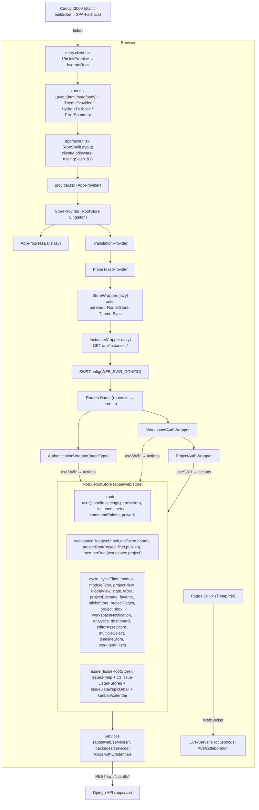
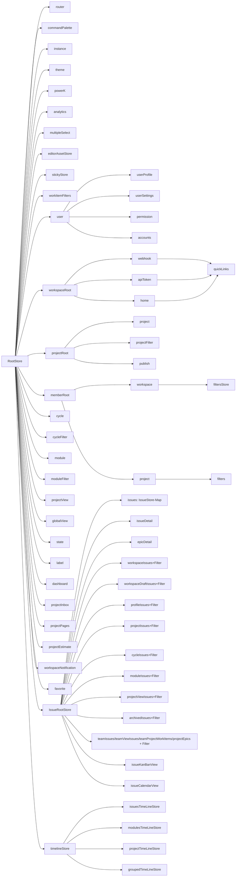

# A08 – Frontend-Architektur `apps/web` (IST-Analyse)

> Bereich: Routing, Layouts, Guards, Provider, MobX-Stores, Services (HTTP), Hooks, Helpers, `lib`, Browser-Storage, Fehlerseiten, Vite/React-Router-Build, Env-Variablen, Bundle, Tracking.
> Quelle: Plane v1.4.2 Community Edition, Repo-Root `/home/user/plane`. Alle Pfade relativ zum Repo-Root.
> Bindend: `migration/architecture/00-grundsatzentscheidungen.md` (ADR-000 … ADR-006).
> Komponenten-Interna (Issue-Layouts, Editor, Modals) sind nur insoweit beschrieben, wie sie für Routing/Store/Service-Architektur nötig sind; Feature-Details liegen in den jeweiligen Feature-Analysen.

---

## 1. Überblick & Verantwortlichkeiten

### 1.1 Technischer Steckbrief

| Aspekt | IST | Quelle |
|---|---|---|
| Framework | React 19 + React Router v7 „Framework Mode“ im **SPA-Modus** (`ssr: false`), Vite-Build | `apps/web/react-router.config.ts`, `apps/web/vite.config.ts`, `apps/web/package.json` |
| App-Verzeichnis | `apps/web/app` (`appDirectory: "app"`), Routen **explizit** in `app/routes.ts` (kein File-System-Routing) | `apps/web/react-router.config.ts`, `apps/web/app/routes.ts` |
| State-Management | MobX 6 (`mobx`, `mobx-react`, `mobx-utils`), **ein** globaler `RootStore` (Singleton) per React-Context | `apps/web/lib/store-context.tsx`, `apps/web/store/root.store.ts` |
| Daten-Fetching | SWR (Deduplizierung/Revalidierung, Keys aus `packages/constants/src/fetch-keys.ts`) ruft Store-Actions auf; Stores rufen Service-Klassen (Axios) | `apps/web/app/provider.tsx`, `packages/constants/src/swr.ts` |
| HTTP | Axios-Instanz pro Service-Klasse (`withCredentials: true`, Session-Cookie), Interceptor für Trailing-Slash & 401-Redirect | `apps/web/services/api.service.ts`, `packages/services/src/helpers/url.ts` |
| i18n | `@plane/i18n` (`TranslationProvider`, `initPromise` vor Hydration, Sprache in `localStorage["userLanguage"]`) | `apps/web/app/entry.client.tsx`, `packages/i18n/src/constants/language.ts` |
| Theme | `next-themes` (`ThemeProvider themes={["light","dark","light-contrast","dark-contrast","custom"]} defaultTheme="system"`) + Custom-Theme-CSS-Variablen | `apps/web/app/root.tsx`, `apps/web/lib/wrappers/store-wrapper.tsx` |
| UI-Primitives | npm `@makeplane/propel` (Button, Tabs, Menu, Tooltip, Input, Icons …), Composite-Komponenten `@plane/blocks` (Breadcrumbs, Header, EmptyState, Toast, Skeleton …) | `AGENTS.md`, Imports in allen `app/**` Dateien |
| Styles | Tailwind v4 (`@plane/tailwind-config`), `styles/globals.css`, `styles/power-k.css`, `styles/emoji.css`, `@plane/editor/styles` | `apps/web/styles/globals.css`, `apps/web/postcss.config.js` |
| Fonts | gebündelt: `@fontsource-variable/inter`, `@fontsource/material-symbols-rounded`, `@fontsource/ibm-plex-mono` (Inter-woff2 per `<link rel=preload>`) | `apps/web/app/root.tsx` |
| Next.js-Kompatibilität | Alias `next/link`, `next/navigation`, `next/script` → Shims in `app/compat/next/*` (Altlast der Next.js-Migration) | `apps/web/vite.config.ts`, `apps/web/app/compat/next/*` |
| Auslieferung | statisches Bundle `build/client` hinter Caddy 2 (SPA-Fallback `try_files {path} /index.html`, Rate-Limit 300 req/min/IP, Security-Header) | `apps/web/Dockerfile.web`, `apps/web/caddy/Caddyfile` |
| Realtime | Pages-Editor verbindet per WebSocket zu `${LIVE_BASE_URL \|\| origin}${LIVE_BASE_PATH}/collaboration?documentType=…` (Hocuspocus) | `apps/web/components/pages/editor/editor-body.tsx` |
| Tracking | **keines** (kein PostHog/Sentry/GA im CE-Code; `instance.is_telemetry_enabled` wird im Web nicht ausgewertet) | Suche über `apps/web`, `packages/*`; `packages/types/src/instance/base.ts` |

### 1.2 Verantwortlichkeiten von `apps/web`

1. **Authentifizierungs-Einstiegsseiten** (Sign-in/Sign-up/Passwort/Onboarding/Einladungen) – die eigentliche Auth läuft serverseitig unter `/auth/*` (Formular-POST/Redirects), das Web liefert nur UI und leitet weiter.
2. **Workspace-App „Projects“** – Home, Projekte, Work Items (5 Layouts), Cycles, Modules, Views, Pages, Intake, Archive, Drafts, Stickies, Notifications, Analytics, Profile.
3. **Workspace- und Projekt-Einstellungen** sowie **Profil-Einstellungen**.
4. **Client-seitige Autorisierung** (Sichtbarkeit/Disable von UI anhand Rolle 20/15/5) – die verbindliche Prüfung erfolgt im Backend.
5. **Client-Cache & optimistische Updates** (MobX-Stores, Revert bei Fehlern), Filter/Grouping/Sorting/Pagination der Work-Item-Listen.

### 1.3 Architekturdiagramm

---

## 2. Vollständige Inventare

### 2.1 Routing-Grundlagen

| Element | Verhalten | Quelle |
|---|---|---|
| `routes.ts` | `mergeRoutes(coreRoutes, extendedRoutes)`; Ergebnis + Catch-All `route("*", "./not-found.tsx")` wird **komplett** in `layout("./layout.tsx", …)` gekapselt → jede Route läuft durch `AppShellLayout`. | `apps/web/app/routes.ts` |
| `routes/core.ts` | einzige Routen-Definition der CE (siehe 2.2). | `apps/web/app/routes/core.ts` |
| `routes/extended.ts` | `extendedRoutes = []` – Erweiterungspunkt der Bezahl-Edition (EE-Repo fügt dort Routen ein). | `apps/web/app/routes/extended.ts` |
| `routes/helper.ts` `mergeRoutes` | Merge per `file`-Schlüssel: gleiche Layout-Datei in core+extended ⇒ Kinder rekursiv gemergt, extended gewinnt bei Konflikt; Reihenfolge: erst core, dann extended-only. | `apps/web/app/routes/helper.ts` |
| `routes/redirects/index.ts` | exportiert `redirectRoutes = [...coreRedirectRoutes, ...extendedRedirectRoutes]` – **nirgends importiert** (tot); die wirksamen Redirects stehen dupliziert am Ende von `core.ts`. | `apps/web/app/routes/redirects/index.ts`, `.../core/index.ts`, `.../extended/index.ts` |
| Trailing Slash | `clientMiddleware` in `app/layout.tsx`: jede URL ohne `/` am Pfadende (außer `/`) → `redirect(canonical, 308)`; `next/link`-Shim und `useRouter().push/replace` hängen ebenfalls `/` an (`ensureTrailingSlash`). Navigationen über `push/replace/back/forward` werden per `setTimeout(…,0)` verzögert. | `apps/web/app/layout.tsx`, `apps/web/app/compat/next/helper.ts`, `.../link.tsx`, `.../navigation.ts` |
| Route-Ranking | React-Router-Ranking: statische Segmente schlagen `:workspaceSlug`. Daher dürfen Workspace-Slugs nicht mit statischen Top-Level-Pfaden kollidieren; Schutz über `RESTRICTED_URLS` (Liste in `packages/constants/src/workspace.ts`, geprüft in `apps/web/components/workspace/create-workspace-form.tsx`). `login`, `register`, `signin` sind **nicht** in `RESTRICTED_URLS` → ein Workspace mit diesem Slug wäre durch die Redirect-Route unerreichbar (Edge-Case). | `packages/constants/src/workspace.ts` |
| Meta | `root.tsx` setzt Titel „Plane \| Simple, extensible, open-source project management tool.“, OG/Twitter-Tags, `og:url https://app.plane.so/`; `(all)/layout.tsx` setzt `robots: noindex, nofollow`; `(home)/layout.tsx` `robots: index, nofollow`; einzelne Layouts setzen `<title>` (siehe 2.2). Seiten-Titel zur Laufzeit via `PageHead` (`document.title = title`). | `apps/web/app/root.tsx`, `apps/web/components/core/page-title.tsx` |

**Layout-Kürzel** für die Routentabelle (Datei → Verantwortung):

| Kürzel | Datei | Verantwortung |
|---|---|---|
| `L0` | `apps/web/app/layout.tsx` | `AppProvider`, Container `relative flex h-screen w-full flex-col overflow-hidden bg-canvas desktop-app-container`, Trailing-Slash-Middleware |
| `LH` | `apps/web/app/(home)/layout.tsx` | nur Meta (`robots index,nofollow`, viewport) |
| `LALL` | `apps/web/app/(all)/layout.tsx` | Meta (`robots noindex`), `PreloadResources` (leer, auskommentiert: `apps/web/app/(all)/layout.preload.tsx`) |
| `LWS` | `apps/web/app/(all)/[workspaceSlug]/layout.tsx` | `AuthenticationWrapper` (AUTHENTICATED) → `WorkspaceAuthWrapper` → `AppRailVisibilityProvider` (isEnabled=false) → `WorkspaceContentWrapper` (TopNavigation + optional AppRail) → `GlobalModals` (ProfileSettingsModal, lazy) |
| `LPRJ` | `apps/web/app/(all)/[workspaceSlug]/(projects)/layout.tsx` | `ProjectsAppPowerKProvider` (Command-Palette/Shortcuts), Rahmen mit `#full-screen-portal`, `ProjectAppSidebar` (resizable), `ExtendedProjectSidebar`, `<main>` |
| `LPD` | `apps/web/app/(all)/[workspaceSlug]/(projects)/projects/(detail)/[projectId]/layout.tsx` | bei `navigationMode === "TABBED"`: Tab-Leiste (`TabNavigationRoot`); `ProjectAuthWrapper` (Projekt-Bootstrap + Zugriffsprüfung) |
| `LSET` | `apps/web/app/(all)/[workspaceSlug]/(settings)/layout.tsx` | `ProjectsAppPowerKProvider`, Rahmen, `ContentWrapper` |
| `LWSET` | `apps/web/app/(all)/[workspaceSlug]/(settings)/settings/(workspace)/layout.tsx` | Mobile-Nav, `WorkspaceSettingsSidebarRoot`, Rollenprüfung über `WORKSPACE_SETTINGS_ACCESS[accessKey]` → sonst `NotAuthorizedView` |
| `LPSET` | `apps/web/app/(all)/[workspaceSlug]/(settings)/settings/projects/layout.tsx` | ohne `projectId`: Redirect auf `/${ws}/settings/projects/${joinedProjectIds[0]}` falls vorhanden |
| `LPSETD` | `apps/web/app/(all)/[workspaceSlug]/(settings)/settings/projects/[projectId]/layout.tsx` | Mobile-Nav, `ProjectSettingsSidebarRoot`, `ProjectAuthWrapper` |
| `LPROF` | `apps/web/app/(all)/settings/profile/layout.tsx` | `ProjectsAppPowerKProvider`, `AuthenticationWrapper` (AUTHENTICATED), Rahmen |

Zusätzlich hat fast jede Feature-Route ein **eigenes Header-Layout** (`AppHeader header={…} mobileHeader={…}` + `ContentWrapper`), in der Tabelle als „HL:<Datei>“ angegeben.

### 2.2 Vollständige Routen-Tabelle

Legende Guard: `PT.*` = `EPageTypes` des `AuthenticationWrapper` (`apps/web/helpers/authentication.helper.tsx`); Rollen: 20 = Admin, 15 = Member, 5 = Guest (`packages/constants/src/user.ts`). „WS-Rolle“/„PRJ-Rolle“ = `allowPermissions(…, WORKSPACE|PROJECT)`.

#### 2.2.1 Öffentliche/Account-Routen (Ebene `L0`, **nicht** unter `LALL`)

| # | URL-Muster | Layout-Kette | Page-Datei | Zweck | Guard / Besonderheiten |
|---|---|---|---|---|---|
| 1 | `/` | L0 → LH | `apps/web/app/(home)/page.tsx` | Sign-in (`AuthBase authType=SIGN_IN` in `DefaultLayout`) | `PT.NON_AUTHENTICATED`; eingeloggt+onboarded → Workspace-Redirect, sonst `/onboarding` |
| 2 | `/sign-up` | L0 → `(all)/sign-up/layout.tsx` (title „Sign up - Plane“) | `apps/web/app/(all)/sign-up/page.tsx` | Registrierung (`AuthBase SIGN_UP`) | `PT.NON_AUTHENTICATED` |
| 3 | `/accounts/forgot-password` | L0 → `(all)/accounts/forgot-password/layout.tsx` („Forgot Password - Plane“) | `.../forgot-password/page.tsx` | `ForgotPasswordForm` + `AuthHeader` | `PT.NON_AUTHENTICATED` |
| 4 | `/accounts/reset-password` | L0 → `.../reset-password/layout.tsx` („Reset Password - Plane“) | `.../reset-password/page.tsx` | `ResetPasswordForm` (Token aus Query) | `PT.NON_AUTHENTICATED` |
| 5 | `/accounts/set-password` | L0 → `.../set-password/layout.tsx` („Set Password - Plane“) | `.../set-password/page.tsx` | `ResetPasswordForm` für Nutzer mit `is_password_autoset` | `PT.SET_PASSWORD` |
| 6 | `/create-workspace` | L0 → `(all)/create-workspace/layout.tsx` („Create Workspace“) | `apps/web/app/(all)/create-workspace/page.tsx` | Workspace anlegen (`CreateWorkspaceForm`, Felder `name`, `slug`, `organization_size`); danach `updateUserProfile({last_workspace_id})` + Push `/${slug}` | `PT.AUTHENTICATED`; wenn `instance.config.is_workspace_creation_disabled` → Hinweisbild + „Go back“ + mailto-„Request access“ (i18n `workspace_creation.request_email.*`) |
| 7 | `/onboarding` | L0 → `(all)/onboarding/layout.tsx` („Onboarding“) | `apps/web/app/(all)/onboarding/page.tsx` | `OnboardingRoot` mit Einladungen (`GET /api/users/me/workspaces/invitations/`), SWR `USER_WORKSPACES_LIST` | `PT.ONBOARDING` |
| 8 | `/invitations` | L0 → `(all)/invitations/layout.tsx` („Invitations“) | `apps/web/app/(all)/invitations/page.tsx` | Mehrfach-Annahme offener Einladungen (Toggle-Liste, „Accept & Join“ → `POST /api/users/me/workspaces/invitations/ {invitations:[ids]}` → `mutate(USER_WORKSPACES_LIST)` → `last_workspace_id` = WS der **ersten** gewählten Einladung → `fetchWorkspaces` → Push) | `PT.AUTHENTICATED`; Leerzustand „no_pending_invites“; „Go home“-Link zeigt auf `/` (Slug-Variable leer, s. 3.10) |
| 9 | `/workspace-invitations?invitation_id&slug&token` | L0 → `(all)/workspace-invitations/layout.tsx` („Workspace Invitations“) | `apps/web/app/(all)/workspace-invitations/page.tsx` | Einzel-Einladung per E-Mail-Link: `GET /api/workspaces/{slug}/invitations/{id}/join/`; Accept/Ignore → `POST …/join/ {accepted, token}`; Weiter zu `/${ws}` nur wenn Einladungs-E-Mail = eigene E-Mail, sonst `/` | `PT.PUBLIC`; Zustände: offen / bereits Mitglied / „not active anymore“ (+ GitHub/Forum-Links → bei Airgap entfernen/konfigurierbar) |

#### 2.2.2 Workspace-App (L0 → LALL → LWS → LPRJ)

| # | URL-Muster | Header-Layout | Page-Datei | Zweck | Guard / Besonderheiten |
|---|---|---|---|---|---|
| 10 | `/:workspaceSlug` | – (Page rendert `AppHeader` selbst: `(projects)/header.tsx` „Home“ + „Manage widgets“) | `apps/web/app/(all)/[workspaceSlug]/(projects)/page.tsx` | Workspace-Home (`WorkspaceHomeView`: Widgets, Quick-Links, Recents, Stickies) | Titel `${ws} - Home` |
| 11 | `/:workspaceSlug/active-cycles` | HL:`active-cycles/layout.tsx` + `header.tsx` (Breadcrumb + `UpgradeBadge`) | `.../active-cycles/page.tsx` | **CE: nur Upsell** `WorkspaceActiveCyclesUpgrade` (`apps/web/components/active-cycles/workspace-active-cycles-upgrade.tsx`) | EE-Feature „Workspace Active Cycles“ → gem. ADR-001 echte Funktion bauen (Daten: `GET /api/workspaces/{ws}/active-cycles/` existiert bereits in `apps/web/services/cycle.service.ts`) |
| 12 | `/:workspaceSlug/analytics/:tabId` | HL:`analytics/[tabId]/layout.tsx` + `header.tsx` | `.../analytics/[tabId]/page.tsx` | Workspace-Analytics, Tabs aus `getAnalyticsTabs`: `overview` (Overview), `work-items` (WorkItems) (`apps/web/components/analytics/tabs.tsx`); Tabwechsel → Push `/${ws}/analytics/${tab}`; `AnalyticsFilterActions` | Ohne Projekte (und `loader !== "init-loader"`) → EmptyState „Create a project“ (disabled für Guest). Ungültige `tabId` → Tabs ohne Treffer (keine Validierung) |
| 13 | `/:workspaceSlug/browse/:workItem` | HL:`browse/[workItem]/layout.tsx` + `header.tsx` (Tab-Nav bei TABBED) + `work-item-header.tsx` | `.../browse/[workItem]/page.tsx` | **Kanonische Work-Item-Detailseite** per Identifier `PROJ-123`: `GET /api/workspaces/{ws}/work-items/{PROJ}-{seq}/?expand=issue_reactions,issue_attachments,issue_link,parent`; Inhalt in `ProjectAuthWrapper` + `WorkItemDetailRoot` | Intake-Item (`is_intake`) → Redirect `/${ws}/projects/${pid}/intake/?currentTab=open&inboxIssueId=${id}`; Fehler → EmptyState → `/${ws}/workspace-views/all-issues/`; Sidebar auto-collapse < 768 px |
| 14 | `/:workspaceSlug/drafts` | HL:`drafts/layout.tsx` + `header.tsx` (CountChip `paginationInfo.total_count`, „Draft an issue“ nur bei ≥1 joined Projekt; disabled für Guest) | `.../drafts/page.tsx` | Workspace-Entwürfe `WorkspaceDraftIssuesRoot` | Titel „Workspace Draft“ |
| 15 | `/:workspaceSlug/notifications` | `notifications/layout.tsx` (`NotificationsSidebarRoot` links) | `.../notifications/page.tsx` | Inbox/Benachrichtigungen `NotificationsRoot` | In diesem Pfad blendet `ProjectAppSidebar` sich aus (`_sidebar.tsx`: `pathname.includes('/${ws}/notifications')` → `null`) |
| 16 | `/:workspaceSlug/profile/:userId` | `profile/[userId]/layout.tsx` (+`header.tsx`, `mobile-header.tsx`, `navbar.tsx`, `ProfileSidebar`) | `.../profile/[userId]/page.tsx` | Profil-Übersicht: Stats, Workload, Priority-/State-Distribution, Activity (`GET /api/workspaces/{ws}/user-stats/{userId}/`) | Tabs: Viewer `summary`; Admin/Member zusätzlich `assigned`,`created`,`subscribed`,`activity` (`packages/constants/src/profile.ts`) |
| 17 | `/:workspaceSlug/profile/:userId/:profileViewId` | wie 16 | `.../profile/[userId]/[profileViewId]/page.tsx` | Work-Item-Listen `ProfileIssuesPage type=assigned/created/subscribed` | Ungültige `profileViewId` → `null` (leere Seite). Guest auf diesen Pfaden → „you_do_not_have_the_permission_to_access_this_page“ (Layout prüft `pathname.includes("assigned"/"created"/"subscribed")`) |
| 18 | `/:workspaceSlug/profile/:userId/activity` | wie 16 | `.../profile/[userId]/activity/page.tsx` | Aktivitätsliste, seitenweise (`PER_PAGE=100`, Cursor `100:{i}:0`), „Load more“; Download-Button (`POST …/user-activity/{userId}/export/`) nur Admin/Member | statisches Segment schlägt `:profileViewId` |
| 19 | `/:workspaceSlug/stickies` | HL:`stickies/layout.tsx` + `header.tsx` (Suche, „Add sticky“ → `stickyOperations.create()`) | `.../stickies/page.tsx` | Stickies-Masonry `StickiesInfinite` | Titel „Your stickies“ |
| 20 | `/:workspaceSlug/workspace-views` | HL:`workspace-views/layout.tsx` + `header.tsx` | `.../workspace-views/page.tsx` | Liste: Default-Views (`all-issues`,`assigned`,`created`,`subscribed`) + eigene Global Views, Suchfeld | – |
| 21 | `/:workspaceSlug/workspace-views/:globalViewId` | wie 20 (Header: View-Switcher, `WorkItemFiltersToggle`, Display-Dropdown nur wenn nicht `is_locked`, „Add view“, QuickActions) | `.../workspace-views/[globalViewId]/page.tsx` | Workspace-weite Work-Item-Spreadsheet `AllIssueLayoutRoot isDefaultView` | Display-Filter-Optionen aus `ISSUE_DISPLAY_FILTERS_BY_PAGE.my_issues` |
| 22 | `/:workspaceSlug/projects/archives` | `projects/(detail)/archives/layout.tsx` (`ProjectsBaseHeader` + `ProjectsListMobileHeader`) | `.../projects/(detail)/archives/page.tsx` | Archivierte Projekte (gleiche `ProjectPageRoot`, Unterscheidung per Pfad in der Komponente) | liegt **nicht** unter `LPD` |
| 23 | `/:workspaceSlug/projects` | `projects/(list)/layout.tsx` (`ProjectsBaseHeader`, `ProjectsListMobileHeader`) | `.../projects/(list)/page.tsx` | Projektliste/-karten `ProjectPageRoot` | – |

#### 2.2.3 Projekt-Routen (L0 → LALL → LWS → LPRJ → **LPD**)

| # | URL-Muster | Header-Layout | Page-Datei | Zweck | Guard / Besonderheiten |
|---|---|---|---|---|---|
| 24 | `/:ws/projects/:projectId/issues` | HL:`issues/(list)/layout.tsx`; Header `components/issues/header.tsx` (Breadcrumb, CountChip, `HeaderFilters`, „Add work item“), Mobile `issues/(list)/mobile-header.tsx` (Layouts list/kanban/calendar, Display, Analytics-Modal) | `.../issues/(list)/page.tsx` | Projekt-Work-Items `ProjectLayoutRoot` (List/Kanban/Calendar/Gantt/Spreadsheet + Filterzeile + Peek) | Titel `${project} - Work items` |
| 25 | `/:ws/projects/:projectId/issues/:issueId` | – | `.../issues/(detail)/[issueId]/page.tsx` | **Legacy-Detail-URL**: `clientLoader` → `GET /api/workspaces/{ws}/projects/{pid}/issues/{id}/meta/` → `redirect(/${ws}/browse/${project_identifier}-${sequence_id})` | Fehler → EmptyState → `/${ws}/workspace-views/all-issues/` |
| 26 | `/:ws/projects/:projectId/cycles/:cycleId` | HL:`cycles/(detail)/layout.tsx` + `header.tsx` (Cycle-Switcher über alle Status, Count-Badge, Layout-Auswahl 5 Layouts, Filter-Toggle, Display (ohne Grouping „cycle“), Analytics-Modal, „Add work item“ nur wenn nicht `completed`, Sidebar-Toggle, `CycleQuickActions`) + `mobile-header.tsx` | `.../cycles/(detail)/[cycleId]/page.tsx` | Cycle-Work-Items `CycleLayoutRoot` + rechte `CycleDetailsSidebar` (Breite 21.5rem) | Sidebar-Zustand `localStorage["cycle_sidebar_collapsed"]` (bool). Nicht gefunden & `!loader` → EmptyState „Cycle does not exist“ |
| 27 | `/:ws/projects/:projectId/cycles` | HL:`cycles/(list)/layout.tsx` + `header.tsx` (`CyclesViewHeader`, „Add cycle“ für Admin/Member) + `mobile-header.tsx` (Layouts) | `.../cycles/(list)/page.tsx` | Cycle-Liste `CyclesView`, Applied-Filters-Leiste | `cycle_view === false` → Disabled-Feature-EmptyState (Button → `/settings/projects/${pid}/features` **ohne Route** → 404, s. 3.10); 0 Cycles → EmptyState „cta_primary“ (Member+) |
| 28 | `/:ws/projects/:projectId/modules/:moduleId` | HL:`modules/(detail)/layout.tsx` + `header.tsx` + `mobile-header.tsx` | `.../modules/(detail)/[moduleId]/page.tsx` | Module-Work-Items `ModuleLayoutRoot` + `ModuleAnalyticsSidebar` (24rem) | Sidebar `localStorage["module_sidebar_collapsed"]` (**String** "true"/"false"); SWR `CURRENT_MODULE_DETAILS_${moduleId}`; Fehler → EmptyState |
| 29 | `/:ws/projects/:projectId/modules` | HL:`modules/(list)/layout.tsx` + `header.tsx` + `mobile-header.tsx` | `.../modules/(list)/page.tsx` | Module-Liste/Board/Timeline `ModulesListView` + Applied Filters (inkl. Favoriten) | `module_view === false` → Disabled-State (Admin) |
| 30 | `/:ws/projects/:projectId/views/:viewId` | HL:`views/(detail)/layout.tsx` + `[viewId]/header.tsx` (View-Switcher, Lock-Icon „Private“, Layout/Display nur wenn nicht `is_locked`, „Add work item“) | `.../views/(detail)/[viewId]/page.tsx` | Projekt-View-Work-Items `ProjectViewLayoutRoot` | SWR `VIEW_DETAILS_${viewId}`; Fehler → EmptyState |
| 31 | `/:ws/projects/:projectId/views` | HL:`views/(list)/layout.tsx` + `header.tsx` („Add view“) + `mobile-header.tsx` | `.../views/(list)/page.tsx` | View-Liste `ProjectViewsList`, Applied Filters | `issue_views_view === false` → Disabled-State |
| 32 | `/:ws/projects/:projectId/pages/:pageId` | HL:`pages/(detail)/layout.tsx` (lädt `fetchPagesList` per SWR `PROJECT_PAGES_${pid}`) + `header.tsx` (Page-Switcher, Access-Icon, Sync-Badge, Actions) | `.../pages/(detail)/[pageId]/page.tsx` | Page-Editor `PageRoot` (Versionen, Asset-Upload, Entity-Suche, Realtime) + `IssuePeekOverview` | SWR `PAGE_DETAILS_${pageId}` mit Revalidate on focus/reconnect; `deleted_at` → Redirect zur Liste; kein Zugriff → „Page not found“ |
| 33 | `/:ws/projects/:projectId/pages?type=public/private/archived` | HL:`pages/(list)/layout.tsx` + `header.tsx` („Add page“, Access je Tab) | `.../pages/(list)/page.tsx` | Page-Liste `PagesListView` + `PagesListRoot`; `type` fehlt/ungültig → `public` | `page_view === false` → Disabled-State |
| 34 | `/:ws/projects/:projectId/intake?currentTab=open/closed&inboxIssueId=` | HL:`intake/layout.tsx` (`ProjectInboxHeader`) | `.../intake/page.tsx` | Intake `InboxIssueRoot` | `inbox_view === false` → Disabled-State; `currentTab` ≠ `open` → CLOSED, fehlend → undefined |

#### 2.2.4 Projekt-Archive (L0 → LALL → LWS → LPRJ, **ohne LPD/ProjectAuthWrapper**)

| # | URL-Muster | Header-Layout | Page-Datei | Zweck | Besonderheiten |
|---|---|---|---|---|---|
| 35 | `/:ws/projects/:projectId/archives/issues` | `archives/issues/(list)/layout.tsx` (`ProjectArchivesHeader activeTab="issues"`) | `.../archives/issues/(list)/page.tsx` | Archivierte Work Items (`ArchivedIssuesHeader` + `ArchivedIssueLayoutRoot`) | Kein Projekt-Bootstrap durch `ProjectAuthWrapper` → States/Labels etc. nur, wenn vorher geladen (Edge-Case) |
| 36 | `/:ws/projects/:projectId/archives/issues/:archivedIssueId` | `archives/issues/(detail)/layout.tsx` + `header.tsx` | `.../archives/issues/(detail)/[archivedIssueId]/page.tsx` | Archiviertes Item read-only (`IssueDetailRoot is_archived`) mit Warn-Banner + „Go to archives“ | Solange `issue` fehlt → leeres Fragment (Loader nie sichtbar) |
| 37 | `/:ws/projects/:projectId/archives/cycles` | `archives/cycles/layout.tsx` (activeTab="cycles") | `.../archives/cycles/page.tsx` | `ArchivedCyclesHeader` + `ArchivedCycleLayoutRoot` | – |
| 38 | `/:ws/projects/:projectId/archives/modules` | `archives/modules/layout.tsx` (activeTab="modules") | `.../archives/modules/page.tsx` | `ArchivedModulesHeader` + `ArchivedModuleLayoutRoot` | – |

#### 2.2.5 Workspace-Einstellungen (L0 → LALL → LWS → LSET → LWSET)

Rechte-Matrix aus `WORKSPACE_SETTINGS` (`packages/constants/src/settings/workspace.ts`), geprüft in `LWSET` über `pathnameToAccessKey` (`apps/web/components/settings/helper.ts`: Segment 2–3 nach Slug, z. B. `/settings/webhooks`).

| # | URL | Page-Datei | Zweck | Zugriff (Layout) | Zusatzprüfung in Page |
|---|---|---|---|---|---|
| 39 | `/:ws/settings` | `.../settings/(workspace)/page.tsx` (+`header.tsx`) | Allgemein `WorkspaceDetails` | Admin, Member | – |
| 40 | `/:ws/settings/members` | `.../members/page.tsx` (+`header.tsx`) | Mitglieder: Suche, Rollenfilter (`filtersStore.updateFilters({roles})`), „Add member“ (Admin) → `SendWorkspaceInvitationModal` → `POST /api/workspaces/{ws}/invitations/` | Admin, Member | Member+ |
| 41 | `/:ws/settings/billing` | `.../billing/page.tsx` (+`header.tsx`) | **CE: Billing & Plans** `BillingRoot` (`apps/web/components/workspace/billing/*`) | Admin | Admin → **entfällt gem. ADR-001** |
| 42 | `/:ws/settings/exports` | `.../exports/page.tsx` (+`header.tsx`) | CSV/XLSX/JSON-Export `ExportGuide` | Admin, Member | Member+ |
| 43 | `/:ws/settings/webhooks` | `.../webhooks/page.tsx` (+`header.tsx`) | Webhook-Liste, Create-Modal (Secret einmalig anzeigen; `clearSecretKey` beim Schließen) | Admin | Admin |
| 44 | `/:ws/settings/webhooks/:webhookId` | `.../webhooks/[webhookId]/page.tsx` (+`header.tsx`) | Webhook bearbeiten (Payload `url,is_active,project,cycle,module,issue,issue_comment`), Löschen | Admin | Admin (sonst Text „You are not authorized…“) |
| – | (`.../settings/(workspace)/integrations/page.tsx`) | **verwaiste Datei – keine Route** | Integrations-Liste (`GET /api/integrations/`) | – | nicht erreichbar |

#### 2.2.6 Projekt-Einstellungen (L0 → LALL → LWS → LSET → LPSET [→ LPSETD])

Rechte aus `PROJECT_SETTINGS` (`packages/constants/src/settings/project.ts`) steuern die Sidebar; die Pages prüfen selbst.

| # | URL | Page-Datei | Zweck | Page-Prüfung |
|---|---|---|---|---|
| 45 | `/:ws/settings/projects` | `.../settings/projects/page.tsx` | „No projects yet“ + „Start your first project“ (`toggleCreateProjectModal`) + Link plane.so; Layout leitet bei vorhandenen Projekten auf erstes joined Projekt um | – |
| 46 | `/:ws/settings/projects/:projectId` | `.../[projectId]/page.tsx` (+`header.tsx`) | `ProjectDetailsForm`, `GeneralProjectSettingsControlSection` (Archiv/Löschen, nur Admin) | Nicht-Admin: Formular mit `opacity-60` |
| 47 | `.../members` | `.../members/page.tsx` | `ProjectSettingsMemberDefaults` + `ProjectMemberList` | PRJ Admin/Member **oder** WS-Admin |
| 48 | `.../features/cycles` | `.../features/cycles/page.tsx` | Toggle `cycle_view` (`ProjectSettingsFeatureControlItem`) | PRJ Admin |
| 49 | `.../features/modules` | `.../features/modules/page.tsx` | Toggle `module_view` | PRJ Admin |
| 50 | `.../features/views` | `.../features/views/page.tsx` | Toggle `issue_views_view` | PRJ Admin |
| 51 | `.../features/pages` | `.../features/pages/page.tsx` | Toggle `page_view` | PRJ Admin |
| 52 | `.../features/intake` | `.../features/intake/page.tsx` | Toggle `inbox_view` | PRJ Admin |
| 53 | `.../states` | `.../states/page.tsx` | `ProjectStateRoot` | PRJ Admin/Member |
| 54 | `.../labels` | `.../labels/page.tsx` | `ProjectSettingsLabelList` mit Drag&Drop-Autoscroll (`@atlaskit/pragmatic-drag-and-drop-auto-scroll`) | PRJ Admin/Member |
| 55 | `.../estimates` | `.../estimates/page.tsx` | `EstimateRoot` | PRJ Admin |
| 56 | `.../automations` | `.../automations/layout.tsx` + `page.tsx` | `AutoArchiveAutomation`, `AutoCloseAutomation` → `updateProject(ws,pid,formData)` | PRJ Admin |

#### 2.2.7 Profil-Einstellungen (L0 → LALL → LPROF)

| # | URL | Page-Datei | Zweck | Besonderheiten |
|---|---|---|---|---|
| 57 | `/settings/profile/:profileTabId` | `apps/web/app/(all)/settings/profile/[profileTabId]/page.tsx` | Sidebar (`ProfileSettingsSidebarRoot`, 250 px) + Inhalt (`ProfileSettingsContent`, lazy Tabs) | gültige Tabs `general, security, preferences, notifications, api-tokens` (`PROFILE_SETTINGS_TABS`); ungültig → Dauer-Spinner. Gruppierung „your profile“ (general, preferences, notifications, security) / „developer“ (api-tokens). Zusätzlich existiert dieselbe UI als Modal (`commandPalette.profileSettingsModal`, `GlobalModals`) |

#### 2.2.8 Redirect-Routen (direkt unter L0, Dateien `apps/web/app/routes/redirects/core/*.tsx`, alle `clientLoader` → `throw redirect(...)`)

| # | Von | Nach | Datei |
|---|---|---|---|
| 58 | `/:ws/projects/:projectId/settings/*` | `/:ws/settings/projects/:projectId/{splat}/` (ohne Splat: `/:ws/settings/projects/:projectId/`) | `project-settings.tsx` |
| 59 | `/:ws/analytics` | `/:ws/analytics/overview/` | `analytics.tsx` |
| 60 | `/:ws/settings/api-tokens` | `/settings/profile/api-tokens/` | `api-tokens.tsx` |
| 61 | `/:ws/projects/:projectId/inbox` | `/:ws/projects/:projectId/intake/` | `inbox.tsx` |
| 62 | `/accounts/sign-up` | `/sign-up/` | `accounts-signup.tsx` |
| 63 | `/sign-in` | `/` | `sign-in.tsx` |
| 64 | `/signin` | `/` | `signin.tsx` |
| 65 | `/login` | `/` | `login.tsx` |
| 66 | `/register` | `/sign-up/` | `register.tsx` |
| 67 | `/profile/*` | `/settings/profile/{splat oder "general"}?{query}` | `profile-settings.tsx` |
| 68 | `/:ws/settings/account/*` | `/settings/profile/{splat oder "general"}?{query}` | `workspace-account-settings.tsx` |
| 69 | `*` (Catch-All) | 404-Seite `apps/web/app/not-found.tsx` (Bild `app/assets/404.svg`, „Go to Home“, meta `noindex`) | `apps/web/app/routes.ts` |

> Hinweis Redirect 68: Der Redirect-Pfad hängt `?` an, auch wenn keine Query existiert (`/settings/profile/general?`) – kosmetisch.

### 2.3 Guards & Wrapper

#### 2.3.1 `AuthenticationWrapper` (`apps/web/lib/wrappers/authentication-wrapper.tsx`)

Lädt per SWR `"USER_INFORMATION"` → `user.fetchCurrentUser()` (`revalidateOnFocus:false, shouldRetryOnError:false`). `fetchCurrentUser` lädt bei Erfolg parallel Profil, Settings und Workspaces (`apps/web/store/user/index.ts`).
`isUserOnboard = profile.is_onboarded || (onboarding_step.profile_complete && workspace_create && workspace_invite && workspace_join)`.

| pageType | nicht eingeloggt | eingeloggt, nicht onboarded | eingeloggt + onboarded |
|---|---|---|---|
| `PUBLIC` | Inhalt | Inhalt | Inhalt |
| `NON_AUTHENTICATED` | Inhalt | `push("/onboarding")` | `push(getWorkspaceRedirectionUrl())` |
| `ONBOARDING` | `push("/?next_path=<pathname>")` | Inhalt | `replace(getWorkspaceRedirectionUrl())` |
| `SET_PASSWORD` | `push("/?next_path=<pathname>")` | Inhalt | wenn `!is_password_autoset` → `push(redirect)`; sonst Inhalt |
| `AUTHENTICATED` (Default) | `push("/?next_path=<pathname>")` | `push("/onboarding")` | Inhalt |

`getWorkspaceRedirectionUrl()`: 1) `next_path` aus Query, wenn `isValidNextPath` (`@plane/utils`: muss mit `/` beginnen, nicht `//`), 2) `userSettings.workspace.last_workspace_slug || fallback_workspace_slug`, sofern in Workspace-Liste vorhanden → `/${slug}`, 3) sonst `/create-workspace`. Während Laden (User/Workspaces) → Vollbild-`LogoSpinner`.

#### 2.3.2 `InstanceWrapper` (`apps/web/lib/wrappers/instance-wrapper.tsx`)

SWR `"INSTANCE_INFORMATION"` → `GET /api/instances/` (`instance.store.ts`: setzt `instance`, `config`). Lädt → Spinner; SWR-Fehler → `MaintenanceView` (`apps/web/components/instance/maintenance-view.tsx`); `instance.is_setup_done === false` → `InstanceNotReady` (Button „Get started“ → `GOD_MODE_URL`).

#### 2.3.3 `StoreWrapper` (`apps/web/lib/wrappers/store-wrapper.tsx`)

1. Sidebar-Zustand aus `localStorage["app_sidebar_collapsed"]` initialisieren, falls `theme.sidebarCollapsed === undefined`.
2. Theme **einmal pro User-Session** aus `userProfile.theme.theme` setzen (danach führt `next-themes`/`localStorage["theme"]`).
3. Bei `theme === "custom"` mit `primary`, `background`, `darkPalette` → `applyCustomTheme(primary, background, dark|light)`; Wechsel weg von custom → `clearCustomTheme()` (`@plane/utils`).
4. `router.setQuery(params)` bei jeder Param-Änderung (→ `RouterStore`).

#### 2.3.4 `WorkspaceAuthWrapper` (`apps/web/layouts/auth-layout/workspace-wrapper.tsx`)

SWR-Ladevorgänge (alle `revalidateIfStale:false, revalidateOnFocus:false`), nur wenn `currentWorkspace` in `workspaces` gefunden:

| SWR-Key | Store-Action | Endpoint |
|---|---|---|
| `WORKSPACE_MEMBER_ME_INFORMATION_{WS}` | `permission.fetchUserWorkspaceInfo` | `GET /api/workspaces/{ws}/workspace-members/me/` |
| `WORKSPACE_PROJECTS_ROLES_INFORMATION_{WS}` | `permission.fetchUserProjectPermissions` | `GET /api/users/me/workspaces/{ws}/project-roles/` |
| `WORKSPACE_PARTIAL_PROJECTS_{WS}` | `project.fetchPartialProjects` | `GET /api/workspaces/{ws}/projects/` |
| `WORKSPACE_MEMBERS_{WS}` | `member.workspace.fetchWorkspaceMembers` | `GET /api/workspaces/{ws}/members/` |
| `WORKSPACE_FAVORITE_{WS}` (nur Admin/Member) | `favorite.fetchFavorite` | `GET /api/workspaces/{ws}/user-favorites/` |
| `WORKSPACE_STATES_{WS}` (immer bei Slug) | `state.fetchWorkspaceStates` | `GET /api/workspaces/{ws}/states/` |
| `WORKSPACE_SIDEBAR_PREFERENCES_{WS}` | `workspaceRoot.fetchSidebarNavigationPreferences` | `GET /api/workspaces/{ws}/sidebar-preferences/` |
| `WORKSPACE_PROJECT_NAVIGATION_PREFERENCES_{WS}` | `workspaceRoot.fetchProjectNavigationPreferences` | `GET /api/workspaces/{ws}/user-properties/` |

Render-Zustände: (a) Workspaces noch `undefined` oder `permission.loader` → Spinner; (b) Workspace nicht in Liste **und** keine Mitgliedsinfo → „Workspace not found“ (Bild `app/assets/workspace/workspace-not-available.png`, E-Mail, Sign-out, Buttons „Go Home“/„Visit Profile“ bzw. „Create new workspace“); (c) Mitgliedsinfo fehlt → „Not Authorized!“ mit „Check pending invites“ (`/invitations`) und „Create new workspace“; (d) sonst Kinder.

#### 2.3.5 `ProjectAuthWrapper` (`apps/web/layouts/auth-layout/project-wrapper.tsx`)

Initialisiert `useTimeLineChart(MODULE).initGantt()` und lädt:

| SWR-Key (Rolle im Key ⇒ Refetch bei Rollenwechsel) | Action | Endpoint |
|---|---|---|
| `PROJECT_DETAILS_{PID}` | `project.fetchProjectDetails` | `GET /api/workspaces/{ws}/projects/{pid}/` |
| `PROJECT_ME_INFORMATION_{PID}` | `permission.fetchUserProjectInfo` | `GET /api/workspaces/{ws}/projects/{pid}/project-members/me/` |
| `PROJECT_MEMBER_PREFERENCES_{PID}_{role}` (nur mit User) | `member.project.fetchProjectUserProperties` | `GET /api/workspaces/{ws}/projects/{pid}/user-properties/` |
| `PROJECT_LABELS_{PID}_{role}` | `label.fetchProjectLabels` | `GET …/projects/{pid}/issue-labels/` |
| `PROJECT_MEMBERS_{PID}_{role}` | `member.project.fetchProjectMembers` | `GET …/projects/{pid}/members/` |
| `PROJECT_STATES_{PID}_{role}` | `state.fetchProjectStates` | `GET …/projects/{pid}/states/` |
| `PROJECT_INTAKE_STATE_{PID}_{role}` | `state.fetchProjectIntakeState` | `GET …/projects/{pid}/intake-state/` |
| `PROJECT_ESTIMATES_{PID}_{role}` | `projectEstimate.getProjectEstimates` | `GET …/projects/{pid}/estimates/` |
| `PROJECT_ALL_CYCLES_{PID}_{role}` | `cycle.fetchAllCycles` | `GET …/projects/{pid}/cycles/` |
| `PROJECT_MODULES_{PID}_{role}` | `module.fetchModulesSlim` + `module.fetchModules` (parallel) | `GET …/projects/{pid}/modules/` (2×, unterschiedliche Params) |
| `PROJECT_VIEWS_{PID}_{role}` | `projectView.fetchViews` | `GET …/projects/{pid}/views/` |

Render: während `isProjectDetailsLoading` (ohne Fehler) → `null`; keine Projekt-Rolle (`allowPermissions([20,15,5], PROJECT)` false) → `ProjectAccessRestriction` (`apps/web/components/auth-screens/project/project-access-restriction.tsx`):
- HTTP 409 **oder** (403 und WS-Admin) → „No access“ + Button „Join project“ (`POST /api/users/me/workspaces/{ws}/projects/invitations/` mit `[projectId]`, danach Rolle = WS-Rolle, `fetchProjectDetails`),
- 403 → „restricted“ ohne Button,
- sonst → „invalid project“.

#### 2.3.6 Rollenauflösung (`apps/web/store/user/base-permissions.store.ts`)

- `allowPermissions(roles, level, ws?, pid?, onAllowed?)`: fehlende `ws`/`pid` werden aus `RouterStore` ergänzt; WORKSPACE → `workspaceUserInfo[ws].role`; PROJECT → `getProjectRole`; String-Rollen werden `parseInt`‑konvertiert; `true` nur wenn Rolle in Liste (optional `onAllowed()`-Rückgabe).
- `getProjectRole(ws,pid)`: Projektrolle aus `workspaceProjectsPermissions[ws][pid]`; **fehlt sie → `undefined` (auch für WS-Admins)**; existiert sie und ist der Nutzer WS-Admin → **20 (Admin)**, sonst Projektrolle.
- `hasPageAccess(ws,key)`: Zugriff auf dynamische Sidebar-Items anhand `WORKSPACE_SIDEBAR_DYNAMIC_NAVIGATION_ITEMS_LINKS[*].access`.
- `user.canPerformAnyCreateAction` / `projectsWithCreatePermissions` (`apps/web/store/user/index.ts`).

### 2.4 Provider-Kette & Boot (`apps/web/app/entry.client.tsx`, `root.tsx`, `layout.tsx`, `provider.tsx`)

| Reihenfolge | Element | Aufgabe |
|---|---|---|
| 1 | `entry.client.tsx` | `polyfills` (requestIdleCallback-Fallback, `apps/web/lib/idle-task.ts`); in PROD Listener `vite:preloadError`, `error`, `unhandledrejection` → `recoverFromStaleAsset()`; wartet auf `@plane/i18n` `initPromise`, dann `hydrateRoot(<StrictMode><HydratedRouter/></StrictMode>)` |
| 2 | `root.tsx` `Layout` | `<html lang="en">`, Meta (PWA, theme-color `#fff`), Links (Favicons 16/32/ico, Apple-Touch 180/512, `/site.webmanifest.json`, `/manifest.json`, `globals.css`, Inter-Preload), Portale `#context-menu-portal`, `#editor-portal`, `ThemeProvider` |
| 3 | `root.tsx` `HydrateFallback` | Spinner (`LogoSpinner`) sobald Theme aufgelöst |
| 4 | `root.tsx` `ErrorBoundary` | Stale-Chunk → Reload-Versuch, sonst `CustomErrorComponent` |
| 5 | `layout.tsx` | Trailing-Slash-Middleware, `AppProvider` |
| 6 | `provider.tsx` | `StoreProvider` → `AppProgressBar` (lazy, `@bprogress/core` an `useNavigation().state`, minimum 0.1, speed 400, trickleSpeed 800, kein Spinner) → `TranslationProvider` → `PlaneToastProvider` → `StoreWrapper` (lazy) → `InstanceWrapper` (lazy) → `Suspense` → `SWRConfig(WEB_SWR_CONFIG)` |

`WEB_SWR_CONFIG` (`packages/constants/src/swr.ts`): `refreshWhenHidden:false, revalidateIfStale:true, revalidateOnFocus:true, revalidateOnMount:true, errorRetryCount:3`.

### 2.5 Store-Baum (`apps/web/store/root.store.ts`)

`CoreRootStore` (exportiert als `RootStore`) wird **einmal** in `apps/web/lib/store-context.tsx` instanziiert (`export const store = initializeStore()`), per `StoreContext` bereitgestellt und über Hooks `apps/web/hooks/store/*` (je `useContext(StoreContext)` + Teilbaum) konsumiert. `enableStaticRendering(typeof window === "undefined")`.

`resetOnSignOut()` setzt `localStorage["theme"]="system"`, `setLanguage(FALLBACK_LANGUAGE)` und **erzeugt alle Teil-Stores neu** (außer `theme`, `analytics` – diese bleiben erhalten).

#### 2.5.1 Store-Tabelle (alle Dateien in `apps/web/store`)

| Store (Root-Feld) | Datei | Zweck | Observables (Auszug vollständig gem. Interface) | Actions / Computeds | Abhängigkeiten / Services |
|---|---|---|---|---|---|
| `router` | `router.store.ts` | Spiegel der Route-Params | `query` | computed: `workspaceSlug, teamspaceId, projectId, cycleId, moduleId, viewId, globalViewId, profileViewId, userId, peekId, issueId, inboxId, webhookId, epicId`; `setQuery` | gesetzt von `StoreWrapper` |
| `commandPalette` | `base-command-palette.store.ts` | globale Modal-Zustände | `isCreateProjectModalOpen, isCreateCycleModalOpen, isCreateModuleModalOpen, isCreateViewModalOpen, createPageModal, isCreateIssueModalOpen, isDeleteIssueModalOpen, isBulkDeleteIssueModalOpen, createIssueStoreType, createWorkItemAllowedProjectIds, profileSettingsModal{activeTab,isOpen}, allStickiesModal, projectListOpenMap` | `isAnyModalOpen`, `getIsProjectListOpen`, `toggleCreateProjectModal, toggleCreateCycleModal, toggleCreateViewModal, toggleCreatePageModal, toggleCreateIssueModal(value, storeType, allowedProjectIds), toggleCreateModuleModal, toggleDeleteIssueModal, toggleBulkDeleteIssueModal, toggleAllStickiesModal, toggleProjectListOpen, toggleProfileSettingsModal` | – |
| `powerK` | `base-power-k.store.ts` | Command-Palette „Power K“ & Shortcut-Liste | `isPowerKModalOpen, isShortcutsListModalOpen, commandRegistry, activeContext, activePage, topNavInputRef` | `setActiveContext, setActivePage, setTopNavInputRef, togglePowerKModal, toggleShortcutsListModal` | `apps/web/components/power-k/*` |
| `instance` | `instance.store.ts` | Instanz-Info & Config (Auth-Methoden, Feature-Flags der Instanz) | `isLoading, instance, config, error` | `fetchInstanceInfo` | `InstanceService.getInstanceInfo` |
| `theme` | `theme.store.ts` | UI-Panel-Zustände | `isAnySidebarDropdownOpen, sidebarCollapsed, sidebarPeek, isExtendedSidebarOpened, isExtendedProjectSidebarOpened, profileSidebarCollapsed, workspaceAnalyticsSidebarCollapsed, issueDetailSidebarCollapsed, epicDetailSidebarCollapsed, initiativesSidebarCollapsed, projectOverviewSidebarCollapsed` | gleichnamige `toggle*`; schreiben je in `localStorage` (Keys s. 2.9) | – |
| `user` | `user/index.ts` | aktueller Nutzer | `isAuthenticated, isLoading, error, data, accounts` | `fetchCurrentUser, updateCurrentUser, handleSetPassword(csrf,{password}), deactivateAccount, changePassword(csrf,{old_password,new_password}), reset, signOut`; computed `canPerformAnyCreateAction, projectsWithCreatePermissions` | `UserService`, `AuthService`; Kinder `userProfile`, `userSettings`, `permission` |
| `user.userProfile` | `user/profile.store.ts` | Profil (Theme, Onboarding, Sprache, last_workspace_id) | `isLoading, error, data` | `fetchUserProfile, updateUserProfile, finishUserOnboarding, updateTourCompleted, updateUserTheme` | `/api/users/me/profile/`, `/onboard/`, `/tour-completed/` |
| `user.userSettings` | `user/settings.store.ts` | Settings (`workspace.last_workspace_slug`, `fallback_workspace_slug` …) | `isLoading, error, data, sidebarCollapsed, isScrolled` | `fetchCurrentUserSettings(bustCache)`, `toggleSidebar, toggleIsScrolled` | `/api/users/me/settings/` (`?t=` bei bustCache) |
| `user.accounts[*]` | `user/account.store.ts` | verknüpfte OAuth-Accounts | `isLoading, error, provider_account_id, provider` | – | – |
| `user.permission` | `user/base-permissions.store.ts` | Rollen (s. 2.3.6) | `loader, workspaceUserInfo{ws→IWorkspaceMemberMe}, projectUserInfo{ws→pid→membership}, workspaceProjectsPermissions{ws→pid→role}` | `workspaceInfoBySlug, getWorkspaceRoleByWorkspaceSlug, getProjectRolesByWorkspaceSlug, getProjectRoleByWorkspaceSlugAndProjectId, allowPermissions, hasPageAccess, fetchUserWorkspaceInfo, leaveWorkspace, fetchUserProjectInfo, fetchUserProjectPermissions, joinProject, leaveProject, fetchWorkspaceLevelProjectEntities` | `WorkspaceService`, `UserService`, `ProjectMemberService` |
| `workspaceRoot` | `workspace/index.ts` | Workspaces & Navigations-Präferenzen | `loader, workspaces{id→IWorkspace}, navigationPreferencesMap, projectNavigationPreferencesMap` | computed `currentWorkspace` (Slug aus Router), `workspacesCreatedByCurrentUser`; `getWorkspaceRedirectionUrl, getWorkspaceBySlug, getWorkspaceById, fetchWorkspaces, createWorkspace, updateWorkspace, updateWorkspaceLogo, deleteWorkspace, fetchSidebarNavigationPreferences, updateSidebarPreference, updateBulkSidebarPreferences, getNavigationPreferences, getProjectNavigationPreferences, fetchProjectNavigationPreferences, updateProjectNavigationPreferences (optimistisch+Revert), mutateWorkspaceMembersActivity` | `WorkspaceService` |
| `workspaceRoot.webhook` | `workspace/webhook.store.ts` | Webhooks | `webhooks, webhookSecretKey, currentWebhook` | `getWebhookById, fetchWebhooks, fetchWebhookById, createWebhook→{webHook, secretKey}, updateWebhook, removeWebhook, regenerateSecretKey, clearSecretKey` | `WebhookService` (`apps/web/services/webhook.service.ts`) |
| `workspaceRoot.apiToken` | `workspace/api-token.store.ts` | persönliche API-Tokens | `apiTokens` | `getApiTokenById, fetchApiTokens, fetchApiTokenDetails, createApiToken, deleteApiToken` | `APITokenService` aus `@plane/services` |
| `workspaceRoot.home` | `workspace/home.ts` | Home-Widgets (`quick_links, recents, my_stickies, quick_tutorial, new_at_plane`) | `loading, showWidgetSettings, widgetsMap, widgets` | computed `isAnyWidgetEnabled, orderedWidgets`; `toggleWidgetSettings, fetchWidgets, reorderWidget(ws,key,destId,edge), toggleWidget` | `/home-preferences/` |
| `workspaceRoot.home.quickLinks` | `workspace/link.store.ts` | Quick-Links | `links, linkMap, linkData, isLinkModalOpen` | `getLinksByWorkspaceId, getLinkById, addLinks, fetchLinks, createLink, updateLink, removeLink, setLinkData, toggleLinkModal` | `/quick-links/` |
| `projectRoot.project` | `project/project.store.ts` | Projekte | `isUpdatingProject, loader, fetchStatus, projectMap, projectAnalyticsCountMap, openCollapsibleSection, lastCollapsibleAction` | computed `filteredProjectIds` (Workspace, Suche über `name`/`identifier`, `shouldFilterProject`, `orderProjects`), `workspaceProjectIds` (nicht archiviert), `archivedProjectIds, totalProjectIds, joinedProjectIds` (nach `sort_order`, `member_role` gesetzt, nicht archiviert), `favoriteProjectIds, currentProjectDetails, currentProjectNextSequenceId`; `getProjectById, getPartialProjectById, getProjectIdentifierById, getProjectAnalyticsCountById, getProjectByIdentifier, processProjectAfterCreation, fetchPartialProjects, fetchProjects, fetchProjectDetails, fetchProjectAnalyticsCount, addProjectToFavorites, removeProjectFromFavorites, updateProjectView (sort_order etc. → user-properties), createProject, updateProject, deleteProject, archiveProject, restoreProject` | `ProjectService`, `ProjectArchiveService` |
| `projectRoot.projectFilter` | `project/project_filter.store.ts` | Projektlisten-Filter je Workspace | `displayFilters{ws}, filters{ws}, searchQuery` | `currentWorkspace*`, `getDisplayFiltersByWorkspaceSlug, getFiltersByWorkspaceSlug, updateDisplayFilters, updateFilters, updateSearchQuery, clearAllFilters, clearAllAppliedDisplayFilters`; Reaction: bei Workspace-Wechsel `initWorkspaceFilters` + Suche leeren (nur In-Memory) | – |
| `projectRoot.publish` | `project/project-publish.store.ts` | Projekt veröffentlichen (Space) | `generalLoader, fetchSettingsLoader, publishSettingsMap` | `getPublishSettingsByProjectID, fetchPublishSettings, updatePublishSettings, publishProject, unPublishProject` | `ProjectPublishService` |
| `memberRoot` | `member/index.ts` | User-Lite-Map | `memberMap{userId→IUserLite}` | `getMemberIds, getUserDetails` | Kinder |
| `memberRoot.workspace` | `member/workspace/workspace-member.store.ts` | WS-Mitglieder & Einladungen | `workspaceMemberMap{ws→userId→membership}, workspaceMemberInvitations` | `workspaceMemberIds, workspaceMemberInvitationIds, memberMap, getWorkspaceMemberIds, getFilteredWorkspaceMemberIds, getSearchedWorkspaceMemberIds, getSearchedWorkspaceInvitationIds, getWorkspaceMemberDetails, getWorkspaceInvitationDetails, fetchWorkspaceMembers, fetchWorkspaceMemberInvitations, updateMember, removeMemberFromWorkspace, inviteMembersToWorkspace, updateMemberInvitation, deleteMemberInvitation, isUserSuspended` | `WorkspaceService`; Helfer `member/utils.ts` |
| `memberRoot.workspace.filtersStore` | `member/workspace/workspace-member-filters.store.ts` | Rollenfilter/Sortierung Mitgliederliste | `filters` | `getFilteredMemberIds, updateFilters` | – |
| `memberRoot.project` | `member/project/base-project-member.store.ts` | Projektmitglieder | `projectMemberFetchStatusMap, projectMemberMap, projectUserPropertiesMap` | `projectMemberIds, getProjectMemberFetchStatus, getProjectMemberDetails, getProjectMemberIds(pid, includeGuests), getFilteredProjectMemberDetails, getProjectUserProperties, fetchProjectMembers, fetchProjectUserProperties, updateProjectUserProperties, bulkAddMembersToProject, updateMemberRole, removeMemberFromProject` | `ProjectMemberService`, `ProjectService` |
| `memberRoot.project.filters` | `member/project/project-member-filters.store.ts` | Filter je Projekt | `filtersMap` | `getFilteredMemberIds, updateFilters, getFilters` | – |
| `cycle` | `cycle.store.ts` | Cycles | `loader, progressLoader, fetchedMap, cycleMap, plotType, estimatedType, activeCycleIdMap` | `currentProjectCycleIds, currentProjectCompletedCycleIds, currentProjectIncompleteCycleIds, currentProjectActiveCycleId, currentProjectArchivedCycleIds, currentProjectActiveCycle, getFilteredCycleIds, getFilteredCompletedCycleIds, getFilteredArchivedCycleIds, getCycleById, getCycleNameById, getProjectCycleDetails, getProjectCycleIds, getPlotTypeByCycleId, getEstimateTypeByCycleId, getIsPointsDataAvailable, updateCycleDistribution, setPlotType, setEstimateType, fetchWorkspaceCycles, fetchAllCycles, fetchActiveCycle, fetchArchivedCycles, fetchArchivedCycleDetails, fetchCycleDetails, fetchActiveCycleProgress, fetchActiveCycleProgressPro, fetchActiveCycleAnalytics, createCycle, updateCycleDetails, deleteCycle, addCycleToFavorites, removeCycleFromFavorites, archiveCycle, restoreCycle` | `CycleService`, `CycleArchiveService` |
| `cycleFilter` | `cycle_filter.store.ts` | Cycle-Listenfilter je Projekt | `displayFilters, filters{pid→{default,archived}}, searchQuery, archivedCyclesSearchQuery` | `currentProjectDisplayFilters, currentProjectFilters, currentProjectArchivedFilters, getDisplayFiltersByProjectId, getFiltersByProjectId, getArchivedFiltersByProjectId, updateDisplayFilters, updateFilters(pid, filters, state), updateSearchQuery, updateArchivedCyclesSearchQuery, clearAllFilters`; Reaction auf `router.projectId` | In-Memory |
| `module` | `module.store.ts` | Modules | `loader, fetchedMap, plotType, moduleMap` | `projectModuleIds, projectArchivedModuleIds, getModulesFetchStatusByProjectId, getFilteredModuleIds, getFilteredArchivedModuleIds, getModuleById, getModuleNameById, getProjectModuleDetails, getProjectModuleIds, getPlotTypeByModuleId, setPlotType, updateModuleDistribution, fetchWorkspaceModules, fetchModules, fetchModulesSlim, fetchArchivedModules, fetchArchivedModuleDetails, fetchModuleDetails, createModule, updateModuleDetails, deleteModule, createModuleLink, updateModuleLink, deleteModuleLink, addModuleToFavorites, removeModuleFromFavorites, archiveModule, restoreModule` | `ModuleService`, `ModuleArchiveService` |
| `moduleFilter` | `module_filter.store.ts` | Modul-Filter je Projekt | `displayFilters, filters, searchQuery, archivedModulesSearchQuery` | analog `cycleFilter`; **persistiert** in `localStorage["module_display_filters"]` / `["module_filters"]` (debounced) | `lib/local-storage.ts` |
| `projectView` | `project-view.store.ts` | Projekt-Views | `loader, fetchedMap, viewMap, filters (Listenfilter)` | `projectViewIds, getProjectViews, getFilteredProjectViews, getViewById, fetchViews, fetchViewDetails, createView, updateView, deleteView, updateFilters, clearAllFilters, addViewToFavorites, removeViewFromFavorites` | `ViewService` |
| `globalView` | `global-view.store.ts` | Workspace-Views | `globalViewMap` | `currentWorkspaceViews, getSearchedViews, getViewDetailsById, fetchAllGlobalViews, fetchGlobalViewDetails, createGlobalView, updateGlobalView(ws,id,data,shouldSyncFilters), deleteGlobalView` | `WorkspaceService` (`/views/`) |
| `state` | `state.store.ts` | States & Intake-State | `fetchedMap, fetchedIntakeMap, stateMap, intakeStateMap` | `workspaceStates, projectStates, groupedProjectStates, getStateById, getIntakeStateById, getProjectStates, getProjectIntakeState, getProjectStateIds, getProjectIntakeStateIds, getProjectDefaultStateId, fetchProjectStates, fetchProjectIntakeState, fetchWorkspaceStates, createState, updateState, deleteState, markStateAsDefault, moveStatePosition, getStatePercentageInGroup` | `ProjectStateService` |
| `label` | `label.store.ts` | Labels (Baum) | `fetchedMap, labelMap` | `projectLabels, projectLabelsTree, workspaceLabels, getWorkspaceLabels, getWorkspaceLabelIds, getProjectLabels, getProjectLabelIds, getLabelById, fetchWorkspaceLabels, fetchProjectLabels, createLabel, updateLabel, updateLabelPosition(ws,pid,drag,parent,dropLabel,atEnd), deleteLabel` | `IssueLabelService` |
| `dashboard` | `dashboard.store.ts` | **Legacy** Home-Dashboard-Widgets | `widgetStatsError, homeDashboardId, widgetDetails, widgetStats` | `homeDashboardWidgets, getWidgetDetails, getWidgetStats, getWidgetStatsError, fetchHomeDashboardWidgets, fetchWidgetStats, updateDashboardWidget, updateDashboardWidgetFilters` | `DashboardService`; Hook `use-dashboard.ts` wird in `components`/`app` **nicht verwendet** (toter Code) |
| `analytics` | `analytics.store.ts` | Analytics-Filterzustand | `currentTab, selectedProjects, selectedDuration, selectedCycle, selectedModule, isPeekView, isEpic` | `selectedDurationLabel, updateSelectedProjects, updateSelectedDuration, updateSelectedCycle, updateSelectedModule, updateIsPeekView, updateIsEpic` | `AnalyticsService` in Komponenten |
| `projectPages` | `pages/project-page.store.ts` | Projekt-Pages | `loader, data{pageId→ProjectPage}, error, filters` | `isAnyPageAvailable, canCurrentUserCreatePage, getCurrentProjectPageIdsByTab, getCurrentProjectPageIds, getCurrentProjectFilteredPageIdsByTab, getPageById, updateFilters, clearAllFilters, fetchPagesList, fetchPageDetails(…, {trackVisit}), createPage, removePage, movePage` | `ProjectPageService` |
| Page-Instanz | `pages/base-page.ts`, `pages/project-page.ts`, `pages/extended-base-page.ts`, `pages/page-editor-info.ts` | einzelne Page (MobX-Objekt) | `isSubmitting, isSyncingWithServer, id, name, logo_props, description_json, description_html, color, label_ids, owned_by, access, is_favorite, is_locked, archived_at, workspace, project_ids, created_by, updated_by, created_at, updated_at, deleted_at, oldName, editor (PageEditorInstance)` | `asJSON, isCurrentUserOwner, update, updateTitle (Reaction 2 s Debounce → PATCH name, Revert auf `oldName`), updateDescription, makePublic, makePrivate, lock, unlock, archive, restore, updatePageLogo, addToFavorites, removePageFromFavorites, duplicate, mutateProperties, setSyncingStatus, cleanup`; Rechte (ProjectPage): `canCurrentUserAccessPage, canCurrentUserEditPage, canCurrentUserDuplicatePage, canCurrentUserLockPage, canCurrentUserChangeAccess, canCurrentUserArchivePage, canCurrentUserDeletePage, canCurrentUserFavoritePage, canCurrentUserMovePage, isContentEditable`, `getRedirectionLink` | `ProjectPageService` |
| `projectInbox` | `inbox/project-inbox.store.ts` | Intake-Liste | `currentTab, loader, error, currentInboxProjectId, filtersMap, sortingMap, inboxIssuePaginationInfo, inboxIssues, inboxIssueIds` | `inboxFilters, inboxSorting, getAppliedFiltersCount, filteredInboxIssueIds, getIssueInboxByIssueId, getIsIssueAvailable, inboxIssueQueryParams, createOrUpdateInboxIssue, initializeDefaultFilters (OPEN→status [PENDING], CLOSED→[ACCEPTED,DECLINED,DUPLICATE]; Sort `issue__created_at desc`), handleCurrentTab, handleInboxIssueFilters, handleInboxIssueSorting, fetchInboxIssues, fetchInboxPaginationIssues (PER_PAGE_COUNT=10), fetchInboxIssueById, createInboxIssue, deleteInboxIssue` | `InboxIssueService` |
| Intake-Item | `inbox/inbox-issue.store.ts` | einzelnes Intake-Item | `isLoading, id, status, issue, snoozed_till, source, duplicate_to, created_by, duplicate_issue_detail` | `updateInboxIssueStatus, updateInboxIssueDuplicateTo, updateInboxIssueSnoozeTill, updateIssue, updateProjectIssue, fetchIssueActivity` | `InboxIssueService`, `IssueService` |
| `projectEstimate` | `estimates/project-estimate.store.ts` (+`estimate.ts`, `estimate-point.ts`) | Schätzsysteme & Punkte | `loader, estimates, error` | `currentActiveEstimateId, currentActiveEstimate, archivedEstimateIds, currentProjectEstimateType, areEstimateEnabledByProjectId, estimateIdsByProjectId, currentActiveEstimateIdByProjectId, estimateById, getWorkspaceEstimates, getProjectEstimates, getEstimateById, createEstimate, deleteEstimate`; Estimate: `estimatePoints, estimatePointIds, estimatePointById, creteEstimatePoint`; Point: `updateEstimatePointObject, updateEstimatePoint` | `EstimateService` |
| `workspaceNotification` | `notifications/workspace-notifications.store.ts` (+`notification.ts`) | Benachrichtigungen | `loader, unreadNotificationsCount, notifications, currentNotificationTab, currentSelectedNotificationId, paginationInfo, filters` | `notificationIdsByWorkspaceId, notificationLiteByNotificationId, mutateNotifications, updateFilters, updateBulkFilters, setCurrentNotificationTab, setCurrentSelectedNotificationId, setUnreadNotificationsCount, getUnreadNotificationsCount, getNotifications (per_page 300), markAllNotificationsAsRead`; Notification: `mutateNotification, updateNotification, markNotificationAsRead, markNotificationAsUnRead, archiveNotification, unArchiveNotification, snoozeNotification, unSnoozeNotification` | `WorkspaceNotificationService` |
| `favorite` | `favorite.store.ts` | Sidebar-Favoriten inkl. Ordner | `favoriteIds, favoriteMap, entityMap` | `existingFolders, groupedFavorites, fetchFavorite, addFavorite, updateFavorite, deleteFavorite, fetchGroupedFavorites, moveFavoriteToFolder, removeFavoriteEntity, reOrderFavorite(ws,id,destId,edge), removeFromFavoriteFolder, removeFavoriteFromStore` | `FavoriteService` |
| `stickyStore` | `sticky/sticky.store.ts` | Stickies | `creatingSticky, loader, workspaceStickies, stickies, searchQuery, activeStickyId, recentStickyId, showAddNewSticky, paginationInfo` | `getWorkspaceStickyIds, toggleShowNewSticky, updateSearchQuery, fetchWorkspaceStickies (STICKIES_PER_PAGE=30), createSticky, updateSticky, deleteSticky, updateActiveStickyId, fetchRecentSticky, fetchNextWorkspaceStickies, updateStickyPosition` | `StickyService` |
| `editorAssetStore` | `editor/asset.store.ts` | Editor-Uploads mit Fortschritt | `assetsUploadPercentage{blockId→%}` | `getAssetUploadStatusByEditorBlockId, uploadEditorAsset (Workspace- oder Projekt-Asset), duplicateEditorAsset` | `FileService` |
| `multipleSelect` | `multiple_select.store.ts` | Mehrfachauswahl (Spreadsheet/Bulk) | `selectedEntityDetails, lastSelectedEntityDetails, previousActiveEntity, nextActiveEntity, activeEntityDetails` | `isSelectionActive, selectedEntityIds, getIsEntitySelected, getIsEntityActive, getLastSelectedEntityDetails, getPreviousActiveEntity, getNextActiveEntity, getActiveEntityDetails, getEntityDetailsFromEntityID, updateSelectedEntityDetails, bulkUpdateSelectedEntityDetails, updateLastSelectedEntityDetails, updatePreviousActiveEntity, updateNextActiveEntity, updateActiveEntityDetails, clearSelection` | Hook `use-multiple-select.ts` |
| `workItemFilters` | `packages/shared-state/src/store/work-item-filters/filter.store.ts` | Rich-Filter-Instanzen je (EntityType, EntityId) | `filters: Map` | `getFilter, getOrCreateFilter, resetExpression, updateFilterExpressionFromConditions, updateFilterValueFromSidebar, deleteFilter` | Adapter `packages/shared-state/src/store/work-item-filters/adapter.ts` |
| `timelineStore` | `timeline/timeline.store.ts` (+`base-timeline.store.ts`, `issues-timeline.store.ts`, `modules-timeline.store.ts`) | Gantt/Timeline | je Instanz: `currentView, currentViewData, activeBlockId, renderView, isDragging, isDependencyEnabled (=false)` | `setBlockIds, getBlockById, getIsCurrentDependencyDragging, isBlockActive, updateCurrentView, updateCurrentViewData, updateActiveBlockId, updateRenderView, updateAllBlocksOnChartChangeWhileDragging, getUpdatedPositionAfterDrag, updateBlockPosition, getNumberOfDaysFromPosition, setIsDragging, initGantt, getDateFromPositionOnGantt, getPositionFromDateOnGantt`; Issues-/Module-Instanz synchronisiert Blöcke per `autorun` aus `issue.issues` bzw. `module` | Hook `use-timeline-chart.ts` (`ISSUE`/`MODULE`/`PROJECT`/`GROUPED`) |
| `issue` | `issue/root.store.ts` | Wurzel aller Work-Item-Stores | gespiegelte Router-IDs `workspaceSlug, teamspaceId, projectId, cycleId, moduleId, viewId, globalViewId, userId, currentUserId` sowie Maps `stateMap, stateDetails, workspaceStateDetails, labelMap, workSpaceMemberRolesMap, memberMap, projectMap, moduleMap, cycleMap` (per `autorun` aus Root) | Kinder s. 2.6 | – |
| (tot) | `issue/issue_gantt_view.store.ts` | alter Gantt-Store `IGanttStore` | – | – | **nirgends instanziiert** |

### 2.6 Issue-Store-Architektur

#### 2.6.1 Bausteine

| Baustein | Datei | Rolle |
|---|---|---|
| `IssueStore` (`issue.issues`) | `apps/web/store/issue/issue.store.ts` | **Normalisierte Map** `issuesMap{id→TIssue}`, `issuesIdentifierMap{"PROJ-12"→id}`; `addIssue, addIssueIdentifier, updateIssue, removeIssue, getIssueById, getIssueIdByIdentifier, getIssuesByIds(ids, "archived"/"un-archived"), getIssues` |
| `BaseIssuesStore` | `apps/web/store/issue/helpers/base-issues.store.ts` | abstrakte Listen-Logik: `groupedIssueIds` (Array, `{group→ids}` oder `{group→{sub→ids}}`), `groupedIssueCount`, `issuePaginationData`, `loader{groupKey→TLoader}`, `paginationOptions`, `AbortController`; Mutationen mit Optimismus/Revert |
| `IssueFilterHelperStore` | `apps/web/store/issue/helpers/issue-filter-helper.store.ts` | Parameter-Bau (`computedFilteredParams`, `getPaginationParams`), lokale Persistenz `localStorage["issue_local_filters"]`, Static-View-Bedingungen |
| Utils | `apps/web/store/issue/helpers/base-issues-utils.ts` | `getGroupKey`, `getDifference`, `getGroupIssueKeyActions`, `getSubGroupIssueKeyActions`, `getSortOrderToFilterEmptyValues`, `getIssueIds`, `checkIssueDateFilter`, `getPreviousIssuesState`, `getFilteredWorkItems`, `getOrderedWorkItems`, `getGroupedWorkItemIds`, `updateSubWorkItemFilters` |
| Kanban-UI-State | `apps/web/store/issue/issue_kanban_view.store.ts` | `kanBanToggle{groupByHeaderMinMax, subgroupByIssuesVisibility}`, `isDragging`; `getCanUserDragDrop(group,sub)` = beide ∈ `DRAG_ALLOWED_GROUPS` (`state, priority, assignees, labels, module, cycle`) bzw. sub leer; `canUserDragDropVertically/Horizontally` = `false` |
| Kalender-UI-State | `apps/web/store/issue/issue_calendar_view.store.ts` | `calendarFilters{activeMonthDate, activeWeekDate}`, `calendarPayload`, `allWeeksOfActiveMonth, activeWeekNumber, allDaysOfActiveWeek`, `updateCalendarFilters, updateCalendarPayload, regenerateCalendar, getStartAndEndDate("week"/"month")` |
| Detail-Store | `apps/web/store/issue/issue-details/root.store.ts` (+ `issue.store.ts, activity.store.ts, attachment.store.ts, comment.store.ts, comment_reaction.store.ts, link.store.ts, reaction.store.ts, relation.store.ts, sub_issues.store.ts, sub_issues_filter.store.ts, subscription.store.ts`) | Peek/Detail-Zustand (`peekIssue, relationKey, issueLinkData, issueCrudOperationState, openWidgets, lastWidgetAction`, Modal-Flags `isCreateIssueModalOpen, isIssueLinkModalOpen, isParentIssueModalOpen, isDeleteIssueModalOpen, isArchiveIssueModalOpen, isRelationModalOpen, isSubIssuesModalOpen, attachmentDeleteModalId`; computed `isAnyModalOpen, isPeekOpen`) + Sub-Stores; zwei Instanzen `issueDetail` (ISSUES) und `epicDetail` (EPICS) |

#### 2.6.2 Zuordnung `EIssuesStoreType` → Store (`apps/web/hooks/store/use-issues.ts`, `apps/web/store/issue/root.store.ts`)

| `EIssuesStoreType` | Listen-Store / Filter-Store | Klasse | Fetch-Endpoint | Filter-Persistenz | `fetchParentStats` |
|---|---|---|---|---|---|
| `GLOBAL` | `workspaceIssues` / `workspaceIssuesFilter` | `workspace/issue.store.ts`, `workspace/filter.store.ts` | `GET /api/workspaces/{ws}/issues/` (bzw. `/issues-detail/` bei `expand=issue_relation`) | Static Views: `localStorage` (`issue_local_filters`, Key `GLOBAL`); eigene Views: Server-View (`GET /api/workspaces/{ws}/views/{id}/`), Änderungen im Header nur lokal bis „Save view“ | – |
| `WORKSPACE_DRAFT` | `workspaceDraftIssues` / `workspaceDraftIssuesFilter` | `workspace-draft/*` | `GET /api/workspaces/{ws}/draft-issues/` | `localStorage` (fälschlich unter Key `PROFILE`, s. 3.10) | – |
| `PROFILE` | `profileIssues` / `profileIssuesFilter` | `profile/*` | `GET /api/workspaces/{ws}/user-issues/{userId}/` mit je nach View `assignees={userId}` / `created_by={userId}` / `subscriber={userId}` (andere zwei Params werden auf `undefined` gesetzt) | `localStorage` (`PROFILE`) | – |
| `PROJECT` (auch `DEFAULT`) | `projectIssues` / `projectIssuesFilter` | `project/*` | `GET /api/workspaces/{ws}/projects/{pid}/issues/` (bzw. `/issues-detail/`) | Server `PATCH …/projects/{pid}/user-properties/` (`rich_filters`, `display_filters`, `display_properties`); Kanban-Collapse lokal | `fetchProjectDetails` |
| `CYCLE` | `cycleIssues` / `cycleIssuesFilter` | `cycle/*` | wie PROJECT + Param `cycle={cycleId}`; Active-Cycle-Widget: `GET …/cycles/{cid}/cycle-issues/?priority=urgent,high` | Server `PATCH …/cycles/{cid}/user-properties/` | `fetchCycleDetails`; bei `version===2` und Sidebar offen zusätzlich `fetchActiveCycleProgressPro`; optimistisch `updateCycleDistribution` |
| `MODULE` | `moduleIssues` / `moduleIssuesFilter` | `module/*` | wie PROJECT + Param `module={moduleId}` | Server `PATCH …/modules/{mid}/user-properties/` | `fetchModuleDetails` + `updateModuleDistribution` |
| `PROJECT_VIEW` | `projectViewIssues` / `projectViewIssuesFilter` | `project-views/*` | wie PROJECT mit View-Filtern | Server-View (`GET …/views/{viewId}/`); Änderungen lokal bis Speichern | – |
| `ARCHIVED` | `archivedIssues` / `archivedIssuesFilter` | `archived/*` | `GET …/projects/{pid}/archived-issues/` | `localStorage` (`ARCHIVED`) | `fetchProjectDetails`; zusätzlich `restoreIssue` (`DELETE …/issues/{id}/archive/`) |
| `TEAM`, `TEAM_VIEW`, `TEAM_PROJECT_WORK_ITEMS` | `teamIssues`, `teamViewIssues`, `teamProjectWorkItems` | Wiederverwendung `ProjectIssues`/`ProjectViewIssues` | – | – | **EE-Platzhalter (Teamspaces)** – in CE ohne Route |
| `EPIC` | `projectEpics` / `projectEpicsFilter` | Wiederverwendung `ProjectIssues` (Service-Typ `epics`) | `…/projects/{pid}/epics/` | `…/epics-user-properties/` (`apps/web/services/issue_filter.service.ts`) | **EE-Platzhalter (Epics)** |

Auflösung des Store-Typs ohne expliziten Context (`apps/web/hooks/use-issue-layout-store.ts`): Context `IssuesStoreContext` → sonst Router-Params in Reihenfolge `globalViewId`→GLOBAL, `userId`→PROFILE, `teamspaceId+viewId`→TEAM_VIEW, `teamspaceId+projectId`→TEAM_PROJECT_WORK_ITEMS, `viewId`→PROJECT_VIEW, `cycleId`→CYCLE, `moduleId`→MODULE, `epicId`→EPIC, `projectId`→PROJECT, `teamspaceId`→TEAM, Default PROJECT.

Aktions-Fassade pro Store-Typ: `useIssuesActions(storeType)` (`apps/web/hooks/use-issues-actions.tsx`) liefert `fetchIssues, fetchNextIssues, removeIssue, createIssue?, quickAddIssue?, updateIssue?, removeIssueFromView?, archiveIssue?, restoreIssue?, updateFilters` (Implementierungen `useProjectIssueActions, useProjectEpicsActions, useCycleIssueActions, useModuleIssueActions, useProfileIssueActions, useProjectViewIssueActions, useArchivedIssueActions, useGlobalIssueActions, useWorkspaceDraftIssueActions`).

#### 2.6.3 Filter-, Grouping-, Pagination-Parameter

| Thema | Regel | Quelle |
|---|---|---|
| zulässige Query-Params je Layout | `handleIssueQueryParamsByLayout(layout, viewType)` = `["filters", …display_filters-Keys aus ISSUE_DISPLAY_FILTERS_BY_PAGE[viewType].layoutOptions[layout], …extra_options.values]`; ohne Layout → `null` → keine Params | `packages/utils/src/work-item/base.ts` |
| Server-Group-By | `EIssueGroupByToServerOptions`: `state→state_id, priority→priority, labels→labels__id, state_detail.group→state__group, assignees→assignees__id, cycle→cycle_id, module→issue_module__module_id, target_date→target_date, project→project_id, created_by→created_by, team_project→project_id` | `packages/constants/src/issue/common.ts` |
| Basis-Params | `group_by`, `sub_group_by` (Server-Namen), `order_by`, `sub_issue` (Default `true`), `filters` = `JSON.stringify(richFilters)`, `layout`; bei Gantt und `ENABLE_ISSUE_DEPENDENCIES` (CE: `false`) `expand=issue_relation,issue_related` | `issue-filter-helper.store.ts`, `packages/constants/src/issue/filter.ts` |
| Pagination | Cursor-Format `"{perPage}:{page}:{offset}"`; Erstabruf `${perPage}:0:0`, Gruppen-Nachladen `${perPage}:1:0` (bzw. `getNextCursor` = `perPage:floor(geladene/perPage):0`), `per_page` | `getPaginationParams`, `BaseIssuesStore.getNextCursor` |
| Gruppen-Nachladen | `group_by`/`sub_group_by` werden entfernt und durch Filter-Param der Gruppe ersetzt (`EServerGroupByToFilterOptions`: `state_id→state, priority→priority, labels__id→labels, state__group→state_group, assignees__id→assignees, cycle_id→cycle, issue_module__module_id→module, target_date→target_date, project_id→project, created_by→created_by`) | `packages/constants/src/issue/filter.ts` |
| Kalender | `options.groupedBy=target_date`, `after`/`before` → Param `target_date="{after};after,{before};before"`; perPage Monat 4, Woche 30 | `apps/web/components/issues/issue-layouts/calendar/base-calendar-root.tsx` |
| perPage je Layout | List: 50 (gruppiert) / 100; Kanban: 10 (mit Subgroup) / 30; Spreadsheet: 100 ungruppiert; Gantt: 100 ungruppiert | `list/base-list-root.tsx`, `kanban/base-kanban-root.tsx`, `spreadsheet/base-spreadsheet-root.tsx`, `gantt/base-gantt-root.tsx` |
| Static Global Views | `assigned→assignees=<me>`, `created→created_by=<me>`, `subscribed→subscriber=<me>`, `all-issues`→keine; immer Spreadsheet-Param-Set `my_issues`; Defaults `layout=spreadsheet, order_by=-created_at`; `order_by=sort_order` wird auf `-created_at` überschrieben | `workspace/filter.store.ts`, `issue-filter-helper.store.ts` |

#### 2.6.4 Antwortformat & Gruppen-Zustand

`TIssuesResponse`: `results` ist entweder Array (ungruppiert → Gruppe `ALL_ISSUES = "All Issues"`) oder `{groupId: {results, total_results}}` oder `{groupId: {results: {subGroupId: {results, total_results}}}}`; zusätzlich `total_count, next_cursor, prev_cursor, next_page_results`. `processIssueResponse` legt Issues in die Map, Ids in `groupedIssueIds[...]` und Zähler in `groupedIssueCount` mit Schlüssel `getGroupKey(g, s)` = `"{g}_{s}"` (s ≠ `"null"`), `"{g}"` oder `"All Issues"`. (`apps/web/store/issue/helpers/base-issues.store.ts`, `base-issues-utils.ts`)

Group-Key → Issue-Feld (`ISSUE_GROUP_BY_KEY`): `project→project_id, state→state_id, state_detail.group→state_id (Wert über stateMap→group), priority→priority, labels→label_ids, created_by→created_by, assignees→assignee_ids, target_date→target_date, cycle→cycle_id, module→module_ids, team_project→project_id`. Leere Werte → Gruppe `"None"`.

Aktives `groupBy`: Kalender → `target_date`; List/Kanban → `display_filters.group_by`; sonst keins. `subGroupBy` nur Kanban und nur wenn ≠ group_by.

Order-By → Feld (`ISSUE_ORDERBY_KEY`) und Client-Sortierung `issuesSortWithOrderBy` (Basis immer `created_at desc`, dann):

| order_by | Client-Sortierung |
|---|---|
| `sort_order` | numerisch aufsteigend |
| `state__name` / `-state__name` | State-Name (lowercase) asc/desc |
| `created_at`/`-created_at`, `updated_at`/`-updated_at` | ISO-Datum asc/desc |
| `start_date`/`-start_date`, `target_date`/`-target_date` | leere Werte **immer unten**, dann Datum asc/desc |
| `priority` | Index in `ISSUE_PRIORITIES` (`urgent, high, medium, low, none`) **desc** (d. h. none zuerst) |
| `-priority` | Index **asc** (urgent zuerst) |
| `attachment_count`, `link_count`, `sub_issues_count` (±) | numerisch |
| `estimate_point__key` (±) | leer unten, dann Estimate-Key des aktiven Estimates |
| `labels__name`, `issue_module__module__name`, `issue_cycle__cycle__name`, `assignees__first_name` (±) | leer unten, dann sortierte Namensliste |
| default | `created_at desc` |

### 2.7 Services (HTTP-Schicht)

#### 2.7.1 Basisklassen & Querschnitt

| Element | Verhalten | Quelle |
|---|---|---|
| `APIService` (Web) | Axios `create({baseURL, withCredentials:true})`; **Request-Interceptor** `normalizeAPIRequestURL(url, baseURL)` → hängt `/` an relative bzw. same-origin Pfade (Query/Hash bleiben, Presigned-URLs fremder Origins unverändert); **Response-Interceptor**: HTTP 401 und `location.pathname !== "/"` → `window.location.replace("/?next_path=" + encodeURIComponent(pathname))` (verhindert Reload-Schleife auf `/`). Methoden `get(url, params, config)` (params+config werden gemerged), `post`, `put`, `patch`, `delete(url, data, config)` (Body via `data`), `request`. | `apps/web/services/api.service.ts`, `packages/services/src/helpers/url.ts` (+ Tests `url.test.ts`) |
| `APIService` (Package) | gleich, aber **ohne** 401-Interceptor. | `packages/services/src/api.service.ts` |
| Base-URL | alle Services `super(API_BASE_URL)` mit `API_BASE_URL = process.env.VITE_API_BASE_URL \|\| ""` (leer = gleiche Origin). | `packages/constants/src/endpoints.ts` |
| Fehlerkonvention | `.then(res => res?.data).catch(err => { throw err?.response?.data })` (teilweise `err?.response` bzw. `err`). Komponenten lesen `error.error`/`error.detail`/`error.error_code` für Toasts. | alle `apps/web/services/*.ts` |
| CSRF | Session-Cookie-Auth; `GET /auth/get-csrf-token/` liefert `csrf_token` für Formular-POSTs (Sign-out, Set-/Change-Password Header `X-CSRFTOKEN`). | `apps/web/services/auth.service.ts`, `apps/web/services/user.service.ts` |
| Sign-out | `AuthService.signOut(API_BASE_URL)`: CSRF holen, unsichtbares `<form method=POST action="${API_BASE_URL}/auth/sign-out/">` mit `csrfmiddlewaretoken` erzeugen und absenden (Voll-Navigation); danach `rootStore.resetOnSignOut()`. | `apps/web/services/auth.service.ts`, `apps/web/store/user/index.ts` |
| Datei-Upload (3 Schritte) | 1) `POST /api/assets/v2/…` mit Entity-Info + Metadaten (`getFileMetaDataForUpload` aus `@plane/services`) → `{asset_id, upload_data{url, fields}}`; 2) `FileUploadService.uploadFile(upload_data.url, generateFileUploadPayload(...))` direkt an Object-Storage (multipart, `withCredentials:false`, Progress, Cancel); 3) `PATCH …/{asset_id}/` „uploaded“. Gilt für Workspace-, Projekt-, User-Assets und Issue-Attachments. | `apps/web/services/file.service.ts`, `apps/web/services/file-upload.service.ts`, `apps/web/services/issue/issue_attachment.service.ts`, `packages/services/src/file/helper.ts` |
| `serviceType` | `IssueService(serviceType = "issues")`; Epics-Variante nutzt `epics` (Pfadsegment) und hängt bei `retrieve` `is_epic=true` an; Sub-Issues/Links haben für Epics andere Segmente (`issues` statt `sub-issues`, `links` statt `issue-links`). | `apps/web/services/issue/issue.service.ts` |
| Page-Besuch | `ProjectPageService.fetchById(…, trackVisit)` sendet `track_visit` (Recents). | `apps/web/services/page/project-page.service.ts` |

#### 2.7.2 Service → Endpunkt (alle Methoden in `apps/web/services`)

Platzhalter: `{serviceType}` = `issues` (oder `epics`). Alle Pfade bekommen clientseitig einen abschließenden `/` (Interceptor), auch wenn im Code ohne.

| Service-Klasse | Datei (`apps/web/services/…`) | Methode | HTTP | Endpoint |
|---|---|---|---|---|
| `AIService` | `ai.service.ts` | `createGptTask` | POST | `/api/workspaces/{workspaceSlug}/ai-assistant/` |
| `AIService` | `ai.service.ts` | `performEditorTask` | POST | `/api/workspaces/{workspaceSlug}/rephrase-grammar/` |
| `AnalyticsService` | `analytics.service.ts` | `getAdvanceAnalytics` | GET | `/api/workspaces/{ws}/advance-analytics/` bzw. Peek-View Work-Items: `/api/workspaces/{ws}/projects/{project_ids[0]}/advance-analytics/` (Query `tab`, Filter) |
| `AnalyticsService` | `analytics.service.ts` | `getAdvanceAnalyticsStats` | GET | `/api/workspaces/{ws}[/projects/{pid}]/advance-analytics-stats/?type={tab}` |
| `AnalyticsService` | `analytics.service.ts` | `getAdvanceAnalyticsCharts` | GET | `/api/workspaces/{ws}[/projects/{pid}]/advance-analytics-charts/?type={tab}` |
| `AppConfigService` | `app_config.service.ts` | `envConfig` | GET | `/api/configs/` |
| `AppInstallationService` | `app_installation.service.ts` | `addInstallationApp` | POST | `/api/workspaces/{workspaceSlug}/workspace-integrations/{provider}/` |
| `AppInstallationService` | `app_installation.service.ts` | `addSlackChannel` | POST | `/api/workspaces/{workspaceSlug}/projects/{projectId}/workspace-integrations/{integrationId}/project-slack-sync/` |
| `AppInstallationService` | `app_installation.service.ts` | `getSlackChannelDetail` | GET | `/api/workspaces/{workspaceSlug}/projects/{projectId}/workspace-integrations/{integrationId}/project-slack-sync/` |
| `AppInstallationService` | `app_installation.service.ts` | `removeSlackChannel` | DELETE | `/api/workspaces/{workspaceSlug}/projects/{projectId}/workspace-integrations/{integrationId}/project-slack-sync/{slackSyncId}` |
| `AuthService` | `auth.service.ts` | `requestCSRFToken` | GET | `/auth/get-csrf-token/` |
| `AuthService` | `auth.service.ts` | `emailCheck` | POST | `/auth/email-check/` |
| `AuthService` | `auth.service.ts` | `sendResetPasswordLink` | POST | `/auth/forgot-password/` |
| `AuthService` | `auth.service.ts` | `setPassword` | POST | `/auth/set-password/` |
| `AuthService` | `auth.service.ts` | `generateUniqueCode` | POST | `/auth/magic-generate/` |
| `CycleService` | `cycle.service.ts` | `workspaceActiveCyclesAnalytics` | GET | `/api/workspaces/{workspaceSlug}/projects/{projectId}/cycles/{cycleId}/analytics?type={analytic_type}` |
| `CycleService` | `cycle.service.ts` | `workspaceActiveCyclesProgress` | GET | `/api/workspaces/{workspaceSlug}/projects/{projectId}/cycles/{cycleId}/progress/` |
| `CycleService` | `cycle.service.ts` | `workspaceActiveCyclesProgressPro` | GET | `/api/workspaces/{workspaceSlug}/projects/{projectId}/cycles/{cycleId}/cycle-progress/` |
| `CycleService` | `cycle.service.ts` | `workspaceActiveCycles` | GET | `/api/workspaces/{workspaceSlug}/active-cycles/` |
| `CycleService` | `cycle.service.ts` | `getWorkspaceCycles` | GET | `/api/workspaces/{workspaceSlug}/cycles/` |
| `CycleService` | `cycle.service.ts` | `createCycle` | POST | `/api/workspaces/{workspaceSlug}/projects/{projectId}/cycles/` |
| `CycleService` | `cycle.service.ts` | `getCyclesWithParams` | GET | `/api/workspaces/{workspaceSlug}/projects/{projectId}/cycles/` |
| `CycleService` | `cycle.service.ts` | `getCycleDetails` | GET | `/api/workspaces/{workspaceSlug}/projects/{projectId}/cycles/{cycleId}/` |
| `CycleService` | `cycle.service.ts` | `getCycleIssues` | GET | `/api/workspaces/{workspaceSlug}/projects/{projectId}/cycles/{cycleId}/cycle-issues/` |
| `CycleService` | `cycle.service.ts` | `patchCycle` | PATCH | `/api/workspaces/{workspaceSlug}/projects/{projectId}/cycles/{cycleId}/` |
| `CycleService` | `cycle.service.ts` | `deleteCycle` | DELETE | `/api/workspaces/{workspaceSlug}/projects/{projectId}/cycles/{cycleId}/` |
| `CycleService` | `cycle.service.ts` | `cycleDateCheck` | POST | `/api/workspaces/{workspaceSlug}/projects/{projectId}/cycles/date-check/` |
| `CycleService` | `cycle.service.ts` | `addCycleToFavorites` | POST | `/api/workspaces/{workspaceSlug}/projects/{projectId}/user-favorite-cycles/` |
| `CycleService` | `cycle.service.ts` | `transferIssues` | POST | `/api/workspaces/{workspaceSlug}/projects/{projectId}/cycles/{cycleId}/transfer-issues/` |
| `CycleService` | `cycle.service.ts` | `removeCycleFromFavorites` | DELETE | `/api/workspaces/{workspaceSlug}/projects/{projectId}/user-favorite-cycles/{cycleId}/` |
| `CycleArchiveService` | `cycle_archive.service.ts` | `getArchivedCycles` | GET | `/api/workspaces/{workspaceSlug}/projects/{projectId}/archived-cycles/` |
| `CycleArchiveService` | `cycle_archive.service.ts` | `getArchivedCycleDetails` | GET | `/api/workspaces/{workspaceSlug}/projects/{projectId}/archived-cycles/{cycleId}/` |
| `CycleArchiveService` | `cycle_archive.service.ts` | `archiveCycle` | POST | `/api/workspaces/{workspaceSlug}/projects/{projectId}/cycles/{cycleId}/archive/` |
| `CycleArchiveService` | `cycle_archive.service.ts` | `restoreCycle` | DELETE | `/api/workspaces/{workspaceSlug}/projects/{projectId}/cycles/{cycleId}/archive/` |
| `DashboardService` | `dashboard.service.ts` | `getHomeDashboardWidgets` | GET | `/api/workspaces/{workspaceSlug}/dashboard/` |
| `DashboardService` | `dashboard.service.ts` | `getWidgetStats` | GET | `/api/workspaces/{workspaceSlug}/dashboard/{dashboardId}/` |
| `DashboardService` | `dashboard.service.ts` | `getDashboardDetails` | GET | `/api/dashboard/{dashboardId}/` |
| `DashboardService` | `dashboard.service.ts` | `updateDashboardWidget` | PATCH | `/api/dashboard/{dashboardId}/widgets/{widgetId}/` |
| `EstimateService` | `estimate.service.ts` | `fetchWorkspaceEstimates` | GET | `/api/workspaces/{workspaceSlug}/estimates/` |
| `EstimateService` | `estimate.service.ts` | `fetchProjectEstimates` | GET | `/api/workspaces/{workspaceSlug}/projects/{projectId}/estimates/` |
| `EstimateService` | `estimate.service.ts` | `fetchEstimateById` | GET | `/api/workspaces/{workspaceSlug}/projects/{projectId}/estimates/{estimateId}/` |
| `EstimateService` | `estimate.service.ts` | `createEstimate` | POST | `/api/workspaces/{workspaceSlug}/projects/{projectId}/estimates/` |
| `EstimateService` | `estimate.service.ts` | `deleteEstimate` | DELETE | `/api/workspaces/{workspaceSlug}/projects/{projectId}/estimates/{estimateId}/` |
| `EstimateService` | `estimate.service.ts` | `createEstimatePoint` | POST | `/api/workspaces/{workspaceSlug}/projects/{projectId}/estimates/{estimateId}/estimate-points/` |
| `EstimateService` | `estimate.service.ts` | `updateEstimatePoint` | PATCH | `/api/workspaces/{workspaceSlug}/projects/{projectId}/estimates/{estimateId}/estimate-points/{estimatePointId}/` |
| `FavoriteService` | `favorite/favorite.service.ts` | `addFavorite` | POST | `/api/workspaces/{workspaceSlug}/user-favorites/` |
| `FavoriteService` | `favorite/favorite.service.ts` | `updateFavorite` | PATCH | `/api/workspaces/{workspaceSlug}/user-favorites/{favoriteId}/` |
| `FavoriteService` | `favorite/favorite.service.ts` | `deleteFavorite` | DELETE | `/api/workspaces/{workspaceSlug}/user-favorites/{favoriteId}/` |
| `FavoriteService` | `favorite/favorite.service.ts` | `getFavorites` | GET | `/api/workspaces/{workspaceSlug}/user-favorites/` |
| `FavoriteService` | `favorite/favorite.service.ts` | `getGroupedFavorites` | GET | `/api/workspaces/{workspaceSlug}/user-favorites/{favoriteId}/group/` |
| `FileUploadService` | `file-upload.service.ts` | `uploadFile` | POST | `{presigned upload_data.url}` (S3/MinIO, `multipart/form-data`, `withCredentials:false`, Upload-Progress, Cancel-Token) |
| `FileService` | `file.service.ts` | `updateWorkspaceAssetUploadStatus` | PATCH | `/api/assets/v2/workspaces/{workspaceSlug}/{assetId}/` |
| `FileService` | `file.service.ts` | `uploadWorkspaceAsset` | POST | `/api/assets/v2/workspaces/{workspaceSlug}/` |
| `FileService` | `file.service.ts` | `deleteWorkspaceAsset` | DELETE | `/api/assets/v2/workspaces/{workspaceSlug}/{assetId}/` |
| `FileService` | `file.service.ts` | `updateProjectAssetUploadStatus` | PATCH | `/api/assets/v2/workspaces/{workspaceSlug}/projects/{projectId}/{assetId}/` |
| `FileService` | `file.service.ts` | `updateBulkWorkspaceAssetsUploadStatus` | POST | `/api/assets/v2/workspaces/{workspaceSlug}/{entityId}/bulk/` |
| `FileService` | `file.service.ts` | `updateBulkProjectAssetsUploadStatus` | POST | `/api/assets/v2/workspaces/{workspaceSlug}/projects/{projectId}/{entityId}/bulk/` |
| `FileService` | `file.service.ts` | `uploadProjectAsset` | POST | `/api/assets/v2/workspaces/{workspaceSlug}/projects/{projectId}/` |
| `FileService` | `file.service.ts` | `updateUserAssetUploadStatus` | PATCH | `/api/assets/v2/user-assets/{assetId}/` |
| `FileService` | `file.service.ts` | `uploadUserAsset` | POST | `/api/assets/v2/user-assets/` |
| `FileService` | `file.service.ts` | `deleteUserAsset` | DELETE | `/api/assets/v2/user-assets/{assetId}/` |
| `FileService` | `file.service.ts` | `deleteNewAsset` | DELETE | `{assetPath}` (vollständiger Asset-API-Pfad) |
| `FileService` | `file.service.ts` | `deleteOldWorkspaceAsset` | DELETE | `/api/workspaces/file-assets/{workspaceId}/{assetKey}/` |
| `FileService` | `file.service.ts` | `deleteOldUserAsset` | DELETE | `/api/users/file-assets/{assetKey}/` |
| `FileService` | `file.service.ts` | `restoreNewAsset` | POST | `/api/assets/v2/workspaces/{workspaceSlug}/restore/{assetId}/` |
| `FileService` | `file.service.ts` | `checkIfAssetExists` | GET | `/api/assets/v2/workspaces/{workspaceSlug}/check/{assetId}/` |
| `FileService` | `file.service.ts` | `restoreOldEditorAsset` | POST | `/api/workspaces/file-assets/{workspaceId}/{assetKey}/restore/` |
| `FileService` | `file.service.ts` | `getUnsplashImages` | GET | `/api/unsplash/` |
| `FileService` | `file.service.ts` | `duplicateAsset` | POST | `/api/assets/v2/workspaces/{workspaceSlug}/duplicate-assets/{assetId}/` |
| `InboxIssueService` | `inbox/inbox-issue.service.ts` | `list` | GET | `/api/workspaces/{workspaceSlug}/projects/{projectId}/inbox-issues/` |
| `InboxIssueService` | `inbox/inbox-issue.service.ts` | `retrieve` | GET | `/api/workspaces/{workspaceSlug}/projects/{projectId}/inbox-issues/{inboxIssueId}/?expand=issue_inbox` |
| `InboxIssueService` | `inbox/inbox-issue.service.ts` | `create` | POST | `/api/workspaces/{workspaceSlug}/projects/{projectId}/inbox-issues/` |
| `InboxIssueService` | `inbox/inbox-issue.service.ts` | `update` | PATCH | `/api/workspaces/{workspaceSlug}/projects/{projectId}/inbox-issues/{inboxIssueId}/` |
| `InboxIssueService` | `inbox/inbox-issue.service.ts` | `updateIssue` | PATCH | `/api/workspaces/{workspaceSlug}/projects/{projectId}/inbox-issues/{inboxIssueId}/` |
| `InboxIssueService` | `inbox/inbox-issue.service.ts` | `destroy` | DELETE | `/api/workspaces/{workspaceSlug}/projects/{projectId}/inbox-issues/{inboxIssueId}/` |
| `IntakeWorkItemVersionService` | `inbox/intake-work_item_version.service.ts` | `listDescriptionVersions` | GET | `/api/workspaces/{workspaceSlug}/projects/{projectId}/intake-work-items/{intakeWorkItemId}/description-versions/` |
| `IntakeWorkItemVersionService` | `inbox/intake-work_item_version.service.ts` | `retrieveDescriptionVersion` | GET | `/api/workspaces/{workspaceSlug}/projects/{projectId}/intake-work-items/{intakeWorkItemId}/description-versions/{versionId}/` |
| `InstanceService` | `instance.service.ts` | `requestCSRFToken` | GET | `/auth/get-csrf-token/` |
| `InstanceService` | `instance.service.ts` | `getInstanceInfo` | GET | `/api/instances/` |
| `GithubIntegrationService` | `integrations/github.service.ts` | `listAllRepositories` | GET | `/api/workspaces/{workspaceSlug}/workspace-integrations/{integrationSlug}/github-repositories` |
| `GithubIntegrationService` | `integrations/github.service.ts` | `getGithubRepoInfo` | GET | `/api/workspaces/{workspaceSlug}/importers/{integrationServiceType}/` |
| `GithubIntegrationService` | `integrations/github.service.ts` | `createGithubServiceImport` | POST | `/api/workspaces/{workspaceSlug}/projects/importers/{integrationServiceType}/` |
| `IntegrationService` | `integrations/integration.service.ts` | `getAppIntegrationsList` | GET | `/api/integrations/` |
| `IntegrationService` | `integrations/integration.service.ts` | `getWorkspaceIntegrationsList` | GET | `/api/workspaces/{workspaceSlug}/workspace-integrations/` |
| `IntegrationService` | `integrations/integration.service.ts` | `deleteWorkspaceIntegration` | DELETE | `/api/workspaces/{workspaceSlug}/workspace-integrations/{integrationId}/provider/` |
| `IntegrationService` | `integrations/integration.service.ts` | `getImporterServicesList` | GET | `/api/workspaces/{workspaceSlug}/importers/` |
| `IntegrationService` | `integrations/integration.service.ts` | `getExportsServicesList` | GET | `/api/workspaces/{workspaceSlug}/export-issues` |
| `IntegrationService` | `integrations/integration.service.ts` | `deleteImporterService` | DELETE | `/api/workspaces/{workspaceSlug}/importers/{service}/{importerId}/` |
| `JiraImporterService` | `integrations/jira.service.ts` | `getJiraProjectInfo` | GET | `/api/workspaces/{workspaceSlug}/importers/jira` |
| `JiraImporterService` | `integrations/jira.service.ts` | `createJiraImporter` | POST | `/api/workspaces/{workspaceSlug}/projects/importers/jira/` |
| `IssueService` | `issue/issue.service.ts` | `createIssue` | POST | `/api/workspaces/{workspaceSlug}/projects/{projectId}/{serviceType}/` |
| `IssueService` | `issue/issue.service.ts` | `getIssuesFromServer` | GET | `/api/workspaces/{workspaceSlug}/projects/{projectId}/{serviceType}/` bzw. bei `expand` mit `issue_relation` und ohne `group_by`: `…/{serviceType}-detail/` |
| `IssueService` | `issue/issue.service.ts` | `getIssuesForSync` | GET | `/api/workspaces/{workspaceSlug}/projects/{projectId}/v2/{serviceType}/` |
| `IssueService` | `issue/issue.service.ts` | `getDeletedIssues` | GET | `/api/workspaces/{workspaceSlug}/projects/{projectId}/deleted-issues/` |
| `IssueService` | `issue/issue.service.ts` | `getIssuesWithParams` | GET | `/api/workspaces/{workspaceSlug}/projects/{projectId}/{serviceType}/` |
| `IssueService` | `issue/issue.service.ts` | `retrieve` | GET | `/api/workspaces/{workspaceSlug}/projects/{projectId}/{serviceType}/{issueId}/` |
| `IssueService` | `issue/issue.service.ts` | `retrieveIssues` | GET | `/api/workspaces/{workspaceSlug}/projects/{projectId}/{serviceType}/list/` |
| `IssueService` | `issue/issue.service.ts` | `getIssueActivities` | GET | `/api/workspaces/{workspaceSlug}/projects/{projectId}/{serviceType}/{issueId}/history/` |
| `IssueService` | `issue/issue.service.ts` | `addIssueToCycle` | POST | `/api/workspaces/{workspaceSlug}/projects/{projectId}/cycles/{cycleId}/cycle-issues/` |
| `IssueService` | `issue/issue.service.ts` | `removeIssueFromCycle` | DELETE | `/api/workspaces/{workspaceSlug}/projects/{projectId}/cycles/{cycleId}/cycle-issues/{bridgeId}/` |
| `IssueService` | `issue/issue.service.ts` | `createIssueRelation` | POST | `/api/workspaces/{workspaceSlug}/projects/{projectId}/{serviceType}/{issueId}/issue-relation/` |
| `IssueService` | `issue/issue.service.ts` | `deleteIssueRelation` | DELETE | `/api/workspaces/{workspaceSlug}/projects/{projectId}/{serviceType}/{issueId}/issue-relation/{relationId}/` |
| `IssueService` | `issue/issue.service.ts` | `getIssueDisplayProperties` | GET | `/api/workspaces/{workspaceSlug}/projects/{projectId}/issue-display-properties/` |
| `IssueService` | `issue/issue.service.ts` | `updateIssueDisplayProperties` | POST | `/api/workspaces/{workspaceSlug}/projects/{projectId}/issue-display-properties/` |
| `IssueService` | `issue/issue.service.ts` | `patchIssue` | PATCH | `/api/workspaces/{workspaceSlug}/projects/{projectId}/{serviceType}/{issueId}/` |
| `IssueService` | `issue/issue.service.ts` | `deleteIssue` | DELETE | `/api/workspaces/{workspaceSlug}/projects/{projectId}/{serviceType}/{issuesId}/` |
| `IssueService` | `issue/issue.service.ts` | `updateIssueDates` | POST | `/api/workspaces/{workspaceSlug}/projects/{projectId}/issue-dates/` |
| `IssueService` | `issue/issue.service.ts` | `subIssues` | GET | `/api/workspaces/{workspaceSlug}/projects/{projectId}/{serviceType}/{issueId}/{sub-issues bzw. Epic: issues}/` |
| `IssueService` | `issue/issue.service.ts` | `addSubIssues` | POST | `/api/workspaces/{workspaceSlug}/projects/{projectId}/{serviceType}/{issueId}/{sub-issues bzw. Epic: issues}/` |
| `IssueService` | `issue/issue.service.ts` | `fetchIssueLinks` | GET | `/api/workspaces/{workspaceSlug}/projects/{projectId}/{serviceType}/{issueId}/{issue-links bzw. Epic: links}/` |
| `IssueService` | `issue/issue.service.ts` | `createIssueLink` | POST | `/api/workspaces/{workspaceSlug}/projects/{projectId}/{serviceType}/{issueId}/{issue-links bzw. Epic: links}/` |
| `IssueService` | `issue/issue.service.ts` | `updateIssueLink` | PATCH | `/api/workspaces/{workspaceSlug}/projects/{projectId}/{serviceType}/{issueId}/{issue-links bzw. Epic: links}/{linkId}/` |
| `IssueService` | `issue/issue.service.ts` | `deleteIssueLink` | DELETE | `/api/workspaces/{workspaceSlug}/projects/{projectId}/{serviceType}/{issueId}/{issue-links bzw. Epic: links}/{linkId}/` |
| `IssueService` | `issue/issue.service.ts` | `bulkOperations` | POST | `/api/workspaces/{workspaceSlug}/projects/{projectId}/bulk-operation-issues/` |
| `IssueService` | `issue/issue.service.ts` | `bulkDeleteIssues` | DELETE | `/api/workspaces/{workspaceSlug}/projects/{projectId}/bulk-delete-issues/` |
| `IssueService` | `issue/issue.service.ts` | `bulkArchiveIssues` | POST | `/api/workspaces/{workspaceSlug}/projects/{projectId}/bulk-archive-issues/` |
| `IssueService` | `issue/issue.service.ts` | `getIssueNotificationSubscriptionStatus` | GET | `/api/workspaces/{workspaceSlug}/projects/{projectId}/{serviceType}/{issueId}/subscribe/` |
| `IssueService` | `issue/issue.service.ts` | `unsubscribeFromIssueNotifications` | DELETE | `/api/workspaces/{workspaceSlug}/projects/{projectId}/{serviceType}/{issueId}/subscribe/` |
| `IssueService` | `issue/issue.service.ts` | `subscribeToIssueNotifications` | POST | `/api/workspaces/{workspaceSlug}/projects/{projectId}/{serviceType}/{issueId}/subscribe/` |
| `IssueService` | `issue/issue.service.ts` | `bulkSubscribeIssues` | POST | `/api/workspaces/{workspaceSlug}/projects/{projectId}/bulk-subscribe-issues/` |
| `IssueService` | `issue/issue.service.ts` | `getIssueMetaFromURL` | GET | `/api/workspaces/{workspaceSlug}/projects/{projectId}/issues/{issueId}/meta/` |
| `IssueService` | `issue/issue.service.ts` | `retrieveWithIdentifier` | GET | `/api/workspaces/{workspaceSlug}/work-items/{project_identifier}-{issue_sequence}/` |
| `IssueActivityService` | `issue/issue_activity.service.ts` | `getIssueActivities` | GET | `/api/workspaces/{workspaceSlug}/projects/{projectId}/{serviceType}/{issueId}/history/` |
| `IssueArchiveService` | `issue/issue_archive.service.ts` | `getArchivedIssues` | GET | `/api/workspaces/{workspaceSlug}/projects/{projectId}/archived-issues/` |
| `IssueArchiveService` | `issue/issue_archive.service.ts` | `archiveIssue` | POST | `/api/workspaces/{workspaceSlug}/projects/{projectId}/{serviceType}/{issueId}/archive/` |
| `IssueArchiveService` | `issue/issue_archive.service.ts` | `restoreIssue` | DELETE | `/api/workspaces/{workspaceSlug}/projects/{projectId}/{serviceType}/{issueId}/archive/` |
| `IssueArchiveService` | `issue/issue_archive.service.ts` | `retrieveArchivedIssue` | GET | `/api/workspaces/{workspaceSlug}/projects/{projectId}/{serviceType}/{issueId}/archive/` |
| `IssueAttachmentService` | `issue/issue_attachment.service.ts` | `updateIssueAttachmentUploadStatus` | PATCH | `/api/assets/v2/workspaces/{workspaceSlug}/projects/{projectId}/{serviceType}/{issueId}/attachments/{attachmentId}/` |
| `IssueAttachmentService` | `issue/issue_attachment.service.ts` | `uploadIssueAttachment` | POST | `/api/assets/v2/workspaces/{workspaceSlug}/projects/{projectId}/{serviceType}/{issueId}/attachments/` |
| `IssueAttachmentService` | `issue/issue_attachment.service.ts` | `getIssueAttachments` | GET | `/api/assets/v2/workspaces/{workspaceSlug}/projects/{projectId}/{serviceType}/{issueId}/attachments/` |
| `IssueAttachmentService` | `issue/issue_attachment.service.ts` | `deleteIssueAttachment` | DELETE | `/api/assets/v2/workspaces/{workspaceSlug}/projects/{projectId}/{serviceType}/{issueId}/attachments/{assetId}/` |
| `IssueCommentService` | `issue/issue_comment.service.ts` | `getIssueComments` | GET | `/api/workspaces/{workspaceSlug}/projects/{projectId}/{serviceType}/{issueId}/history/` |
| `IssueCommentService` | `issue/issue_comment.service.ts` | `createIssueComment` | POST | `/api/workspaces/{workspaceSlug}/projects/{projectId}/{serviceType}/{issueId}/comments/` |
| `IssueCommentService` | `issue/issue_comment.service.ts` | `patchIssueComment` | PATCH | `/api/workspaces/{workspaceSlug}/projects/{projectId}/{serviceType}/{issueId}/comments/{commentId}/` |
| `IssueCommentService` | `issue/issue_comment.service.ts` | `deleteIssueComment` | DELETE | `/api/workspaces/{workspaceSlug}/projects/{projectId}/{serviceType}/{issueId}/comments/{commentId}/` |
| `IssueLabelService` | `issue/issue_label.service.ts` | `getWorkspaceIssueLabels` | GET | `/api/workspaces/{workspaceSlug}/labels/` |
| `IssueLabelService` | `issue/issue_label.service.ts` | `getProjectLabels` | GET | `/api/workspaces/{workspaceSlug}/projects/{projectId}/issue-labels/` |
| `IssueLabelService` | `issue/issue_label.service.ts` | `createIssueLabel` | POST | `/api/workspaces/{workspaceSlug}/projects/{projectId}/issue-labels/` |
| `IssueLabelService` | `issue/issue_label.service.ts` | `patchIssueLabel` | PATCH | `/api/workspaces/{workspaceSlug}/projects/{projectId}/issue-labels/{labelId}/` |
| `IssueLabelService` | `issue/issue_label.service.ts` | `deleteIssueLabel` | DELETE | `/api/workspaces/{workspaceSlug}/projects/{projectId}/issue-labels/{labelId}/` |
| `IssueReactionService` | `issue/issue_reaction.service.ts` | `createIssueReaction` | POST | `/api/workspaces/{workspaceSlug}/projects/{projectId}/{serviceType}/{issueId}/reactions/` |
| `IssueReactionService` | `issue/issue_reaction.service.ts` | `listIssueReactions` | GET | `/api/workspaces/{workspaceSlug}/projects/{projectId}/{serviceType}/{issueId}/reactions/` |
| `IssueReactionService` | `issue/issue_reaction.service.ts` | `deleteIssueReaction` | DELETE | `/api/workspaces/{workspaceSlug}/projects/{projectId}/{serviceType}/{issueId}/reactions/{reaction}/` |
| `IssueReactionService` | `issue/issue_reaction.service.ts` | `createIssueCommentReaction` | POST | `/api/workspaces/{workspaceSlug}/projects/{projectId}/comments/{commentId}/reactions/` |
| `IssueReactionService` | `issue/issue_reaction.service.ts` | `listIssueCommentReactions` | GET | `/api/workspaces/{workspaceSlug}/projects/{projectId}/comments/{commentId}/reactions/` |
| `IssueReactionService` | `issue/issue_reaction.service.ts` | `deleteIssueCommentReaction` | DELETE | `/api/workspaces/{workspaceSlug}/projects/{projectId}/comments/{commentId}/reactions/{reaction}/` |
| `IssueRelationService` | `issue/issue_relation.service.ts` | `listIssueRelations` | GET | `/api/workspaces/{workspaceSlug}/projects/{projectId}/issues/{issueId}/issue-relation/` |
| `IssueRelationService` | `issue/issue_relation.service.ts` | `createIssueRelations` | POST | `/api/workspaces/{workspaceSlug}/projects/{projectId}/issues/{issueId}/issue-relation/` |
| `IssueRelationService` | `issue/issue_relation.service.ts` | `deleteIssueRelation` | POST | `/api/workspaces/{workspaceSlug}/projects/{projectId}/issues/{issueId}/remove-relation/` |
| `WorkItemVersionService` | `issue/work_item_version.service.ts` | `listDescriptionVersions` | GET | `/api/workspaces/{workspaceSlug}/projects/{projectId}/{serviceType}/{workItemId}/description-versions/` |
| `WorkItemVersionService` | `issue/work_item_version.service.ts` | `retrieveDescriptionVersion` | GET | `/api/workspaces/{workspaceSlug}/projects/{projectId}/{serviceType}/{workItemId}/description-versions/{versionId}/` |
| `WorkspaceDraftService` | `issue/workspace_draft.service.ts` | `getIssues` | GET | `/api/workspaces/{workspaceSlug}/draft-issues/` |
| `WorkspaceDraftService` | `issue/workspace_draft.service.ts` | `getIssueById` | GET | `/api/workspaces/{workspaceSlug}/draft-issues/{issueId}/` |
| `WorkspaceDraftService` | `issue/workspace_draft.service.ts` | `createIssue` | POST | `/api/workspaces/{workspaceSlug}/draft-issues/` |
| `WorkspaceDraftService` | `issue/workspace_draft.service.ts` | `updateIssue` | PATCH | `/api/workspaces/{workspaceSlug}/draft-issues/{issueId}/` |
| `WorkspaceDraftService` | `issue/workspace_draft.service.ts` | `deleteIssue` | DELETE | `/api/workspaces/{workspaceSlug}/draft-issues/{issueId}/` |
| `WorkspaceDraftService` | `issue/workspace_draft.service.ts` | `moveIssue` | POST | `/api/workspaces/{workspaceSlug}/draft-to-issue/{issueId}/` |
| `IssueFiltersService` | `issue_filter.service.ts` | `fetchProjectEpicFilters` | GET | `/api/workspaces/{workspaceSlug}/projects/{projectId}/epics-user-properties/` |
| `IssueFiltersService` | `issue_filter.service.ts` | `patchProjectEpicFilters` | PATCH | `/api/workspaces/{workspaceSlug}/projects/{projectId}/epics-user-properties/` |
| `IssueFiltersService` | `issue_filter.service.ts` | `fetchCycleIssueFilters` | GET | `/api/workspaces/{workspaceSlug}/projects/{projectId}/cycles/{cycleId}/user-properties/` |
| `IssueFiltersService` | `issue_filter.service.ts` | `patchCycleIssueFilters` | PATCH | `/api/workspaces/{workspaceSlug}/projects/{projectId}/cycles/{cycleId}/user-properties/` |
| `IssueFiltersService` | `issue_filter.service.ts` | `fetchModuleIssueFilters` | GET | `/api/workspaces/{workspaceSlug}/projects/{projectId}/modules/{moduleId}/user-properties/` |
| `IssueFiltersService` | `issue_filter.service.ts` | `patchModuleIssueFilters` | PATCH | `/api/workspaces/{workspaceSlug}/projects/{projectId}/modules/{moduleId}/user-properties/` |
| `ModuleService` | `module.service.ts` | `getWorkspaceModules` | GET | `/api/workspaces/{workspaceSlug}/modules/` |
| `ModuleService` | `module.service.ts` | `getModules` | GET | `/api/workspaces/{workspaceSlug}/projects/{projectId}/modules/` |
| `ModuleService` | `module.service.ts` | `createModule` | POST | `/api/workspaces/{workspaceSlug}/projects/{projectId}/modules/` |
| `ModuleService` | `module.service.ts` | `updateModule` | PUT | `/api/workspaces/{workspaceSlug}/projects/{projectId}/modules/{moduleId}/` |
| `ModuleService` | `module.service.ts` | `getModuleDetails` | GET | `/api/workspaces/{workspaceSlug}/projects/{projectId}/modules/{moduleId}/` |
| `ModuleService` | `module.service.ts` | `patchModule` | PATCH | `/api/workspaces/{workspaceSlug}/projects/{projectId}/modules/{moduleId}/` |
| `ModuleService` | `module.service.ts` | `deleteModule` | DELETE | `/api/workspaces/{workspaceSlug}/projects/{projectId}/modules/{moduleId}/` |
| `ModuleService` | `module.service.ts` | `getModuleIssues` | GET | `/api/workspaces/{workspaceSlug}/projects/{projectId}/modules/{moduleId}/issues/` |
| `ModuleService` | `module.service.ts` | `addIssuesToModule` | POST | `/api/workspaces/{workspaceSlug}/projects/{projectId}/modules/{moduleId}/issues/` |
| `ModuleService` | `module.service.ts` | `addModulesToIssue` | POST | `/api/workspaces/{workspaceSlug}/projects/{projectId}/issues/{issueId}/modules/` |
| `ModuleService` | `module.service.ts` | `removeIssuesFromModuleBulk` | DELETE | `/api/workspaces/{workspaceSlug}/projects/{projectId}/modules/{moduleId}/issues/{issueId}/` |
| `ModuleService` | `module.service.ts` | `removeModulesFromIssueBulk` | DELETE | `/api/workspaces/{workspaceSlug}/projects/{projectId}/modules/{moduleId}/issues/{issueId}/` |
| `ModuleService` | `module.service.ts` | `createModuleLink` | POST | `/api/workspaces/{workspaceSlug}/projects/{projectId}/modules/{moduleId}/module-links/` |
| `ModuleService` | `module.service.ts` | `updateModuleLink` | PATCH | `/api/workspaces/{workspaceSlug}/projects/{projectId}/modules/{moduleId}/module-links/{linkId}/` |
| `ModuleService` | `module.service.ts` | `deleteModuleLink` | DELETE | `/api/workspaces/{workspaceSlug}/projects/{projectId}/modules/{moduleId}/module-links/{linkId}/` |
| `ModuleService` | `module.service.ts` | `addModuleToFavorites` | POST | `/api/workspaces/{workspaceSlug}/projects/{projectId}/user-favorite-modules/` |
| `ModuleService` | `module.service.ts` | `removeModuleFromFavorites` | DELETE | `/api/workspaces/{workspaceSlug}/projects/{projectId}/user-favorite-modules/{moduleId}/` |
| `ModuleArchiveService` | `module_archive.service.ts` | `getArchivedModules` | GET | `/api/workspaces/{workspaceSlug}/projects/{projectId}/archived-modules/` |
| `ModuleArchiveService` | `module_archive.service.ts` | `getArchivedModuleDetails` | GET | `/api/workspaces/{workspaceSlug}/projects/{projectId}/archived-modules/{moduleId}/` |
| `ModuleArchiveService` | `module_archive.service.ts` | `archiveModule` | POST | `/api/workspaces/{workspaceSlug}/projects/{projectId}/modules/{moduleId}/archive/` |
| `ModuleArchiveService` | `module_archive.service.ts` | `restoreModule` | DELETE | `/api/workspaces/{workspaceSlug}/projects/{projectId}/modules/{moduleId}/archive/` |
| `ProjectPageVersionService` | `page/project-page-version.service.ts` | `fetchAllVersions` | GET | `/api/workspaces/{workspaceSlug}/projects/{projectId}/pages/{pageId}/versions/` |
| `ProjectPageVersionService` | `page/project-page-version.service.ts` | `fetchVersionById` | GET | `/api/workspaces/{workspaceSlug}/projects/{projectId}/pages/{pageId}/versions/{versionId}/` |
| `ProjectPageVersionService` | `page/project-page-version.service.ts` | `restoreVersion` | POST | `/api/workspaces/{workspaceSlug}/projects/{projectId}/pages/{pageId}/versions/{versionId}/restore/` |
| `ProjectPageService` | `page/project-page.service.ts` | `fetchAll` | GET | `/api/workspaces/{workspaceSlug}/projects/{projectId}/pages/` |
| `ProjectPageService` | `page/project-page.service.ts` | `fetchById` | GET | `/api/workspaces/{workspaceSlug}/projects/{projectId}/pages/{pageId}/` |
| `ProjectPageService` | `page/project-page.service.ts` | `create` | POST | `/api/workspaces/{workspaceSlug}/projects/{projectId}/pages/` |
| `ProjectPageService` | `page/project-page.service.ts` | `update` | PATCH | `/api/workspaces/{workspaceSlug}/projects/{projectId}/pages/{pageId}/` |
| `ProjectPageService` | `page/project-page.service.ts` | `updateAccess` | POST | `/api/workspaces/{workspaceSlug}/projects/{projectId}/pages/{pageId}/access/` |
| `ProjectPageService` | `page/project-page.service.ts` | `remove` | DELETE | `/api/workspaces/{workspaceSlug}/projects/{projectId}/pages/{pageId}/` |
| `ProjectPageService` | `page/project-page.service.ts` | `fetchFavorites` | GET | `/api/workspaces/{workspaceSlug}/projects/{projectId}/favorite-pages/` |
| `ProjectPageService` | `page/project-page.service.ts` | `addToFavorites` | POST | `/api/workspaces/{workspaceSlug}/projects/{projectId}/favorite-pages/{pageId}/` |
| `ProjectPageService` | `page/project-page.service.ts` | `removeFromFavorites` | DELETE | `/api/workspaces/{workspaceSlug}/projects/{projectId}/favorite-pages/{pageId}/` |
| `ProjectPageService` | `page/project-page.service.ts` | `fetchArchived` | GET | `/api/workspaces/{workspaceSlug}/projects/{projectId}/archived-pages/` |
| `ProjectPageService` | `page/project-page.service.ts` | `archive` | POST | `/api/workspaces/{workspaceSlug}/projects/{projectId}/pages/{pageId}/archive/` |
| `ProjectPageService` | `page/project-page.service.ts` | `restore` | DELETE | `/api/workspaces/{workspaceSlug}/projects/{projectId}/pages/{pageId}/archive/` |
| `ProjectPageService` | `page/project-page.service.ts` | `lock` | POST | `/api/workspaces/{workspaceSlug}/projects/{projectId}/pages/{pageId}/lock/` |
| `ProjectPageService` | `page/project-page.service.ts` | `unlock` | DELETE | `/api/workspaces/{workspaceSlug}/projects/{projectId}/pages/{pageId}/lock/` |
| `ProjectPageService` | `page/project-page.service.ts` | `fetchDescriptionBinary` | GET | `/api/workspaces/{workspaceSlug}/projects/{projectId}/pages/{pageId}/description/` |
| `ProjectPageService` | `page/project-page.service.ts` | `updateDescription` | PATCH | `/api/workspaces/{workspaceSlug}/projects/{projectId}/pages/{pageId}/description/` |
| `ProjectPageService` | `page/project-page.service.ts` | `duplicate` | POST | `/api/workspaces/{workspaceSlug}/projects/{projectId}/pages/{pageId}/duplicate/` |
| `ProjectPageService` | `page/project-page.service.ts` | `move` | POST | `/api/workspaces/{workspaceSlug}/projects/{projectId}/pages/{pageId}/move/` |
| `ProjectArchiveService` | `project/project-archive.service.ts` | `archiveProject` | POST | `/api/workspaces/{workspaceSlug}/projects/{projectId}/archive/` |
| `ProjectArchiveService` | `project/project-archive.service.ts` | `restoreProject` | DELETE | `/api/workspaces/{workspaceSlug}/projects/{projectId}/archive/` |
| `ProjectExportService` | `project/project-export.service.ts` | `csvExport` | POST | `/api/workspaces/{workspaceSlug}/export-issues/` |
| `ProjectMemberService` | `project/project-member.service.ts` | `fetchProjectMembers` | GET | `/api/workspaces/{workspaceSlug}/projects/{projectId}/members/` |
| `ProjectMemberService` | `project/project-member.service.ts` | `bulkAddMembersToProject` | POST | `/api/workspaces/{workspaceSlug}/projects/{projectId}/members/` |
| `ProjectMemberService` | `project/project-member.service.ts` | `projectMemberMe` | GET | `/api/workspaces/{workspaceSlug}/projects/{projectId}/project-members/me/` |
| `ProjectMemberService` | `project/project-member.service.ts` | `getProjectMember` | GET | `/api/workspaces/{workspaceSlug}/projects/{projectId}/members/{memberId}/` |
| `ProjectMemberService` | `project/project-member.service.ts` | `updateProjectMember` | PATCH | `/api/workspaces/{workspaceSlug}/projects/{projectId}/members/{memberId}/` |
| `ProjectMemberService` | `project/project-member.service.ts` | `deleteProjectMember` | DELETE | `/api/workspaces/{workspaceSlug}/projects/{projectId}/members/{memberId}/` |
| `ProjectPublishService` | `project/project-publish.service.ts` | `fetchPublishSettings` | GET | `/api/workspaces/{workspaceSlug}/projects/{projectID}/project-deploy-boards/` |
| `ProjectPublishService` | `project/project-publish.service.ts` | `publishProject` | POST | `/api/workspaces/{workspaceSlug}/projects/{projectID}/project-deploy-boards/` |
| `ProjectPublishService` | `project/project-publish.service.ts` | `updatePublishSettings` | PATCH | `/api/workspaces/{workspaceSlug}/projects/{projectID}/project-deploy-boards/{project_publish_id}/` |
| `ProjectPublishService` | `project/project-publish.service.ts` | `unpublishProject` | DELETE | `/api/workspaces/{workspaceSlug}/projects/{projectID}/project-deploy-boards/{project_publish_id}/` |
| `ProjectStateService` | `project/project-state.service.ts` | `createState` | POST | `/api/workspaces/{workspaceSlug}/projects/{projectId}/states/` |
| `ProjectStateService` | `project/project-state.service.ts` | `markDefault` | POST | `/api/workspaces/{workspaceSlug}/projects/{projectId}/states/{stateId}/mark-default/` |
| `ProjectStateService` | `project/project-state.service.ts` | `getStates` | GET | `/api/workspaces/{workspaceSlug}/projects/{projectId}/states/` |
| `ProjectStateService` | `project/project-state.service.ts` | `getIntakeState` | GET | `/api/workspaces/{workspaceSlug}/projects/{projectId}/intake-state/` |
| `ProjectStateService` | `project/project-state.service.ts` | `getState` | GET | `/api/workspaces/{workspaceSlug}/projects/{projectId}/states/{stateId}/` |
| `ProjectStateService` | `project/project-state.service.ts` | `updateState` | PUT | `/api/workspaces/{workspaceSlug}/projects/{projectId}/states/{stateId}/` |
| `ProjectStateService` | `project/project-state.service.ts` | `patchState` | PATCH | `/api/workspaces/{workspaceSlug}/projects/{projectId}/states/{stateId}/` |
| `ProjectStateService` | `project/project-state.service.ts` | `deleteState` | DELETE | `/api/workspaces/{workspaceSlug}/projects/{projectId}/states/{stateId}/` |
| `ProjectStateService` | `project/project-state.service.ts` | `getWorkspaceStates` | GET | `/api/workspaces/{workspaceSlug}/states/` |
| `ProjectService` | `project/project.service.ts` | `createProject` | POST | `/api/workspaces/{workspaceSlug}/projects/` |
| `ProjectService` | `project/project.service.ts` | `checkProjectIdentifierAvailability` | GET | `/api/workspaces/{workspaceSlug}/project-identifiers` |
| `ProjectService` | `project/project.service.ts` | `getProjectsLite` | GET | `/api/workspaces/{workspaceSlug}/projects/` |
| `ProjectService` | `project/project.service.ts` | `getProjects` | GET | `/api/workspaces/{workspaceSlug}/projects/details/` |
| `ProjectService` | `project/project.service.ts` | `getProject` | GET | `/api/workspaces/{workspaceSlug}/projects/{projectId}/` |
| `ProjectService` | `project/project.service.ts` | `getProjectAnalyticsCount` | GET | `/api/workspaces/{workspaceSlug}/project-stats/` |
| `ProjectService` | `project/project.service.ts` | `updateProject` | PATCH | `/api/workspaces/{workspaceSlug}/projects/{projectId}/` |
| `ProjectService` | `project/project.service.ts` | `deleteProject` | DELETE | `/api/workspaces/{workspaceSlug}/projects/{projectId}/` |
| `ProjectService` | `project/project.service.ts` | `getProjectUserProperties` | GET | `/api/workspaces/{workspaceSlug}/projects/{projectId}/user-properties/` |
| `ProjectService` | `project/project.service.ts` | `updateProjectUserProperties` | PATCH | `/api/workspaces/{workspaceSlug}/projects/{projectId}/user-properties/` |
| `ProjectService` | `project/project.service.ts` | `syncGithubRepository` | POST | `/api/workspaces/{workspaceSlug}/projects/{projectId}/workspace-integrations/{workspaceIntegrationId}/github-repository-sync/` |
| `ProjectService` | `project/project.service.ts` | `getProjectGithubRepository` | GET | `/api/workspaces/{workspaceSlug}/projects/{projectId}/workspace-integrations/{integrationId}/github-repository-sync/` |
| `ProjectService` | `project/project.service.ts` | `getUserProjectFavorites` | GET | `/api/workspaces/{workspaceSlug}/user-favorite-projects/` |
| `ProjectService` | `project/project.service.ts` | `addProjectToFavorites` | POST | `/api/workspaces/{workspaceSlug}/user-favorite-projects/` |
| `ProjectService` | `project/project.service.ts` | `removeProjectFromFavorites` | DELETE | `/api/workspaces/{workspaceSlug}/user-favorite-projects/{projectId}/` |
| `ProjectService` | `project/project.service.ts` | `projectIssuesSearch` | GET | `/api/workspaces/{workspaceSlug}/projects/{projectId}/search-issues/` |
| `StickyService` | `sticky.service.ts` | `createSticky` | POST | `/api/workspaces/{workspaceSlug}/stickies/` |
| `StickyService` | `sticky.service.ts` | `getStickies` | GET | `/api/workspaces/{workspaceSlug}/stickies/` |
| `StickyService` | `sticky.service.ts` | `getSticky` | GET | `/api/workspaces/{workspaceSlug}/stickies/{id}` |
| `StickyService` | `sticky.service.ts` | `updateSticky` | PATCH | `/api/workspaces/{workspaceSlug}/stickies/{id}/` |
| `StickyService` | `sticky.service.ts` | `deleteSticky` | DELETE | `/api/workspaces/{workspaceSlug}/stickies/{id}` |
| `TimezoneService` | `timezone.service.ts` | `fetch` | GET | `/api/timezones/` |
| `UserService` | `user.service.ts` | `userIssues` | GET | `/api/workspaces/{workspaceSlug}/my-issues/` |
| `UserService` | `user.service.ts` | `currentUser` | GET | `/api/users/me/` |
| `UserService` | `user.service.ts` | `getCurrentUserProfile` | GET | `/api/users/me/profile/` |
| `UserService` | `user.service.ts` | `updateCurrentUserProfile` | PATCH | `/api/users/me/profile/` |
| `UserService` | `user.service.ts` | `getCurrentUserAccounts` | GET | `/api/users/me/accounts/` |
| `UserService` | `user.service.ts` | `currentUserInstanceAdminStatus` | GET | `/api/users/me/instance-admin/` |
| `UserService` | `user.service.ts` | `currentUserSettings` | GET | `/api/users/me/settings/` (bei `bustCache`: `?t={Date.now()}`) |
| `UserService` | `user.service.ts` | `currentUserEmailNotificationSettings` | GET | `/api/users/me/notification-preferences/` |
| `UserService` | `user.service.ts` | `updateUser` | PATCH | `/api/users/me/` |
| `UserService` | `user.service.ts` | `updateUserOnBoard` | PATCH | `/api/users/me/onboard/` |
| `UserService` | `user.service.ts` | `updateUserTourCompleted` | PATCH | `/api/users/me/tour-completed/` |
| `UserService` | `user.service.ts` | `updateCurrentUserEmailNotificationSettings` | PATCH | `/api/users/me/notification-preferences/` |
| `UserService` | `user.service.ts` | `changePassword` | POST | `/auth/change-password/` |
| `UserService` | `user.service.ts` | `getUserProfileData` | GET | `/api/workspaces/{workspaceSlug}/user-stats/{userId}/` |
| `UserService` | `user.service.ts` | `getUserProfileProjectsSegregation` | GET | `/api/workspaces/{workspaceSlug}/user-profile/{userId}/` |
| `UserService` | `user.service.ts` | `getUserProfileActivity` | GET | `/api/workspaces/{workspaceSlug}/user-activity/{userId}/` |
| `UserService` | `user.service.ts` | `downloadProfileActivity` | POST | `/api/workspaces/{workspaceSlug}/user-activity/{userId}/export/` |
| `UserService` | `user.service.ts` | `getUserProfileIssues` | GET | `/api/workspaces/{workspaceSlug}/user-issues/{userId}/` |
| `UserService` | `user.service.ts` | `deactivateAccount` | DELETE | `/api/users/me/` |
| `UserService` | `user.service.ts` | `leaveWorkspace` | POST | `/api/workspaces/{workspaceSlug}/members/leave/` |
| `UserService` | `user.service.ts` | `joinProject` | POST | `/api/users/me/workspaces/{workspaceSlug}/projects/invitations/` |
| `UserService` | `user.service.ts` | `leaveProject` | POST | `/api/workspaces/{workspaceSlug}/projects/{projectId}/members/leave/` |
| `UserService` | `user.service.ts` | `checkEmail` | POST | `/auth/email-check/` |
| `UserService` | `user.service.ts` | `generateEmailCode` | POST | `/api/users/me/email/generate-code/` |
| `UserService` | `user.service.ts` | `verifyEmailCode` | PATCH | `/api/users/me/email/` |
| `ViewService` | `view.service.ts` | `createView` | POST | `/api/workspaces/{workspaceSlug}/projects/{projectId}/views/` |
| `ViewService` | `view.service.ts` | `patchView` | PATCH | `/api/workspaces/{workspaceSlug}/projects/{projectId}/views/{viewId}/` |
| `ViewService` | `view.service.ts` | `deleteView` | DELETE | `/api/workspaces/{workspaceSlug}/projects/{projectId}/views/{viewId}/` |
| `ViewService` | `view.service.ts` | `getViews` | GET | `/api/workspaces/{workspaceSlug}/projects/{projectId}/views/` |
| `ViewService` | `view.service.ts` | `getViewDetails` | GET | `/api/workspaces/{workspaceSlug}/projects/{projectId}/views/{viewId}/` |
| `ViewService` | `view.service.ts` | `getViewIssues` | GET | `/api/workspaces/{workspaceSlug}/projects/{projectId}/views/{viewId}/issues/` |
| `ViewService` | `view.service.ts` | `addViewToFavorites` | POST | `/api/workspaces/{workspaceSlug}/projects/{projectId}/user-favorite-views/` |
| `ViewService` | `view.service.ts` | `removeViewFromFavorites` | DELETE | `/api/workspaces/{workspaceSlug}/projects/{projectId}/user-favorite-views/{viewId}/` |
| `WebhookService` | `webhook.service.ts` | `fetchWebhooksList` | GET | `/api/workspaces/{workspaceSlug}/webhooks/` |
| `WebhookService` | `webhook.service.ts` | `fetchWebhookDetails` | GET | `/api/workspaces/{workspaceSlug}/webhooks/{webhookId}/` |
| `WebhookService` | `webhook.service.ts` | `createWebhook` | POST | `/api/workspaces/{workspaceSlug}/webhooks/` |
| `WebhookService` | `webhook.service.ts` | `updateWebhook` | PATCH | `/api/workspaces/{workspaceSlug}/webhooks/{webhookId}/` |
| `WebhookService` | `webhook.service.ts` | `deleteWebhook` | DELETE | `/api/workspaces/{workspaceSlug}/webhooks/{webhookId}/` |
| `WebhookService` | `webhook.service.ts` | `regenerateSecretKey` | POST | `/api/workspaces/{workspaceSlug}/webhooks/{webhookId}/regenerate/` |
| `WorkspaceNotificationService` | `workspace-notification.service.ts` | `fetchUnreadNotificationsCount` | GET | `/api/workspaces/{workspaceSlug}/users/notifications/unread/` |
| `WorkspaceNotificationService` | `workspace-notification.service.ts` | `fetchNotifications` | GET | `/api/workspaces/{workspaceSlug}/users/notifications/` |
| `WorkspaceNotificationService` | `workspace-notification.service.ts` | `updateNotificationById` | PATCH | `/api/workspaces/{workspaceSlug}/users/notifications/{notificationId}/` |
| `WorkspaceNotificationService` | `workspace-notification.service.ts` | `markNotificationAsRead` | POST | `/api/workspaces/{workspaceSlug}/users/notifications/{notificationId}/read/` |
| `WorkspaceNotificationService` | `workspace-notification.service.ts` | `markNotificationAsUnread` | DELETE | `/api/workspaces/{workspaceSlug}/users/notifications/{notificationId}/read/` |
| `WorkspaceNotificationService` | `workspace-notification.service.ts` | `markNotificationAsArchived` | POST | `/api/workspaces/{workspaceSlug}/users/notifications/{notificationId}/archive/` |
| `WorkspaceNotificationService` | `workspace-notification.service.ts` | `markNotificationAsUnArchived` | DELETE | `/api/workspaces/{workspaceSlug}/users/notifications/{notificationId}/archive/` |
| `WorkspaceNotificationService` | `workspace-notification.service.ts` | `markAllNotificationsAsRead` | POST | `/api/workspaces/{workspaceSlug}/users/notifications/mark-all-read/` |
| `WorkspaceService` | `workspace.service.ts` | `userWorkspaces` | GET | `/api/users/me/workspaces/` |
| `WorkspaceService` | `workspace.service.ts` | `getWorkspace` | GET | `/api/workspaces/{workspaceSlug}/` |
| `WorkspaceService` | `workspace.service.ts` | `createWorkspace` | POST | `/api/workspaces/` |
| `WorkspaceService` | `workspace.service.ts` | `updateWorkspace` | PATCH | `/api/workspaces/{workspaceSlug}/` |
| `WorkspaceService` | `workspace.service.ts` | `deleteWorkspace` | DELETE | `/api/workspaces/{workspaceSlug}/` |
| `WorkspaceService` | `workspace.service.ts` | `inviteWorkspace` | POST | `/api/workspaces/{workspaceSlug}/invitations/` |
| `WorkspaceService` | `workspace.service.ts` | `joinWorkspace` | POST | `/api/workspaces/{workspaceSlug}/invitations/{invitationId}/join/` |
| `WorkspaceService` | `workspace.service.ts` | `joinWorkspaces` | POST | `/api/users/me/workspaces/invitations/` |
| `WorkspaceService` | `workspace.service.ts` | `getLastActiveWorkspaceAndProjects` | GET | `/api/users/last-visited-workspace/` |
| `WorkspaceService` | `workspace.service.ts` | `userWorkspaceInvitations` | GET | `/api/users/me/workspaces/invitations/` |
| `WorkspaceService` | `workspace.service.ts` | `workspaceMemberMe` | GET | `/api/workspaces/{workspaceSlug}/workspace-members/me/` |
| `WorkspaceService` | `workspace.service.ts` | `updateWorkspaceView` | POST | `/api/workspaces/{workspaceSlug}/workspace-views/` |
| `WorkspaceService` | `workspace.service.ts` | `fetchWorkspaceMembers` | GET | `/api/workspaces/{workspaceSlug}/members/` |
| `WorkspaceService` | `workspace.service.ts` | `updateWorkspaceMember` | PATCH | `/api/workspaces/{workspaceSlug}/members/{memberId}/` |
| `WorkspaceService` | `workspace.service.ts` | `deleteWorkspaceMember` | DELETE | `/api/workspaces/{workspaceSlug}/members/{memberId}/` |
| `WorkspaceService` | `workspace.service.ts` | `workspaceInvitations` | GET | `/api/workspaces/{workspaceSlug}/invitations/` |
| `WorkspaceService` | `workspace.service.ts` | `getWorkspaceInvitation` | GET | `/api/workspaces/{workspaceSlug}/invitations/{invitationId}/join/` |
| `WorkspaceService` | `workspace.service.ts` | `updateWorkspaceInvitation` | PATCH | `/api/workspaces/{workspaceSlug}/invitations/{invitationId}/` |
| `WorkspaceService` | `workspace.service.ts` | `deleteWorkspaceInvitations` | DELETE | `/api/workspaces/{workspaceSlug}/invitations/{invitationId}/` |
| `WorkspaceService` | `workspace.service.ts` | `workspaceSlugCheck` | GET | `/api/workspace-slug-check/?slug={slug}` |
| `WorkspaceService` | `workspace.service.ts` | `searchWorkspace` | GET | `/api/workspaces/{workspaceSlug}/search/` |
| `WorkspaceService` | `workspace.service.ts` | `getProductUpdates` | GET | `/api/release-notes/` |
| `WorkspaceService` | `workspace.service.ts` | `createView` | POST | `/api/workspaces/{workspaceSlug}/views/` |
| `WorkspaceService` | `workspace.service.ts` | `updateView` | PATCH | `/api/workspaces/{workspaceSlug}/views/{viewId}/` |
| `WorkspaceService` | `workspace.service.ts` | `deleteView` | DELETE | `/api/workspaces/{workspaceSlug}/views/{viewId}/` |
| `WorkspaceService` | `workspace.service.ts` | `getAllViews` | GET | `/api/workspaces/{workspaceSlug}/views/` |
| `WorkspaceService` | `workspace.service.ts` | `getViewDetails` | GET | `/api/workspaces/{workspaceSlug}/views/{viewId}/` |
| `WorkspaceService` | `workspace.service.ts` | `getViewIssues` | GET | `/api/workspaces/{workspaceSlug}/issues/` bzw. bei `expand` mit `issue_relation`: `/api/workspaces/{workspaceSlug}/issues-detail/` |
| `WorkspaceService` | `workspace.service.ts` | `getWorkspaceUserProjectsRole` | GET | `/api/users/me/workspaces/{workspaceSlug}/project-roles/` |
| `WorkspaceService` | `workspace.service.ts` | `fetchWorkspaceLinks` | GET | `/api/workspaces/{workspaceSlug}/quick-links/` |
| `WorkspaceService` | `workspace.service.ts` | `createWorkspaceLink` | POST | `/api/workspaces/{workspaceSlug}/quick-links/` |
| `WorkspaceService` | `workspace.service.ts` | `updateWorkspaceLink` | PATCH | `/api/workspaces/{workspaceSlug}/quick-links/{linkId}/` |
| `WorkspaceService` | `workspace.service.ts` | `deleteWorkspaceLink` | DELETE | `/api/workspaces/{workspaceSlug}/quick-links/{linkId}/` |
| `WorkspaceService` | `workspace.service.ts` | `searchEntity` | GET | `/api/workspaces/{workspaceSlug}/entity-search/` |
| `WorkspaceService` | `workspace.service.ts` | `fetchWorkspaceRecents` | GET | `/api/workspaces/{workspaceSlug}/recent-visits/` |
| `WorkspaceService` | `workspace.service.ts` | `fetchWorkspaceWidgets` | GET | `/api/workspaces/{workspaceSlug}/home-preferences/` |
| `WorkspaceService` | `workspace.service.ts` | `updateWorkspaceWidget` | PATCH | `/api/workspaces/{workspaceSlug}/home-preferences/{widgetKey}/` |
| `WorkspaceService` | `workspace.service.ts` | `fetchSidebarNavigationPreferences` | GET | `/api/workspaces/{workspaceSlug}/sidebar-preferences/` |
| `WorkspaceService` | `workspace.service.ts` | `updateSidebarPreference` | PATCH | `/api/workspaces/{workspaceSlug}/sidebar-preferences/{key}/` |
| `WorkspaceService` | `workspace.service.ts` | `updateBulkSidebarPreferences` | PATCH | `/api/workspaces/{workspaceSlug}/sidebar-preferences/` |
| `WorkspaceService` | `workspace.service.ts` | `fetchWorkspaceFilters` | GET | `/api/workspaces/{workspaceSlug}/user-properties/` |
| `WorkspaceService` | `workspace.service.ts` | `patchWorkspaceFilters` | PATCH | `/api/workspaces/{workspaceSlug}/user-properties/` |

#### 2.7.3 `packages/services` (geteiltes Paket)

Vom Web **tatsächlich genutzt**: `APITokenService` (`apps/web/store/workspace/api-token.store.ts`, `apps/web/components/api-token/*`, `apps/web/components/settings/profile/content/pages/api-tokens.tsx`), `getFileMetaDataForUpload`, `generateFileUploadPayload` (`apps/web/services/file.service.ts`, `apps/web/services/issue/issue_attachment.service.ts`), `normalizeAPIRequestURL` (`apps/web/services/api.service.ts`). Alle anderen Klassen werden von `apps/admin`/`apps/space` bzw. gar nicht genutzt; sie duplizieren weitgehend die Web-Services (Sites-* = öffentliche Space-API `/api/public/anchor/{anchor}/…`). Vollständiges Inventar:

| Klasse | Datei (`packages/services/src/…`) | Methode | HTTP | Endpoint |
|---|---|---|---|---|
| `AIService` | `ai/ai.service.ts` | `prompt` | POST | `/api/workspaces/{workspaceSlug}/ai-assistant/` |
| `AIService` | `ai/ai.service.ts` | `rephraseGrammar` | POST | `/api/workspaces/{workspaceSlug}/rephrase-grammar/` |
| `APIService` | `api.service.ts` | – | – | (Basisklasse/keine direkten HTTP-Aufrufe) |
| `AuthService` | `auth/auth.service.ts` | `requestCSRFToken` | GET | `/auth/get-csrf-token/` |
| `AuthService` | `auth/auth.service.ts` | `emailCheck` | POST | `/auth/email-check/` |
| `AuthService` | `auth/auth.service.ts` | `sendResetPasswordLink` | POST | `/auth/forgot-password/` |
| `AuthService` | `auth/auth.service.ts` | `setPassword` | POST | `/auth/set-password/` |
| `AuthService` | `auth/auth.service.ts` | `generateUniqueCode` | POST | `/auth/magic-generate/` |
| `SitesAuthService` | `auth/sites-auth.service.ts` | `emailCheck` | POST | `/auth/spaces/email-check/` |
| `SitesAuthService` | `auth/sites-auth.service.ts` | `generateUniqueCode` | POST | `/auth/spaces/magic-generate/` |
| `CycleAnalyticsService` | `cycle/cycle-analytics.service.ts` | `workspaceActiveCyclesAnalytics` | GET | `/api/workspaces/{workspaceSlug}/projects/{projectId}/cycles/{cycleId}/analytics?type={analytic_type}` |
| `CycleAnalyticsService` | `cycle/cycle-analytics.service.ts` | `workspaceActiveCyclesProgress` | GET | `/api/workspaces/{workspaceSlug}/projects/{projectId}/cycles/{cycleId}/progress/` |
| `CycleAnalyticsService` | `cycle/cycle-analytics.service.ts` | `workspaceActiveCyclesProgressPro` | GET | `/api/workspaces/{workspaceSlug}/projects/{projectId}/cycles/{cycleId}/cycle-progress/` |
| `CycleArchiveService` | `cycle/cycle-archive.service.ts` | `list` | GET | `/api/workspaces/{workspaceSlug}/projects/{projectId}/archived-cycles/` |
| `CycleArchiveService` | `cycle/cycle-archive.service.ts` | `retrieve` | GET | `/api/workspaces/{workspaceSlug}/projects/{projectId}/archived-cycles/{cycleId}/` |
| `CycleArchiveService` | `cycle/cycle-archive.service.ts` | `archive` | POST | `/api/workspaces/{workspaceSlug}/projects/{projectId}/cycles/{cycleId}/archive/` |
| `CycleArchiveService` | `cycle/cycle-archive.service.ts` | `restore` | DELETE | `/api/workspaces/{workspaceSlug}/projects/{projectId}/cycles/{cycleId}/archive/` |
| `CycleOperationsService` | `cycle/cycle-operations.service.ts` | `addToFavorites` | POST | `/api/workspaces/{workspaceSlug}/projects/{projectId}/user-favorite-cycles/` |
| `CycleOperationsService` | `cycle/cycle-operations.service.ts` | `removeFromFavorites` | DELETE | `/api/workspaces/{workspaceSlug}/projects/{projectId}/user-favorite-cycles/{cycleId}/` |
| `CycleOperationsService` | `cycle/cycle-operations.service.ts` | `transferIssues` | POST | `/api/workspaces/{workspaceSlug}/projects/{projectId}/cycles/{cycleId}/transfer-issues/` |
| `CycleService` | `cycle/cycle.service.ts` | `workspaceActiveCycles` | GET | `/api/workspaces/{workspaceSlug}/active-cycles/` |
| `CycleService` | `cycle/cycle.service.ts` | `getWorkspaceCycles` | GET | `/api/workspaces/{workspaceSlug}/cycles/` |
| `CycleService` | `cycle/cycle.service.ts` | `create` | POST | `/api/workspaces/{workspaceSlug}/projects/{projectId}/cycles/` |
| `CycleService` | `cycle/cycle.service.ts` | `getWithParams` | GET | `/api/workspaces/{workspaceSlug}/projects/{projectId}/cycles/` |
| `CycleService` | `cycle/cycle.service.ts` | `retrieve` | GET | `/api/workspaces/{workspaceSlug}/projects/{projectId}/cycles/{cycleId}/` |
| `CycleService` | `cycle/cycle.service.ts` | `getCycleIssues` | GET | `/api/workspaces/{workspaceSlug}/projects/{projectId}/cycles/{cycleId}/cycle-issues/` |
| `CycleService` | `cycle/cycle.service.ts` | `update` | PATCH | `/api/workspaces/{workspaceSlug}/projects/{projectId}/cycles/{cycleId}/` |
| `CycleService` | `cycle/cycle.service.ts` | `destroy` | DELETE | `/api/workspaces/{workspaceSlug}/projects/{projectId}/cycles/{cycleId}/` |
| `CycleService` | `cycle/cycle.service.ts` | `validateDates` | POST | `/api/workspaces/{workspaceSlug}/projects/{projectId}/cycles/date-check/` |
| `SitesCycleService` | `cycle/sites-cycle.service.ts` | `list` | GET | `/api/public/anchor/{anchor}/cycles/` |
| `DashboardService` | `dashboard/dashboard.service.ts` | `getHomeWidgets` | GET | `/api/workspaces/{workspaceSlug}/dashboard/` |
| `DashboardService` | `dashboard/dashboard.service.ts` | `getWidgetStats` | GET | `/api/workspaces/{workspaceSlug}/dashboard/{dashboardId}/` |
| `DashboardService` | `dashboard/dashboard.service.ts` | `retrieve` | GET | `/api/dashboard/{dashboardId}/` |
| `DashboardService` | `dashboard/dashboard.service.ts` | `updateWidget` | PATCH | `/api/dashboard/{dashboardId}/widgets/{widgetId}/` |
| `APITokenService` | `developer/api-token.service.ts` | `list` | GET | `/api/users/api-tokens/` |
| `APITokenService` | `developer/api-token.service.ts` | `retrieve` | GET | `/api/users/api-tokens/{tokenId}` |
| `APITokenService` | `developer/api-token.service.ts` | `create` | POST | `/api/users/api-tokens/` |
| `APITokenService` | `developer/api-token.service.ts` | `destroy` | DELETE | `/api/users/api-tokens/{tokenId}` |
| `WebhookService` | `developer/webhook.service.ts` | `list` | GET | `/api/workspaces/{workspaceSlug}/webhooks/` |
| `WebhookService` | `developer/webhook.service.ts` | `retrieve` | GET | `/api/workspaces/{workspaceSlug}/webhooks/{webhookId}/` |
| `WebhookService` | `developer/webhook.service.ts` | `create` | POST | `/api/workspaces/{workspaceSlug}/webhooks/` |
| `WebhookService` | `developer/webhook.service.ts` | `update` | PATCH | `/api/workspaces/{workspaceSlug}/webhooks/{webhookId}/` |
| `WebhookService` | `developer/webhook.service.ts` | `destroy` | DELETE | `/api/workspaces/{workspaceSlug}/webhooks/{webhookId}/` |
| `WebhookService` | `developer/webhook.service.ts` | `regenerateSecretKey` | POST | `/api/workspaces/{workspaceSlug}/webhooks/{webhookId}/regenerate/` |
| `FileUploadService` | `file/file-upload.service.ts` | `uploadFile` | POST | `{presigned url}` (multipart, ohne Credentials) |
| `FileService` | `file/file.service.ts` | `deleteNewAsset` | DELETE | `{assetPath}` |
| `FileService` | `file/file.service.ts` | `deleteOldEditorAsset` | DELETE | `/api/workspaces/file-assets/{workspaceId}/{assetKey}/` |
| `FileService` | `file/file.service.ts` | `restoreOldEditorAsset` | POST | `/api/workspaces/file-assets/{workspaceId}/{assetKey}/restore/` |
| `FileService` | `file/file.service.ts` | `duplicateAssets` | POST | `/api/assets/v2/workspaces/{workspaceSlug}/duplicate-assets/` |
| `SitesFileService` | `file/sites-file.service.ts` | `updateAssetUploadStatus` | PATCH | `/api/public/assets/v2/anchor/{anchor}/{assetId}/` |
| `SitesFileService` | `file/sites-file.service.ts` | `updateBulkAssetsUploadStatus` | POST | `/api/public/assets/v2/anchor/{anchor}/{entityId}/bulk/` |
| `SitesFileService` | `file/sites-file.service.ts` | `uploadAsset` | POST | `/api/public/assets/v2/anchor/{anchor}/` |
| `SitesFileService` | `file/sites-file.service.ts` | `restoreNewAsset` | POST | `/api/public/assets/v2/anchor/{anchor}/restore/{assetId}/` |
| `IndexedDBService` | `indexedDB.service.ts` | – | – | (Basisklasse/keine direkten HTTP-Aufrufe) |
| `InstanceService` | `instance/instance.service.ts` | `info` | GET | `/api/instances/` |
| `InstanceService` | `instance/instance.service.ts` | `changelog` | GET | `/api/instances/changelog/` |
| `InstanceService` | `instance/instance.service.ts` | `admins` | GET | `/api/instances/admins/` |
| `InstanceService` | `instance/instance.service.ts` | `update` | PATCH | `/api/instances/` |
| `InstanceService` | `instance/instance.service.ts` | `configurations` | GET | `/api/instances/configurations/` |
| `InstanceService` | `instance/instance.service.ts` | `updateConfigurations` | PATCH | `/api/instances/configurations/` |
| `InstanceService` | `instance/instance.service.ts` | `sendTestEmail` | POST | `/api/instances/email-credentials-check/` |
| `InstanceService` | `instance/instance.service.ts` | `disableEmail` | DELETE | `/api/instances/configurations/disable-email-feature/` |
| `IntakeService` | `intake/intake.service.ts` | – | – | (Basisklasse/keine direkten HTTP-Aufrufe) |
| `IntakeIssueService` | `intake/issue.service.ts` | `list` | GET | `/api/workspaces/{workspaceSlug}/projects/{projectId}/inbox-issues/` |
| `SitesIssueService` | `issue/sites-issue.service.ts` | `list` | GET | `/api/public/anchor/{anchor}/issues/` |
| `SitesIssueService` | `issue/sites-issue.service.ts` | `retrieve` | GET | `/api/public/anchor/{anchor}/issues/{issueID}/` |
| `SitesIssueService` | `issue/sites-issue.service.ts` | `listVotes` | GET | `/api/public/anchor/{anchor}/issues/{issueID}/votes/` |
| `SitesIssueService` | `issue/sites-issue.service.ts` | `addVote` | POST | `/api/public/anchor/{anchor}/issues/{issueID}/votes/` |
| `SitesIssueService` | `issue/sites-issue.service.ts` | `removeVote` | DELETE | `/api/public/anchor/{anchor}/issues/{issueID}/votes/` |
| `SitesIssueService` | `issue/sites-issue.service.ts` | `listReactions` | GET | `/api/public/anchor/{anchor}/issues/{issueID}/reactions/` |
| `SitesIssueService` | `issue/sites-issue.service.ts` | `addReaction` | POST | `/api/public/anchor/{anchor}/issues/{issueID}/reactions/` |
| `SitesIssueService` | `issue/sites-issue.service.ts` | `removeReaction` | DELETE | `/api/public/anchor/{anchor}/issues/{issueID}/reactions/{reactionId}/` |
| `SitesIssueService` | `issue/sites-issue.service.ts` | `listComments` | GET | `/api/public/anchor/{anchor}/issues/{issueID}/comments/` |
| `SitesIssueService` | `issue/sites-issue.service.ts` | `addComment` | POST | `/api/public/anchor/{anchor}/issues/{issueID}/comments/` |
| `SitesIssueService` | `issue/sites-issue.service.ts` | `updateComment` | PATCH | `/api/public/anchor/{anchor}/issues/{issueID}/comments/{commentId}/` |
| `SitesIssueService` | `issue/sites-issue.service.ts` | `removeComment` | DELETE | `/api/public/anchor/{anchor}/issues/{issueID}/comments/{commentId}/` |
| `SitesIssueService` | `issue/sites-issue.service.ts` | `addCommentReaction` | POST | `/api/public/anchor/{anchor}/comments/{commentId}/reactions/` |
| `SitesIssueService` | `issue/sites-issue.service.ts` | `removeCommentReaction` | DELETE | `/api/public/anchor/{anchor}/comments/{commentId}/reactions/{reactionHex}/` |
| `SitesLabelService` | `label/sites-label.service.ts` | `list` | GET | `/api/public/anchor/{anchor}/labels/` |
| `LiveService` | `live.service.ts` | – | – | (Basisklasse/keine direkten HTTP-Aufrufe) |
| `ModuleLinkService` | `module/link.service.ts` | `create` | POST | `/api/workspaces/{workspaceSlug}/projects/{projectId}/modules/{moduleId}/module-links/` |
| `ModuleLinkService` | `module/link.service.ts` | `update` | PATCH | `/api/workspaces/{workspaceSlug}/projects/{projectId}/modules/{moduleId}/module-links/{linkId}/` |
| `ModuleLinkService` | `module/link.service.ts` | `destroy` | DELETE | `/api/workspaces/{workspaceSlug}/projects/{projectId}/modules/{moduleId}/module-links/{linkId}/` |
| `ModuleService` | `module/module.service.ts` | `workspaceModulesList` | GET | `/api/workspaces/{workspaceSlug}/modules/` |
| `ModuleService` | `module/module.service.ts` | `projectModulesList` | GET | `/api/workspaces/{workspaceSlug}/projects/{projectId}/modules/` |
| `ModuleService` | `module/module.service.ts` | `create` | POST | `/api/workspaces/{workspaceSlug}/projects/{projectId}/modules/` |
| `ModuleService` | `module/module.service.ts` | `retrieve` | GET | `/api/workspaces/{workspaceSlug}/projects/{projectId}/modules/{moduleId}/` |
| `ModuleService` | `module/module.service.ts` | `retrieve` | PUT | `/api/workspaces/{workspaceSlug}/projects/{projectId}/modules/{moduleId}/` |
| `ModuleService` | `module/module.service.ts` | `update` | PATCH | `/api/workspaces/{workspaceSlug}/projects/{projectId}/modules/{moduleId}/` |
| `ModuleService` | `module/module.service.ts` | `destroy` | DELETE | `/api/workspaces/{workspaceSlug}/projects/{projectId}/modules/{moduleId}/` |
| `ModuleService` | `module/module.service.ts` | `getModuleIssues` | GET | `/api/workspaces/{workspaceSlug}/projects/{projectId}/modules/{moduleId}/issues/` |
| `ModuleService` | `module/module.service.ts` | `addIssuesToModule` | POST | `/api/workspaces/{workspaceSlug}/projects/{projectId}/modules/{moduleId}/issues/` |
| `ModuleService` | `module/module.service.ts` | `addModulesToIssue` | POST | `/api/workspaces/{workspaceSlug}/projects/{projectId}/issues/{issueId}/modules/` |
| `ModuleService` | `module/module.service.ts` | `removeIssuesFromModuleBulk` | DELETE | `/api/workspaces/{workspaceSlug}/projects/{projectId}/modules/{moduleId}/issues/{issueId}/` |
| `ModuleService` | `module/module.service.ts` | `removeModulesFromIssueBulk` | DELETE | `/api/workspaces/{workspaceSlug}/projects/{projectId}/modules/{moduleId}/issues/{issueId}/` |
| `ModuleService` | `module/module.service.ts` | `createModuleLink` | POST | `/api/workspaces/{workspaceSlug}/projects/{projectId}/modules/{moduleId}/module-links/` |
| `ModuleService` | `module/module.service.ts` | `updateModuleLink` | PATCH | `/api/workspaces/{workspaceSlug}/projects/{projectId}/modules/{moduleId}/module-links/{linkId}/` |
| `ModuleService` | `module/module.service.ts` | `deleteModuleLink` | DELETE | `/api/workspaces/{workspaceSlug}/projects/{projectId}/modules/{moduleId}/module-links/{linkId}/` |
| `ModuleService` | `module/module.service.ts` | `addModuleToFavorites` | POST | `/api/workspaces/{workspaceSlug}/projects/{projectId}/user-favorite-modules/` |
| `ModuleService` | `module/module.service.ts` | `removeModuleFromFavorites` | DELETE | `/api/workspaces/{workspaceSlug}/projects/{projectId}/user-favorite-modules/{moduleId}/` |
| `ModuleOperationService` | `module/operations.service.ts` | `addIssuesToModule` | POST | `/api/workspaces/{workspaceSlug}/projects/{projectId}/modules/{moduleId}/issues/` |
| `ModuleOperationService` | `module/operations.service.ts` | `addModulesToIssue` | POST | `/api/workspaces/{workspaceSlug}/projects/{projectId}/issues/{issueId}/modules/` |
| `ModuleOperationService` | `module/operations.service.ts` | `removeIssuesFromModuleBulk` | DELETE | `/api/workspaces/{workspaceSlug}/projects/{projectId}/modules/{moduleId}/issues/{issueId}/` |
| `ModuleOperationService` | `module/operations.service.ts` | `removeModulesFromIssueBulk` | DELETE | `/api/workspaces/{workspaceSlug}/projects/{projectId}/modules/{moduleId}/issues/{issueId}/` |
| `ModuleOperationService` | `module/operations.service.ts` | `addModuleToFavorites` | POST | `/api/workspaces/{workspaceSlug}/projects/{projectId}/user-favorite-modules/` |
| `ModuleOperationService` | `module/operations.service.ts` | `removeModuleFromFavorites` | DELETE | `/api/workspaces/{workspaceSlug}/projects/{projectId}/user-favorite-modules/{moduleId}/` |
| `SitesModuleService` | `module/sites-module.service.ts` | `list` | GET | `/api/public/anchor/{anchor}/modules/` |
| `SitesProjectPublishService` | `project/sites-publish.service.ts` | `retrieveSettingsByAnchor` | GET | `/api/public/anchor/{anchor}/settings/` |
| `SitesProjectPublishService` | `project/sites-publish.service.ts` | `retrieveSettingsByProjectId` | GET | `/api/public/workspaces/{workspaceSlug}/projects/{projectID}/anchor/` |
| `ProjectViewService` | `project/view.service.ts` | – | – | (Basisklasse/keine direkten HTTP-Aufrufe) |
| `SitesStateService` | `state/sites-state.service.ts` | `list` | GET | `/api/public/anchor/{anchor}/states/` |
| `UserFavoriteService` | `user/favorite.service.ts` | `add` | POST | `/api/workspaces/{workspaceSlug}/user-favorites/` |
| `UserFavoriteService` | `user/favorite.service.ts` | `update` | PATCH | `/api/workspaces/{workspaceSlug}/user-favorites/{favoriteId}/` |
| `UserFavoriteService` | `user/favorite.service.ts` | `remove` | DELETE | `/api/workspaces/{workspaceSlug}/user-favorites/{favoriteId}/` |
| `UserFavoriteService` | `user/favorite.service.ts` | `list` | GET | `/api/workspaces/{workspaceSlug}/user-favorites/` |
| `UserFavoriteService` | `user/favorite.service.ts` | `groupedList` | GET | `/api/workspaces/{workspaceSlug}/user-favorites/{favoriteId}/group/` |
| `SitesMemberService` | `user/sites-member.service.ts` | `list` | GET | `/api/public/anchor/{anchor}/members/` |
| `UserService` | `user/user.service.ts` | `me` | GET | `/api/users/me/` |
| `UserService` | `user/user.service.ts` | `update` | PATCH | `/api/users/me/` |
| `UserService` | `user/user.service.ts` | `profile` | GET | `/api/users/me/profile/` |
| `UserService` | `user/user.service.ts` | `updateProfile` | PATCH | `/api/users/me/profile/` |
| `UserService` | `user/user.service.ts` | `adminDetails` | GET | `/api/instances/admins/me/` |
| `InstanceWorkspaceService` | `workspace/instance-workspace.service.ts` | `list` | GET | `/api/instances/workspaces/` |
| `InstanceWorkspaceService` | `workspace/instance-workspace.service.ts` | `slugCheck` | GET | `/api/instances/workspace-slug-check/?{params.toString()}` |
| `InstanceWorkspaceService` | `workspace/instance-workspace.service.ts` | `create` | POST | `/api/instances/workspaces/` |
| `WorkspaceInvitationService` | `workspace/invitation.service.ts` | `userInvitations` | GET | `/api/users/me/workspaces/invitations/` |
| `WorkspaceInvitationService` | `workspace/invitation.service.ts` | `workspaceInvitations` | GET | `/api/workspaces/{workspaceSlug}/invitations/` |
| `WorkspaceInvitationService` | `workspace/invitation.service.ts` | `invite` | POST | `/api/workspaces/{workspaceSlug}/invitations/` |
| `WorkspaceInvitationService` | `workspace/invitation.service.ts` | `update` | PATCH | `/api/workspaces/{workspaceSlug}/invitations/{invitationId}/` |
| `WorkspaceInvitationService` | `workspace/invitation.service.ts` | `destroy` | DELETE | `/api/workspaces/{workspaceSlug}/invitations/{invitationId}/` |
| `WorkspaceInvitationService` | `workspace/invitation.service.ts` | `join` | POST | `/api/workspaces/{workspaceSlug}/invitations/{invitationId}/join/` |
| `WorkspaceInvitationService` | `workspace/invitation.service.ts` | `joinMany` | POST | `/api/users/me/workspaces/invitations/` |
| `WorkspaceMemberService` | `workspace/member.service.ts` | `myInfo` | GET | `/api/workspaces/{workspaceSlug}/workspace-members/me/` |
| `WorkspaceMemberService` | `workspace/member.service.ts` | `list` | GET | `/api/workspaces/{workspaceSlug}/members/` |
| `WorkspaceMemberService` | `workspace/member.service.ts` | `update` | PATCH | `/api/workspaces/{workspaceSlug}/members/{memberId}/` |
| `WorkspaceMemberService` | `workspace/member.service.ts` | `destroy` | DELETE | `/api/workspaces/{workspaceSlug}/members/{memberId}/` |
| `WorkspaceMemberService` | `workspace/member.service.ts` | `getWorkspaceUserProjectsRole` | GET | `/api/users/me/workspaces/{workspaceSlug}/project-roles/` |
| `WorkspaceNotificationService` | `workspace/notification.service.ts` | `getUnreadCount` | GET | `/api/workspaces/{workspaceSlug}/users/notifications/unread/` |
| `WorkspaceNotificationService` | `workspace/notification.service.ts` | `list` | GET | `/api/workspaces/{workspaceSlug}/users/notifications/` |
| `WorkspaceNotificationService` | `workspace/notification.service.ts` | `update` | PATCH | `/api/workspaces/{workspaceSlug}/users/notifications/{notificationId}/` |
| `WorkspaceNotificationService` | `workspace/notification.service.ts` | `markAsRead` | POST | `/api/workspaces/{workspaceSlug}/users/notifications/{notificationId}/read/` |
| `WorkspaceNotificationService` | `workspace/notification.service.ts` | `markAsUnread` | DELETE | `/api/workspaces/{workspaceSlug}/users/notifications/{notificationId}/read/` |
| `WorkspaceNotificationService` | `workspace/notification.service.ts` | `archive` | POST | `/api/workspaces/{workspaceSlug}/users/notifications/{notificationId}/archive/` |
| `WorkspaceNotificationService` | `workspace/notification.service.ts` | `unarchive` | DELETE | `/api/workspaces/{workspaceSlug}/users/notifications/{notificationId}/archive/` |
| `WorkspaceNotificationService` | `workspace/notification.service.ts` | `markAllAsRead` | POST | `/api/workspaces/{workspaceSlug}/users/notifications/mark-all-read/` |
| `WorkspaceViewService` | `workspace/view.service.ts` | `create` | POST | `/api/workspaces/{workspaceSlug}/views/` |
| `WorkspaceViewService` | `workspace/view.service.ts` | `update` | PATCH | `/api/workspaces/{workspaceSlug}/views/{viewId}/` |
| `WorkspaceViewService` | `workspace/view.service.ts` | `destroy` | DELETE | `/api/workspaces/{workspaceSlug}/views/{viewId}/` |
| `WorkspaceViewService` | `workspace/view.service.ts` | `list` | GET | `/api/workspaces/{workspaceSlug}/views/` |
| `WorkspaceViewService` | `workspace/view.service.ts` | `retrieve` | GET | `/api/workspaces/{workspaceSlug}/views/{viewId}/` |
| `WorkspaceViewService` | `workspace/view.service.ts` | `getViewIssues` | GET | `/api/workspaces/{workspaceSlug}/issues/` |
| `WorkspaceService` | `workspace/workspace.service.ts` | `list` | GET | `/api/users/me/workspaces/` |
| `WorkspaceService` | `workspace/workspace.service.ts` | `retrieve` | GET | `/api/workspaces/{workspaceSlug}/` |
| `WorkspaceService` | `workspace/workspace.service.ts` | `create` | POST | `/api/workspaces/` |
| `WorkspaceService` | `workspace/workspace.service.ts` | `update` | PATCH | `/api/workspaces/{workspaceSlug}/` |
| `WorkspaceService` | `workspace/workspace.service.ts` | `destroy` | DELETE | `/api/workspaces/{workspaceSlug}/` |
| `WorkspaceService` | `workspace/workspace.service.ts` | `lastVisited` | GET | `/api/users/last-visited-workspace/` |
| `WorkspaceService` | `workspace/workspace.service.ts` | `slugCheck` | GET | `/api/workspace-slug-check/?slug={slug}` |
| `WorkspaceService` | `workspace/workspace.service.ts` | `search` | GET | `/api/workspaces/{workspaceSlug}/search/` |

### 2.8 Hooks (`apps/web/hooks`)

#### 2.8.1 Store-Hooks (`apps/web/hooks/store/*`) – alle `useContext(StoreContext)` + Teilbaum, Fehler wenn außerhalb `StoreProvider`

| Hook (Datei) | liefert |
|---|---|
| `useAnalytics` (`use-analytics.ts`) | `rootStore.analytics` |
| `useAppTheme` (`use-app-theme.ts`) | `rootStore.theme` |
| `useCalendarView` (`use-calendar-view.ts`) | `issue.issueCalendarView` |
| `useCommandPalette` (`use-command-palette.ts`) | `commandPalette` |
| `useCycleFilter` (`use-cycle-filter.ts`) | `cycleFilter` |
| `useCycle` (`use-cycle.ts`) | `cycle` |
| `useDashboard` (`use-dashboard.ts`) | `dashboard` (ungenutzt) |
| `useEditorAsset` (`use-editor-asset.ts`) | `editorAssetStore` |
| `useFavorite` (`use-favorite.ts`) | `favorite` |
| `useGlobalView` (`use-global-view.ts`) | `globalView` |
| `useHome` (`use-home.ts`) | `workspaceRoot.home` |
| `useInboxIssues` (`use-inbox-issues.ts`) | Intake-Item per `projectInbox.getIssueInboxByIssueId(id)` |
| `useInstance` (`use-instance.ts`) | `instance` |
| `useIssueDetail(serviceType?)` (`use-issue-detail.ts`) | `issue.issueDetail` bzw. `issue.epicDetail` |
| `useIssues(storeType)` (`use-issues.ts`) | `{issueMap, issues, issuesFilter}` je `EIssuesStoreType` (Tabelle 2.6.2) |
| `useKanbanView` (`use-kanban-view.ts`) | `issue.issueKanBanView` |
| `useLabel` (`use-label.ts`) | `label` |
| `useMember` (`use-member.ts`) | `memberRoot` |
| `useModuleFilter` (`use-module-filter.ts`) | `moduleFilter` |
| `useModule` (`use-module.ts`) | `module` |
| `useMultipleSelectStore` (`use-multiple-select-store.ts`) | `multipleSelect` |
| `usePageStore(storeType)` (`use-page-store.ts`) | `projectPages` (nur `EPageStoreType.PROJECT` in CE) |
| `usePage({pageId, storeType})` (`use-page.ts`) | Page-Instanz |
| `usePowerK` (`use-power-k.ts`) | `powerK` |
| `useProjectFilter` (`use-project-filter.ts`) | `projectRoot.projectFilter` |
| `useProjectInbox` (`use-project-inbox.ts`) | `projectInbox` |
| `useProjectPublish` (`use-project-publish.ts`) | `projectRoot.publish` |
| `useProjectState` (`use-project-state.ts`) | `state` |
| `useProjectView` (`use-project-view.ts`) | `projectView` |
| `useProject` (`use-project.ts`) | `projectRoot.project` |
| `useRouterParams` (`use-router-params.ts`) | `router` |
| `useWebhook` (`use-webhook.ts`) | `workspaceRoot.webhook` |
| `useWorkspace` (`use-workspace.ts`) | `workspaceRoot` |
| `useUser`, `useUserProfile`, `useUserSettings`, `useUserPermissions` (`user/*.ts`) | `user`, `user.userProfile`, `user.userSettings`, `user.permission` |
| `useWorkItemFilterInstance`, `useWorkItemFilters` (`work-item-filters/*.ts`) | Instanz bzw. `workItemFilters` |
| `useWorkspaceDraftIssues`, `useWorkspaceDraftIssueFilters` (`workspace-draft/*.ts`) | `issue.workspaceDraftIssues`, `issue.workspaceDraftIssuesFilter` |
| `useProjectEstimates`, `useEstimate(id)`, `useEstimatePoint(estimateId, pointId)` (`estimates/*.ts`) | `projectEstimate` bzw. Instanzen |
| `useWorkspaceNotifications`, `useNotification(id)` (`notifications/*.ts`) | `workspaceNotification` bzw. Instanz |
| `EPageStoreType` (`store/index.ts`) | Enum der Page-Stores |

#### 2.8.2 Fach-/UI-Hooks

| Datei | Zweck / Verhalten |
|---|---|
| `use-app-router.tsx` | `useAppRouter = useRouter()` aus `next/navigation`-Shim (push/replace verzögert + Trailing-Slash) |
| `use-auto-save.tsx` | ruft Save-Callback alle **30 s** (`AUTO_SAVE_TIME=30000`) und bei **Ctrl/Cmd+S** (500 ms debounced, Intervall wird neu gestartet) |
| `use-auto-scroller.tsx` | Auto-Scroll eines Containers beim Drag nahe Rand (Intervall) |
| `use-bulk-operation-status.ts` | `() => false` – **CE-Stub** (Bulk-Operations = Bezahlfeature) |
| `use-collaborative-page-actions.tsx` | Page-Aktionen (lock/archive/…) über Hocuspocus-„stateless messages“ an andere Clients verteilen/empfangen |
| `use-current-time.tsx` | aktuelles `Date`, alle **60 s** aktualisiert (`setInterval(…, 60000)`) |
| `use-debounce.tsx` | Wert-Debounce |
| `use-debounced-duplicate-issues.tsx` | **CE-Stub**: liefert immer `[]` (EE: Duplikaterkennung beim Anlegen → in .NET via pgvector-Ähnlichkeitssuche umsetzen, ADR-000/001) |
| `use-editor-flagging.ts` | Editor-Extension-Flags: für `document`, `liteText`, `richText` jeweils `disabled: ["ai", "collaboration-cursor"]` (**CE-Gating** → in Zielsystem aktivieren) |
| `use-expandable-search.ts` | ein-/ausklappbares Suchfeld (Escape/Outside-Click) |
| `use-extended-sidebar-overview-outside-click.tsx` | Schließt Extended-Sidebar bei Klick außerhalb (ausgenommen Element-ID des Toggles) |
| `use-favorite-item-details.tsx`, `use-additional-favorite-item-details.tsx` | Icon/Titel/Link eines Favoriten je `entity_type` (CE-Erweiterungspunkt mit Default-Zweig) |
| `use-file-size.ts` | max. Upload-Größe aus `instance.config.file_size_limit` |
| `use-group-dragndrop.ts` | Drop-Handler für Gruppenwechsel (State/Priority/…); Fehler-Toast |
| `use-integration-popup.tsx` | OAuth-Popup für GitHub/Slack-Integrationen, Polling auf Schließen |
| `use-intersection-observer.ts` | Infinite-Scroll-Trigger |
| `use-issue-layout-store.ts` | `IssuesStoreContext`, `useIssueStoreType`, `useIssuesStore` (2.6.2) |
| `use-issue-peek-overview-redirection.tsx` | Klick auf Work Item → Peek öffnen bzw. Link `/${ws}/browse/${PROJ-seq}` |
| `use-issue-properties.tsx` | `useWorkItemProperties` – **CE-No-op** (EE: Work-Item-Types/Custom-Properties laden) |
| `use-issues-actions.tsx` | Aktions-Fassade je Store-Typ (2.6.2) |
| `use-keypress.tsx` | globaler Keydown-Listener |
| `use-local-storage.tsx` | `useLocalStorage(key, initial)` mit JSON, Custom-Event `local-storage:${key}` zur Tab-internen Synchronisation; `getValueFromLocalStorage`, `setValueIntoLocalStorage` |
| `use-multiple-select.ts` | Auswahl-Logik (Shift/Ctrl, Tastatur) auf `multipleSelect` |
| `use-navigation-preferences.ts` | `usePersonalNavigationPreferences` (stickies/your_work/drafts, Defaults stickies off, your_work on, drafts on), `useProjectNavigationPreferences` (`navigationMode` `ACCORDION`/`TABBED`, `navigation_project_limit` → `showLimitedProjects = limit > 0`, Default 10), `useWorkspaceNavigationPreferences` (pin/sort der dynamischen Items), `useAppRailPreferences` (`localStorage["app_rail_preferences"]`, `icon_only`/`icon_with_label`) |
| `use-notification-preview.tsx` | Vorschau-Panel einer Benachrichtigung (Peek des Work Items) |
| `use-online-status.ts` | `navigator.onLine` + `online`/`offline`-Events |
| `use-page-fallback.ts` | Wenn Collaboration-Verbindung `disconnected`: Binary laden (`GET …/pages/{id}/description/`), in Editor setzen, `PATCH …/description/` mit `description_binary` (Base64), `description_html`, `description_json`; zusätzlich via `useAutoSave` |
| `use-page-filters.ts` | Personalisierung der Page-Anzeige in `localStorage["pages_config"]` |
| `use-page-flag.ts` | `isMovePageEnabled:false`, `isPageSharingEnabled:false` – **CE-Gating** (Page verschieben/teilen = EE) |
| `use-page-operations.ts` | Page-Aktionen (Kopieren Link, Duplizieren, Archivieren, Lock, Access, Favorit, Löschen) inkl. Toasts |
| `use-parse-editor-content.ts` | Mentions/Links in Editor-HTML → Text/Redirect-Pfade |
| `use-peek-overview-outside-click.tsx` | Peek schließen bei Außenklick |
| `use-platform-os.tsx` | einmalige UA-Erkennung `isMobile`, `platform` (Windows/MacOS/Linux/Unknown) |
| `use-project-issue-properties.ts` | Lazy-Fetch States/Members/Labels/Cycles/Modules/Estimates eines Projekts (für Dropdowns außerhalb Projektkontext) |
| `use-query-params.ts` | `updateQueryParams({paramsToAdd, paramsToRemove})` → neuer Pfad-String |
| `use-realtime-page-events.tsx` | Realtime-Events aus Live-Server: `archived, unarchived, locked, unlocked, made-public, made-private, deleted, property_updated, error` → Store-Mutation ohne Sync (`shouldSync:false`), Toasts mit „by {display_name}“, ggf. Redirect |
| `use-reload-confirmation.tsx` | `beforeunload` + Anker-Klick-Abfangen mit `confirm("Are you sure you want to leave? Changes you made may not be saved.")` |
| `use-stickies.tsx` | `rootStore.stickyStore` |
| `use-table-keyboard-navigation.tsx` | Pfeiltasten-Navigation im Spreadsheet |
| `use-timeline-chart.ts` | Timeline-Store je Typ (`ISSUE`, `MODULE`, `PROJECT`, `GROUPED`) |
| `use-timer.tsx` | Countdown (Default 30 s, z. B. „Resend code“) |
| `use-timezone-converter.tsx` | Projekt-Zeitzone vs. User-Zeitzone (`getProjectUTCOffset`, `isProjectTimeZoneDifferent`, Datumsformat) |
| `use-timezone.tsx` | SWR `TIMEZONES_LIST` → `GET /api/timezones/`, gruppiert nach `value`, zusätzlicher Eintrag `UTC` |
| `use-window-size.tsx` | `[width, height]` mit Resize-Listener |
| `use-workspace-invitation.tsx` | Formularlogik Einladungs-Modal (Felder anhängen, Submit, Reset) |
| `use-workspace-issue-properties.ts` | SWR-Prefetch Workspace-Module/-Cycles/-Labels/-Estimates (`WORKSPACE_MODULES_*`, `WORKSPACE_CYCLES_*`, `WORKSPACE_LABELS_*`, `WORKSPACE_ESTIMATES_*`) + `useWorkspaceIssuePropertiesExtended` (**CE-No-op**, `use-workspace-issue-properties-extended.tsx`) |
| `use-workspace-paths.ts` | Pfad-Klassifizierung `isSettingsPath, isWikiPath (/wiki), isAiPath (/pi-chat), isProjectsPath, isNotificationsPath` (Wiki/AI = EE-Apps) |
| `context/use-issue-modal.tsx` | Context des Work-Item-Modals |
| `editor/use-editor-config.ts` | `getEditorFileHandlers({projectId, uploadFile, duplicateFile, workspaceId, workspaceSlug})` (Asset-URL-Auflösung, Upload, Delete/Restore alt/neu, Duplizieren, Validierung Größe/Typ) |
| `editor/use-editor-mention.tsx` | Mention-Suche (`GET /api/workspaces/{ws}/entity-search/`) |
| `editor/use-extended-editor-config.ts` | **CE-Stub** `getExtendedEditorFileHandlers → {}` |
| `oauth/core.tsx`, `oauth/extended.tsx`, `oauth/index.ts` | OAuth-Buttons Google/GitHub/GitLab/Gitea je `config.is_*_enabled`, Klick → `window.location.assign(`${API_BASE_URL}/auth/{provider}/?next_path=…`)`; Extended = leer |
| `pages/use-extended-editor-extensions.ts` | **CE-Stub** `useExtendedEditorProps → {}` |
| `pages/use-pages-pane-extensions.ts` | Navigations-Pane (Outline/Versionen) über Query-Params `PAGE_NAVIGATION_PANE_TABS_QUERY_PARAM` / `…_VERSION_QUERY_PARAM`; Extension-Liste leer (CE) |
| `rich-filters/use-filters-operator-configs.ts` | erlaubte Operatoren = `CORE_OPERATORS`, `allowNegative:false` (**CE-Gating**: erweiterte/negierte Operatoren EE) |
| `work-item-filters/use-work-item-filters-config.tsx` | Filter-Konfiguration je Entity (verfügbare Properties, Optionen aus Stores) |
| `use-additional-editor-mention.tsx` | Mention-Typen nur `["user_mention"]`, keine Zusatz-Sektionen (**CE-Stub**) |

### 2.9 `lib`, `helpers`, `layouts`, `compat`

| Datei | Inhalt |
|---|---|
| `apps/web/lib/store-context.tsx` | RootStore-Singleton + `StoreProvider` |
| `apps/web/lib/wrappers/authentication-wrapper.tsx`, `instance-wrapper.tsx`, `store-wrapper.tsx` | s. 2.3 |
| `apps/web/lib/app-rail/{context,provider,types,index}.tsx` | AppRail-Sichtbarkeit (`isEnabled` Default **false** → AppRail nie gerendert in CE), Collapse in `localStorage["APP_RAIL_${workspaceSlug}"]` |
| `apps/web/lib/b-progress/AppProgressBar.tsx` | Top-Progressbar bei Navigation |
| `apps/web/lib/local-storage.ts` | `storage.set/get/remove` (Objekte JSON, leere Objekte/falsy werden **nicht** gespeichert) |
| `apps/web/lib/idle-task.ts`, `apps/web/lib/polyfills/index.ts` | `requestIdleCallback`-Polyfill, `runIdleTask` (timeout 300 ms) |
| `apps/web/lib/stale-asset-error.ts` | Erkennung Chunk-Ladefehler (Signaturen: „Failed to fetch dynamically imported module“, „error loading dynamically imported module“, „Importing a module script failed“, „Unable to preload CSS“, „No result returned from dataStrategy for route“); max. 1 Reload pro 30 s via `sessionStorage["__plane_chunk_reload"]` |
| `apps/web/helpers/authentication.helper.tsx` | Enums `EPageTypes, EAuthModes (SIGN_IN, SIGN_UP), EAuthSteps (EMAIL, PASSWORD, UNIQUE_CODE), EErrorAlertType, EAuthenticationErrorCodes (5000–5900)`, `authErrorHandler` (alle Codes → Banner mit Titel/Text), `passwordErrors` |
| `apps/web/helpers/cover-image.helper.ts` | 29 statische Cover-Bilder (`app/assets/cover-images/image_1..29.jpg`), Typ-Erkennung statisch/Upload/Unsplash, Anzeige-URL, Upload |
| `apps/web/helpers/dashboard.helper.ts` | `getCustomDates, getRedirectionFilters, getTabKey, getDurationFilterDropdownLabel` (Legacy-Dashboard) |
| `apps/web/helpers/emoji.helper.tsx` | `renderEmoji` (Emoji/Icon-Logo) |
| `apps/web/helpers/graph.helper.ts` | `generateYAxisTickValues` |
| `apps/web/helpers/issue-filter.helper.ts` | `shouldRenderColumn` (Spreadsheet-Spalten) |
| `apps/web/helpers/react-hook-form.helper.ts` | `getNestedError` |
| `apps/web/helpers/views.helper.ts` | `VIEW_ACCESS_SPECIFIERS` (public/private) |
| `apps/web/layouts/default-layout/index.tsx` | `h-screen w-full overflow-hidden bg-surface-1` (optional `gradient`) |
| `apps/web/layouts/auth-layout/workspace-wrapper.tsx`, `project-wrapper.tsx` | s. 2.3.4/2.3.5 |
| `apps/web/app/compat/next/{helper.ts,link.tsx,navigation.ts,image.tsx,script.tsx}` + `app/types/next-*.d.ts` | Next-Shims: `Link` (Trailing-Slash, ignoriert `prefetch/scroll/shallow`), `useRouter` (push/replace/back/forward verzögert, `refresh = location.reload()`, `prefetch` no-op), `usePathname`, `useSearchParams` (nur Lesen), `useParams`, `Image` (→ ``, `fill` → cover), `Script` (DOM-Injection) |

### 2.10 Browser-Storage (vollständig)

| Speicher | Key | Wert / Format | Schreiber | Leser |
|---|---|---|---|---|
| localStorage | `theme` | next-themes Theme (`system` nach Logout) | `next-themes`, `apps/web/store/root.store.ts` | `next-themes` |
| localStorage | `userLanguage` | Sprachcode | `packages/i18n/src/core/set-language.ts`, `.../hooks/use-translation.ts` | `packages/i18n/src/core/instance.ts` |
| localStorage | `app_sidebar_collapsed` | `"true"`/`"false"` | `theme.store.ts` `toggleSidebar` | `store-wrapper.tsx` |
| localStorage | `extended_sidebar_collapsed`, `extended_project_sidebar_collapsed`, `profile_sidebar_collapsed`, `workspace_analytics_sidebar_collapsed`, `issue_detail_sidebar_collapsed`, `epic_detail_sidebar_collapsed`, `initiatives_sidebar_collapsed`, `project_overview_sidebar_collapsed` | `"true"`/`"false"` (nur geschrieben, beim Start **nicht** gelesen) | `apps/web/store/theme.store.ts` | – |
| localStorage | `sidebarWidth` | Zahl (px, Default `SIDEBAR_WIDTH`) | `(projects)/_sidebar.tsx` (`@plane/hooks` `useLocalStorage`) | `_sidebar.tsx`, `extended-sidebar-wrapper.tsx` |
| localStorage | `isAllProjectsListOpen` | `"true"`/`"false"` | `apps/web/components/workspace/sidebar/projects-list.tsx` | dito |
| localStorage | `is_workspace_menu_open` | bool (Default true) | `components/workspace/sidebar/workspace-menu.tsx`, `sidebar-menu-items.tsx` | dito |
| localStorage | `is_favorite_menu_open` (`IS_FAVORITE_MENU_OPEN`) | bool | `favorites-menu.tsx`, `module-card-item.tsx`, `module-list-item-action.tsx`, `view-list-item-action.tsx`, `cycle-list-item-action.tsx`, `project/card.tsx`, `hooks/use-page-operations.ts` | dito (beim Favorisieren wird Menü geöffnet) |
| localStorage | `draftedIssue` | `Record<string, Partial<TIssue>>` (ungespeicherter Entwurf aus Sidebar-Quick-Action) | `components/workspace/sidebar/quick-actions.tsx` | dito |
| localStorage | `cycle_sidebar_collapsed` | bool (JSON) | Cycle-Detail `page.tsx`/`header.tsx` | auch `store/issue/cycle/issue.store.ts` (Progress-Pro nur wenn `false`) |
| localStorage | `module_sidebar_collapsed` | **String** `"true"`/`"false"` (JSON-String) | Module-Detail `page.tsx`/`header.tsx` | dito |
| localStorage | `cycle_tab` | `TCycleTabOptions` (Default `active`) | `components/cycles/modal.tsx` | Cycle-Liste |
| localStorage | `activeCycleTab` | z. B. `Assignees` | `components/cycles/active-cycle/cycle-stats.tsx` | dito |
| localStorage | `cycle-analytics-tab-${cycleId}`, `module-analytics-tab-${moduleId}` | z. B. `stat-assignees` | `components/cycles/analytics-sidebar/progress-stats.tsx`, `components/modules/analytics-sidebar/progress-stats.tsx` | dito |
| localStorage | `issue_local_filters` | Array `{key: EIssuesStoreType, workspaceSlug, viewId, userId, filters:{display_filters?, display_properties?, kanban_filters?}}` | `store/issue/helpers/issue-filter-helper.store.ts` | dito |
| localStorage | `global_view_filters/${viewId}` | (Altlast) wird beim Löschen einer View entfernt | `components/workspace/views/delete-view-modal.tsx` | – |
| localStorage | `module_display_filters`, `module_filters` | `{projectId→filters}` | `store/module_filter.store.ts` | dito |
| localStorage | `spreadsheetViewSorting`, `spreadsheetViewActiveSortingProperty` | String | `components/issues/issue-layouts/spreadsheet/columns/header-column.tsx` | dito |
| localStorage | `issue_activity_filters`, `activity_sort_order` (Default `asc`) | Filterliste / `E_SORT_ORDER` | `components/issues/issue-detail/issue-activity/root.tsx` | dito |
| localStorage | `pages_config` | `TPagesPersonalizationConfig` | `hooks/use-page-filters.ts` | dito |
| localStorage | `plane_tab_prefs` | `{projectId: {defaultTab, hiddenTabs[]}}` (Default `work_items`) | `components/navigation/tab-navigation-utils.ts` | dito |
| localStorage | `app_rail_preferences` | `{displayMode}` | `hooks/use-navigation-preferences.ts` | dito |
| localStorage | `APP_RAIL_${workspaceSlug}` | bool (collapsed) | `lib/app-rail/provider.tsx` | dito |
| localStorage | `quickstart-guide-${workspaceSlug}` | Objekt (Quickstart-Fortschritt) | `components/home/widgets/empty-states/no-projects.tsx` | dito |
| sessionStorage | `__plane_chunk_reload` | Timestamp | `lib/stale-asset-error.ts` | dito |
| IndexedDB | – | **nicht genutzt** in `apps/web` (abstrakte Klasse `packages/services/src/indexedDB.service.ts` ohne Verwendung) | – | – |
| Cookies | Session-/CSRF-Cookie des Backends | HttpOnly (nicht vom Web gelesen) | `apps/api` | Axios `withCredentials` |

### 2.11 SWR-Schlüssel (Bootstrap/Seiten)

Alle Konstanten in `packages/constants/src/fetch-keys.ts`; im Web zusätzlich Literal-Keys: `USER_INFORMATION`, `INSTANCE_INFORMATION`, `USER_WORKSPACE_INVITATIONS`, `USER_WORKSPACE_INVITATIONS_LIST_${userId}`, `WORKSPACE_UNREAD_NOTIFICATION_COUNT`, `ISSUE_DETAIL_${ws}_${ident}_${seq}`, `ARCHIVED_ISSUE_DETAIL_${ws}_${pid}_${id}`, `CURRENT_MODULE_DETAILS_${moduleId}`, `VIEW_DETAILS_${viewId}`, `PROJECT_PAGES_${pid}`, `PAGE_DETAILS_${pageId}`, `PROJECT_ISSUES_${ws}_${pid}`, `WEBHOOKS_LIST_${ws}`, `WEBHOOK_DETAILS_${ws}_${id}`, `TIMEZONES_LIST`, `APP_INTEGRATIONS`, `USER_PROFILE_ACTIVITY_*` (= `USER_PROFILE_DATA`), `USER_PROFILE_PROJECT_SEGREGATION_*`, `WORKSPACE_INVITATION_${id}`, `USER_WORKSPACES_LIST`. Vorhandene, aber CE-ungenutzte EE-Keys: `PROJECT_WORKFLOWS`, `EPICS_PROPERTIES_AND_OPTIONS`, `WORK_ITEM_TYPES_PROPERTIES_AND_OPTIONS`, `PROJECT_MILESTONES`, `APPLICATIONS_LIST`, `APPLICATION_DETAILS`, `APPLICATION_BY_CLIENT_ID`, `APPLICATION_CATEGORIES_LIST` (Hinweise auf Workflows, Epics, Work-Item-Types, Milestones, Marketplace/Apps).

### 2.12 Fehler- und Statusseiten

| Seite | Auslöser | Inhalt | Quelle |
|---|---|---|---|
| 404 | Catch-All `*` | Bild `app/assets/404.svg`, „Oops! Something went wrong.“, „Sorry, the page you are looking for cannot be found…“, Button „Go to Home“ (`/`) | `apps/web/app/not-found.tsx` |
| Route-ErrorBoundary DEV | `import.meta.env.DEV` | `isRouteErrorResponse` → „Route Error Response“ + Status/Data; `Error` → Message + Stack; sonst „Unknown Error“; Buttons „Go to home“, „Reload page“ | `apps/web/app/error/dev.tsx` |
| Route-ErrorBoundary PROD | sonst | Maintenance-Bild (light/dark), „🚧 Looks like something went wrong!“, Links „Contact Support“ (`mailto:support@plane.so`), „Status Page“ (`https://status.plane.so/`), „@planepowers“ (x.com) – **Airgap: konfigurierbar machen/entfernen** | `apps/web/app/error/prod.tsx`, `apps/web/app/error/index.tsx` |
| Maintenance | Fehler bei `GET /api/instances/` | `MaintenanceView` | `apps/web/components/instance/maintenance-view.tsx`, `maintenance-message.tsx` |
| Instance not ready | `instance.is_setup_done === false` | „Welcome to Plane“, Button „Get started“ → God-Mode | `apps/web/components/instance/not-ready-view.tsx` |
| Workspace not found / Not authorized | s. 2.3.4 | – | `apps/web/layouts/auth-layout/workspace-wrapper.tsx` |
| Projekt-Zugriff | s. 2.3.5 | – | `apps/web/components/auth-screens/project/project-access-restriction.tsx` |
| Not authorized (Settings) | Rollenprüfung | Bild workspace-/project-not-authorized bzw. unauthorized, „Oops! You are not authorized to view this page“ | `apps/web/components/auth-screens/not-authorized-view.tsx` |
| Disabled Feature | `cycle_view/module_view/issue_views_view/page_view/inbox_view === false` | `DetailedEmptyState` mit Bild `app/assets/empty-state/disabled-feature/*-{light,dark}.webp`, Button (Admin) | Projekt-Listen-Pages 27, 29, 31, 33, 34 |

### 2.13 Umgebungsvariablen

Vite exportiert **alle** `VITE_*` aus `apps/web/.env` als `process.env` (`define: {"process.env": JSON.stringify(viteEnv)}`, `apps/web/vite.config.ts`) – Werte werden zur **Build-Zeit** eingebettet (Dockerfile-`ARG`s).

| Variable | Default | Verwendung | Quelle |
|---|---|---|---|
| `VITE_API_BASE_URL` | `""` (Dockerfile `""`, `.env.example` `http://localhost:8000`) | `API_BASE_URL` für alle Services, OAuth-Redirects, Sign-out-Form; direkt in `apps/web/components/integration/github/select-repository.tsx` | `packages/constants/src/endpoints.ts` |
| `VITE_API_BASE_PATH` | `""` | `API_URL` | dito |
| `VITE_ADMIN_BASE_URL` / `VITE_ADMIN_BASE_PATH` | `""` / `/god-mode` (Dockerfile) | `GOD_MODE_URL` (Instance-not-ready, Links) | dito |
| `VITE_SPACE_BASE_URL` / `VITE_SPACE_BASE_PATH` | `""` / `/spaces` | `SITES_URL` (Publish-Links) | dito |
| `VITE_LIVE_BASE_URL` / `VITE_LIVE_BASE_PATH` | `""` / `/live` | WebSocket-URL Collaboration | dito, `apps/web/components/pages/editor/editor-body.tsx` |
| `VITE_WEB_BASE_URL` / `VITE_WEB_BASE_PATH` | `""` | `WEB_URL` (Link-Erzeugung) | dito |
| `VITE_WEBSITE_URL` | `https://plane.so` | Marketing-Links | dito |
| `VITE_SUPPORT_EMAIL` | `support@plane.so` | Fehlermeldungen (`USER_ACCOUNT_DEACTIVATED`) | dito |
| `import.meta.env.DEV/PROD` | – | Fehlerseiten-Variante, Stale-Asset-Recovery | `apps/web/app/error/index.tsx`, `entry.client.tsx`, `root.tsx` |

Feste Marketing-Konstanten: `MARKETING_PRICING_PAGE_LINK`, `MARKETING_CONTACT_US_PAGE_LINK`, `MARKETING_PLANE_ONE_PAGE_LINK` (`packages/constants/src/endpoints.ts`) → entfallen (ADR-001/ADR-004).

### 2.14 Build, Bundle, Auslieferung

| Thema | IST | Quelle |
|---|---|---|
| Scripts | `dev` `react-router dev --port 3000`, `build` `react-router build`, `start` `serve -s build/client -l 3000`, `check:types` (`react-router typegen && tsc`), oxlint/oxfmt | `apps/web/package.json` |
| SPA-Prerender | nur Root-Route wird für `index.html` serverseitig gerendert (`HydrateFallback`); deshalb dürfen in `root.tsx` keine Stores/Provider importiert werden | Kommentar in `apps/web/app/root.tsx`, `apps/web/app/layout.tsx` |
| Code-Splitting | automatisch je Route-Modul (React Router) + `lazy()`: `AppProgressBar`, `StoreWrapper`, `InstanceWrapper` (`app/provider.tsx`), `ProfileSettingsModal` (`components/common/modal/global.tsx`), Profil-Settings-Tabs (`components/settings/profile/content/pages/index.ts`), RadarChart (`components/analytics/overview/project-insights.tsx`) | – |
| Assets | `assetsInlineLimit: 0` (nie Base64-inline), Import per `?url`; `dedupe: react, react-dom`; `future.unstable_optimizeDeps: true`; Dev-Server `127.0.0.1` | `apps/web/vite.config.ts`, `apps/web/react-router.config.ts` |
| `public/` | `favicon/*`, `icons/icon-{192,348,512}x…png`, `manifest.json` (Icons `/icons/*`), `site.webmanifest.json`, `sw.js` + `workbox-9f2f79cf.js` (**Altlast, keine Registrierung im Code**) | `apps/web/public/*` |
| `apps/web/manifest.json` | zweite, abweichende Manifest-Datei (Icons `/icon-192x192.png` etc., existieren nicht) – nicht ausgeliefert | `apps/web/manifest.json` |
| Docker | 3 Stufen: `turbo prune --scope=web` → `pnpm install --offline` + `turbo run build --filter=web` (Build-ARGs `VITE_*`) → Caddy 2.11 (eigener Build mit `caddy-ratelimit`), `HEALTHCHECK curl http://127.0.0.1:3000/` | `apps/web/Dockerfile.web` |
| Caddy | `:3000`, Rate-Limit-Zone `static` 300 Events/1 min je Client-IP, Header `X-Frame-Options DENY`, `X-Content-Type-Options nosniff`, `X-XSS-Protection 1; mode=block`, `try_files {path} /index.html`, `file_server`, Access-Log stdout | `apps/web/caddy/Caddyfile` |

### 2.15 Analytics/Tracking

Im CE-Code von `apps/web` existiert **kein** Event-Tracking (keine PostHog-/Segment-/Sentry-/GA-Integration, keine `captureEvent`-Aufrufe; Suche über `apps/web` und `packages/*`). `IInstance.is_telemetry_enabled` (`packages/types/src/instance/base.ts`) wird im Web nicht gelesen. Der Satz „We track these errors automatically…“ der PROD-Fehlerseite (`apps/web/app/error/prod.tsx`) hat keine technische Entsprechung. „Workspace-Analytics“ (Route 12) ist eine Fachfunktion, kein Tracking. → Zielsystem: kein Tracking (ADR-004); optional nur lokales OpenTelemetry über Aspire.

### 2.16 Bezahl-Edition: Erweiterungspunkte & Upsell im Web-Frontend

| Fundstelle | CE-Verhalten | Hinweis auf EE-Feature | Ziel (ADR-001) | Quelle |
|---|---|---|---|---|
| `extendedRoutes`, `extendedRedirectRoutes` | leer | zusätzliche EE-Routen | eigene Routen der EE-Features (aus Feature-Analysen) ergänzen | `apps/web/app/routes/extended.ts`, `routes/redirects/extended/index.ts` |
| Route `/:ws/active-cycles` | Upgrade-Screen + `UpgradeBadge` („Pro“) | Workspace Active Cycles | echte Übersicht | `app/(all)/[workspaceSlug]/(projects)/active-cycles/*`, `components/active-cycles/workspace-active-cycles-upgrade.tsx`, `components/workspace/upgrade-badge.tsx` |
| Route `/:ws/settings/billing` | `BillingRoot` (Pläne/Vergleich) | Billing | **entfernen** inkl. Sidebar-Eintrag `billing-and-plans` | `.../settings/(workspace)/billing/*`, `components/workspace/billing/*`, `packages/constants/src/settings/workspace.ts` |
| `components/license/*` | Upgrade-Modals | Lizenz | entfernen | `apps/web/components/license` |
| `WORKSPACE_SETTINGS_CATEGORY.FEATURES` | leere Liste | Workspace-Features (EE-Settings) | füllen gem. Feature-Analysen | `packages/constants/src/settings/workspace.ts` |
| `AppRailVisibilityProvider isEnabled=false`, `use-workspace-paths` (`/wiki`, `/pi-chat`) | AppRail aus | Multi-App (Projects, Wiki, Plane AI) | AppRail aktiv + Apps | `lib/app-rail/provider.tsx`, `hooks/use-workspace-paths.ts` |
| Issue-Root-Stores `teamIssues`, `teamViewIssues`, `teamProjectWorkItems`, Router `teamspaceId` | ungenutzt | Teamspaces | implementieren | `store/issue/root.store.ts`, `store/router.store.ts` |
| `projectEpics`, `epicDetail`, `EIssueServiceType.EPICS`, `fetchProjectEpicFilters`, Theme `epicDetailSidebarCollapsed`, Tab `epics` | ungenutzt | Epics | implementieren | `store/issue/root.store.ts`, `services/issue_filter.service.ts`, `store/theme.store.ts`, `components/navigation/tab-navigation-utils.ts` |
| Theme `initiativesSidebarCollapsed`, `RESTRICTED_URLS` `initiatives` | ungenutzt | Initiatives | implementieren | `store/theme.store.ts`, `packages/constants/src/workspace.ts` |
| Theme `projectOverviewSidebarCollapsed`, Tab `overview`, `project.openCollapsibleSection` | ungenutzt | Project Overview | implementieren | `store/theme.store.ts`, `store/project/project.store.ts` |
| `cycle.fetchActiveCycleProgressPro` (`/cycle-progress/`, Cycle `version===2`) | aufgerufen bei offener Sidebar | Cycle-Progress „Pro“ | übernehmen | `store/cycle.store.ts`, `store/issue/cycle/issue.store.ts` |
| `ENABLE_ISSUE_DEPENDENCIES=false`, `timeline.isDependencyEnabled=false` | Gantt ohne Abhängigkeiten | Work-Item-Dependencies im Gantt | aktivieren | `packages/constants/src/issue/filter.ts`, `store/timeline/base-timeline.store.ts` |
| `useBulkOperationStatus → false`, `kanban.canUserDragDropVertically/Horizontally → false` | aus | Bulk-Ops / erweitertes DnD | aktivieren | `hooks/use-bulk-operation-status.ts`, `store/issue/issue_kanban_view.store.ts` |
| `useEditorFlagging` disabled `ai`, `collaboration-cursor` | aus | Editor-AI, Live-Cursor | aktivieren (AI mit lokalem Provider, ADR-004) | `hooks/use-editor-flagging.ts` |
| `usePageFlag` `isMovePageEnabled`, `isPageSharingEnabled` = false | aus | Page verschieben / teilen | aktivieren | `hooks/use-page-flag.ts` |
| `useDebouncedDuplicateIssues → []` | aus | Duplikaterkennung | pgvector-Ähnlichkeit | `hooks/use-debounced-duplicate-issues.tsx` |
| `useWorkItemProperties` no-op, `useWorkspaceIssuePropertiesExtended` no-op, Keys `WORK_ITEM_TYPES_PROPERTIES_AND_OPTIONS`, `PROJECT_WORKFLOWS`, `PROJECT_MILESTONES` | aus | Work-Item-Types/Custom Properties, Workflows, Milestones | implementieren | `hooks/use-issue-properties.tsx`, `hooks/use-workspace-issue-properties-extended.tsx`, `packages/constants/src/fetch-keys.ts` |
| `useFiltersOperatorConfigs` (`allowNegative:false`, nur Core-Operatoren) | eingeschränkt | erweiterte Filter-Operatoren | erweitern | `hooks/rich-filters/use-filters-operator-configs.ts` |
| `useExtendedOAuthConfig` leer | nur Google/GitHub/GitLab/Gitea | weitere SSO (OIDC/SAML) | ergänzen | `hooks/oauth/extended.tsx` |
| `useAdditionalEditorMention` nur `user_mention` | eingeschränkt | Mentions weiterer Entitäten | erweitern | `hooks/use-additional-editor-mention.tsx` |
| `ExtendedBasePage.asJSONExtended → {}`, `useExtendedEditorProps → {}`, `usePagesPaneExtensions` leer, `useExtendedEditorConfig → {}` | leer | Page-Erweiterungen (Wiki, Embeds) | ergänzen | `store/pages/extended-base-page.ts`, `hooks/pages/*`, `hooks/editor/use-extended-editor-config.ts` |
| `APPLICATIONS_*` Fetch-Keys | ungenutzt | Marketplace/OAuth-Apps | gem. Feature-Analyse | `packages/constants/src/fetch-keys.ts` |

---

## 3. Verhalten, Logik, Abläufe (inkl. Edge-Cases)

### 3.1 Boot-Sequenz (Kaltstart einer beliebigen URL)

1. Caddy liefert `index.html` (SPA-Fallback) mit prerendertem `HydrateFallback` (`apps/web/caddy/Caddyfile`, `apps/web/app/root.tsx`).
2. `entry.client.tsx`: Polyfills, Stale-Asset-Listener (PROD), `await initPromise` (i18n: Sprache aus `localStorage["userLanguage"]` oder Fallback), dann Hydration.
3. Trailing-Slash-Middleware (`app/layout.tsx`): fehlt `/` → 308-Redirect auf kanonische URL (Query/Hash erhalten).
4. `AppProvider`: RootStore (Singleton) → Progressbar → i18n → Toast → `StoreWrapper` (Router-Params in `RouterStore`, Sidebar-Collapse aus localStorage, Theme-Sync) → `InstanceWrapper` (`GET /api/instances/`; Spinner / Maintenance / Not-ready).
5. Routen-Guards: `AuthenticationWrapper` (`GET /api/users/me/` → bei Erfolg parallel `GET /api/users/me/profile/`, `GET /api/users/me/settings/`, `GET /api/users/me/workspaces/`) → Redirect-Matrix (2.3.1).
6. Workspace-Routen: `WorkspaceAuthWrapper` lädt 8 Datensätze (2.3.4); Projekt-Routen: `ProjectAuthWrapper` lädt 11 Datensätze (2.3.5).
7. Seiten: Header-Layout + Page; Page-spezifische SWR-Fetches; Work-Item-Layouts laden Filter (`fetchFilters`) und dann Issues (`fetchIssues` mit layoutabhängigem `perPageCount`).

### 3.2 Authentifizierungs-Flows (Frontend-Anteil)

| Flow | Ablauf | Quelle |
|---|---|---|
| Sign-in/Sign-up | `AuthBase` (Schritte `EMAIL` → `PASSWORD` oder `UNIQUE_CODE`); `POST /auth/email-check/` (`{email}` → `{status: "MAGIC_CODE"/"CREDENTIAL", existing, is_password_autoset}`, `packages/types/src/auth.ts`); Passwort/Magic-Code werden als **HTML-Formular-POST** an `/auth/sign-in/`, `/auth/sign-up/`, `/auth/magic-sign-in/`, `/auth/magic-sign-up/` gesendet (Server setzt Cookie und redirectet; Fehler kommen als Query `error_code` zurück → `authErrorHandler`; weitere ausgewertete Query-Params der Auth-Seiten: `email`, `invitation_id`, `slug`, `next_path`, Reset: `uidb64`, `token`). OAuth: `window.location.assign(`${API_BASE_URL}/auth/{google,github,gitlab,gitea}/?next_path=…`)`. | `apps/web/components/auth-screens/*`, `apps/web/components/account/auth-forms/*`, `apps/web/hooks/oauth/core.tsx`, `apps/web/helpers/authentication.helper.tsx` |
| Magic-Code anfordern | `POST /auth/magic-generate/ {email}`; Countdown 30 s (`use-timer.tsx`) | `apps/web/services/auth.service.ts` |
| Forgot / Reset / Set Password | `POST /auth/forgot-password/ {email}`; Reset-Formular postet an `/auth/reset-password/{uidb64}/{token}/` (Form); Set-Password `POST /auth/set-password/` mit Header `X-CSRFTOKEN` | `apps/web/components/account/auth-forms/forgot-password.tsx`, `reset-password.tsx`, `apps/web/services/auth.service.ts` |
| Change Password | `POST /auth/change-password/` (CSRF) | `apps/web/services/user.service.ts` |
| Session-Ablauf | jede 401-Antwort außerhalb `/` → harter Redirect `/?next_path=<pfad>` | `apps/web/services/api.service.ts` |
| Sign-out | Formular-POST `/auth/sign-out/` + Store-Reset (Theme `system`, Fallback-Sprache) | `apps/web/services/auth.service.ts`, `apps/web/store/root.store.ts` |

> Detailtiefe (Formularfelder, Fehlercodes je Schritt) → Analyse „Auth“ (A-Bereich Backend/Auth); hier nur Architektur.

### 3.3 Workspace-Shell, Sidebar & Navigation

| Element | Verhalten | Quelle |
|---|---|---|
| Top-Navigation | Workspace-Menü (Wechsel/Erstellen/Einstellungen), Power-K-Suchfeld (mittig), Inbox-Icon mit rotem Punkt wenn Unread > 0 (bei `mention_unread_notifications_count > 0` zählt nur Mentions), Hilfe-Menü, „Star us on GitHub“ (Light/Dark-Logo, Label ab `md`), User-Menü; Unread-Count via SWR `WORKSPACE_UNREAD_NOTIFICATION_COUNT` → `GET /api/workspaces/{ws}/users/notifications/unread/` | `apps/web/components/navigation/top-navigation-root.tsx`, `apps/web/app/(all)/[workspaceSlug]/(projects)/star-us-link.tsx` |
| Haupt-Sidebar | `ResizableSidebar`: Breite 236–350 px (Default 250 = `SIDEBAR_WIDTH`, persistiert `sidebarWidth`), Collapse (`app_sidebar_collapsed`), **Peek** beim Hover am linken Rand im eingeklappten Zustand (Schließen nach 1500 ms), keine Peek-Schließung solange Extended-Sidebar oder Dropdown offen | `apps/web/app/(all)/[workspaceSlug]/(projects)/_sidebar.tsx`, `apps/web/components/sidebar/resizable-sidebar.tsx` |
| Sidebar-Inhalt | Titel „Projects“, Quick-Actions (neues Work Item inkl. Draft-Wiederherstellung `draftedIssue`), Menüpunkte (statisch Home, Inbox, Your work, Stickies, Drafts, Projects; dynamisch Views, Analytics, Archives – je Rolle und Pin-Status), Favoriten (nur Admin/Member, nur wenn nicht leer), Projektliste (Accordion; bei `showLimitedProjects` begrenzt auf `limitedProjectsCount`) | `apps/web/app/(all)/[workspaceSlug]/(projects)/sidebar.tsx`, `apps/web/components/workspace/sidebar/*`, `packages/constants/src/workspace.ts` |
| Extended-Sidebar „More“ | absolute Ebene (`z-[21]`, Breite 300 = `EXTENDED_SIDEBAR_WIDTH`, `left = sidebarWidth`), listet dynamische Items mit Rolle; Sortierung: gepinnte zuerst, dann `sort_order`; Drag&Drop: neue `sort_order` = Ziel‑10000 (oben), letzte+10000 (unten) oder Mittelwert der Nachbarn → `PATCH /api/workspaces/{ws}/sidebar-preferences/` (bulk); Schließen bei Außenklick (außer Toggle `#extended-sidebar-toggle`) und wenn Haupt-Sidebar einklappt | `.../(projects)/extended-sidebar.tsx`, `extended-sidebar-wrapper.tsx`, `apps/web/hooks/use-extended-sidebar-overview-outside-click.tsx` |
| Extended-Projekt-Sidebar | Suche (Name enthält / Identifier enthält, Groß/Klein nur beim Namen ignoriert), „+“ (Admin/Member) → `CreateProjectModal`, Drag&Drop-Reihenfolge (`orderJoinedProjects` aus `@plane/utils` → `updateProjectView(ws, pid, {sort_order})` → optimistisch `projectMap[pid].sort_order` setzen → `PATCH /api/workspaces/{ws}/projects/{pid}/user-properties/ {sort_order}`; Fehler ⇒ alter Wert + Toast `something_went_wrong`), Link kopieren (`copyUrlToClipboard(`${ws}/projects/${pid}/issues`)`), Leerzustand „search“ | `.../(projects)/extended-project-sidebar.tsx` |
| Notifications-Pfad | Haupt-Sidebar ausgeblendet | `.../(projects)/_sidebar.tsx` |
| Projekt-Navigation | `navigationMode` aus `GET /api/workspaces/{ws}/user-properties/` (`navigation_control_preference` `ACCORDION`/`TABBED`, `navigation_project_limit`); TABBED: Tab-Leiste über jeder Projektseite (Work items, Cycles*, Modules*, Views*, Pages*, Intake*; * nur wenn Feature aktiv; Rollen: Cycles/Modules nur Admin/Member), Tab-Präferenzen (Default-Tab, versteckte Tabs) in `plane_tab_prefs`; ACCORDION: Projekte in Sidebar aufklappbar; Sidebar-Toggle-Button im Header nur bei ACCORDION oder außerhalb Projekt/Work-Item | `apps/web/components/navigation/*`, `apps/web/components/common/extended-app-header.tsx`, `apps/web/hooks/use-navigation-preferences.ts` |
| Header-Zeile | `AppHeader`: Höhe `h-11`, `border-b border-subtle bg-surface-1`, `z-[18]`, optional Mobile-Header darunter (`md:hidden`-Varianten) | `apps/web/components/core/app-header.tsx` |
| Content | `ContentWrapper`: `overflow-x-hidden overflow-y-scroll` | `apps/web/components/core/content-wrapper.tsx` |

### 3.4 Work-Item-Listen: Lebenszyklus

1. **Filter laden** (`fetchFilters`): PROJECT → `GET …/user-properties/` (`rich_filters`, `display_filters` via `getComputedDisplayFilters`, `display_properties` via `getComputedDisplayProperties`), Kanban-Collapse aus `issue_local_filters` (Key `PROJECT`, `viewId=projectId`, `userId`). GLOBAL → localStorage bzw. View-Details, Defaults `spreadsheet` / `-created_at`. CYCLE/MODULE → `…/{cycles|modules}/{id}/user-properties/`. PROJECT_VIEW → View-Details. ARCHIVED/PROFILE/DRAFT → localStorage. (`apps/web/store/issue/*/filter.store.ts`)
2. **Rich-Filter-HOC** (`ProjectLevelWorkItemFiltersHOC`, `WorkItemFiltersRow`) erzeugt per `workItemFilters.getOrCreateFilter` eine Filter-Instanz; Änderungen rufen `updateFilterExpression` → `set(filters[...].richFilters)` → `fetchIssuesWithExistingPagination(..., "mutation")` → Persistenz (Server bzw. lokal). (`apps/web/components/issues/issue-layouts/roots/project-layout-root.tsx`, `packages/shared-state/src/store/work-item-filters/*`)
3. **Issues laden** (Layout-Root `useEffect` auf `[fetchIssues, storeType, group_by, viewId]`): `setLoader("init-loader")` + `clear()` (bricht laufende Requests per `AbortController` ab), Params bauen (2.6.3), GET, `onfetchIssues` → Map füllen, Gruppen setzen, `fetchParentStats`, Relationen extrahieren (`issueDetail.relation.extractRelationsFromIssues`), Pagination speichern.
4. **Nachladen** (`fetchNextIssues(groupId?, subGroupId?)`): nur wenn `paginationOptions` vorhanden und `nextPageResults` nicht `false`; Loader `"pagination"` je Gruppe; Ergebnis wird an Gruppe angehängt und neu sortiert.
5. **Display-Filter ändern** (`updateFilters(..., DISPLAY_FILTERS, patch)`):
   - `group_by = null` ⇒ `sub_group_by = null`;
   - Kanban und `group_by === sub_group_by` ⇒ `sub_group_by = null`;
   - Kanban und `group_by === null` ⇒ `group_by = "state"`;
   - Patch enthält `layout` ⇒ Store `clear(true)` (Layout-Root lädt neu);
   - Patch enthält `order_by`, `sub_issue` oder `type` ⇒ `fetchIssuesWithExistingPagination("mutation")` (GLOBAL: immer);
   - Patch enthält `group_by` ⇒ Layout-Root-Effekt lädt neu (Dependency `group_by`);
   - danach Persistenz (`PATCH …/user-properties/ {display_filters: <vollständig>}`); bei Fehler `fetchFilters` (Rücksetzen).
6. **Display-Properties** (`DISPLAY_PROPERTIES`): nur Store + Persistenz, kein Refetch.
7. **Kanban-Filter** (`KANBAN_FILTERS`, eingeklappte Gruppen): nur Store + localStorage.

### 3.5 Mutationen & Optimismus (`BaseIssuesStore`)

| Aktion | Ablauf | Endpoint |
|---|---|---|
| `createIssue` | API → `addIssue` (Map + Liste, wenn `shouldUpdateList`; ProjectIssues: nur wenn `projectId === router.projectId`) → `fetchParentStats` | `POST …/projects/{pid}/issues/` |
| `issueUpdate` | Snapshot `clone`; Map-Update + `updateIssueList(neu, alt)` (berechnet Gruppen-Diffs mit `getDifference` und Reorder) → optimistisch `updateParentStats` (Cycle/Module-Distribution) → `PATCH` → `fetchParentStats`; Fehler ⇒ Map & Liste zurücksetzen, Fehler weiterwerfen | `PATCH …/issues/{id}/` |
| `removeIssue` | `updateParentStats(prev, undefined)` → `DELETE` → aus Liste und Map entfernen → `fetchParentStats` | `DELETE …/issues/{id}/` |
| `issueArchive` | `POST …/archive/` → `archived_at` setzen, aus Liste entfernen | `POST …/issues/{id}/archive/` |
| `issueQuickAdd` | temporäres Issue (Client-UUID) einfügen → `createIssue` → temporäres entfernen → bei `cycle_id` (≠ `"None"`) `addCycleToIssue`, bei `module_ids` (ohne `"None"`) `changeModulesInIssue` | `POST …/issues/`, `POST …/cycles/{cid}/cycle-issues/`, `POST …/issues/{id}/modules/` |
| `removeBulkIssues` / `bulkArchiveIssues` / `bulkUpdateProperties` | Bulk-Endpunkte, danach Store bereinigen | `DELETE …/bulk-delete-issues/ {issue_ids}`, `POST …/bulk-archive-issues/ {issue_ids}`, `POST …/bulk-operation-issues/` |
| `updateIssueDates` (Gantt) | Datum mehrerer Issues | `POST …/issue-dates/` |
| Cycle/Module-Zuordnung | `addIssueToCycle, removeIssueFromCycle, addCycleToIssue, removeCycleFromIssue, addIssuesToModule, removeIssuesFromModule, addModulesToIssue, changeModulesInIssue` | `…/cycles/{cid}/cycle-issues/[{bridgeId}/]`, `…/modules/{mid}/issues/[{issueId}/]`, `…/issues/{id}/modules/` |
| Sub-Issue ein/aus | Wird ein Issue mit `parent_id` hinzugefügt und `display_filters.sub_issue` ist `false`, wird es **nicht** in die Liste aufgenommen | `BaseIssuesStore.updateIssueList` |

Zähler: `updateIssueCount` akkumuliert ADD/DELETE je Pfad, damit Mehrfach-Updates eines Issues nicht doppelt zählen.

### 3.6 Detail-Ansicht & Peek

- `fetchIssue(ws, pid, id)` / `fetchIssueWithIdentifier(ws, PROJ, seq)`: GET mit `expand=issue_reactions,issue_attachments,issue_link,parent`; reduziertes Payload in Map (`addIssueToStore`), Parent separat nachladen, Reactions/Links/Attachments/Subscription aus Antwort übernehmen, parallel Activities (`GET …/history/`), Comments, Sub-Issues, Relations und Projekt-States nachladen; Epics landen in `epicDetail`. (`apps/web/store/issue/issue-details/issue.store.ts`)
- Peek-Overview: `issueDetail.setPeekIssue({workspaceSlug, projectId, issueId, nestingLevel, isArchived})`; `IssuePeekOverview` ist in jeder Layout-Root eingebunden; Außenklick schließt (`use-peek-overview-outside-click.tsx`).
- Browse-Seite: `< 768 px` → Sidebar automatisch eingeklappt, ab 768 px wieder auf.

### 3.7 Pages (Editor) – Architekturanteil

- Liste: Tabs `public/private/archived` via `?type=`; „Add page“ setzt `access` = `PRIVATE` im Private-Tab, sonst `PUBLIC`; nach Erstellung Navigation zur Page. (`.../pages/(list)/header.tsx`)
- Detail: `fetchPageDetails` (`GET …/pages/{id}/?track_visit=true`), Editor via WebSocket `…/live/collaboration?documentType=project_page&projectId=…&workspaceSlug=…`; Versionen `GET …/versions/`, `GET …/versions/{vid}/`, `POST …/versions/{vid}/restore/`; Binary `GET …/description/`; Fallback-Speichern bei Verbindungsverlust (`use-page-fallback.ts`) + Autosave 30 s / Ctrl+S; Titel-Änderung wird 2 s debounced gespeichert (Reaction in `BasePage`).
- Rechte (ProjectPage): Zugriff = public oder Owner; Bearbeiten = (public und höchste Projektrolle ≥ Member) oder (private und Owner); Lock/Access/Archive/Delete/Move = Owner oder Projekt-Admin; Duplicate/Favorite = Rolle ≥ Member; `isContentEditable` = nicht archiviert, nicht gesperrt und (Owner oder public & ≥ Member). (`apps/web/store/pages/project-page.ts`)
- Realtime-Events: s. `use-realtime-page-events.tsx` (2.8.2); `deleted_at` gesetzt → Redirect zur Liste.

### 3.8 Benachrichtigungen, Stickies, Intake (Pagination-Muster)

| Bereich | Muster | Quelle |
|---|---|---|
| Notifications | Cursor `300:0:0` (INIT/CURRENT) bzw. `next_cursor` (NEXT); Params `type` (aktive Typen kommagetrennt), `snoozed`, `archived`, `read` (nur wenn Filter „unread“ → `read=false`), `mentioned=true` im Tab MENTIONS; vor jedem Abruf Unread-Count | `apps/web/store/notifications/workspace-notifications.store.ts` |
| Stickies | `per_page=30`, Cursor `30:0:0`, Nachladen über `next_cursor` solange `next_page_results` | `apps/web/store/sticky/sticky.store.ts`, `packages/constants/src/stickies.ts` |
| Intake | `PER_PAGE_COUNT=10`, Cursor `10:0:0`, Filter/Sortierung je Projekt (Default s. 2.5.1) | `apps/web/store/inbox/project-inbox.store.ts` |
| Profil-Aktivität | Seiten-Komponenten mit Cursor `100:{i}:0` | `.../profile/[userId]/activity/page.tsx` |

### 3.9 Theme, i18n, Toasts

- Themes: `light`, `dark`, `light-contrast`, `dark-contrast`, `custom` (+ `system`); Custom-Theme setzt CSS-Variablen aus `primary`/`background`/`darkPalette` (`@plane/utils` `applyCustomTheme`). Server-Theme nur beim ersten Laden pro User-Session übernommen.
- Toasts: `setToast({type: "success"/"error"/…, title, message})` aus `@plane/blocks/toast`, Viewport `PlaneToastProvider` innerhalb `TranslationProvider`.

### 3.10 Edge-Cases & Auffälligkeiten (vollständige Liste, bewusst zu entscheiden: nachbauen oder korrigieren)

| # | Befund | Auswirkung | Quelle |
|---|---|---|---|
| E1 | Disabled-Feature-Buttons navigieren zu `/${ws}/settings/projects/${pid}/features` – **es gibt keine Route** (nur `/features/{cycles,modules,views,pages,intake}`) | 404-Seite | Pages 27, 29, 31, 33, 34; `apps/web/app/routes/core.ts` |
| E2 | `settings/(workspace)/integrations/page.tsx` ohne Route | Funktion unerreichbar | `apps/web/app/routes/core.ts` |
| E3 | `routes/redirects/index.ts` (`redirectRoutes`) unbenutzt; Redirects doppelt gepflegt | Wartung | `apps/web/app/routes/redirects/*` |
| E4 | `login`, `register`, `signin` nicht in `RESTRICTED_URLS` | Workspace mit diesem Slug unerreichbar | `packages/constants/src/workspace.ts` |
| E5 | Projekt-Archiv-Routen liegen außerhalb `ProjectAuthWrapper` | keine Zugriffsprüfung/kein Bootstrap für States, Labels … beim Direktaufruf | `apps/web/app/routes/core.ts` |
| E6 | Archiviertes Detail: `if (!issue) return <></>` vor Loader | Loader nie sichtbar, leerer Screen bis Daten da | `.../archives/issues/(detail)/[archivedIssueId]/page.tsx` |
| E7 | Project-View-Filter: Layoutwechsel ruft `projectIssues.clear(true)` statt `projectViewIssues` | View-Liste wird bei Layoutwechsel nicht geleert | `apps/web/store/issue/project-views/filter.store.ts` |
| E8 | Draft-Filter speichern unter `EIssuesStoreType.PROFILE` mit `viewId=workspaceSlug` und refetchen `profileIssues` | Kollision/kein Refetch der Drafts | `apps/web/store/issue/workspace-draft/filter.store.ts` |
| E9 | `BasePage.update` sendet den **Vorher-Snapshot** (`this.asJSON` vor Mutation) | Änderungen gehen verloren (Methode aktuell ohne Aufrufer) | `apps/web/store/pages/base-page.ts` |
| E10 | `module_sidebar_collapsed` als String, `cycle_sidebar_collapsed` als Bool | inkonsistente Persistenz | Cycle-/Module-Detail-Pages |
| E11 | Profil-Layout `isSmallerScreen = width >= 768` (Name invertiert) | Sidebar ab 768 px rechts außen, darunter im Content | `.../profile/[userId]/layout.tsx` |
| E12 | „Go home“ auf `/invitations` zeigt auf `/` (Slug-Logik auskommentiert) | – | `apps/web/app/(all)/invitations/page.tsx` |
| E13 | `/profile/:userId/:invalid` → `null`; `/analytics/:invalid` → keine Tab-Inhalte; `/settings/profile/:invalid` → Dauer-Spinner | keine 404 | jeweilige Pages |
| E14 | Theme-Store schreibt 8 `*_collapsed`-Keys, liest sie beim Start nicht | Zustand nicht persistent | `apps/web/store/theme.store.ts` |
| E15 | Redirect `/profile/*` und `/:ws/settings/account/*` hängen immer `?` an | kosmetisch | `apps/web/app/routes/redirects/core/profile-settings.tsx`, `workspace-account-settings.tsx` |
| E16 | `getProjectActivePath` liefert für `/features/*` kein Label | leerer Titel in Mobile-Nav | `apps/web/components/settings/helper.ts` |
| E17 | WS-Admin ohne Projektmitgliedschaft hat **keine** Projektrolle; Projekt zeigt „Join“ (bei 403/409) | gewolltes Verhalten | `apps/web/store/user/base-permissions.store.ts`, `project-access-restriction.tsx` |
| E18 | `dashboard.store.ts`, `issue_gantt_view.store.ts`, `use-dashboard.ts`, `helpers/dashboard.helper.ts` ungenutzt | toter Code – nicht portieren | – |
| E19 | `public/sw.js`/Workbox ohne Registrierung; `apps/web/manifest.json` mit nicht existierenden Icon-Pfaden | Altlast | `apps/web/public`, `apps/web/manifest.json` |
| E20 | `handleIssuesLocalFilters.get`: fehlerhafte Bedingung `!currentFilterIndex && currentFilterIndex.length < 0` | wirkungslos, liefert `{}` bei fehlendem Eintrag | `apps/web/store/issue/helpers/issue-filter-helper.store.ts` |
| E21 | Cycle „completed“ ⇒ kein „Add work item“ im Header | fachlich | `.../cycles/(detail)/header.tsx` |
| E22 | Navigationen per `router.push` sind asynchron (`setTimeout 0`) | Reihenfolge-Effekte bei Folgeaktionen | `apps/web/app/compat/next/navigation.ts` |
| E23 | Workspace-Invitation-Seite: bei SWR-Fehler ohne Daten → „This invitation link is not active anymore.“ (Fehler-Branch „INVITATION NOT FOUND“ praktisch unerreichbar) | – | `apps/web/app/(all)/workspace-invitations/page.tsx` |
| E24 | `fetchIssueWithIdentifier` übernimmt Reactions/Links/Attachments/Subscription doppelt | harmlos | `apps/web/store/issue/issue-details/issue.store.ts` |
| E25 | Notifications-Badge zählt Mentions statt Gesamt, sobald ≥ 1 Mention ungelesen | fachlich | `apps/web/components/navigation/top-navigation-root.tsx` |
| E26 | `ProjectAuthWrapper` rendert `null` während Projekt-Load (kein Spinner) | kurzer Leerbildschirm | `apps/web/layouts/auth-layout/project-wrapper.tsx` |

---

## 4. Abhängigkeiten zu anderen Bereichen

| Abhängigkeit | Art | Details | Quelle |
|---|---|---|---|
| `apps/api` (Django) | REST-Vertrag | alle Endpunkte aus 2.7.2; Cookie-Session; CSRF-Token-Endpoint; Formular-POST-Auth unter `/auth/*` mit Redirect + `error_code` | `apps/web/services/*`, `apps/web/components/account/auth-forms/*` |
| `apps/live` | WebSocket | `${LIVE_BASE_URL \|\| origin}${LIVE_BASE_PATH}/collaboration?documentType=project_page&projectId&workspaceSlug` (Hocuspocus/Yjs), Stateless-Messages für Page-Events | `apps/web/components/pages/editor/editor-body.tsx`, `apps/web/hooks/use-realtime-page-events.tsx`, `apps/web/hooks/use-collaborative-page-actions.tsx` |
| `apps/admin` (God-Mode) | Link | `GOD_MODE_URL` für Instance-Setup | `apps/web/components/instance/not-ready-view.tsx` |
| `apps/space` | Link | `SITES_URL` für veröffentlichte Projekte (Publish-Settings über `project-deploy-boards`) | `apps/web/store/project/project-publish.store.ts` |
| Object Storage (S3/MinIO) | Presigned Upload | direkte Browser-Uploads an `upload_data.url` | `apps/web/services/file-upload.service.ts` |
| `packages/constants` | Code | Routen-/Rollen-/Settings-Konstanten, Fetch-Keys, Endpoints, `RESTRICTED_URLS`, `ISSUE_DISPLAY_FILTERS_BY_PAGE`, Group-By-Maps | `packages/constants/src/*` |
| `packages/types` | Code | alle DTO-Typen (`TIssue`, `IWorkspace`, `TIssuesResponse`, `IssuePaginationOptions`, Navigation-Preferences …) | `packages/types/src/*` |
| `packages/utils` | Code | `handleIssueQueryParamsByLayout`, `getComputedDisplayFilters/Properties`, `isValidNextPath`, `orderJoinedProjects`, `applyCustomTheme`, `copyUrlToClipboard`, `calculateTotalFilters`, `getDistributionPathsPostUpdate` | `packages/utils/src/*` |
| `packages/shared-state` | Code | Rich-Filter-Engine (`WorkItemFilterStore`, `FilterInstance`, Adapter) | `packages/shared-state/src/store/*` |
| `packages/services` | Code | `APITokenService`, Upload-Helfer, URL-Normalisierung | 2.7.3 |
| `packages/i18n` | Code | Übersetzungen (`packages/i18n/src/locales/*`), `TranslationProvider`, `initPromise`, `setLanguage` | – |
| `packages/editor` | Code | Tiptap-Editor, Collaboration-Typen, Binary-Helfer | `apps/web/hooks/use-page-fallback.ts` |
| `@makeplane/propel` / `packages/blocks` | UI | Primitives & Composite-Komponenten (React) | `AGENTS.md` |
| `packages/tailwind-config` | Styles | Tailwind-v4-Basis, Tokens aus `@makeplane/propel/styles`, Theme-Selektoren `[data-theme*="dark"]`, `[data-theme="dark-contrast"]` | `packages/tailwind-config/index.css` |
| andere Analysen | Doku | Gesamtarchitektur `migration/analysis/01-gesamtarchitektur-infrastruktur.md`; Datenmodell `migration/analysis/02a-datenmodell-kern.md`; Admin/Space-Frontends `migration/analysis/11-frontend-admin-space.md`; Editor/Realtime `migration/analysis/12-editor-echtzeit-live.md`; Feature-Analysen für die einzelnen Seiten (Work Items, Cycles, Modules, Pages, Intake, Notifications, Analytics, Settings) | – |

---

## 5. Migrationshinweise (.NET / EF Core / Angular)

### 5.1 Was 1:1 übertragbar ist

| Original | Angular-Ziel | Hinweis |
|---|---|---|
| Routen-Baum `core.ts` + Layout-Dateien | Angular `Routes` mit verschachtelten Layout-Komponenten (`loadComponent`/`loadChildren` je Route = gleiches Code-Splitting) | Routen-Tabelle 2.2 ist die Spezifikation; Titel/Meta je Route über `title`-Property + `Meta`-Service |
| Redirect-Routen 58–68 | `redirectTo` als Funktion (Zugriff auf Params, Splat via `**`-Matcher/`UrlMatcher`, Query übernehmen) | Ziel-URLs inkl. abschließendem `/` exakt übernehmen |
| Store-Klassen (MobX) | Injectable Store-Services mit Angular **Signals** (`signal`, `computed`, `effect`) oder NgRx SignalStore mit Entity-Maps | ADR-003: Logik **1:1** portieren (gleiche Methodennamen, gleiche Optimismus/Revert-Semantik). `computedFn(x)` → Methoden, die Signals lesen (oder `computed` je Key cachen); `autorun` (IssueRoot, Timeline) → `effect`/abgeleitete `computed`; `reaction(…, {delay: 2000})` → RxJS `debounceTime(2000)` |
| Normalisierte Issue-Map + Listen-Stores (13 Typen) | gleich | Gruppierungs-/Sortier-/Diff-Algorithmus (`getUpdateDetails`, `getDifference`, `issuesSortWithOrderBy`) als reine TS-Funktionen übernehmen (framework-unabhängig) |
| Services (Axios) | `HttpClient`-Services gleicher Methoden-/Pfadnamen | Interceptors: `withCredentials`, Trailing-Slash-Normalisierung (Presigned-URLs ausnehmen), 401 → `location.replace('/?next_path=…')` außer auf `/`, Fehler-Mapping `err.error` |
| `packages/constants`, `types`, `utils`, `shared-state`, `i18n`-JSON | als TS-Libraries in das Angular-Workspace übernehmen | framework-neutral (bis auf React-Hooks in `@plane/i18n`/`@plane/hooks` → Angular-Pendants) |
| Vanilla-Bibliotheken | direkt nutzbar | `@atlaskit/pragmatic-drag-and-drop` (+auto-scroll, hitbox), `@bprogress/core`, `date-fns`, `lodash-es`, `uuid`, `export-to-csv`, `smooth-scroll-into-view-if-needed`, `comlink`, Hocuspocus-Provider/Yjs |
| Tailwind-Klassen & CSS | Tailwind v4 via PostCSS im Angular-Build; identische Klassenstrings in Templates | Voraussetzung für ADR-005 (Pixelgleichheit) |
| Fonts | `@fontsource*` gebündelt (Airgap-tauglich) | Inter-Preload beibehalten |
| Browser-Storage-Keys (2.10) | identisch übernehmen | gleiche Keys ⇒ gleiches Verhalten; Format (JSON vs String) exakt |

### 5.2 Was neu gebaut werden muss

| Thema | Vorgehen | Fallstrick |
|---|---|---|
| **Route-Matching-Reihenfolge** | Angular nimmt den **ersten** passenden Pfad (keine Spezifitäts-Rangfolge wie React Router). Statische Pfade (`sign-up`, `accounts/*`, `create-workspace`, `onboarding`, `invitations`, `workspace-invitations`, `settings/profile/:tab`, `sign-in`, `signin`, `login`, `register`, `profile/**`, `accounts/sign-up`) **vor** `:workspaceSlug` deklarieren; innerhalb Profil `activity` vor `:profileViewId`; `projects/archives` vor `projects/:projectId/…`; `settings/api-tokens`, `settings/account/**` vor Workspace-Settings; `analytics` (Redirect) vor `analytics/:tabId`; `projects/:projectId/settings/**` und `projects/:projectId/inbox` vor `projects/:projectId` | sonst falsche Seite/Redirect |
| **Trailing Slash** | Angular entfernt Trailing Slashes (`Location.stripTrailingSlash`, `DefaultUrlSerializer`). Eigener `UrlSerializer`/`LocationStrategy`, der `/` am Pfadende erhält, plus Navigations-Guard, der fehlende Slashes per `replaceUrl` ergänzt (Äquivalent zu 308) | URLs, Breadcrumb-`href`s und `highlight()`-Vergleiche (`pathname === `${baseUrl}/settings/``) setzen den Slash voraus (`packages/constants/src/settings/*.ts`) |
| Guards als **In-Place-States** | `AuthenticationWrapper`/`WorkspaceAuthWrapper`/`ProjectAuthWrapper` rendern Fehler-/Leerzustände **ohne URL-Wechsel** (Workspace not found, Not authorized, Join project, Disabled feature). In Angular als Shell-Komponenten mit Zustands-Signals umsetzen; nur die Redirect-Fälle der Auth-Matrix (2.3.1) als funktionale `canActivate`/`canMatch`-Guards (async, nach Laden von Instance & User) | Redirect-Zeitpunkt: Original zeigt erst Spinner, dann Redirect |
| SWR-Semantik | eigener `QueryCache`-Service (Key → Signal/Observable, Dedupe paralleler Requests, Revalidate on focus/reconnect/mount, `errorRetryCount=3`, `revalidateIfStale` je Aufruf konfigurierbar) **oder** `@tanstack/angular-query` | Keys mit Rolle (`PROJECT_*_{role}`) erzwingen Refetch bei Rollenwechsel – beibehalten |
| Request-Abbruch | `AbortController` → RxJS `switchMap`/`takeUntil` im Listen-Store (`clear()` bricht laufende Liste ab) | sonst Race-Conditions bei schnellem Layoutwechsel |
| React-only Bibliotheken | Ersatz: `cmdk` (Power-K) → Angular CDK Overlay/Listbox; `recharts` → ECharts/ngx-echarts (gleiche Optik nachstylen); `@tanstack/react-table` → `@tanstack/angular-table`; `react-hook-form` → Reactive Forms; `emoji-picker-react` → eigene Komponente mit `packages/constants/src/emoji.ts`; `react-dropzone` → Direktive; `react-masonry-component` → CSS-Masonry/Masonry.js; `react-markdown` → `ngx-markdown`; `next-themes` → `ThemeService` | `@makeplane/propel`/`@plane/blocks` (React/Base UI) müssen als Angular-Komponentenbibliothek mit **identischem DOM/Klassen** neu entstehen (eigener Analysebereich) |
| Theme | `ThemeService`: `data-theme`-Attribut am `<html>` (next-themes-Default), Werte `light, dark, light-contrast, dark-contrast, custom, system` (matchMedia), Persistenz `localStorage["theme"]`, Inline-Script in `index.html` gegen Flash; Custom-Theme-Variablen (`applyCustomTheme`) portieren | CSS-Selektoren `[data-theme*="dark"]` |
| i18n | Transloco/ngx-translate mit den JSON-Dateien aus `packages/i18n/src/locales/*`, Initialisierung **vor** App-Start (`provideAppInitializer`), Sprache `localStorage["userLanguage"]` | gleiche Keys/Pluralregeln (s. Skill `translate`) |
| Env-Variablen | statt Build-Zeit-`VITE_*`: **Runtime-Config** (`/config.json` bzw. `env.js`, ausgeliefert vom .NET-Host) mit denselben Schlüsseln (`API_BASE_URL`, `ADMIN_BASE_URL/PATH`, `SPACE_BASE_URL/PATH`, `LIVE_BASE_URL/PATH`, `WEB_BASE_URL/PATH`, `SUPPORT_EMAIL`, `WEBSITE_URL`) | ein Image für alle (Airgap-)Installationen; Defaults leer = Same-Origin |
| Hosting | statt Caddy: ASP.NET Core (`MapStaticAssets` + SPA-Fallback) oder YARP-Gateway im Aspire-AppHost; Security-Header (`X-Frame-Options DENY`, `nosniff`, `X-XSS-Protection`) und Rate-Limit (300/min/IP für Static) per Middleware nachbilden | Healthcheck `/` |
| Stale-Chunk-Recovery | Angular-Lazy-Load-Fehler (`ChunkLoadError`, „Failed to fetch dynamically imported module“) in `ErrorHandler` + Router-`NavigationError` abfangen, Reload-Once-Logik mit `sessionStorage["__plane_chunk_reload"]` (30 s) | – |
| Progress-Bar | Router-Events `NavigationStart/End/Cancel/Error` → `@bprogress/core` mit identischer Konfiguration | – |
| Fehlerseiten | 404 (`**`), DEV/PROD-Fehlerkomponente; PROD-Links (Support-Mail, Status-Page, X) konfigurierbar/abschaltbar (ADR-004) | – |
| `PageHead` | Angular `Title`-Service; Default-Titel aus `root.tsx` | – |
| Auth | .NET muss `/auth/*`-Endpunkte inkl. Formular-POST + Redirect-mit-`error_code` (5000–5900, `apps/web/helpers/authentication.helper.tsx`) nachbilden, damit Login-UI 1:1 bleibt; CSRF via ASP.NET Antiforgery (Endpoint `/auth/get-csrf-token/` liefern, Feldname `csrfmiddlewaretoken`, Header `X-CSRFTOKEN` akzeptieren) | Cookie `SameSite`/`Secure` bei getrennten Origins |
| Uploads | .NET liefert Presigned-POST für S3-kompatiblen Storage (MinIO, Airgap); Angular-Upload mit `HttpClient` `reportProgress`, `withCredentials:false`; danach `PATCH` Upload-Status | Presigned-Form-Felder (`upload_data.fields`) vollständig übernehmen (`packages/services/src/file/helper.ts`) |

### 5.3 .NET-API-Vertrag (für das Frontend relevant)

- JSON in `snake_case` (System.Text.Json `JsonNamingPolicy.SnakeCaseLower`), Enum-Werte als Strings bzw. Zahlen wie im Original (Rollen 20/15/5).
- Pfade **mit** Trailing Slash akzeptieren (ASP.NET-Routing ist tolerant; Tests mit und ohne Slash).
- Listen-Pagination: Query `cursor=perPage:page:offset`, `per_page`; Antwort `{grouped_by, next_cursor, prev_cursor, next_page_results, prev_page_results, total_count, count, total_pages, extra_stats, results, total_results}` (`TIssuesResponse`, `packages/types/src/issues/issue.ts`); gruppiert `results = {groupId: {results, total_results}}` bzw. zweistufig; Gruppen-IDs als Strings, „kein Wert“ als `"None"`.
- Query-Parameter: `group_by`/`sub_group_by` mit Server-Namen (2.6.3), `order_by` (inkl. `-`-Präfix), `sub_issue`, `layout`, `filters` (JSON Rich-Filter-Ausdruck aus `packages/shared-state`), `expand`, Gruppen-Filter (`state`, `priority`, `labels`, `state_group`, `assignees`, `cycle`, `module`, `target_date` mit `"{d};after,{d};before"`, `project`, `created_by`, `subscriber`, `mentions`).
- `…-detail/`-Varianten (`issues-detail`, `{serviceType}-detail`) liefern Relationen für Gantt.
- Fehler: HTTP 401 (Session), 403 (kein Zugriff), 409 (Projekt beitretbar), Body `{error, error_code?, detail?}`.
- Endpunkte für Präferenzen: `…/projects/{pid}/user-properties/` (Filter + `sort_order`), `…/cycles/{cid}/user-properties/`, `…/modules/{mid}/user-properties/`, `/api/workspaces/{ws}/user-properties/` (Navigation), `/api/workspaces/{ws}/sidebar-preferences/[{key}/]`, `/api/workspaces/{ws}/home-preferences/[{key}/]`.

### 5.4 ADR-001-Anpassungen im Frontend

- Entfernen: Route 41 (`/settings/billing`), Sidebar-Eintrag `billing-and-plans`, `UpgradeBadge`, `components/license/*`, `components/workspace/billing/*`, Marketing-Links (`MARKETING_*`), „Star us on GitHub“-Link optional/konfigurierbar (Airgap).
- Ersetzen: Route 11 (`/active-cycles`) durch echte Workspace-Active-Cycles-Ansicht; CE-Stubs aus 2.16 durch echte Implementierungen (Feature-Analysen).
- Ergänzen: Routen der EE-Apps (Teamspaces, Epics, Initiatives, Wiki, Plane AI, Project Overview, Workflows, Work-Item-Types, Milestones, Marketplace) – **Routen/Screens sind im CE-Repo nicht enthalten** (nur Platzhalter), s. Offene Punkte.

### 5.5 Teststrategie (Frontend)

- Routen-Contract-Tests: jede URL aus 2.2 inkl. Redirects (Zielpfad + Query + Trailing Slash).
- Store-Unit-Tests 1:1 gegen Original-Szenarien: Gruppierung/Diff (`getUpdateDetails`), Sortierung je `order_by`, Display-Filter-Regeln (3.4 Punkt 5), Optimismus/Revert.
- Guard-Matrix-Tests (2.3.1) und Rollen-Tests (`allowPermissions`, WS-Admin → Projekt-Admin nur bei Mitgliedschaft).
- Visuelle Regression (ADR-005) für alle Leer-/Fehler-/Disabled-Zustände aus 2.12.

---

## 6. Offene Punkte

| # | Punkt | Vorschlag / Rückfrage |
|---|---|---|
| O1 | EE-Routen/Screens (Teamspaces, Epics, Initiatives, Wiki, AI, Project Overview, Workflows, Work-Item-Types, Milestones, Marketplace, Workspace Active Cycles) sind im CE-Code nur als Platzhalter vorhanden – für „UI 1:1“ fehlen Quellcode und Referenz-Screenshots. | Rückfrage an Auftraggeber: Zugang zu Referenzinstanz (Plane Pro/Business/Enterprise) für Screenshots/Abläufe? |
| O2 | Sollen die Edge-Cases E1–E26 (insb. E1 Disabled-Feature-Link → 404, E5 Archive ohne Projekt-Guard, E7/E8 Store-Fehler, E9 `BasePage.update`) **nachgebaut** oder **korrigiert** werden? | Empfehlung: funktionale Fehler korrigieren (E1, E5, E7, E8, E9, E13), rein visuelle beibehalten |
| O3 | Build-Zeit- vs. Runtime-Konfiguration der Base-URLs | Empfehlung Runtime-Config (Airgap, ein Image) |
| O4 | Auth per Formular-POST + Server-Redirect beibehalten? | Empfehlung ja (UI-Parität, Fehlercodes in Query) |
| O5 | Bibliothekswahl SWR-Ersatz (eigener Cache vs. TanStack Angular Query) | Entscheidung in Architektur-ADR |
| O6 | Hosting der Angular-App (eigener Static-Container vs. ASP.NET-Host im Aspire-AppHost) | Entscheidung in Infrastruktur-ADR (`migration/analysis/01-gesamtarchitektur-infrastruktur.md`) |
| O7 | Toter Code (`dashboard.store`, `issue_gantt_view.store`, `sw.js`, `apps/web/manifest.json`, `integrations`-Page) – nicht portieren? | Empfehlung: nicht portieren; Integrations-Seite fachlich prüfen (GitHub/Slack/Jira-Importer) |
| O8 | Externe Links (GitHub-Star, Forum, Status-Page, X, plane.so, Unsplash) im Airgap-Betrieb | konfigurierbar machen, Default aus |
| O9 | Workspace-Slug-Kollisionen (E4) | `RESTRICTED_URLS` im .NET-Backend um `login`, `register`, `signin` ergänzen |
| O10 | Telemetrie: Original hat keine; soll Aspire/OpenTelemetry nur serverseitig genutzt werden? | Empfehlung: nur lokal, kein externer Export |
