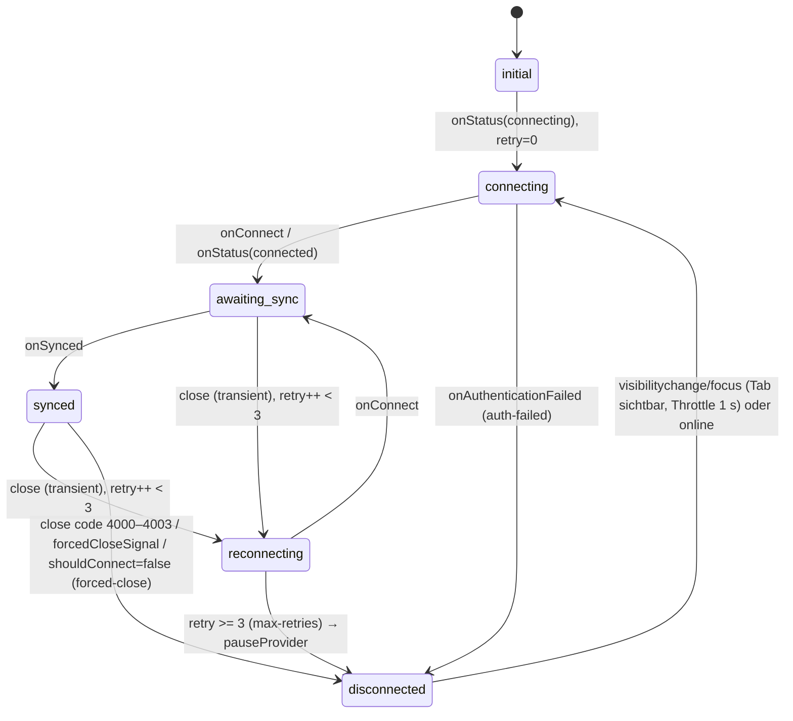

# A12 – Rich-Text-Editor & Realtime (`packages/editor`, `apps/live`)

> IST-Analyse von Plane v1.4.2 Community Edition (CE). Alle Pfade relativ zum Repo-Root. Code-Bezeichner, Feldnamen, Endpunkte und UI-Texte stehen im Original (Englisch, **nicht** übersetzt – der Editor hat **keine** i18n, alle Texte sind hart codiert).
> Bindend: `migration/architecture/00-grundsatzentscheidungen.md` (ADR-001 eine Edition/alle Features, ADR-002 Realtime in reinem .NET mit YDotNet, ADR-003 Greenfield, ADR-004 Airgapped, ADR-005 UI 1:1).

## Inhaltsverzeichnis

1. Überblick & Verantwortlichkeiten
2. Vollständige Inventare
3. Verhalten/Logik/Abläufe im Detail (inkl. Edge-Cases)
4. Abhängigkeiten zu anderen Bereichen
5. Migrationshinweise (.NET/EF Core, Angular)
6. Offene Punkte

---

## 1. Überblick & Verantwortlichkeiten

### 1.1 Bausteine

| Baustein | Pfad | Laufzeit | Verantwortung |
|---|---|---|---|
| `@plane/editor` | `packages/editor` (231 Dateien) | Browser (React 19) **und** Node (`lib`-Export, Schema/Konvertierung) | Tiptap-v2-basierter Editor: 4 Editor-Varianten, ~45 Extensions/Nodes/Marks, Menüs (Bubble-, Block-, Slash-, Mention-, Emoji-Menü), React-NodeViews, Yjs/Hocuspocus-Client-Integration, HTML⇄JSON⇄Yjs-Binary-Konvertierung, Editor-CSS |
| `live` | `apps/live` (56 Dateien) | Node 22, Express 4 + `express-ws`, Hocuspocus 2.15.2 | Realtime-Kollaborationsserver für Pages: WebSocket-Endpunkt, Auth gegen API per Cookie, Persistenz (lädt/speichert `description_binary` via API), Redis-Pub/Sub für horizontale Skalierung, Titel-Sync, Force-Close, Stateless-Events, HTML→Binary-Konvertierung (`/convert-document`), serverseitiger PDF-Export (`/pdf-export`) |
| Markdown-Konvertierung | `packages/utils/src/editor/markdown-parser/*` | Browser | HTML→Markdown (unified/rehype/remark) für „Copy as Markdown“, Markdown-Export, Clipboard |
| Konsumenten | `apps/web`, `apps/space` | Browser | Einbettung der Editoren, Datei-Handler, Mention-Suche, Realtime-URL, Fallback-Speicherung (siehe §4) |

### 1.2 Bibliotheken und Versionen (Katalog `pnpm-workspace.yaml`)

| Bibliothek | Version | Zweck | Framework-agnostisch? |
|---|---|---|---|
| `@tiptap/core`, `@tiptap/pm`, `@tiptap/starter-kit`, `@tiptap/extension-*` (blockquote, character-count, collaboration, document, emoji, heading, image, list-item, mention, placeholder, task-item, task-list, text, text-align, text-style, underline), `@tiptap/html`, `@tiptap/suggestion` | `^2.27.3` (core) / `^2.22.3` (Rest) | Editor-Kern, Schema, Extensions | ja |
| `@tiptap/react` | `^2.22.3` | `useEditor`, `EditorContent`, `ReactNodeViewRenderer`, `ReactRenderer`, `BubbleMenu`, `useEditorState`, `NodeViewWrapper/Content` | **nein** (React) |
| `prosemirror-view` / `prosemirror-model` | gepinnt `1.42.6` / `1.25.12` (`pnpm-workspace.yaml` overrides) | ProseMirror | ja |
| `prosemirror-codemark` | `^0.4.2` | Cursor-Verhalten an Inline-Code-Grenzen | ja |
| `yjs` `^13.6.20`, `y-prosemirror` `^1.3.7`, `y-protocols` `^1.0.6`, `y-indexeddb` `^9.0.12` | – | CRDT, PM-Binding, Protokolle, Offline-Cache | ja |
| `@hocuspocus/provider` | `2.15.2` | WS-Client | ja |
| `@hocuspocus/server`, `extension-database`, `extension-logger`, `extension-redis`, `transformer` | `2.15.2` | Realtime-Server | – (Node; wird in .NET ersetzt) |
| `lowlight` `^3.0.0`, `highlight.js` `^11.8.0` | – | Syntax-Highlighting (Code-Block) | ja |
| `linkifyjs` `^4.3.2` (Override `linkify-it 5.0.2`) | – | Autolink, Link-Paste | ja |
| `tiptap-markdown` `^0.8.10` | – | Markdown-Paste-Parsing | ja |
| `emoji-regex` `^10.3.0`, `is-emoji-supported` `^0.0.5` | – | Emoji-Erkennung | ja |
| `@floating-ui/dom` `^1.7.1` / `@floating-ui/react` `^0.27.20` | – | Positionierung von Popovern | dom: ja / react: nein |
| `tippy.js` `^6.3.7` | – | BubbleMenu (Tiptap v2), AI-Menü | ja |
| `jsx-dom-cjs` | Katalog | DOM-Erzeugung im `TableView` (kein React) | ja |
| `uuid` | `14.0.0` | IDs | ja |
| `lucide-react` `0.469.0` | – | Icons `Ban`, `Smile` | nein |
| `@react-pdf/renderer` `^4.8.1`, `@fontsource/inter`, `sharp`, `effect 3.20.0`, `ioredis 5.7.0`, `zod ^3.25.76`, `express 4.22.0`, `express-ws ^5.0.2`, `ws 8.21.0` | – | Live-Server (PDF, Bildverarbeitung, Redis, Validierung) | – (Node) |

Quelle: `packages/editor/package.json`, `apps/live/package.json`, `pnpm-workspace.yaml`.

### 1.3 Editor-Varianten (öffentliche Komponenten, `packages/editor/src/index.ts`)

| Komponente (Export) | Datei | Basis | Zusätzliche Extensions (über Core hinaus) | History | Bubble-Menü (Default) | Block-Menü / Side-Menü | Titel-Editor | Einsatz (Konsument) |
|---|---|---|---|---|---|---|---|---|
| `RichTextEditorWithRef` | `packages/editor/src/components/editors/rich-text/editor.tsx` | `EditorWrapper` → `useEditor` | `SideMenuExtension({aiEnabled:false, dragDropEnabled: !!dragDropEnabled})`, `RichTextEditorAdditionalExtensions` (= `SlashCommands` sofern nicht `"slash-commands"` deaktiviert) | Tiptap-History (`enableHistory: true`) | `bubbleMenuEnabled = true` | `BlockMenu` (immer gerendert, auch read-only, öffnet nur per Drag-Handle-Klick) | nein | Work-Item-Beschreibung, Inbox, Work-Item-Modal, Space-Public (`apps/web/components/editor/rich-text/editor.tsx`, `apps/space/components/editor/rich-text-editor.tsx`) |
| `LiteTextEditorWithRef` | `packages/editor/src/components/editors/lite-text/editor.tsx` | `EditorWrapper` | `EnterKeyExtension(onEnterKeyPress)` sofern nicht `"enter-key"` deaktiviert | ja | **nein** (kein Bubble-Menü, kein Slash, kein Side-Menu) | nein | nein | Kommentare, Stickies, Space-Kommentare (`apps/web/components/editor/lite-text/editor.tsx`, `apps/web/components/editor/sticky-editor/editor.tsx`, `apps/space/components/editor/lite-text-editor.tsx`) |
| `DocumentEditorWithRef` (nicht-kollaborativ) | `packages/editor/src/components/editors/document/editor.tsx` | `useEditor` + `PageRenderer` | `SideMenuExtension({aiEnabled: !disabledExtensions.includes("ai"), dragDropEnabled: true})`, `HeadingListExtension`, `DocumentEditorAdditionalExtensions` (= `SlashCommands`) | ja | `bubbleMenuEnabled = false` | `BlockMenu` nur wenn editierbar & kein Touch | nein | Page-Versionen, Beschreibungs-Versionen (read-only) (`apps/web/components/editor/document/editor.tsx`, `apps/web/components/pages/version/editor.tsx`, `apps/web/components/core/description-versions/modal.tsx`) |
| `CollaborativeDocumentEditorWithRef` | `packages/editor/src/components/editors/document/collaborative-editor.tsx` | `CollaborationProvider` (`useYjsSetup`) → `useCollaborativeEditor` → `PageRenderer` | wie Document + `Collaboration.configure({document: provider.document, field: "default"})` + `mainEditorNavigation`; Titel-Editor mit `TitleExtensions` + `Collaboration(field:"title")` + `titleEditorNavigation` + `Placeholder("Untitled")` | **keine** Tiptap-History (`enableHistory:false`), Undo/Redo via y-prosemirror | `bubbleMenuEnabled = true` | ja | **ja** (separater Tiptap-Editor, gleicher Y.Doc, Feld `title`) | Pages (`apps/web/components/pages/editor/editor-body.tsx`) |

**Read-only-Varianten:** In v1.4.2 gibt es **keine** eigenen ReadOnly-Komponenten mehr; Read-only = `editable: false` an derselben Komponente. Wirkung: `UniqueID.updateDocument=false` (keine ID-Vergabe), `TrackFileDeletionPlugin` nicht aktiv, `CustomImage.selectable/draggable=false`, Bubble-/Block-Menü/Side-Menu deaktiviert (`view.editable`-Prüfung), Tabellen-Insert-Buttons entfernt, Platzhalter leer, Checkboxen `pointer-events:none` (CSS) – Quellen: `packages/editor/src/extensions/unique-id/extension.ts`, `packages/editor/src/plugins/file/root.ts`, `packages/editor/src/extensions/custom-image/extension.tsx`, `packages/editor/src/extensions/side-menu.ts`, `packages/editor/src/extensions/table/plugins/insert-handlers/plugin.ts`, `packages/editor/src/extensions/placeholder.ts`, `packages/editor/src/styles/editor.css`.

### 1.4 Gemeinsame Editor-Hülle

| Element | Datei | Verhalten |
|---|---|---|
| `EditorWrapper` | `packages/editor/src/components/editors/editor-wrapper.tsx` | ruft `useEditor` (`enableHistory: true`), rendert `EditorContainer` mit `getEditorClassNames({noBorder:true, borderOnFocus:false, containerClassName})`; `children(editor)` vor dem Content (Bubble-/Block-Menü), Content in `div.flex.flex-col` |
| `EditorContainer` | `packages/editor/src/components/editors/editor-container.tsx` | `div#editor-container-{id}.editor-container.relative.cursor-text.line-spacing-{lineSpacing}` + Klassen `fontSize`, `fontStyle`, `active-editor` (fokussiert & editierbar); Klick auf leere Containerfläche → Fokus ans Ende, ggf. neuer Paragraph (§3.13); `mouseleave` → Side-Menu verstecken; Deep-Link-Scroll zu `#nodeId` (§3.12); rendert `LinkContainer` (nicht auf Touch) |
| `EditorContentWrapper` | `packages/editor/src/components/editors/editor-content.tsx` | `div[tabIndex]` mit `onFocus` → `editor.chain().focus(undefined,{scrollIntoView:false})`; enthält Tiptap `EditorContent` mit `id` |
| `PageRenderer` | `packages/editor/src/components/editors/document/page-renderer.tsx` | `div.frame-renderer.w-full.flex-grow(.wide-layout)`; bei `isLoading` → `DocumentContentLoader`; sonst Titel-Editor (`div.relative.w-full.py-3` → `EditorContainer` `page-title-editor bg-transparent py-3 border-none`, Content-Klasse `no-scrollbar placeholder-placeholder w-full resize-none rounded-none border-none bg-transparent p-0 text-[2rem] leading-[2.375rem] font-bold tracking-[-2%] outline-none`) + Haupt-Editor; Bubble-/Block-Menü nur wenn `editor.isEditable && !isTouchDevice`. **`aiHandler` wird angenommen, aber nicht gerendert** (kein `AIFeaturesMenu` in CE) |
| `DocumentContentLoader` | `packages/editor/src/components/editors/document/loader.tsx` | Skeleton (`@plane/blocks/skeleton` `Loader`): Items 100%×36px, 80%×22px, [30×30 + 30%×22], 60%×36, 70%×22, 30%×22, [30×30 + 30%×22], 50%×30, 100%×22, 30%×30, 30%×22, [30×30 + 30%×22]; Klasse `document-editor-loader` |
| `DocumentEditorSideEffects` | `packages/editor/src/components/document-editor-side-effects.ts` | **No-op** in CE (`() => null`) – EE-Erweiterungspunkt |
| `getEditorClassNames` | `packages/editor/src/helpers/common.ts` | `w-full max-w-full focus:border-0 focus:outline-none sm:rounded-lg` + `border border-subtle-1` (wenn `!noBorder`) + `border-strong focus:border` (wenn `borderOnFocus`) + `containerClassName` |
| `CoreEditorProps` | `packages/editor/src/props.ts` | ProseMirror-`attributes.class`: `prose-brand prose-headings:font-display font-default max-w-full prose focus:outline-none {editorClassName}`; `keydown` ArrowUp/ArrowDown/Enter wird geschluckt, wenn `#slash-command` im DOM existiert; `handlePaste`: wenn Clipboard `text/plane-editor-html` enthält → `processAssetDuplication` → `view.pasteHTML` |

---

## 2. Vollständige Inventare

### 2.1 Paket-Exporte

| Export-Pfad | Datei | Inhalt |
|---|---|---|
| `@plane/editor` | `packages/editor/src/index.ts` | `CollaborativeDocumentEditorWithRef`, `DocumentEditorWithRef`, `LiteTextEditorWithRef`, `RichTextEditorWithRef`; `constants/common` (`TOOLBAR_ITEMS`, `TYPOGRAPHY_ITEMS`, `TEXT_ALIGNMENT_ITEMS`, `USER_ACTION_ITEMS`, `COMPLEX_ITEMS`, `IMAGE_ITEM`, `COLORS_LIST`, `EDITOR_FONT_STYLES`, Typen `TEditorTypes`, `ToolbarMenuItem`, `ExtraPropsForCommand`); `helpers/common` (`getEditorClassNames`, `findParentNodeOfType`, `findTableAncestor`, `getTrimmedHTML`, `isValidHttpUrl`, `getParagraphCount`); `helpers/yjs-utils` (alle Konvertierer, §2.25); `CORE_EXTENSIONS`, `ADDITIONAL_EXTENSIONS`; alle Typen (`types/*`); `TrailingNode` |
| `@plane/editor/lib` | `packages/editor/src/lib.ts` | `CoreEditorExtensionsWithoutProps`, `DocumentEditorExtensionsWithoutProps`, `DocumentCollaborativeEvents`, `getServerEventName`, `yjs-utils`, Event-Typen – für Node (Live-Server) ohne React-Abhängigkeiten |
| `@plane/editor/styles.css` (`./styles`) | `packages/editor/src/styles/index.css` → `dist/styles/index.css` | Editor-CSS (§2.24) |

Build: `tsc && tsdown` (`packages/editor/tsdown.config.ts`: Entries `src/index.ts`, `src/lib.ts`, ESM, `copy: ["src/styles"]`, `platform: "neutral"`); PostCSS = `@plane/tailwind-config/postcss.config.js` (Tailwind v4-Syntax, `@apply`, `--alpha()`).

### 2.2 Props-Inventar

#### `IEditorProps` (`packages/editor/src/types/editor.ts`)

| Prop | Typ | Pflicht | Bedeutung |
|---|---|---|---|
| `autofocus` | `boolean` | nein (Default `false`) | Tiptap-Autofocus |
| `bubbleMenuEnabled` | `boolean` | nein | Bubble-Menü an/aus (Default je Variante, §1.3) |
| `containerClassName` | `string` | nein | Klassen für Container |
| `displayConfig` | `TDisplayConfig` | nein | Schrift/Abstände/Breite (Default `DEFAULT_DISPLAY_CONFIG`) |
| `disabledExtensions` | `TExtensions[]` | **ja** | `"ai" \| "collaboration-cursor" \| "issue-embed" \| "slash-commands" \| "enter-key" \| "image"` |
| `editable` | `boolean` | **ja** | editierbar |
| `editorClassName` | `string` | nein | Klassen am ProseMirror-Element |
| `editorProps` | ProseMirror `EditorProps` | nein | überschreibt/ergänzt `CoreEditorProps` (Spread danach) |
| `extensions` | `Extensions` | nein | zusätzliche Extensions (Konsument) |
| `flaggedExtensions` | `TExtensions[]` | **ja** | „geflaggte“ Extensions (CE: überall `[]`, Hook für Upsell → entfällt per ADR-001) |
| `fileHandler` | `TFileHandler` | **ja** | §2.3 |
| `forwardedRef` | `MutableRefObject<EditorRefApi \| null>` | nein | Ref-API (§2.4) |
| `getEditorMetaData` | `(html) => TCustomComponentsMetaData` | **ja** | liefert `file_assets[]` + `user_mentions[]` für Markdown-Konvertierung |
| `handleEditorReady` | `(ready: boolean) => void` | nein | `onCreate → true`, `onDestroy → false` |
| `id` | `string` | **ja** | Editor-ID / Dokument-ID (Collab: Y-Dokumentname = Page-ID) |
| `initialValue` | `string` | **ja** (nicht bei Document-Varianten) | Initial-HTML |
| `isTouchDevice` | `boolean` | nein | Touch-Modus (keine Menüs, kein Emoji-Suggest, Bild-Verhalten) |
| `mentionHandler` | `TMentionHandler` | **ja** | §2.3 |
| `onAssetChange` | `(assets: TEditorAsset[]) => void` | nein | Assetliste (Bilder) geändert |
| `onEditorFocus` | `() => void` | nein | Tiptap `onFocus` |
| `onChange` | `(json, html, {isMigrationUpdate}) => void` | nein | bei jedem `update` |
| `onEnterKeyPress` | `(e?) => void` | nein | nur Lite: Enter ohne offenes Dropdown |
| `onTransaction` | `() => void` | nein | jede Transaktion |
| `placeholder` | `string \| (isFocused, value) => string` | nein | Platzhalter |
| `showPlaceholderOnEmpty` | `boolean` | nein (Default `false`) | Platzhalter nur bei komplett leerem Dokument |
| `tabIndex` | `number` | nein | Tab-Reihenfolge; beeinflusst Tab-Verhalten in `ListKeymap` |
| `value` | `string \| null` | nein | externer Wert (SWR-Sync, §3.1); `null` = kein Sync |
| `extendedEditorProps` | `IEditorPropsExtended` (`unknown`) | **ja** | EE-Erweiterungspunkt |
| `workItemIdentifier` | `string \| null` | nein | an `BlockMenu` (CE ungenutzt) |

#### Variantenspezifisch

| Typ | Datei | Abweichung |
|---|---|---|
| `ILiteTextEditorProps` | `types/editor.ts` | = `IEditorProps` |
| `IRichTextEditorProps` | `types/editor.ts` | + `dragDropEnabled?: boolean` |
| `ICollaborativeDocumentEditorProps` | `types/editor.ts` | ohne `initialValue`, `onEnterKeyPress`, `value`; + `aiHandler?`, `documentLoaderClassName?`, `dragDropEnabled?` (Default `true`), `editable`, `realtimeConfig: TRealtimeConfig` (Pflicht), `serverHandler?: TServerHandler`, `user: TUserDetails` (Pflicht), `extendedDocumentEditorProps?`, `updatePageProperties?(pageIds, actionType, data, performAction?)`, `pageRestorationInProgress?` (in CE ungenutzt), `titleRef?: MutableRefObject<EditorTitleRefApi>`, `isFetchingFallbackBinary?` |
| `IDocumentEditorProps` | `types/editor.ts` | ohne `initialValue`, `onEnterKeyPress`, `value`; + `aiHandler?`, `user?`, `value: Content` (Pflicht, wird als `initialValue` genutzt) |

### 2.3 Handler- und Konfigurationstypen

| Typ | Datei | Felder |
|---|---|---|
| `TFileHandler` | `types/config.ts` | `assetsUploadStatus: Record<blockId, percent>`; `cancel()`; `checkIfAssetExists(assetId): Promise<boolean>`; `delete(assetSrc)`; `getAssetDownloadSrc(path): Promise<string>`; `getAssetSrc(path): Promise<string>`; `restore(assetSrc)`; `upload(blockId, file): Promise<string>` (liefert Asset-ID bzw. URL → wird `src`); `duplicate(assetId): Promise<string>` (neue Asset-ID); `validation.maxFileSize` (Bytes); `& TExtendedFileHandler` (`object`, EE-Hook) |
| `TMentionHandler` | `types/mention.ts` | `getMentionedEntityDetails?(entity_identifier) → {display_name}`; `renderComponent({entity_identifier, entity_name}) → ReactNode`; `searchCallback?(query) → Promise<TMentionSection[]>` |
| `TMentionSection` / `TMentionSuggestion` | `types/mention.ts` | Section `{key, title?, items[]}`; Suggestion `{entity_identifier, entity_name: TSearchEntities, icon: ReactNode, id, subTitle?, title}`; `TSearchEntities = "user_mention" \| "issue" \| "project" \| "cycle" \| "module" \| "page"` (`packages/types/src/search.ts`) |
| `TAIHandler` / `TAIMenuProps` | `types/ai.ts` | `menu?({isOpen, onClose}) → ReactNode` |
| `TServerHandler` | `types/collaboration.ts` | `onStateChange(state: CollaborationState)` |
| `CollaborationState` / `CollabStage` / `CollaborationError` | `types/collaboration.ts` | Stage: `initial`, `connecting`, `awaiting-sync`, `synced`, `reconnecting{attempt}`, `disconnected{error}`; Error: `auth-failed`, `network-error`, `forced-close{code}`, `max-retries` (jeweils `message`) |
| `TRealtimeConfig` | `types/config.ts` | `{url}` (WS-URL inkl. Query) |
| `TUserDetails` | `types/config.ts` | `{color, id, name, cookie?}` – wird als JSON-String **Token** gesendet |
| `TDisplayConfig` | `types/config.ts` | `fontStyle?: "sans-serif"\|"serif"\|"monospace"`, `fontSize?: "small-font"\|"large-font"\|"mobile-font"`, `lineSpacing?: "regular"\|"small"\|"mobile-regular"`, `wideLayout?: boolean`; Default (`constants/config.ts`): `large-font`, `sans-serif`, `regular`, `false` |
| `IMarking` | `types/config.ts` | `{type:"heading", level, text, sequence}` (Outline) |
| `TEditorAsset` / `TEditorImageAsset` | `types/asset.ts` | `{href:"#editor-image-block-{id}", id, name:"image-{id}", src, type: "image"\|"imageComponent"}` (+ `size: 0` in `helpers/assets.ts`) |
| `TEmbedConfig` / `TIssueEmbedConfig` / `TReadOnlyEmbedConfig` | `types/issue-embed.ts` | `issue.widgetCallback({issueId, projectId, workspaceSlug}) → ReactNode` |
| `TEmbedItem` | `types/embed.ts` | `{id, title, subTitle, icon, projectId, workspaceSlug}` (CE ungenutzt) |
| `ISlashCommandItem` | `types/slash-commands-suggestion.ts` | `{commandKey: TEditorCommands, key, title, description, searchTerms[], icon, iconContainerStyle?, command({editor, range}), badge?}`; Sektionen `"general" \| "text-colors" \| "background-colors"` |
| `TEditorCommands` | `types/editor.ts` | `text, h1…h6, bold, italic, underline, strikethrough, bulleted-list, numbered-list, to-do-list, quote, code, table, image, divider, link, issue-embed, text-color, background-color, text-align, callout, attachment, emoji, external-embed` + `TExtendedEditorCommands` (`never`). **`attachment`, `external-embed`, `issue-embed` haben in CE keine Implementierung** |
| `TCommandExtraProps` | `types/editor.ts` | `image/attachment: {savedSelection}`, `text-color/background-color: {color}`, `link: {url, text?}`, `text-align: {alignment}` |
| `TDocumentInfo` | `types/editor.ts` | `{characters, paragraphs, words}` |
| Hook-Typen | `types/hook.ts` | `TEditorHookProps` (+ `enableHistory`, `initialValue`, `provider`), `TCollaborativeEditorHookProps` |
| EE-Erweiterungstypen | `types/editor-extended.ts`, `types/utils.ts`, `types/storage.ts` | `IEditorExtensionOptions`, `IEditorPropsExtended`, `ICollaborativeDocumentEditorPropsExtended`, `TExtendedCommandExtraProps`, `TExtendedEditorRefApi` (alle `unknown`), `TExtendedEditorCommands` (`never`), `TAdditionalActiveDropbarExtensions` (`never`), `ExtensionFileSetStorageKey` (`"deletedImageSet"`) |

### 2.4 `EditorRefApi` (Ref-Methoden, `packages/editor/src/helpers/editor-ref.ts`)

| Methode | Verhalten |
|---|---|
| `blur()` | `editor.commands.blur()` |
| `clearEditor(emitUpdate=false)` | `setMeta(skipFileDeletion,true).clearContent(emitUpdate)` (Titel-Ref zusätzlich `intentionalDeletion`) |
| `createSelectionAtCursorPosition()` | bei leerer Selektion: Wortgrenzen (`/\w/`) um Cursor ermitteln und Wort selektieren |
| `getDocument()` | `{binary: Y.encodeStateAsUpdate(provider.document) \| null, html: editor.getHTML() \|\| "<p></p>", json}` |
| `getDocumentInfo()` | `characters`/`words` aus `CharacterCount`, `paragraphs` = Anzahl nicht-leerer Paragraphen |
| `getHeadings()` | `editor.storage.headingsList.headings` |
| `getMarkDown()` | `convertHTMLToMarkdown({description_html: getHTML(), metaData: getEditorMetaData(html)})` |
| `copyMarkdownToClipboard()` | registriert einmaligen `copy`-Listener: `text/plain`=Markdown, `text/html`=HTML, `text/plane-editor-html`=HTML; `document.execCommand("copy")` |
| `getSelectedText()` | HTML der selektierten **Top-Level**-Knoten (DOMSerializer) oder `null` |
| `insertText(html, insertOnNextLine?)` | nur bei nicht-leerer Selektion: ersetzen oder `<br />` + Inhalt hinter Selektion |
| `isAnyDropbarOpen()` | `utility.activeDropbarExtensions.length > 0` |
| `isEditorReadyToDiscard()` | `utility.uploadInProgress === false` |
| `isMenuItemActive({itemKey,…})` / `executeMenuItemCommand({itemKey,…})` | Lookup in `getEditorMenuItems(editor)` (§2.20); unbekannter Key → `console.warn("No command found for item: …")` |
| `emitRealTimeUpdate(action)` | `provider.sendStateless(action)` (Server-Eventname, §2.27) |
| `listenToRealTimeUpdate()` | `{on, off}` gebunden an Provider (Event `"stateless"`) |
| `onDocumentInfoChange(cb)` / `onHeadingChange(cb)` / `onStateChange(cb)` | Subscription auf `update` bzw. `transaction`; Rückgabe = Unsubscribe |
| `focus(args)`, `undo()`, `redo()` | Tiptap-Commands |
| `getCoordsFromPos(pos?)`, `getCurrentCursorPosition()` | `view.coordsAtPos`, `selection.from` |
| `getAttributesWithExtendedMark(mark, attr)` | `extendMarkRange(mark)` dann `getAttributes(attr)` |
| `scrollSummary(marking)` | n-tes Heading des Levels finden, `scrollIntoView({behavior:"smooth"})` |
| `scrollToNodeViaDOMCoordinates({pos, behavior="smooth"})` | `window.scrollTo(top: coords.top + scrollY - innerHeight/2)` + `view.focus()` |
| `setEditorValue(content, emitUpdate=false)` | `setContent` mit Meta `skipFileDeletion`, `intentionalDeletion`, `preserveWhitespace:true` |
| `setEditorValueAtCursorPosition(content)` | `insertContentAt(clamp(anchor))` |
| `setFocusAtPosition(pos)` | fügt leeren Paragraph an `clamp(pos)` ein und fokussiert |
| `setProviderDocument(update)` | `Y.applyUpdate(provider.document, update)` (Fallback, §3.9) |
| Titel-Ref (`EditorTitleRefApi`, `hooks/use-title-editor.ts`) | wie oben, aber `clearEditor` setzt zusätzlich `intentionalDeletion`, `setEditorValue(content)` = `setContent(content,false)` |

### 2.5 Extension-Inventar

Registrierung zur Laufzeit: `CoreEditorExtensions` (`packages/editor/src/extensions/extensions.ts`) für **alle** Varianten, danach Varianten-Extensions (§1.3), danach `props.extensions` des Konsumenten. Server-/Konvertierungs-Schema: `CoreEditorExtensionsWithoutProps` (+ `DocumentEditorExtensionsWithoutProps` = `WorkItemEmbedExtensionConfig` für „document“) in `packages/editor/src/extensions/core-without-props.ts`.

Legende Spalte „Schema“: Runtime = im Browser-Editor; Server = in `CoreEditorExtensionsWithoutProps` (für `yjs-utils`, Live-Server, Konvertierung). **Wichtig:** `UniqueID`, `Placeholder`, `CharacterCount`, `Markdown`, `Typography`, `CustomKeymap`, `ListKeymap`, `Utility` sind **nicht** im Server-Schema → serverseitig erzeugtes HTML/JSON enthält **keine** `data-id`-Block-IDs (Y-Binary behält sie).

#### 2.5.1 Nodes

| # | Name (`CORE_EXTENSIONS`) | Quelle / Basis | Schema-Eigenschaften | Attribute (Default) | parseHTML | renderHTML / HTML-Serialisierung | NodeView | Runtime/Server | Datei |
|---|---|---|---|---|---|---|---|---|---|
| 1 | `doc` | StarterKit `Document` | `content: block+` (Titel-Editor: `content: "heading"`) | – | – | Wurzel `div.ProseMirror` | – | R/S | `extensions/starter-kit.ts`, `extensions/title-extension.ts` |
| 2 | `paragraph` | StarterKit `Paragraph` | `group: block`, `content: inline*` | `id` (UniqueID, `null`), `textAlign` (TextAlign) | `p` | `<p class="editor-paragraph-block" data-id="…" style="text-align: center">` | – | R/S | `extensions/starter-kit.ts` |
| 3 | `text` | StarterKit `Text` | inline | – | – | Text | – | R/S | – |
| 4 | `heading` | StarterKit `Heading` (Titel: `Heading.configure({levels:[1]})`) | `content: inline*`, `defining` | `level` (1), `id`, `textAlign` | `h1`…`h6` | `<hN class="editor-heading-block" data-id="…">` (Titel-Editor ohne Klasse) | – | R/S | `extensions/starter-kit.ts` |
| 5 | `blockquote` | `CustomQuoteExtension` = `Blockquote.extend` | `content: block+`, `group: block`, `defining` | `id` | `blockquote` | `<blockquote>…</blockquote>` | – | R/S | `extensions/quote.ts` |
| 6 | `bulletList` | StarterKit | `content: listItem+` | `id` | `ul` | `<ul class="list-disc pl-7 space-y-(--list-spacing-y)">` | – | R/S | `extensions/starter-kit.ts` |
| 7 | `orderedList` | StarterKit | `content: listItem+` | `start` (1, Tiptap-Default), `id` | `ol` | `<ol class="list-decimal pl-7 space-y-(--list-spacing-y)">` (`start` nur wenn ≠ 1) | – | R/S | `extensions/starter-kit.ts` |
| 8 | `listItem` | StarterKit | `content: paragraph block*`, `defining` | `id` | `li` | `<li class="not-prose space-y-2">` | – | R/S | `extensions/starter-kit.ts` |
| 9 | `taskList` | `@tiptap/extension-task-list` | `content: taskItem+` | `id` | `ul[data-type="taskList"]` | `<ul data-type="taskList" class="not-prose pl-2 space-y-2">` | – | R/S | `extensions/extensions.ts`, `extensions/core-without-props.ts` |
| 10 | `taskItem` | `@tiptap/extension-task-item` (`nested: true`) | `content: paragraph block*`, `defining` | `checked` (false; `data-checked`), `id` | `li[data-type="taskItem"]` | `<li data-type="taskItem" data-checked="true\|false" class="relative">` (Server: `class="flex"`) `<label><input type="checkbox" checked?><span></span></label><div>…</div></li>` | Vanilla-DOM (Tiptap-Default) | R/S | `extensions/extensions.ts`, `extensions/core-without-props.ts` |
| 11 | `codeBlock` | eigene `CodeBlock` → `CodeBlockLowlight` → `CustomCodeBlockExtension` (`lowlight` = `common` + `ts`, `defaultLanguage: "plaintext"`, `exitOnTripleEnter: false`) | `content: text*`, `marks: ""`, `group: block`, `code`, `defining` | `language` (null, `rendered:false`, parse aus `class="language-*"` des ersten Kindes), `id` | `pre` (`preserveWhitespace:"full"`) | `<pre data-id="…"><code class="language-ts">…</code></pre>` (Klasse nur wenn Sprache gesetzt) | **React** `CodeBlockComponent` | R/S (Server ohne NodeView) | `extensions/code/code-block.ts`, `code-block-lowlight.ts`, `index.tsx`, `without-props.tsx`, `code-block-node-view.tsx` |
| 12 | `horizontalRule` | `CustomHorizontalRule` (eigene Implementierung) | `group: block` | `id` | `div[data-type="horizontalRule"]`, `hr` | `<div class="py-4 border-strong-1" data-type="horizontalRule"><div></div></div>` | – | R/S | `extensions/horizontal-rule.ts` |
| 13 | `hardBreak` | StarterKit | inline | – | `br` | `<br>` | – | R/S | – |
| 14 | `image` (Legacy) | `ImageExtension` = `@tiptap/extension-image` extend | Block (`inline:false`) | `src`, `alt`, `title` (Base), `width` ("35%"), `height` (null), `aspectRatio` (null), `alignment` ("left"), `id` | `img[src]` (ohne `data:`) | `` | **React** `CustomImageNodeView` (gleiche wie #15) | R (nur wenn `"image"` nicht deaktiviert)/S | `extensions/image/extension.tsx`, `extension-config.tsx` |
| 15 | `imageComponent` | `CustomImageExtension` = `Image.extend` | `group: block`, `atom`; `selectable/draggable = isEditable` | Base (`src`,`alt`,`title`) + `id` (null), `width` ("35%"), `height` ("auto"), `aspectRatio` (null), `src` (null), `alignment` ("left"), `status` ("pending"; `pending\|uploading\|uploaded\|duplicating\|duplication-failed`) | `image-component` | `<image-component src="{assetId}" id="…" width="300px" height="200px" aspectRatio="1.5" alignment="left" status="uploaded" data-id="…"></image-component>` | **React** `CustomImageNodeView` | R (wenn `"image"` nicht deaktiviert)/S | `extensions/custom-image/*` |
| 16 | `table` | eigene `Table` (Port von Tiptap-Table) | `content: tableRow+`, `group: block`, `isolating`, `tableRole: table`, `allowGapCursor: false` | `id`; Optionen `resizable:true`, `handleWidth:5`, `cellMinWidth:100`, `lastColumnResizable:true`, `allowTableNodeSelection:true` | `table` | `<table data-id="…"><tbody>…</tbody></table>` | **Vanilla** `TableView` (`div.table-wrapper.editor-full-width-block.horizontal-scrollbar.scrollbar-sm > table > colgroup(col×n) + tbody`) | R/S | `extensions/table/table/table.ts`, `table-view.tsx` |
| 17 | `tableRow` | eigene | `content: (tableCell \| tableHeader)*`, `tableRole: row` | `background` (null), `textColor` (null) | `tr` | `<tr background textColor style="background-color: X; color: Y">` (Style nur wenn `background`) | – | R/S | `extensions/table/table-row.ts` |
| 18 | `tableHeader` | eigene | `content: block+`, `isolating`, `tableRole: header_cell` | `colspan` (1), `rowspan` (1), `colwidth` ([150]; parse nur **erster** Wert), `background` ("none") | `th` | `<th colspan="1" rowspan="1" colwidth="150" background="none" style="background-color: none;">` | – | R/S | `extensions/table/table-header.ts` |
| 19 | `tableCell` | eigene | `content: block+`, `isolating`, `tableRole: cell` | `colspan` (1), `rowspan` (1), `colwidth` ([150]), `background` (null), `textColor` (null) | `td` | `<td colspan="1" rowspan="1" colwidth="150" style="background-color: null; color: null;">` (wörtlich `null`, s. Edge-Case E17) | – | R/S | `extensions/table/table-cell.ts` |
| 20 | `mention` | `CustomMentionExtension` = `@tiptap/extension-mention` extend | inline, `atom`, Trigger `@`, `allowSpaces: true` | `id` (uuid je Einfügung), `entity_identifier`, `entity_name` | `mention-component` | `<mention-component id="…" entity_identifier="{userId}" entity_name="user_mention"></mention-component>`; `renderText` = `@{display_name \|\| id \|\| entity_identifier}` | **React** `MentionNodeView` (`span`-artig `NodeViewWrapper.mention-component.inline.w-fit` → `renderComponent`) | R/S | `extensions/mentions/*` |
| 21 | `emoji` | eigener Fork von `@tiptap/extension-emoji` (`Emoji`), konfiguriert in `EmojiExtension` | inline, `group: inline`, `selectable:false` | `name` (`data-name`) | `span[data-type="emoji"]` | `<span data-type="emoji" data-name="smile">😄</span>` (unbekannt: `:name:`); `renderText` = Unicode | – | R/S | `extensions/emoji/emoji.ts`, `extension.ts` |
| 22 | `calloutComponent` | `CustomCalloutExtensionConfig` / `CustomCalloutExtension` | `group: block`, `content: block+`, `selectable`, `draggable` | `id` (null), `data-icon-color` (undef.), `data-icon-name` (undef.), `data-emoji-unicode` ("128161" = 💡, Format: kommaseparierte Dezimal-Codepoints), `data-emoji-url` (`https://cdn.jsdelivr.net/npm/emoji-datasource-apple/img/apple/64/1f4a1.png`), `data-logo-in-use` ("emoji" \| "icon"), `data-background` (undef.; Farb-Key aus `COLORS_LIST`), `data-block-type` ("callout-component") | `div[data-block-type="callout-component"]` | `<div id="…" data-id="…" data-emoji-unicode="128161" data-emoji-url="…" data-logo-in-use="emoji" data-background="gray" data-block-type="callout-component">…</div>` | **React** `CustomCalloutBlock` | R/S | `extensions/callout/*` |
| 23 | `issue-embed-component` (`WORK_ITEM_EMBED`) | `WorkItemEmbedExtensionConfig` | `group: block`, `atom`, `selectable`, `draggable` | `entity_identifier`, `project_identifier`, `workspace_identifier`, `id`, `entity_name` (alle `undefined`) | `issue-embed-component` | `<issue-embed-component entity_identifier="{issueId}" project_identifier="{projectId}" workspace_identifier="{slug}" id="…" entity_name="issue"></issue-embed-component>` | **React** via `WorkItemEmbedExtension({widgetCallback})` | **nur Server-Schema (document)**; Runtime in CE **nicht registriert** (EE) | `extensions/work-item-embed/*` |

Hinweis IDs: `UniqueID` vergibt global das Attribut `id` (HTML `data-id`) für `BLOCK_NODE_TYPES` = `paragraph, heading, blockquote, codeBlock, horizontalRule, bulletList, orderedList, listItem, taskList, taskItem, table, image, imageComponent, calloutComponent, issue-embed-component` (`constants/extension.ts`) + `ADDITIONAL_BLOCK_NODE_TYPES` (leer). Nodes mit eigenem `id`-Attribut (`calloutComponent`, `imageComponent`, `mention`, `issue-embed-component`) rendern zusätzlich `id="…"`.

#### 2.5.2 Marks

| Name | Quelle | Attribute (Default) | parseHTML | renderHTML | Besonderheiten | Datei |
|---|---|---|---|---|---|---|
| `bold` | StarterKit | – | `strong`, `b`, `font-weight` | `<strong>` | Mod-b; Input `**x**`/`__x__` | – |
| `italic` | StarterKit | – | `em`, `i`, `font-style: italic` | `<em>` | Mod-i; Input `*x*`/`_x_` | – |
| `strike` | StarterKit | – | `s`, `del`, `strike`, `text-decoration: line-through` | `<s>` | Mod-Shift-s; Input `~~x~~` | – |
| `underline` | `@tiptap/extension-underline` | – | `u`, `text-decoration: underline` | `<u>` | Mod-u | `extensions/extensions.ts` |
| `code` | `CustomCodeInlineExtension` | – | `code` | `<code class="rounded-sm bg-layer-3 px-[6px] py-[1.5px] font-code font-medium text-(--extended-color-orange-600) border-[0.5px] border-subtle" spellcheck="false">` | `excludes: "_"` (keine anderen Marks), `code`, `exitable`; Mod-e; Input-/Paste-Regel `` `x` `` | `extensions/code-inline/index.tsx` |
| `link` | `CustomLinkExtension` (eigene Kopie der Tiptap-Link-Extension) | `href` (null), `target` ("_blank"), `rel` ("noopener noreferrer nofollow"), `class` (`text-accent-secondary underline underline-offset-[3px] hover:text-accent-primary transition-colors cursor-pointer`) | `a[href]` außer gefährliche Protokolle | `<a target="_blank" rel="noopener noreferrer nofollow" class="…" href="…">` (gefährlich → `href=""`) | `priority:1000`, `keepOnSplit:false`, `inclusive:false`, Protokolle `http`,`https`; Autolink, Click, Paste (§3.18) | `extensions/custom-link/*` |
| `textStyle` | `@tiptap/extension-text-style` | – | `span[style]` | `<span>` | Träger-Mark | `extensions/extensions.ts` |
| `customColor` | `CustomColorExtension` | `color` (null; `data-text-color`), `backgroundColor` (null; `data-background-color`) | `span` (Quirk: matcht **jedes** `span`, s. E16) | `<span data-text-color="gray">` / `<span data-background-color="peach">`; nicht-Listen-Werte zusätzlich `style="color: …"` bzw. `style="background-color: …"` | Commands `setTextColor`, `unsetTextColor`, `setBackgroundColor`, `unsetBackgroundColor`; Markdown: wird ignoriert (`open/close ""`) | `extensions/custom-color.ts` |

#### 2.5.3 Funktionale Extensions (ohne eigene Nodes/Marks)

| Name | Datei | Typ | Funktion | Runtime-Varianten |
|---|---|---|---|---|
| StarterKit-Teile `dropcursor`, `gapcursor`, `history` | `extensions/starter-kit.ts` | Extension | Dropcursor-Klasse `text-tertiary transition-all motion-reduce:transition-none motion-reduce:hover:transform-none duration-200 ease-[cubic-bezier(0.165, 0.84, 0.44, 1)]`; `history` nur wenn `enableHistory` (Collab: aus); `code`, `codeBlock`, `horizontalRule`, `blockquote` im StarterKit deaktiviert (eigene Versionen) | alle |
| `uniqueID` (`UniqueID`) | `extensions/unique-id/*` | Extension, `priority: 10000` | globale `id`-Attribute, ID-Vergabe (§3.11) | alle (Server: nein) |
| `textAlign` (`CustomTextAlignExtension`) | `extensions/text-align.ts` | globale Attribute | `alignments: left/center/right`, `types: heading, paragraph`; Shortcuts Tiptap-Default Mod-Shift-l/e/r | alle (Server: ja) |
| `characterCount` | `@tiptap/extension-character-count` | Storage | `characters()`, `words()` | alle |
| `placeholder` (`CustomPlaceholderExtension`) | `extensions/placeholder.ts` | Decorations | §3.21 | alle |
| `markdown` (`tiptap-markdown`) | `extensions/extensions.ts` | Parser | `html:true`, `transformCopiedText:false`, `transformPastedText:true`, `breaks:true` (Markdown-Text beim Einfügen wird geparst) | alle |
| `typography` (`CustomTypographyExtension`) | `extensions/typography/*` | Input-Regeln | §2.9 | alle |
| `customKeymap` (`CustomKeymap`) | `extensions/keymap.ts` | Keymap + Plugin | Mod-a zweistufig; Auto-Join benachbarter gleicher Listen (`ordered-list-merging`) | alle |
| `listKeymap` (`ListKeymap({tabIndex})`) | `extensions/custom-list-keymap/*` | Keymap | §2.8/§3.16 | alle |
| `utility` (`UtilityExtension`) | `extensions/utility.ts` | Storage/Commands/Plugins, `priority:1000` | Storage (§2.21), Commands `updateAssetsUploadStatus`, `updateAssetsList`, `addActiveDropbarExtension`, `removeActiveDropbarExtension`; Plugins: `FilePlugins`, `prosemirror-codemark`, `MarkdownClipboardPlugin`, `DropHandlerPlugin`; `onCreate` → `restorePublicImages` | alle |
| `CoreEditorAdditionalExtensions` | `extensions/core/extensions.ts` | Registry | **leer** (EE-Hook) | alle |
| `slash-command` (`SlashCommands`) | `extensions/slash-commands/*` | Suggestion (Trigger `/`) | §2.10 | Rich, Document, Collab |
| `enterKey` (`EnterKeyExtension`) | `extensions/enter-key.ts` | Keymap | Enter → `onEnterKeyPress` (wenn kein Dropdown offen); Shift-Enter → `first([newlineInCode, splitListItem(listItem), splitListItem(taskItem), createParagraphNear, liftEmptyBlock, splitBlock])` | Lite |
| `editorSideMenu` (`SideMenuExtension`) | `extensions/side-menu.ts` | Plugin `sideMenu` | Drag-Handle/AI-Handle (§3.14) | Rich, Document, Collab |
| `headingsList` (`HeadingListExtension`) | `extensions/headings-list.ts` | Plugin `heading-list` | Outline-Liste (§3.22) | Document, Collab |
| `collaboration` | `@tiptap/extension-collaboration` | y-prosemirror | `field:"default"` (Haupt), `field:"title"` (Titel) | Collab |
| `titleEditorNavigation` / `mainEditorNavigation` | `hooks/use-editor-navigation.ts` | Keymap, `priority:10` | §3.22 | Collab |
| `trailingNode` (`TrailingNode`) | `extensions/trailing-node.ts` | Plugin | fügt am Ende Paragraph ein, wenn letzter Node kein Paragraph; **exportiert, in CE nirgends registriert** | – |

### 2.6 ProseMirror-Plugins

| PluginKey (Name) | Datei | Registriert durch | Zweck |
|---|---|---|---|
| `codeBlockVSCodeHandlerCustom` | `extensions/code/code-block.ts` | `codeBlock` | Paste: in Inline-Code → Text als `code`-Mark; VS-Code-Paste (`vscode-editor-data.mode`) → neuer Code-Block mit Sprache |
| `lowlight` | `extensions/code/lowlight-plugin.ts` | `CodeBlockLowlight` | Inline-Decorations `hljs-*`; Neuberechnung bei Code-Block-Änderung, Anzahländerung oder Steps, die Blöcke vollständig umschließen (Collab-Sync) |
| `autolink` | `extensions/custom-link/helpers/autolink.ts` | `link` | Autolink nach Leerzeichen/Enter (§3.18) |
| `handleClickLink` | `extensions/custom-link/helpers/clickHandler.ts` | `link` | Linksklick öffnet Link (`window.open(href, target)`) |
| `handlePasteLink` | `extensions/custom-link/helpers/pasteHandler.ts` | `link` | URL über Selektion einfügen → Link-Mark |
| `emojiSuggestion` (Suggestion) | `extensions/emoji/emoji.ts` | `emoji` (nicht auf Touch) | `:`-Suggestion |
| `emoji` | `extensions/emoji/emoji.ts` | `emoji` (nicht auf Touch) | Doppelklick selektiert Emoji; `appendTransaction`: Unicode-Emojis im Text → `emoji`-Node (nicht in Code) |
| `suggestion` (Default-Key) | `extensions/slash-commands/root.tsx` | `slash-command` | `/`-Menü |
| `mention` (Tiptap-Default) | `@tiptap/extension-mention` | `mention` | `@`-Menü |
| `heading-list` | `extensions/headings-list.ts` | `headingsList` | berechnet Headings bei **jeder** Transaktion, emittiert `update` |
| `ordered-list-merging` | `extensions/keymap.ts` | `customKeymap` | verbindet direkt benachbarte `orderedList`/`taskList`/`bulletList` gleichen Typs |
| `sideMenu` | `extensions/side-menu.ts` | `editorSideMenu` | Positionierung/Events Side-Menü |
| `uniqueID` | `extensions/unique-id/plugin.ts` | `uniqueID` | ID-Vergabe, ID-Reset bei Paste/Drop |
| `tableDragState` | `extensions/table/plugins/drag-state.ts` | `table` | Decoration `content-hidden` während Spalten/Zeilen-Drag |
| `table-insert` | `extensions/table/plugins/insert-handlers/plugin.ts` | `table` | „+“-Buttons rechts/unten, Drag-Marker-Container |
| `tableColumnHandlerDecorationPlugin` | `extensions/table/plugins/drag-handles/column/plugin.ts` | `table` | Widget-Decorations (React) je Spalte (erste Zeile) |
| `tableRowDragHandlePlugin` | `extensions/table/plugins/drag-handles/row/plugin.ts` | `table` | Widget-Decorations (React) je Zeile (erste Spalte) |
| `table-cell-selection-outline` | `extensions/table/plugins/selection-outline/plugin.ts` | `tableCell` | Klassen `selectedCell-border-{top,left,bottom,right}` |
| `tableEditing`, `columnResizing` (prosemirror-tables) | `extensions/table/table/table.ts` | `table` | Zellselektion, Spaltenbreiten-Resize (nur editierbar) |
| `delete-utility` | `plugins/file/delete.ts` | `utility` (nur editierbar & `delete` vorhanden) | erkennt entfernte Bilder → `fileHandler.delete(src)` |
| `restore-utility` | `plugins/file/restore.ts` | `utility` | erkennt hinzugefügte Bilder → Assetliste, ggf. `restore(src)` |
| `prosemirror-codemark` | `extensions/utility.ts` | `utility` | Cursor-Handling an `code`-Mark-Grenzen (CSS `.fake-cursor`, `.no-cursor`) |
| `markdownClipboard` | `plugins/markdown-clipboard.ts` | `utility` | Copy: `text/plain` = Markdown, `text/html` & `text/plane-editor-html` = HTML |
| `drop-handler-plugin` | `plugins/drop.ts` | `utility` | Paste/Drop von Dateien → `insertImageComponent` |
| `nodeHighlight` | `plugins/highlight.ts` | **nicht registriert** in CE | Highlight-Decoration (`bg-accent-primary/20 transition-all duration-300 rounded`, `data-node-highlighted`) für `#nodeId`; `EditorContainer` dispatcht Meta, ohne Wirkung |
| `placeholder`, `characterCount`, `dropcursor`, `gapcursor`, `history` | Tiptap | – | Tiptap-Defaults |
| `y-sync`, `y-undo` | y-prosemirror via `Collaboration` | Collab | Binding Y.XmlFragment ⇄ PM-Dokument, Undo-Manager |
| tiptap-markdown-Plugins | `tiptap-markdown` | `markdown` | Paste-Transformation |

### 2.7 Konstanten

| Konstante | Datei | Werte |
|---|---|---|
| `CORE_EXTENSIONS` (enum) | `packages/editor/src/constants/extension.ts` (Duplikat ohne `UNIQUE_ID` in `packages/utils/src/editor/common.ts`) | `BLOCKQUOTE="blockquote"`, `BOLD="bold"`, `BULLET_LIST="bulletList"`, `CALLOUT="calloutComponent"`, `CHARACTER_COUNT="characterCount"`, `CODE_BLOCK="codeBlock"`, `CODE_INLINE="code"`, `CUSTOM_COLOR="customColor"`, `CUSTOM_IMAGE="imageComponent"`, `CUSTOM_LINK="link"`, `DOCUMENT="doc"`, `DROP_CURSOR="dropCursor"`, `ENTER_KEY="enterKey"`, `GAP_CURSOR="gapCursor"`, `HARD_BREAK="hardBreak"`, `HEADING="heading"`, `HEADINGS_LIST="headingsList"`, `HISTORY="history"`, `HORIZONTAL_RULE="horizontalRule"`, `IMAGE="image"`, `ITALIC="italic"`, `LIST_ITEM="listItem"`, `MARKDOWN_CLIPBOARD="markdownClipboard"`, `MENTION="mention"`, `ORDERED_LIST="orderedList"`, `PARAGRAPH="paragraph"`, `PLACEHOLDER="placeholder"`, `SIDE_MENU="editorSideMenu"`, `SLASH_COMMANDS="slash-command"`, `STRIKETHROUGH="strike"`, `TABLE="table"`, `TABLE_CELL="tableCell"`, `TABLE_HEADER="tableHeader"`, `TABLE_ROW="tableRow"`, `TASK_ITEM="taskItem"`, `TASK_LIST="taskList"`, `TEXT_ALIGN="textAlign"`, `TEXT_STYLE="textStyle"`, `TYPOGRAPHY="typography"`, `UNDERLINE="underline"`, `UTILITY="utility"`, `WORK_ITEM_EMBED="issue-embed-component"`, `EMOJI="emoji"`, `UNIQUE_ID="uniqueID"` |
| `BLOCK_NODE_TYPES` | `constants/extension.ts` | s. §2.5.1 Hinweis |
| `ADDITIONAL_EXTENSIONS` / `ADDITIONAL_BLOCK_NODE_TYPES` / `ADDITIONAL_ASSETS_META_DATA_RECORD` | `constants/extensions.ts`, `constants/assets.ts` | leer (EE-Hooks) |
| `CORE_EDITOR_META` | `constants/meta.ts` | `SKIP_FILE_DELETION="skipFileDeletion"`, `INTENTIONAL_DELETION="intentionalDeletion"`, `ADD_TO_HISTORY="addToHistory"` |
| `NODE_FILE_MAP` | `constants/utility.ts` | `image` und `imageComponent` → `fileSetName: "deletedImageSet"` |
| `DEFAULT_DISPLAY_CONFIG` | `constants/config.ts` | `{fontSize:"large-font", fontStyle:"sans-serif", lineSpacing:"regular", wideLayout:false}` |
| `ACCEPTED_IMAGE_MIME_TYPES` | `constants/config.ts` | `image/jpeg`, `image/jpg`, `image/png`, `image/webp`, `image/gif` |
| `ACCEPTED_ATTACHMENT_MIME_TYPES` | `constants/config.ts` | `image/jpeg`, `image/png`, `image/gif`, `image/svg+xml`, `image/webp`, `image/tiff`, `image/bmp`, `application/pdf`, `application/msword`, `application/vnd.openxmlformats-officedocument.wordprocessingml.document`, `application/vnd.ms-excel`, `application/vnd.openxmlformats-officedocument.spreadsheetml.sheet`, `application/vnd.ms-powerpoint`, `application/vnd.openxmlformats-officedocument.presentationml.presentation`, `text/plain`, `text/markdown`, `application/rtf`, `audio/mpeg`, `audio/wav`, `audio/ogg`, `audio/midi`, `audio/x-midi`, `audio/aac`, `audio/flac`, `audio/x-m4a`, `video/mp4`, `video/mpeg`, `video/ogg`, `video/webm`, `video/quicktime`, `video/x-msvideo`, `video/x-ms-wmv`, `application/zip`, `application/x-rar-compressed`, `application/x-tar`, `application/gzip`, `model/gltf-binary`, `model/gltf+json`, `application/octet-stream`, `font/ttf`, `font/otf`, `font/woff`, `font/woff2`, `text/css`, `text/javascript`, `application/json`, `text/xml`, `text/csv`, `application/xml` (Attachments in CE ohne Node → werden bei Paste/Drop **verworfen**) |
| `COLORS_LIST` | `constants/common.ts` | 8 Einträge `{key,label,textColor,backgroundColor}`: `gray`/Gray, `peach`/Peach, `pink`/Pink, `orange`/Orange, `green`/Green, `light-blue`/Light blue, `dark-blue`/Dark blue, `purple`/Purple; Werte `var(--editor-colors-{key}-text)` / `var(--editor-colors-{key}-background)`; `pink-blue-gradient` auskommentiert |
| `EDITOR_FONT_STYLES` | `constants/common.ts` | `sans-serif`/„Sans serif“ (`SansSerifIcon`), `serif`/„Serif“ (`SerifIcon`), `monospace`/„Mono“ (`MonospaceIcon`) – Icons aus `@plane/blocks/icons` |
| `DROPDOWN_NAVIGATION_KEYS` | `helpers/tippy.ts` | `ArrowUp`, `ArrowDown`, `Enter` |
| `DEFAULT_COLUMN_WIDTH` | `extensions/table/table/index.ts` | `150` |

### 2.8 Tastenkürzel

| Taste | Kontext | Verhalten | Datei |
|---|---|---|---|
| Mod-b / Mod-i / Mod-u / Mod-Shift-s | Text | Bold / Italic / Underline / Strike (Tiptap-Default) | StarterKit/Underline |
| Mod-e | Text | Inline-Code toggeln | `extensions/code-inline/index.tsx` |
| Mod-Alt-c | Text | im Basis-`CodeBlock` definiert, aber **zur Laufzeit nicht aktiv**: `CustomCodeBlockExtension.addKeyboardShortcuts` (Tab/ArrowUp/ArrowDown) ruft `this.parent()` nicht auf und ersetzt damit alle Basis-Shortcuts | `extensions/code/code-block.ts`, `extensions/code/index.tsx` |
| Mod-Alt-0 / Mod-Alt-1…6 | Block | Paragraph / Heading N (Tiptap-Default) | StarterKit |
| Mod-Shift-b | Block | Tiptap-Default von `Blockquote` – **nicht aktiv**, da `CustomQuoteExtension.addKeyboardShortcuts` nur `Enter` liefert (ohne `this.parent()`) | `extensions/quote.ts` |
| Mod-Shift-7 / Mod-Shift-8 / Mod-Shift-9 | Block | Tiptap-Default: Ordered / Bullet / Task List (**Toolbar-Tooltip zeigt Bulleted=Cmd+Shift+7, Numbered=Cmd+Shift+8** → vertauscht, E9) | StarterKit, TaskList; `constants/common.ts` |
| Mod-Shift-l / e / r | Paragraph/Heading | Ausrichtung links/zentriert/rechts (Tiptap-Default) | `extensions/text-align.ts` |
| Mod-Enter, Shift-Enter | Text | HardBreak (Tiptap-Default); Lite: Shift-Enter überschrieben (s. `enterKey`) | StarterKit, `extensions/enter-key.ts` |
| Mod-z / Shift-Mod-z / Mod-y | überall | Undo/Redo (History bzw. y-undo) | StarterKit/Collaboration |
| Mod-a | überall | 1. Druck: Text innerhalb des aktuellen Knotens; 2. Druck: alles | `extensions/keymap.ts` |
| Tab | Liste | `sinkListItem(listItem)` sonst `(taskItem)`; immer `true` in Listen; außerhalb: `false` wenn `tabIndex` gesetzt, sonst `true` (Tab geschluckt) | `extensions/custom-list-keymap/list-keymap.ts` |
| Shift-Tab | Liste | `liftListItem(listItem\|taskItem)`; sonst wie Tab | dto. |
| Delete / Mod-Delete | Liste | `handleDelete` (Join-Logik) | `custom-list-keymap/list-helpers.ts` |
| Backspace / Mod-Backspace | Liste | `handleBackspace` (Undo-Input-Rule, Lift/Join) | dto. |
| Tab | Code-Block | fügt `\t` ein | `extensions/code/index.tsx` |
| ArrowUp | Code-Block am Anfang & erster Knoten | neuer Paragraph davor | dto. |
| ArrowDown | Code-Block am Ende | Folgeknoten selektieren oder `exitCode` | dto. |
| Backspace | Code-Block leer / Pos 1 | Basis-`CodeBlock`: `clearNodes()` – zur Laufzeit **überschrieben/nicht aktiv** (s. Mod-Alt-c); es greift ProseMirror-Default | `extensions/code/code-block.ts` |
| Enter | Code-Block | Zeilenumbruch (ProseMirror `newlineInCode`); Triple-Enter-Exit der Basis zusätzlich per `exitOnTripleEnter:false` deaktiviert | dto. |
| Enter | Blockquote | `splitBlock().lift("blockquote")` (verlässt Zitat mit neuem Absatz) | `extensions/quote.ts` |
| Backspace | Callout am Anfang (Inhalt > 2) | Cursor vor den Callout setzen | `extensions/callout/extension.tsx` |
| ArrowUp / ArrowDown | Callout, Image (`image`, `imageComponent`) | `insertEmptyParagraphAtNodeBoundaries` (§3.13) | `helpers/insert-empty-paragraph-at-node-boundary.ts` |
| Tab / Shift-Tab | Tabelle (nicht in Liste) | nächste/vorige Zelle; am Ende neue Zeile | `extensions/table/table/table.ts` |
| Backspace / Mod-Backspace / Delete / Mod-Delete | Tabelle mit Zellselektion | leere ganze Zeilen/Spalten löschen | `table/utilities/delete-key-shortcut.ts` |
| Backspace | Tabellenzelle am Anfang, Tabelle 1×1 | Zelle selektieren | `extensions/table/table-cell.ts` |
| ArrowDown / ArrowUp | letzte/erste Tabellenzeile | Paragraph nach/vor Tabelle (anlegen/fokussieren) | `table/utilities/insert-line-*-table-action.ts` |
| Enter | Lite-Editor | `onEnterKeyPress()` wenn `activeDropbarExtensions` leer | `extensions/enter-key.ts` |
| ArrowDown / ArrowRight / Enter | Titel-Editor | in Haupt-Editor springen (Enter: Paragraph an Pos 0 einfügen) | `hooks/use-editor-navigation.ts` |
| ArrowUp / ArrowLeft / Backspace | Haupt-Editor Pos 1 | in Titel springen (Backspace löscht leeren ersten Paragraph) | dto. |
| ArrowUp/ArrowDown/Enter/Escape | offene Suggestion (Slash/Mention/Emoji) | Navigation, Auswahl, Schließen | `slash-commands/root.tsx`, `mentions/utils.ts`, `emoji/suggestion.ts` |
| Escape | Block-Menü | schließen | `components/menus/block-menu.tsx` |
| jede Taste | offenes Tabellen-Dropdown | schließt Dropdown (preventDefault) | `table/plugins/drag-handles/*/drag-handle.tsx` |
| Esc, `+`/`=`, `-` | Bild-Vollbild | schließen, zoom in, zoom out | `custom-image/components/toolbar/full-screen/modal.tsx` |

### 2.9 Input- und Paste-Regeln

| Regel | Muster | Ergebnis | Datei |
|---|---|---|---|
| Code-Block | `backtickInputRegex` = drei Backticks + optional `([a-z]+)` + Leerzeichen/Zeilenumbruch am Zeilenanfang; `tildeInputRegex` = `^~~~([a-z]+)?[\s\n]$` | Code-Block, Sprache = Gruppe 1 | `extensions/code/code-block.ts` |
| Inline-Code | Input `` (?:^\|\s)((?:`)((?:[^`]+))(?:`))$ ``, Paste global | `code`-Mark | `extensions/code-inline/index.tsx` |
| Horizontale Linie | `^(?:---\|—-\|___\s\|\*\*\*\s)$` | `horizontalRule` | `extensions/horizontal-rule.ts` |
| Emoji | `:([a-zA-Z0-9_+-]+):$` (Input), global (Paste) | `emoji`-Node, wenn Shortcode bekannt | `extensions/emoji/emoji.ts` |
| Emoticons | `enableEmoticons: true`: `(?:^\|\s)({emoticon})\s$` | `emoji`-Node | dto. |
| Typografie | `--`→`—`, `=>`→`⇒`, `...`→`…`, `<-`→`←`, `->`→`→`, `(c)`→`©`, `(tm)`→`™`, `(sm)`→`℠`, `(r)`→`®`, ` 1/2 `→`½`, `+/-`→`±`, `!=`→`≠`, `<<`→`«`, `>>`→`»`, `\d+\s?[*x]\s?\d+`→`×` (ersetzt nur Gruppe), `^2`→`²`, `^3`→`³`, ` 1/4 `→`¼`, ` 3/4 `→`¾` | Text | `extensions/typography/inputRules.ts` |
| Markdown-Blöcke (Tiptap-Default) | `#…###### `, `> `, `- `/`+ `/`* `, `1. `, `[ ] `/`[x] ` | Heading, Quote, Listen, Task | StarterKit, TaskItem |
| Marks (Tiptap-Default) | `**x**`, `__x__`, `*x*`, `_x_`, `~~x~~` | Bold/Italic/Strike | StarterKit |
| Link-Paste | linkify `find(text)` | `link`-Mark mit `href` | `extensions/custom-link/extension.tsx` |
| Markdown-Paste | `transformPastedText:true` | Markdown-Text wird als Markdown geparst | `tiptap-markdown` |

### 2.10 Slash-Commands (alle Einträge)

Quelle: `packages/editor/src/extensions/slash-commands/command-items-list.tsx`, Trigger `/` (`extensions/slash-commands/root.tsx`), nicht erlaubt im Code-Block (`allow`). Icons `size-3.5` aus `@makeplane/propel/icons` bzw. `lucide-react` (`Smile`). Menüposition per `@floating-ui/dom` (`bottom-start`, `fixed`, `shift()`, `flip()`).

| Sektion (Titel) | Reihenfolge | `key` | `commandKey` | Titel | Beschreibung | `searchTerms` | Icon | Aktion |
|---|---|---|---|---|---|---|---|---|
| `general` (kein Titel) | 1 | `text` | `text` | Text | Just start typing with plain text. | `p`, `paragraph` | `TextOutline` | `deleteRange().setNode("paragraph")` |
| | 2 | `h1` | `h1` | Heading 1 | Big section heading. | `title`, `big`, `large` | `H1Outline` | `deleteRange().setNode("heading",{level:1})` |
| | 3 | `h2` | `h2` | Heading 2 | Medium section heading. | `subtitle`, `medium` | `H2Outline` | level 2 |
| | 4 | `h3` | `h3` | Heading 3 | Small section heading. | `subtitle`, `small` | `H3Outline` | level 3 |
| | 5 | `h4` | `h4` | Heading 4 | Small section heading. | `subtitle`, `small` | `H4Outline` | level 4 |
| | 6 | `h5` | `h5` | Heading 5 | Small section heading. | `subtitle`, `small` | `H5Outline` | level 5 |
| | 7 | `h6` | `h6` | Heading 6 | Small section heading. | `subtitle`, `small` | `H6Outline` | level 6 |
| | 8 | `numbered-list` | `numbered-list` | Numbered list | Create a numbered list. | `ordered` | `NumberedListOutline` | `toggleOrderedList` |
| | 9 | `bulleted-list` | `bulleted-list` | Bulleted list | Create a bulleted list. | `unordered`, `point` | `ListOutline` | `toggleBulletList` |
| | 10 | `to-do-list` | `to-do-list` | To-do list | Create a to-do list. | `todo`, `task`, `list`, `check`, `checkbox` | `ToDoOutline` | `toggleTaskList` |
| | 11 | `table` | `table` | Table | Create a table | `table`, `cell`, `db`, `data`, `tabular` | `TableEditorOutline` | `insertTableCommand` (3×3, ohne Header-Zeile; nicht in Tabelle) |
| | 12 | `quote` | `quote` | Quote | Capture a quote. | `blockquote` | `QuoteOutline` | `toggleBlockquote` |
| | 13 | `code` | `code` | Code | Capture a code snippet. | `codeblock` | `CodeOutline` | `deleteRange().toggleCodeBlock()` |
| | 14 (nur wenn `"image"` nicht deaktiviert; per `pushAfter:"code"`) | `image` | `image` | Image | Insert an image | `img`, `photo`, `picture`, `media`, `upload` | `ImageOutline` | `insertImage({event:"insert", range})` |
| | 15 | `callout` | `callout` | Callout | Insert callout | `callout`, `comment`, `message`, `info`, `alert` | `ChatOutline` | `insertCallout` (Logo/Farbe aus localStorage) |
| | 16 | `divider` | `divider` | Divider | Visually divide blocks. | `line`, `divider`, `horizontal`, `rule`, `separate` | `MinusSquareOutline` | `deleteRange().setHorizontalRule()` |
| | 17 | `emoji` | `emoji` | Emoji | Insert an emoji | `emoji`, `icons`, `reaction`, `emoticon`, `emotags` | `Smile` (lucide) | `openEmojiPicker`: `emoji.forceOpen=true`, `insertContent(":")` |
| `text-colors` („Colors“) | 1 | `text-color-default` | `text-color` | Default | Change text color | `color`, `text`, `default` | `TextOutline` `text-primary` | `unsetTextColor` |
| | 2–9 | `text-color-{gray,peach,pink,orange,green,light-blue,dark-blue,purple}` | `text-color` | Gray, Peach, Pink, Orange, Green, Light blue, Dark blue, Purple | Change text color | `color`, `text`, `{label}` | `TextOutline` mit `style.color = textColor` | `setTextColor(key)` |
| `background-colors` („Background colors“) | 1 | `background-color-default` | `background-color` | Default background | Change background color | `color`, `bg`, `background`, `default` | `TextOutline`, Container `{borderRadius:4px, backgroundColor: var(--background-color-surface-1), border: 1px solid var(--border-color-strong)}` | **`toggleTextColor(undefined)`** – entfernt Textfarbe statt Hintergrund (Bug E1) |
| | 2–9 | `background-color-{key}` | `background-color` | {label} | Change background color | `color`, `bg`, `background`, `{label}` | `TextOutline`, Container `{borderRadius:4px, backgroundColor}` | `setBackgroundColor(key)` |

Erweiterung: externe `additionalOptions` und `coreEditorAdditionalSlashCommandOptions` (`extensions/additional-slash-command-options.tsx`, CE leer) werden per `section` + `pushAfter` (`commandKey`) einsortiert, sonst ans Sektionsende.
Filter: `title.toLowerCase().includes(q) || description.toLowerCase().includes(q) || searchTerms.some(t => t.includes(q))` (q = lowercase); leere Sektionen entfallen; alle leer → Menü wird nicht gerendert.
UI (`command-menu.tsx`, `command-menu-item.tsx`): `FloatingOverlay` (z 99, `lockScroll`) + `div#slash-command.relative.max-h-80.min-w-[12rem].space-y-2.overflow-y-auto.rounded-md.border-[0.5px].border-strong.bg-surface-1.px-2.py-2.5.shadow-raised-200` (z 100); Sektion-Titel `h6.text-11.font-semibold.text-tertiary`; Item `button#item-{s}-{i}.flex.w-full.items-center.gap-2.truncate.rounded-sm.px-1.py-1.5.text-left.text-13.text-secondary.hover:bg-layer-1-hover` (+`bg-layer-1-hover` selektiert); Icon-Box `grid size-5 place-items-center` mit `iconContainerStyle`; Titel `p.flex-grow.truncate.text-12` mit Treffer-Hervorhebung (`span.font-medium.text-primary` auf erstem Substring-Treffer); `badge` optional. Tastatur: zusätzlich zu Suggestion-`onKeyDown` registriert das Menü einen **globalen** `document`-Keydown (Pfeile/Enter) – doppelte Navigation möglich (E10). Outside-Click schließt.

### 2.11 Bubble-Menü (Selektionsmenü)

Quelle: `packages/editor/src/components/menus/bubble-menu/*`. Tiptap `BubbleMenu` (tippy) mit `moveTransition: "transform 0.15s ease-out"`, `duration: [300, 0]`, `zIndex: 9`; `onShow`: `link.isBubbleMenuOpen=true`, `addActiveDropbarExtension("bubble-menu")`; `onHide`/`onHidden`: zurücksetzen (Remove per `setTimeout 0`).

| Bedingung `shouldShow` = false wenn | Quelle |
|---|---|
| Selektion leer, Editor nicht editierbar, `image`/`imageComponent` aktiv, NodeSelection, CellSelection, oder Maus-Drag-Selektion läuft (`isSelecting` via mousedown/mousemove/mouseup) | `bubble-menu/root.tsx` |

| Gruppe (Reihenfolge, getrennt durch `divide-x divide-subtle-1`) | Inhalt | Sichtbarkeit |
|---|---|---|
| Node-Selector | Button = Name des **letzten** aktiven Items oder „Multiple“ + `ChevronDownOutline`; Dropdown `section.mt-1.flex.max-h-[90vh].w-48…` mit: Text, Heading 1–6, Bulleted list, Numbered list, To-do list, Quote, Code (Icon `size-3`, aktives Item `bg-layer-1` + `TickOutline`) | immer |
| Link-Selector | Button „Link“ + `LinkOutline` (`text-primary` wenn Link aktiv); Popover `w-60`: `input[type=url]` Placeholder „Enter or paste a link“, Default = aktuelles `href`; Enter/✓ → `isValidHttpUrl` → `setLinkEditor`; ungültig → Rahmen `border-danger-strong` + Text „Please enter a valid URL“; vorhandener Link → Löschen-Button (`DeleteOutline`, `text-danger-primary`) → `unsetLinkEditor` | nicht wenn Code aktiv |
| Color-Selector | Button „Color“ + Vorschau-Kachel (`size-6`, Hintergrund = aktive BG-Farbe, `TextOutline` in aktiver Textfarbe); Popover: „Text colors“ (8 Kacheln `backgroundColor = textColor` + `Ban`-Reset), „Background colors“ (8 + Reset) | nicht wenn Code aktiv |
| Formatierung | Bold, Italic, Underline, Strikethrough (`size-7`, aktiv `bg-layer-1 text-primary`); wenn Code aktiv: nur „Code“ | immer |
| Ausrichtung | Left/Center/Right (`AlignLeftOutline`…) | nicht wenn Code aktiv |

Container: `horizontal-scrollbar flex scrollbar-xs divide-x divide-subtle-1 overflow-x-scroll rounded-lg border border-subtle bg-surface-1 py-2 shadow-raised-200`. Dropdowns via `FloatingMenuRoot` (`components/menus/floating-menu/root.tsx`: `FloatingPortal` + `FloatingOverlay` z 99 `lockScroll` + Inhalt z 100; `useFloatingMenu`: `bottom-start`, `flip(fallback: top-start,bottom-start,top-end,bottom-end)`, `shift(8)`, `useClick`, `useDismiss`, `useRole`).

### 2.12 Block-Menü (Drag-Handle-Menü)

Quelle: `packages/editor/src/components/menus/block-menu.tsx`, `block-menu-options.tsx`. Öffnet bei `click`/`contextmenu` auf `#drag-handle`; schließt bei Klick außerhalb, Escape, Scroll (capture). Floating UI `left-start`, `offset({crossAxis:-10})`, `flip`, `shift`; `FloatingPortal`; Animation: nach 50 ms `scale-75 opacity-0` → `scale-100 opacity-100` (`origin-top-right transition-all duration-300`, `cubic-bezier(0.16, 1, 0.3, 1)`); Container `max-h-60 min-w-[7rem] overflow-y-scroll rounded-lg border border-subtle bg-surface-1 p-1.5 shadow-raised-200`, z 100; registriert `editorSideMenu` als aktive Dropbar.

| Key | Label | Icon | Sichtbar | Aktion |
|---|---|---|---|---|
| `delete` | Delete | `DeleteOutline` | immer | `deleteSelection().focus()` |
| `duplicate` | Duplicate | `CopyOutline` | nicht für `image` / `imageComponent` | erstes Kind der Selektion als JSON an `selection.to` einfügen, Fokus `min(insertPos+1, docSize)` |
| `table-full-width` | Fit to width | `DragDropOutline` | nur wenn Tabelle aktiv | alle `colwidth` = `floor(--editor-content-width / Spaltenanzahl)` (Colspan berücksichtigt) |

Item-Button: `flex w-full items-center gap-1.5 truncate rounded-sm px-1 py-1.5 text-11 text-secondary hover:bg-layer-1`, Icon `h-3 w-3`.

### 2.13 Tabellen-UI

| Element | Quelle | Details |
|---|---|---|
| Spalten-Handle | `table/plugins/drag-handles/column/drag-handle.tsx` | Widget je Spalte in Zelle der 1. Zeile; `div.table-col-handle-container.absolute.top-0.left-0.z-20.flex.w-full.-translate-y-1/2` → Button `rounded-sm border border-strong-1 bg-layer-1 px-1` mit `MoreHorizontalOutline size-4`; sichtbar nur bei Zell-Hover (CSS opacity); offen: `border-accent-strong bg-accent-primary !opacity-100`. MouseDown → Spalte selektieren + Drag starten; Klick → Dropdown |
| Zeilen-Handle | `…/row/drag-handle.tsx` | Widget je Zeile in 1. Spalte; `table-row-handle-container … h-full -translate-x-1/2`; Icon um 90° gedreht |
| Spalten-Dropdown | `…/column/dropdown.tsx` | 1. „Header column“ (`ToggleFilled`, `toggleHeaderColumn`) · `hr` · „Color“-Collapsible (§unten) · „Insert left“ (`ArrowNarrowLeftOutline`, `addColumnBefore`) · „Insert right“ (`ArrowNarrowRightOutline`, `addColumnAfter`) · „Duplicate“ (`CopyOutline`, `duplicateColumns`) · „Clear contents“ (`CloseOutline`, `clearSelectedCells`) · „Delete“ (`DeleteOutline`, `deleteColumn` → letzte Spalte löscht Tabelle) |
| Zeilen-Dropdown | `…/row/dropdown.tsx` | „Header row“ (`toggleHeaderRow`) · `hr` · „Color“ · „Insert above“ (`TopArrowOutline`, `addRowBefore`) · „Insert below“ (`ArrowDownOutline`, `addRowAfter`) · „Duplicate“ (`duplicateRows`) · „Clear contents“ · „Delete“ (`deleteRow` → letzte Zeile löscht Tabelle) |
| Dropdown-Container | dto. | `FloatingPortal` + `FloatingOverlay` z 99 + `max-h-[90vh] w-[12rem] overflow-y-auto rounded-md border-[0.5px] border-strong bg-surface-1 px-2 py-2.5 shadow-raised-200` z 100; `bottom-start`, flip/shift(8); aktive Dropbar `table` |
| Farbwahl | `…/drag-handles/color-selector.tsx` | Propel `Collapsible` (defaultOpen, Icon `PaletteOutline`, Trigger „Color“), „Background colors“: 8 Kacheln → `updateAttributes("tableCell", {background: color.backgroundColor})` (**speichert CSS-Variable `var(--editor-colors-…-background)`**, nicht den Key; nur `tableCell`, nicht `tableHeader`), Reset `DeactivatedOutline` → `null`; Textfarbe auskommentiert |
| Insert-Buttons | `table/plugins/insert-handlers/*` | `button.table-column-insert-button` (rechts, 16 px breit, `cursor: col-resize`, Title „Insert columns“) und `button.table-row-insert-button` (unten, 16 px hoch, `row-resize`, „Insert rows“), Icon „+“ 12 px; sichtbar bei Hover der `.table-wrapper`. Klick: Spalte/Zeile am Ende hinzufügen. Drag: Spalten je 150 px nach rechts hinzufügen bzw. nach links letzte **leere** Spalte entfernen (min. 1); Zeilen je 40 px. Nur editierbar |
| Drag-Marker | `…/marker-utils.ts`, `insert-handlers/plugin.ts` | `div.table-drag-marker-container[contenteditable=false]` mit `.table-drop-marker` (2 px, Akzentfarbe), `.table-col-drag-marker` (top −9px), `.table-row-drag-marker`; Vorschau = geklonte Zellen in `table.table-drag-preview.bg-surface-1` (opacity 0.9); Original-Zellen per Decoration `content-hidden` ausgeblendet |
| Drop-Index-Berechnung | `…/column/utils.ts`, `…/row/utils.ts` | Mitte-Kriterium gegen Nachbarn; erste/letzte Spalte/Zeile in Richtung Rand → keine Änderung |
| Verschieben/Duplizieren | `…/drag-handles/actions.ts` | `moveSelectedColumns/Rows` (Tabelle als Zellmatrix neu aufbauen), `duplicateColumns/Rows` (Einfügen nach letzter selektierter) |
| Zellselektion-Rahmen | `table/plugins/selection-outline/*`, `styles/table.css` | 2 px `--border-color-accent-strong` an Außenkanten der Selektion |
| Spalten-Resize | prosemirror-tables `columnResizing` | Handle `.column-resize-handle` (2 px Akzentfarbe) |

### 2.14 Bild-UI (`imageComponent` und Legacy `image`)

| Element | Quelle | Details |
|---|---|---|
| Uploader (kein `src`) | `custom-image/components/uploader.tsx` | `div.image-upload-component.flex.cursor-default.items-center.justify-start.gap-2.rounded-lg.border.border-dashed.bg-layer-3.px-2.py-3.text-tertiary…`, `ImageOutline size-4`, Text (`text-14 font-medium`): „Add an image“ / „Uploading...“ / „Drop image here“ (Drag-over & editierbar) / „Error loading image“; bei Duplikationsfehler + editierbar: Button „Retry“ (`RefreshOutline`, Title „Retry duplication“) → `status: duplicating`; verstecktes `input[type=file][multiple][accept=image/jpeg,image/jpg,image/png,image/webp,image/gif]`; Selektiert: `bg-accent-primary/10 text-accent-secondary` + Rahmen `color-mix(in srgb, var(--border-color-accent-strong) 20%, transparent)`; Fehler: `bg-danger-subtle text-danger-primary` |
| Upload-Prozent | `custom-image/components/upload-status.tsx` | `div.absolute.top-1.right-1.z-20.w-10.rounded-sm.bg-black/60.text-center.text-11.font-medium` „{n}%“; animiert (200 ms easeOutCubic) aus `utility.assetsUploadStatus[nodeId]`; nicht gerendert wenn Status `undefined` |
| Bild-Block | `custom-image/components/block.tsx` | Wrapper `div#editor-image-block-{id}.w-fit.max-w-full.transition-all` (+ `ml-[50%] -translate-x-1/2` zentriert / `ml-[100%] -translate-x-full` rechts); innen `group/image-component relative inline-block max-w-full` mit `width` + `aspectRatio`; Loader `animate-pulse rounded-md bg-layer-1`; `img.image-component.block.rounded-md` (+`read-only-image`, + `loading-image opacity-80 blur-sm` solange nur lokale Vorschau); Selektions-Overlay `bg-accent-primary/30`; Resize-Rahmen `border-2 border-accent-strong` (hover/resizing) + runder Griff `size-4 … border-2 border-white bg-accent-primary` unten rechts (`cursor-nwse-resize`) bzw. unten links bei Rechtsausrichtung (`cursor-nesw-resize`); `MIN_SIZE = 100` px |
| Toolbar | `custom-image/components/toolbar/root.tsx` | `absolute top-1 right-1 z-20 flex h-7 items-center gap-2 rounded-sm bg-black/80 px-2`, sichtbar bei Hover oder offenem Dropdown/Vollbild: „Download“ (nicht Touch; `window.open(downloadSrc,"_blank")`), „Align“ (nur editierbar; Dropdown Left/Center/Right mit Tooltips), „View in full screen“ |
| Vollbild | `…/toolbar/full-screen/modal.tsx`, `root.tsx` | Portal nach `#editor-portal` (Fallback `document.body` + Warnung); `fixed inset-0 z-50 bg-black/90`, `role=dialog`, `aria-label="Fullscreen image viewer"`; Close-Button oben rechts (`CloseOutline size-8`); Bild Breite = `width × initialMagnification` (Fit in 90 % × 75 % Viewport), `transform: scale(magnification)`; Leiste unten: Zoom out (`MinusOutline`, disabled ≤ 0.5), „{%}“, Zoom in (`AddOutline`, disabled ≥ 2), Download, „Open image in new tab“ (`NewTabOutline`) (letztere 2 nicht Touch); Zoom-Stufen `[0.5, 1, 1.5, 2]`; Ctrl/Meta+Wheel stufenlos (Faktor `1 - deltaY*0.05`, 0.5–2); Pan per Drag nur wenn Bild größer als Viewport; Klick auf Hintergrund schließt (nicht während Drag) |
| Mouse-Down auf Bild | `block.tsx` | NodeSelection setzen; Touch: `blur()` |

### 2.15 Link-Ansicht (Hover-Popover)

Quelle: `components/editors/link-view-container.tsx`, `components/links/*`. Öffnet bei `mouseover` über `a` im Container (nicht wenn Bubble-Menü offen), Floating UI `bottom-start`, `flip(top,bottom)`, `shift(5)`, `hide()`, z 100; schließt 400 ms nach Verlassen.

| Ansicht | Inhalt |
|---|---|
| `LinkPreview` | `shadow-md flex items-center gap-3 rounded-sm border-2 border-subtle bg-layer-1 p-2 text-11 text-tertiary`: `GlobeOutline` · URL (>40 Zeichen → 40 + „...“) · Copy (`CopyOutline`, Clipboard) · nur editierbar: Edit (`EditOutline` → `LinkEditView`), Unlink (`UnlinkOutline`) |
| `LinkEditView` | Felder „URL“ (Placeholder „Enter or paste URL“, autofocus) und „Text“ („Enter Text to display“; leere Eingabe wird ignoriert), Input `w-[280px] rounded-md border border-strong bg-layer-1 p-2 text-13 text-primary`; Trenner; „Remove Link“ (`UnlinkOutline`); Enter → URL validieren, Mark ersetzen, ggf. Text ersetzen und Marks wiederherstellen; Unmount ohne Submit bei leerer Initial-URL → Link entfernen |

### 2.16 Callout-UI

Quelle: `extensions/callout/block.tsx`, `logo-selector.tsx`, `color-selector.tsx`, `utils.ts`.

| Element | Details |
|---|---|
| Wrapper | `NodeViewWrapper.editor-callout-component.group/callout-node.relative.my-2.flex.items-start.gap-4.rounded-lg.bg-layer-3.p-4.break-words.text-primary.transition-colors.duration-500`, `backgroundColor` = `COLORS_LIST[data-background].backgroundColor` |
| Logo-Picker | `@plane/blocks/emoji-icon-picker` `EmojiPicker` (`closeOnSelect`, `searchDisabled`, `defaultOpen` = „emoji“/„icon“, `defaultIconColor`), Button `grid size-8 place-items-center rounded-lg text-primary` (+`hover:bg-layer-1-hover`), Label `Logo` (size 18, `type="lucide"`); Auswahl Emoji → `data-emoji-unicode = value` (Dezimal-String), `data-emoji-url = undefined`; Icon → `data-icon-name`, `data-icon-color`; `data-logo-in-use` = Typ; Persistenz in localStorage |
| Farb-Picker | oben rechts `absolute top-2 right-2 z-10`, nur bei Hover/offen sichtbar; Button „Color“ (`text-12`) + Chevron; Popover mit 8 Hintergrundfarben + `Ban`-Reset → `data-background` = Key bzw. `null`; Persistenz in localStorage |
| Inhalt | `NodeViewContent.w-full.break-words` (`content: block+`) |
| Einfügen | `insertCallout`: Paragraph-Inhalt, Attribute aus `getStoredLogo()` + `getStoredBackgroundColor()` |

### 2.17 Code-Block-UI

Quelle: `extensions/code/code-block-node-view.tsx`. `NodeViewWrapper.code-block.group/code.relative`; Copy-Button `absolute top-2 right-2 z-10 hidden size-8 … group-hover/code:flex` mit Tooltip „Copy code“, nach Kopieren 1 s `TickOutline` + `bg-success-subtle`; `pre.my-2.rounded-lg.bg-layer-3.p-4.text-primary > code.whitespace-pre-wrap` (NodeViewContent). Syntax-Farben: `styles/github-dark.css` (`hljs-*`). **Keine Sprachauswahl-UI** – Sprache nur über ```` ```lang ```` oder VS-Code-Paste.

### 2.18 Suggestion-Dropdowns (Mention, Emoji)

| Dropdown | Quelle | Details |
|---|---|---|
| Mentions | `extensions/mentions/mentions-list-dropdown.tsx`, `utils.ts` | nur wenn `searchCallback` vorhanden; Suche debounced 300 ms; Zustände „Loading...“, „No results“; Sektionen mit Titel (`h6.text-11.font-semibold.text-tertiary`); Item `button#mention-item-{s}-{i}` `text-11 text-secondary`, Icon `size-5`, optional `subTitle` (`h5.text-11.text-tertiary`), Titel truncate; Auswahl → `command({...item, id: uuidv4()})` (Tiptap fügt Mention + Leerzeichen ein); Container `w-[14rem] max-h-80`; aktive Dropbar `mention` |
| Emoji | `extensions/emoji/suggestion.ts`, `components/emojis-list.tsx` | Trigger `:`, `allowSpaces:false`, eigenes Match (`helpers/find-suggestion-match.ts`, liest Text über Mark-Grenzen); leere Query → Default `+1, -1, smile, orange_heart, eyes` **nur** bei `forceOpen` (Slash „Emoji“); Filter Präfix auf `shortcodes`/`tags`, max. 5; Item: Emoji (`size-5 text-14`) + `:{name}:` (`font-medium`); „No emojis found“; Einblenden nach 50 ms; Auswahl → Emoji-Node + Leerzeichen, Stored Marks übernommen; Datensatz `gitHubEmojis` (nur mit Unicode, **ohne `fallbackImage`** → keine CDN-Aufrufe) |

### 2.19 Toolbar-Konstanten (für Konsumenten-Toolbars)

Quelle: `packages/editor/src/constants/common.ts`. Konsumenten: Page-Toolbar `apps/web/components/pages/editor/toolbar/toolbar.tsx`, Kommentar-Toolbars `apps/web/components/editor/lite-text/toolbar.tsx`, `lite-toolbar.tsx`, Sticky-Toolbar `apps/web/components/editor/sticky-editor/toolbar.tsx`, Space `apps/space/components/editor/toolbar.tsx`.

| Gruppe | Items (`itemKey`/`renderKey` – Name – Icon – Shortcut-Label – Editor-Typen) |
|---|---|
| `TYPOGRAPHY_ITEMS` | `text` Text `TextOutline` [document]; `h1`…`h6` „Heading 1…6“ `H1Outline…H6Outline` [document] |
| `TEXT_ALIGNMENT_ITEMS` | `text-align`/`text-align-left` „Left align“ `AlignLeftOutline` Cmd+Shift+L {alignment:left}; `text-align-center` „Center align“ Cmd+Shift+E; `text-align-right` „Right align“ Cmd+Shift+R [lite, document] |
| `BASIC_MARK_ITEMS` | `bold` Bold Cmd+B; `italic` Italic Cmd+I; `underline` Underline Cmd+U; `strikethrough` Strikethrough Cmd+Shift+S [lite, document] |
| `LIST_ITEMS` | `bulleted-list` „Bulleted list“ `ListOutline` Cmd+Shift+7; `numbered-list` „Numbered list“ `NumberedListOutline` Cmd+Shift+8; `to-do-list` „To-do list“ `ToDoOutline` Cmd+Shift+9 [lite, document] |
| `USER_ACTION_ITEMS` | `quote` Quote `QuoteOutline`; `code` Code `CodeOutline` [lite, document] |
| `COMPLEX_ITEMS` | `table` Table `TableEditorOutline` [document]; `image` Image `ImageOutline` [lite, document] |
| `TOOLBAR_ITEMS.lite` | basic, alignment, list, userAction, complex(=image) |
| `TOOLBAR_ITEMS.document` | basic, alignment, list, userAction, complex(=table, image) |
| `TOOLBAR_ITEMS.sticky` | basic (nur bold, italic), list (nur to-do-list) |

### 2.20 Menü-Items (`getEditorMenuItems`, Grundlage für `executeMenuItemCommand`/`isMenuItemActive`)

Quelle: `packages/editor/src/components/menus/menu-items.ts`, Befehle `packages/editor/src/helpers/editor-commands.ts`.

| Key | Name | isActive | command |
|---|---|---|---|
| `text` | Text | `paragraph` aktiv | `setNode(paragraph)` |
| `h1`…`h6` | Heading 1…6 | `heading{level}` | `toggleHeading({level})` |
| `bold`/`italic`/`underline`/`strikethrough` | Bold/Italic/Underline/Strikethrough | Mark aktiv | toggle |
| `bulleted-list` | Bulleted list | `bulletList` | `toggleBulletList` |
| `to-do-list` | To-do list (Icon `CheckSquareOutline`) | `taskItem` | `toggleTaskList` |
| `code` | Code | `code` **oder** `codeBlock` | `toggleCodeBlock` (§3.17: leer→Block, mehrzeilig→Block per Markdown, einzeilig→Inline-Code, in Block→zurück zu Paragraphen) |
| `numbered-list` | Numbered list | `orderedList` | `toggleOrderedList` |
| `quote` | Quote | `blockquote` | `toggleBlockquote` |
| `table` | Table (`TableOutline`) | `table` | `insertTableCommand` |
| `image` | Image | `image`/`imageComponent` | `insertImage({event:"insert", pos: selection.from})` |
| `divider` | Divider (`MinusSquareOutline`) | `horizontalRule` | `setHorizontalRule` |
| `link` | Link | `link` | `url` ? `setLinkEditor(url, text)` : `unsetLink` |
| `text-color` | Color (`PaletteOutline`) | `customColor{color}` | `toggleTextColor(color)` |
| `background-color` | Background color | `customColor{backgroundColor}` | `toggleBackgroundColor(color)` |
| `text-align` | Text align | `{textAlign}` | `setTextAlign(alignment)` |

Nicht enthalten (→ Warnung): `callout`, `emoji`, `issue-embed`, `attachment`, `external-embed`.

### 2.21 Extension-Storage

| Storage | Felder | Datei |
|---|---|---|
| `utility` | `assetsList: TEditorAsset[]`, `assetsUploadStatus: Record<id,%>` (nur editierbar), `uploadInProgress: boolean`, `activeDropbarExtensions: ("mention"\|"emoji"\|"slash-command"\|"table"\|"bubble-menu"\|"editorSideMenu")[]`, `isTouchDevice` | `extensions/utility.ts` |
| `imageComponent` | `fileMap: Map<id, {event:"insert", hasOpenedFileInputOnce} \| {event:"drop", file}>`, `deletedImageSet: Map<src, boolean>`, `maxFileSize`, `markdown.serialize` (no-op) | `extensions/custom-image/extension.tsx` |
| `image` | `deletedImageSet`, `maxFileSize` | `extensions/image/extension.tsx` |
| `link` | `isPreviewOpen`, `isBubbleMenuOpen`, `posToInsert` | `extensions/custom-link/extension.tsx` |
| `emoji` | `emojis`, `isSupported(item)`, `forceOpen` | `extensions/emoji/emoji.ts` |
| `headingsList` | `headings: IMarking[]` | `extensions/headings-list.ts` |
| `characterCount` | `characters()`, `words()` | Tiptap |
| `markdown` (je Node) | Serializer für `calloutComponent` (`> ` bzw. `> <icon>{name} icon</icon>`, dann `> `-präfixierter Inhalt), `customColor` (ignoriert), `emoji` (Unicode bzw. `:name:`), `mention` (`@display_name`), `imageComponent` (nichts) – **in CE nicht genutzt** (Markdown läuft über `convertHTMLToMarkdown`) | jeweilige Extension |

### 2.22 Browser-Speicher

| Speicher | Key | Inhalt | Datei |
|---|---|---|---|
| localStorage | `editor-calloutComponent-logo` | JSON `TLogoProps` (`in_use`, `emoji{value,url}` / `icon{name,color}`), gelesen über `sanitizeHTML` | `extensions/callout/utils.ts` |
| localStorage | `editor-calloutComponent-background` | Farb-Key; `null` → Key entfernt | dto. |
| IndexedDB | DB-Name = `docId` (Page-ID), y-indexeddb | vollständiger Y.Doc-Cache je Page | `hooks/use-yjs-setup.ts` |

### 2.23 Z-Index-/Overlay-Schichten

| Schicht | z-Index |
|---|---|
| Bubble-Menü (tippy) | 9 |
| Tabellen-Insert-Buttons | 9 |
| AI-Handle | 5 |
| Bild-Upload-Status / Bild-Toolbar / Tabellen-Handles | 20 |
| Vollbild-Bild | 50 |
| `FloatingOverlay` (Backdrop, `lockScroll`) | 99 |
| Dropdowns/Popover (Slash, Mention, Emoji, Bubble-Dropdowns, Block-Menü, Tabellen-Dropdown, Link-View) | 100 |

### 2.24 CSS-Inventar (`packages/editor/src/styles/*`)

| Datei | Zeilen | Inhalt |
|---|---|---|
| `index.css` | 6 | importiert `variables.css`, `editor.css`, `table.css`, `github-dark.css`, `drag-drop.css`, `title-editor.css` |
| `variables.css` | 305 | Farben, Schriftgrößen, Zeilenabstände, Layout, Container-Queries (Tabellen unten) |
| `editor.css` | 508 | `.ProseMirror`-Basis (`white-space: pre-wrap`, `tab-size: 4`, `font-family: var(--font-style)`, `font-size: var(--font-size-regular)`), Platzhalter (`p.is-editor-empty:first-child::before`, `p.is-empty::before` mit `attr(data-placeholder)`, Farbe `--color-placeholder` = `--alpha(var(--text-color-primary) / 50%)`), Blockquote (`border-l-[3px] border-strong`, normal/400), Bild-Hover (`brightness(90%)`, Selektion `outline: 3px solid var(--border-color-accent-strong)`), Gapcursor, Task-Liste (Checkbox 0.8rem, eigene Häkchen-`clip-path`, checked = `--background-color-accent-primary`, erledigte Items `color: var(--color-placeholder)` und farbiger Text `opacity: 0.6`), `.tippy-box{max-width:800px}`, `.fade-in/.fade-out`, Code (`pre` JetBrainsMono, `tab-size:2`; `code{font-size:var(--font-size-code)}`), Divider (`border-b-lg border-subtle-1`, Padding `--divider-padding-*`), Codemark-Cursor (`.fake-cursor` Blink-Animation, `.no-cursor`), Listenabstände (`.prose ol/ul` margin-top 0.25rem bzw. +3px, verschachtelt 0.45rem, Task 0.6rem), Heading/Paragraph-Padding über Variablen (`h1…h6.editor-heading-block` `font-weight: 600`, `padding-top` nur wenn nicht erstes Kind), Paragraph-Abstände, Textfarben `[data-text-color=…]`, Hintergrundfarben `[data-background-color=…]`, Emoji-`img` (1.25em), `.touch-select-none` |
| `table.css` | 211 | `.table-wrapper` (`overflow-x:auto`, `padding-bottom:26px`), `table` (`border-collapse`, `table-layout: fixed`, `width:100%`, `margin: .5rem 0 0`), `td/th` (`border border-strong`, `padding: 7px 10px`, `vertical-align: top`), Selektionsrahmen, Handles opacity, `th` `font-medium text-left`, `tr[background="none"] th, tr:not([background]) th` → `bg-layer-3`, Drop-/Drag-Marker, `.ProseMirror-selectednode table` 20 % Akzent, `.column-resize-handle`, Insert-Buttons |
| `drag-drop.css` | 117 | `#editor-side-menu` (`position: fixed`, Fade 0.2 s mit 0.2 s Delay, `.side-menu-hidden`), `#drag-handle` (`.drag-handle-hidden`), `#ai-handle` (`.handle-hidden`), Selektions-Overlay `.ProseMirror-selectednode::after` (`--alpha(var(--background-color-accent-primary) / 20%)`, `--horizontal-offset: 5px`, 0 für Embeds/Bilder/Tabellen), Listen-Offsets (ul −10px, ol −18/−25/−35px ab 10./100. Item) |
| `title-editor.css` | 49 | `.page-title-editor` (bold, `letter-spacing:-2%`), `small-font h1` 1.6rem/1.9rem, `large-font h1` 2rem/2.375rem, Platzhalter `h1.is-editor-empty` |
| `github-dark.css` | 85 | highlight.js-Theme „GitHub Dark“ (`.hljs` `#c9d1d9` auf `#0d1117`, `hljs-keyword` `#ff7b72`, `hljs-title` `#d2a8ff`, …) – Hinweis: `pre` selbst ist `bg-layer-3`, das `.hljs`-Hintergrund-Token greift nur bei `code.hljs` |

**Farb-Variablen (`variables.css`):**

| Key | `--editor-colors-{key}-text` (:root) | `-background` light (`[data-theme*="light"]`) | `-background` dark (`[data-theme*="dark"]`) |
|---|---|---|---|
| gray | `#5c5e63` | `#d6d6d8` | `#404144` |
| peach | `#ff5b59` | `#ffd5d7` | `#593032` |
| pink | `#f65385` | `#fdd4e3` | `#562e3d` |
| orange | `#fd9038` | `#ffe3cd` | `#583e2a` |
| green | `#0fc27b` | `#c3f0de` | `#1d4a3b` |
| light-blue | `#17bee9` | `#c5eff9` | `#1f495c` |
| dark-blue | `#266df0` | `#c9dafb` | `#223558` |
| purple | `#9162f9` | `#e3d8fd` | `#3d325a` |

**Schrift/Abstände (`.editor-container.{class}`):**

| Variable | `large-font` | `small-font` | `mobile-font` |
|---|---|---|---|
| `--font-size-h1…h6` | 1.75 / 1.5 / 1.375 / 1.25 / 1.125 / 1 rem | 1.4 / 1.2 / 1.1 / 1 / 0.9 / 0.8 rem | wie large |
| `--font-size-regular` / `-code` | 1rem / 0.85rem | 0.8rem / 0.8rem | 0.95rem / 0.85rem |
| `--line-height-h1…h6` | 2.25 / 2 / 1.75 / 1.5 / 1.5 / 1.5 rem | 1.8 / 1.6 / 1.4 / 1.2 / 1.2 / 1.2 rem | wie large |
| `--line-height-regular` / `-code` | 1.5rem / 1.5rem | 1.2rem / 1.2rem | 1.5rem / 1.5rem |

| Variable | `line-spacing-regular` | `line-spacing-small` | `line-spacing-mobile-regular` |
|---|---|---|---|
| `--heading-{1..4}-padding-top` / `-bottom` | 28px / 4px | 16px / 4px | 16px / 4px |
| `--heading-{5,6}-padding-top` / `-bottom` | 20px / 4px | 12px / 4px | 12px / 4px |
| `--paragraph-padding-top` / `-bottom` / `-between` | 4 / 4 / 8 px | 2 / 2 / 4 px | 2 / 2 / 4 px |
| `--list-spacing-y` | 8px | 0px | 0px |
| `--divider-padding-top` / `-bottom` | 4 / 4 px | 0 / 4 px | 0 / 4 px |

Schriftarten: `--font-style` `"Inter Variable", sans-serif` (sans-serif), `serif`, `monospace`.
Layout: `--normal-content-width: 720px`, `--wide-content-width: 1152px`, `--normal-content-margin: 20px`, `--wide-content-margin: 96px`; `#page-content-container .frame-renderer` setzt `--editor-content-width` (720 bzw. 1152 bei `.wide-layout`), Kinder des Dokuments max. diese Breite zentriert, `.editor-full-width-block` (Tabellen) volle Breite mit `padding-inline-start: calc((100% - var(--editor-content-width))/2)` und `padding-inline-end: 96px`; Container-Queries `page-content-container`/`page-toolbar-container`: 912–1344 px Wide → Padding 96 px; < 912 px Wide → 20 px; < 760 px Normal → 20 px; < 930 px → `.page-summary-container {display:none}`; Toolbar-Content `padding-left: calc(((100% - var(--header-width)) / 2) - 10px)`. (Hinweis: `@container page-toolbar-container (max-width: 912)` ohne Einheit – ungültig, wirkt nie, E18.)

### 2.25 Konvertierungs-Helfer (`packages/editor/src/helpers/yjs-utils.ts`, `parser.ts`)

| Funktion | Eingabe → Ausgabe | Details |
|---|---|---|
| `applyUpdates(document, updates?)` | Uint8Array → Uint8Array | neuer `Y.Doc`, beide Updates anwenden, `encodeStateAsUpdate` |
| `convertBinaryDataToBase64String` / `convertBase64StringToBinaryData` | Uint8Array ⇄ Base64 | `Buffer` (npm `buffer`) |
| `getBinaryDataFromRichTextEditorHTMLString(html)` | HTML → Y-Update | `generateJSON(html ?? "<p></p>", CoreExtensionsWithoutProps)` → `prosemirrorJSONToYDoc(schema, json, "default")` |
| `getBinaryDataFromDocumentEditorHTMLString(html, title?)` | HTML (+Titel) → Y-Update | wie oben mit Document-Schema; wenn `title != null`: `generateTitleProsemirrorJson(title)` als Fragment `"title"` mergen |
| `generateTitleProsemirrorJson(text)` | Text → PM-JSON | `{type:"doc", content:[{type:"heading", attrs:{level:1}, content:[{type:"text", text}]?}]}` |
| `getAllDocumentFormatsFromRichTextEditorBinaryData(bin)` | Y-Update → `{contentBinaryEncoded, contentJSON, contentHTML}` | Fragment `"default"` → `yXmlFragmentToProseMirrorRootNode` → `generateHTML` |
| `getAllDocumentFormatsFromDocumentEditorBinaryData(bin, updateTitle)` | dto. + `titleHTML?` | Titel: Fragment `"title"` → HTML → `extractTextFromHTML` (DOMPurify-`sanitizeHTML`, trim) |
| `convertHTMLDocumentToAllFormats({document_html, variant})` | HTML → `TDocumentPayload` (`description_json`, `description_html`, `description_binary` Base64) | Roundtrip HTML→Binary→HTML/JSON (normalisiert HTML auf Schema); ungültige Variante → Error |
| `extractTextFromHTML(html)` | HTML → Text | |
| `TITLE_EDITOR_EXTENSIONS` | – | `TitleExtensions` (Document `content:"heading"`, Heading level 1, Text) |
| `getEditorContentWithReplacedAssets({descriptionHTML, entityId, entityType, projectId, variant, duplicateAssetService})` (`helpers/parser.ts`) | HTML → `TDocumentPayload` | `image-component[src]` sammeln (+ `extractAdditionalAssetsFromHTMLContent`, CE leer) → `duplicateAssetService({entity_id, entity_type, project_id, asset_ids})` → `src` ersetzen (Map alt→neu) → `convertHTMLDocumentToAllFormats` (Verwendung: Duplizieren/Templates in `apps/web`) |
| `processAssetDuplication(html)` (`helpers/paste-asset.ts`, `asset-duplication.ts`) | HTML → HTML | für jedes `image-component` mit `src`, das **nicht** mit `http` beginnt: `status="duplicating"`, neue `id` (uuid) – Paste aus Plane-Editor dupliziert Assets |

Markdown (`packages/utils/src/editor/markdown-parser/root.ts`): `convertHTMLToMarkdown({description_html, metaData, name?})` – optional `<h1>{escaped name}</h1>` voranstellen; unified: `rehype-parse(fragment)` → `addSpacesToCheckboxes` (Task-Items zu `<li><input> text`) → `rehype-remark` mit Handlern: `image-component` → `` aus `metaData.file_assets` (fehlend → leer), `img` → `` (ohne alt → leer), `mention-component` (`user_mention`) → `[@display_name](url) ` (unbekannt → leer; andere Typen `[@]() `), `u` → Text ohne Markierung, `i`/`em` → `_text_` → `remark-gfm` → `remark-stringify` (Text unescaped).

### 2.26 Live-Server-Inventar (`apps/live`)

#### 2.26.1 Dateien

| Datei | Zweck |
|---|---|
| `src/start.ts` | Bootstrap, Signal-Handling (SIGTERM → graceful, exit 0; SIGINT → exit 1), `unhandledRejection`/`uncaughtException` nur loggen |
| `src/server.ts` | Express + `express-ws`, Middleware (`helmet`, `compression(level, threshold)`, `loggerMiddleware`, JSON/urlencoded, CORS), Router unter `LIVE_BASE_PATH`, 404-JSON `{message:"Not Found"}`, `destroy()` (Hocuspocus `closeConnections`, Redis quit, HTTP close) |
| `src/env.ts` | zod-ENV-Validierung (Abbruch `process.exit(1)` bei Fehler) |
| `src/hocuspocus.ts` | Singleton `HocusPocusServerManager`, `new Hocuspocus({name, onAuthenticate, onStateless, extensions, debounce: 10000})` |
| `src/redis.ts` | `RedisManager` (ioredis, `keepAlive 30000`, `connectTimeout 10000`, `maxRetriesPerRequest 3`, `enableOfflineQueue`, Retry `min(times*50, 2000)` ms), Ping-Test |
| `src/controllers/*.ts` | `CollaborationController` (WS), `DocumentController`, `HealthController`, `PdfExportController` (Decorators aus `packages/decorators`) |
| `src/extensions/*.ts` | `Logger`, `Database`, `Redis`, `TitleSyncExtension`, `ForceCloseHandler`; `title-update/*` (Debounce, Manager); `title-update/title-utils.ts` (ungenutzt) |
| `src/lib/auth.ts` | `onAuthenticate`, `handleAuthentication` |
| `src/lib/auth-middleware.ts` | `requireSecretKey` (Header `live-server-secret-key` == `LIVE_SERVER_SECRET_KEY`) – **in CE von keinem Endpunkt genutzt** |
| `src/lib/errors.ts` | `AppError` (sanitisiert Axios-Fehler: `statusCode`, `method`, `url`, `code`; `ABORT_ERROR`) |
| `src/lib/stateless.ts` | `onStateless` |
| `src/lib/pdf/*` | PDF-Renderer (§2.29) |
| `src/services/api.service.ts` | Axios-Basis (`baseURL = API_BASE_URL`, `withCredentials`, `timeout 20000`, `normalizeAPIRequestURL` Trailing-Slash-Normalisierung) |
| `src/services/user.service.ts` | `currentUser(cookie)` |
| `src/services/page/*` | `PageCoreService` → `PageService` (EE-Erweiterungspunkt, CE leer) → `ProjectPageService`; `getPageService(documentType, context)` (nur `"project_page"`, sonst `AppError`) |
| `src/services/pdf-export/*` | Effect-Service PDF-Pipeline |
| `src/schema/pdf-export.ts` | Request-Schema + Tagged Errors |
| `src/types/*.ts` | Kontext-, Payload-, Admin-Command-Typen |
| `src/utils/broadcast-error.ts`, `broadcast-message.ts` | JSON-Broadcast an alle Clients eines Dokuments über Redis |
| `tests/lib/pdf/pdf-rendering.test.ts`, `tests/services/pdf-export/effect-utils.test.ts` | Vitest (PDF-Rendering inkl. Listen/Tabellen/Marks/Mentions/noAssets; Timeout/Retry/Fallback) |
| `Dockerfile.live` / `Dockerfile.dev` | node:22-alpine, `turbo prune`, Laufzeit `node apps/live`, `EXPOSE 3000` |

#### 2.26.2 HTTP-/WS-Endpunkte (Präfix `LIVE_BASE_PATH`, Default `/live`; Proxy `apps/proxy/Caddyfile.ce`: `reverse_proxy /live/* live:3000`)

| Methode | Pfad | Auth | Request | Response | Datei |
|---|---|---|---|---|---|
| WS (Upgrade) | `/live/collaboration` (+ Query `documentType`, `projectId`, `workspaceSlug`; Erweiterung `teamId`) | Hocuspocus-Auth-Message (Token) + Cookie | Hocuspocus-Protokoll | – | `controllers/collaboration.controller.ts` (Fehler → `ws.close(1011, "Internal server error")`) |
| POST | `/live/convert-document/` | **keine** | `{description_html: string (nicht leer, enthält < und >), variant: "rich"\|"document"}` | 200 `{description_json, description_binary}`; 400 `{message:"Validation error", context:{validationErrors:[{path,message}]}}`; 500 `{message:"Internal server error."}` | `controllers/document.controller.ts` |
| GET | `/live/health/` | keine | – | `{status:"OK", timestamp, version: APP_VERSION}` | `controllers/health.controller.ts` |
| POST | `/live/pdf-export/` | Cookie-Header Pflicht (401 sonst) | §2.29 | `application/pdf` (Attachment) bzw. `{message}` mit 400/401/404/500/502/504 | `controllers/pdf-export.controller.ts` |
| * | sonst | – | – | 404 `{message:"Not Found"}` | `server.ts` |

CORS: `CORS_ALLOWED_ORIGINS` kommasepariert (leer → `[""]` → faktisch keine Origin erlaubt), `credentials:true`, Methoden GET/POST/PUT/DELETE/OPTIONS, Header `Content-Type, Authorization, x-api-key`.

#### 2.26.3 Umgebungsvariablen

| Variable | Default | Pflicht | Verwendung |
|---|---|---|---|
| `APP_VERSION` | `1.0.0` | nein | Health |
| `HOSTNAME` | – | nein | Hocuspocus-Servername (sonst `uuidv4()`), `originServer` bei Admin-Commands |
| `PORT` | `3000` (`.env.example`: 3100) | nein | HTTP-Port |
| `API_BASE_URL` | – | **ja** (URL) | Basis aller API-Calls |
| `CORS_ALLOWED_ORIGINS` | `""` | nein | CORS |
| `LIVE_BASE_PATH` | `/live` | nein | Routing-Präfix |
| `COMPRESSION_LEVEL` / `COMPRESSION_THRESHOLD` | `6` / `5000` | nein | `compression` |
| `LIVE_SERVER_SECRET_KEY` | – | **ja** | nur `requireSecretKey` (ungenutzt in CE) |
| `REDIS_URL` bzw. `REDIS_HOST` + `REDIS_PORT` (6379) | – | faktisch **ja** | ohne Redis schlägt `new Redis()` (`extensions/redis.ts` → „Redis client not initialized“) beim Start fehl, obwohl `RedisManager` nur warnt (E14) |
| `.env.example` zusätzlich `WEB_BASE_URL`, `LIVE_BASE_URL` | – | – | im Schema nicht verwendet |
| Web-Seite: `VITE_LIVE_BASE_URL`, `VITE_LIVE_BASE_PATH` | `""` | – | `packages/constants/src/endpoints.ts`; WS-URL = `{VITE_LIVE_BASE_URL \|\| window.location.origin}` mit `ws(s)`-Schema + `{LIVE_BASE_PATH}/collaboration` (`apps/web/components/pages/editor/editor-body.tsx`) |
| API-Seite: `LIVE_BASE_URL`, `LIVE_BASE_PATH` (`/live/`) → `settings.LIVE_URL` | – | – | `apps/api/plane/settings/common.py`; Aufruf `/convert-document/` aus `apps/api/plane/bgtasks/copy_s3_object.py` |

#### 2.26.4 Hocuspocus-Konfiguration und Extensions (Reihenfolge = Hook-Reihenfolge)

| # | Extension / Hook | Datei | Hooks | Verhalten |
|---|---|---|---|---|
| – | Server-Optionen | `src/hocuspocus.ts` | `onAuthenticate`, `onStateless` | `debounce: 10000` ms (Store-Debounce; Hocuspocus-Default `maxDebounce` 60000 ms) |
| 1 | `Logger` | `src/extensions/logger.ts` | alle Logger-Hooks | `@hocuspocus/extension-logger`, `onChange:false`, Ausgabe über `@plane/logger` |
| 2 | `Database` | `src/extensions/database.ts` | `fetch` (onLoadDocument), `store` (onStoreDocument) | §3.4/§3.5 |
| 3 | `Redis` | `src/extensions/redis.ts` | Basis `@hocuspocus/extension-redis` + `onConfigure` (Subscribe `hocuspocus:admin`), `onDestroy` | Pub/Sub je Dokument, Admin-Kanal, `broadcastToDocument` |
| 4 | `TitleSyncExtension` | `src/extensions/title-sync.ts` | `onLoadDocument`, `afterLoadDocument`, `beforeUnloadDocument`, `afterUnloadDocument` | §3.6 |
| 5 | `ForceCloseHandler` (`priority: 999`) | `src/extensions/force-close-handler.ts` | `onConfigure` | registriert Admin-Command `force_close` (§3.8) |

#### 2.26.5 Ausgehende API-Aufrufe des Live-Servers (alle mit `Cookie` des Nutzers)

| Zweck | Methode & Pfad | Body / Params | Erwartung | Datei |
|---|---|---|---|---|
| Auth | GET `/api/users/me/` | Header `Cookie` | `IUser` (`id`, `display_name`) | `services/user.service.ts` |
| Binary laden | GET `/api/workspaces/{slug}/projects/{projectId}/pages/{pageId}/description/` | `Content-Type: application/octet-stream`, `responseType: arraybuffer` | Bytes (leer = noch kein Binary) | `services/page/core.service.ts` |
| Details | GET `…/pages/{pageId}/` | – | `TPage` (`name`, `description_html`) | dto. |
| Speichern | PATCH `…/pages/{pageId}/description/` | `{description_binary: base64, description_html, description_json}` | 200; 400 bei `is_locked` (`error_code 4701`) / `archived_at` (`4702`); 413 vom Proxy bei Übergröße | dto.; API `apps/api/plane/app/views/page/base.py` `PagesDescriptionViewSet` |
| Titel | PATCH `…/pages/{pageId}/` | `{name}`; `AbortSignal` | `TPage` | dto. |
| Mentions (PDF) | GET `…/pages/{pageId}/mentions/?mention_type=user_mention` | – | `[{id, display_name, avatar_url}]` – **Endpunkt existiert in CE-API nicht** → Fehler → Fallback `[]` | dto. |
| Bild-URL (PDF) | GET `/api/assets/v2/workspaces/{slug}/projects/{projectId}/{assetId}/?disposition=inline` (ohne Projekt: `/api/assets/v2/workspaces/{slug}/{assetId}/?disposition=inline`) | `maxRedirects: 0` | 301/302 `Location` = presigned URL | dto. |
| Bild-Download (PDF) | GET presigned URL (`fetch`) | – | Bildbytes | `services/pdf-export/pdf-export.service.ts` |

Hocuspocus-Kontext (`types/index.ts` `HocusPocusServerContext`): `{projectId, cookie, documentType ("project_page"), workspaceSlug, userId}`.

### 2.27 Stateless-Events (`packages/editor/src/constants/document-collaborative-events.ts`)

| Key | Client-Name (empfangen) | Server-Name (gesendet) | Payload-Typ | In CE vom Client gesendet? |
|---|---|---|---|---|
| `lock` | `locked` | `lock` | `{is_locked}` + `user_id?` | ja (`use-collaborative-page-actions.tsx`) |
| `unlock` | `unlocked` | `unlock` | `{}` | ja |
| `archive` | `archived` | `archive` | `{archived_at}` | ja |
| `unarchive` | `unarchived` | `unarchive` | `{}` | ja |
| `make-public` | `made-public` | `make-public` | `{access: EPageAccess}` | ja |
| `make-private` | `made-private` | `make-private` | `{access}` | ja |
| `delete` | `deleted` | `delete` | `{deleted_at}` | nein (Handler vorhanden) |
| `move` | `moved` | `move` | `{new_project_id, new_page_id}` | nein |
| `duplicate` | `duplicated` | `duplicate` | `{new_page_id}` | nein |
| `property_update` | `property_updated` | `property_update` | `Partial<TPage>` | nein (lokal via Titel-Editor) |
| `restore` | `restored` | `restore` | `{deleted_page_ids?}` | nein |
| `error` | `error` | `error` | `{error_message, error_type:"fetch"\|"store", error_code?:"content_too_large"\|"page_locked"\|"page_archived", should_disconnect?}` | nein (nur Server) |

Zwei Formate auf dem Stateless-Kanal:
1. **Einfacher String** (Server-Antwort auf Client-Stateless): Client sendet z. B. `"lock"` → `onStateless` (`apps/live/src/lib/stateless.ts`) mappt auf `DocumentCollaborativeEvents[payload].client` und ruft `document.broadcastStateless("locked")` (an alle Verbindungen inkl. Sender; Redis-Extension verteilt an andere Instanzen). Unbekannter Payload → ignoriert.
2. **JSON `BroadcastedEvent`** (Server-initiiert, `createRealtimeEvent` in `packages/editor/src/types/document-collaborative-events.ts`): `{affectedPages:{currentPage, parentPage, descendantPages[]}, workspace_slug, project_id, teamspace_id, user_id, timestamp(ISO), action, data}`; außerdem **Force-Close-JSON** `{type:"force_close", reason, code, message, timestamp}`. Beide werden in CE **vom Client nicht ausgewertet** (`DocumentEditorSideEffects` no-op; `use-collaborative-page-actions.tsx` erwartet nur Client-Namen) → E5.

### 2.28 Admin-Commands, Close-Codes, Force-Close-Gründe (`apps/live/src/types/admin-commands.ts`)

| `AdminCommand` | Datenstruktur | Handler in CE |
|---|---|---|
| `force_close` | `{command, docId, reason: ForceCloseReason, code: CloseCode, originServer, timestamp?}` | ja (`ForceCloseHandler`) |
| `health_check` | `{command, originServer, timestamp}` | nein (Warnung „No handler registered“) |
| `restart_document` | – | nein |

| `CloseCode` | Wert | Bedeutung |
|---|---|---|
| NORMAL / GOING_AWAY / PROTOCOL_ERROR / UNSUPPORTED_DATA / NO_STATUS / ABNORMAL / INVALID_DATA / POLICY_VIOLATION / MESSAGE_TOO_BIG / MANDATORY_EXTENSION / INTERNAL_ERROR | 1000 / 1001 / 1002 / 1003 / 1005 / 1006 / 1007 / 1008 / 1009 / 1010 / 1011 | WebSocket-Standard |
| `FORCE_CLOSE` | 4000 | Custom |
| `DOCUMENT_TOO_LARGE` | 4001 | Custom |
| `MEMORY_PRESSURE` | 4002 | Custom |
| `SECURITY_VIOLATION` | 4003 | Custom |

Client wertet 4000–4003 als „forced close“ (`packages/editor/src/hooks/use-yjs-setup.ts` `isForcedCloseCode`).

| `ForceCloseReason` | Nachricht (`getForceCloseMessage`) |
|---|---|
| `critical_error` | A critical error occurred. Please refresh the page. |
| `memory_leak` | Memory limit exceeded. Please refresh the page. |
| `document_too_large` | Content limit reached and live sync is off. Create a new page or use nested pages to continue syncing. |
| `admin_request` | Connection closed by administrator. Please try again later. |
| `server_shutdown` | Server is shutting down. Please reconnect in a moment. |
| `security_violation` | Security violation detected. Connection terminated. |
| `corruption_detected` | Data corruption detected. Please refresh the page. |
| (sonst) | Connection closed. Please refresh the page. |

Fehler-Broadcast-Texte (`apps/live/src/extensions/database.ts`): Fetch → „Unable to load the page. Please try refreshing.“ (`error_type:"fetch"`); Store 413 → „Document is too large to save. Please reduce the content size.“ (`error_code:"content_too_large"`, `should_disconnect:true`); Store sonst → „Unable to save the page. Please try again.“ (`error_type:"store"`). Web-Toast-Titel (`apps/web/hooks/use-realtime-page-events.tsx`): „Failed to load page“ / „Failed to save page“.

### 2.29 PDF-Export (Live, `apps/live/src/lib/pdf/*`, `src/services/pdf-export/*`, `src/schema/pdf-export.ts`)

**Request** (POST `/live/pdf-export/`, Effect-Schema `PdfExportRequestBody`):

| Feld | Typ | Pflicht | Default |
|---|---|---|---|
| `pageId` | NonEmptyTrimmedString | ja | – |
| `workspaceSlug` | NonEmptyTrimmedString | ja | – |
| `projectId` | NonEmptyTrimmedString | nein | – (aber `ProjectPageService` verlangt es → Fehler ohne) |
| `title` | String | nein | Titel aus Y-Fragment `title` |
| `author`, `subject` | String | nein | PDF-Metadaten |
| `pageSize` | `A4 \| A3 \| A2 \| LETTER \| LEGAL \| TABLOID` | nein | `A4` |
| `pageOrientation` | `portrait \| landscape` | nein | `portrait` |
| `fileName` | String | nein | `page-{pageId}.pdf` |
| `noAssets` | Boolean | nein | false (Bilder weglassen) |

**Fehler → HTTP:** `PdfValidationError` 400 · `PdfAuthenticationError` 401 („Authentication required“) · `PdfContentFetchError` 404 wenn Nachricht „not found“ enthält, sonst 502 · `PdfTimeoutError` 504 · `PdfGenerationError` 500 · `PdfMetadataFetchError`/`PdfImageProcessingError` 502 · Defekt 500 „Failed to generate PDF“. Antwort-Header: `Content-Type: application/pdf`, `Content-Disposition: attachment; filename="{ASCII-sanitized}"; filename*=UTF-8''{encoded}`, `Content-Length`.

**Pipeline-Konstanten:** `CONTENT_FETCH_TIMEOUT_MS 7000` (3 Retries), `IMAGE_TIMEOUT_MS 8000` (1 Retry), `IMAGE_CONCURRENCY 4`, `PDF_RENDER_TIMEOUT_MS 15000` (0 Retries), Retry-Schedule exponentiell ab 200 ms, `IMAGE_MAX_DIMENSION 1200` (fit inside, ohne Vergrößerung), sharp: `rotate()` (EXIF), `flatten` weiß, JPEG Qualität 85 → Data-URI. Asset-IDs = `src` von `imageComponent`/`image`, die nicht mit `http`/`data:` beginnen (dedupliziert).

**Node-Renderer** (`lib/pdf/node-renderers.tsx`):

| Node | PDF-Ausgabe |
|---|---|
| `doc` | `View` |
| `text` | `Text` mit Marks; mit `link`-Mark → `Link src=href` (Style `link`) |
| `paragraph` | `View(paragraphWrapper marginBottom 8, Flex-Align)` > `Text(textAlign, Hintergrund aus attrs.backgroundColor)` |
| `heading` | `View` > `Text` Stil `heading{level}` |
| `blockquote` | `View` (linke Linie 3, `#d9d9d9`, paddingLeft 12, `wrap=false`) |
| `codeBlock` | `View` (bg `#f5f5f5`, Courier 10, padding 12, `wrap=false`) > Text |
| `bulletList` / `orderedList` | `View` (+ `marginLeft 18` wenn verschachtelt) |
| `listItem` | Zeile: Bullet `•` bzw. `{index}.` + Inhalt (`wrap=false`) |
| `taskList` / `taskItem` | Checkbox 12×12 (checked: `#3f76ff` + weißes Häkchen-Icon) + Inhalt |
| `table` / `tableRow` | `View` (Rahmen `#e5e5e5`); Zeile mit Header-Zellen → `tableHeaderRow` (bg `#fafafa`) |
| `tableHeader` / `tableCell` | `View` padding 8, Breite = `colwidth[0]` (sonst flex 1), Hintergrund `resolveColorForPdf(background)` |
| `horizontalRule` | Linie `#e5e5e5`, marginVertical 16 |
| `hardBreak` | `Text "\n"` |
| `image` | wenn `noAssets` → leer; `Image src` (Breite aus `width` oder max 400, maxHeight 500), Ausrichtung |
| `imageComponent` | wie `image`, `src` über `resolvedImageUrls[assetId]`; nicht auflösbar → Platzhalter „[Image: {8 Zeichen}...]“ (gestrichelt) |
| `calloutComponent` | `View` Hintergrund `EDITOR_BACKGROUND_COLORS_LIGHT[data-background \|\| "gray"]`, Icon: Emoji → `Text(data-emoji-unicode)` (**gibt Dezimalstring aus**, E6), Icon-Name-Mapping `FileText/File`→Document, `Link`, `Globe`, `Clipboard`, `CheckSquare/Check`, sonst Lightbulb |
| `mention` | `Text "@{display_name}"` (bei `user_mention`/`user` aus Metadaten, sonst `entity_name \|\| id \|\| entity_identifier`), Stil bg `#e0e9ff`, Text `#3f76ff` |
| unbekannt | `View` mit Kindern |

**Mark-Renderer** (`lib/pdf/mark-renderers.ts`): `bold` fontWeight bold · `italic` · `underline` · `strike` line-through · `code` Courier 10, bg `#f5f5f5`, Farbe `#dc2626` · `link` `#3f76ff` underline · `textStyle` color/backgroundColor direkt · `highlight` bg (Default purple) · `subscript`/`superscript` fontSize 8 · `customColor` über `resolveColorForPdf` (Hex, `var(--editor-colors-…)`, Key).

**Seite/Fonts** (`lib/pdf/styles.ts`, `plane-pdf-exporter.tsx`): Seite padding 40, Inter 11 pt, lineHeight 1.6, Farbe `#1f1f1f`; Titel 24/600 marginBottom 20; Headings 20/16/14/12/11/10 pt (h4–h6 Sekundär-/Tertiärfarbe); Inter 400/600/700 normal+italic aus `@fontsource/inter` (WOFF, lokal → airgap-tauglich); Code „Courier“ (PDF-Standardfont). Farben `lib/pdf/colors.ts` (Neutral-/Brand-/Semantik-Paletten, nur Light-Theme).

---

## 3. Verhalten, Logik und Abläufe

### 3.1 Editor-Lebenszyklus (`packages/editor/src/hooks/use-editor.ts`)

1. `useTiptapEditor({editable, immediatelyRender:false, shouldRerenderOnTransaction:false, autofocus, parseOptions:{preserveWhitespace:true}, editorProps: {...CoreEditorProps, ...editorProps}, extensions: [...CoreEditorExtensions, ...extensions], content: initialValue}, [editable])` – **Neuaufbau nur bei Änderung von `editable`** (andere Props-Änderungen erzeugen keinen neuen Editor; Extensions werden beim Erstellen fixiert).
2. `onCreate` → `handleEditorReady(true)`; `onDestroy` → `false`; `onFocus` → `onEditorFocus`; `onTransaction` → `onTransaction()`.
3. `onUpdate` → `onChange(editor.getJSON(), editor.getHTML(), {isMigrationUpdate: tr.getMeta("uniqueIdOnlyChange") === true})`. Konsument (`apps/web/components/editor/rich-text/description-input/root.tsx`) speichert debounced und sendet bei Migration-Updates `skip_activity: "true"` (`apps/web/components/issues/peek-overview/issue-detail.tsx`).
4. Externer Wert (`value`): bei jeder Änderung von `value`/`editor`/`id` → wenn `value != null`, Editor nicht zerstört und **kein Upload läuft** (`utility.uploadInProgress`) → `setContent(value, false, {preserveWhitespace:true})` und Cursor auf `min(alte from, docSize-1)`.
5. `fileHandler.assetsUploadStatus` → `updateAssetsUploadStatus` (für Prozentanzeige).
6. `useEditorState` auf `utility.assetsList` → `onAssetChange(assets)` (Seitenleiste „Assets“: `apps/web/components/pages/navigation-pane/tab-panels/assets.tsx`).
7. `useImperativeHandle(forwardedRef, getEditorRefHelpers({editor, getEditorMetaData, provider}))`.

### 3.2 Kollaborations-Client (`packages/editor/src/hooks/use-yjs-setup.ts`, `contexts/collaboration-context.tsx`)

- `CollaborativeDocumentEditor` erzeugt `token = JSON.stringify(user)` (Web: `{id, name, color}` mit `color = hslToHex(generateRandomColor(user.id))`, **ohne Cookie** – Cookie geht per Browser im WS-Upgrade mit, `apps/web/components/pages/editor/editor-body.tsx`) und rendert `CollaborationProvider(docId=id, serverUrl=realtimeConfig.url, authToken=token, onStateChange)`. Komponente hat `key={props.id}` → Seitenwechsel = vollständiger Neuaufbau.
- `HocuspocusProvider({name: docId, token, url, onAuthenticationFailed, onConnect, onStatus, onSynced})` im `useEffect` (neu bei Änderung von `docId`, `serverUrl`, `authToken`).
- `IndexeddbPersistence(docId, ydoc)`: nach `synced` → `isCacheReady=true`, `hasCachedContent = fragment("default").length > 0`; danach `observeDeep` auf `default`, um `hasCachedContent` aktuell zu halten (auch für Fallback-Inhalt).
- Abgeleitet: `isServerSynced = stage=="synced"`, `isServerDisconnected = stage=="disconnected"`, `isDocReady = synced || disconnected || (cacheReady && hasCachedContent)`.
- Rendering (`collaborative-editor.tsx`): Loader wenn `(isCacheReady && !hasCachedContent && !isServerSynced)` **oder** `(isFetchingFallbackBinary && !hasCachedContent && isServerDisconnected)`; solange `!isDocReady` und kein Loader → Inhalt unsichtbar (`pointer-events-none opacity-0`, Übergang `transition-opacity duration-200`).
- `onStateChange` an Konsument bei jeder Stage-Änderung; Web mappt `disconnected → "error"`, `synced → "synced"`, sonst `"syncing"` (Sync-Status-Anzeige der Page) und triggert bei `disconnected` den REST-Fallback (§3.9).



Details:
- `handleClose(event)`: forced = Code 4000–4003 **oder** `forcedCloseSignalRef` (in CE nie gesetzt) **oder** `wsProvider.shouldConnect === false` (manuell). Forced → `disconnected{forced-close, code, message: "Manually disconnected" | "Server forced connection close"}`, bei Server-Force `pauseProvider()` (`shouldConnect=false`, `disconnect()`). Transient → `retry++`; ab `DEFAULT_MAX_RETRIES = 3` → `disconnected{max-retries, "Failed to connect after 3 attempts"}` + pause; sonst `reconnecting{attempt}` (Hocuspocus reconnectet selbst).
- Sichtbarkeit (`visibilitychange`, `window.focus`): wenn sichtbar, Throttle 1 s; wenn WebSocket `CLOSED/CLOSING` oder Stage `disconnected` → `shouldConnect=true`, `retry=0`, Stage `connecting`, `disconnect()` + `connect()`. `online` → immer reconnect.
- Cleanup: Listener entfernen, `permanentlyStopProvider()` (`isDisposed=true`, WS-Provider `disconnect`/`destroy`, `provider.destroy()`).
- `CollaborationError.network-error` ist definiert, wird aber nie erzeugt.

### 3.3 Protokoll-Sequenz Client ↔ Live ↔ Redis ↔ API

Hocuspocus-2-Wire-Format (Binär, lib0-Encoding): jede Nachricht = `varString(documentName)` + `varUint(messageType)` + Payload. Message-Types (Hocuspocus 2.x): `Sync=0`, `Awareness=1`, `Auth=2`, `QueryAwareness=3`, `SyncReply=4`, `Stateless=5`, `BroadcastStateless=6`, `CLOSE=7`, `SyncStatus=8`. Auth-Subtypen: `Token=0`, `PermissionDenied=1`, `Authenticated=2` (+ Scope `read-write`/`readonly`). Sync-Payload = y-protocols `SyncStep1=0` (State-Vector), `SyncStep2=1` (Update), `Update=2`. (Exakte Byte-Semantik im ADR-002-Spike gegen `@hocuspocus/provider@2.15.2` verifizieren, s. §6.)

```mermaid
sequenceDiagram
  autonumber
  participant C as Browser (Tiptap + y-prosemirror + HocuspocusProvider + y-indexeddb)
  participant L as Live (Hocuspocus, Instanz A)
  participant R as Redis
  participant L2 as Live (Instanz B)
  participant A as API (Django)

  C->>C: IndexeddbPersistence(pageId) → Cache in Y.Doc
  C->>L: WS-Upgrade GET /live/collaboration?documentType=project_page&projectId=…&workspaceSlug=… (Cookie-Header)
  C->>L: [pageId][Auth][Token] token = {"id","name","color"}
  L->>L: onAuthenticate: token parsen, cookie = token.cookie ‖ req.cookie, Kontext füllen
  L->>A: GET /api/users/me/ (Cookie)
  A-->>L: 200 {id, display_name}
  alt user.id == token.id
    L-->>C: [pageId][Auth][Authenticated]["read-write"]
  else Fehler/Mismatch
    L-->>C: [pageId][Auth][PermissionDenied][reason] → Stage disconnected(auth-failed)
  end
  opt Dokument nicht im Speicher (onLoadDocument)
    L->>A: GET …/pages/{id}/description/ (octet-stream)
    alt Binary leer
      L->>A: GET …/pages/{id}/
      L->>L: description_html + name → Y-Update (Fragmente default + title)
      L->>A: PATCH …/pages/{id}/description/ {binary, html, json}
    end
    L->>L: Database.applyUpdate; TitleSync: title leer → name → Fragment title mergen
    L->>R: SUBSCRIBE hocuspocus:{pageId}
    L->>L: afterLoadDocument: Title-Observer registrieren
  end
  C->>L: Sync Step1 (State-Vector) + Awareness
  L-->>C: Sync Step2 (fehlende Updates) + Sync Step1 (Server-SV)
  C->>L: SyncReply Step2 (lokale/Cache-Updates)
  L-->>C: onSynced → Stage synced
  loop Bearbeitung
    C->>L: Sync Update
    L-->>C: SyncStatus(applied)
    L-->>C: Update an andere lokale Clients
    L->>R: PUBLISH hocuspocus:{pageId} (identifier A + Message)
    R-->>L2: Message → L2 verteilt an seine Clients
  end
  Note over L: Store-Debounce 10 s (max 60 s) bzw. sofort bei letztem Disconnect
  L->>A: PATCH …/pages/{id}/description/ {description_binary(base64), description_html, description_json}
  alt 413
    L-->>C: Stateless JSON error(content_too_large, should_disconnect) via Redis-Broadcast
    L-->>C: Stateless JSON force_close + Close 4001 "document_too_large"
    L->>R: PUBLISH hocuspocus:admin {command:force_close,…}
    R-->>L2: force_close → L2 schließt seine Verbindungen
    L->>L: nach 800 ms unloadDocument
  else anderer Fehler
    L-->>C: Stateless JSON error("Unable to save the page. Please try again.")
  end
  Note over L: Änderung im Fragment "title" → observeDeep
  L->>L: TitleUpdateManager.scheduleUpdate (Debounce 5 s, Abort laufender Requests)
  L->>A: PATCH …/pages/{id}/ {name}
  C->>L: Stateless "lock"
  L-->>C: Stateless "locked" (alle lokalen Clients)
  L->>R: BroadcastStateless an andere Instanzen
  Note over C,L: Letzter Client trennt → onStoreDocument sofort, TitleSync.beforeUnloadDocument forceSave, afterUnloadDocument Observer entfernen
```

### 3.4 Laden eines Dokuments (`Database.fetch`, `apps/live/src/extensions/database.ts`)

1. `getPageService(context.documentType, context)` – nur `project_page`; `ProjectPageService` verlangt `workspaceSlug`, `projectId`, `cookie` (sonst `AppError("Missing required fields.")`/`"Cookie is required."`), setzt Header `Cookie`, `basePath = /api/workspaces/{slug}/projects/{projectId}`.
2. `fetchDescriptionBinary(pageId)` (muss Buffer sein, sonst Fehler).
3. Wenn `byteLength === 0` (Page hat noch kein Binary, z. B. per API/HTML erstellt): `fetchDetails` → `getBinaryDataFromDocumentEditorHTMLString(description_html ?? "<p></p>", name)`; anschließend **sofort** persistieren (`updateDescriptionBinary` mit allen drei Formaten, `updateTitle=true` – `titleHTML` wird aber nicht gesendet); Fehler dabei nur loggen; konvertiertes Binary zurückgeben.
4. Fehler: `broadcastError(…, "Unable to load the page. Please try refreshing.", "fetch", context)` und `throw` (Hocuspocus bricht Laden ab; Verbindung wird geschlossen – genaues Client-Verhalten im Spike prüfen).
5. `TitleSyncExtension.onLoadDocument` (nach Database): wenn `document.isEmpty("title")` → `fetchDetails` → `name` (wenn `null` → nichts) → `TiptapTransformer.toYdoc(generateTitleProsemirrorJson(name), "title", TITLE_EDITOR_EXTENSIONS)` → `document.merge(...)` (On-Demand-Migration alter Titel). Fehler nur loggen.
6. **Berechtigung:** Beim Connect wird nur die Identität geprüft; Lesezugriff wird implizit über `GET …/description/` (API-Permission `ProjectPagePermission` + `Q(owned_by=user) | Q(access=0)`) erzwungen – aber **nur für die erste Verbindung**, die das Dokument lädt. Weitere Clients auf derselben Instanz erhalten das bereits geladene Dokument **ohne erneute API-Prüfung** (E3). Schreibrechte werden serverseitig nicht durchgesetzt (kein `readOnly`-Scope), erst beim Speichern lehnt die API ab.

### 3.5 Speichern (`Database.store`)

1. Hocuspocus ruft `onStoreDocument` debounced (10 s; spätestens 60 s; sofort, wenn letzte Verbindung schließt bzw. bei Unload) mit dem `context` der auslösenden Verbindung.
2. `getAllDocumentFormatsFromDocumentEditorBinaryData(state, true)` → PATCH `…/description/` `{description_binary, description_html, description_json}`.
3. API-Seite (`apps/api/plane/app/views/page/base.py` `PagesDescriptionViewSet.partial_update`): 400 bei `is_locked` (`{"error_code":4701,"error_message":"PAGE_LOCKED"}`) bzw. `archived_at` (`4702`, `PAGE_ARCHIVED`); `PageBinaryUpdateSerializer` validiert Base64/Binary (max 10 MB, ≥ 4 Byte, Muster-Check) und HTML (`apps/api/plane/utils/content_validator.py`, sanitisiert); danach Celery `page_transaction` (Mentions/Bilder aus HTML → PageLog) und `track_page_version`.
4. Fehlerbehandlung Live: Status 413 → `content_too_large` + Disconnect (Force-Close mit `DOCUMENT_TOO_LARGE`/4001, §3.8), **kein throw** (sonst Null-Dokument im Hocuspocus-`finally`); sonst Broadcast „Unable to save the page. Please try again.“ und `throw`. **400 (locked/archived) wird nicht als `page_locked`/`page_archived` erkannt** – die Codes existieren nur im Typ und im Web-Handler (E4).

### 3.6 Titel-Synchronisation (`TitleSyncExtension`, `title-update/*`)

- `afterLoadDocument`: `TitleUpdateManager(documentName, context, wait=5000)`; Observer-Daten `{userId, workspaceSlug, instance}` (**`parentId` wird nie gesetzt** → Broadcast an Eltern-Page in CE nie ausgeführt, E7); `document.getXmlFragment("title").observeDeep(handleTitleChange)`.
- `handleTitleChange`: Titel = `extractTextFromHTML(event.currentTarget.toJSON())` des letzten Events (XML-String des Fragments → Tags entfernt, getrimmt); ggf. Broadcast `property_updated {name}` an Parent; `manager.scheduleUpdate(title)`.
- `DebounceManager` (`title-update/debounce.ts`): Trailing-Edge-Debounce mit `wait`; neue Aufrufe während laufender Operation starten Timer neu; Ausführung bricht laufende Operation per `AbortController` ab (20 ms Wartezeit); bei Erfolg mit unveränderten Args → `lastArgs = null`; bei Fehler (kein Abort) → Retry nach `wait`; `flush()` sofort; `cancel()` verwirft.
- `updateTitle`: `service.updatePageProperties(pageId, {data:{name}, abortSignal})` (Promise-Race mit Abort).
- `beforeUnloadDocument`: `forceSave()` (nur wenn `lastTitle` gesetzt) und Manager entfernen; `afterUnloadDocument`: Observer abmelden, Daten löschen, ggf. `cancel()`.
- Client-seitig zusätzlich: Titel-Editor `onUpdate` → `updatePageProperties(id, "property_updated", {name: getText()})` → nur lokaler MobX-Store (`pageInstance.updateTitle`), kein Netzwerk (`packages/editor/src/hooks/use-title-editor.ts`, `apps/web/hooks/use-realtime-page-events.tsx`).

### 3.7 Stateless-Aktionen (Lock/Archive/Access)

1. Nutzer sperrt Page → `executeCollaborativeAction({type:"sendMessageToServer", message:"lock"})` → `page.lock({shouldSync:true})` (REST) → bei Erfolg `editorRef.emitRealTimeUpdate("lock")` (`apps/web/hooks/use-collaborative-page-actions.tsx`).
2. Live: `onStateless` → `broadcastStateless("locked")` → alle Clients (auch Sender, auch auf anderen Instanzen via Redis).
3. Clients: `listenToRealTimeUpdate().on("stateless")` → `executeCollaborativeAction({type:"receivedMessageFromServer", message:"locked"})` → `page.lock({shouldSync:false})` (nur Store). `currentActionBeingProcessed` wird nie gesetzt → Sender führt die lokale Mutation ein zweites Mal aus (idempotent, E11). Unbekannte Nachrichten (z. B. JSON) → `actionHandlerMap[x]` undefined → TypeError gefangen, kein Toast.
4. Fehler beim Ausführen → Toast „Error!“ mit z. B. „Page could not be locked. Please try again later.“ (Texte je Aktion in `use-collaborative-page-actions.tsx`).

### 3.8 Horizontale Skalierung & Force-Close (`extensions/redis.ts`, `force-close-handler.ts`)

- `@hocuspocus/extension-redis`: je geladenem Dokument Subscribe auf Kanal `{prefix}:{documentName}` (Prefix-Default `hocuspocus`), Weiterleitung von Sync-/Awareness-/Stateless-Nachrichten an andere Instanzen; Nachrichtenformat `[identifierLength][identifier][message]`; eigene Nachrichten werden am Identifier erkannt und ignoriert; Store mit Redlock-Lock, damit nur eine Instanz speichert.
- `broadcastToDocument(doc, payload)`: `OutgoingMessage(doc).writeBroadcastStateless(JSON)` mit Präfix-Byte `0` (leerer Identifier) → **alle** Instanzen inkl. eigener verarbeiten → jede Instanz sendet `Stateless` an ihre Clients.
- Admin-Kanal `hocuspocus:admin`: JSON `AdminCommandData`; Validierung gegen Enum; Handler-Map.
- `forceCloseDocumentAcrossServers(instance, pageId, reason, code=4000)`: (1) Dokument lokal? sonst Ende; (2) an alle lokalen Verbindungen Stateless-JSON `force_close`; (3) 50 ms warten; (4) `connection.close({code, reason})`; (5) `force_close` auf Admin-Kanal publizieren; (6) 800 ms warten; (7) `unloadDocument`; (8) verifizieren/loggen. Empfangende Instanz (`ForceCloseHandler`): Schritte 2–4 für ihre Verbindungen (kein Unload).
- Graceful Shutdown: `closeConnections()` (ohne Grund), Redis `quit`, HTTP close.

### 3.9 REST-Fallback bei Verbindungsverlust (`apps/web/hooks/use-page-fallback.ts`)

Wenn Stage `disconnected`: einmalig `console.warn("Websocket Connection lost, your changes are being saved using backup mechanism.")`; `isFetchingFallbackBinary=true`; GET `…/description/`; wenn leer → Binary aus `page.description_html` + `page.name`; `editorRef.setProviderDocument(update)` (CRDT-Merge mit lokalem Stand); `getDocument()` → PATCH `…/description/` (Base64, HTML, JSON); zusätzlich periodisch über `useAutoSave`. Bei Wiederverbindung wird der Toast-Flag zurückgesetzt.

### 3.10 Bilder: Einfügen, Upload, Löschen, Wiederherstellen, Duplizieren

1. **Einfügen per Slash/Toolbar** (`insertImage({event:"insert"})`): `insertImageComponent` erzeugt `id = uuidv4()`, `status: pending`, `fileMap.set(id, {event:"insert", hasOpenedFileInputOnce:false})`. Uploader-NodeView öffnet beim Mount den Datei-Dialog (nicht auf Touch), markiert `hasOpenedFileInputOnce`.
2. **Drop/Paste** (`DropHandlerPlugin`, `plugins/drop.ts`): nur editierbar; Dateien gefiltert auf Bild- oder Attachment-MIME; `insertFilesSafely` fügt pro Datei an `pos` (jeweils `pos+1`) `insertImageComponent({file, pos, event:"drop"})` ein (Attachment-Zweig leer). Validierung (`isFileValid`): MIME ∈ `ACCEPTED_IMAGE_MIME_TYPES`, Größe ≤ `maxFileSize` → sonst `alert("Invalid file type.")` bzw. `alert("File size too large. Please select a file smaller than {n}MB.")` / „No file selected. Please select a file to upload.“.
3. **Upload** (`hooks/use-file-upload.ts` `useUploader`, `uploader.tsx`): `uploadInProgress=true` (blockiert externen `value`-Sync und Placeholder); Vorschau via `FileReader.readAsDataURL` (`imageFromFileSystem`, unscharf); `status: uploading`; `fileHandler.upload(imageEntityId, file)` → URL/Asset-ID → `src`, `status: uploaded`, `fileMap.delete(id)`; Cursor: wenn Cursor auf dem Bild → nächster Paragraph bzw. `createParagraphNear()`. Mehrere Dateien im Dialog/Drop auf Uploader: erste in diesen Node, Rest als neue Nodes dahinter (`uploadFirstFileAndInsertRemaining`).
4. **Anzeige**: `getImageSource(src)` und `getImageDownloadSource(src)` (Web: `http…` unverändert, sonst `/api/assets/v2/workspaces/{slug}[/projects/{pid}]/{assetId}/` bzw. `…/download/{assetId}/`, `packages/utils/src/editor/common.ts`; Space: `/api/public/assets/v2/anchor/{anchor}/{assetId}/`, `apps/space/helpers/editor.helper.ts`).
5. **Erste Größenberechnung** (`block.tsx`): bei `width === "35%"` → `max(editorWidth*0.35, 100)` px, Höhe aus natürlichem Seitenverhältnis → Attribute speichern; sonst nur fehlendes/abweichendes `aspectRatio` nachtragen.
6. **Ladefehler**: einmalig `restoreImage(src)` (Asset wiederherstellen) und neu laden (Touch: Quelle neu holen); danach Fehlerzustand „Error loading image“.
7. **Löschen** (`plugins/file/delete.ts`): bei docChanged und ohne Meta `skipFileDeletion`: alle `src` aus altem Dokument, die im neuen fehlen → `deletedImageSet.set(src,true)`, Asset aus Liste entfernen, `fileHandler.delete(src)` (Web: `http…` → altes Workspace-Asset löschen, sonst neues Asset via URL).
8. **Wiederherstellen** (`plugins/file/restore.ts`): neu auftauchende `src` → Assetliste ergänzen; für `imageComponent` mit Asset-ID (nicht `http`) keine Aktion; sonst: wenn zuvor gelöscht (`true`) → `restore(src)`; wenn unbekannt → `false` setzen. Beim Erstellen: `restorePublicImages` ruft `restore` für **alle** `http`-Bilder (Hack für alte öffentliche Bilder).
9. **Duplizieren bei Paste aus Plane** (`processAssetDuplication`): `status="duplicating"`, neue `id`; NodeView ruft `duplicateImage(src)` (Web: `duplicateEditorAsset` → neue `asset_id`) → `src` ersetzen, `status: uploaded`; Fehler → `duplication-failed` → automatisch **ein** Retry beim Mount, danach manueller „Retry“-Button. Space: `duplicate` gibt dieselbe ID zurück.
10. Dupliziert über Block-Menü ist für Bilder deaktiviert.

### 3.11 Eindeutige Block-IDs (`extensions/unique-id/*`)

- `onCreate`: nur editierbar (sonst `updateDocument=false`, kein Plugin). Mit Provider: IDs erst nach `synced` (sonst leere Paragraphen-Artefakte), ohne Provider sofort (`createIdsForView`: nur wenn `doc.content.size > 2`; Meta `addToHistory:false`, `uniqueIdOnlyChange:true`).
- `appendTransaction`: ignoriert y-sync-Transaktionen (`tr.getMeta("y-sync$")`), prüft geänderte Bereiche: `id === null` → neue UUID; neuer Knoten (in altem State nicht vorhanden) mit global doppelter ID → neue UUID; Stored Marks werden wiederhergestellt; **diese Änderung landet in der Undo-History** (Kommentar im Code).
- Paste immer, Drop aus anderem Editor oder mit `effectAllowed === "copy"` → `transformPasted` entfernt IDs (werden dann neu vergeben).

### 3.12 Deep-Link auf Block (`#nodeId`)

`EditorContainer`: Hash-Teil der URL = Node-ID; nach Sync (bzw. sofort bei Cache-Inhalt/ohne Provider): ersten Knoten mit `attrs.id === nodeId` finden, Meta an `nodeHighlightPluginKey` (Plugin in CE nicht registriert → keine Hervorhebung), `nodeDOM.scrollIntoView({behavior:"instant", block:"center"})`, beim nächsten `focus` Highlight löschen; nur einmal pro Mount.

### 3.13 Klick-/Pfeiltasten-Verhalten an Blockgrenzen

- Klick auf Container-Leerfläche (Ziel = Container selbst, editierbar, nicht fokussiert): Fokus ans Ende; wenn aktueller Knoten leer und nicht in Liste/Task/Tabelle/Zitat/Code → fertig; sonst wenn letzter Knoten kein Paragraph → Paragraph am Ende einfügen.
- `insertEmptyParagraphAtNodeBoundaries(direction, nodeType)` für Callout und Bilder: „up“ – Knoten am Dokumentanfang → Paragraph davor; vorheriger Knoten Paragraph → Cursor dorthin; sonst nicht behandelt. „down“ – nächster Knoten Paragraph → Cursor ans Ende; kein nächster Knoten → Paragraph anlegen; sonst nicht behandelt. Tabellen analog (nur aus erster/letzter Zeile).

### 3.14 Side-Menu / Drag-Handle (`extensions/side-menu.ts`, `plugins/drag-handle.ts`, `plugins/ai-handle.ts`)

- Ein `div#editor-side-menu` (fixed) wird an `view.dom.parentElement` angehängt; enthält optional `#ai-handle` (Sparkles-SVG, nur `aiEnabled`) und `#drag-handle` (2× vertikale Ellipse, `draggable`, `hidden sm:flex`).
- `mousemove` (nur editierbar): Element unter `(clientX + 50 + 24, clientY)` per `elementsFromPoint`: Tabelle (nicht Drag-Preview), erster Paragraph direkt unter `.ProseMirror`, Zellen übersprungen, Inhalte in `.editor-embed-component` übersprungen, sonst `li`, `p.editor-paragraph-block:not(:first-child)`, `.code-block`, `blockquote`, `h1…h6.editor-heading-block`, `[data-type=horizontalRule]`, `table`, `.issue-embed`, `.image-component`, `.image-upload-component`, `.editor-callout-component`, `.editor-embed-component`, `.editor-drawio-component`. `ul/ol` selbst → verstecken. Position: `top + (lineHeight-20)/2 + paddingTop`; `left − 20` mit AI; Listen −18 (in Tabellenzelle −5); Tabelle `top+8, left−8`; `left = rect.left − 24`.
- `mousewheel` → verstecken; Container-`mouseleave` → verstecken.
- Klick/Kontextmenü auf Handle → NodeSelection auf den Block (Tabelle `pos−2`, Blockquote per Koordinate, verschachtelte Listenitems auf Item-Ebene) → Block-Menü (§2.12).
- Dragstart → Selektion + `dataTransfer` (`text/html`, `text/plain`, `effectAllowed=copyMove`, Drag-Image = Block) + `view.dragging = {slice, move: ctrlKey}`; Autoscroll (Schwellen oben 200 px, unten 150 px, max. 20 px/Frame, Beschleunigung 0.5, Ease-Out-Quad; außerhalb des Fensters 100 px/Frame).
- Drop eines `listItem`: außerhalb einer Liste → in `orderedList`/`bulletList` (Typ der Herkunftsliste) einpacken; andere Tiefe → Struktur flach machen.
- AI-Handle-Klick → NodeSelection (gleiche Logik); `AIFeaturesMenu` (`components/menus/ai-menu.tsx`, tippy an `.frame-renderer`, `shift-away`, `bottom-start`) ist exportiert, wird in CE aber **nicht gerendert**.

### 3.15 Tabellen-Verhalten

- `insertTableCommand`: nicht innerhalb einer bestehenden Tabelle (DOM-Selektion), `clearNodes()` dann `insertTable({rows:3, cols:3})` (ohne Header-Zeile, `colwidth [150]`); Cursor in erste Zelle.
- Löschen per Tastatur nur bei Zellselektion **leerer** Zellen: komplette Zeilen (Selektion über alle Spalten) bzw. Spalten (über alle Zeilen) werden einzeln gelöscht; letzte Spalte/Zeile → ganze Tabelle.
- `isCellEmpty`: leer, wenn alle Paragraphen leer und keine anderen Knoten mit Inhalt.
- Spaltenbreiten via `updateColumnsOnResize(node, colgroup, table, cellMinWidth=100)` im `TableView`; `ignoreMutation()` → `true` (alle DOM-Mutationen ignoriert).
- Handles/Insert-Buttons/Selektionsrahmen nur editierbar.

### 3.16 Listen-Tastatur (`extensions/custom-list-keymap/list-helpers.ts`)

`handleBackspace`: (1) `undoInputRule()` hat Vorrang; (2) Range-Selektion → Default; (3) Cursor nicht im Item, aber Liste davor → aktuellen Block per `cut` ans Ende des letzten Items verschieben und `joinForward`; (4) nicht am Item-Anfang → Default; (5) Sonderfälle Sub-Listen (Lift + `joinItemBackward`), sonst `liftListItem`. `handleDelete`: am Item-Ende: nächste Liste tiefer → `focus(from+4).lift().joinBackward()`; höher → `joinForward().joinBackward()`; sonst `joinItemForward`. `isCursorInSubList` exportiert.

### 3.17 Code-Verhalten

- `toggleCodeBlock` (Menü/Toolbar „Code“): im Code-Block → `replaceCodeWithText` (jede Zeile → Paragraph, Cursor auf entsprechende Zeile; leerer Block → `toggleCodeBlock`); leere Selektion → Code-Block; mehrzeilige Selektion → Inhalt als ```` ```\n{text}\n``` ```` einfügen (Markdown-Paste macht Block daraus); einzeilig → Inline-Code.
- Slash „Code“ nutzt direkt `toggleCodeBlock()` (Tiptap-Command, ohne obige Logik).
- Paste in Inline-Code → reiner Text mit `code`-Mark; VS-Code-Paste → neuer Code-Block mit Sprache (Zeile leer: an Cursor, sonst unter Block); andere Pastes im Code-Block → Default.
- Highlighting: Sprache bekannt (`lowlight.listLanguages()` oder hljs registriert) → `highlight(lang)`, sonst `highlightAuto`.

### 3.18 Links

- Autolink (`appendTransaction`): nur bei Dokumentänderung und ohne Meta `preventAutolink`; letztes Wort vor Leerzeichen/Enter per `linkify.find` → `isLink`, nicht in `code`, `validate` = `isValidHttpUrl(url).isValid`, noch kein Link-Mark → `addMark(link{href})`.
- `isValidHttpUrl`: `new URL(s)` – Protokolle `javascript:`, `data:`, `vbscript:`, `file:`, `about:` → ungültig; sonst gültig (beliebiges Schema!). Parse-Fehler → `https://{s}` versuchen → gültig mit Präfix.
- `isDangerousHref` (Parse/Render): entfernt `\t\n\r` überall und führende C0/Whitespace, lowercase; Präfix `javascript:`/`data:`/`vbscript:` → beim Parsen verworfen, beim Rendern `href=""` (GHSA-v2vv-7wq3-8w2j). Klick-Handler blockt zusätzlich `file:`/`about:`.
- Klick: nur linke Maustaste, nur wenn ein `A` zwischen Ziel und nächstem `DIV`; `window.open(link.href, link.target)` (auch im Edit-Modus!).
- Paste einer reinen URL über nicht-leere Selektion → Link auf Selektion.
- `setLinkEditor(url, text?)`: mit Text → Selektion ersetzen und neu selektieren; dann `setLink({href})`.

### 3.19 Emojis

- `:shortcode:` (Input/Paste) → Node, falls bekannt; Emoticons (z. B. `:)` gefolgt von Leerzeichen) aktiv.
- Unicode-Emojis (Tastatur/OS-Picker/Paste) werden per `appendTransaction` in `emoji`-Nodes umgewandelt (nicht in Code); Shortcode via `emojiToShortcode`.
- Doppelklick auf Emoji selektiert ihn.
- Suggestion schließt bei Escape; `forceOpen` nach Schließen zurückgesetzt.

### 3.20 Mentions

- Trigger `@` mit `allowSpaces: true`; Dropdown nur mit `searchCallback`. Web (`apps/web/hooks/editor/use-editor-mention.tsx`): `searchEntity({count:5, query_type: ["user_mention"], query})` → Sektion `{key:"users", title:"Users", items: [{icon: Avatar xs, id: member__id, entity_identifier: member__id, entity_name:"user_mention", title: member__display_name}]}`; Kommentare zusätzlich mit `project_id`, `issue_id` (`apps/web/components/editor/lite-text/editor.tsx`). Weitere Mention-Typen (`issue`, `project`, `cycle`, `module`, `page`) nur via `useAdditionalEditorMention` – in CE leer (EE).
- Darstellung (`apps/web/components/editor/embeds/mentions/user.tsx`): `@{display_name}` mit Hover-Popover (Avatar, Name, Rolle, Link `/{workspaceSlug}/profile/{id}`); eigener Nutzer gelb (`bg-label-yellow-bg text-label-yellow-text`), sonst `bg-accent-subtle-active text-accent-primary`; unbekannt „@suspended user“.

### 3.21 Platzhalter (`extensions/placeholder.ts`)

Reihenfolge: nicht editierbar → `""`; Heading → `Heading {level}`; Upload läuft → `""`; Tabelle/Code-Block/Bild aktiv → `""`; `showPlaceholderOnEmpty` und Dokument nicht leer → `""`; `placeholder` String bzw. Funktion `(isFocused, html)`; Default „Press '/' for commands...“. `includeChildren: true` (auch in Listen/Callouts). Titel-Editor: „Untitled“, auch read-only sichtbar. Kommentare (Web): `t("issue.comments.placeholder")` mit `showPlaceholderOnEmpty=true`.

### 3.22 Outline / Titel-Navigation

- `HeadingListExtension`: bei jeder Transaktion alle Headings `{type, level, text, sequence}`; Zähler `h1`, `h2` getrennt, **h3–h6 teilen einen Zähler** (E12) → `scrollSummary` für h4–h6 springt ggf. falsch; Extension emittiert bei **jeder** Transaktion ein `update`-Event (E13 → `onChange`, `onDocumentInfoChange`, `onHeadingChange` feuern auch bei reinen Selektionsänderungen).
- Titel↔Inhalt-Navigation (§2.8).

### 3.23 PDF-Export (Live)

`exportToPdf`: Dokumenttyp immer `project_page` → `PageService(cookie)`; `fetchPageContent` (Binary → JSON + `titleHTML`; leeres Binary → „Page content not found“ → 404); Bild-IDs extrahieren; Mentions laden (Fehler → `[]`); falls `!noAssets` Bilder auflösen (sequenziell URL-Auflösung, dann parallel 4 Downloads/Konvertierungen, Fehler je Bild → Bild fehlt/Platzhalter); `renderPlaneDocToPdfBuffer(contentJSON, {title: input.title ‖ titleHTML, author, subject, pageSize, pageOrientation, metadata, noAssets})`; Titel als `Text` (Stil `title`) vor Inhalt. **In CE ruft das Web diesen Endpunkt nicht auf**; der Web-Export-Dialog rendert PDF clientseitig (`apps/web/components/pages/modals/export-page-modal.tsx` + `apps/web/components/editor/pdf/document.tsx`, `react-pdf-html`) bzw. Markdown über `getMarkDown()`.

### 3.24 `/convert-document` (API → Live)

`apps/api/plane/bgtasks/copy_s3_object.py` (`copy_s3_objects_of_description_and_assets`, Celery): Assets der `image-component` (nur UUID-`src`) kopieren, `src` ersetzen, dann `POST {LIVE_URL}/convert-document/` mit `variant: "rich" if entity_name == "PAGE" else "document"` (**invertiert**: Pages müssten `document` sein, Issues `rich`, E2) → `description_json` + `description_binary` (Base64-dekodiert) speichern; Fehler/kein `LIVE_URL` → stillschweigend nichts.

### 3.25 Edge-Cases und Auffälligkeiten (vollständige Liste)

| ID | Beschreibung | Quelle |
|---|---|---|
| E1 | Slash „Default background“ ruft `toggleTextColor(undefined)` → entfernt Textfarbe statt Hintergrundfarbe | `extensions/slash-commands/command-items-list.tsx` |
| E2 | `copy_s3_object.sync_with_external_service`: Variante für PAGE = `rich`, für ISSUE = `document` (vertauscht) | `apps/api/plane/bgtasks/copy_s3_object.py` |
| E3 | Zugriffsprüfung auf Dokument nur beim ersten Laden; weitere Verbindungen auf geladenes Dokument ohne Page-Berechtigungsprüfung; kein Read-only-Scope | `apps/live/src/lib/auth.ts`, `extensions/database.ts` |
| E4 | `page_locked`/`page_archived` werden nie erzeugt; gesperrte/archivierte Page → generischer Speicherfehler-Toast bei jedem Store | `apps/live/src/extensions/database.ts` |
| E5 | Server-JSON-Events (`error`, `property_updated`, `force_close`) werden vom CE-Client nicht ausgewertet (kein Toast, kein Lock-Mapping); Force-Close nur über Close-Code wirksam | `packages/editor/src/components/document-editor-side-effects.ts`, `apps/web/hooks/use-collaborative-page-actions.tsx` |
| E6 | PDF: Callout-Emoji wird als Dezimal-Codepoint-String („128161“) gedruckt statt als Emoji | `apps/live/src/lib/pdf/node-renderers.tsx` |
| E7 | Titel-Broadcast an Eltern-Page nie aktiv (`parentId` nie gesetzt) | `apps/live/src/extensions/title-sync.ts` |
| E8 | `/live/convert-document/` ohne Authentifizierung erreichbar (über Proxy öffentlich) | `apps/live/src/controllers/document.controller.ts` |
| E9 | Toolbar-Shortcut-Labels Bulleted (Cmd+Shift+7) / Numbered (Cmd+Shift+8) vs. Tiptap-Defaults (Bullet Mod-Shift-8, Ordered Mod-Shift-7) | `packages/editor/src/constants/common.ts` |
| E10 | Slash-Menü registriert globalen Keydown zusätzlich zur Suggestion-Navigation | `extensions/slash-commands/command-menu.tsx` |
| E11 | Sender führt eigene Stateless-Aktion beim Echo erneut lokal aus (`currentActionBeingProcessed` nie gesetzt) | `apps/web/hooks/use-collaborative-page-actions.tsx` |
| E12 | Heading-Sequenzzähler für h3–h6 gemeinsam | `extensions/headings-list.ts` |
| E13 | `HeadingListExtension` emittiert `update` bei jeder Transaktion (auch Selektion) | dto. |
| E14 | Live startet ohne Redis nicht (Extension wirft), trotz „Redis functionality will be disabled“-Warnung | `apps/live/src/extensions/redis.ts`, `src/redis.ts` |
| E15 | `colwidth` bei `colspan > 1` wird beim HTML-Parse auf ersten Wert reduziert | `extensions/table/table-cell.ts`, `table-header.ts` |
| E16 | `customColor.parseHTML` `getAttrs` liefert immer `null` → **jedes** `<span>` wird als `customColor`-Mark (ggf. mit `null`-Attributen) geparst | `extensions/custom-color.ts` |
| E17 | `tableCell.renderHTML` schreibt wörtlich `background-color: null; color: null;` ins `style` (Web-Export entfernt das per Regex) | `extensions/table/table-cell.ts`, `apps/web/hooks/use-parse-editor-content.ts` |
| E18 | Container-Query `(max-width: 912)` ohne Einheit – wirkungslos | `styles/variables.css` |
| E19 | Tabellen-Farbwahl speichert CSS-Variablenstring statt Key; Header-Zellen nicht einfärbbar | `extensions/table/plugins/drag-handles/color-selector.tsx` |
| E20 | Server-Schema ohne `UniqueID` → von Live/Konvertierung erzeugtes HTML/JSON ohne `data-id` | `extensions/core-without-props.ts` |
| E21 | Callout-Default-Emoji-URL zeigt auf CDN (`cdn.jsdelivr.net`) – nicht airgap-tauglich (Anzeige nutzt Unicode, URL wird nur gespeichert/Markdown) | `extensions/callout/utils.ts` |
| E22 | `nodeHighlight`-Plugin nicht registriert → Deep-Link-Hervorhebung fehlt | `plugins/highlight.ts`, `components/editors/editor-container.tsx` |
| E23 | Attachments werden bei Drop/Paste akzeptiert, aber ohne Node verworfen (`fileType === "attachment"` leer) | `plugins/drop.ts` |
| E24 | `insertFilesSafely` ignoriert `flaggedExtensions` beim Drop-Pfad (nur Paste übergibt sie) – funktional ohne Wirkung | dto. |
| E25 | `isValidHttpUrl` akzeptiert beliebige Schemata außer der Blockliste (z. B. `mailto:`, `ftp:`) | `helpers/common.ts` |
| E26 | `onAuthenticate` nutzt `requestParameters.get("cookie")` als dritten Fallback (Cookie in Query möglich) | `apps/live/src/lib/auth.ts` |
| E27 | PDF-Mentions-Endpunkt fehlt in CE-API → Mentions im PDF zeigen `entity_name` („user_mention“) statt Namen | `apps/live/src/services/page/core.service.ts` |
| E28 | `UniqueID`-Korrekturen landen in Undo-History (Undo kann ID-Vergabe rückgängig machen) | `extensions/unique-id/plugin.ts` |
| E29 | `toggleCodeBlock` mehrzeilig fügt Markdown-Fences ein, Ergebnis hängt von Markdown-Paste-Parsing ab | `helpers/editor-commands.ts` |
| E30 | `CollaborationError` `network-error` nie erzeugt; `pageRestorationInProgress`, `workItemIdentifier`, `TEmbedItem` ungenutzt | `types/*` |
| E31 | Shortcuts `Mod-Alt-c` (Code-Block), Backspace-`clearNodes` im Code-Block und `Mod-Shift-b` (Blockquote) sind durch überschreibende `addKeyboardShortcuts` ohne `this.parent()` deaktiviert | `extensions/code/index.tsx`, `extensions/quote.ts` |

---

## 4. Abhängigkeiten zu anderen Bereichen

### 4.1 Eingehende Abhängigkeiten (Editor nutzt)

| Bereich / Paket | Genutzte Elemente | Quelle |
|---|---|---|
| `@makeplane/propel` (npm 0.7.3, UI-Primitive) | Icons (`TextOutline`, `H1Outline`…`H6Outline`, `BoldOutline`, `ItalicOutline`, `UnderlineOutline`, `StrikethroughOutline`, `ListOutline`, `NumberedListOutline`, `ToDoOutline`, `CheckSquareOutline`, `QuoteOutline`, `CodeOutline`, `TableEditorOutline`, `TableOutline`, `ImageOutline`, `MinusSquareOutline`, `LinkOutline`, `UnlinkOutline`, `PaletteOutline`, `AlignLeft/Center/RightOutline`, `ChatOutline`, `CopyOutline`, `DeleteOutline`, `TickOutline`, `ChevronDownOutline`, `EditOutline`, `GlobeOutline`, `DragDropOutline`, `MoreHorizontalOutline`, `ArrowNarrowLeft/RightOutline`, `TopArrowOutline`, `ArrowDownOutline`, `CloseOutline`, `ToggleFilled`, `DeactivatedOutline`, `DownloadOutline`, `FullScreenOutline`, `AddOutline`, `MinusOutline`, `NewTabOutline`, `RefreshOutline`), `Tooltip`, `Collapsible`, `Icon` | `packages/editor/src/**` |
| `@plane/blocks` | `Loader` (Skeleton), `EmojiPicker`, `Logo` (`emoji-icon-picker`), Icons `SansSerifIcon`, `SerifIcon`, `MonospaceIcon`, Typ `ISvgIcons` | `components/editors/document/loader.tsx`, `extensions/callout/logo-selector.tsx`, `constants/common.ts` |
| `@plane/utils` | `cn`, `sanitizeHTML` (DOMPurify), `convertHTMLToMarkdown`, `TCustomComponentsMetaData`, `CORE_EXTENSIONS` (Duplikat), `getEditorAssetSrc/DownloadSrc`, `isEditorEmpty` | diverse |
| `@plane/hooks` | `useOutsideClickDetector` | Dropdowns |
| `@plane/types` | `TPage`, `TSearchEntities`, `TLogoProps`, `TDocumentPayload`, `TDuplicateAssetData/Response`, `TEditorAssetType`, `EFileAssetType` | `types/*`, `helpers/parser.ts` |
| `@plane/constants` | `EPageAccess` | `constants/document-collaborative-events.ts` |
| Tailwind-Design-Tokens (`@plane/tailwind-config`) | Klassen `bg-layer-*`, `bg-surface-*`, `text-primary/secondary/tertiary/placeholder`, `border-subtle/strong(-1)`, `shadow-raised-200`, `text-11/12/13/14`, `bg-accent-*`, `bg-danger-*`, CSS-Variablen `--text-color-*`, `--background-color-*`, `--border-color-*`, `--extended-color-orange-600`, Fonts `font-code`, `font-display`, `font-default` | alle Komponenten/CSS |

### 4.2 Ausgehende Abhängigkeiten (wer nutzt Editor/Live)

| Bereich | Nutzung | Quelle |
|---|---|---|
| Pages (Projekt-Pages) | `CollaborativeDocumentEditorWithRef`, Page-Toolbar (`TOOLBAR_ITEMS`, `TYPOGRAPHY_ITEMS`, `COLORS_LIST`), Outline (`getHeadings`, `onHeadingChange`, `scrollSummary`), Dokument-Info (`getDocumentInfo`), Assets-Panel (`onAssetChange`), Export (PDF clientseitig, Markdown), Stateless-Aktionen (Lock/Archive/Access), REST-Fallback, Versionen (`DocumentEditorWithRef` read-only), Schrift/Breite (`TDisplayConfig`, `EDITOR_FONT_STYLES`) | `apps/web/components/pages/**`, `apps/web/hooks/use-collaborative-page-actions.tsx`, `use-page-fallback.ts`, `use-realtime-page-events.tsx`, `use-page-filters.ts`, `apps/web/store/pages/page-editor-info.ts` |
| Work Items | Beschreibung (`RichTextEditor`, Debounce-Autosave, `isMigrationUpdate` → `skip_activity`), Work-Item-Modal, Inbox, Peek | `apps/web/components/editor/rich-text/**`, `apps/web/components/issues/**`, `apps/web/components/inbox/**` |
| Kommentare | `LiteTextEditor` + Toolbars, Enter = Absenden | `apps/web/components/comments/**`, `apps/web/components/editor/lite-text/**` |
| Stickies | `LiteTextEditor` (Sticky-Toolbar) | `apps/web/components/stickies/**`, `apps/web/components/editor/sticky-editor/**` |
| Beschreibungs-Versionen | `DocumentEditor` read-only | `apps/web/components/core/description-versions/modal.tsx` |
| AI (Plane AI/„Pi“) | `EditorAIMenu`, `getSelectedText`, `insertText` (in CE über `aiHandler` nicht gerendert, `"ai"` deaktiviert) | `apps/web/components/pages/editor/ai/*`, `apps/web/components/core/modals/gpt-assistant-popover.tsx` |
| Space (Public Boards) | `RichTextEditor`/`LiteTextEditor` (read-only + Kommentare), Asset-URLs über Anchor | `apps/space/components/editor/**`, `apps/space/helpers/editor.helper.ts` |
| API – Pages | `GET/PATCH …/pages/{id}/description/`, `GET/PATCH …/pages/{id}/`, Lock/Archive/Access-Endpunkte, Versionen (`track_page_version`), `page_transaction` (parst `mention-component`, `image-component` aus HTML) | `apps/api/plane/app/views/page/base.py`, `apps/api/plane/app/urls/page.py`, `apps/api/plane/bgtasks/page_transaction_task.py` |
| API – Assets | `/api/assets/v2/…` (Anzeige, Download, Upload, Restore, Delete, Duplicate, Exists) | `apps/web/services/file.service.ts`, `packages/utils/src/editor/common.ts` |
| API – User | `/api/users/me/` (Live-Auth) | `apps/live/src/services/user.service.ts` |
| API – Background-Tasks | `/live/convert-document/` | `apps/api/plane/bgtasks/copy_s3_object.py` |
| Suche | `searchEntity` (Mentions) | `apps/web/services/workspace.service.ts` |
| Infrastruktur | Redis (Pub/Sub, Pflicht für Live), Reverse Proxy `/live/*`, Docker-Image `plane-live`, `LIVE_REPLICAS` | `deployments/cli/community/docker-compose.yml`, `apps/proxy/Caddyfile.ce` |

**HTML-Format ist ein Vertrag** mit dem Backend: `page_transaction` und `copy_s3_object` lesen `mention-component[entity_identifier, entity_name, id]` und `image-component[src]` per BeautifulSoup; die Markdown-/PDF-Exporte des Webs lesen dieselben Tags.

---

## 5. Migrationshinweise (.NET / EF Core / Angular)

### 5.1 Framework-agnostisch vs. React-spezifisch

Grundsatz: Tiptap-Core, ProseMirror, Yjs, y-prosemirror, HocuspocusProvider, lowlight, linkify, tiptap-markdown, floating-ui/dom und tippy sind **framework-agnostisch** und im Angular-Frontend unverändert als npm-Pakete nutzbar (gebündelt, airgap-tauglich). Neu zu bauen ist nur die React-Schicht (`@tiptap/react`, React-NodeViews, `ReactRenderer`-Popups, React-Hooks, `@floating-ui/react`).

| Datei/Gruppe | Einstufung | Vorgehen in Angular |
|---|---|---|
| `constants/*` (außer Icon-Referenzen in `common.ts`) | agnostisch | 1:1 TS übernehmen; Icon-Felder auf Angular-Icon-Komponenten/SVG-Namen umstellen |
| `types/*` | agnostisch (mit `React.ReactNode`-Feldern in `mention.ts`, `ai.ts`, `embed.ts`, `issue-embed.ts`, `slash-commands-suggestion.ts`) | 1:1; ReactNode → `Type<unknown>`/`TemplateRef`/Render-Callback mit Host-Element |
| `extensions/*/extension-config.ts`, `code/code-block.ts`, `code-block-lowlight.ts`, `lowlight-plugin.ts`, `code/without-props.tsx`, `code/utils/*`, `code-inline`, `custom-color.ts`, `custom-image/types.ts`, `custom-image/utils.ts` (Icons), `custom-link/**`, `custom-list-keymap/**`, `emoji/emoji.ts`, `emoji/extension.ts`, `enter-key.ts`, `headings-list.ts`, `horizontal-rule.ts`, `image/extension-config.tsx`, `keymap.ts`, `mentions/extension-config.ts`, `mentions/types.ts`, `placeholder.ts`, `quote.ts`, `side-menu.ts`, `starter-kit.ts`, `table/table-*.ts`, `table/table/table.ts`, `table/table/utilities/*`, `table/plugins/drag-state.ts`, `insert-handlers/*`, `selection-outline/*`, `drag-handles/actions.ts`, `marker-utils.ts`, `drag-handles/utils.ts`, `drag-handles/*/utils.ts`, `text-align.ts`, `title-extension.ts`, `trailing-node.ts`, `typography/*`, `unique-id/*`, `utility.ts`, `work-item-embed/extension-config.ts`, `types.ts`, `core-without-props.ts`, `core/*` | agnostisch | **1:1 übernehmen** (TypeScript, gleiche Tiptap-Version) |
| `table/table/table-view.tsx` | agnostisch (Vanilla-DOM via `jsx-dom-cjs`) | 1:1 (oder `document.createElement`) |
| `plugins/*` (`ai-handle.ts`, `drag-handle.ts`, `drop.ts`, `highlight.ts`, `markdown-clipboard.ts`, `file/*`) | agnostisch (Vanilla-DOM) | 1:1 |
| `helpers/*` | agnostisch (`editor-ref.ts` hängt an `components/menus/menu-items.ts` → dessen Logik ist agnostisch, nur Icons React) | 1:1; `menu-items.ts` ohne React-Icons |
| `props.ts` | agnostisch | 1:1 |
| `extensions/callout/extension.tsx`, `code/index.tsx`, `custom-image/extension.tsx`, `image/extension.tsx`, `mentions/extension.tsx`, `work-item-embed/extension.tsx` | **gemischt** (Extension-Logik agnostisch, `ReactNodeViewRenderer`) | Logik 1:1, `addNodeView` → `AngularNodeViewRenderer(Component)` |
| NodeViews: `callout/block.tsx`, `color-selector.tsx`, `logo-selector.tsx`, `code/code-block-node-view.tsx`, `custom-image/components/**` (node-view, block, uploader, upload-status, toolbar/*, full-screen/*), `mentions/mention-node-view.tsx` | **React** | als Angular-Standalone-Komponenten neu bauen (Markup/Klassen 1:1) |
| Suggestion-Renderer: `slash-commands/root.tsx` (+ `command-menu.tsx`, `command-menu-item.tsx`, `command-items-list.tsx` JSX-Icons), `mentions/utils.ts` (+ `mentions-list-dropdown.tsx`), `emoji/suggestion.ts` (+ `components/emojis-list.tsx`) | **React** (`ReactRenderer`) | Suggestion-Konfiguration 1:1; Renderer → `AngularRenderer` (dynamische Komponente am `document.body`, Positionierung weiterhin `helpers/floating-ui.ts`) |
| Tabellen-Widgets: `drag-handles/column/drag-handle.tsx`, `drag-handles/row/drag-handle.tsx`, `drag-handles/column/dropdown.tsx`, `drag-handles/row/dropdown.tsx`, `drag-handles/color-selector.tsx` (+ `drag-handles/column/plugin.ts` und `drag-handles/row/plugin.ts` nutzen `ReactRenderer`) | **React** | Plugins 1:1, Widget-Erzeugung über `AngularRenderer`; Komponenten neu |
| `components/**` (editors, menus inkl. Bubble-Menü, Block-Menü, Floating-Menü, Links, Loader, AI-Menü) | **React** | neu (Angular), Klassen/Abstände/Animationen 1:1 |
| `contexts/collaboration-context.tsx`, `hooks/*` | **React** | `use-yjs-setup.ts` → Angular-Service (`CollaborationSession`) mit Signals (Logik 1:1); `use-editor.ts`, `use-collaborative-editor.ts`, `use-title-editor.ts`, `use-editor-navigation.ts`, `use-file-upload.ts` → Services/Direktiven |
| `@tiptap/react` `BubbleMenu` | React-Wrapper um `@tiptap/extension-bubble-menu` (tippy) | `BubbleMenuPlugin` direkt mit Angular-Komponenten-Element; Optionen (§2.11) 1:1 |
| `useEditorState` | React | Angular `signal`/`computed`, aktualisiert auf `editor.on("transaction")` |
| `@floating-ui/react` (`useFloating`, `FloatingPortal`, `FloatingOverlay`, `useDismiss`, `useClick`, `useRole`, `useInteractions`) | React | `@floating-ui/dom` (`computePosition`, `autoUpdate`, gleiche Middleware) + eigenes Overlay (Backdrop z 99 mit Scroll-Lock) bzw. Angular CDK Overlay – **Verhalten (Dismiss bei Outside-Click/Escape, Scroll-Lock) exakt nachbilden** |
| `lucide-react` (`Ban`, `Smile`) | React | Lucide-SVG direkt bzw. `lucide-angular` |
| `apps/live/src/lib/pdf/*` (`@react-pdf/renderer`) | React (Node) | in .NET neu (§5.6) |

Empfehlung Adapter: Tiptap v2 hat keine offizielle Angular-Bindung. Entweder (a) Community-Bibliothek `ngx-tiptap` (MIT; liefert `AngularNodeViewRenderer`, `AngularRenderer`, Editor-/BubbleMenu-Direktiven) nach Kompatibilitätsprüfung mit Angular 22 und Tiptap 2.27 einsetzen oder (b) eigener schlanker Adapter auf Basis der framework-agnostischen Klasse `NodeView` aus `@tiptap/core` (übernimmt `stopEvent`/`ignoreMutation`/Drag-Handle-Semantik wie `ReactNodeView`), Komponenten per `createComponent(..., {environmentInjector, hostElement})` + `ApplicationRef.attachView`, `contentDOM` über Direktive `[nodeViewContent]`, Props (`node`, `selected`, `editor`, `getPos`, `updateAttributes`, `extension`, `decorations`) als Signal-Inputs. Für 1:1-Verhalten (B) bevorzugen und mit visuellen Regressionstests absichern.

### 5.2 Angular-Zielstruktur (Vorschlag)

| Angular-Baustein | Entspricht | Hinweise |
|---|---|---|
| `@plane/editor-core` (reines TS, framework-frei) | alle agnostischen Dateien aus §5.1 | identische Tiptap-/ProseMirror-Versionen pinnen (`@tiptap/* 2.x`, `prosemirror-view 1.42.6`, `prosemirror-model 1.25.12`), sonst Schema-/Verhaltensabweichungen |
| `@plane/editor-angular` | `components/**`, NodeViews, Renderer, Services | Standalone-Komponenten: `plane-rich-text-editor`, `plane-lite-text-editor`, `plane-document-editor`, `plane-collaborative-document-editor`; Inputs = Props aus §2.2 (camelCase beibehalten), Outputs für Callbacks; `EditorRefApi` als öffentliche Methode/Service je Instanz |
| `CollaborationSession` (Service je Dokument) | `use-yjs-setup.ts` | Stage-Maschine §3.2 exakt, IndexedDB-Cache, Visibility/Online-Reconnect, Max-Retries 3 |
| `EditorStylesModule` | `styles/*.css` | CSS 1:1 übernehmen (Tailwind-v4-Syntax `@apply`, `--alpha()` → gleiche Tailwind-Konfiguration im Angular-Build) |
| Icons | `@makeplane/propel/icons`, `@plane/blocks/icons` | SVGs 1:1 extrahieren (aus `propel-pkg` bzw. `packages/blocks`) |

### 5.3 Realtime-Server in .NET (ADR-002, YDotNet)

| Thema | Original | .NET-Umsetzung |
|---|---|---|
| Endpunkt | `GET /live/collaboration` (express-ws) | ASP.NET Core WebSockets (`app.Map("/live/collaboration")`), gleicher Pfad/Query (`documentType`, `projectId`, `workspaceSlug`, später `teamId`), damit der unveränderte `HocuspocusProvider@2.15.2` funktioniert |
| Protokoll | Hocuspocus 2 (§3.3) | Eigene Implementierung der Nachrichten `Auth` (Token/Authenticated/PermissionDenied), `Sync` (Step1/Step2/Update), `SyncReply`, `SyncStatus`, `Awareness`, `QueryAwareness`, `Stateless`, `CLOSE`; lib0-VarUint/VarString/VarUint8Array-Encoder in C#; Y-Operationen über YDotNet (`StateVectorV1`, `StateDiffV1`, `ApplyV1`); Awareness-Zustände je Verbindung halten und weiterleiten (für `collaboration-cursor`, §5.8) |
| Auth | Token-JSON + Cookie → HTTP `GET /api/users/me/` | In-Process: ASP.NET-Cookie/Session des Plane-Backends validieren (keine HTTP-Schleife); `token.id == user.id` prüfen; **zusätzlich** Page-Leserecht pro Verbindung prüfen und Scope `readonly` senden, wenn keine Schreibrechte (behebt E3) |
| Dokument-Lebenszyklus | Hocuspocus lädt bei erster Verbindung, entlädt nach letzter | Dokument-Registry (`ConcurrentDictionary<string, DocumentSession>`), Single-Threaded-Mailbox je Dokument (Channel/Actor), Unload nach letztem Disconnect nach Store |
| Laden | API GET description (+ HTML-Migration) | EF Core direkt: `description_binary` laden; leer → aus `description_html` + `name` erzeugen (§5.4) und sofort speichern; Titel-Fragment-Migration wie `TitleSyncExtension.onLoadDocument` |
| Speichern | Debounce 10 s / max 60 s / sofort bei letztem Disconnect | gleiche Zeiten (konfigurierbar), Speichern = Binary + daraus erzeugtes HTML + JSON (C#-Konverter) in einer Transaktion; anschließend dieselben Domain-Events wie API-PATCH (`page_transaction`-Äquivalent, Versionierung `track_page_version`) |
| Locked/Archived | API 400 → generischer Fehler | vor Store prüfen; Dokument read-only schalten und `error`-Event mit `error_code: page_locked/page_archived` senden (Semantik der vorhandenen Typen) |
| Größenlimit | 413 vom Proxy → Force-Close 4001 | explizites Limit (Default 10 MB wie `content_validator.py`), bei Überschreitung `error(content_too_large, should_disconnect)` + `force_close` JSON + Close 4001 |
| Titel-Sync | `observeDeep("title")` + 5 s Debounce + PATCH name | Observer via YDotNet bzw. Titel bei jedem Update aus Fragment `title` lesen; debounced `pages.name` aktualisieren; `property_updated {name}` an Eltern-Page broadcasten (in CE defekt, E7 – für Nested Pages korrekt umsetzen) |
| Stateless | String-Mapping Server→Client-Namen (vollständige Tabelle §2.27) | identisch (§2.27); Server-Events als JSON `BroadcastedEvent` – Client-Seite muss diese auswerten (E5) |
| Horizontale Skalierung | Redis-Pub/Sub (`hocuspocus:{doc}`, `hocuspocus:admin`) + Redlock | ADR-004: Redis optional. Varianten: (1) Single-Instance ohne Backplane, (2) Backplane über Redis (StackExchange.Redis) **oder** PostgreSQL `LISTEN/NOTIFY` (Payload-Limit 8 KB beachten → Update-IDs/Tabellen-Polling), (3) Sticky Routing nach `documentName` (YARP) – Empfehlung: (3) + (1), Backplane nur für Admin-Commands/Broadcasts; Store-Lock über PostgreSQL Advisory Locks statt Redlock |
| Force-Close | Stateless-JSON + Close-Code + Admin-Kanal + 800 ms + Unload | gleiche Codes/Gründe/Texte (§2.28) |
| Health | `GET /live/health/` | Aspire-Health-Checks + kompatibler Endpunkt |
| `/convert-document` | öffentlich (E8) | intern (Service-Methode), kein öffentlicher Endpunkt |
| ENV | §2.26.3 | Aspire-Konfiguration; `LIVE_SERVER_SECRET_KEY` nur falls Admin-Endpunkte |

Spike-Pflicht (ADR-002): Konformitätstests mit echtem `@hocuspocus/provider@2.15.2` + `y-prosemirror` im Browser (Playwright) gegen den .NET-Server: Auth-Erfolg/-Fehler, Initial-Sync mit IndexedDB-Cache, gleichzeitiges Editieren zweier Clients, Reconnect, Stateless-Roundtrip, Close-Codes 4000–4003, `SyncStatus`/`unsyncedChanges`, Multiplex-Verhalten (Dokumentname-Präfix).

### 5.4 Konvertierung Y-Binary ⇄ ProseMirror-JSON ⇄ HTML in .NET

Der Live-Server und die API brauchen serverseitig (ohne Node, ADR-002): (a) Binary → JSON + HTML (bei jedem Store, PDF-Export), (b) HTML (+Titel) → Binary (Seiten ohne Binary, API-Clients, Duplizieren/Templates, `copy_s3_object`), (c) HTML-Normalisierung (`convertHTMLDocumentToAllFormats`).

| Schritt | Original | .NET-Ansatz | Fallstricke |
|---|---|---|---|
| Binary → PM-JSON | `yXmlFragmentToProseMirrorRootNode(fragment("default"), schema)` | YDotNet `XmlFragment`/`XmlElement`/`XmlText` traversieren: Element-Name = Node-Typ, Element-Attribute = Node-Attrs, `XmlText`-Deltas mit Formatierungsattributen = Marks (Mark-Name → Attr-Objekt) | unbekannte Attribute verwerfen (Schema aus §2.5), Defaults setzen; Attribut-Typen (Zahl/String/Array, z. B. `colwidth`) erhalten; Schema-Validierung (Content-Expressions) wie ProseMirror (ungültige Kinder → y-prosemirror verwirft) |
| PM-JSON → Binary | `prosemirrorJSONToYDoc(schema, json, field)` | Umkehrung; Titel als Fragment `title` mit `heading(level 1)` | identische Struktur, sonst Merge-Konflikte mit Browser-Clients |
| PM-JSON → HTML | `generateHTML(json, extensions)` | C#-Renderer je Node/Mark exakt nach Spalte „renderHTML“ in §2.5 (inkl. Klassen, `data-*`, Attributreihenfolge egal) | Server-Schema **ohne** `UniqueID` (E20) – Entscheidung: `data-id` künftig mitrendern (empfohlen, für Deep-Links/Exporte); Quirks E16/E17 nicht übernehmen (Fix), aber Parse-Toleranz behalten |
| HTML → PM-JSON | `generateJSON(html, extensions)` (DOM-Parsing) | AngleSharp + Parse-Regeln aus §2.5 (Tags, `getAttrs`, Prioritäten, `preserveWhitespace`) | Mark-Parsing (`strong`/`b`, Style-Parsing), Whitespace-Normalisierung von ProseMirror (`preserveWhitespace: true` im Client), Listen-Content-Regeln (`paragraph block*`) |
| Markdown | `convertHTMLToMarkdown` (Browser) | bleibt im Angular-Client (unified ist agnostisch) | – |

Absicherung: Golden-Tests mit Fixtures, die **einmalig** mit dem Original (`packages/editor/src/helpers/yjs-utils.ts`) erzeugt werden (Node nur zur Testdaten-Erzeugung, nicht zur Laufzeit) – je Node/Mark aus §2.5 mindestens ein Fall, plus Mischdokumente; Vergleich JSON strukturell, HTML normalisiert.

### 5.5 Datenmodell-Hinweise (EF Core)

| Feld | Typ (Vorschlag) | Bemerkung |
|---|---|---|
| `description_binary` | `bytea` | Y-Update (`encodeStateAsUpdate`), Quelle der Wahrheit für Pages; API-Vertrag liefert Base64 bzw. `application/octet-stream` (`GET …/description/` mit `Content-Disposition: attachment; filename="page_description.bin"`) |
| `description_html` | `text` | abgeleitet, sanitisiert; Vertrag für Exporte/`page_transaction` |
| `description_json` | `jsonb` | abgeleitet (PM-JSON) |
| `name` | `text` | synchron zum Y-Fragment `title` |
| Optional: Update-Log | Tabelle `page_yjs_updates(page_id, seq, update bytea, created_at)` | ermöglicht inkrementelles Speichern/Snapshots (Greenfield-Freiheit, ADR-003); Snapshot-Kompaktierung bei Store |

Fehlercodes beibehalten: `4701 PAGE_LOCKED`, `4702 PAGE_ARCHIVED` (`apps/api/plane/utils/error_codes.py`).

### 5.6 PDF-Export in .NET

| Aspekt | Original | Empfehlung |
|---|---|---|
| Renderer | `@react-pdf/renderer` (Flexbox-Layout, eigene Node-/Mark-Renderer §2.29) | **QuestPDF** (fließendes Layout, gut für Node-Renderer-Mapping; Lizenz: Community-Lizenz nur bis 1 Mio. USD Jahresumsatz → Lizenzfrage klären) oder **PdfSharp/MigraDoc** (MIT) oder headless Chromium (Playwright .NET, HTML → PDF, höchste Treue zum Web-Export, aber großes Image) – siehe §6 |
| Bilder | sharp (rotate, flatten weiß, ≤1200 px, JPEG 85) | **NetVips** (MIT, libvips wie sharp) oder **SkiaSharp** (MIT); ImageSharp hat Split-Lizenz |
| Fonts | Inter 400/600/700 (normal/italic) aus `@fontsource/inter`, Courier | Inter-TTF/WOFF im Image bündeln (airgap) |
| Bild-Auflösung | HTTP-Redirect auf presigned URL | direkt aus Object-Storage lesen (kein HTTP-Roundtrip) |
| Mentions | fehlender Endpunkt (E27) | Mitglieder-Displaynamen direkt per EF Core |
| Callout-Emoji | Dezimalstring (E6) | Dezimal-Codepoints → Unicode (`decimalToEmojiEnhanced`-Logik aus `packages/blocks/src/emoji-icon-picker/helper.tsx`) und Emoji-Font bündeln |
| Konsistenz | Web nutzt in CE eigenen Client-PDF-Export (`react-pdf-html`) | Entscheidung, ob der Web-Export künftig den Server-Export nutzt (empfohlen: ein Renderer) – siehe §6 |

### 5.7 Fallstricke (Auswahl, verbindlich zu beachten)

1. **Schema-Identität:** Browser- und Server-Schema müssen exakt dieselben Node-/Mark-Namen, Attribute und Defaults haben (§2.5), sonst gehen beim Y⇄JSON-Mapping Attribute verloren.
2. **Yjs-Feldnamen** `default` (Inhalt) und `title` (Titel) sind Teil des Datenformats.
3. **Tiptap-Version pinnen** (2.x): Tiptap 3 ändert BubbleMenu (floating-ui statt tippy), Extension-APIs und StarterKit-Inhalt (bekannte Breaking Changes; vollständige Liste im Tiptap-Upgrade-Guide prüfen).
4. **Verhalten der React-NodeViews** (Selektion, `data-drag-handle`, `contentEditable=false`-Bereiche, `stopEvent`) exakt nachbilden – Drag & Drop und Selektionsrahmen (`.ProseMirror-selectednode`) hängen daran.
5. **Globale DOM-IDs** (`#editor-side-menu`, `#drag-handle`, `#ai-handle`, `#slash-command`, `#editor-portal`, `#page-content-container`, `#page-toolbar-container`) werden per `document.querySelector` gesucht – mehrere Editoren auf einer Seite teilen sie (Original-Verhalten); Angular-Port muss diese IDs/Klassen beibehalten, sonst brechen CSS und Logik.
6. **Event-Reihenfolge/Prioritäten** (`UniqueID` 10000, `link` 1000, `utility` 1000, Navigation 10, `ForceCloseHandler` 999) beibehalten.
7. **Airgap:** keine CDN-URLs (Callout-Default-Emoji-URL E21 ersetzen/bündeln; Emoji-Daten ohne `fallbackImage` beibehalten; `EmojiPicker` aus `@plane/blocks` ohne CDN-Bilder betreiben).
8. **Sicherheit:** Link-Protokoll-Filter (§3.18) und HTML-Sanitizing (`content_validator.py`) serverseitig nachbauen; `/convert-document` nicht öffentlich (E8); Rechteprüfung je WS-Verbindung (E3).
9. **Stateless-JSON-Events** im Angular-Client auswerten (E5) – sonst fehlen Fehler-Toasts/Force-Close-Hinweise.
10. **Keine i18n** im Editor: Texte 1:1 übernehmen (ADR-005); Übersetzung wäre Abweichung.
11. **Bekannte Bugs** (E1, E2, E6, E7, E12) beim Port beheben, aber in den Regressions-Referenzen dokumentieren, da ADR-005 visuelle Gleichheit misst.

### 5.8 Bezahl-Editions-Funktionen in diesem Bereich (ADR-001: alle aktiv)

Die CE enthält explizite Erweiterungspunkte bzw. deaktivierte Extensions, die auf Funktionen der Bezahl-Editionen hinweisen. Ihre genaue Ausprägung ist im CE-Code **nicht** enthalten (Quellcode der Enterprise-Edition fehlt) und muss mit der Editions-Analyse abgeglichen werden (§6).

| Funktion (Hinweis) | Beleg in CE | Umsetzungsvorschlag |
|---|---|---|
| AI im Editor (AI-Handle, AI-Menü „Ask Pi“, Ton-Varianten) | `TExtensions "ai"` überall deaktiviert (`apps/web/hooks/use-editor-flagging.ts`), `plugins/ai-handle.ts`, `components/menus/ai-menu.tsx`, `apps/web/components/pages/editor/ai/menu.tsx` | Handle + Menü aktivieren; Backend gegen lokal betreibbaren LLM-Provider (ADR-004) |
| Kollaborations-Cursor (Live-Cursor/Selektionen anderer Nutzer) | `TExtensions "collaboration-cursor"` deaktiviert; `TUserDetails.color` wird bereits übertragen | Awareness-State `{user:{id,name,color}}` + y-prosemirror Cursor-Plugin (`@tiptap/extension-collaboration-cursor` 2.x); Server leitet Awareness weiter |
| Work-Item-Embeds in Pages | `TExtensions "issue-embed"`, Node `issue-embed-component` (`extensions/work-item-embed/*`), `TIssueEmbedConfig.widgetCallback`, `TEditorCommands "issue-embed"`, Drag-Selektor `.issue-embed` | Node runtime registrieren, Widget-Komponente (Work-Item-Karte), Slash-/Toolbar-Eintrag |
| Datei-Anhänge im Editor | `TEditorCommands "attachment"`, `TCommandExtraProps.attachment`, `ACCEPTED_ATTACHMENT_MIME_TYPES`, Drop-Pfad `fileType === "attachment"` (leer), `useDropZone`/`insertFilesSafely` mit `type: "attachment"`, PDF-Icons `PaperclipIcon`/`getFileIcon` (`apps/live/src/lib/pdf/icons.tsx`) | Attachment-Node + Upload-UI, PDF-Darstellung |
| Externe Embeds | `TEditorCommands "external-embed"`, Selektor `.editor-embed-component` (`plugins/drag-handle.ts`) | Embed-Node (iframe/oEmbed); airgapped nur mit Allowlist/ohne Fremdabruf |
| Draw.io-Diagramme | Selektor `.editor-drawio-component` (`plugins/drag-handle.ts`), PDF `DiagramIcon` | Diagramm-Node mit selbst gehostetem draw.io (airgap) |
| Erweiterte Mentions (Work Items, Projekte, Cycles, Module, Pages) | `TSearchEntities`, `enableAdvancedMentions`, `useAdditionalEditorMention` (leer), `parseAdditionalEditorContent` | weitere Sektionen + Render-Komponenten + Markdown-Links |
| Workspace-/Teamspace-Pages (Wiki) | `TWebhookConnectionQueryParams.documentType: "team_page" \| "workspace_page"`, `teamId`, `CommonRealtimeFields.teamspace_id`, `TEditorAssetType TEAM_SPACE_DESCRIPTION`, `PageService` „Implementation … in the enterprise repository“ | weitere Dokumenttypen im Realtime-Server und Asset-Pfade |
| Verschachtelte Pages / Move / Duplicate / Restore-Events | `affectedPages {parentPage, descendantPages}`, Events `moved`, `duplicated`, `restored`, Force-Close-Text „use nested pages“ | Event-Erzeugung serverseitig, Client-Handler (`use-realtime-page-events.tsx`) |
| Clientseitige Verarbeitung von Server-Events | `DocumentEditorSideEffects` (no-op), `signalForcedClose` ungenutzt | JSON-Stateless auswerten (Toasts, Lock-/Archiv-Status, Force-Close-Banner) |
| Server-PDF-Export | `/live/pdf-export` ohne CE-Aufrufer | in .NET als Standard-Export nutzbar |
| Initiativen-Beschreibungen | `TEditorAssetType INITIATIVE_DESCRIPTION` | Rich-Text-Editor für Initiativen (Bereich Initiativen) |
| Upsell-Mechanik | `flaggedExtensions` (CE überall `[]`) | **entfällt** (ADR-001); Parameter kann intern bestehen bleiben, immer leer |

---

## 6. Offene Punkte

| # | Thema | Frage / Entscheidungsbedarf | Bezug |
|---|---|---|---|
| O1 | Bezahl-Editions-Editorfunktionen | Genaues Verhalten/UI von AI-Menü, Kollaborations-Cursor, Work-Item-Embeds, Attachments, externen Embeds, Draw.io, erweiterten Mentions, Wiki-/Teamspace-Pages, Nested Pages ist im CE-Code nur als Erweiterungspunkt sichtbar (§5.8). Referenz (Screenshots/Doku der Pro/Business/Enterprise-Edition) wird benötigt, um ADR-005 (1:1-UI) zu erfüllen → **Rückfrage an Auftraggeber** bzw. Abgleich mit der Editions-Analyse | §5.8 |
| O2 | Hocuspocus-Wire-Details | Verhalten von `connection.close({code, reason})` (CLOSE-Message vs. WebSocket-Close), `SyncStatus`, Multiplexing, Fehler bei `onLoadDocument`-Exception in v2.15.2 im ADR-002-Spike verifizieren | §3.3, §5.3 |
| O3 | PDF-Bibliothek & Lizenz | QuestPDF (Community-Lizenz-Grenze) vs. PdfSharp/MigraDoc (MIT) vs. headless Chromium; zusätzlich: soll der Web-Export (heute clientseitig `react-pdf-html`) auf den Server-Export umgestellt werden? | §5.6 |
| O4 | Skalierung/Backplane | Single-Instance + Sticky-Routing oder Redis-/PostgreSQL-Backplane; Redis ist laut ADR-004 optional, im Original faktisch Pflicht (E14) | §5.3 |
| O5 | Umgang mit Quirks/Bugs | Je Edge-Case E1–E31 festlegen: beheben oder 1:1 nachbilden (ADR-005 misst Optik, nicht Bugs) | §3.25 |
| O6 | Block-IDs in serverseitigem HTML/JSON | `data-id` künftig serverseitig mitrendern (Empfehlung) oder Original-Verhalten (E20) | §5.4 |
| O7 | Rechte je WS-Verbindung | Bestätigung, dass der .NET-Server pro Verbindung Leserechte prüft und `readonly`-Scope setzt (Abweichung zum Original, Sicherheitsgewinn) | E3 |
| O8 | Tiptap-Version | Bei Tiptap 2.x bleiben (empfohlen für 1:1) oder auf 3.x migrieren | §5.7 |
| O9 | Angular-Adapter | `ngx-tiptap` vs. eigener Adapter (Empfehlung: eigener, auf `@tiptap/core` `NodeView`) | §5.1 |
| O10 | Emoji-Picker der Callouts | `EmojiPicker` aus `@plane/blocks` (Bereich UI-Bausteine): Airgap-Fähigkeit (keine Emoji-Bild-CDN) sicherstellen; Default-Emoji-URL (E21) ersetzen | §2.16 |
| O11 | Mentions im PDF | fehlender Endpunkt `…/pages/{id}/mentions/` (E27): im .NET-Export direkt per DB auflösen | §2.26.5 |
| O12 | `/convert-document` | Wird nach Wegfall von Node in-process ersetzt; Varianten-Bug (E2) dabei korrigieren | §3.24 |
| O13 | Veröffentlichte Pages (Space) | CE-Space nutzt nur Rich/Lite-Editor; ob veröffentlichte Pages (Bezahl-Funktion „Publish“) einen read-only Document-Editor im Space brauchen, ist zu klären | §1.3 |
| O14 | Tests | `packages/editor` hat keine Unit-Tests (AGENTS.md fordert Tests): Testplan für Editor-Port (Golden-Konvertierung, Interaktions-E2E, visuelle Regression) festlegen | §5.4 |

