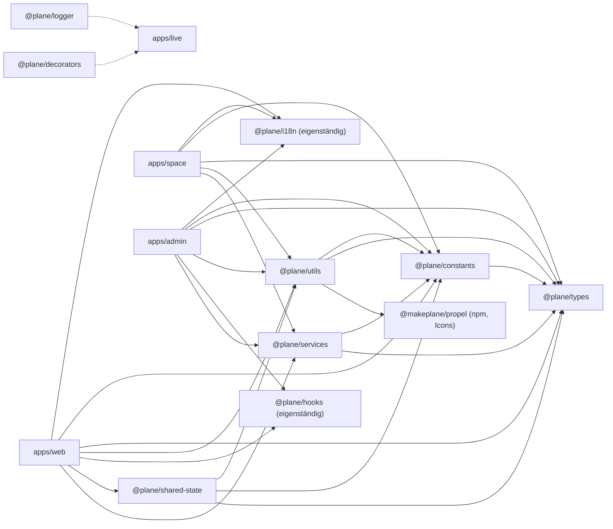
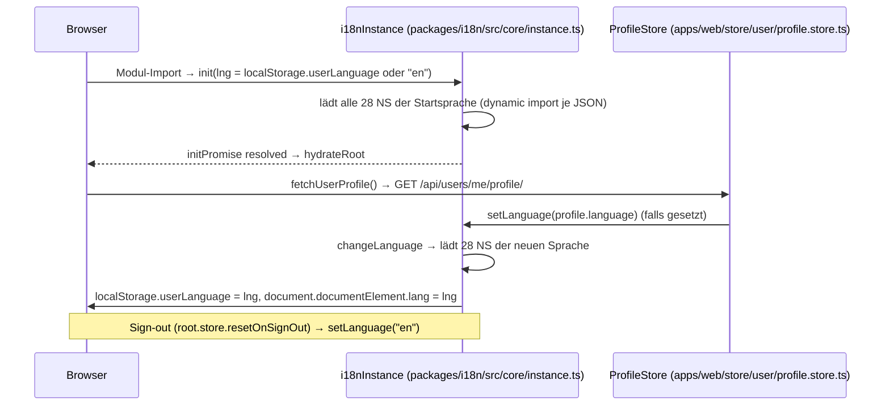

# 13b – Shared Packages: `i18n`, `constants`, `types`, `utils`, `hooks`, `shared-state`, `services`, `logger`, `decorators`, `codemods`

> **Bereich:** A13b · **Quelle:** Plane v1.4.2 Community Edition (`packages/*`, Stand Repo-Root `/home/user/plane`) · **Phase:** IST-Analyse
> **Verbindliche Leitplanken:** `migration/architecture/00-grundsatzentscheidungen.md` (ADR-000 … ADR-006). Insbesondere: ADR-001 (keine Plan-Stufen → `subscription.ts`/`payment.ts` entfallen), ADR-004 (airgapped → keine CDN-/Marketing-Links zur Laufzeit), ADR-005 (UI 1:1 → Texte, Farben, Sortier- und Default-Logik exakt übernehmen), ADR-006 (Original-Repo ist Referenz für Texte/i18n).
> **Verwandte Dokumente:** `migration/analysis/08-frontend-web-architektur.md` (Konsum der Pakete in `apps/web`), `migration/analysis/11-frontend-admin-space.md`, `migration/analysis/12-editor-echtzeit-live.md` (`logger`/`decorators` im Live-Server), `migration/features/20-paid-spuren-im-repo.md`.

Alle Pfade sind relativ zum Repo-Root. „statisch referenziert“ bedeutet: der vollständige Key kommt als String-Literal (`"…"`, `'…'` oder `` `…` ``) in `apps/web`, `apps/space`, `apps/admin`, `apps/live`, `packages/blocks`, `packages/editor`, `packages/constants`, `packages/utils` oder `packages/shared-state` vor (dynamisch zusammengesetzte Keys werden dabei nicht erkannt; Zählung per Skript über die Quelltexte).

---

## 1. Überblick & Verantwortlichkeiten

### 1.1 Paketübersicht

| Paket | Pfad | Version | Zweck | Laufzeit-Abhängigkeiten (`package.json`) | Framework-Bindung | Konsumenten (Anzahl Dateien mit Import) |
|---|---|---|---|---|---|---|
| `@plane/i18n` | `packages/i18n` | 1.4.2 | i18next-Instanz, React-Provider/Hook, 22 Locales × 28 Namespaces JSON | `i18next` 25.10.9, `i18next-icu` 2.4.3, `i18next-resources-to-backend` 1.2.1, `react` 19.2.8, `react-i18next` 16.6.6 | React (nur `provider/`, `hooks/`); JSON und `core/` framework-frei | `apps/web` 541, `packages/blocks` 20, `apps/space` 11, `apps/admin` 1 |
| `@plane/constants` | `packages/constants` | 1.4.2 | Fachliche Konstanten, Enums, Navigations-/Settings-Matrizen, Fetch-Keys, Fehlercodes | `@plane/types` | framework-frei (Ausnahme: `TAuthErrorInfo.message: string \| React.ReactNode` in `src/auth/index.ts`, `process.env.VITE_*` in `src/endpoints.ts`) | `apps/web` 473, `packages/services` 33, `apps/space` 21, `packages/utils` 15, `apps/admin` 15, `packages/blocks` 6, `packages/shared-state` 5, `packages/editor` 1 |
| `@plane/types` | `packages/types` | 1.4.2 | Alle Domain-/DTO-Typen (Grundlage API-Vertrag) | keine (nur devDeps) | überwiegend framework-frei; 10 Dateien referenzieren React-Typen (siehe 2.3.4) | `apps/web` 832, `packages/utils` 45, `apps/space` 45, `packages/constants` 31, `packages/services` 30, `apps/admin` 24, `packages/blocks` 23, `packages/shared-state` 10, `packages/editor` 7, `apps/live` 3, `packages/codemods` 1 |
| `@plane/utils` | `packages/utils` | 1.4.2 | Reine Hilfsfunktionen (Datum, Strings, Farben, Filter-Engine, Theme-Paletten, Markdown-Export …) | `@makeplane/propel` 0.7.3, `@plane/constants`, `@plane/types`, `chroma-js` ^3.2.0, `clsx` ^2.1.1, `date-fns` ^4.1.0, `hast`, `hast-util-to-mdast`, `lodash-es` 4.18.1, `lucide-react` 0.469.0, `mdast`, `react`, `rehype-parse` ^9.0.1, `rehype-remark` ^10.0.1, `remark-gfm` ^4.0.1, `remark-stringify` ^11.0.0, `sanitize-html` 2.17.7, `tailwind-merge` 3.4.0, `unified` ^11.0.5, `uuid` 14.0.0 | überwiegend framework-frei; React nur in `get-icon-for-link.ts`, `editor/common.ts` (`getTextContent`), `auth.ts` (Typ `ReactNode`), `rich-filters/factories/configs/shared.ts` (Typ) | `apps/web` 522, `packages/blocks` 44, `packages/editor` 34, `apps/space` 28, `apps/admin` 17, `packages/shared-state` 6, `apps/live` 1 |
| `@plane/hooks` | `packages/hooks` | 1.4.2 | 5 React-Hooks (Outside-Click, Dialog-Dismissal, LocalStorage, Hash-Scroll, Platform) | `react` | React | `apps/web` 38, `packages/editor` 4, `packages/blocks` 3, `apps/admin` 1 |
| `@plane/shared-state` | `packages/shared-state` | 1.4.2 | MobX-Stores für die Rich-Filter-Engine (Work-Item-Filter) | `@plane/constants`, `@plane/types`, `@plane/utils`, `lodash-es`, `mobx` 6.12.0, `mobx-utils` 6.0.8, `uuid`, `zod` ^3.25.76 (deklariert, aber in `src/` nicht importiert) | MobX | `apps/web` 19 |
| `@plane/services` | `packages/services` | 1.4.2 | Axios-Service-Klassen (Teilmenge der Web-Services; v. a. Admin/Space) | `@plane/constants`, `@plane/types`, `axios` 1.20.0, `file-type` ^21.3.1 | framework-frei (Axios, DOM für `signOut`) | `apps/space` 20, `apps/admin` 8, `apps/web` 7, `apps/live` 1 |
| `@plane/logger` | `packages/logger` | 1.4.2 | Winston-Logger + Express-Request-Logging | `winston` ^3.17.0, `express-winston` ^4.2.0 | Node/Express | `apps/live` 19 |
| `@plane/decorators` | `packages/decorators` | 0.1.0 | Express-Controller-/Route-/WebSocket-Decorators (reflect-metadata) | keine (nutzt `reflect-metadata`, `express`, `ws` als Typen) | Node/Express | `apps/live` 6 |
| `@plane/codemods` | `packages/codemods` | 1.4.2 | jscodeshift-Transformationen für das Monorepo (Entwickler-Werkzeug) | nur devDeps (`jscodeshift`, `@hypermod/utils`, `ast-types`, `vitest`) | Build-Werkzeug | keine Laufzeit-Konsumenten |

Quellen: `packages/*/package.json`, `pnpm-workspace.yaml` (Catalog-Versionen), Import-Zählung per `grep "@plane/<paket>\""` über `apps/*` und `packages/*`.

### 1.2 Abhängigkeitsgraph



### 1.3 Bewertung: framework-unabhängig / direkt im Angular-Frontend wiederverwendbar

| Paket / Teil | Bewertung | Begründung (Quelle) |
|---|---|---|
| `packages/i18n/src/locales/**/*.json` (616 Dateien) | **1:1 übernehmen (Asset-Kopie)** | reine JSON-Daten, ICU-Syntax framework-neutral; Struktur garantiert kollisionsfrei (Skripte `packages/i18n/scripts/*`) |
| `packages/i18n/src/core/*`, `constants/*`, `types/*` | **1:1 übernehmen** (i18next-Core ist framework-frei) | `i18next`, `i18next-icu`, `i18next-resources-to-backend` laufen ohne React; nur `initReactI18next` (`src/core/instance.ts`) entfernen |
| `packages/i18n/src/provider/*`, `hooks/*` | **neu bauen** (Angular-Service/Pipe) | React-Kontext/Hook; Verhalten (`coerceToString`, `changeLanguage`) 1:1 nachbilden |
| `packages/types/src/**` | **1:1 übernehmen**, React-Typen ersetzen (10 Dateien, siehe 2.3.4) | reine TS-Typdefinitionen; zusätzlich Vorlage für C#-DTOs |
| `packages/constants/src/**` | **1:1 übernehmen** außer `subscription.ts`, `payment.ts`, `endpoints.ts` (Runtime-Config statt `process.env`), Marketing-Links | pure TS-Objekte/Enums |
| `packages/utils/src/**` | **überwiegend 1:1** (pure Funktionen; Ausnahmen in Tabelle 2.4 mit B/C/D markiert); anpassen: `get-icon-for-link.ts` (liefert React-Komponenten), `editor/common.ts#getTextContent` (React-Typ), `subscription.ts` (entfällt), `file.ts#getFileURL` (API-Basis-URL) | siehe Tabelle 2.4 |
| `packages/shared-state/src/**` | **Logik 1:1 portieren, Reaktivität neu** (MobX → Angular Signals) | Filter-Algorithmen liegen größtenteils in `@plane/utils`; Stores sind dünne MobX-Hüllen |
| `packages/services/src/**` | **neu bauen** als Angular-`HttpClient`-Services, Endpunkte/Fehlersemantik 1:1 | Axios-spezifisch, aber trivial abbildbar |
| `packages/hooks/src/**` | **neu bauen** (Angular-Direktiven/Services/CDK) | React-Hooks |
| `packages/logger`, `packages/decorators` | **entfallen** (Live-Server wird .NET, ADR-002) | Express/Winston |
| `packages/codemods` | **entfällt** | Entwicklerwerkzeug für React-Code |

### 1.4 Build/Toolchain (alle Pakete außer `codemods`)

| Aspekt | Wert | Quelle |
|---|---|---|
| Bundler | `tsdown` (ESM, `dts: true`); `i18n`: `platform: "neutral"`, Entry `src/index.ts` | `packages/*/tsdown.config.ts` |
| i18n-Build | `pnpm run generate:types && tsdown` → erzeugt `src/types/keys.generated.ts` (Union `TTranslationKeys` aller 3 859 Keys); Datei ist gitignored | `packages/i18n/package.json`, `.gitignore` Zeile 115–116 |
| i18n-CI | `check:sync` = `tsx scripts/sync-check.ts --ci` (Exit 1 bei fehlenden Keys, Namespace-Kollisionen, Pfad-Konflikten) | `packages/i18n/package.json`, `packages/i18n/scripts/sync-check.ts` |
| Lint/Format | `oxlint --max-warnings=N` (i18n 9, constants 2, types 1, utils 38), `oxfmt` | jeweilige `package.json` |
| Lizenz-Header | jede Quelldatei: `SPDX-License-Identifier: AGPL-3.0-only` | alle `src`-Dateien |

---

## 2. Vollständige Inventare

### 2.1 `packages/i18n`

#### 2.1.1 Library-Dateien

| Datei | Exporte | Inhalt / Verhalten |
|---|---|---|
| `packages/i18n/src/index.ts` | `TranslationProvider`, `useTranslation`, Typ `TTranslationStore`, Typen `TLanguage`, `ILanguageOption`, `TTranslationKeys`, `TNamespace`, `setLanguage`, `initPromise`, `FALLBACK_LANGUAGE`, `SUPPORTED_LANGUAGES`, `LANGUAGE_STORAGE_KEY` | öffentliche API (nicht exportiert: `i18nInstance`, `NAMESPACES`, `DEFAULT_NAMESPACE`) |
| `packages/i18n/src/types/language.ts` | `TLanguage` (Union der 22 Codes), `ILanguageOption {label; value}` | — |
| `packages/i18n/src/types/index.ts` | re-export `language`, `TTranslationKeys` aus `keys.generated` | `keys.generated.ts` wird beim Build generiert |
| `packages/i18n/src/constants/language.ts` | `FALLBACK_LANGUAGE = "en"`, `SUPPORTED_LANGUAGES` (22 Einträge, Reihenfolge = Anzeige-Reihenfolge im Sprachmenü), `LANGUAGE_STORAGE_KEY = "userLanguage"` | siehe 2.1.3 |
| `packages/i18n/src/constants/namespaces.ts` | `NAMESPACES` (28, alphabetisch), `TNamespace`, `DEFAULT_NAMESPACE = "common"` | siehe 2.1.4 |
| `packages/i18n/src/core/instance.ts` | `i18nInstance` (`i18n.createInstance()`), `initPromise` | Plugins `ICU`, `initReactI18next`, `resourcesToBackend((lng, ns) => import(\`../locales/${lng}/${ns}.json\`))`; Init-Optionen siehe 2.1.2; danach `loadNamespaces(NAMESPACES)` |
| `packages/i18n/src/core/set-language.ts` | `setLanguage(lng): Promise<void>` | `await initPromise` → `changeLanguage(lng)` → `localStorage["userLanguage"] = lng`, `document.documentElement.lang = lng` |
| `packages/i18n/src/core/index.ts` | re-export `i18nInstance`, `initPromise`, `setLanguage` | — |
| `packages/i18n/src/hooks/use-translation.ts` | `useTranslation(): TTranslationStore`, Typ `TTranslationStore {t; currentLocale; changeLanguage; languages}` | `t(key, params?)` ruft react-i18next-`t` ohne Namespace-Argument; Ergebnis durch `coerceToString` (Strings durch; Zahlen/Booleans → `String()`; Objekt/`null`/`undefined` → **der Key selbst** + `console.warn` außerhalb Produktion). `changeLanguage` (fire-and-forget, Fehler → `console.error("Failed to change language:", err)`), `currentLocale = i18n.language`, `languages = SUPPORTED_LANGUAGES` |
| `packages/i18n/src/hooks/index.ts` | re-export | — |
| `packages/i18n/src/provider/index.tsx` | `TranslationProvider` | rendert **unbedingt** `<I18nextProvider i18n={i18nInstance}>` (Kommentar: Bereitschaft wird vor Hydration über `initPromise` sichergestellt; kein `return null`, um Hydration-Mismatch zu vermeiden) |
| `packages/i18n/scripts/generate-types.ts` | CLI | liest `src/locales/en/*.json`, flacht Keys ab (Punkt-Notation), bricht ab bei JSON-Fehler, Cross-Namespace-Kollision oder Pfad-Konflikt (Key ist Blatt **und** Präfix), schreibt `src/types/keys.generated.ts` mit `export type TTranslationKeys = \| "…" …;` (sortiert) |
| `packages/i18n/scripts/sync-check.ts` | CLI (`--ci`) | lädt alle Locale-Ordner, vergleicht mit `en`: fehlende/veraltete Keys je Locale (Abdeckung in %), Kollisionen, Pfad-Konflikte; zeigt max. 20 Keys je Liste; mit `--ci` Exit-Code 1 bei Fehlern (fehlende Keys, Kollisionen, Pfad-Konflikte; veraltete Keys sind kein Fehler) |
| `packages/i18n/scripts/lib/locale-io.ts` | `LOCALES_DIR`, `flattenKeys`, `readJsonFile`, `listLocales`, `loadLocale`, Typen `NamespaceData`, `LocaleData` | Hilfen für `sync-check.ts` (Arrays gelten als Blatt) |
| `packages/i18n/scripts/tsconfig.json` | — | `module: Node16`, `strict` |
| `packages/i18n/tsconfig.json` | — | `resolveJsonModule: true`, `noUncheckedIndexedAccess: false`, exkludiert `scripts` |
| `packages/i18n/.prettierignore` | — | `.next/`, `.react-router/`, `.turbo/`, `.vite/`, `build/`, `dist/`, `node_modules/`, `out/`, `pnpm-lock.yaml`, `storybook-static/`, `src/types/keys.generated.ts` |
| `.claude/skills/translate/SKILL.md` | — | redaktionelle Übersetzungsregeln: Do-not-translate-Glossar (Plane, Plane AI, Power K, PQL, Intake, Active Cycles, Sticky/Stickies, Pro/Business/Enterprise, Drittprodukte, Akronyme), Pflicht-Glossar für Cycle/Module/Epic/Page je Locale, CLDR-Pluralformen, Slawische Kasusformen, Register je Sprache |

#### 2.1.2 i18next-Konfiguration (`packages/i18n/src/core/instance.ts`)

| Option | Wert | Wirkung / Portierungsrelevanz |
|---|---|---|
| `lng` | `localStorage.getItem("userLanguage") \|\| "en"` (nur im Browser; sonst `"en"`) | Startsprache vor Profil-Fetch |
| `fallbackLng` | `"en"` | fehlende Keys einer Locale → englischer Text |
| `supportedLngs` | die 22 Codes aus `SUPPORTED_LANGUAGES` | andere Codes werden auf `fallbackLng` abgebildet |
| `ns` | alle 28 Namespaces | — |
| `defaultNS` | `"common"` | Keys ohne Namespace werden zuerst in `common.json` gesucht |
| `fallbackNS` | alle Namespaces außer `common` (alphabetische Reihenfolge aus `NAMESPACES`) | **jeder Key wird in allen Namespaces gesucht** → Komponenten übergeben nie einen Namespace; Eindeutigkeit garantiert durch Kollisionsprüfung (0 Kollisionen, 0 Pfad-Konflikte in `en`, geprüft) |
| `partialBundledLanguages` | `true` | erlaubt Backend-Nachladen |
| `keySeparator` | `"."` | verschachtelte JSON-Objekte, Zugriff per Punkt |
| `nsSeparator` | `false` | `:` hat keine Sonderbedeutung; ein Key wie `common.states` bedeutet *JSON-Pfad* `common` → `states` in `common.json` |
| `interpolation.escapeValue` | `false` | kein HTML-Escaping durch i18next (React escaped); **Angular: Interpolation in Templates escaped ebenfalls; bei `[innerHTML]` selbst sanitizen** |
| `returnNull` / `returnEmptyString` | `false` / `false` | leere Strings gelten als fehlend → Fallback auf `en`, dann Key |
| `returnObjects` | `false` | trotzdem liefert `i18next-icu` bei Ast-Keys Objekte → Absicherung über `coerceToString` |
| `react.useSuspense` | `false` | — |
| Nach `init` | `loadNamespaces(NAMESPACES)` | alle 28 Namespaces der Startsprache werden eager geladen (verhindert Re-Render-Kaskaden) |
| Backend | `resourcesToBackend` mit dynamischem `import()` | Vite erzeugt je `<lng>/<ns>.json` einen eigenen Chunk → Lazy Loading **pro Sprache**; bei Sprachwechsel lädt i18next alle 28 Namespaces der neuen Sprache |
| Formatter | `i18next-icu` (ICU MessageFormat via `intl-messageformat`/`Intl.PluralRules`) | Plural/Select-Regeln kommen aus `Intl.PluralRules(<lng>)` → siehe Edge-Case `ua` in 2.1.3 |

#### 2.1.3 Sprachen (22) – `packages/i18n/src/constants/language.ts`

Reihenfolge = Reihenfolge im Sprach-Dropdown (`apps/web/components/settings/profile/content/pages/preferences/language-and-timezone-list.tsx`, `apps/web/components/power-k/ui/pages/preferences/languages-menu.tsx`). Spalte „Intl-Pluralregel“: Ergebnis von `new Intl.PluralRules(code).resolvedOptions()` in Node 22 (geprüft).

| # | Code | Label (exakt) | Intl-aufgelöste Locale | Plural-Kategorien | Bemerkung |
|---|---|---|---|---|---|
| 1 | `en` | English | en | one, other | Quelle aller Keys |
| 2 | `fr` | Français | fr | one, many, other | — |
| 3 | `es` | Español | es | one, many, other | — |
| 4 | `ja` | 日本語 | ja | other | — |
| 5 | `zh-CN` | 简体中文 | zh | other | — |
| 6 | `zh-TW` | 繁體中文 | zh | other | — |
| 7 | `ru` | Русский | ru | one, few, many, other | — |
| 8 | `it` | Italian | it | one, many, other | Label englisch (nicht „Italiano“) – 1:1 übernehmen |
| 9 | `cs` | Čeština | cs | one, few, many, other | — |
| 10 | `sk` | Slovenčina | sk | one, few, many, other | — |
| 11 | `de` | Deutsch | de | one, other | — |
| 12 | `ua` | Українська | **en-US** | **one, other** | **Edge-Case:** `ua` ist kein gültiger ISO-639-Sprachcode (korrekt wäre `uk`); `Intl` fällt auf `en-US` zurück → die in `ua/*.json` vorhandenen `few`/`many`-Zweige werden **nie** gewählt (z. B. 21 → `other` statt `one`) |
| 13 | `pl` | Polski | pl | one, few, many, other | — |
| 14 | `ko` | 한국어 | ko | other | — |
| 15 | `pt-BR` | Português Brasil | pt | one, many, other | — |
| 16 | `id` | Indonesian | id | other | Label englisch (nicht „Bahasa Indonesia“) |
| 17 | `ro` | Română | ro | one, few, other | — |
| 18 | `vi-VN` | Tiếng việt | vi | other | Kleinschreibung „việt“ exakt so |
| 19 | `tr-TR` | Türkçe | tr | one, other | — |
| 20 | `ka-ge` | ქართული | ka | one, other | Code klein `ka-ge` |
| 21 | `nl` | Nederlands | nl | one, other | — |
| 22 | `bg` | Български | bg | one, other | — |

(Alle 22 Codes sowie `uk` wurden per `node -e "new Intl.PluralRules(code)"` geprüft; `uk` → `uk` mit one/few/many/other.)

#### 2.1.4 Namespaces (28) – Inventar `packages/i18n/src/locales/en/<ns>.json`

Legende Klassifikation: **CE** = Texte der Community-UI; **EE** = Texte ausschließlich für Bezahl-Features (im CE-Code 0 % statisch referenziert, sie existieren, weil das i18n-Paket mit der Enterprise-Codebasis geteilt wird); **gemischt** = CE-Texte plus EE-Teilbäume (Details 2.1.9, vollständige Teilbaum-Liste in Anhang A).

| Namespace | Keys (en) | Top-Level-Keys | ICU plural/select | Werte mit einfachem `{platzhalter}` | statisch referenziert | Klass. | Inhalt |
|---|---|---|---|---|---|---|---|
| `accessibility` | 33 | `aria_labels` | 0 | 0 | 24 (73 %) | CE | ARIA-Labels: `projects_sidebar` (21), `auth_forms` (5), `breadcrumb` (2), `common` (2), `color_picker` (3) |
| `auth` | 186 | `sso`, `auth` | 0 | 7 | 41 (22 %) | gemischt | `auth.common/sign_up/sign_in/forgot_password/reset_password/set_password/sign_out` (CE); `sso.domain_management` (47), `sso.providers` (66), `auth.ldap` (2) = EE (SSO/SAML/OIDC/LDAP, Domain-Verifizierung) |
| `automation` | 141 | `automations` | 1 | 7 | 0 (0 %) | **EE** | Automations-Flows (Trigger/Conditions/Actions), siehe 2.1.8 |
| `common` | 766 | 397 Top-Level-Keys (378 Blätter + 19 Objekte; Liste Anhang B) | 4 | 28 | 521 (68 %) | gemischt | generische UI-Texte (Buttons, Felder, Toasts, Rollen, Sortierung, Theme, Profil, Favoriten, Projekt-Erstellung, Work-Item-Modal …); EE-/Upsell-bezogene Keys: `upgrade`, `upgrade_request`, `contact_sales`, `renew`, `pi_chat`, `workspace_dashboards`, `milestones`, `milestones_description`, `forms`, `in_app`, `time_tracking`, `time_tracking_description`, `work_management`, `work_management_description`, `hyper_mode`, `active_cycles`, `active_cycles_description`, `10000_feet_view*`, `get_snapshot_of_each_active_cycle*`, `compare_burndowns*`, `quickly_see_make_or_break_issues*`, `zoom_into_cycles_that_need_attention*`, `stay_ahead_of_blockers*`, `cloud_maintenance_message.*`, `self_hosted_maintenance_message.*`, `common.upgrade_cta.*` (teils im CE als Upsell-UI referenziert, siehe 2.1.9) |
| `cycle` | 11 | `active_cycle`, `cycle`, `active_cycle_analytics` | 1 | 1 | 7 (64 %) | gemischt | `cycle.label` (Plural), Active-Cycle-Empty-States; `active_cycle_analytics.empty_state` (4, EE) |
| `editor` | 29 | `attachmentComponent`, `externalEmbedComponent`, `ai_block` | 0 | 1 | 0 (0 %) | **EE** | Editor-Erweiterungen: Datei-Anhang-Block (Uploader, 6 Fehlertexte, Upgrade-Hinweis), External-Embed-Block, AI-Block (Block-Typen, 7 Aktionen) |
| `empty-state` | 142 | `common_empty_state`, `project_empty_state`, `workspace_empty_state`, `settings_empty_state` | 0 | 0 | 72 (51 %) | gemischt | Leerzustände (Titel/Beschreibung/CTA); EE: `epics`, `epic_work_items`, `archive_epics`, `dashboard`, `wiki`, `active_cycles`, `work_item_types`, `work_item_type_properties`, `templates`, `recurring_work_items`, `worklogs`, `group_syncing`, `template_setting`, `workflows`, `workspace_tokens`, `project_overview_state_sidebar` |
| `home` | 43 | `home` | 1 | 0 | 35 (81 %) | gemischt | Home-Widgets (`empty`, `quick_links`, `recents`, `new_at_plane`, `quick_tutorial`, `widget`); `home.business_trial_banner` (6, EE, Plural `trial_ends_in_days`) |
| `inbox` | 43 | `inbox_issue` | 1 | 4 | 32 (74 %) | CE | Intake: Status (pending/declined/snoozed/accepted/duplicate), Modals, Fehler, Aktionen, Sortierung, Tabs, Empty-States |
| `integration` | 291 | `integrations`, `github_integration`, `gitlab_integration`, `gitlab_enterprise_integration`, `slack_integration`, `sentry_integration`, `bitbucket_dc_integration`, `oauth_bridge_integration`, `github_enterprise_integration`, `silo_errors`, `import_status` | 0 | 11 | 1 (0 %) | **EE** | „Silo“-Integrationen & Importer-Status, siehe 2.1.8 |
| `module` | 3 | `module` | 1 | 1 | 1 (33 %) | CE | `module.label` (Plural) |
| `navigation` | 24 | `command_k`, `sidebar` | 0 | 0 | 15 (62 %) | CE | Sidebar-Labels, Command-K-Leerzustand |
| `notification` | 36 | `notification` | 0 | 1 | 31 (86 %) | CE | Inbox-Benachrichtigungen: Optionen, Toasts, Tabs, Filter, Snooze |
| `page` | 56 | `page_navigation_pane`, `page_actions`, `page_content_limit_banner` | 0 | 0 | 20 (36 %) | gemischt | Page-Navigation-Pane (Tabs Outline/Info/Assets …); EE: `page_actions.move_page` (15), `page_actions.remove_from_collection` (3), `page_navigation_pane.toasts` (14) |
| `power-k` | 151 | `power_k` | 0 | 1 | 144 (95 %) | CE | Command-Palette „Power K“: Aktionen, Navigation, Preferences, Hilfe, Placeholders, Shortcuts-Modal, Gruppentitel |
| `project` | 200 | `project_view`, `project_cycles`, `project_views`, `project_issues`, `project_module`, `project_page`, `disabled_project`, `project_modules`, `project_members`, `project` | 0 | 2 | 93 (46 %) | gemischt | Cycles/Views/Modules/Pages-UI des Projekts; EE: `project.members_import` (25), `project_cycles.transfer` |
| `project-settings` | 288 | `project_settings` | 0 | 2 | 98 (34 %) | gemischt | Projekt-Settings (general, members, states, labels, estimates, automations, features); EE: `workflows` (50), `work_item_types` (2), `project_updates` (2), `templates` (2), `cycles.auto_schedule` (42), `features.time_tracking`, `features.milestones`, `features.intake.intake_sources/email/form` |
| `settings` | 78 | `account_settings`, `profile`, `themes` | 0 | 0 | 32 (41 %) | CE | Account-Settings, Profil-Statistiken/Tabs, Theme-Optionen |
| `stickies` | 29 | `stickies` | 0 | 0 | 23 (79 %) | CE | Stickies-Widget/Seite, Toasts, Empty-States |
| `template` | 137 | `templates` | 1 (`select`) | 4 | 0 (0 %) | **EE** | Templates (Projekt/Work-Item/Page) inkl. Marketplace-Publishing, siehe 2.1.8 |
| `tour` | 89 | `product_tour`, `get_started` | 0 | 1 | 0 (0 %) | **EE** | Produkt-Tour & „Get started“-Checkliste (Cloud/EE-Onboarding) |
| `update` | 29 | `updates` | 1 | 0 | 0 (0 %) | **EE** | Projekt-/Epic-Updates (Status-Posts, Reaktionen) |
| `wiki` | 73 | `wiki_collections`, `wiki` | 2 | 2 | 0 (0 %) | **EE** | Wiki-Collections + Upgrade-Flow, siehe 2.1.8 |
| `work-item` | 198 | `issue`, `sub_work_item`, `issue_relation`, `issue_comment`, `bulk_operations`, `recurring_work_items`, `epic` | 4 | 4 | 109 (55 %) | gemischt | Work-Item-UI; EE: `recurring_work_items` (29), `bulk_operations.error_details` (8), `issue.pages` (13), `issue.vote` (4), `issue.duplicate` (4) |
| `work-item-type` | 207 | `work_item_types`, `work_item_type_hierarchy` | 2 | 26 | 0 (0 %) | **EE** | Work-Item-Types, Custom Properties (inkl. Formeln), Hierarchie, siehe 2.1.8 |
| `workflow` | 40 | `workflows` | 2 | 5 | 0 (0 %) | **EE** | Workflows/State-Transitions mit Reviewern, siehe 2.1.8 |
| `workspace` | 184 | `workspace_creation`, `workspace_dashboard`, `workspace_analytics`, `workspace_projects`, `workspace_views`, `workspace_draft_issues`, `workspace_pages`, `workspace_cycles`, `workspace` | 3 | 10 | 78 (42 %) | gemischt | Workspace-Erstellung, Analytics, Projekte, Views, Drafts; EE: `workspace.members_import` (24), `workspace_dashboard`, Teile `workspace_analytics` |
| `workspace-settings` | 352 | `workspace_settings` | 1 | 10 | 84 (24 %) | gemischt | Workspace-Settings; EE: `billing_and_plans`, `worklogs`, `group_syncing`, `identity`, `project_states`, `projects`, `templates`, `relations`, `cancel_trial`, `applications` (161), `plane-intelligence`, `runners`, `integrations`, `imports` |
| **Summe** | **3 859** | — | **25** | **128** | **1 461 (38 %)** | — | — |

Dynamisch zusammengesetzte Keys (vom Zähler „statisch referenziert“ nicht erfasst, aber genutzt): `` t(`${featureItem.key}_description`) `` (`apps/web/components/project/settings/features-list.tsx` → `cycles_description`, `modules_description`, `views_description`, `pages_description`, `intake_description`; `time_tracking_description` und `work_management_description` werden dort nicht verwendet), `` t(`${item.key}_description`) `` (`apps/web/components/active-cycles/workspace-active-cycles-upgrade.tsx` → `10000_feet_view_description`, `get_snapshot_of_each_active_cycle_description`, `compare_burndowns_description`, `quickly_see_make_or_break_issues_description`, `zoom_into_cycles_that_need_attention_description`, `stay_ahead_of_blockers_description`), `` t(`profile.empty_state.${profileViewId}.title|description`) ``, `` t(`account_settings.profile.change_email_modal.${path}`) ``, `` t(`${isEpic ? "epic.new" : "issue.new"}`) `` (`apps/web/components/issues/issue-layouts/quick-add/*`), `t(getDescriptionPlaceholderI18n(...))` (`common.press_for_commands`/`common.click_to_add_description`) sowie alle `i18n_label`/`i18n_title`/`titleTranslationKey`-Felder aus `packages/constants` (diese sind als Literale gezählt). Die Prozentwerte sind daher **Untergrenzen** für CE-Nutzung; 0 % bei den EE-Namespaces wurde zusätzlich per Präfix-Suche (`grep "wiki_collections\."`, `"workflows\."`, `"work_item_types\."` …) bestätigt.

Weitere Fakten: Jeder Top-Level-Key existiert in genau **einem** Namespace (Namespace ist aus dem ersten Key-Segment eindeutig ableitbar); alle Blätter sind Strings (keine Arrays/Zahlen); keine HTML-Tags, keine i18next-`{{…}}`-Interpolation (nur ICU `{…}`); Größe `en` 312 KB, alle Locales 7,7 MB (Quelle: Skriptauswertung `packages/i18n/src/locales`).

#### 2.1.5 Vollständigkeit je Locale

Alle 22 Locale-Ordner enthalten exakt dieselben 28 Dateien und je **3 859 Keys**; 0 fehlende, 0 veraltete Keys gegenüber `en` (Skriptauswertung analog `packages/i18n/scripts/sync-check.ts`). Locales: `bg`, `cs`, `de`, `en`, `es`, `fr`, `id`, `it`, `ja`, `ka-ge`, `ko`, `nl`, `pl`, `pt-BR`, `ro`, `ru`, `sk`, `tr-TR`, `ua`, `vi-VN`, `zh-CN`, `zh-TW`. Die Pluralform-Vollständigkeit je Sprache (z. B. `few`/`many` in `ru`) wird **nicht** maschinell geprüft (Hinweis in `.claude/skills/translate/SKILL.md`).

#### 2.1.6 ICU-Nachrichten mit `plural`/`select` (vollständig, `en`)

| Namespace | Key | Wert (en) |
|---|---|---|
| automation | `automations.action.configuration.change_property.placeholders.property_value_select` | `{count, plural, one{Select value} other{Select values}}` |
| common | `subscriber` | `{count, plural, one{# Subscriber} other{# Subscribers}}` |
| common | `member` | `{count, plural, one{# member} other{# members}}` |
| common | `view.label` | `{count, plural, one {View} other {Views}}` |
| common | `labels_count` | `{count, plural, one {# label} other {# labels}}` |
| cycle | `cycle.label` | `{count, plural, one {Cycle} other {Cycles}}` |
| home | `home.business_trial_banner.trial_ends_in_days` | `Trial ends in {days, plural, one {# day} other {# days}}` |
| inbox | `inbox_issue.status.snoozed.description` | `{days, plural, one{# day} other{# days}} to go` |
| module | `module.label` | `{count, plural, one {Module} other {Modules}}` |
| template | `templates.settings.form.publish.action` | `{isPublished, select, true {Publish settings} other {Publish to Marketplace}}` |
| update | `updates.progress.comments` | `{count, plural, one{# Comment} other{# Comments}}` |
| wiki | `wiki_collections.delete_modal.page_count` | `This collection has {pageCount} {pageCount, plural, one {page} other {pages}}. Choose what happens to them.` |
| wiki | `wiki_collections.add_existing_page_modal.success_message` | `{count} {count, plural, one {page} other {pages}} added to collection.` |
| work-item-type | `work_item_type_hierarchy.break_hierarchy_modal.content.parent_items` | `{count, plural, one {parent work item} other {parent work items}}` |
| work-item-type | `work_item_type_hierarchy.break_hierarchy_modal.content.child_items` | `{count, plural, one {sub-work item} other {sub-work items}}` |
| work-item | `issue.label` | `{count, plural, one {Work item} other {Work items}}` |
| work-item | `issue.add.cycle.success` | `{count, plural, one {Work item} other {Work items}} added to the cycle successfully.` |
| work-item | `issue.add.cycle.loading` | `Adding {count, plural, one {work item} other {work items}} to the cycle` |
| work-item | `epic.label` | `{count, plural, one {Epic} other {Epics}}` |
| workflow | `workflows.workflow_states.state_change_count` | `{count, plural, one {1 permitted state change} other {{count} permitted state changes}}` |
| workflow | `workflows.workflow_states.movers_count` | `{count, plural, one {1 listed reviewer} other {{count} listed reviewers}}` |
| workspace-settings | `workspace_settings.settings.applications.uploading_images` | `Uploading {count} Image{count, plural, one {s} other {s}}` (Quelltext-Fehler: beide Zweige „s“) |
| workspace | `workspace_projects.label` | `{count, plural, one {Project} other {Projects}}` |
| workspace | `workspace_projects.common.months_count` | `{months, plural, one{# month} other{# months}}` |
| workspace | `workspace_projects.common.days_count` | `{days, plural, one{# day} other{# days}}` |

ICU-Escaping-Sonderfall: `work_item_types.settings.properties.formula.tooltip` enthält `'{'Field Name'}'` (ICU-Apostroph-Escape → angezeigt als `{Field Name}`), `packages/i18n/src/locales/en/work-item-type.json`.

#### 2.1.7 Platzhalter-Inventar (alle Variablennamen in `{…}`, en)

| Platzhalter | Namespaces |
|---|---|
| `count` | automation, common, cycle, module, project, update, wiki, work-item-type, work-item, workflow, workspace-settings, workspace |
| `name` | automation, common, integration, tour, work-item-type, work-item |
| `workspace` | inbox, notification, workspace-settings, workspace |
| `entity` | common, workspace-settings, workspace |
| `days` | automation, home, inbox, workspace |
| `action` | work-item-type, workflow |
| `page` | common, wiki |
| `size` | common, workspace-settings |
| `plural` | project, workspace |
| `activeProviderLongName`, `activeProviderShortName`, `newProviderLongName`, `newProviderShortName`, `ldapProviderName`, `seconds`, `workspaceName` | auth |
| `day`, `description`, `time`, `timezone` | automation |
| `fileName`, `length`, `max` | common |
| `maxFileSize` | editor |
| `date`, `project`, `providerName` | integration |
| `value` | inbox |
| `query` | power-k |
| `groupKey`, `step`, `total` | project-settings |
| `isPublished`, `templateName`, `templateType` | template |
| `pageCount`, `pages` | wiki |
| `error`, `level`, `resultType`, `workItemTypeName` | work-item-type |
| `app`, `s` | workspace-settings |
| `email`, `firstName`, `lastName`, `months`, `plan`, `tab` | workspace |
| `Cycle`/`Cycles`, `Epic`/`Epics`, `Module`/`Modules`, `Project`/`Projects`, `View`/`Views` | (Artefakte der Plural-Zweige in cycle/work-item/module/workspace/common – keine echten Variablen) |

#### 2.1.8 EE-Namespaces im Detail (Text-Referenz für die Portierung der Bezahl-Features)

Diese Namespaces sind im CE-Code zu **0 %** statisch referenziert (2.1.4). Sie sind die einzige im Repo vorhandene, vollständig übersetzte (22 Sprachen) Textquelle der betreffenden Bezahl-Features und definieren damit implizit UI-Elemente, Validierungsregeln und Toast-Texte. Upsell-Teilbäume (`*.upgrade*`, `*.get_pro*`, `*upgrade_flow*`) entfallen gemäß ADR-001 in der UI, die JSON-Dateien bleiben unverändert.

| Namespace / Datei | Teilbäume (Keys) | Fachlicher Inhalt (aus den Texten abgeleitet) | Upsell-Keys (entfallen in UI) |
|---|---|---|---|
| `wiki.json` (73) | `wiki_collections.predefined` (4: `general`, `private`, `shared`, `archived`), `fallback_name`, `form` (4), `create_modal` (2), `edit_modal` (1), `delete_modal` (10), `header` (1), `menu` (4), `add_existing_page_modal` (6), `list` (18 inkl. `columns.page_name/owner/nested_pages/last_activity/actions`), `toasts` (11); `wiki.upgrade_flow` (10), `wiki.nested_pages_download_banner` (1) | **Wiki-Collections**: vordefinierte Collections General/Private/Shared/Archived; Collection anlegen/umbenennen (Titel Pflicht, < 255 Zeichen); Löschen mit Wahl „Pages in andere Collection verschieben (Berechtigungen der Ziel-Collection werden geerbt)“ oder „mit Pages löschen“; bestehende Pages hinzufügen (Suche, Plural-Erfolgsmeldung); Listen-Spalten Page name/Owner/Nested pages/Last activity/Actions; „Invite only“, „Restricted Access“, Expand/Collapse verschachtelter Pages; Link-Kopieren für Page und Collection | `wiki.upgrade_flow.*` (inkl. Tabs „Nested Pages“, „Add embeds“, „Publish pages“, „Comments“, Button „Download data“), `wiki.nested_pages_download_banner.title` |
| `workflow.json` (40) | `workflows.workflow_states` (11), `workflow_disabled` (1), `workflow_enabled` (1), `workflow_tree` (2), `empty_state.upgrade` (2), `quick_actions` (2), `confirmation_modals` (4), `toasts` (17) | **Workflows**: je State „Allow new work items“ (Default-State erlaubt immer Erstellung, nicht änderbar); erlaubte State-Übergänge („Change state to“) mit optionalen **Reviewern** („When reviewed by“ = Personen, die verschieben dürfen); Baumdarstellung „For work items in … can move it to“; Hinweis „You can't move this work item here.“; Aktionen „View change history“, „Reset workflow“ (löscht alle Regeln); Toasts für enable/disable (`{action}`), reset, add/modify/remove rule, modify reviewers | `workflows.empty_state.upgrade.*` |
| `work-item-type.json` (207) | `work_item_types.settings` (126), `create` (7), `update` (7), `create_update` (2), `enable_disable` (6), `change_confirmation` (4), `empty_state` (13); `work_item_type_hierarchy.settings` (9), `levels` (12), `break_hierarchy_modal` (12), `work_item_modal` (4), `work_item_type_modal` (3) | **Work-Item-Types**: Default-Type (nicht löschbar, nur aktiv setzbar, „Set as default“ importiert Type in alle Projekte); Workspace-Types + „Import from workspace“ auf Projektebene; **Custom Properties** Typen `text` (single line/paragraph/read only), `number`, `dropdown` (Options, eindeutige Namen, single/multi select), `boolean` (True/False, kein Default), `date`, `member_picker`, `formula` (Syntax `{Field Name}`, Operatoren `+ - * / &`, „Test“-Validierung mit Rückgabetyp und Anzahl referenzierter Felder, Fehler: leer, ungültig, Zirkelbezug, Referenz auf nicht existierende Property); Pflichtfeld-Logik (Mandatory), aktiv/inaktiv, Löschen vs. Deaktivieren, „Linked properties“ (Unlink löscht alle Werte, Bestätigung durch Eintippen des Namens); Type-Wechsel am Work Item mit Warnung (Verlust von Property-Werten); Projekt-Enable („can't be disabled“); **Hierarchie**: Ebenen per Drag&Drop, Default-Ebene, Validierung „break hierarchy“ (Plural parent/sub-work items, Bestätigung durch Eintippen „Confirm“), Fehler-Toasts bei regelwidrigem Type beim Erstellen/Ändern | `work_item_types.empty_state.get_pro.*`, `work_item_types.empty_state.upgrade.*` |
| `template.json` (137) | `templates.settings` (96), `empty_state` (12), `toasts` (16), `delete_confirmation` (3), `unpublish_confirmation` (3), `dropdown` (7) | **Templates** für Projekte, Work Items, Pages (Workspace- und Projekt-Ebene; „Derived from workspace/project“); Formulare mit Template-Name (Pflicht, < 255) + Inhalt; „Use template“; **Marketplace-Publishing** (`publish.*`: Name, Short description, Description, Category (≥ 1), Keywords (kommasepariert, ≥ 1), Website URL (< 800), Company name, Contact email, Privacy-Policy-/Terms-URL (< 800), Cover image (Pflicht), Screenshots (≥ 1)); Toasts mit `{templateName}`/`{templateType}` | `templates.empty_state.upgrade.*` (Marketplace-Publishing ist Cloud-Funktion → gemäß ADR-004 offen, siehe Abschnitt 6) |
| `automation.json` (141) | `automations.settings` (2), `scope` (2), `trigger` (42), `condition` (3), `action` (20), `conjunctions` (4), `enable` (2), `delete` (1), `table` (10), `create_modal` (7), `delete_modal` (1), `activity` (5), `toasts` (24), `empty_state` (5), `global_automations` (13) | **Custom Automations**: Trigger „Plane events“ oder „Time based“ (Fixed schedule Daily/Weekly/Monthly mit Zeit, AM/PM, Zeitzone; oder Cron-Ausdruck mit Validierung und Klartext-Vorschau); Conditions („Provided“, And/Or/If/Then); Actions `add_comment`, `change_property` (Property, Change-Typ, Wert), `run_script`; Regeln: Trigger-Typ nach Anlage nicht änderbar, Aktivieren erfordert Trigger + ≥ 1 Action, Löschen nur deaktiviert, letzte Action nicht löschbar solange aktiv; Tabelle (Titel, Scope, Projects, Last run on/status, Created/Updated on, Average duration, Owner, Executions); Activity/Run-History-Filter; **Global Automations** (Workspace-Scope: alle oder ausgewählte Projekte) | `automations.empty_state.upgrade.*` |
| `integration.json` (291) | `integrations` (16), `github_integration` (45), `gitlab_integration` (39), `gitlab_enterprise_integration` (22), `slack_integration` (31), `sentry_integration` (16), `bitbucket_dc_integration` (2), `oauth_bridge_integration` (62), `github_enterprise_integration` (34), `silo_errors` (11), `import_status` (13) | **Integrations („Silo“)**: GitHub/GitLab (Org verbinden, persönlicher Account, Repo-/Projekt-Mapping, Issue-Sync bi-/unidirektional, PR/MR-State-Mapping für `DRAFT_MR_OPENED`, `MR_OPENED`, `MR_REVIEW_REQUESTED`, `MR_READY_FOR_MERGE`, `MR_MERGED`, `MR_CLOSED`, `ISSUE_OPEN`, `ISSUE_CLOSED`); GitHub Enterprise/GitLab Enterprise (App-Formular: Base URL, App ID/Name, Client ID/Secret, Webhook Secret, Private Key); Slack (Workspaces, DM-Alerts, Project Updates in Kanälen); Sentry (State-Mapping); Bitbucket DC; **OAuth Bridge** (JWT-Token-Provider: Issuer, JWKS-URL (https Pflicht, Reachability-Test, Cache-TTL), Audience, User-Claims, erlaubte Algorithmen, Rate-Limit); Silo-Fehlertexte; Import-Status-Werte `queued`, `created`, `initiated`, `pulling`, `timed_out`, `pulled`, `progressing`, `transforming`, `transformed`, `pushing`, `finished`, `error`, `cancelled` | — (externe Dienste gemäß ADR-004 optional/abschaltbar) |
| `update.json` (29) | `updates.*` Blätter (2), `progress` (3), `empty` (2), `reaction` (8), `create` (4), `delete` (6), `update` (4) | **Project/Epic Updates**: Status-Post mit Fortschritt „Since last update“, Kommentar-Zähler (Plural), Reaktionen hinzufügen/entfernen, Update anlegen/bearbeiten/löschen | — |
| `tour.json` (89) | `product_tour.workitems/cycle/module/page/intake/mcp_connectors/navigation/actions/seed_data`, `get_started.title/description/checklist_section/team_section/integrations_section/switch_to_plane_section` | **Produkt-Tour** (Schritte je Feature, Navigations-Modal, Aktionen Close/Next/Back/Done/Take a tour/Get started/Got it, Seed-Data-Hinweis) und **Get-Started-Checkliste** („Hey {name}, welcome aboard!“) | — |
| `editor.json` (29) | `attachmentComponent` (9), `externalEmbedComponent` (8), `ai_block` (12) | Editor-Blöcke: **Attachment-Block** (Drop/Click-Upload, Fehler „File too large“ mit `{maxFileSize}`MB, „Unsupported file type“, Default-Fehler), **External Embed** (Convert to Embed/Link/Rich Card, YouTube/Figma/Google Docs), **AI-Block** (Block-Typen „Summarize Page“, „Custom Prompt“; Aktionen Discard/Generate/Generating/Rewriting/Rewrite/Use this/Refine) | `attachmentComponent.upgrade.description` |

#### 2.1.9 EE-Teilbäume und nicht referenzierte Keys in gemischten Namespaces (jeweils 0 % statisch referenziert)

| Namespace | Teilbaum (Keys) | Fachbezug |
|---|---|---|
| `auth` | `sso.domain_management` (47), `sso.providers` (66), `sso.*` Blätter (2), `auth.ldap` (2) | SSO (SAML/OIDC), Domain-Verifizierung, LDAP-Login |
| `common` | Objekte: `cloud_maintenance_message.*` (4), `self_hosted_maintenance_message.*` (2), `activity_empty_state.*` (5), `chart.*` (3), `file_upload.*` (6), `exporter.xlsx` (3). Nicht statisch referenzierte Blätter auf Ebene 1 (96, vollständig): `unknown_user`, `adding_members`, `remove_member`, `adding_member`, `remove_members`, `add_new`, `remove_selected`, `avatar`, `your_account`, `workspaces`, `settings_moved_to_preferences`, `go_to_preferences`, `select_the_cursor_motion_style_that_feels_right_for_you`, `smooth_cursor`, `background_color`, `text_color`, `primary_color`, `sidebar_background_color`, `sidebar_text_color`, `enter_a_valid_hex_code_of_6_characters`, `background_color_is_required`, `text_color_is_required`, `primary_color_is_required`, `sidebar_background_color_is_required`, `sidebar_text_color_is_required`, `updating_theme`, `theme_updated_successfully`, `email_notifications`, `stay_in_the_loop_on_issues_you_are_subscribed_to_enable_this_to_get_notified`, `notify_me_when`, `signing_out`, `10000_feet_view_description`, `get_snapshot_of_each_active_cycle_description`, `compare_burndowns_description`, `quickly_see_make_or_break_issues_description`, `zoom_into_cycles_that_need_attention_description`, `stay_ahead_of_blockers_description`, `new_issue`, `failed_to_create_favorite`, `failed_to_rename_favorite`, `project_created_successfully_description`, `project_id_must_be_at_least_1_character`, `project_id_must_be_at_most_5_characters`, `description_placeholder`, `accessible_only_by_invite`, `anyone_in_the_workspace_except_guests_can_join`, `creating_project`, `adding_project_to_favorites`, `project_added_to_favorites`, `couldnt_add_the_project_to_favorites`, `removing_project_from_favorites`, `project_removed_from_favorites`, `couldnt_remove_the_project_from_favorites`, `renew`, `preview`, `time_tracking`, `work_management`, `cycles_description`, `modules_description`, `views_description`, `pages_description`, `intake_description`, `time_tracking_description`, `work_management_description`, `message_support`, `hyper_mode`, `we_are_having_trouble_fetching_the_updates`, `our_changelogs`, `for_the_latest_updates`, `please_visit`, `please_select_at_least_one_invitation_description`, `we_see_that_someone_has_invited_you_to_join_a_workspace_description`, `join_a_workspace_description`, `workspace_name`, `draft_issue`, `failed_to_move_issue_to_project`, `duplicate_issue_found`, `duplicate_issues_found`, `no_matching_results`, `subscriber`, `create_new_label`, `label_name`, `loading_members`, `advanced_description_placeholder`, `unassigned`, `no_assignees_yet`, `re_generate`, `edited`, `settings_description`, `upgrade_request`, `copied_to_clipboard`, `copied_to_clipboard_description`, `unpin`, `in_app`, `forms`, `milestones_description` (ein Teil davon wird dynamisch oder gar nicht genutzt; `upgrade`, `contact_sales`, `pi_chat`, `workspace_dashboards`, `milestones`, `active_cycles` **sind** im CE statisch referenziert – Upsell-/Platzhalter-UI) | Wartungsbanner, Upsell, Time-Tracking, Intake-Forms, Active-Cycles-Upsell, Legacy-Custom-Theme-Formular (Hintergrund-/Sidebar-Farben) |
| `cycle` | `active_cycle_analytics.empty_state` (4) | Active-Cycle-Analytics |
| `empty-state` | `project_empty_state.epics` (4), `.epic_work_items` (3), `.no_work_items_in_project` (3), `.work_item_filter` (3); `workspace_empty_state.archive_epics` (2), `.analytics_projects`, `.analytics_no_cycle`, `.analytics_no_module`, `.analytics_no_intake` (je 1), `.home_widget_stickies` (1), `.stickies` (4), `.active_cycles` (2), `.dashboard` (3), `.wiki` (3), `.project_overview_state_sidebar` (2), `.your_work_by_state` (1); `settings_empty_state.workspace_tokens` (3), `.work_item_types` (3), `.work_item_type_properties` (2), `.templates` (3), `.recurring_work_items` (3), `.worklogs` (2), `.group_syncing` (1), `.template_setting` (3), `.workflows` (5); `common_empty_state.progress/updates/not_found/server_error` | Epics, Dashboards, Wiki, Workspace-Tokens, Work-Item-Types, Templates, Recurring Work Items, Worklogs, Group Sync, Workflows |
| `home` | `home.business_trial_banner` (6) | Trial-Banner (entfällt, ADR-001) |
| `inbox` | `inbox_issue.empty_state` (7), `inbox_issue.source` (1) | Intake-Quellen (In-App/Forms/Email) |
| `navigation` | `command_k.empty_state` (1) | — |
| `notification` | `notification.empty_state` (5) | — |
| `page` | `page_actions.move_page` (15), `page_actions.remove_from_collection` (3), `page_navigation_pane.toasts` (14) | Page verschieben (Projekt/Wiki/Collection), Wiki-Collections |
| `project` | `project.members_import` (25), `project_cycles.transfer` (1), `project_views.empty_state` (19), `project_page.empty_state` (11), `project_module.quick_actions` (3), `project_module.toast` (3) | Mitglieder-Import (CSV) |
| `project-settings` | `project_settings.workflows` (50: `toggle`, `heading`, `description`, `add_button`, `search`, `detail`, `select_states`, `default_footer`, `create`, `update`, `delete`, `add_states`), `.work_item_types` (2), `.project_updates` (2), `.templates` (2), `.cycles.auto_schedule` (42), `.features.time_tracking` (5), `.features.milestones` (5), `.features.intake.intake_sources`/`in_app`/`email`/`form`/`notify_assignee`/`intake_responsibility` (Teile von 39) | Workflows, Work-Item-Types, Project Updates, Templates, **Cycle-Auto-Scheduling**, Time Tracking, Milestones, Intake-Quellen/-Verantwortliche |
| `settings` | `account_settings.connections` (3), `account_settings.activity` (2), `account_settings.security` (1), `profile.empty_state` (8), `themes.theme_options` (6) | verbundene Accounts (Integrationen) |
| `work-item` | `recurring_work_items.*` (29), `bulk_operations.error_details` (8), `issue.pages` (13), `issue.vote` (4), `issue.duplicate` (4), `issue.toast` (2), `issue.states` (2), `issue_comment.empty_state` (2), `sub_work_item.remove` (2) | Recurring Work Items, Bulk-Operations-Fehler, Pages-Verknüpfung am Work Item, Votes |
| `workspace` | `workspace.members_import` (24), `workspace_dashboard.empty_state` (5), `workspace_analytics.pending_work_items`, `.work_items_closed_in_a_year`, `.most_work_items_created`, `.most_work_items_closed`, `.tabs` (je 2), `.empty_state` (17), `workspace_views.empty_state` (13), `workspace_pages.empty_state` (13), `workspace_cycles.empty_state` (2), `workspace_draft_issues.empty_state` (3) | Mitglieder-Import, Dashboards, erweiterte Analytics |
| `workspace-settings` | `workspace_settings.settings.billing_and_plans` (6; davon 3 in der CE-Billing-Seite referenziert – entfällt mit ADR-001), `.worklogs` (3), `.group_syncing` (33), `.identity` (3), `.project_states` (4), `.projects` (4), `.templates` (3), `.relations` (3), `.cancel_trial` (8), `.applications` (161), `.plane-intelligence` (3), `.runners` (4), `.integrations` (5), `.imports` (3); `workspace_settings.empty_state` (8) | Billing (entfällt), Worklogs/Timesheets, IdP-Gruppen-Sync, Identity/SSO, Project States, Templates, **Custom Relation Types**, Marketplace/OAuth-Apps (App anlegen, Client-ID/Secret, Scopes, Consent-Screen, Webhook-URL, Redirect-URIs, Kategorien, „supported plans“), Plane AI, **Plane Runner (Scripts)**, Integrationen, Importe |

#### 2.1.10 Konsumenten & Lebenszyklus der Sprache

| Schritt | Ort | Verhalten |
|---|---|---|
| Init vor Hydration | `apps/web/app/entry.client.tsx`, `apps/space/app/entry.client.tsx` | `initPromise.catch(() => {}).then(() => hydrateRoot(...))` – Fehler beim Laden blockieren die App nicht |
| Provider | `apps/web/app/provider.tsx`, `apps/space/app/providers.tsx`, `apps/admin/providers/core.tsx` | `TranslationProvider`; Admin nur, weil der Toast-Viewport `useTranslation` nutzt |
| Profil-Sync | `apps/web/store/user/profile.store.ts` (`fetchUserProfile` Zeile 114–116, `updateUserProfile` Zeile 141–143) | Server-Feld `TUserProfile.language` (Backend `apps/api/plane/db/models/user.py` Zeile 251: `CharField(max_length=255, default="en")`, keine Choices) → `setLanguage(language)`; beim Update optimistisch vor dem PATCH |
| Sign-out | `apps/web/store/root.store.ts` Zeile 141–143 (`resetOnSignOut`) | `localStorage.theme = "system"`, `setLanguage("en")` |
| Sprachauswahl | `apps/web/components/settings/profile/content/pages/preferences/language-and-timezone-list.tsx`, `apps/web/components/power-k/ui/pages/preferences/languages-menu.tsx` | Dropdown aus `SUPPORTED_LANGUAGES`; Toast-Texte „Success!“/„Language updated successfully“/„Error!“/„Failed to update language“ sind **hart codiert englisch**; Platzhalter „Select a language“ ebenfalls |
| Nutzung | 541 Dateien in `apps/web`, 20 in `packages/blocks`, 11 in `apps/space`, 1 in `apps/admin` | ausschließlich `const { t } = useTranslation(); t("key", {params})` |

#### 2.1.11 Skripte & Qualitätssicherung

| Prüfung | Werkzeug | Regel | Ergebnis Stand v1.4.2 |
|---|---|---|---|
| Cross-Namespace-Kollision | `generate-types.ts`, `sync-check.ts` | derselbe abgeflachte Key in zwei Dateien verboten | 0 |
| Pfad-Konflikt | `generate-types.ts`, `sync-check.ts` | Key darf nicht gleichzeitig Blatt und Präfix sein | 0 |
| Fehlende Keys je Locale | `sync-check.ts --ci` | jede Locale muss alle `en`-Keys haben | 0 in allen 21 Ziel-Locales |
| Veraltete Keys | `sync-check.ts` | Keys, die `en` nicht hat (nur Warnung) | 0 |
| Typ-Union | `generate-types.ts` | `TTranslationKeys` (wird im Code aktuell **nicht** zur Typprüfung von `t()` benutzt; nur exportiert) | 3 859 Keys aus 28 Dateien |

---

### 2.2 `packages/constants` (58 Quelldateien, 4 555 Zeilen inkl. Konfiguration)

#### 2.2.1 Datei-Inventar

| Datei | Exporte (vollständig) | Inhalt / Werte (Kurzfassung; Details in 2.2.2 ff.) |
|---|---|---|
| `src/index.ts` | re-export aller 43 Module | Barrel |
| `src/ai.ts` | `AI_EDITOR_TASKS` (Enum: `ASK_ANYTHING`), `LOADING_TEXTS` | `ASK_ANYTHING → "Pi is generating response"` |
| `src/analytics/index.ts` | re-export `common` | — |
| `src/analytics/common.ts` | `IInsightField`, `ANALYTICS_INSIGHTS_FIELDS`, `ANALYTICS_DURATION_FILTER_OPTIONS`, `ANALYTICS_X_AXIS_VALUES`, `ANALYTICS_Y_AXIS_VALUES`, `ANALYTICS_V2_DATE_KEYS` | siehe 2.2.14 |
| `src/auth/core.ts` | `CORE_LOGIN_MEDIUM_LABELS` | `email: "Email"`, `"magic-code": "Magic code"`, `github: "GitHub"`, `gitlab: "GitLab"`, `google: "Google"`, `gitea: "Gitea"` |
| `src/auth/extended.ts` | `EXTENDED_LOGIN_MEDIUM_LABELS` | `{}` (EE-Erweiterungspunkt, z. B. SAML/OIDC/LDAP) |
| `src/auth/index.ts` | `E_PASSWORD_STRENGTH`, `PASSWORD_MIN_LENGTH`, `SPACE_PASSWORD_CRITERIA`, `EAuthPageTypes`, `EPageTypes`, `EAuthModes`, `EAuthSteps`, `EErrorAlertType`, `TAuthErrorInfo`, `EAdminAuthErrorCodes`, `TAdminAuthErrorInfo`, `EAuthErrorCodes`, `LOGIN_MEDIUM_LABELS` | siehe 2.2.9 |
| `src/calendar.ts` | `MONTHS_LIST`, `DAYS_LIST`, `CALENDAR_LAYOUTS` | Monate 1–12 (`shortTitle` „Jan“…„Dec“, `title` „January“…); Tage 1–7 = Sun…Sat mit `value: EStartOfTheWeek` (0–6); Layouts `month` („Month layout“), `week` („Week layout“) |
| `src/chart.ts` | `LABEL_CLASSNAME`, `AXIS_LABEL_CLASSNAME`, `ChartXAxisDateGrouping`, `TO_CAPITALIZE_PROPERTIES`, `CHART_X_AXIS_DATE_PROPERTIES`, `EChartModels`, `CHART_COLOR_PALETTES` | siehe 2.2.14 |
| `src/cycle.ts` | `CYCLE_STATUS` | siehe 2.2.11 |
| `src/dashboard.ts` | `EDurationFilters`, `DURATION_FILTER_OPTIONS`, `PROJECT_BACKGROUND_COLORS`, `FILTERED_ISSUES_TABS_LIST`, `UNFILTERED_ISSUES_TABS_LIST`, `TLinkOptions` | Dauer-Filter: `none` „All time“, `today` „Due today“, `this_week` „Due this week“, `this_month` „Due this month“, `this_year` „Due this year“, `custom` „Custom“; Projektkarten-Hintergründe `bg-gray-500/20`, `bg-success-subtle`, `bg-danger-subtle`, `bg-orange-500/20`, `bg-blue-500/20`, `bg-yellow-500/20`, `bg-pink-500/20`, `bg-purple-500/20`; Tabs `upcoming` „Upcoming“, `overdue` „Overdue“, `completed` „Marked completed“ bzw. `pending` „Pending“, `completed` „Marked completed“ |
| `src/emoji.ts` | `ISSUE_REACTION_EMOJI_CODES`, `RANDOM_EMOJI_CODES` | Reaktionen (Dezimal-Codepoints): `128077` 👍, `128078` 👎, `128516` 😄, `128165` 💥, `128533` 😕, `129505` 🧡, `9992` ✈, `128064` 👀; Zufalls-Emojis: `8986`, `9200`, `128204`, `127773`, `127891`, `128076`, `128077`, `128187`, `128188`, `128512`, `128522`, `128578` |
| `src/endpoints.ts` | `API_BASE_URL`, `API_BASE_PATH`, `API_URL`, `ADMIN_BASE_URL`, `ADMIN_BASE_PATH`, `GOD_MODE_URL`, `SPACE_BASE_URL`, `SPACE_BASE_PATH`, `SITES_URL`, `LIVE_BASE_URL`, `LIVE_BASE_PATH`, `LIVE_URL`, `WEB_BASE_URL`, `WEB_BASE_PATH`, `WEB_URL`, `WEBSITE_URL`, `SUPPORT_EMAIL`, `MARKETING_PRICING_PAGE_LINK`, `MARKETING_CONTACT_US_PAGE_LINK`, `MARKETING_PLANE_ONE_PAGE_LINK` | alle aus `process.env.VITE_*` (Default `""`); `*_URL = encodeURI(BASE_URL + BASE_PATH)`; `WEBSITE_URL` Default `https://plane.so`, `SUPPORT_EMAIL` Default `support@plane.so`; Marketing-Links fest `https://plane.so/pricing`, `/contact`, `/one` |
| `src/estimates.ts` | `MAX_ESTIMATE_POINT_INPUT_LENGTH` (20), `EEstimateSystem`, `EEstimateUpdateStages`, `estimateCount` (`{min: 2, max: 6}`), `ESTIMATE_SYSTEMS` | siehe 2.2.12 |
| `src/fetch-keys.ts` | 51 Exporte (Konstanten und Key-Generatoren, siehe 2.2.13) | SWR-Cache-Keys |
| `src/file.ts` | `MAX_FILE_SIZE` (5 MB = 5 242 880), `ACCEPTED_AVATAR_IMAGE_MIME_TYPES_FOR_REACT_DROPZONE`, `ACCEPTED_COVER_IMAGE_MIME_TYPES_FOR_REACT_DROPZONE`, `DANGEROUS_EXTENSIONS` | Avatar/Cover: `image/jpeg`, `image/jpg`, `image/png`, `image/webp`; gefährliche Endungen: `exe`, `bat`, `cmd`, `sh`, `php`, `asp`, `aspx`, `jsp`, `cgi`, `dll`, `vbs`, `jar`, `ps1` |
| `src/filter.ts` | `E_SORT_ORDER` (`asc`, `desc`), `DATE_AFTER_FILTER_OPTIONS`, `DATE_BEFORE_FILTER_OPTIONS`, `PROJECT_CREATED_AT_FILTER_OPTIONS` | „1 week from now“ `1_weeks;after;fromnow`, „2 weeks from now“ `2_weeks;after;fromnow`, „1 month from now“ `1_months;after;fromnow`, „2 months from now“ `2_months;after;fromnow`; „1 week ago“ `1_weeks;before;fromnow`, „2 weeks ago“ `2_weeks;before;fromnow`, „1 month ago“ `1_months;before;fromnow` (zusätzlich `i18n_name: "date_filters.1_month_ago"` – Key existiert nicht in den Locales); Projekt-Erstellt: „Today“ `today;custom;custom`, „Yesterday“ `yesterday;custom;custom`, „Last 7 days“ `last_7_days;custom;custom`, „Last 30 days“ `last_30_days;custom;custom` |
| `src/gantt-chart.ts` | `REVERSE_RELATIONS` | `blocked_by ↔ blocking`, `relates_to → relates_to`, `duplicate → duplicate` |
| `src/graph.ts` | `CHARTS_THEME`, `CHART_DEFAULT_MARGIN` | Nivo-Theme: `background: transparent`, Text `var(--text-color-secondary)`, Achse `var(--background-color-layer-2)` 0.5 px, Tooltip-Hintergrund `var(--background-color-layer-2)`, Font `0.8rem`, Border `1px solid var(--border-color-strong)`, Grid `var(--border-color-subtle)`; Margin 50/50/50/50 |
| `src/icon.ts` | `EIconSize` | `xs`, `sm`, `md`, `lg`, `xl` |
| `src/instance.ts` | `EInstanceStatus` (`ERROR`, `NOT_YET_READY`), `TInstanceStatus` | — |
| `src/intake.ts` | `INBOX_STATUS`, `INBOX_ISSUE_ORDER_BY_OPTIONS`, `INBOX_ISSUE_SORT_BY_OPTIONS`, `EPastDurationFilters`, `PAST_DURATION_FILTER_OPTIONS` | siehe 2.2.11 |
| `src/issue/index.ts` | re-export `common`, `filter`, `layout`, `modal` | — |
| `src/issue/common.ts` | `ALL_ISSUES`, `TIssuePriorities`, `TIssueFilterPriorityObject`, `EIssueGroupByToServerOptions`, `EIssueGroupBYServerToProperty`, `EIssueCommentAccessSpecifier`, `EIssueListRow`, `ISSUE_PRIORITIES`, `DRAG_ALLOWED_GROUPS`, `TCreateModalStoreTypes`, `ISSUE_GROUP_BY_OPTIONS`, `ISSUE_ORDER_BY_OPTIONS`, `ISSUE_DISPLAY_PROPERTIES_KEYS`, `SUB_ISSUES_DISPLAY_PROPERTIES_KEYS`, `ISSUE_DISPLAY_PROPERTIES`, `SPREADSHEET_PROPERTY_LIST`, `SPREADSHEET_PROPERTY_DETAILS`, `FILTER_TO_ISSUE_MAP` | siehe 2.2.2–2.2.4 |
| `src/issue/filter.ts` | `TIssueFilterKeys`, `EServerGroupByToFilterOptions`, `EIssueFilterType`, `TSupportedFilterTypeForUpdate`, `ISSUE_DISPLAY_FILTERS_BY_LAYOUT`, `ISSUE_PRIORITY_FILTERS`, `TFiltersLayoutOptions`, `TFilterPropertiesByPageType`, `TIssueFiltersToDisplayByPageType`, `ISSUE_DISPLAY_FILTERS_BY_PAGE`, `ISSUE_STORE_TO_FILTERS_MAP`, `SUB_WORK_ITEM_AVAILABLE_FILTERS_FOR_WORK_ITEM_PAGE`, `EActivityFilterType`, `TActivityFilters`, `TActivityFilterOptionsKey`, `ACTIVITY_FILTER_TYPE_OPTIONS`, `TActivityFilterOption`, `defaultActivityFilters`, `filterActivityOnSelectedFilters`, `ENABLE_ISSUE_DEPENDENCIES` (`false`), `BASE_ACTIVITY_FILTER_TYPES` | siehe 2.2.5 |
| `src/issue/layout.ts` | `TIssueLayout`, `TIssueLayoutMap`, `SITES_ISSUE_LAYOUTS`, `ISSUE_LAYOUT_MAP`, `ISSUE_LAYOUTS` | siehe 2.2.6 |
| `src/issue/modal.ts` | `DEFAULT_WORK_ITEM_FORM_VALUES` | `project_id: ""`, `type_id: null`, `name: ""`, `description_html: ""`, `estimate_point: null`, `state_id: ""`, `parent_id: null`, `priority: "none"`, `assignee_ids: []`, `label_ids: []`, `cycle_id: null`, `module_ids: null`, `start_date: null`, `target_date: null` |
| `src/label.ts` | `LABEL_COLOR_OPTIONS`, `getRandomLabelColor()` | `#FF6900`, `#FCB900`, `#7BDCB5`, `#00D084`, `#8ED1FC`, `#0693E3`, `#ABB8C3`, `#EB144C`, `#F78DA7`, `#9900EF`; Zufallsauswahl `Math.random()` |
| `src/members.ts` | `TMemberOrderByOptions`, `IProjectMemberDisplayProperties`, `MEMBER_PROPERTY_DETAILS` | Spalten `full_name` (A/Z, Icon `User`), `display_name` (A/Z, `User`), `email` (A/Z, `Mail`), `joining_date` (Old/New, `Calendar`), `role` (asc-Titel „Guest“, desc „Admin“, `Shield`); i18n `project_members.<feld>`; alle `isSortingAllowed: true` |
| `src/metadata.ts` | `SITE_NAME`, `SITE_TITLE`, `SITE_DESCRIPTION`, `SITE_KEYWORDS`, `SITE_URL`, `TWITTER_USER_NAME`, `SPACE_SITE_NAME`, `SPACE_SITE_TITLE`, `SPACE_SITE_DESCRIPTION`, `SPACE_SITE_KEYWORDS`, `SPACE_SITE_URL`, `SPACE_TWITTER_USER_NAME` | `<title>`/Meta-Texte („Plane \| Simple, extensible, open-source project management tool.“, „Plane Publish \| …“, Tippfehler „pubic“ im Original), URLs `https://app.plane.so/`, Twitter `planepowers` |
| `src/module.ts` | `MODULE_STATUS_COLORS`, `MODULE_STATUS`, `MODULE_VIEW_LAYOUTS`, `MODULE_ORDER_BY_OPTIONS` | siehe 2.2.11 |
| `src/notification.ts` | `ENotificationTab`, `ENotificationFilterType`, `ENotificationLoader`, `ENotificationQueryParamType`, `TNotificationTab`, `NOTIFICATION_TABS`, `FILTER_TYPE_OPTIONS`, `NOTIFICATION_SNOOZE_OPTIONS`, `allTimeIn30MinutesInterval12HoursFormat` | siehe 2.2.11 |
| `src/page.ts` | `EPageAccess` (`PUBLIC = 0`, `PRIVATE = 1`), `TCreatePageModal`, `DEFAULT_CREATE_PAGE_MODAL_DATA` (`{isOpen: false, pageAccess: PUBLIC}`) | — |
| `src/payment.ts` | `DEFAULT_PRODUCT_BILLING_FREQUENCY`, `SUBSCRIPTION_WITH_BILLING_FREQUENCY`, `PLANE_COMMUNITY_PRODUCTS`, `TALK_TO_SALES_URL`, `SUBSCRIPTION_REDIRECTION_URLS`, `SUBSCRIPTION_WEBPAGE_URLS` | siehe 2.2.15 – **entfällt** (ADR-001) |
| `src/profile.ts` | `PROFILE_VIEWER_TAB`, `PROFILE_ADMINS_TAB`, `PREFERENCE_OPTIONS`, `START_OF_THE_WEEK_OPTIONS` | Tabs Viewer: `summary` (route `""`, i18n `profile.tabs.summary`, selected `/`); Admin: `assigned`, `created`, `subscribed`, `activity` (route = key, selected `/<key>/`); Preference `theme` (title-Key `theme`, description-Key `select_or_customize_your_interface_color_scheme`); Wochenstart Sunday … Saturday (0–6) |
| `src/project.ts` | `TNetworkChoiceIconKey`, `TNetworkChoice`, `NETWORK_CHOICES`, `GROUP_CHOICES`, `PROJECT_AUTOMATION_MONTHS`, `PROJECT_ORDER_BY_OPTIONS`, `PROJECT_DISPLAY_FILTER_OPTIONS`, `PROJECT_ERROR_MESSAGES`, `EProjectFeatureKey` | siehe 2.2.10 |
| `src/rich-filters/index.ts` | re-export `operator-labels`, `option` | — |
| `src/rich-filters/option.ts` | `TConfigOptions`, `DEFAULT_FILTER_CONFIG_OPTIONS` (`{}`), `TClearFilterOptions`, `TSaveViewOptions`, `TUpdateViewOptions`, `TExpressionOptions`, `DEFAULT_FILTER_EXPRESSION_OPTIONS` (`{}`), `TAutoVisibilityOptions`, `DEFAULT_FILTER_VISIBILITY_OPTIONS` (`{autoSetVisibility: true}`), `TFilterOptions` | Optionen der Filter-Instanz (3.2) |
| `src/rich-filters/operator-labels/core.ts` | `CORE_OPERATOR_LABELS_MAP`, `CORE_DATE_OPERATOR_LABELS_MAP` | `exact → "is"`, `in → "is any of"`, `range → "between"`; Datum: `exact → "is"`, `range → "between"` |
| `src/rich-filters/operator-labels/extended.ts` | `EXTENDED_OPERATOR_LABELS_MAP`, `EXTENDED_DATE_OPERATOR_LABELS_MAP`, `NEGATED_OPERATOR_LABELS_MAP`, `NEGATED_DATE_OPERATOR_LABELS_MAP` | alle `{}` (EE-Erweiterungspunkt für weitere/negierte Operatoren) |
| `src/rich-filters/operator-labels/index.ts` | `EMPTY_OPERATOR_LABEL` (`"--"`), `OPERATOR_LABELS_MAP`, `DATE_OPERATOR_LABELS_MAP` + re-exports | Merge core+extended+negated |
| `src/settings/index.ts` | re-export `profile`, `project`, `workspace` | — |
| `src/settings/profile.ts` | `PROFILE_SETTINGS_CATEGORY`, `PROFILE_SETTINGS_CATEGORIES`, `PROFILE_SETTINGS_CATEGORY_LABELS`, `PROFILE_SETTINGS`, `PROFILE_SETTINGS_TABS`, `GROUPED_PROFILE_SETTINGS` | siehe 2.2.8 |
| `src/settings/project.ts` | `PROJECT_SETTINGS_CATEGORY`, `PROJECT_SETTINGS_CATEGORIES`, `PROJECT_SETTINGS_CATEGORY_LABELS`, `PROJECT_SETTINGS`, `PROJECT_SETTINGS_FLAT_MAP`, `GROUPED_PROJECT_SETTINGS` | siehe 2.2.8 |
| `src/settings/workspace.ts` | `WORKSPACE_SETTINGS_CATEGORY`, `WORKSPACE_SETTINGS_CATEGORIES`, `WORKSPACE_SETTINGS_CATEGORY_LABELS`, `WORKSPACE_SETTINGS`, `WORKSPACE_SETTINGS_ACCESS`, `GROUPED_WORKSPACE_SETTINGS` | siehe 2.2.8 |
| `src/sidebar-favorites.ts` | `FAVORITE_ITEM_LINKS` | `project → "issues"`, `cycle → "cycles/<entity_identifier>"`, `module → "modules/<id>"`, `view → "views/<id>"`, `page → "pages/<id>"` (alle `itemLevel: "project"`) |
| `src/sidebar.ts` | `SIDEBAR_WIDTH` (250), `EXTENDED_SIDEBAR_WIDTH` (300) | Pixel |
| `src/spreadsheet.ts` | `SPREADSHEET_SELECT_GROUP` (`"spreadsheet-issues"`) | Multi-Select-Gruppe |
| `src/state.ts` | `TDraggableData`, `STATE_GROUPS`, `ARCHIVABLE_STATE_GROUPS`, `COMPLETED_STATE_GROUPS`, `PENDING_STATE_GROUPS`, `STATE_DISTRIBUTION`, `PROGRESS_STATE_GROUPS_DETAILS`, `DISPLAY_WORKFLOW_PRO_CTA` (`false`) | siehe 2.2.7 |
| `src/stickies.ts` | `STICKIES_PER_PAGE` (30) | — |
| `src/subscription.ts` | `ENTERPRISE_PLAN_FEATURES`, `BUSINESS_PLAN_FEATURES`, `PRO_PLAN_FEATURES`, `ONE_PLAN_FEATURES`, `FREE_PLAN_UPGRADE_FEATURES` | siehe 2.2.15 – **entfällt** (ADR-001) |
| `src/swr.ts` | `DEFAULT_SWR_CONFIG`, `WEB_SWR_CONFIG` | Default: `refreshWhenHidden false`, `revalidateIfStale false`, `revalidateOnFocus false`, `revalidateOnMount true`, `refreshInterval 600000`, `errorRetryCount 3`; Web: `refreshWhenHidden false`, `revalidateIfStale true`, `revalidateOnFocus true`, `revalidateOnMount true`, `errorRetryCount 3` |
| `src/tab-indices.ts` | `ISSUE_FORM_TAB_INDICES`, `INTAKE_ISSUE_CREATE_FORM_TAB_INDICES`, `CREATE_LABEL_TAB_INDICES`, `PROJECT_CREATE_TAB_INDICES`, `PROJECT_CYCLE_TAB_INDICES`, `PROJECT_MODULE_TAB_INDICES`, `PROJECT_VIEW_TAB_INDICES`, `PROJECT_PAGE_TAB_INDICES`, `ETabIndices`, `TAB_INDEX_MAP` | siehe 2.2.16 |
| `src/themes.ts` | `THEMES`, `I_THEME_OPTION`, `THEME_OPTIONS` | siehe 2.2.17 |
| `src/user.ts` | `EAuthenticationPageType`, `EInstancePageType`, `EUserStatus`, `TUserStatus`, `EUserPermissionsLevel`, `TUserPermissionsLevel`, `EUserPermissions`, `TUserPermissions`, `TUserAllowedPermissionsObject`, `TUserAllowedPermissions`, `USER_ALLOWED_PERMISSIONS` | siehe 2.2.9 |
| `src/views.ts` | `VIEW_ACCESS_SPECIFIERS`, `VIEW_SORTING_KEY_OPTIONS`, `VIEW_SORT_BY_OPTIONS` | Zugriff `PUBLIC` (`common.access.public`), `PRIVATE` (`common.access.private`); Sortier-Keys `name`, `created_at`, `updated_at` (`project_view.sort_by.*`); Richtung `asc`/`desc` (`common.order_by.asc/desc`) |
| `src/workspace-drafts.ts` | `EDraftIssuePaginationType` | `INIT`, `NEXT`, `PREV`, `CURRENT` |
| `src/workspace.ts` | `ORGANIZATION_SIZE`, `RESTRICTED_URLS`, `ROLE`, `ROLE_DETAILS`, `USER_ROLES`, `IMPORTERS_LIST`, `EXPORTERS_LIST`, `DEFAULT_GLOBAL_VIEWS_LIST`, `IWorkspaceSidebarNavigationItem`, `WORKSPACE_SIDEBAR_DYNAMIC_NAVIGATION_ITEMS`, `WORKSPACE_SIDEBAR_DYNAMIC_NAVIGATION_ITEMS_LINKS`, `WORKSPACE_SIDEBAR_STATIC_NAVIGATION_ITEMS`, `WORKSPACE_SIDEBAR_STATIC_NAVIGATION_ITEMS_LINKS`, `WORKSPACE_SIDEBAR_STATIC_PINNED_NAVIGATION_ITEMS_LINKS`, `IS_FAVORITE_MENU_OPEN`, `WORKSPACE_DEFAULT_SEARCH_RESULT`, `USE_CASES` | siehe 2.2.10 |
| `package.json`, `tsconfig.json`, `tsdown.config.ts`, `.prettierignore` | — | Build-Konfiguration |

**Nicht vorhanden in v1.4.2:** Event-Tracker-Konstanten (z. B. `event-tracker.ts`) und Feature-Flags (z. B. `E_FEATURE_FLAGS`) existieren in `packages/constants` nicht; auch in `apps/*` gibt es keine Treffer für `useFlag`, `FeatureFlag`, `captureEvent`, `posthog` (Suche `grep -rln` über `apps`, `packages`). Die einzigen „Schalter“ sind `ENABLE_ISSUE_DEPENDENCIES = false` (`src/issue/filter.ts`) und `DISPLAY_WORKFLOW_PRO_CTA = false` (`src/state.ts`). Gemäß ADR-001 werden im Zielsystem `ENABLE_ISSUE_DEPENDENCIES = true` (Gantt-Abhängigkeiten) gesetzt und `DISPLAY_WORKFLOW_PRO_CTA` entfernt.

#### 2.2.2 Work-Item-Prioritäten

| Key | `ISSUE_PRIORITIES.title` | `ISSUE_PRIORITY_FILTERS.titleTranslationKey` | `className` | Material-Icon-Name | Sortierung |
|---|---|---|---|---|---|
| `urgent` | Urgent | `issue.priority.urgent` | `bg-layer-2 text-priority-urgent border-strong` | `error` | Spreadsheet `-priority` → Titel „Urgent“ |
| `high` | High | `issue.priority.high` | `bg-layer-2 text-priority-high border-strong` | `signal_cellular_alt` | — |
| `medium` | Medium | `issue.priority.medium` | `bg-layer-2 text-priority-medium border-strong` | `signal_cellular_alt_2_bar` | — |
| `low` | Low | `issue.priority.low` | `bg-layer-2 text-priority-low border-strong` | `signal_cellular_alt_1_bar` | — |
| `none` | None | `common.none` | `bg-layer-2 text-priority-none border-strong` | `block` | Spreadsheet `priority` → Titel „None“ |

Quelle: `packages/constants/src/issue/common.ts`, `packages/constants/src/issue/filter.ts`. `TIssuePriorities` ist doppelt definiert (`packages/constants/src/issue/common.ts`, `packages/types/src/issues.ts`).

#### 2.2.3 Gruppierung & Sortierung

| Konstante | Inhalt (Reihenfolge = UI-Reihenfolge) |
|---|---|
| `ISSUE_GROUP_BY_OPTIONS` | `state` (`common.states`), `state_detail.group` (`common.state_groups`), `priority` (`common.priority`), `team_project` (`common.team_project`), `project` (`common.project`), `cycle` (`common.cycle`), `module` (`common.module`), `labels` (`common.labels`), `assignees` (`common.assignees`), `created_by` (`common.created_by`), `null` (`common.none`) |
| `ISSUE_ORDER_BY_OPTIONS` | `sort_order` (`common.order_by.manual`), `-created_at` (`common.order_by.last_created`), `-updated_at` (`common.order_by.last_updated`), `start_date` (`common.order_by.start_date`), `target_date` (`common.order_by.due_date`), `-priority` (`common.priority`) |
| `DRAG_ALLOWED_GROUPS` | `state`, `priority`, `assignees`, `labels`, `module`, `cycle` |
| `EIssueGroupByToServerOptions` | `state → state_id`, `priority → priority`, `labels → labels__id`, `state_detail.group → state__group`, `assignees → assignees__id`, `cycle → cycle_id`, `module → issue_module__module_id`, `target_date → target_date`, `project → project_id`, `created_by → created_by`, `team_project → project_id` |
| `EIssueGroupBYServerToProperty` | `state_id → state_id`, `priority → priority`, `labels__id → label_ids`, `state__group → state__group`, `assignees__id → assignee_ids`, `cycle_id → cycle_id`, `issue_module__module_id → module_ids`, `target_date → target_date`, `project_id → project_id`, `created_by → created_by` |
| `EServerGroupByToFilterOptions` | `state_id → state`, `priority → priority`, `labels__id → labels`, `state__group → state_group`, `assignees__id → assignees`, `cycle_id → cycle`, `issue_module__module_id → module`, `target_date → target_date`, `project_id → project`, `created_by → created_by` |
| `FILTER_TO_ISSUE_MAP` | `assignees → assignee_ids`, `created_by → created_by`, `labels → label_ids`, `priority → priority`, `cycle → cycle_id`, `module → module_ids`, `project → project_id`, `state → state_id`, `issue_type → type_id`, `state_group → state__group` |
| `EIssueListRow` | `HEADER`, `ISSUE`, `NO_ISSUES`, `QUICK_ADD` |
| `EIssueCommentAccessSpecifier` | `EXTERNAL`, `INTERNAL` (doppelt in `packages/types/src/enums.ts`) |
| `ALL_ISSUES` | `"All Issues"` |
| `TCreateModalStoreTypes` | `EIssuesStoreType.TEAM`, `PROJECT`, `TEAM_VIEW`, `PROJECT_VIEW`, `PROFILE`, `CYCLE`, `MODULE`, `EPIC`, `TEAM_PROJECT_WORK_ITEMS` |

#### 2.2.4 Anzeige-Properties & Spreadsheet-Spalten

`ISSUE_DISPLAY_PROPERTIES_KEYS` (16, Reihenfolge): `assignee`, `start_date`, `due_date`, `labels`, `key`, `priority`, `state`, `sub_issue_count`, `link`, `attachment_count`, `estimate`, `created_on`, `updated_on`, `modules`, `cycle`, `issue_type`.
`SUB_ISSUES_DISPLAY_PROPERTIES_KEYS`: `key`, `assignee`, `start_date`, `due_date`, `priority`, `state`.
`ISSUE_DISPLAY_PROPERTIES` (13 Toggle-Buttons in „Display“, Reihenfolge): `key` (`issue.display.properties.id`), `assignee` (`common.assignee`), `start_date` (`common.order_by.start_date`), `due_date` (`common.order_by.due_date`), `labels` (`common.labels`), `priority` (`common.priority`), `state` (`common.state`), `sub_issue_count` (`issue.display.properties.sub_issue_count`), `attachment_count` (`issue.display.properties.attachment_count`), `link` (`common.link`), `estimate` (`common.estimate`), `modules` (`common.module`), `cycle` (`common.cycle`) – **ohne** `created_on`, `updated_on`, `issue_type`.
`SPREADSHEET_PROPERTY_LIST` (Spaltenreihenfolge, 14): `state`, `priority`, `assignee`, `labels`, `modules`, `cycle`, `start_date`, `due_date`, `estimate`, `created_on`, `updated_on`, `link`, `attachment_count`, `sub_issue_count`.

`SPREADSHEET_PROPERTY_DETAILS` (Sortiermenü je Spalte; „ascending“-Eintrag zuerst):

| Spalte | i18n-Titel | Ascending-Key / Titel | Descending-Key / Titel | Icon |
|---|---|---|---|---|
| `assignee` | `common.assignees` | `assignees__first_name` / A | `-assignees__first_name` / Z | `MembersPropertyIcon` |
| `created_on` | `common.sort.created_on` | `-created_at` / New | `created_at` / Old | `CalendarDays` |
| `due_date` | `common.order_by.due_date` | `-target_date` / New | `target_date` / Old | `DueDatePropertyIcon` |
| `estimate` | `common.estimate` | `estimate_point__key` / Low | `-estimate_point__key` / High | `EstimatePropertyIcon` |
| `labels` | `common.labels` | `labels__name` / A | `-labels__name` / Z | `LabelPropertyIcon` |
| `modules` | `common.modules` | `issue_module__module__name` / A | `-issue_module__module__name` / Z | `DiceIcon` |
| `cycle` | `common.cycle` | `issue_cycle__cycle__name` / A | `-issue_cycle__cycle__name` / Z | `ContrastIcon` |
| `priority` | `common.priority` | `priority` / None | `-priority` / Urgent | `PriorityPropertyIcon` |
| `start_date` | `common.order_by.start_date` | `-start_date` / New | `start_date` / Old | `StartDatePropertyIcon` |
| `state` | `common.state` | `state__name` / A | `-state__name` / Z | `StatePropertyIcon` |
| `updated_on` | `common.sort.updated_on` | `-updated_at` / New | `updated_at` / Old | `CalendarDays` |
| `link` | `common.link` | `-link_count` / Most | `link_count` / Least | `Link2` |
| `attachment_count` | `common.attachment` | `-attachment_count` / Most | `attachment_count` / Least | `Paperclip` |
| `sub_issue_count` | `issue.display.properties.sub_issue` | `-sub_issues_count` / Most | `sub_issues_count` / Least | `LayersIcon` |

Edge-Case: Bei Datumsspalten ist „ascending“ = neueste zuerst (`-…`), bei Zählern „ascending“ = meiste zuerst. Exakt so übernehmen (UI 1:1). Icon-Namen sind Komponentennamen aus `@makeplane/propel/icons` bzw. `lucide-react`.

#### 2.2.5 Filter- und Display-Optionen je Seite (`packages/constants/src/issue/filter.ts`)

`ISSUE_DISPLAY_FILTERS_BY_LAYOUT`: für `list`, `kanban`, `calendar`, `spreadsheet`, `gantt` jeweils `filters: ["priority", "state", "labels"]` (Legacy).

`ISSUE_DISPLAY_FILTERS_BY_PAGE` – vollständig (`display_properties` = `ISSUE_DISPLAY_PROPERTIES_KEYS`, sofern nicht anders angegeben; `type` = Gruppierungsfilter `active`/`backlog`):

| Seite | Rich-Filter-Properties (Reihenfolge) | Layout | `group_by` | `sub_group_by` | `order_by` | `type` | `extra_options` (`access` / `values`) |
|---|---|---|---|---|---|---|---|
| `profile_issues` | `priority`, `state_group`, `label_id`, `start_date`, `target_date` | `list` | `state_detail.group`, `priority`, `project`, `labels`, `null` | — | `sort_order`, `-created_at`, `-updated_at`, `start_date`, `-priority` | `active`, `backlog` | `true` / `show_empty_groups`, `sub_issue` |
| | | `kanban` | `state_detail.group`, `priority`, `project`, `labels` | — | wie oben | `active`, `backlog` | `true` / `show_empty_groups` |
| `archived_issues` | `priority`, `state_group`, `state_id`, `cycle_id`, `module_id`, `assignee_id`, `created_by_id`, `label_id`, `start_date`, `target_date` | `list` | `state`, `cycle`, `module`, `priority`, `labels`, `assignees`, `created_by`, `null` | — | `sort_order`, `-created_at`, `-updated_at`, `start_date`, `-priority` | `active`, `backlog` | `true` / `show_empty_groups` |
| `my_issues` | `priority`, `state_group`, `label_id`, `assignee_id`, `created_by_id`, `subscriber_id`, `project_id`, `start_date`, `target_date` | `spreadsheet` | — | — | `[]` | `active`, `backlog` | `true` / `sub_issue` |
| | | `list` | — | — | — | `active`, `backlog` | `false` / `[]` |
| `issues` (Projekt) | `priority`, `state_group`, `state_id`, `cycle_id`, `module_id`, `assignee_id`, `mention_id`, `created_by_id`, `label_id`, `start_date`, `target_date` | `list` | `state`, `priority`, `cycle`, `module`, `labels`, `assignees`, `created_by`, `null` | — | `sort_order`, `-created_at`, `-updated_at`, `start_date`, `-priority`, `target_date` | `active`, `backlog` | `true` / `show_empty_groups`, `sub_issue` |
| | | `kanban` | `state`, `priority`, `cycle`, `module`, `labels`, `assignees`, `created_by` | `state`, `priority`, `cycle`, `module`, `labels`, `assignees`, `created_by`, `null` | wie `list` | `active`, `backlog` | `true` / `show_empty_groups`, `sub_issue` |
| | | `calendar` (display_properties nur `key`, `issue_type`) | — | — | — | `active`, `backlog` | `true` / `sub_issue` |
| | | `spreadsheet` | — | — | `sort_order`, `-created_at`, `-updated_at`, `start_date`, `-priority` | `active`, `backlog` | `true` / `sub_issue` |
| | | `gantt_chart` (display_properties nur `key`, `issue_type`) | — | — | `sort_order`, `-created_at`, `-updated_at`, `start_date`, `-priority` | `active`, `backlog` | `true` / `sub_issue` |
| `sub_work_items` | `priority`, `state_id`, `assignee_id`, `start_date`, `target_date` | `list` (display_properties = `SUB_ISSUES_DISPLAY_PROPERTIES_KEYS`) | `state`, `priority`, `assignees`, `null` | — | `-created_at`, `-updated_at`, `start_date`, `-priority` | — | `true` / `sub_issue` |

Weitere Filter-Konstanten:

| Konstante | Wert |
|---|---|
| `ISSUE_STORE_TO_FILTERS_MAP` | `{ PROJECT: ISSUE_DISPLAY_FILTERS_BY_PAGE.issues }` |
| `SUB_WORK_ITEM_AVAILABLE_FILTERS_FOR_WORK_ITEM_PAGE` | `priority`, `state`, `issue_type`, `assignees`, `start_date`, `target_date` |
| `EIssueFilterType` | `FILTERS = "rich_filters"`, `DISPLAY_FILTERS = "display_filters"`, `DISPLAY_PROPERTIES = "display_properties"`, `KANBAN_FILTERS = "kanban_filters"` |
| `TSupportedFilterTypeForUpdate` | `DISPLAY_FILTERS` \| `DISPLAY_PROPERTIES` \| `KANBAN_FILTERS` |
| `TIssueFilterKeys` | `priority`, `state`, `labels` |
| `EActivityFilterType` | `ACTIVITY`, `COMMENT`, `STATE`, `ASSIGNEE`, `DEFAULT` |
| `ACTIVITY_FILTER_TYPE_OPTIONS` | `ACTIVITY → common.updates`, `COMMENT → common.comments`, `STATE → common.state`, `ASSIGNEE → common.assignee` |
| `defaultActivityFilters` | `ACTIVITY`, `COMMENT`, `STATE`, `ASSIGNEE` |
| `BASE_ACTIVITY_FILTER_TYPES` | `ACTIVITY`, `STATE`, `ASSIGNEE`, `DEFAULT` |
| `filterActivityOnSelectedFilters(activity, filters)` | behält Einträge mit `activity_type === "DEFAULT"` immer, sonst nur, wenn `activity_type` in `filters` |
| `ENABLE_ISSUE_DEPENDENCIES` | `false` (CE) – Zielsystem: `true` |

Hinweis: `TWorkItemFilterProperty` (`packages/types/src/view-props.ts`) kennt zusätzlich `created_at`, `updated_at` (Filter-Configs in `packages/utils/src/work-item-filters/configs/filters/date.ts`), die in `ISSUE_DISPLAY_FILTERS_BY_PAGE` nicht aufgeführt sind.

#### 2.2.6 Layouts (`packages/constants/src/issue/layout.ts`, `packages/types/src/issues/issue.ts`)

| `EIssueLayoutTypes` | Wert | `i18n_title` | `i18n_label` | Space (`SITES_ISSUE_LAYOUTS`) |
|---|---|---|---|---|
| `LIST` | `list` | `issue.layouts.title.list` | `issue.layouts.list` | ja (Icon `List`, `issue.layouts.list`) |
| `KANBAN` | `kanban` | `issue.layouts.title.kanban` | `issue.layouts.kanban` | ja (Icon `Kanban`, `issue.layouts.kanban`) |
| `CALENDAR` | `calendar` | `issue.layouts.title.calendar` | `issue.layouts.calendar` | nein |
| `SPREADSHEET` | `spreadsheet` | `issue.layouts.title.spreadsheet` | `issue.layouts.spreadsheet` | nein |
| `GANTT` | `gantt_chart` | `issue.layouts.title.gantt` | `issue.layouts.gantt` | nein |

`ISSUE_LAYOUTS = Object.values(ISSUE_LAYOUT_MAP)` → Reihenfolge List, Kanban, Calendar, Spreadsheet, Gantt. Achtung: `TIssueLayout` (constants) nutzt `"gantt"`, `EIssueLayoutTypes.GANTT` = `"gantt_chart"`, `TIssueLayouts` (types) = `"gantt_chart"`. `CALENDAR_LAYOUTS`: `month`, `week`. Module/Cycles: `MODULE_VIEW_LAYOUTS` `list` (`project_modules.layout.list`), `board` (`…board`), `gantt` (`…timeline`); `TCycleLayoutOptions` `list`, `board`, `gantt`.

#### 2.2.7 State-Gruppen (`packages/constants/src/state.ts`)

| Key | Label | Default-State-Name | Farbe | archivierbar | completed | pending | Distribution-Felder |
|---|---|---|---|---|---|---|---|
| `backlog` | Backlog | Backlog | `#d9d9d9` | nein | nein | ja | `backlog_issues`, `backlog_estimate_points` |
| `unstarted` | Unstarted | Todo | `#3f76ff` | nein | nein | ja | `unstarted_issues`, `unstarted_estimate_points` |
| `started` | Started | In Progress | `#f59e0b` | nein | nein | ja | `started_issues`, `started_estimate_points` |
| `completed` | Completed | Done | `#16a34a` | ja | ja | nein | `completed_issues`, `completed_estimate_points` |
| `cancelled` | **Canceled** (Label) | **Cancelled** (Default-Name) | `#dc2626` | ja | nein | **ja** | `cancelled_issues`, `cancelled_estimate_points` |

`PROGRESS_STATE_GROUPS_DETAILS` (Fortschrittsbalken, Reihenfolge): `completed_issues` „Completed“ `#16A34A`, `started_issues` „Started“ `#F59E0B`, `unstarted_issues` „Unstarted“ `#3A3A3A`, `backlog_issues` „Backlog“ `#A3A3A3`. `GROUP_CHOICES` (`packages/constants/src/project.ts`) ordnet die fünf Gruppen den i18n-Keys `workspace_projects.state.<gruppe>` zu. Intake hat eine eigene Gruppe `triage` (`packages/types/src/intake/state.ts`). Edge-Case: `cancelled` zählt zu `PENDING_STATE_GROUPS`.

#### 2.2.8 Settings-Navigation & Zugriffsrechte

Profil (`packages/constants/src/settings/profile.ts`):

| Kategorie (`PROFILE_SETTINGS_CATEGORY`) | Label-Key | Einträge (Key → i18n) |
|---|---|---|
| `your profile` | `common.your_profile` | `general → profile.actions.profile`, `preferences → profile.actions.preferences`, `notifications → profile.actions.notifications`, `security → profile.actions.security` |
| `developer` | `common.developer` | `api-tokens → profile.actions.api-tokens` |

`PROFILE_SETTINGS_TABS` = `general`, `security`, `preferences`, `notifications`, `api-tokens` (Objektreihenfolge, abweichend von der gruppierten Reihenfolge).

Projekt (`packages/constants/src/settings/project.ts`, Basis-URL `/{ws}/settings/projects/{projectId}`; `highlight` = exakter Pfadvergleich mit abschließendem `/`):

| Kategorie | Label-Key | Key | i18n-Label | `href` | Zugriff (`EUserProjectRoles`) |
|---|---|---|---|---|---|
| `general` | `common.general` | `general` | `common.general` | `` (leer) | Admin, Member, Guest |
| | | `members` | `common.members` | `/members` | Admin, Member, Guest |
| `features` | `common.features` | `features_cycles` | `project_settings.features.cycles.short_title` | `/features/cycles` | Admin |
| | | `features_modules` | `project_settings.features.modules.short_title` | `/features/modules` | Admin |
| | | `features_views` | `project_settings.features.views.short_title` | `/features/views` | Admin |
| | | `features_pages` | `project_settings.features.pages.short_title` | `/features/pages` | Admin |
| | | `features_intake` | `project_settings.features.intake.short_title` | `/features/intake` | Admin |
| `work-structure` | `common.work_structure` | `states` | `common.states` | `/states` | Admin, Member |
| | | `labels` | `common.labels` | `/labels` | Admin, Member |
| | | `estimates` | `common.estimates` | `/estimates` | Admin |
| `execution` | `common.execution` | `automations` | `project_settings.automations.label` | `/automations` | Admin |

Workspace (`packages/constants/src/settings/workspace.ts`):

| Kategorie | Label-Key | Key | i18n-Label | `href` | Zugriff (`EUserWorkspaceRoles`) |
|---|---|---|---|---|---|
| `administration` | `common.administration` | `general` | `workspace_settings.settings.general.title` | `/settings` | Admin, Member |
| | | `members` | `workspace_settings.settings.members.title` | `/settings/members` | Admin, Member |
| | | `billing-and-plans` | `workspace_settings.settings.billing_and_plans.title` | `/settings/billing` | Admin → **entfällt** (ADR-001) |
| | | `export` | `workspace_settings.settings.exports.title` | `/settings/exports` | Admin, Member |
| `features` | `common.features` | — (leere Liste; EE-Erweiterungspunkt) | — | — | — |
| `developer` | `common.developer` | `webhooks` | `workspace_settings.settings.webhooks.title` | `/settings/webhooks` | Admin |

`WORKSPACE_SETTINGS_ACCESS` = Map `href → access` (z. B. `"/settings/webhooks" → [20]`). Typen der Tabs: `TProfileSettingsTabs`, `TProjectSettingsTabs`, `TWorkspaceSettingsTabs` (`packages/types/src/settings.ts`).

#### 2.2.9 Rollen, Berechtigungen, Auth-Seiten, Auth-Fehlercodes

| Enum | Werte | Quelle |
|---|---|---|
| `EUserPermissions` | `ADMIN = 20`, `MEMBER = 15`, `GUEST = 5` | `packages/constants/src/user.ts` **und** identisch `packages/types/src/enums.ts` |
| `EUserWorkspaceRoles` | `ADMIN = 20`, `MEMBER = 15`, `GUEST = 5` | `packages/types/src/workspace.ts` |
| `EUserProjectRoles` | `ADMIN = 20`, `MEMBER = 15`, `GUEST = 5` | `packages/types/src/project/projects.ts` |
| `EUserPermissionsLevel` | `WORKSPACE`, `PROJECT` | `packages/constants/src/user.ts` |
| `USER_ALLOWED_PERMISSIONS` | `workspace.dashboard.read = [ADMIN, MEMBER, GUEST]`, `project = {}` | `packages/constants/src/user.ts` |
| `ROLE` | `5 → "Guest"`, `15 → "Member"`, `20 → "Admin"` | `packages/constants/src/workspace.ts` |
| `ROLE_DETAILS` | je Rolle `role_details.<guest/member/admin>.title/description` | `packages/constants/src/workspace.ts` |
| `EAuthenticationPageType` | `STATIC`, `NOT_AUTHENTICATED`, `AUTHENTICATED` | `packages/constants/src/user.ts` |
| `EInstancePageType` | `PRE_SETUP`, `POST_SETUP` | `packages/constants/src/user.ts` |
| `EUserStatus` | `ERROR`, `AUTHENTICATION_NOT_DONE`, `NOT_YET_READY` | `packages/constants/src/user.ts` |
| `EAuthPageTypes` | `PUBLIC`, `NON_AUTHENTICATED`, `SET_PASSWORD`, `ONBOARDING`, `AUTHENTICATED` | `packages/constants/src/auth/index.ts` |
| `EPageTypes` | `INIT`, `PUBLIC`, `NON_AUTHENTICATED`, `ONBOARDING`, `AUTHENTICATED` | dto. |
| `EAuthModes` | `SIGN_IN`, `SIGN_UP` | dto. |
| `EAuthSteps` | `EMAIL`, `PASSWORD`, `UNIQUE_CODE` | dto. |
| `EErrorAlertType` | `BANNER_ALERT`, `TOAST_ALERT`, `INLINE_FIRST_NAME`, `INLINE_EMAIL`, `INLINE_PASSWORD`, `INLINE_EMAIL_CODE` | dto. |
| `E_PASSWORD_STRENGTH` | `EMPTY = "empty"`, `LENGTH_NOT_VALID = "length_not_valid"`, `STRENGTH_NOT_VALID = "strength_not_valid"`, `STRENGTH_VALID = "strength_valid"` | dto. |
| `PASSWORD_MIN_LENGTH` | `8` | dto. |
| `SPACE_PASSWORD_CRITERIA` | ein Kriterium `min_8_char` „Min 8 characters“ (`length >= 8`); drei weitere auskommentiert | dto. |
| `LOGIN_MEDIUM_LABELS` | `CORE_LOGIN_MEDIUM_LABELS` ∪ `EXTENDED_LOGIN_MEDIUM_LABELS` | `packages/constants/src/auth/*.ts` |

`EAuthErrorCodes` (vollständig; Titel/Nachricht aus `packages/utils/src/auth.ts#errorCodeMessages`; „Banner“ = von `authErrorHandler` als `BANNER_ALERT` zurückgegeben, sonst `undefined`). `EAdminAuthErrorCodes` enthält die Codes 5150–5190 identisch.

| Code | Name | Titel | Nachricht | Banner |
|---|---|---|---|---|
| 5000 | `INSTANCE_NOT_CONFIGURED` | Instance not configured | Instance not configured. Please contact your administrator. | ja |
| 5005 | `INVALID_EMAIL` | Invalid email | Invalid email. Please try again. | ja |
| 5010 | `EMAIL_REQUIRED` | Email required | Email required. Please try again. | ja |
| 5015 | `SIGNUP_DISABLED` | Sign up disabled | Sign up disabled. Please contact your administrator. | ja |
| 5016 | `MAGIC_LINK_LOGIN_DISABLED` | Magic link login disabled | Magic link login is disabled. Please use password to login. | **nein** |
| 5017 | `BOT_USER_LOGIN_FORBIDDEN` | Sign in not allowed | This account cannot be used to sign in. Please use a personal account. | ja |
| 5018 | `PASSWORD_LOGIN_DISABLED` | Password login disabled | Password login is disabled. Please use magic link to login. | **nein** |
| 5019 | `USER_ACCOUNT_DEACTIVATED` | User account deactivated | User account deactivated. Please contact administrator. | ja |
| 5020 | `INVALID_PASSWORD` | Invalid password | Invalid password. Please try again. | ja |
| 5021 | `PASSWORD_TOO_WEAK` | Password too weak | Please use a stronger password. | **nein** |
| 5025 | `SMTP_NOT_CONFIGURED` | SMTP not configured | SMTP not configured. Please contact your administrator. | ja |
| 5030 | `USER_ALREADY_EXIST` | User already exists | Your account is already registered. Sign in now. | ja |
| 5035 | `AUTHENTICATION_FAILED_SIGN_UP` | Authentication failed | Authentication failed. Please try again. | ja |
| 5040 | `REQUIRED_EMAIL_PASSWORD_SIGN_UP` | Email and password required | Email and password required. Please try again. | ja |
| 5045 | `INVALID_EMAIL_SIGN_UP` | Invalid email | Invalid email. Please try again. | ja |
| 5050 | `INVALID_EMAIL_MAGIC_SIGN_UP` | Invalid email | Invalid email. Please try again. | ja |
| 5055 | `MAGIC_SIGN_UP_EMAIL_CODE_REQUIRED` | Email and code required | Email and code required. Please try again. | ja |
| 5060 | `USER_DOES_NOT_EXIST` | User does not exist | No account found. Create one to get started. | ja |
| 5065 | `AUTHENTICATION_FAILED_SIGN_IN` | Authentication failed | Authentication failed. Please try again. | ja |
| 5070 | `REQUIRED_EMAIL_PASSWORD_SIGN_IN` | Email and password required | Email and password required. Please try again. | ja |
| 5075 | `INVALID_EMAIL_SIGN_IN` | Invalid email | Invalid email. Please try again. | ja |
| 5080 | `INVALID_EMAIL_MAGIC_SIGN_IN` | Invalid email | Invalid email. Please try again. | ja |
| 5085 | `MAGIC_SIGN_IN_EMAIL_CODE_REQUIRED` | Email and code required | Email and code required. Please try again. | ja |
| 5090 | `INVALID_MAGIC_CODE_SIGN_IN` | Authentication failed | Invalid magic code. Please try again. | ja |
| 5092 | `INVALID_MAGIC_CODE_SIGN_UP` | Authentication failed | Invalid magic code. Please try again. | ja |
| 5095 | `EXPIRED_MAGIC_CODE_SIGN_IN` | Expired magic code | Expired magic code. Please try again. | ja |
| 5097 | `EXPIRED_MAGIC_CODE_SIGN_UP` | Expired magic code | Expired magic code. Please try again. | ja |
| 5100 | `EMAIL_CODE_ATTEMPT_EXHAUSTED_SIGN_IN` | Expired magic code | Expired magic code. Please try again. | ja |
| 5102 | `EMAIL_CODE_ATTEMPT_EXHAUSTED_SIGN_UP` | Expired magic code | Expired magic code. Please try again. | ja |
| 5104 | `OAUTH_NOT_CONFIGURED` | OAuth not configured | OAuth not configured. Please contact your administrator. | ja |
| 5105 | `GOOGLE_NOT_CONFIGURED` | Google not configured | Google not configured. Please contact your administrator. | ja |
| 5110 | `GITHUB_NOT_CONFIGURED` | GitHub not configured | GitHub not configured. Please contact your administrator. | ja |
| 5111 | `GITLAB_NOT_CONFIGURED` | GitLab not configured | GitLab not configured. Please contact your administrator. | ja |
| 5115 | `GOOGLE_OAUTH_PROVIDER_ERROR` | Google OAuth provider error | Google OAuth provider error. Please try again. | ja |
| 5120 | `GITHUB_OAUTH_PROVIDER_ERROR` | GitHub OAuth provider error | GitHub OAuth provider error. Please try again. | ja |
| 5121 | `GITLAB_OAUTH_PROVIDER_ERROR` | GitLab OAuth provider error | GitLab OAuth provider error. Please try again. | ja |
| 5125 | `INVALID_PASSWORD_TOKEN` | Invalid password token | Invalid password token. Please try again. | ja |
| 5130 | `EXPIRED_PASSWORD_TOKEN` | Expired password token | Expired password token. Please try again. | ja |
| 5135 | `INCORRECT_OLD_PASSWORD` | Incorrect old password | Incorrect old password. Please try again. | ja |
| 5138 | `MISSING_PASSWORD` | Password required | Password required. Please try again. | **nein** |
| 5140 | `INVALID_NEW_PASSWORD` | Invalid new password | Invalid new password. Please try again. | ja |
| 5145 | `PASSWORD_ALREADY_SET` | Password already set | Password already set. Please try again. | ja |
| 5150 | `ADMIN_ALREADY_EXIST` | Admin already exists | Admin already exists. Please try again. | ja |
| 5155 | `REQUIRED_ADMIN_EMAIL_PASSWORD_FIRST_NAME` | Email, password and first name required | Email, password and first name required. Please try again. | ja |
| 5160 | `INVALID_ADMIN_EMAIL` | Invalid admin email | Invalid admin email. Please try again. | ja |
| 5165 | `INVALID_ADMIN_PASSWORD` | Invalid admin password | Invalid admin password. Please try again. | ja |
| 5170 | `REQUIRED_ADMIN_EMAIL_PASSWORD` | Email and password required | Email and password required. Please try again. | ja |
| 5175 | `ADMIN_AUTHENTICATION_FAILED` | Authentication failed | Authentication failed. Please try again. | ja |
| 5180 | `ADMIN_USER_ALREADY_EXIST` | Admin user already exists | Admin user already exists. Sign in now. | ja |
| 5185 | `ADMIN_USER_DOES_NOT_EXIST` | Admin user does not exist | Admin user does not exist. Sign in now. | ja |
| 5190 | `ADMIN_USER_DEACTIVATED` | Admin user deactivated | Admin user account has been deactivated. Please contact administrator. | **nein** |
| 5900 | `RATE_LIMIT_EXCEEDED` | Rate limit exceeded | Too many requests. Please try again later. | **nein** |

Alle Titel/Nachrichten sind **hart codiert englisch** (nicht in i18n). Codes `5016`, `5018`, `5021`, `5138`, `5190`, `5900` liefern `undefined` → werden von den Formularen nicht als Banner angezeigt (Edge-Case, bewusst entscheiden).

#### 2.2.10 Workspace, Projekte, Sidebar (`packages/constants/src/workspace.ts`, `packages/constants/src/project.ts`)

| Konstante | Wert (vollständig) |
|---|---|
| `ORGANIZATION_SIZE` | `Just myself`, `2-10`, `11-50`, `51-200`, `201-500`, `500+` |
| `RESTRICTED_URLS` (Workspace-Slugs, 65 Einträge inkl. Duplikate) | `404`, `accounts`, `api`, `create-workspace`, `god-mode`, `installations`, `invitations`, `onboarding`, `profile`, `spaces`, `workspace-invitations`, `password`, `flags`, `monitor`, `monitoring`, `ingest`, `plane-pro`, `plane-ultimate`, `enterprise`, `plane-enterprise`, `disco`, `silo`, `chat`, `calendar`, `drive`, `channels`, `upgrade`, `billing`, `sign-in`, `sign-up`, `signin`, `signup`, `config`, `live`, `admin`, `m`, `import`, `importers`, `integrations`, `integration`, `configuration`, `initiatives`, `initiative`, `config` (doppelt), `workflow`, `workflows`, `epics`, `epic`, `story`, `mobile`, `dashboard`, `desktop`, `onload`, `real-time`, `one`, `pages`, `mobile` (doppelt), `business`, `pro`, `settings`, `monitor` (doppelt), `license`, `licenses`, `instances`, `instance` |
| `USER_ROLES` (Onboarding) | `Product / Project Manager`, `Development / Engineering`, `Founder / Executive`, `Freelancer / Consultant`, `Marketing / Growth`, `Sales / Business Development`, `Support / Operations`, `Student / Professor`, `Human Resources`, `Other` (i18n `user_roles.*`) |
| `USE_CASES` | `Plan and track product roadmaps`, `Manage engineering sprints`, `Coordinate cross-functional projects`, `Replace our current tool`, `Just exploring` |
| `IMPORTERS_LIST` | `github` (`importer.github.title/description`), `jira` (`importer.jira.*`) – Keys `importer.*` existieren **nicht** in den Locales |
| `EXPORTERS_LIST` | `csv` (`exporter.csv.title`), `xlsx` (`exporter.excel.title`), `json` (`exporter.json.title`); Beschreibung jeweils `exporter.csv.description` |
| `DEFAULT_GLOBAL_VIEWS_LIST` | `all-issues`, `assigned`, `created`, `subscribed` (i18n `default_global_view.*`) |
| `WORKSPACE_SIDEBAR_DYNAMIC_NAVIGATION_ITEMS` | `views` (Label-Key `views`, `/workspace-views/all-issues/`, Admin/Member/Guest, `pathname.includes`), `analytics` (`/analytics/`, Admin/Member), `archives` (`/projects/archives/`, Admin/Member) |
| `WORKSPACE_SIDEBAR_STATIC_NAVIGATION_ITEMS` | `home` (`home.title`, `/`, alle Rollen, exakter Vergleich), `inbox` (`notification.label`, `/notifications/`, alle), `your-work` (Key `your_work`, `/profile/`, Admin/Member), `stickies` (`sidebar.stickies`, `/stickies/`, alle), `drafts` (`drafts`, `/drafts/`, Admin/Member), `projects` (`projects`, `/projects/`, alle, exakter Vergleich) |
| `…_STATIC_NAVIGATION_ITEMS_LINKS` / `…_STATIC_PINNED_NAVIGATION_ITEMS_LINKS` / `…_DYNAMIC_NAVIGATION_ITEMS_LINKS` | `[home]` / `[projects]` / `[views, analytics, archives]` |
| `IS_FAVORITE_MENU_OPEN` | `"is_favorite_menu_open"` (localStorage-Key) |
| `WORKSPACE_DEFAULT_SEARCH_RESULT` | `results: {workspace: [], project: [], issue: [], cycle: [], module: [], issue_view: [], page: []}` |
| `NETWORK_CHOICES` | `0` Private (Icon `Lock`, `workspace_projects.network.private.title/description`), `2` Public (Icon `Globe2`, `…public.*`) |
| `PROJECT_AUTOMATION_MONTHS` | 1, 3, 6, 9, 12 (Label-Key `workspace_projects.common.months_count`) |
| `PROJECT_ORDER_BY_OPTIONS` | `sort_order` (manual), `name`, `created_at`, `members_length` (i18n `workspace_projects.sort.*`) |
| `PROJECT_DISPLAY_FILTER_OPTIONS` | `my_projects`, `archived_projects` (i18n `workspace_projects.scope.*`) |
| `PROJECT_ERROR_MESSAGES` | `permissionError` (`workspace_projects.error.permission`), `cycleDeleteError`, `moduleDeleteError`, `issueDeleteError` (Titel-Key `error`, Nachricht `workspace_projects.error.<cycle/module/issue>_delete`) |
| `EProjectFeatureKey` | `WORK_ITEMS = "work_items"`, `CYCLES = "cycles"`, `MODULES = "modules"`, `VIEWS = "views"`, `PAGES = "pages"`, `INTAKE = "intake"` |
| `IWorkspaceSidebarNavigationItem` | `{key, labelTranslationKey, href, access: EUserWorkspaceRoles[], highlight(pathname, url)}` |

#### 2.2.11 Cycles, Module, Intake, Notifications

| Konstante | Wert |
|---|---|
| `CYCLE_STATUS` | `current`: Label `project_cycles.status.days_left`, Titel `project_cycles.status.in_progress`, `#F59E0B`, `text-amber-500`, `bg-amber-50`; `upcoming`: `…yet_to_start`/`…yet_to_start`, `#3F76FF`, `text-blue-500`, `bg-indigo-50`; `completed`: `…completed`, `#16A34A`, `text-success-primary`, `bg-success-subtle`; `draft`: `…draft`, `#525252`, `text-tertiary`, `bg-surface-2` |
| `MODULE_STATUS_COLORS` | `backlog #a3a3a2`, `planned #3f76ff`, `paused #525252`, `completed #16a34a`, `cancelled #ef4444`, `in-progress #f39e1f` |
| `MODULE_STATUS` (Reihenfolge) | `backlog` (`text-placeholder`, `bg-layer-1`), `planned` (`text-blue-500`, `bg-indigo-50`), `in-progress` (`text-amber-500`, `bg-amber-50`), `paused` (`text-tertiary`, `bg-surface-2`), `completed` (`text-success-primary`, `bg-success-subtle`), `cancelled` (`text-danger-primary`, `bg-danger-subtle`); i18n `project_modules.status.<backlog/planned/in_progress/paused/completed/cancelled>` |
| `MODULE_ORDER_BY_OPTIONS` | `name`, `progress`, `issues_length`, `target_date`, `created_at`, `sort_order` (i18n `project_modules.order_by.<name/progress/issues/due_date/created_at/manual>`) |
| `INBOX_STATUS` | `pending` (−2), `declined` (−1), `snoozed` (0), `accepted` (1), `duplicate` (2); Titel `inbox_issue.status.<key>.title`, Beschreibung `inbox_issue.status.<key>.description` (als Funktion) |
| `INBOX_ISSUE_ORDER_BY_OPTIONS` | `issue__created_at` (`inbox_issue.order_by.created_at`), `issue__updated_at` (`…updated_at`), `issue__sequence_id` (`…id`) |
| `INBOX_ISSUE_SORT_BY_OPTIONS` | `asc` (`common.sort.asc`), `desc` (`common.sort.desc`) |
| `EPastDurationFilters` / `PAST_DURATION_FILTER_OPTIONS` | `today` „Today“, `yesterday` „Yesterday“, `last_7_days` „Last 7 days“, `last_30_days` „Last 30 days“ |
| `ENotificationTab` / `NOTIFICATION_TABS` | `all` (`notification.tabs.all`, Zähler `total_unread_notifications_count`), `mentions` (`notification.tabs.mentions`, Zähler `mention_unread_notifications_count`) |
| `ENotificationFilterType` / `FILTER_TYPE_OPTIONS` | Reihenfolge `assigned`, `created`, `subscribed` (i18n `notification.filter.*`) |
| `ENotificationLoader` | `INIT_LOADER = "init-loader"`, `MUTATION_LOADER = "mutation-loader"`, `PAGINATION_LOADER = "pagination-loader"`, `REFRESH = "refresh"`, `MARK_ALL_AS_READY = "mark-all-as-read"` |
| `ENotificationQueryParamType` | `INIT = "init"`, `CURRENT = "current"`, `NEXT = "next"` |
| `NOTIFICATION_SNOOZE_OPTIONS` | `1_day` (+24 h), `3_days` (+72 h), `5_days` (+120 h), `1_week` (+168 h), `2_weeks` (+336 h), `custom` (`value: undefined`); i18n `notification.snooze.*`; Berechnung `new Date(now + n·24·60·60·1000)` |
| `allTimeIn30MinutesInterval12HoursFormat` | 24 Einträge `12:00`, `12:30`, `01:00` … `11:30` (Label = Value) |

#### 2.2.12 Estimates (`packages/constants/src/estimates.ts`)

| System | `name` / i18n | Templates (Key: Titel → Werte) | `is_available` | `is_ee` |
|---|---|---|---|---|
| `points` | Points / `project_settings.estimates.systems.points.label` | `fibonacci`: Fibonacci → 1, 2, 3, 5, 8, 13; `linear`: Linear → 1, 2, 3, 4, 5, 6; `squares`: Squares → 1, 4, 9, 16, 25, 36; `custom` (`hide: true`): Custom → 1, 2 | true | false |
| `categories` | Categories / `…categories.label` | `t_shirt_sizes`: T-Shirt Sizes → XS, S, M, L, XL, XXL; `easy_to_hard`: Easy to hard → Easy, Medium, Hard, Very Hard; `custom` (`hide: true`) → Easy, Hard | true | false |
| `time` | Time / `…time.label` | `hours`: Hours → 1, 2, 3, 4, 5, 6 | true | **true** (Bezahl-Feature → im Zielsystem regulär) |

Jeder Wert: `{id: undefined, key: <1..n>, value: "<string>"}`. `estimateCount = {min: 2, max: 6}`, `MAX_ESTIMATE_POINT_INPUT_LENGTH = 20`, `EEstimateUpdateStages`: `create`, `edit`, `switch`.

#### 2.2.13 Fetch-Keys (`packages/constants/src/fetch-keys.ts`, 51 Exporte)

Alle Keys werden aus Präfix + `toUpperCase()` der Parameter gebildet (Ausnahmen markiert). Projekt-Keys enthalten die Projektrolle (`EUserPermissions` oder `undefined`) → Cache wird pro Rolle getrennt.

| Gruppe | Keys (Format) |
|---|---|
| Konstanten | `USER_WORKSPACES_LIST`, `APP_INTEGRATIONS`, `API_TOKENS_LIST` |
| Workspace | `WORKSPACE_PARTIAL_PROJECTS_<WS>`, `WORKSPACE_MEMBERS_<WS>`, `WORKSPACE_MODULES_<WS>`, `WORKSPACE_CYCLES_<WS>`, `WORKSPACE_LABELS_<WS>`, `WORKSPACE_ESTIMATES_<WS>`, `WORKSPACE_WORKFLOW_STATES_<WS>`, `WORKSPACE_INVITATION_<invitationId>` (nicht uppercased), `WORKSPACE_MEMBER_ME_INFORMATION_<WS>`, `WORKSPACE_MEMBER_ACTIVITY_<WS>`, `WORKSPACE_PROJECTS_ROLES_INFORMATION_<WS>`, `WORKSPACE_FAVORITE_<WS>`, `WORKSPACE_STATES_<WS>`, `WORKSPACE_SIDEBAR_PREFERENCES_<WS>`, `WORKSPACE_PROJECT_NAVIGATION_PREFERENCES_<WS>`, `WORKSPACE_INTEGRATIONS_<WS>`, `IMPORTER_SERVICES_LIST_<WS>`, `EXPORTER_SERVICES_LIST_<WS>_<CURSOR>_<PER_PAGE>` (Funktion `EXPORT_SERVICES_LIST`), `WORKSPACE_ACTIVE_CYCLES_LIST_<WS>_<CURSOR>_<PER_PAGE>` |
| Cycles/Issues | `CYCLE_ISSUES_WITH_PARAMS_<CYCLEID>[_<PARAMSKEY>]` (siehe `paramsToKey` in 3.3), `ISSUE_DETAILS_<ISSUEID>`, `USER_ACTIVITY_<cursor>` |
| Integrationen | `PROJECT_GITHUB_REPOSITORY_<PROJECTID>`, `JIRA_IMPORTER_DETAIL_<WS>_<api_token>_<cloud_hostname>_<email>_<project_key>`, `GITHUB_REPO_INFO_<WS>_<REPONAME>`, `SLACK_CHANNEL_INFO_<WS>_<PROJECTID>` |
| Profil | `USER_PROFILE_ACTIVITY_<WS>_<USERID>` (Funktion `USER_PROFILE_DATA`), `USER_WORKSPACE_PROFILE_ACTIVITY_<WS>_<USERID>_<cursor>` (Funktion `USER_PROFILE_ACTIVITY`), `USER_PROFILE_PROJECT_SEGREGATION_<WS>_<USERID>` |
| Marketplace (EE, im CE ungenutzt) | `APPLICATIONS_LIST_<WS>`, `APPLICATION_DETAILS_<APPID>`, `APPLICATION_BY_CLIENT_ID_<CLIENTID>`, `APPLICATION_CATEGORIES_LIST` |
| Projekt | `PROJECT_DETAILS_<PID>`, `PROJECT_ME_INFORMATION_<PID>` (Workspace-Slug ignoriert), `PROJECT_LABELS_<PID>_<role>`, `PROJECT_MEMBERS_<PID>_<role>`, `PROJECT_STATES_<PID>_<role>`, `PROJECT_INTAKE_STATE_<PID>_<role>`, `PROJECT_ESTIMATES_<PID>_<role>`, `PROJECT_ALL_CYCLES_<PID>_<role>`, `PROJECT_MODULES_<PID>_<role>`, `PROJECT_VIEWS_<PID>_<role>`, `PROJECT_MEMBER_PREFERENCES_<PID>_<role>` |
| Projekt (EE, im CE ungenutzt) | `PROJECT_WORKFLOWS_<PID>_<role>`, `EPICS_PROPERTIES_AND_OPTIONS_<PID>_<role>`, `WORK_ITEM_TYPES_PROPERTIES_AND_OPTIONS_<PID>_<role>`, `PROJECT_MILESTONES_<PID>_<role>` |

#### 2.2.14 Analytics & Charts (`packages/constants/src/analytics/common.ts`, `packages/constants/src/chart.ts`, `packages/constants/src/graph.ts`)

| Konstante | Wert |
|---|---|
| `ANALYTICS_INSIGHTS_FIELDS.overview` | `total_users` (`workspace_analytics.total` + `entity: common.users`), `total_admins` (`common.admins`), `total_members` (`common.members`), `total_guests` (`common.guests`), `total_projects` (`common.projects`), `total_work_items` (`common.work_items`), `total_cycles` (`common.cycles`), `total_intake` (`sidebar.intake`) |
| `ANALYTICS_INSIGHTS_FIELDS["work-items"]` | `total_work_items` (`workspace_analytics.total`), `started_work_items`, `backlog_work_items`, `un_started_work_items`, `completed_work_items` (je `workspace_analytics.<key>`) |
| `ANALYTICS_DURATION_FILTER_OPTIONS` | `yesterday` „Yesterday“, `last_7_days` „Last 7 days“, `last_30_days` „Last 30 days“, `last_3_months` „Last 3 months“ |
| `ANALYTICS_X_AXIS_VALUES` | `STATES` „State name“, `STATE_GROUPS` „State group“, `PRIORITY` „Priority“, `LABELS` „Label“, `ASSIGNEES` „Assignee“, `ESTIMATE_POINTS` „Estimate point“, `CYCLES` „Cycle“, `MODULES` „Module“, `COMPLETED_AT` „Completed date“, `TARGET_DATE` „Due date“, `START_DATE` „Start date“, `CREATED_AT` „Created date“ |
| `ANALYTICS_Y_AXIS_VALUES` | `WORK_ITEM_COUNT` „Work item“, `ESTIMATE_POINT_COUNT` „Estimate“, `EPIC_WORK_ITEM_COUNT` „Epic“ |
| `ANALYTICS_V2_DATE_KEYS` | `completed_at`, `target_date`, `start_date`, `created_at` |
| `LABEL_CLASSNAME` = `AXIS_LABEL_CLASSNAME` | `uppercase text-tertiary/60 text-13 tracking-wide` |
| `ChartXAxisDateGrouping` | `DAY`, `WEEK`, `MONTH`, `YEAR` |
| `TO_CAPITALIZE_PROPERTIES` | `PRIORITY`, `STATE_GROUPS` |
| `CHART_X_AXIS_DATE_PROPERTIES` | `START_DATE`, `TARGET_DATE`, `CREATED_AT`, `COMPLETED_AT` |
| `EChartModels` | `BASIC`, `STACKED`, `GROUPED`, `MULTI_LINE`, `COMPARISON`, `PROGRESS` |
| `CHART_COLOR_PALETTES` | `modern` (light `#6172E8 #8B6EDB #E05F99 #29A383 #CB8A37 #3AA7C1 #F1B24A #E84855 #50C799 #B35F9E`; dark `#6B7CDE #8E9DE6 #D45D9E #2EAF85 #D4A246 #29A7C1 #B89F6A #D15D64 #4ED079 #A169A4`), `horizon` (light `#E76E50 #289D90 #F3A362 #E9C368 #264753 #8A6FA0 #5B9EE5 #7CC474 #BA7DB5 #CF8640`; dark `#E05A3A #1D8A7E #D98B4D #D1AC50 #3A6B7C #7D6297 #4D8ACD #569C64 #C16A8C #B77436`), `earthen` (light `#386641 #6A994E #A7C957 #E97F4E #BC4749 #9E2A2B #80CED1 #5C3E79 #526EAB #6B5B95`; dark `#497752 #7BAA5F #B8DA68 #FA905F #CD585A #AF3B3C #91DFE2 #6D4F8A #637FBC #7C6CA6`); i18n `dashboards.widget.color_palettes.<key>` (Keys existieren nicht in den CE-Locales → Dashboards = EE) |

#### 2.2.15 Subscription & Payment – entfällt (ADR-001)

| Datei | Inhalt | Konsumenten (entfallen mit) |
|---|---|---|
| `packages/constants/src/subscription.ts` | `ENTERPRISE_PLAN_FEATURES`: „Private + managed deployments“, „GAC“, „LDAP support“, „Databases + Formulas“, „Unlimited and full Automation Flows“, „Full-suite professional services“; `BUSINESS_PLAN_FEATURES`: „Project Templates“, „Workflows + Approvals“, „Decision + Loops Automation“, „Custom Reports“, „Nested Pages“, „Intake Forms“; `PRO_PLAN_FEATURES`: „Dashboards + Reports“, „Full Time Tracking + Bulk Ops“, „Teamspaces“, „Trigger And Action“, „Wikis“, „Popular integrations“; `ONE_PLAN_FEATURES`: „OIDC + SAML for SSO“, „Active Cycles“, „Real-time collab + public views and page“, „Link pages in issues and vice-versa“, „Time-tracking + limited bulk ops“, „Docker, Kubernetes and more“; `FREE_PLAN_UPGRADE_FEATURES`: „OIDC + SAML for SSO“, „Time Tracking and Bulk Ops“, „Integrations“, „Public Views and Pages“ | `apps/web/components/license/modal/upgrade-modal.tsx`, `apps/web/components/license/modal/card/free-plan.tsx` |
| `packages/constants/src/payment.ts` | `DEFAULT_PRODUCT_BILLING_FREQUENCY` (`FREE`/`ONE`: `undefined`, `PRO`/`BUSINESS`/`ENTERPRISE`: `"month"`), `SUBSCRIPTION_WITH_BILLING_FREQUENCY` (`PRO`, `BUSINESS`, `ENTERPRISE`), `PLANE_COMMUNITY_PRODUCTS` (Pro: 800 ct/Monat, 7 200 ct/Jahr; Business: 1 500 ct/Monat, 15 600 ct/Jahr; Enterprise: 0, `is_active: false`), `TALK_TO_SALES_URL` (`https://plane.so/talk-to-sales`), `SUBSCRIPTION_REDIRECTION_URLS` (`https://app.plane.so/upgrade/{pro,business}/self-hosted?plan={month,year}`, sonst Talk-to-Sales), `SUBSCRIPTION_WEBPAGE_URLS` (`https://plane.so/pro`, `https://plane.so/business`) | `apps/web/components/workspace/billing/root.tsx`, `apps/web/components/workspace/billing/comparison/plan-detail.tsx`, `apps/web/components/license/modal/upgrade-modal.tsx`, `apps/web/components/license/modal/card/plan-upgrade.tsx` |

Die Feature-Listen sind für die Migration dennoch eine **Checkliste der Bezahl-Features** (Abgleich mit `migration/features/*`).

#### 2.2.16 Tab-Reihenfolgen (`packages/constants/src/tab-indices.ts`)

| `ETabIndices` | Wert | Feldreihenfolge (Tab-Index = Position + 1) |
|---|---|---|
| `ISSUE_FORM` | `issue-form` | `name`, `description_html`, `feeling_lucky`, `state_id`, `priority`, `assignee_ids`, `label_ids`, `start_date`, `target_date`, `cycle_id`, `module_ids`, `estimate_point`, `parent_id`, `create_more`, `discard_button`, `draft_button`, `submit_button`, `project_id`, `remove_parent` |
| `INTAKE_ISSUE_FORM` | `intake-issue-form` | `name`, `description_html`, `state_id`, `priority`, `assignee_ids`, `label_ids`, `start_date`, `target_date`, `cycle_id`, `module_ids`, `estimate_point`, `parent_id`, `create_more`, `discard_button`, `submit_button` |
| `CREATE_LABEL` | `create-label` | `name`, `color`, `cancel`, `submit` |
| `PROJECT_CREATE` | `project-create` | `name`, `identifier`, `description`, `network`, `lead`, `cancel`, `submit`, `close`, `cover_image`, `logo_props` |
| `PROJECT_CYCLE` | `project-cycle` | `name`, `description`, `date_range`, `cancel`, `submit`, `project_id` |
| `PROJECT_MODULE` | `project-module` | `name`, `description`, `date_range`, `status`, `lead`, `member_ids`, `cancel`, `submit` |
| `PROJECT_VIEW` | `project-view` | `name`, `description`, `filters`, `cancel`, `submit` |
| `PROJECT_PAGE` | `project-page` | `name`, `public`, `private`, `cancel`, `submit` |

#### 2.2.17 Themes (`packages/constants/src/themes.ts`)

`THEMES` = `light`, `dark`, `light-contrast`, `dark-contrast`, `custom`.

| `key` | `value` | Label (Feld `i18n_label`, tatsächlich englischer Klartext) | `type` | Icon `border` / `color1` / `color2` |
|---|---|---|---|---|
| `system_preference` | `system` | System preference | light | `#DEE2E6` / `#FAFAFA` / `#3F76FF` |
| `light` | `light` | Light | light | `#DEE2E6` / `#FAFAFA` / `#3F76FF` |
| `dark` | `dark` | Dark | dark | `#2E3234` / `#191B1B` / `#3C85D9` |
| `light_contrast` | `light-contrast` | Light high contrast | light | `#000000` / `#FFFFFF` / `#3F76FF` |
| `dark_contrast` | `dark-contrast` | Dark high contrast | dark | `#FFFFFF` / `#030303` / `#3A8BE9` |
| `custom` | `custom` | Custom theme | light | `#FFC9C9` / `#FFF7F7` / `#FF5151` |

#### 2.2.18 Doppelte Definitionen zwischen `constants` und `types`

| Symbol | `packages/constants` | `packages/types` | Werte identisch |
|---|---|---|---|
| `EUserPermissions` / `TUserPermissions` | `src/user.ts` | `src/enums.ts` | ja (20/15/5) |
| `EIssueCommentAccessSpecifier` | `src/issue/common.ts` | `src/enums.ts` | ja |
| `EEstimateSystem`, `EEstimateUpdateStages` | `src/estimates.ts` | `src/enums.ts` | ja |
| `ENotificationFilterType` | `src/notification.ts` | `src/enums.ts` | ja |
| `EDurationFilters` | `src/dashboard.ts` | `src/enums.ts` | ja |
| `EPageAccess` | `src/page.ts` | `src/enums.ts` | ja (`PUBLIC = 0`, `PRIVATE = 1`) |
| `TIssuePriorities` | `src/issue/common.ts` | `src/issues.ts` | ja |
| `IWorkspaceSidebarNavigationItem` | `src/workspace.ts` (Navigationsdefinition) | `src/workspace.ts` (`{key?, is_pinned, sort_order}` – Präferenz) | **nein**, gleicher Name, verschiedene Bedeutung |
| `TUserProfile` | — | `src/users.ts` **und** `src/current-user/profile.ts` (letztere wird von `src/index.ts` nicht exportiert, toter Code) | nein (Teilmenge) |

---

### 2.3 `packages/types` (123 Dateien, 6 462 Zeilen)

#### 2.3.1 Datei-Inventar (alle Dateien und Exporte)

| Datei | Exporte |
|---|---|
| `src/index.ts` | `export *` aus 56 Modulen (alle übrigen Zeilen dieser Tabelle; `./issues/base` trägt einen TODO-Kommentar „Remove this after development…“); **nicht** exportiert: `./current-user` |
| `src/activity.ts` | `TBaseActivity`, `TWorkspaceBaseActivity`, `TProjectBaseActivity`, `TBaseActivityVerbs` |
| `src/ai.ts` | `IGptResponse` |
| `src/analytics.ts` | `ChartXAxisProperty`, `ChartYAxisMetric`, `TAnalyticsTabsBase`, `TAnalyticsGraphsBase`, `AnalyticsTab`, `TAnalyticsFilterParams`, `IAnalyticsResponse`, `IAnalyticsResponseFields`, `IChartResponse`, `WorkItemInsightColumns`, `AnalyticsTableDataMap`, `IAnalyticsParams` |
| `src/api_token.ts` | `IApiToken` |
| `src/auth.ts` | `TEmailCheckTypes`, `IEmailCheckData`, `IEmailCheckResponse`, `ILoginTokenResponse`, `IMagicSignInData`, `IPasswordSignInData`, `ICsrfTokenData` |
| `src/base-layouts/index.ts` | re-export `base`, `gantt`, `kanban`, `list` |
| `src/base-layouts/base.ts` | `IBaseLayoutsBaseItem`, `IBaseLayoutsBaseGroup`, `IDragDropHandlers`, `IItemRenderProps`, `IGroupHeaderControls`, `IGroupHeaderProps`, `IGroupRenderProps`, `IRenderProps`, `TBaseLayoutType`, `IBaseLayoutConfig`, `IBaseLayoutsBaseProps`, `IBaseLayoutsBaseGroupProps`, `IBaseLayoutsBaseItemProps` |
| `src/base-layouts/gantt/core.ts` | `CORE_GANTT_TIMELINE_TYPE` (`ISSUE`, `MODULE`, `PROJECT`, `GROUPED`) |
| `src/base-layouts/gantt/extended.ts` | `EXTENDED_GANTT_TIMELINE_TYPE` (`{}`) |
| `src/base-layouts/gantt/index.ts` | `IBaseLayoutsGanttItem`, `TGanttBlockUpdateData`, `TGanttDateUpdate`, `IGanttRenderProps`, `IGanttCapabilities`, `TGanttDisplayOptions`, `IBaseLayoutsGanttProps`, `GANTT_TIMELINE_TYPE`, `TTimelineTypeCore`, `TTimelineType` |
| `src/base-layouts/kanban.ts` | `IBaseLayoutsKanbanItem`, `IBaseLayoutsKanbanProps`, `IBaseLayoutsKanbanGroupProps`, `IBaseLayoutsKanbanItemProps` |
| `src/base-layouts/list.ts` | `IBaseLayoutsListItem`, `IBaseLayoutsListProps`, `IBaseLayoutsListGroupProps`, `IBaseLayoutsListItemProps` |
| `src/calendar.ts` | `ICalendarRange`, `ICalendarDate`, `ICalendarWeek`, `ICalendarMonth`, `ICalendarPayload` |
| `src/charts/common.ts` | `TChartColorScheme` (`modern`/`horizon`/`earthen`), `TChartDatum`, `TChart` |
| `src/charts/index.ts` | `TChartLegend`, `TChartMargin`, `TChartData`, `TBaseChartProps`, `TAxisChartProps`, `TBarChartShapeVariant` (`bar`/`lollipop`/`lollipop-dotted`), `TBarItem`, `TBarChartProps`, `TLineItem`, `TLineChartProps`, `TScatterPointItem`, `TScatterChartProps`, `TAreaItem`, `TAreaChartProps`, `TCellItem`, `TPieChartProps`, `TreeMapItem`, `TreeMapChartProps`, `TTopSectionConfig`, `TBottomSectionConfig`, `TContentVisibility`, `TRadarItem`, `TRadarChartProps` + re-export `common` |
| `src/command-palette.ts` | `TCommandPaletteActionList`, `TCommandPaletteShortcutList`, `TCommandPaletteShortcut` |
| `src/common.ts` | `TPaginationInfo`, `TLogoProps`, `TNameDescriptionLoader`, `TFetchStatus`, `ICustomSearchSelectOption` |
| `src/current-user/index.ts`, `src/current-user/profile.ts` | `TUserProfile` (abweichende Variante; nicht exportiert) |
| `src/cycle/index.ts` | re-export `cycle`, `cycle_filters` |
| `src/cycle/cycle.ts` | `TCycleGroups`, `TCycleCompletionChartDistribution`, `TCycleDistributionBase`, `TCycleEstimateDistributionBase`, `TCycleAssigneesDistribution`, `TCycleLabelsDistribution`, `TCycleDistribution`, `TCycleEstimateDistribution`, `TCycleProgress`, `TProgressSnapshot`, `IProjectDetails`, `ICycle`, `CycleIssueResponse`, `SelectCycleType`, `CycleDateCheckData`, `TCycleEstimateType`, `TCyclePlotType`, `TPublicCycle`, `TProgressChartData` |
| `src/cycle/cycle_filters.ts` | `TCycleTabOptions`, `TCycleLayoutOptions`, `TCycleDisplayFilters`, `TCycleFilters`, `TCycleFiltersByState`, `TCycleStoredFilters` |
| `src/dashboard.ts` | `TWidgetKeys`, `TIssuesListTypes`, `TAssignedIssuesWidgetFilters`, `TCreatedIssuesWidgetFilters`, `TIssuesByStateGroupsWidgetFilters`, `TIssuesByPriorityWidgetFilters`, `TWidgetFiltersFormData`, `TWidget`, `TWidgetStatsRequestParams`, `TWidgetIssue`, `TOverviewStatsWidgetResponse`, `TAssignedIssuesWidgetResponse`, `TCreatedIssuesWidgetResponse`, `TIssuesByStateGroupsWidgetResponse`, `TIssuesByPriorityWidgetResponse`, `TRecentActivityWidgetResponse`, `TRecentProjectsWidgetResponse`, `TRecentCollaboratorsWidgetResponse`, `TWidgetStatsResponse`, `TDeprecatedDashboard`, `THomeDashboardResponse` |
| `src/de-dupe.ts` | `TDuplicateIssuePayload`, `TDeDupeIssue`, `TDuplicateIssueResponse` |
| `src/description_version.ts` | `TDescriptionVersion`, `TDescriptionVersionDetails`, `TDescriptionVersionsListResponse` |
| `src/editor/index.ts`, `src/editor/editor-content.ts` | `JSONContent`, `HTMLContent`, `Content` |
| `src/enums.ts` | `EUserPermissions`, `TUserPermissions`, `EProjectNetwork`, `EPageAccess`, `EDurationFilters`, `EIssueCommentAccessSpecifier`, `EEstimateSystem`, `EEstimateUpdateStages`, `ENotificationFilterType`, `EFileAssetType`, `TEditorAssetType`, `EUpdateStatus` |
| `src/epics.ts` | `TEpicAnalyticsGroup`, `TEpicAnalytics` |
| `src/estimate.ts` | `IEstimatePoint`, `TEstimateSystemKeys`, `IEstimate`, `IEstimateFormData`, `TEstimatePointsObject`, `TTemplateValues`, `TEstimateSystem`, `TEstimateSystems`, `TEstimateUpdateStageKeys`, `TEstimateTypeErrorObject`, `TEstimateTypeError` |
| `src/favorite/index.ts`, `src/favorite/favorite.ts` | `IFavorite` |
| `src/file.ts` | `TFileMetaDataLite`, `TFileEntityInfo`, `TFileMetaData`, `TFileSignedURLResponse`, `TDuplicateAssetData`, `TDuplicateAssetResponse` |
| `src/home.ts` | `TRecentActivityFilterKeys`, `THomeWidgetKeys`, `THomeWidgetProps`, `TPageEntityData`, `TProjectEntityData`, `TIssueEntityData`, `TActivityEntityData`, `TLinkEditableFields`, `TLink`, `TLinkMap`, `TLinkIdMap`, `TWidgetEntityData` |
| `src/importer/index.ts` | `IImporterService`, `IExportData`, `IExportServiceResponse` + re-exports |
| `src/importer/github-importer.ts` | `IGithubServiceImportFormData`, `IGithubRepoCollaborator`, `IGithubRepoInfo` |
| `src/importer/jira-importer.ts` | `IJiraImporterForm`, `IJiraConfig`, `IJiraData`, `User`, `IJiraMetadata`, `IJiraResponse`, `IJiraResponseUser`, `IJiraResponseAvatarUrls` |
| `src/inbox.ts` | `EInboxIssueCurrentTab`, `TInboxIssueCurrentTab`, `EInboxIssueStatus`, `EInboxIssueSource`, `TInboxIssueStatus`, `TInboxIssue`, `TInboxIssueFilterMemberKeys`, `TInboxIssueFilterDateKeys`, `TInboxIssueFilter`, `TInboxIssueSortingKeys`, `TInboxIssueSortingOrderByKeys`, `TInboxIssueSortingSortByKeys`, `TInboxIssueSorting`, `TInboxIssueSortingOrderByQueryParamKeys`, `TInboxIssueSortingOrderByQueryParam`, `TInboxIssuesQueryParams`, `TInboxDuplicateIssueDetails`, `TInboxIssuePaginationInfo`, `TInboxIssueWithPagination`, `TAnchors`, `TInboxForm`, `TInboxIssueForm` |
| `src/instance/index.ts` | re-export `ai`, `auth`, `auth-ee`, `base`, `email`, `image`, `workspace` |
| `src/instance/ai.ts` | `TInstanceAIConfigurationKeys` (`LLM_API_KEY`, `LLM_MODEL`) |
| `src/instance/auth-ee.ts` | `TExtendedLoginMediums = never`, `TExtendedInstanceAuthenticationModeKeys = never` (EE-Erweiterungspunkt) |
| `src/instance/auth.ts` | `TCoreInstanceAuthenticationModeKeys`, `TInstanceAuthenticationModeKeys`, `TInstanceAuthenticationModes`, `TInstanceAuthenticationMethodKeys`, `TInstanceGoogleAuthenticationConfigurationKeys`, `TInstanceGithubAuthenticationConfigurationKeys`, `TInstanceGitlabAuthenticationConfigurationKeys`, `TInstanceGiteaAuthenticationConfigurationKeys`, `TInstanceAuthenticationConfigurationKeys`, `TInstanceAuthenticationKeys`, `TGetBaseAuthenticationModeProps`, `TOAuthOption`, `TOAuthConfigs`, `TCoreLoginMediums` |
| `src/instance/base.ts` | `IInstanceInfo`, `IInstance`, `IInstanceConfig`, `IInstanceAdmin`, `TInstanceConfigurationKeys`, `IInstanceConfiguration`, `IFormattedInstanceConfiguration`, `TLoginMediums` |
| `src/instance/email.ts` | `TInstanceEmailConfigurationKeys` (`EMAIL_HOST`, `EMAIL_PORT`, `EMAIL_HOST_USER`, `EMAIL_HOST_PASSWORD`, `EMAIL_USE_TLS`, `EMAIL_USE_SSL`, `EMAIL_FROM`, `ENABLE_SMTP`) |
| `src/instance/image.ts` | `TInstanceImageConfigurationKeys` (`UNSPLASH_ACCESS_KEY`) |
| `src/instance/workspace.ts` | `TInstanceWorkspaceConfigurationKeys` (`DISABLE_WORKSPACE_CREATION`) |
| `src/intake/index.ts`, `src/intake/state.ts` | `TIntakeStateGroups` (`triage`), `IIntakeState` |
| `src/integration.ts` | `IAppIntegration`, `IWorkspaceIntegration`, `ISlackIntegration`, `ISlackIntegrationData` |
| `src/issues.ts` | `IIssueCycle`, `IIssueModule`, `ILinkDetails`, `ISubIssueResponse`, `IIssueLabel`, `IIssueLabelTree`, `IIssueActivity`, `TIssuePriorities`, `ViewFlags`, `GroupByColumnTypes`, `TGetColumns`, `IGroupByColumn`, `IIssueMap`, `ILayoutDisplayFiltersOptions` |
| `src/issues/base.ts` | `TLoader`, `TGroupedIssues`, `TSubGroupedIssues`, `TIssues`, `TPaginationData`, `TIssuePaginationData`, `TGroupedIssueCount`, `TUnGroupedIssues` + re-exports `issue`, `issue_reaction`, `issue_link`, `issue_attachment`, `issue_relation`, `issue_sub_issues`, `activity/base` |
| `src/issues/issue.ts` | `EIssueLayoutTypes`, `EIssueServiceType`, `EIssuesStoreType`, `TBaseIssue`, `TIssue`, `TIssueMap`, `TIssueResponseResults`, `TIssuesResponse`, `TBulkIssueProperties`, `TBulkOperationsPayload`, `TWorkItemWidgets`, `TIssueServiceType`, `IPublicIssue`, `TPublicIssuesResponse`, `IWorkItemPeekOverview` |
| `src/issues/issue-identifier.ts` | `TIssueIdentifierSize`, `TIdentifierTextVariant`, `TIssueIdentifierBaseProps`, `TIssueIdentifierFromStore`, `TIssueIdentifierWithDetails`, `TIssueIdentifierProps`, `TIssueTypeIdentifier`, `TIdentifierTextProps` |
| `src/issues/issue-property-values.ts` | `TIssuePropertyValues = Record<string, unknown>`, `TIssuePropertyValueErrors = Record<string, unknown>` (Platzhalter für EE-Custom-Properties) |
| `src/issues/issue_attachment.ts` | `TIssueAttachment`, `TIssueAttachmentUploadResponse`, `TIssueAttachmentMap`, `TIssueAttachmentIdMap` |
| `src/issues/issue_link.ts` | `TIssueLinkEditableFields`, `TIssueLink`, `TIssueLinkMap`, `TIssueLinkIdMap` |
| `src/issues/issue_reaction.ts` | `TIssueReaction`, `IIssuePublicReaction`, `TIssueReactionMap`, `TIssueReactionIdMap`, `IPublicVote` |
| `src/issues/issue_relation.ts` | `TIssueRelation`, `TIssueRelationMap`, `TIssueRelationIdMap`, `TIssueRelationTypes` (`blocking`, `blocked_by`, `duplicate`, `relates_to`) |
| `src/issues/issue_sub_issues.ts` | `TSubIssuesStateDistribution`, `TIssueSubIssues`, `TSubIssueResponse`, `TIssueSubIssuesStateDistributionMap`, `TIssueSubIssuesIdMap`, `TSubIssueOperations` |
| `src/issues/issue_subscription.ts` | leer (nur Lizenz-Header) |
| `src/issues/activity/base.ts` | `TIssueActivityWorkspaceDetail`, `TIssueActivityProjectDetail`, `TIssueActivityIssueDetail`, `TIssueActivityUserDetail`, `TIssueActivityComment` + re-exports |
| `src/issues/activity/issue_activity.ts` | `TIssueActivity`, `TIssueActivityMap`, `TIssueActivityIdMap` |
| `src/issues/activity/issue_comment.ts` | `TCommentReaction`, `TIssueComment`, `TCommentsOperations`, `TIssueCommentMap`, `TIssueCommentIdMap`, `ActorDetail`, `IssueDetail`, `Description`, `DescriptionContent`, `Attrs`, `ContentContent`, `ProjectDetail`, `TIssuePublicComment` |
| `src/issues/activity/issue_comment_reaction.ts` | `TIssueCommentReaction`, `TIssueCommentReactionMap`, `TIssueCommentReactionIdMap` |
| `src/layout/index.ts`, `src/layout/gantt.ts` | `EGanttBlockType` (`epic`, `project`, `issue`), `IGanttBlock`, `IBlockUpdateData`, `IBlockUpdateDependencyData`, `TGanttViews` (`week`, `month`, `quarter`), `WeekMonthDataType`, `ChartDataType`, `ChartDataTypeData` |
| `src/module/index.ts` | re-export `modules`, `module_filters` |
| `src/module/modules.ts` | `TModuleStatus`, `TModuleCompletionChartDistribution`, `TModuleDistributionBase`, `TModuleEstimateDistributionBase`, `TModuleAssigneesDistribution`, `TModuleLabelsDistribution`, `TModuleDistribution`, `TModuleEstimateDistribution`, `IModule`, `ModuleIssueResponse`, `ModuleLink`, `SelectModuleType`, `TModulePlotType`, `TPublicModule` |
| `src/module/module_filters.ts` | `TModuleOrderByOptions`, `TModuleLayoutOptions`, `TModuleDisplayFilters`, `TModuleFilters`, `TModuleFiltersByState`, `TModuleStoredFilters` |
| `src/navigation-preferences.ts` | `TPersonalNavigationItemKey`, `TPersonalNavigationItem`, `TPersonalNavigationItemState`, `TProjectNavigationMode`, `TProjectDisplaySettings`, `TPersonalNavigationPreferences`, `TProjectNavigationPreferences`, `TWorkspaceNavigationItemState`, `TWorkspaceNavigationPreferences`, `TNavigationPreferences`, `DEFAULT_PERSONAL_PREFERENCES`, `DEFAULT_PROJECT_PREFERENCES`, `DEFAULT_WORKSPACE_PREFERENCES`, `TAppRailDisplayMode`, `TAppRailPreferences`, `DEFAULT_APP_RAIL_PREFERENCES` |
| `src/page/index.ts`, `src/page/core.ts`, `src/page/extended.ts` | `TPage`, `TPageNavigationTabs`, `TPageFiltersSortKey`, `TPageFiltersSortBy`, `TPageFilterProps`, `TPageFilters`, `TPageEmbedType`, `TPageVersion`, `TDocumentPayload`, `TWebhookConnectionQueryParams`; `TPageExtended = object` (EE-Erweiterungspunkt) |
| `src/pagination.ts` | `TPaginatedResponse<T>` |
| `src/payment.ts` | `EProductSubscriptionEnum`, `TBillingFrequency`, `IPaymentProductPrice`, `TProductSubscriptionType`, `IPaymentProduct`, `TSubscriptionPrice`, `TProductBillingFrequency` – **entfällt** |
| `src/pragmatic.ts` | `TDropTarget`, `TDropTargetMiscellaneousData`, `IPragmaticPayloadLocation`, `IPragmaticDropPayload`, `InstructionType` (`reparent`, `reorder-above`, `reorder-below`, `make-child`, `instruction-blocked`) |
| `src/project/index.ts` | re-export `projects`, `project_filters`, `project_link`, `activity` |
| `src/project/projects.ts` | `EUserProjectRoles`, `IPartialProject`, `IProject`, `TProjectAnalyticsCountParams`, `TProjectAnalyticsCount`, `IProjectLite`, `IProjectMap`, `IProjectMemberLite`, `TProjectMembership`, `IProjectBulkAddFormData`, `IProjectMemberNavigationPreferences`, `IProjectMemberPreferencesUpdate`, `IProjectMemberPreferencesResponse`, `IProjectMemberPreferencesFullResponse`, `IGithubRepository`, `GithubRepositoriesResponse`, `TProjectIssuesSearchParams`, `ISearchIssueResponse`, `TPartialProject`, `TProject` |
| `src/project/project_filters.ts` | `TProjectOrderByOptions`, `TProjectDisplayFilters`, `TProjectAppliedDisplayFilterKeys`, `TProjectFilters`, `TProjectStoredFilters` |
| `src/project/project_link.ts` | `TProjectLinkEditableFields`, `TProjectLink`, `TProjectLinkMap`, `TProjectLinkIdMap` |
| `src/project/activity.ts` | `TProjectActivity` |
| `src/publish.ts` | `TPublishEntityType` (`project`, `page`), `TProjectPublishLayouts`, `TProjectPublishViewProps`, `TProjectDetails`, `TPublishSettings`, `TProjectPublishSettings` |
| `src/reaction.ts` | `IIssueReaction`, `IssueReactionForm`, `IssueCommentReaction`, `IssueCommentReactionForm` |
| `src/rich-filters/index.ts` | re-export `adapter`, `builder`, `config`, `derived`, `expression`, `field-types`, `operator-configs`, `operators` |
| `src/rich-filters/adapter.ts` | `TExternalFilter`, `IFilterAdapter` |
| `src/rich-filters/builder.ts` | `TFilterConditionForBuild`, `TBuildFilterExpressionParams` |
| `src/rich-filters/config/index.ts`, `config/filter-config.ts` | `TFilterConfig` |
| `src/rich-filters/derived/core.ts` | `TCoreSupportedSingleDateFilterOperators`, `TCoreSupportedRangeDateFilterOperators`, `TCoreSupportedDateFilterOperators`, `TCoreAllAvailableDateFilterOperatorsForDisplay`, `TCoreSupportedSingleSelectFilterOperators`, `TCoreSupportedMultiSelectFilterOperators`, `TCoreSupportedSelectFilterOperators`, `TCoreAllAvailableSelectFilterOperatorsForDisplay` |
| `src/rich-filters/derived/extended.ts` | `TExtendedSupportedDateFilterOperators`, `TExtendedAllAvailableDateFilterOperatorsForDisplay`, `TExtendedSupportedSelectFilterOperators`, `TExtendedAllAvailableSelectFilterOperatorsForDisplay` (alle `never`) |
| `src/rich-filters/derived/index.ts` | `TSupportedDateFilterOperators`, `TAllAvailableDateFilterOperatorsForDisplay`, `TSupportedSelectFilterOperators`, `TAllAvailableSelectFilterOperatorsForDisplay` |
| `src/rich-filters/derived/shared.ts` | `TFilterOperatorHelper` |
| `src/rich-filters/expression.ts` | `FILTER_NODE_TYPE` (`condition`, `group`), `TFilterNodeType`, `TFilterProperty`, `TFilterValue`, `TFilterConditionNode`, `TFilterConditionNodeForDisplay`, `TFilterAndGroupNode`, `TFilterGroupNode`, `TFilterExpression`, `TFilterConditionPayload`, `TFilterAndGroupPayload`, `TFilterGroupPayload` |
| `src/rich-filters/field-types/core.ts` | `CORE_FILTER_FIELD_TYPE` (`date`, `date_range`, `single_select`, `multi_select`), `TDateFilterFieldConfig`, `TDateRangeFilterFieldConfig`, `TSingleSelectFilterFieldConfig`, `TMultiSelectFilterFieldConfig`, `TCoreFilterFieldConfigs` |
| `src/rich-filters/field-types/extended.ts` | `EXTENDED_FILTER_FIELD_TYPE` (`{}`), `TExtendedFilterFieldConfigs` (`never`) |
| `src/rich-filters/field-types/index.ts` | `FILTER_FIELD_TYPE`, `TFilterFieldType`, `TSupportedFilterFieldConfigs` |
| `src/rich-filters/field-types/shared.ts` | `TNegativeOperatorConfig`, `TBaseFilterFieldConfig`, `IFilterOption` |
| `src/rich-filters/operator-configs/core.ts` | `TCoreExactOperatorConfigs`, `TCoreInOperatorConfigs`, `TCoreRangeOperatorConfigs`, `TCoreOperatorSpecificConfigs` |
| `src/rich-filters/operator-configs/extended.ts` | `TExtendedExactOperatorConfigs`, `TExtendedInOperatorConfigs`, `TExtendedRangeOperatorConfigs` (`never`), `TExtendedOperatorSpecificConfigs` (`unknown`) |
| `src/rich-filters/operator-configs/index.ts` | `TExactOperatorConfigs`, `TInOperatorConfigs`, `TRangeOperatorConfigs`, `TOperatorSpecificConfigs`, `TOperatorConfigMap` |
| `src/rich-filters/operators/core.ts` | `CORE_LOGICAL_OPERATOR` (`AND: "and"`), `CORE_EQUALITY_OPERATOR` (`EXACT: "exact"`), `CORE_COLLECTION_OPERATOR` (`IN: "in"`), `CORE_COMPARISON_OPERATOR` (`RANGE: "range"`), `CORE_MULTI_VALUE_OPERATORS` (`in`, `range`), `CORE_OPERATORS`, `TCoreSupportedOperators` |
| `src/rich-filters/operators/extended.ts` | `EXTENDED_LOGICAL_OPERATOR`, `EXTENDED_EQUALITY_OPERATOR`, `EXTENDED_COLLECTION_OPERATOR`, `EXTENDED_COMPARISON_OPERATOR`, `EXTENDED_MULTI_VALUE_OPERATORS`, `EXTENDED_OPERATORS` (alle leer), `TExtendedSupportedOperators` |
| `src/rich-filters/operators/index.ts` | `LOGICAL_OPERATOR`, `EQUALITY_OPERATOR`, `COLLECTION_OPERATOR`, `COMPARISON_OPERATOR`, `MULTI_VALUE_OPERATORS`, `TLogicalOperator`, `TEqualityOperator`, `TCollectionOperator`, `TComparisonOperator`, `TSupportedOperators`, `TAllAvailableOperatorsForDisplay` |
| `src/search.ts` | `TSearchEntities`, `TUserSearchResponse`, `TProjectSearchResponse`, `TIssueSearchResponse`, `TCycleSearchResponse`, `TModuleSearchResponse`, `TPageSearchResponse`, `TSearchResponse`, `TSearchEntityRequestPayload` |
| `src/settings.ts` | `TProfileSettingsTabs`, `TWorkspaceSettingsTabs`, `TWorkspaceSettingsItem`, `TProjectSettingsTabs`, `TProjectSettingsItem` |
| `src/state.ts` | `TStateGroups`, `IState`, `IStateLite`, `IStateResponse`, `TStateOperationsCallbacks` |
| `src/stickies.ts` | `TSticky` |
| `src/timezone.ts` | `TTimezoneObject`, `TTimezones` |
| `src/users.ts` | `EStartOfTheWeek`, `IUserLite`, `IUser`, `IUserAccount`, `TUserProfile`, `IInstanceAdminStatus`, `IUserSettings`, `IUserTheme`, `IUserMemberLite`, `IUserActivity`, `IUserPriorityDistribution`, `IUserStateDistribution`, `IUserActivityResponse`, `UserAuth`, `TOnboardingSteps`, `IUserProfileData`, `IUserProfileProjectSegregation`, `IUserProjectsRole`, `IUserEmailNotificationSettings`, `TProfileViews`, `TPublicMember` |
| `src/utils.ts` | `PartialDeep`, `CompleteOrEmpty`, `MakeOptional`, `SingleOrArray` |
| `src/view-props.ts` | `TIssueLayouts`, `TIssueGroupByOptions`, `TIssueOrderByOptions`, `TIssueGroupingFilters`, `TIssueExtraOptions`, `TIssueParams`, `TCalendarLayouts`, `WORK_ITEM_FILTER_PROPERTY_KEYS`, `TWorkItemFilterProperty`, `TWorkItemFilterConditionKey`, `TWorkItemFilterConditionData`, `TWorkItemFilterAndGroup`, `TWorkItemFilterGroup`, `TWorkItemFilterExpressionData`, `TWorkItemFilterExpression`, `IIssueFilterOptions`, `IIssueDisplayFilterOptions`, `IIssueDisplayProperties`, `TIssueKanbanFilters`, `IIssueFilters`, `TSupportedFilterForUpdate`, `ISubWorkItemFilters`, `IIssueFiltersResponse`, `IProjectUserPropertiesResponse`, `IWorkspaceUserPropertiesResponse`, `IWorkspaceIssueFilterOptions`, `IWorkspaceViewIssuesParams`, `IProjectViewProps`, `IWorkspaceViewProps`, `IssuePaginationOptions`, `TSpreadsheetColumn` |
| `src/views.ts` | `EViewAccess`, `IProjectView`, `IPublishedProjectView`, `TPublishViewSettings`, `TPublishViewDetails`, `TViewFiltersSortKey`, `TViewFiltersSortBy`, `TViewFilterProps`, `TViewFilters` |
| `src/waitlist.ts` | `IWebWaitListResponse` |
| `src/webhook.ts` | `IWebhook`, `TWebhookEventTypes` (`all`, `individual`) |
| `src/workspace-draft-issues/base.ts` | `TWorkspaceDraftIssue`, `TWorkspaceDraftPaginationInfo`, `TWorkspaceDraftQueryParams`, `TWorkspaceDraftIssueLoader` |
| `src/workspace-notifications.ts` | `TNotificationFilter`, `TNotificationIssueLite`, `TNotificationData`, `TNotification`, `TNotificationPaginatedInfoQueryParams`, `TNotificationPaginatedInfo`, `TUnreadNotificationsCount`, `TNotificationLite` |
| `src/workspace-views.ts` | `IWorkspaceView`, `STATIC_VIEW_TYPES` (`all-issues`, `assigned`, `created`, `subscribed`), `TStaticViewTypes` |
| `src/workspace.ts` | `EUserWorkspaceRoles`, `IWorkspace`, `IWorkspaceLite`, `IWorkspaceMemberInvitation`, `IWorkspaceBulkInviteFormData`, `Properties`, `IWorkspaceMember`, `IWorkspaceMemberMe`, `ILastActiveWorkspaceDetails`, `IWorkspaceDefaultSearchResult`, `IWorkspaceSearchResult`, `IWorkspaceIssueSearchResult`, `IWorkspacePageSearchResult`, `IWorkspaceProjectSearchResult`, `IWorkspaceSearchResults`, `IProductUpdateResponse`, `IWorkspaceActiveCyclesResponse`, `IWorkspaceProgressResponse`, `IWorkspaceAnalyticsResponse`, `TWorkspacePaginationInfo`, `IWorkspaceSidebarNavigationItem`, `IWorkspaceSidebarNavigation`, `EOnboardingSteps`, `TOnboardingStep`, `ECreateOrJoinWorkspaceViews` |

#### 2.3.2 Enums & Literal-Unions in `packages/types` (vollständig, Werte = JSON-Wire-Format)

| Enum / Union | Werte | Datei | Hinweis C# |
|---|---|---|---|
| `EUserPermissions`, `EUserWorkspaceRoles`, `EUserProjectRoles` | `ADMIN = 20`, `MEMBER = 15`, `GUEST = 5` | `src/enums.ts`, `src/workspace.ts`, `src/project/projects.ts` | numerisch serialisieren; Vergleich `>=` wird genutzt (`getHighestRole`) |
| `EProjectNetwork` | `PRIVATE = 0`, `PUBLIC = 2` | `src/enums.ts` | numerisch; **1 ist unbelegt** |
| `EPageAccess` | `PUBLIC = 0`, `PRIVATE = 1` | `src/enums.ts` | numerisch |
| `EViewAccess` | `PRIVATE = 0`, `PUBLIC = 1` | `src/views.ts` | numerisch; **umgekehrte Belegung zu `EPageAccess`** |
| `EDurationFilters` | `none`, `today`, `this_week`, `this_month`, `this_year`, `custom` | `src/enums.ts` | String |
| `EIssueCommentAccessSpecifier` | `EXTERNAL`, `INTERNAL` | `src/enums.ts` | String |
| `EEstimateSystem` | `points`, `categories`, `time` | `src/enums.ts` | String |
| `EEstimateUpdateStages` | `create`, `edit`, `switch` | `src/enums.ts` | String (nur UI) |
| `ENotificationFilterType` | `created`, `assigned`, `subscribed` | `src/enums.ts` | String |
| `EFileAssetType` | `COMMENT_DESCRIPTION`, `ISSUE_ATTACHMENT`, `ISSUE_DESCRIPTION`, `DRAFT_ISSUE_DESCRIPTION`, `PAGE_DESCRIPTION`, `PROJECT_COVER`, `USER_AVATAR`, `USER_COVER`, `WORKSPACE_LOGO`, `TEAM_SPACE_DESCRIPTION`, `INITIATIVE_DESCRIPTION`, `PROJECT_DESCRIPTION`, `TEAM_SPACE_COMMENT_DESCRIPTION` | `src/enums.ts` | String; `TEAM_SPACE_*`, `INITIATIVE_*` sind EE-Entitäten |
| `TEditorAssetType` | `COMMENT_DESCRIPTION`, `ISSUE_DESCRIPTION`, `DRAFT_ISSUE_DESCRIPTION`, `PAGE_DESCRIPTION`, `TEAM_SPACE_DESCRIPTION`, `INITIATIVE_DESCRIPTION`, `PROJECT_DESCRIPTION`, `TEAM_SPACE_COMMENT_DESCRIPTION` | `src/enums.ts` | Teilmenge |
| `EUpdateStatus` | `OFF_TRACK = "OFF-TRACK"`, `ON_TRACK = "ON-TRACK"`, `AT_RISK = "AT-RISK"` | `src/enums.ts` | String mit Bindestrich → `JsonStringEnumMemberName` |
| `ChartXAxisProperty` | `STATES`, `STATE_GROUPS`, `LABELS`, `ASSIGNEES`, `ESTIMATE_POINTS`, `CYCLES`, `MODULES`, `PRIORITY`, `START_DATE`, `TARGET_DATE`, `CREATED_AT`, `COMPLETED_AT`, `CREATED_BY`, `WORK_ITEM_TYPES`, `PROJECTS`, `EPICS` | `src/analytics.ts` | String |
| `ChartYAxisMetric` | `WORK_ITEM_COUNT`, `ESTIMATE_POINT_COUNT`, `PENDING_WORK_ITEM_COUNT`, `COMPLETED_WORK_ITEM_COUNT`, `IN_PROGRESS_WORK_ITEM_COUNT`, `WORK_ITEM_DUE_THIS_WEEK_COUNT`, `WORK_ITEM_DUE_TODAY_COUNT`, `BLOCKED_WORK_ITEM_COUNT`, `EPIC_WORK_ITEM_COUNT` | `src/analytics.ts` | String |
| `EIssueLayoutTypes` | `LIST = "list"`, `KANBAN = "kanban"`, `CALENDAR = "calendar"`, `GANTT = "gantt_chart"`, `SPREADSHEET = "spreadsheet"` | `src/issues/issue.ts` | String |
| `EIssueServiceType` | `ISSUES = "issues"`, `EPICS = "epics"`, `WORK_ITEMS = "work-items"` | `src/issues/issue.ts` | URL-Segment |
| `EIssuesStoreType` | `GLOBAL`, `PROFILE`, `TEAM`, `PROJECT`, `CYCLE`, `MODULE`, `TEAM_VIEW`, `PROJECT_VIEW`, `ARCHIVED`, `DEFAULT`, `WORKSPACE_DRAFT`, `EPIC`, `TEAM_PROJECT_WORK_ITEMS` | `src/issues/issue.ts` | nur Frontend |
| `EInboxIssueCurrentTab` | `OPEN = "open"`, `CLOSED = "closed"` | `src/inbox.ts` | String |
| `EInboxIssueStatus` | `PENDING = -2`, `DECLINED = -1`, `SNOOZED = 0`, `ACCEPTED = 1`, `DUPLICATE = 2` | `src/inbox.ts` | numerisch (negativ!) |
| `EInboxIssueSource` | `IN_APP`, `FORMS`, `EMAIL` | `src/inbox.ts` | String; `FORMS`/`EMAIL` = EE-Intake-Quellen |
| `EStartOfTheWeek` | `SUNDAY = 0` … `SATURDAY = 6` | `src/users.ts` | numerisch |
| `EOnboardingSteps` | `PROFILE_SETUP`, `ROLE_SETUP`, `USE_CASE_SETUP`, `WORKSPACE_CREATE_OR_JOIN`, `INVITE_MEMBERS` | `src/workspace.ts` | nur Frontend |
| `ECreateOrJoinWorkspaceViews` | `WORKSPACE_CREATE`, `WORKSPACE_JOIN` | `src/workspace.ts` | nur Frontend |
| `EGanttBlockType` | `epic`, `project`, `issue` | `src/layout/gantt.ts` | nur Frontend |
| `EProductSubscriptionEnum` | `FREE`, `ONE`, `PRO`, `BUSINESS`, `ENTERPRISE` | `src/payment.ts` | **entfällt** |
| `TStateGroups` | `backlog`, `unstarted`, `started`, `completed`, `cancelled` | `src/state.ts` | String |
| `TIntakeStateGroups` | `triage` | `src/intake/state.ts` | String |
| `TIssuePriorities` | `urgent`, `high`, `medium`, `low`, `none` | `src/issues.ts` | String |
| `TIssueRelationTypes` | `blocking`, `blocked_by`, `duplicate`, `relates_to` | `src/issues/issue_relation.ts` | String |
| `TCycleGroups` | `current`, `upcoming`, `completed`, `draft` | `src/cycle/cycle.ts` | String |
| `TModuleStatus` | `backlog`, `planned`, `in-progress`, `paused`, `completed`, `cancelled` | `src/module/modules.ts` | String mit Bindestrich |
| `TIssueGroupByOptions` | `state`, `priority`, `labels`, `created_by`, `state_detail.group`, `project`, `assignees`, `cycle`, `module`, `target_date`, `team_project`, `null` | `src/view-props.ts` | String |
| `TIssueOrderByOptions` | `-created_at`, `created_at`, `updated_at`, `-updated_at`, `priority`, `-priority`, `sort_order`, `state__name`, `-state__name`, `assignees__first_name`, `-assignees__first_name`, `labels__name`, `-labels__name`, `issue_module__module__name`, `-issue_module__module__name`, `issue_cycle__cycle__name`, `-issue_cycle__cycle__name`, `target_date`, `-target_date`, `estimate_point__key`, `-estimate_point__key`, `start_date`, `-start_date`, `link_count`, `-link_count`, `attachment_count`, `-attachment_count`, `sub_issues_count`, `-sub_issues_count` | `src/view-props.ts` | Query-Parameter `order_by` |
| `TIssueParams` | `priority`, `state_group`, `state`, `assignees`, `mentions`, `created_by`, `subscriber`, `labels`, `cycle`, `module`, `start_date`, `target_date`, `project`, `team_project`, `group_by`, `sub_group_by`, `order_by`, `type`, `sub_issue`, `show_empty_groups`, `cursor`, `per_page`, `issue_type`, `layout`, `expand`, `filters` | `src/view-props.ts` | erlaubte Query-Parameter |
| `WORK_ITEM_FILTER_PROPERTY_KEYS` | `state_group`, `priority`, `start_date`, `target_date`, `assignee_id`, `mention_id`, `created_by_id`, `subscriber_id`, `label_id`, `state_id`, `cycle_id`, `module_id`, `project_id`, `created_at`, `updated_at` (+ dynamisch `customproperty_<id>`, siehe 3.2) | `src/view-props.ts` | Rich-Filter-Grammatik |
| `TModuleOrderByOptions` | `name`, `-name`, `progress`, `-progress`, `issues_length`, `-issues_length`, `target_date`, `-target_date`, `created_at`, `-created_at`, `sort_order` | `src/module/module_filters.ts` | nur Frontend |
| `TProjectOrderByOptions` | `sort_order`, `name`, `-name`, `created_at`, `-created_at`, `members_length`, `-members_length` | `src/project/project_filters.ts` | nur Frontend |
| `TPageNavigationTabs` / `TPageFiltersSortKey` | `public`, `private`, `archived` / `name`, `created_at`, `updated_at`, `opened_at` | `src/page/core.ts` | — |
| `TSearchEntities` | `user_mention`, `issue`, `project`, `cycle`, `module`, `page` | `src/search.ts` | `query_type` der Suche |
| `TWidgetKeys` | `overview_stats`, `assigned_issues`, `created_issues`, `issues_by_state_groups`, `issues_by_priority`, `recent_activity`, `recent_projects`, `recent_collaborators` | `src/dashboard.ts` | Legacy-Dashboard |
| `THomeWidgetKeys` | `quick_links`, `recents`, `my_stickies`, `quick_tutorial`, `new_at_plane` | `src/home.ts` | — |
| `TRecentActivityFilterKeys` | `all item`, `issue`, `page`, `project`, `workspace_page` | `src/home.ts` | Leerzeichen in `all item` |
| `TLoginMediums` (`TCoreLoginMediums`) | `email`, `magic-code`, `github`, `gitlab`, `google`, `gitea` | `src/instance/auth.ts` | EE ergänzt über `TExtendedLoginMediums` |
| `TInstanceAuthenticationMethodKeys` | `ENABLE_SIGNUP`, `ENABLE_MAGIC_LINK_LOGIN`, `ENABLE_EMAIL_PASSWORD`, `IS_GOOGLE_ENABLED`, `IS_GITHUB_ENABLED`, `IS_GITLAB_ENABLED`, `IS_GITEA_ENABLED` | `src/instance/auth.ts` | Instanz-Config-Keys |
| OAuth-Config-Keys | Google: `GOOGLE_CLIENT_ID`, `GOOGLE_CLIENT_SECRET`, `ENABLE_GOOGLE_SYNC`; GitHub: `GITHUB_CLIENT_ID`, `GITHUB_CLIENT_SECRET`, `GITHUB_ORGANIZATION_ID`, `ENABLE_GITHUB_SYNC`; GitLab: `GITLAB_HOST`, `GITLAB_CLIENT_ID`, `GITLAB_CLIENT_SECRET`, `ENABLE_GITLAB_SYNC`; Gitea: `GITEA_HOST`, `GITEA_CLIENT_ID`, `GITEA_CLIENT_SECRET`, `ENABLE_GITEA_SYNC` | `src/instance/auth.ts` | — |
| `TCoreInstanceAuthenticationModeKeys` | `unique-codes`, `passwords-login`, `google`, `github`, `gitlab`, `gitea` | `src/instance/auth.ts` | God-Mode |
| `TActivityEntityData.entity_name` | `page`, `project`, `issue`, `workspace_page` | `src/home.ts` | — |
| `TIssueActivityComment.activity_type` | `COMMENT`, `ACTIVITY`, `STATE`, `ASSIGNEE`, `DEFAULT`, `WORKLOG`, `ISSUE_ADDITIONAL_PROPERTIES_ACTIVITY` | `src/issues/activity/base.ts` | `WORKLOG`, `ISSUE_ADDITIONAL_PROPERTIES_ACTIVITY` = EE |
| `TWebhookConnectionQueryParams.documentType` | `project_page`, `team_page`, `workspace_page` | `src/page/core.ts` | Live-Server-Verbindung; `team_page`/`workspace_page` = EE |

#### 2.3.3 Kern-Interfaces (Felder vollständig; Grundlage für C#-DTOs und Angular-Modelle)

`?` = optional, `| null` explizit nullbar. Alle Datums-/Zeitfelder sind im JSON ISO-Strings (auch wenn als `Date` typisiert).

| Typ | Felder | Datei |
|---|---|---|
| `TBaseIssue` | `id`, `sequence_id: number`, `name`, `sort_order: number`, `state_id: string\|null`, `priority: TIssuePriorities\|null`, `label_ids: string[]`, `assignee_ids: string[]`, `estimate_point: string\|null`, `sub_issues_count`, `attachment_count`, `link_count`, `project_id: string\|null`, `parent_id: string\|null`, `cycle_id: string\|null`, `module_ids: string[]\|null`, `type_id: string\|null`, `created_at`, `updated_at`, `start_date: string\|null`, `target_date: string\|null`, `completed_at: string\|null`, `archived_at: string\|null`, `created_by`, `updated_by`, `is_draft: boolean`, `is_epic?`, `is_intake?` | `src/issues/issue.ts` |
| `TIssue` (= `TBaseIssue` &) | `description_html?`, `is_subscribed?`, `parent?: Partial<TBaseIssue>`, `issue_reactions?: TIssueReaction[]`, `issue_attachments?: TIssueAttachment[]`, `issue_link?: TIssueLink[]`, `issue_relation?` / `issue_related?: {id, name, project_id, relation_type, sequence_id}[]`, `tempId?` (nur Client, optimistisch), `sourceIssueId?` (nur Client, Kopie), `state__group?: TStateGroups\|null` | `src/issues/issue.ts` |
| `TIssuesResponse` | `grouped_by`, `next_cursor`, `prev_cursor`, `next_page_results`, `prev_page_results`, `total_count`, `count`, `total_pages`, `extra_stats: null`, `results: TIssueResponseResults` (Array **oder** `{[group]: {results: Array \| {[subgroup]: {results, total_results}}, total_results}}`), `total_results` | `src/issues/issue.ts` |
| `IPublicIssue` | Pick aus `TIssue` (`description_html`, `created_at`, `updated_at`, `created_by`, `id`, `name`, `priority`, `state_id`, `project_id`, `sequence_id`, `sort_order`, `start_date`, `target_date`, `cycle_id`, `module_ids`, `label_ids`, `assignee_ids`, `attachment_count`, `sub_issues_count`, `link_count`, `estimate_point`) + `comments: TIssuePublicComment[]`, `reaction_items: IIssuePublicReaction[]`, `vote_items: IPublicVote[]` | `src/issues/issue.ts` |
| `TBulkOperationsPayload` | `issue_ids: string[]`, `properties: Partial<{state_id, priority, label_ids, assignee_ids, start_date, target_date, module_ids, cycle_id, estimate_point}>` | `src/issues/issue.ts` |
| `IPartialProject` | `id`, `name`, `identifier`, `sort_order: number\|null`, `logo_props: TLogoProps`, `member_role?: 20\|15\|5\|null`, `archived_at: string\|null`, `workspace: IWorkspace\|string`, `cycle_view`, `issue_views_view`, `module_view`, `page_view`, `inbox_view` (alle boolean), `guest_view_all_features?`, `project_lead?: IUserLite\|string\|null`, `network?: number`, `created_at?`, `updated_at?`, `created_by?`, `updated_by?`, `intake_count?` | `src/project/projects.ts` |
| `IProject` (= `IPartialProject` &) | `archive_in?`, `close_in?` (Monate für Auto-Archive/Close), `cover_image_asset?: null`, `cover_image?`, `cover_image_url?` (readonly), `default_assignee?: IUser\|string\|null`, `default_state?: string\|null`, `description?`, `estimate?: string\|null`, `anchor?: string\|null`, `is_favorite?`, `members?: string[]`, `timezone?`, `next_work_item_sequence?` | `src/project/projects.ts` |
| `TProjectMembership` | `member`, `role` + (`id`, `original_role`, `created_at`) oder alle drei `null` (Workspace-Admin ohne Projektmitgliedschaft) | `src/project/projects.ts` |
| `IWorkspace` | `id`, `owner: IUser`, `created_at`, `updated_at`, `name`, `url`, `logo_url: string\|null`, `total_members`, `slug`, `created_by`, `updated_by`, `organization_size`, `total_projects?`, `role: number`, `timezone` | `src/workspace.ts` |
| `IWorkspaceMember` | `id`, `member: IUserLite`, `role`, `created_at?`, `avatar_url?`, `email?`, `first_name?`, `last_name?`, `joining_date?`, `display_name?`, `last_login_medium?`, `is_active?` | `src/workspace.ts` |
| `IWorkspaceMemberMe` | `company_role: string\|null`, `created_at`, `created_by`, `default_props: IWorkspaceViewProps`, `id`, `member`, `role`, `updated_at`, `updated_by`, `view_props: IWorkspaceViewProps`, `workspace`, `draft_issue_count` | `src/workspace.ts` |
| `IWorkspaceMemberInvitation` | `accepted`, `email`, `id`, `message`, `responded_at`, `role`, `token`, `invite_link`, `workspace: {id, logo_url, name, slug}` | `src/workspace.ts` |
| `IUserLite` | `avatar_url`, `display_name`, `email?`, `first_name`, `id`, `is_bot`, `last_name`, `joining_date?` | `src/users.ts` |
| `IUser` (= `IUserLite` &) | `cover_image_asset?`, `cover_image?`, `cover_image_url: string\|null`, `date_joined`, `email`, `is_active`, `is_email_verified`, `is_password_autoset`, `is_tour_completed`, `mobile_number: string\|null`, `last_workspace_id`, `user_timezone`, `username`, `last_login_medium: TLoginMediums`, `theme: IUserTheme` | `src/users.ts` |
| `TUserProfile` | `id`, `user`, `role`, `last_workspace_id`, `theme: {theme, primary, background, darkPalette}`, `onboarding_step: {profile_complete, workspace_create, workspace_invite, workspace_join}`, `is_onboarded`, `is_tour_completed`, `use_case`, `billing_address_country`, `billing_address`, `has_billing_address`, `has_marketing_email_consent`, `language`, `created_at`, `updated_at`, `start_of_the_week: EStartOfTheWeek` | `src/users.ts` |
| `IUserSettings` | `id`, `email`, `workspace: {last_workspace_id, last_workspace_slug, last_workspace_name, last_workspace_logo, fallback_workspace_id, fallback_workspace_slug, invites}` | `src/users.ts` |
| `IUserEmailNotificationSettings` | `property_change`, `state_change`, `comment`, `mention`, `issue_completed` (boolean) | `src/users.ts` |
| `IState` | `id` (readonly), `color`, `default`, `description`, `group: TStateGroups`, `name`, `project_id`, `sequence: number`, `workspace_id`, `order: number` | `src/state.ts` |
| `IIntakeState` | wie `IState` ohne `order`, `group: "triage"` | `src/intake/state.ts` |
| `IIssueLabel` | `id`, `name`, `color`, `project_id`, `workspace_id`, `parent: string\|null`, `sort_order` (+ `children` in `IIssueLabelTree`) | `src/issues.ts` |
| `TProgressSnapshot` | `total_issues`, `completed_issues`, `backlog_issues`, `started_issues`, `unstarted_issues`, `cancelled_issues`, `total_estimate_points?`, `completed_estimate_points?`, `backlog_estimate_points`, `started_estimate_points`, `unstarted_estimate_points`, `cancelled_estimate_points`, `distribution?`, `estimate_distribution?` | `src/cycle/cycle.ts` |
| `ICycle` (= `TProgressSnapshot` &) | `progress_snapshot: TProgressSnapshot\|undefined`, `created_at?`, `created_by?`, `description`, `end_date: string\|null`, `id`, `is_favorite?`, `name`, `owned_by_id`, `project_id`, `status?: TCycleGroups`, `sort_order`, `start_date: string\|null`, `sub_issues?`, `updated_at?`, `updated_by?`, `archived_at: string\|null`, `assignee_ids?`, `view_props: {filters: IIssueFilterOptions}`, `workspace_id`, `project_detail: {id}`, `progress: any[]` (v2: Tagesreihen `TCycleProgress`), `version: number` (1 = Legacy-Burndown, sonst v2) | `src/cycle/cycle.ts` |
| `TCycleDistribution` | `assignees: {assignee_id, avatar_url, first_name, last_name, display_name, total_issues, pending_issues, completed_issues}[]`, `completion_chart: {[YYYY-MM-DD]: number\|null}`, `labels: {color, label_id, label_name, total_issues, pending_issues, completed_issues}[]` (Estimate-Variante mit `*_estimates`) | `src/cycle/cycle.ts` |
| `IModule` | Progress-Felder wie `TProgressSnapshot` + `id`, `name`, `description`, `description_text`, `description_html`, `workspace_id`, `project_id`, `lead_id: string\|null`, `member_ids: string[]`, `link_module?: ILinkDetails[]`, `sub_issues?`, `is_favorite`, `sort_order`, `view_props: {filters}`, `status?: TModuleStatus`, `archived_at`, `start_date`, `target_date`, `created_at`, `updated_at`, `created_by?`, `updated_by?` | `src/module/modules.ts` |
| `IProjectView` | `id`, `access: EViewAccess`, `created_at`, `updated_at`, `is_favorite`, `created_by`, `updated_by`, `name`, `description`, `rich_filters: TWorkItemFilterExpression`, `display_filters: IIssueDisplayFilterOptions`, `display_properties: IIssueDisplayProperties`, `query: IIssueFilterOptions`, `query_data: IIssueFilterOptions`, `project`, `workspace`, `logo_props: TLogoProps\|undefined`, `is_locked`, `anchor?`, `owned_by` | `src/views.ts` |
| `IWorkspaceView` | wie `IProjectView` ohne `logo_props`/`anchor`, `query: any`, `query_data: IWorkspaceViewProps`, `workspace_detail?: {id, name, slug}` | `src/workspace-views.ts` |
| `IIssueDisplayFilterOptions` | `calendar?: {show_weekends?, layout?: "month"\|"week"}`, `group_by?`, `sub_group_by?`, `layout?: any`, `order_by?`, `show_empty_groups?`, `sub_issue?` | `src/view-props.ts` |
| `IIssueDisplayProperties` | `assignee?`, `start_date?`, `due_date?`, `labels?`, `key?`, `priority?`, `state?`, `sub_issue_count?`, `link?`, `attachment_count?`, `estimate?`, `created_on?`, `updated_on?`, `modules?`, `cycle?`, `issue_type?` (boolean) | `src/view-props.ts` |
| `IIssueFilterOptions` (Legacy-Filter) | `assignees`, `mentions`, `created_by`, `labels`, `priority`, `cycle`, `module`, `project`, `team_project`, `start_date`, `state`, `state_group`, `subscriber`, `target_date`, `issue_type` (je `string[]\|null`, optional) | `src/view-props.ts` |
| `TWorkItemFilterExpression` | `{}` oder Bedingung `{"<property>__<operator>": string\|boolean\|number}` oder `{"and": TWorkItemFilterExpressionData[]}` (rekursiv) | `src/view-props.ts` |
| `IProjectUserPropertiesResponse` | `rich_filters`, `display_filters`, `display_properties`, `sort_order`, `preferences: {pages: {block_display}, navigation: {default_tab, hide_in_more_menu: string[]}}` | `src/view-props.ts` |
| `IWorkspaceUserPropertiesResponse` | `rich_filters`, `display_filters`, `display_properties`, `navigation_project_limit?`, `navigation_control_preference?: "ACCORDION"\|"TABBED"` | `src/view-props.ts` |
| `TPage` | `access: EPageAccess`, `archived_at`, `color`, `created_at`, `created_by`, `description_json: object`, `description_html`, `id`, `is_favorite`, `is_locked`, `label_ids`, `name`, `owned_by`, `project_ids?`, `updated_at`, `updated_by`, `workspace`, `logo_props`, `deleted_at` (+ `TPageExtended`) | `src/page/core.ts` |
| `TPageVersion` | `created_at`, `created_by`, `deleted_at`, `description_binary?`, `description_html?`, `description_json?`, `id`, `last_saved_at`, `owned_by`, `page`, `updated_at`, `updated_by`, `workspace` | `src/page/core.ts` |
| `TDocumentPayload` | `description_binary` (Base64 Yjs-Update), `description_html`, `description_json` | `src/page/core.ts` |
| `TInboxIssue` | `id`, `status: EInboxIssueStatus`, `snoozed_till: Date\|null`, `duplicate_to`, `source: EInboxIssueSource`, `issue: TIssue`, `created_by`, `duplicate_issue_detail: {id, sequence_id, name}` | `src/inbox.ts` |
| `TInboxIssueFilter` | `assignees`, `created_by`, `created_at`, `updated_at`, `state`, `status`, `priority`, `labels` (Arrays oder `undefined`) | `src/inbox.ts` |
| `TInboxForm` / `TInboxIssueForm` | `{anchors, id, is_in_app_enabled, is_form_enabled}` / `{name, description, username, email}` | `src/inbox.ts` (EE-Intake-Forms) |
| `IEstimate` / `IEstimatePoint` | `id`, `name`, `description`, `type: points\|categories\|time`, `points: IEstimatePoint[]`, `workspace`, `project`, `last_used`, `created_at`, `updated_at`, `created_by`, `updated_by` / `id`, `key: number`, `value: string`, `description`, `workspace`, `project`, `estimate`, `created_at`, `updated_at`, `created_by`, `updated_by` | `src/estimate.ts` |
| `TNotification` | `id`, `title`, `data: {issue: {id, sequence_id, identifier, name, state_name, state_group}, issue_activity: {id, actor, field, issue_comment, verb: created\|updated\|deleted, new_value, old_value}}`, `entity_identifier`, `entity_name`, `message_html`, `message`, `message_stripped`, `sender`, `receiver`, `triggered_by`, `triggered_by_details: IUserLite`, `read_at`, `archived_at`, `snoozed_till`, `is_inbox_issue`, `is_mentioned_notification`, `workspace`, `project`, `created_at`, `updated_at`, `created_by`, `updated_by` | `src/workspace-notifications.ts` |
| `TIssueComment` | `id`, `workspace`, `workspace_detail`, `project`, `project_detail`, `issue`, `issue_detail`, `actor`, `actor_detail`, `created_at`, `edited_at?`, `updated_at`, `created_by`, `updated_by`, `attachments`, `comment_reactions`, `comment_stripped`, `comment_html`, `comment_json: JSONContent`, `external_id`, `external_source`, `access: EXTERNAL\|INTERNAL` | `src/issues/activity/issue_comment.ts` |
| `TIssueActivity` | `id`, `workspace`, `workspace_detail`, `project`, `project_detail`, `issue`, `issue_detail`, `actor`, `actor_detail`, `created_at`, `updated_at`, `created_by`, `updated_by`, `attachments`, `verb`, `field`, `old_value`, `new_value`, `comment`, `old_identifier`, `new_identifier`, `epoch`, `issue_comment`, `source_data: {source: EInboxIssueSource, source_email?, extra: {username?}}` | `src/issues/activity/issue_activity.ts` |
| `TIssueAttachment` | `id`, `attributes: {name, size}`, `asset_url`, `issue_id`, `updated_at`, `updated_by`, `created_by` | `src/issues/issue_attachment.ts` |
| `TIssueLink` | `title`, `url`, `created_by_id`, `id`, `metadata: any`, `issue_id`, `created_at` | `src/issues/issue_link.ts` |
| `TIssueReaction` / `IPublicVote` | `actor`, `id`, `issue`, `reaction` (Dezimal-Codepoint-String), `display_name` / `vote: -1\|1`, `actor_details` | `src/issues/issue_reaction.ts` |
| `IFavorite` | `id`, `name`, `entity_type`, `entity_data: {id?, name, logo_props?}`, `is_folder`, `sort_order`, `parent: string\|null`, `entity_identifier?`, `children: IFavorite[]`, `project_id: string\|null`, `sequence`, `workspace_id` | `src/favorite/favorite.ts` |
| `TSticky` | `created_at?`, `created_by?`, `background_color?: string\|null`, `description?: object`, `description_html?`, `id`, `logo_props`, `name?`, `sort_order`, `updated_at?`, `updated_by?`, `workspace` | `src/stickies.ts` |
| `IWebhook` | `created_at`, `cycle`, `id`, `is_active`, `issue`, `issue_comment`, `module`, `project` (boolean je Event), `secret_key?`, `updated_at`, `url` | `src/webhook.ts` |
| `IApiToken` | `created_at`, `created_by`, `description`, `expired_at: string\|null`, `id`, `is_active`, `label`, `last_used: string\|null`, `updated_at`, `updated_by`, `user`, `user_type: number`, `token?` (nur bei Erstellung), `workspace` | `src/api_token.ts` |
| `IInstance` | `id`, `created_at`, `updated_at`, `instance_name`, `whitelist_emails`, `instance_id`, `license_key`, `current_version`, `latest_version`, `last_checked_at`, `namespace`, `is_telemetry_enabled`, `is_support_required`, `is_activated`, `is_setup_done`, `is_signup_screen_visited`, `user_count`, `is_verified`, `created_by`, `updated_by`, `workspaces_exist` | `src/instance/base.ts` |
| `IInstanceConfig` | `enable_signup`, `is_workspace_creation_disabled`, `is_google_enabled`, `is_github_enabled`, `is_gitlab_enabled`, `is_gitea_enabled`, `is_magic_login_enabled`, `is_email_password_enabled`, `github_app_name`, `slack_client_id`, `has_unsplash_configured`, `has_llm_configured`, `file_size_limit`, `is_smtp_configured`, `app_base_url`, `space_base_url`, `admin_base_url`, `is_self_managed`, `instance_changelog_url?` | `src/instance/base.ts` |
| `IInstanceConfiguration` | `id`, `created_at`, `updated_at`, `key: TInstanceConfigurationKeys`, `value: string`, `created_by`, `updated_by` | `src/instance/base.ts` |
| `TPublishSettings` | `anchor`, `created_at`, `created_by`, `entity_identifier`, `entity_name: project\|page`, `id`, `inbox: unknown`, `is_comments_enabled`, `is_reactions_enabled`, `is_votes_enabled`, `project`, `project_details: {id, name, identifier, logo_props, cover_image, description}`, `updated_at`, `updated_by`, `workspace`, `workspace_detail` (+ `view_props: {calendar?, gantt?, kanban?, list?, spreadsheet?}` in `TProjectPublishSettings`) | `src/publish.ts` |
| `TFileSignedURLResponse` | `asset_id`, `asset_url`, `upload_data: {url, fields: {"Content-Type", key, "x-amz-algorithm", "x-amz-credential", "x-amz-date", policy, "x-amz-signature"}}` | `src/file.ts` |
| `TFileMetaData` | `name`, `size` (Bytes), `type` (MIME), `entity_identifier`, `entity_type: EFileAssetType` | `src/file.ts` |
| `TPaginationInfo` | `count`, `extra_stats: string\|null`, `next_cursor`, `next_page_results`, `prev_cursor`, `prev_page_results`, `total_pages`, `per_page?`, `total_results` | `src/common.ts` |
| `TLogoProps` | `in_use: "emoji"\|"icon"`, `emoji?: {value?, url?}`, `icon?: {name?, color?, background_color?}` | `src/common.ts` |
| `TNavigationPreferences` | `personal.items: {stickies, your_work, drafts: {enabled, sort_order}}`, `workspace.items: {[key]: {is_pinned, sort_order}}`, `projects: {navigationMode: ACCORDION\|TABBED, showLimitedProjects, limitedProjectsCount}`; Defaults: `stickies {false, 0}`, `your_work {true, 1}`, `drafts {true, 2}`, `ACCORDION`, `false`, `10`; App-Rail `displayMode: "icon_with_label"` (Alternativ `icon_only`) | `src/navigation-preferences.ts` |
| `TSearchEntityRequestPayload` / `TSearchResponse` | `count`, `project_id?`, `query_type: TSearchEntities[]`, `query`, `team_id?`, `issue_id?` / optionale Listen `cycle`, `issue`, `module`, `page`, `project`, `user_mention` | `src/search.ts` |
| `IWorkspaceSearchResults` | `results: {workspace, project, issue, cycle, module, issue_view, page}` (Felder siehe Datei) | `src/workspace.ts` |
| `TDescriptionVersion(Details)` | `created_at`, `created_by`, `id`, `last_saved_at`, `owned_by`, `project`, `updated_at`, `updated_by` (+ `description_binary`, `description_html`, `description_json`, `description_stripped`) | `src/description_version.ts` |
| `TWorkspaceDraftIssue` | wie `TBaseIssue`-Teilmenge: `id`, `name`, `sort_order`, `state_id`, `priority`, `label_ids`, `assignee_ids`, `estimate_point`, `project_id`, `parent_id`, `cycle_id`, `module_ids`, `start_date`, `target_date`, `completed_at`, `created_at`, `updated_at`, `created_by`, `updated_by`, `is_draft`, `type_id` | `src/workspace-draft-issues/base.ts` |

#### 2.3.4 React-abhängige Typen (müssen für Angular ersetzt werden)

| Datei | Typ / Feld | React-Bezug | Angular-Ersatz |
|---|---|---|---|
| `src/analytics.ts` | `AnalyticsTab.content` | `React.FC` | `Type<unknown>` (Komponentenklasse) |
| `src/base-layouts/base.ts` | `IBaseLayoutsBaseGroup.icon` (`ReactNode`), `IItemRenderProps.renderItem` (`=> ReactNode`), `IGroupRenderProps.renderGroupHeader` (`=> ReactNode`), `IBaseLayoutConfig.icon` (`React.ComponentType<SVGProps>`) | React-Typen | `TemplateRef<Context>` |
| `src/base-layouts/gantt/index.ts` | `IGanttRenderProps.renderBlock/renderSidebar`, `TGanttDisplayOptions.quickAdd` | `ReactNode` | `TemplateRef` |
| `src/charts/index.ts` | `TChartLegend.wrapperStyles` (`React.CSSProperties`), `TBaseChartProps.customTooltipContent` (`=> React.ReactNode`), `TAxisChartProps.tickComponents.x/y` (`React.ComponentType`), `TPieChartProps.legend.style`/`customLegend` (`CSSProperties`/`=> ReactNode`), `TreeMapItem.icon` (`React.ReactElement`) | React-Typen | `Record<string,string>` (Styles), `TemplateRef`, Komponenten-`Type` |
| `src/common.ts` | `ICustomSearchSelectOption.content`, `.tooltip` | `React.ReactNode` | `string` oder `TemplateRef` |
| `src/instance/auth.ts` | `TInstanceAuthenticationModes.icon`, `.config`; `TOAuthOption.icon` | `React.ReactNode` | Icon-Name / Komponenten-`Type` |
| `src/issues.ts` | `IGroupByColumn.icon` | `React.ReactElement` | Icon-Descriptor |
| `src/rich-filters/config/filter-config.ts` | `TFilterConfig.icon`, `.rightContent`, `.tooltipContent` | `React.FC<SVGAttributes>`, `ReactNode` | Icon-Name / `TemplateRef` |
| `src/rich-filters/field-types/shared.ts` | `IFilterOption.icon` | `React.ReactNode` | Icon-Descriptor |
| `src/view-props.ts` | `TSpreadsheetColumn` | `React.FC<{issue, onClose, onChange, disabled}>` | Komponenten-`Type` mit gleichen Inputs |

---

### 2.4 `packages/utils` (97 Dateien inkl. Konfiguration, 10 157 Zeilen; davon `src/tlds.ts` 1 447 Zeilen)

Legende Portierung: **A** = 1:1 nach TypeScript/Angular kopierbar (pure Funktion); **B** = 1:1 kopierbar, nutzt Browser-API (`window`, `document`, `navigator`, `localStorage`, `fetch`) – in Angular nur im Browser-Kontext; **C** = anpassen (React/Propel-Bezug oder Konfiguration); **D** = entfällt (ADR-001); **S** = zusätzlich serverseitig in C# benötigt (Validierung/gleiche Regel im Backend).

| Datei | Export | Verhalten (inkl. Edge-Cases) | Port. |
|---|---|---|---|
| `src/array.ts` | `groupBy(array, key)` | Gruppiert per Punkt-Pfad; `null/undefined` → Gruppe `"None"` | A |
| | `orderArrayBy(arr, key, ordering="ascending")` | Kopie; Präfix `-` erzwingt `descending`; Punkt-Pfade; leeres/kein Array → `[]` | A |
| | `checkDuplicates(arr)` | `Set`-Größe ≠ Länge | A |
| | `findStringWithMostCharacters(strings)` | längster String, leer → `""` | A |
| | `checkIfArraysHaveSameElements(a, b)` | `null` → false; beide leer → true; gleiche Länge und `every(includes)` | A |
| | `groupByField(arr, field)` | Gruppierung per `String(item[field])` | A |
| | `sortByField(arr, field)` | **in-place** aufsteigend | A |
| | `orderGroupedDataByField(grouped, orderBy)` | sortiert jede Gruppe in-place aufsteigend | A |
| | `buildTree(labels, parent=null)` | rekursiver Label-Baum über `parent`; mutiert `children` | A |
| | `getValidKeysFromObject(obj)` | Keys mit truthy Wert; Nicht-Objekt/Array/leer → `[]` | A |
| | `convertStringArrayToBooleanObject(arr)` | `["a"] → {a: true}` | A |
| | `sortBySelectedFirst(options, selected)` | stabile Sortierung: ausgewählte zuerst | A |
| | `sortByCurrentUserThenSelected(options, selected, currentUserId)` | aktueller User zuerst, dann ausgewählte | A |
| `src/attachment.ts` | `generateFileName(name)` | `<name ohne Endung, max. 80 Zeichen>-<Date.now()>.<ext>` | A |
| | `getFileExtension(name)` | Teil nach letztem `.`; ohne Punkt → `""` (Bit-Trick `>>> 0`) | A, S |
| | `getFileName(name)` | Teil vor letztem `.`; **ohne Punkt → `""`** (substring(0, -1)) | A |
| | `convertBytesToSize(bytes)` | `< 1 MiB` → `round(bytes/1024) + " KB"`, sonst `round(bytes/1 048 576) + " MB"` | A |
| `src/auth.ts` | `PasswordStrength` (Enum `empty`, `weak`, `fair`, `good`, `strong`; ungenutzt) | — | A |
| | `getPasswordStrength(pw)` | leer → `EMPTY`; `< 8` → `LENGTH_NOT_VALID`; Groß- **und** Klein- **und** Ziffer **und** Sonderzeichen aus ``!@#$%^&*()-_+=[]{}\|;:'",.<>?/`` → `STRENGTH_VALID`, sonst `STRENGTH_NOT_VALID` | A, S |
| | `getPasswordCriteria(pw)` | 5 Kriterien (`length` „Min 8 characters“, `uppercase` „Min 1 upper-case letter“, `lowercase` „Min 1 lower-case letter“, `number` „Min 1 number“, `special` „Min 1 special character“) mit `isValid` | A |
| | `authErrorHandler(code, email?)` | siehe 2.2.9; nur Banner-Codes → `{type: BANNER_ALERT, code, title, message}` | A (Typ `ReactNode` → `string`) |
| `src/calendar.ts` | `generateCalendarData(current, startDate, startOfWeek=SUNDAY)` | Struktur `y-<YYYY>` → `m-<0..11>` → `w-<0..n>` → `{ "YYYY-MM-DD": ICalendarDate }`; erster Tag = `(getDay() − startOfWeek + 7) % 7`; Wochenanzahl `ceil((Tage + Offset)/7)`; `is_current_week` über `getWeekNumberOfDate` (Jahreswoche, nicht ISO) | A |
| | `getOrderedDays(items, getDayIndex, startOfWeek)` | sortiert Wochentage relativ zum Wochenstart | A |
| `src/color.ts` | `TRgb`, `THsl`, `validateColor`, `toHex`, `hexToRgb` (ungültig → `{0,0,0}`), `rgbToHex`, `hexToHsl` (nur `#RRGGBB`, sonst `{0,0,0}`), `hslToHex` (außerhalb Bereich → `#000000`), `getLuminance` (WCAG), `getContrastRatio`, `lightenColor`, `darkenColor` | Farbmathematik | A |
| | `generateIconColors(color)` | Luminanz > 0.5: abdunkeln (Schritte 0.1 bis 0.9) bis Kontrast zu Weiß ≥ 3.0; sonst aufhellen bis Kontrast zu Schwarz ≥ 3.0; Rückgabe `{foreground: hex, background: "rgba(r, g, b, 0.25)"}` | A |
| | `generateRandomColor(input)` | deterministischer Hash → `{h: abs(hash) % 360, s: 70, l: 70}`; leerer Input → zufällig | A |
| `src/common.ts` | `getSupportEmail(default="")` | gibt Default zurück | A |
| | `cn(...inputs)` | `clsx` + **angepasstes** `tailwind-merge`: Custom-Typografie (`text-h1-…`, `body-*`, `caption-*`-Varianten), Custom-Font-Größen `9,10,11,12,13,14,16,18,20,24,28,32,40`, Custom-Textfarben (`primary`, `secondary`, `tertiary`, `placeholder`, `disabled`, `accent-primary`, `accent-secondary`, `on-color`, `on-color-disabled`, `inverse`, `success`, `success-primary`, `success-secondary`, `warning`, `warning-primary`, `warning-secondary`, `danger`, `danger-primary`, `danger-secondary`) als eigene Klassengruppen | A (exakt übernehmen, sonst abweichendes Klassen-Merging → visuelle Abweichungen) |
| | `extractIds`, `isValidId`, `filterValidIds`, `partitionValidIds` | ID-Hilfen | A |
| | `isComplete(obj)` | Objekt mit ≥ 1 Key | A |
| | `convertRemToPixel(rem)` | `rem × 0.9 × 16` (Root-Font 90 %) | A |
| `src/cycle.ts` | `orderCycles(cycles, sortByManual)` | nur Status `current`, `upcoming`, `draft` (**completed wird entfernt**); manuell → `sort_order`; sonst Status-Rang (current 1, upcoming 2, draft 3), dann upcoming nach `start_date`, sonst Name (lowercase) | A |
| | `shouldFilterCycle(cycle, filter)` | `status` (lowercase), `start_date`/`end_date` über `satisfiesDateFilter` (UND über alle Werte) | A |
| | `formatActiveCycle({cycle, isBurnDown, isTypeIssue})` | Burndown/Burnup-Datenreihe; `cycle.version === 1` → v1 aus `distribution.completion_chart`, sonst v2 aus `cycle.progress` (Details 3.4) | A |
| | `calculateCycleProgress(cycle, "issues"\|"points", includeInProgress=false)` | nutzt `progress_snapshot` falls nicht leer; `(completed [+ started]) / (total − cancelled) × 100`, gerundet; Nenner 0 → 0; > Nenner → 100 | A, S |
| `src/datetime.ts` | `renderFormattedDate(date, token="MMM dd, yyyy")` | `getDate()` + date-fns `format` (**immer englisch**); ungültiger Token → Fallback-Format | A |
| | `renderFormattedDateWithoutYear(date)` | `MMM dd` | A |
| | `renderFormattedPayloadDate(date)` | `yyyy-MM-dd` (API-Format) | A |
| | `renderFormattedTime(date, "12-hour"\|"24-hour")` | `hh:mm a` bzw. `HH:mm` | A |
| | `findTotalDaysInRange(start, end, inclusive=true)` | `differenceInDays + 1` (inklusive); fehlend → `undefined`; ungültig → 0 | A |
| | `addDaysToDate(start, n)` | neues Date | A |
| | `findHowManyDaysLeft(date, inclusive=true)` | Tage von heute bis Datum | A |
| | `calculateTimeAgo(time)` | date-fns `formatDistanceToNow(addSuffix)` – englisch („3 days ago“) | A |
| | `calculateTimeAgoShort(date)` | `Ns`, `Nm`, `Nh`, `Nd` (< 30 d), `Nmo` (< 12), `Ny` | A |
| | `isDateGreaterThanToday(str)` | `parseISO` > jetzt | A |
| | `getWeekNumberOfDate(date)` | `ceil((Tage seit 1. Jan + 1)/7)` | A |
| | `checkIfDatesAreEqual(d1, d2)` | beide leer → true | A |
| | `getDate(date)` | **String wird als lokales Datum `YYYY-MM-DD` interpretiert** (nur erste 10 Zeichen, Uhrzeit/Zeitzone ignoriert); Date-Objekt durchgereicht; leer → `undefined` | A (kritisch für Zeitzonen-Verhalten) |
| | `isInDateFormat(str)` | `^\d{4}-\d{2}-\d{2}$` | A |
| | `convertToISODateString`, `convertToEpoch`, `getCurrentDateTimeInISO` | ISO/Epoch | A |
| | `convertHoursMinutesToMinutes`, `convertMinutesToHoursAndMinutes`, `convertMinutesToHoursMinutesString` | `"1h 30m "` (mit abschließendem Leerzeichen; 0 → `""`) | A |
| | `getReadTimeFromWordsCount(words)` | 200 Wörter/Minute → **Sekunden** | A |
| | `generateDateArray(start, end)` | Tage von `start` bis `end + 2` (zwei Zusatztage), `{date: "YYYY-MM-DD"}` über `toISOString()` (UTC!) | A |
| | `processRelativeDate("N_days\|weeks\|months")` | relativ zu jetzt; unbekannt → Exception | A |
| | `parseDateFilter("<datum\|N_unit>;after\|before")` | `{type, date}` | A |
| | `checkDateCriteria(date, filterDate, type)` | Tagesvergleich ≥ / ≤ | A |
| | `formatDateRange(start, end)` | gleicher Monat: `MMM dd - dd, yyyy`; gleiches Jahr: `MMM dd - MMM dd, yyyy`; sonst volle Daten; nur eines → `MMM dd, yyyy` | A |
| | `formatDuration(seconds)` | ungültig/negativ → `"N/A"`; < 1 s → `"x.xx ms"`; sonst `"H hr M min S sec"` (Teile nur > 0; 0 → `"0 sec"`) | A |
| | `isValidDate(x)` | `Date.parse` nicht NaN | A |
| `src/distribution-update.ts` | `DistributionObjectUpdate`, `DistributionUpdates`, `getDistributionPathsPostUpdate(prev, next, stateMap, estimatePointById?)`, `updateDistribution(obj, updates)` | optimistische Aktualisierung von Cycle-/Modul-Statistiken bei Work-Item-Änderung (Details 3.5) | A |
| `src/editor/common.ts` | `getEditorAssetSrc({assetId, projectId?, workspaceSlug})` | `/api/assets/v2/workspaces/{ws}/projects/{pid}/{assetId}/` bzw. `/api/assets/v2/workspaces/{ws}/{assetId}/` (über `getFileURL`) | A |
| | `getEditorAssetDownloadSrc(...)` | wie oben mit `/download/` vor `{assetId}` | A |
| | `getTextContent(jsx)` | `innerHTML = jsx.toString()` → `textContent.trim()` | C (React-Typ) |
| | `isEditorEmpty(desc)` | leer, `<p></p>`, `<p class="editor-paragraph-block"></p>`, nur Whitespace | A, S |
| | `CORE_EXTENSIONS` (Enum, 43 Tiptap-Extension-Namen: `blockquote`, `bold`, `bulletList`, `calloutComponent`, `characterCount`, `codeBlock`, `code`, `customColor`, `imageComponent`, `link`, `doc`, `dropCursor`, `enterKey`, `gapCursor`, `hardBreak`, `heading`, `headingsList`, `history`, `horizontalRule`, `image`, `italic`, `listItem`, `markdownClipboard`, `mention`, `orderedList`, `paragraph`, `placeholder`, `editorSideMenu`, `slash-command`, `strike`, `table`, `tableCell`, `tableHeader`, `tableRow`, `taskItem`, `taskList`, `textAlign`, `textStyle`, `typography`, `underline`, `utility`, `issue-embed-component`, `emoji`), `ADDITIONAL_EXTENSIONS` (leer, EE-Erweiterungspunkt) | Namen müssen mit dem Editor/Yjs-Schema übereinstimmen (siehe `migration/analysis/12-editor-echtzeit-live.md`) | A |
| `src/editor/markdown-parser/*` | `convertHTMLToMarkdown({description_html, metaData, name?})`, `parseCustomComponents`, `parseMarks`, `createTextNode`, Typen `TCoreCustomComponentsMetaData` (`file_assets[{id,name,url}]`, `user_mentions[{id,display_name,url}]`), `TExtendedCustomComponentsMetaData` (`unknown`), `TCustomComponentsMetaData` | unified-Pipeline `rehype-parse` (Fragment) → Checkbox-Leerzeichen-Plugin → `rehype-remark` (Handler: `image-component` → `` aus Metadaten, sonst leer; `img` → ``, ohne alt → leer; `mention-component` mit `entity_name=user_mention` → `[@Display Name](url) `; `u` → ohne Marker, `i`/`em` → `_text_`) → `remark-gfm` → `remark-stringify` (Text unescaped); optional `name` als `<h1>` (HTML-escaped) vorangestellt; genutzt von `packages/editor/src/helpers/editor-ref.ts`, `packages/editor/src/plugins/markdown-clipboard.ts` | A (gleiche npm-Pakete im Angular-Bundle nutzbar) |
| `src/emoji.ts` | `convertHexEmojiToDecimal("1f44d")` → `"128077"` (Multi-Codepoint mit `-`), `emojiCodeToUnicode("128077")` → `"1f44d"`, `groupReactions(reactions, key)` (überspringt Einträge ohne Key mit `console.warn`), `getRandomEmoji()` | Reaktionen werden als **Dezimal-Codepoint-String** gespeichert | A |
| `src/estimates.ts` | `isEstimatePointValuesRepeated(points, type, newPoint?)` | Kategorien: exakter String-Vergleich (getrimmt); Punkte/Zeit: numerischer Vergleich; **Edge-Case:** ohne `newPoint` werden bei Punkte/Zeit nie Duplikate erkannt (`Number(undefined)` = NaN) | A, S |
| `src/file.ts` | `getFileURL(path)` | `http…` unverändert, sonst `API_BASE_URL + path`; leer → `undefined` | C (Basis-URL aus Runtime-Config) |
| | `getAssetIdFromUrl(src)` | letztes Pfadsegment (abschließender `/` entfernt) | A |
| | `getBase64Image(url)` | `fetch` → Blob → DataURL; Fehler bei ungültiger URL/Status | B |
| | `csvDownload(data, name)` | `data:text/csv` (keine Escapes von Kommas/Quotes!) → Download `<name>.csv` | B |
| `src/filter.ts` | `calculateTotalFilters(filters)` | Summe Array-Längen + true-Booleans | A |
| | `satisfiesDateFilter(date, "<value>;<op>;<from>")` | Grammatik siehe 3.7 | A, S |
| `src/get-icon-for-link.ts` | `getIconForLink(url)` | Regex-Matcher (in Reihenfolge): github.com → `Github`; linkedin.com → `Linkedin`; twitter.com/x.com → `X`; facebook.com → `Facebook`; instagram.com → `Instagram`; youtube.com → `Youtube`; dribbble.com → `Dribbble`; figma.com → `Figma`; google.com/`docs.`/`doc.` → `DocumentationOutline`; Bild-Endungen → `ImageOutline`; Video → `VideoOutline`; Audio → `MusicOutline`; Archiv → `FileArchive` (lucide); Tabelle → `FileSpreadsheet` (lucide); `pdf/doc/docx/txt` → `DocumentationOutline`; Code-Endungen → `CodeOutline`; `mailto:` → `MailOutline`; `http…` → `Chrome`; sonst `LinkOutline` | C (liefert React-Komponente → Icon-Name zurückgeben) |
| `src/intake.ts` | `getCustomDates(EPastDurationFilters)` | `"<von>;after,<bis>;before"` (heute; gestern; heute−7…heute; heute−30…heute) | A |
| `src/loader.ts` | `isLoaderReady(loader)` | `loader !== "init-loader"` | A |
| `src/math.ts` | `getProgress(completed, total)` | `round(completed/total × 100)`, total ≤ 0 → 0 | A |
| `src/module.ts` | `orderModules(modules, key)` | `name`/`-name` natürliche Sortierung (`Intl.Collator("en-US", {numeric, sensitivity: "base"})`); `progress` = `(completed + cancelled)/total`; `issues_length` asc nach `total_issues`, **`-issues_length` sortiert nach `!total_issues` (Bug)**; `-target_date`/`-created_at` sortieren nach Boolean (Bug); ohne Key → `[]` | A |
| | `shouldFilterModule(module, displayFilters, filters)` | `status`, `lead`, `members` (some), `start_date`, `target_date`, `favorites` | A |
| `src/notification.ts` | `sanitizeCommentForNotification(html)` | ersetzt `<mention-component … label="X"></mention-component>` durch `X`, dann HTML entfernen und auf 55 Zeichen + `...` kürzen | A |
| `src/page.ts` | `filterPagesByPageType(tab, pages)` | `public`: `access === 0` und nicht archiviert; `private`: `access === 1` und nicht archiviert; `archived`: `archived_at` gesetzt | A |
| | `orderPages(pages, key, order)` | `name` (lowercase), `created_at`, `updated_at`; `opened_at` **nicht** implementiert → `[]` | A |
| | `shouldFilterPage(page, filters)` | `created_by` (gegen `owned_by`), `created_at`, `favorites` (Filter `labels` wird ignoriert) | A |
| | `getPageName(name)` | `undefined` → `""`; leer → `"Untitled"` | A |
| `src/permission/role.ts` | `getUserRole(role)` | `5 → "GUEST"`, `15 → "MEMBER"`, `20 → "ADMIN"` | A |
| | `getHighestRole(roles)` | Maximum | A |
| `src/project-views.ts` | `orderViews(views, key, order)` | lodash `orderBy` nach `name` (lowercase)/`created_at`/`updated_at` | A |
| | `shouldFilterView(view, filters)` | `owned_by` (gegen `created_by`), `created_at`, `view_type` (überschreibt vorheriges Ergebnis statt UND – Bug), `favorites` | A |
| | `getViewName(name)` | wie `getPageName` | A |
| | `getValidatedViewFilters(data)` | Kanban ohne `group_by` → `group_by = "state"` | A, S |
| | `getPublishViewLink(anchor)` | `(SPACE_BASE_URL \|\| window.location.origin) + SPACE_BASE_PATH + "/views/" + anchor` | B/C |
| `src/project.ts` | `orderJoinedProjects(src, dst, id, projects)` | neue `sort_order`: oben → erstes − 10 000; unten → letztes + 10 000; dazwischen → Mittelwert | A |
| | `projectIdentifierSanitizer(id)` | entfernt alles außer `ÇŞĞIİÖÜA-Za-z0-9` | A, S |
| | `shouldFilterProject(project, displayFilters, filters)` | `access` (Netzwerk als String), `lead`, `members`, `created_at`; `my_projects` → nur mit `member_role`; archivierte nur bei `archived_projects` | A |
| | `orderProjects(projects, key)` | `sort_order`, `name`/`-name`, `created_at`, `-created_at` (**sortiert nach Boolean – wirkungslos**), `members_length`/`-members_length` | A |
| `src/rich-filters/**` | siehe 2.4.1 | Filter-Engine | A |
| `src/router.ts` | `generateQueryParams(searchParams, excluded?)` | Query-String ohne ausgeschlossene Keys | A |
| `src/string.ts` | `addSpaceIfCamelCase`, `replaceUnderscoreIfSnakeCase`, `truncateText(str, n)` (`…` als drei Punkte `...`), `createSimilarString` (zufällige Permutation), `getFirstCharacters` (1 bzw. 2 Initialen), `getAvatarName(label)` (entfernt Tokens in Klammern, z. B. „Max (extern)“ → „Max“), `getNumberCount(n)` (> 99 → `"99+"`), `capitalizeFirstLetter`, `checkEmailValidity` (RFC-ähnlicher Regex), `joinWithConjunction(arr, ", ", "and")`, `ensureUrlHasProtocol` (ergänzt `http://`), `substringMatch` (Subsequenz-Suche, case-insensitive) | String-Hilfen | A |
| | `sanitizeHTML(html)` | `sanitize-html` mit `allowedTags: []` + `trim` (Text-Extraktion) | A, S |
| | `stripAndTruncateHTML(html, 55)` | Text + Kürzung | A |
| | `isEmptyHtmlString(html, allowedTags=[])` | leer nach Sanitizing | A, S |
| | `isJSONContentEmpty(content)`, `isCommentEmpty(content)`, `isStringCommentEmpty(str)` | Leer-Prüfung für Tiptap-JSON/HTML; `hardBreak`, `image`, `mention-component`, `image-component` (und bei String `embed-component`) zählen als Inhalt | A, S |
| | `checkURLValidity(url)` | Regex (optional `http(s)://`, TLD 2–6 Zeichen oder IPv4, Port, Pfad, Query, Fragment) | A, S |
| | `copyUrlToClipboard(path)`, `copyTextToClipboard(text)` | Clipboard-API mit `execCommand("copy")`-Fallback | B |
| | `joinUrlPath(...segments)` | normalisiert Slashes, Ergebnis immer mit führendem `/` | A |
| `src/subscription.ts` | `calculateYearlyDiscount`, `getSubscriptionName`, `getBaseSubscriptionName`, `TSubscriptionPriceDetail`, `getSubscriptionPriceDetails` | Preislogik | D |
| `src/tab-indices.ts` | `getTabIndex(type?, isMobile=false)` | `getIndex(key)` = Position in `TAB_INDEX_MAP[type]` + 1 (mobil `undefined`), `baseTabIndex` = 1 (mobil −1) | A |
| `src/theme-legacy.ts` | `resolveGeneralTheme(theme)` | enthält „light“ → `light`, „dark“ → `dark`, sonst `system` | A |
| `src/theme/*` | siehe 2.4.2 | Custom-Theme-Paletten | A/B |
| `src/tlds.ts` | Default-Export Array (1 439 Einträge `"…"`) | Liste gültiger TLDs für `extractTLD` | A |
| `src/url.ts` | `isValidIPv4`, `isValidIPv6`, `validateIPAddress`, `isLocalhost`, `extractHostname`, `formatURLForDisplay`, `extractTLD`, `IURLComponents`, `processURL`, `extractURLComponents`, `isValidNextPath` | `isValidIPv6` erlaubt Klammern `[…]`; `validateIPAddress` → `{isValid, type: ipv4\|ipv6\|invalid, formatted?}`; `isLocalhost`: `localhost`, `127.0.0.1`, `0.0.0.0`; `formatURLForDisplay` → Host; `extractTLD` nur bekannte TLDs aus `tlds.ts`; `extractURLComponents(url)`: > 2048 Zeichen → `undefined`, erkannt werden Protokoll-URLs, `mailto:`, E-Mail-Adressen, localhost, IPs und Hosts mit bekannter TLD (sonst `undefined`); `isValidNextPath(url)`: nur relative Pfade `/…`, kein `//`, kein Backslash, keine `javascript:`/`data:`/`vbscript:`/`<script`/`on…=`-Muster | A, S (Open-Redirect-Schutz `next_path`) |
| `src/validation.ts` | `PERSON_NAME_REGEX` `^[\p{L}\s'-]+$`, `DISPLAY_NAME_REGEX` `^[\p{L}\p{N}_.-]+$`, `COMPANY_NAME_REGEX` `^[\p{L}\p{N}\s_-]+$`, `HAS_ALPHANUMERIC_REGEX`, `SLUG_REGEX` `^[\p{L}\p{N}_-]+$`; `validatePersonName` (Pflicht, ≤ 50), `validateDisplayName` (optional, ≤ 50), `validateCompanyName(name, required=false)` (≤ 80, ≥ 1 alphanumerisch), `validateWorkspaceName(name, required=false)` (≤ 80), `validateSlug` (Pflicht, ≤ 48), `hasInjectionRiskChars` (`< > ' " { } [ ] * ^ ! # %`) | Rückgabe `true` oder **englische** Fehlermeldung (z. B. „Name must be 50 characters or less“, „Names cannot contain special characters like < > ' \" { } [ ] * ^ ! # %“) | A, S |
| `src/work-item/base.ts` | `handleIssuesMutation`, `handleIssueQueryParamsByLayout`, `createIssuePayload`, `shouldHighlightIssueDueDate`, `getIssueBlocksStructure`, `formatTextList`, `getDescriptionPlaceholderI18n`, `issueCountBasedOnFilters`, `getComputedDisplayFilters`, `getComputedDisplayProperties`, `generateWorkItemLink`, `getIssuePriorityFilters` | Details 3.3 | A |
| `src/work-item/modal.ts` | `getUpdateFormDataForReset(projectId, formData)` (Defaults + `name`, `description_html`, `priority`, `start_date`, `target_date` behalten), `convertWorkItemDataToSearchResponse(ws, item, project, state)` (Fallback `state__group = "backlog"`), `getChangedIssuefields(formData, dirtyFields)` | Formular-Hilfen | A |
| `src/work-item/state.ts` | `orderStateGroups(groups)` (Reihenfolge backlog, unstarted, started, completed, cancelled; fehlende Gruppen als `[]`), `sortStates(states)` (Gruppe, dann `sequence`, in-place), `getCurrentStateSequence(groupStates, dest, edge)` (Default 65 535; `top` → Mittelwert mit Vorgänger bzw. − 65 535; `bottom` → Mittelwert mit Nachfolger bzw. + 65 535; ohne `edge` → 65 535) | State-Reihenfolge | A, S |
| `src/work-item-filters/configs/filters/*` | `getCycleFilterConfig` („Cycle“), `getStartDateFilterConfig` („Start date“), `getTargetDateFilterConfig` („Target date“), `getCreatedAtFilterConfig` („Created at“), `getUpdatedAtFilterConfig` („Updated at“), `getLabelFilterConfig` („Label“, Icon-Daten = Farbe), `getModuleFilterConfig` („Module“), `getPriorityFilterConfig` („Priority“, Optionen aus `ISSUE_PRIORITIES.title`), `getProjectFilterConfig` („Projects“), `getStateGroupFilterConfig` („State Group“, Optionen `STATE_GROUPS.label`), `getStateFilterConfig` („State“), `getAssigneeFilterConfig` („Assignees“), `getMentionFilterConfig` („Mentions“), `getCreatedByFilterConfig` („Created by“), `getSubscriberFilterConfig` („Subscriber“) + jeweilige `get*MultiSelectConfig` | Alle Select-Filter: Operator `in` (Anzeige als `exact`/„is“, wenn ≤ 1 Wert); Datumsfilter: `exact` („is“) und `range` („between“), `allowMultipleFilters: true`; Labels **englisch hart codiert** | A |
| `src/workspace.ts` | `orderWorkspacesList(ws)` | in-place `localeCompare` nach Name | A |
| `src/index.ts` | Barrel (35 `export *`-Module + `resolveGeneralTheme`) | `tlds.ts` wird nicht exportiert | — |

#### 2.4.1 `packages/utils/src/rich-filters` (Engine-Funktionen)

| Datei | Exporte | Verhalten |
|---|---|---|
| `factories/nodes/core.ts` | `createConditionNode(payload)`, `createAndGroupNode(children)` | neue Knoten mit `uuidv4()`-ID; Gruppe `logicalOperator: "and"` |
| `factories/configs/core.ts` | `TOptionTransforms`, `TSingleSelectConfig`, `getSingleSelectConfig`, `TMultiSelectConfig`, `getMultiSelectConfig`, `TDateConfig`, `TDateRangeConfig`, `getDatePickerConfig`, `getDateRangePickerConfig` | erzeugt Feld-Configs (`getOptions()` aus `items` mit `id/label/value/icon`) |
| `factories/configs/shared.ts` | `createFilterConfig`, `TCreateFilterConfigParams` (inkl. `allowedOperators: Set`, `isEnabled`, `filterIcon`), `TFilterIconType`, `IFilterIconConfig` (`getOptionIcon`), `TCreateDateFilterParams`, `createOperatorConfigEntry(op, params, fn)` (setzt `isOperatorEnabled = allowedOperators.has(op)`), `TCreateFilterConfig`, `createFilterFieldConfig` | Config-Fabrik |
| `factories/configs/properties/*` | `getDatePropertyFilterConfig`, `TCreateDatePropertyFilterParams`, `getMemberPickerPropertyFilterConfig`, `TCreateUserFilterParams`, `getMemberMultiSelectConfig` (Label `display_name`), `getSupportedDateOperators` (`exact` → Datepicker, `range` → Range-Picker), `TCreateProjectFilterParams`, `getProjectMultiSelectConfig` (Label `name`), `TCustomPropertyFilterParams` | Configs für (Custom-)Properties – vorbereitet für EE-Custom-Properties (`customproperty_<id>`) |
| `operations/comparison.ts` | `createGroupComparable`, `createExpressionComparable`, `normalizeFilterExpression`, `deepCompareFilterExpressions` | Vergleich unabhängig von IDs und Kinder-Reihenfolge; leere Bedingungen werden vorher entfernt; Einzelwert ≙ Array mit einem Wert |
| `operations/manipulation/core.ts` | `addAndCondition`, `replaceNodeInExpression`, `updateNodeInExpression` (mutiert; Gruppen-Ziel wird ignoriert mit Warnung), `unwrapGroupIfNeeded` | siehe 3.2 |
| `operations/transformation/core.ts` | `TTreeTransformResult`, `TTreeTransformFn`, `transformGroupWithChildren`, `transformExpressionTree`, `removeNodeFromExpression`, `sanitizeAndStabilizeExpression` | immutable Transformation; Gruppe mit 1 Kind wird aufgelöst; leere Gruppe → `null` |
| `operations/transformation/shared.ts` | `transformGroup` | Dispatch auf AND-Gruppe |
| `operations/traversal/core.ts` | `TreeVisitorFn`, `TreeTraversalMode` (`ALL`, `CONDITIONS`, `GROUPS`), `traverseExpressionTree`, `findNodeById`, `findParentChain`, `findImmediateParent`, `extractConditions`, `extractConditionsWithDisplayOperators`, `findConditionsByPropertyAndOperator` | Tiefensuche (Pre-Order) |
| `operations/traversal/shared.ts` | `getDisplayOperator(op)` | Identität (EE: Negations-Anzeige) |
| `operators/core.ts` | `getOperatorLabel` (Fallback `--`), `getDateOperatorLabel`, `isDateFilterOperator` | Label-Lookup |
| `operators/shared.ts` | `TOperatorForPayload`, `getOperatorForPayload(displayOp)` | `{operator: displayOp, isNegation: false}` (EE: `not_*`) |
| `types/core.ts` | `isConditionNode`, `isGroupNode`, `isAndGroupNode`, `hasChildrenProperty`, `getAndGroupChildren`, `isDateFilterType` | Type-Guards |
| `types/shared.ts` | `processGroupNode` (nur AND, sonst Exception), `getGroupChildren` | — |
| `validators/core.ts` | `hasValidValue` (nicht null/undefined; Array nicht leer und ≥ 1 Wert ≠ null), `shouldNotifyChangeForExpression` | — |
| `validators/shared.ts` | `shouldUnwrapGroup` (genau 1 Kind) | — |
| `values/core.ts` | `toFilterArray`, `getFilterValueLength` | — |

#### 2.4.2 `packages/utils/src/theme` (Custom-Theme)

| Datei | Exporte | Inhalt |
|---|---|---|
| `constants.ts` | `ALPHA_MAPPING` (`100: 0.04`, `200: 0.06`, `300: 0.08`, `400: 0.2`, `500: 0.3`, `600: 0.4`, `700: 0.5`, `800: 0.6`, `900: 0.7`, `1000: 0.8`, `1100: 0.9`, `1200: 0.95`), `SHADE_STOPS` (`50, 100, 200, 300, 400, 500, 600, 700, 750, 800, 850, 900, 950, 1000`), `DEFAULT_VALUE_STOP` (500), `BASELINE_LIGHTNESS_MAP`, `DEFAULT_HUE_SHIFT_BRAND` (10), `DEFAULT_HUE_SHIFT_NEUTRAL` (0), `DEFAULT_LIGHT_MODE_LIGHTNESS_MIN/MAX` (0/100), `DEFAULT_DARK_MODE_LIGHTNESS_MIN/MAX` (10/80), `ColorMode`, `DEFAULT_COLOR_MODE` (`perceived`), `SaturationCurve`, `DEFAULT_SATURATION_CURVE` (`ease-in-out`), `EDITOR_COLORS_LIGHT` (`gray #d6d6d8`, `peach #ffd5d7`, `pink #fdd4e3`, `orange #ffe3cd`, `green #c3f0de`, `light-blue #c5eff9`, `dark-blue #c9dafb`, `purple #e3d8fd`), `EDITOR_COLORS_DARK` (`gray #404144`, `peach #593032`, `pink #562e3d`, `orange #583e2a`, `green #1d4a3b`, `light-blue #1f495c`, `dark-blue #223558`, `purple #3d325a`) | Palette-Parameter |
| `color-conversion.ts` | `RGB`, `OKLCH`, `hexToOKLCH`, `oklchToCSS`, `hexToOKLCHString`, `parseOKLCH`, `hexToRgb`, `rgbToHex`, `hexToHSL`, `isGrayscale`, `getRelativeLuminance`, `getPerceptualBrightness` | `chroma-js`-basiert |
| `color-validation.ts` | `validateHexColor`, `normalizeHexColor`, `validateAndAdjustOKLCH`, `adjustLightnessForDarkMode` | — |
| `palette-generator.ts` | `ShadeStop`, `ColorPalette`, `PaletteOptions`, `calculateDynamicValueStop`, `generateColorPalette`, `generateThemePalettes` | Details 3.9 |
| `theme-inversion.ts` | `invertPalette` (50↔1000, 100↔950, 200↔900, 300↔850, 400↔800, 500↔750, 600↔700), `getNeutralMapping`, `getBrandMapping` | CSS-Variablen-Mapping |
| `theme-application.ts` | `DarknessDetectionMethod` (`wcag`, `oklch`, `perceptual`), `isColorDark`, `getOnColorTextColors`, `applyCustomTheme(brand, neutral, mode)`, `clearCustomTheme()` | setzt/entfernt CSS-Variablen auf `<html>` (B) |
| `index.ts` | Re-exports (ohne `hexToRgb`/`rgbToHex` der Theme-Variante) | — |

---

### 2.5 `packages/hooks`

| Datei | Export | Verhalten (vollständig) | Angular-Äquivalent |
|---|---|---|---|
| `src/use-outside-click-detector.tsx` | `useOutsideClickDetector(ref, callback, useCapture=false, enabled=true)` | `mousedown`-Listener auf `document`; nutzt `event.composedPath()` (zum Dispatch-Zeitpunkt eingefroren); Callback nur, wenn `ref` nicht im Pfad liegt **und** (a) kein Element mit Attribut `data-prevent-outside-click` im Pfad ist, das `ref` nicht selbst enthält, **und** (b) kein Element mit `data-base-ui-portal` im Pfad ist, das `ref` nicht enthält (Propel-Popups in Body-Portalen) | Direktive mit `@HostListener('document:mousedown')`, gleiche Attribut-Konventionen (`data-prevent-outside-click`, Portal-Marker des CDK-Overlays) |
| `src/use-dialog-dismissal.tsx` | `useDialogDismissal({isOpen, handleClose?, onOutsideClick?, panelRef})` | globaler Stack `openDialogStack` (Symbol je Dialog); `Escape` schließt **nur den obersten** offenen Dialog (`preventDefault` + `stopPropagation`); Outside-Click über `useOutsideClickDetector` nur wenn `isOpen && onOutsideClick` | Service mit Dialog-Stack + `keydown`-Listener (bzw. CDK-Dialog mit gleichem Verhalten) |
| `src/use-local-storage.tsx` | `getValueFromLocalStorage(key, default)`, `setValueIntoLocalStorage(key, value)`, `useLocalStorage(key, initial)` → `{storedValue, setValue, clearValue}` | JSON-Serialisierung; Parse-Fehler → Key löschen, Default zurück; `setValue`/`clearValue` feuern `window`-Event `local-storage:<key>`, alle Hook-Instanzen re-hydrieren | `LocalStorageService` mit `signal()` je Key + `CustomEvent`-Synchronisation |
| `src/use-hash-scroll.ts` | `useHashScroll({elementId, pathname, scrollDelay=200})` → `{isHashMatch, hashIds, scrollToElement}` | liest `location.hash`, splittet an Komma, Leerzeichen, Pipe-Zeichen und Semikolon; bei Treffer `scrollIntoView({behavior: "smooth", block: "nearest"})` nach 200 ms; reagiert auf `hashchange` und Pfadwechsel | Router-`fragment`-Observable + Direktive (z. B. für Kommentar-Links `#comment-…`) |
| `src/use-platform-os.tsx` | `usePlatformOS()` → `{isMobile, platform}` | `isMobile` per UA-Regex `/iPhone\|iPad\|iPod\|Android/i`; Plattform `Windows`/`MacOS`/`Linux`/`Unknown` (nur Desktop) | Service; `isMobile` steuert Tab-Indizes (`getTabIndex`) und Tooltips/Menüs in 20+ Web-Komponenten (z. B. `apps/web/components/modules/module-card-item.tsx`, `apps/web/components/views/form.tsx`, `apps/web/components/workspace-notifications/sidebar/notification-card/options/button.tsx`) |
| `src/index.ts` | Barrel | — | — |

### 2.6 `packages/shared-state`

| Datei | Export | Inhalt |
|---|---|---|
| `src/index.ts`, `src/store/index.ts`, `src/utils/index.ts` | Barrels | exportiert nur `rich-filters`, `work-item-filters`, `utils` – **nicht** `workspace.store.ts`/`user.store.ts` (toter Code) |
| `src/store/rich-filters/adapter.ts` | `FilterAdapter<K, E>` (abstrakt) | `toInternal(external): TFilterExpression \| null`, `toExternal(internal): E` |
| `src/store/rich-filters/filter.ts` | `IFilterInstance`, `FilterInstance<P, E>` | MobX-Klasse; Felder `id` (uuid), `initialFilterExpression`, `expression`, `expressionOptions`, `adapter`, `configManager`, `onExpressionChange`; Computed `hasActiveFilters`, `hasChanges`, `isVisible`, `allConditions`, `allConditionsForDisplay`, `clearFilterOptions`, `saveViewOptions`, `updateViewOptions`, `canClearFilters`, `canSaveView`, `canUpdateView`; Aktionen `toggleVisibility`, `resetExpression(external, shouldResetInitial=true)`, `findConditionsByPropertyAndOperator`, `findFirstConditionByPropertyAndOperator`, `addCondition(groupOp, condition, isNegation)`, `updateConditionProperty`, `updateConditionOperator`, `updateConditionValue(id, value, forceUpdate=false)`, `removeCondition`, `clearFilters`, `saveView`, `updateView`, `updateExpressionOptions` (Ablauf 3.2) |
| `src/store/rich-filters/filter-helpers.ts` | `IFilterInstanceHelper`, `FilterInstanceHelper` | Initialisierung (Adapter `toInternal` auf Deep-Clone), Sichtbarkeit (`autoSetVisibility: false` → `isVisibleOnMount`; sonst sichtbar, wenn aktive Filter), Hinzufügen per `addAndCondition`, Property-/Operator-Wechsel per `updateNodeInExpression` (Wert wird bei Property-Wechsel auf `undefined` gesetzt; bei Operator-Wechsel nur, wenn sich der Feldtyp ändert) |
| `src/store/rich-filters/config.ts` | `IFilterConfig`, `FilterConfig` | Felder `id`, `label`, `icon`, `isEnabled`, `supportedOperatorConfigsMap`, `allowMultipleFilters`; `allEnabledSupportedOperators` (Map-Reihenfolge, nur `isOperatorEnabled`), `firstOperator`, `getOperatorConfig`, `getLabelForOperator` (Priorität: `operatorLabel` der Config → Datums-Label → allgemeines Label → `--`), `getDisplayOperatorByValue` (Multi-Select mit ≤ 1 Wert → `singleValueOperator`), `getAllDisplayOperatorOptionsByValue`, `mutate` |
| `src/store/rich-filters/config-manager.ts` | `IFilterConfigManager`, `TConfigManagerParams`, `FilterConfigManager` | `filterConfigs: Map<property, FilterConfig>`, `areConfigsReady` (Default `true`), `allAvailableConfigs` (aktiv und – falls nicht `allowMultipleFilters` – noch nicht angewendet), `register` (existiert → `mutate`), `registerAll`, `updateConfigByProperty`, `setAreConfigsReady` |
| `src/store/work-item-filters/adapter.ts` | `workItemFiltersAdapter` (Singleton von `WorkItemFiltersAdapter`) | Übersetzung zwischen Baum und API-Format `TWorkItemFilterExpression` (Grammatik 3.2.2) |
| `src/store/work-item-filters/filter.store.ts` | `IWorkItemFilterStore`, `WorkItemFilterStore` | `filters: Map<"<EIssuesStoreType>-<entityId>", FilterInstance>`; `getFilter`, `getOrCreateFilter({entityType, entityId, showOnMount?, expressionOptions?, initialExpression?, onExpressionChange?})` (vorhandene Instanz: Optionen/Callback/Sichtbarkeit aktualisieren), `resetExpression`, `updateFilterExpressionFromConditions(type, id, conditions, fallbackFn)` (baut neue Expression; Instanz vorhanden → `resetExpression(expr, false)`, sonst `fallbackFn(expr)`), `updateFilterValueFromSidebar(type, id, condition)` (erste Bedingung gleicher Property+Operator aktualisieren, sonst AND-hinzufügen), `deleteFilter` |
| `src/store/work-item-filters/shared.ts` | `TWorkItemFilterKey`, `IWorkItemFilterInstance` | Typen |
| `src/utils/rich-filter.helper.ts` | `buildTempFilterExpressionFromConditions({conditions, adapter})` | temporäre `FilterInstance`, fügt alle Bedingungen per AND hinzu, liefert externe Expression (oder `undefined`, wenn keine Bedingung einen gültigen Wert hatte) |
| `src/utils/work-item-filters.helper.ts` | `TWorkItemFilterCondition`, `buildWorkItemFilterExpressionFromConditions({conditions})` | wie oben mit `workItemFiltersAdapter`; `console.error` bei Fehlschlag |
| `src/store/workspace.store.ts` | `IWorkspaceStore`, `WorkspaceStore` | ungenutzt (nicht exportiert) |
| `src/store/user.store.ts` | `IUserStore`, `UserStore` | ungenutzt; enthält auskommentierten IndexedDB-Entwurf |

Konsument: `apps/web/store/root.store.ts` (`this.workItemFilters = new WorkItemFilterStore()`), Filter-HOCs in `apps/web/components/issues/issue-layouts/*` (siehe `migration/analysis/08-frontend-web-architektur.md` Abschnitt Work-Item-Filter).

### 2.7 `packages/services`

Basis: `APIService` (`src/api.service.ts`): Axios-Instanz mit `baseURL`, `withCredentials: true` (Session-Cookie); Request-Interceptor `normalizeAPIRequestURL` (fügt vor `?`/`#` einen abschließenden `/` an, außer bei fremd-origin absoluten URLs; Fehler blockieren nie). Methoden `get(url, params={}, config={})` (zweites Argument wird **in die Axios-Config gespreadet**, d. h. Aufrufer übergeben `{params: {...}}`), `post`, `put`, `patch`, `delete(url, data?, config)` (Body im `data`), `request`. Fehler-Semantik der Service-Methoden: fast überall `throw error?.response?.data` (Ausnahmen: `UserService` teils `throw error` bzw. `throw error?.response`). Basis-URL `BASE_URL || API_BASE_URL` (`InstanceService` fest `API_BASE_URL`).

| Klasse (Datei) | Methode | HTTP | Endpunkt / Parameter |
|---|---|---|---|
| `AIService` (`src/ai/ai.service.ts`) | `prompt` | POST | `/api/workspaces/{ws}/ai-assistant/` |
| | `rephraseGrammar` | POST | `/api/workspaces/{ws}/rephrase-grammar/` |
| `AuthService` (`src/auth/auth.service.ts`) | `requestCSRFToken` | GET | `/auth/get-csrf-token/` → `{csrf_token}` |
| | `emailCheck` | POST | `/auth/email-check/` (`{email}` → `{status: MAGIC_CODE\|CREDENTIAL, existing, is_password_autoset}`) |
| | `sendResetPasswordLink` | POST | `/auth/forgot-password/` |
| | `setPassword` | POST | `/auth/set-password/` |
| | `generateUniqueCode` | POST | `/auth/magic-generate/` |
| | `signOut(baseUrl)` | POST (Formular) | holt CSRF-Token, baut `<form method=POST action="{baseUrl}/auth/sign-out/">` mit Hidden-Feld `csrfmiddlewaretoken`, `form.submit()` (Browser-Navigation) |
| `SitesAuthService` (`src/auth/sites-auth.service.ts`) | `emailCheck` | POST | `/auth/spaces/email-check/` |
| | `generateUniqueCode` | POST | `/auth/spaces/magic-generate/` |
| `CycleAnalyticsService` (`src/cycle/cycle-analytics.service.ts`) | `workspaceActiveCyclesAnalytics` | GET | `/api/workspaces/{ws}/projects/{pid}/cycles/{cid}/analytics?type={analytic_type}` |
| | `workspaceActiveCyclesProgress` | GET | `/api/workspaces/{ws}/projects/{pid}/cycles/{cid}/progress/` |
| | `workspaceActiveCyclesProgressPro` | GET | `/api/workspaces/{ws}/projects/{pid}/cycles/{cid}/cycle-progress/` (EE-Endpunkt) |
| `CycleArchiveService` (`src/cycle/cycle-archive.service.ts`) | `list` / `retrieve` | GET | `/api/workspaces/{ws}/projects/{pid}/archived-cycles/[{cid}/]` |
| | `archive` / `restore` | POST / DELETE | `/api/workspaces/{ws}/projects/{pid}/cycles/{cid}/archive/` |
| `CycleOperationsService` (`src/cycle/cycle-operations.service.ts`) | `addToFavorites` / `removeFromFavorites` | POST / DELETE | `/api/workspaces/{ws}/projects/{pid}/user-favorite-cycles/[{cid}/]` |
| | `transferIssues` | POST | `/api/workspaces/{ws}/projects/{pid}/cycles/{cid}/transfer-issues/` |
| `CycleService` (`src/cycle/cycle.service.ts`) | `workspaceActiveCycles(ws, cursor, per_page)` | GET | `/api/workspaces/{ws}/active-cycles/?per_page&cursor` |
| | `getWorkspaceCycles` | GET | `/api/workspaces/{ws}/cycles/` |
| | `create` / `getWithParams(ws, pid, "current"?)` | POST / GET | `/api/workspaces/{ws}/projects/{pid}/cycles/` (`?cycle_view=current`) |
| | `retrieve` / `update` / `destroy` | GET / PATCH / DELETE | `/api/workspaces/{ws}/projects/{pid}/cycles/{cid}/` |
| | `getCycleIssues` | GET | `/api/workspaces/{ws}/projects/{pid}/cycles/{cid}/cycle-issues/` |
| | `validateDates` | POST | `/api/workspaces/{ws}/projects/{pid}/cycles/date-check/` (`{start_date, end_date, cycle_id?}`) |
| `SitesCycleService` | `list` | GET | `/api/public/anchor/{anchor}/cycles/` |
| `DashboardService` (`src/dashboard/dashboard.service.ts`) | `getHomeWidgets` | GET | `/api/workspaces/{ws}/dashboard/?dashboard_type=home` |
| | `getWidgetStats` | GET | `/api/workspaces/{ws}/dashboard/{dashboardId}/` (+ `TWidgetStatsRequestParams`) |
| | `retrieve` / `updateWidget` | GET / PATCH | `/api/dashboard/{id}/`, `/api/dashboard/{id}/widgets/{widgetId}/` |
| `APITokenService` (`src/developer/api-token.service.ts`) | `list` / `create` | GET / POST | `/api/users/api-tokens/` |
| | `retrieve` / `destroy` | GET / DELETE | `/api/users/api-tokens/{tokenId}` (ohne Slash; Interceptor ergänzt) |
| `WebhookService` (`src/developer/webhook.service.ts`) | `list` / `create` | GET / POST | `/api/workspaces/{ws}/webhooks/` |
| | `retrieve` / `update` / `destroy` | GET / PATCH / DELETE | `/api/workspaces/{ws}/webhooks/{id}/` |
| | `regenerateSecretKey` | POST | `/api/workspaces/{ws}/webhooks/{id}/regenerate/` |
| `FileUploadService` (`src/file/file-upload.service.ts`) | `uploadFile(url, formData)` | POST | an **presigned URL** (S3/MinIO) mit `multipart/form-data`, `withCredentials: false`, Axios-CancelToken |
| | `cancelUpload` | — | bricht laufenden Upload ab |
| `FileService` (`src/file/file.service.ts`) | `deleteNewAsset(assetPath)` | DELETE | übergebener Pfad |
| | `deleteOldEditorAsset` / `restoreOldEditorAsset` | DELETE / POST | `/api/workspaces/file-assets/{workspaceId}/{assetKey}/[restore/]` (Legacy) |
| | `duplicateAssets` | POST | `/api/assets/v2/workspaces/{ws}/duplicate-assets/` (`TDuplicateAssetData` → `{asset_id: new_asset_id}`) |
| `SitesFileService` (`src/file/sites-file.service.ts`) | `uploadAsset(anchor, entityInfo, file)` | POST + Upload + PATCH | `/api/public/assets/v2/anchor/{anchor}/` (Body `entity_identifier`, `entity_type`, `name`, `size`, `type`) → presigned Upload → PATCH `/api/public/assets/v2/anchor/{anchor}/{assetId}/` |
| | `updateBulkAssetsUploadStatus` | POST | `/api/public/assets/v2/anchor/{anchor}/{entityId}/bulk/` (`{asset_ids}`) |
| | `restoreNewAsset` | POST | `/api/public/assets/v2/anchor/{anchor}/restore/{assetId}/` |
| | `cancelUpload` | — | **Bug:** ruft `this.cancelSource.cancelUpload()` auf nie gesetztem Feld auf |
| `InstanceService` (`src/instance/instance.service.ts`) | `info` / `update` | GET / PATCH | `/api/instances/` |
| | `changelog` | GET | `/api/instances/changelog/` |
| | `admins` | GET | `/api/instances/admins/` |
| | `configurations` / `updateConfigurations` | GET / PATCH | `/api/instances/configurations/` |
| | `sendTestEmail` | POST | `/api/instances/email-credentials-check/` |
| | `disableEmail` | DELETE | `/api/instances/configurations/disable-email-feature/` |
| `IntakeService` (`src/intake/intake.service.ts`) | — | — | leere Klasse |
| `IntakeIssueService` (`src/intake/issue.service.ts`) | `list` | GET | `/api/workspaces/{ws}/projects/{pid}/inbox-issues/` |
| `SitesIssueService` (`src/issue/sites-issue.service.ts`) | `list(anchor, params)` / `retrieve` | GET | `/api/public/anchor/{anchor}/issues/[{issueId}/]` |
| | `listVotes` / `addVote` / `removeVote` | GET / POST / DELETE | `/api/public/anchor/{anchor}/issues/{issueId}/votes/` |
| | `listReactions` / `addReaction` | GET / POST | `/api/public/anchor/{anchor}/issues/{issueId}/reactions/` |
| | `removeReaction` | DELETE | `/api/public/anchor/{anchor}/issues/{issueId}/reactions/{reactionId}/` |
| | `listComments` / `addComment` | GET / POST | `/api/public/anchor/{anchor}/issues/{issueId}/comments/` |
| | `updateComment` / `removeComment` | PATCH / DELETE | `/api/public/anchor/{anchor}/issues/{issueId}/comments/{commentId}/` |
| | `addCommentReaction` / `removeCommentReaction` | POST / DELETE | `/api/public/anchor/{anchor}/comments/{commentId}/reactions/[{reactionHex}/]` |
| `SitesLabelService` / `SitesStateService` / `SitesMemberService` / `SitesModuleService` | `list` | GET | `/api/public/anchor/{anchor}/labels/`, `/states/`, `/members/`, `/modules/` |
| `ModuleLinkService` (`src/module/link.service.ts`) | `create` / `update` / `destroy` | POST / PATCH / DELETE | `/api/workspaces/{ws}/projects/{pid}/modules/{mid}/module-links/[{linkId}/]` |
| `ModuleService` (`src/module/module.service.ts`) | `workspaceModulesList` | GET | `/api/workspaces/{ws}/modules/` |
| | `projectModulesList` / `create` | GET / POST | `/api/workspaces/{ws}/projects/{pid}/modules/` |
| | `retrieve` / `update` / `destroy` | GET / PATCH / DELETE | `/api/workspaces/{ws}/projects/{pid}/modules/{mid}/` (PUT-Variante auskommentiert) |
| | `getModuleIssues` / `addIssuesToModule` | GET / POST | `/api/workspaces/{ws}/projects/{pid}/modules/{mid}/issues/` |
| | `addModulesToIssue` | POST | `/api/workspaces/{ws}/projects/{pid}/issues/{issueId}/modules/` |
| | `removeIssuesFromModuleBulk` / `removeModulesFromIssueBulk` | DELETE | `/api/workspaces/{ws}/projects/{pid}/modules/{mid}/issues/{issueId}/` (je Element ein Request) |
| | `createModuleLink` / `updateModuleLink` / `deleteModuleLink` | POST / PATCH / DELETE | wie `ModuleLinkService` |
| | `addModuleToFavorites` / `removeModuleFromFavorites` | POST / DELETE | `/api/workspaces/{ws}/projects/{pid}/user-favorite-modules/[{mid}/]` |
| `ModuleOperationService` (`src/module/operations.service.ts`) | `addIssuesToModule`, `addModulesToIssue`, `removeIssuesFromModuleBulk`, `removeModulesFromIssueBulk`, `addModuleToFavorites`, `removeModuleFromFavorites` | wie `ModuleService` | Duplikat |
| `SitesProjectPublishService` (`src/project/sites-publish.service.ts`) | `retrieveSettingsByAnchor` | GET | `/api/public/anchor/{anchor}/settings/` |
| | `retrieveSettingsByProjectId` | GET | `/api/public/workspaces/{ws}/projects/{pid}/anchor/` |
| `ProjectViewService` (`src/project/view.service.ts`) | — | — | leere Klasse |
| `UserFavoriteService` (`src/user/favorite.service.ts`) | `add` / `list` | POST / GET | `/api/workspaces/{ws}/user-favorites/` |
| | `update` / `remove` | PATCH / DELETE | `/api/workspaces/{ws}/user-favorites/{favoriteId}/` |
| | `groupedList` | GET | `/api/workspaces/{ws}/user-favorites/{favoriteId}/group/` |
| `UserService` (`src/user/user.service.ts`) | `me` / `update` | GET / PATCH | `/api/users/me/` |
| | `profile` / `updateProfile` | GET / PATCH | `/api/users/me/profile/` |
| | `adminDetails` | GET | `/api/instances/admins/me/` |
| `InstanceWorkspaceService` (`src/workspace/instance-workspace.service.ts`) | `list(cursor?)` / `create` | GET / POST | `/api/instances/workspaces/` (`?cursor`) |
| | `slugCheck` | GET | `/api/instances/workspace-slug-check/?slug=…` |
| `WorkspaceInvitationService` (`src/workspace/invitation.service.ts`) | `userInvitations` / `joinMany` | GET / POST | `/api/users/me/workspaces/invitations/` |
| | `workspaceInvitations` / `invite` | GET / POST | `/api/workspaces/{ws}/invitations/` |
| | `update` / `destroy` | PATCH / DELETE | `/api/workspaces/{ws}/invitations/{id}/` |
| | `join` | POST | `/api/workspaces/{ws}/invitations/{id}/join/` |
| `WorkspaceMemberService` (`src/workspace/member.service.ts`) | `myInfo` | GET | `/api/workspaces/{ws}/workspace-members/me/` |
| | `list` | GET | `/api/workspaces/{ws}/members/` |
| | `update` / `destroy` | PATCH / DELETE | `/api/workspaces/{ws}/members/{memberId}/` |
| | `getWorkspaceUserProjectsRole` | GET | `/api/users/me/workspaces/{ws}/project-roles/` |
| `WorkspaceNotificationService` (`src/workspace/notification.service.ts`) | `getUnreadCount` | GET | `/api/workspaces/{ws}/users/notifications/unread/` |
| | `list(ws, params)` | GET | `/api/workspaces/{ws}/users/notifications/` (`type`, `snoozed`, `archived`, `mentioned`, `read`, `per_page`, `cursor`) |
| | `update` | PATCH | `/api/workspaces/{ws}/users/notifications/{id}/` |
| | `markAsRead` / `markAsUnread` | POST / DELETE | `/api/workspaces/{ws}/users/notifications/{id}/read/` |
| | `archive` / `unarchive` | POST / DELETE | `/api/workspaces/{ws}/users/notifications/{id}/archive/` |
| | `markAllAsRead(ws, data)` | POST | `/api/workspaces/{ws}/users/notifications/mark-all-read/` (Filter im Body) |
| `WorkspaceViewService` (`src/workspace/view.service.ts`) | `create` / `list` | POST / GET | `/api/workspaces/{ws}/views/` |
| | `update` / `destroy` / `retrieve` | PATCH / DELETE / GET | `/api/workspaces/{ws}/views/{viewId}/` |
| | `getViewIssues(ws, params)` | GET | `/api/workspaces/{ws}/issues/` |
| `WorkspaceService` (`src/workspace/workspace.service.ts`) | `list` | GET | `/api/users/me/workspaces/` |
| | `retrieve` / `update` / `destroy` | GET / PATCH / DELETE | `/api/workspaces/{ws}/` |
| | `create` | POST | `/api/workspaces/` |
| | `lastVisited` | GET | `/api/users/last-visited-workspace/` |
| | `slugCheck` | GET | `/api/workspace-slug-check/?slug=…` |
| | `search(ws, {project_id?, search, workspace_search})` | GET | `/api/workspaces/{ws}/search/` |
| `LiveService` (`src/live.service.ts`) | — | — | abstrakte Basis, **nicht** aus `src/index.ts` exportiert |
| `IndexedDBService` (`src/indexedDB.service.ts`) | `init`, `save`, `query` | — | abstrakte IndexedDB-Hülle (Store `workspaces`), **nicht** exportiert/ungenutzt |
| Helper (`src/file/helper.ts`) | `generateFileUploadPayload(signed, file)` | — | `FormData` aus `upload_data.fields` + `file` (Feld **muss** zuletzt angehängt werden – S3-POST-Policy) |
| | `getFileMetaDataForUpload(file)` | — | MIME-Erkennung per Datei-Signatur (`file-type`, erste 4 KB); Dateinamen-Prüfung (leer, Dotfile, Pfadtrenner, doppelte gefährliche Endung, gefährliche Endung) erzeugt **nur** `console.warn` (kein Abbruch); unbekannt → `type: ""` |
| | `getAssetIdFromUrl(src)` | — | letztes Segment |
| Helper (`src/helpers/url.ts`) | `ensureAPITrailingSlash`, `normalizeAPIRequestURL` | — | Tests in `src/helpers/url.test.ts` |

Hinweis: `apps/web` nutzt überwiegend eigene Services unter `apps/web/services/*` (siehe `migration/analysis/08-frontend-web-architektur.md`); `@plane/services` wird vor allem von `apps/space` (20 Dateien) und `apps/admin` (8) verwendet.

### 2.8 `packages/logger`, `packages/decorators`, `packages/codemods`

| Paket | Datei | Inhalt |
|---|---|---|
| `logger` | `src/config.ts` | `loggerConfig`: Level `process.env.LOG_LEVEL \|\| "info"`, Format `timestamp("YYYY-MM-DD HH:mm:ss:ms")` + JSON, Transport Console; `logger = createLogger(loggerConfig)` |
| | `src/middleware.ts` | `loggerMiddleware = expressWinston.logger({..., msg: "{{req.method}} {{req.url}} {{res.statusCode}} {{res.responseTime}}ms", expressFormat: true})` |
| | `README.md` | Nutzungsanleitung |
| `decorators` | `src/rest.ts` | `Controller(baseRoute)`, `Get/Post/Put/Patch/Delete(route)`, `Middleware(fn)` (reflect-metadata `baseRoute`, `method`, `route`, `middlewares`) |
| | `src/websocket.ts` | `WebSocket(route)` (Metadata `method: "ws"`) |
| | `src/controller.ts` | `registerController(router, Controller, deps=[])`: instanziiert mit Dependencies; erkennt WS-Controller (mind. eine Methode mit `ws`) → `router.ws(base+route, handler)` mit Fehlerbehandlung `ws.close(1011, message)`; sonst REST `router[method](base+route, ...middlewares, handler)` |
| | `README.md` | Nutzungsanleitung |
| `codemods` | `function-declaration.ts` | jscodeshift: wandelt `const X: FC<Props> = (...) => …` (Typen `FC`, `FunctionComponent`, `VFC`, `VoidFunctionComponent`, Namen mit Großbuchstabe) in `function X(...)`-Deklarationen um (Tests `tests/function-declaration.spec.ts`) |
| | `remove-directives.ts` | entfernt `"use client"`, `"use server"`, `"use-client"`, `"use-server"` unter Erhalt der Kommentare (Tests `tests/remove-directives.spec.ts`) |
| | `instructions.md`, `vitest.config.ts`, `tsconfig.json` | jscodeshift-API-Referenz, Testkonfiguration |

---

## 3. Verhalten, Logik und Abläufe im Detail

### 3.1 i18n-Laufzeitverhalten



1. **Startsprache**: `localStorage["userLanguage"]` (gesetzt bei jedem Wechsel), sonst `en`. Dadurch erscheint vor dem Profil-Fetch bereits die zuletzt genutzte Sprache (`packages/i18n/src/core/instance.ts`).
2. **Server-Wahrheit**: Nach `GET /api/users/me/profile/` überschreibt `TUserProfile.language` (falls nicht leer) die lokale Sprache (`apps/web/store/user/profile.store.ts` Zeile 114). Beim Ändern in den Einstellungen: `updateUserProfile({language})` setzt die Sprache **vor** dem PATCH (optimistisch); schlägt der PATCH fehl, wird nur das Profil-Objekt zurückgesetzt, **nicht** die UI-Sprache (Edge-Case).
3. **Key-Auflösung**: `t("a.b.c")` sucht `a → b → c` zuerst in `common.json`, dann in den übrigen 27 Namespaces in der Reihenfolge von `NAMESPACES` (Zeile `fallbackNS`). Da Top-Level-Keys namespace-eindeutig sind, ist das Ergebnis deterministisch. Fehlt der Key in der aktiven Sprache, greift `fallbackLng: "en"`; fehlt er auch dort, wird **der Key-String selbst** angezeigt. Leere Übersetzungen (`""`) gelten als fehlend (`returnEmptyString: false`).
4. **Ast-Key-Schutz**: Wird ein Objekt-Knoten angefragt (z. B. `t("common.sort")`), liefert i18next-icu ein Objekt; `coerceToString` gibt dann den **Key** zurück und warnt in Nicht-Produktion (`packages/i18n/src/hooks/use-translation.ts`).
5. **Interpolation**: ICU-Syntax `{name}`, `{count, plural, one {...} other {...}}`, `{x, select, true {...} other {...}}`; `#` im Plural-Zweig = formatierte Zahl. Verschachtelte Variablen in Zweigen (`other {{count} permitted state changes}`) sind gültig. Apostroph `'` ist ICU-Escape (`'{'Field Name'}'`).
6. **Pluralregeln** kommen aus `Intl.PluralRules(<lng>)`; für `ua` greift en-US (2.1.3). Für alle anderen 21 Codes stimmen die Kategorien mit CLDR überein.
7. **Nicht übersetzte Texte**: Folgende UI-Texte sind im Original **hart codiert englisch** und bleiben in jeder Sprache englisch (1:1 übernehmen oder bewusst i18n-isieren, siehe Abschnitt 6):
   - Datums-/Zeitformate aller `packages/utils/src/datetime.ts`-Funktionen (date-fns ohne Locale: „Jan 05, 2026“, „3 days ago“) sowie `Intl.DateTimeFormat("en-US")` in `apps/web/components/home/user-greetings.tsx`, `apps/web/components/user/user-greetings.tsx`, `apps/web/components/profile/time.tsx`;
   - `MONTHS_LIST`, `DAYS_LIST`, `START_OF_THE_WEEK_OPTIONS`, `CALENDAR_LAYOUTS`, `DURATION_FILTER_OPTIONS`, `DATE_*_FILTER_OPTIONS`, `PROJECT_CREATED_AT_FILTER_OPTIONS`, `PAST_DURATION_FILTER_OPTIONS`, `ANALYTICS_*` Labels, `STATE_GROUPS.label`, `ISSUE_PRIORITIES.title`, `THEME_OPTIONS.i18n_label` (Feldname irreführend), `ORGANIZATION_SIZE`, `USE_CASES`, `SPREADSHEET_PROPERTY_DETAILS.*OrderTitle`, `MEMBER_PROPERTY_DETAILS.*OrderTitle` (`packages/constants/src/*`);
   - Auth-Fehlertexte (`packages/utils/src/auth.ts`), Passwort-Kriterien, Validierungsmeldungen (`packages/utils/src/validation.ts`), Rich-Filter-Labels und Operator-Labels („is“, „is any of“, „between“, „--“) (`packages/utils/src/work-item-filters/configs/filters/*`, `packages/constants/src/rich-filters/operator-labels/core.ts`), `formatTextList` („and“, „+N more“), `formatDuration`, `LOADING_TEXTS`;
   - Toasts im Sprachwechsel-Dialog (2.1.10).

### 3.2 Rich-Filter-Engine (types + utils + shared-state)

#### 3.2.1 Internes Modell

- Ausdruck = Baum aus `condition`-Knoten (`{id, type: "condition", property, operator, value}`) und `group`-Knoten (`{id, type: "group", logicalOperator: "and", children}`) (`packages/types/src/rich-filters/expression.ts`). In CE existiert **nur `and`**; Operatoren nur `exact`, `in`, `range` (`packages/types/src/rich-filters/operators/core.ts`). Negation (`isNegation`) wird überall durchgereicht, aber im CE ignoriert (`packages/utils/src/rich-filters/operators/shared.ts`).
- Werte: `string | number | Date | boolean | null | undefined` oder Array davon. „Gültig“ = nicht `null`/`undefined`, Array nicht leer und mindestens ein Element nicht `null`/`undefined` (`hasValidValue`).
- Strukturelle Invarianten nach jeder Transformation: Gruppen mit genau einem Kind werden durch das Kind ersetzt; leere Gruppen verschwinden (`packages/utils/src/rich-filters/operations/transformation/core.ts`).

#### 3.2.2 Externes Format (API-Vertrag, wird persistiert und als Query-Parameter gesendet)

Grammatik (`packages/shared-state/src/store/work-item-filters/adapter.ts`, `packages/types/src/view-props.ts`):

```
Expression      := {}                                   // kein Filter
                 | Condition
                 | { "and": [ Expression, … ] }         // mind. 1 Element
Condition       := { "<property>__<operator>": Value }  // genau EIN Key
property        := state_group | priority | start_date | target_date | assignee_id | mention_id
                 | created_by_id | subscriber_id | label_id | state_id | cycle_id | module_id
                 | project_id | created_at | updated_at | customproperty_<…>
operator        := exact | in | range                  // Trennung am LETZTEN "__"
Value           := string | number | boolean            // Arrays werden kommasepariert: "a,b,c"
```

Beispiele: `{"state_id__in": "uuid1,uuid2"}`, `{"and": [{"priority__in": "urgent,high"}, {"start_date__range": "2026-01-01,2026-01-31"}]}`.

Regeln der Rückübersetzung (`toInternal`): Bei Operatoren in `MULTI_VALUE_OPERATORS` (`in`, `range`) wird ein String an `,` getrennt, getrimmt, leere Teile verworfen; ergibt sich genau ein Wert, bleibt er **Skalar**. Unbekannte Keys/Strukturen → `console.error` und `null` (Filter wird verworfen). `toExternal`: Arrays → `join(",")`; vor dem Senden entfernt `sanitizeAndStabilizeExpression` alle Bedingungen ohne gültigen Wert. **Edge-Case:** Werte mit Komma (z. B. Labelname) sind nicht darstellbar; IDs sind UUIDs, daher unkritisch.

#### 3.2.3 Lebenszyklus einer Filter-Instanz (`packages/shared-state/src/store/rich-filters/filter.ts`)

| Aktion | Wirkung auf `expression` | Benachrichtigung `onExpressionChange(external)` |
|---|---|---|
| Konstruktor | `adapter.toInternal(initialExpression)`; `initialFilterExpression` = Kopie; Sichtbarkeit gemäß Option | nein |
| `addCondition("and", {property, operator, value})` | leerer Baum → Bedingung; Bedingung → neue AND-Gruppe aus beiden; AND-Gruppe → Kind anhängen | nur wenn `value` gültig (leere Bedingungen sind „Entwürfe“ in der UI) |
| `updateConditionValue(id, value, force=false)` | ungültiger Wert → `removeCondition`; gleicher Wert (deep equal) und nicht `force` → nichts; sonst Wert setzen | ja (außer No-Op) |
| `updateConditionOperator(id, op)` | Operator setzen; Wert auf `undefined`, wenn sich der Feldtyp (`single_select`/`multi_select`/`date`/`date_range`) der Operator-Config ändert | nur wenn der Wert **vor** der Änderung gültig war |
| `updateConditionProperty(id, property, op)` | Property + Operator setzen, Wert `undefined` | ja |
| `removeCondition(id)` | Knoten entfernen, Gruppen normalisieren | wenn entfernte Bedingung gültigen Wert hatte (**Edge-Case:** innerhalb einer Gruppe, die danach nicht leer ist, geht das `shouldNotify` in `createGroupTransformResult` verloren → keine Benachrichtigung) |
| `clearFilters()` | nur wenn `canClearFilters` (Bedingungen vorhanden, Option nicht deaktiviert): `expression = null`, `await clearFilterOptions.onFilterClear()` | wenn vorher mindestens ein gültiger Wert existierte |
| `resetExpression(external, resetInitial=true)` | Neuaufbau aus externem Format; optional `initialFilterExpression` neu setzen | immer |
| `saveView()` | ruft `saveViewOptions.onViewSave(external)` (nur wenn `canSaveView` = aktive Filter + Option vorhanden + nicht deaktiviert) | — |
| `updateView()` | ruft `updateViewOptions.onViewUpdate(external)`, danach `initialFilterExpression = expression` (nur wenn `canUpdateView` = Option vorhanden + (`hasChanges` oder `hasAdditionalChanges`) + nicht deaktiviert) | — |

`hasChanges` = `!deepCompareFilterExpressions(initial, current)` (ID- und Reihenfolge-unabhängig). Operator-Anzeige: Multi-Select-Bedingung mit ≤ 1 Wert wird als `singleValueOperator` (`exact` → „is“) angezeigt, sonst „is any of“ (`packages/shared-state/src/store/rich-filters/config.ts`). Verfügbare Filter im „Add filter“-Menü: alle aktivierten Configs; Configs ohne `allowMultipleFilters` verschwinden, sobald sie angewendet sind (Datumsfilter erlauben Mehrfachverwendung) (`packages/shared-state/src/store/rich-filters/config-manager.ts`).

### 3.3 Work-Item-Anzeige- und Abfrage-Logik (`packages/utils/src/work-item/base.ts`, `packages/constants/src/fetch-keys.ts`)

| Funktion | Regel |
|---|---|
| `getComputedDisplayFilters(df={}, defaults?)` | nimmt `df`, falls nicht leer, sonst `defaults`; Defaults: `calendar.show_weekends = false`, `calendar.layout = "month"`, `layout = "list"`, `order_by = "sort_order"`, `group_by = null`, `sub_group_by = null`, `sub_issue = false`, `show_empty_groups = false` (Achtung: logisches ODER → `false`-Werte werden durch den Default ersetzt; identisch nachbauen) |
| `getComputedDisplayProperties(dp={})` | jede der 16 Properties `?? true` (fehlend = sichtbar) |
| `handleIssueQueryParamsByLayout(layout, viewType)` | `["filters", …Keys aus display_filters, …extra_options.values falls access]` aus `ISSUE_DISPLAY_FILTERS_BY_PAGE[viewType].layoutOptions[layout]`; ohne Layout → `null`. **Edge-Case:** `viewType` `draft_issues`, `team_issues`, `team_project_work_items` sind typisiert, aber nicht in der Konstante → Laufzeitfehler; ebenso ein Layout, das für die Seite nicht definiert ist |
| `issueCountBasedOnFilters(ids, layout, groupBy, subGroupBy)` | Spreadsheet/Gantt: Array-Länge; Calendar: Summe aller Gruppen; List: Summe bei Gruppierung, sonst Länge; Kanban: Summe über Gruppe × Untergruppe bzw. Gruppen; Kanban ohne `groupBy` → 0 |
| `shouldHighlightIssueDueDate(date, stateGroup)` | rot hervorheben, wenn Fälligkeit ≤ heute (Kalendertage) und Gruppe nicht `completed`/`cancelled` |
| `generateWorkItemLink({…})` | archiviert: `/{ws}/projects/{pid}/archives/issues/{issueId}`; sonst (auch Epic): `/{ws}/browse/{IDENT}-{seq}/` |
| `createIssuePayload(projectId, formData)` | optimistischer Datensatz: `id = uuid`, `tempId = uuid`, `priority "none"`, leere Arrays, Zähler 0, überschrieben durch `formData` |
| `handleIssuesMutation(...)` | Legacy-SWR-Mutation: aktualisiert Eintrag in Array bzw. verschiebt zwischen Gruppen (`priority`/`state`) und sortiert per `orderArrayBy` |
| `getIssueBlocksStructure(issue)` | Gantt-Block `{data, id, name, sort_order, start_date, target_date, meta: {project_id}}` |
| `formatTextList(list)` | 0 → `""`; 1 → `a`; 2 → `a and b`; 3 → `a, b, and c`; 4 → `a, b, c, and d`; ≥ 5 → `a, b, c, and +N more` |
| `getDescriptionPlaceholderI18n(focused, desc)` | `common.press_for_commands` (fokussiert oder nicht leer) sonst `common.click_to_add_description` |
| `getIssuePriorityFilters(key)` | Lookup in `ISSUE_PRIORITY_FILTERS` |
| `paramsToKey(params)` (privat, `fetch-keys.ts`) | `{LAYOUT}_{project}_{state_group}_{state}_{priority}_{assignees}_{mentions}_{created_by}_{TYPE}_{GROUP_BY}_{ORDER_BY}_{labels}_{start_date}_{target_date}_{sub_issue}_{subscriber}`; Listen = kommasepariert → sortiert → `_`-verbunden; fehlende `type/group_by/order_by` → `NULL` |

### 3.4 Cycle-Fortschritt & Burndown/Burnup (`packages/utils/src/cycle.ts`)

Hilfsfunktionen: `scope(p) = isTypeIssue ? p.total_issues : p.total_estimate_points`; `ideal(date, scope) = floor(findTotalDaysInRange(date, end_date) / findTotalDaysInRange(start_date, end_date) × scope)` (beide Spannen inklusiv).

| Variante | Bedingung | Datenpunkte je Tag `p` (heute = `yyyy-MM-dd` lokaler Tagesbeginn) |
|---|---|---|
| v1 | `cycle.version === 1` | Tage = Keys von `(estimate_)distribution.completion_chart` + `end_date`, `end_date+1`, `end_date+2`; `pending = chart[p] \|\| 0`; `completed = scope(cycle) − pending`; `scope = p < heute ? scope(cycle) : null`; `backlog` konstant aus Cycle; `started/unstarted/cancelled` nur für `p === heute`; `ideal = p < heute ? ideal(p, total) : p ≤ end_date ? ideal(heute, total) : null`; `actual = p ≤ heute ? (burnDown ? \|pending\| : completed) : undefined`; leere Distribution → `[]` |
| v2 | sonst | `cycle.progress` (Tagesreihen) nach `date` sortiert + (falls `end_date > heute`) Tage von heute bis `end_date+2`; `pending = total − completed − cancelled`; Datum = `progress_date` (formatiert) oder `date`; `scope = < heute ? scope(p) : ≤ end_date ? scope(letzter Eintrag) : null`; `ideal = < heute ? ideal(datum, scope(p)) : < end_date ? ideal(letzter.date, scope(letzter)) : null`; `actual` wie v1; Duplikate per Datum entfernt (`uniqBy`); kein `progress` → `[]`; leeres `progress` → nur Zusatztage |

`calculateCycleProgress`: siehe 2.4 (Formel `round((completed [+ started]) / (total − cancelled) × 100)`, Grenzen 0/100).

### 3.5 Optimistische Distribution-Updates (`packages/utils/src/distribution-update.ts`)

Bei jeder Work-Item-Änderung in Cycle/Modul (`apps/web/store/issue/cycle/issue.store.ts`, `apps/web/store/issue/module/issue.store.ts`):

1. Für den alten Zustand werden alle Zähler mit Faktor −1, für den neuen mit +1 berechnet: `total_issues`, `total_estimate_points` (Schätzwert = `parseFloat(estimatePoint.value)`, sonst 0), Gruppenzähler `<gruppe>_issues` / `<gruppe>_estimate_points` laut `STATE_DISTRIBUTION`.
2. Je Assignee und Label: `total_*` ± 1 bzw. ± Schätzwert und je nach Erledigt-Status `completed_*` oder `pending_*`.
3. Completion-Chart: Datum = `completed_at` (als lokales Datum) oder heute; Wert `faktor × (erledigt ? −1 : +1)` auf `distribution.completion_chart[datum]` und analog × Schätzwert auf `estimate_distribution`. Wechselt der Erledigt-Status, werden nur die Chart-Updates des neuen Zustands angewendet.
4. `updateDistribution` addiert nur auf **existierende** Pfade (`get(...) !== undefined`); unbekannte Assignees/Labels werden ignoriert.

Edge-Case: `stateMap[issue.state_id]` muss existieren (sonst `TypeError` bei `state.group`).

### 3.6 Reihenfolge-Algorithmen (Sort-Order)

| Fall | Algorithmus | Quelle |
|---|---|---|
| Projekte in der Sidebar (Drag&Drop) | Ziel 0 → `sort_order(erstes) − 10 000`; Ende → `sort_order(letztes) + 10 000`; sonst Mittelwert der Nachbarn | `packages/utils/src/project.ts#orderJoinedProjects` |
| States innerhalb einer Gruppe | Default 65 535; oberhalb → Mittelwert mit Vorgänger bzw. `sequence − 65 535`; unterhalb → Mittelwert mit Nachfolger bzw. `sequence + 65 535` | `packages/utils/src/work-item/state.ts#getCurrentStateSequence` |
| States Anzeige | Gruppenreihenfolge backlog → cancelled, dann `sequence` | `packages/utils/src/work-item/state.ts#sortStates` |
| Cycles Liste | siehe `orderCycles` (completed ausgeschlossen) | `packages/utils/src/cycle.ts` |
| Module | siehe `orderModules` | `packages/utils/src/module.ts` |
| Workspaces | alphabetisch `localeCompare` | `packages/utils/src/workspace.ts` |

### 3.7 Datumsfilter-Grammatik (`packages/utils/src/filter.ts#satisfiesDateFilter`)

Format `"<value>;<operator>;<from>"`; Differenz `d = differenceInCalendarDays(datum, heute)`:

| Muster | Bedeutung |
|---|---|
| `today;custom;custom` | `d == 0` |
| `yesterday;custom;custom` | `d == −1` |
| `last_7_days;custom;custom` | `d ≥ −7` (auch Zukunft!) |
| `last_30_days;custom;custom` | `d ≥ −30` |
| `YYYY-MM-DD;after` (ohne `from`) | `datum ≥ value` |
| `YYYY-MM-DD;before` | `datum ≤ value` |
| `1_weeks;before;fromnow` / `2_weeks;…` / `1_months;…` | `d ≤ −7` / `≤ −14` / `≤ −30` |
| `1_weeks;after;fromnow` / `2_weeks;…` / `1_months;…` / `2_months;…` | `d ≥ 7` / `≥ 14` / `≥ 30` / `≥ 60` |
| alles andere | `false` |

Intake-Zeitraum (`packages/utils/src/intake.ts#getCustomDates`): `"<YYYY-MM-DD>;after,<YYYY-MM-DD>;before"`. Mehrere Datumsfilter einer Property werden mit UND verknüpft (z. B. in `shouldFilterCycle`).

### 3.8 Kalender-Datenstruktur (`packages/utils/src/calendar.ts`)

`generateCalendarData` ergänzt eine bestehende Struktur um den Monat von `startDate`: Schlüssel `y-2026` → `m-0` (0-basierter Monat) → `w-0 … w-5` → `"2026-01-04": {date, year, month, day (kann ≤ 0 oder > Monatslänge sein für Nachbarmonate), week (Jahreswoche), is_current_month, is_current_week, is_today}`. Wochen beginnen mit `startOfWeek` (Profil `start_of_the_week`, Default Sonntag). `getOrderedDays` rotiert Wochentagsköpfe entsprechend.

### 3.9 Custom-Theme-Palette (`packages/utils/src/theme/*`)

1. Eingaben: Brand-Farbe und Neutral-Farbe (Hex), Modus `light`/`dark` (`apps/web/components/core/theme/custom-theme-selector.tsx`, `apps/web/lib/wrappers/store-wrapper.tsx`).
2. Je Farbe 14 Stufen (`SHADE_STOPS`): OKLCH-Helligkeit linear interpoliert zwischen Stufe 50 (max: light 1.0, dark 0.8), der Ankerstufe 500 (Eingabehelligkeit) und Stufe 1000 (min: light 0.0, dark 0.1); Chroma und Hue bleiben konstant; Ausgabe `oklch(...)`-CSS.
3. Dark-Modus: Palette invertiert (50↔1000 …).
4. CSS-Variablen auf `<html>`: `--neutral-white`, `--neutral-100 … --neutral-1200`, `--neutral-black`; `--brand-100 … --brand-1200`, `--brand-default` (Stufe 500); `--alpha-white-<100…1200>` und `--alpha-black-<100…1200>` (beide aus der Neutralfarbe mit Alpha gemäß `ALPHA_MAPPING`); `--txt-on-color`, `--txt-icon-on-color` (Weiß/Schwarz je nach WCAG-Luminanz < 0.5 der Brand-Farbe); `--editor-colors-<farbe>-background` (8 Editor-Farben). Mapping der Stufen auf Variablen: 100→100 … 700→700, 750→800, 800→900, 850→1000, 900→1100, 950→1200.
5. `clearCustomTheme` entfernt alle genannten Variablen.

### 3.10 Validierung, Passwort, Auth-Fehler

- Namens-/Slug-Validierung: siehe 2.4 `src/validation.ts`; Fehlermeldungen englisch; Prüfreihenfolge leer → Länge → Injection-Zeichen → Regex → (Firma/Workspace) mind. ein alphanumerisches Zeichen.
- Projekt-Identifier: `projectIdentifierSanitizer` entfernt alle Zeichen außer `ÇŞĞIİÖÜA-Za-z0-9` (türkische Großbuchstaben erlaubt).
- Passwortstärke-Anzeige: `getPasswordStrength` + `getPasswordCriteria` (5 Kriterien), Mindestlänge 8 (`PASSWORD_MIN_LENGTH`); Space-App zeigt nur „Min 8 characters“ (`SPACE_PASSWORD_CRITERIA`).
- Auth-Fehler: Server liefert `error_code` als Query-Parameter (siehe `migration/analysis/08-frontend-web-architektur.md`); `authErrorHandler` mappt auf Banner (2.2.9).
- `isValidNextPath` schützt `next_path`-Redirects (nur relative, nicht protokoll-relative Pfade ohne Script-Muster).

### 3.11 Datei-Upload-Ablauf (Space; Web analog in `apps/web/services`)

1. `getFileMetaDataForUpload(file)` → `{name, size, type}` (MIME aus Datei-Signatur, nicht aus Endung; gefährliche Dateinamen werden nur protokolliert).
2. `POST /api/public/assets/v2/anchor/{anchor}/` mit `{entity_identifier, entity_type, name, size, type}` → `TFileSignedURLResponse`.
3. `FormData` = alle `upload_data.fields` (S3-Policy: `Content-Type`, `key`, `x-amz-*`, `policy`, `x-amz-signature`) + zuletzt `file`; `POST upload_data.url` **ohne Cookies**.
4. `PATCH /api/public/assets/v2/anchor/{anchor}/{asset_id}/` markiert den Upload als abgeschlossen.
5. Nach Speichern des Kommentars: `POST …/{entityId}/bulk/` mit `asset_ids` (Zuordnung).
6. Editor-Bild-URLs: `getEditorAssetSrc` → `/api/assets/v2/workspaces/{ws}/[projects/{pid}/]{assetId}/` (Server leitet auf Storage weiter).

### 3.12 HTTP-Client-Verhalten

- Jede Anfrage erhält einen abschließenden `/` vor Query/Hash (`ensureAPITrailingSlash`), außer bei absoluten URLs fremder Herkunft (z. B. S3-Upload-URL) → Backend-Routen müssen **mit** Slash funktionieren (Django-Konvention).
- `withCredentials: true` (Session-Cookie, CSRF-Token für Formular-POSTs über `/auth/get-csrf-token/`).
- Sign-out ist eine echte Formular-Navigation (Cookie wird serverseitig gelöscht, Redirect).
- Fehler werden als `error.response.data` (Server-JSON) geworfen; Aufrufer erwarten Felder wie `error`, `detail` bzw. Feldfehler (siehe API-Analysen 03/04).

### 3.13 Edge-Cases (Gesamtliste dieses Bereichs)

| # | Edge-Case | Wirkung | Quelle | Empfehlung |
|---|---|---|---|---|
| E1 | Sprachcode `ua` statt `uk` | Ukrainische Plural-Formen `few`/`many` werden nie gewählt | `packages/i18n/src/constants/language.ts`, `Intl.PluralRules` | Code `ua` extern beibehalten (Profilwert, JSON-Ordner), intern für Pluralregeln `uk` verwenden – Entscheidung in Abschnitt 6 |
| E2 | Missing Key | Anzeige des Keys selbst | `packages/i18n/src/hooks/use-translation.ts` | identisch |
| E3 | Optimistischer Sprachwechsel ohne Rollback | UI-Sprache bleibt trotz PATCH-Fehler | `apps/web/store/user/profile.store.ts` | 1:1 |
| E4 | `date_filters.1_month_ago`, `importer.*`, `dashboards.widget.color_palettes.*` referenziert, aber nicht in Locales | Key-Anzeige, falls genutzt | `packages/constants/src/filter.ts`, `workspace.ts`, `chart.ts` | Keys für EE-Dashboards/Importer neu anlegen (alle 22 Sprachen) |
| E5 | `workspace_settings.settings.applications.uploading_images` beide Plural-Zweige „s“ | „Uploading 1 Images“ | `packages/i18n/src/locales/en/workspace-settings.json` | 1:1 (oder korrigieren, ADR-005 abwägen) |
| E6 | Auth-Codes 5016, 5018, 5021, 5138, 5190, 5900 ohne Banner | keine Fehlermeldung sichtbar | `packages/utils/src/auth.ts` | 1:1, in Abschnitt 6 dokumentiert |
| E7 | `getDate()` ignoriert Zeitanteil/Zeitzone | `"2026-03-01T23:30:00Z"` wird als 1. März lokal interpretiert | `packages/utils/src/datetime.ts` | exakt nachbauen (Datumsfelder sind reine Daten `YYYY-MM-DD`) |
| E8 | `generateDateArray` nutzt UTC (`toISOString`) | Datumsverschiebung bei positiven UTC-Offsets möglich | `packages/utils/src/datetime.ts` | 1:1 für Chart-Gleichheit |
| E9 | `orderProjects("-created_at")`, `orderModules("-issues_length"\|"-target_date"\|"-created_at")` sortieren nach Boolean | Reihenfolge praktisch unverändert | `packages/utils/src/project.ts`, `module.ts` | 1:1 (UI-Gleichheit) oder als Bugfix markieren |
| E10 | `orderPages(...,"opened_at")` nicht implementiert | leere Liste | `packages/utils/src/page.ts` | prüfen, ob UI diesen Key anbietet |
| E11 | `shouldFilterView` `view_type` überschreibt statt UND | andere Filter wirkungslos, wenn `view_type` gesetzt | `packages/utils/src/project-views.ts` | 1:1 oder Fix |
| E12 | `isEstimatePointValuesRepeated` ohne `newPoint` bei Punkte/Zeit | Duplikate werden nicht erkannt | `packages/utils/src/estimates.ts` | Backend-Validierung zusätzlich |
| E13 | `handleIssueQueryParamsByLayout` mit nicht definiertem `viewType`/Layout | `TypeError` | `packages/utils/src/work-item/base.ts` | Absicherung im Port |
| E14 | Rich-Filter: Komma in Werten nicht darstellbar | Wert wird gesplittet | `packages/shared-state/src/store/work-item-filters/adapter.ts` | nur IDs/Datumswerte zulassen |
| E15 | Rich-Filter: Entfernen in Gruppe benachrichtigt nicht | Liste wird nicht neu geladen | `packages/utils/src/rich-filters/operations/transformation/core.ts` | bewusst entscheiden (Bug-kompatibel vs. Fix) |
| E16 | `cancelled` gilt als „pending“ | Pending-Zähler enthalten Abgebrochene | `packages/constants/src/state.ts` | 1:1 |
| E17 | Label „Canceled“ vs. Default-State „Cancelled“ | zwei Schreibweisen in der UI | `packages/constants/src/state.ts` | 1:1 |
| E18 | `EViewAccess` (0 = privat) vs. `EPageAccess` (0 = öffentlich) vs. `EProjectNetwork` (0 = privat, 2 = öffentlich) | Verwechslungsgefahr im Backend | `packages/types/src/views.ts`, `enums.ts` | getrennte C#-Enums mit expliziten Werten |
| E19 | `RESTRICTED_URLS` enthält Duplikate (`config`, `mobile`, `monitor`); `login` und `register` fehlen (`signin`, `signup`, `sign-in`, `sign-up` sind enthalten – Korrektur zu `08-frontend-web-architektur.md` E4, das `signin` als fehlend nennt) | Workspace-Slug `login`/`register` kollidiert mit Redirect-Routen | `packages/constants/src/workspace.ts` | Liste um `login`, `register` ergänzen und serverseitig im Slug-Check prüfen |
| E20 | `SitesFileService.cancelUpload` | `TypeError` | `packages/services/src/file/sites-file.service.ts` | korrekt implementieren |
| E21 | Gefährliche Dateinamen nur `console.warn` | Upload findet trotzdem statt | `packages/services/src/file/helper.ts` | Server-seitige Prüfung (`DANGEROUS_EXTENSIONS`) |
| E22 | `csvDownload` ohne CSV-Escaping | Kommas/Zeilenumbrüche zerstören Spalten | `packages/utils/src/file.ts` | 1:1 oder Fix |
| E23 | `getFileName` ohne Punkt → `""` | `generateFileName("README")` → `-<ts>.README` | `packages/utils/src/attachment.ts` | 1:1 |
| E24 | `last_7_days` erfasst auch zukünftige Daten | Filter „Last 7 days“ zeigt Zukunft | `packages/utils/src/filter.ts` | 1:1 |
| E25 | `orderCycles` entfernt completed-Cycles | abgeschlossene Cycles nicht in dieser Liste | `packages/utils/src/cycle.ts` | 1:1 (Completed-Liste separat) |
| E26 | `TUserProfile` doppelt, `IWorkspaceSidebarNavigationItem` doppelt mit verschiedener Bedeutung | Typverwechslung | `packages/types/src/*`, `packages/constants/src/workspace.ts` | im Port umbenennen |

---

## 4. Abhängigkeiten zu anderen Bereichen

| Element aus diesem Bereich | Abhängiger Bereich / Dokument | Art der Abhängigkeit |
|---|---|---|
| Enums `EUserPermissions`/`EUserWorkspaceRoles`/`EUserProjectRoles`, `TStateGroups`, `TIssuePriorities`, `EProjectNetwork`, `EPageAccess`, `EViewAccess`, `EInboxIssueStatus`, `EInboxIssueSource`, `EEstimateSystem`, `TModuleStatus`, `TCycleGroups`, `EFileAssetType`, `EUpdateStatus`, `TIssueRelationTypes`, `EStartOfTheWeek` | Datenmodell (`migration/analysis/02a-datenmodell-kern.md`, `migration/analysis/02b-datenmodell-arbeitsobjekte.md`) | Wertebereiche müssen mit DB-Spalten/Choices identisch sein |
| `TIssueOrderByOptions`, `EIssueGroupByToServerOptions`, `TIssueParams`, Rich-Filter-Grammatik (3.2.2), Datumsfilter-Grammatik (3.7), Trailing-Slash-Konvention, Fehler-Unwrap | Interne API (`migration/analysis/03-api-intern-workspace-projekt-user.md`, `migration/analysis/04-api-intern-arbeitsobjekte.md`) | Backend muss diese Query-Werte (`order_by=-assignees__first_name`, `group_by=issue_module__module_id`, `filters=<JSON>`) exakt akzeptieren |
| Service-Endpunkte (2.7) | Interne & Public-API (`03`, `04`, `migration/analysis/11-frontend-admin-space.md`) | Routen, Verben, Payloads |
| i18n-Init, Stores, Fetch-Keys, SWR-Config, Settings-/Sidebar-Matrizen | Web-Frontend (`migration/analysis/08-frontend-web-architektur.md`) | Konsum in 541/473/832 Dateien |
| `SITES_ISSUE_LAYOUTS`, `SPACE_PASSWORD_CRITERIA`, `SPACE_SITE_*`, `Sites*Service`, `TPublishSettings` | Space/Admin (`migration/analysis/11-frontend-admin-space.md`) | Public-Boards, God-Mode |
| `CORE_EXTENSIONS`, `convertHTMLToMarkdown`, `TDocumentPayload`, `TWebhookConnectionQueryParams`, `getEditorAssetSrc`, `@plane/logger`, `@plane/decorators` | Editor & Live (`migration/analysis/12-editor-echtzeit-live.md`) | Schema-Namen, Markdown-Export, Live-Server-Infrastruktur (entfällt durch .NET) |
| EE-Namespaces (`wiki`, `workflow`, `work-item-type`, `template`, `automation`, `integration`, `update`, `tour`, `editor`) und EE-Teilbäume (2.1.9), EE-Fetch-Keys, Erweiterungspunkte `*/extended.ts`, `ESTIMATE_SYSTEMS.time`, `ENABLE_ISSUE_DEPENDENCIES` | Bezahl-Feature-Analysen (`migration/features/20-paid-spuren-im-repo.md`, `migration/features/25-paid-workflows-automation-templates.md`, `migration/features/26-paid-wissen-pages-wiki.md` und folgende) | Textquelle und Erweiterungspunkte der EE-Features |
| `cn()` (tailwind-merge-Konfiguration), Theme-CSS-Variablen (3.9), Icon-Namen (`@makeplane/propel/icons`, `lucide-react`) | UI-Bausteine (`packages/blocks`, `@makeplane/propel` 0.7.3, `packages/tailwind-config`) | Pixelgleichheit (ADR-005) |
| `subscription.ts`, `payment.ts`, `utils/subscription.ts`, `EProductSubscriptionEnum` | Lizenz/Billing (`apps/web/components/license`, `apps/web/components/workspace/billing`) | entfällt gemeinsam (ADR-001) |
| `EAuthErrorCodes`, `authErrorHandler`, `isValidNextPath`, Passwortregeln | Authentifizierung (Backend `apps/api/plane/authentication/*`, Web-Auth-Screens) | Fehlercodes müssen vom neuen Backend identisch geliefert werden |

---

## 5. Migrationshinweise (.NET / EF Core / Angular)

### 5.1 Zielstruktur im Angular-Workspace

| Ziel-Library (Vorschlag) | Quelle | Vorgehen |
|---|---|---|
| `libs/plane/types` | `packages/types/src/**` | Dateien 1:1 kopieren; `payment.ts`, `current-user/*` entfernen; React-Typen gemäß 2.3.4 ersetzen; Lizenz-Header behalten (AGPL-Herkunft dokumentieren) |
| `libs/plane/constants` | `packages/constants/src/**` | 1:1 kopieren; `subscription.ts`, `payment.ts`, `MARKETING_*`-Links entfernen; `endpoints.ts` durch `InjectionToken<PlaneRuntimeConfig>` ersetzen (Werte aus `/config.json`, von Aspire/Container gesetzt); `ENABLE_ISSUE_DEPENDENCIES = true`; `DISPLAY_WORKFLOW_PRO_CTA` entfernen; `WORKSPACE_SETTINGS["billing-and-plans"]` entfernen; `WORKSPACE_SETTINGS_CATEGORY.FEATURES` mit EE-Settings füllen (siehe Feature-Analysen) |
| `libs/plane/utils` | `packages/utils/src/**` | 1:1 kopieren; anpassen: `get-icon-for-link.ts` (Icon-Name statt Komponente), `editor/common.ts#getTextContent` (Parameter `string`), `file.ts#getFileURL` und `project-views.ts#getPublishViewLink` (Runtime-Config), `auth.ts` (`message: string`); `subscription.ts` entfernen |
| `libs/plane/i18n` | `packages/i18n/src/core/*`, `constants/*`, `types/*`, `locales/**` | Core 1:1 (ohne `initReactI18next`); neuer `TranslationService` (Signal `currentLocale`), `translate`-Pipe (impure oder Signal-basiert), `provideAppInitializer(() => initPromise)`; Locale-JSONs unverändert als Assets |
| `libs/plane/rich-filters` | `packages/shared-state/src/**` + `packages/utils/src/rich-filters/**` | Klassen-API (`FilterInstance`, `FilterConfig`, `FilterConfigManager`, `WorkItemFilterStore`) beibehalten, MobX → Angular Signals (`signal`, `computed`; `computedFn` → memoisierte Methoden) |
| `libs/plane/http` | `packages/services/src/**` (+ `apps/web/services/**`) | `HttpClient`-Services mit identischen Methodennamen/Endpunkten; Interceptors für Trailing-Slash, `withCredentials`, Fehler-Unwrap (`error.error` = Server-JSON) |
| `libs/plane/ui-behaviors` | `packages/hooks/src/**` | Direktiven/Services (2.5) |

### 5.2 i18n im Angular-Frontend

1. **Engine beibehalten:** `i18next` + `i18next-icu` sind framework-unabhängig und garantieren identische Fallback-Kette (`defaultNS` → `fallbackNS` → `fallbackLng`), ICU-Plural/Select-Auswertung, Escaping und Leerstring-Behandlung. Ein Wechsel auf Transloco/ngx-translate/`@angular/localize` würde diese Semantik nur näherungsweise abbilden (andere ICU-Implementierungen, kein `fallbackNS`, `@angular/localize` ist Build-Zeit-i18n ohne Laufzeitwechsel) – nicht empfohlen.
2. **Laden:** `resourcesToBackend((lng, ns) => fetch(\`/assets/i18n/${lng}/${ns}.json\`).then(r => r.json()))` (gleiche Dateistruktur, airgapped, Browser-Cache). Alternativ statische `import()`-Map je Sprache/Namespace (esbuild unterstützt keine Template-Literal-Importe mit Variablen ohne Glob-Unterstützung).
3. **Bootstrap:** `initPromise` im App-Initializer abwarten (entspricht `entry.client.tsx`); Fehler beim Laden dürfen den Start nicht blockieren (`catch(() => {})`).
4. **API von `TTranslationStore` nachbilden:** `t(key, params?)` inkl. `coerceToString`, `currentLocale`, `changeLanguage(lng)` (fire-and-forget, schreibt `localStorage.userLanguage`, setzt `<html lang>`), `languages = SUPPORTED_LANGUAGES`; `setLanguage(lng)` als Promise-Variante für Stores.
5. **Profil-Sync:** wie 3.1 (Profil-Fetch → `setLanguage`; Update optimistisch; Sign-out → `en`).
6. **Typensicherheit:** `generate-types.ts` als Build-Schritt übernehmen und `t()` auf `TTranslationKeys` typisieren (das Original tut dies noch nicht – reine Verbesserung ohne UI-Wirkung).
7. **QA-Skripte:** `sync-check.ts` als CI-Schritt beibehalten (Node nur zur Build-Zeit; ADR-002 betrifft die Laufzeit) oder als .NET-Tool portieren; Prüfungen: fehlende Keys, Kollisionen, Pfad-Konflikte; zusätzlich ICU-Syntax-Validierung und CLDR-Plural-Vollständigkeit ergänzen.
8. **Neue Texte für EE-Features:** Wo die EE-Namespaces Texte liefern (2.1.8/2.1.9), diese Keys verwenden. Für Keys, die im Code referenziert werden, aber in keiner Locale existieren (vollständig in diesem Bereich: `dashboards.widget.color_palettes.modern`, `dashboards.widget.color_palettes.horizon`, `dashboards.widget.color_palettes.earthen` aus `packages/constants/src/chart.ts`; `importer.github.title`, `importer.github.description`, `importer.jira.title`, `importer.jira.description` aus `packages/constants/src/workspace.ts`; `date_filters.1_month_ago` aus `packages/constants/src/filter.ts`), sowie für EE-Features ohne eigenen Namespace (Abgleich mit `migration/features/*`) neue Keys in **allen 22 Locales** anlegen, unter Einhaltung der Regeln aus `.claude/skills/translate/SKILL.md` und der Kollisionsfreiheit.
9. **Backend:** Das .NET-Backend benötigt diese Übersetzungen nicht (Original-API liefert englische Fehlertexte/E-Mails); `TUserProfile.language` als String speichern und auf die 22 Codes validieren (Original validiert nicht).

### 5.3 Konstanten & Enums in C# (Backend-Spiegel)

| C#-Typ (Vorschlag) | Werte | JSON-Serialisierung |
|---|---|---|
| `enum Role : short { Guest = 5, Member = 15, Admin = 20 }` | 5/15/20 | numerisch |
| `enum ProjectNetwork : short { Private = 0, Public = 2 }` | 0/2 | numerisch |
| `enum PageAccess : short { Public = 0, Private = 1 }` | 0/1 | numerisch |
| `enum ViewAccess : short { Private = 0, Public = 1 }` | 0/1 | numerisch |
| `enum IntakeIssueStatus : short { Pending = -2, Declined = -1, Snoozed = 0, Accepted = 1, Duplicate = 2 }` | −2…2 | numerisch |
| `enum StartOfWeek : short { Sunday = 0 … Saturday = 6 }` | 0…6 | numerisch |
| `StateGroup` | `backlog`, `unstarted`, `started`, `completed`, `cancelled` (+ `triage` für Intake) | String (`JsonStringEnumConverter` + `JsonStringEnumMemberName`) |
| `Priority` | `urgent`, `high`, `medium`, `low`, `none` | String |
| `ModuleStatus` | `backlog`, `planned`, `in-progress`, `paused`, `completed`, `cancelled` | String mit Bindestrich |
| `UpdateStatus` | `OFF-TRACK`, `ON-TRACK`, `AT-RISK` | String mit Bindestrich |
| `EstimateType` | `points`, `categories`, `time` | String |
| `FileAssetType` | 13 Werte aus 2.3.2 | String |
| `IntakeSource` | `IN_APP`, `FORMS`, `EMAIL` | String |
| `IssueRelationType` | `blocking`, `blocked_by`, `duplicate`, `relates_to` (+ `REVERSE_RELATIONS`) | String |
| `CommentAccess` | `EXTERNAL`, `INTERNAL` | String |
| `ChartXAxisProperty`, `ChartYAxisMetric` | 2.3.2 | String |
| `AuthErrorCode` | 2.2.9 (als **String** `"5000"` … `"5900"` im Query-Parameter `error_code`) | String |

Server-seitig zusätzlich benötigte Konstanten/Regeln: `RESTRICTED_URLS` (Workspace-Slug-Prüfung), `DANGEROUS_EXTENSIONS` und `MAX_FILE_SIZE`/`file_size_limit` (Upload-Validierung), `STATE_GROUPS.defaultStateName` + Farben (Default-States bei Projektanlage – mit Backend-Analyse abgleichen), `PROJECT_AUTOMATION_MONTHS` (gültige Werte für `archive_in`/`close_in`), `estimateCount` (2–6 Punkte), `MAX_ESTIMATE_POINT_INPUT_LENGTH` (20), Validierungsregeln aus `packages/utils/src/validation.ts` (in .NET-Regex sind `\p{L}`/`\p{N}` direkt verfügbar), `projectIdentifierSanitizer`, `isValidNextPath`, `isEmptyHtmlString`/`isStringCommentEmpty` (Leer-Prüfung von Beschreibungen/Kommentaren).

### 5.4 Typen → C#-DTOs (EF Core / System.Text.Json)

1. **Benennung:** JSON `snake_case` über `JsonNamingPolicy.SnakeCaseLower`; Sonderfälle mit `[JsonPropertyName]` (z. B. `state__group`, `project__identifier`, `member__display_name`, `workspace__slug`, Keys mit Bindestrich `x-amz-*` in `upload_data.fields`, `"+1"`/`"-1"` in `IProductUpdateResponse.reactions`).
2. **Null vs. fehlend:** Das Frontend prüft häufig auf `null` (z. B. `state_id: string|null`). Response-DTOs sollten Felder **immer** ausgeben (kein `WhenWritingNull`), wie Django REST Framework.
3. **Datum:** Reine Datumsfelder (`start_date`, `target_date`, `end_date`, `snoozed_till`-Eingaben über Datepicker) als `DateOnly` → `"YYYY-MM-DD"`; Zeitstempel als `DateTimeOffset` ISO 8601 mit Offset/`Z`. Das Frontend liest bei Datumsfeldern nur die ersten 10 Zeichen (`getDate`).
4. **IDs:** `Guid` (Strings im JSON). Reaktionen: Emoji als Dezimal-Codepoint-String (`"128077"`).
5. **JSON-Spalten:** `logo_props`, `view_props`, `display_filters`, `display_properties`, `rich_filters`, `preferences`, `theme`, `onboarding_step`, `metadata`, `description_json`, `config`, `data` → PostgreSQL `jsonb` (EF Core `ToJson()`/owned types oder `JsonDocument`).
6. **Polymorphe Antworten:** `TIssuesResponse.results` ist je nach `group_by`/`sub_group_by` Array oder verschachteltes Dictionary → eigener Serializer bzw. `JsonNode`-Aufbau; `TWorkItemFilterExpression` → Parser (Grammatik 3.2.2) in einen C#-Ausdrucksbaum, der in EF-Core-`Where`-Ausdrücke übersetzt wird; unbekannte Properties ablehnen bzw. ignorieren (Original-Backend prüfen).
7. **Berechnete Felder pro Anfrage:** `member_role`, `is_favorite`, `is_subscribed`, `total_members`, `sub_issues_count`, `attachment_count`, `link_count`, Distribution-/Progress-Felder von Cycle/Modul → Projektionen/Views, nicht persistiert.
8. **Kontrakt-Tests:** `packages/types` bleibt die Referenz; empfohlen werden JSON-Snapshot-Tests der neuen API gegen Antworten des Originals (gleiche Fixtures), da TypeScript-Typen teils vom tatsächlichen Wire-Format abweichen (`Date` statt String, `any`-Felder).

### 5.5 Utils

- Laufzeit-Bibliotheken (`date-fns`, `lodash-es`, `sanitize-html`, `chroma-js`, `uuid`, `clsx`, `tailwind-merge`, `unified`/`rehype-*`/`remark-*`, `file-type`) sind browserfähig und werden gebündelt (airgapped, ADR-004). `sanitize-html` nicht durch DOMPurify ersetzen (andere Normalisierung → abweichende Leer-Erkennung).
- Bug-kompatible Übernahme ist der Default (ADR-005), Ausnahmen nur nach Entscheidung (Abschnitt 6, Edge-Cases E9–E15, E20–E24).
- Locale-unabhängige Datumsformatierung (englisch) beibehalten, solange nicht anders entschieden.
- `cn()` exakt mit derselben `extendTailwindMerge`-Konfiguration verwenden, da Angular-Templates dieselben Tailwind-Klassen (inkl. Custom-Typografie `text-13`, `text-tertiary` …) nutzen.

### 5.6 Hooks → Angular

| Hook | Angular-Umsetzung | Fallstrick |
|---|---|---|
| `useOutsideClickDetector` | Direktive `(planeOutsideClick)` mit `document:mousedown`, `composedPath()` | Attribut-Konventionen `data-prevent-outside-click` und Portal-Marker (CDK-Overlay-Container statt `data-base-ui-portal`) gleich behandeln |
| `useDialogDismissal` | `DialogStackService` + Escape-Handler | nur oberster Dialog schließt |
| `useLocalStorage` | `LocalStorageService` mit Signals + `CustomEvent("local-storage:<key>")` | JSON-Parse-Fehler → Key löschen |
| `useHashScroll` | `ActivatedRoute.fragment` + `scrollIntoView` nach 200 ms | Mehrfach-IDs im Hash (getrennt durch Komma, Leerzeichen, Pipe, Semikolon) |
| `usePlatformOS` | `PlatformService` | identische UA-Regeln |

### 5.7 Services/HTTP

- `HttpClient` mit `withCredentials: true`; Interceptor ergänzt Trailing-Slash (außer fremd-origin absolute URLs). Das .NET-Backend sollte Routen mit **und** ohne Slash akzeptieren (ASP.NET Core: Routing ist slash-tolerant, explizit testen).
- Sign-out als Formular-POST an `/auth/sign-out/` mit Feld `csrfmiddlewaretoken` beibehalten; .NET-Antiforgery entsprechend konfigurieren (`FormFieldName = "csrfmiddlewaretoken"`, Token-Endpunkt `/auth/get-csrf-token/` → `{csrf_token}`).
- Uploads: Presigned-POST-Vertrag (`asset_id`, `asset_url`, `upload_data.url`, `upload_data.fields`) beibehalten; im Zielsystem MinIO (S3-kompatibel, in Aspire als Container) mit Presigned-POST-Policy; Fallback für Installationen ohne Objektspeicher: eigener Upload-Endpunkt, der dasselbe Multipart-Format akzeptiert.
- Fehlerobjekte: Angular-`HttpErrorResponse.error` an Aufrufer weiterreichen (entspricht `error.response.data`).

### 5.8 Logger, Decorators, Codemods

- `@plane/logger` → `Microsoft.Extensions.Logging` mit JSON-Console (Aspire ServiceDefaults/OpenTelemetry); Request-Logging-Template sinngemäß `"{Method} {Path} {StatusCode} {Elapsed}ms"`; Level über Konfiguration (`LOG_LEVEL`-Äquivalent).
- `@plane/decorators` → ASP.NET-Core-Controller/Minimal-APIs bzw. WebSocket-Endpunkte im Realtime-Dienst (ADR-002); WS-Fehler mit Close-Code 1011 beibehalten.
- `@plane/codemods` → entfällt.

### 5.9 Fallstricke (Zusammenfassung)

1. `ua`-Pluralregeln (E1) und englische Datumsformate (3.1 Punkt 7) unterscheiden sich vom „korrekten“ Verhalten – Pixelgleichheit verlangt Bug-Kompatibilität.
2. Gleichnamige, aber unterschiedliche Typen (`IWorkspaceSidebarNavigationItem`, `TUserProfile`) und doppelte Enums (2.2.18) beim Port zusammenführen.
3. Umgekehrte numerische Belegung von `EViewAccess` vs. `EPageAccess` (E18).
4. `gantt` vs. `gantt_chart` als Layout-Kennung (2.2.6).
5. Rich-Filter-Format ist persistiert (Views, User-Properties) und Query-Parameter – Grammatik exakt einhalten, inkl. Skalar-statt-Array bei einem Wert.
6. Projekt-Fetch-Keys sind rollenabhängig; ein Rollenwechsel muss Caches invalidieren.
7. Optimistische Distribution-Updates setzen voraus, dass Cycle-/Modul-Objekte die Distribution-Strukturen enthalten (API muss sie liefern).
8. `getDate()` interpretiert Strings als lokale Kalenderdaten – Zeitzonen-Tests mit UTC-Offsets ±12 h einplanen.
9. Hart codierte englische Labels in Filter-Configs/Konstanten nicht versehentlich durch i18n ersetzen (würde UI-Vergleich mit Referenz-Screenshots brechen), sofern nicht entschieden.
10. Presigned-Upload: `file` muss das **letzte** Formularfeld sein; Upload-Request ohne Credentials.

---

## 6. Offene Punkte (Entscheidungen des Auftraggebers erforderlich)

| # | Frage | Optionen | Empfehlung |
|---|---|---|---|
| O1 | Ukrainische Pluralformen (`ua` → en-US-Regeln, E1) bug-kompatibel nachbilden oder korrigieren? | (a) 1:1, (b) intern `uk`-Regeln | (b), da Übersetzungen bereits `few`/`many` enthalten; Sprachcode `ua` extern beibehalten |
| O2 | Hart codierte englische Texte (Auth-Fehler, Validierung, Filter-Labels, Datumsformate, Konstanten-Labels) übernehmen oder internationalisieren? | (a) 1:1 englisch, (b) neue i18n-Keys in 22 Sprachen | (a) für Release 1 (ADR-005), (b) als spätere Verbesserung |
| O3 | Bekannte Logikfehler (E9–E15, E20–E24) bug-kompatibel übernehmen? | (a) alle 1:1, (b) Fixes für Daten-/Sicherheitsrelevantes (E12, E20, E21, E22) | (b) |
| O4 | Texte, die im Repo fehlen (die 8 fehlenden Keys aus 5.2 Punkt 8 sowie alle EE-Features ohne Namespace – Liste ergibt sich aus `migration/features/*`, z. B. Teamspaces und Initiatives, für die nur `RESTRICTED_URLS`/`EFileAssetType`-Spuren existieren): Wer liefert Texte und Übersetzungen (22 Sprachen)? | (a) maschinell + Review, (b) nur `en` + Fallback | (a) gemäß `.claude/skills/translate/SKILL.md` |
| O5 | Template-Marketplace-Publishing (`templates.settings.form.publish.*`) – im airgapped Betrieb sinnvoll? | (a) als lokaler Workspace-/Instanz-Katalog, (b) entfällt | (a) |
| O6 | Integrationen (`integration.json`: GitHub/GitLab/Enterprise, Slack, Sentry, Bitbucket DC, OAuth Bridge) – Umfang für Release 1? | optional/abschaltbar (ADR-004) | mit Feature-Analysen klären |
| O7 | Produkt-Tour und Get-Started-Checkliste (`tour.json`) übernehmen? | (a) ja, (b) nein | (a) (EE-Funktion, ADR-001) |
| O8 | Upsell-Keys in den JSON-Dateien entfernen oder unverändert lassen? | (a) unverändert (einfacher Abgleich mit Original), (b) bereinigen | (a); nur UI-Nutzung entfällt |
| O9 | Datenhaltungs-Schicht im Angular-Frontend (Ersatz für SWR inkl. `revalidateOnFocus`, `refreshInterval 600000`): eigene Signals-Stores oder Bibliothek? | (a) eigene Stores (1:1 MobX-Port), (b) TanStack Query Angular | (a), da Store-Logik 1:1 portiert wird (vgl. ADR-003 Konsequenzen) |
| O10 | Single Source of Truth für Enums/Konstanten zwischen C# und TypeScript (Codegenerierung) oder bewusste Duplizierung mit Kontrakt-Tests? | (a) Generierung aus C#, (b) Duplizierung + Tests | (b) für Release 1 (TS-Dateien sind 1:1-Kopien des Originals) |
| O11 | Sprachcode-Validierung im Profil (Original: freier String) | (a) 22 Codes erzwingen, (b) frei | (a) mit Fallback `en` |

---

## Anhang A – i18n-Teilbaum-Inventar (alle 28 Namespaces, en)

Ebene 1 und 2 jedes Namespace mit Key-Anzahl und Anzahl statisch referenzierter Keys (Methode siehe Kopf des Dokuments). Quelle: `packages/i18n/src/locales/en/*.json`.

#### accessibility
| Teilbaum | Keys | statisch ref. |
|---|---|---|
| `aria_labels.projects_sidebar` | 21 | 14 |
| `aria_labels.auth_forms` | 5 | 4 |
| `aria_labels.breadcrumb` | 2 | 2 |
| `aria_labels.common` | 2 | 1 |
| `aria_labels.color_picker` | 3 | 3 |

#### auth
| Teilbaum | Keys | statisch ref. |
|---|---|---|
| `sso.* (Blätter)` | 2 | 0 |
| `sso.domain_management` | 47 | 0 |
| `sso.providers` | 66 | 0 |
| `auth.common` | 39 | 31 |
| `auth.sign_up` | 8 | 1 |
| `auth.sign_in` | 7 | 0 |
| `auth.forgot_password` | 9 | 7 |
| `auth.reset_password` | 2 | 0 |
| `auth.set_password` | 2 | 0 |
| `auth.sign_out` | 2 | 2 |
| `auth.ldap` | 2 | 0 |

#### automation
| Teilbaum | Keys | statisch ref. |
|---|---|---|
| `automations.settings` | 2 | 0 |
| `automations.scope` | 2 | 0 |
| `automations.trigger` | 42 | 0 |
| `automations.condition` | 3 | 0 |
| `automations.action` | 20 | 0 |
| `automations.conjunctions` | 4 | 0 |
| `automations.enable` | 2 | 0 |
| `automations.delete` | 1 | 0 |
| `automations.table` | 10 | 0 |
| `automations.create_modal` | 7 | 0 |
| `automations.delete_modal` | 1 | 0 |
| `automations.activity` | 5 | 0 |
| `automations.toasts` | 24 | 0 |
| `automations.empty_state` | 5 | 0 |
| `automations.global_automations` | 13 | 0 |

#### common
| Teilbaum | Keys | statisch ref. |
|---|---|---|
| `(Blätter auf Ebene 1)` | 378 | 282 |
| `cloud_maintenance_message.* (Blätter)` | 4 | 0 |
| `activity_empty_state.* (Blätter)` | 5 | 0 |
| `toast.* (Blätter)` | 2 | 2 |
| `links.toasts` | 12 | 12 |
| `link.modal` | 5 | 5 |
| `common.* (Blätter)` | 233 | 130 |
| `common.error` | 2 | 2 |
| `common.access` | 2 | 2 |
| `common.order_by` | 9 | 8 |
| `common.sort` | 5 | 5 |
| `common.errors` | 5 | 3 |
| `common.search` | 8 | 4 |
| `common.actions` | 18 | 14 |
| `common.upgrade_cta` | 2 | 1 |
| `chart.* (Blätter)` | 3 | 0 |
| `form.title` | 2 | 2 |
| `entity.* (Blätter)` | 5 | 2 |
| `entity.delete` | 3 | 3 |
| `entity.update` | 2 | 2 |
| `entity.fetch` | 1 | 1 |
| `entity.add` | 2 | 2 |
| `entity.remove` | 2 | 2 |
| `attachment.* (Blätter)` | 5 | 5 |
| `label.* (Blätter)` | 1 | 1 |
| `label.create` | 4 | 1 |
| `view.* (Blätter)` | 1 | 0 |
| `view.create` | 1 | 1 |
| `view.update` | 1 | 1 |
| `role_details.guest` | 2 | 2 |
| `role_details.member` | 2 | 2 |
| `role_details.admin` | 2 | 2 |
| `user_roles.* (Blätter)` | 10 | 10 |
| `default_global_view.* (Blätter)` | 4 | 4 |
| `description_versions.* (Blätter)` | 3 | 3 |
| `self_hosted_maintenance_message.* (Blätter)` | 2 | 0 |
| `file_upload.* (Blätter)` | 6 | 0 |
| `exporter.csv` | 3 | 3 |
| `exporter.excel` | 3 | 1 |
| `exporter.xlsx` | 3 | 0 |
| `exporter.json` | 3 | 1 |

#### cycle
| Teilbaum | Keys | statisch ref. |
|---|---|---|
| `active_cycle.empty_state` | 5 | 5 |
| `cycle.* (Blätter)` | 2 | 2 |
| `active_cycle_analytics.empty_state` | 4 | 0 |

#### editor
| Teilbaum | Keys | statisch ref. |
|---|---|---|
| `attachmentComponent.uploader` | 1 | 0 |
| `attachmentComponent.errors` | 6 | 0 |
| `attachmentComponent.upgrade` | 1 | 0 |
| `attachmentComponent.aria` | 1 | 0 |
| `externalEmbedComponent.block_menu` | 3 | 0 |
| `externalEmbedComponent.placeholder` | 2 | 0 |
| `externalEmbedComponent.input_modal` | 2 | 0 |
| `externalEmbedComponent.error` | 1 | 0 |
| `ai_block.content` | 2 | 0 |
| `ai_block.block_types` | 3 | 0 |
| `ai_block.actions` | 7 | 0 |

#### empty-state
| Teilbaum | Keys | statisch ref. |
|---|---|---|
| `common_empty_state.progress` | 2 | 0 |
| `common_empty_state.updates` | 2 | 0 |
| `common_empty_state.search` | 2 | 2 |
| `common_empty_state.not_found` | 3 | 0 |
| `common_empty_state.server_error` | 3 | 0 |
| `project_empty_state.no_access` | 5 | 5 |
| `project_empty_state.invalid_project` | 2 | 2 |
| `project_empty_state.work_items` | 3 | 3 |
| `project_empty_state.cycles` | 3 | 3 |
| `project_empty_state.cycle_work_items` | 4 | 4 |
| `project_empty_state.modules` | 3 | 3 |
| `project_empty_state.module_work_items` | 4 | 4 |
| `project_empty_state.views` | 3 | 3 |
| `project_empty_state.no_work_items_in_project` | 3 | 0 |
| `project_empty_state.work_item_filter` | 3 | 0 |
| `project_empty_state.pages` | 3 | 3 |
| `project_empty_state.archive_pages` | 2 | 2 |
| `project_empty_state.intake_sidebar` | 3 | 3 |
| `project_empty_state.intake_main` | 1 | 1 |
| `project_empty_state.epics` | 4 | 0 |
| `project_empty_state.epic_work_items` | 3 | 0 |
| `workspace_empty_state.archive_epics` | 2 | 0 |
| `workspace_empty_state.archive_work_items` | 3 | 3 |
| `workspace_empty_state.archive_cycles` | 2 | 2 |
| `workspace_empty_state.archive_modules` | 2 | 2 |
| `workspace_empty_state.home_widget_quick_links` | 1 | 1 |
| `workspace_empty_state.inbox_sidebar_all` | 1 | 1 |
| `workspace_empty_state.inbox_sidebar_mentions` | 1 | 1 |
| `workspace_empty_state.your_work_by_priority` | 1 | 1 |
| `workspace_empty_state.your_work_by_state` | 1 | 0 |
| `workspace_empty_state.views` | 3 | 3 |
| `workspace_empty_state.drafts` | 3 | 3 |
| `workspace_empty_state.projects_archived` | 2 | 2 |
| `workspace_empty_state.analytics_projects` | 1 | 0 |
| `workspace_empty_state.analytics_work_items` | 1 | 1 |
| `workspace_empty_state.analytics_no_cycle` | 1 | 0 |
| `workspace_empty_state.analytics_no_module` | 1 | 0 |
| `workspace_empty_state.analytics_no_intake` | 1 | 0 |
| `workspace_empty_state.home_widget_stickies` | 1 | 0 |
| `workspace_empty_state.stickies` | 4 | 0 |
| `workspace_empty_state.active_cycles` | 2 | 0 |
| `workspace_empty_state.dashboard` | 3 | 0 |
| `workspace_empty_state.wiki` | 3 | 0 |
| `workspace_empty_state.project_overview_state_sidebar` | 2 | 0 |
| `settings_empty_state.estimates` | 3 | 3 |
| `settings_empty_state.labels` | 3 | 3 |
| `settings_empty_state.exports` | 2 | 2 |
| `settings_empty_state.tokens` | 3 | 3 |
| `settings_empty_state.workspace_tokens` | 3 | 0 |
| `settings_empty_state.webhooks` | 3 | 3 |
| `settings_empty_state.work_item_types` | 3 | 0 |
| `settings_empty_state.work_item_type_properties` | 2 | 0 |
| `settings_empty_state.templates` | 3 | 0 |
| `settings_empty_state.recurring_work_items` | 3 | 0 |
| `settings_empty_state.worklogs` | 2 | 0 |
| `settings_empty_state.group_syncing` | 1 | 0 |
| `settings_empty_state.template_setting` | 3 | 0 |
| `settings_empty_state.workflows` | 5 | 0 |

#### home
| Teilbaum | Keys | statisch ref. |
|---|---|---|
| `home.* (Blätter)` | 3 | 3 |
| `home.empty` | 17 | 16 |
| `home.quick_links` | 4 | 3 |
| `home.recents` | 9 | 9 |
| `home.new_at_plane` | 1 | 1 |
| `home.quick_tutorial` | 1 | 1 |
| `home.widget` | 2 | 2 |
| `home.business_trial_banner` | 6 | 0 |

#### inbox
| Teilbaum | Keys | statisch ref. |
|---|---|---|
| `inbox_issue.* (Blätter)` | 2 | 1 |
| `inbox_issue.status` | 10 | 10 |
| `inbox_issue.modals` | 5 | 3 |
| `inbox_issue.errors` | 3 | 3 |
| `inbox_issue.actions` | 9 | 9 |
| `inbox_issue.source` | 1 | 0 |
| `inbox_issue.order_by` | 3 | 3 |
| `inbox_issue.modal` | 1 | 1 |
| `inbox_issue.tabs` | 2 | 2 |
| `inbox_issue.empty_state` | 7 | 0 |

#### integration
| Teilbaum | Keys | statisch ref. |
|---|---|---|
| `integrations.* (Blätter)` | 16 | 1 |
| `github_integration.* (Blätter)` | 45 | 0 |
| `gitlab_integration.* (Blätter)` | 39 | 0 |
| `gitlab_enterprise_integration.* (Blätter)` | 22 | 0 |
| `slack_integration.* (Blätter)` | 8 | 0 |
| `slack_integration.alerts` | 1 | 0 |
| `slack_integration.project_updates` | 22 | 0 |
| `sentry_integration.* (Blätter)` | 5 | 0 |
| `sentry_integration.state_mapping` | 11 | 0 |
| `bitbucket_dc_integration.* (Blätter)` | 2 | 0 |
| `oauth_bridge_integration.* (Blätter)` | 29 | 0 |
| `oauth_bridge_integration.provider_form` | 33 | 0 |
| `github_enterprise_integration.* (Blätter)` | 34 | 0 |
| `silo_errors.* (Blätter)` | 11 | 0 |
| `import_status.* (Blätter)` | 13 | 0 |

#### module
| Teilbaum | Keys | statisch ref. |
|---|---|---|
| `module.* (Blätter)` | 3 | 1 |

#### navigation
| Teilbaum | Keys | statisch ref. |
|---|---|---|
| `command_k.empty_state` | 1 | 0 |
| `sidebar.* (Blätter)` | 23 | 15 |

#### notification
| Teilbaum | Keys | statisch ref. |
|---|---|---|
| `notification.* (Blätter)` | 2 | 2 |
| `notification.options` | 12 | 12 |
| `notification.toasts` | 6 | 6 |
| `notification.empty_state` | 5 | 0 |
| `notification.tabs` | 2 | 2 |
| `notification.filter` | 3 | 3 |
| `notification.snooze` | 6 | 6 |

#### page
| Teilbaum | Keys | statisch ref. |
|---|---|---|
| `page_navigation_pane.* (Blätter)` | 3 | 3 |
| `page_navigation_pane.tabs` | 20 | 16 |
| `page_navigation_pane.toasts` | 14 | 0 |
| `page_actions.move_page` | 15 | 0 |
| `page_actions.remove_from_collection` | 3 | 0 |
| `page_content_limit_banner.* (Blätter)` | 1 | 1 |

#### power-k
| Teilbaum | Keys | statisch ref. |
|---|---|---|
| `power_k.actions_commands` | 1 | 1 |
| `power_k.contextual_actions` | 52 | 52 |
| `power_k.creation_actions` | 8 | 7 |
| `power_k.navigation_actions` | 30 | 28 |
| `power_k.account_actions` | 2 | 2 |
| `power_k.miscellaneous_actions` | 5 | 5 |
| `power_k.preferences_actions` | 10 | 9 |
| `power_k.help_actions` | 5 | 4 |
| `power_k.page_placeholders` | 21 | 21 |
| `power_k.search_menu` | 3 | 2 |
| `power_k.footer` | 1 | 1 |
| `power_k.shortcuts_modal` | 3 | 3 |
| `power_k.group_titles` | 10 | 9 |

#### project-settings
| Teilbaum | Keys | statisch ref. |
|---|---|---|
| `project_settings.general` | 10 | 3 |
| `project_settings.members` | 12 | 2 |
| `project_settings.states` | 5 | 4 |
| `project_settings.labels` | 6 | 6 |
| `project_settings.estimates` | 65 | 47 |
| `project_settings.automations` | 13 | 10 |
| `project_settings.empty_state` | 7 | 1 |
| `project_settings.workflows` | 50 | 0 |
| `project_settings.work_item_types` | 2 | 0 |
| `project_settings.features` | 72 | 25 |
| `project_settings.project_updates` | 2 | 0 |
| `project_settings.templates` | 2 | 0 |
| `project_settings.cycles` | 42 | 0 |

#### project
| Teilbaum | Keys | statisch ref. |
|---|---|---|
| `project_view.sort_by` | 3 | 3 |
| `project_cycles.* (Blätter)` | 15 | 12 |
| `project_cycles.transfer` | 1 | 0 |
| `project_cycles.active_cycle` | 11 | 6 |
| `project_cycles.upcoming_cycle` | 1 | 1 |
| `project_cycles.completed_cycle` | 1 | 1 |
| `project_cycles.status` | 5 | 5 |
| `project_cycles.action` | 21 | 18 |
| `project_cycles.empty_state` | 15 | 4 |
| `project_views.empty_state` | 19 | 0 |
| `project_views.delete_view` | 2 | 2 |
| `project_issues.empty_state` | 10 | 1 |
| `project_module.* (Blätter)` | 6 | 3 |
| `project_module.empty_state` | 13 | 2 |
| `project_module.quick_actions` | 3 | 0 |
| `project_module.toast` | 3 | 0 |
| `project_page.empty_state` | 11 | 0 |
| `disabled_project.empty_state` | 15 | 15 |
| `project_modules.status` | 6 | 6 |
| `project_modules.layout` | 3 | 3 |
| `project_modules.order_by` | 6 | 6 |
| `project_members.* (Blätter)` | 5 | 5 |
| `project.members_import` | 25 | 0 |

#### settings
| Teilbaum | Keys | statisch ref. |
|---|---|---|
| `account_settings.profile` | 19 | 1 |
| `account_settings.preferences` | 2 | 2 |
| `account_settings.notifications` | 5 | 2 |
| `account_settings.security` | 1 | 0 |
| `account_settings.api_tokens` | 2 | 2 |
| `account_settings.activity` | 2 | 0 |
| `account_settings.connections` | 3 | 0 |
| `profile.* (Blätter)` | 3 | 3 |
| `profile.details` | 2 | 2 |
| `profile.stats` | 13 | 10 |
| `profile.actions` | 7 | 5 |
| `profile.tabs` | 5 | 5 |
| `profile.empty_state` | 8 | 0 |
| `themes.theme_options` | 6 | 0 |

#### stickies
| Teilbaum | Keys | statisch ref. |
|---|---|---|
| `stickies.* (Blätter)` | 8 | 5 |
| `stickies.empty_state` | 7 | 6 |
| `stickies.toasts` | 14 | 12 |

#### template
| Teilbaum | Keys | statisch ref. |
|---|---|---|
| `templates.settings` | 96 | 0 |
| `templates.empty_state` | 12 | 0 |
| `templates.toasts` | 16 | 0 |
| `templates.delete_confirmation` | 3 | 0 |
| `templates.unpublish_confirmation` | 3 | 0 |
| `templates.dropdown` | 7 | 0 |

#### tour
| Teilbaum | Keys | statisch ref. |
|---|---|---|
| `product_tour.workitems` | 10 | 0 |
| `product_tour.cycle` | 10 | 0 |
| `product_tour.module` | 10 | 0 |
| `product_tour.page` | 12 | 0 |
| `product_tour.intake` | 8 | 0 |
| `product_tour.mcp_connectors` | 2 | 0 |
| `product_tour.navigation` | 12 | 0 |
| `product_tour.actions` | 7 | 0 |
| `product_tour.seed_data` | 2 | 0 |
| `get_started.* (Blätter)` | 2 | 0 |
| `get_started.checklist_section` | 8 | 0 |
| `get_started.team_section` | 2 | 0 |
| `get_started.integrations_section` | 2 | 0 |
| `get_started.switch_to_plane_section` | 2 | 0 |

#### update
| Teilbaum | Keys | statisch ref. |
|---|---|---|
| `updates.* (Blätter)` | 2 | 0 |
| `updates.progress` | 3 | 0 |
| `updates.empty` | 2 | 0 |
| `updates.reaction` | 8 | 0 |
| `updates.create` | 4 | 0 |
| `updates.delete` | 6 | 0 |
| `updates.update` | 4 | 0 |

#### wiki
| Teilbaum | Keys | statisch ref. |
|---|---|---|
| `wiki_collections.* (Blätter)` | 1 | 0 |
| `wiki_collections.predefined` | 4 | 0 |
| `wiki_collections.form` | 4 | 0 |
| `wiki_collections.create_modal` | 2 | 0 |
| `wiki_collections.edit_modal` | 1 | 0 |
| `wiki_collections.delete_modal` | 10 | 0 |
| `wiki_collections.header` | 1 | 0 |
| `wiki_collections.menu` | 4 | 0 |
| `wiki_collections.add_existing_page_modal` | 6 | 0 |
| `wiki_collections.list` | 18 | 0 |
| `wiki_collections.toasts` | 11 | 0 |
| `wiki.upgrade_flow` | 10 | 0 |
| `wiki.nested_pages_download_banner` | 1 | 0 |

#### work-item-type
| Teilbaum | Keys | statisch ref. |
|---|---|---|
| `work_item_types.* (Blätter)` | 2 | 0 |
| `work_item_types.settings` | 126 | 0 |
| `work_item_types.create` | 7 | 0 |
| `work_item_types.update` | 7 | 0 |
| `work_item_types.create_update` | 2 | 0 |
| `work_item_types.enable_disable` | 6 | 0 |
| `work_item_types.change_confirmation` | 4 | 0 |
| `work_item_types.empty_state` | 13 | 0 |
| `work_item_type_hierarchy.settings` | 9 | 0 |
| `work_item_type_hierarchy.levels` | 12 | 0 |
| `work_item_type_hierarchy.break_hierarchy_modal` | 12 | 0 |
| `work_item_type_hierarchy.work_item_modal` | 4 | 0 |
| `work_item_type_hierarchy.work_item_type_modal` | 3 | 0 |

#### work-item
| Teilbaum | Keys | statisch ref. |
|---|---|---|
| `issue.* (Blätter)` | 7 | 6 |
| `issue.title` | 2 | 2 |
| `issue.add` | 14 | 11 |
| `issue.remove` | 8 | 8 |
| `issue.create` | 1 | 1 |
| `issue.priority` | 4 | 4 |
| `issue.display` | 10 | 8 |
| `issue.layouts` | 11 | 11 |
| `issue.states` | 2 | 0 |
| `issue.comments` | 21 | 12 |
| `issue.empty_state` | 3 | 3 |
| `issue.sibling` | 1 | 1 |
| `issue.archive` | 8 | 8 |
| `issue.restore` | 3 | 3 |
| `issue.relation` | 10 | 4 |
| `issue.delete` | 2 | 1 |
| `issue.subscription` | 2 | 2 |
| `issue.select` | 5 | 5 |
| `issue.duplicate` | 4 | 0 |
| `issue.toast` | 2 | 0 |
| `issue.pages` | 13 | 0 |
| `issue.vote` | 4 | 0 |
| `sub_work_item.update` | 2 | 2 |
| `sub_work_item.remove` | 2 | 0 |
| `sub_work_item.empty_state` | 6 | 5 |
| `issue_relation.empty_state` | 2 | 2 |
| `issue_comment.empty_state` | 2 | 0 |
| `bulk_operations.error_details` | 8 | 0 |
| `bulk_operations.upgrade_banner` | 2 | 2 |
| `recurring_work_items.settings` | 11 | 0 |
| `recurring_work_items.empty_state` | 3 | 0 |
| `recurring_work_items.toasts` | 12 | 0 |
| `recurring_work_items.delete_confirmation` | 3 | 0 |
| `epic.* (Blätter)` | 3 | 3 |
| `epic.create` | 1 | 1 |
| `epic.add` | 2 | 2 |
| `epic.title` | 2 | 2 |

#### workflow
| Teilbaum | Keys | statisch ref. |
|---|---|---|
| `workflows.workflow_states` | 11 | 0 |
| `workflows.workflow_disabled` | 1 | 0 |
| `workflows.workflow_enabled` | 1 | 0 |
| `workflows.workflow_tree` | 2 | 0 |
| `workflows.empty_state` | 2 | 0 |
| `workflows.quick_actions` | 2 | 0 |
| `workflows.confirmation_modals` | 4 | 0 |
| `workflows.toasts` | 17 | 0 |

#### workspace-settings
| Teilbaum | Keys | statisch ref. |
|---|---|---|
| `workspace_settings.* (Blätter)` | 5 | 4 |
| `workspace_settings.settings` | 339 | 80 |
| `workspace_settings.empty_state` | 8 | 0 |

#### workspace
| Teilbaum | Keys | statisch ref. |
|---|---|---|
| `workspace_creation.* (Blätter)` | 2 | 2 |
| `workspace_creation.form` | 7 | 7 |
| `workspace_creation.errors` | 8 | 7 |
| `workspace_creation.request_email` | 2 | 2 |
| `workspace_creation.button` | 2 | 2 |
| `workspace_creation.toast` | 4 | 4 |
| `workspace_dashboard.empty_state` | 5 | 0 |
| `workspace_analytics.* (Blätter)` | 26 | 14 |
| `workspace_analytics.pending_work_items` | 2 | 0 |
| `workspace_analytics.work_items_closed_in_a_year` | 2 | 0 |
| `workspace_analytics.most_work_items_created` | 2 | 0 |
| `workspace_analytics.most_work_items_closed` | 2 | 0 |
| `workspace_analytics.tabs` | 2 | 0 |
| `workspace_analytics.empty_state` | 17 | 0 |
| `workspace_projects.* (Blätter)` | 1 | 1 |
| `workspace_projects.create` | 1 | 1 |
| `workspace_projects.network` | 5 | 5 |
| `workspace_projects.error` | 4 | 4 |
| `workspace_projects.state` | 5 | 5 |
| `workspace_projects.sort` | 4 | 4 |
| `workspace_projects.scope` | 2 | 2 |
| `workspace_projects.common` | 2 | 1 |
| `workspace_projects.empty_state` | 13 | 8 |
| `workspace_views.* (Blätter)` | 1 | 1 |
| `workspace_views.empty_state` | 13 | 0 |
| `workspace_views.delete_view` | 2 | 2 |
| `workspace_draft_issues.* (Blätter)` | 1 | 1 |
| `workspace_draft_issues.empty_state` | 3 | 0 |
| `workspace_draft_issues.delete_modal` | 2 | 2 |
| `workspace_draft_issues.toasts` | 3 | 3 |
| `workspace_pages.empty_state` | 13 | 0 |
| `workspace_cycles.empty_state` | 2 | 0 |
| `workspace.members_import` | 24 | 0 |


## Anhang B – Top-Level-Keys von `common.json` (397, Reihenfolge wie Datei)

**Blätter (378):** `submit`, `cancel`, `loading`, `searching`, `error`, `success`, `warning`, `info`, `close`, `yes`, `no`, `ok`, `name`, `unknown_user`, `description`, `search`, `add_member`, `adding_members`, `remove_member`, `add_members`, `adding_member`, `remove_members`, `add`, `adding`, `remove`, `add_new`, `remove_selected`, `first_name`, `last_name`, `email`, `display_name`, `role`, `timezone`, `avatar`, `cover_image`, `password`, `change_cover`, `language`, `saving`, `save_changes`, `deactivate_account`, `deactivate_account_description`, `profile_settings`, `your_account`, `security`, `activity`, `preferences`, `language_and_time`, `notifications`, `workspaces`, `create_workspace`, `invitations`, `summary`, `assigned`, `created`, `subscribed`, `you_do_not_have_the_permission_to_access_this_page`, `something_went_wrong_please_try_again`, `load_more`, `select_or_customize_your_interface_color_scheme`, `timezone_setting`, `language_setting`, `settings_moved_to_preferences`, `go_to_preferences`, `select_the_cursor_motion_style_that_feels_right_for_you`, `theme`, `smooth_cursor`, `system_preference`, `light`, `dark`, `light_contrast`, `dark_contrast`, `custom`, `select_your_theme`, `customize_your_theme`, `background_color`, `text_color`, `primary_color`, `sidebar_background_color`, `sidebar_text_color`, `set_theme`, `enter_a_valid_hex_code_of_6_characters`, `background_color_is_required`, `text_color_is_required`, `primary_color_is_required`, `sidebar_background_color_is_required`, `sidebar_text_color_is_required`, `updating_theme`, `theme_updated_successfully`, `failed_to_update_the_theme`, `email_notifications`, `stay_in_the_loop_on_issues_you_are_subscribed_to_enable_this_to_get_notified`, `email_notification_setting_updated_successfully`, `failed_to_update_email_notification_setting`, `notify_me_when`, `property_changes`, `property_changes_description`, `state_change`, `state_change_description`, `issue_completed`, `issue_completed_description`, `comments`, `comments_description`, `mentions`, `mentions_description`, `old_password`, `general_settings`, `sign_out`, `signing_out`, `active_cycles`, `active_cycles_description`, `on_demand_snapshots_of_all_your_cycles`, `upgrade`, `10000_feet_view`, `10000_feet_view_description`, `get_snapshot_of_each_active_cycle`, `get_snapshot_of_each_active_cycle_description`, `compare_burndowns`, `compare_burndowns_description`, `quickly_see_make_or_break_issues`, `quickly_see_make_or_break_issues_description`, `zoom_into_cycles_that_need_attention`, `zoom_into_cycles_that_need_attention_description`, `stay_ahead_of_blockers`, `stay_ahead_of_blockers_description`, `analytics`, `workspace_invites`, `enter_god_mode`, `workspace_logo`, `new_issue`, `your_work`, `drafts`, `projects`, `views`, `archives`, `settings`, `failed_to_move_favorite`, `favorites`, `no_favorites_yet`, `create_folder`, `new_folder`, `favorite_updated_successfully`, `favorite_created_successfully`, `folder_already_exists`, `folder_name_cannot_be_empty`, `something_went_wrong`, `failed_to_reorder_favorite`, `favorite_removed_successfully`, `failed_to_create_favorite`, `failed_to_rename_favorite`, `project_link_copied_to_clipboard`, `link_copied`, `add_project`, `create_project`, `failed_to_remove_project_from_favorites`, `project_created_successfully`, `project_created_successfully_description`, `project_name_already_taken`, `project_name_cannot_contain_special_characters`, `project_identifier_already_taken`, `project_cover_image_alt`, `name_is_required`, `title_should_be_less_than_255_characters`, `project_name`, `project_id_must_be_at_least_1_character`, `project_id_must_be_at_most_5_characters`, `project_id`, `project_id_tooltip_content`, `description_placeholder`, `only_alphanumeric_non_latin_characters_allowed`, `project_id_is_required`, `project_id_allowed_char`, `project_id_min_char`, `project_id_max_char`, `project_description_placeholder`, `select_network`, `lead`, `date_range`, `private`, `public`, `accessible_only_by_invite`, `anyone_in_the_workspace_except_guests_can_join`, `creating`, `creating_project`, `adding_project_to_favorites`, `project_added_to_favorites`, `couldnt_add_the_project_to_favorites`, `removing_project_from_favorites`, `project_removed_from_favorites`, `couldnt_remove_the_project_from_favorites`, `add_to_favorites`, `remove_from_favorites`, `publish_project`, `publish`, `copy_link`, `leave_project`, `join_the_project_to_rearrange`, `drag_to_rearrange`, `congrats`, `open_project`, `issues`, `cycles`, `modules`, `pages`, `intake`, `renew`, `preview`, `time_tracking`, `work_management`, `projects_and_issues`, `projects_and_issues_description`, `cycles_description`, `modules_description`, `views_description`, `pages_description`, `intake_description`, `time_tracking_description`, `work_management_description`, `documentation`, `message_support`, `contact_sales`, `hyper_mode`, `keyboard_shortcuts`, `whats_new`, `version`, `we_are_having_trouble_fetching_the_updates`, `our_changelogs`, `for_the_latest_updates`, `please_visit`, `docs`, `full_changelog`, `support`, `forum`, `powered_by_plane_pages`, `please_select_at_least_one_invitation`, `please_select_at_least_one_invitation_description`, `we_see_that_someone_has_invited_you_to_join_a_workspace`, `join_a_workspace`, `we_see_that_someone_has_invited_you_to_join_a_workspace_description`, `join_a_workspace_description`, `accept_and_join`, `go_home`, `no_pending_invites`, `you_can_see_here_if_someone_invites_you_to_a_workspace`, `back_to_home`, `workspace_name`, `deactivate_your_account`, `deactivate_your_account_description`, `deactivating`, `confirm`, `confirming`, `draft_created`, `issue_created_successfully`, `draft_creation_failed`, `issue_creation_failed`, `draft_issue`, `issue_updated_successfully`, `issue_could_not_be_updated`, `create_a_draft`, `save_to_drafts`, `save`, `update`, `updating`, `create_new_issue`, `editor_is_not_ready_to_discard_changes`, `failed_to_move_issue_to_project`, `create_more`, `add_to_project`, `discard`, `duplicate_issue_found`, `duplicate_issues_found`, `no_matching_results`, `title_is_required`, `title`, `state`, `transition`, `history`, `priority`, `none`, `urgent`, `high`, `medium`, `low`, `members`, `assignee`, `assignees`, `subscriber`, `you`, `labels`, `create_new_label`, `label_name`, `failed_to_create_label`, `no_matching_labels`, `adding_label`, `add_label_to_labels`, `start_date`, `end_date`, `due_date`, `target_date`, `estimate`, `change_parent_issue`, `remove_parent_issue`, `add_parent`, `loading_members`, `view_link_copied_to_clipboard`, `required`, `optional`, `Cancel`, `edit`, `archive`, `restore`, `open_in_new_tab`, `delete`, `deleting`, `make_a_copy`, `move_to_project`, `good`, `morning`, `afternoon`, `evening`, `show_all`, `show_less`, `no_data_yet`, `syncing`, `add_work_item`, `advanced_description_placeholder`, `create_work_item`, `attachments`, `declining`, `declined`, `decline`, `unassigned`, `work_items`, `add_link`, `points`, `no_assignee`, `no_assignees_yet`, `no_labels_yet`, `ideal`, `current`, `no_matching_members`, `leaving`, `removing`, `leave`, `refresh`, `refreshing`, `refresh_status`, `prev`, `next`, `re_generating`, `re_generate`, `re_generate_key`, `export`, `member`, `new_password_must_be_different_from_old_password`, `edited`, `bot`, `settings_description`, `back_to_workspace`, `upgrade_request`, `copied_to_clipboard`, `copied_to_clipboard_description`, `customize_navigation`, `personal`, `accordion_navigation_control`, `horizontal_navigation_bar`, `show_limited_projects_on_sidebar`, `enter_number_of_projects`, `pin`, `unpin`, `workspace_dashboards`, `pi_chat`, `in_app`, `forms`, `milestones`, `milestones_description`, `date`, `labels_count`

**Objekte (19):** `cloud_maintenance_message`, `activity_empty_state`, `toast`, `links`, `link`, `common`, `chart`, `form`, `entity`, `attachment`, `label`, `view`, `role_details`, `user_roles`, `default_global_view`, `description_versions`, `self_hosted_maintenance_message`, `file_upload`, `exporter`

## Anhang C – Workspace-Settings-Teilbäume (`workspace_settings.settings.*`, 339 Keys)

| Teilbaum | Keys | statisch ref. |
|---|---|---|
| `workspace_settings.settings.general` | 23 | 16 |
| `workspace_settings.settings.members` | 18 | 18 |
| `workspace_settings.settings.billing_and_plans` | 6 | 3 |
| `workspace_settings.settings.exports` | 14 | 13 |
| `workspace_settings.settings.webhooks` | 27 | 18 |
| `workspace_settings.settings.api_tokens` | 14 | 12 |
| `workspace_settings.settings.integrations` | 5 | 0 |
| `workspace_settings.settings.imports` | 3 | 0 |
| `workspace_settings.settings.worklogs` | 3 | 0 |
| `workspace_settings.settings.group_syncing` | 33 | 0 |
| `workspace_settings.settings.identity` | 3 | 0 |
| `workspace_settings.settings.project_states` | 4 | 0 |
| `workspace_settings.settings.projects` | 4 | 0 |
| `workspace_settings.settings.templates` | 3 | 0 |
| `workspace_settings.settings.relations` | 3 | 0 |
| `workspace_settings.settings.cancel_trial` | 8 | 0 |
| `workspace_settings.settings.applications` | 161 | 0 |
| `workspace_settings.settings.plane-intelligence` | 3 | 0 |
| `workspace_settings.settings.runners` | 4 | 0 |

## Anhang D – Projekt-Settings-Features (`project_settings.features.*`, 72 Keys)

| Teilbaum | Keys | statisch ref. |
|---|---|---|
| `project_settings.features.cycles` | 5 | 5 |
| `project_settings.features.modules` | 5 | 5 |
| `project_settings.features.views` | 5 | 5 |
| `project_settings.features.pages` | 5 | 5 |
| `project_settings.features.intake` | 39 | 5 |
| `project_settings.features.time_tracking` | 5 | 0 |
| `project_settings.features.milestones` | 5 | 0 |
| `project_settings.features.toasts` | 3 | 0 |
