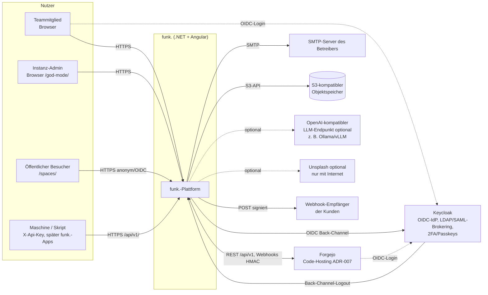
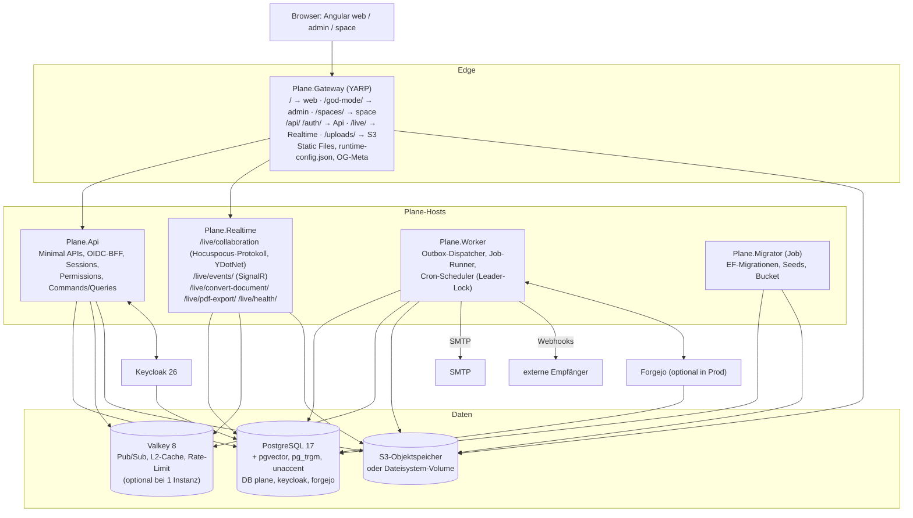
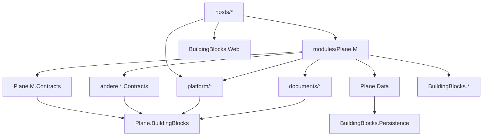

# 01 – Zielarchitektur und Tech-Stack (verbindlich)

> **Status:** verbindlich (Architektur-Rahmen). Gilt für alle Folgedokumente `02`–`16` in `migration/architecture/` und für jeden Implementierungs-Agenten.
> **Rangfolge:** `00-grundsatzentscheidungen.md` (ADR-000 … ADR-008) > **dieses Dokument (ADR-010 … ADR-052)** > Fachdokumente 02–16 > eigene Präferenzen.
> **Stand:** 23.10.2026. Versionsangaben sind die zum Start von Inkrement I0 zu pinnenden Stände; mit „⚠ prüfen“ markierte Angaben werden in Spike S0 per NuGet-/npm-Metadaten bestätigt und dann in `Directory.Packages.props` bzw. `pnpm-workspace.yaml` (Catalog) festgeschrieben.
> **Sprache:** Fließtext Deutsch, Bezeichner Englisch.

## Inhaltsverzeichnis

1. [Zusammenfassung](#1-zusammenfassung)
   - 1.1 Architektur auf einer Seite
   - 1.2 Leitprinzipien
   - 1.3 Iteratives Vorgehen: Inkremente, Prioritäten und wann welcher Baustein gebraucht wird
   - 1.4 Strukturrelevante Bezahl-Pakete (🧱) – Erweiterungspunkte im CE-Fundament
2. [ADR-Tabelle (ADR-010 ff.)](#2-adr-tabelle-adr-010-ff)
   - 2.1 Entscheidungen
   - 2.2 Abwägung je Entscheidung (a) Agenten/Wartbarkeit · (b) Betrieb · (c) Parität/Risiko
   - 2.3 Bewusst gemiedene Bibliotheken (Lizenz-Hygiene)
3. [Systemkontext, Container-Diagramm, Aspire-AppHost](#3-systemkontext-container-diagramm-aspire-apphost)
4. [Dienst-Mapping Original → Ziel](#4-dienst-mapping-original--ziel)
5. [Backend-Solution-Struktur](#5-backend-solution-struktur)
6. [Frontend-Workspace-Struktur](#6-frontend-workspace-struktur)
7. [Querschnittskonventionen](#7-querschnittskonventionen)
8. [Library-Liste Backend/Frontend](#8-library-liste-backendfrontend)
9. [Pflicht-Spikes mit Abbruchkriterien](#9-pflicht-spikes-mit-abbruchkriterien)
10. [Glossar Original → Ziel](#10-glossar-original--ziel)

Verweise auf das Original nutzen die Kürzel der Analyse-Dokumente: `API/` = `apps/api/plane/`, `WEB/` = `apps/web/`, `LIVE/` = `apps/live/src/`, `ADM/` = `apps/admin/`, `SPC/` = `apps/space/`, `PKG/` = `packages/`. Analyse-Dokumente: `A01` = `migration/analysis/01-gesamtarchitektur-infrastruktur.md`, `A06` = `…/06-auth-sicherheit-querschnitt.md`, `A08` = `…/08-frontend-web-architektur.md`, `A12` = `…/12-editor-echtzeit-live.md`, `A13a` = `…/13a-designsystem-ui-tokens.md` usw.

---

## 1. Zusammenfassung

### 1.1 Architektur auf einer Seite

Die Zielplattform ist ein **modularer Monolith in .NET 10** mit fünf schlanken Prozess-Hosts aus **einer** Codebasis und **einem** Angular-Workspace mit drei Apps:

| Host / App | Aufgabe | ersetzt im Original |
|---|---|---|
| `Plane.Api` | ASP.NET Core Minimal APIs für alle HTTP-Verträge (`/api/`, `/api/v1/`, `/api/public/`, `/api/instances/`, `/auth/`); OIDC-BFF gegen Keycloak; Session-Cookie | `api` (Django/DRF) |
| `Plane.Worker` | Outbox-Dispatcher, Job-Queue-Runner, Cron-Scheduler (Leader per PostgreSQL-Advisory-Lock), E-Mail, Webhooks, Exporte, Cleanup | `worker`, `beat-worker`, `plane-mq` |
| `Plane.Realtime` | `/live/`: Hocuspocus-kompatibler Yjs-Server auf **YDotNet**, SignalR-Hub für Live-Events (H6, Modul `Plane.RealtimeEvents`), `convert-document`, `pdf-export`, `health` | `live` (Node/Hocuspocus) |
| `Plane.Gateway` | YARP-Reverse-Proxy mit identischen Pfadregeln, Auslieferung der drei Angular-Builds, OG-Meta-Templating für Space, Body-Limit, Security-Header | `proxy` (Caddy), `web`/`admin`/`space`-Container |
| `Plane.Migrator` | EF-Core-Migrationen, Seeds, Instanz-Initialisierung, Bucket-Anlage (Aspire: `WaitForCompletion`) | `migrator` |
| Angular `web`, `admin`, `space` | 1:1-Port der React-SPAs (CSR, zoneless, Signals), statisch ausgeliefert | `apps/web`, `apps/admin`, `apps/space` |

**Infrastruktur (minimal):** PostgreSQL 17 mit `pgvector`, `pg_trgm`, `unaccent` (Daten, Outbox, Job-Queue, Volltextsuche, Vektoren, Sessions, Data-Protection-Key-Ring), **Valkey** (nur Pub/Sub-Backplane, L2-Cache, verteiltes Rate-Limit – bei Einzelinstanz-Betrieb optional), **S3-kompatibler Objektspeicher** (oder Dateisystem-Provider für Kleinst-Installationen), **Keycloak** (einziger Login, ADR-008), **Forgejo** (ADR-007; Dev/Test immer, Produktion optional). RabbitMQ und MinIO entfallen.

**Verträge:** Die JSON-Verträge (Pfade, Methoden, Feldnamen `snake_case`, Enum-Werte, Fehlerformen inkl. `error_code`, Cursor-Pagination) folgen dem Original (ADR-003). Das Angular-Frontend übernimmt `packages/types`, `packages/constants`, `packages/utils`, `packages/i18n` (Locales) und den framework-agnostischen Editor-Kern **als Quelltext 1:1**; MobX-Stores werden strukturgleich als Signal-Stores portiert, Tailwind-/Propel-CSS unverändert übernommen.

### 1.2 Leitprinzipien

| Nr. | Prinzip | Konsequenz (prüfbar) |
|---|---|---|
| P1 | **Parität vor Eleganz.** Wo das Original ein Verhalten, eine Form oder einen Text festlegt, wird es übernommen; Abweichungen nur über ADR-001/-004/-007/-008, Sicherheitskorrekturen oder dokumentierte Bugfixes (Entscheidungstabelle in `04-api-design-und-endpunktkatalog.md`). | Paritätstests (Contract-Diff gegen das laufende Original, Visual Regression) sind Teil der Definition of Done. |
| P2 | **Contracts first.** Jeder Arbeitsschritt beginnt mit dem Festhalten des Original-Vertrags (Request/Response-Beispiel als Golden-File) und endet mit einem grünen Contract-Test. | Ordner `tests/contracts/<modul>/*.golden.json` pro Endpunkt. |
| P3 | **Eine Modul-Schablone für alles.** Jedes fachliche Modul hat dieselbe Projekt-, Ordner- und Namensstruktur (§5.3); Agenten arbeiten modulweise parallel. | Architekturtests (`tests/Plane.ArchitectureTests`) schlagen fehl bei Abweichungen. |
| P4 | **So viel wie möglich in PostgreSQL.** Queue, Outbox, Scheduler-Lock, Suche, Vektoren, Sessions, Key-Ring. Zusätzliche Dienste nur, wenn PostgreSQL es nicht sinnvoll kann (Objektspeicher, IdP, Pub/Sub-Fan-out bei Mehrinstanz). | Infrastruktur-Fußabdruck Produktion: 4 Pflicht-Container (PostgreSQL, Keycloak, Objektspeicher, funk.-Images) + optional Valkey, Forgejo. |
| P5 | **Kein Node.js zur Laufzeit** (ADR-002). Node nur zur Build-Zeit (Angular-Build) und in Entwickler-Werkzeugen (Erzeugung von Golden-Files aus dem Original). | Container-Images enthalten kein Node; CI prüft das (`tools/ci/assert-no-node.sh`). |
| P6 | **Airgapped ist der Normalfall** (ADR-004). Keine CDN-, Telemetrie- oder Update-Aufrufe; alle Assets gebündelt. | E2E-Lauf mit gesperrtem Egress in CI (Inkrement I7) und Netzwerk-Allowlist-Test ab I0. |
| P7 | **Erweiterbar ohne Umbau.** Für alle 🧱-Pakete existieren ab der CE die Andockstellen (§1.4); Bezahl-Features werden **nicht** fachlich vorgeplant. | Jede Andockstelle hat einen Contract (Interface/Schema) und mindestens einen Test mit CE-Default-Implementierung. |
| P8 | **Risiko zuerst.** Die größten technischen Unsicherheiten werden in Inkrement I0 per Spike mit Abbruchkriterien entschieden (§9), bevor Fachumfang darauf aufsetzt. | Kein Arbeitspaket mit Abhängigkeit zu einem offenen Spike startet. |

### 1.3 Iteratives Vorgehen: Inkremente, Prioritäten und wann welcher Baustein gebraucht wird

**Priorisierungslogik (vom Architekten festgelegt, Auftraggeber-Vorgabe „iterativ“):** (1) Risiko zuerst – alle Spikes, die das Fundament kippen könnten, laufen in I0. (2) Danach entlang der **Nutzungskette** eines Teams: anmelden → Workspace/Projekt → Work Items in allen Layouts → Planung (Cycles/Modules/Intake/Views) → Wissen (Pages, Realtime) → Überblick (Home, Notifications, Analytics, Power-K) → Außenwirkung (Space, Public API, Webhooks, Exporte, God-Mode-Vollausbau) → Härtung. (3) Jedes Inkrement endet lauffähig, deploybar (Aspire → Docker Compose) und von Fachseite abnehmbar. (4) Forgejo (W1) ist dem Auftraggeber besonders wichtig: Container + SSO laufen deshalb schon ab I0 mit, damit W1 direkt nach der CE ohne Infrastrukturarbeit beginnt. Die verbindliche Roadmap mit Arbeitspaketen entsteht in `migration/plan/01-roadmap-ce.md`; die folgende Tabelle ist deren Rahmen.

| Inkrement | Ergebnis (abnehmbar) | CE-Domänen (Schwerpunkt) | Architektur-Bausteine, die **in diesem Inkrement** fertig sein müssen | Spikes |
|---|---|---|---|---|
| **I0 Walking Skeleton** | `aspire run` startet alles; Anmeldung über Keycloak (Keycloak-Login-Theme im Original-Layout mit funk.-Branding, ABG-148), JIT-Benutzer, Workspace anlegen, Projekt anlegen, leere Workspace-Shell (Sidebar, Header) pixelgleich; CI grün; Paritäts-Harness vergleicht 5 Endpunkte gegen das Original | CE-AUTH-001/-022/-024/-025/-029 (angepasst), CE-WS-001 (Kern), CE-WS-013, CE-PRJ-004 (Kern), CE-INST-006 (angepasst), CE-OPS-021/-022/-023 | AppHost (§3.3), ServiceDefaults, Gateway (Routen §3.4), Migrator, BuildingBlocks (Web, Persistence, Messaging-Grundgerüst), Modul-Schablone + Architekturtests, JSON/Fehler/Pagination-Konventionen (§7), Permission-Katalog-Grundgerüst, Session/BFF, Runtime-Config, Angular-Workspace + Sheriff, `libs/shared/{types,constants,utils,i18n,tailwind-config,state-kit,runtime-config}`, erste Propel-Primitive (Button, Input, Menu, Tooltip, Avatar), die 🧱-Andockstellen mit „ab I0“ aus §1.4 (C3 Event-Katalog/Outbox-Gerüst, E3 Provisioning-Kette, E5 Permission-Katalog/`roles`, F1 Contracts, F2 Container + SSO, H1 Auth-Schemata, H6 Hub-Gerüst); alle übrigen Andockstellen entstehen erst in dem Inkrement, das in §1.4 Spalte „ab“ steht | S0, S7, S11 **gaten** die Abnahme von I0. Alle anderen Spikes laufen als paralleler **Spike-Track** ab Tag 3 (Gantt §9) und gaten erst das abhängige Inkrement: S8, S12 → vor I1; S2, S4, S5, S9 → vor I2 (S5 vollständig, nur das Kriterium „NodeView-Rendering stabil mit Yjs“ darf bis vor I4 nachgeliefert werden, ABG-114); S6 → vor I3; S1, S3 und S5-Restkriterium Yjs → vor I4; S10-Teil „Shell“ ist Teil von I0 |
| **I1 Workspace, Projekte, Konto** | Vollständige Workspace-/Projektverwaltung inkl. Mitglieder, Einladungen, States, Labels, Estimates, Feature-Toggles, Favoriten, Navigation, Profil, Themes, i18n | CE-WS, CE-PRJ, CE-PROF, CE-AUTH (Rest), CE-I18N, CE-UIX (Basis) | E-Mail (MailKit/Fluid, Mailpit), Assets/Storage (Avatar/Cover-Upload), Activity-Grundgerüst, Domain-Events → Outbox → Worker, HybridCache, Rate-Limiting | – |
| **I2 Work Items & Layouts** | Work Items anlegen/bearbeiten, Detail/Peek, Sub-Items, Relationen, Kommentare (Lite-Editor), Anhänge, Links, Reaktionen, Activity, alle fünf Layouts mit Gruppierung/Pagination/Rich-Filter, DnD | CE-WI, CE-LV | Filter-/Grouping-/Ordering-Engine (AST, B6-fähig), Sequence-IDs, State-Change-Pipeline (C1-Andockstelle), Editor-Kern, Lite-, Rich- und Document-Editor (read-only) mit allen NodeViews und Menüs (Work-Item-Beschreibung, Modal, Peek, Beschreibungs-Versionen; 10 D10-ADR-15, ABG-114), pragmatic-dnd, Virtualisierung, HTML-Sanitizing, `Plane.Documents` (HTML↔JSON, Yjs-Binary für `description_binary`) | S2, S4, S9, S5 (vollständig, Restkriterium Yjs bis vor I4; ABG-114) – Ergebnis vor Start I2 |
| **I3 Planung** | Cycles, Modules, Intake, Projekt- und Workspace-Views, Archive | CE-CYC, CE-MOD, CE-INT, CE-LV-046…054 | Scheduler-Jobs (Unsnooze, Auto-Archive/-Close), Charts-Bausteine (Burndown, Verteilungen) | S6 (Ergebnis vor Start I3) |
| **I4 Pages & Realtime** | Kollaborativer Page-Editor, Versionen, Sperren/Archiv/Zugriff, PDF/Markdown-Export, Offline-Cache, Mehrinstanz-Sync | CE-PAGE, CE-RT | `Plane.Realtime` (Hocuspocus-Protokoll), Yjs↔PM-JSON↔HTML, PDF-Renderer, Valkey-Backplane, Kollaboration (Yjs-Bindung des Editors), Titel-Editor und Page-Hüllen (ABG-114) | S1, S2, S3 und das S5-Restkriterium „NodeView-Rendering stabil mit Yjs“ müssen grün sein |
| **I5 Überblick** | Home (Widgets, Quick Links, Recents, Stickies), Notifications (In-App, E-Mail-Bündelung), Analytics, Globale Suche, Power-K, Your Work | CE-HOME, CE-NOTIF, CE-ANA, CE-SRCH, CE-PROF-008…011 | Notification-Pipeline, Such-Abstraktion (FTS/Trigram), SignalR-Push für Notification-Zähler (erste H6-Nutzung) | – |
| **I6 Außenwirkung & Administration** | God Mode vollständig, Space (öffentliche Boards inkl. Kommentare/Votes mit Keycloak-Login), Public API v1 + API-Keys + OpenAPI, Webhooks, Exporte, KI-Assistent/Unsplash | CE-INST, CE-SPACE, CE-API, CE-WH, CE-EXP, CE-AI | API-Key-Auth, OpenAPI (Scalar offline), Webhook-Zustellung (SSRF-Schutz), XLSX/CSV, Microsoft.Extensions.AI, OG-Meta im Gateway | – |
| **I7 Härtung & Betrieb** | Paritätsabnahme aller Screens, Last-/Sicherheitstests, Airgapped-Bundle, Docker Compose + Helm, Backup/Restore, Upgrade-Pfad | CE-OPS (Rest) | Airgap-CI, SBOM/Trivy, Helm-Chart, Backup-Werkzeug | – |
| **W1 … W9** | Bezahl-Pakete gemäß `features/30-paid-auswahlliste.md` (W1 = F1, H1, H6, F2 Forgejo) | EE-* | jeweils kurz vorher detailliert geplant (Dokument 16 listet die Andockstellen) | Paket-Spikes nach Bedarf |

**Schnittregel für Inkremente (verbindlich):** Ein Inkrement wird in **vertikale Schnitte** (Arbeitspakete) zerlegt, die jeweils Backend-Endpunkt(e) + Angular-Screen(s) + Contract-/Visual-Tests eines Feature-Clusters liefern und einzeln abnehmbar sind (Beispiel I0: Schnitt 1 „Login → JIT-Benutzer → leere Shell“, Schnitt 2 „Workspace anlegen“, Schnitt 3 „Projekt anlegen“). Ein Inkrement gilt als abgenommen, wenn alle seine Schnitte grün sind; die Spikes des Spike-Tracks blockieren nur die in der Spalte „Spikes“ genannten Folge-Inkremente, nicht die laufende Abnahme. Abhängigkeiten zwischen Schnitten führt `migration/plan/_data/wp-ce.json`.

### 1.4 Strukturrelevante Bezahl-Pakete (🧱) – Erweiterungspunkte im CE-Fundament

Diese Andockstellen werden **in der CE gebaut** (Contract + CE-Default-Implementierung + Test), damit spätere Pakete ohne Umbau andocken. Fachliches Design der Pakete erfolgt **nicht** hier; Details und Skizzen liefert `16-erweiterungspunkte-bezahl-features.md`.

| Paket | Andockstelle in der CE (verbindlich) | Ort (§5/§6) | ab |
|---|---|---|---|
| **A1** Work-Item-Types & Custom Properties | `work_items.type_id` (nullable FK auf `work_item_types`; Tabelle in CE nur mit Minimal-Schema `id`, `workspace_id`, `project_id` (nullable), `name`, `is_default`, Audit-Spalten, leer – fachliche Spalten erst per W2-Migration), Filter-Feld-Registry `IFilterFieldProvider`, Gruppierungs-Registry `IGroupKeyProvider`, Serializer-Erweiterung `IWorkItemPayloadExtension`, Frontend `PropertyRendererRegistry` + Spreadsheet-Spalten-Registry | `Plane.WorkItems`, `Plane.Properties.Contracts` (Platzhalter), `libs/web/extensions` | I2 |
| **A2** Workspace-Types, Hierarchie, Roll-ups | Typ-/Property-Scope als `ScopeRef` (Workspace\|Teamspace\|Project), keine Projekt-Pflicht in `work_item_types` | `Plane.BuildingBlocks` (`ScopeRef`), `Plane.Data` | I2 |
| **A9** Relationen & Abhängigkeiten | Relationstyp-**Katalog** `work_item_relation_types` (Seed: `blocked_by`/`blocking`, `relates_to`, `duplicate`, `start_before`/`start_after`, `finish_before`/`finish_after`, `implemented_by`/`implements` – Werte aus `API/db/models/issue.py` `IssueRelationChoices`) statt Enum; Relationen projektübergreifend im Schema zulässig | `Plane.WorkItems` | I2 |
| **A17** Workspace-Governance States/Labels | States und Labels mit `ScopeRef`; Auflösung über `IStateCatalog`/`ILabelCatalog` (Signaturen §5.5; CE: nur Projekt-Scope); alle Module (WorkItems, Intake, Cycles, Forgejo-Mapping) lesen States/Labels **nur** über diese Interfaces | `Plane.Projects.Contracts` | I1 |
| **B1** Teamspaces | Sichtbarkeitsebene `ScopeLevel.Teamspace` in `ScopeRef`, `IScopeResolver` (Signatur §5.5), Permission-Scopes inkl. Teamspace, nullable `teamspace_id` an Views/Pages/Kommentaren im Schema vorgesehen, Router-Store-Feld `teamspaceId` (existiert im Original) | `Plane.BuildingBlocks`, `Plane.Authorization`, `Plane.Teamspaces.Contracts` (Platzhalter) | I0 (`ScopeRef`, `IScopeResolver`, `RouterStore.teamspaceId`), I1 (Schema-Vorhalte `teamspace_id`) (ABG-058) |
| **B6** Erweiterte Filter/PQL | Filter-AST (`FilterExpression`: And/Or/Not/Condition mit Operator-Katalog) ist **die** Abfragesprache der CE (CE-LV-006); PQL wird später nur ein weiterer Parser auf denselben AST; `ISearchProvider` | `Plane.WorkItems` (Query-Engine), `Plane.Platform.Search` | I2 |
| **C1** Workflows (nicht gewählt) | Zentrale **State-Change-Pipeline** `IWorkItemStateChanger` mit `IStateTransitionGuard`/`IStateTransitionHook`; jeder State-Wechsel (UI, API, Intake, Cycle-Transfer, Auto-Close, Forgejo) läuft hindurch | `Plane.WorkItems` | I2 |
| **C3** Automation-Engine (nicht gewählt) | Versionierter **Event-Katalog** (`plane.<aggregate>.<event>.v1`) + transaktionale Outbox + `IEventConsumer`-Registrierung + `IRecurringJobRegistry` | `Plane.BuildingBlocks.Messaging`, `*.Contracts/Events` | I0 |
| **D1** Wiki & Collections | Pages ohne Projektpflicht: `pages` mit `workspace_id`, Projektzuordnung über Verknüpfungstabelle `project_pages` (wie Original `ProjectPage`), `ScopeRef` für Collections vorgesehen | `Plane.Pages` | I4 |
| **D2** Nested Pages | `pages.parent_id` (nullable, im Original vorhanden), Realtime-Event `BroadcastedEvent.affectedPages` (Struktur aus `A12` §2.27) server-seitig erzeugbar; Page-Baum-Abfragen (Vorfahren/Nachfahren) über `IPageHierarchy` in `Plane.Pages.Contracts` (CE: flach, `parent_id` immer `null`). *Hinweis:* PDF/Word-Export gehört fachlich zu Paket **D5** (nicht 🧱); die CE liefert nur den PDF-Renderer (CE-PAGE-011), DOCX kommt erst mit D5 | `Plane.Pages` | I4 |
| **E3** IdP Group Sync | Claims-Pipeline: `groups`-Claim aus Keycloak im Session-Principal; `IUserProvisioningStep`-Kette beim Login (CE: JIT + Einladungen) | `Plane.Identity` | I0 |
| **E5** Rollenmodell | **Permission-Katalog** + Tabelle `roles` (System-Rollen Admin 20 / Member 15 / Guest 5 als Seeds, `is_system=true`), Mitgliedschaften referenzieren `role_id`, API liefert weiter `role: 20/15/5`; Frontend prüft Rechte ausschließlich über die Fassade `PermissionService.allowPermissions(...)` in `libs/web/core/permissions` (Signatur 1:1 zum Original-`user.permission`-Store, CE-Implementierung rollenbasiert), damit E5 nur die Implementierung tauscht | `Plane.Authorization`, `libs/web/core/permissions` | I0 |
| **F1** Integrations-Framework | `integration_connections`, `external_links` (Work Item ↔ externes Objekt), eingehender Webhook-Endpunkt `/api/integrations/{provider}/webhooks/{connection_id}/` mit `IWebhookSignatureVerifier`, Inbox-Idempotenz | `Plane.Integrations.Contracts` (Platzhalter) | I0 (Contracts), W1 (Implementierung) |
| **F2** Forgejo | Forgejo-Container + Keycloak-Client in AppHost (Dev/Test), Client-Platzhalter `Plane.Forgejo.Client` (in der CE nur Interface `IForgejoClient` + DTOs, Regel R10), Activity-Typen für Branch/Commit/PR im Activity-Katalog reserviert | `Plane.Forgejo` (Platzhalter), AppHost | I0 |
| **G1** AI-Basis (nicht gewählt) | Indexierungs-Pipeline als `IEventConsumer` (`search_documents` mit `tsvector`), `vector`-Extension per Migration aktiviert, `IEmbeddingGenerator<string, Embedding<float>>` (Microsoft.Extensions.AI) mit Null-Provider registriert | `Plane.Platform.Search`, `Plane.Platform.Ai` | I5 |
| **H1** OAuth-App-Plattform | Authentifizierungs-Schemata als Policy-Scheme (`Cookie` \| `ApiKey` \| `Bearer`), Bearer = Keycloak-JWT (Audience `plane-api`) vorkonfiguriert und per Option deaktiviert; `PlanePrincipal` kennt `Kind = User\|ApiKey\|App\|Bot`; `users.is_bot` (Original-Feld) | `Plane.Identity`, `Plane.BuildingBlocks` (`PlanePrincipal`), `Plane.BuildingBlocks.Web` (Schemata) | I0 |
| **H6** Realtime-Event-Server | SignalR-Hub `/live/events/` im Modul `Plane.RealtimeEvents` (+ `Plane.RealtimeEvents.Contracts`), gehostet im Host `Plane.Realtime` (ABG-058), Gruppen `ws:{id}`, `project:{id}`, `user:{id}`; Outbox-Consumer `RealtimeFanOutConsumer` hinter `IRealtimePublisher` (Signatur §5.5); Frontend `LiveEventsService` | `Plane.RealtimeEvents`, `libs/web/core/live-events` | I0 (Hub), I5 (erste Nutzung) |

---

## 2. ADR-Tabelle (ADR-010 ff.)

### 2.1 Entscheidungen

Spalte „Paket + Version“: Paket-ID wie in `Directory.Packages.props` bzw. npm-Catalog; „⚠“ = in Spike S0 bestätigen. „ab“ = Inkrement, in dem die Entscheidung erstmals umgesetzt wird.

| ADR | Belang | Entscheidung | Alternativen (verworfen) | Begründung (Kurzform; Abwägung §2.2) | Lizenz | Paket + Version | ab |
|---|---|---|---|---|---|---|---|
| ADR-010 | Gesamtstil | **Modularer Monolith**: eine Solution, fachliche Module mit Contracts-Projekt, fünf Hosts (Api, Worker, Realtime, Gateway, Migrator) aus derselben Codebasis | Microservices je Domäne; ein einziger Prozess für alles | Klare Modulgrenzen für parallele Agenten ohne Verteilungskosten; Hosts trennen nur Laufzeitprofile (HTTP, Hintergrund, WebSocket) wie im Original | – | .NET SDK 10.0.1xx (LTS) | I0 |
| ADR-011 | Web-Stil | **Minimal APIs** mit `IEndpointModule` je Modul und Oberfläche (`App`, `V1`, `Space`, `Instance`, `Auth`), `TypedResults`, Endpoint-Filter für Scope/Permission/Validierung | MVC-Controller; FastEndpoints (MIT, aber eigenes Ökosystem) | Pro Use-Case eine kleine Datei → konfliktarm für Agenten; native .NET-10-OpenAPI; Filter-Pipeline ersetzt DRF-Permission-Klassen | MIT | `Microsoft.AspNetCore.App` 10.0.x | I0 |
| ADR-012 | CQRS / Mediator | **Commands/Queries mit `Mediator` (martinothamar, Source-Generator)**; Pipeline: Logging → Validation → Transaction(UnitOfWork + Outbox) ; Queries projizieren direkt mit EF (`Select` auf DTO), keine Repositories | MediatR ≥ 13 (kommerziell); Wolverine als Mediator; direkte Handler-Injektion ohne Pipeline | Einheitliche Schablone, AOT-fähig, keine Reflection; MediatR-Lizenz gemieden | MIT (geprüft 23.10.2026: LICENSE im Repo martinothamar/Mediator) | `Mediator.Abstractions` / `Mediator.SourceGenerator` 3.0.x (stabil 3.0.2; 3.1 nur RC) | I0 |
| ADR-013 | Validierung | **FluentValidation** je Request; Fehlerausgabe im DRF-Format `{"<feld>": ["<meldung>"]}` (400) bzw. endpunktspezifische Original-Form | DataAnnotations + .NET-10-`AddValidation()`; manuelle Prüfung | Komplexe, bedingte Regeln des Originals (Slug, Identifier, Datumsüberschneidung) sind deklarativ abbildbar; .NET-Validierung nur für triviale Pflichtfelder zu schwach | Apache-2.0 | `FluentValidation` 12.x, `FluentValidation.DependencyInjectionExtensions` 12.x | I0 |
| ADR-014 | Mapping | **Mapperly** (Compile-Time) für Entity→DTO in Commands; Lese-Pfade als handgeschriebene EF-Projektionen (`Expression<Func<TEntity,TDto>>`) | AutoMapper ≥ 15 (kommerziell); Mapster | Kein Reflection-Mapping, Fehler zur Build-Zeit; Projektionen bleiben SQL-übersetzbar (Performance der Listen) | Apache-2.0 | `Riok.Mapperly` 4.x | I0 |
| ADR-015 | JSON-Naming & Serialisierung | **System.Text.Json** mit `JsonNamingPolicy.SnakeCaseLower` (global), Enums mit expliziten Original-Werten (`[JsonStringEnumMemberName]` bzw. Zahlenwert wie `role: 20`), `null` wird ausgegeben (DRF-Verhalten), Zeitstempel ISO-8601 mit 6 Nachkommastellen und `Z`, Datum `yyyy-MM-dd` (`DateOnly`) | Newtonsoft.Json; PascalCase + Client-Transformation | Frontend-Typen (`packages/types`) bleiben unverändert; Source-Generated-Context für Performance | MIT | `System.Text.Json` (Framework) | I0 |
| ADR-016 | Fehlerformat | **Original-Fehlerformen sind Vertrag**: `{"error": "…"}`, `{"detail": "…"}`, `{"error_code": <int>, "error_message": "<KEY>"}`, DRF-Feldfehler; zentral erzeugt über `PlaneErrors` + `PlaneErrorCodes` (Katalog aus `A06` §2.3 u. a.); RFC-9457-ProblemDetails **nur** intern/Health | ProblemDetails überall | Angular-Port wertet `error`, `detail`, `error_code` wie das Original aus (Toasts, Auth-Banner); Contract-Tests vergleichen Fehlerkörper | – | eigene Implementierung `Plane.BuildingBlocks.Web/Errors` | I0 |
| ADR-017 | Authentifizierung (ADR-008) | **Keycloak-OIDC über BFF in `Plane.Api`**: Authorization Code + PKCE (confidential clients `plane-web`, `plane-admin`, `plane-space`), Cookie `session-id` (HttpOnly, SameSite=Lax, Secure wie Original) mit **serverseitigem `ITicketStore` in PostgreSQL** (`user_sessions`), RP-initiated Logout, **Back-Channel-Logout** (`sid`-Index), JIT-Provisionierung (`sub` als feste Verknüpfung, nur `email_verified=true`), Einladungszuordnung über E-Mail, **Instanz-Admin per Keycloak-Rolle** `plane-instance-admin` (konfigurierbar); optionaler Step-up für God Mode (`Plane:Auth:AdminStepUpMaxAgeSeconds`, **Default 0 = aus**, weil ADR-008 kein separates God-Mode-Login vorsieht; bei Aktivierung Re-Authentisierung in Keycloak per `max_age`, siehe O-08); CSRF-Schutz wie Original über **Origin-/Referer-Prüfung** für unsichere Methoden mit Cookie-Auth (`A06` §3.14) + `GET /auth/get-csrf-token/` für Formular-Posts; API-Keys `X-Api-Key` als eigenes Schema; Endpunkte `GET /auth/oidc/login/?app=web\|admin\|space&next_path=…`, `GET /auth/oidc/callback/`, `POST /auth/oidc/backchannel-logout/`, `POST /auth/sign-out/` | Token im Browser (SPA-PKCE); Duende BFF/IdentityServer (kommerziell); OpenIddict als eigener IdP | Kein Token im Browser, Cookie-Vertrag wie Original, sofortige Sperre über Back-Channel; Keycloak liefert SSO/LDAP/2FA/Passkeys | MIT (ASP.NET), Apache-2.0 (Keycloak) | `Microsoft.AspNetCore.Authentication.OpenIdConnect` 10.0.x; Keycloak-Image `quay.io/keycloak/keycloak` 26.x ⚠ | I0 |
| ADR-018 | Autorisierungsserver für funk.-Apps/MCP (H1, H4; Bezeichnung nach BR-04) | **Keycloak** stellt Tokens aus (Clients je App, Client-Credentials für Bot-User, Authorization-Code für Consent); `Plane.Api` validiert Keycloak-JWT (Schema `Bearer`, Audience `plane-api`, Scopes → Permissions) | Eigener OAuth2-Server mit OpenIddict; Duende | Ein IdP für Menschen und Maschinen, keine eigene Token-Krypto; Airgapped-fähig | Apache-2.0 / MIT | `Microsoft.AspNetCore.Authentication.JwtBearer` 10.0.x | I0 (vorkonfiguriert, aus), W1 |
| ADR-019 | Berechtigungsmodell | **Permission-Katalog** (`Permission` = Schlüssel + Scope-Ebene, z. B. `project.work_item.create`), Rollen als Permission-Mengen in Tabelle `roles` (System-Rollen 20/15/5 geseedet), Prüfung per Endpoint-Metadaten `.RequirePermission(...)` + `IPermissionEvaluator`; Zusatzregeln des Originals als benannte **Regeln**: Ersteller-Bypass (`creator=True`), WS-Admin-Override bei Projektmitgliedschaft, Gast-Sichtbarkeit (`guest_view_all_features`) als **Query-Prädikat** `IVisibilityFilter` | Rollenwerte hart im Code (`role >= 15`); ASP.NET-Policies pro Rolle | Paket E5 (Custom Roles/GAC) und B1 (Teamspace-Scope) docken ohne Umbau an; Verhalten von `allow_permission` (`A06` §2.10) exakt reproduzierbar | – | eigene Implementierung `Plane.Authorization` | I0 |
| ADR-020 | Messaging, Jobs, Scheduling, Outbox, Domain-Events | **PostgreSQL-native, eigene schlanke Implementierung** `Plane.BuildingBlocks.Messaging`: Domain-Events → transaktionale **Outbox** (`outbox_messages`, im selben `SaveChanges`) → Dispatcher im Worker (`FOR UPDATE SKIP LOCKED`, Weckruf per `LISTEN/NOTIFY`) → `IEventConsumer` mit **Inbox**-Idempotenz (`inbox_messages`); **Job-Queue** (`jobs`: Queue, `run_at`, Versuche, Backoff mit Jitter, Dead-Letter); **Cron** über `Cronos` + Leader per `pg_try_advisory_lock`; Retry-Policy Webhooks wie Original (6 Versuche (1 + 5), Wartezeit zufällig 0…600 s (Celery `retry_backoff=600`, `retry_backoff_max=600`, Jitter), 06 D06-ADR-06, ABG-136) | Wolverine (MIT, Fallback laut S12); Hangfire (LGPL + Pro kommerziell); Quartz.NET (nur Cron); MassTransit v9 (kommerziell); RabbitMQ | Kein zusätzlicher Broker, transaktionale Konsistenz mit den Fachdaten, vollständig transparent/testbar, genau die Celery-Semantik (48 Tasks, 13 Beat-Einträge, `A01` §2.17) ohne Framework-Magie | MIT (Cronos) | `Cronos` 0.13.x; `Npgsql` 10.x | I0 (Gerüst), I1 (Produktiv) |
| ADR-021 | Caching | **HybridCache** (L1 In-Memory + L2 Valkey, wenn konfiguriert) mit Tag-Invalidierung; ersetzt `@cache_response`/`invalidate_cache` des Originals (gleiche TTLs: 3600 s, Instanz 7200 s); nur eigene Schlüssel-Präfixe `plane:` | `IDistributedCache` direkt; Output-Caching-Middleware | Stampede-Schutz, Tags statt Wildcard-`KEYS *`, funktioniert ohne Valkey | MIT | `Microsoft.Extensions.Caching.Hybrid` 10.x, `Microsoft.Extensions.Caching.StackExchangeRedis` 10.0.x | I1 |
| ADR-022 | Realtime-Kollaboration (ADR-002) | **`Plane.Realtime` mit YDotNet** und **eigener Implementierung des Hocuspocus-Wire-Protokolls** (Kompatibilität zu `@hocuspocus/provider` 2.15.2): Dokumentname-Präfix je Nachricht, Auth/Sync/Awareness/Stateless/Close, Close-Codes 4000–4003, Debounce-Persistenz 10 s, Titel-Sync, Admin-Kanal; Mehrinstanz über Valkey-Pub/Sub; Persistenz In-Process über das Contracts-Interface `IPageDocumentStore` aus `Plane.Pages.Contracts` (Regel R1; kein HTTP-Umweg wie im Original); Authentisierung: Session-Cookie aus dem WebSocket-Upgrade-Request (HttpOnly, same-origin über das Gateway) – das `token`-JSON des Providers (`{id, cookie?}`, `LIVE/lib/auth.ts`) liefert nur die User-ID, die gegen die Session geprüft wird; Query-Parameter `documentType` (CE: nur `project_page`), `projectId`, `workspaceSlug` wie Original; Yjs-Fragmente `default` (Inhalt) und `title` (Titel-Sync) | y-websocket-Protokoll mit Provider-Tausch; Node-Sidecar (verletzt ADR-002); YDotNet.Server-Paket | Browser-Code bleibt unverändert (Parität), kein Node; Spike S1 entscheidet | MIT (YDotNet, yrs; NuGet-Metadaten geprüft) | `YDotNet` 0.6.0, `YDotNet.Native` 0.6.0 (veröffentlicht 14.02.2026, Build `net8.0`, native `libyrs.so` für linux-x64/-arm64/-musl enthalten); Release-Takt ca. 1 Version/Halbjahr → Risiko bleibt | I0 (S1), I4 |
| ADR-023 | Realtime-Events (H6) | **SignalR** in `Plane.Realtime` (`/live/events/`), Backplane Valkey; Ereignisse aus der Outbox | Server-Sent Events; eigener WebSocket-Kanal | Reconnect/Gruppen/Backplane fertig; gleiche Host-Infrastruktur wie Kollaboration | MIT | `Microsoft.AspNetCore.SignalR.StackExchangeRedis` 10.0.x; npm `@microsoft/signalr` 10.x | I0/I5 |
| ADR-024 | Volltextsuche | **PostgreSQL**: Parität über `ILIKE`/`icontains`-Semantik des Originals mit **`pg_trgm`-GIN-Indizes**; zusätzlich `tsvector`+`unaccent` (Konfiguration `simple`) für Ranking der globalen Suche hinter `ISearchProvider` (B6/G1-Andockstelle) | OpenSearch/Elasticsearch (EE nutzt OpenSearch); Meilisearch | Kein weiterer Dienst; identische Trefferlogik wie Original | PostgreSQL License | Extensions `pg_trgm`, `unaccent` | I5 (Suche), I2 (Indizes) |
| ADR-025 | Vektor / AI | **Microsoft.Extensions.AI** (`IChatClient`, `IEmbeddingGenerator`) mit OpenAI-kompatiblem Provider (konfigurierbare `base_url` für Ollama/vLLM/LocalAI; Instanz-Keys `LLM_API_KEY`, `LLM_MODEL`, `LLM_PROVIDER` wie Original); Vektoren in **pgvector** (HNSW, Dimension konfigurierbar) | Semantic Kernel; direkte OpenAI-SDK-Nutzung; separate Vektor-DB | Provider-neutral, Airgapped-fähig; pgvector erfüllt ADR-000 | MIT / PostgreSQL License | `Microsoft.Extensions.AI` 10.x, `Microsoft.Extensions.AI.OpenAI` 10.x (beide stabil, 10.11.0 am 23.10.2026), `Pgvector.EntityFrameworkCore` 0.3.0 ⚠ (deklariert nur Npgsql-EF ≥ 9.0.1, Build `net8.0`; EF-10-Smoke-Test in S0: Migration `CREATE EXTENSION vector`, HNSW-Index, `CosineDistance`-Query; Fallback: `vector`-Spalte per `HasColumnType("vector(n)")` + `FromSql`) | I6 (CE-AI), Andockstelle I5 |
| ADR-026 | Objekt-Storage | **S3-API über `AWSSDK.S3` v4** (Presigned POST mit `content-length-range`, Presigned GET mit gepinntem `Content-Type`/`Content-Disposition` wie Original, Head/Copy/Batch-Delete), getrennte `InternalEndpoint`/`PublicEndpoint` statt Request-Host-Trick; zusätzlich **`FileSystemObjectStorage`** für Einzelknoten-/Airgap-Kleininstallationen; Upload-Modus `Direct` (Presigned POST) oder `Proxy` (gleiche Formularfelder an `/api/assets/v2/upload/{token}/`, API streamt nach S3/Dateisystem) – Frontend-Code identisch; **Dev/Test-Container: SeaweedFS** (Apache-2.0), Alternativen Garage (AGPL-3.0, eigenständiger Dienst), Ceph RGW, jeder S3-Dienst des Betreibers | MinIO-Community (Distribution seit 2025 eingeschränkt); `pgsty/silo` (MinIO-Fork des Originals, AGPL); Minio-.NET-SDK | Herstellerneutral; Proxy-Modus macht Presigned-POST-Unterstützung des Backends optional; Spike S8 legt Default fest | Apache-2.0 | `AWSSDK.S3` 4.x | I1 |
| ADR-027 | E-Mail | **MailKit** (SMTP aus Instanz-Konfiguration: Host, Port, TLS/SSL, Benutzer, Absender wie God-Mode-Felder) + **Fluid** (Liquid) für die Templates aus `apps/api/templates/` (Liquid ≈ Django-Template-Syntax → mechanischer Port); Versand ausschließlich über Job-Queue; Dev: **Mailpit**-Container | System.Net.Mail (veraltet); Razor-`HtmlRenderer`; Scriban | Templates bleiben Dateien (1:1-Vergleich mit Original), testbar mit Golden-Files | MIT / MIT / MIT | `MailKit` 4.x, `Fluid.Core` 2.x; Image `axllent/mailpit` ⚠ | I1 |
| ADR-028 | Exporte CSV/XLSX/JSON | **CsvHelper** (CSV), **ClosedXML** (XLSX), System.Text.Json (JSON); Spalten/Reihenfolge exakt wie `API/bgtasks/export_task.py` | EPPlus (kommerziell); NPOI; MiniExcel | Reife, permissive Lizenzen; ClosedXML genügt für Tabellen ohne Formeln | MS-PL/Apache-2.0 (dual), MIT | `CsvHelper` 33.x, `ClosedXML` 0.105.x | I6 (I3: Analytics-CSV) |
| ADR-029 | PDF-Export | **PDFsharp + MigraDoc 6.x** in `Plane.Documents.Pdf`: Node-/Mark-Renderer 1:1 zu `LIVE/lib/pdf/*` (Stile, Farben, Inter-Schrift gebündelt, Seitenformate A4…TABLOID, Bild-Pipeline 1200 px/JPEG 85), Endpunkt `/live/pdf-export/` bleibt; auch der Web-Client exportiert serverseitig (ersetzt `@react-pdf/renderer` in `WEB/components/editor/pdf`) | QuestPDF (Community-Lizenz mit Umsatzschwelle); headless Chromium/Playwright (schweres Image, Node-ähnliche Laufzeit); iText (AGPL/kommerziell) | Permissiv, reines .NET, deterministisch testbar; Spike S3 misst optische Parität | MIT **nur bis 6.2.4** – ab 6.5.0 (14.10.2026) und 7.0.0-preview-2 steht das NuGet-Paket unter **AGPL-3.0-only** (Dual-Lizenz-Modell). AGPL-3.0-only ist mit dem AGPL-Gesamtwerk vereinbar, wird aber als Lizenzwechsel gekennzeichnet | `PDFsharp` / `PDFsharp-MigraDoc` **exakt `[6.2.4]`** (Version-Range-Pin in `Directory.Packages.props`, kein automatisches Minor-Update); Wechsel auf ≥ 6.5 nur per ADR-Änderung (O-09) | I4 |
| ADR-030 | HTML-Sanitizing | **HtmlSanitizer** (mganss, AngleSharp-basiert) mit Allowlist, die 1:1 aus der `nh3`-Konfiguration in `API/utils/content_validator.py` übertragen wird; zusätzlich Binary-Prüfung für `description_binary` (Yjs-Update dekodierbar, Größenlimit) | Eigene Regex-Filter; Ganss-Allowlist-Default | Parität zur Original-Allowlist, bewährt gegen XSS | MIT | `HtmlSanitizer` 9.x, `AngleSharp` 1.x | I2 |
| ADR-031 | ProseMirror-JSON ↔ HTML ↔ Yjs in .NET | **Eigene Bibliothek `Plane.Documents`**: C#-Port des Tiptap-Schemas aller Extensions (`A12` §2.5) mit `parseHTML`/`renderHTML`-Äquivalent; HTML-Parsing mit AngleSharp; Yjs-XmlFragment ↔ PM-JSON nach `y-prosemirror`-Abbildung (XmlElement=Node, Attribute=attrs, XmlText-Formatierung=Marks) über YDotNet; Golden-File-Tests gegen Ausgaben des Originals (`@tiptap/html`, `y-prosemirror`), die einmalig mit `tools/golden/generate.mjs` aus dem Original-Repo erzeugt und eingecheckt werden. **Fallback (S2):** In-Process-JS-Engine **Jint** mit gebündeltem `@tiptap/html` + `zeed-dom` (Bundle per esbuild zur Build-Zeit als ES2020-IIFE aus den server-tauglichen Extensions von `packages/editor` – dieselben, die `apps/live` nutzt; React-Importe der NodeViews per Alias auf Stubs) – weiterhin kein Node zur Laufzeit | Node-Sidecar (`/convert-document`) – verletzt ADR-002 | Serverseitige Konvertierung ist Pflicht (Speichern, Duplizieren, Export, Suche); exakter Nachbau prüfbar | MIT (eigen), BSD-2 (Jint, nur Fallback) | `AngleSharp` 1.x; Fallback `Jint` 4.x | I2 (HTML↔JSON), I4 (Yjs) |
| ADR-032 | Bildverarbeitung | **SkiaSharp** (EXIF-Rotation, Flatten auf Weiß, Resize „fit inside“ 1200 px, JPEG 85 – Parameter aus `A12` §2.29) | ImageSharp (Six-Labors-Split-License mit Umsatzschwelle); Magick.NET (Apache-2.0, großes Native-Paket); NetVips (libvips LGPL) | Permissiv, plattformübergreifende Native-Assets, ausreichend für PDF-Pipeline und Metadaten | MIT | `SkiaSharp` 3.119.x, `SkiaSharp.NativeAssets.Linux.NoDependencies` 3.119.x (SkiaSharp 4.15x ist inzwischen stabil, MIT; Wechsel nach S3-Ergebnis zulässig) | I4 |
| ADR-033 | Reverse Proxy | **`Plane.Gateway` mit YARP**: Pfadregeln identisch `A01` §2.8.1 (inkl. 301 `/spaces`→`/spaces/`, `/god-mode`→`/god-mode/`), WebSocket-Proxy für `/live/`, Bucket-Route mit Original-Host-Header (SigV4), Body-Limit `FILE_SIZE_LIMIT` → 413-JSON, Security-Header, Static-Hosting der Angular-Builds mit SPA-Fallback, Runtime-Config-Auslieferung, OG-Meta-Templating für `/spaces/issues/{anchor}`; TLS per Betreiber-Zertifikat (Kestrel), ACME optional über vorgeschalteten Caddy/Ingress | Caddy beibehalten; nginx; Aspire `AddYarp` (ohne eigene Logik) | Ein .NET-Dienst ersetzt drei Frontend-Container + Proxy; OG-Meta ohne Node-SSR | MIT | `Yarp.ReverseProxy` 2.3.x (2.3.0 aktuell stabil) | I0 |
| ADR-034 | Rate Limiting | **`Microsoft.AspNetCore.RateLimiting`** mit Policies 1:1 zu `A01` §2.15/`A06` §2.9 (Schlüssel, Raten, `n/period`-Format der ENV-Werte), verteilt über Valkey wenn konfiguriert; 429-Körper `{"error_code": 5900, "error_message": "RATE_LIMIT_EXCEEDED"}`, Header `X-RateLimit-Remaining`/`X-RateLimit-Reset` für `/api/v1/` und `Retry-After` | Nur Gateway-Limit; AspNetCoreRateLimit (gepflegt, aber veraltet) | Framework-Standard, korrekte Client-IP über `ForwardedHeadersOptions` | MIT | Framework; `RedisRateLimiting.AspNetCore` 1.2.x (verteilt, optional) | I1 |
| ADR-035 | Observability | **OpenTelemetry** (Logs, Traces, Metriken) über `Plane.ServiceDefaults`, Export nur an konfigurierten OTLP-Endpunkt (Default: keiner; Dev: Aspire-Dashboard; Prod optional Aspire-Dashboard-Container), JSON-Console-Logs mit Kategorien analog Original (`plane.api.request`, `plane.worker`, `plane.exception`), Health `/health/live`, `/health/ready`, `/health/startup` **nur auf dem Management-Port 8081** (Endpoint `management`, JSON `{"status":…,"checks":{…}}`, kein ProblemDetails; 02 §3.17, ABG-014) + Original-Health `GET /` und `/live/health/` auf dem App-Port | Serilog; Scout APM (Original); externe SaaS | Keine Telemetrie nach außen (ADR-004), Standard-Tooling | Apache-2.0 | `OpenTelemetry.Extensions.Hosting` 1.20.x, `OpenTelemetry.Exporter.OpenTelemetryProtocol` 1.20.x, Instrumentation-Pakete AspNetCore/Http/Npgsql | I0 |
| ADR-036 | Konfiguration | **Options-Pattern** mit `ValidateOnStart`, ENV-Aliasse für alle Original-Variablen (`A01` §5.6), Instanz-Konfiguration (36 Keys) in DB, geheime Werte mit **ASP.NET Core Data Protection** verschlüsselt (Key-Ring in PostgreSQL, von allen Hosts geteilt); Frontend erhält **Runtime-Config** statt `VITE_*` | `SECRET_KEY`-basierte Eigenverschlüsselung (Fernet-Nachbau) | Betreiber-Schnittstelle (ENV-Namen) bleibt vertraut; Key-Rotation eingebaut | MIT | `Microsoft.AspNetCore.DataProtection.EntityFrameworkCore` 10.0.x | I0 |
| ADR-037 | Datenzugriff | **EF Core 10 + Npgsql 10**, **ein** `PlaneDbContext` (Modell aus Modul-Konfigurationen), `snake_case`-Namenskonvention, UUIDv7-Schlüssel (`Guid.CreateVersion7()`), **benannte Query-Filter** (`soft_delete`, `workspace_tenant`) – EF-10-Feature, Schreib-Eigentum je Modul per `[OwnedBy]`-Attribut + SaveChanges-Guard, keine generischen Repositories, Read-Replica als zweiter `DbContext`-Typ (`PlaneReadDbContext`, eigene Verbindungszeichenfolge/eigener Npgsql-Verbindungspool, **kein** DbContext-Pooling – Registrierung per `AddDbContext` + `EnrichNpgsqlDbContext`, `AddNpgsqlDbContext<T>()` verboten; 02 D02-ADR-26, ABG-048; Schalter `Plane:Database:ReadReplicaEnabled`, Alias `ENABLE_READ_REPLICA`) | Dapper als Primärzugriff; je Modul eigener DbContext; Marten | Ein Modell erlaubt die vielen modulübergreifenden Joins der Work-Item-Listen (Parität/Performance), Eigentumsregel hält Modulgrenzen | MIT / PostgreSQL License / Apache-2.0 | `Microsoft.EntityFrameworkCore` 10.0.x, `Npgsql.EntityFrameworkCore.PostgreSQL` 10.0.x, `EFCore.NamingConventions` 10.0.x (10.0.1 verifiziert), `Aspire.Npgsql.EntityFrameworkCore.PostgreSQL` 13.x | I0 |
| ADR-038 | Multi-Tenancy | **Shared Schema, Tenant = Workspace**: jede workspace-gebundene Tabelle trägt `workspace_id`; `IWorkspaceContext` wird pro Request aus `{slug}` (bzw. Projekt/Anchor/API-Key) aufgelöst; benannter Query-Filter `workspace_tenant` als Sicherheitsnetz; Instanz-Ebene ohne Tenant | Schema pro Workspace; Datenbank pro Workspace | Wie Original (Slug-basiert), einfache Migrationen, Querschnitts-Analytics möglich | – | – | I0 |
| ADR-039 | Frontend-Workspace | **Angular CLI Multi-Project-Workspace** + **pnpm-Workspaces** (Catalog wie Original) + **Sheriff** für Modulgrenzen (Tags/Dependency-Rules) + ESLint/angular-eslint + Prettier; Libraries werden aus dem Quelltext kompiliert (TS-Path-Mappings), keine separaten Lib-Builds | Nx (MIT; zusätzliche Toolchain-Kopplung an Angular-Major); reines Angular CLI ohne Grenzen | Kanonische Toolchain (Angular 22 Default: esbuild, Vitest), Grenzen trotzdem maschinell erzwungen; weniger Werkzeug-Brüche für Agenten | MIT | `@angular/cli` 22.x, `typescript` **6.0.x** (Pflicht: `@angular/build` 22 verlangt `>=6.0 <6.1`; Original nutzt 5.8.3 → übernommene `packages/*`-Quellen müssen unter TS 6.0 kompilieren, Prüfung in S0), `@softarc/sheriff-core` + `@softarc/eslint-plugin-sheriff` 0.20.x, `eslint` 9.x, `angular-eslint` 22.x, `prettier` 3.x | I0 |
| ADR-040 | State-Management | **Klassenbasierte Signal-Stores** (`@Injectable` Services mit `signal`/`computed`), **strukturgleich** zu jedem MobX-Store (`A08` §2.5.1: gleicher Klassenname, gleiche Felder/Actions/Computeds), Primitive in `libs/shared/state-kit` (`EntityMap` mit feingranularen Signals pro Schlüssel, `LoaderState`, `persisted()` für LocalStorage); Daten-Fetching über `QueryCache` (SWR-Ersatz: Schlüssel, Dedupe, Revalidate-on-Focus) | NgRx SignalStore (funktionaler Stil, weicht von MobX-Klassen ab); NgRx Store/Effects; Akita | 1:1-Portierbarkeit „Datei für Datei“, minimaler Lernaufwand für Agenten; feingranulare Updates für 10k+ Work Items | MIT | `@angular/core` 22.x (Signals, `resource`/`httpResource`) | I0 |
| ADR-041 | Designsystem-Port | **Tailwind CSS 4.1 + `packages/tailwind-config` + Propel-Styles unverändert**; Port aller Propel-Komponenten/-Elemente und `@plane/blocks` als Angular-Komponenten mit **identischer DOM-Struktur, Klassen, `data-*`- und ARIA-Attributen**; Headless-Verhalten über **Angular Aria** + **Angular CDK** (nur a11y: FocusTrap, LiveAnnouncer, InteractivityChecker); Overlays über eigene Portal-Schicht (`libs/shared/propel/headless/portal.ts`, Portale an `document.body` wie Base UI) + **`@floating-ui/dom`** (gleiche Positionierungslogik wie Base UI; 09 D09-ADR-10/-11, ABG-026); `@angular/cdk/overlay` verboten (Lint-Regel `no-cdk-overlay`); Attribut-Selektoren bzw. `:host{display:contents}` gegen störende Host-Elemente; Icons per Codegen aus `@makeplane/propel@0.7.3`-Icons | Angular Material; PrimeNG; Spartan/Headless-Ports | Pixelgleichheit (ADR-005) nur mit identischem Markup erreichbar; Spike S10 belegt Machbarkeit | MIT | `tailwindcss` 4.1.17, `@tailwindcss/postcss` 4.1.17, `@angular/aria` 22.x, `@angular/cdk` 22.x, `@floating-ui/dom` 1.7.x, `class-variance-authority` 0.7.1, `tailwind-merge` 3.x, `clsx` 2.1.x | I0 |
| ADR-042 | Editor | **Tiptap 2.27 (wie Original, Schema-Freeze)**: framework-agnostischer Kern aus `packages/editor` (Extensions, Plugins, Helpers, CSS) wird **als Quelltext übernommen**; React-Teile (NodeViews, Menüs, Hooks) werden in Angular neu gebaut; Angular-Bindung als **vendored, an ngx-tiptap 13 angelehnte Bibliothek** `libs/shared/editor/angular-binding` (`EditorDirective`, `AngularNodeViewRenderer`, `AngularRenderer`); Kollaboration mit `@hocuspocus/provider` 2.15.2, `y-prosemirror`, `y-indexeddb` unverändert; ProseMirror-Pins aus `pnpm-workspace.yaml` (Overrides) übernommen | Tiptap 3 (Schema-/API-Bruch); ngx-tiptap 14 (Tiptap 3); anderer Editor | Identisches Schema = identisches JSON/HTML/Yjs, Golden-Tests übertragbar; Vendoring entkoppelt von Angular-Major-Sprüngen der Fremdbibliothek; npm-Metadaten bestätigen: ngx-tiptap 13.0.0 (07/2025, Peer `@tiptap/core ^2.7.0`, `@angular/core >=20`) ist die **letzte** Tiptap-2-Linie, 14.x/15.x verlangen Tiptap 3 | MIT | `@tiptap/*` exakt nach 10 §3.2.1 (core 2.27.3, übrige 2.26.1/2.26.2/2.26.3, ABG-120), `prosemirror-view` 1.42.6, `prosemirror-model` 1.25.12, `yjs` 13.6.x, `y-prosemirror` 1.3.7, `y-protocols` 1.0.6, `y-indexeddb` 9.0.12, `@hocuspocus/provider` 2.15.2 | I2 (Lite, Rich, Document read-only mit allen NodeViews), I4 (Kollaboration, Titel-Editor, Page-Hüllen; ABG-114) |
| ADR-043 | Drag & Drop | **`@atlaskit/pragmatic-drag-and-drop`** (framework-agnostisch) unverändert wie im Original inkl. `auto-scroll` und `hitbox`; Angular-Direktiven `plDraggable`/`plDropTarget` als dünne Hülle | Angular CDK DragDrop (anderes Verhalten/DOM) | Gleiches Verhalten, gleiche Drop-Indikatoren, Code-Logik aus `WEB/components/issues/issue-layouts/*` portierbar; Spike S4 | Apache-2.0 | `@atlaskit/pragmatic-drag-and-drop` 1.7.4, `…-auto-scroll` 1.4.0, `…-hitbox` 1.1.0 | I2 |
| ADR-044 | Charts | **Eigene Angular-SVG-Chart-Komponenten auf D3-Modulen** (`d3-scale`, `d3-shape`, `d3-array`, `d3-hierarchy`), die das SVG-Markup und die Klassen von `recharts` 2.15.4 für die sechs Blocks-Charts (`bar`, `area`, `line`, `pie`, `radar`, `tree-map`) sowie Burndown/Analytics-Diagramme nachbilden | ECharts/ngx-echarts (Canvas-Optik weicht ab); Chart.js; recharts via React-Island | Pixelgleichheit (ADR-005) bei geringer Nutzungsbreite (`A13a` §2.30: wenige Verwendungen); Spike S6 | ISC | `d3-scale` 4.x, `d3-shape` 3.x, `d3-array` 3.x, `d3-hierarchy` 3.x | I3 |
| ADR-045 | Virtualisierung & Tabellen | **`@tanstack/virtual-core`** (wie `@tanstack/react-virtual` im Original) und **`@tanstack/angular-table`** für Spreadsheet/Insight-Tabellen | CDK Virtual Scroll (andere Messlogik) | Gleiche Mess- und Overscan-Logik wie Original | MIT | `@tanstack/virtual-core` 3.13.x, `@tanstack/angular-table` 8.21.x | I2 |
| ADR-046 | i18n | **i18next + i18next-icu unverändert** (wie `@plane/i18n`), JSON-Locales aus `packages/i18n/src/locales` 1:1; Angular-Adapter `TranslationService` (Signal der aktiven Sprache) + `t`-Pipe; Locale-Daten für `date-fns` gebündelt | `@angular/localize` (Build-Zeit, eine Build pro Sprache); Transloco | Gleiche Schlüssel, ICU-Plurale, Fallback-Logik; Sprachwechsel zur Laufzeit wie Original | MIT | `i18next` 25.10.x, `i18next-icu` 2.4.x, `intl-messageformat` 10.x | I0 |
| ADR-047 | HTTP-Client & API-Verträge im Frontend | **Angular `HttpClient`** mit Interceptors (Trailing-Slash-Normalisierung, `withCredentials`, 401 → `/?next_path=…`, CSRF-Header für Formular-Flows); Service-Klassen aus `packages/services`/`WEB/services` 1:1 portiert (Methoden geben `Promise` zurück → Store-Code bleibt `async/await`); Typen aus `libs/shared/types`; **Contract-Check**: aus der .NET-OpenAPI generierte TS-Typen (`openapi-typescript`) müssen zu `libs/shared/types` zuweisungskompatibel sein (CI) | Generierter Client als Primärquelle; Axios beibehalten | Store-Port ohne Umbau; Typ-Drift wird automatisch erkannt | MIT | `@angular/common/http` 22.x, `openapi-typescript` 7.x (nur CI; Peer `typescript ^5` → läuft in eigenem Werkzeug-Paket `frontend/tools/contract-check` mit eigenem TS 5.x, nicht im Angular-Workspace-Root) | I0 |
| ADR-048 | Tests | **Backend:** xUnit v3, Shouldly, NSubstitute, Testcontainers bzw. `Aspire.Hosting.Testing`, Respawn, Verify (Golden-Files), WireMock.Net, ArchUnitNET. **Frontend:** Vitest (Angular-22-Default), `@testing-library/angular`, Playwright (E2E + Visual Regression gegen Original-Screenshots), axe-core. **Parität:** Contract-Harness (Record gegen Original per Docker Compose mit deterministischen Seeds, Replay gegen Ziel, JSON-Diff mit Ausnahme-Liste) | FluentAssertions ≥ 8 (kommerziell); Jest; Cypress | Lizenzsauber, Aspire-nativ, Paritätsmessung automatisiert (ADR-005) | Apache-2.0 / BSD-3 / MIT (Playwright .NET: MIT) | siehe §8 | I0 |
| ADR-049 | Integrations-Framework & Forgejo-Client (F1/F2) | Integrationen sind **Module im Monolithen** (keine eigenen Dienste wie „silo“): `Plane.Integrations` (Connections, Webhook-Empfang, Sync-Engine auf Outbox/Job-Queue), `Plane.Forgejo` mit **eigenem typisierten Client** (`/api/v1`, Gitea-kompatibel, `HttpClient` + `Microsoft.Extensions.Http.Resilience`), HMAC-SHA256-Signaturprüfung; in der CE nur Contracts + Container | Separater Integrationsdienst; Gitea-SDK-Fremdpakete | Minimaler Betrieb, gleiche Transaktions-/Outbox-Garantien | MIT | `Microsoft.Extensions.Http.Resilience` 10.x | I0 (Contracts), W1 |
| ADR-050 | Architektur-Durchsetzung | **ArchUnitNET**-Tests (Abhängigkeitsregeln §5.2), `[OwnedBy]`-SaveChanges-Guard in allen Integrationstests, Sheriff-Regeln im Frontend, Analyzer `Meziantou.Analyzer` und eigenes Analyzer-Projekt `Plane.Analyzers` (IDs `PLANE0001…`, Katalog 02 §3.1.1, ABG-147), `TreatWarningsAsErrors`, Central Package Management | Nur Konvention/Review | Parallel arbeitende Agenten erhalten sofortiges, maschinelles Feedback | Apache-2.0 / MIT | `TngTech.ArchUnitNET.xUnitV3` 0.13.x, `Meziantou.Analyzer` 3.x; zusätzlich **Lizenz-Gate** in CI (`tools/ci/license-gate`: SPDX-Ausdruck jedes NuGet-/npm-Pakets gegen Allowlist MIT, Apache-2.0, BSD-2/3-Clause, ISC, MS-PL, PostgreSQL, OFL-1.1, MPL-2.0 (nur Dev); jede Abweichung oder Lizenzänderung bricht den Build) | I0 |
| ADR-051 | API-Dokumentation | **`Microsoft.AspNetCore.OpenApi`** (.NET 10) für `/api/v1/` (Public API) und interne Contract-Checks; UI **Scalar** offline gebündelt unter `/api/schema/…` (Pfade wie drf-spectacular), per `Plane__OpenApi__Enabled` (Default aus, wie `ENABLE_DRF_SPECTACULAR`) | Swashbuckle; NSwag | Framework-Standard, kein CDN | MIT | `Microsoft.AspNetCore.OpenApi` 10.0.x, `Scalar.AspNetCore` 2.18.x | I6 (I0 intern) |
| ADR-052 | Deployment-Artefakte | Aspire-Publisher **Docker Compose** (Standard Self-hosted) und **Kubernetes/Helm** (eigenes Chart `funk` in `deploy/helm/funk`), ein Image je Host (`funk-api`, `funk-worker`, `funk-realtime`, `funk-gateway` inkl. Angular-Builds, `funk-migrator`; dazu `funk-aio`, `funk-cli`, `funk-keycloak`, jeweils `${PLANE_REGISTRY}/funk-<dienst>:${PLANE_VERSION}`, OCI-Label `org.opencontainers.image.title` = „funk. <Dienst>“; ENV-Präfix `PLANE_*` bleibt, ABG-149), Basis `mcr.microsoft.com/dotnet/aspnet:10.0-noble-chiseled` (Realtime/Pdf: `noble` wegen nativer Libs ⚠), Multi-Arch amd64/arm64, Airgap-Bundle (Image-Tarballs + Compose + Checksums) | AIO-Container mit supervisord als Standard | Wenige, schlanke Images; AIO nur optional (CE-OPS-004) als eigene, aus `--Plane:Publish:Variant=aio` generierte Compose-Datei `deploy/compose/docker-compose.aio.yaml` (14 D14-ADR-13, ABG-019; kein Compose-Profil in der Standarddatei) | – | Aspire `Aspire.Hosting.Docker` 13.x (stabil), `Aspire.Hosting.Kubernetes` 13.x (**nur Preview**, Stand 13.6.3-preview; Helm-Chart deshalb in I7 handgepflegt mit Aspire-Output als Vorlage); Docker Swarm (CE-OPS-003) über `docker stack deploy` mit der publizierten Compose-Datei (Swarm-kompatible Keys, Prüfung in I7) | I0 (Compose), I7 (Helm, Swarm, Airgap) |

### 2.2 Abwägung je Entscheidung

Legende: **(a)** Parallelisierbarkeit für KI-Agenten & Wartbarkeit · **(b)** Betrieb Self-hosted/Airgapped · **(c)** Parität & Risiko. „→“ = ausschlaggebende Perspektive bei Zielkonflikt.

| ADR | (a) Agenten & Wartbarkeit | (b) Betrieb | (c) Parität & Risiko | Zielkonflikt / Auflösung |
|---|---|---|---|---|
| 010 | Module + Contracts erlauben je Agent ein Modul; ein Repo, eine Build-Pipeline | 5 Images statt 9 Original-Container; horizontale Skalierung je Host (Api, Realtime, Worker) | Hosts spiegeln Original-Dienste → Dienst-Mapping trivial | Microservices hätten (a) leicht verbessert, (b) stark verschlechtert → (b) |
| 011 | Datei pro Endpunktgruppe, kein Controller-Monolith; Filter statt Basisklassen | – | Pfade/Trailing Slash/Methoden frei definierbar wie Original | – |
| 012 | Einheitliche Handler-Schablone, Pipeline-Behaviors zentral (Agent muss Transaktion/Validierung nicht selbst bauen) | AOT-/Startzeit-freundlich | MediatR-Lizenzrisiko vermieden | Mediator-Indirektion kostet Lesbarkeit; durch Namenskonvention (`<Verb><Ding>Command` neben Handler in einer Datei) kompensiert |
| 013 | Regeln deklarativ, testbar isoliert | – | DRF-Feldfehlerform reproduzierbar | – |
| 014 | Compile-Fehler statt Laufzeit-Mapping-Fehler | – | Projektionen halten Listen-Performance (gzip-Listen bis 1000 Elemente) | – |
| 015 | Eine globale Policy, keine Attribut-Flut | – | Frontend-Typen unverändert, Zeitformat wie DRF | Mikrosekunden-Format weicht von .NET-Default ab → eigener Converter (Pflicht-Test) |
| 016 | Zentrale Fehlerfabrik verhindert Wildwuchs | – | Toast-/Banner-Logik des Originals greift unverändert | Uneinheitliche Original-Formen bleiben bewusst erhalten → (c) |
| 017 | Ein Login-Flow für drei Apps; Auth-Code komplett im Modul Identity | Keycloak als einziger zusätzlicher Pflichtdienst für Identität, Airgapped-tauglich | Cookie-Vertrag gleich; Login-Seite optisch per Keycloak-Theme 1:1 (S7) | Kein eigenes Admin-Cookie (ADR-008); die 1-h-Admin-Session des Originals entfällt standardmäßig, optional als Keycloak-Step-up (O-08) |
| 018 | Kein eigener OAuth-Server → kein Krypto-Code im Repo | Ein IdP | H1/H4 ohne Umbau | – |
| 019 | Permissions als Konstanten im Contracts-Projekt → Agenten referenzieren statt Rollenzahlen | – | Exakte Reproduktion von `allow_permission` inkl. Sonderregeln | Mehraufwand gegenüber Rollen-Ints in der CE, aber Pflicht wegen E5 → (P7) |
| 020 | Eine kleine, dokumentierte Infrastruktur statt Framework-Konventionen; Handler sind normale Klassen | Kein Broker, Backup = `pg_dump`, Skalierung über mehrere Worker-Instanzen (SKIP LOCKED) | Celery-Semantik (Retries, Beat-Zeiten UTC) 1:1 | Eigenbau-Risiko → Spike S12 mit Fallback Wolverine |
| 021 | Tags statt manueller Schlüssel-Invalidierung | Funktioniert ohne Valkey (Einzelknoten) | TTLs wie Original | – |
| 022 | Protokoll in eigener, gut testbarer Komponente (`Plane.Collaboration`) | Kein Node-Dienst; Skalierung über Valkey | Browser-Provider unverändert | **Höchstes Risiko** (YDotNet frühes Stadium) → S1 mit klaren Fallbacks |
| 023 | Standardbibliothek | Gleiche Backplane wie Kollaboration | H6 ohne Umbau | – |
| 024 | Eine Such-Abstraktion | Kein Such-Cluster | Treffer exakt wie `icontains` | Ranking schlechter als OpenSearch – für CE irrelevant, B6 kann Provider tauschen |
| 025 | Provider-neutrale Interfaces | Lokale LLMs | God-Mode-Felder wie Original | – |
| 026 | Ein Storage-Interface, zwei Implementierungen | Freie Backend-Wahl, Dateisystem-Option minimiert Fußabdruck | Upload-Vertrag (`upload_data.url/fields`) unverändert | Proxy-Modus belastet API bei großen Dateien → Default `Direct`, wenn S8 grün |
| 027 | Templates als Dateien, Golden-Tests | Mailpit nur Dev | Texte/Layouts 1:1 | – |
| 028 | Standardbibliotheken | – | Spaltenreihenfolge wie Original | – |
| 029 | Renderer pro Node-Typ = kleine, parallel portierbare Einheiten | Kein Chromium im Image | Optik muss erst bewiesen werden | S3 mit Fallback SkiaSharp-`SKDocument` |
| 030 | Eine Allowlist-Datei | – | Gleiche Filterwirkung | – |
| 031 | Pro Extension ein C#-Node-Spec + Golden-Test → hochgradig parallelisierbar | Kein Node | Byte-Gleichheit messbar | Großer Aufwand → S2; Fallback Jint |
| 032 | – | Keine Lizenzschwelle | Bildparameter wie Original | – |
| 033 | Routing als Code + Tests | Ein Container statt vier; TLS optional extern | Pfadregeln identisch | – |
| 034 | Policies zentral | Ohne Valkey lokal je Instanz (dokumentiert) | Werte/Header wie Original | – |
| 035 | Einheitlich über ServiceDefaults | Kein Phone-home | – | – |
| 036 | Typisierte Optionen statt `os.environ` | ENV-Namen des Originals bleiben gültig | Instanz-Keys wie Original | – |
| 037 | Ein Modell, aber Schreibeigentum maschinell geprüft | Ein Datenbank-Backup | Joins wie Django-ORM | Migrations-Konflikte paralleler Agenten → Regel §7.14 |
| 038 | Tenant-Kontext als injizierbarer Dienst | Ein Schema | Slug-URLs wie Original | – |
| 039 | Sheriff-Regeln erzwingen Schichten; Standard-CLI | Build nur in CI (Node nur Build-Zeit) | – | Nx-Vorteile (affected) durch CI-Caching kompensiert |
| 040 | Store-Datei ↔ Store-Datei, gleiche Namen → Review gegen Original trivial | – | Optimistic Updates/Grouping-Logik bleibt reine TS-Funktionen | – |
| 041 | Komponenten-Katalog als Spezifikation; je Komponente ein Visual-Test | Fonts/Icons gebündelt | DOM-Gleichheit Voraussetzung für Pixelgleichheit | Angular-Host-Elemente → Konvention §7.17 |
| 042 | Kern-Quelltext 1:1 kopiert, nur Rendering neu | Emoji/Highlight-Daten gebündelt | Schema-Freeze | Vendoring = eigene Wartung der Bindung (klein, ~600 LOC) |
| 043 | Wiederverwendung statt Neuschreiben | – | Gleiche Interaktion | – |
| 044 | Sechs überschaubare Komponenten | – | Pixelgleichheit | Eigenbau statt Bibliothek → S6 |
| 045 | Wiederverwendung | – | Gleiches Scroll-Verhalten | – |
| 046 | Locales unverändert, i18n-Sync-Check aus Original übernehmbar | Keine Laufzeit-Downloads | Gleiche Texte | – |
| 047 | Service-Methoden 1:1, Typprüfung automatisch | – | Gleiche Requests | – |
| 048 | Ein Test-Stack, Aspire-nativ | Tests ohne Internet lauffähig (Images gespiegelt) | Paritätsmessung objektiv | – |
| 049 | Integrationen folgen Modul-Schablone | Kein zusätzlicher Dienst | – | – |
| 050 | Sofortiges Feedback bei Grenzverletzungen | – | – | – |
| 051 | – | Offline-UI | Pfade wie Original | – |
| 052 | Ein Publisher, reproduzierbar | Compose + Helm + Airgap-Bundle | – | – |

### 2.3 Bewusst gemiedene Bibliotheken (Lizenz-Hygiene)

Das portierte Ergebnis ist ein **abgeleitetes Werk der AGPL-3.0-CE** und wird unter **AGPL-3.0** veröffentlicht (Lizenz-Header-Check aus dem Original wird übernommen). Abhängigkeiten müssen AGPL-kompatibel sein; bevorzugt MIT/Apache-2.0/BSD/ISC. Weil Lizenzen sich während der Laufzeit des Vorhabens ändern (Beleg: PDFsharp 6.5, siehe unten), prüft das **Lizenz-Gate** (ADR-050) jede Paketversion; Major-/Minor-Updates von Paketen mit Dual-Lizenz-Anbietern (empira, Six Labors, Lucky Penny, Xceed, JasperFx) sind per Version-Range-Pin gesperrt.

| Bibliothek | Grund | Ersatz |
|---|---|---|
| MediatR ≥ 13, AutoMapper ≥ 15 | kommerzielle Lizenz (Lucky Penny) | `Mediator` (ADR-012), Mapperly (ADR-014) |
| MassTransit v9 | kommerziell | eigene Outbox/Queue (ADR-020) |
| FluentAssertions ≥ 8 | kommerziell (Xceed) | Shouldly |
| `Microsoft.Testing.Extensions.CodeCoverage` | proprietäre Lizenz (Microsoft-Software-Lizenz, nicht OSI) – **verboten** (ABG-005) | `coverlet.MTP` 10.x (MIT, Cobertura) + `ReportGenerator` (Apache-2.0) |
| Duende IdentityServer / Duende BFF | kommerziell | Keycloak + ASP.NET-OIDC-Handler (ADR-017/018) |
| QuestPDF | Community-Lizenz mit Umsatzschwelle | PDFsharp/MigraDoc (ADR-029) |
| PDFsharp/MigraDoc ≥ 6.5.0 (und 7.0.0-preview-2) | Lizenzwechsel MIT → AGPL-3.0-only am 14.10.2026 (NuGet-Lizenzausdruck), kommerzielle Lizenz separat | Pin auf MIT-Stand `[6.2.4]` (ADR-029); Upgrade nur per ADR-Änderung (O-09) |
| ImageSharp (Six Labors) | Split-License mit Umsatzschwelle | SkiaSharp (ADR-032) |
| EPPlus ≥ 5 | kommerziell | ClosedXML (ADR-028) |
| MinIO-Community-Server | Distribution seit 2025 eingeschränkt (nur Quellcode, keine gepflegten Images) | SeaweedFS (Dev/Test), beliebiger S3-Dienst, Dateisystem (ADR-026) |
| Hangfire Pro, Wolverine-/JasperFx-Kommerz-Add-ons (CritterWatch) | kommerziell | eigene Infrastruktur; Wolverine-Kern (MIT) nur als Fallback |
| iText | AGPL/kommerziell, starke Kopplung | PDFsharp |
| Highcharts, AG Grid Enterprise | kommerziell | D3-Port (ADR-044), TanStack Table |
| `@axe-core/playwright` | MPL-2.0 (schwaches Copyleft, nur Dev-Werkzeug, unbedenklich) | – (zulässig, gekennzeichnet) |
| `@tanstack/angular-table` ≥ 9 | kein Lizenzproblem (MIT), aber API-Bruch gegenüber `@tanstack/react-table` 8.21.3 des Originals | bei 8.21.x bleiben (Peer `@angular/core >=17`, mit Angular 22 kompatibel) |
| Garage (AGPL-3.0), Forgejo (GPL-3.0-or-later), Keycloak (Apache-2.0) | eigenständige Dienste ohne Code-Linking – unbedenklich | – |

---

## 3. Systemkontext, Container-Diagramm, Aspire-AppHost

### 3.1 Systemkontext



### 3.2 Container-Diagramm (Laufzeit, Produktion)



**Kommunikationsregeln:** Hosts sprechen **nicht** per HTTP miteinander (Original: Live → API per HTTP mit Cookie, `A12` §2.26.5). `Plane.Realtime` ruft die Application-Services der Module In-Process auf (gleiche Assemblies), Authentifizierung über dasselbe Session-Ticket (Cookie wird gegen `user_sessions` validiert). Asynchrone Kopplung ausschließlich über Outbox/Job-Queue (PostgreSQL) und Valkey-Pub/Sub (Fan-out).

### 3.3 Aspire-AppHost: Ressourcenliste

| Ressource (Name) | Typ / Image | Profil | Abhängigkeiten | Volumes / Ports | Zweck |
|---|---|---|---|---|---|
| `postgres` | `AddPostgres` mit Image `pgvector/pgvector:pg17` ⚠ | alle | – | Volume `plane-pgdata`; Arg `max_connections=400`; Bind-Mount `deploy/postgres/init` (Init-Skript `10-roles-and-databases.sh`: Rollen/DBs `plane`, `keycloak`, `forgejo`; 14 §3.2.1) | gemeinsamer Server |
| `plane` | `postgres.AddDatabase` | alle | `postgres` | – | funk.-Daten, Outbox, Queue, Sessions, Key-Ring |
| `keycloakdb` | `postgres.AddDatabase` | `prodlike` | `postgres` | – | Keycloak-DB (nur `prodlike`; `dev`/`test` nutzen die `start-dev`-Datei-DB **ohne** Datenvolume, Realm-Import bei jedem Start – ABG-018 a) |
| `forgejodb` | `postgres.AddDatabase` | `dev`, `test`, optional Prod | `postgres` | – | Forgejo-DB auf gemeinsamem Server (ADR-007); Eigentümer-Rolle `forgejo` mit Parameter `forgejo-db-password` (angelegt durch `deploy/postgres/init/10-roles-and-databases.sh`), **nicht** Superuser `postgres` (ABG-018 c) |
| `valkey` | `AddValkey` + `WithArgs("--save", "", "--appendonly", "no")` | alle (Prod optional) | – | **kein** Volume (flüchtig, ABG-018 b) | Backplane, L2-Cache, Rate-Limit |
| `objectstore` | `AddContainer` `chrislusf/seaweedfs` ⚠ (S8 entscheidet) | `dev`, `test`, `prodlike` (Stellvertreter; echte Installationen nutzen Betreiber-S3 über Compose-Parameter) | – | Volume `plane-objects`; Endpoint `s3` (8333) | S3-kompatibler Speicher |
| `mailpit` | `AddContainer` `axllent/mailpit` ⚠ | `dev`, `test`, `prodlike` (Stellvertreter für Betreiber-SMTP) | – | `smtp` 1025, `ui` 8025 | SMTP-Senke, E-Mail-Assertions in Tests |
| `keycloak` | `AddKeycloak` (Aspire.Hosting.Keycloak, **Preview** ⚠) bzw. Fallback `AddContainer("quay.io/keycloak/keycloak")` | alle | (`keycloakdb` in `prodlike`) | fester Port 8180; `dev`/`test` **ohne** Datenvolume; `WithRealmImport` mit genau **einer Datei** je Profil (`dev`: `deploy/keycloak/realms/plane-realm.json`, `test`: generierte `deploy/keycloak/realms/plane-realm.test.json`), kein Verzeichnis-Import; Theme-Bind-Mount `deploy/keycloak/themes` → `/opt/keycloak/themes` (enthält `plane`, `plane-space`) | einziger IdP (ADR-008); Realm-Import nur `dev`/`test` (ABG-018 a, e, f) |
| `keycloak-config` | `AddContainer` `adorsys/keycloak-config-cli` (Einmal-Job, Tag an Keycloak-Major gekoppelt ⚠) | `prodlike`, Publish | `keycloak` | Bind-Mount `deploy/keycloak/config` → `/config` (ro) | Realm-Anlage und -Abgleich aus `deploy/keycloak/config/*.json` (Prod/Publish/`prodlike`, keine Testbenutzer; 14 D14-ADR-03, ABG-018 e) |
| `forgejo` | `AddContainer` `codeberg.org/forgejo/forgejo` (aktuelle LTS ⚠) | `dev`, `test`; in `prodlike` per `Plane:Forgejo:Bundled=true` zuschaltbar (ADR-007: optional im Produktivbetrieb) | `forgejodb`, `keycloak` | Volume `plane-forgejo`; fester Port 3300; DB-Benutzer `forgejo` (`forgejo-db-password`) | Integrationstests F2, SSO-Smoke-Test |
| `forgejo-init` | `AddProject<Plane_Tools_ForgejoInit>` | `dev`, `test` | `forgejo` | – | legt Admin, OAuth2-App, Test-Org/-Repos an (idempotent) |
| `migrator` | `AddProject<Plane_Migrator>` | alle | `plane`, `objectstore` | – | Migrationen, Seeds, Bucket, Instanz-Init |
| `api` | `AddProject<Plane_Api>` | alle | `migrator` (`WaitForCompletion`), `keycloak` (`prodlike`: zusätzlich `WaitForCompletion(keycloak-config)`), `valkey`, `objectstore`, `mailpit` | Endpoint `management` (`Plane__Management__Port`, Container 8081, in `dev`/`test` dynamisch) | HTTP-API; Health `/health/ready` auf `management` (ABG-014) |
| `worker` | `AddProject<Plane_Worker>` | alle | `migrator` (`WaitForCompletion`) | Endpoint `management` | Hintergrundverarbeitung |
| `realtime` | `AddProject<Plane_Realtime>` | alle | `migrator` (`WaitForCompletion`), `valkey` | Endpoint `management` | `/live/`; Health `/health/ready` auf `management` (ABG-014; `/live/health/` bleibt App-Port-Endpunkt wie Original) |
| `web`, `admin`, `space` | `AddJavaScriptApp` (Aspire.Hosting.JavaScript, pnpm) – Angular-Dev-Server | nur `dev` | – | 4200/4201/4202 | Live-Reload; in Prod statisch im Gateway |
| `gateway` | `AddProject<Plane_Gateway>` | alle | `api`, `realtime`, `objectstore`, (`web`/`admin`/`space` in Dev) | fester Port **3000** (externer Einstieg) | Same-Origin für alle Apps |

Fest vergebene Ports in Dev sind nötig, weil Keycloak-Redirect-URIs und Issuer im Realm-Import stehen (`http://localhost:3000/auth/oidc/callback/`, Issuer `http://localhost:8180/realms/plane`). Container-zu-Container-Aufrufe (Forgejo → Keycloak) nutzen `KC_HOSTNAME=http://localhost:8180` + `KC_HOSTNAME_BACKCHANNEL_DYNAMIC=true` (Issuer-Konsistenz; in S0/S7 zu verifizieren).

### 3.4 Beispiel `src/hosts/Plane.AppHost/Program.cs`

Skizze mit Aspire-13-APIs; exakte Signaturen (insbesondere Keycloak-Preview und `AddJavaScriptApp`) verifiziert Spike S0 und passt sie an. Die Struktur (Ressourcen, Referenzen, `WaitFor`-Kette, Profile) ist verbindlich.

```csharp
// src/hosts/Plane.AppHost/Program.cs
using Aspire.Hosting;

var builder = DistributedApplication.CreateBuilder(args);

// Profile: dev (Default) | test | prodlike   (z. B. `aspire run -- --Plane:Profile=test`)
var profile = builder.Configuration["Plane:Profile"] ?? "dev";
var isDevOrTest = profile is "dev" or "test";

// ---- Parameter / Secrets (in Dev aus user-secrets, in CI aus ENV) ----
var pgPassword        = builder.AddParameter("postgres-password", secret: true);
var kcAdminPassword   = builder.AddParameter("keycloak-admin-password", secret: true);
var forgejoDbPassword = builder.AddParameter("forgejo-db-password", secret: true);      // Rolle `forgejo` (ABG-018 c)
// vier OIDC-Client-Secrets (ABG-018 d, ABG-035) – je Client eines, kein gemeinsames Secret
var oidcWebSecret     = builder.AddParameter("oidc-web-secret", secret: true);
var oidcAdminSecret   = builder.AddParameter("oidc-admin-secret", secret: true);
var oidcSpaceSecret   = builder.AddParameter("oidc-space-secret", secret: true);
var oidcBackendSecret = builder.AddParameter("oidc-backend-secret", secret: true);
var s3AccessKey       = builder.AddParameter("s3-access-key", secret: true);
var s3SecretKey       = builder.AddParameter("s3-secret-key", secret: true);
var signingKey        = builder.AddParameter("signing-key", secret: true);         // Plane:Security:SigningKey (ABG-012)

// ---- PostgreSQL mit pgvector ----
var postgres = builder.AddPostgres("postgres", password: pgPassword)
    .WithImage("pgvector/pgvector").WithImageTag("pg17")
    .WithDataVolume("plane-pgdata")
    .WithBindMount("../../../deploy/postgres/init", "/docker-entrypoint-initdb.d", isReadOnly: true)
    .WithEnvironment("FORGEJO_DB_PASSWORD", forgejoDbPassword)        // 10-roles-and-databases.sh legt Rolle/DB `forgejo` an
    .WithArgs("-c", "max_connections=400");
var planeDb   = postgres.AddDatabase("plane");
var forgejoDb = postgres.AddDatabase("forgejodb", databaseName: "forgejo");

// ---- Valkey (Backplane, L2-Cache, Rate-Limit) – flüchtig, ohne Volume (ABG-018 b) ----
var valkey = builder.AddValkey("valkey").WithArgs("--save", "", "--appendonly", "no");

// ---- Objektspeicher (Dev/Test; Prod: Betreiber-S3 per Connection-Parametern) ----
var objectStore = builder.AddContainer("objectstore", "chrislusf/seaweedfs", "PINNED_TAG")
    .WithArgs("server", "-s3", "-dir=/data", "-s3.config=/etc/seaweedfs/s3.json")
    .WithBindMount("../../../deploy/seaweedfs/s3.json", "/etc/seaweedfs/s3.json", isReadOnly: true)
    .WithVolume("plane-objects", "/data")
    .WithHttpEndpoint(targetPort: 8333, name: "s3");

// ---- Mailpit (Dev/Test) ----
var mailpit = builder.AddContainer("mailpit", "axllent/mailpit", "PINNED_TAG")
    .WithHttpEndpoint(targetPort: 8025, name: "ui")
    .WithEndpoint(targetPort: 1025, name: "smtp", scheme: "tcp");

// ---- Keycloak (ADR-008) ----
// dev/test: KEIN Datenvolume (Dev-Datei-DB, frischer Realm-Import bei jedem Start; ABG-018 a)
var keycloak = builder.AddKeycloak("keycloak", port: 8180, adminPassword: kcAdminPassword)
    .WithBindMount("../../../deploy/keycloak/themes", "/opt/keycloak/themes", isReadOnly: true)   // plane, plane-space (ABG-018 f)
    .WithEnvironment("KC_HOSTNAME", "http://localhost:8180")
    .WithEnvironment("KC_HOSTNAME_BACKCHANNEL_DYNAMIC", "true")
    // Realm-Platzhalter (Namen aus 05 §3.15.1), im Realm-JSON als ${NAME} referenziert
    .WithEnvironment("PLANE_WEB_CLIENT_SECRET", oidcWebSecret)
    .WithEnvironment("PLANE_ADMIN_CLIENT_SECRET", oidcAdminSecret)
    .WithEnvironment("PLANE_SPACE_CLIENT_SECRET", oidcSpaceSecret)
    .WithEnvironment("PLANE_BACKEND_CLIENT_SECRET", oidcBackendSecret);

IResourceBuilder<ContainerResource>? keycloakConfig = null;
if (isDevOrTest)
{
    // genau EINE Datei je Profil, kein Verzeichnis (ABG-018 e); plane-realm.test.json ist generiert (ABG-001)
    keycloak.WithRealmImport(profile == "test"
        ? "../../../deploy/keycloak/realms/plane-realm.test.json"
        : "../../../deploy/keycloak/realms/plane-realm.json");
}
else // prodlike
{
    // prodlike: Keycloak auf PostgreSQL statt Dev-Datei-DB (Keycloak-Standard-ENV KC_DB_*);
    // Details (eigene DB-Rolle, Image funk-keycloak (ABG-149), Pfad /idp, start --optimized): 14 §3.2/§3.3
    var keycloakDb = postgres.AddDatabase("keycloakdb", databaseName: "keycloak");
    var kcDbPassword = builder.AddParameter("keycloak-db-password", secret: true);   // Rolle `keycloak` aus 10-roles-and-databases.sh (14 §3.2.1)
    postgres.WithEnvironment("KEYCLOAK_DB_PASSWORD", kcDbPassword);
    keycloak.WithEnvironment("KC_DB", "postgres")
        .WithEnvironment("KC_DB_URL", ReferenceExpression.Create($"jdbc:postgresql://{postgres.Resource.PrimaryEndpoint.Property(EndpointProperty.HostAndPort)}/keycloak"))
        .WithEnvironment("KC_DB_USERNAME", "keycloak")
        .WithEnvironment("KC_DB_PASSWORD", kcDbPassword)
        .WaitFor(keycloakDb);

    // Realm-Anlage/-Abgleich ausschließlich über keycloak-config-cli aus deploy/keycloak/config/*.json (14 D14-ADR-03)
    keycloakConfig = builder.AddContainer("keycloak-config", "adorsys/keycloak-config-cli", "PINNED_TAG")
        .WithBindMount("../../../deploy/keycloak/config", "/config", isReadOnly: true)
        .WithEnvironment("KEYCLOAK_URL", keycloak.GetEndpoint("http"))
        .WithEnvironment("KEYCLOAK_USER", "admin")
        .WithEnvironment("KEYCLOAK_PASSWORD", kcAdminPassword)
        .WithEnvironment("IMPORT_FILES_LOCATIONS", "/config/*.json")
        .WithEnvironment("IMPORT_VARSUBSTITUTION_ENABLED", "true")
        .WithEnvironment("PLANE_WEB_CLIENT_SECRET", oidcWebSecret)
        .WithEnvironment("PLANE_ADMIN_CLIENT_SECRET", oidcAdminSecret)
        .WithEnvironment("PLANE_SPACE_CLIENT_SECRET", oidcSpaceSecret)
        .WithEnvironment("PLANE_BACKEND_CLIENT_SECRET", oidcBackendSecret)
        .WaitFor(keycloak);
}

// ---- Migrator (EF-Migrationen, Seeds, Bucket, Instanz-Init) ----
var migrator = builder.AddProject<Projects.Plane_Migrator>("migrator")
    .WithReference(planeDb).WaitFor(planeDb)
    .WithEnvironment("Plane__Storage__InternalEndpoint", objectStore.GetEndpoint("s3"))
    .WithEnvironment("Plane__Storage__AccessKey", s3AccessKey)
    .WithEnvironment("Plane__Storage__SecretKey", s3SecretKey)
    .WaitFor(objectStore);

// gemeinsame Umgebung für Api/Worker/Realtime
IResourceBuilder<ProjectResource> PlaneHost(IResourceBuilder<ProjectResource> r) => r
    .WithReference(planeDb)
    .WithReference(valkey)
    .WithEnvironment("Plane__Storage__InternalEndpoint", objectStore.GetEndpoint("s3"))
    .WithEnvironment("Plane__Storage__PublicEndpoint", "http://localhost:3000")   // über Gateway /uploads
    .WithEnvironment("Plane__Storage__AccessKey", s3AccessKey)
    .WithEnvironment("Plane__Storage__SecretKey", s3SecretKey)
    .WithEnvironment("Plane__Urls__Web", "http://localhost:3000")
    .WithEnvironment("Plane__Security__SigningKey", signingKey)
    .WithEnvironment("Plane__Auth__Oidc__Authority", ReferenceExpression.Create($"{keycloak.GetEndpoint("http")}/realms/plane"))
    // Schlüssel aus PlaneAuthOptions (ABG-035); es gibt KEIN Plane__Auth__Oidc__ClientSecret
    .WithEnvironment("Plane__Auth__Clients__Web__ClientSecret", oidcWebSecret)
    .WithEnvironment("Plane__Auth__Clients__Admin__ClientSecret", oidcAdminSecret)
    .WithEnvironment("Plane__Auth__Clients__Space__ClientSecret", oidcSpaceSecret)
    .WithEnvironment("Plane__Auth__Backend__ClientSecret", oidcBackendSecret)
    // Management-Port 8081 (Container) bzw. dynamisch (dev/test) für /health/* (ABG-014)
    .WithHttpEndpoint(name: "management", env: "Plane__Management__Port")
    .WaitForCompletion(migrator);

var api = PlaneHost(builder.AddProject<Projects.Plane_Api>("api"))
    .WithEnvironment("Plane__Mail__DevSmtp__Host", mailpit.GetEndpoint("smtp"))   // nur dev/test, überschreibt Instanz-SMTP (14 §3.2.2)
    .WaitFor(keycloak)
    .WithHttpHealthCheck("/health/ready", endpointName: "management");
if (keycloakConfig is not null) api.WaitForCompletion(keycloakConfig);   // prodlike: Realm erst abgleichen

var worker = PlaneHost(builder.AddProject<Projects.Plane_Worker>("worker"))
    .WithEnvironment("Plane__Mail__DevSmtp__Host", mailpit.GetEndpoint("smtp"));

var realtime = PlaneHost(builder.AddProject<Projects.Plane_Realtime>("realtime"))
    .WithHttpHealthCheck("/health/ready", endpointName: "management");   // /live/health/ bleibt App-Port-Endpunkt (Original-Vertrag)

// ---- Forgejo (ADR-007: Dev/Test immer, Prod optional) ----
if (isDevOrTest || builder.Configuration.GetValue<bool>("Plane:Forgejo:Bundled"))
{
    var forgejo = builder.AddContainer("forgejo", "codeberg.org/forgejo/forgejo", "PINNED_LTS_TAG")
        .WithHttpEndpoint(port: 3300, targetPort: 3000, name: "http")
        .WithVolume("plane-forgejo", "/data")
        .WithEnvironment("FORGEJO__database__DB_TYPE", "postgres")
        .WithEnvironment("FORGEJO__database__HOST", postgres.Resource.PrimaryEndpoint.Property(EndpointProperty.HostAndPort))
        .WithEnvironment("FORGEJO__database__NAME", "forgejo")
        .WithEnvironment("FORGEJO__database__USER", "forgejo")                // eigene Rolle, nicht Superuser (ABG-018 c)
        .WithEnvironment("FORGEJO__database__PASSWD", forgejoDbPassword)
        .WithEnvironment("FORGEJO__server__ROOT_URL", "http://localhost:3300/")
        .WaitFor(forgejoDb).WaitFor(keycloak);

    builder.AddProject<Projects.Plane_Tools_ForgejoInit>("forgejo-init")
        .WithEnvironment("Forgejo__BaseUrl", forgejo.GetEndpoint("http"))
        .WithEnvironment("Forgejo__OidcDiscoveryUrl", ReferenceExpression.Create($"{keycloak.GetEndpoint("http")}/realms/plane/.well-known/openid-configuration"))
        .WaitFor(forgejo);

    worker.WithEnvironment("Plane__Forgejo__DevInstanceUrl", forgejo.GetEndpoint("http"));
}

// ---- Gateway: einziger externer Einstieg (Same-Origin für Cookies) ----
var gateway = builder.AddProject<Projects.Plane_Gateway>("gateway")
    .WithReference(api).WithReference(realtime)
    .WithEnvironment("Plane__Gateway__ObjectStore", objectStore.GetEndpoint("s3"))
    .WithHttpEndpoint(port: 3000, name: "public")
    .WithExternalHttpEndpoints()
    .WaitFor(api).WaitFor(realtime);

if (profile == "dev")
{
    // Angular-Dev-Server; in test/prodlike liefert das Gateway die gebauten Assets aus.
    // Die Skripte start:web|admin|space müssen den Port aus $PORT übernehmen (ng serve liest PORT nicht selbst):
    //   "start:web": "ng serve web --port ${PORT:-4200} --host 127.0.0.1"
    var web   = builder.AddJavaScriptApp("web",   "../../../frontend", "start:web").WithPnpm().WithHttpEndpoint(port: 4200, env: "PORT");
    var admin = builder.AddJavaScriptApp("admin", "../../../frontend", "start:admin").WithPnpm().WithHttpEndpoint(port: 4201, env: "PORT");
    var space = builder.AddJavaScriptApp("space", "../../../frontend", "start:space").WithPnpm().WithHttpEndpoint(port: 4202, env: "PORT");
    gateway.WithReference(web).WithReference(admin).WithReference(space)
           .WithEnvironment("Plane__Gateway__FrontendMode", "DevServer");
}
else
{
    gateway.WithEnvironment("Plane__Gateway__FrontendMode", "Static");   // wwwroot/{web,admin,space}
}

builder.Build().Run();
```

**Akzeptanzkriterien AppHost (I0):** (1) `aspire run` auf einem frischen Rechner mit Container-Runtime startet alle Ressourcen grün in < 5 min (nach Image-Pull). (2) `http://localhost:3000` zeigt die Sign-in-Seite, Klick „Mit Keycloak anmelden“ → Keycloak-Login im Login-Theme `plane` (Original-Layout mit funk.-Branding, ABG-148) → Rückkehr eingeloggt. (3) `Aspire.Hosting.Testing`-Test `AppHostSmokeTests` startet Profil `test` und prüft Health aller Hosts. (4) Ohne Internetzugang (nach Image-Pull) startet der Stack identisch.

---

## 4. Dienst-Mapping Original → Ziel

### 4.1 CE-Dienste

| Original-Dienst (`docker-compose.yml`, `A01` §2.6) | Technik Original | Ziel | Ziel-Technik | Skalierung | Bemerkungen / Verträge |
|---|---|---|---|---|---|
| `api` | Django/DRF, gunicorn (`GUNICORN_WORKERS` 1) | **`Plane.Api`** | ASP.NET Core Minimal APIs, Kestrel | horizontal (zustandslos; Session in PG) | URL-Präfixe `/api/`, `/api/v1/`, `/api/public/`, `/api/instances/`, `/auth/`; `GET /` → `{"status":"OK"}`; `robots.txt` |
| `worker` | Celery-Worker (Queue `celery`) | **`Plane.Worker`** | Job-Runner + Outbox-Dispatcher (ADR-020) | horizontal (SKIP LOCKED) | alle 48 Task-Funktionen aus `A01` §2.17.3 werden Jobs/Consumer (Tabelle in `06-hintergrundjobs-…`) |
| `beat-worker` | Celery Beat (DatabaseScheduler) | **`Plane.Worker`** (Modul Scheduler) | Cronos + Advisory-Lock-Leader | mehrere Instanzen, ein aktiver Leader | 13 Beat-Einträge (`A01` §2.17.2), doppelter `delete_old_s3_link`-Eintrag wird zu **einem** Job (01:30 UTC); Telemetrie-Job entfällt (ADR-004) |
| `migrator` | `manage.py migrate` + `wait_for_db` | **`Plane.Migrator`** | EF-Core-Migrationen (`MigrateAsync`) + Seeds + `create_bucket` + Instanz-Registrierung (ohne Netz) | Einmal-Job | Aspire `WaitForCompletion`; im Compose `restart: on-failure`; Migration-Drift-Check in CI |
| `live` | Node, Express, Hocuspocus 2.15.2, `@react-pdf/renderer` | **`Plane.Realtime`** | ASP.NET Core WebSockets + YDotNet, SignalR, PDFsharp | horizontal (Valkey-Backplane, Awareness/Dokument-Fan-out) | Pfade `/live/collaboration`, `/live/convert-document/`, `/live/pdf-export/`, `/live/health/` unverändert; Live-Server ruft API nicht mehr per HTTP |
| `web` | React-SPA, Caddy-Container (Rate-Limit 300/min, Security-Header) | **Angular-App `web`**, ausgeliefert von **`Plane.Gateway`** | Static Files + SPA-Fallback | mit Gateway | Base `/`; Runtime-Config `/runtime-config.json` |
| `admin` | React-SPA unter `/god-mode/`, Caddy | **Angular-App `admin`** im Gateway | Static Files, Fallback `/god-mode/index.html` | mit Gateway | Base `/god-mode/`; Login über Keycloak (ADR-008) |
| `space` | React-Router-**SSR** (`react-router-serve`, Node) | **Angular-App `space`** (CSR) im Gateway | Static Files + **OG-Meta-Templating** in .NET für `/spaces/issues/{anchor}` (CE-SPACE-017) | mit Gateway | kein Node-SSR (ADR-002); Bots erhalten Meta-Tags aus `index.html`-Template |
| `proxy` | Caddy (`Caddyfile.ce`, ACME) | **`Plane.Gateway`** | YARP + Kestrel-TLS | horizontal | Regeln 1:1 (`A01` §2.8.1); ACME optional per vorgeschaltetem Caddy (Compose-Profil `acme`) |
| `plane-db` | PostgreSQL 15.7 (`max_connections=1000`) | **PostgreSQL 17** (+ `vector`, `pg_trgm`, `unaccent`) | Image `pgvector/pgvector:pg17` | vertikal; Read-Replica optional (`Plane:Database:ReadReplicaEnabled`, Alias `ENABLE_READ_REPLICA`; zweiter `DbContext`-Typ ohne DbContext-Pooling, ABG-048) | zusätzlich DBs `keycloak`, `forgejo`; Npgsql-Pool je Host (Default 50) statt 1000 Verbindungen |
| `plane-redis` | Valkey 7.2.11 | **Valkey 8** (optional bei Einzelinstanz) | `AddValkey`, flüchtig ohne Volume (`--save "" --appendonly no`) | – | nur Backplane/L2-Cache/Rate-Limit; Magic-Codes entfallen (ADR-008); kein `cache.clear()` beim Start |
| `plane-mq` | RabbitMQ 3.13 | **entfällt** | PostgreSQL-Queue (ADR-020) | – | `AMQP_URL`/`RABBITMQ_*` werden ignoriert (Warnung im Log) |
| `plane-minio` | `pgsty/silo` (MinIO-Fork) | **S3-kompatibler Speicher** (Dev/Test SeaweedFS; Prod: Betreiberwahl) **oder** Dateisystem | AWSSDK.S3 / `FileSystemObjectStorage` | je Backend | Bucket-Pfad `/{AWS_S3_BUCKET_NAME}` (Default `uploads`) über Gateway; `USE_MINIO`-Host-Trick ersetzt durch `PublicEndpoint` |
| *(neu)* | – | **Keycloak** | Aspire-Ressource; Realm-Import `deploy/keycloak/realms/plane-realm.json` (dev), generierte `deploy/keycloak/realms/plane-realm.test.json` (test), `deploy/keycloak/config/*.json` per keycloak-config-cli (Container `keycloak-config`, prodlike/Prod) (ABG-018); Themes `deploy/keycloak/themes` (`plane`, `plane-space`) | Keycloak-Cluster (Infinispan) bei Bedarf | Clients `plane-web`, `plane-admin`, `plane-space`, `plane-forgejo`, `plane-api` (Bearer-Audience, H1); Realm-Rolle `plane-instance-admin`; Testbenutzer (nur Dev/Test) |
| *(neu)* | – | **Forgejo** | Aspire-Container, DB `forgejo` (Rolle `forgejo`, Parameter `forgejo-db-password`) auf gemeinsamem PostgreSQL | Forgejo-eigene Skalierung | Dev/Test immer; Produktion optional (Betreiber kann bestehendes Forgejo anbinden) |
| *(neu, Dev/Test)* | – | **Mailpit** | Container | – | ersetzt SMTP in Dev/Test |

### 4.2 EE-Dienste (nur Ausblick mit Andockstelle)

Quelle: `makeplane/helm-charts/charts/plane-enterprise/templates/workloads/*`. Keiner dieser Dienste wird als eigener Container nachgebaut; die Funktionen docken als Module an die Ziel-Hosts an.

| EE-Workload | Funktion im Original | Andockstelle im Ziel | Paket / Welle |
|---|---|---|---|
| `silo.deployment` | Integrationsdienst (GitHub/GitLab/Slack/Importer) | `Plane.Integrations` + `Plane.Forgejo` (Module in Api/Worker) | F1, F2 / W1 |
| `outbox-poller.deployment` | Outbox-Abarbeitung | Outbox-Dispatcher in `Plane.Worker` (ADR-020, schon CE) | C3-Andockstelle |
| `automation-consumer.deployment` | Automationen | `IEventConsumer` im Worker | C3 (nicht gewählt) |
| `webhook-consumer.deployment` | Webhook-Zustellung | Job-Queue `webhooks` im Worker (schon CE) | H3 (Webhooks v2) / W9 |
| `email.deployment` | E-Mail-Intake (SMTP-Empfang) | `Plane.Intake` + Job `IntakeMailPollJob` (IMAP via MailKit) oder SMTP-Listener-Host | A15 / W7 |
| `worker-importers.deployment` | Importer | Job-Queue `importers` | F2 (Forgejo-Importer) / W1 |
| `live-exporter.deployment` | PDF/DOCX-Export | `Plane.Documents.Pdf` in `Plane.Realtime` bzw. Worker-Job (Queue `exports`) | D5 / W3 |
| `mcp-server.deployment` | MCP-Server | neuer Host `Plane.Mcp` (Keycloak-Bearer, ADR-018) | H4 / W9 |
| `external-api.deployment` | separater API-Pool | weitere `Plane.Api`-Replikate mit Routing `/api/v1/` im Gateway | H7 / W9 |
| `pi-api`, `pi-worker`, `pi-beat`, `pi-migrator` | Plane AI | `Plane.Platform.Ai` + Worker-Jobs (pgvector) | G1–G3 (nicht gewählt) |
| `agent-consumer`, `runner` | Agents-Plattform, Script-Runner | Worker-Consumer + Sandbox-Konzept (später) | H2 / W9 |
| `argus.deployment`, `argus-migrator` | PII-Scanner | Modul `Plane.Pii` + Worker-Job | E8 / W9 |
| `iframely.deployment` | Link-Unfurling / Embeds | Job `CrawlWorkItemLinkTitle` (CE) + Link-Preview-Service (SSRF-sicher); Forgejo-Link-Previews über `Plane.Forgejo` | D9 / W8, F2 / W1 |
| `drawio.deployment` | Draw.io-Editor | optionaler Container hinter Gateway `/drawio/` | D9 / W8 |
| `opensearch.stateful` | Suche | PostgreSQL-FTS/pgvector hinter `ISearchProvider` | B6 / W5 |
| `monitor.stateful` | Lizenz/Telemetrie | **entfällt** (ADR-001/-004) | – |
| `rabbitmq`, `minio`, `redis`, `postgres` | Infrastruktur | wie §4.1 | – |

---

## 5. Backend-Solution-Struktur

### 5.1 Repository- und Verzeichnisbaum

Das Zielsystem liegt im **neuen Repository** `funk.` (ADR-009, O-07; ersetzt den früheren Arbeitstitel `plane-net/`, ABG-018 g); das Original bleibt unter `/home/user/plane` als Referenz (ADR-006). Die Planungsdokumente werden nach `funk./docs/migration/` gespiegelt. Projekt-, Assembly- und Namespace-Präfix bleibt `Plane.*`.

```text
funk./
├── Plane.slnx                                  # Solution (XML-Format, .NET 10)
├── global.json                                 # SDK-Pin 10.0.1xx, Aspire-SDK-Pin
├── Directory.Build.props                       # Nullable, TreatWarningsAsErrors, LangVersion, AGPL-Header-Check
├── Directory.Build.targets                     # u. a. InternalsVisibleTo aus Property PlaneInternalsVisibleTo (R9-Ausnahme, ABG-047)
├── Directory.Packages.props                    # Central Package Management (alle Versionen aus §8)
├── .editorconfig  .gitattributes  LICENSE (AGPL-3.0)  NOTICE (Drittlizenzen)
├── assets/funk_logo.svg                        # einzige Logo-Quelle (ADR-009B, BR-06); Rastervarianten erzeugt frontend/tools/brand/
├── src/
│   ├── hosts/
│   │   ├── Plane.AppHost/                      # Aspire 13 AppHost (§3.4)
│   │   ├── Plane.ServiceDefaults/              # OpenTelemetry, Health, Resilience, Service Discovery
│   │   ├── Plane.Api/                          # Program.cs: Module registrieren, Auth, Pipeline, Endpoints
│   │   ├── Plane.Worker/                       # Program.cs: Outbox-Dispatcher, JobRunner, Scheduler
│   │   ├── Plane.Realtime/                     # Program.cs: /live (Collaboration, SignalR, Convert, PDF, Health)
│   │   ├── Plane.Gateway/                      # YARP-Routen, StaticFrontendMiddleware, OgMetaMiddleware, RuntimeConfigEndpoint
│   │   ├── Plane.Migrator/                     # MigrateAsync, Seeds, Bucket, InstanceBootstrap
│   │   ├── Plane.Hosting/                      # Kompositionsbibliothek je Host (ApiComposition, RealtimeComposition, WorkerComposition,
│   │   │                                       # GatewayComposition) – von Einzel-Hosts und AIO genutzt (14 D14-ADR-14, ABG-018 g)
│   │   └── Plane.AllInOne/                     # AIO: ein .NET-Prozess (Gateway+Api+Realtime+Worker), Image funk-aio (I7, CE-OPS-004, ABG-149)
│   ├── building-blocks/
│   │   ├── Plane.BuildingBlocks/               # Ids (UUIDv7), IClock, Result/PlaneError, ScopeRef/ScopeLevel, Branding/Brand.cs (ProductName = "funk.", BR-03),
│   │   │                                       # Pagination-Contracts (Cursor), IModule, Permission-Abstraktionen, DomainEvent
│   │   ├── Plane.BuildingBlocks.Web/           # Endpoint-Gruppen (MapAppApi/MapV1Api/MapSpaceApi/MapInstanceApi/MapAuth),
│   │   │                                       # JSON-Optionen, ErrorMapping, ValidationFilter, PermissionFilter,
│   │   │                                       # WorkspaceContextResolver, TrailingSlash, CursorPaginator, ApiKey-Auth
│   │   ├── Plane.BuildingBlocks.Persistence/   # DbContext-Basis, Konventionen, Interceptors (Audit, SoftDelete,
│   │   │                                       # DomainEvents→Outbox, OwnershipGuard), SequenceAllocator
│   │   ├── Plane.BuildingBlocks.Messaging/     # Outbox, Inbox, JobQueue, Scheduler (Cronos + Advisory Lock), EventCatalog
│   │   ├── Plane.BuildingBlocks.Testing/       # PlaneApiFactory, PostgresContainerFixture, Respawn, Golden-Helpers, Builders (15 §9.2)
│   │   └── Plane.Analyzers/                    # Roslyn-Analyzer (netstandard2.0), über Directory.Build.props in allen src/-Projekten;
│   │                                           # IDs PLANE0001…PLANE0006, Katalog 02 §3.1.1 (ABG-147)
│   ├── data/
│   │   └── Plane.Data/                         # PlaneDbContext, Entities/<Modul>/, Configurations/<Modul>/,
│   │                                           # Migrations/, Seeds/ (States, Instanz-Konfig, Demo-Workspace)
│   ├── platform/
│   │   ├── Plane.Platform.Storage/             # IObjectStorage, S3ObjectStorage, FileSystemObjectStorage, UploadPolicy
│   │   ├── Plane.Platform.Mail/                # IMailSender (MailKit), TemplateRenderer (Fluid), Templates/*.liquid
│   │   ├── Plane.Platform.Caching/             # HybridCache-Setup, CacheTags
│   │   ├── Plane.Platform.Security/            # HtmlSanitizer-Profil, SsrfSafeHttpHandler, DataProtection-Setup, Hmac
│   │   ├── Plane.Platform.Search/              # ISearchProvider, PostgresSearchProvider, IIndexingPipeline (G1/B6)
│   │   └── Plane.Platform.Ai/                  # IChatClient/IEmbeddingGenerator-Setup, NullEmbeddingGenerator
│   ├── documents/
│   │   ├── Plane.Documents/                    # ProseMirror-Schema (Nodes/Marks), JSON↔HTML, Yjs↔JSON, Text-Extraktion
│   │   └── Plane.Documents.Pdf/                # PdfExporter, NodeRenderers, MarkRenderers, Styles, Fonts (Inter)
│   ├── modules/                                # je Modul: Plane.<M> + Plane.<M>.Contracts (Schablone §5.3)
│   │   ├── Identity/          Plane.Identity, Plane.Identity.Contracts
│   │   ├── Authorization/     Plane.Authorization, Plane.Authorization.Contracts
│   │   ├── Instance/          Plane.Instance, Plane.Instance.Contracts
│   │   ├── Workspaces/        Plane.Workspaces, Plane.Workspaces.Contracts
│   │   ├── Projects/          Plane.Projects, Plane.Projects.Contracts
│   │   ├── WorkItems/         Plane.WorkItems, Plane.WorkItems.Contracts
│   │   ├── Views/             Plane.Views, Plane.Views.Contracts
│   │   ├── Cycles/            Plane.Cycles, Plane.Cycles.Contracts
│   │   ├── ProjectModules/    Plane.ProjectModules, Plane.ProjectModules.Contracts   # Plane-„Modules“ (Fachobjekt)
│   │   ├── Intake/            Plane.Intake, Plane.Intake.Contracts
│   │   ├── Pages/             Plane.Pages, Plane.Pages.Contracts
│   │   ├── Collaboration/     Plane.Collaboration, Plane.Collaboration.Contracts     # Hocuspocus-Protokoll, Doc-Lifecycle
│   │   ├── RealtimeEvents/    Plane.RealtimeEvents, Plane.RealtimeEvents.Contracts   # SignalR-Hub (H6), gehostet in Plane.Realtime
│   │   ├── Assets/            Plane.Assets, Plane.Assets.Contracts
│   │   ├── Analytics/         Plane.Analytics, Plane.Analytics.Contracts
│   │   ├── Home/              Plane.Home, Plane.Home.Contracts
│   │   ├── Notifications/     Plane.Notifications, Plane.Notifications.Contracts
│   │   ├── Search/            Plane.Search, Plane.Search.Contracts
│   │   ├── PublicSpace/       Plane.PublicSpace, Plane.PublicSpace.Contracts
│   │   ├── PublicApi/         Plane.PublicApi                                       # Adapter /api/v1/ (keine eigenen Entitäten)
│   │   ├── Webhooks/          Plane.Webhooks, Plane.Webhooks.Contracts
│   │   ├── Exports/           Plane.Exports, Plane.Exports.Contracts
│   │   ├── Assistant/         Plane.Assistant, Plane.Assistant.Contracts            # CE-AI (GPT, Unsplash)
│   │   └── extensions/                                                             # 🧱-Platzhalter (nur Contracts in CE)
│   │       ├── Properties/    Plane.Properties.Contracts        # A1/A2
│   │       ├── Teamspaces/    Plane.Teamspaces.Contracts        # B1
│   │       ├── Integrations/  Plane.Integrations.Contracts      # F1
│   │       ├── Forgejo/       Plane.Forgejo.Contracts, Plane.Forgejo.Client (CE: nur IForgejoClient + DTOs) # F2
│   │       └── Apps/          Plane.Apps.Contracts              # H1
│   └── tools/
│       ├── Plane.Cli/                          # Betriebs-CLI (CE-OPS-001/-002/-020): migrate, seed, backup, restore,
│       │                                       # reset-instance-admin-mapping, clear-cache, create-dummy-data
│       ├── Plane.Tools.ForgejoInit/            # Dev/Test: Forgejo-Admin, OAuth2-App, Test-Repos
│       └── Plane.Tools.ParityHarness/          # Record/Replay/Diff gegen Original (S11)
├── tests/
│   ├── Plane.ArchitectureTests/                # ArchUnitNET: Regeln §5.2
│   ├── Plane.AppHost.Tests/                    # Aspire.Hosting.Testing Smoke + E2E-Backends
│   ├── Plane.BuildingBlocks.Tests/             # JSON-Converter (§7.2/7.3), CursorPaginator (§7.5), Fehlerfabrik (§7.4),
│   │                                           # Outbox/Inbox/JobQueue/Scheduler (S12), SequenceAllocator (§7.6)
│   ├── Plane.Platform.Tests/                   # Storage-Contract-Tests je Backend (S8), Mail-Golden-Files, Sanitizer-Allowlist, SSRF
│   ├── Plane.Gateway.Tests/                    # Pfadregeln 1:1 (A01 §2.8.1), Redirects, 413-Body, Security-Header, OG-Meta, Runtime-Config
│   ├── Plane.Migrator.Tests/                   # leere DB → Migrationen + Seeds idempotent, Drift-Check
│   ├── modules/Plane.<M>.Tests/                # je Modul: Unit/, Integration/, Contract/ (Golden-Files)
│   ├── Plane.Documents.Tests/                  # Golden-Files HTML/JSON/Yjs
│   ├── Plane.Documents.Pdf.Tests/              # PDF-Inhalt + Visual-Diff
│   ├── Plane.Collaboration.Tests/              # Protokoll-Tests gegen @hocuspocus/provider (über Playwright-Browser)
│   ├── Plane.Worker.Tests/  Plane.Contracts.Tests/  Plane.Security.Tests/            # 15 §3.2
│   ├── Plane.BuildingBlocks.Testing.Tests/  Plane.Tools.ParityHarness.Tests/  Plane.Tools.Gates.Tests/   # 15 §3.2
│   ├── seed/  original-tests/  load/  security/  # Seed-Spezifikation, Ledger, Lasttests, Matrix (15 §3.2)
│   └── contracts/                              # aufgezeichnete Original-Requests/-Responses (Parity-Harness), deviations.yaml
├── frontend/                                   # Angular-Workspace (§6)
├── deploy/
│   ├── keycloak/realms/plane-realm.json        # nur Profil dev (Clients, Scopes, Mapper, Flows, Testbenutzer); Prod: config/*.json (ABG-018 g)
│   ├── keycloak/realms/plane-realm.test.json   # Profil test, GENERIERT (Plane.Tools.ParityHarness keycloak-test-realm), eingecheckt (ABG-001)
│   ├── keycloak/config/*.json                  # 00-plane-realm, 10-plane-bootstrap-admin, 20-forgejo-client (keycloak-config-cli, prodlike/Prod)
│   ├── keycloak/themes/                        # Login-Themes plane (web + God-Mode) und plane-space
│   ├── postgres/init/10-roles-and-databases.sh # Rollen/DBs plane, keycloak, forgejo (ABG-018 c, 14 §3.2.1)
│   ├── seaweedfs/s3.json
│   ├── compose/                                # docker-compose.yaml aus Aspire publiziert (Profile bundled-s3, forgejo, valkey, acme, observability, tools);
│   │                                           # docker-compose.aio.yaml GENERIERT aus --Plane:Publish:Variant=aio (ABG-019); Swarm-kompatibel (CE-OPS-003)
│   ├── helm/funk/                              # Chart `funk` (I7, ABG-149)
│   └── airgap/                                 # Bundle-Skripte, Image-Liste
└── tools/
    ├── Plane.PermissionGen/                    # Generator: Permission-Keys/-Deskriptoren (+ Prerequisite-Regeln) und tests/security/permission-matrix.yaml
    │                                           # aus 05-permission-matrix.json (05 §5.8, ABG-041)
    ├── golden/generate.mjs                     # Node-Werkzeug (nur Dev): erzeugt Golden-Files aus Original-Paketen
    │                                           # (Icon-Codegen liegt in frontend/tools/propel-port/port-icons.mjs, §6.1, ABG-027)
    ├── parity/                                 # start-original.sh (einziger Einstieg), compose.original.yml (Original v1.4.2,
    │                                           # Proxy :13000), original.env (Image-Digests, ORIGINAL_SHA) (ABG-006)
    └── ci/                                     # assert-no-node.sh, license-header-check, license-gate (SPDX-Allowlist), i18n-sync-check, brand-gate (G-BRAND, 15 §3.15.5)
```

### 5.2 Abhängigkeitsregeln (durch `Plane.ArchitectureTests` erzwungen)



| Nr. | Regel | Prüfung |
|---|---|---|
| R1 | `Plane.<M>` darf **keine** andere Modul-Implementierung `Plane.<N>` referenzieren – nur `Plane.<N>.Contracts`. | ArchUnitNET: Assembly-Abhängigkeiten |
| R2 | `*.Contracts` referenzieren nur `Plane.BuildingBlocks` (kein EF Core, kein ASP.NET Core, keine Platform). | ArchUnitNET |
| R3 | Entitäten liegen in `Plane.Data/Entities/<Modul>/` und tragen `[OwnedBy("<Modul>")]`. **Nur** das Eigentümer-Modul darf sie anlegen, ändern oder löschen; andere Module dürfen sie lesen (Joins). | Laufzeit-Guard `OwnershipGuardInterceptor` (aktiv in Debug/Test): ein Handler läuft in `ModuleScope("<M>")`, `SaveChanges` wirft bei geänderten fremden Entitäten. Jeder Integrationstest läuft mit Guard. |
| R4 | Endpunkte rufen nur Mediator (`ISender`) bzw. Query-Services des eigenen Moduls auf, nie `PlaneDbContext` direkt. | ArchUnitNET: Typen in `*.Endpoints` hängen nicht von `PlaneDbContext` ab |
| R5 | Modulübergreifende **Schreib**-Wirkungen nur über (a) Contracts-Service-Interfaces des Eigentümers (synchron, gleiche Transaktion) oder (b) Integration-Events über die Outbox (asynchron). | Review-Checkliste + R3 |
| R6 | `Plane.PublicApi` hat keine Entitäten und keine eigenen Commands mit Geschäftslogik; es übersetzt v1-Verträge auf Commands/Queries der Fach-Module. | ArchUnitNET |
| R7 | `platform/*` und `documents/*` kennen keine Fachmodule. | ArchUnitNET |
| R8 | Keine statischen Zustände, kein `DateTime.UtcNow` (nur `IClock`), kein `Guid.NewGuid()` für Entitäten (nur `IIdGenerator` → UUIDv7). | Analyzer-Regel (Banned API Analyzer `BannedSymbols.txt`) |
| R9 | Öffentliche Typen in `Plane.<M>` sind `internal`, außer `<M>Module` (Registrierung). **Ausnahme:** `InternalsVisibleTo` für die Hosts `Plane.Api`, `Plane.Worker`, `Plane.Realtime` und das Testprojekt `Plane.<M>.Tests` (zentral über `Directory.Build.targets`, Property `PlaneInternalsVisibleTo`), damit der Mediator-Source-Generator im Host `internal`-Handler registriert (02 D02-ADR-27, ABG-047). Fallback nur, falls Spike S0 scheitert: Handler/Commands `public`, R9-Ausnahme per ArchUnit-Regel (Dokument 17, Zurückgestellt Z-01). | ArchUnitNET; Architekturtest prüft zusätzlich, dass in den `InternalsVisibleTo`-Attributen jedes Modul-Assemblys **keine anderen** Assemblies als die vier genannten stehen |
| R10 | Platzhalter-Projekte (`extensions/*`) enthalten in der CE ausschließlich Interfaces, DTOs, Enums und Konstanten. | ArchUnitNET |

### 5.3 Modul-Schablone (jedes Fachmodul identisch)

```text
src/modules/<Name>/
├── Plane.<Name>.Contracts/
│   ├── Dtos/                     # JSON-Verträge (Response-Formen wie Original-Serializer), z. B. LabelDto.cs
│   ├── Requests/                 # Request-Körper (z. B. CreateLabelRequest.cs)
│   ├── Events/                   # Integration-Events (versioniert): LabelCreatedV1.cs
│   ├── Permissions/              # <Name>Permissions.cs (Katalog-Einträge)
│   ├── Services/                 # synchrone Schnittstellen für andere Module (z. B. ILabelLookup)
│   └── Extensions/               # Erweiterungspunkte (z. B. IFilterFieldProvider) – nur wo benötigt
└── Plane.<Name>/
    ├── <Name>Module.cs           # public sealed class : IModule  (AddServices, MapEndpoints, Consumers, Jobs)
    ├── Application/
    │   ├── Commands/<UseCase>/   # <UseCase>Command.cs (Command + Handler + Validator in einer Datei)
    │   ├── Queries/<UseCase>/    # <UseCase>Query.cs (Query + Handler, EF-Projektion)
    │   ├── Consumers/            # IEventConsumer<TEvent>-Implementierungen
    │   ├── Jobs/                 # IJob-Implementierungen (+ Cron-Registrierung)
    │   └── Services/             # modulinterne Domänendienste (z. B. WorkItemStateChanger, ActivityRecorder)
    ├── Domain/                   # reine Regeln/Value Objects ohne EF/ASP.NET (z. B. IdentifierRules, CycleDateRules)
    ├── Endpoints/
    │   ├── App/                  # /api/…        (interne App-API)
    │   ├── V1/                   # /api/v1/…     (nur falls kein PublicApi-Adapter genutzt wird)
    │   ├── Space/                # /api/public/… (anonym/öffentlich)
    │   └── Instance/             # /api/instances/…
    ├── Mapping/                  # Mapperly-Mapper, Projektionen (Expression<Func<…>>)
    └── Activity/                 # Activity-Feld-Definitionen (falls Modul Activity schreibt)

tests/modules/Plane.<Name>.Tests/
├── Unit/                         # Domain/Validatoren/Mapper
├── Integration/                  # Handler + DB (Testcontainers/Aspire), OwnershipGuard aktiv
└── Contract/                     # Golden-Files: <endpunkt>.<fall>.golden.json (Original-Aufzeichnung)
```

**Code-Skelett (Konvention; vollständiges Referenzmodul „Labels“ liefert `02-backend-solution-und-konventionen.md`):**

```csharp
// src/building-blocks/Plane.BuildingBlocks/Modules/IModule.cs
public interface IModule
{
    string Name { get; }                                         // "Projects"
    void AddServices(IServiceCollection services, IConfiguration configuration);
    void MapEndpoints(PlaneEndpointRouteBuilder endpoints);      // App/V1/Space/Instance-Gruppen
    void RegisterMessaging(IMessagingRegistry messaging) { }     // Consumers, Jobs, Cron
    IEnumerable<PermissionDescriptor> Permissions => [];         // Katalog-Beiträge (Deskriptor trägt die Permission, 02 §5.1.7; ABG-046)
}

// src/modules/Projects/Plane.Projects/Endpoints/App/LabelEndpoints.cs
internal static class LabelEndpoints
{
    public static void Map(PlaneEndpointRouteBuilder e)
    {
        var g = e.App("workspaces/{slug}/projects/{project_id:guid}/issue-labels")   // Trailing-Slash-tolerant
                 .WithTags("Labels");
        // Permission-Konstanten sind generiert (ProjectsPermissions.ProjectLabelRead/-Create/-Update/-Delete, 02 §5.2; ABG-046)
        g.MapGet("", ListLabels).RequirePermission(ProjectsPermissions.ProjectLabelRead);
        g.MapPost("", CreateLabel)
         .RequirePermission(ProjectsPermissions.ProjectLabelCreate, PermissionRule.Prerequisite(StandardPermissions.WorkspaceProjectBaseCreate))
         .Validate<CreateLabelRequest>();
    }

    // Scope kommt aus dem scoped Halter IRequestScope (vom ScopeBindingFilter befüllt; scope.Project/scope.Workspace,
    // für den Evaluator scope.Current) – KEIN ProjectScope-/WorkspaceScope-Parameter, weil Minimal-API-Parameter
    // vor Endpoint-Filtern gebunden werden (02 §5; ABG-046)
    static async Task<IResult> CreateLabel(IRequestScope scope, CreateLabelRequest body, ISender sender, CancellationToken ct)
        => (await sender.Send(new CreateLabelCommand(scope.Project, body), ct)).ToCreated();      // 201 + LabelDto
}

// src/modules/Projects/Plane.Projects/Application/Commands/CreateLabel/CreateLabelCommand.cs
internal sealed record CreateLabelCommand(ProjectScope Scope, CreateLabelRequest Body) : ICommand<Result<LabelDto>>;   // ProjectScope = Wert aus IRequestScope.Project

internal sealed class CreateLabelHandler(PlaneDbContext db, IIdGenerator ids, LabelMapper map)
    : ICommandHandler<CreateLabelCommand, Result<LabelDto>>
{
    public async ValueTask<Result<LabelDto>> Handle(CreateLabelCommand c, CancellationToken ct)
    {
        if (await db.Labels.AnyAsync(l => l.ProjectId == c.Scope.ProjectId && l.Name == c.Body.Name, ct))
            return PlaneErrors.Plain(StatusCodes.Status400BadRequest, "Label with the same name already exists in the project");
        var label = Label.Create(ids.Next(), c.Scope, c.Body.Name, c.Body.Color, c.Body.ParentId);
        db.Labels.Add(label);
        label.Raise(new LabelCreatedV1(label.Id, c.Scope.WorkspaceId, c.Scope.ProjectId));   // → Outbox im selben SaveChanges
        return map.ToDto(label);                                                             // SaveChanges im TransactionBehavior
    }
}
```

### 5.4 Modulliste und Zuordnung aller CE-Domänen

Jede der 507 CE-IDs ist in dieser Tabelle **genau einer** Zeile zugeordnet (Backend-Modul, „Frontend-only“ oder „entfällt (ADR-008)“; per Skript geprüft: keine Lücke, keine Doppelung). Module mit Backend-Anteil liefern auch die Endpunkte für die Frontend-Teile ihrer IDs. Die Zuordnung zu Arbeitspaketen erfolgt in `migration/plan/_data/wp-ce.json`. Frontend-Libs siehe §6.

| Modul (Backend) | Verantwortung | CE-IDs (Domäne / Bereich) | Original-Code (Hauptpfade) | Frontend-Lib(s) | ab |
|---|---|---|---|---|---|
| `Plane.Identity` | OIDC-BFF, Sessions, JIT-Provisionierung, Benutzer, Profil, Präferenzen, API-Tokens, E-Mail-Änderung, Kontodeaktivierung, Onboarding-Status | CE-AUTH-001, -012, -014…016, -022…030 (angepasst/übernommen; entfallen siehe ADR-008); CE-PROF-001…006; CE-WH-012…014 | `API/authentication/**`, `API/app/views/user/**`, `API/app/views/api.py`, `API/db/models/{user,session,api}.py` | `libs/web/auth`, `libs/web/profile`, `libs/web/settings` | I0/I1 |
| `Plane.Authorization` | Permission-Katalog, Rollen (System 20/15/5), Evaluator, Visibility-Filter (Gast), Instanz-Admin-Regel aus Keycloak-Rolle | CE-WS-008 (Gast-Regel für `guest_view_all_features` als Visibility-Filter; fachliche Einstellung liegt in `Plane.Projects`) | `API/app/permissions/*`, `API/utils/permissions/*`, `API/license/api/permissions/*` | `libs/web/core/permissions` (Port `user.permission`-Store) | I0 |
| `Plane.Instance` | Instanz-Info/-Konfiguration (36 Keys, verschlüsselt), God-Mode-Einstellungen (General, SMTP + Test-Mail, AI, Bildbibliotheken), Instanz-Workspaces, Workspace-Anlage sperren, Erst-Einrichtung | CE-INST-001…006, -008…019, -025…030 (CE-INST-001 **ohne** `latest_version`-Abfrage über die GitHub-API, ADR-004; CE-INST-004 **angepasst** als Folge von ADR-008: Liste der Instanz-Admins ist ein Spiegel der Keycloak-Rolle `plane-instance-admin`, Hinzufügen/Entfernen erfolgt in Keycloak – in `00` noch nicht als angepasst geführt; CE-INST-008 = RP-initiated Logout) | `API/license/**` | `frontend/apps/admin`, `libs/admin/*` | I0 (Kern), I6 |
| `Plane.Workspaces` | Workspaces, Mitglieder, Einladungen, Navigations-Präferenzen, Favoriten (Ordner), Workspace-Themes, Stammdatenlisten, Workspace-User-Profil/„Your work“-Statistiken | CE-WS-001…007, -009…012, -015, -021…024; CE-PROF-008…011 | `API/app/views/workspace/**`, `API/db/models/{workspace,favorite}.py`, `API/bgtasks/workspace_*` | `libs/web/workspace`, `libs/web/favorites`, `libs/web/profile` | I0/I1 |
| `Plane.Projects` | Projekte, Identifier, Mitglieder, Beitreten/Verlassen, Archiv, Feature-Toggles, States, Labels, Estimates, Projekt-Benutzerpräferenzen, Auto-Archive/-Close-**Einstellungen**, Projekt-Einladungen | CE-PRJ-001…010, -016, -018, -019, -021…038, CE-PRJ-039/-040 (Einstellung; Job in WorkItems) | `API/app/views/{project,state,estimate}/**`, `API/app/views/issue/label.py`, `API/db/models/{project,state,label,estimate}.py` | `libs/web/project`, `libs/web/project-settings` | I0/I1 |
| `Plane.WorkItems` | Work Items (CRUD, Sequence-ID, Detail/Meta/Bulk, Delta-Sync), Beschreibung (HTML/JSON/Binary) + Versionen, Kommentare, Reaktionen, Links (Titel-Crawl), Anhänge (über Assets), Relationen (Katalog), Sub-Items, Activity-Pipeline, Abos, Mentions, Archiv, Löschen, Drafts, **Query-Engine** (Filter-AST, Grouping, Sub-Grouping, Ordering, Cursor-Pagination), **State-Change-Pipeline**, Auto-Archive/-Close-Jobs | CE-WI-001…049; CE-LV-005, -006, -010, -014…016 (Backend-Teil), -033; Jobs für Auto-Archive/-Close | `API/app/views/issue/**`, `API/utils/{issue_filters,grouper,order_by,paginator}.py`, `API/utils/filters/*`, `API/bgtasks/{issue_activities_task,issue_automation_task,issue_description_version_task,work_item_link_task}.py`, `API/db/models/issue*.py` | `libs/web/work-items` (Stores, Layouts, Detail, Peek), `libs/shared/shared-state` (Rich-Filter) | I2 |
| `Plane.Views` | Projekt-Views, Workspace-Views (Global Views), View-Favoriten, „View aus Filtern speichern“ | CE-LV-011, -047…054 | `API/app/views/view/**`, `API/db/models/view.py` | `libs/web/views` | I3 |
| `Plane.Cycles` | Cycles (CRUD, Datumsüberschneidung, Status, Fortschritt/Burndown, Zuordnung, Transfer, Archiv, Favoriten, Workspace Active Cycles) | CE-CYC-001…015 | `API/app/views/cycle/**`, `API/db/models/cycle.py` | `libs/web/cycles` | I3 |
| `Plane.ProjectModules` | Plane-„Modules“ (CRUD, Status, Links, Lead/Mitglieder, Fortschritt, Zuordnung, Archiv, Favoriten) | CE-MOD-001…011 | `API/app/views/module/**`, `API/db/models/module.py` | `libs/web/modules` | I3 |
| `Plane.Intake` | Intake je Projekt, Triage-State, Annehmen/Ablehnen/Snooze/Duplikat, Unsnooze-Job, öffentliche Intake-Einreichung (Space-API) | CE-INT-001…012; CE-SPACE-006 (Backend) | `API/app/views/intake/**`, `API/db/models/intake.py`, `API/space/views/intake.py` | `libs/web/intake` | I3 |
| `Plane.Pages` | Pages (Metadaten, Zugriff, Sperre, Archiv, Duplizieren, Favoriten, Versionen, PageLog/Referenzen, Beschreibung REST-Fallback), Persistenz-API für Collaboration | CE-PAGE-001…012, -019, CE-RT-003 | `API/app/views/page/**`, `API/db/models/page.py`, `API/bgtasks/{page_transaction_task,page_version_task}.py` | `libs/web/pages`, `libs/shared/editor` | I4 |
| `Plane.Collaboration` | Hocuspocus-Protokoll, Dokument-Lebenszyklus (Laden/Speichern/Debounce, HTML→Binary-Migration), Awareness, Stateless-Events, Titel-Sync, Force-Close/Admin-Kanal, Mehrinstanz, Health, Dokument-Konvertierung, PDF-Export-Endpunkt | CE-RT-001, -002 (Serverteil), -004…009; technischer Träger des PDF-Exports (fachlich in `Plane.Pages`) | `apps/live/src/**` | `libs/shared/editor/collaboration` | I4 (Spike I0) |
| `Plane.RealtimeEvents` | SignalR-Hub `/live/events/` (gehostet im Host `Plane.Realtime`, ABG-058), Gruppen-Autorisierung, Fan-out aus Outbox (H6-Andockstelle) | – (Fundament für den Zähler-Push der Notification-Inbox und für H6) | – (neu) | `libs/web/core/live-events` | I0 (Hub) / I5 |
| `Plane.Assets` | FileAsset-Modell, Upload (Presigned POST/Proxy), Bestätigung + Metadaten-Job, Download-Redirects (Disposition/MIME), Duplizieren, Löschen, Bereinigung nicht hochgeladener Assets, Kommentarbilder Space | CE-OPS-009, -012, -013 (technische Basis für Anhänge, Page-Assets, Editor-Bilder, Space-Kommentarbilder, Upload-UI) | `API/app/views/asset/**`, `API/settings/storage.py`, `API/bgtasks/{storage_metadata_task,file_asset_task,copy_s3_object}.py` | `libs/web/core/assets` (`editorAssetStore`) | I1 |
| `Plane.Analytics` | Workspace-Analytics (Tabs, Kennzahlen, Insights, Created vs Resolved, Customized), Analytics-Panel Projekt/Cycle/Modul, Legacy-Analytics + gespeicherte Views + CSV-Export per E-Mail | CE-ANA-001…009 | `API/app/views/analytic/**`, `API/bgtasks/analytic_plot_export.py` | `libs/web/analytics`, `libs/shared/blocks/charts` | I5 |
| `Plane.Home` | Home-Widgets, Quick Links, Recents (`recent_visited_task`), Stickies, Legacy-Dashboard, Quickstart/Tour-Status | CE-HOME-001…010 | `API/app/views/workspace/{home,quick_link,recent_visit,sticky}.py`, `API/app/views/dashboard/*` | `libs/web/home`, `libs/web/stickies` | I5 |
| `Plane.Notifications` | Erzeugung (Activity-Consumer), Mentions, Auto-Abo, Inbox-Liste/Filter, Lesen/Archivieren/Snooze, E-Mail-Bündelung (5 min, Lock), E-Mail-Einstellungen | CE-NOTIF-001…009 | `API/app/views/notification/**`, `API/bgtasks/{notification_task,email_notification_task}.py` | `libs/web/notifications` | I5 |
| `Plane.Search` | Globale Suche, Entity-Suche (Mentions/Picker), Work-Item-Picker-Suche | CE-SRCH-001…003 | `API/app/views/search/**` | `libs/web/power-k`; Such-Services in `libs/web/workspace`/`libs/web/project`, Picker in `libs/web/work-items` (`libs/web/search` entfällt, ABG-131) | I2 (Picker/Mentions) / I5 (globale Suche, Index) |
| `Plane.PublicSpace` | Publish-Einstellungen (Deploy Boards), öffentliche Board-/Issue-Endpunkte, Board-Stammdaten, öffentliche Kommentare, Reaktionen, Votes, OG-Meta-Daten-Provider für Gateway | CE-SPACE-001…005, -007, -012…032 (Fehlerbanner und Eingeloggt-Ansicht angepasst an Keycloak) | `API/space/**`, `API/app/views/project/publish*.py`, `API/db/models/deploy_board.py` | `frontend/apps/space`, `libs/space/*`, `libs/web/project-publish` | I6 |
| `Plane.PublicApi` | `/api/v1/`: API-Key-Auth, Rate-Limit je Key, API-Activity-Log, OpenAPI, alle v1-Ressourcen als Adapter | CE-API-001…032 | `API/api/**` | – | I6 |
| `Plane.Webhooks` | Webhook-Modell/Events, CRUD, Secret, Zustellung (Signatur, Retry, Deaktivierung + Mail), Zustellprotokoll, SSRF-Schutz/Allowlists | CE-WH-001…011 | `API/app/views/webhook/**`, `API/bgtasks/webhook_task.py`, `API/db/models/webhook.py` | `libs/web/settings` (Webhooks) | I6 |
| `Plane.Exports` | Work-Item-Export (CSV/XLSX/JSON), Export-Historie, Download, Ablauf-Job | CE-EXP-001, -002 | `API/app/views/exporter/**`, `API/bgtasks/{export_task,exporter_expired_task}.py` | `libs/web/settings` (Exports) | I6 |
| `Plane.Assistant` | KI-Assistent (GPT/Rephrase, `IChatClient`), Unsplash-Suche | CE-AI-001, -002 | `API/app/views/external/**` | `libs/web/work-items` (AI-Modal), `libs/web/core` (Image-Picker; Sheriff verbietet `shared → web`, ABG-131) | I6 |
| `building-blocks/*`, `platform/*`, `hosts/*`, `tools/*` | Querschnitt und Betrieb | CE-OPS-001…008, -010, -011, -014…024 (Sanitizing/Konvertierung für die Editor-IDs liegen technisch in `Plane.Documents`/`Plane.Platform.Security`) | `apps/api/plane/{settings,middleware,utils,bgtasks/cleanup_task.py,bgtasks/deletion_task.py,db/mixins.py}`, `apps/proxy`, `deployments/**` | – | I0…I7 |
| *Frontend-only* | Layouts, Shell, Designsystem, i18n, Theming, UI-Querschnitt | CE-WS-013, -014, -016…020, CE-PRJ-011…015, -017, -020, CE-LV-001…004, -007…009, -012, -013, -017…032, -034…046, CE-PAGE-013…018, -020…040 (Editor-UI), CE-SRCH-004…009, CE-I18N-001…026, CE-UIX-001…013 | `apps/web/**`, `packages/**` | §6 | I0…I7 |
| *entfällt (ADR-008)* | Keine Portierung; Funktion übernimmt Keycloak | CE-AUTH-002…011, -013, -017…021; CE-INST-007, -020…024; CE-SPACE-008…011; CE-PROF-007 | `API/authentication/provider/**`, `API/authentication/views/**` (Passwort/Magic/OAuth), `ADM/app/(all)/(dashboard)/authentication/**` | – | – |

### 5.5 Erweiterungsschnittstellen für 🧱-Pakete (C#-Signaturen, CE-Pflicht)

Die folgenden Interfaces werden in I0–I2 angelegt und mit CE-Defaults implementiert. Weitere Details: `16-erweiterungspunkte-bezahl-features.md`.

```csharp
// Plane.BuildingBlocks – Scope-Hierarchie (A2, A17, B1, D1)
public enum ScopeLevel { Instance = 0, Workspace = 1, Teamspace = 2, Project = 3 }
public readonly record struct ScopeRef(ScopeLevel Level, Guid WorkspaceId, Guid? TeamspaceId, Guid? ProjectId); // Instance: WorkspaceId = Guid.Empty
public interface IScopeResolver                   // B1: CE löst nur Workspace/Project auf; Teamspace-Implementierung kommt mit B1
{
    ValueTask<IReadOnlyList<ScopeRef>> ResolveAncestorsAsync(ScopeRef scope, CancellationToken ct);   // Project → [Project, (Teamspace), Workspace]
}

// Plane.Authorization.Contracts – Permission-Katalog (E5, B1, H1)
public sealed record Permission(string Key, ScopeLevel Scope, string? ApiScope = null);  // "project.work_item.create"
public interface IPermissionEvaluator
{
    ValueTask<bool> HasAsync(PlanePrincipal principal, Permission permission, ScopeRef scope, CancellationToken ct);   // Kurzform für EvaluateAsync(...).Allowed (02 §5.1.7, ABG-046)
}
public interface IRoleDefinitionProvider          // CE: SystemRoleProvider (20/15/5); E5: CustomRoleProvider
{
    ValueTask<RoleDefinition?> GetAsync(Guid roleId, CancellationToken ct);
}
public interface IVisibilityFilter<TEntity>       // Gast-Sichtbarkeit (guest_view_all_features), später Teamspace/Secret Projects
{
    IQueryable<TEntity> Apply(IQueryable<TEntity> query, PlanePrincipal principal, ScopeRef scope);
}

// Plane.Identity.Contracts – Login-Pipeline (E3)
public interface IUserProvisioningStep { int Order { get; } ValueTask ExecuteAsync(ProvisioningContext ctx, CancellationToken ct); }
// PrincipalKind { User, ApiKey, App, Bot } liegt in Plane.BuildingBlocks (siehe Hinweis unter dem Block)

// Plane.WorkItems.Contracts – Query-Engine (A1, B6) und State-Pipeline (C1)
public abstract record FilterExpression;
public sealed record And(IReadOnlyList<FilterExpression> Items) : FilterExpression;
public sealed record Or(IReadOnlyList<FilterExpression> Items) : FilterExpression;
public sealed record Not(FilterExpression Item) : FilterExpression;
public sealed record Condition(string Field, FilterOperator Operator, JsonElement Value) : FilterExpression;
public interface IFilterFieldProvider { IEnumerable<FilterFieldDefinition> Fields(ScopeRef scope); }
public interface IGroupKeyProvider    { IEnumerable<GroupKeyDefinition> GroupKeys(ScopeRef scope); }
public interface IWorkItemPayloadExtension { ValueTask ExtendAsync(IReadOnlyList<Guid> ids, IDictionary<Guid, JsonObject> payloads, CancellationToken ct); }
public interface IWorkItemStateChanger
{
    ValueTask<Result> ChangeAsync(Guid workItemId, Guid targetStateId, StateChangeOrigin origin, CancellationToken ct);
}
public enum StateChangeOrigin { User, PublicApi, Intake, CycleTransfer, AutoClose, AutoArchive, Integration, Automation }
public interface IStateTransitionGuard { ValueTask<Result> CheckAsync(StateTransition t, CancellationToken ct); }
public interface IStateTransitionHook  { ValueTask OnChangedAsync(StateTransition t, CancellationToken ct); }

// Plane.Projects.Contracts – States/Labels-Katalog (A17)
public interface IStateCatalog
{
    ValueTask<IReadOnlyList<StateDto>> ListAsync(ScopeRef scope, CancellationToken ct);   // CE: Projekt-States; A17: + geerbte Workspace-States
    ValueTask<StateDto?> GetDefaultAsync(Guid projectId, CancellationToken ct);
}
public interface ILabelCatalog { ValueTask<IReadOnlyList<LabelDto>> ListAsync(ScopeRef scope, CancellationToken ct); }

// Plane.Pages.Contracts – Persistenz für Collaboration (ADR-022) und Hierarchie (D1/D2)
public interface IPageDocumentStore
{
    ValueTask<PageDocumentSnapshot?> LoadAsync(Guid pageId, PrincipalRef user, CancellationToken ct);           // Binary + Titel + Zugriffsrecht
    ValueTask SaveAsync(Guid pageId, ReadOnlyMemory<byte> yjsState, string? title, PrincipalRef user, CancellationToken ct);
}
public interface IPageHierarchy { ValueTask<IReadOnlyList<Guid>> DescendantsAsync(Guid pageId, CancellationToken ct); }   // CE: leer

// Plane.RealtimeEvents.Contracts – Live-Events (H6)
public interface IRealtimePublisher
{
    ValueTask PublishAsync(string group, string eventName, JsonObject payload, CancellationToken ct);   // group: "ws:{id}" | "project:{id}" | "user:{id}"
}

// Plane.BuildingBlocks.Messaging – Event-Katalog & Scheduler (C3, H6, G1, B7)
public interface IIntegrationEvent { static abstract string EventType { get; } }      // "plane.work_item.updated.v1"
public interface IEventConsumer<in TEvent> where TEvent : IIntegrationEvent
{ ValueTask HandleAsync(TEvent @event, EventContext ctx, CancellationToken ct); }
public interface IJobScheduler { ValueTask EnqueueAsync<TJob>(TJob job, DateTimeOffset? runAt = null, string? dedupeKey = null, CancellationToken ct = default) where TJob : IJob; }
public interface IRecurringJobRegistry { void Register<TJob>(string name, string cronUtc) where TJob : IJob, new(); }

// Plane.Integrations.Contracts (F1/F2)
public interface IWebhookSignatureVerifier   // kein ASP.NET-Typ in Contracts (Regel R2) → Header als einfache Map
{ string Provider { get; } bool Verify(ReadOnlySpan<byte> body, IReadOnlyDictionary<string, string> headers, ReadOnlySpan<byte> secret); }
public sealed record ExternalLinkDto(Guid Id, Guid WorkItemId, string Provider, string ExternalType, string ExternalId, string Url, JsonObject Metadata);

// Plane.Platform.Search (B6, G1)
public interface ISearchProvider { ValueTask<SearchResult> SearchAsync(SearchQuery query, CancellationToken ct); }
public interface IIndexingPipeline { ValueTask IndexAsync(IndexDocument doc, CancellationToken ct); ValueTask RemoveAsync(string entityType, Guid id, CancellationToken ct); }
```

`PlanePrincipal` (reiner Record: User-ID, `PrincipalKind`, Instanz-Admin-Flag, Keycloak-`groups`, API-Scopes) und die schlanke Variante `PrincipalRef` (User-ID + `PrincipalKind`) liegen in `Plane.BuildingBlocks` – ohne ASP.NET-Abhängigkeit, damit Contracts-Projekte Regel R2 einhalten; `PrincipalKind` wird dorthin verschoben (in `Plane.Identity.Contracts` nur referenziert). Die Erzeugung aus `ClaimsPrincipal` übernimmt `Plane.Identity`. Für jedes Interface existiert in der CE eine Default-Implementierung im Eigentümer-Modul und mindestens ein Test (P7).

---

## 6. Frontend-Workspace-Struktur

### 6.1 Verzeichnisbaum

```text
frontend/
├── package.json                    # Skripte: start:web|admin|space, build, test, lint, e2e, visual
├── pnpm-workspace.yaml             # Catalog (Versionen §8.2), Overrides (prosemirror-Pins wie Original)
├── angular.json                    # Projekte web, admin, space (+ Libraries als Pfad-Mappings, kein Lib-Build)
├── tsconfig.base.json              # Pfade @plane/types, @plane/constants, @plane/utils, @plane/i18n, @plane/propel/*, @plane/blocks/*, @plane/editor, …
├── sheriff.config.ts               # Modulgrenzen (§6.3)
├── eslint.config.js  .prettierrc  vitest.config.ts   # vitest.config.ts mit test.projects: shared-node, shared-dom, web, admin, space, browser (ABG-007)
├── apps/
│   ├── web/                        # base href "/"
│   │   └── src/
│   │       ├── main.ts             # bootstrapApplication, provideZonelessChangeDetection (Default in v22)
│   │       ├── app.config.ts       # Router, HttpClient+Interceptors, i18n, RuntimeConfig, Theme
│   │       ├── app.routes.ts       # 1:1 zu apps/web/app/routes.ts (Reihenfolge, Pfade, Layout-Verschachtelung)
│   │       ├── index.html          # Inline-Theme-Script gegen Theme-Flash (wie Original root.tsx)
│   │       ├── styles.css          # importiert @plane/tailwind-config, propel-, globals-, power-k-, emoji-, editor-CSS
│   │       └── pages/              # Routen-Komponenten 1:1 zu apps/web/app/(all)/**/page.tsx (gleiche Ordnernamen)
│   ├── admin/                      # base href "/god-mode/"; pages/ 1:1 zu apps/admin/app/**
│   ├── space/                      # base href "/spaces/";  pages/ 1:1 zu apps/space/app/**
│   ├── gallery/                    # Angular-Komponenten-Galerie, nur Test-Builds, base href "/__gallery/" (Gateway-Route G-17, ABG-008)
│   └── e2e/                        # Playwright: web/, admin/, space/, visual/ (Referenz-Screenshots des Originals), a11y/
├── libs/
│   ├── shared/                     # ← packages/* (framework-agnostisch übernommen bzw. Angular-Port)
│   │   ├── types/                  # ← packages/types           (Quelltext 1:1 kopiert, nur Importpfade)
│   │   ├── constants/              # ← packages/constants       (1:1; ohne Upsell/Billing nach ADR-001); src/brand.ts: BRAND.productName = "funk." (BR-03)
│   │   ├── utils/                  # ← packages/utils           (1:1; React-spezifische Helfer ersetzt)
│   │   ├── i18n/                   # ← packages/i18n            (locales/** 1:1 + Branding-Ersetzung BR-10; TranslationService, t-Pipe);
│   │   │                           #   brand/<locale>.json: Ausnahmetabellen für gebeugte Produktnamen-Formen (BRAND-I18N-*)
│   │   ├── services/               # ← packages/services        (Klassen 1:1, HttpClient statt Axios, Promise-API)
│   │   ├── shared-state/           # ← packages/shared-state    (work-item-filters Store → Signal-Store)
│   │   ├── cdk/                    # ← packages/hooks           (useOutsideClickDetector→Direktive, useLocalStorage→persisted(), usePlatformOS, useDialogDismissal, useHashScroll)
│   │   │                           #   src/extensions/: app-neutrale Registry-Mechanik RouteExtension<K>, mergeRoutes, injectRegistry (Import @plane/cdk/extensions, ABG-023)
│   │   ├── state-kit/              # neu: EntityMap, LoaderState, persisted(), QueryCache (SWR-Ersatz), debounceSignal
│   │   ├── runtime-config/         # neu: RUNTIME_CONFIG-Token, Loader (provideAppInitializer)
│   │   ├── tailwind-config/        # ← packages/tailwind-config (CSS 1:1)
│   │   ├── propel/                 # ← @makeplane/propel@0.7.3: components/ (68), elements/ (57), base/, headless/ (u. a. portal.ts, ABG-026), icons/ (Codegen), state-icons/, styles/ (1:1)
│   │   ├── icons-lucide/           # generierte PlIconDef-Konstanten src/v0469 (lucide@0.469.0, Apps/Blocks) und src/v134 (lucide@1.34.0, Propel-intern) (ABG-027)
│   │   ├── theme/                  # ThemeService, THEME_INLINE_SCRIPT, theme-asset-helpers.ts (ABG-027, Detail 09)
│   │   ├── blocks/                 # ← packages/blocks: auth, breadcrumb, card, charts/{area,bar,line,pie,radar,tree-map}, common, context-menu, dialog,
│   │   │                           #   emoji-icon-picker, emoji-reaction, empty-state (+59 Illustrationen), icons, layout, pill-button, portal,
│   │   │                           #   property-select, select, skeleton, spinner, toast, types, utils, virtual-list
│   │   ├── editor/                 # ← packages/editor (Detailbaum 10 §3.1)
│   │   │   ├── VERSIONS.json       #   exakte Pins aus dem Original-Lockfile (10 D10-ADR-01, ABG-120)
│   │   │   ├── core/               #   extensions/, plugins/, helpers/, constants/, types/ (framework-agnostisch, 1:1)
│   │   │   ├── angular-binding/    #   vendored (an ngx-tiptap 13 angelehnt): EditorDirective, AngularNodeViewRenderer, AngularRenderer
│   │   │   ├── components/         #   RichTextEditor, LiteTextEditor, DocumentEditor, Read-only-Varianten, Menüs (Bubble, Block, Slash), NodeViews
│   │   │   ├── collaboration/      #   HocuspocusProvider-Setup, IndexedDB-Cache, Awareness, Stateless-Events
│   │   │   ├── extensibility/      #   EDITOR_EXTENSIONS, EDITOR_BLOCKS, EDITOR_MENTION_TYPES, EDITOR_FLAGS, CE-Defaults (10 §6)
│   │   │   ├── styles/             #   packages/editor/src/styles/* 1:1 + tiptap-core.css (10 D10-ADR-13)
│   │   │   └── packages/           #   nur Bezahl-Pakete: <paket>/{core,ui}/src/ (10 §6.2 Regel 5, ABG-118); in der CE leer
│   │   └── dnd/                    # Direktiven-Hülle um pragmatic-drag-and-drop
│   ├── web/                        # ← apps/web (store/, services/, components/<domäne>/)
│   │   ├── core/                   # RootStore, RouterStore, ThemeStore, InstanceStore, CommandPalette/PowerK-Stores, Layouts (base-layouts),
│   │   │                           # Guards (AuthenticationWrapper, WorkspaceAccess, ProjectAccess …), Interceptors, live-events/, assets/, editor/ (Hüllen, D10-ADR-17),
│   │   │                           # permissions/, modals/ (globale Modal-Hosts), navigation/, sidebar/, breadcrumbs/, empty-state/, common/
│   │   ├── auth/                   # ← components/auth-screens, onboarding, account
│   │   ├── workspace/              # ← components/workspace, store/workspace, member/workspace
│   │   ├── project/                # ← components/project, projects, store/project, member/project
│   │   ├── project-settings/       # ← components/{project-states,labels,estimates,settings}
│   │   ├── work-items/             # ← components/issues (inkl. issue-layouts/{list,kanban,calendar,gantt,spreadsheet}), dropdowns, relations,
│   │   │                           #   comments, work-item-filters, rich-filters, gantt-chart, store/issue/** (IssueRootStore 1:1)
│   │   ├── views/                  # ← components/views, store/{project-view,global-view}.store.ts
│   │   ├── cycles/                 # ← components/{cycles,active-cycles}, store/cycle*.ts
│   │   ├── modules/                # ← components/modules, store/module*.ts
│   │   ├── intake/                 # ← components/inbox, store/inbox
│   │   ├── pages/                  # ← components/pages, store/pages (Web-/Space-Editor-Hüllen liegen in libs/web/core/editor, 10 D10-ADR-17)
│   │   ├── analytics/              # ← components/analytics, chart, store/analytics.store.ts
│   │   ├── home/                   # ← components/home, store/workspace/home, link.store
│   │   ├── stickies/               # ← components/stickies, store/sticky
│   │   ├── notifications/          # ← components/workspace-notifications, store/notifications
│   │   ├── power-k/                # ← components/power-k, store/base-power-k.store.ts (cmdk-DOM nachgebaut)
│   │   ├── profile/                # ← components/profile, user (Your work)
│   │   ├── settings/               # ← components/{settings,web-hooks,api-token,exporter,appearance}
│   │   ├── favorites/              # ← store/favorite.store.ts, sidebar-Favoriten
│   │   ├── archives/               # ← components/archives
│   │   ├── project-publish/        # ← store/project/project-publish.store.ts + Publish-Modal
│   │   └── extensions/             # Web-Registries (§6.4), provideWebExtensions(); CE-Implementierungen leer bzw. Default
│   ├── admin/                      # ← apps/admin: core/ (Root-, Instance-, Theme-, User-, Workspace-Store), authentication/ (nur Keycloak-Status), instance/, workspace/, common/
│   │   └── extensions/             # ADMIN_SETTINGS_PAGES, ADMIN_ROUTE_EXTENSIONS, ADMIN_HEADER_SEGMENT_LABELS, provideAdminExtensions() (ABG-023)
│   └── space/                      # ← apps/space: core/ (Root-Store, Instance, User), issues/ (List/Kanban read-only, Peek), views/, editor/, account/
│       └── extensions/             # SPACE_ROUTE_EXTENSIONS, provideSpaceExtensions() (ABG-023)
└── tools/
    ├── propel-port/                # Node-Werkzeuge (nur Dev): fetch-propel, vendor-css, extract-classes, port-variants, port-icons.mjs
    │                               #   (Propel-/Solid-/lucide-/Blocks-/Web-Icons → PlIconDef-Konstanten + Render-Komponente svg[plSvgIcon];
    │                               #   ersetzt das frühere tools/icons-codegen/, ABG-027), port-illustrations
    ├── reference-gallery/          # React-19-Referenz-Galerie gegen Original-Propel/Blocks (nur Dev, 09 D09-ADR-16)
    ├── gallery-stories/            # *.stories.json – gemeinsame Story-Definitionen (Original- und Angular-Galerie)
    ├── visual/                     # css-diff, Referenz-CSS, capture-reference, Visual-Report (09 §3.2/§3.14)
    ├── contract-check/             # openapi-typescript-Typen vs. libs/shared/types (ADR-047)
    ├── brand/                      # ADR-009B (ABG-148): render-brand-assets.mjs (BR-06: Favicons, App-/Manifest-Icons, logo-spinner-*.gif,
    │                               #   Mail-Logos, Keycloak-Theme-Logo aus assets/funk_logo.svg in Original-Größe/-Dateiname), brand-i18n.mjs (BR-10),
    │                               #   allowlist.json für Gate G-BRAND (BR-14, Eigentümer 15)
    └── i18n-sync-check/            # wie Original-CI
```

### 6.2 Abbildung der Original-Pakete

| Original | Ziel-Lib | Portierungsart | ab |
|---|---|---|---|
| `packages/types` | `libs/shared/types` | Kopie 1:1 (reine Typen) | I0 |
| `packages/constants` | `libs/shared/constants` | Kopie 1:1; `subscription.ts`, `payment.ts` und Upsell-Konstanten entfernt (ADR-001) | I0 |
| `packages/utils` | `libs/shared/utils` | Kopie 1:1; React-abhängige Dateien (z. B. Hooks in utils) in `cdk` neu | I0 |
| `packages/i18n` | `libs/shared/i18n` | `locales/**` 1:1; Provider → `TranslationService` (Signals); `initPromise` → `provideAppInitializer` | I0 |
| `packages/services` | `libs/shared/services` | Klassen/Methoden 1:1 (`APIService` → `HttpClient`-Basis mit gleichen Methodennamen `get/post/patch/put/delete`) | I0…I6 |
| `packages/shared-state` | `libs/shared/shared-state` | MobX → Signal-Store (strukturgleich) | I2 |
| `packages/hooks` | `libs/shared/cdk` | Hooks → Direktiven/Services/Signal-Helfer | I0 |
| `packages/tailwind-config` | `libs/shared/tailwind-config` | CSS unverändert | I0 |
| `@makeplane/propel@0.7.3` (npm, via `npm pack`) | `libs/shared/propel` | Komponenten neu in Angular mit identischem DOM; `styles/` unverändert; Icons per Codegen | I0…I3 |
| `packages/blocks` | `libs/shared/blocks` | Angular-Port, Tests aus `packages/blocks` (21 Dateien) als Verhaltensspezifikation | I0…I3 |
| `packages/editor` | `libs/shared/editor` | `core/` 1:1, React-Teile → Angular | I2/I4 |
| `packages/logger`, `packages/decorators`, `packages/codemods`, `packages/typescript-config` | – | entfallen (Node-/Build-Werkzeuge des Originals); TS-Config in `tsconfig.base.json` | – |
| `apps/web/store/**` | `libs/web/<domäne>/state/` | Store-für-Store, gleicher Dateiname (`cycle.store.ts` → `cycle.store.ts`) | I0…I6 |
| `apps/web/services/**` | `libs/web/<domäne>/services/` | Service-für-Service | I0…I6 |
| `apps/web/components/<x>/**` | `libs/web/<domäne>/components/<x>/**` | Komponente-für-Komponente, gleiche Dateinamen (`*.tsx` → `*.component.ts` + `*.component.html`) | I0…I6 |
| `apps/web/app/**` (Routen) | `apps/web/src/pages/**` + `app.routes.ts` | Route-für-Route (vollständiges Mapping in `08-frontend-angular-architektur.md`) | I0…I6 |
| `apps/web/components/license`, `…/workspace/billing`, Upgrade-Badges | – | entfallen (ADR-001) | – |

### 6.3 Modulgrenzen (Sheriff)

| Tag | Wer | darf importieren |
|---|---|---|
| `scope:shared`, `type:types/constants/utils` | `libs/shared/{types,constants,utils}` | nur `type:types/constants/utils` |
| `type:ui` | `libs/shared/{propel,blocks,editor,dnd,cdk}` | `type:types/constants/utils`, `type:ui` (propel ← blocks ← editor, keine Zyklen) |
| `type:data` | `libs/shared/{services,state-kit,shared-state,i18n,runtime-config}` | `type:types/constants/utils`, `type:data` |
| `scope:web` | `libs/web/*` | `scope:shared`, `libs/web/core`, eigene Domäne; **keine** andere `libs/web/<domäne>` außer über deren `public-api.ts` und nur in Richtung der Matrix in `08-…` (z. B. `cycles` → `work-items`) |
| `scope:admin` / `scope:space` | `libs/admin/*` / `libs/space/*` | `scope:shared` + eigene Scope-Libs |
| `domain:extensions` | `libs/{web,admin,space}/extensions` | nur `scope:shared` (u. a. `@plane/cdk/extensions`) (ABG-023) |
| `type:app` | `apps/*` | Libs des eigenen Scopes + `scope:shared` |

Jede Lib exportiert ausschließlich über `public-api.ts`; Deep-Imports sind verboten (Sheriff `encapsulation`).

### 6.4 Erweiterungs-Registries im Frontend (CE-Pflicht, 🧱)

Token-Libs je App (ABG-023): `libs/web/extensions` (Web-Tokens unten, `provideWebExtensions()`), `libs/admin/extensions` (`ADMIN_SETTINGS_PAGES`, `ADMIN_ROUTE_EXTENSIONS`, `ADMIN_HEADER_SEGMENT_LABELS`, `provideAdminExtensions()`), `libs/space/extensions` (`SPACE_ROUTE_EXTENSIONS`, `provideSpaceExtensions()`); die app-neutrale Mechanik (`RouteExtension<K>`, `mergeRoutes`, `injectRegistry`) liegt in `libs/shared/cdk/src/extensions` (Import `@plane/cdk/extensions`). Sheriff-Tag `domain:extensions` darf nur `scope:shared` importieren.

| Registry (`libs/{web,admin,space}/extensions`, Mechanik `@plane/cdk/extensions`) | Zweck | Original-Vorbild | Pakete |
|---|---|---|---|
| `ROUTE_EXTENSIONS` (Multi-Provider `Routes`) | zusätzliche Routen unter Workspace/Projekt/Settings | `extendedRoutes`/CE-Stubs in `apps/web` | B1, D1, A3…A7, F2 |
| `SIDEBAR_ITEMS` | Workspace-/Projekt-Sidebar-Einträge mit Reihenfolge, Permission, Feature-Flag | `components/sidebar`, `navigation` | B1, D1, A4 |
| `SETTINGS_PAGES` | Workspace-/Projekt-Settings-Seiten | `components/settings` | E5, F1, F2, A1 |
| `PROPERTY_RENDERERS` | Renderer/Editor je Property-Typ (Liste, Kanban-Karte, Spreadsheet-Spalte, Peek-Sidebar, Filter-Wert) | `issue-layouts/properties`, Spreadsheet-Spalten | A1, A2, A10 |
| `WORK_ITEM_DETAIL_WIDGETS` | zusätzliche Widgets in Detail/Peek (z. B. Forgejo-PRs) | `components/issues/issue-detail-widgets` | F2, A10, A14 |
| `ACTIVITY_RENDERERS` | Darstellung zusätzlicher Activity-Typen | `components/issues/issue-detail/issue-activity` | F2, A1, C1 |
| `EDITOR_BLOCKS` | zusätzliche Tiptap-Extensions + Slash-Commands + NodeViews | `packages/editor` Slash-Command-Registry | D9 |
| `POWER_K_COMMANDS` | Befehle der Command-Palette (existiert als `commandRegistry` im Original) | `base-power-k.store.ts` | alle |
| `FILTER_FIELDS` | zusätzliche Rich-Filter-Felder (Frontend-Pendant zu `IFilterFieldProvider`) | `rich-filters`, `work-item-filters` | A1, B6 |
| `RELATION_TYPES` | Relationstypen (Label, Icon, Gegenrichtung) aus dem Katalog `work_item_relation_types` statt fest verdrahteter Konstante; CE-Default = Werte aus `ISSUE_RELATION_OPTIONS` des Originals | `WEB/components/relations/index.tsx` | A9 |
| `PERMISSION_EVALUATOR` (Token, kein Multi-Provider) | Implementierung hinter `PermissionService.allowPermissions(...)`; CE = rollenbasiert wie `user.permission`-Store | `store/user/permission` | E5, B1 |
| `LIVE_EVENT_HANDLERS` | Reaktionen auf SignalR-Events (Store-Updates je Objekttyp) | – (neu) | H6, F2 |
| `ADMIN_SETTINGS_PAGES` (`libs/admin/extensions`) | zusätzliche God-Mode-Einstellungsseiten | `apps/admin` Settings-Navigation | E3, E7 |
| `ADMIN_ROUTE_EXTENSIONS` (`libs/admin/extensions`) | zusätzliche Routen in der Admin-App | `apps/admin/app/routes.ts` | E3, E7 |
| `ADMIN_HEADER_SEGMENT_LABELS` (`libs/admin/extensions`) | Beschriftungen zusätzlicher Header-/Breadcrumb-Segmente (ersetzt `EXTENDED_HEADER_SEGMENT_LABELS`) | `apps/admin` Header | E7 |
| `SPACE_ROUTE_EXTENSIONS` (`libs/space/extensions`) | zusätzliche Routen in der Space-App | `apps/space/app/routes.ts` | B5 |

### 6.5 Store-Skelett (Konvention, Detail in `08-…`)

```ts
// libs/web/cycles/state/cycle.store.ts  (1:1 zu apps/web/store/cycle.store.ts)
@Injectable({ providedIn: 'root' })
export class CycleStore {
  private readonly root = inject(RootStore);
  private readonly cycleService = inject(CycleService);

  // observables → signals (gleiche Namen)
  readonly loader = signal<boolean>(false);
  readonly fetchedMap = entityMap<boolean>();             // Record<projectId, boolean>
  readonly cycleMap = entityMap<ICycle>();                // feingranular: ein Signal je cycleId
  readonly activeCycleIdMap = entityMap<boolean>();

  // computed → computed (gleiche Namen)
  readonly currentProjectCycleIds = computed(() => {
    const projectId = this.root.router.projectId();
    if (!projectId || !this.fetchedMap.get(projectId)()) return null;
    return sortBy(this.cycleMap.values().filter(c => c.project_id === projectId), [c => !c.is_favorite]).map(c => c.id);
  });

  // actions → async-Methoden (gleiche Namen, gleiche Signatur)
  async fetchAllCycles(workspaceSlug: string, projectId: string): Promise<ICycle[]> {
    this.loader.set(true);
    try {
      const cycles = await this.cycleService.getCyclesWithParams(workspaceSlug, projectId);
      this.cycleMap.upsertMany(cycles, c => c.id);
      this.fetchedMap.set(projectId, true);
      return cycles;
    } finally { this.loader.set(false); }
  }
}
```

---

## 7. Querschnittskonventionen

| Nr. | Thema | Regel (verbindlich) | Prüfung |
|---|---|---|---|
| 7.1 | **Benennung** | C#: PascalCase (Typen, Methoden, Properties), camelCase (lokale Variablen/Parameter), `I`-Präfix für Interfaces, Async-Suffix; Use-Case-Typen `<Verb><Objekt>Command/Query/Handler/Validator`; Integration-Events `<Objekt><Ereignis>V<n>`; Datenbank: `snake_case` (Tabellen Plural, z. B. `work_items`, `work_item_comments`; FK `<ziel>_id`); TypeScript: Dateinamen **kebab-case wie Original**, Klassen PascalCase, Angular-Selektoren Präfix `pl-` (Elemente) bzw. `pl`-Attribut (`button[plButton]`); fachlich heißt das Objekt **Work Item** (Original intern `issue`): neue C#-Typen heißen `WorkItem…`, JSON-Felder und URL-Segmente behalten die Original-Namen (`issue_id`, `/issues/`) | Analyzer, Review |
| 7.2 | **JSON** | `snake_case_lower` global; Feldnamen/Enum-Werte exakt wie Original-Serializer; `null` wird ausgegeben; unbekannte Request-Felder werden ignoriert (DRF-Verhalten); Zahlen bleiben Zahlen (`role: 20`, `sequence_id: 123`, `sort_order: 65535.0`); `float`-Felder als `double`; IDs als String im UUID-Format (lowercase, mit Bindestrichen) | Contract-Tests |
| 7.3 | **Zeit & Zeitzonen** | Speicherung `timestamptz` (UTC) bzw. `date` für reine Datumsfelder (`start_date`, `target_date` → `DateOnly`); Ausgabe `yyyy-MM-ddTHH:mm:ss.ffffffZ` (Mikrosekunden, DRF-Format), Datum `yyyy-MM-dd`; Eingabe akzeptiert ISO-8601 mit/ohne Offset; Werte werden auf Mikrosekunden gekürzt (PostgreSQL-Präzision); Benutzer-Zeitzone (`user.user_timezone`) und Projekt-Zeitzone (`project.timezone`) werden nur für Berechnungen genutzt, die das Original zeitzonenbezogen macht (Cycle-Status, „heute“, E-Mail-Texte); Cron-Zeiten in UTC | Unit-Tests der Converter |
| 7.4 | **Fehlerformat** | Nur über `PlaneErrors`: `Plain(status, msg)` → `{"error": msg}`; `Detail(status, msg)` → `{"detail": msg}`; `Coded(status, code, key, payload?)` → `{"error_code": code, "error_message": key, …}`; `Fields(dict)` → `{"feld": ["…"]}`; Standardtexte aus `A06` §2.12 (z. B. 400 `"The payload is not valid"`, 404 `"The required object does not exist."`, 500 `"Something went wrong please try again later"`, 401 `{"detail": "Authentication credentials were not provided."}`, 403 `{"error": "You don't have the required permissions."}` bzw. `{"detail": "You do not have permission to perform this action."}` je nach Original-Prüfmechanismus); Katalog `PlaneErrorCodes` (Auth-Codes 5000ff., `RATE_LIMIT_EXCEEDED` 5900, Page `4701` gesperrt / `4702` archiviert u. a.) | Contract-Tests, Fehlerkatalog-Test |
| 7.5 | **Pagination** | Cursor-Format des Originals `"<per_page>:<page>:<is_prev>"` (`A03` §2.2, `A04` §2.18.5, `API/utils/paginator.py`): Default `"{per_page}:0:0"`, `per_page` Default 1000/Max 1000 (endpunktspezifische Defaults wie Original, z. B. Stickies 20), Antwortfelder exakt `grouped_by`, `sub_grouped_by`, `total_count`, `next_cursor`, `prev_cursor`, `next_page_results`, `prev_page_results`, `count`, `total_pages`, `total_results`, `extra_stats`, `results` (bei Gruppierung Objekt je Gruppe mit `results`/`total_results`, `grouped_by`, `sub_grouped_by`); Fehler 400 `{"detail": "Invalid cursor parameter."}`; Endpunkte, die nur paginieren, wenn `per_page` **und** `cursor` gesetzt sind, verhalten sich genauso | `CursorPaginator`-Tests mit Original-Fixtures |
| 7.6 | **IDs** | Primärschlüssel `uuid`, erzeugt in der Anwendung als **UUIDv7** (`IIdGenerator`); fachliche Nummern (`sequence_id` je Projekt, Projekt-`identifier`) über `SequenceAllocator` (Zeilen-Lock auf Projekt-Zähler, nebenläufigkeitssicher, lückenfrei pro Transaktion wie Original `IssueSequence`); öffentliche Anchors (Space) als zufällige 32-Zeichen-Hex wie Original | Concurrency-Test (100 parallele Creates) |
| 7.7 | **Soft-Delete** | `ISoftDeletable` (`deleted_at`), `Remove()` wird vom Interceptor in ein Update umgewandelt; benannter Query-Filter `soft_delete`; Kaskade explizit über `SoftDeleteCascadeRegistry` (entspricht `soft_delete_related_objects`); `IgnoreQueryFilters(["soft_delete"])` ersetzt `all_objects`; Unique-Indizes als partielle Indizes `WHERE deleted_at IS NULL`; Hard-Delete-Job nach `HARD_DELETE_AFTER_DAYS` (Default 60) | Integrationstests je Kaskade |
| 7.8 | **Audit** | `created_at`, `updated_at`, `created_by_id`, `updated_by_id` automatisch (Interceptor, aus `ICurrentActor`); Bot-/System-Aktor als eigener Benutzer (`is_bot`); fachliche Historie ausschließlich über die Activity-Pipeline (je Feldänderung ein Activity-Eintrag mit `field`, `old_value`, `new_value`, `verb`, `comment` wie `issue_activity`) **synchron in derselben Transaktion**; Webhooks/Notifications/E-Mails asynchron über Outbox | Activity-Golden-Tests |
| 7.9 | **Multi-Tenancy** | Jede workspace-gebundene Entität hat `workspace_id`; `IWorkspaceContext` (aus `{slug}`, Projekt, Anchor, API-Key) ist Pflicht-Parameter aller Handler mit Workspace-Bezug (`WorkspaceScope`/`ProjectScope` werden vom `ScopeBindingFilter` aufgelöst und im scoped Halter `IRequestScope` abgelegt; Endpunkte und Handler lesen `scope.Workspace`/`scope.Project`/`scope.Current` – **keine** `WorkspaceScope`/`ProjectScope`-Endpoint-Parameter, 02 §5, ABG-046); benannter Filter `workspace_tenant` als Netz; Workspace-Slug-Regeln (Regex, Länge 48, reservierte Slugs inkl. `RESTRICTED_URLS`) aus `API/utils/constants.py` | Tenant-Isolationstest je Modul (Zugriff mit fremdem Slug → 403/404 wie Original) |
| 7.10 | **Berechtigungen** | Jede Route trägt genau eine `.RequirePermission(...)`-Angabe oder `.AllowAnonymous()` (Architekturtest); Rollenwerte nie im Fachcode, nur im `SystemRoleProvider`; Sonderregeln (Ersteller-Bypass, WS-Admin-Override, Gast-Sichtbarkeit, Page-Zugriff privat/öffentlich, Sperre) als benannte Regeln im Katalog; 401 vs. 403 exakt wie Original (`A06` §3.19.3) | Permission-Matrix-Test (Rolle × Endpunkt) aus `05-…` |
| 7.11 | **Trailing Slash** | Routen-Templates ohne abschließenden Slash; Server akzeptiert **mit und ohne** Slash ohne Redirect (kein 301 für POST/PATCH; `APPEND_SLASH`-Semantik nicht nachgebaut); Client-Interceptor normalisiert wie Original auf Slash | Routing-Test über alle registrierten Endpunkte (je Route beide Varianten) |
| 7.12 | **Runtime-Config** | Keine Build-Zeit-ENV im Frontend; Gateway liefert `/{base}runtime-config.json` (`{ "api_base_url", "api_base_path", "web_base_url", "admin_base_url", "admin_base_path", "space_base_url", "space_base_path", "live_base_url", "live_base_path", "app_version", "enable_session_recorder": false }` – Felder entsprechen den Original-`VITE_*`-Variablen, `A08` §2.13) aus `Plane__Urls__*`; Laden per `provideAppInitializer` vor dem ersten Routing; Instanz-Konfiguration weiterhin über `GET /api/instances/` | E2E: gleiche Builds unter anderen Base-URLs |
| 7.13 | **Konfiguration Backend** | Options-Klassen `Plane<Bereich>Options` unter `Plane:<Bereich>`; jede Original-ENV-Variable hat Alias (Tabelle in `14-…`, Vorlage `A01` §5.6); `ValidateOnStart`; Secrets nie in `appsettings.json` | Options-Tests |
| 7.14 | **Migrationen** | Eine Migrationshistorie in `Plane.Data/Migrations`; Name `YYYYMMDDHHmm_<Modul>_<Beschreibung>`; Konflikt beim Rebase → eigene Migration löschen, rebasen, neu erzeugen (nie Snapshot von Hand mergen); CI: `dotnet ef migrations has-pending-model-changes` muss leer sein; bis zum ersten produktiven CE-Release darf je Inkrement gesquasht werden | CI-Gate |
| 7.15 | **Domain-/Integration-Events** | Domain-Events (in-process, gleiche Transaktion) vs. Integration-Events (Outbox, versioniert `plane.<aggregat>.<ereignis>.v<n>`, unveränderlich nach Merge); Payload enthält IDs + geänderte Felder, keine Entitäten; Consumer idempotent (Inbox `(consumer, message_id)`) | Event-Katalog-Test (Typname ↔ Klasse eindeutig) |
| 7.16 | **Logging/Tracing** | Strukturierte Logs (`ILogger<T>` + Message-Templates), Kategorien `plane.api.request`, `plane.worker`, `plane.realtime`, `plane.exception`; keine personenbezogenen Daten/Secrets im Log (Redaktion wie API-Activity-Log); Health-Checks nicht geloggt; Trace-Kontext über Outbox weitergereicht (`traceparent` in `outbox_messages`) | Log-Redaktionstest |
| 7.17 | **DOM-Parität Angular** | Primitive als Attribut-Komponenten an nativen Elementen (`<button plButton>`), Composite-Komponenten mit `:host { display: contents }`, wenn das Original kein Wrapper-Element hat; Klassenlisten über `cn()` (clsx + tailwind-merge) identisch zum Original; `data-*`-/ARIA-Attribute identisch; Portale an `document.body` wie Original | Visual- + DOM-Snapshot-Test je Komponente |
| 7.18 | **Feature-Toggles** | Fachliche Toggles (Projekt-Features Cycles/Modules/Views/Pages/Intake, `guest_view_all_features`, Workspace-Einstellungen) bleiben; **keine** Plan-/Lizenz-Gates (ADR-001) | Lint-Regel: Verbot von `isPro`, `plan`, `subscription` |
| 7.19 | **Inkrement-Kennzeichnung** | Jedes Arbeitspaket und jeder Feature-Ordner nennt sein Inkrement (`I0`…`I7`, `W1`…`W9`); unfertige Routen sind im Frontend nicht registriert (keine Platzhalter-Seiten in abgenommenen Inkrementen) | Roadmap-Check |
| 7.20 | **Sicherheitskorrekturen** | Dokumentierte Sicherheitslücken des Originals werden **immer** korrigiert (Liste in `04-…`/`05-…`); sichtbare Fehler werden korrigiert und als Abweichung im Golden-File-Ausnahmekatalog (`tests/contracts/deviations.yaml`) dokumentiert | Review |
| 7.21 | **Branding (ADR-009B)** | Nach außen sichtbar ist nur „funk.“ (Regeln BR-01…BR-14 in 17 Teil 2 §2.3): eine Quelle für den Produktnamen (`Plane.BuildingBlocks/Branding/Brand.cs`, `BRAND.productName` in `@plane/constants`), Logos/Icons nur aus `assets/funk_logo.svg`, i18n-Ersetzung beim Locale-Port, Images/Chart/CLI `funk-*` (ABG-149); **nicht** umbenannt werden Verweise auf das Original, `Plane.*`-Namespaces, `Plane:`-Schlüssel, `PLANE_*`/`Plane__*`-Variablen, Realm-/Client-/Theme-Namen und gespeicherte Daten-Strings (BR-02); jede Ersetzung ist ein `BRAND-<Bereich>-<nn>`-Eintrag beim Eigentümer | Gate G-BRAND (15, BR-14) |

---

## 8. Library-Liste Backend/Frontend

Versionen = Mindest-/Zielstand zum Start von I0 (Minor-Updates erlaubt, Major nur per ADR-Änderung). „⚠“ = in S0 gegen NuGet/npm verifizieren und pinnen. Alle Versionen werden zentral gepflegt (`Directory.Packages.props`, `pnpm-workspace.yaml`-Catalog).

### 8.1 Backend (.NET)

| Paket | Version | Lizenz | Zweck | Projekte |
|---|---|---|---|---|
| .NET SDK / ASP.NET Core Runtime | 10.0.x (LTS) | MIT | Plattform | alle |
| `Aspire.AppHost.Sdk` | 13.6.x (13.6.3 stabil am 23.10.2026) | MIT | AppHost | `Plane.AppHost` |
| `Aspire.Hosting.PostgreSQL` | 13.x | MIT | PostgreSQL-Ressource | AppHost |
| `Aspire.Hosting.Valkey` | 13.x | MIT | Valkey-Ressource | AppHost |
| `Aspire.Hosting.Keycloak` | 13.6.x-preview (13.6.3-preview.1.26521.2; weiterhin **nur Preview**, API `AddKeycloak`/`WithRealmImport`/`WithDataVolume` geprüft) | MIT | Keycloak-Ressource, `WithRealmImport` | AppHost |
| `Aspire.Hosting.JavaScript` | 13.6.x (stabil; `AddJavaScriptApp(name, appDirectory, runScriptName)` + `WithPnpm()` geprüft) | MIT | Angular-Dev-Server (pnpm) | AppHost |
| `Aspire.Hosting.Docker` (stabil), `Aspire.Hosting.Kubernetes` (**Preview**) | 13.6.x | MIT | Publisher Compose/K8s | AppHost |
| `Aspire.Hosting.Testing` | 13.x | MIT | AppHost-Tests | Tests |
| `Aspire.Npgsql.EntityFrameworkCore.PostgreSQL` | 13.x | MIT | Client-Integration (Health, Telemetrie, Retry) nur über `EnrichNpgsqlDbContext` nach `AddDbContext`; `AddNpgsqlDbContext<T>()` (DbContext-Pooling) verboten (ABG-048) | Api, Worker, Realtime, Migrator |
| `Aspire.StackExchange.Redis` (+ `.DistributedCaching`) | 13.x | MIT | Valkey-Client-Integration | Api, Worker, Realtime |
| `Microsoft.EntityFrameworkCore` (+ `.Design`, `.Relational`) | 10.0.x | MIT | ORM | Data, Module |
| `Npgsql.EntityFrameworkCore.PostgreSQL` | 10.0.x | PostgreSQL License | EF-Provider, inkl. Trigramm-Funktionen (`pg_trgm`: `EF.Functions.TrigramsSimilarity`/`TrigramsWordSimilarity`, Indizes `HasMethod("gin").HasOperators("gin_trgm_ops")`); **kein** Zusatzpaket `…PostgreSQL.Trigrams`, **kein** `UseTrigrams()` (ABG-126) | Data |
| `Npgsql` | 10.0.x | PostgreSQL License | `LISTEN/NOTIFY`, Advisory Locks, COPY | Messaging |
| `EFCore.NamingConventions` | 10.0.x (10.0.1) | Apache-2.0 | `snake_case` | Data |
| `Pgvector.EntityFrameworkCore` | 0.3.0 ⚠ (deklariert Npgsql-EF ≥ 9.0.1; EF-10-Smoke-Test in S0, siehe ADR-025) | MIT | `vector`-Typ, HNSW | Data, Platform.Search |
| `Mediator.Abstractions`, `Mediator.SourceGenerator` | 3.0.x (3.0.2; MIT bestätigt) | MIT | Commands/Queries | BuildingBlocks, Module, Hosts |
| `FluentValidation`, `FluentValidation.DependencyInjectionExtensions` | 12.x | Apache-2.0 | Validierung | Module |
| `Riok.Mapperly` | 4.x | Apache-2.0 | Mapping | Module |
| `Microsoft.AspNetCore.Authentication.OpenIdConnect` | 10.0.x | MIT | OIDC-BFF | Identity, Api |
| `Microsoft.AspNetCore.Authentication.JwtBearer` | 10.0.x | MIT | Keycloak-Bearer (H1) | Api |
| `Microsoft.AspNetCore.DataProtection.EntityFrameworkCore` | 10.0.x | MIT | Key-Ring in PG | alle Hosts |
| `Microsoft.AspNetCore.OpenApi` | 10.0.x | MIT | OpenAPI | Api |
| `Scalar.AspNetCore` | 2.18.x | MIT | OpenAPI-UI offline | Api |
| `Microsoft.AspNetCore.SignalR.StackExchangeRedis` | 10.0.x | MIT | SignalR-Backplane | Realtime |
| `Microsoft.Extensions.Caching.Hybrid` | 10.x | MIT | HybridCache | Platform.Caching |
| `Microsoft.Extensions.Caching.StackExchangeRedis` | 10.0.x | MIT | L2-Cache | Platform.Caching |
| `StackExchange.Redis` | transitiv über `Aspire.StackExchange.Redis` 13.6 (kein eigener Pin; aktuell 3.4.x – SignalR-Backplane verlangt ≥ 2.7.27, Kompatibilität der Major-Version 3 in S0 prüfen) ⚠ | MIT | Pub/Sub (Collaboration-Fan-out, Admin-Kanal) | Collaboration |
| `RedisRateLimiting.AspNetCore` | 1.2.x | MIT | verteiltes Rate-Limit (optional) | Api |
| `Microsoft.Extensions.Http.Resilience` | 10.x | MIT | Retry/Timeout für ausgehende Calls (Forgejo, Webhooks, LLM) | Platform, Module |
| `Cronos` | 0.13.x | MIT | Cron-Ausdrücke | Messaging |
| `YDotNet`, `YDotNet.Native` (Linux x64/arm64/musl) | 0.6.0 (14.02.2026; früh, Spike S1) | MIT (geprüft) | Yjs (yrs) in .NET | Collaboration, Documents |
| `AngleSharp` | 1.x | MIT | HTML-Parsing | Documents, Security |
| `HtmlSanitizer` | 9.2.x (10.x nur Beta) | MIT | Sanitizing (nh3-Allowlist) | Platform.Security |
| `PDFsharp`, `PDFsharp-MigraDoc` | **exakt `[6.2.4]`** (≥ 6.5.0 = AGPL-3.0-only, siehe ADR-029/§2.3) | MIT | PDF-Export | Documents.Pdf |
| `SkiaSharp`, `SkiaSharp.NativeAssets.Linux.NoDependencies` | 3.119.x (4.15x stabil verfügbar) | MIT | Bildverarbeitung | Documents.Pdf, Assets |
| ~~`DocumentFormat.OpenXml`~~ | – | MIT | **nicht in der CE**: DOCX-Export gehört zu Paket D5 (W3) und wird erst mit dessen Detailplanung aufgenommen | – |
| `ClosedXML` | 0.105.x | MIT | XLSX | Exports |
| `CsvHelper` | 33.x | MS-PL / Apache-2.0 | CSV | Exports, Analytics |
| `MailKit` | 4.x | MIT | SMTP (später IMAP für A15) | Platform.Mail |
| `Fluid.Core` | 2.x | MIT | E-Mail-Templates (Liquid) | Platform.Mail |
| `AWSSDK.S3` | 4.x | Apache-2.0 | S3-Client inkl. `CreatePresignedPost` | Platform.Storage |
| `Yarp.ReverseProxy` | 2.3.x | MIT | Gateway | Gateway |
| `Microsoft.Extensions.AI`, `Microsoft.Extensions.AI.OpenAI` | 10.x ⚠ | MIT | LLM/Embeddings | Platform.Ai, Assistant |
| `OpenTelemetry.Extensions.Hosting`, `OpenTelemetry.Exporter.OpenTelemetryProtocol`, `OpenTelemetry.Instrumentation.AspNetCore/Http/Runtime`, `Npgsql.OpenTelemetry` | 1.20.x (Instrumentation-Pakete gemäß eigener Versionslinie) | Apache-2.0 / PostgreSQL License | Observability | ServiceDefaults |
| `Microsoft.CodeAnalysis.BannedApiAnalyzers` | 5.x | MIT | Regel R8 | alle |
| `Meziantou.Analyzer` | 3.x | MIT | Code-Qualität | alle |
| `Jint` | 4.x | BSD-2-Clause | **nur Fallback** S2 (JS-Konvertierung in-process) | Documents (optional) |
| **Test** `xunit.v3` | 4.x ⚠ (aktuell 4.0.2; `Verify.XunitV3` 33.x setzt v4 voraus; Kompatibilität `TngTech.ArchUnitNET.xUnitV3` in S0 prüfen, sonst beide auf 3.2.x) | Apache-2.0 | Testframework | Tests |
| **Test** `Shouldly` | 4.3.x | BSD-3-Clause | Assertions | Tests |
| **Test** `NSubstitute` | 6.x | BSD-3-Clause | Mocks | Tests |
| **Test** `Testcontainers.PostgreSql`, `Testcontainers.Redis`, `Testcontainers.Keycloak` | 4.x (4.16) | MIT | Container für Integrationstests | Tests |
| **Test** `Respawn` | 7.x | Apache-2.0 | DB-Reset zwischen Tests | Tests |
| **Test** `Verify.XunitV3` | 33.x | MIT | Golden-Files/Snapshots | Tests |
| **Test** `WireMock.Net` | 2.x | Apache-2.0 | HTTP-Fakes (Forgejo, LLM, Webhook-Ziele) | Tests |
| **Test** `TngTech.ArchUnitNET.xUnitV3` | 0.13.x | Apache-2.0 | Architekturtests | ArchitectureTests |
| **Test** `Microsoft.Playwright` | 1.64.x (gleiche Minor wie `@playwright/test`; Browser-Container `mcr.microsoft.com/playwright:v1.64.1-noble`, per Digest gepinnt, ABG-004) | MIT | Browser-Tests (Collaboration-Protokoll mit echtem Provider) | Collaboration.Tests |
| **Test** `FsCheck` | 3.x | BSD-3-Clause | Property-Based-Tests (nur Testprojekte, ABG-005) | Tests |
| **Test** `coverlet.MTP` | 10.x | MIT | **einziges** .NET-Coverage-Paket (Microsoft.Testing.Platform, Ausgabe Cobertura, ABG-005) | Tests |
| **Test/CI** `ReportGenerator` (`dotnet-reportgenerator-globaltool`) | 5.x ⚠ | Apache-2.0 | Coverage-Berichte und Diff-Coverage (ABG-005) | CI |
| **Test** `Bogus` | 35.x | MIT | Testdaten/Dummy-Daten (CE-OPS-024) | Tests, Cli |

### 8.2 Frontend (npm, `pnpm`-Catalog)

| Paket | Version | Lizenz | Zweck |
|---|---|---|---|
| `@angular/core`, `common`, `router`, `forms`, `platform-browser`, `compiler`, `animations` | 22.x | MIT | Framework (zoneless, Signals, Signal Forms, `httpResource`) |
| `@angular/cdk` | 22.x | MIT | **nur a11y** (FocusTrap, LiveAnnouncer, InteractivityChecker); **kein** `@angular/cdk/overlay` (Lint-Regel `no-cdk-overlay`) – Overlays über eigene Portal-Schicht `libs/shared/propel/headless/portal.ts` + `@floating-ui/dom` (09 D09-ADR-10/-11, ABG-026) |
| `@angular/aria` | 22.x | MIT | Headless-ARIA-Patterns (Menu, Listbox, Combobox, Tabs, Tree) |
| `@angular/cli`, `@angular/build` | 22.x | MIT | Build (esbuild), Dev-Server, Vitest-Runner |
| `typescript` | **6.0.x** (Peer von `@angular/build` 22: `>=6.0 <6.1`; TS 7 nicht zulässig; Original: 5.8.3) | Apache-2.0 | Sprache |
| `tailwindcss`, `@tailwindcss/postcss` | 4.1.17 | MIT | Styles (wie Original) |
| `@tailwindcss/typography` | 0.5.19 | MIT | Prose-Styles (wie Original) |
| `class-variance-authority` | 0.7.1 | Apache-2.0 | Varianten (wie Propel) |
| `clsx`, `tailwind-merge` | 2.1.x, 3.x | MIT | `cn()` |
| `@floating-ui/dom` | 1.7.x | MIT | Popover-/Tooltip-Positionierung (mit eigener Portal-Schicht, ABG-026) |
| `@tiptap/core`, `@tiptap/pm`, `@tiptap/starter-kit`, `@tiptap/extension-*` (blockquote, character-count, collaboration, document, emoji, heading, image, list-item, mention, placeholder, task-item, task-list, text, text-align, text-style, underline), `@tiptap/html`, `@tiptap/suggestion` | exakt nach 10 §3.2.1 (`ED/VERSIONS.json`, Lockfile-Pins): `@tiptap/core` 2.27.3, Extensions/`pm`/`starter-kit`/`suggestion` 2.26.1, transitive StarterKit-Teile und `@tiptap/html` 2.26.2, `@tiptap/extension-bubble-menu` 2.26.3 (ABG-120); zusätzlich neu `@tiptap/extension-collaboration-cursor` 2.26.1, nur hinter dem Flag `collaboration-cursor` (10 D10-ADR-11, CE deaktiviert) | MIT | Editor (Schema-Freeze) |
| `prosemirror-view`, `prosemirror-model` | 1.42.6, 1.25.12 (gepinnt) | MIT | ProseMirror |
| `prosemirror-codemark` | 0.4.2 | MIT | Inline-Code-Cursor |
| `yjs`, `y-prosemirror`, `y-protocols`, `y-indexeddb` | 13.6.x, 1.3.7, 1.0.6, 9.0.12 | MIT | CRDT/Bindings/Offline |
| `@hocuspocus/provider` | 2.15.2 | MIT | WS-Client (unverändert) |
| `lowlight`, `highlight.js` | 3.x, 11.8.x | MIT, BSD-3-Clause | Code-Highlighting |
| `linkifyjs`, `tiptap-markdown` | 4.3.x, 0.8.10 | MIT | Autolink, Markdown-Paste |
| `emoji-regex`, `is-emoji-supported` | 10.3.x, 0.0.5 | MIT | Emoji-Erkennung |
| `emojibase-data` | **15.3.2** (ABG-029, endgültig Z-04; ABG-120) – einzige Zeile für dieses Paket | MIT | gebündelte Emoji-Daten (Ersatz für React-Picker-Daten/jsDelivr) |
| `tippy.js` | 6.3.7 | MIT | Bubble-Menü (Tiptap v2) |
| `@atlaskit/pragmatic-drag-and-drop` (+ `-auto-scroll`, `-hitbox`) | 1.7.4 / 1.4.0 / 1.1.0 | Apache-2.0 | DnD |
| `@tanstack/virtual-core` | 3.13.x | MIT | Virtualisierung |
| `@tanstack/angular-table` | 8.21.x (nicht 9.x – API-Bruch; Peer `@angular/core >=17`) | MIT | Tabellen |
| `d3-scale`, `d3-shape`, `d3-array`, `d3-hierarchy`, `d3-format` | 4.x, 3.x, 3.x, 3.x, 3.x | ISC | Charts |
| `date-fns` | 4.1.x | MIT | Datum |
| `lodash-es` | 4.17.x | MIT | Utilities (wie Original) |
| `i18next`, `i18next-icu`, `intl-messageformat` | 25.10.x, 2.4.x, 10.x | MIT, MIT, BSD-3-Clause | i18n |
| `@microsoft/signalr` | 10.0.x | MIT | Live-Events (H6) |
| `@bprogress/core` | 1.3.x | MIT | Navigations-Progressbar (wie Original) |
| `export-to-csv` | 1.4.x | MIT | Client-CSV (wie Original) |
| `unified`, `rehype-parse`, `rehype-remark`, `remark-stringify`, `hast-util-to-mdast` | wie Original-Catalog | MIT | HTML→Markdown (`packages/utils` 1:1) |
| `uuid` | 14.0.0 | MIT | IDs im Editor |
| `chroma-js` | 3.2.x | BSD-3-Clause | Custom-Theme-Farbberechnung (wie `packages/utils`) |
| `lucide` (statische SVGs, Apps/Blocks) | **0.469.0** (Icon-Stand wie Original) | ISC | statische SVG-Quelle für den Codegen `frontend/tools/propel-port/port-icons.mjs` → `libs/shared/icons-lucide/src/v0469` (ABG-027) |
| `lucide` (statische SVGs, Propel-intern) | **1.34.0** (npm-Alias, z. B. `lucide-v134`) | ISC | statische SVG-Quelle für den Codegen → `libs/shared/icons-lucide/src/v134` (ABG-027) |
| `@fontsource-variable/inter`, `@fontsource/ibm-plex-mono`, `@fontsource/material-symbols-rounded` | 5.2.8, 5.2.7, 5.2.30 | OFL-1.1 / Apache-2.0 | gebündelte Schriften |
| **Dev** `vitest`, `@vitest/coverage-v8` | 4.1.x (wie Original; `@angular/build` 22 erlaubt `^4.0.8 \|\| ^5.0.0`) | MIT | Unit-Tests (`frontend/vitest.config.ts` mit `test.projects`, ABG-007) |
| **Dev** `@vitest/browser-playwright` | 4.1.x | MIT | Vitest-Browser-Modus (`provider: playwright()`, Projekt `browser`, ABG-007) |
| **Dev** `@tailwindcss/oxide` | 4.1.17 (gleiche Version wie der Tailwind-Compiler) | MIT | Tailwind-Scanner für `extract-classes.mjs` (ABG-027) |
| **Dev** `@testing-library/angular`, `@testing-library/user-event` | 19.x (Peer `@angular/core >= 21`), 14.6.x | MIT | Komponententests |
| **Dev** `@playwright/test` | **1.64.x** (npm-Stand 23.10.2026: 1.64.1; gleiche Minor wie `Microsoft.Playwright`, gemeinsames Browser-Image `mcr.microsoft.com/playwright:v1.64.1-noble` per Digest gepinnt, Digest zum I0-Start, ABG-004) | Apache-2.0 | E2E, Visual Regression |
| **Dev** `@axe-core/playwright` | 4.x | MPL-2.0 | Accessibility-Tests |
| **Dev** `eslint`, `angular-eslint`, `typescript-eslint` | 9.x, 22.x, 8.x | MIT/BSD-2 | Lint |
| **Dev** `@softarc/sheriff-core`, `@softarc/eslint-plugin-sheriff` | 0.20.x | MIT | Modulgrenzen |
| **Dev** `prettier` | 3.x | MIT | Format |
| **Dev** `openapi-typescript` | 7.x (eigenes Paket `frontend/tools/contract-check` mit TS 5.x, Peer `typescript ^5`) | MIT | Contract-Check |

---

## 9. Pflicht-Spikes mit Abbruchkriterien

Alle Spikes **starten** in I0 als paralleler Spike-Track (S0, S7, S11 gaten die I0-Abnahme; die übrigen gaten erst das in Spalte „blockiert“ genannte Inkrement, siehe §1.3), jeweils als eigener Branch mit Ergebnisbericht (`docs/spikes/S<n>-ergebnis.md`: Ergebnis, Messwerte, Entscheidung, Folgearbeitspakete). Ein Spike gilt als **bestanden**, wenn alle Erfolgskriterien erfüllt sind; bei Erreichen eines Abbruchkriteriums wird die genannte Fallback-Entscheidung **ohne weitere Diskussion** aktiviert – außer sie berührt eine Grundsatzentscheidung (ADR-000…008), dann entscheidet der Auftraggeber.

| Spike | Frage | Timebox | Erfolgskriterien (messbar) | Abbruchkriterium | Fallback (Reihenfolge) | blockiert |
|---|---|---|---|---|---|---|
| **S0** Toolchain & Walking-Skeleton-Gerüst | Tragen Aspire 13 (inkl. Keycloak-Preview, JavaScript-Hosting), .NET 10, Angular 22, pnpm gemeinsam? | 3 PT | `aspire run` startet alle Ressourcen aus §3.3; Gateway liefert Angular-Dev-Server same-origin; alle ⚠-Versionen aus §8 per Metadaten bestätigt und gepinnt; Lizenz-Gate grün, Lizenzen in `NOTICE`; `libs/shared/{types,constants,utils,i18n}` (Quelltext des Originals) kompilieren unter **TypeScript 6.0** ohne Logikänderung (nur Config-/Import-Anpassungen, Liste in `docs/spikes/S0-ergebnis.md`); EF-10-Smoke-Test für `Pgvector.EntityFrameworkCore` 0.3.0 und SignalR-Backplane mit StackExchange.Redis 3.x grün | Keycloak-Hosting-Preview nicht nutzbar **oder** JS-Hosting startet Angular nicht **oder** Original-Quellen nicht TS-6-kompilierbar | Keycloak/Angular per generischem `AddContainer`/`AddExecutable`; Versionen eine Minor zurück; bei TS 6: dokumentierte mechanische Korrekturen in den kopierten Quellen (Codemod) | alles |
| **S1** YDotNet + Hocuspocus-Protokoll | Kann ein .NET-Server den unveränderten `@hocuspocus/provider` 2.15.2 bedienen? | 10 PT | Browser-Test (Playwright, 2 Clients) mit Original-Provider: Auth-Nachricht inkl. Token (`{id}`-JSON) mit Session-Cookie aus dem Upgrade-Request, Antworten `Authenticated` (Scope `read-write`/`readonly`) und `PermissionDenied`, Sync Step 1/2, Updates, Awareness (Relay + Entfernen beim Disconnect; eigene Awareness-Kodierung, da YDotNet keine Awareness-API anbietet), Stateless (`lock`→`locked` …), Plane-Close-Codes 4000–4003 (`LIVE/types/admin-commands.ts`) und Hocuspocus-Standard-Codes aus `@hocuspocus/common` 2.15.2 (4205 ResetConnection, 4401 Unauthorized, 4403 Forbidden, 4408 ConnectionTimeout) werden korrekt verarbeitet; Fragmente `default` und `title` (Titel-Sync) bleiben mit dem Original-Client konsistent; lib0-Kodierung (`varUint`, `varString`, `varUint8Array`) per Property-Test gegen `lib0` (über Playwright-Browser) geprüft; Persistenz nach 10 s Debounce; zwei Realtime-Instanzen über Valkey konvergieren; 50 gleichzeitige Editoren auf einem Dokument p95-Latenz < 150 ms; Speicher stabil über 1 h Soak (< 5 % Wachstum); keine nativen Abstürze | nach 10 PT ein Kriterium rot **oder** YDotNet-Absturz/Speicherleck ohne Workaround | (1) Protokoll auf y-websocket umstellen und im Client `y-websocket`-Provider nutzen (kleine dokumentierte Abweichung im Editor-Setup); (2) YDotNet-Fork mit Fix (yrs aktualisieren); (3) Node-Sidecar nur mit ADR-002-Änderung durch Auftraggeber | I4, CE-RT-* |
| **S2** Yjs → ProseMirror-JSON → HTML (und HTML → JSON) ohne Node | Erreicht `Plane.Documents` Ausgabe-Gleichheit mit `@tiptap/html`/`y-prosemirror`? | 8 PT | Korpus ≥ 200 Dokumente (alle Node-/Mark-Typen aus `A12` §2.5, Seeds + reale Demo-Inhalte): HTML byte-gleich nach Whitespace-Normalisierung in ≥ 99 %, Rest nur dokumentierte Attribut-Reihenfolge; JSON strukturgleich 100 %; Roundtrip HTML→Binary→HTML stabil; Durchsatz ≥ 200 Dokumente/s (Ø 20 KB) | < 95 % Gleichheit nach 8 PT | (1) Jint mit gebündeltem `@tiptap/html` + `zeed-dom` + `yjs` in-process (Leistung messen, Pooling); (2) Konvertierung in der Lebenszeit der Kollaboration durch Client-gelieferte HTML-Snapshots ergänzen (nur für Anzeigezwecke, sanitisiert) | I2 (HTML), I4 |
| **S3** PDF-Export | Erreicht PDFsharp/MigraDoc die Optik von `LIVE/lib/pdf`? | 5 PT | 20 Referenz-Seiten (Listen, Tabellen mit `colwidth`, Task-Lists, Callouts mit Emoji, Code, Bilder, Mentions, Überschriften 1–6) gerendert; visueller Diff je Seite gegen Original-PDF (gerastert 150 dpi) ≤ 2 % Pixelabweichung; Text extrahierbar (Inhalt identisch zu Live-PDF-Tests, 21 Fälle aus `apps/live/tests`); Rendering < 3 s für 20-Seiten-Dokument | > 5 % Abweichung nach 5 PT | (1) SkiaSharp `SKDocument` mit eigenem Layout; (2) Abweichung vom Auftraggeber abnehmen lassen | CE-PAGE-011 (I4) |
| **S4** Kanban/Gantt-DnD in Angular | Funktioniert pragmatic-dnd zoneless + Virtualisierung performant und verhaltensgleich? | 5 PT | Kanban mit 1 000 Karten in 8 Spalten: Drag zwischen Gruppen inkl. Auto-Scroll, Drop-Indikator, Reihenfolge (`sort_order`) wie Original; ≥ 55 fps beim Drag (Chrome Performance Trace); Gantt: Verschieben/Größe ändern/Reorder in Sidebar; Playwright-Szenarien des Originals bestehen | < 45 fps oder Verhaltensabweichungen, die nicht behebbar sind | (1) eigene Pointer-Event-Implementierung für Gantt; (2) Angular CDK DragDrop für Kanban (dokumentierte Abweichung) | I2 |
| **S5** Editor-NodeViews in Angular | Sind React-NodeViews (Image-Component, Callout, Mention, Table-View, Code-Block, Emoji-/Mention-Suggestion, Drag-Handle, Bubble-/Block-Menü) in Angular mit Tiptap 2.27 umsetzbar – Schema identisch? | 6 PT | Schema-Snapshot (`editor.schema.spec` als JSON) identisch zum Original für alle Varianten (Rich, Lite, Document, Title); 8 NodeViews funktional inkl. Bild-Upload-Fortschritt und Kollaboration; Visual-Diff der Editor-Seite ≤ 0,5 %; Tippen mit 5 000 Blöcken ohne Eingabe-Lag (> 50 ms) | Schema-Abweichung nicht vermeidbar **oder** NodeView-Rendering instabil mit Yjs | (1) NodeViews als framework-freie DOM-NodeViews (wie `TableView` im Original) statt Angular-Komponenten; (2) ngx-tiptap 13 direkt statt Vendoring | vor I2 vollständig grün; nur „NodeView-Rendering stabil mit Yjs“ bis vor I4 (ABG-114) |
| **S6** Charts 1:1 | Lassen sich die recharts-Diagramme mit D3 + Angular-SVG pixelgleich nachbauen? | 4 PT | Bar (inkl. Lollipop), Pie (inkl. Center-Label), Area mit Vergleichslinie, Line, Radar, TreeMap sowie Cycle-Burndown: Visual-Diff ≤ 0,5 % gegen Original-Screenshots (hell/dunkel); Tooltip/Legend-Hover-Verhalten gleich | > 2 % Abweichung nach 4 PT | ECharts mit Theme-Anpassung + Abnahme der Abweichung durch Auftraggeber | I3, I5 |
| **S7** Keycloak-BFF, Logout, Theme, Forgejo-SSO | Erfüllt der Keycloak-Aufbau ADR-008 vollständig? | 5 PT | Login web/admin/space (je Client) mit PKCE; Session-Cookie `session-id` HttpOnly; RP-Logout; **Back-Channel-Logout beendet funk.-Session < 2 s**; Sperre in Keycloak verhindert nächsten Request; JIT legt Benutzer an, ordnet Einladung zu, verweigert `email_verified=false`; Rolle `plane-instance-admin` → God Mode; optionaler Step-up (O-08) schaltbar; Login-Theme Visual-Diff ≤ 1 % gegen Original-Sign-in (web und space); Forgejo-Login über denselben Keycloak, gleiche Identität | Theme nicht ausreichend nachbildbar **oder** Back-Channel-Logout unzuverlässig | Theme mit Keycloakify (Build-Zeit-Werkzeug, Node nur im Build); Session-Validierung zusätzlich per Token-Introspection alle 60 s | I0, I1 |
| **S8** Objektspeicher-Kompatibilität | Welches S3-Backend ist Dev/Test-Default, welcher Upload-Modus Standard? | 3 PT | Matrix SeaweedFS, Garage, Ceph-RGW (optional), `pgsty/silo`: Presigned POST mit `content-length-range` + `Content-Type`-Bedingung, Presigned GET mit `response-content-disposition`/`-type`, HEAD, Copy, Batch-Delete, Zugriff über Gateway mit Original-Host (SigV4); Dateisystem-Provider mit Proxy-Modus besteht dieselben Contract-Tests | kein Open-Source-Backend erfüllt Presigned POST | Default `UploadMode=Proxy` (Frontend unverändert), Dev-Container = bestes Backend der Matrix | I1 |
| **S9** Work-Item-Listen-Performance & Filter-Engine | Übersetzt EF Core die Filter-AST + Gruppierung/Sub-Gruppierung/Pagination effizient? | 5 PT | 50 000 Work Items/Projekt, 20 Labels, 30 Mitglieder: gruppierte Liste (state, Sub-Gruppe priority) p95 < 300 ms, Spreadsheet 100 Zeilen p95 < 200 ms, AND/OR/NOT mit 6 Bedingungen p95 < 400 ms; SQL-Plan ohne Seq-Scan auf `work_items` bei Projektfilter; Ergebnisse identisch zu Original-Fixtures | Zielwerte um > 2× verfehlt | handgeschriebenes SQL über `FromSql`/`SqlQuery` für Gruppierungs-Pfade (Window-Functions wie Original), Materialisierung von M2M-IDs per `array_agg` | I2 |
| **S10** Designsystem-Parität | Erreichen Angular-Komponenten mit Angular Aria/CDK + floating-ui DOM- und Pixelgleichheit zu Propel/Base UI? | 5 PT | 10 Leit-Komponenten (Button, Input, Menu, Combobox/Select, Tooltip, Dialog, Tabs, Popover, Avatar, Toast) + Workspace-Shell: DOM-Snapshot gleich (Klassen, `data-*`, ARIA), Visual-Diff ≤ 0,1 % hell/dunkel/High-Contrast; Tastaturbedienung wie Original | Angular Aria fehlt benötigte Patterns **oder** Host-Elemente erzwingen Abweichung | eigene Headless-Implementierung auf CDK a11y; `display: contents`-Konvention verschärfen | I0 (Shell), alle UI |
| **S11** Paritäts-Harness | Können Original und Ziel automatisch verglichen werden? | 4 PT | Original per `tools/parity/start-original.sh` (`tools/parity/compose.original.yml`, Original v1.4.2 mit per Digest gepinnten `makeplane/*`-Images, Proxy `http://localhost:13000`, Pins in `tools/parity/original.env` inkl. `ORIGINAL_SHA`; `--from-source` für Visual-Aufnahmen; ABG-006) + deterministischem Seed (`Plane.Tools.ParityHarness seed`) startbar; Recorder zeichnet Requests/Responses als Golden-Files auf; Replay gegen Ziel mit JSON-Diff (ignorierte Felder: IDs, Zeitstempel per Pfad-Regeln, `deviations.yaml`); Playwright-Screenshot-Katalog für 5 Seiten des Originals erzeugt; CI-Job läuft < 15 min | Original nicht deterministisch seedbar | Seeds über Original-API statt DB; Vergleich nur strukturell (Schema + Enum-Werte) | Definition of Done aller WPs |
| **S12** Eigene Outbox/Job-Queue | Erfüllt die PostgreSQL-Implementierung Zuverlässigkeit und Durchsatz? | 4 PT | 1 000 Jobs/s mit 3 Worker-Instanzen ohne Doppelverarbeitung (Inbox-Nachweis); Outbox-Latenz p95 < 500 ms (mit `LISTEN/NOTIFY`); Leader-Failover des Schedulers < 30 s, kein doppelter Cron-Lauf; Retries/Backoff/Dead-Letter wie spezifiziert; Kill -9 eines Workers verliert keine Nachricht | ein Kriterium nach 4 PT rot | Wolverine (MIT) mit PostgreSQL-Persistenz hinter denselben Interfaces (`IJobScheduler`, `IEventConsumer`) | I1 |

```mermaid
gantt
  title Inkrement I0 – Spike-Reihenfolge (relativ, Arbeitstage)
  dateFormat  X
  axisFormat %s
  section Pflicht zuerst
  S0 Toolchain            :s0, 0, 3
  S11 Paritäts-Harness    :s11, 0, 4
  section Parallel nach S0
  S7 Keycloak/BFF/Theme   :s7, 3, 5
  S1 YDotNet/Hocuspocus   :s1, 3, 10
  S2 Documents (Konvert.) :s2, 3, 8
  S5 Editor-NodeViews     :s5, 3, 6
  S8 Objektspeicher       :s8, 3, 3
  S10 Designsystem        :s10, 3, 5
  S12 Outbox/Queue        :s12, 3, 4
  section Vor I2/I3/I4
  S4 DnD                  :s4, 9, 5
  S9 Listen-Performance   :s9, 9, 5
  S6 Charts               :s6, 11, 4
  S3 PDF                  :s3, 11, 5
```



---

## 10. Glossar Original → Ziel

| Original (Begriff / Technik) | Ziel | Hinweis |
|---|---|---|
| Issue (`Issue`-Model, `/issues/`) | **Work Item** (`WorkItem`-Entität, Tabelle `work_items`); URL-Segmente und JSON-Felder bleiben `issue…` | UI-Texte heißen schon im Original „Work item“ |
| `IssueSequence`, `sequence_id` | `SequenceAllocator`, Spalte `sequence_id` | nebenläufigkeitssicher |
| Inbox / Intake (`IntakeIssue`) | Modul `Plane.Intake` | Alias-Pfade `inbox-issues` bleiben |
| Module (Plane-Fachobjekt) | Modul `Plane.ProjectModules`, Entität `Module` | Namenskollision mit Architektur-„Modul“ vermieden |
| Cycle | `Plane.Cycles`, Entität `Cycle` | – |
| Page / ProjectPage | `Plane.Pages`, Tabellen `pages` + `project_pages` | D1-fähig |
| Deploy Board / Publish | `Plane.PublicSpace`, Tabelle `deploy_boards` | `anchor` wie Original |
| Space-App (`apps/space`, SSR) | Angular-App `space` (CSR) + OG-Meta im Gateway | ADR-002 |
| God Mode (`apps/admin`) | Angular-App `admin` unter `/god-mode/`, Zugang über Keycloak-Rolle | ADR-008 |
| Instance / InstanceConfiguration / InstanceAdmin | `Plane.Instance`; Admin-Status aus Keycloak-Rolle `plane-instance-admin` (Tabelle `instance_admins` nur noch als Spiegel/Audit) | ADR-008 |
| Django-Model | EF-Core-Entität in `Plane.Data/Entities/<Modul>/` | `[OwnedBy]` |
| `objects` (Soft-Delete-Manager) / `all_objects` | benannter Query-Filter `soft_delete` / `IgnoreQueryFilters(["soft_delete"])` | EF 10 |
| `BaseModel`/`ProjectBaseModel`/`WorkspaceBaseModel` | Basisklassen `AuditedEntity`, `WorkspaceEntity`, `ProjectEntity` | Audit-Interceptor |
| Django-Migration (`makemigrations`) | EF-Migration in `Plane.Data/Migrations` | Drift-Check in CI |
| DRF-Serializer | Contract-DTO (`*.Contracts/Dtos`) + Mapperly-Mapper/EF-Projektion | gleiche Feldnamen |
| DRF-ViewSet / APIView | Endpoint-Modul (`Endpoints/App/*Endpoints.cs`) + Command/Query-Handler | Minimal APIs |
| Permission-Klasse / `allow_permission` | `Permission` aus Katalog + `.RequirePermission(...)` + `IPermissionEvaluator` | ADR-019 |
| `ROLE` 20/15/5 | System-Rollen `admin`/`member`/`guest` in `roles` (API-Feld `role` bleibt 20/15/5) | E5-fähig |
| `guest_view_all_features` | `IVisibilityFilter` (Gast-Regel) | – |
| Middleware-Kette Django | ASP.NET-Middleware + Endpoint-Filter | `A01` §2.13 |
| DRF-Throttle | Rate-Limiter-Policy | ADR-034 |
| `@cache_response` / `invalidate_cache` | HybridCache mit Tags | ADR-021 |
| Celery-Task (`@shared_task`) | Job (`IJob`) bzw. Event-Consumer (`IEventConsumer<T>`) im Worker | ADR-020 |
| Celery Beat (`django_celery_beat`) | `IRecurringJobRegistry` + Cronos + Leader-Lock | – |
| RabbitMQ / `AMQP_URL` | entfällt (PostgreSQL-Queue) | – |
| `issue_activity`-Task | `ActivityRecorder` (synchron, gleiche Transaktion) | Golden-Tests |
| `model_activity` / `webhook_activity` | Outbox-Event → `WebhookDispatchConsumer` | – |
| `notifications`-Task | `NotificationConsumer` | – |
| `stack_email_notification` | Job `EmailNotificationBatchJob` (alle 5 min) | Lock über Advisory-Lock |
| `S3Storage` (boto3) | `IObjectStorage` (`S3ObjectStorage`/`FileSystemObjectStorage`) | ADR-026 |
| MinIO/silo | SeaweedFS (Dev/Test) oder Betreiber-S3 | – |
| `FileAsset` | Entität `FileAsset` in `Plane.Assets` | – |
| Fernet-verschlüsselte Instanz-Keys (`SECRET_KEY`) | Data Protection (Key-Ring in PG) | Greenfield |
| Django-Session (`sessions`-Tabelle), Cookie `session-id` | `ITicketStore` → Tabelle `user_sessions`, Cookie `session-id` | ADR-017 |
| `admin-session-id` (1 h) | entfällt; optional Step-up-Regel (`auth_time` ≤ `AdminStepUpMaxAgeSeconds`) für God Mode | ADR-017, O-08 |
| Magic-Code, Passwort-Login, OAuth-Provider (Google/GitHub/GitLab/Gitea) | entfällt – Keycloak (Identity Brokering möglich) | ADR-008 |
| API-Token (`X-Api-Key`) | `ApiKeyAuthenticationHandler`, Tabelle `api_tokens` | unverändert |
| Webhook (HMAC `X-Plane-Signature`) | `Plane.Webhooks` (gleiche Signatur/Payload) | – |
| Live-Server (Hocuspocus, Express) | `Plane.Realtime` + `Plane.Collaboration` | ADR-022 |
| `@hocuspocus/extension-redis` | Valkey-Pub/Sub-Fan-out in `Plane.Collaboration` | – |
| `convert-document` (Node) | `Plane.Documents` In-Process (+ Endpunkt `/live/convert-document/` aus Kompatibilität) | ADR-031 |
| `@react-pdf/renderer` (Live + Web) | `Plane.Documents.Pdf` (PDFsharp/MigraDoc) | ADR-029 |
| `sharp` | SkiaSharp | ADR-032 |
| `nh3` (Sanitizer) | HtmlSanitizer | ADR-030 |
| drf-spectacular | `Microsoft.AspNetCore.OpenApi` + Scalar | ADR-051 |
| Caddy-Proxy | `Plane.Gateway` (YARP) | ADR-033 |
| `migrator`-Container | `Plane.Migrator` | – |
| `manage.py`-Commands | `Plane.Cli` | CE-OPS-020 |
| React-Komponente (`*.tsx`) | Angular-Standalone-Komponente (`*.component.ts` + `.html`), OnPush (Default) | gleiche DOM-Struktur |
| React-Router-Route (`routes.ts`) | Angular-Route (`app.routes.ts`), Guards/Resolver | 1:1 Reihenfolge |
| MobX-Store (`makeObservable`, `observable`, `computed`, `action`, `runInAction`) | Signal-Store-Klasse (`signal`, `computed`, Methode; kein `runInAction` nötig) | ADR-040 |
| `RootStore` + `StoreContext` + `useXxx()`-Hooks | `RootStore`-Service + `inject(XxxStore)` | – |
| SWR (`useSWR`, Fetch-Keys) | `QueryCache` aus `state-kit` (gleiche Keys aus `fetch-keys.ts`) | – |
| Axios-Service-Klasse | HttpClient-Service-Klasse (Promise-API) | ADR-047 |
| `@makeplane/propel` | `libs/shared/propel` | ADR-041 |
| `@plane/blocks` | `libs/shared/blocks` | – |
| Base UI (`@base-ui/react`) | Angular Aria + CDK + `@floating-ui/dom` | – |
| `next-themes` | `ThemeService` + Inline-Script in `index.html` | gleiche Theme-Namen |
| `cmdk` (Power-K) | eigene Angular-Komponente mit `cmdk`-DOM-Attributen | `power-k.css` unverändert |
| `recharts` | D3-basierte Chart-Komponenten (`libs/shared/blocks/charts`) | ADR-044 |
| `@tanstack/react-virtual` / `react-table` | `@tanstack/virtual-core` / `@tanstack/angular-table` | – |
| `emoji-picker-react`, `frimousse` | eigener Emoji-Picker mit `emojibase-data` | offline |
| `react-hook-form` | Angular Signal Forms | – |
| `VITE_*`-Build-Variablen | Runtime-Config (`runtime-config.json`) | §7.12 |
| Turbo/pnpm-Monorepo | .NET-Solution + Angular-CLI-Workspace (pnpm) | – |
| `docker-compose-test.yml` / pytest | `Aspire.Hosting.Testing` / xUnit v3 | ADR-048 |
| Silo (EE-Integrationsdienst) | `Plane.Integrations` + `Plane.Forgejo` | W1 |
| GitHub/GitLab/Bitbucket-Integration | entfällt – Forgejo | ADR-007 |
| Monitor/Prime/Lizenz | entfällt | ADR-001 |

---

## Anhang A – Zuständigkeit der Folgedokumente

Dieses Dokument legt den Rahmen fest; Details gehören in die folgenden Dokumente (gleiche Verbindlichkeit innerhalb ihres Themas, dürfen diesem Dokument nicht widersprechen – bei Konflikt gilt dieses Dokument bis zur ADR-Änderung).

| Dokument | Detailliert | Baut auf ADR |
|---|---|---|
| `02-backend-solution-und-konventionen.md` | Modul-Schablone mit vollständigem Referenzmodul (Labels), Basisklassen, Endpunkt-Konventionen, Request-Pipeline, Filter-/Grouping-/Ordering-Engine, Options-Klassen | 010–016, 019–021, 034–038, 050 |
| `03-datenmodell-efcore.md` | alle Entitäten, Tabellen, Indizes, Migrationen, Seeds | 037, 038, §7.6–7.8 |
| `04-api-design-und-endpunktkatalog.md` | vollständiger Endpunktkatalog Original → Modul/Handler, Bug-/Sicherheits-Entscheidungstabelle | 011, 015, 016, 051, §7.2–7.5, §7.11 |
| `05-auth-sicherheit-berechtigungen.md` | Keycloak-Realm als Code, Login-Theme, Permission-Matrix, Sicherheitsmechanismen | 017–019, 030, 034 |
| `06-hintergrundjobs-events-benachrichtigungen.md` | Task→Job-Tabelle, Event-Katalog, Activity-Pipeline, Notifications, E-Mail, Webhooks, Exporte | 020, 027, 028 |
| `07-realtime-kollaboration-dokumente.md` | Hocuspocus-Protokoll, Dokument-Lebenszyklus, Konvertierungen, PDF | 022, 023, 029, 031, 032 |
| `08-frontend-angular-architektur.md` | Routen-Mapping, Store-Mapping, Library-Mapping, Registries | 039, 040, 045–047, §6 |
| `09-ui-paritaet-designsystem.md` | Propel-/Blocks-Port-Tabellen, Verifikationsverfahren | 041, 044, §7.17 |
| `10-editor-angular.md` | Extension-Tabelle, NodeViews, Schema-Freeze | 042 |
| `11-suche-und-ai-basis.md` | Suche, Power-K-Backend, AI-Provider, Indexierungs-Pipeline | 024, 025 |
| `14-infrastruktur-deployment-betrieb.md` | AppHost vollständig, ENV-Mapping, Compose/Helm/Airgap, Backup, CI/CD | 033, 035, 036, 052, §3 |
| `15-teststrategie-qualitaet-paritaet.md` | Testpyramide, Paritätstests, Quality-Gates | 048, S11 |
| `16-erweiterungspunkte-bezahl-features.md` | Andockstellen aller gewählten Pakete und der 🧱-Pakete C1/C3/G1 | §1.4, §5.5, §6.4 |

## Anhang B – Offene Punkte (mit Empfehlung)

| Nr. | Offener Punkt | Empfehlung | Entscheidung bis |
|---|---|---|---|
| O-01 | Aspire-Keycloak-Integration ist Preview | nutzen; bei Bruch `AddContainer`-Fallback (S0) | Ende S0 |
| O-02 | YDotNet-Reife (0.6.x, „early stage“) | S1 entscheidet; Fallback-Kette in §9 | Ende I0 |
| O-03 | Default-S3-Backend für Dev/Test und Upload-Modus | SeaweedFS + `Direct`, falls S8 grün; sonst `Proxy` | Ende S8 |
| O-04 | Forgejo-LTS-Tag für Dev/Test | aktuelle LTS zum I0-Start pinnen, Upgrade je LTS | Start I0 |
| O-05 | Valkey in Produktion Pflicht? | Pflicht ab 2 Instanzen eines Hosts; Einzelknoten-Profil ohne Valkey wird getestet (CI-Matrix) | I7 |
| O-06 | Keycloak-Clients: je App (web/admin/space) oder einer | je App (eigene Login-Theme-Variante, eigene Redirects); Session in funk. gemeinsam | Ende S7 |
| O-07 | Name/Ort des neuen Repositories | **Entschieden (23.10.2026): eigenes Repository `funk.`** neben dem Original | Start I0 |
| O-08 | Step-up-Re-Authentisierung für God Mode (Original: eigene Admin-Session 1 h) | **Entschieden (23.10.2026):** Step-up Default **aus**, per `Plane:Auth:AdminStepUpMaxAgeSeconds` einschaltbar | Ende S7 |
| O-09 | PDFsharp/MigraDoc ab 6.5.0 unter AGPL-3.0-only | bei MIT-Stand `[6.2.4]` bleiben; nur bei Sicherheitslücke ohne Backport auf ≥ 6.5 wechseln (AGPL-3.0-only ist mit dem AGPL-Gesamtwerk vereinbar, schränkt aber die Lizenzwahl „or later“ für das Gesamtwerk ein) | Ende S3 |
| O-10 | TypeScript 6.0 (Angular 22) vs. 5.8.3 (Original-Quellen) | Quellen mechanisch anpassen, Abweichungsliste führen; keine Logikänderung | Ende S0 |
| O-11 | CE-INST-004 (Instanz-Admins per API verwalten) ist durch ADR-008 faktisch „angepasst“, steht aber nicht in der Liste von `00` | in `00` als angepasst nachtragen (Spiegel der Keycloak-Rolle, Pflege in Keycloak) | Start I0 |

---

## Review-Protokoll

**Review vom 23.10.2026 (adversarialer Architektur-Review, Prüfer: KI-Review-Agent).** Prüfgegenstände: Widerspruchsfreiheit zu `00-grundsatzentscheidungen.md` und zur Strategie (CE zuerst, Bezahl-Features nur als Andockstellen), Modulabdeckung aller CE-Domänen, Andockstellen aller 🧱-Pakete, Library-Versionen und Lizenzen (aktiv gegen NuGet-/npm-Registry geprüft), Machbarkeit der Kernentscheidungen, Vollständigkeit der Solution-Struktur.

### Prüfmethode

| Prüfung | Verfahren | Ergebnis |
|---|---|---|
| CE-Abdeckung §5.4 | Skript: alle IDs aus `features/_data/ce-features.json` (507, 24 Domänen) gegen die ID-Bereiche der Tabelle in §5.4 expandiert | 507/507 zugeordnet, keine Lücke, keine fremde ID, keine Zuordnung zu zwei Modulen (Mehrfachnennung nur als Erläuterung in derselben Zeile) |
| 🧱-Pakete | Abgleich der 17 🧱-Pakete aus `30-paid-auswahlliste.md` (A1, A2, A9, A17, B1, B6, C1, C3, D1, D2, E3, E5, F1, F2, G1, H1, H6) mit §1.4/§5.5/§6.4 | alle 17 mit benannter Andockstelle; fehlende Signaturen ergänzt (siehe unten) |
| Versionen/Lizenzen | NuGet-Flat-Container + Registration-API (Versionsliste, `nuspec`-Lizenzausdruck, Abhängigkeiten, Veröffentlichungsdatum), npm-Registry (`dist-tags`, `peerDependencies`, `license`), Paketinhalt (Aspire.Hosting.JavaScript/Keycloak-XML-Doku, YDotNet.Native.Linux-Runtimes, `@hocuspocus/common` 2.15.2) | Abweichungen siehe Tabelle „Korrekturen“ |
| Original-Bezüge | Stichproben im Original-Repo: `pnpm-workspace.yaml` (Catalog-Versionen), `apps/live/src/lib/auth.ts`, `apps/live/src/types/admin-commands.ts`, `apps/live/src/extensions/title-sync.ts`, `apps/live/src/services/page/handler.ts`, `apps/api/plane/db/models/issue.py` (`IssueRelationChoices`), `apps/web/store/router.store.ts`, `apps/web/components/relations/index.tsx` | Catalog-Versionen, Relationstypen, `teamspaceId`, Close-Codes 4000–4003 bestätigt |

### Korrekturen im Dokument

| Nr. | Fundstelle | Befund | Korrektur |
|---|---|---|---|
| K-01 | §5.5 | Codeblock der Erweiterungsschnittstellen war nicht geschlossen → alle folgenden Abschnitte wurden als Code gerendert | Block geschlossen, Erläuterung angefügt |
| K-02 | §5.5 `IWebhookSignatureVerifier` | nutzte `IHeaderDictionary` (ASP.NET Core) in einem `*.Contracts`-Projekt → Verstoß gegen Regel R2 | Header als `IReadOnlyDictionary<string,string>` |
| K-03 | §5.5 / §1.4 | `IStateCatalog`/`ILabelCatalog` (A17), `IScopeResolver` (B1), Realtime-Publisher (H6) nur namentlich, ohne Signatur; `PlanePrincipal` lag in `Plane.Identity`, wurde aber von Contracts referenziert (R2) | Signaturen ergänzt; `PlanePrincipal`/`PrincipalRef`/`PrincipalKind` nach `Plane.BuildingBlocks` |
| K-04 | ADR-022 | „Persistenz direkt über `Plane.Pages`-Application-Services“ widerspricht Regel R1 (kein Zugriff auf fremde Modul-Implementierung) | Persistenz über `IPageDocumentStore` (`Plane.Pages.Contracts`); Auth-Ablauf (HttpOnly-Cookie im Upgrade-Request, `token`-JSON nur User-ID), Query-Parameter und Yjs-Fragmente `default`/`title` aus dem Original präzisiert |
| K-05 | ADR-017, §2.2, Glossar, S7 | Step-up `max_age=3600` als Pflicht kollidiert mit ADR-008 („kein separates God-Mode-Login“) | Step-up optional, Default aus; Entscheidung O-08 |
| K-06 | §1.3 Zeile I0 | „alle 🧱-Andockstellen als Contracts“ in I0 widersprach Spalte „ab“ in §1.4 (I1/I2/I4/I5) und blähte das Walking Skeleton auf; alle 12 Spikes gateten das Ende von I0 (≈ 62 PT) – unvereinbar mit kleinen, abnehmbaren Inkrementen | I0 enthält nur die Andockstellen „ab I0“; Spike-Track parallel, jeder Spike gatet nur das abhängige Inkrement; Schnittregel für vertikale Arbeitspakete ergänzt; S2/S5 (Lite) als Voraussetzung von I2 nachgetragen (`description_binary`) |
| K-07 | §1.4 D2, §8.1, §4.2 | PDF/DOCX-Export wurde D2 (Nested Pages) bzw. D2/D12 zugeschrieben; fachlich ist das Paket **D5** (W3). `DocumentFormat.OpenXml` stand als CE-Abhängigkeit in der Library-Liste (Vorplanung eines Bezahl-Features) | D2-Andockstelle auf Hierarchie (`IPageHierarchy`) reduziert; OpenXML aus der CE-Liste genommen; EE-Mapping auf D5/W3 korrigiert |
| K-08 | ADR-029, §8.1, §2.3 | **PDFsharp/MigraDoc 6.5.0 (14.10.2026) und 7.0.0-preview-2 stehen unter AGPL-3.0-only** (NuGet-Lizenzausdruck; 6.2.4 vom 06.01.2026 noch MIT). Die Regel „Minor-Updates erlaubt“ hätte den Lizenzwechsel unbemerkt übernommen | exakter Pin `[6.2.4]`, Eintrag in §2.3, O-09; neues CI-**Lizenz-Gate** (ADR-050) gegen künftige Lizenzwechsel |
| K-09 | ADR-039, §8.2 | TypeScript „gemäß Angular-Peer ⚠“: `@angular/build` 22.2.4 verlangt **TS `>=6.0 <6.1`**; das Original nutzt 5.8.3 → die 1:1 kopierten `packages/*` müssen unter TS 6 kompilieren; `openapi-typescript` 7.x hat Peer `typescript ^5` | TS 6.0.x verbindlich, S0-Kriterium + O-10; Contract-Check in eigenem Werkzeug-Paket mit TS 5 |
| K-10 | §3.3/§3.4 AppHost | `keycloakdb` in der Tabelle, aber nicht im Code; `api` referenziert `objectstore`/`mailpit` in allen Profilen, obwohl diese nur für dev/test gelistet waren; Forgejo in Prod nicht zuschaltbar (ADR-007 „optional im Produktivbetrieb“); Angular-CLI liest `PORT` nicht | Keycloak-DB-Block für `prodlike`, Profile der Stellvertreter-Container korrigiert, Schalter `Plane:Forgejo:Bundled`, Skript-Hinweis `ng serve --port ${PORT}` |
| K-11 | §5.1 | Solution ohne Testprojekte für Gateway-Routing, BuildingBlocks (Messaging/Pagination/JSON), Platform (Storage-Contract-Tests S8) und Migrator; kein Lizenz-Gate | `Plane.BuildingBlocks.Tests`, `Plane.Platform.Tests`, `Plane.Gateway.Tests`, `Plane.Migrator.Tests`, `tools/ci/license-gate` ergänzt |
| K-12 | ADR-052 | CE-OPS-003 (Docker Swarm) ohne Zielartefakt; `Aspire.Hosting.Kubernetes` ist weiterhin nur Preview | Swarm über Compose-Datei (`docker stack deploy`), Helm handgepflegt mit Aspire-Output als Vorlage |
| K-13 | §5.4 Plane.Instance | CE-INST-001 enthält `latest_version` über die GitHub-API (Verstoß ADR-004); CE-INST-004 (Admins per API) ist durch ADR-008 faktisch angepasst | Annotation in der Zeile; O-11 |
| K-14 | §6.4 | keine Frontend-Andockstelle für A9 (Relationstypen als Konstante `ISSUE_RELATION_OPTIONS`), E5/B1 (Rollenzahlen im `user.permission`-Store) und H6 (Event-Handler) | Registries `RELATION_TYPES`, `PERMISSION_EVALUATOR`, `LIVE_EVENT_HANDLERS`; E5-Zeile in §1.4 um Frontend-Fassade ergänzt |
| K-15 | §1.4 A1, F2 | leere Tabelle `work_item_types` ohne Schema-Grenze (Gefahr der fachlichen Vorplanung); „leerer typisierter Client“ widersprach R10 | Minimal-Schema festgelegt; `Plane.Forgejo.Client` in CE nur `IForgejoClient` + DTOs |
| K-16 | S1 | Erfolgskriterien ohne Auth-Antworten, ohne Hocuspocus-Standard-Close-Codes, ohne lib0-Kodierung und Awareness-Eigenbau (YDotNet bietet keine Awareness-API) | ergänzt; Codes aus `@hocuspocus/common` 2.15.2 verifiziert (4205, 4401, 4403, 4408) |
| K-17 | §8 / ADR-Tabelle | veraltete oder unbelegte Versionen | korrigiert: Aspire 13.6.x (Keycloak und Kubernetes nur Preview, JavaScript/Docker stabil), ArchUnitNET.xUnitV3 0.13.x, Cronos 0.13.x, Meziantou 3.x, BannedApiAnalyzers 5.x, OpenTelemetry 1.20.x, NSubstitute 6.x, Respawn 7.x, WireMock.Net 2.x, xunit.v3 4.x (Verify 33 setzt v4 voraus), Playwright .NET 1.6x (**MIT**, nicht Apache-2.0), Scalar 2.18.x, RedisRateLimiting 1.2.x, SkiaSharp 3.119.x (4.x stabil verfügbar), HtmlSanitizer 9.2.x, StackExchange.Redis transitiv (3.x – Backplane-Test), Sheriff 0.20.x, `@testing-library/angular` 19.x, `@tanstack/angular-table` bewusst 8.21.x (9.x = API-Bruch), `emojibase-data` an `frimousse` gekoppelt; bestätigt: EFCore.NamingConventions 10.0.1, Microsoft.Extensions.AI(.OpenAI) 10.11.0 stabil, Mediator 3.0.2 MIT, YDotNet 0.6.0 (MIT, linux-x64/arm64/musl), ngx-tiptap 13 = letzte Tiptap-2-Linie, `@angular/aria` 22.2.x, Catalog-Versionen des Originals (Tiptap 2.27.3/2.22.3, Hocuspocus 2.15.2, i18next 25.10.9, Tailwind 4.1.17, uuid 14.0.0) |
| K-18 | `Pgvector.EntityFrameworkCore` 0.3.0 | als „EF 9/10“ ohne Vorbehalt geführt; Paket deklariert nur Npgsql-EF ≥ 9.0.1 (Build `net8.0`, Changelog 0.3.0 „Improved type registration“) | ⚠ mit EF-10-Smoke-Test in S0 und Fallback |

### Machbarkeitsbewertung der Kernentscheidungen

| Entscheidung | Bewertung | Begründung / Restrisiko |
|---|---|---|
| YDotNet + Hocuspocus-Protokoll (ADR-022) | **machbar mit hohem Risiko** | Wire-Protokoll ist klein und vollständig im Original-Provider sichtbar (Präfix Dokumentname, Typen Sync/Awareness/Auth/Stateless/Close); Sync-Schritte bildet YDotNet über StateVector/Diff/Apply ab; Awareness und lib0-Kodierung müssen selbst gebaut werden. Risiko liegt in YDotNet-Reife (ein Release pro ~6 Monate, native Abstürze) → S1 mit Soak-Test und Fallback-Kette bleibt Pflicht |
| HTML-Generierung ohne Node (ADR-031) | **machbar, aufwendig** | Eigene C#-Schema-Implementierung je Extension + Golden-Files ist deterministisch prüfbar; Fallback Jint ist realistisch, weil `@tiptap/html` mit `zeed-dom` DOM-frei arbeitet; Voraussetzung ist ein esbuild-Bundle der server-tauglichen Plane-Extensions mit React-Stubs |
| Angular-Editor (ADR-042) | **machbar** | Tiptap-2-Kern ist framework-agnostisch; ngx-tiptap 13 belegt die Bindungsmuster für Tiptap 2 + Angular ≥ 20; Vendoring nötig, weil 14/15 nur Tiptap 3 unterstützen |
| 1:1-UI (ADR-005/041) | **machbar, größtes Aufwandsrisiko** | DOM-Gleichheit mit Base-UI-Markup ist nur durch Attribut-Komponenten und `display: contents` erreichbar; Keycloak-Login-Theme als FreeMarker-Nachbau ist zusätzlicher Pflegeaufwand (Fallback Keycloakify 11, MIT) |

### Verbleibende Punkte (nicht im Dokument lösbar)

Siehe Anhang B (O-01 … O-11). Querverweise auf andere Dokumente: `00-grundsatzentscheidungen.md` nennt CE-INST-004 nicht als angepasst (O-11) und führt in ADR-004 noch „Integrationen wie GitHub/Slack“ als optionale externe Dienste (überholt durch ADR-007); `30-paid-auswahlliste.md` nennt in F2 „Forgejo-Login“, während `00` (ADR-007) einen eigenen Forgejo-Login ausschließt (gemeint ist SSO über Keycloak).

---

## Abgleich-Protokoll (Dokument 17)

Umgesetzt am 23.10.2026 nach den verbindlichen Entscheidungen aus `17-abgleich-dokumentuebergreifend.md` / `_data/17-abgleich.json` (alle 15 Aufträge an dieses Dokument). Die Änderungen sind Präzisierungen; keine ADR-Entscheidung wurde inhaltlich umgestoßen.

| ABG-ID | Umgesetzt in | Kern der Änderung |
|---|---|---|
| ABG-004 | §8.1, §8.2 | `@playwright/test` 1.64.x = `Microsoft.Playwright` 1.64.x; gemeinsames Browser-Image `mcr.microsoft.com/playwright:v1.64.1-noble` (Digest-Pin zum I0-Start) |
| ABG-005 | §8.1, §2.3 | `FsCheck` 3.x, `coverlet.MTP` 10.x (einziges .NET-Coverage-Paket), `ReportGenerator`; `Microsoft.Testing.Extensions.CodeCoverage` verboten (proprietäre Lizenz) |
| ABG-006 | §5.1 (`tools/parity/`), §9 S11 | Original per `tools/parity/start-original.sh` (`compose.original.yml`, Proxy :13000, `original.env`, `--from-source`) statt `docker-compose-local.yml` |
| ABG-007 | §6.1, §8.2 | `frontend/vitest.config.ts` mit `test.projects` statt `vitest.workspace.ts`; `@vitest/browser-playwright` 4.1.x |
| ABG-014 | §3.3, §3.4, ADR-035 | Endpoint `management` (`Plane__Management__Port`, 8081); `api`/`realtime` mit `WithHttpHealthCheck("/health/ready", endpointName: "management")`; `/health/startup`, JSON-Format statt ProblemDetails |
| ABG-018 | §3.3, §3.4, §4.1, §5.1 | (a) Keycloak dev/test ohne Datenvolume; (b) Valkey ohne Volume, `--save "" --appendonly no`; (c) Forgejo-DB-Rolle `forgejo` mit `forgejo-db-password` (Init-Skript `deploy/postgres/init/10-roles-and-databases.sh`); (d) vier OIDC-Secrets `oidc-web-secret`, `oidc-admin-secret`, `oidc-space-secret`, `oidc-backend-secret`; (e) `WithRealmImport` mit genau einer Datei je Profil, Prod/`prodlike` über `deploy/keycloak/config/*.json` + Container `keycloak-config`; (f) Theme-Bind-Mount `deploy/keycloak/themes`; (g) Repository `funk.`, neue Projekte `src/hosts/Plane.Hosting` und `src/hosts/Plane.AllInOne`, Kommentar zu `plane-realm.json`. **O-14-07** ist damit inhaltlich erledigt (Schließen des Eintrags in 14 obliegt dem 14-Abgleich) |
| ABG-019 | ADR-052, §5.1 | AIO als eigene generierte Compose-Datei `deploy/compose/docker-compose.aio.yaml` (14 D14-ADR-13), kein Compose-Profil `aio` |
| ABG-023 | §6.1, §6.3, §6.4 | Token-Libs `libs/{web,admin,space}/extensions`, Mechanik `@plane/cdk/extensions`, Admin-/Space-Tokens, Sheriff-Tag `domain:extensions` |
| ABG-026 | ADR-041, §8.2 | Angular CDK nur a11y; Overlays über eigene Portal-Schicht + `@floating-ui/dom`; `@angular/cdk/overlay` verboten (`no-cdk-overlay`) |
| ABG-027 | §5.1, §6.1, §8.2 | `libs/shared/icons-lucide/`, `libs/shared/theme/`, `frontend/tools/{propel-port,reference-gallery,gallery-stories,visual}`; `tools/icons-codegen/` bzw. `tools/icons/codegen.mjs` entfällt; `lucide` 0.469.0 und 1.34.0; `@tailwindcss/oxide` |
| ABG-035 | §3.4 | über ABG-018 (d): `Plane__Auth__Clients__Web__ClientSecret`, `…__Admin__…`, `…__Space__…`, `Plane__Auth__Backend__ClientSecret`; `Plane__Auth__Oidc__ClientSecret` entfernt |
| ABG-046 | §5.3, §5.5, §7 (7.9) | `IRequestScope` statt `ProjectScope`-Parameter, `IModule.Permissions` als `IEnumerable<PermissionDescriptor>`, generierte `ProjectsPermissions.ProjectLabel*`; `HasAsync` = Kurzform von `EvaluateAsync(...).Allowed`. O-D02-02 in 02 geschlossen |
| ABG-047 | §5.1, §5.2 R9 | R9-Ausnahme `InternalsVisibleTo` für `Plane.Api`, `Plane.Worker`, `Plane.Realtime`, `Plane.<M>.Tests` (`Directory.Build.targets`, `PlaneInternalsVisibleTo`); Architekturtest gegen weitere Einträge |
| ABG-048 | ADR-037, §4.1, §8.1 | Read-Replica als zweiter `DbContext`-Typ ohne DbContext-Pooling (`AddDbContext` + `EnrichNpgsqlDbContext`; `AddNpgsqlDbContext<T>()` verboten) |
| ABG-058 | §1.1, §1.4, §5.1, §5.4 | H6: Modul `Plane.RealtimeEvents`, gehostet in `Plane.Realtime`; B1: `ScopeRef`/`IScopeResolver`/`RouterStore.teamspaceId` ab I0, Schema-Vorhalte `teamspace_id` ab I1 |

### Teil 2 (Abgleich nach Schritt 3, 23.10.2026)

Umgesetzt nach `17-abgleich-dokumentuebergreifend.md` Teil 2 / `_data/17-abgleich-teil2.json` (alle 7 Aufträge an dieses Dokument).

| ABG-ID | Umgesetzt in | Kern der Änderung |
|---|---|---|
| ABG-114 umgesetzt | §1.3 (I0-Spike-Spalte, I2, I4), ADR-042 (Inkrement-Spalte), §9 S5 | Lite-, Rich- und Document-Editor (read-only) mit allen NodeViews/Menüs gehören zu I2; I4 bringt Kollaboration, Titel-Editor, Page-Hüllen; S5 gatet I2 vollständig, nur das Kriterium „NodeView-Rendering stabil mit Yjs“ bis vor I4 |
| ABG-120 umgesetzt | §8.2 (`@tiptap/*`, `emojibase-data`), ADR-042 (Versionsspalte) | Tiptap-Pins exakt nach 10 §3.2.1 (core 2.27.3, übrige 2.26.1/2.26.2/2.26.3); `emojibase-data` 15.3.2 (ABG-029, Z-04); die Frontend-Liste führt `emojibase-data` nur noch in einer Zeile (geprüft, keine weitere Dublette vorhanden) |
| ABG-126 umgesetzt | §8.1 (`Npgsql.EntityFrameworkCore.PostgreSQL`) | Trigramm-Funktionen aus dem Npgsql-Provider 10.x; kein Paket `…Trigrams`, kein `UseTrigrams()` (geprüft: kein solcher Eintrag in §8.1) |
| ABG-131 umgesetzt | §5.4 (`Plane.Search`, `Plane.Assistant`) | `Plane.Search` ab I2 (Picker/Mentions) / I5; Frontend `libs/web/power-k`, Services in `libs/web/workspace`/`libs/web/project`, Picker in `libs/web/work-items`, `libs/web/search` entfällt; Image-Picker in `libs/web/core` |
| ABG-136 umgesetzt | ADR-020 | Webhook-Retry: 6 Versuche (1 + 5), Wartezeit zufällig 0…600 s (Celery `retry_backoff=600`, `retry_backoff_max=600`, Jitter), 06 D06-ADR-06 |
| ABG-147 umgesetzt | §5.1 (Baum `building-blocks/Plane.Analyzers/`), ADR-050 | Analyzer-Projekt `Plane.Analyzers` mit IDs `PLANE0001…` (Katalog 02 §3.1.1) |
| ABG-148 umgesetzt | §1.3 (I0), §3.1 (Systemkontext), §3.4 (Akzeptanzkriterien AppHost), ADR-018, §5.1 (`assets/funk_logo.svg`, `Branding/Brand.cs`), §6.1 (`frontend/tools/brand/`, `brand.ts`, `i18n/brand/`), §7.21 (neu) | „Keycloak (Plane-Theme)“ → Keycloak-Login-Theme im Original-Layout mit funk.-Branding; Werkzeug `frontend/tools/brand/` (BR-06, BR-10) und Gate G-BRAND (BR-14) aufgenommen; Querschnittsregel Branding |
| ABG-149 (Nachzug) | ADR-052, §3.4 (Kommentar Keycloak-Image), §5.1 (`Plane.AllInOne`, `deploy/helm/funk`) | Images `funk-<dienst>`, Chart `funk` (`deploy/helm/funk`), `funk-cli`; `PLANE_*`-Präfix, Projekt-/Assembly-Namen bleiben |

**Branding-Durchgang (ADR-009B, BR-01 … BR-14):** Alle Stellen, an denen dieses Dokument nach außen sichtbare Namen der Zielplattform festlegt (Systemkontext-Beschriftung, Login-Theme, Bezahl-Paket-Bezeichnung „funk.-Apps“, Image-/Chart-Namen, Logo-Quelle), zeigen jetzt „funk.“; Verweise auf das Original (Dienstnamen wie `plane-mq`/`plane-minio`, „Plane AI“ in §4.2, Original-Pfade), interne Bezeichner (`Plane.*`-Projekte, `Plane:`/`Plane__*`-Schlüssel, Realm `plane`, Clients `plane-*`, Theme-Ordner `themes/plane*`, Volumes `plane-*`, `X-Plane-Signature`) und das Fachvokabular („Modules“ als Plane-Fachobjekt) bleiben unverändert (BR-02).
