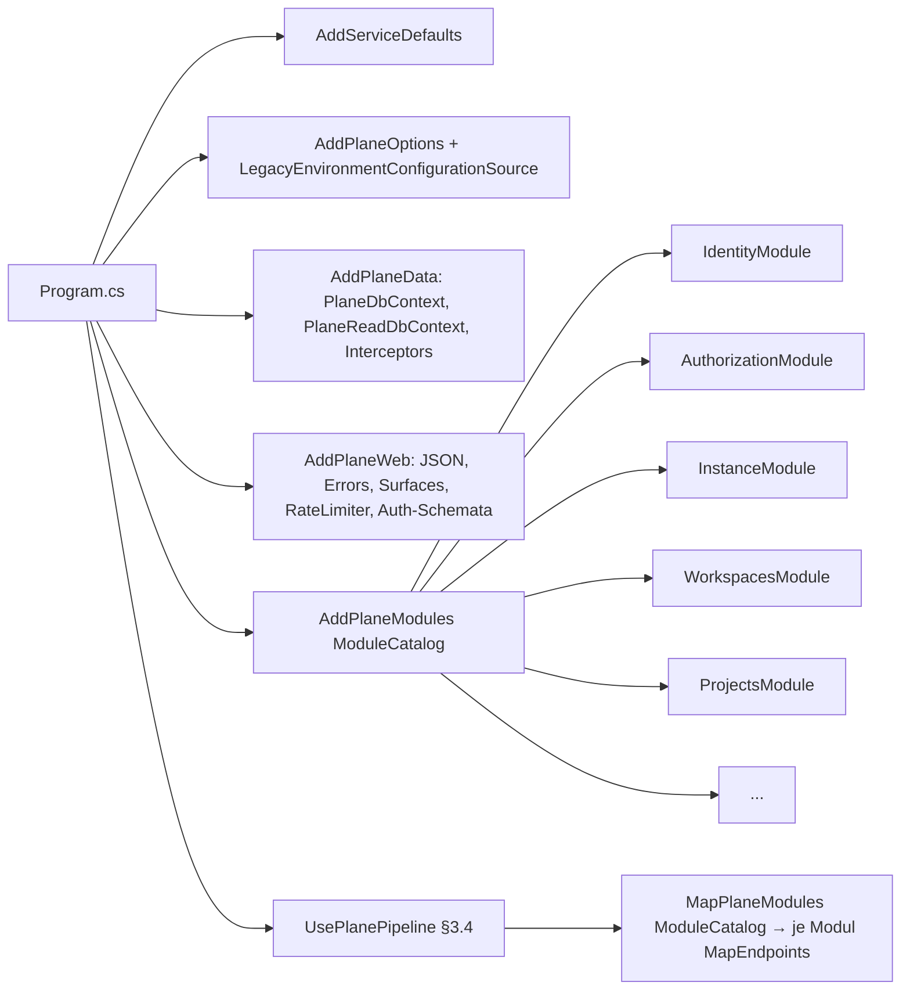
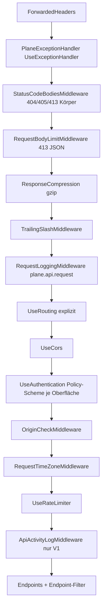
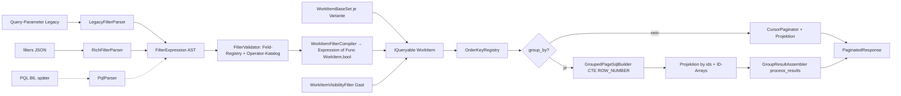

# 02 – Backend-Solution und Konventionen

> **Status:** verbindlich für alle Backend-Arbeitspakete (Fachdokument zu `01-zielarchitektur-und-tech-stack.md`, Anhang A: ADR-010 … ADR-016, ADR-019 … ADR-021, ADR-034 … ADR-038, ADR-050).
> **Rangfolge:** `00-grundsatzentscheidungen.md` > `01-zielarchitektur-und-tech-stack.md` > **dieses Dokument** > eigene Präferenzen. Bei Widerspruch gilt 01; wo dieses Dokument 01 präzisiert, ist das ausdrücklich als „Präzisierung zu 01 §…“ markiert, wo es einen Änderungsantrag an 01 stellt, steht er in §8 (offene Punkte).
> **Abgrenzung zu 05 (nach Review 23.10.2026):** Für **Inhalt und Semantik der Autorisierung** (Permission-Keys, Rollen-Grants, Evaluator-Reihenfolge, Regeln `C:`/`OWN`/`SELF`/`VIS`/`PAGE`/`BOARD`/`WSA|PA`, WS-Admin-Override HARM-00, Sicherheitskorrekturen `SEC-*`) sowie für **Auth-/Session-Optionen** ist `05-auth-sicherheit-berechtigungen.md` (§3.2, §3.13, §4.4, Anhang A/B) maßgeblich. Dieses Dokument liefert die **Mechanik** (Typen, Filter, Platzierung in der Pipeline, Deskriptor-Format, Fehlerkörper). Wo beide Dokumente dieselbe Sache unterschiedlich benennen, gilt 05; offene Widersprüche stehen im Review-Protokoll (Ende des Dokuments).
> **Repository:** Alle Zielpfade sind relativ zur Wurzel des neuen Repositorys **`funk.`** (ADR-009). Der in 01 §5.1 noch verwendete Arbeitstitel `plane-net/` ist durch `funk.` ersetzt; Projekt-, Assembly- und Namespace-Präfix bleibt `Plane.*` (01 §5), die Solution heißt `Plane.slnx`.
> **Stand:** 23.10.2026 · **Sprache:** Fließtext Deutsch, Bezeichner Englisch.
> **Kürzel:** `API/` = `apps/api/plane/` im Original-Repo (`/home/user/plane`), `A01` … `A13b` = Analyse-Dokumente in `migration/analysis/`, `CE-…` = Feature-IDs aus `migration/features/10-ce-feature-katalog.md`, `D02-ADR-nn` = Entscheidungen dieses Dokuments.

## Inhaltsverzeichnis

1. [Ziel & Scope](#1-ziel--scope)
2. [Entscheidungen (D02-ADR-01 ff.)](#2-entscheidungen-d02-adr-01-ff)
3. [Detaildesign](#3-detaildesign)
   - 3.1 Solution, Projekte, Modul-Schablone
   - 3.2 Persistenz-Basisklassen (Entity, Audit, Soft-Delete, Scoping)
   - 3.3 Endpunkt-Konventionen (Oberflächen, Präfixe, Routen, Statuscodes)
   - 3.4 Request-Pipeline (Middleware + Endpoint-Filter)
   - 3.5 Tenant-Auflösung über den Workspace-Slug
   - 3.6 Permission-Katalog und CE-Rollen-Mapping (Port von `allow_permission`)
   - 3.7 Validierung
   - 3.8 Fehlerformate und Fehlerkatalog
   - 3.9 JSON-Konventionen
   - 3.10 Pagination
   - 3.11 Filter-, Grouping- und Ordering-Engine für Work Items
   - 3.12 Caching
   - 3.13 Rate Limiting
   - 3.14 Logging, Tracing, Metriken
   - 3.15 Konfiguration (Options-Klassen)
   - 3.16 Instanz-Konfiguration (verschlüsselte Keys)
   - 3.17 Health-Endpunkte
   - 3.18 OpenAPI
   - 3.19 Transaktionen, Domain-/Integration-Events, Activity
4. [Mapping-Tabellen Original → Ziel](#4-mapping-tabellen-original--ziel)
5. [Code-Skelette (Building Blocks + Referenzmodul „Labels“)](#5-code-skelette)
6. [Erweiterungspunkte für Bezahl-Pakete](#6-erweiterungspunkte-für-bezahl-pakete)
7. [Akzeptanzkriterien & Tests](#7-akzeptanzkriterien--tests)
8. [Risiken & offene Punkte](#8-risiken--offene-punkte)
9. [Abhängigkeiten zu anderen Dokumenten](#9-abhängigkeiten-zu-anderen-dokumenten-0216)

---

## 1. Ziel & Scope

### 1.1 Ziel

Dieses Dokument macht die Backend-Rahmenentscheidungen aus 01 **direkt implementierbar**. Ein Implementierungs-Agent soll nach Lektüre von 01 §5 und diesem Dokument ohne weitere Architekturentscheidungen

1. ein neues Fachmodul nach der Schablone anlegen (Projekte, Ordner, Klassennamen, Registrierung),
2. Entitäten mit Audit, Soft-Delete und Workspace-/Projekt-Scoping modellieren,
3. Endpunkte unter den Original-Präfixen (`/api/`, `/api/v1/`, `/api/public/`, `/api/instances/`, `/auth/`) mit Original-Pfaden, -Statuscodes und -Fehlerkörpern veröffentlichen,
4. Berechtigungen ausschließlich über den Permission-Katalog prüfen – mit exakt reproduziertem Verhalten von `allow_permission` und den DRF-Permission-Klassen,
5. Listen mit dem Cursor-Format des Originals paginieren und Work-Item-Listen über die Filter-/Grouping-/Ordering-Engine abfragen,
6. Caching, Rate Limiting, Logging, Konfiguration und Instanz-Konfiguration einheitlich nutzen.

Das vollständige Referenzmodul **„Labels“** (Teil von `Plane.Projects`, 01 §5.4) in §5 ist die Kopiervorlage für alle weiteren Module.

### 1.2 Scope

| Im Scope | Nicht im Scope (zuständiges Dokument) |
|---|---|
| Solution- und Modulstruktur unterhalb der in 01 §5.1 festgelegten Ordner; Projektreferenzen; Registrierung | Verzeichnisbaum oberhalb von `src/` und `tests/` (01 §5.1), Frontend (08) |
| Persistenz-Basisklassen, Interceptors, Konventionen, `PlaneEntityConfiguration<T>` | Entitäten, Tabellen, Indizes aller Module (03) |
| Endpunkt-Konventionen, Oberflächen, Pipeline, Fehlerform, JSON, Pagination | Vollständiger Endpunktkatalog Original → Handler, Bug-/Sicherheits-Entscheidungstabelle (04) |
| Permission-Katalog (Mechanik, Deskriptor-Format, CE-Rollen-Mapping, Regeln) | Keycloak-Realm, Login-Flows, vollständige Permission-Matrix je Endpunkt (05) |
| Filter-/Grouping-/Ordering-/Pagination-Engine für Work Items (Port von `API/utils/{issue_filters,grouper,order_queryset,paginator,global_paginator}.py`, `API/utils/filters/*`) | Fachlogik der Work Items (Anlegen, Activity-Inhalte) (04, 06) |
| Caching-, Rate-Limit-, Logging-, Options- und Instanz-Konfigurations-Mechanik | ENV-Gesamttabelle für den Betrieb, AppHost vollständig (14) |
| Outbox-/Event-/Job-Schnittstellen nur soweit sie die Modul-Schablone betreffen | Task→Job-Tabelle, Event-Katalog-Inhalt, Activity-Pipeline-Inhalt (06) |
| Erweiterungspunkte der 🧱-Pakete **in den Bausteinen dieses Dokuments** (§6) | Fachdesign der Bezahl-Pakete (16 bzw. spätere Paketplanung) |

### 1.3 Wann welcher Teil gebraucht wird (Inkremente nach 01 §1.3)

| Baustein (Abschnitt) | Inkrement | Bemerkung / erster Nutzer |
|---|---|---|
| Solution, Modul-Schablone, Architekturtests (§3.1) | **I0** | Schnitt 1 „Login → JIT-Benutzer → leere Shell“ |
| Persistenz-Basisklassen, Audit-/Soft-Delete-/Ownership-Interceptor, benannte Filter (§3.2) | **I0** | Workspace, Projekt, User |
| Oberflächen `App`, `Auth`, `Instance` (Kern), Trailing-Slash, Fehlerform, JSON-Converter (§3.3, §3.8, §3.9) | **I0** | `GET /api/users/me/`, `POST /api/workspaces/`, `GET /api/instances/` |
| Oberfläche `Space` (`/api/public/`) | I6 (Kern-Routing ab I0 registriert, aber ohne Endpunkte) | CE-SPACE |
| Oberfläche `V1` (`/api/v1/`) inkl. API-Key-Schema | Schema-Gerüst **I0** (H1-Andockstelle), Endpunkte I6 | CE-API |
| Request-Pipeline, Tenant-Auflösung, Permission-Katalog-Grundgerüst inkl. `SystemRoleProvider` (§3.4–3.6) | **I0** | `allow_permission`-Port für Workspace/Projekt-Anlage |
| Validierung + DRF-Feldfehler (§3.7) | **I0** | Workspace-Slug, Projekt-Identifier |
| Cursor-Paginator ungruppiert (§3.10.1–3.10.3) | **I1** | Benachrichtigungen erst I5; erste Nutzung Projektliste `list_detail`, Mitglieder |
| Globaler Paginator (`ENV-GLOBAL`, §3.10.4) | I2 | `GET {P}/v2/issues/` (Delta-Sync) |
| Filter-/Grouping-/Ordering-Engine (§3.11) | **I2** (Spike S9 vor I2) | CE-LV-005/-006/-010 |
| Caching (§3.12) | I1 | Instanz-Konfiguration ab I0 ohne L2 (nur L1) |
| Rate Limiting (§3.13) | I1 (Policy `anon` ab I0) | CE-API-002 in I6 |
| Logging/Tracing (§3.14) | **I0** | ServiceDefaults |
| DbContext-Registrierung ohne Pooling, Execution-Strategy-Kapselung, Mediator-Konfiguration (§3.2.4, D02-ADR-26/-27) | **I0** | Spike S0 prüft `internal`-Handler-Registrierung |
| Options-Klassen (§3.15) | **I0** (alle Klassen angelegt; `ValidateOnStart` für alle, Pflichtfelder nur bei Klassen, deren Modul im Host-Katalog steht – sonst würde I0 an Werten späterer Inkremente scheitern) | – |
| Instanz-Konfiguration (§3.16) | **I0** (Store + Seed), God-Mode-Formulare I6 | CE-INST-002/-003 |
| Health (§3.17) | **I0** | Aspire-Health, Gateway |
| OpenAPI (§3.18) | I0 intern (Contract-Check), I6 öffentlich | CE-API-004 |
| Referenzmodul Labels (§5) | **I1** | CE-PRJ-028 … -033 |

---

## 2. Entscheidungen (D02-ADR-01 ff.)

Spalte „ab“ = Inkrement der ersten Umsetzung. Alle Entscheidungen sind Präzisierungen der in Klammern genannten 01-ADRs.

| ID | Belang | Entscheidung | Alternativen (verworfen) | Begründung | ab |
|---|---|---|---|---|---|
| **D02-ADR-01** | Modulregistrierung (ADR-010) | Module werden **explizit** in `src/hosts/Plane.Api/ModuleCatalog.cs` (und analog Worker/Realtime) als Liste `IModule`-Instanzen aufgeführt; keine Assembly-Scans. Jeder Host ruft `AddPlaneModules(catalog)` und `MapPlaneModules(catalog)` auf. | Reflection-Scan aller `IModule`; Plugin-Loader | Deterministische Reihenfolge, AOT-/Trim-freundlich, Merge-Konflikte paralleler Agenten auf eine Zeile pro Modul begrenzt; Architekturtest prüft, dass jedes `Plane.<M>`-Assembly genau einmal im Katalog steht. | I0 |
| **D02-ADR-02** | Entity-Basistypen (ADR-037) | Flache Vererbung mit drei abstrakten Basisklassen `Entity` → `AuditableEntity` → `WorkspaceEntity` / `ProjectEntity`, ergänzt um **Marker-Interfaces** (`ISoftDeletable`, `IAuditable`, `IWorkspaceScoped`, `IProjectScoped`, `IExternallyReferenced`, `ISortable`, `IHasDomainEvents`). Audit-Semantik **wie Original** (`BaseModel.save`): bei Anlage `created_by_id = Akteur`, `updated_by_id = NULL`; bei Änderung nur `updated_by_id = Akteur`. | Ein „God-Base“ mit allen Feldern; reine Interfaces ohne Basisklassen; EF-Owned-Types für Audit | Spiegelt `BaseModel`/`AuditModel`/`WorkspaceBaseModel`/`ProjectBaseModel` (`API/db/models/base.py`, `API/db/mixins.py`) 1:1 → Golden-Files bleiben vergleichbar (`updated_by: null` nach Anlage). Interfaces erlauben Interceptors ohne Typprüfung auf Basisklassen. | I0 |
| **D02-ADR-03** | Soft-Delete (01 §7.7) | `SoftDeleteInterceptor` wandelt `EntityState.Deleted` für `ISoftDeletable` in ein Update von `deleted_at` um und wertet die **`SoftDeleteCascadeRegistry`** aus. Kaskadenmodus je Beziehung: `Inline` (Set-basiertes `ExecuteUpdateAsync` in derselben Transaktion; Default) oder `Deferred` (Job `SoftDeleteCascadeJob` über die Job-Queue; nur für Wurzeln mit potenziell sehr vielen Kindern: Workspace, Project). Hartes Löschen ausschließlich über `IHardDelete`-Pfad (Hard-Delete-Job, explizite Fachfälle wie `UserRecentVisit`). | Kaskade immer asynchron wie Original (`soft_delete_related_objects.delay`); Datenbank-Trigger | Inline-Kaskade beseitigt das Original-Zeitfenster, in dem Kinder eines gelöschten Objekts noch sichtbar sind (dokumentierte Abweichung `DEV-OPS-001` in `tests/contracts/deviations.yaml`); für große Wurzeln bleibt das asynchrone Original-Verhalten. | I0 |
| **D02-ADR-04** | Tenant-Auflösung (ADR-038) | `ScopeBindingFilter` löst `{slug}` (und `{project_id}`) **ohne eigenen 404** auf: ein unbekannter Slug ergibt einen `WorkspaceScope` mit `Exists = false`; die nachfolgende Permission-Prüfung liefert dann die **Original-Ablehnung** (403 in der Form des jeweiligen Prüfmechanismus). Nur Endpunkte, die im Original per `Workspace.objects.get(...)` 404 liefern, deklarieren `.ResolveWorkspaceOrNotFound()`. | Middleware, die bei unbekanntem Slug sofort 404 liefert | Original prüft Mitgliedschaft über `workspace__slug=…` → unbekannter Slug = „keine Mitgliedschaft“ = 403 (`A03` §2.4.2). 404 würde zudem die Existenz fremder Workspaces offenlegen. | I0 |
| **D02-ADR-05** | Permission-Deklaration (ADR-019, 01 §7.10, D05-ADR-17/-20) | Je Route **genau ein** `.RequirePermission(<PermissionDescriptor>, params PermissionRule[] rules)` (Signatur aus 05 §3.13.7); der **Deskriptor** (generiert aus `05-permission-matrix.json`, 05 §5.8) trägt Schlüssel, Ebene, Rollenmenge, `ApiScope` und den Default-`DenyStyle` (`Error` = `{"error": "You don't have the required permissions."}` wie `allow_permission`, `Detail` = `{"detail": "You do not have permission to perform this action."}` wie DRF-Permission-Klassen). **Regeln** werden am Endpunkt angehängt (05-Notation `C:<Model>`, `OWN`, `SELF`, `VIS`, `PAGE`, `BOARD`, `WSA\|PA`) und zusätzlich – Ergänzung dieses Dokuments – die Regel **`PermissionRule.Prerequisite(<Deskriptor>)`**: eine vorgeschaltete Prüfung mit **eigenem** `DenyStyle`, die die Original-Kombination „Permission-Klasse **und** Decorator“ (`WS(A,M) ∧ PRJ⁺(A)` in 05 Anhang B) mit den jeweils unterschiedlichen Fehlerkörpern reproduziert. `.WithDenyStyle(...)` überschreibt den Default je Endpunkt. | Mehrere `.RequirePermission`-Aufrufe je Route; ASP.NET-Policies je Rolle; Prüfung im Handler; Vorbedingungen fest im Deskriptor (verworfen im Review, weil derselbe Key an Endpunkten mit und ohne Vorbedingung vorkommt, z. B. `project.label.create` an L2 und L7) | Erfüllt 01 §7.10 („genau eine Angabe“) und D05-ADR-20 („Körper je Prüfmechanismus wie Original“). E5 tauscht nur den `IRoleDefinitionProvider`. | I0 |
| **D02-ADR-06** | Oberflächen (ADR-011) | Sechs typisierte **Oberflächen** (`ApiSurface`): `App` (`/api/`), `V1` (`/api/v1/`), `Space` (`/api/public/`), `Instance` (`/api/instances/`), `Auth` (`/auth/`), `Integrations` (`/api/integrations/`), dazu `Root` (`/`, `/robots.txt`). Jede Oberfläche ist eine `RouteGroupBuilder`-Hülle (`PlaneEndpointRouteBuilder.App(...)`, `.V1(...)`, `.Space(...)`, `.Instance(...)`, `.Auth(...)`, `.Integrations(...)`, `.Root(...)`) mit festem Authentifizierungsschema, CSRF-/Origin-Regel, Rate-Limit-Policy, Fehlerprofil und OpenAPI-Dokument. | Ein globales Präfix mit Attributen je Endpunkt | Das Original unterscheidet genau diese Bereiche (`A01` §2.14) mit unterschiedlicher Auth, Cookies und Throttles; Fehlkonfiguration einzelner Endpunkte wird so unmöglich. | I0 |
| **D02-ADR-07** | Trailing Slash (01 §7.11) | `TrailingSlashMiddleware` **vor** `UseRouting` entfernt genau einen abschließenden `/` aus `Request.Path` (außer bei `/`), ohne Redirect und für alle Methoden. Routen-Templates enthalten nie einen abschließenden Slash. | Doppelte Registrierung je Route; `APPEND_SLASH`-Redirect; Vertrauen auf implizites Routing-Verhalten | Deterministisch und unabhängig von Routing-Interna; kein 301 auf POST/PATCH (Original würde bei fehlendem Slash und POST einen Fehler werfen). Ein Routing-Test über alle Endpunkte prüft beide Varianten. | I0 |
| **D02-ADR-08** | Fehlerbehandlung (ADR-016, 01 §7.4) | **Zwei Wege, eine Fabrik:** (a) erwartbare Fehler als `Result`/`Result<T>` mit `PlaneError` aus `PlaneErrors` (kein Exception-Control-Flow); (b) unerwartete Ausnahmen über `PlaneExceptionHandler : IExceptionHandler`, der die Abbildung von `BaseViewSet.handle_exception` 1:1 reproduziert (`DbUpdateException` mit Unique-Verletzung → 400 `{"error": "The payload is not valid"}`, `EntityNotFoundException` → 404 `{"error": "The required object does not exist."}`, `RequiredKeyMissingException` → 400 `{"error": "The required key does not exist."}`, sonst 500 `{"error": "Something went wrong please try again later"}` + Log `plane.exception`). RFC-9457-ProblemDetails nur für `/health/*` und interne Fehler des Gateways. | Exceptions für alle Fehler; ProblemDetails überall | Erwartete Fehler sind Teil des Vertrags und müssen testbar ohne Exceptions sein; unerwartete Fehler brauchen die exakten Original-Texte, weil das Frontend sie als Toast anzeigt. | I0 |
| **D02-ADR-09** | Validierung (ADR-013) | **Zwei Validierungsstufen:** (1) `ValidationEndpointFilter<TRequest>` (`.Validate<TRequest>()`) führt `IValidator<TRequest>` aus – reine Formprüfung (Pflichtfelder, Längen, Formate, Enum-Werte) mit **DRF-Standardtexten** aus `DrfMessages`; (2) `ValidationBehavior<TCommand>` im Mediator führt `IValidator<TCommand>` aus – kontextabhängige Prüfungen mit DB-Zugriff (Eindeutigkeit, Fremdschlüssel im selben Projekt). Beide liefern `PlaneError.Fields` → `{"<feld>": ["<meldung>"]}`. Endpunktspezifische Abweichungen (z. B. `{"error": "Label with the same name already exists in the project"}`) werden **im Handler** als `PlaneErrors.Plain(...)` erzeugt, nicht im Validator. | Nur Endpoint-Filter; nur Mediator-Behavior; .NET-10-`AddValidation()` | Trennung hält Formregeln ohne DB testbar; DB-Regeln laufen im selben Scope/Transaktion wie der Handler; Original-Texte bleiben an einer Stelle. | I0 |
| **D02-ADR-10** | PATCH-Semantik | Request-Typen für PATCH nutzen **`Optional<T>`** (Struct mit `IsSet`/`Value`, eigener `OptionalJsonConverterFactory`): nicht gesendet ≠ `null` gesendet. Unbekannte Felder werden ignoriert (DRF-Verhalten). Schreibgeschützte Original-Felder (`read_only_fields`) existieren im Request-Typ nicht. | `JsonPatchDocument`; Nullable-Felder mit Raten; `JsonObject` im Handler | Original-PATCH ist „partial update“ (`partial=True`): nur gesendete Felder ändern sich; Activity schreibt nur gesendete Felder (`requested_data`). `Optional<T>` macht das typsicher. | I0 |
| **D02-ADR-11** | JSON & Zeitformate (ADR-015, 01 §7.2/7.3) | `System.Text.Json` mit Source-Generated `PlaneJsonContext`, `PropertyNamingPolicy = SnakeCaseLower`, `DefaultIgnoreCondition = Never`, `NumberHandling = Strict`, unbekannte Felder ignoriert. Pflicht-Converter: `DrfDateTimeOffsetConverter` (Ausgabe `yyyy-MM-ddTHH:mm:ss.ffffffZ`, **bei Mikrosekunde 0 ohne Bruchteil** wie Python `isoformat()`; Präzisierung zu 01 §7.3), `DateOnlyConverter` (`yyyy-MM-dd`), `PythonFloatConverter` (ganzzahlige `double` als `65535.0`), `LowercaseGuidConverter`, Enum-Converter mit Original-Werten. Doppel-Unterstrich-Felder (`state__group`) per `[JsonPropertyName]`. **Zeitzone der Ausgabe:** Default UTC (`Z`) gemäß 01 §7.3; Schalter `Plane:Json:DateTimeOutputZone = Utc \| RequestTimeZone` für den Fall, dass der Paritäts-Harness Abhängigkeiten des Frontends von der DRF-Nutzerzeitzone nachweist (siehe Befund B-02 und O-D02-01). | Newtonsoft.Json; Reflection-basierte Serialisierung; Ausgabe immer in Nutzerzeitzone | Frontend-Typen (`packages/types`) bleiben unverändert; Source-Generation spart Startzeit; der Zeitzonen-Befund wird messbar entschieden statt geraten. | I0 |
| **D02-ADR-12** | Weggelassene Felder (DRF `SkipField`) | Wo das Original Felder **weglässt** (Read-only-Feld ohne Annotation, `A03` §2.3), wird eine **eigene DTO-Klasse je Antwortform** definiert (z. B. `CycleDto` vs. `CycleWithStatusDto`), nicht ein Feld mit `null`. Nur bei variabler Präsenz zur Laufzeit: Typ `Omittable<T>` mit Converter + `[JsonIgnore(Condition = WhenWritingDefault)]`. | Ein DTO mit `null`; dynamische `JsonObject`-Antworten | Contract-Diffs unterscheiden „Feld fehlt“ von `null`; das Frontend prüft teils auf `undefined`. | I0 |
| **D02-ADR-13** | Pagination (01 §7.5) | Generischer **`CursorPaginator`** in `Plane.BuildingBlocks.Web/Pagination` für ungruppierte Listen (Port `OffsetPaginator` + `BasePaginator.paginate` inkl. aller Fehlertexte), **`GlobalPaginator`** für `ENV-GLOBAL`, gruppierte/untergruppierte Pagination ausschließlich in der Work-Item-Query-Engine (§3.11). Sortierung erhält als letzten Tiebreaker zusätzlich `id DESC` (Original: nur `created_at DESC`, nicht deterministisch; Abweichung `DEV-PAG-001`). | Keyset-Pagination; Pagination je Modul selbst gebaut | Cursor-Format ist Vertrag; deterministische Reihenfolge ist Voraussetzung für stabile Contract-Tests. | I1 |
| **D02-ADR-14** | Filter-AST als einzige Abfragesprache (01 §1.4 B6, CE-LV-006) | Legacy-Query-Parameter (`issue_filters`) und Rich-Filter-JSON (`filters`) werden von **zwei Parsern** in **denselben** `FilterExpression`-AST übersetzt, dann von einem **Compiler** über eine **Feld-Registry** (`IFilterFieldProvider` + `IWorkItemFilterTranslator`) in `Expression<Func<WorkItem,bool>>`. Kein Parser erzeugt SQL oder LINQ direkt. | Zwei getrennte Filterpfade wie Original; Dynamic-LINQ-Strings | Ein Ausdrucksbaum ist Voraussetzung für B6 (PQL als dritter Parser) und A1 (Custom-Property-Felder als weitere Registry-Einträge). | I2 |
| **D02-ADR-15** | Gruppierte Abfragen (S9, `A04` §5.2) | Zweiphasig: Phase 1 ermittelt per **SQL-Baustein** (`GroupedPageSqlBuilder`, CTE mit `ROW_NUMBER() OVER (PARTITION BY …)`, nur allowlist-geprüfte Ausdrücke aus der Group-Key-Registry, Ausführung über `Database.SqlQuery<GroupedRow>`) die Tupel `(issue_id, group_key, sub_group_key, rn)` sowie Gruppensummen; Phase 2 projiziert die Issue-Felder per EF (`WHERE id = ANY(@ids)`) und ID-Arrays per zweiter Abfrage (`array_agg`). Die gefilterte Basismenge gelangt entweder als materialisiertes ID-Array (Variante A) oder als aus demselben AST erzeugtes, parametrisiertes SQL-Prädikat (Variante B) in den CTE (§3.11.6). | Alles in LINQ (EF übersetzt Window-Functions nicht); `linq2db` | Performance-Ziele aus S9; ein schmaler, gut testbarer SQL-Baustein statt vieler handgeschriebener Queries. | I2 |
| **D02-ADR-16** | Caching (ADR-021) | Fassade **`IPlaneCache`** über `HybridCache` mit Schlüssel-Präfix `plane:`, Tag-Invalidierung und **knotenübergreifender L1-Invalidierung** über Valkey-Pub/Sub-Kanal `plane:cache:invalidate` (HybridCache invalidiert L1 nur auf dem eigenen Knoten). **Berechtigungen/Mitgliedschaften werden nicht request-übergreifend gecacht** (nur Memoisierung pro Request). Kein generisches Response-Caching; gecacht werden benannte Lesemodelle (§3.12). | `@cache_response`-Nachbau (Schlüssel = Pfad+User); Output-Caching | Original-Invalidierungen treffen ihre Schlüssel nicht (`A03` §2.1.6) → Tags lösen das korrekt; Rechteänderungen müssen sofort wirken (Sicherheit). | I1 |
| **D02-ADR-17** | Rate Limiting (ADR-034) | Benannte Policies `anon`, `authentication`, `email_verification`, `asset_duplicate`, `api_key`, gebunden an Oberflächen bzw. Endpunkte; Raten im Original-Format `n/period`; Partitionierung exakt wie Original (IP, User, Asset-ID, API-Key → **`token_hash`**, D05-ADR-16); Ablehnung 429 `{"error_code": 5900, "error_message": "RATE_LIMIT_EXCEEDED"}` + `Retry-After`; `/api/v1/` zusätzlich `X-RateLimit-Remaining`/`X-RateLimit-Reset` auf **jeder** Antwort. Algorithmus Sliding Window (DRF-History-Semantik). | Token Bucket; nur Gateway-Limit | Paritätsvertrag CE-API-002; API-Key nicht im Klartext als Schlüssel (Korrektur gegenüber `api_key:<key>`, Sicherheitskorrektur nach 01 §7.20). | I1 |
| **D02-ADR-18** | Logging/Tracing (ADR-035, 01 §7.16) | `ILogger<T>` mit **festen Kategorien** über `PlaneLogCategories` (`plane.api.request`, `plane.api`, `plane.worker`, `plane.realtime`, `plane.exception`, `plane.external`, `plane.authentication`, `plane.migrations`, `plane.query`, `plane.config`); `RequestLoggingMiddleware` schreibt eine Zeile pro Request (`"{Method} {Path} {StatusCode}"` + Felder wie Original), nicht für `GET /` und `/health/*`; `ActivitySource`-Namen `Plane.Api`, `Plane.Worker`, `Plane.Realtime`, `Plane.Messaging`, `Plane.Query`; Redaktion über `Microsoft.Extensions.Compliance.Redaction` für Felder mit `[PersonalData]`/`[SecretData]`. | Serilog; freie Kategorien | Betreiber-Dashboards/Alerts des Originals bleiben übertragbar; keine PII in Logs. | I0 |
| **D02-ADR-19** | Konfiguration (ADR-036, 01 §7.13) | Eine Options-Klasse je Bereich `Plane<Bereich>Options` unter `Plane:<Bereich>`; **ENV-Aliase** der Original-Variablen über die Konfigurationsquelle `LegacyEnvironmentConfigurationSource` (Tabelle §4.9), die vor den Standard-ENV-Variablen geladen wird (`Plane__…` hat Vorrang); Validierung per `IValidateOptions<T>` + `ValidateOnStart`; Raten-Strings (`60/minute`) per `RateExpression.Parse`. | Direktes Lesen von `Environment.GetEnvironmentVariable`; nur neue Namen | Betreiber können vorhandene `.env`-Dateien des Originals weiterverwenden; ungültige Werte fallen beim Start auf, nicht beim ersten Request. | I0 |
| **D02-ADR-20** | Instanz-Konfiguration (ADR-036, CE-INST-002) | Tabelle `instance_configurations` (Key, Value, Category, IsEncrypted), Zugriff nur über **`IInstanceConfigurationStore`** (`Plane.Instance.Contracts`); geheime Werte mit **ASP.NET Core Data Protection** (Purpose `Plane.InstanceConfiguration.v1`, Key-Ring in PostgreSQL); Seed **nur fehlender** Keys aus ENV beim Migrator-Lauf (`configure_instance`-Semantik); Lesemodus `Database` (Default, `SKIP_ENV_VAR=1`) oder `Environment`; Key-Katalog als Code (`InstanceConfigurationKeys`) – OAuth-/Passwort-Keys entfallen (ADR-008). | Fernet-Nachbau mit `SECRET_KEY`; Speicherung im Klartext | Key-Rotation eingebaut, kein selbst gebautes Krypto; Greenfield erlaubt neuen Verschlüsselungsweg (ADR-003). | I0 |
| **D02-ADR-21** | Request-Zeitzone (`TimezoneMixin`) | `IRequestTimeZone` (scoped) wird nach der Authentifizierung aus `users.user_timezone` gesetzt (anonym: UTC). Datumskomponenten-Vergleiche (`__date`, `TruncDate`, Analytics-Gruppierung) nutzen ausschließlich `IRequestTimeZone` bzw. explizit die Projekt-Zeitzone; „heute“ in Legacy-Datumsfiltern bleibt **UTC-Datum** (Original-Verhalten `A04` §3.2). | Thread-statische Zeitzone; Konvertierung im Frontend | Exakte Parität der Filter- und Analytics-Ergebnisse; R8 (kein `DateTime.UtcNow`) bleibt erhalten (`IClock`). | I0 |
| **D02-ADR-22** | Read-Replica (CE-OPS-010) | Endpunkt-Metadatum `.UseReadReplica()` (nur GET/HEAD/OPTIONS); Query-Handler beziehen `PlaneReadDbContext` (gleiches Modell, `QueryTrackingBehavior.NoTracking`, Connection-String `plane-replica`) über `IReadDbContextAccessor`, der ohne Replica bzw. bei anderen Methoden auf die Primary fällt. Liste der Replica-Endpunkte wie Original (`A03` §2.1.1). | Middleware-Routing über `DbConnection`-Tausch | Expliziter, testbarer Pfad; keine Schreibzugriffe auf die Replica möglich. | I1 |
| **D02-ADR-23** | Handler-Stil (ADR-011/012) | Endpunkte als `internal static class <Ding>Endpoints` mit `Map(PlaneEndpointRouteBuilder)` und statischen lokalen Handler-Methoden; Handler geben `IResult` über die Erweiterungen `Result<T>.ToOk()/ToCreated()/ToNoContent()/ToStatus(int)` zurück; Commands/Queries per Mediator (`ISender`). Kein Controller, kein MVC. | MVC-Controller; Lambdas inline in `Map*` | Eine Datei je Ressource, kleine Diffs, OpenAPI-Metadaten zentral; Regel R4 (kein `PlaneDbContext` in Endpunkten) maschinell prüfbar. | I0 |
| **D02-ADR-24** | Transaktionsgrenze (ADR-012/020) | Jeder Command läuft im `TransactionBehavior` in einer **expliziten** Transaktion (`BeginTransactionAsync(IsolationLevel.ReadCommitted)` wie Django; Präzisierung im Review: immer, nicht nur bei `ISequenceAllocator`, weil Inline-Soft-Delete-Kaskaden per `ExecuteUpdateAsync` sonst außerhalb der SaveChanges-Transaktion liefen). Ablauf: Handler → **Domain-Event-Schleife** (`DomainEventDispatcher` dispatcht `IDomainEvent`s aller getrackten Entitäten in-process, wiederholt bis keine neuen Events entstehen, max. 5 Runden) → genau **ein** `SaveChangesAsync` (Interceptors §3.2.2, Integration-Events über `OutboxInterceptor` im selben Commit) → `CommitAsync` → Post-Commit-Aktionen. Domain-Events werden bewusst **nicht** in einem Interceptor dispatcht, weil von Handlern angelegte/geänderte Entitäten sonst Audit-, Soft-Delete- und Ownership-Interceptor verpassen würden. Synchrones `SaveChanges()` ist verboten (Banned-API). Queries laufen ohne Transaktion, `AsNoTracking`. | Unit-of-Work-Klasse je Modul; `TransactionScope`; Dispatch im `SavingChanges`-Interceptor | Gleiche Atomarität wie Django-`transaction.atomic` + `on_commit`; keine verteilten Transaktionen. | I0 |
| **D02-ADR-25** | Activity-Aufzeichnung (01 §7.8) | Fachhistorie ausschließlich über **`IActivityRecorder`** (`Plane.WorkItems.Contracts`, Implementierung in `Plane.WorkItems`), synchron im selben Commit; Module liefern **Feld-Resolver** (`IActivityFieldResolver`, z. B. `LabelActivityFieldResolver` für Feld `labels`), die IDs in Anzeigewerte (`old_value`/`new_value`) übersetzen. Keine Activity-Logik in Endpunkten. | Celery-Nachbau (asynchron, wie Original `issue_activity.delay`) | Konsistenz (Activity existiert genau dann, wenn die Änderung committet ist); asynchrone Folgen (Notifications, Webhooks) bleiben über Outbox asynchron. | I1 (Gerüst), I2 (Work Items) |
| **D02-ADR-26** | DbContext-Registrierung (ADR-037, Review-Ergänzung) | `PlaneDbContext` und `PlaneReadDbContext` werden **ohne Pooling** registriert: `services.AddDbContext<PlaneDbContext>((sp, o) => o.UseNpgsql(cs).UseSnakeCaseNamingConvention().AddInterceptors(sp.GetServices<IPlaneSaveChangesInterceptor>()))` mit **scoped** Interceptors, danach `builder.EnrichNpgsqlDbContext<PlaneDbContext>()` (Aspire: Health-Check, Tracing, Retries). `builder.AddNpgsqlDbContext<T>()` ist verboten (Architekturtest), weil es Pooling aktiviert. | `AddNpgsqlDbContext` (gepoolt) + `IDbContextFactory` mit Tenant-Setter | Bei Pooling werden in den Kontext injizierte scoped Dienste (hier `IWorkspaceContext` für den Filter `workspace_tenant`, `ICurrentActor` in Interceptors) nur einmal aus dem ersten Scope aufgelöst (Microsoft Learn, `AddDbContextPool` Remarks) → Tenant-Leck zwischen Requests. Pooling-Gewinn ist laut Microsoft gering. | I0 |
| **D02-ADR-27** | Mediator-Konfiguration (ADR-012, Review-Ergänzung) | Jeder Host ruft genau einmal `services.AddMediator(o => { o.ServiceLifetime = ServiceLifetime.Scoped; o.GenerateTypesAsInternal = true; o.Assemblies = [<alle Modul-Assemblies des Host-Katalogs>]; o.PipelineBehaviors = [typeof(LoggingBehavior<,>), typeof(ModuleScopeBehavior<,>), typeof(ValidationBehavior<,>), typeof(TransactionBehavior<,>)]; })`. Weil der Source-Generator den Registrierungscode **im Host-Assembly** erzeugt und Handler/Commands nach R9 `internal` sind, trägt jedes Modul-Assembly `[assembly: InternalsVisibleTo("Plane.Api")]`, `("Plane.Worker")`, `("Plane.Realtime")` und `("Plane.<M>.Tests")` (zentral über `Directory.Build.targets` aus der Property `PlaneInternalsVisibleTo`). | Default-Lifetime `Singleton` (fängt scoped `PlaneDbContext` ein → Laufzeitfehler); Handler `public` (bricht R9) | Spike S0 prüft mit einem `internal`-Handler in einem Modul-Assembly, dass der Generator ihn im Host registriert; scheitert das, gilt Fallback „Commands/Handler `public`, R9 nur für übrige Typen“ (Änderungsantrag an 01 R9, O-D02-09). | I0 |

---
## 3. Detaildesign

### 3.1 Solution, Projekte, Modul-Schablone

#### 3.1.1 Projektliste der Backend-Solution (Präzisierung zu 01 §5.1)

Alle Projekte nutzen `Directory.Build.props` (Nullable, `TreatWarningsAsErrors`, `ImplicitUsings`, `LangVersion latest`, `InvariantGlobalization=false` wegen Zeitzonen/ICU) und Central Package Management. Zielframework überall `net10.0`.

| Projekt (Pfad relativ zu `funk.`) | SDK | Referenziert (nur diese) | Inhalt (Ordner) | ab |
|---|---|---|---|---|
| `src/building-blocks/Plane.BuildingBlocks/Plane.BuildingBlocks.csproj` | `Microsoft.NET.Sdk` | – (nur `Mediator.Abstractions`, `Microsoft.Extensions.*.Abstractions`) | `Ids/` (`IIdGenerator`, `UuidV7Generator`), `Time/` (`IClock`, `SystemClock`, `IRequestTimeZone`), `Results/` (`Result`, `Result<T>`, `PlaneError`, `PlaneErrorKind`), `Scoping/` (`ScopeLevel`, `ScopeRef`, `IScopeResolver`, `WorkspaceScope`, `ProjectScope`), `Security/` (`PlanePrincipal`, `PrincipalRef`, `PrincipalKind`, `Permission`, `ICurrentActor`), `Modules/` (`IModule`, `IMessagingRegistry`), `Messaging/` (`IIntegrationEvent`, `IDomainEvent`, `IEventConsumer<T>`, `IJob`, `IJobScheduler`, `IRecurringJobRegistry`, `EventContext`), `Pagination/` (`Cursor`, `PageRequest`, `PaginatedResponse<T>`, `GlobalPage<T>`), `Optional/` (`Optional<T>`, `Omittable<T>`), `Activity/` (Marker `IActivityFieldResolver` nur als Contract-Basis) | I0 |
| `src/building-blocks/Plane.BuildingBlocks.Web/Plane.BuildingBlocks.Web.csproj` | `Microsoft.NET.Sdk` + `FrameworkReference Microsoft.AspNetCore.App` | `Plane.BuildingBlocks`, `Plane.Authorization.Contracts` | `Surfaces/` (`ApiSurface`, `PlaneEndpointRouteBuilder`, `SurfaceConventions`), `Routing/` (`TrailingSlashMiddleware`, `PlaneRouteConstraints`), `Json/` (`PlaneJsonOptions`, Converter), `Errors/` (`PlaneErrors`, `PlaneErrorCodes`, `DrfMessages`, `PlaneExceptionHandler`, `ResultExtensions`, `StatusCodeBodiesMiddleware`), `Validation/` (`ValidationEndpointFilter<T>`, `DrfValidationErrorMapper`), `Scoping/` (`ScopeBindingFilter`, `WorkspaceScopeBinder`), `Permissions/` (`PermissionEndpointFilter`, `RequirePermissionExtensions`, `AllowAnonymousSurfaceExtensions`), `Pagination/` (`CursorPaginator`, `GlobalPaginator`, `PaginationQuery`), `Security/` (`OriginCheckMiddleware`, `RequestBodyLimitMiddleware`, `ApiKeyAuthenticationHandler`), `RateLimiting/` (`PlaneRateLimitPolicies`, `SlidingWindowByKeyPolicy`), `Logging/` (`RequestLoggingMiddleware`, `PlaneLogCategories`), `ReadReplica/` (`UseReadReplicaMetadata`), `OpenApi/` (`PlaneOpenApiTransformers`) | I0 |
| `src/building-blocks/Plane.BuildingBlocks.Persistence/Plane.BuildingBlocks.Persistence.csproj` | `Microsoft.NET.Sdk` | `Plane.BuildingBlocks` + EF Core/Npgsql | `Entities/` (`Entity`, `AuditableEntity`, `WorkspaceEntity`, `ProjectEntity`, Marker-Interfaces, `OwnedByAttribute`), `Configuration/` (`PlaneEntityConfiguration<T>`, `PlaneModelConventions`), `Interceptors/` (`AuditInterceptor`, `SoftDeleteInterceptor`, `OwnershipGuardInterceptor`, `DomainEventDispatchInterceptor`, `OutboxInterceptor`), `SoftDelete/` (`SoftDeleteCascadeRegistry`, `CascadeMode`, `SoftDeleteCascadeJob`), `Filters/` (`QueryFilterNames`), `Sequences/` (`ISequenceAllocator`, `SequenceAllocator`), `Errors/` (`PostgresErrorClassifier` für `23505` Unique, `23503` FK) | I0 |
| `src/building-blocks/Plane.BuildingBlocks.Messaging/…` | `Microsoft.NET.Sdk` | `Plane.BuildingBlocks`, `Plane.BuildingBlocks.Persistence` | Outbox/Inbox/Job-Queue/Scheduler (Detail: 06) | I0 |
| `src/building-blocks/Plane.BuildingBlocks.Testing/…` | `Microsoft.NET.Sdk` | alle BuildingBlocks, `Plane.Data`, Test-Pakete | `PlaneAppFactory`, `PostgresFixture`, `ScenarioBuilder` (Workspace/Projekt/Mitglieder/Rollen), `GoldenFile`, `PermissionMatrixRunner`, `FakeClock`, `TestPrincipal` | I0 |
| `src/data/Plane.Data/Plane.Data.csproj` | `Microsoft.NET.Sdk` | `Plane.BuildingBlocks.Persistence` | `PlaneDbContext`, `PlaneReadDbContext`, `Entities/<Modul>/`, `Configurations/<Modul>/`, `Querying/` (`IWorkItemFilterTranslator`, `WorkItemQueryableExtensions`), `Migrations/`, `Seeds/` | I0 |
| `src/modules/<M>/Plane.<M>.Contracts` | `Microsoft.NET.Sdk` | **nur** `Plane.BuildingBlocks` (R2) | `Dtos/`, `Requests/`, `Events/`, `Permissions/`, `Services/`, `Extensions/` | je Modul |
| `src/modules/<M>/Plane.<M>` | `Microsoft.NET.Sdk` + `FrameworkReference Microsoft.AspNetCore.App` | `Plane.<M>.Contracts`, andere `*.Contracts`, `Plane.Data`, `Plane.BuildingBlocks.*`, `platform/*`, `documents/*` | Schablone §3.1.2 | je Modul |
| `src/hosts/Plane.Api` | `Microsoft.NET.Sdk.Web` | alle `Plane.<M>`, `Plane.ServiceDefaults`, `Plane.BuildingBlocks.Web` | `Program.cs`, `ModuleCatalog.cs`, `PipelineExtensions.cs`, `appsettings.json` | I0 |

#### 3.1.2 Modul-Schablone (Ergänzung zu 01 §5.3 – Dateinamen verbindlich)

```text
src/modules/<Name>/
├── Plane.<Name>.Contracts/
│   ├── Dtos/<Ding>Dto.cs                     # Antwortformen exakt wie Original-Serializer; je Form eine Klasse (D02-ADR-12)
│   ├── Requests/<Verb><Ding>Request.cs       # Request-Körper; PATCH-Felder als Optional<T> (D02-ADR-10)
│   ├── Events/<Ding><Ereignis>V1.cs          # Integration-Events (plane.<aggregat>.<ereignis>.v1)
│   ├── Permissions/<Name>Permissions.cs      # static readonly Permission-Felder + Descriptor-Liste
│   ├── Services/I<Ding>Lookup.cs             # synchrone Lese-/Schreibschnittstellen für andere Module (R5a)
│   └── Extensions/                           # 🧱-Erweiterungspunkte (nur wo §6 sie verlangt)
└── Plane.<Name>/
    ├── <Name>Module.cs                       # public sealed class <Name>Module : IModule
    ├── <Name>ServiceCollectionExtensions.cs  # internal: AddValidators, AddMappers, AddServices
    ├── Application/
    │   ├── Commands/<UseCase>/<UseCase>Command.cs        # Command + Handler + (Command-)Validator
    │   ├── Queries/<UseCase>/<UseCase>Query.cs           # Query + Handler + Projektion
    │   ├── Consumers/<Ereignis>Consumer.cs               # IEventConsumer<T>
    │   ├── Jobs/<Name>Job.cs                             # IJob (+ Cron-Registrierung im Module)
    │   └── Services/<Ding>Service.cs                     # Domänendienste, Contracts-Service-Implementierungen
    ├── Domain/<Ding>Rules.cs                 # reine Regeln (keine EF-/ASP.NET-Typen)
    ├── Endpoints/{App,V1,Space,Instance}/<Ding>Endpoints.cs
    ├── Validation/<Verb><Ding>RequestValidator.cs        # Form-Validatoren (Stufe 1)
    ├── Mapping/<Ding>Mapper.cs               # Mapperly [Mapper] + static Expression-Projektionen
    └── Activity/<Ding>ActivityFieldResolver.cs           # nur falls das Modul Activity-Felder beisteuert

src/data/Plane.Data/
├── Entities/<Name>/<Ding>.cs                 # [OwnedBy("<Name>")]
└── Configurations/<Name>/<Ding>Configuration.cs          # : PlaneEntityConfiguration<<Ding>>

tests/modules/Plane.<Name>.Tests/
├── Unit/<Ding>RulesTests.cs, <Verb><Ding>RequestValidatorTests.cs, <Ding>MapperTests.cs
├── Integration/<UseCase>Tests.cs             # Handler + echte DB (Testcontainers), OwnershipGuard aktiv
├── Permissions/<Ding>PermissionMatrixTests.cs           # Rolle × Endpunkt aus 05-Matrix
└── Contract/<endpunkt>.<fall>.golden.json + <Ding>ContractTests.cs
```

**Namensregeln (Ergänzung zu 01 §7.1):**

| Element | Regel | Beispiel |
|---|---|---|
| Command/Query | `<Verb><Objekt>Command` / `<Verb><Objekt>Query`; Verben `Create`, `Update`, `Delete`, `List`, `Get`, `Archive`, `Restore`, `BulkCreate`, `Move`, `Transfer` | `CreateLabelCommand`, `ListProjectLabelsQuery` |
| Handler | `<Command>Handler` in derselben Datei, `internal sealed` | `CreateLabelHandler` |
| Request-DTO | `<Verb><Objekt>Request` | `UpdateLabelRequest` |
| Antwort-DTO | `<Objekt>Dto`; Varianten mit Suffix nach Original-Serializer (`…LiteDto`, `…DetailDto`) | `LabelDto`, `LabelLiteDto` |
| Permission-Konstante | `<Objekt><Aktion>` in `<Modul>Permissions`; Schlüssel `<scope>.<objekt>.<aktion>` in `snake_case` | `ProjectsPermissions.LabelCreate` = `project.label.create` |
| Endpunkt-Klasse | `<Objekt>Endpoints` je Oberfläche in eigenem Ordner | `Endpoints/App/LabelEndpoints.cs` |
| OpenAPI-`operationId` | `snake_case` wie drf-spectacular (`list_labels`); intern `app_<objekt>_<aktion>` | `create_label` (V1) |
| Integration-Event | `<Objekt><Ereignis>V<n>`, `EventType` = `plane.<objekt>.<ereignis>.v<n>` | `LabelDeletedV1` → `plane.label.deleted.v1` |

#### 3.1.3 Host-Komposition `Plane.Api`



Reihenfolge in `ModuleCatalog.All` (verbindlich, weil Permission-Katalog und Activity-Resolver in Registrierungsreihenfolge gesammelt werden): `Identity`, `Authorization`, `Instance`, `Workspaces`, `Projects`, `WorkItems`, `Views`, `Cycles`, `ProjectModules`, `Intake`, `Pages`, `Assets`, `Analytics`, `Home`, `Notifications`, `Search`, `PublicSpace`, `PublicApi`, `Webhooks`, `Exports`, `Assistant`, `RealtimeEvents` (nur Contracts-Publisher), danach Extension-Module der Wellen (W1: `Integrations`, `Forgejo`, `Apps`). Ein Modul, das noch nicht implementiert ist, steht **nicht** im Katalog (01 §7.19).

**Kataloge je Host (Review-Ergänzung):** `Plane.Api/ModuleCatalog.cs` = obige Liste ohne `Collaboration`; `Plane.Worker/ModuleCatalog.cs` = dieselben Module, aber `MapEndpoints` wird nicht aufgerufen (nur `AddServices` + `RegisterMessaging`); `Plane.Realtime/ModuleCatalog.cs` = `Identity`, `Authorization`, `Workspaces`, `Projects`, `Pages`, `Collaboration` (01 §5.1, Hocuspocus-Protokoll), `RealtimeEvents` (SignalR-Hub). Architekturtest: jedes `Plane.<M>`-Assembly steht in mindestens einem Katalog, `Collaboration` nur im Realtime-Katalog, die Reihenfolge der gemeinsamen Module ist in allen Katalogen identisch.

### 3.2 Persistenz-Basisklassen (Entity, Audit, Soft-Delete, Scoping)

#### 3.2.1 Typen

| Typ (`Plane.BuildingBlocks.Persistence/Entities`) | Spalten | Original | Verhalten |
|---|---|---|---|
| `abstract class Entity` | `id uuid PK` | `BaseModel.id` (`uuid4`) | Id wird **im Konstruktor/Fabrikmethode** über `IIdGenerator` (UUIDv7) gesetzt; nie `Guid.NewGuid()` (R8); `IHasDomainEvents`-Implementierung (`Raise`, `DequeueEvents`) |
| `abstract class AuditableEntity : Entity, IAuditable, ISoftDeletable` | `created_at timestamptz NOT NULL`, `updated_at timestamptz NOT NULL`, `created_by_id uuid NULL FK users ON DELETE SET NULL`, `updated_by_id uuid NULL FK …`, `deleted_at timestamptz NULL` | `AuditModel` = `TimeAuditModel` + `UserAuditModel` + `SoftDeleteModel` | `AuditInterceptor`: Added → `created_at = updated_at = clock.UtcNow`, `created_by_id = actor`, `updated_by_id = null`; Modified → `updated_at = now`, `updated_by_id = actor` (nur wenn `actor` gesetzt; System-/Bot-Aktor ist ein echter User mit `is_bot`). Fachcode setzt diese Felder nie (Analyzer-Regel `PL0002`), Ausnahme: `ICreatedByOverride` für v1-Import (CE-API-017 „Override von created_at/created_by“) |
| `abstract class WorkspaceEntity : AuditableEntity, IWorkspaceScoped` | `workspace_id uuid NOT NULL FK workspaces ON DELETE CASCADE`, `project_id uuid NULL FK projects ON DELETE CASCADE` | `WorkspaceBaseModel` (`API/db/models/workspace.py`) | Bei gesetztem `project_id` erzwingt `ScopeConsistencyInterceptor` `workspace_id = project.workspace_id` (Original `save()`) |
| `abstract class ProjectEntity : AuditableEntity, IProjectScoped, IWorkspaceScoped` | `project_id uuid NOT NULL FK`, `workspace_id uuid NOT NULL FK` | `ProjectBaseModel` (`API/db/models/project.py`) | wie oben, `project_id` Pflicht |
| `interface ISoftDeletable { DateTimeOffset? DeletedAt }` | – | `SoftDeleteModel` | benannter Query-Filter `soft_delete`; `IgnoreQueryFilters([QueryFilterNames.SoftDelete])` = `all_objects` |
| `interface IWorkspaceScoped { Guid WorkspaceId }` | – | – | benannter Query-Filter `workspace_tenant` (§3.5.4) |
| `interface IExternallyReferenced { string? ExternalSource; string? ExternalId }` | `external_source varchar(255) NULL`, `external_id varchar(255) NULL` | Felder an Label, State, Issue, Cycle, Module, … | Index `(project_id, external_source, external_id)` wo das Original 409-Prüfungen macht (v1) |
| `interface ISortable { double SortOrder }` | `sort_order double precision NOT NULL DEFAULT 65535` | `sort_order FloatField(default=65535)` | Regeln „max+10000“ / „min−10000“ je Entität in `Domain/` des Moduls (`A04` §5.3 Nr. 15) |
| `interface IScopedCatalogEntry { Guid WorkspaceId; Guid? ProjectId; ScopeRef Scope }` | – | Label/State (`WorkspaceBaseModel` mit nullable `project`) | Grundlage A17 (§6); `Scope` ist berechnet (`[NotMapped]`) |
| `[OwnedBy("<Modul>")]` | – | – | R3 (01 §5.2) |

#### 3.2.2 Interceptor-Kette (Reihenfolge der Registrierung = Ausführungsreihenfolge in `SavingChangesAsync`)

| # | Interceptor | Aufgabe | Testfall (Pflicht) |
|---|---|---|---|
| 1 | `OwnershipGuardInterceptor` | wirft `OwnershipViolationException`, wenn im aktuellen `ModuleScope` eine fremde `[OwnedBy]`-Entität Added/Modified/Deleted ist (aktiv in `Development`, `Test`; in Produktion nur Log-Warnung) | `Labels` darf `WorkItem` nicht ändern |
| 2 | `SoftDeleteInterceptor` | `SavingChangesAsync`: Deleted → Modified mit `deleted_at` (und `updated_at`/`updated_by_id` wie `SoftDeleteModel.delete` → `save()`), sammelt Kaskaden-Aufträge aus `SoftDeleteCascadeRegistry`. `SavedChangesAsync` (noch **vor** `CommitAsync`, innerhalb der expliziten Transaktion aus D02-ADR-24): `Inline` → set-basiertes `ExecuteUpdateAsync(s => s.SetProperty(x => x.DeletedAt, now).SetProperty(x => x.UpdatedAt, now))` auf die abhängigen Tabellen, **rekursiv** über die Registry (Kind-Labels → deren `issue_labels`), weil `ExecuteUpdate` keine Interceptors auslöst; `Deferred` → `IJobScheduler.EnqueueAsync(new SoftDeleteCascadeJob(...))` (Outbox-Zeile im selben Commit). Ohne offene Transaktion wirft der Interceptor `InvalidOperationException` (Schutz gegen Aufrufe außerhalb des `TransactionBehavior`). | Label löschen → Kind-Labels, `issue_labels`, `page_labels` haben `deleted_at`; Rollback des Commands → keine Kaskade |
| 3 | `AuditInterceptor` | Audit-Felder (§3.2.1) | `updated_by_id` bleibt nach Create `null` |
| 4 | `ScopeConsistencyInterceptor` | `workspace_id` aus Projekt ableiten; wirft bei Widerspruch | Label mit fremder `workspace_id` |
| 5 | `OutboxInterceptor` | entnimmt `IIntegrationEvent`s aller getrackten Entitäten (`IHasDomainEvents.DequeueIntegrationEvents()`) und schreibt `outbox_messages`-Zeilen (Typ, Payload, `traceparent`, `occurred_at`) | Event-Zeile existiert genau bei Commit |

Domain-Events (`IDomainEvent`) werden **nicht** in dieser Kette, sondern vorher im `TransactionBehavior` dispatcht (D02-ADR-24); so durchlaufen auch von Domain-Event-Handlern erzeugte Änderungen die Interceptors 1–5. Alle Interceptors implementieren das Marker-Interface `IPlaneSaveChangesInterceptor` und sind **scoped** registriert (D02-ADR-26); die Reihenfolge der Registrierung in `AddPlaneData` ist die Tabellenreihenfolge (EF ruft mehrere Interceptors in Registrierungsreihenfolge auf).

`SoftDeleteCascadeRegistry` wird je Modul in `IModule.AddServices` befüllt (`registry.Cascade<Label, WorkItemLabel>(l => l.LabelId, CascadeMode.Inline)`). Ein Architekturtest prüft, dass **jede** FK-Beziehung mit `OnDelete(Cascade)` auf eine `ISoftDeletable`-Entität einen Registry-Eintrag oder einen expliziten `NoSoftCascade`-Vermerk hat (entspricht `soft_delete_related_objects`, das alle Reverse-Relationen mit `CASCADE` bzw. `SET_NULL` durchläuft).

#### 3.2.3 Modellkonventionen (`PlaneModelConventions`, angewendet in `PlaneDbContext.ConfigureConventions`/`OnModelCreating`)

| Konvention | Regel |
|---|---|
| Namen | `UseSnakeCaseNamingConvention()` (EFCore.NamingConventions); Tabellen Plural (`labels`, `work_items`); explizite `ToTable` nur, wo der Plural unregelmäßig ist |
| Zeit | `DateTimeOffset` → `timestamptz`, `DateOnly` → `date`; Präzision 6 |
| Strings | `varchar(n)` nur, wo das Original `max_length` hat (Länge identisch), sonst `text` |
| Enums | als `smallint` (Zahlen-Enums wie Rolle) bzw. `varchar` (String-Enums wie Priorität) mit `HasConversion<string>()` und `[EnumValue("urgent")]`-Werten |
| JSON | `JsonDocument`/`JsonObject`-Spalten als `jsonb` |
| Soft-Delete-Unique | jeder fachliche Unique-Index als **partieller** Index `WHERE deleted_at IS NULL` (Original-`UniqueConstraint(condition=…)`) |
| Filter | `HasQueryFilter(QueryFilterNames.SoftDelete, e => e.DeletedAt == null)` für alle `ISoftDeletable`; `HasQueryFilter(QueryFilterNames.WorkspaceTenant, …)` für alle `IWorkspaceScoped` (EF-10 benannte Filter, belegt: Microsoft Learn „Named query filters“) |
| IDs | `ValueGeneratedNever()` für `Id` |
| Concurrency | keine Row-Version (Original hat keine); Lost-Update-Semantik bewusst wie Original |
| Audit-FKs | `created_by_id`/`updated_by_id` → `users.id` `ON DELETE SET NULL` werden **nicht** in `PlaneEntityConfiguration<T>` (BuildingBlocks kennt `User` nicht), sondern in `Plane.Data/Configurations/AuditForeignKeyConvention.cs` für alle `IAuditable`-Entitätstypen in `PlaneDbContext.OnModelCreating` gesetzt (nach `ApplyConfigurationsFromAssembly`) |

#### 3.2.4 DbContext-Registrierung (`Plane.Data/PlaneDataServiceCollectionExtensions.AddPlaneData`, D02-ADR-26)

```csharp
public static IHostApplicationBuilder AddPlaneData(this IHostApplicationBuilder builder)
{
    var s = builder.Services;
    s.AddScoped<IPlaneSaveChangesInterceptor, OwnershipGuardInterceptor>();   // Reihenfolge = §3.2.2
    s.AddScoped<IPlaneSaveChangesInterceptor, SoftDeleteInterceptor>();
    s.AddScoped<IPlaneSaveChangesInterceptor, AuditInterceptor>();
    s.AddScoped<IPlaneSaveChangesInterceptor, ScopeConsistencyInterceptor>();
    s.AddScoped<IPlaneSaveChangesInterceptor, OutboxInterceptor>();
    s.AddDbContext<PlaneDbContext>((sp, o) => o
        .UseNpgsql(builder.Configuration.GetConnectionString("plane"), n => n.UseVector())     // pgvector (ADR-000)
        .UseSnakeCaseNamingConvention()
        .AddInterceptors(sp.GetServices<IPlaneSaveChangesInterceptor>()));
    builder.EnrichNpgsqlDbContext<PlaneDbContext>();                                         // Aspire: Health, Tracing, Retry
    s.AddDbContext<PlaneReadDbContext>((sp, o) => o
        .UseNpgsql(builder.Configuration.GetConnectionString("plane-replica") ?? builder.Configuration.GetConnectionString("plane"))
        .UseSnakeCaseNamingConvention().UseQueryTrackingBehavior(QueryTrackingBehavior.NoTracking));
    builder.EnrichNpgsqlDbContext<PlaneReadDbContext>();
    s.AddScoped<IReadDbContextAccessor, ReadDbContextAccessor>();
    return builder;
}
```

Hinweise: (1) Die Retry-Strategie von `EnrichNpgsqlDbContext` (`NpgsqlRetryingExecutionStrategy`) verbietet benutzerinitiierte Transaktionen ohne `CreateExecutionStrategy().ExecuteAsync(...)`; der `TransactionBehavior` kapselt deshalb Handler + `SaveChanges` + Commit in `db.Database.CreateExecutionStrategy().ExecuteAsync(...)` (Handler müssen dafür wiederholbar sein – sie sind es, weil vor `SaveChanges` keine Seiteneffekte außerhalb der DB entstehen; Post-Commit-Aktionen laufen erst nach erfolgreichem Commit). Alternativ `DisableRetry = true` in `Aspire:Npgsql:EntityFrameworkCore:PostgreSQL` – Entscheidung im Spike S0, Default: Execution-Strategy-Kapselung. (2) `PlaneReadDbContext` erhält keine Schreib-Interceptors; ein `SaveChanges` darauf wirft (`ReadOnlyContextGuard`). (3) Ob `UseVector()` im Read-Kontext nötig ist, hängt von 11 ab (Vektorsuche nur über Primary, Default).

### 3.3 Endpunkt-Konventionen (Oberflächen, Präfixe, Routen, Statuscodes)

#### 3.3.1 Oberflächen

| Oberfläche (`ApiSurface`) | Präfix | Builder-Methode | Auth-Schema(ta) | Cookie | CSRF/Origin-Prüfung | Rate-Limit-Default | Fehlerprofil (`ErrorProfile`) | OpenAPI-Dokument | Original (`A01` §2.14) | ab |
|---|---|---|---|---|---|---|---|---|---|---|
| `App` | `/api/` | `e.App("workspaces/{slug}/…")` | `Session` (Cookie) | `session-id` | `OriginCheckMiddleware` für unsichere Methoden | `anon` (nur anonyme Requests) | `App` (handle_exception-Abbildung) | `internal` | `plane.app` | I0 |
| `V1` | `/api/v1/` | `e.V1("workspaces/{slug}/…")` | `ApiKey` (Header `X-Api-Key`); `Bearer` (Keycloak-JWT, H1, Default deaktiviert) | – | keine | `api_key` (+ Header) | `V1` (wie App + v1-Spezifika, `A05` §2.1.4) | `v1` (öffentlich) | `plane.api` | Gerüst I0, Endpunkte I6 |
| `Space` | `/api/public/` | `e.Space("anchor/{anchor}/…")` | `Session` optional (anonym erlaubt) | `session-id` | wie App | `anon` | `App` | `internal` | `plane.space` | I6 |
| `Instance` | `/api/instances/` | `e.Instance("…")` | `Session` (Instanz-Admin aus Keycloak-Rolle; kein separates `admin-session-id`-Cookie, ADR-008) | `session-id` | wie App | `anon` | `App` | `internal` | `plane.license` | I0 (Kern) |
| `Auth` | `/auth/` | `e.Auth("oidc/…")` | `Session` + OIDC-Challenge | `session-id` | Formular-Endpunkte: Antiforgery-Token (`GET /auth/get-csrf-token/`) | `authentication` | `Auth` (Redirect mit `error_code`/`error_message`-Query, `A06` §2.12) | – | `plane.authentication` | I0 |
| `Integrations` | `/api/integrations/` | `e.Integrations("{provider}/webhooks/{connection_id:guid}")` (16 §3.4) | Webhook-Routen: keine (Signaturprüfung per `IWebhookSignatureVerifier`); OAuth-Callback-Routen der Pakete (`forgejo/oauth/callback`, `forgejo/oauth/user-callback`, 16 D16-ADR-09) opt-in `.WithSessionAuthentication()` (Schema `Session`, ohne Origin-Check, weil Top-Level-Redirect von Forgejo) | – | keine | eigene Policy `integration_webhook` (W1) | `Plain` (nur Statuscode + `{"error"}`) | – | – (F1) | Route I0 (liefert 404 ohne Provider), W1 |
| `Root` | `/` | `e.Root(...)` | keine | – | – | keine | – | – | `plane.web` | I0 |

Regeln:
1. Jede Route wird über genau eine Oberfläche registriert; `app.MapGet(...)` direkt ist per Architekturtest verboten (`ArchRule: no call to EndpointRouteBuilderExtensions.Map* outside Plane.BuildingBlocks.Web.Surfaces`).
2. Routen-Templates beginnen **ohne** führenden und enden **ohne** abschließenden Slash (`"workspaces/{slug}/projects/{project_id:guid}/issue-labels"`); der Präfix der Oberfläche wird vorangestellt.
3. Parameternamen exakt wie in den Django-URL-Mustern (`slug`, `project_id`, `pk`, `issue_id`, `cycle_id`, `module_id`, `page_id`, `anchor`, …) – die Permission-Regeln (Ersteller-Bypass) referenzieren Routenwerte per Name.
4. Constraints: `:guid` für alle `uuid:`-Segmente; `slug` ohne Constraint (Original `str:`); Sonderroute `{W}/work-items/{project_identifier}-{issue_identifier}` mit eigenem Constraint `work_item_identifier` (Projekt-Identifier ohne `-`, Sequenz ganzzahlig, optional negativ; `A04` §5.1).
5. Nicht gemappte Methode auf existierendem Pfad → 405 `{"detail": "Method \"<METHOD>\" not allowed."}` (`StatusCodeBodiesMiddleware`); unbekannter Pfad unter `/api/` oder `/auth/` → 404 `{"error": "Page not found."}`.
6. Tote/defekte Original-Routen ohne Client-Nutzung werden **nicht** registriert (Liste in 04; für Labels: `PUT {P}/issue-labels/{pk}/` = L4).
7. Statuscodes exakt wie Original je Endpunkt (Golden-File). Standard: GET 200, POST 201, PATCH 200 (Ausnahmen wie `PATCH {P}/issues/{pk}/` → 204 in 04), DELETE 204 ohne Körper.
8. Antwort-Header: `Content-Type: application/json` (ohne `charset`-Zusatz, DRF liefert `application/json`), `Vary: Cookie` auf App/Space/Instance, `X-Frame-Options: DENY`, `Cache-Control` nur wo das Original es setzt (`private, max-age=12` für `GET /api/users/me/`, `GET /api/users/me/settings/`, `GET /api/users/me/profile/`; `max-age=7200` für `GET /api/timezones/`) – deklariert per `.WithCacheControl("private, max-age=12")`.

#### 3.3.2 Endpunkt-Metadaten (Fluent-API, alle in `Plane.BuildingBlocks.Web`)

| Erweiterung | Wirkung | Pflicht |
|---|---|---|
| `.RequirePermission(PermissionDescriptor d, params PermissionRule[] rules)` | registriert `PermissionMetadata(d, rules)`; `PermissionEndpointFilter` prüft (Signatur 05 §3.13.7; Regeln einschließlich `PermissionRule.Prerequisite(...)`, D02-ADR-05) | genau eine von beiden |
| `.WithDenyStyle(DenyStyle s)` | überschreibt den Default-`DenyStyle` des Deskriptors für diesen Endpunkt (D05-ADR-20) | optional |
| `.WithSessionAuthentication()` | nur Oberfläche `Integrations`: Session-Schema für OAuth-Callbacks (F1/F2) | optional |
| `.AllowAnonymous()` (Plane-Variante `AllowAnonymousOnSurface()`) | keine Prüfung; Prinzipal optional | dto. |
| `.Validate<TRequest>()` | `ValidationEndpointFilter<TRequest>` | bei Requests mit Körper |
| `.ResolveWorkspaceOrNotFound()` / `.ResolveProjectOrNotFound()` | unbekannter Slug/Projekt → 404 mit Original-Text der Route (Parameter) statt Permission-Ablehnung | nur wo Original 404 |
| `.UseReadReplica()` | D02-ADR-22 | optional |
| `.WithRateLimit(PlaneRateLimitPolicies.X)` | überschreibt Oberflächen-Default | optional |
| `.WithCacheControl(string)` | setzt Header bei 200 | optional |
| `.RecentVisit(entityName, routeParam)` | enqueued `RecentVisitJob` nach Erfolg (Port `recent_visited_task`) | wo Original |
| `.WithOriginalContract("I2")` | verknüpft Endpunkt mit Original-ID aus `A03`–`A05` (für Coverage-Report des Parity-Harness) | Pflicht (Architekturtest) |
| `.Produces<TDto>(status)` | OpenAPI | Pflicht für V1 |

### 3.4 Request-Pipeline (Middleware + Endpoint-Filter)

#### 3.4.1 Middleware-Reihenfolge `Plane.Api` (verbindlich, `PipelineExtensions.UsePlanePipeline`)



| # | Komponente | Verhalten (Original-Bezug) | ab |
|---|---|---|---|
| 1 | `UseForwardedHeaders` | `X-Forwarded-For/-Proto/-Host`; `ForwardLimit` aus `NUM_PROXIES`, `KnownNetworks` aus `Plane:ForwardedHeaders` (`A01` §3.5) | I0 |
| 2 | `UseExceptionHandler` + `PlaneExceptionHandler` | Abbildung `handle_exception` (§3.8.2). Registrierung `services.AddExceptionHandler<PlaneExceptionHandler>(); services.AddProblemDetails();` – ohne `AddProblemDetails` (oder `ExceptionHandlingPath`) wirft `app.UseExceptionHandler()` beim Start; ProblemDetails wird nur für `/health/*` verwendet | I0 |
| 3 | `StatusCodeBodiesMiddleware` | ergänzt leere 404/405-Antworten des Routings um Original-Körper (§3.3.1 Regel 5) | I0 |
| 4 | `RequestBodyLimitMiddleware` | `FILE_SIZE_LIMIT` als `MaxRequestBodySize`; Überschreitung → 413 `{"error": "REQUEST_BODY_TOO_LARGE", "detail": "The size of the request body exceeds the maximum allowed size."}` (`API/middleware/request_body_size.py`) | I0 |
| 5 | `UseResponseCompression` | gzip für `application/json` (Original `GZipMiddleware`) | I0 |
| 6 | `TrailingSlashMiddleware` | D02-ADR-07; legt den **unveränderten** Pfad (inkl. Slash und Query) als `IOriginalPathFeature` ab – Request-Log (Nr. 7) und API-Activity-Log (Nr. 14) protokollieren diesen Original-Pfad wie Django `get_full_path()` | I0 |
| 7 | `RequestLoggingMiddleware` | `"{METHOD} {full_path} {status}"` mit `path, method, status_code, duration_ms, remote_addr, user_agent, user_id` – nicht für `GET /`, `/health/*` (`API/middleware/logger.py`) | I0 |
| 8 | `UseRouting` | **explizit** aufrufen: ohne expliziten Aufruf setzt `WebApplication` `UseRouting` an den Anfang der Pipeline, dann wirkt die Pfadänderung aus Nr. 6 nicht auf das Matching | I0 |
| 9 | `UseCors` | nach `UseRouting`, vor `UseAuthentication` (Microsoft-Vorgabe für Endpoint-Routing); Policy `plane`: Origins aus `Plane:Cors:AllowedOrigins` (leer = nur eigene Origins aus `Plane:Urls`, Korrektur von `CORS_ALLOW_ALL_ORIGINS=True`, `A01` E-10, SEC-30 in 05), `AllowCredentials`, Header-Default + `X-API-Key` | I0 |
| 10 | `UseAuthentication` | Policy-Scheme `Plane` wählt je Oberfläche: App/Space/Instance/Auth → `Session`; V1 → `ApiKey`, bei `Authorization: Bearer` und aktivem H1-Schalter → `Bearer`. Ergebnis: `PlanePrincipal` im `HttpContext.Features` (`IPlanePrincipalFeature`) | I0 |
| 11 | `OriginCheckMiddleware` | Port `BaseSessionAuthentication.enforce_csrf` (`A01` §2.14): nur bei Cookie-Auth und Methode ∉ {GET, HEAD, OPTIONS, TRACE}; kein `Origin` → erlaubt; `Origin: null`/unparsebar → 403 `{"detail": "CSRF Failed: origin not allowed"}`; gleicher `host[:port]` → erlaubt; sonst Allowlist aus `Plane:Urls:*` ∪ `Plane:Cors:AllowedOrigins` ∪ `Plane:Security:TrustedOrigins`; Härtung aus D05-ADR-06: fehlt `Origin` und ist `Sec-Fetch-Site: cross-site` → 403 | I0 |
| 12 | `RequestTimeZoneMiddleware` | setzt `IRequestTimeZone` (D02-ADR-21) | I0 |
| 13 | `UseRateLimiter` | D02-ADR-17, §3.13 | I0 (`anon`), I1 |
| 14 | `ApiActivityLogMiddleware` | nur V1 und nur mit `X-Api-Key`: puffert Request/Response (max. 64 KiB je Körper, Binärsignaturen → `[Binary Content]`), redigiert `x-api-key`, `authorization`, `cookie` → `[REDACTED]`, enqueued `ApiActivityLogJob` mit `token_identifier = token_hash` (SHA-256 des Tokens, 05 §3.12.2 / D05-ADR-16; der im Erstentwurf vorgesehene HMAC-Schlüssel `Plane:Security:ApiLogHmacKey` entfällt) (CE-API-003) | I6 |
| 15 | Endpoints | Endpoint-Filter §3.4.2 | I0 |

#### 3.4.2 Endpoint-Filter-Kette (in dieser Reihenfolge, angefügt durch die Oberfläche bzw. die Metadaten)

| # | Filter | Aufgabe | Fehlerantwort |
|---|---|---|---|
| 1 | `AuthenticatedFilter` (implizit, wenn nicht `AllowAnonymous`) | kein Prinzipal → 401 | `{"detail": "Authentication credentials were not provided."}` (Original `auth_exception_handler`) |
| 2 | `ScopeBindingFilter` | löst `WorkspaceScope`/`ProjectScope` (§3.5) auf und legt sie im scoped Halter `IRequestScope` ab (Handler lesen `scope.Workspace`/`scope.Project`; kein Parameter-Binding, weil Minimal-API-Parameter vor Endpoint-Filtern gebunden werden, §5) | nur bei `.Resolve…OrNotFound()` 404 |
| 3 | `PermissionEndpointFilter` | `IPermissionEvaluator` (§3.6) | 403 gemäß `DenyStyle` |
| 4 | `ValidationEndpointFilter<TRequest>` | Stufe-1-Validierung (§3.7) | 400 Feldfehler |
| 5 | Handler | `ISender.Send(...)` | `Result` → `IResult` |

**Begründung der Reihenfolge Permission vor Validierung:** DRF prüft Permissions in `initial()` vor dem Serializer (`A03` §2.1.2). Ein Gast erhält deshalb auch bei ungültigem Körper 403, nicht 400 – Contract-Tests prüfen das.

**Grenze (Review):** Minimal APIs binden Parameter – auch den JSON-Körper – **vor** den Endpoint-Filtern. Syntaktisch ungültiges JSON (400 `{"detail": "JSON parse error - …"}`) und falscher `Content-Type` (415) werden deshalb **vor** der Permission-Prüfung beantwortet; DRF parst `request.data` erst lazy im View und hätte einem Gast 403 geliefert. Das betrifft nur fehlerhafte Clients und wird als `DEV-JSON-002` geführt. Formal gültiges JSON mit Feldfehlern bleibt in der Original-Reihenfolge (403 vor 400), weil die Feldprüfung im `ValidationEndpointFilter` nach dem `PermissionEndpointFilter` läuft. Falls der Paritäts-Harness einen Client-relevanten Fall findet, wird ein `PlaneBody<T>`-Parameter mit `BindAsync` (nur Buffering, Deserialisierung im `ValidationEndpointFilter`) nachgerüstet – ohne Änderung der Handler-Signaturen außer dem Parametertyp.

### 3.5 Tenant-Auflösung über den Workspace-Slug

#### 3.5.1 Typen (`Plane.BuildingBlocks/Scoping`)

```csharp
public sealed record WorkspaceScope(Guid WorkspaceId, string Slug, bool Exists, string TimeZone, WorkspaceMembership? Membership);
public sealed record ProjectScope(WorkspaceScope Workspace, Guid ProjectId, bool Exists, bool IsArchived,
                                  bool GuestViewAllFeatures, string TimeZone, ProjectMembership? Membership);
public sealed record WorkspaceMembership(Guid MemberId, int Role, bool IsActive);        // Role = 20/15/5 (Systemrolle) – Anzeige
public sealed record ProjectMembership(Guid MemberId, int Role, bool IsActive, Guid RoleId);
```

`Role` als Zahl bleibt im Scope nur für **Anzeige/DTO-Ausgabe** erhalten (API liefert `role: 20/15/5`, 01 §1.4 E5); Berechtigungsentscheidungen nutzen ausschließlich `RoleId` über den `IRoleDefinitionProvider` (§3.6).

#### 3.5.2 Ablauf `ScopeBindingFilter`

1. Routenwert `slug` vorhanden → `IWorkspaceScopeResolver.ResolveAsync(slug, principal)`:
   - Workspace-Lookup `slug → (id, timezone)` über `IPlaneCache` (Tag `ws:{id}`, L1 30 s, L2 1 h), Vergleich **case-sensitiv** wie Django (`workspace__slug=`); `deleted_at IS NULL`.
   - Mitgliedschaft des Prinzipals: `workspace_members WHERE workspace_id AND member_id AND deleted_at IS NULL` (aktiv oder inaktiv geladen, `IsActive` getrennt) – **ohne** Cache, einmal pro Request memoisiert.
   - Unbekannter Slug → `WorkspaceScope(Guid.Empty, slug, Exists: false, "UTC", null)`.
2. Routenwert `project_id` vorhanden → `IProjectScopeResolver`: Projekt muss zu `WorkspaceId` gehören, sonst `Exists=false`; lädt `guest_view_all_features`, `archived_at`, `timezone`, Projektmitgliedschaft (`project_members … deleted_at IS NULL`).
3. Sonderquellen: `anchor` (Space) → `IDeployBoardResolver` (Projekt + Workspace über `deploy_boards.anchor`); API-Key → Workspace des Tokens (`api_tokens.workspace_id`), ein Slug in der URL muss dazu passen (sonst 403 wie Original-`allow_permission`).
4. Ergebnis wird im scoped Halter `IRequestScope` (Eigenschaften `Workspace`, `Project`, `Current`) und im scoped `IWorkspaceContext` (bindet den Tenant-Filter, §3.5.4) abgelegt; Handler erhalten `IRequestScope` per DI-Parameter und lesen den Scope erst bei Ausführung. Zugriff auf `scope.Project` ohne gebundenes Projekt wirft `InvalidOperationException` (Programmierfehler, 500).

#### 3.5.3 Validierungsregeln Slug (bei Anlage/Änderung, nicht bei Auflösung)

Regex `^[a-zA-Z0-9_-]+$`, Länge ≤ 48, nicht in `RestrictedWorkspaceSlugs` (vollständige Liste aus `API/utils/constants.py`, `A05` §2.7.8, Duplikate entfernt, Vergleich case-insensitive), global eindeutig (partieller Unique-Index). Ort: `Plane.Workspaces/Domain/WorkspaceSlugRules.cs` (CE-WS-001).

#### 3.5.4 Sicherheitsnetz `workspace_tenant`

`PlaneDbContext` erhält über den Konstruktor `IWorkspaceContext`; benannter Filter `e => !_tenant.IsBound || e.WorkspaceId == _tenant.WorkspaceId`. Ist kein Workspace gebunden (z. B. `GET /api/users/me/workspaces/`, Worker-Jobs), greift der Filter nicht; Abfragen über mehrere Workspaces müssen dann explizit über Mitgliedschaften filtern. Jobs setzen den Kontext explizit (`using var _ = tenant.Bind(workspaceId)`). Pflicht-Test je Modul: Zugriff mit fremdem Slug liefert die Original-Ablehnung und **nie** Daten des fremden Workspaces (01 §7.9).

### 3.6 Permission-Katalog und CE-Rollen-Mapping (Port von `allow_permission`)

**Normative Quelle (Review):** Keys, Rollenmengen, Regeln je Endpunkt und die Evaluator-Reihenfolge legt **05 §3.13 + Anhang A/B** fest (generiert aus `migration/architecture/_data/05-permission-matrix.json` durch `tools/Plane.PermissionGen`, 05 §5.8). Dieser Abschnitt beschreibt die **Mechanik** (Typen, Ort, Filter, Fehlerkörper) und ergänzt genau eine Regel (`Prerequisite`), die 05 für die „∧“-Zeilen von Anhang B braucht. Ein Agent schreibt **keine** Deskriptoren von Hand; er nutzt die generierten `<M>Permissions.g.cs`-Konstanten.

#### 3.6.1 Bausteine

| Typ | Projekt | Aufgabe |
|---|---|---|
| `Permission(string Key, ScopeLevel Scope, string? ApiScope)` | `Plane.BuildingBlocks/Security` (Signatur 01 §5.5) | Schlüssel; `ScopeLevel` ∈ {`Anonymous`, `Authenticated`, `Instance`, `User`, `Workspace`, `Project`, `Public`, `Teamspace` (B1, in CE ungenutzt)} – entspricht den 05-Ebenen `ANON`, `AUTH`, `INST`, `user`, `WS`, `PRJ`, `public` |
| `PermissionDescriptor(Permission Permission, IReadOnlySet<SystemRoleLevel> Roles, DenyStyle Deny, string OriginalCheck)` mit Fabriken `PermissionDescriptor.Workspace(key, roles, denyStyle, apiScope)`, `.Project(…)`, `.Instance(…)`, `.Authenticated(…)`, `.User(…)`, `.Public(…)` | `Plane.Authorization.Contracts` | Katalogeintrag (generiert); `OriginalCheck` = Spalte „Original-Prüfung“ aus 05 Anhang B (z. B. `"WS(A,M) ∧ PRJ⁺(A)"`) |
| `enum DenyStyle { Error, Detail }` | dto. | Fehlerkörper (D02-ADR-05, D05-ADR-20) |
| `enum SystemRoleLevel { Guest = 5, Member = 15, Admin = 20 }` + `static class SystemRoles` (feste UUIDv7 der sechs System-Rollen) | dto. (Namen aus 05 §3.13.3) | einziger Ort mit Rollenzahlen (Analyzer `PLANE0001`) |
| `abstract record PermissionRule` mit `Creator<TEntity>(routeParam = "pk")`, `Own`, `Self`, `GuestVisibility`, `PageAccess`, `Board`, `WorkspaceAdminOrProjectAdmin`, `ProjectMemberOfBody` (05 §5.8) **+** `Prerequisite(PermissionDescriptor)` (dieses Dokument) | dto. | Endpunkt-Regeln |
| `IPermissionCatalog` | dto. | alle Deskriptoren (aus `IModule.Permissions`), Lookup per Key; Startprüfung: Keys eindeutig, jede `Prerequisite` referenziert einen Katalog-Key, keine Zyklen |
| `RoleDefinition(Guid Id, string Namespace, string Slug, int Level, bool IsSystem, IReadOnlySet<string> Grants)` | dto. (Signatur 05 §5.8; ersetzt die Erstfassung `…Name, ScopeLevel Scope, int LegacyValue…`) | Rolle als Grant-Menge; `Level` = 20/15/5 für die API-Ausgabe `role` |
| `IRoleDefinitionProvider` | dto. (Signatur 01 §5.5 / 05 §5.8) | CE: `SystemRoleProvider`; Erweiterung der System-Grants durch Pakete über `ISystemRoleGrantContributor` (16 E-09) |
| `IPermissionEvaluator` | dto. (Signatur 01 §5.5) | CE: `PermissionEvaluator` in `Plane.Authorization` |
| `IVisibilityFilter<TEntity>` | dto. | Gast-Sichtbarkeit als Query-Prädikat (01 §5.5); komponierbar (`CompositeVisibilityFilter<T>`, B1) |
| Tabelle `roles` | `Plane.Data/Entities/Authorization/Role.cs` | Spalten und Seeds **wie 05 §3.13.3** (`id`, `workspace_id` NULL = System, `namespace`, `slug`, `name`, `level`, `is_system`, `sort_order`); `role_permissions` (CE leer, E5) |

#### 3.6.2 Auswertungsalgorithmus

Verbindlich ist **05 §3.13.4** (Schritte 1–10, inkl. HARM-00 „aktiver WS-Admin mit aktiver Projektmitgliedschaft = Projekt-Admin für alle `PRJ`-Keys“, D05-ADR-18). Dieses Dokument ergänzt zwei Schritte, die **vor** Schritt 5 von 05 laufen:

```text
0. (H1, in der CE inaktiv) principal.Kind ∈ {App, Bot} und descriptor.Permission.ApiScope gesetzt:
      principal.ApiScopes enthält ApiScope nicht → Ablehnung (DenyStyle des Deskriptors); sonst weiter (Rolle des Bot-Users gilt zusätzlich)
P. Für jede Regel Prerequisite(p) des Endpunkts (in Deklarationsreihenfolge):
      Evaluate(p) == false → Ablehnung mit DenyStyle von p        // „Permission-Klasse vor Decorator“, DRF initial() vor Methode
→ weiter mit 05 §3.13.4 Schritt 5 ff. für den Haupt-Deskriptor; Ablehnung dort mit .WithDenyStyle(...) ?? descriptor.Deny
```

Ablehnung ohne Prinzipal → immer 401 (`AuthenticatedFilter`, §3.4.2). Alle Mitgliedschaftsprüfungen verlangen `is_active = true` **und** `deleted_at IS NULL` (Korrektur der Original-Fallgrube „Soft-Delete-Manager greift über Relationen nicht“, `A03` §2.4.4; Abweichung `DEV-PERM-001`). Mitgliedschaften werden je Request einmal geladen (`MembershipCache`, 05 §3.13.4 Schritt 5), nie request-übergreifend gecacht (D02-ADR-16).

#### 3.6.3 Original-Prüfmechanismen → 05-Notation (Lesehilfe für Generator und Review)

Jede Original-Permission-Klasse (`API/app/permissions/*.py`, `A06` §2.10) und jede `allow_permission`-Variante entspricht einer 05-Notation; der Generator setzt daraus `Roles`, `Deny` und – bei „∧“ – die `Prerequisite`-Regel.

| Original | 05-Notation (Ziel) | DenyStyle | Systemrollen (Admin 20 / Member 15 / Guest 5) | Regeln am Endpunkt |
|---|---|---|---|---|
| `WorkSpaceBasePermission` GET/POST | `AUTH` | Detail | jeder Authentifizierte | – |
| `WorkSpaceBasePermission` PUT/PATCH/DELETE | `WS(A)` | Detail | A | – |
| `WorkspaceOwnerPermission` | `WS(A)` | Detail | A | – |
| `WorkSpaceAdminPermission` (alle Methoden) | `WS(A,M)` | Detail | A, M | – |
| `WorkspaceEntityPermission`, `WorkspaceViewerPermission`, `WorkspaceUserPermission`, `WorkspaceMemberPermission` | Lesen `WS(A,M,G)`, Schreiben `WS(A,M)` | Detail | Read: A, M, G · Write: A, M | – |
| `ProjectBasePermission` GET | `WS(A,M,G)` | Detail | A, M, G (WS-Rolle) | – |
| `ProjectBasePermission` POST | `WS(A,M)` | Detail | A, M (WS-Rolle) | – |
| `ProjectBasePermission` PUT/PATCH/DELETE | `PRJ(A)` | Detail | A (Projektrolle, Override HARM-00) | – |
| `ProjectMemberPermission`, `ProjectEntityPermission` | Lesen `PRJ(A,M,G)`, Schreiben `PRJ(A,M)` | Detail | Read: A, M, G · Write: A, M | ggf. `VIS` |
| `ProjectAdminPermission` | `PRJ(A)` | Detail | A | – |
| `ProjectLitePermission` | `PRJ(A,M,G)` | Detail | A, M, G | – |
| `ProjectPagePermission` | `PRJ(…)+PAGE` | Detail | Create/Update: A, M · Read: A, M, G · Delete: A | `PageAccess` (05 §3.13.5) |
| `InstanceAdminPermission` | `INST` | Detail | – | – |
| `allow_permission(roles)` (Projekt) | `PRJ⁺(roles)` → `PRJ(roles)` | Error | gemäß `roles` | – (Override ist in HARM-00 enthalten) |
| `allow_permission(roles, level="WORKSPACE")` | `WS(roles)` | Error | gemäß `roles` | – |
| `allow_permission(roles, creator=True, model=E)` | `PRJ(roles)+C:E` | Error | gemäß `roles` | `Creator<E>()` |
| dto. mit `level="WORKSPACE"` | `WS(roles)+C:E` | Error | gemäß `roles` | `Creator<E>()` |
| `allowed_roles=[]` mit `creator=True` (Stickies, Views) | `…+OWN` bzw. `C:E` ohne Rollen | Error | keine | `Own` bzw. `Creator<E>()` |
| **Klasse ∧ Decorator** (z. B. `LabelViewSet.create`: `ProjectBasePermission` POST ∧ `allow_permission([ADMIN])`) | `WS(A,M) ∧ PRJ⁺(A)` → `PRJ(A)` + Vorbedingung | Haupt: Error, Vorbedingung: Detail | Haupt: A | `Prerequisite(<Deskriptor der Klasse>)` |

**Kombination (Beispiel Labels):** `POST {P}/issue-labels/` = `.RequirePermission(ProjectsPermissions.ProjectLabelCreate, PermissionRule.Prerequisite(StandardPermissions.WorkspaceProjectBaseCreate))`. Ergebnis wie Original: WS-Gast → 403 Detail-Text; WS-Member und Projekt-Member → 403 Error-Text; Projekt-Admin oder WS-Admin mit aktiver Projektmitgliedschaft → erlaubt. `POST {P}/bulk-create-labels/` nutzt **denselben** Key ohne Vorbedingung (Original: `BaseAPIView` mit `IsAuthenticated` + `allow_permission([ADMIN])`).

`StandardPermissions` (`Plane.Authorization.Contracts/StandardPermissions.cs`, generiert) enthält je Original-Klasse × Methodengruppe genau einen Deskriptor für die Verwendung als Vorbedingung: `WorkspaceProjectBaseRead` (`workspace.project_base.read`, WS(A,M,G), Detail), `WorkspaceProjectBaseCreate` (`workspace.project_base.create`, WS(A,M), Detail), `ProjectProjectBaseWrite` (`project.project_base.write`, PRJ(A), Detail), `ProjectEntityRead`/`ProjectEntityWrite`, `ProjectMemberRead`/`ProjectMemberWrite`, `WorkspaceEntityRead`/`WorkspaceEntityWrite`, `InstanceAdmin`. Diese Keys sind reine Vorbedingungs-Keys (in 05 Anhang A als „intern“ zu führen, siehe Review-Protokoll K-04).

#### 3.6.4 CE-Rollen-Mapping (`SystemRoleProvider`)

Die Grant-Mengen der sechs System-Rollen (`workspace.admin/member/guest`, `project.admin/member/guest`) entstehen **beim Build** aus der Matrix-Datei (Generator-Ausgabe `SystemRoleGrants.g.cs`, 05 §3.13.3) – nicht von Hand und nicht zur Laufzeit aus Vorlagen. Pakete ergänzen Grants für ihre neuen Keys über `ISystemRoleGrantContributor` (16 E-09), ohne `SystemRoleProvider` zu ändern. Die Tabelle `roles` speichert nur Kopfzeilen; `role_permissions` existiert im Schema (leer für Systemrollen, E5 befüllt sie für Custom Roles). Ein Snapshot-Test (`SystemRolePermissionsSnapshotTests`) friert die Mengen als Golden-File ein und vergleicht sie mit `05-permission-matrix.json`.

Der Workspace-Admin-Override wird nicht als eigener Key modelliert, sondern ist nach HARM-00 fester Bestandteil des Evaluators (05 §3.13.4 Schritt 8: `ws.level == 20`). Für E5 (Custom Roles) ist das eine bekannte Grenze: Ein Custom-Workspace-Role kann den Override nur über `Level = 20` erhalten (Paketplanung E5 entscheidet, ob daraus ein Grant wird).

#### 3.6.5 Gast-Sichtbarkeit und fachliche Prädikate

| Prädikat (Original, `A03` §2.4.4) | Ziel | Ort |
|---|---|---|
| `_visible_issues_q` | `WorkItemVisibilityFilter : IVisibilityFilter<WorkItem>` – aktive, nicht gelöschte Projektmitgliedschaft **und** (`pm.level > 5` **oder** `guest_view_all_features` **oder** `created_by_id = user`) in **einem** `Any(...)`; vollständige Liste der Filter (Kommentare, Versionen, Intake, Views) in 05 §3.14 | `Plane.Authorization/Visibility/` (05 §3.14; Erstfassung `Plane.WorkItems/Application/Services` korrigiert) |
| Gast-Filter `IssueViewSet.list` | dasselbe Prädikat auf Projekt-Ebene vor Zählung und Pagination | dto. |
| `is_sole_admin_of_any_project` | `ProjectMembershipRules.IsSoleAdminOfAnyProject` (Zählung wie Original **inkl.** inaktiver und gelöschter Zeilen – fachliche Parität, `A03` §2.4.4) | `Plane.Projects/Domain` |
| `can_write_project` | Permission `project.work_item.create` (`PRJ(A,M)`, Override HARM-00) | `Plane.WorkItems` |
| `get_favorite_entities` | `IFavoriteVisibility` je Entitätstyp | `Plane.Workspaces` |
| `ProjectPagePermission` Link-Prüfung | Regel `PermissionRule.PageAccess` (05 §3.13.5) | `Plane.Authorization/Rules/PageAccessRule.cs` |

Der Vergleich `pm.level > 5` steht ausschließlich in `Plane.Authorization/Visibility/*` (Analyzer `PLANE0001` erlaubt Rollenzahlen nur dort und in `SystemRoles`). Der Key `project.work_item.read_all` ist in der CE **reserviert** und unbenutzt (05 `ReservedPermissionKeys`); E5 ersetzt das Level-Prädikat später durch „Rolle hat Grant `project.work_item.read_all`“ (Korrektur der Erstfassung, die den Key schon in der CE vergab).

### 3.7 Validierung

| Aspekt | Regel |
|---|---|
| Stufe 1 (Form) | `AbstractValidator<TRequest>` in `Plane.<M>/Validation/`, registriert per `services.AddValidatorsFromAssemblyContaining<<M>Module>(ServiceLifetime.Scoped, includeInternalTypes: true)` (ein Aufruf je Modul registriert Stufe 1 **und** Stufe 2; `Scoped`, weil Stufe-2-Validatoren `PlaneDbContext` injizieren – `Singleton` würde den scoped Kontext einfangen, Korrektur im Review); nur synchron, kein DB-Zugriff |
| Stufe 2 (Kontext) | `AbstractValidator<TCommand>` neben dem Handler; `ValidationBehavior<TCommand,TResult>` ruft `ValidateAsync`; darf `PlaneDbContext` (read-only) nutzen |
| Fehlerform | `PlaneError.Fields(IReadOnlyDictionary<string, IReadOnlyList<string>>)` → 400 `{"<feld>": ["<meldung>", …]}`; Property-Name per `JsonNamingPolicy.SnakeCaseLower` bzw. `OverridePropertyName("label_ids")`; objektübergreifende Fehler unter `non_field_errors` |
| Meldungstexte | ausschließlich aus `DrfMessages` (DRF 3.17, Original-Version `djangorestframework==3.17.2`) oder Original-Fehlercodes (`"LABEL_NAME_ALREADY_EXISTS"`): `Required = "This field is required."`, `Null = "This field may not be null."`, `Blank = "This field may not be blank."`, `MaxLength(n) = "Ensure this field has no more than {n} characters."`, `MinLength(n) = "Ensure this field has at least {n} characters."`, `InvalidUuid = "Must be a valid UUID."`, `InvalidChoice(v) = "\"{v}\" is not a valid choice."`, `InvalidInteger = "A valid integer is required."`, `InvalidNumber = "A valid number is required."`, `InvalidBoolean = "Must be a valid boolean."`, `InvalidDate = "Date has wrong format. Use one of these formats instead: YYYY-MM-DD."`, `InvalidDateTime = "Datetime has wrong format. Use one of these formats instead: YYYY-MM-DDThh:mm[:ss[.uuuuuu]][+HH:MM\|-HH:MM\|Z]."`, `PkDoesNotExist(v) = "Invalid pk \"{v}\" - object does not exist."`, `NotAList(t) = "Expected a list of items but got type \"{t}\"."`, `InvalidEmail = "Enter a valid email address."`, `InvalidUrl = "Enter a valid URL."`, `MaxValue(n) = "Ensure this value is less than or equal to {n}."`, `MinValue(n) = "Ensure this value is greater than or equal to {n}."` |
| JSON-Parsefehler | 400 `{"detail": "JSON parse error - <Text>"}`; `<Text>` darf vom Python-Text abweichen (`DEV-JSON-001`, Contract-Test vergleicht nur Präfix `JSON parse error - `) |
| Falscher Content-Type | 415 `{"detail": "Unsupported media type \"<type>\" in request."}` |
| Reihenfolge | erst alle Feldfehler sammeln (DRF validiert alle Felder), dann Rückgabe; Feldreihenfolge = Deklarationsreihenfolge im Request-Typ |
| HTML-Felder | `description_html`, `comment_html` durchlaufen `IHtmlSanitizer` (ADR-030) im Handler; ungültig → 400 `{"error": "html content is not valid"}` (Text endpunktspezifisch, 04) |

### 3.8 Fehlerformate und Fehlerkatalog

#### 3.8.1 Fehlerfabrik `PlaneErrors` (`Plane.BuildingBlocks/Results` + Abbildung in `Plane.BuildingBlocks.Web/Errors`)

| Fabrikmethode | HTTP | Körper | Original-Beispiel |
|---|---|---|---|
| `Plain(status, message)` | frei | `{"error": "<message>"}` | `{"error": "Label with the same name already exists in the project"}` |
| `PlainWith(status, message, extra)` | frei | `{"error": "<message>", …extra}` | v1: `{"error": "Label with the same name already exists in the project", "id": "<uuid>"}` (409) |
| `Detail(status, message)` | frei | `{"detail": "<message>"}` | `{"detail": "Invalid cursor parameter."}` |
| `Coded(status, code, key, payload?)` | frei | `{"error_code": <int>, "error_message": "<KEY>", …payload}` | `{"error_code": 4701, "error_message": "PAGE_LOCKED"}` |
| `Fields(map)` | 400 | `{"<feld>": ["…"]}` | `{"name": ["LABEL_NAME_ALREADY_EXISTS"]}` |
| `FilterError(code, message, errors?)` | 400 | `{"message": "<message>", "code": "<code>"[, "errors": {…}]}` | Rich-Filter (`API/utils/filters/filter_backend.py`) |
| `Redirect(url, code, key, payload?)` | 302 | – (Query `error_code`, `error_message`, payload) | Auth-Fehler (`get_safe_redirect_url`) |
| Konstanten | – | – | `NotAuthenticated` (401 `detail`), `PermissionDeniedError` (403 `error`), `PermissionDeniedDetail` (403 `detail`), `NotFound` (404 `{"error": "The required object does not exist."}`), `PageNotFound` (404 `{"error": "Page not found."}`), `InvalidPayload` (400 `{"error": "The payload is not valid"}`), `InvalidDetail` (400 `{"error": "Please provide valid detail"}`), `RequiredKeyMissing` (400 `{"error": "The required key does not exist."}`), `ServerError` (500 `{"error": "Something went wrong please try again later"}`), `RateLimited` (429 coded 5900), `BodyTooLarge` (413), `CsrfOriginDenied` (403 `{"detail": "CSRF Failed: origin not allowed"}`) |

#### 3.8.2 Abbildung unerwarteter Ausnahmen (`PlaneExceptionHandler`, Port `BaseViewSet.handle_exception` + `auth_exception_handler`)

| Ausnahme (.NET) | Entspricht (Original) | Antwort | Log |
|---|---|---|---|
| `DbUpdateException` mit `PostgresException.SqlState = 23505` (Unique) oder `23503` (FK) oder `23514` (Check) | `IntegrityError` | 400 `{"error": "The payload is not valid"}` | Warnung `plane.exception` |
| `DbUpdateException` 23505 mit Constraint-Name aus `IUniqueViolationMap` (Modul-Registrierung, z. B. `unique_project_name_when_not_deleted` → `Plain(400, "Label with the same name already exists in the project")`) | `except IntegrityError` im View | endpunktspezifischer Körper laut Map (Auswertung im `TransactionBehavior`, nicht im globalen Handler) | – |
| `EntityNotFoundException` (aus `FirstOrThrowAsync`-Helfer) | `ObjectDoesNotExist` | 404 `{"error": "The required object does not exist."}` | – |
| `PlaneValidationException` (nur Bibliotheksfehler, nicht für erwartete Fehler) | Django-`ValidationError` | 400 `{"error": "Please provide valid detail"}` | Warnung |
| `RequiredKeyMissingException` | `KeyError` | 400 `{"error": "The required key does not exist."}` | Info |
| `BadHttpRequestException` (413) | `RequestDataTooBig` | 413 Body wie §3.4.1 Nr. 4 | – |
| `JsonException` beim Binding | DRF `ParseError` | 400 `{"detail": "JSON parse error - …"}` | – |
| `PlaneErrorException(PlaneError)` (nur in Building Blocks, die keinen `Result` zurückgeben können, z. B. `CursorPaginator`, `PaginationQuery.Bind`) | DRF `ParseError`/`APIException` | Körper gemäß `PlaneError` (§5.1.4) | – |
| `OperationCanceledException` bei abgebrochener Verbindung | – | 499 (kein Körper), kein Error-Log | Debug |
| alle anderen | `Exception` | 500 `{"error": "Something went wrong please try again later"}` | Error `plane.exception` mit Exception + Trace-ID |

#### 3.8.3 Fehlercode-Katalog `PlaneErrorCodes` (vollständig, Werte aus `API/utils/error_codes.py` und `API/authentication/adapter/error.py`)

| Bereich | Codes (Name = `error_message`) | Status in der Zielplattform |
|---|---|---|
| Work Items | `INVALID_ARCHIVE_STATE_GROUP` 4091, `INVALID_ISSUE_DATES` 4100, `INVALID_ISSUE_START_DATE` 4101, `INVALID_ISSUE_TARGET_DATE` 4102 | übernommen (4100–4102 im Original definiert, aber ungenutzt – Konstanten bleiben, Nutzung in 04) |
| Pages | `PAGE_LOCKED` 4701, `PAGE_ARCHIVED` 4702 | übernommen |
| Auth (Instanz) | `INSTANCE_NOT_CONFIGURED` 5000 | übernommen (`GET /api/instances/` vor Erst-Einrichtung) |
| Auth (Konto) | `BOT_USER_LOGIN_FORBIDDEN` 5017, `USER_ACCOUNT_DEACTIVATED` 5019 | übernommen (Redirect-Fehler nach OIDC-Callback, 05) |
| Auth (E-Mail) | `INVALID_EMAIL` 5005, `EMAIL_REQUIRED` 5010 | übernommen nur, falls E-Mail-Änderungs-Endpunkte bleiben (Entscheidung 05) |
| Rate Limit | `RATE_LIMIT_EXCEEDED` 5900 | übernommen |
| Neu (ADR-008) | `OIDC_PROVIDER_ERROR` 5200, `OIDC_EMAIL_NOT_VERIFIED` 5201, `OIDC_STATE_MISMATCH` 5202 | **neu**, Bereich 5200–5299 reserviert für Keycloak-Flows; Frontend-Texte in 05/08 |
| entfällt (ADR-008) | 5015, 5016, 5018, 5020, 5021, 5025, 5030, 5035, 5040, 5045, 5050, 5055, 5056, 5060, 5065, 5070, 5075, 5080, 5085, 5090, 5092, 5095, 5097, 5100, 5102, 5104, 5105, 5110, 5111, 5112, 5115, 5120, 5121, 5122, 5123, 5124, 5125, 5130, 5135, 5138, 5140, 5145, 5150, 5155, 5160, 5165, 5170, 5175, 5180, 5185, 5190, 5999 | Konstanten **nicht** angelegt; Codes bleiben reserviert (keine Wiederverwendung) |

Test `PlaneErrorCodesTests`: Werte eindeutig, Namen = Konstantennamen, kein entfallener Code im Katalog.

### 3.9 JSON-Konventionen

| Thema | Regel | Converter/Ort | Test |
|---|---|---|---|
| Benennung | `SnakeCaseLower`; Felder mit `__` oder abweichender Schreibung per `[JsonPropertyName("state__group")]` | `PlaneJsonOptions` | Snapshot je DTO |
| `null` | wird geschrieben; Lesen: `null` für Nicht-Nullable-Felder → Feldfehler `This field may not be null.` | `DefaultIgnoreCondition = Never` | – |
| Unbekannte Felder | ignoriert | `UnmappedMemberHandling = Skip` | – |
| UUID | lowercase, Bindestriche; Eingabe toleriert Großbuchstaben und Format ohne Bindestriche wie Django `UUIDField` | `LowercaseGuidConverter` | Eingabe `"A1B2…"` |
| Datum-Zeit | Ausgabe UTC `yyyy-MM-ddTHH:mm:ss.ffffffZ`, bei Mikrosekunde 0 `yyyy-MM-ddTHH:mm:ssZ`; Eingabe ISO-8601 mit/ohne Offset/`Z`, ohne Offset = UTC; Kürzung auf Mikrosekunden | `DrfDateTimeOffsetConverter` | Rundreise, 0-µs-Fall |
| Datum | `yyyy-MM-dd` | `DateOnlyConverter` | – |
| Gleitkomma | ganzzahlige Werte als `65535.0`, sonst kürzeste Rundreise-Darstellung (`R`), wie Python `repr(float)` | `PythonFloatConverter` (für `double`-Properties mit `[JsonConverter]` bzw. global für `double`) | `65535.0`, `0.1`, `1e-7` |
| Dezimal | nicht verwendet (Original nutzt `FloatField`) | – | – |
| Enums (Zahl) | Zahlenwert (`role: 20`, `network: 2`, `access: 0`) | Standard | – |
| Enums (Text) | Original-Wert (`"urgent"`, `"backlog"`) | `JsonStringEnumConverter<T>` + `[JsonStringEnumMemberName]` | ungültiger Wert → `"\"x\" is not a valid choice."` |
| Binärdaten | `description_binary` als Base64-String (DRF `ModelField`, `A03` §2.3) | `Base64BytesConverter` | – |
| Gruppenschlüssel | Strings: `str(uuid)`, `"None"`, `"YYYY-MM-DD"`, Enum-Text | `GroupKeyFormatter` (§3.11.5) | – |
| Kommastellen-Cursor | Strings (`"50:1:0"`) | – | – |
| Zeitzonenwahl | `Plane:Json:DateTimeOutputZone` (`Utc` Default; `RequestTimeZone` → Offset der Nutzerzeitzone wie DRF `enforce_timezone`) | `DrfDateTimeOffsetConverter` liest `IRequestTimeZone` über `AsyncLocal`-freien Weg: Serialisierung in `ResultExtensions` mit pro Request erzeugten Options-Kopien **nur** bei `RequestTimeZone` | Paritätstest S11 |

**Befund B-02 (Zeitzone):** DRF-`DateTimeField.to_representation` ruft `enforce_timezone` und gibt aware Datetimes in der **aktiven** Zeitzone aus; `TimezoneMixin` aktiviert pro Request die Nutzerzeitzone (`API/app/views/base.py`). Serializer-basierte Antworten (z. B. `LabelDto` hat keine Zeitfelder, aber `ProjectListSerializer`, `CycleSerializer`) liefern daher bei Nutzern mit `user_timezone ≠ UTC` Offsets wie `+02:00`, während `.values()`-Pfade (`issue_on_results`, `A04` §2.17.1) UTC mit `Z` liefern. Instant-semantisch sind beide gleich; 01 §7.3 legt UTC fest. Der Paritäts-Harness (S11) läuft deshalb mit zwei Testnutzern (`UTC`, `Europe/Berlin`); zeigt sich, dass das Frontend Zeitstrings textuell auswertet (z. B. `split("T")[0]`), wird `RequestTimeZone` für die betroffenen DTOs aktiviert (O-D02-01).

### 3.10 Pagination

#### 3.10.1 Typen (`Plane.BuildingBlocks/Pagination`, Antwortformen exakt `A03` §2.2 / `A04` §2.17.2)

```csharp
public readonly record struct Cursor(double Value, int Offset, bool IsPrev)        // "value:offset:is_prev"
{
    public static bool TryParse(string? s, out Cursor cursor);                      // 3 Teile; Value int oder (mit '.') double; Offset int; IsPrev 0/1
    public override string ToString();                                             // Value ganzzahlig → ohne Nachkomma ("50:1:0")
}
public sealed record PageRequest(int PerPage, Cursor Cursor);                       // aus PaginationQuery.Bind
public sealed class PaginatedResponse<T>                                           // ENV-PAGINATED
{
    public string? GroupedBy { get; init; }          // "grouped_by"
    public string? SubGroupedBy { get; init; }       // "sub_grouped_by"
    public long TotalCount { get; init; }            // "total_count"
    public required string NextCursor { get; init; } // "next_cursor"
    public required string PrevCursor { get; init; } // "prev_cursor"
    public bool NextPageResults { get; init; }
    public bool PrevPageResults { get; init; }
    public int Count { get; init; }
    public long TotalPages { get; init; }
    public long TotalResults { get; init; }
    public JsonNode? ExtraStats { get; init; }       // immer null außer wo Original setzt
    public required T Results { get; init; }         // T = IReadOnlyList<TItem> | GroupedResults<TItem> | SubGroupedResults<TItem>
}
```

#### 3.10.2 `PaginationQuery.Bind` (Port `BasePaginator.get_per_page` + `paginate`)

| Schritt | Regel | Fehler |
|---|---|---|
| `per_page` | fehlt → `defaultPerPage` (Endpunkt-Parameter, Default 1000; Stickies 20); nicht ganzzahlig → Fehler; `> max(maxPerPage, defaultPerPage)` → Fehler | 400 `{"detail": "Invalid per_page parameter."}` bzw. `{"detail": "Invalid per_page value. Cannot exceed 1000."}` (Zahl = effektives Maximum) |
| `cursor` | fehlt → `"{per_page}:0:0"`; Format falsch (≠ 3 Teile, nicht numerisch) | 400 `{"detail": "Invalid cursor parameter."}` |
| Offset negativ | – | 400 `{"detail": "Error in parsing"}` |
| `group_by`/`sub_group_by` | nur Work-Item-Listen; nicht in Allowlist | 400 `{"detail": "Invalid group_by field: <x>"}` / `Invalid sub_group_by field: <x>` |
| Nur-wenn-gesetzt-Endpunkte | Endpunkte, die nur mit `per_page` **und** `cursor` paginieren (z. B. Projektliste `list_detail`, Notifications), deklarieren `PaginationMode.WhenRequested` | – |

#### 3.10.3 `CursorPaginator.PageAsync<TEntity,TDto>(IQueryable<TEntity> q, OrderSpec order, PageRequest p, Expression<Func<TEntity,TDto>> projection, IQueryable<TEntity>? totalCountQuery = null)`

```text
limit  = min(p.PerPage, 1000); page = p.Cursor.Offset; offset = page * limit     // NICHT cursor.value
ordered = order.Apply(q)   // Schlüssel ASC|DESC NULLS LAST, dann created_at DESC, dann id DESC (D02-ADR-13)
rows    = ordered.Skip(offset).Take(limit + 1).Select(projection)
if p.Cursor.IsPrev && p.Cursor.Value != limit: rows = letzte (limit+1) Zeilen       // Original-Quirk, nur bei inkonsistentem Cursor
results = rows.Take(limit)
total   = (totalCountQuery ?? q).LongCountAsync()
next_cursor = $"{limit}:{page+1}:0", next_page_results = rows.Count > limit
prev_cursor = $"{limit}:{page-1}:1", prev_page_results = page > 0
total_pages = ceil(total / limit); count = results.Count; total_results = total_count = total
```

#### 3.10.4 `GlobalPaginator` (`ENV-GLOBAL`, `API/utils/global_paginator.py`)

Cursor `"<page_size>:<page>:<offset>"`, Default `1000:0:0`, `page_size = min(value, 1000)`; Antwort `prev_cursor` (`"{size}:{page-1}:0"`), `cursor`, `next_cursor` (`null`, wenn letzte Seite), `prev_page_results`, `next_page_results`, `page_count`, `total_results`, `total_pages`, `results`. Genutzt von `GET {P}/v2/issues/` (ab **I2**, Delta-Sync des Work-Item-Stores; die Erstfassung nannte hier widersprüchlich I5) und weiteren Endpunkten laut 04.

### 3.11 Filter-, Grouping- und Ordering-Engine für Work Items

#### 3.11.1 Überblick



Projekte und Orte:

| Baustein | Typ | Ort |
|---|---|---|
| AST, Operatoren, Feld-/Gruppen-/Sortier-Definitionen, Provider-Interfaces | `FilterExpression`, `And`, `Or`, `Not`, `Condition`, `FilterOperator`, `FilterFieldDefinition`, `GroupKeyDefinition`, `OrderKeyDefinition`, `IFilterFieldProvider`, `IGroupKeyProvider`, `IOrderKeyProvider`, `WorkItemListRequest`, `IWorkItemQueryService` | `Plane.WorkItems.Contracts/Query/` |
| Übersetzer-Schnittstellen (EF-gebunden) | `IWorkItemFilterTranslator`, `IWorkItemGroupExpressionProvider`, `IWorkItemOrderExpressionProvider` | `Plane.Data/Querying/WorkItems/` |
| Parser | `LegacyFilterParser`, `RichFilterParser`, `LegacyDateTermParser` | `Plane.WorkItems/Query/Parsing/` |
| Compiler | `WorkItemFilterCompiler`, `ExpressionCombiner` | `Plane.WorkItems/Query/Compilation/` |
| Basismengen | `WorkItemBaseSets` (`IssueObjects`, `AllObjects`, `Archived`, `CycleIssues`, `ModuleIssues`, `WorkspaceView`, `DetailWithRights`, `ById`, `ProfileIssues`, `SpaceBoard`) | `Plane.WorkItems/Query/BaseSets/` |
| Sortierung | `OrderKeyRegistry`, `CoreOrderKeys` | `Plane.WorkItems/Query/Ordering/` |
| Gruppierung | `GroupKeyRegistry`, `CoreGroupKeys`, `GroupValueProvider` (Port `issue_group_values`), `GroupedPageSqlBuilder`, `GroupResultAssembler` | `Plane.WorkItems/Query/Grouping/` |
| Projektion | `WorkItemListProjection` (S-ISSUE-LIST), `WorkItemValuesProjection` (S-ISSUE-VALUES), `WorkItemIdArraysLoader` | `Plane.WorkItems/Query/Projection/` |
| Fassade | `WorkItemQueryService : IWorkItemQueryService` | `Plane.WorkItems/Application/Services/` |

#### 3.11.2 AST und Operator-Katalog

```csharp
public enum FilterOperator { Exact, In, Range, IsNull, Gte, Lte, DateContains, IContains }
public sealed record FilterValue(ImmutableArray<string?> Values);           // alle Werte als Strings; Typisierung durch Feld-Definition
public sealed record Condition(string Field, FilterOperator Operator, FilterValue Value) : FilterExpression;
public enum FilterValueKind { Uuid, String, Enum, Boolean, Date, DateOfDateTime, Integer }
public sealed record FilterFieldDefinition(string Key, FilterValueKind Kind, ImmutableArray<FilterOperator> Operators,
                                           string Source /* "core" | "property:<id>" | … */, ImmutableArray<string>? EnumValues = null);
```

Präzisierung zu 01 §5.5: `Condition.Value` ist dort als `JsonElement` skizziert; verbindlich ist `FilterValue` (stringbasiert, weil Legacy-Parameter und das CSV-Format des Clients Strings liefern; `JsonElement` würde die Legacy-Seite künstlich in JSON zwingen). `Rich`-Werte werden beim Parsen zu Strings normalisiert (`null` → `null`-Eintrag).

**Operatoren** (Quelle der Semantik):

| Operator | Herkunft | Semantik |
|---|---|---|
| `Exact` | Rich `<feld>` / `<feld>__exact` | Gleichheit (bei M2M: aktive Zuordnung mit Wert existiert) |
| `In` | Rich `__in`, Legacy-CSV | Wert ∈ Liste |
| `Range` | Rich `__range` (`"YYYY-MM-DD,YYYY-MM-DD"`) | inklusiv; bei `DateOfDateTime` ganze Tage in Request-Zeitzone |
| `IsNull` | Legacy `None` (`parent`, `labels`, `assignees`, `created_by`, `cycle`, `module`) | „keine aktive Zuordnung“ bzw. Feld `NULL` (intendierte Semantik `A04` §5.3 Nr. 2, Abweichung `DEV-FLT-002`) |
| `Gte`, `Lte` | Legacy-Datumsterm `;after`/`;before`, relative Terme | `>=`/`<=` |
| `DateContains` | Legacy-Datumsterm ohne `;` | Gleichheit des Datums |
| `IContains` | Legacy `name` | `ILIKE '%…%'` (Escape von `%`/`_`) |

#### 3.11.3 Feld-Registry (Kernfelder, `CoreWorkItemFilterFields : IFilterFieldProvider`)

| Feld-Key (Rich) | Legacy-Parameter | Kind | Operatoren | Übersetzung (EF) |
|---|---|---|---|---|
| `state_id` | `state` | Uuid | Exact, In | `w.StateId` |
| `state_group` | `state_group`, `type` (Sonderfall, s. u.) | Enum (`backlog, unstarted, started, completed, cancelled`) | Exact, In | `w.State.Group` |
| `priority` | `priority` | Enum (`urgent, high, medium, low, none`) | Exact, In | `w.Priority` |
| `assignee_id` | `assignees` | Uuid | Exact, In, IsNull | `w.Assignees.Any(a => a.DeletedAt == null && …)` |
| `label_id` | `labels` | Uuid | Exact, In, IsNull | `w.Labels.Any(l => l.DeletedAt == null && …)` |
| `cycle_id` | `cycle` | Uuid | Exact, In, IsNull | `w.CycleLinks.Any(c => c.DeletedAt == null && …)` |
| `module_id` | `module` | Uuid | Exact, In, IsNull | `w.ModuleLinks.Any(m => m.DeletedAt == null && …)` |
| `mention_id` | `mentions` | Uuid | Exact, In | `w.Mentions.Any(m => m.DeletedAt == null && …)` |
| `subscriber_id` | `subscriber` | Uuid | Exact, In | `w.Subscribers.Any(s => s.DeletedAt == null && …)` |
| `created_by_id` | `created_by` | Uuid | Exact, In, IsNull | `w.CreatedById` |
| `project_id` | `project` | Uuid | Exact, In | `w.ProjectId` |
| `is_draft` | – | Boolean | Exact | `w.IsDraft` |
| `is_archived` | – | Boolean | Exact | `w.ArchivedAt != null` |
| `start_date` | `start_date` | Date | Exact, Range, Gte, Lte, DateContains | `w.StartDate` |
| `target_date` | `target_date` | Date | dto. | `w.TargetDate` |
| `created_at` | `created_at` | DateOfDateTime | Exact, Range, Gte, Lte, DateContains | UTC-Grenzen `[tz-Tagesbeginn, nächster Tagesbeginn)` aus `IRequestTimeZone` (indexfreundlich, `A04` §5.2 Nr. 2) |
| `updated_at` | `updated_at` | DateOfDateTime | dto. | dto. |
| `completed_at` | `completed_at` | DateOfDateTime | Gte, Lte, DateContains (nur Legacy) | dto. |
| `estimate_point` | `estimate_point` | Uuid | In (nur Legacy) | `w.EstimatePointId` |
| `parent_id` | `parent` | Uuid | In, IsNull (nur Legacy) | `w.ParentId` |
| `name` | `name` | String | IContains (nur Legacy) | `EF.Functions.ILike(w.Name, pattern)` |
| `intake_status` | `intake_status`, `inbox_status` | Integer | In (nur Legacy) | `w.IntakeLinks.Any(i => …status)` (ohne `deleted_at`-Filter wie Original) |
| `sub_issue` | `sub_issue` | Boolean | Exact (nur Legacy: `false` → `parent_id IS NULL`) | `w.ParentId == null` |
| `start_target_date` | `start_target_date` | Boolean | Exact (`true` → beide nicht null) | – |
| `updated_at__gt` | `updated_at__gt` | DateTime | Gt (Delta-Sync, kein Filter-Feld im Rich-Sinn; direkt im Request-Typ) | `w.UpdatedAt > v` |

Nicht portiert: Legacy `logged_by` (Feld existiert nicht → im Original 500; Ziel: Parameter wird ignoriert, `DEV-FLT-001`).

Sonderregeln des `LegacyFilterParser` (Port `API/utils/issue_filters.py`, Funktionen in Klammern):
- Werte kommagetrennt, Literal `null` wird verworfen; ungültige UUIDs werden verworfen (`filter_valid_uuids`); enthält die CSV einen leeren Eintrag (`""`), wird bei Datumsfeldern der gesamte Filter deaktiviert (`date_filter`).
- `type` (`filter_issue_state_type`): `backlog` → `state_group In [backlog]`; `active` → `In [unstarted, started]`; sonst alle fünf Gruppen; Issues ohne State fallen dabei heraus.
- `sub_issue` (`filter_sub_issue_toggle`): nur `"false"` erzeugt `parent_id IsNull`.
- Datumsgrammatik (`date_filter`, `string_date_filter`): Terme `YYYY-MM-DD;after|before`, `N_weeks;after|before;fromnow|<anderes>`, `N_months;…` (N × 30 Tage), Term ohne `;` → `DateContains`; „heute“ = **UTC-Datum** (`IClock`), Terme gleicher Richtung überschreiben sich (letzter gewinnt), relative Terme mit nur zwei Teilen werden ignoriert (`A04` §3.2).
- Alle Legacy-Bedingungen werden zu **einem** `And` verknüpft.

Strukturvalidierung des `RichFilterParser` (Port `ComplexFilterBackend._validate_structure`, Fehler via `PlaneErrors.FilterError`): JSON-Parse (`invalid_json`), Wurzel Objekt (`invalid_filter_type`), Tiefe ≤ 5 (`max_depth_exceeded`, Text `Filter nesting is too deep (max 5); found depth <n>`), Knoten Objekt (`invalid_filter_node`), nicht leer (`empty_filter_object`), max. ein logischer Operator (`multiple_logical_operators`), keine Mischung (`mixed_operator_and_fields`), `and`/`or` nicht-leere Liste (`invalid_operator_children`) von Objekten (`invalid_operator_child_type`), `not` genau ein Objekt (`invalid_not_child`), Blatt nicht leer (`invalid_leaf`), kein Operator im Blatt (`operator_in_leaf`), Listen nicht leer (`empty_list_value`) und skalar (`non_scalar_list_item`), Werte Skalar/`null`/Liste (`invalid_value_type`), Feld bekannt (`invalid_filter_field`, Text `Filtering on field '<f>' is not allowed`), Werttypprüfung je Feld (`invalid_filterset` mit `errors`). Operatoren case-insensitive (`AND`, `Or`). Mehrere Schlüssel in einem Blatt = `And`.

#### 3.11.4 Basismengen (Port `A04` §3.1.2 und §3.1.10)

| Basismenge | Definition | Original |
|---|---|---|
| `IssueObjects(projectId)` | soft_delete-Filter, `state IS NULL OR state.group <> 'triage'`, `archived_at IS NULL`, `project.archived_at IS NULL`, `is_draft = false`, Projekt | `Issue.issue_objects` |
| `AllObjects(projectId)` | nur soft_delete (inkl. archiviert, Draft, Triage) | `Issue.objects` |
| `Archived(projectId, showSubIssues)` | `AllObjects` + `archived_at IS NOT NULL`; `showSubIssues=false` → `parent_id IS NULL` | A1 |
| `CycleIssues(cycleId)` / `ModuleIssues(moduleId)` | `IssueObjects` + aktive Zuordnung | Y7, M8 |
| `WorkspaceView(user)` | `IssueObjects` im Workspace + Rollenprädikat je Projekt (`A04` §3.1.9) | W13 |
| `DetailWithRights(user)` | `IssueObjects` + `EXISTS`-Rechteprädikat | I4 |
| `ByIds(ids)` | `IssueObjects` + `id IN` + `state.deleted_at IS NULL` | I1 |
| `ProfileIssues(userId)` | Workspace + `_visible_issues_q` | `WorkspaceUserProfileIssuesEndpoint` |
| `SpaceBoard(deployBoard)` | öffentliches Board (Detail 04/PublicSpace) | Space-Issues |

`count_filter` für Gruppensummen (identisch in allen gruppierten Varianten): `(intake.status IN (1, -1, 2) OR intake.id IS NULL) AND archived_at IS NULL AND is_draft = false` (LEFT JOIN `intake_issues` ohne `deleted_at`-Filter wie Original).

#### 3.11.5 Sortier- und Gruppen-Registry

**Order-Keys (`CoreOrderKeys`, Allowlist `ISSUE_ORDER_BY_ALLOWLIST`, Default `-created_at`; unbekannt → Default ohne Fehler):**

| `order_by` | Ausdruck | Richtung (nach Original-Umkehr) |
|---|---|---|
| `created_at`, `updated_at`, `sequence_id`, `sort_order`, `target_date`, `start_date`, `completed_at`, `archived_at`, `state__name` (je ±) | Spalte | `-` → DESC, sonst ASC; NULLS LAST |
| `priority` | `CASE priority WHEN 'urgent' THEN '0' … 'none' THEN '4' END` (Text) | **DESC** (none → urgent) |
| `-priority` | dto. | **ASC** (urgent → none) |
| `state__group` | `CASE group WHEN 'backlog' THEN '0' … 'cancelled' THEN '4' ELSE '5' END` | ASC |
| `-state__group` | umgekehrte Liste (`cancelled`=0 … `backlog`=4, sonst 5) | DESC (Original-Quirk erhalten) |
| `labels__name`, `assignees__first_name`, `issue_module__module__name` (je ±) | `MIN(...)` über M2M **ohne** Soft-Delete-Filter (Original) | ASC/DESC NULLS LAST |

Alle Ordnungen: danach `created_at DESC`, dann `id DESC`.

**Group-Keys (`CoreGroupKeys`, Allowlist `ISSUE_GROUP_BY_ALLOWLIST`):**

| `group_by` | Art | SQL-Ausdruck (im CTE) | Gruppenwerte (`GroupValueProvider`, Reihenfolge = JSON-Reihenfolge) | Leerwert |
|---|---|---|---|---|
| `state_id` | Skalar | `i.state_id` | States des Projekts ohne Triage, DB-Reihenfolge (`sequence`) | (verworfen) |
| `state__group` | Skalar | `s."group"` | `backlog, unstarted, started, completed, cancelled` | – |
| `priority` | Skalar | `i.priority` | `low, medium, high, urgent, none` | – |
| `cycle_id` | Skalar | Subquery erste aktive `cycle_issues`-Zeile | alle Cycles des Projekts (inkl. archiviert) + `None` | `None` |
| `project_id` | Skalar | `i.project_id` | Projekt-ID (Workspace-Variante: Projekte mit aktiver Mitgliedschaft) | – |
| `created_by` | Skalar | `i.created_by_id` | DISTINCT aus Basismenge (inkl. `None`) | `None` |
| `target_date`, `start_date` | Skalar | Spalte | DISTINCT aus Basismenge | `None` |
| `labels__id` | M2M | `LEFT JOIN issue_labels il ON il.issue_id = i.id AND il.deleted_at IS NULL` → `il.label_id` | Labels des Projekts + `None` | `None` |
| `assignees__id` | M2M | analog `issue_assignees` | aktive Projektmitglieder (**kein** `None`) | – |
| `issue_module__module_id` | M2M | analog `module_issues` | Module des Projekts (inkl. archiviert) + `None` | `None` |

`GroupKeyFormatter`: UUID → lowercase-String, `NULL` → `"None"`, Datum → `YYYY-MM-DD`, Text → unverändert.

#### 3.11.6 Gruppierte Pagination (Port `GroupedOffsetPaginator`/`SubGroupedOffsetPaginator`)

1. **Basismenge + Filter + Sichtbarkeit** liegen als `IQueryable<WorkItem>` vor. EF Core übersetzt `ROW_NUMBER() OVER (PARTITION BY …)` nicht, und eine LINQ-Abfrage lässt sich nicht als Unterabfrage in `Database.SqlQuery` einbetten. Daher zwei Varianten hinter `IGroupedPageStrategy`:
   - **Variante A „ID-Array“ (Default für I2):** Die gefilterte ID-Menge wird per EF materialisiert (`await q.Select(w => w.Id).ToArrayAsync(ct)`) und als `uuid[]`-Parameter an den CTE übergeben (`WHERE i.id = ANY(@ids)`). Einfach, vollständig über den LINQ-Compiler abgesichert; Kosten wachsen linear mit der Treffermenge.
   - **Variante B „SQL-Prädikat“:** `WorkItemFilterSqlEmitter` erzeugt aus **demselben AST** ein parametrisiertes SQL-Prädikat (nur Felder mit `SqlTranslation` in der Registry; Felder ohne SQL-Übersetzung erzwingen Variante A) und der CTE läuft direkt auf `work_items` mit dem SQL der Basismenge.
   - Spike S9 misst beide; Variante B wird Default, wenn A die Zielwerte (gruppierte Liste p95 < 300 ms bei 50 000 Work Items) verfehlt. Ein Property-Test (`GroupedPageStrategyEquivalenceTests`, 500 zufällige ASTs) stellt identische Ergebnisse beider Varianten sicher.
2. CTE (Gruppe; Untergruppe analog mit zwei Partitionsausdrücken):

```sql
WITH base AS (
  SELECT i.id, i.created_at, {order_expr} AS ok, {group_expr} AS g
  FROM work_items i {group_joins}
  WHERE i.id = ANY(@ids)
), ranked AS (
  SELECT id, g, ROW_NUMBER() OVER (PARTITION BY g ORDER BY ok {dir} NULLS LAST, created_at DESC, id DESC) AS rn
  FROM base
)
SELECT id, g, rn FROM ranked WHERE rn > @offset AND rn < @stop;     -- offset = page*size, stop = offset+size+1
-- zusätzlich: EXISTS(rn >= @stop) → next_page_results; COUNT(*) → total_count;
-- Gruppensummen: SELECT g, COUNT(DISTINCT id) FILTER (WHERE count_filter) … GROUP BY g  (0 → 1-Quirk, s. u.)
```

3. `size = cursor.Value` (Fallback `limit`, wenn 0) – nicht `per_page` (`A04` §5.3 Nr. 7).
4. Projektion der Seitenzeilen per EF über `WorkItemListProjection` + `WorkItemIdArraysLoader` (eine Abfrage je Array-Typ, `array_agg` DISTINCT, Gruppenfeld bei M2M ausgelassen).
5. `GroupResultAssembler` (Port `process_results`): Nicht-M2M → alle Gruppenwerte als Schlüssel (auch leere, `total_results` aus Summen); Zeilen außerhalb der Werteliste verworfen. M2M → nur Gruppen mit Zeilen auf der Seite, Zeile je Gruppe einmal, ID-Feld = Gruppen der Seite (`[]` wenn `"None"` enthalten). Untergruppen: Gerüst je Gruppenwert mit den Untergruppen aus den Untergruppensummen.
6. `total_pages = results leer ? 0 : ceil(max_g COUNT(DISTINCT id) FILTER(count_filter) / limit)`.

**Bewusste Quirk-Entscheidungen (Liste für `deviations.yaml`):**

| ID | Original-Verhalten | Ziel | Begründung |
|---|---|---|---|
| `DEV-GRP-001` | Gruppensumme 0 wird als 1 ausgegeben | **übernommen** (Client zeigt Zähler; Abweichung würde Visual-Diffs erzeugen) – Schalter `Plane:Query:EmulateZeroGroupCountQuirk` (Default `true`) | Parität ADR-005 |
| `DEV-GRP-002` | `group_by=assignees__id` + `sub_group_by` → nicht zugewiesene Issues fehlen | übernommen | Parität |
| `DEV-GRP-003` | `sub_group_by` mit Gruppenwert außerhalb Gerüst → 400 `KeyError` | korrigiert: Zeile wird verworfen | Fehler ohne fachlichen Nutzen |
| `DEV-GRP-004` | `sub_issues_count`, `link_count`, `attachment_count` = `null` bei 0 | übernommen (`int?`, Projektion liefert `null` bei 0) | Contract-Gleichheit; Client behandelt `null` wie 0 |
| `DEV-GRP-005` | `group_by=labels__id` in I1 → 500 | korrigiert | Bug |
| `DEV-PAG-001` | Tiebreaker nur `created_at` | + `id DESC` | Determinismus |

#### 3.11.7 Fassade für andere Module

```csharp
public sealed record WorkItemListRequest(
    WorkItemBaseSet BaseSet, ScopeRef Scope, Guid? ContextId,                 // ContextId = Cycle/Module/View/DeployBoard
    FilterExpression? Filter, string? OrderBy, string? GroupBy, string? SubGroupBy,
    PageRequest Page, WorkItemListShape Shape, DateTimeOffset? UpdatedAfter);
public interface IWorkItemQueryService
{
    ValueTask<Result<PaginatedResponse<JsonNode>>> ListAsync(WorkItemListRequest request, PrincipalRef user, CancellationToken ct);
    ValueTask<Result<FilterExpression?>> ParseAsync(IReadOnlyDictionary<string, string?> query, string? richJson, CancellationToken ct);
}
```

`Plane.Cycles`, `Plane.ProjectModules`, `Plane.Views`, `Plane.PublicSpace`, `Plane.Workspaces` (Profil) rufen nur diese Fassade auf (R1). Das Ergebnis ist ein `JsonNode`, weil `IWorkItemPayloadExtension` (A1) Felder anhängen darf, ohne dass Contracts-DTOs geändert werden.

### 3.12 Caching

#### 3.12.1 Fassade

```csharp
public interface IPlaneCache                                   // Plane.Platform.Caching
{
    ValueTask<T> GetOrCreateAsync<T>(CacheKey key, Func<CancellationToken, ValueTask<T>> factory, CacheEntryPolicy policy, CancellationToken ct);
    ValueTask InvalidateTagsAsync(IEnumerable<string> tags, CancellationToken ct);   // lokal + L2 + Pub/Sub an alle Knoten
    ValueTask RemoveAsync(CacheKey key, CancellationToken ct);
    ValueTask ClearAsync(CancellationToken ct);                                        // Plane.Cli clear-cache (CE-OPS-020)
}
public readonly record struct CacheKey(string Value);          // immer mit Präfix "plane:" erzeugt über CacheKeys.*
public sealed record CacheEntryPolicy(TimeSpan Expiration, TimeSpan LocalExpiration, IReadOnlyList<string> Tags);
```

- Implementierung `HybridPlaneCache` über `HybridCache` (L1 Memory, L2 Valkey wenn `ConnectionStrings:valkey` gesetzt).
- `InvalidateTagsAsync` ruft `HybridCache.RemoveByTagAsync` (logische Invalidierung lokal + L2) **und** publiziert die Tags auf `plane:cache:invalidate`; `CacheInvalidationListener` (HostedService in Api/Worker/Realtime) ruft auf jedem anderen Knoten `RemoveByTagAsync` für die empfangenen Tags (HybridCache invalidiert L1 anderer Knoten nicht von selbst; belegt: Microsoft Learn „HybridCache library – Cache storage“).
- Ohne Valkey: nur L1, Pub/Sub entfällt (Einzelknoten-Profil, O-05 in 01).
- Invalidierung erfolgt **nach** erfolgreichem Commit: Handler melden Tags an `ICacheInvalidationCollector` (scoped); `TransactionBehavior` führt sie nach `CommitAsync` aus.

#### 3.12.2 Gecachte Lesemodelle (vollständige Liste CE)

| Schlüssel (`CacheKeys`) | Inhalt | TTL / L1 | Tags | Invalidiert durch | Original | ab |
|---|---|---|---|---|---|---|
| `plane:instance:config` | entschlüsselte Instanz-Konfiguration (Dictionary) | 7 200 s / 30 s | `instance` | `UpdateInstanceConfigurationCommand`, Seed | `GET /api/instances/` (2 h) | I0 |
| `plane:instance:info` | Instanz-Antwort `GET /api/instances/` ohne Nutzerbezug | 7 200 s / 30 s | `instance`, `workspaces:count` | Instanz-Update, Workspace-Anlage/-Löschung (`workspaces_exist`) | dto. | I0 |
| `plane:ws:slug:{slug}` | `(workspace_id, timezone)` | 3 600 s / 30 s | `ws:{id}` | Workspace-Update/-Löschung | – (neu, Tenant-Auflösung) | I0 |
| `plane:ws:{id}:labels:{userId}` | `GET {W}/labels/` | 7 200 s / 30 s | `ws:{id}:labels`, `ws:{id}:membership:{userId}` | Label-CRUD in jedem Projekt des Workspace, Projekt-Mitgliedschaftsänderung | `WorkspaceLabelsEndpoint` (`@cache_response(60*60*2)`) | I1 |
| `plane:ws:{id}:estimates:{userId}` | `GET {W}/estimates/` | 7 200 s / 30 s | `ws:{id}:estimates`, `ws:{id}:membership:{userId}` | Estimate-/Punkt-CRUD, Mitgliedschaft | `WorkspaceEstimatesEndpoint` | I1 |
| `plane:timezones` | statische Zeitzonenliste | 7 200 s / 7 200 s | – | – | `TimezoneEndpoint` (`cache_page`) | I1 |
| `plane:roles:system` | berechnete Systemrollen (§3.6.4) | unbegrenzt (Prozess) | – | Neustart | – | I0 |

**Nicht gecacht:** Mitgliedschaften/Rollen/Berechtigungen (pro Request memoisiert), Work-Item-Listen, Benutzerprofile (stattdessen `Cache-Control: private, max-age=12` wie Original).

### 3.13 Rate Limiting

| Policy (`PlaneRateLimitPolicies`) | Rate (Default, Konfig-Schlüssel) | Partition | Gilt für | Original | ab |
|---|---|---|---|---|---|
| `anon` | `30/minute` (`Plane:RateLimits:Anon`) | Client-IP (nach ForwardedHeaders) – **nur nicht authentifizierte Requests**; authentifizierte → kein Limit | Oberflächen App, Space, Instance, Auth (Default) | DRF `AnonRateThrottle` | I0 |
| `authentication` | `10/minute` (`Plane:RateLimits:Authentication`, Alias `AUTHENTICATION_RATE_LIMIT`) | Client-IP (auch angemeldet) | `GET /auth/oidc/login/`, `GET /auth/oidc/callback/`, E-Mail-Änderungs-Endpunkte (falls in 05 beibehalten) | `AuthenticationThrottle` | I0 |
| `email_verification` | `3/hour` | User-ID | E-Mail-Verifizierungscode (falls beibehalten) | `EmailVerificationThrottle` | I1 |
| `asset_duplicate` | `5/minute` | Quell-Asset-ID (Routenwert `asset_id`), ohne ID kein Limit | `POST {W}/assets/v2/duplicate/…` | `AssetRateThrottle` | I1 |
| `api_key` | `60/minute` (`Plane:RateLimits:ApiKey`, Alias `API_KEY_RATE_LIMIT`) | `token_hash` (SHA-256 des API-Keys, D05-ADR-16; nicht Klartext) | Oberfläche V1 (inkl. Einladungen/Stickies, 05 B-04) | `ApiKeyRateThrottle` | I6 |
| `integration_webhook` | `600/minute` | `connection_id` | Oberfläche Integrations | – (F1) | W1 |

Mechanik:
- `RateExpression.Parse("60/minute")` akzeptiert `s|sec|second`, `m|min|minute`, `h|hour`, `d|day` (DRF `parse_rate` nutzt den ersten Buchstaben) – ungültig → Start-Validierungsfehler.
- Algorithmus: `SlidingWindowRateLimiter` mit `SegmentsPerWindow = 6` (Annäherung an DRF-Zeitstempel-Historie; exakte Historie wird nicht nachgebaut, `DEV-RL-001`); bei Valkey verteilt über `RedisRateLimiting.AspNetCore` (Sliding Window), sonst lokal.
- Ablehnung: 429, Körper `{"error_code": 5900, "error_message": "RATE_LIMIT_EXCEEDED"}` (geschrieben in `RateLimiterOptions.OnRejected`, `RejectionStatusCode = 429`), `Retry-After` aus `lease.TryGetMetadata(MetadataName.RetryAfter, …)`; fehlt das Metadatum, wird die Fensterlänge verwendet. V1 zusätzlich bei **jeder erfolgreichen** Antwort `X-RateLimit-Remaining` und `X-RateLimit-Reset` (Unix-Sekunden `now + window`), wie `finalize_response`; bei 429 **ohne** diese Header (05 §3.12.2 Nr. 5).
- Umsetzung der V1-Header: Das eingebaute `RateLimitingMiddleware` gibt die verbleibenden Permits nicht an den Endpunkt weiter. Die Policy `api_key` wird deshalb als eigene `IRateLimiterPolicy<string>` (`ApiKeyRateLimiterPolicy`) implementiert, die den `PartitionedRateLimiter` hält; der Endpoint-Filter `RateLimitHeadersFilter` (nur Oberfläche V1) liest `limiter.GetStatistics(token_hash)?.CurrentAvailablePermits` und setzt die Header über `Response.OnStarting`. Bei verteiltem Betrieb (`RedisRateLimiting.AspNetCore`) liefert dessen Sliding-Window-Limiter die Statistik analog; Test AK-15 läuft in beiden Profilen.
- Gateway: zusätzliches Limit `300/minute` je IP für statische Frontend-Auslieferung (Caddy-Parität, Detail 14).

### 3.14 Logging, Tracing, Metriken

| Aspekt | Regel |
|---|---|
| Kategorien | `PlaneLogCategories.ApiRequest = "plane.api.request"`, `Api = "plane.api"`, `Worker = "plane.worker"`, `Realtime = "plane.realtime"`, `Exception = "plane.exception"`, `External = "plane.external"` (ausgehende HTTP-Aufrufe: Webhooks, Forgejo, LLM, Unsplash), `Authentication = "plane.authentication"`, `Migrations = "plane.migrations"`, `Query = "plane.query"` (Engine-Diagnose, Debug), `Config = "plane.config"` (ENV-Alias-Warnungen, 14 §3.9.2) |
| Logger-Erzeugung | `ILoggerFactory.CreateLogger(PlaneLogCategories.X)` über `[LoggerMessage]`-Source-Generator je Modul (`<Modul>Log.cs`); keine String-Interpolation in Log-Aufrufen |
| Request-Log | eine Zeile je Request, Level Information (4xx Information, 5xx Error), Template `"{Method} {Path} {StatusCode}"`, Felder `path`, `method`, `status_code`, `duration_ms`, `remote_addr`, `user_agent`, `user_id`; ausgenommen `GET /`, `GET /robots.txt`, `/health/*` |
| Format | JSON-Console (`AddJsonConsole`, UTC-Zeitstempel) in Produktion; OTLP-Export nur, wenn `OTEL_EXPORTER_OTLP_ENDPOINT` gesetzt (ServiceDefaults; Default aus, ADR-004) |
| Redaktion | `Microsoft.Extensions.Compliance.Redaction`: Datenklassen `PlaneDataClasses.Personal` (E-Mail, Name, IP im Klartext außer `remote_addr` des Request-Logs) und `Secret` (Tokens, Passwörter, API-Keys, Cookies) → `[REDACTED]`; Pflicht-Test `LogRedactionTests` |
| Tracing | `ActivitySource`s `Plane.Api`, `Plane.Worker`, `Plane.Realtime`, `Plane.Messaging` (Outbox/Inbox/Jobs; `traceparent` aus `outbox_messages`), `Plane.Query` (Spans `workitems.filter.compile`, `workitems.group.page`); Instrumentierung ASP.NET Core, HttpClient, Npgsql |
| Metriken | `Meter "Plane"`: `plane.http.requests` (Standard), `plane.outbox.lag_ms`, `plane.jobs.failed`, `plane.query.grouped_page_ms` (Histogramm), `plane.cache.hit_ratio`; **kein** Telemetrie-Push nach außen (Original `push_instance_metrics` entfällt, ADR-004) |
| Exceptions | nur `PlaneExceptionHandler` und Worker-Job-Runner loggen unerwartete Exceptions (Kategorie `plane.exception`); Handler fangen keine Exceptions zum Loggen |

### 3.15 Konfiguration (Options-Klassen)

- Ort: `Plane.BuildingBlocks` (Typen ohne Abhängigkeiten) bzw. dem nutzenden Platform-/Modul-Projekt; Registrierung `services.AddPlaneOptions<TOptions>(PlaneOptionsSections.X)` = `AddOptions<T>().Bind(...).ValidateOnStart()` + `IValidateOptions<T>`.
- `LegacyEnvironmentConfigurationSource` (in `Plane.ServiceDefaults`) liest die Original-ENV-Variablen (§4.9) und schreibt sie unter die Zielschlüssel; Werte von `Plane__…`-Variablen und `appsettings` haben Vorrang. Ungültige Legacy-Werte werden wie im Original behandelt (z. B. `NUM_PROXIES` nicht dezimal → Warnung + ignoriert; Aufbewahrungstage negativ → Default).
- Secrets nie in `appsettings.json`; Aspire injiziert Connection-Strings (`ConnectionStrings__plane`, `__plane-replica`, `__valkey`, `__objectstore`).

| Options-Klasse | Abschnitt | Eigenschaften (Typ = Default) | Projekt | ab |
|---|---|---|---|---|
| `PlaneUrlsOptions` | `Plane:Urls` | `Web` (Uri, Pflicht; Fallback `App`), `App` (Uri?), `Admin` (Uri? = `Web`), `AdminPath` = `/god-mode/`, `Space` (Uri? = `Web`), `SpacePath` = `/spaces/`, `Live` (Uri? = `Web`), `LivePath` = `/live/`, `Api` (Uri? = `Web`), `ApiPath` = `""`, `Idp` (Uri? = `Web` + `/idp`; Nachtrag aus 14 §3.9.1) | BuildingBlocks | I0 |
| `PlaneCorsOptions` | `Plane:Cors` | `AllowedOrigins` (string[] = []) | BuildingBlocks.Web | I0 |
| `PlaneForwardedHeadersOptions` | `Plane:ForwardedHeaders` | `ForwardLimit` (int = 1; Wertebereich 1–999 wie `NUM_PROXIES`-Regel; Angleichung an 14 – `null` hieße in ASP.NET „unbegrenzt“), `KnownNetworks` (CIDR[] = Container-Netz aus 14), `KnownProxies` (string[] = []) | BuildingBlocks.Web | I0 |
| `PlaneAuthOptions` | `Plane:Auth` | **Felder und Defaults verbindlich in 05 §3.2/§4.4** (Session: `SessionCookieName` = `session-id`, `SessionLifetimeSeconds` = 604800, `SlidingSession` = false, `CookieDomain`; Keycloak: `Oidc:Authority`, `Oidc:RequireHttpsMetadata`, `Oidc:UsePar`, `Oidc:CaCertificatePath`, `Oidc:AccountConsoleUrl`, `Oidc:DisplayName`, Clients web/admin/space; `InstanceAdminRole` = `plane-instance-admin`, `InstanceAdminGroup`, `RequiredRole`, `SyncProfileOnLogin` = false, `AutoRedirect` = true, `RevalidateIntervalSeconds` = 300, `AdminStepUpMaxAgeSeconds` = 0, `Bearer:Enabled` = false, `Bearer:Audience` = `plane-api`, `IdpUserSync:Enabled` = true). Die Erstfassung führte Session-Werte getrennt als `PlaneSessionOptions` unter `Plane:Session` – entfällt zugunsten 05. | Identity | I0 |
| `PlaneAntiforgeryOptions` | `Plane:Antiforgery` | `FormFieldName` = `csrfmiddlewaretoken`, `HeaderName` = `X-CSRFToken`, `Cookie.Name` = `csrftoken` (05 S-12) | BuildingBlocks.Web | I0 |
| `PlaneDatabaseOptions` | `Plane:Database` | `ReadReplicaEnabled` = false, `CommandTimeoutSeconds` = 30, `EnableSensitiveDataLogging` = false, `MaxPoolSize` (je Host: Api 50, Worker 20, Realtime 30, Migrator 5; Nachtrag aus 14 §3.9.1, wird als `Maximum Pool Size` in den Connection-String geschrieben) | Data | I0 |
| `PlaneValkeyOptions` | `Plane:Valkey` | `Enabled` (abgeleitet aus `ConnectionStrings:valkey`), `SslCertificateValidation` = `required` (`required`\|`none`), `CaCertificatePath`, `KeyPrefix` = `plane:` (14 §3.9.1) | Platform.Caching | I1 |
| `PlaneScaleOptions` | `Plane:Scale` | `ExpectMultipleInstances` = false (mit `true` ist Valkey Pflicht, Startprüfung; 14 D14-ADR-21) | ServiceDefaults | I1 |
| `PlaneDataProtectionOptions` | `Plane:DataProtection` | `CertificatePath`, `CertificatePassword`, `PreviousCertificatePaths`, `AllowUnencryptedKeys` = false (Key-Ring in PostgreSQL, Schutz per Zertifikat; 14 §3.9.1) | Platform.Security | I0 |
| `PlaneTelemetryOptions` | `Plane:Telemetry` | `TraceSampleRatio` = 1.0, `LogFormat` = `json` (`json`\|`simple`) (14 §3.9.1) | ServiceDefaults | I0 |
| `PlaneGatewayOptions`, `PlaneTlsOptions` | `Plane:Gateway`, `Plane:Tls` | nur `Plane.Gateway`; Felder verbindlich in 14 §3.9.1 (hier nur gelistet, damit die Options-Liste vollständig ist) | Gateway | I0 |
| `PlaneStorageOptions` | `Plane:Storage` | `Provider` = `S3` (`S3`\|`FileSystem`), `Bucket` = `uploads`, `Region` = `""`, `InternalEndpoint`, `PublicEndpoint`, `AccessKey`, `SecretKey`, `ForcePathStyle` = true, `PresignExpirySeconds` = 3600, `UploadMode` = `Direct`, `FileSystemRoot` | Platform.Storage | I1 |
| `PlaneUploadsOptions` | `Plane:Uploads` | `MaxFileSizeBytes` = 5242880, `AttachmentMimeTypes` (Liste `A01` §2.12), `InlineSafeMimeTypes` = `image/jpeg, image/jpg, image/png, image/gif, image/webp` | Platform.Storage | I1 |
| `PlaneRateLimitOptions` | `Plane:RateLimits` | `Anon` = `30/minute`, `Authentication` = `10/minute`, `EmailVerification` = `3/hour`, `AssetDuplicate` = `5/minute`, `ApiKey` = `60/minute`, `IntegrationWebhook` = `600/minute` | BuildingBlocks.Web | I0 |
| `PlaneRetentionOptions` | `Plane:Retention` | `HardDeleteDays` = 60, `ApiActivityLogDays` = 14, `WebhookLogDays` = 14, `EmailLogDays` = 7, `UnuploadedAssetDays` = 7, `PageVersionsKeep` = 20, `DescriptionVersionsKeep` = 20, `ExportLinkDays` = 8 | Messaging/Module | I1 |
| `PlaneWebhookOptions` | `Plane:Webhooks` | `AllowedNetworks` (CIDR[]), `AllowedHosts` (string[]), `DisallowedDomains` (string[]), `MaxAttempts` = 5, `BackoffBaseSeconds` = 600 | Webhooks | I6 |
| `PlaneOpenApiOptions` | `Plane:OpenApi` | `Enabled` = false, `ServerUrls` (string[]) | Api | I0 |
| `PlaneInstanceOptions` | `Plane:Instance` | `ConfigurationSource` = `Database` (`Database`\|`Environment`), `ChangelogUrl` = `""`, `AppVersion` (aus Assembly), `IsTest` = false | Instance | I0 |
| `PlaneJsonOptions` | `Plane:Json` | `DateTimeOutputZone` = `Utc` | BuildingBlocks.Web | I0 |
| `PlaneQueryOptions` | `Plane:Query` | `EmulateZeroGroupCountQuirk` = true, `GroupedPageStrategy` = `IdArray`, `MaxFilterDepth` = 5, `MaxIdArraySize` = 50000 | WorkItems | I2 |
| `PlaneSecurityOptions` | `Plane:Security` | `SsrfBlockPrivateNetworks` = true, `TrustedOrigins` (string[] = [], Alias `CSRF_TRUSTED_ORIGINS`, zusätzliche Origin-Allowlist 05 §3.5), `MaskInstanceSecrets` = true (05), `SigningKey` (Secret, Base64 ≥ 32 Byte; nur falls 14 D14-ADR-09 ihn weiterhin braucht). `ApiLogHmacKey` **entfällt** (05: `token_identifier = token_hash`) | Platform.Security | I0 |
| `PlaneCacheOptions` | `Plane:Cache` | `DefaultLocalExpirationSeconds` = 30, `InvalidationChannel` = `plane:cache:invalidate` | Platform.Caching | I1 |
| `PlaneRealtimeOptions` | `Plane:Realtime` | `DebounceMilliseconds` = 10000, `InternalSecret` (optional), `CompressionLevel` = 6, `CompressionThresholdBytes` = 5000 | Realtime | I4 |
| `PlaneAiOptions` | `Plane:Ai` | `EmbeddingDimensions` = 1536, `Enabled` = false (Instanz-Keys `LLM_*` bleiben in der Instanz-Konfiguration) | Platform.Ai | I5 |
| `PlaneForgejoOptions` | `Plane:Forgejo` | `Bundled` = false, `BaseUrl` (Dev/Test) | Forgejo (Contracts in CE) | I0 (nur AppHost) |
| `PlaneMailOptions` | `Plane:Mail` | `TemplatesPath`, `DefaultFrom` = `Team Plane <team@mailer.plane.so>` (Lese-Default des Originals; SMTP-Werte aus Instanz-Konfiguration) | Platform.Mail | I1 |

### 3.16 Instanz-Konfiguration (verschlüsselte Keys)

#### 3.16.1 Datenmodell und Schnittstelle

| Element | Definition |
|---|---|
| Tabelle `instance_configurations` (`Plane.Data/Entities/Instance/InstanceConfiguration.cs`, `[OwnedBy("Instance")]`) | `id uuid PK`, `key varchar(100) UNIQUE`, `value text NULL`, `category varchar(100)`, `is_encrypted bool`, Audit-Spalten |
| `IInstanceConfigurationStore` (`Plane.Instance.Contracts/Services`) | `ValueTask<string?> GetAsync(string key, CancellationToken)`, `ValueTask<IReadOnlyDictionary<string,string?>> GetManyAsync(IEnumerable<InstanceConfigurationKey>, CancellationToken)`, `ValueTask SetManyAsync(IReadOnlyDictionary<string,string?>, CancellationToken)` (nur Instance-Modul, Ownership) |
| `InstanceConfigurationKey(string Key, string Category, bool Encrypted, string? SeedDefault, string? ReadDefault, string? EnvVariable)` | Katalog `InstanceConfigurationKeys.All` (Tabelle §4.10) |
| Verschlüsselung | `IDataProtector` mit Purpose `Plane.InstanceConfiguration.v1`; Wert leer → `""` gespeichert ohne Verschlüsselung (Original `encrypt_data`); Entschlüsselungsfehler → `""` + Warnung `plane.exception` (Original `decrypt_data`) |
| Lesemodus | `Plane:Instance:ConfigurationSource = Database`: DB-Wert, fehlender Key → `ReadDefault`; `Environment`: nur ENV (`SKIP_ENV_VAR=0`-Semantik) |
| Seed | `Plane.Migrator` → `InstanceConfigurationSeeder`: für jeden Katalog-Key **ohne** DB-Zeile: Wert = ENV-Variable gleichen Namens oder `SeedDefault`; vorhandene Zeilen werden nie überschrieben (`configure_instance`) |
| Cache | `plane:instance:config` (§3.12.2) |
| Ausgabe | `GET /api/instances/` liefert nur abgeleitete Flags (Detail 05/04); God-Mode-`GET /api/instances/configurations/` liefert verschlüsselte Keys **maskiert** wie Original (Detail 04) |

#### 3.16.2 Abgeleitete `config`-Felder von `GET /api/instances/` (Bezug für 04/05)

`is_workspace_creation_disabled` (`DISABLE_WORKSPACE_CREATION == "1"`), `has_unsplash_configured`, `has_llm_configured`, `file_size_limit` (float aus `Plane:Uploads:MaxFileSizeBytes`), `is_smtp_configured` (`EMAIL_HOST` nicht leer), `admin_base_url`, `space_base_url`, `app_base_url`, `instance_changelog_url`, `is_self_managed = true`. Die OAuth-/Passwort-Flags (`enable_signup`, `is_google_enabled`, `is_github_enabled`, `is_gitlab_enabled`, `is_gitea_enabled`, `is_magic_login_enabled`, `is_email_password_enabled`, `github_app_name`, `slack_client_id`) entfallen inhaltlich (ADR-008/ADR-007); ob sie mit festen Werten (`false`/`""`) im Vertrag bleiben, damit `packages/types` unverändert kompiliert, entscheidet 05 (Empfehlung: ja, feste Werte).

### 3.17 Health-Endpunkte

| Pfad | Host | Antwort | Logging | Original | ab |
|---|---|---|---|---|---|
| `GET /` | Api | 200 `{"status": "OK"}` | nein | `plane.web` | I0 |
| `GET /robots.txt` | Api (und Gateway) | `User-agent: *\nDisallow: /` (`text/plain`) | nein | `plane.web` | I0 |
| `GET /health/live` | alle Hosts | 200 `Healthy` (Prozess lebt) | nein | – (Aspire/K8s) | I0 |
| `GET /health/ready` | alle Hosts | 200/503 (PostgreSQL, Valkey falls konfiguriert, Objektspeicher (Api), Keycloak-Discovery (Api), Migrationen angewendet) – Antwort als ProblemDetails-JSON | nein | – | I0 |
| `GET /live/health/` | Realtime | 200 `{"status": "OK", "timestamp": "<ISO>", "version": "<APP_VERSION>"}` | nein | `LIVE/controllers/health` | I4 (Gerüst I0) |

Health-Endpunkte sind im Gateway nur intern erreichbar (`/health/*` nicht nach außen geroutet; `/` und `/robots.txt` wie Original).

### 3.18 OpenAPI

| Dokument | Pfad | Inhalt | Aktiv | Zweck |
|---|---|---|---|---|
| `v1` | `GET /api/schema/` (JSON), UI `GET /api/schema/swagger-ui/` und `GET /api/schema/redoc/` (beide Scalar, offline gebündelt) | nur Oberfläche V1; Titel „The Plane REST API“, Lizenz AGPL-3.0, 14 Tags wie Original (`A01` §2.20), Security-Schema `ApiKeyAuthentication` (Header `X-Api-Key`), `operationId` wie drf-spectacular | `Plane:OpenApi:Enabled` (Alias `ENABLE_DRF_SPECTACULAR`) | CE-API-004 |
| `internal` | nur in CI/Dev unter `/api/schema/internal/` | Oberflächen App, Space, Instance | Dev/Test | Contract-Check gegen `libs/shared/types` (ADR-047) |

Regeln: OpenAPI-Version 3.1 (Default .NET 10); Transformer `PlaneOpenApiTransformers` setzen `snake_case`-Schemanamen, `nullable`-Kennzeichnung aus NRT, Enum-Werte aus Original-Werten, Beispiele aus Golden-Files (`tests/contracts/v1/*.golden.json`).

### 3.19 Transaktionen, Domain-/Integration-Events, Activity

| Element | Regel |
|---|---|
| Mediator-Pipeline (Reihenfolge) | `LoggingBehavior` → `ModuleScopeBehavior` (setzt `ModuleScope` aus dem Assembly des Handlers, R3) → `ValidationBehavior` → `TransactionBehavior` (nur `ICommand`) |
| `TransactionBehavior` | innerhalb `db.Database.CreateExecutionStrategy().ExecuteAsync(...)` (§3.2.4): `BeginTransactionAsync(ReadCommitted)` → Handler ausführen → bei `IsFailure` **kein** `SaveChanges`, Rollback, `ChangeTracker.Clear()` → sonst Domain-Event-Schleife (D02-ADR-24) → `SaveChangesAsync` (Interceptors §3.2.2) → `CommitAsync`; Unique-Verletzung (`23505`) mit Constraint-Name aus `IUniqueViolationMap` → endpunktspezifischer `PlaneError` statt Exception (§3.8.2); danach Cache-Invalidierungen (§3.12.1) und `IPostCommitAction`s (z. B. Realtime-Hinweise, nur in-process). Verschachtelte Commands (ein Handler sendet einen weiteren Command) laufen in derselben Transaktion (Behavior erkennt `Database.CurrentTransaction != null`) |
| Domain-Event | `IDomainEvent` (in-process, gleiche Transaktion, dispatcht vom `TransactionBehavior` **vor** `SaveChanges`), Handler `IDomainEventHandler<T>` im **eigenen** Modul; modulübergreifend nur Integration-Events (R5) |
| Integration-Event | `record <Ding><Ereignis>V1(...) : IIntegrationEvent` in `*.Contracts/Events`; Payload: IDs + geänderte Felder (keine Entitäten); unveränderlich nach Merge (01 §7.15) |
| Consumer | `IEventConsumer<T>` in `Application/Consumers`, Registrierung in `IModule.RegisterMessaging`; idempotent über Inbox |
| Activity | `IActivityRecorder.Record(ActivityEntry)` im Handler; Einträge werden im selben `SaveChanges` geschrieben; Feldwerte für Anzeige über `IActivityFieldResolver` (Modul, das den Feldwert besitzt, liefert ihn; z. B. Projects → Feld `labels`, `state`, `estimate_point`) |

---
## 4. Mapping-Tabellen Original → Ziel

Status-Legende: **1:1** = Verhalten identisch portiert · **angepasst** = Verhalten gleich, Technik anders · **korrigiert** = dokumentierte Abweichung (`tests/contracts/deviations.yaml`) · **entfällt** = nicht portiert (Grund angegeben).

### 4.1 Basisklassen, Mixins, Manager

| Original (Pfad) | Ziel (Typ, Pfad relativ zu `funk.`) | Status | CE-IDs |
|---|---|---|---|
| `TimeAuditModel` (`API/db/mixins.py`) | `AuditableEntity.CreatedAt/UpdatedAt` + `AuditInterceptor` (`src/building-blocks/Plane.BuildingBlocks.Persistence/Entities/AuditableEntity.cs`, `…/Interceptors/AuditInterceptor.cs`) | 1:1 | CE-OPS-014 (Basis) |
| `UserAuditModel` | `AuditableEntity.CreatedById/UpdatedById` + `ICurrentActor` | 1:1 (inkl. `updated_by = NULL` bei Anlage) | – |
| `SoftDeleteModel`, `SoftDeletionManager`, `SoftDeletionQuerySet` | `ISoftDeletable`, benannter Filter `soft_delete`, `SoftDeleteInterceptor` | angepasst (Kaskade inline, D02-ADR-03) | CE-OPS-014 |
| `all_objects` | `IgnoreQueryFilters([QueryFilterNames.SoftDelete])` | 1:1 | – |
| `soft_delete_related_objects` (`API/bgtasks/deletion_task.py`) | `SoftDeleteCascadeRegistry` + `SoftDeleteCascadeJob` | angepasst | CE-OPS-014 |
| `restore_related_objects` (`deletion_task.py`) | `SoftDeleteRestoreService` (Spiegel der Registry) | 1:1 | CE-OPS-014 |
| `hard_delete` (`deletion_task.py`) | `HardDeleteJob` (Cron, `Plane:Retention:HardDeleteDays`) | 1:1 (Detail 06) | CE-OPS-014, CE-OPS-016 |
| `AuditModel` | `AuditableEntity` | 1:1 | – |
| `ChangeTrackerMixin` (`TRACKED_FIELDS`, `changed_fields`, `old_values`) | EF `EntityEntry.OriginalValues` über `IChangeSet<TEntity>`-Helfer (`Plane.BuildingBlocks.Persistence/Tracking/ChangeSet.cs`) | angepasst | – |
| `BaseModel` (`API/db/models/base.py`, UUID4, `crum.get_current_user`) | `Entity` (UUIDv7 via `IIdGenerator`) + `ICurrentActor` (aus `PlanePrincipal`, im Worker aus Job-Kontext) | angepasst (UUIDv7) | – |
| `WorkspaceBaseModel` (`API/db/models/workspace.py`) | `WorkspaceEntity` + `ScopeConsistencyInterceptor` | 1:1 | – |
| `ProjectBaseModel` (`API/db/models/project.py`) | `ProjectEntity` | 1:1 | – |
| `IssueManager` (`Issue.issue_objects`, `API/db/models/issue.py`) | `WorkItemBaseSets.IssueObjects` | 1:1 | CE-LV-005 |
| `TimezoneMixin` (`API/app/views/base.py`) | `RequestTimeZoneMiddleware` + `IRequestTimeZone` | angepasst | CE-PROF (Zeitzone) |
| `ReadReplicaControlMixin`, `ReadReplicaRoutingMiddleware`, `ReadReplicaRouter` (`API/utils/core/*`, `API/middleware/db_routing.py`) | `.UseReadReplica()` + `IReadDbContextAccessor` | angepasst | CE-OPS-010 |
| `BaseViewSet`, `BaseAPIView` (`API/app/views/base.py`) | Oberfläche `App` + Endpoint-Filter + `PlaneExceptionHandler` | angepasst | – |
| `BaseViewSet` (`API/space/views/base.py`), (`API/license/api/views/base.py`), (`API/api/views/base.py`) | Oberflächen `Space`, `Instance`, `V1` | angepasst | CE-SPACE, CE-INST, CE-API |
| `BaseViewSet.workspace_slug`/`project_id` (inkl. URL-Name-`project`-Sonderfall `pk`) | `ScopeBindingFilter` (Projektrouten `projects/{pk}` nutzen Routenwert `pk` explizit über `.ProjectFromRoute("pk")`) | 1:1 | – |
| `BaseViewSet.fields`/`expand` | `ExpandQuery` (nur `expand` wirkt; `fields` wird ignoriert wie Original, `A03` §2.3) | 1:1 | CE-API-017 |
| `BaseSerializer`, `DynamicBaseSerializer` (`API/app/serializers/base.py`) | DTO-Klassen + `ExpandProjector<TEntity>` (Expansionsliste `user, workspace, project, default_assignee, project_lead, state, created_by, updated_by, issue, actor, owned_by, members, assignees, labels, issue_cycle, parent, issue_relation, issue_intake, issue_related, issue_reactions, issue_link, sub_issues, issue_attachments`) | angepasst | CE-API-017, CE-WI |
| `BasePaginator`, `OffsetPaginator`, `Cursor`, `CursorResult`, `BadPaginationError` (`API/utils/paginator.py`) | `PaginationQuery`, `CursorPaginator`, `Cursor`, `PaginatedResponse<T>` | 1:1 (+ `id`-Tiebreaker) | CE-LV-005 u. a. |
| `GroupedOffsetPaginator`, `SubGroupedOffsetPaginator` | `GroupedPageSqlBuilder` + `GroupResultAssembler` | 1:1 (Quirks §3.11.6) | CE-LV-005 |
| `paginate`, `PaginateCursor` (`API/utils/global_paginator.py`) | `GlobalPaginator` | 1:1 | CE-LV-005 (Delta-Sync) |

### 4.2 Middleware (`MIDDLEWARE` in `API/settings/common.py`, `A01` §2.13)

| # | Original | Ziel | Status |
|---|---|---|---|
| 1 | `corsheaders.middleware.CorsMiddleware` | `UseCors("plane")` | korrigiert (kein Allow-All bei leerer Liste) |
| 2 | `SecurityMiddleware` | `SecurityHeadersMiddleware` im Gateway (Detail 14) + Kestrel | angepasst |
| 3 | `WhiteNoiseMiddleware` (`/static/`) | entfällt (keine Django-Static-Dateien; E-Mail-Assets in `Plane.Platform.Mail`) | entfällt |
| 4 | `plane.authentication.middleware.session.SessionMiddleware` | Cookie-Authentication-Handler `Session` mit `ITicketStore` (`user_sessions`) – Detail 05 | angepasst (ein Cookie, ADR-008) |
| 5 | `CommonMiddleware` (`APPEND_SLASH`) | `TrailingSlashMiddleware` | korrigiert (kein Redirect) |
| 6 | `CsrfViewMiddleware` | Antiforgery nur für Formular-Endpunkte unter `/auth/` | angepasst |
| 7 | `AuthenticationMiddleware` | `UseAuthentication` | angepasst |
| 8 | `XFrameOptionsMiddleware` | Header `X-Frame-Options: DENY` (Api) | 1:1 |
| 9 | `crum.CurrentRequestUserMiddleware` | `ICurrentActor` (scoped) | angepasst |
| 10 | `GZipMiddleware` | `UseResponseCompression` | 1:1 |
| 11 | `RequestBodySizeLimitMiddleware` | `RequestBodyLimitMiddleware` | 1:1 |
| 12 | `APITokenLogMiddleware` | `ApiActivityLogMiddleware` + `ApiActivityLogJob` | angepasst (`token_identifier = token_hash`, 05 §3.12.2) |
| 13 | `RequestLoggerMiddleware` | `RequestLoggingMiddleware` | 1:1 |
| 14 | `ReadReplicaRoutingMiddleware` | `.UseReadReplica()` | angepasst |
| 15 | `DebugToolbarMiddleware` | entfällt (Aspire-Dashboard) | entfällt |
| – | `BaseSessionAuthentication.enforce_csrf` (`API/authentication/session.py`) | `OriginCheckMiddleware` | 1:1 |
| – | `auth_exception_handler` (`API/authentication/adapter/exception.py`) | `AuthenticatedFilter` (401) + Rate-Limit-Ablehnung (429) | 1:1 |
| – | `custom_404_view` (`API/app/views/error_404.py`) | `StatusCodeBodiesMiddleware` (404) | 1:1 |

### 4.3 `apps/api/plane/utils/` – jede Datei

| Original | Ziel | Status | ab |
|---|---|---|---|
| `analytics_plot.py` | `Plane.Analytics/Application/Services/AnalyticsPlotBuilder.cs`, Burndown `Plane.Cycles/Application/Services/BurndownCalculator.cs` | 1:1 (Detail 04) | I3/I5 |
| `build_chart.py` | `Plane.Analytics/Application/Services/ChartBuilder.cs` | 1:1 | I5 |
| `cache.py` | `IPlaneCache` + benannte Lesemodelle (§3.12) | korrigiert (Tags statt fehlerhafter Schlüssel) | I1 |
| `color.py` | `Plane.BuildingBlocks/Text/RandomColor.cs` (`#` + 6 Zeichen aus `0-9a-fA-F`) | 1:1 | I1 |
| `constants.py` (`RESTRICTED_WORKSPACE_SLUGS`) | `Plane.Workspaces/Domain/RestrictedWorkspaceSlugs.cs` | 1:1 (Duplikate entfernt) | I0 |
| `content_validator.py` | `Plane.Platform.Security/Html/PlaneHtmlSanitizer.cs`, `BinaryDocumentValidator.cs` | 1:1 (Allowlist) | I2 |
| `core/dbrouters.py`, `core/request_scope.py`, `core/mixins/view.py` | `IReadDbContextAccessor`, `.UseReadReplica()` | angepasst | I1 |
| `csv_utils.py` | `Plane.Exports/Formatting/FormulaInjectionGuard.cs` | 1:1 | I6 |
| `cycle_transfer_issues.py` | `Plane.Cycles/Application/Commands/TransferCycleWorkItems/…` | 1:1 | I3 |
| `date_utils.py` | `Plane.Analytics/Domain/AnalyticsDateRanges.cs` | 1:1 | I5 |
| `email.py` | `Plane.Platform.Mail/HtmlToTextAlternative.cs` | 1:1 | I1 |
| `error_codes.py` | `PlaneErrorCodes` (§3.8.3) | 1:1 | I0 |
| `exception_logger.py` | `PlaneExceptionHandler` + Kategorie `plane.exception` | angepasst | I0 |
| `exporters/*` (Schema-Exporter) | `Plane.Exports/Schema/*` | 1:1 (Detail 06) | I6 |
| `filters/filter_backend.py` | `RichFilterParser` | 1:1 | I2 |
| `filters/filterset.py` (`BaseFilterSet`, `IssueFilterSet`, `UUIDInFilter`, `CharInFilter`, `DateCSVRangeFilter`) | `CoreWorkItemFilterFields` + `IWorkItemFilterTranslator`-Implementierungen | 1:1 | I2 |
| `filters/converters.py` (`LegacyToRichFiltersConverter`) | entfällt (nur Migration `0107`, Greenfield ADR-003) | entfällt | – |
| `filters/filter_migrations.py` | entfällt (Greenfield) | entfällt | – |
| `global_paginator.py` | `GlobalPaginator` | 1:1 | I2 |
| `grouper.py` (`issue_queryset_grouper`, `issue_on_results`, `issue_group_values`) | `WorkItemIdArraysLoader`, `WorkItemListProjection`, `GroupValueProvider` | 1:1 | I2 |
| `host.py` (`base_host`) | `PlaneUrls.BaseHost(app)` (`Plane.BuildingBlocks.Web/Urls`) | angepasst (Detail 05) | I0 |
| `html_processor.py` | `Plane.Documents/Text/HtmlTextExtractor.cs` | 1:1 | I2 |
| `imports.py` | entfällt (kein dynamischer Import) | entfällt | – |
| `instance_config_variables/{core,extended}.py` | `InstanceConfigurationKeys` (§4.10) | angepasst (ADR-008) | I0 |
| `ip_address.py` | `Plane.Platform.Security/Net/IpAddressRules.cs`, `ClientIpResolver` | 1:1 | I0 |
| `issue_filters.py` | `LegacyFilterParser`, `LegacyDateTermParser` | 1:1 (Abweichungen §3.11) | I2 |
| `issue_relation_mapper.py` | `Plane.WorkItems/Domain/RelationTypeMapper.cs` (Katalog `work_item_relation_types`, A9) | 1:1 | I2 |
| `issue_search.py` | `Plane.Search/Application/Services/WorkItemSearch.cs` | 1:1 | I5 |
| `logging.py` (`SizedTimedRotatingFileHandler`) | entfällt (Console/OTLP; Datei-Logging Sache des Betreibers) | entfällt | – |
| `markdown.py` | `Plane.Documents/Markdown/MarkdownRenderer.cs` | 1:1 | I4 |
| `openapi/*` | `PlaneOpenApiTransformers` + Endpunkt-Metadaten | angepasst | I6 |
| `order_queryset.py` | `OrderKeyRegistry` (Work Items), `OrderSpec`-Allowlists je Modul (§4.6) | 1:1 | I1/I2 |
| `otlp_endpoints.py` | entfällt (kein Telemetrie-Push, ADR-004) | entfällt | – |
| `paginator.py` | §4.1 | 1:1 | I1 |
| `path_validator.py` | `Plane.Platform.Security/Redirects/SafeRedirect.cs`, `FileNameSanitizer.cs` | 1:1 | I0 |
| `permissions/*` (Kopie) | eine Implementierung `Plane.Authorization` | angepasst | I0 |
| `porters/*` | `Plane.Exports/Porters/*` | 1:1 | I6 |
| `serializers.py` (Payload-Bereinigung) | `Plane.BuildingBlocks.Web/Json/PayloadSanitizer.cs` | 1:1 | I2 |
| `timezone_converter.py` | `Plane.BuildingBlocks/Time/TimeZoneConversions.cs` (`ToUtcForProjectStart`, `ToUtcForProjectEnd`, `ProjectDayStart`, `SnoozeDayStart`, `UtcToProject`) | 1:1 | I3 |
| `url.py` | `Plane.Platform.Security/Net/UrlDetection.cs` | 1:1 | I1 |
| `url_security.py` | `SsrfSafeHttpHandler` | 1:1 | I1/I6 |
| `uuid.py` | `Plane.BuildingBlocks/Ids/UuidRules.cs` | 1:1 | I0 |

### 4.4 Permission-Klassen und Decorator

Vollständige Abbildung in §3.6.3 (Vorlagen). Zusätzlich:

| Original | Ziel | Status |
|---|---|---|
| `ROLE` Enum (`API/app/permissions/base.py`, `API/db/models/project.py`) | `SystemRoleIds` + `RoleDefinition.LegacyValue` (20/15/5) | angepasst (E5) |
| `ROLE_CHOICES` (`API/db/models/workspace.py`) | Seed `roles` | angepasst |
| `allow_permission` (196 Verwendungen, `A06` §2.10) | Vorlagen `AP`, `APW`, `APC`, `APWC` | 1:1 |
| `user_has_issue_permission` (`API/api/views/issue.py`) | Vorlage `APC(…, WorkItem)` auf V1 | 1:1 |
| `InstanceAdminPermission` (`API/license/api/permissions/instance.py`) | Vorlage `InstanceAdmin.Any` (Keycloak-Rolle) | angepasst (ADR-008) |
| `IsAuthenticated` | `AuthenticatedFilter` | 1:1 |
| `AllowAny` | `.AllowAnonymous()` | 1:1 |

### 4.5 Fehlerbehandlung

| Original | Ziel | Status |
|---|---|---|
| `handle_exception` (`API/app/views/base.py` + Space/Instance/V1-Pendants) | `PlaneExceptionHandler` (§3.8.2) | 1:1 |
| `AUTHENTICATION_ERROR_CODES` (`API/authentication/adapter/error.py`) | `PlaneErrorCodes` (§3.8.3) | angepasst (ADR-008) |
| `AuthenticationException.get_error_dict` | `PlaneErrors.Coded` | 1:1 |
| `ERROR_CODES` (`API/utils/error_codes.py`) | `PlaneErrorCodes` | 1:1 |
| DRF `ValidationError` (Serializer) | `PlaneError.Fields` | 1:1 |
| DRF `ParseError` (Pagination) | `PaginationQuery.Bind` | 1:1 |
| DRF `MethodNotAllowed` | `StatusCodeBodiesMiddleware` 405 | 1:1 |
| `csrf_failure` (HTML) | Antiforgery-Fehler der verbleibenden Formular-Endpunkte (`POST /auth/sign-out/`, `/auth/spaces/sign-out/`, `/api/instances/admins/sign-out/`) → HTML `csrf_failure.html` 1:1 wie 05 §3.5 (CE-AUTH-016; Erstfassung „403 JSON“ korrigiert) | 1:1 |

### 4.6 Sortier- und Gruppier-Allowlists (`API/utils/order_queryset.py`)

| Konstante | Werte | Ziel | Default |
|---|---|---|---|
| `ISSUE_ORDER_BY_ALLOWLIST` | §3.11.5 | `CoreOrderKeys` (`Plane.WorkItems/Query/Ordering`) | `-created_at` |
| `INTAKE_ISSUE_ORDER_BY_ALLOWLIST` | `issue__created_at, issue__updated_at, issue__sequence_id, issue__sort_order, issue__target_date, issue__start_date, issue__priority, issue__state__name, created_at, updated_at, status` | `IntakeOrderSpec` (`Plane.Intake/Query`), `issue__priority` alphabetisch wie Original | `-issue__created_at` |
| `ACTIVITY_ORDER_BY_ALLOWLIST` | `created_at, updated_at` | `ActivityOrderSpec` (`Plane.WorkItems`/`Plane.Workspaces`) | `-created_at` |
| `PROJECT_ORDER_BY_ALLOWLIST` | `created_at, updated_at, name, network, sort_order` | `ProjectOrderSpec` (`Plane.Projects`) | `-created_at` |
| `VIEW_ORDER_BY_ALLOWLIST` | `created_at, updated_at, name` | `ViewOrderSpec` (`Plane.Views`) | `-created_at` |
| `NOTIFICATION_ORDER_BY_ALLOWLIST` | `created_at, updated_at` | `NotificationOrderSpec` (`Plane.Notifications`) | `-created_at` |
| `PAGE_ORDER_BY_ALLOWLIST` | `created_at, updated_at, name, sort_order` | `PageOrderSpec` (`Plane.Pages`) | `-created_at` |
| `EXPORTER_HISTORY_ORDER_BY_ALLOWLIST` | `created_at, updated_at` | `ExportOrderSpec` (`Plane.Exports`) | `-created_at` |
| `CYCLE_ORDER_BY_ALLOWLIST` | `created_at, updated_at, name, start_date, end_date, sort_order` | `CycleOrderSpec` (`Plane.Cycles`) | `-created_at` |
| `MODULE_ORDER_BY_ALLOWLIST` | `created_at, updated_at, name, start_date, target_date, status, sort_order` | `ModuleOrderSpec` (`Plane.ProjectModules`) | `-created_at` |
| `ISSUE_GROUP_BY_ALLOWLIST` | `state_id, state__group, priority, labels__id, assignees__id, issue_module__module_id, cycle_id, project_id, created_by, target_date, start_date` | `CoreGroupKeys` | – |
| `sanitize_order_by` | höchstens ein führendes `-`, unbekannt → Default | `OrderSpec.Sanitize(string?)` (`Plane.BuildingBlocks.Web/Pagination`) | – |

### 4.7 Legacy-Filter und Rich-Filter

Feldweise Abbildung in §3.11.3 (Spalten „Feld-Key“ ↔ „Legacy-Parameter“), Strukturfehler in §3.11.3 (Absatz `RichFilterParser`). Präfix-Variante `issue_filters(..., prefix="issue__")` (Intake-Liste N6): `LegacyFilterParser.Parse(query, target: FilterTarget.IntakeIssue)` – die Feld-Registry übersetzt dann über die Navigation `IntakeIssue.WorkItem`.

### 4.8 Throttles

Vollständig in §3.13 (Spalte „Original“). `throttle_auth_redirect` (Redirect-Variante für Formular-Logins) entfällt mit ADR-008.

### 4.9 ENV-Variablen → Options (API-Server `A01` §2.11.1, Live `A01` §2.11.3)

Spalte „Ziel“: Konfigurationsschlüssel (ENV-Form `Plane__Bereich__Feld`); die Original-Variable bleibt als **Alias** gültig, sofern nicht „entfällt“.

| Original-ENV | Ziel | Bemerkung |
|---|---|---|
| `DJANGO_SETTINGS_MODULE` | entfällt | `ASPNETCORE_ENVIRONMENT`/`DOTNET_ENVIRONMENT` |
| `SECRET_KEY` | entfällt | Data-Protection-Key-Ring (ADR-036); Warnung `plane.config` „wird ignoriert“, falls gesetzt (05 §4.4, 14 §3.9.2 Regel 3) |
| `DEBUG` | entfällt | `ASPNETCORE_ENVIRONMENT=Development` |
| `ALLOWED_HOSTS` | `AllowedHosts` | ASP.NET-Standard |
| `WEBHOOK_ALLOWED_IPS` | `Plane:Webhooks:AllowedNetworks` | ungültige Einträge → Warnung, übersprungen |
| `WEBHOOK_ALLOWED_HOSTS` | `Plane:Webhooks:AllowedHosts` | lowercase, ohne Punkt am Ende |
| `WEBHOOK_DISALLOWED_DOMAINS` | `Plane:Webhooks:DisallowedDomains` | – |
| `NUM_PROXIES` | `Plane:ForwardedHeaders:ForwardLimit` | nur dezimal, max. 3 Ziffern |
| `API_KEY_RATE_LIMIT` | `Plane:RateLimits:ApiKey` | Format `n/period` |
| `AUTHENTICATION_RATE_LIMIT` | `Plane:RateLimits:Authentication` | dto. |
| `CORS_ALLOWED_ORIGINS` | `Plane:Cors:AllowedOrigins` | zugleich Origin-Allowlist |
| `DATABASE_URL`, `POSTGRES_DB`, `POSTGRES_USER`, `POSTGRES_PASSWORD`, `POSTGRES_HOST`, `POSTGRES_PORT` | `ConnectionStrings:plane` | `DatabaseUrlConverter` (URL → Npgsql-Connection-String); `DATABASE_URL` hat Vorrang |
| `ENABLE_READ_REPLICA` | `Plane:Database:ReadReplicaEnabled` | – |
| `DATABASE_READ_REPLICA_URL`, `POSTGRES_READ_REPLICA_DB/_USER/_PASSWORD/_HOST/_PORT` | `ConnectionStrings:plane-replica` | dto. |
| `REDIS_URL` | `ConnectionStrings:valkey` | `rediss://` → TLS |
| `REDIS_HOST`, `REDIS_PORT` | `ConnectionStrings:valkey` (nur wenn `REDIS_URL` fehlt; Live-Fallback) | – |
| `REDIS_SSL_CERT_REQS`, `REDIS_SSL_CA_CERTS` | `Plane:Valkey:SslCertificateValidation` (`required`\|`none`), `Plane:Valkey:CaCertificatePath` | CE-OPS-011 |
| `USE_MINIO`, `MINIO_ENDPOINT_URL`, `MINIO_ENDPOINT_SSL` | entfällt → `Plane:Storage:PublicEndpoint` | Request-Host-Trick ersetzt (ADR-026) |
| `AWS_ACCESS_KEY_ID`, `AWS_SECRET_ACCESS_KEY` | `Plane:Storage:AccessKey`, `:SecretKey` | – |
| `AWS_S3_BUCKET_NAME` | `Plane:Storage:Bucket` | Default `uploads` |
| `AWS_REGION` | `Plane:Storage:Region` | – |
| `AWS_S3_ENDPOINT_URL` | `Plane:Storage:InternalEndpoint` | – |
| `SIGNED_URL_EXPIRATION` | `Plane:Storage:PresignExpirySeconds` | – |
| `FILE_SIZE_LIMIT` | `Plane:Uploads:MaxFileSizeBytes` | auch Gateway-Limit |
| `WEB_URL`, `APP_BASE_URL` | `Plane:Urls:Web`, `Plane:Urls:App` | `WEB_URL` Fallback `APP_BASE_URL` wie Original |
| `APP_BASE_PATH` | entfällt | im Original ungenutzt |
| `ADMIN_BASE_URL`, `ADMIN_BASE_PATH` | `Plane:Urls:Admin`, `:AdminPath` | Normalisierung auf `/…/` |
| `SPACE_BASE_URL`, `SPACE_BASE_PATH` | `Plane:Urls:Space`, `:SpacePath` | dto. |
| `LIVE_BASE_URL`, `LIVE_BASE_PATH` | `Plane:Urls:Live`, `:LivePath` | – |
| `LIVE_SERVER_SECRET_KEY` | `Plane:Realtime:InternalSecret` | nur falls interne Aufrufe (In-Process-Persistenz macht ihn i. d. R. überflüssig) |
| `RABBITMQ_HOST/_PORT/_USER/_PASSWORD/_VHOST`, `AMQP_URL` | entfällt | PostgreSQL-Job-Queue (ADR-020) |
| `SESSION_COOKIE_AGE` | `Plane:Auth:SessionLifetimeSeconds` | 05 §3.2 |
| `SESSION_COOKIE_NAME` | `Plane:Auth:SessionCookieName` | 05 §3.2 |
| `COOKIE_DOMAIN` | `Plane:Auth:CookieDomain` | 05 §3.2 |
| `SESSION_SAVE_EVERY_REQUEST` | `Plane:Auth:SlidingSession` | `"1"` → true (05 §3.2) |
| `CSRF_TRUSTED_ORIGINS` (im Original aus anderen Werten abgeleitet, als ENV nicht gesetzt) | `Plane:Security:TrustedOrigins` | zusätzliche Origin-Allowlist (05 §4.4) |
| `ADMIN_SESSION_COOKIE_AGE` | entfällt | kein Admin-Cookie (ADR-008); Step-up `Plane:Auth:AdminStepUpMaxAgeSeconds` |
| `HARD_DELETE_AFTER_DAYS` | `Plane:Retention:HardDeleteDays` | – |
| `API_ACTIVITY_LOG_RETENTION_DAYS` | `Plane:Retention:ApiActivityLogDays` | ungültig/negativ → Default |
| `WEBHOOK_LOG_RETENTION_DAYS` | `Plane:Retention:WebhookLogDays` | dto. |
| `EMAIL_LOG_RETENTION_DAYS` | `Plane:Retention:EmailLogDays` | dto. |
| `UNUPLOADED_ASSET_DELETE_DAYS` | `Plane:Retention:UnuploadedAssetDays` | – |
| `INSTANCE_CHANGELOG_URL` | `Plane:Instance:ChangelogUrl` | Default leer (ADR-004) |
| `ENABLE_DRF_SPECTACULAR` | `Plane:OpenApi:Enabled` | – |
| `SKIP_ENV_VAR` | `Plane:Instance:ConfigurationSource` (`1` → `Database`, `0` → `Environment`) | – |
| `UNSPLASH_ACCESS_KEY` | Instanz-Key `UNSPLASH_ACCESS_KEY` (Seed) | – |
| `GITHUB_ACCESS_TOKEN`, `ANALYTICS_SECRET_KEY`, `ANALYTICS_BASE_API` | entfällt | im Original ungenutzt |
| `EMAIL_BACKEND` | entfällt | Dev: Mailpit; Test: `InMemoryMailSender` |
| `SCOUT_MONITOR`, `SCOUT_KEY` | entfällt | OpenTelemetry |
| `GUNICORN_WORKERS`, `PORT` | entfällt / `HTTP_PORTS` | Kestrel |
| `MACHINE_SIGNATURE` | entfällt | – |
| `APP_VERSION` | `Plane:Instance:AppVersion` | Default Assembly-Version |
| `IS_TEST` | `Plane:Instance:IsTest` | – |
| `METRICS_PUSH_INTERVAL_MINUTES`, `OTLP_ENDPOINT`, `OTLP_METRICS_PROTOCOL`, `OTEL_EXPORTER_OTLP_METRICS_INSECURE`, `SERVICE_NAME` | entfällt | kein Telemetrie-Push; Standard-`OTEL_*` der ServiceDefaults |
| `LLM_API_KEY`, `LLM_PROVIDER`, `LLM_MODEL` | Instanz-Keys (Seed) | – |
| `DISABLE_WORKSPACE_CREATION` | Instanz-Key (Seed) | – |
| `ENABLE_SIGNUP`, `ENABLE_EMAIL_PASSWORD`, `ENABLE_MAGIC_LINK_LOGIN` | entfällt | ADR-008 (Keycloak) |
| `EMAIL_HOST`, `EMAIL_HOST_USER`, `EMAIL_HOST_PASSWORD`, `EMAIL_PORT`, `EMAIL_USE_TLS`, `EMAIL_USE_SSL`, `EMAIL_FROM` | Instanz-Keys (Seed) | – |
| `GOOGLE_*`, `GITHUB_CLIENT_ID/_SECRET/_ORGANIZATION_ID`, `GITLAB_*`, `GITEA_*`, `IS_*_ENABLED`, `ENABLE_*_SYNC` | entfällt | ADR-008 |
| `GITHUB_APP_NAME`, `SLACK_CLIENT_ID` | entfällt | ADR-007, Paket F7 nicht gewählt |
| Live: `APP_VERSION` | `Plane:Instance:AppVersion` | – |
| Live: `HOSTNAME` | `Plane:Realtime:InstanceName` | Default Maschinenname |
| Live: `PORT`, `LIVE_BASE_PATH` | Kestrel / `Plane:Urls:LivePath` | – |
| Live: `API_BASE_URL` | entfällt | In-Process (ADR-022) |
| Live: `CORS_ALLOWED_ORIGINS` | `Plane:Cors:AllowedOrigins` | – |
| Live: `COMPRESSION_LEVEL`, `COMPRESSION_THRESHOLD` | `Plane:Realtime:CompressionLevel`, `:CompressionThresholdBytes` | – |
| Live: `LOG_LEVEL` | `Logging:LogLevel:Default` | – |
| Frontend `VITE_*` (`A01` §2.11.4) | Runtime-Config aus `Plane:Urls:*` (01 §7.12) | Detail 08/14 |
| Proxy `SITE_ADDRESS`, `CERT_*`, `TRUSTED_PROXIES`, `BUCKET_NAME`, `LISTEN_*` (`A01` §2.11.5) | `Plane:Gateway:*` | Detail 14 |

### 4.10 Instanz-Konfigurations-Keys (`API/utils/instance_config_variables/core.py`, `A05` §2.7.4)

| # | Key | Kategorie | verschlüsselt | Seed-Default | Lese-Default | Ziel |
|---|---|---|---|---|---|---|
| 1 | `ENABLE_SIGNUP` | AUTHENTICATION | nein | `1` | `0` | **entfällt** (ADR-008) |
| 2 | `ENABLE_EMAIL_PASSWORD` | AUTHENTICATION | nein | `1` | `1` | entfällt |
| 3 | `ENABLE_MAGIC_LINK_LOGIN` | AUTHENTICATION | nein | `0` | `1` | entfällt |
| 4 | `DISABLE_WORKSPACE_CREATION` | WORKSPACE_MANAGEMENT | nein | `0` | `0` | übernommen |
| 5–8 | `IS_GOOGLE_ENABLED`, `GOOGLE_CLIENT_ID`, `GOOGLE_CLIENT_SECRET` (enc), `ENABLE_GOOGLE_SYNC` | GOOGLE | (7: ja) | `0`/–/–/`0` | – | entfällt |
| 9–13 | `IS_GITHUB_ENABLED`, `GITHUB_CLIENT_ID`, `GITHUB_CLIENT_SECRET` (enc), `GITHUB_ORGANIZATION_ID`, `ENABLE_GITHUB_SYNC` | GITHUB | (11: ja) | – | – | entfällt |
| 14–18 | `IS_GITLAB_ENABLED`, `GITLAB_HOST`, `GITLAB_CLIENT_ID`, `GITLAB_CLIENT_SECRET` (enc), `ENABLE_GITLAB_SYNC` | GITLAB | (17: ja) | – | – | entfällt |
| 19–23 | `IS_GITEA_ENABLED`, `GITEA_HOST`, `GITEA_CLIENT_ID`, `GITEA_CLIENT_SECRET` (enc), `ENABLE_GITEA_SYNC` | GITEA | (22: ja) | – | – | entfällt |
| 24 | `ENABLE_SMTP` | SMTP | nein | `0` | – | übernommen (nur von „disable email feature“ geschrieben, kein Leser – Original) |
| 25 | `EMAIL_HOST` | SMTP | nein | `""` | `""` | übernommen |
| 26 | `EMAIL_HOST_USER` | SMTP | nein | `""` | `""` | übernommen |
| 27 | `EMAIL_HOST_PASSWORD` | SMTP | **ja** | `""` | `""` | übernommen |
| 28 | `EMAIL_PORT` | SMTP | nein | `587` | `587` | übernommen |
| 29 | `EMAIL_FROM` | SMTP | nein | `""` | `Team Plane <team@mailer.plane.so>` | übernommen |
| 30 | `EMAIL_USE_TLS` | SMTP | nein | `1` | `1` | übernommen |
| 31 | `EMAIL_USE_SSL` | SMTP | nein | `0` | `0` | übernommen |
| 32 | `LLM_API_KEY` | AI | **ja** | – | – | übernommen |
| 33 | `LLM_PROVIDER` | AI | nein | `openai` | `openai` | übernommen (+ Wert `openai-compatible` mit `LLM_BASE_URL`, ADR-025/ADR-004) |
| 34 | `LLM_MODEL` | AI | nein | `gpt-4o-mini` | – | übernommen |
| 35 | `GPT_ENGINE` | AI | nein | `gpt-3.5-turbo` | – | entfällt (kein Leser) |
| 36 | `UNSPLASH_ACCESS_KEY` | UNSPLASH | **ja** | `""` | `""` | übernommen |
| neu | `LLM_BASE_URL` | AI | nein | `""` | `""` | **neu** (lokaler OpenAI-kompatibler Endpunkt, ADR-004/ADR-025) |

Ergebnis CE: **14 Keys** (13 übernommen: Nr. 4, 24–34 ohne 35, 36 + neu `LLM_BASE_URL`). Präzisierung zu 01 ADR-036 („36 Keys“): Durch ADR-008 entfallen 22 Original-Keys (Nr. 1–3, 5–23), zusätzlich `GPT_ENGINE` (Nr. 35, ohne Leser); 13 + 23 = 36.

### 4.11 Django-Settings-Konstanten (`A01` §2.12) mit Backend-Bezug

| Setting | Ziel |
|---|---|
| `IS_SELF_MANAGED = True` | Konstante in `Plane.Instance` (`is_self_managed: true`) |
| `REST_FRAMEWORK.DEFAULT_THROTTLE_RATES` (`anon`, `asset_id`) | `PlaneRateLimitOptions` |
| `REST_FRAMEWORK.DEFAULT_PERMISSION_CLASSES = IsAuthenticated` | `AuthenticatedFilter` als Oberflächen-Default |
| `REST_FRAMEWORK.DEFAULT_RENDERER_CLASSES = JSONRenderer` | nur JSON |
| `REST_FRAMEWORK.EXCEPTION_HANDLER` | §3.8.2 |
| `CORS_ALLOW_CREDENTIALS`, `CORS_ALLOW_HEADERS` (+ `X-API-Key`) | CORS-Policy `plane` |
| `AUTH_PASSWORD_VALIDATORS`, `PASSWORD_RESET_TIMEOUT` | entfällt (Keycloak) |
| `LANGUAGE_CODE`, `USE_TZ`, `TIME_ZONE = UTC` | UTC-Speicherung, `IClock` |
| `ATTACHMENT_MIME_TYPES`, `INLINE_SAFE_MIME_TYPES` | `PlaneUploadsOptions` |
| `SECURE_PROXY_SSL_HEADER` | ForwardedHeaders (`X-Forwarded-Proto`) |
| `CELERY_*` | entfällt (ADR-020) |
| `SEED_DIR` | `Plane.Data/Seeds/` |
| `CSRF_TRUSTED_ORIGINS` | Origin-Allowlist (`OriginCheckMiddleware`) |

### 4.12 CE-IDs → Bausteine dieses Dokuments

| CE-ID | Feature | Baustein (Abschnitt) | Inkrement |
|---|---|---|---|
| CE-WS-008 | Rollen- und Berechtigungsmodell | Permission-Katalog, Vorlagen, `SystemRoleProvider` (§3.6) | I0 |
| CE-PRJ-022 | Gastzugriff (`guest_view_all_features`) | `IVisibilityFilter` (§3.6.5, 05 §3.14) | I2 |
| CE-PRJ-028 … CE-PRJ-033 | Labels | Referenzmodul (§5.2) | I1 |
| CE-LV-005 | Work-Item-Liste mit Gruppierung/Paginierung (Backend) | Query-Engine (§3.11), Pagination (§3.10) | I2 |
| CE-LV-006 | Rich-Filter AND/OR/NOT | `RichFilterParser`, AST (§3.11.2–3) | I2 |
| CE-LV-010 | Filterfelder | `CoreWorkItemFilterFields` (§3.11.3) | I2 |
| CE-LV-014 … CE-LV-016 | Anzeige-Einstellungen | JSON-Felder `filters`, `rich_filters`, `display_filters`, `display_properties` als `jsonb`, unverändert gespeichert; serverseitige Validierung der `rich_filters` per `RichFilterParser` (nur Struktur) | I2 |
| CE-LV-033 | `issues-detail` | Basismenge `DetailWithRights` + `CursorPaginator` | I2 |
| CE-INST-002 | Instanz-Konfiguration | `IInstanceConfigurationStore` (§3.16) | I0 |
| CE-INST-003 | Instanz-Info | Cache `plane:instance:info`, abgeleitete Flags (§3.16.2) | I0 |
| CE-API-001 | API-Key-Authentifizierung | Oberfläche V1, `ApiKeyAuthenticationHandler` | I0 (Schema), I6 |
| CE-API-002 | Rate-Limit je API-Key | Policy `api_key` (§3.13) | I6 |
| CE-API-003 | API-Aktivitätsprotokoll | `ApiActivityLogMiddleware` (§3.4.1) | I6 |
| CE-API-004 | OpenAPI | §3.18 | I6 |
| CE-OPS-007 | Base-URLs/-Paths | `PlaneUrlsOptions` | I0 |
| CE-OPS-008 | Health + robots.txt | §3.17 | I0 |
| CE-OPS-009 | Upload-Größenlimit 413 | `RequestBodyLimitMiddleware` | I0 |
| CE-OPS-010 | Read-Replica | D02-ADR-22 | I1 |
| CE-OPS-011 | Redis/Valkey mit TLS | `Plane:Valkey:*` | I1 |
| CE-OPS-014 | Soft-Delete und Hard-Delete | §3.2 | I0 (Soft), I1 (Job) |
| CE-OPS-015 | Aufbewahrung | `PlaneRetentionOptions` | I1 |
| CE-OPS-017 | Sanitizing | Validierung §3.7 (Aufruf), ADR-030 | I2 |
| CE-OPS-018 | SSRF-sichere ausgehende Requests | `PlaneSecurityOptions.SsrfBlockPrivateNetworks`, `PlaneWebhookOptions` (Allow-/Blocklisten), Log-Kategorie `plane.external`; Handler selbst in 05 §5.9 | I1 (Avatar/Link-Vorschau), I6 (Webhooks) |
| CE-OPS-020 | Betriebs-CLI `clear_cache` | `IPlaneCache.ClearAsync` (= `HybridCache.RemoveByTagAsync("*")`, Wildcard-Tag, + Pub/Sub an alle Knoten, §3.12.1); übrige Kommandos in 14 | I1 |
| CE-OPS-019 | Strukturiertes Request-Logging | §3.14 | I0 |
| CE-OPS-021 … CE-OPS-023 | Dev-Umgebung, Test-Stack, CI | Modul-Schablone, Testprojekte, Architekturtests (§3.1, §7) | I0 |

---
## 5. Code-Skelette

Die Skelette sind **Konventionsreferenz**: Signaturen, Namen, Dateiorte und Verhalten sind verbindlich; Implementierungsdetails (z. B. Fehlerbehandlung innerhalb von Hilfsmethoden) dürfen ergänzt werden. Jede Datei beginnt mit dem AGPL-Lizenzkopf (`// SPDX-License-Identifier: AGPL-3.0-only`), hier weggelassen.

**Präzisierung zu 01 §5.3:** Minimal-API-Parameter werden **vor** Endpoint-Filtern gebunden. Ein `ProjectScope`-Parameter kann deshalb nicht vom `ScopeBindingFilter` befüllt werden. Handler erhalten stattdessen den scoped Dienst **`IRequestScope`** (Halter, vom Filter befüllt) und lesen `scope.Project` bzw. `scope.Workspace` erst bei der Ausführung.

### 5.1 Building Blocks

#### 5.1.1 Entity-Basistypen – `src/building-blocks/Plane.BuildingBlocks.Persistence/Entities/`

```csharp
namespace Plane.BuildingBlocks.Persistence.Entities;

public interface ISoftDeletable { DateTimeOffset? DeletedAt { get; set; } }
public interface IAuditable
{
    DateTimeOffset CreatedAt { get; set; } DateTimeOffset UpdatedAt { get; set; }
    Guid? CreatedById { get; set; }       Guid? UpdatedById { get; set; }
}
public interface IWorkspaceScoped { Guid WorkspaceId { get; } }
public interface IProjectScoped   { Guid ProjectId { get; } }
public interface IExternallyReferenced { string? ExternalSource { get; set; } string? ExternalId { get; set; } }
public interface ISortable { double SortOrder { get; set; } }

[AttributeUsage(AttributeTargets.Class, Inherited = false)]
public sealed class OwnedByAttribute(string module) : Attribute { public string Module { get; } = module; }

public interface IHasDomainEvents
{
    IReadOnlyList<IDomainEvent> DequeueDomainEvents();            // TransactionBehavior (Domain-Event-Schleife, D02-ADR-24)
    IReadOnlyList<IIntegrationEvent> DequeueIntegrationEvents();  // OutboxInterceptor (§3.2.2 Nr. 5)
}

public abstract class Entity : IHasDomainEvents
{
    private List<IDomainEvent>? _domain;
    private List<IIntegrationEvent>? _integration;
    protected Entity(Guid id) => Id = id;
    protected Entity() { }                                   // nur für EF
    public Guid Id { get; private set; }
    public void Raise(IDomainEvent e) => (_domain ??= []).Add(e);
    public void Raise(IIntegrationEvent e) => (_integration ??= []).Add(e);
    IReadOnlyList<IDomainEvent> IHasDomainEvents.DequeueDomainEvents() { var l = (IReadOnlyList<IDomainEvent>?)_domain ?? []; _domain = null; return l; }
    IReadOnlyList<IIntegrationEvent> IHasDomainEvents.DequeueIntegrationEvents() { var l = (IReadOnlyList<IIntegrationEvent>?)_integration ?? []; _integration = null; return l; }
}

public abstract class AuditableEntity : Entity, IAuditable, ISoftDeletable
{
    protected AuditableEntity(Guid id) : base(id) { }
    protected AuditableEntity() { }
    public DateTimeOffset CreatedAt { get; set; }            // nur AuditInterceptor setzt (Analyzer PL0002)
    public DateTimeOffset UpdatedAt { get; set; }
    public Guid? CreatedById { get; set; }
    public Guid? UpdatedById { get; set; }
    public DateTimeOffset? DeletedAt { get; set; }
}

public abstract class WorkspaceEntity : AuditableEntity, IWorkspaceScoped    // = WorkspaceBaseModel
{
    protected WorkspaceEntity(Guid id, Guid workspaceId, Guid? projectId) : base(id) { WorkspaceId = workspaceId; ProjectId = projectId; }
    protected WorkspaceEntity() { }
    public Guid WorkspaceId { get; private set; }
    public Guid? ProjectId { get; private set; }
}

public abstract class ProjectEntity : AuditableEntity, IWorkspaceScoped, IProjectScoped   // = ProjectBaseModel
{
    protected ProjectEntity(Guid id, Guid workspaceId, Guid projectId) : base(id) { WorkspaceId = workspaceId; ProjectId = projectId; }
    protected ProjectEntity() { }
    public Guid WorkspaceId { get; private set; }
    public Guid ProjectId { get; private set; }
}
```

#### 5.1.2 Audit-Interceptor – `…/Interceptors/AuditInterceptor.cs`

```csharp
internal sealed class AuditInterceptor(IClock clock, ICurrentActor actor) : SaveChangesInterceptor
{
    public override ValueTask<InterceptionResult<int>> SavingChangesAsync(DbContextEventData e, InterceptionResult<int> r, CancellationToken ct = default)
    {
        var now = clock.UtcNow.TruncateToMicroseconds();
        foreach (var entry in e.Context!.ChangeTracker.Entries<IAuditable>())
        {
            switch (entry.State)
            {
                case EntityState.Added:                                   // BaseModel.save: _state.adding
                    entry.Entity.CreatedAt = now; entry.Entity.UpdatedAt = now;
                    if (entry.Entity is not ICreatedByOverride { CreatedByOverridden: true })
                        entry.Entity.CreatedById = actor.UserId;              // null bei anonym/System ohne Bot
                    entry.Entity.UpdatedById = null;                          // Original: updated_by = None bei Anlage
                    break;
                case EntityState.Modified:
                    entry.Entity.UpdatedAt = now;
                    if (actor.UserId is { } uid) entry.Entity.UpdatedById = uid;
                    break;
            }
        }
        return base.SavingChangesAsync(e, r, ct);
    }
}
```

#### 5.1.3 Basis-Konfiguration – `…/Configuration/PlaneEntityConfiguration.cs`

```csharp
public abstract class PlaneEntityConfiguration<T> : IEntityTypeConfiguration<T> where T : class
{
    public void Configure(EntityTypeBuilder<T> b)
    {
        b.HasKey("Id"); b.Property<Guid>("Id").ValueGeneratedNever();
        if (typeof(ISoftDeletable).IsAssignableFrom(typeof(T)))
            b.HasQueryFilter(QueryFilterNames.SoftDelete, SoftDeleteFilter.For<T>());           // EF 10 benannter Filter
        if (typeof(IAuditable).IsAssignableFrom(typeof(T)))
        {
            b.Property<DateTimeOffset>(nameof(IAuditable.CreatedAt)).HasPrecision(6);
            b.Property<DateTimeOffset>(nameof(IAuditable.UpdatedAt)).HasPrecision(6);
            // FKs created_by_id/updated_by_id → users: NICHT hier (Plane.BuildingBlocks.Persistence kennt Plane.Data.User nicht),
            // sondern AuditForeignKeyConvention in Plane.Data (§3.2.3, Zeile „Audit-FKs“).
        }
        ConfigureEntity(b);
    }
    protected abstract void ConfigureEntity(EntityTypeBuilder<T> b);

    /// Partieller Unique-Index wie Django UniqueConstraint(condition=Q(deleted_at__isnull=True)).
    protected static IndexBuilder<T> UniqueWhenNotDeleted(EntityTypeBuilder<T> b, string name, string? extraFilter, params string[] columns)
        => b.HasIndex(columns).IsUnique().HasDatabaseName(name)
            .HasFilter(extraFilter is null ? "deleted_at IS NULL" : $"deleted_at IS NULL AND {extraFilter}");
}
```

Der Tenant-Filter `workspace_tenant` wird nicht in der Basis-Konfiguration, sondern zentral in `PlaneDbContext.OnModelCreating` für alle `IWorkspaceScoped` angewendet, weil er das Feld `_tenant` des Kontexts referenziert.

```csharp
// src/data/Plane.Data/Configurations/AuditForeignKeyConvention.cs – aufgerufen am Ende von PlaneDbContext.OnModelCreating
internal static class AuditForeignKeyConvention
{
    public static void Apply(ModelBuilder mb)
    {
        foreach (var et in mb.Model.GetEntityTypes().Where(t => typeof(IAuditable).IsAssignableFrom(t.ClrType) && t.BaseType is null))
        {
            var b = mb.Entity(et.ClrType);
            b.HasOne(typeof(User)).WithMany().HasForeignKey(nameof(IAuditable.CreatedById)).OnDelete(DeleteBehavior.SetNull);
            b.HasOne(typeof(User)).WithMany().HasForeignKey(nameof(IAuditable.UpdatedById)).OnDelete(DeleteBehavior.SetNull);
        }
    }
}
```

**Benannte Filter und `IgnoreQueryFilters`:** Mit EF-10-benannten Filtern deaktiviert `IgnoreQueryFilters([QueryFilterNames.SoftDelete])` nur den Soft-Delete-Filter; `IgnoreQueryFilters()` ohne Argument deaktiviert **beide** (also auch `workspace_tenant`) und ist außerhalb von `Plane.Data`, Migrator und Tests per Banned-API verboten.

#### 5.1.4 Ergebnis- und Fehlertypen – `src/building-blocks/Plane.BuildingBlocks/Results/`

```csharp
public enum PlaneErrorKind { Plain, PlainWith, Detail, Coded, Fields, Filter, Redirect }

public sealed record PlaneError(int Status, PlaneErrorKind Kind, string? Message = null, int? Code = null, string? Key = null,
                                IReadOnlyDictionary<string, IReadOnlyList<string>>? FieldErrors = null,
                                IReadOnlyDictionary<string, object?>? Extra = null);

public readonly struct Result
{
    private Result(PlaneError? error) => Error = error;
    public PlaneError? Error { get; }
    public bool IsSuccess => Error is null;
    public bool IsFailure => Error is not null;
    public static readonly Result Success = new(null);
    public static implicit operator Result(PlaneError error) => new(error);
}

public sealed class PlaneErrorException(PlaneError error) : Exception(error.Message) { public PlaneError Error { get; } = error; }  // nur Building Blocks (§3.8.2)

public readonly struct Result<T>
{
    private Result(T? value, PlaneError? error) { Value = value; Error = error; }
    public T? Value { get; } public PlaneError? Error { get; }
    public bool IsSuccess => Error is null;
    public bool IsFailure => Error is not null;
    public static implicit operator Result<T>(T value) => new(value, null);
    public static implicit operator Result<T>(PlaneError error) => new(default, error);
}

public static class PlaneErrors
{
    public static PlaneError Plain(int status, string message) => new(status, PlaneErrorKind.Plain, message);
    public static PlaneError PlainWith(int status, string message, IReadOnlyDictionary<string, object?> extra) => new(status, PlaneErrorKind.PlainWith, message, Extra: extra);
    public static PlaneError Detail(int status, string message) => new(status, PlaneErrorKind.Detail, message);
    public static PlaneError Coded(int status, PlaneErrorCode code, IReadOnlyDictionary<string, object?>? payload = null)
        => new(status, PlaneErrorKind.Coded, Code: code.Value, Key: code.Name, Extra: payload);
    public static PlaneError Field(string field, string message) => Fields(new Dictionary<string, IReadOnlyList<string>> { [field] = [message] });
    public static PlaneError Fields(IReadOnlyDictionary<string, IReadOnlyList<string>> map) => new(400, PlaneErrorKind.Fields, FieldErrors: map);
    public static PlaneError FilterError(string code, string message, IReadOnlyDictionary<string, object?>? errors = null)
        => new(400, PlaneErrorKind.Filter, message, Key: code, Extra: errors is null ? null : new Dictionary<string, object?> { ["errors"] = errors });

    public static readonly PlaneError NotFound              = Plain(404, "The required object does not exist.");
    public static readonly PlaneError PageNotFound          = Plain(404, "Page not found.");
    public static readonly PlaneError InvalidPayload        = Plain(400, "The payload is not valid");
    public static readonly PlaneError RequiredKeyMissing    = Plain(400, "The required key does not exist.");
    public static readonly PlaneError ServerError           = Plain(500, "Something went wrong please try again later");
    public static readonly PlaneError NotAuthenticated      = Detail(401, "Authentication credentials were not provided.");
    public static readonly PlaneError PermissionDeniedError = Plain(403, "You don't have the required permissions.");
    public static readonly PlaneError PermissionDeniedDetail = Detail(403, "You do not have permission to perform this action.");
    public static PlaneError DrfNotFound(string model) => Detail(404, $"No {model} matches the given query.");   // get_object()
}
```

`ResultExtensions` (`Plane.BuildingBlocks.Web/Errors/ResultExtensions.cs`): `ToOk()` → 200 JSON, `ToCreated()` → 201 JSON (ohne `Location`-Header, DRF setzt keinen), `ToNoContent()` → 204, `ToStatus(int)`; bei Fehler → `PlaneErrorResult` (schreibt Körper gemäß `Kind`: `Plain` → `{"error"}`, `Detail` → `{"detail"}`, `Coded` → `{"error_code","error_message",…}`, `Fields` → Map, `Filter` → `{"message","code"[, "errors"]}`).

#### 5.1.5 Oberflächen – `src/building-blocks/Plane.BuildingBlocks.Web/Surfaces/PlaneEndpointRouteBuilder.cs`

```csharp
public enum ApiSurface { App, V1, Space, Instance, Auth, Integrations, Root }

public sealed class PlaneEndpointRouteBuilder(IEndpointRouteBuilder inner, SurfaceConventions conventions)
{
    public RouteGroupBuilder App(string template)          => Group(ApiSurface.App, "/api/", template);
    public RouteGroupBuilder V1(string template)           => Group(ApiSurface.V1, "/api/v1/", template);
    public RouteGroupBuilder Space(string template)        => Group(ApiSurface.Space, "/api/public/", template);
    public RouteGroupBuilder Instance(string template)     => Group(ApiSurface.Instance, "/api/instances/", template);
    public RouteGroupBuilder Auth(string template)         => Group(ApiSurface.Auth, "/auth/", template);
    public RouteGroupBuilder Integrations(string template) => Group(ApiSurface.Integrations, "/api/integrations/", template);
    public RouteGroupBuilder Root(string template)         => Group(ApiSurface.Root, "/", template);

    private RouteGroupBuilder Group(ApiSurface surface, string prefix, string template)
    {
        if (template.StartsWith('/') || template.EndsWith('/'))
            throw new ArgumentException($"Route template '{template}' must not start or end with '/' (D02 §3.3.1).");
        var g = inner.MapGroup(prefix + template);
        conventions.Apply(surface, g);   // Auth-Schema, AuthenticatedFilter, ScopeBindingFilter, PermissionEndpointFilter,
        return g;                        // Rate-Limit-Default, OpenAPI-Dokument, ErrorProfile, Metadatum SurfaceMetadata(surface)
    }
}
```

#### 5.1.6 Trailing Slash – `…/Routing/TrailingSlashMiddleware.cs`

```csharp
internal sealed class TrailingSlashMiddleware(RequestDelegate next)
{
    public Task InvokeAsync(HttpContext ctx)
    {
        var path = ctx.Request.Path.Value;
        if (path is { Length: > 1 } && path[^1] == '/')
            ctx.Request.Path = new PathString(path[..^1]);        // kein Redirect, alle Methoden (D02-ADR-07)
        return next(ctx);
    }
}
// Program.cs: app.UseMiddleware<TrailingSlashMiddleware>(); app.UseRouting();   ← Reihenfolge verbindlich
```

#### 5.1.7 Permission-Deskriptoren, Regeln, Filter – `Plane.Authorization.Contracts` / `Plane.BuildingBlocks.Web/Permissions`

Abgestimmt mit 05 §5.8 (Namen `SystemRoleLevel`, `PermissionDescriptor.Project(...)`, `PermissionRule.Creator<T>()`, `RoleDefinition`); die Deskriptoren selbst erzeugt `tools/Plane.PermissionGen` aus `05-permission-matrix.json`.

```csharp
namespace Plane.Authorization.Contracts;

public enum DenyStyle { Error, Detail }
public enum SystemRoleLevel { Guest = 5, Member = 15, Admin = 20 }

public sealed record PermissionDescriptor(Permission Permission, IReadOnlySet<SystemRoleLevel> Roles, DenyStyle Deny, string OriginalCheck)
{
    public static PermissionDescriptor Project(string key, SystemRoleLevel[] roles, DenyStyle denyStyle, string? apiScope = null, string original = "")
        => new(new(key, ScopeLevel.Project, apiScope), roles.ToHashSet(), denyStyle, original);
    public static PermissionDescriptor Workspace(string key, SystemRoleLevel[] roles, DenyStyle denyStyle, string? apiScope = null, string original = "")
        => new(new(key, ScopeLevel.Workspace, apiScope), roles.ToHashSet(), denyStyle, original);
    public static PermissionDescriptor Instance(string key, string original = "INST")
        => new(new(key, ScopeLevel.Instance, null), new HashSet<SystemRoleLevel>(), DenyStyle.Detail, original);
    public static PermissionDescriptor Authenticated(string key, DenyStyle denyStyle = DenyStyle.Detail, string original = "AUTH")
        => new(new(key, ScopeLevel.Authenticated, null), new HashSet<SystemRoleLevel>(), denyStyle, original);
}

public abstract record PermissionRule
{
    public static PermissionRule Creator<TEntity>(string routeParam = "pk") where TEntity : class => new CreatorRuleSpec(typeof(TEntity), routeParam);
    public static readonly PermissionRule Own = new OwnRuleSpec();
    public static readonly PermissionRule Self = new SelfRuleSpec();
    public static readonly PermissionRule GuestVisibility = new VisibilityRuleSpec();
    public static readonly PermissionRule PageAccess = new PageRuleSpec();
    public static readonly PermissionRule Board = new BoardRuleSpec();
    public static readonly PermissionRule WorkspaceAdminOrProjectAdmin = new WsaOrPaRuleSpec();
    public static readonly PermissionRule ProjectMemberOfBody = new ProjectMembershipRuleSpec();
    /// Ergänzung D02 (D02-ADR-05): vorgeschaltete Prüfung mit eigenem DenyStyle („Klasse ∧ Decorator“).
    public static PermissionRule Prerequisite(PermissionDescriptor descriptor) => new PrerequisiteRuleSpec(descriptor);
}
public sealed record CreatorRuleSpec(Type Entity, string RouteParam) : PermissionRule;
public sealed record PrerequisiteRuleSpec(PermissionDescriptor Descriptor) : PermissionRule;
// OwnRuleSpec, SelfRuleSpec, VisibilityRuleSpec, PageRuleSpec, BoardRuleSpec, WsaOrPaRuleSpec, ProjectMembershipRuleSpec: leere sealed records (Auswerter in Plane.Authorization/Rules, 05 §3.13)

public sealed record PermissionMetadata(PermissionDescriptor Descriptor, IReadOnlyList<PermissionRule> Rules, DenyStyle? DenyOverride);
public sealed record PermissionDecision(bool Allowed, DenyStyle DenyStyle);

/// Vorbedingungs-Deskriptoren (§3.6.3) – Generator-Ausgabe, hier nur Auszug.
public static partial class StandardPermissions
{
    private static readonly SystemRoleLevel[] AMG = [SystemRoleLevel.Admin, SystemRoleLevel.Member, SystemRoleLevel.Guest];
    private static readonly SystemRoleLevel[] AM = [SystemRoleLevel.Admin, SystemRoleLevel.Member];
    public static readonly PermissionDescriptor WorkspaceProjectBaseRead   = PermissionDescriptor.Workspace("workspace.project_base.read",   AMG, DenyStyle.Detail, original: "ProjectBasePermission.GET");
    public static readonly PermissionDescriptor WorkspaceProjectBaseCreate = PermissionDescriptor.Workspace("workspace.project_base.create", AM,  DenyStyle.Detail, original: "ProjectBasePermission.POST");
    public static readonly PermissionDescriptor ProjectProjectBaseWrite    = PermissionDescriptor.Project("project.project_base.write", [SystemRoleLevel.Admin], DenyStyle.Detail, original: "ProjectBasePermission.PUT/PATCH/DELETE");
    // … ProjectEntityRead/Write, ProjectMemberRead/Write, WorkspaceEntityRead/Write, InstanceAdmin
}
```

```csharp
// src/building-blocks/Plane.BuildingBlocks.Web/Permissions/RequirePermissionExtensions.cs
public static class RequirePermissionExtensions
{
    public static TBuilder RequirePermission<TBuilder>(this TBuilder b, PermissionDescriptor d, params PermissionRule[] rules)
        where TBuilder : IEndpointConventionBuilder
        => b.WithMetadata(new PermissionMetadata(d, rules, null));
    public static TBuilder WithDenyStyle<TBuilder>(this TBuilder b, DenyStyle style) where TBuilder : IEndpointConventionBuilder
        => b.Add(eb => { var m = eb.Metadata.OfType<PermissionMetadata>().Single(); eb.Metadata.Remove(m); eb.Metadata.Add(m with { DenyOverride = style }); });
}

// src/building-blocks/Plane.BuildingBlocks.Web/Permissions/PermissionEndpointFilter.cs
internal sealed class PermissionEndpointFilter(IPermissionEvaluator evaluator, IRequestScope scope) : IEndpointFilter
{
    public async ValueTask<object?> InvokeAsync(EndpointFilterInvocationContext ctx, EndpointFilterDelegate next)
    {
        var endpoint = ctx.HttpContext.GetEndpoint()!;
        if (endpoint.Metadata.GetMetadata<IAllowAnonymous>() is not null) return await next(ctx);
        var meta = endpoint.Metadata.GetMetadata<PermissionMetadata>()
                   ?? throw new InvalidOperationException($"Route {endpoint.DisplayName} has no RequirePermission (01 §7.10).");
        var principal = ctx.HttpContext.GetPlanePrincipal();                // AuthenticatedFilter lief bereits
        var decision = await evaluator.EvaluateAsync(principal, meta, scope.Current, ctx.HttpContext.GetRouteData().Values, ctx.HttpContext.RequestAborted);
        return decision.Allowed
            ? await next(ctx)
            : new PlaneErrorResult(decision.DenyStyle == DenyStyle.Error ? PlaneErrors.PermissionDeniedError : PlaneErrors.PermissionDeniedDetail);
    }
}
```

`PermissionEvaluator.EvaluateAsync` implementiert §3.6.2 (Schritte 0 und P) und danach 05 §3.13.4. Die Ablehnung trägt den `DenyStyle` der fehlgeschlagenen Stufe: Vorbedingung → `Prerequisite.Descriptor.Deny`; Hauptprüfung → `meta.DenyOverride ?? meta.Descriptor.Deny`. `HasAsync` aus 01 §5.5 ist `EvaluateAsync(...).Allowed`.

#### 5.1.8 JSON-Converter (Auszug) – `src/building-blocks/Plane.BuildingBlocks.Web/Json/`

```csharp
public sealed class DrfDateTimeOffsetConverter : JsonConverter<DateTimeOffset>
{
    public override DateTimeOffset Read(ref Utf8JsonReader r, Type t, JsonSerializerOptions o)
    {
        var s = r.GetString()!;
        var dto = DateTimeOffset.Parse(s, CultureInfo.InvariantCulture,
            DateTimeStyles.AssumeUniversal | DateTimeStyles.AdjustToUniversal);   // ohne Offset = UTC
        return dto.TruncateToMicroseconds();
    }
    public override void Write(Utf8JsonWriter w, DateTimeOffset v, JsonSerializerOptions o)
    {
        var u = v.ToUniversalTime();                                           // Plane:Json:DateTimeOutputZone = Utc
        var micro = (u.Ticks % TimeSpan.TicksPerSecond) / 10;                  // 1 Tick = 100 ns
        w.WriteStringValue(micro == 0
            ? u.ToString("yyyy-MM-dd'T'HH:mm:ss'Z'", CultureInfo.InvariantCulture)            // Python isoformat ohne µs
            : u.ToString("yyyy-MM-dd'T'HH:mm:ss.ffffff'Z'", CultureInfo.InvariantCulture));
    }
}

public sealed class PythonFloatConverter : JsonConverter<double>
{
    public override double Read(ref Utf8JsonReader r, Type t, JsonSerializerOptions o) => r.GetDouble();
    public override void Write(Utf8JsonWriter w, double v, JsonSerializerOptions o)
    {
        if (double.IsFinite(v) && v == Math.Floor(v) && Math.Abs(v) < 1e16)
            w.WriteRawValue(v.ToString("0.0", CultureInfo.InvariantCulture), skipInputValidation: true);   // 65535.0
        else
            w.WriteNumberValue(v);
    }
}

[JsonConverter(typeof(OptionalJsonConverterFactory))]
public readonly struct Optional<T>
{
    public Optional(T value) { Value = value; IsSet = true; }
    public bool IsSet { get; }
    public T Value { get; }
    public static implicit operator Optional<T>(T value) => new(value);
}
// OptionalJsonConverterFactory: Read → new Optional<T>(inner.Read(...)); fehlendes Property bleibt default (IsSet=false).
// Write wird nicht benötigt (Optional<T> nur in Requests; Analyzer verbietet Optional<T> in *Dto).
```

#### 5.1.9 Cursor-Paginator – `src/building-blocks/Plane.BuildingBlocks.Web/Pagination/CursorPaginator.cs`

```csharp
public sealed class CursorPaginator
{
    public const int MaxLimit = 1000;

    public async Task<PaginatedResponse<IReadOnlyList<TDto>>> PageAsync<TEntity, TDto>(
        IQueryable<TEntity> query, OrderSpec<TEntity> order, PageRequest page,
        Expression<Func<TEntity, TDto>> projection, IQueryable<TEntity>? totalCountQuery, CancellationToken ct)
        where TEntity : AuditableEntity
    {
        var limit = Math.Min(page.PerPage, MaxLimit);
        var pageIndex = page.Cursor.Offset;
        if (pageIndex < 0) throw new PlaneErrorException(PlaneErrors.Detail(400, "Error in parsing"));
        var offset = (long)pageIndex * limit;

        var ordered = order.Apply(query)                       // Schlüssel NULLS LAST
                           .ThenByDescending(e => e.CreatedAt)
                           .ThenByDescending(e => e.Id);       // D02-ADR-13
        var rows = await ordered.Skip((int)offset).Take(limit + 1).Select(projection).ToListAsync(ct);
        if (page.Cursor.IsPrev && page.Cursor.Value != limit)                 // Original-Quirk: results[-(limit + 1):]
            rows = rows.Skip(Math.Max(0, rows.Count - (limit + 1))).ToList();
        var total = await (totalCountQuery ?? query).LongCountAsync(ct);

        return new PaginatedResponse<IReadOnlyList<TDto>>
        {
            GroupedBy = null, SubGroupedBy = null,
            TotalCount = total, TotalResults = total,
            NextCursor = $"{limit}:{pageIndex + 1}:0", NextPageResults = rows.Count > limit,
            PrevCursor = $"{limit}:{pageIndex - 1}:1", PrevPageResults = pageIndex > 0,
            Count = Math.Min(rows.Count, limit),
            TotalPages = (long)Math.Ceiling(total / (double)limit),
            Results = rows.Take(limit).ToList(),
        };
    }
}
```

#### 5.1.10 ENV-Aliase – `src/hosts/Plane.ServiceDefaults/Configuration/LegacyEnvironmentConfigurationSource.cs` (Auszug)

```csharp
internal static class LegacyEnvironmentMap
{
    // Original-ENV → Zielschlüssel (vollständige Liste = §4.9; Test LegacyEnvironmentMapTests vergleicht mit der Tabelle)
    public static readonly IReadOnlyDictionary<string, string> Map = new Dictionary<string, string>
    {
        ["API_KEY_RATE_LIMIT"] = "Plane:RateLimits:ApiKey",
        ["AUTHENTICATION_RATE_LIMIT"] = "Plane:RateLimits:Authentication",
        ["CORS_ALLOWED_ORIGINS"] = "Plane:Cors:AllowedOrigins",          // CSV → Array
        ["FILE_SIZE_LIMIT"] = "Plane:Uploads:MaxFileSizeBytes",
        ["HARD_DELETE_AFTER_DAYS"] = "Plane:Retention:HardDeleteDays",
        ["WEB_URL"] = "Plane:Urls:Web", ["APP_BASE_URL"] = "Plane:Urls:App",
        ["ADMIN_BASE_URL"] = "Plane:Urls:Admin", ["ADMIN_BASE_PATH"] = "Plane:Urls:AdminPath",
        ["SPACE_BASE_URL"] = "Plane:Urls:Space", ["SPACE_BASE_PATH"] = "Plane:Urls:SpacePath",
        ["LIVE_BASE_URL"] = "Plane:Urls:Live", ["LIVE_BASE_PATH"] = "Plane:Urls:LivePath",
        ["ENABLE_DRF_SPECTACULAR"] = "Plane:OpenApi:Enabled",             // "1" → true
        // …
    };
}
```

### 5.2 Referenzmodul „Labels“ (Teil von `Plane.Projects`, CE-PRJ-028 … CE-PRJ-033, Inkrement I1)

**Original-Verträge (Golden-Files):** `A04` §2.3 L1–L7; Code `API/app/views/issue/label.py`, `API/app/serializers/issue.py` (`LabelSerializer`), `API/db/models/label.py`; Client `apps/web/services/issue/issue_label.service.ts`, `apps/web/store/label.store.ts`.

| ID | Methode + Pfad | Permission (Deskriptor) | Antwort | Port |
|---|---|---|---|---|
Permissions gemäß 05 Anhang A Nr. 48–51 / Anhang B (Keys `project.label.*`, Konstanten `ProjectsPermissions.ProjectLabel*`):

| ID | Methode + Pfad | Original-Prüfung → Ziel (05) | Deklaration am Endpunkt | Antwort | Port |
|---|---|---|---|---|---|
| L1 | `GET /api/workspaces/{slug}/projects/{project_id}/issue-labels/` | `WS(A,M,G)` → `PRJ(A,M,G)` (**SEC-21**) | `.RequirePermission(ProjectLabelRead)` (Detail) | 200 `LabelDto[]` nach `sort_order` ASC; Nicht-Projektmitglied → 403 Detail (Original: leere Liste) | ja |
| L2 | `POST …/issue-labels/` | `WS(A,M) ∧ PRJ⁺(A)` → `PRJ(A)` | `.RequirePermission(ProjectLabelCreate, Prerequisite(WorkspaceProjectBaseCreate))` | 201 `LabelDto` | ja |
| L3 | `GET …/issue-labels/{pk}/` | `WS(A,M,G)` → `PRJ(A,M,G)` (SEC-21) | `.RequirePermission(ProjectLabelRead)` | 200 `LabelDto`; 404 `{"detail": "No Label matches the given query."}` | ja |
| L4 | `PUT …/issue-labels/{pk}/` | – | – | – | **nein** (tote Route, `A04` §5.1; Anhang B von 05 führt sie noch mit `project.label.update` – siehe Review-Protokoll K-05) |
| L5 | `PATCH …/issue-labels/{pk}/` | `PRJ⁺(A) ∧ PRJ⁺(A)` → `PRJ(A)` | `.RequirePermission(ProjectLabelUpdate, Prerequisite(ProjectProjectBaseWrite))` | 200 `LabelDto` | ja |
| L6 | `DELETE …/issue-labels/{pk}/` | `PRJ⁺(A) ∧ PRJ⁺(A)` → `PRJ(A)` | `.RequirePermission(ProjectLabelDelete, Prerequisite(ProjectProjectBaseWrite))` | 204 | ja |
| L7 | `POST …/bulk-create-labels/` | `PRJ⁺(A)` → `PRJ(A)` | `.RequirePermission(ProjectLabelCreate)` (gleicher Key wie L2, ohne Vorbedingung; Erstfassung nutzte einen eigenen Key `project.label.bulk_create`, den 05 nicht kennt) | 201 `{"labels": LabelDto[]}` | ja |

Die Vorbedingung bei L5/L6 ändert nur den Fehlerkörper: Ein Projekt-Member erhält wie im Original `{"detail": …}` (ProjectBasePermission lehnt vor dem Decorator ab), nicht `{"error": …}`.

#### 5.2.1 Entität – `src/data/Plane.Data/Entities/Projects/Label.cs`

```csharp
namespace Plane.Data.Entities.Projects;

[OwnedBy("Projects")]
public sealed class Label : WorkspaceEntity, IExternallyReferenced, ISortable, IScopedCatalogEntry   // = Label(WorkspaceBaseModel)
{
    public const int NameMaxLength = 255;
    public const int ColorMaxLength = 255;
    public const double DefaultSortOrder = 65535;

    private Label() { }
    private Label(Guid id, Guid workspaceId, Guid? projectId, string name, string color, Guid? parentId, double sortOrder, string description)
        : base(id, workspaceId, projectId)
    { Name = name; Color = color; ParentId = parentId; SortOrder = sortOrder; Description = description; }

    public Guid? ParentId { get; private set; }
    public Label? Parent { get; private set; }
    public string Name { get; private set; } = "";
    public string Description { get; private set; } = "";
    public string Color { get; private set; } = "";
    public double SortOrder { get; set; }
    public string? ExternalSource { get; set; }
    public string? ExternalId { get; set; }

    [NotMapped] public ScopeRef Scope => ProjectId is { } p ? new(ScopeLevel.Project, WorkspaceId, null, p) : new(ScopeLevel.Workspace, WorkspaceId, null, null);

    /// Fabrik für Projekt-Labels (CE). sortOrder bereits nach LabelRules.NextSortOrder berechnet.
    public static Label CreateForProject(Guid id, Guid workspaceId, Guid projectId, string name, string color, Guid? parentId, double sortOrder, string description = "")
        => new(id, workspaceId, projectId, name, color, parentId, sortOrder, description);

    public void Rename(string name) => Name = name;
    public void Recolor(string color) => Color = color;
    public void MoveTo(Guid? parentId) => ParentId = parentId;
}
```

#### 5.2.2 EF-Konfiguration – `src/data/Plane.Data/Configurations/Projects/LabelConfiguration.cs`

```csharp
internal sealed class LabelConfiguration : PlaneEntityConfiguration<Label>
{
    protected override void ConfigureEntity(EntityTypeBuilder<Label> b)
    {
        b.ToTable("labels");
        b.Property(x => x.Name).HasMaxLength(Label.NameMaxLength).IsRequired();
        b.Property(x => x.Description).HasColumnType("text").HasDefaultValue("");
        b.Property(x => x.Color).HasMaxLength(Label.ColorMaxLength).HasDefaultValue("");
        b.Property(x => x.SortOrder).HasDefaultValue(Label.DefaultSortOrder);
        b.Property(x => x.ExternalSource).HasMaxLength(255);
        b.Property(x => x.ExternalId).HasMaxLength(255);
        b.HasOne(x => x.Parent).WithMany().HasForeignKey(x => x.ParentId).OnDelete(DeleteBehavior.Cascade);   // Original CASCADE
        b.HasOne<Workspace>().WithMany().HasForeignKey(x => x.WorkspaceId).OnDelete(DeleteBehavior.Cascade);
        b.HasOne<Project>().WithMany().HasForeignKey(x => x.ProjectId).OnDelete(DeleteBehavior.Cascade);
        // Original-Constraints (API/db/models/label.py):
        UniqueWhenNotDeleted(b, "unique_name_when_project_null_and_not_deleted", "project_id IS NULL", nameof(Label.Name));
        UniqueWhenNotDeleted(b, "unique_project_name_when_not_deleted", "project_id IS NOT NULL", nameof(Label.ProjectId), nameof(Label.Name));
        b.HasIndex(x => new { x.ProjectId, x.SortOrder });
        b.HasIndex(x => new { x.ProjectId, x.ExternalSource, x.ExternalId });
    }
}
```

**Hinweis Original-Quirk:** Der Unique-Index `unique_name_when_project_null_and_not_deleted` ist im Original **instanzweit** (nur `name`, ohne `workspace`). Für Workspace-Labels (A17) wäre das fachlich falsch; in der CE gibt es keine Workspace-Labels. Ziel: `(workspace_id, name)` statt `(name)` (`DEV-LBL-04`, ohne Auswirkung auf CE-Verträge).

#### 5.2.3 Soft-Delete-Kaskade – Registrierung in `ProjectsModule.AddServices`

```csharp
cascade.Cascade<Label, Label>(child => child.ParentId, CascadeMode.Inline);          // Kind-Labels (parent CASCADE)
cascade.Cascade<Label, WorkItemLabel>(wl => wl.LabelId, CascadeMode.Inline);         // issue_labels (Eigentümer WorkItems – Kaskade läuft im Interceptor, nicht im Modul → Ownership-Ausnahme „Cascade“)
cascade.Cascade<Label, PageLabel>(pl => pl.LabelId, CascadeMode.Inline);             // page_labels (Eigentümer Pages)
```

Kaskaden auf fremde Tabellen sind die einzige zulässige Schreibwirkung auf fremde Entitäten ohne Contracts-Service; der `OwnershipGuardInterceptor` erlaubt sie, weil sie über die Registry deklariert sind (Architekturtest listet alle fremden Kaskaden).

#### 5.2.4 Contracts – `src/modules/Projects/Plane.Projects.Contracts/`

```csharp
// Dtos/LabelDto.cs – Feldreihenfolge wie LabelSerializer.Meta.fields
public sealed record LabelDto(
    Guid? Parent, string Name, string Color, Guid Id,
    [property: JsonPropertyName("project_id")] Guid? ProjectId,
    [property: JsonPropertyName("workspace_id")] Guid WorkspaceId,
    [property: JsonConverter(typeof(PythonFloatConverter))] double SortOrder);

public sealed record LabelLiteDto(Guid Id, string Name, string Color);              // LabelLiteSerializer (Expansionen, Space)

// Requests/CreateLabelRequest.cs
public sealed record CreateLabelRequest(string? Name, string? Color, Guid? Parent, double? SortOrder);

// Requests/UpdateLabelRequest.cs – PATCH: nur gesetzte Felder ändern
public sealed record UpdateLabelRequest(Optional<string?> Name, Optional<string?> Color, Optional<Guid?> Parent, Optional<double?> SortOrder);

// Requests/BulkCreateLabelsRequest.cs
public sealed record BulkCreateLabelsRequest(IReadOnlyList<BulkLabelItem>? LabelData);
public sealed record BulkLabelItem(string? Name, string? Description);
public sealed record BulkCreateLabelsResponse(IReadOnlyList<LabelDto> Labels);

// Events/LabelEvents.cs
public sealed record LabelCreatedV1(Guid LabelId, Guid WorkspaceId, Guid? ProjectId, Guid? ActorId) : IIntegrationEvent
{ public static string EventType => "plane.label.created.v1"; }
public sealed record LabelUpdatedV1(Guid LabelId, Guid WorkspaceId, Guid? ProjectId, Guid? ActorId, IReadOnlyList<string> ChangedFields) : IIntegrationEvent
{ public static string EventType => "plane.label.updated.v1"; }
public sealed record LabelDeletedV1(Guid LabelId, Guid WorkspaceId, Guid? ProjectId, Guid? ActorId) : IIntegrationEvent
{ public static string EventType => "plane.label.deleted.v1"; }

// Permissions/ProjectsPermissions.g.cs (Label-Ausschnitt) – GENERIERT von tools/Plane.PermissionGen aus 05-permission-matrix.json (05 §5.8), nicht von Hand ändern
public static partial class ProjectsPermissions
{
    private static readonly SystemRoleLevel[] A = [SystemRoleLevel.Admin];
    private static readonly SystemRoleLevel[] AMG = [SystemRoleLevel.Admin, SystemRoleLevel.Member, SystemRoleLevel.Guest];

    /// PRJ(A,M,G) · Original: ProjectBasePermission.GET (WS(A,M,G)) · SEC-21 · DenyStyle.Detail
    public static readonly PermissionDescriptor ProjectLabelRead   = PermissionDescriptor.Project("project.label.read",   AMG, DenyStyle.Detail, "projects.labels:read",  "WS(A,M,G)");
    /// PRJ(A) · Original: allow_permission([ADMIN]) (+ ProjectBasePermission bei L2) · DenyStyle.Error
    public static readonly PermissionDescriptor ProjectLabelCreate = PermissionDescriptor.Project("project.label.create", A,   DenyStyle.Error,  "projects.labels:write", "PRJ⁺(A)");
    public static readonly PermissionDescriptor ProjectLabelUpdate = PermissionDescriptor.Project("project.label.update", A,   DenyStyle.Error,  "projects.labels:write", "PRJ⁺(A)");
    public static readonly PermissionDescriptor ProjectLabelDelete = PermissionDescriptor.Project("project.label.delete", A,   DenyStyle.Error,  "projects.labels:write", "PRJ⁺(A)");

    public static IEnumerable<PermissionDescriptor> All => [ProjectLabelRead, ProjectLabelCreate, ProjectLabelUpdate, ProjectLabelDelete /*, States, Estimates, Projekte … */];
}

// Services/ILabelCatalog.cs – Signatur aus 01 §5.5 (A17-Andockstelle), plus Lookup für andere Module
public interface ILabelCatalog
{
    ValueTask<IReadOnlyList<LabelDto>> ListAsync(ScopeRef scope, CancellationToken ct);              // CE: nur Project-Scope
    ValueTask<IReadOnlyDictionary<Guid, LabelLiteDto>> GetManyAsync(Guid projectId, IReadOnlyCollection<Guid> ids, CancellationToken ct);
}
```

#### 5.2.5 Validatoren – `src/modules/Projects/Plane.Projects/Validation/` und neben den Commands

```csharp
// Stufe 1: Form (DRF-Feldregeln des LabelSerializer: name CharField(max_length=255) Pflicht, color max 255 blank erlaubt)
internal sealed class CreateLabelRequestValidator : AbstractValidator<CreateLabelRequest>
{
    public CreateLabelRequestValidator()
    {
        RuleFor(x => x.Name).NotNull().WithMessage(DrfMessages.Required)
                            .NotEmpty().WithMessage(DrfMessages.Blank)
                            .MaximumLength(Label.NameMaxLength).WithMessage(DrfMessages.MaxLength(Label.NameMaxLength));
        RuleFor(x => x.Color).MaximumLength(Label.ColorMaxLength).WithMessage(DrfMessages.MaxLength(Label.ColorMaxLength));
    }
}

internal sealed class UpdateLabelRequestValidator : AbstractValidator<UpdateLabelRequest>
{
    public UpdateLabelRequestValidator()
    {
        When(x => x.Name.IsSet, () =>
            RuleFor(x => x.Name.Value).NotNull().WithMessage(DrfMessages.Null).NotEmpty().WithMessage(DrfMessages.Blank)
                                      .MaximumLength(Label.NameMaxLength).WithMessage(DrfMessages.MaxLength(Label.NameMaxLength))
                                      .OverridePropertyName("name"));
        When(x => x.Color.IsSet && x.Color.Value is not null, () =>
            RuleFor(x => x.Color.Value!).MaximumLength(Label.ColorMaxLength).WithMessage(DrfMessages.MaxLength(Label.ColorMaxLength))
                                        .OverridePropertyName("color"));
    }
}

// BulkCreateIssueLabelsEndpoint hat keinen Serializer: nur Strukturprüfung (Architekturregel „Validator für jeden Request-Typ mit Körper“).
// label_data kein Array → Original 500 (AttributeError); Ziel 400 {"label_data": ["Expected a list of items but got type \"<t>\"."]} (DEV-LBL-06).
internal sealed class BulkCreateLabelsRequestValidator : AbstractValidator<BulkCreateLabelsRequest>
{
    public BulkCreateLabelsRequestValidator()
        => RuleForEach(x => x.LabelData).ChildRules(i => i.RuleFor(x => x.Name).MaximumLength(Label.NameMaxLength)
                                                    .WithMessage(DrfMessages.MaxLength(Label.NameMaxLength)));
}
```

#### 5.2.6 Domänenregeln – `src/modules/Projects/Plane.Projects/Domain/LabelRules.cs`

```csharp
internal static class LabelRules
{
    public const double SortOrderStep = 10000;
    /// Label.save(): existiert ein (nicht gelöschtes) Label im Projekt → max + 10000, sonst gesendeter Wert bzw. 65535.
    /// Original-Quirk: ein gesendetes sort_order wird überschrieben, sobald das Projekt Labels hat.
    public static double NextSortOrder(double? currentMax, double? requested) => currentMax is { } m ? m + SortOrderStep : requested ?? Label.DefaultSortOrder;
    /// BulkCreateIssueLabelsEndpoint: f"#{random.randint(0, 0xFFFFFF + 1):06X}" → Großbuchstaben-Hex (Obergrenze 0xFFFFFF, DEV-LBL-03)
    public static string RandomBulkColor(Random rnd) => $"#{rnd.Next(0, 0x1000000):X6}";
}
```

#### 5.2.7 Commands – `src/modules/Projects/Plane.Projects/Application/Commands/`

```csharp
// CreateLabel/CreateLabelCommand.cs
internal sealed record CreateLabelCommand(ProjectScope Scope, CreateLabelRequest Body) : ICommand<Result<LabelDto>>;

internal sealed class CreateLabelCommandValidator : AbstractValidator<CreateLabelCommand>   // Stufe 2 (DB)
{
    public CreateLabelCommandValidator(PlaneDbContext db)
    {
        RuleFor(c => c.Body.Name!)
            .MustAsync((c, name, ct) => db.Labels.AllAsync(l => l.ProjectId != c.Scope.ProjectId || l.Name.ToLower() != name.ToLower(), ct))
            .WithMessage("LABEL_NAME_ALREADY_EXISTS").OverridePropertyName("name");          // validate_name: name__iexact
        RuleFor(c => c.Body.Parent)
            .MustAsync((parent, ct) => parent is null ? Task.FromResult(true) : db.Labels.AnyAsync(l => l.Id == parent, ct))
            .WithMessage(c => DrfMessages.PkDoesNotExist(c.Body.Parent!.Value.ToString())).OverridePropertyName("parent");
            // Original: PrimaryKeyRelatedField ohne Projektprüfung (A05 V-LBL-02) – beibehalten
    }
}

internal sealed class CreateLabelHandler(PlaneDbContext db, IIdGenerator ids, ICurrentActor actor, ICacheInvalidationCollector cache)
    : ICommandHandler<CreateLabelCommand, Result<LabelDto>>
{
    public async ValueTask<Result<LabelDto>> Handle(CreateLabelCommand c, CancellationToken ct)
    {
        var max = await db.Labels.Where(l => l.ProjectId == c.Scope.ProjectId).MaxAsync(l => (double?)l.SortOrder, ct);
        var label = Label.CreateForProject(ids.Next(), c.Scope.Workspace.WorkspaceId, c.Scope.ProjectId,
                                           c.Body.Name!, c.Body.Color ?? "", c.Body.Parent, LabelRules.NextSortOrder(max, c.Body.SortOrder));
        db.Labels.Add(label);
        label.Raise(new LabelCreatedV1(label.Id, label.WorkspaceId, label.ProjectId, actor.UserId));
        cache.Invalidate(CacheTags.WorkspaceLabels(label.WorkspaceId));
        return LabelMapper.ToDto(label);
        // Unique-Verletzung im Commit (Race) → TransactionBehavior übersetzt über UniqueViolationMap:
        //   "unique_project_name_when_not_deleted" → PlaneErrors.Plain(400, "Label with the same name already exists in the project")
    }
}

// UpdateLabel/UpdateLabelCommand.cs
internal sealed record UpdateLabelCommand(ProjectScope Scope, Guid LabelId, UpdateLabelRequest Body) : ICommand<Result<LabelDto>>;

internal sealed class UpdateLabelHandler(PlaneDbContext db, ICurrentActor actor, ICacheInvalidationCollector cache)
    : ICommandHandler<UpdateLabelCommand, Result<LabelDto>>
{
    public async ValueTask<Result<LabelDto>> Handle(UpdateLabelCommand c, CancellationToken ct)
    {
        // 1. Original-Reihenfolge: case-sensitive Namensprüfung VOR get_object (LabelViewSet.partial_update)
        if (c.Body.Name is { IsSet: true, Value: { } newName } &&
            await db.Labels.AnyAsync(l => l.ProjectId == c.Scope.ProjectId && l.Name == newName && l.Id != c.LabelId, ct))
            return PlaneErrors.Plain(400, "Label with the same name already exists in the project");

        // 2. get_object(): Queryset = Projekt + Projektmitgliedschaft des Nutzers
        var label = await db.Labels.VisibleToMember(c.Scope).FirstOrDefaultAsync(l => l.Id == c.LabelId, ct);
        if (label is null) return PlaneErrors.DrfNotFound("Label");

        // 3. Serializer.validate_name (iexact) – Feldfehler
        if (c.Body.Name is { IsSet: true, Value: { } n } &&
            await db.Labels.AnyAsync(l => l.ProjectId == c.Scope.ProjectId && l.Name.ToLower() == n.ToLower() && l.Id != label.Id, ct))
            return PlaneErrors.Field("name", "LABEL_NAME_ALREADY_EXISTS");

        var changed = new List<string>();
        if (c.Body.Name.IsSet)      { label.Rename(c.Body.Name.Value!);   changed.Add("name"); }
        if (c.Body.Color.IsSet)     { label.Recolor(c.Body.Color.Value ?? ""); changed.Add("color"); }
        if (c.Body.Parent.IsSet)    { label.MoveTo(c.Body.Parent.Value);  changed.Add("parent"); }
        if (c.Body.SortOrder.IsSet && c.Body.SortOrder.Value is { } so) { label.SortOrder = so; changed.Add("sort_order"); }

        label.Raise(new LabelUpdatedV1(label.Id, label.WorkspaceId, label.ProjectId, actor.UserId, changed));
        cache.Invalidate(CacheTags.WorkspaceLabels(label.WorkspaceId));
        return LabelMapper.ToDto(label);
    }
}

// DeleteLabel/DeleteLabelCommand.cs
internal sealed record DeleteLabelCommand(ProjectScope Scope, Guid LabelId) : ICommand<Result>;

internal sealed class DeleteLabelHandler(PlaneDbContext db, ICurrentActor actor, ICacheInvalidationCollector cache)
    : ICommandHandler<DeleteLabelCommand, Result>
{
    public async ValueTask<Result> Handle(DeleteLabelCommand c, CancellationToken ct)
    {
        var label = await db.Labels.VisibleToMember(c.Scope).FirstOrDefaultAsync(l => l.Id == c.LabelId, ct);
        if (label is null) return PlaneErrors.DrfNotFound("Label");
        db.Labels.Remove(label);                                   // SoftDeleteInterceptor → deleted_at + Kaskaden (§5.2.3)
        label.Raise(new LabelDeletedV1(label.Id, label.WorkspaceId, label.ProjectId, actor.UserId));
        cache.Invalidate(CacheTags.WorkspaceLabels(label.WorkspaceId));
        return Result.Success;
    }
}

// BulkCreateLabels/BulkCreateLabelsCommand.cs
internal sealed record BulkCreateLabelsCommand(ProjectScope Scope, BulkCreateLabelsRequest Body) : ICommand<Result<BulkCreateLabelsResponse>>;

internal sealed class BulkCreateLabelsHandler(PlaneDbContext db, IIdGenerator ids, ICurrentActor actor, ICacheInvalidationCollector cache)
    : ICommandHandler<BulkCreateLabelsCommand, Result<BulkCreateLabelsResponse>>
{
    public async ValueTask<Result<BulkCreateLabelsResponse>> Handle(BulkCreateLabelsCommand c, CancellationToken ct)
    {
        var existing = (await db.Labels.Where(l => l.ProjectId == c.Scope.ProjectId).Select(l => l.Name).ToListAsync(ct)).ToHashSet(StringComparer.Ordinal);
        var created = new List<Label>();
        foreach (var item in c.Body.LabelData ?? [])
        {
            var name = item.Name ?? "Migrated";
            if (!existing.Add(name)) continue;                   // ignore_conflicts=True (Unique project+name)
            created.Add(Label.CreateForProject(ids.Next(), c.Scope.Workspace.WorkspaceId, c.Scope.ProjectId, name,
                LabelRules.RandomBulkColor(Random.Shared), parentId: null, sortOrder: Label.DefaultSortOrder,
                description: item.Description ?? "Migrated Issue"));   // bulk_create: kein sort_order-Hochzählen
        }
        db.Labels.AddRange(created);   // Original bulk_create setzt updated_by = request.user; AuditInterceptor setzt NULL (DEV-LBL-05, nicht im LabelSerializer sichtbar)
        foreach (var l in created) l.Raise(new LabelCreatedV1(l.Id, l.WorkspaceId, l.ProjectId, actor.UserId));
        cache.Invalidate(CacheTags.WorkspaceLabels(c.Scope.Workspace.WorkspaceId));
        return new BulkCreateLabelsResponse(created.Select(LabelMapper.ToDto).ToList());   // DEV-LBL-03: nur tatsächlich angelegte
    }
}
```

#### 5.2.8 Queries und Mapping – `Application/Queries/`, `Mapping/LabelMapper.cs`

```csharp
// Mapping/LabelMapper.cs
[Mapper]
internal static partial class LabelMapper
{
    [MapProperty(nameof(Label.ParentId), nameof(LabelDto.Parent))]
    public static partial LabelDto ToDto(Label label);

    public static readonly Expression<Func<Label, LabelDto>> Projection =
        l => new LabelDto(l.ParentId, l.Name, l.Color, l.Id, l.ProjectId, l.WorkspaceId, l.SortOrder);
}

// Mapping/LabelQueryExtensions.cs – Queryset von LabelViewSet.get_queryset
internal static class LabelQueryExtensions
{
    public static IQueryable<Label> VisibleToMember(this IQueryable<Label> q, ProjectScope s)
        => q.Where(l => l.WorkspaceId == s.Workspace.WorkspaceId && l.ProjectId == s.ProjectId)
            .Where(_ => s.Membership != null && s.Membership.IsActive);       // Original: Mitglied (ohne is_active) → DEV-PERM-001
}

// Queries/ListProjectLabels/ListProjectLabelsQuery.cs
internal sealed record ListProjectLabelsQuery(ProjectScope Scope) : IQuery<IReadOnlyList<LabelDto>>;

internal sealed class ListProjectLabelsHandler(IReadDbContextAccessor dbs) : IQueryHandler<ListProjectLabelsQuery, IReadOnlyList<LabelDto>>
{
    public async ValueTask<IReadOnlyList<LabelDto>> Handle(ListProjectLabelsQuery q, CancellationToken ct)
        => await dbs.Current.Labels.AsNoTracking().VisibleToMember(q.Scope)
                 .OrderBy(l => l.SortOrder).ThenByDescending(l => l.CreatedAt).ThenByDescending(l => l.Id)   // order_by("sort_order"), Tiebreaker
                 .Select(LabelMapper.Projection).ToListAsync(ct);
}

// Queries/GetLabel/GetLabelQuery.cs
internal sealed record GetLabelQuery(ProjectScope Scope, Guid LabelId) : IQuery<Result<LabelDto>>;

internal sealed class GetLabelHandler(IReadDbContextAccessor dbs) : IQueryHandler<GetLabelQuery, Result<LabelDto>>
{
    public async ValueTask<Result<LabelDto>> Handle(GetLabelQuery q, CancellationToken ct)
    {
        var dto = await dbs.Current.Labels.AsNoTracking().VisibleToMember(q.Scope).Where(l => l.Id == q.LabelId)
                           .Select(LabelMapper.Projection).FirstOrDefaultAsync(ct);
        return dto is null ? PlaneErrors.DrfNotFound("Label") : dto;
    }
}

// Application/Services/LabelCatalog.cs – Contracts-Implementierung (A17: Scope-Auflösung später erweitert)
internal sealed class LabelCatalog(IReadDbContextAccessor dbs) : ILabelCatalog
{
    public async ValueTask<IReadOnlyList<LabelDto>> ListAsync(ScopeRef scope, CancellationToken ct)
        => scope.Level == ScopeLevel.Project
            ? await dbs.Current.Labels.AsNoTracking().Where(l => l.ProjectId == scope.ProjectId).OrderBy(l => l.SortOrder).Select(LabelMapper.Projection).ToListAsync(ct)
            : [];                                                    // CE: Workspace-/Teamspace-Labels existieren nicht
    public async ValueTask<IReadOnlyDictionary<Guid, LabelLiteDto>> GetManyAsync(Guid projectId, IReadOnlyCollection<Guid> ids, CancellationToken ct)
        => await dbs.Current.Labels.AsNoTracking().Where(l => l.ProjectId == projectId && ids.Contains(l.Id))
                 .ToDictionaryAsync(l => l.Id, l => new LabelLiteDto(l.Id, l.Name, l.Color), ct);
}
```

#### 5.2.9 Endpunkte – `src/modules/Projects/Plane.Projects/Endpoints/App/LabelEndpoints.cs`

```csharp
internal static class LabelEndpoints
{
    public static void Map(PlaneEndpointRouteBuilder e)
    {
        var g = e.App("workspaces/{slug}/projects/{project_id:guid}/issue-labels").WithTags("Labels");

        g.MapGet("", List).RequirePermission(ProjectsPermissions.ProjectLabelRead).WithOriginalContract("L1");
        g.MapPost("", Create)
         .RequirePermission(ProjectsPermissions.ProjectLabelCreate, PermissionRule.Prerequisite(StandardPermissions.WorkspaceProjectBaseCreate))
         .Validate<CreateLabelRequest>().WithOriginalContract("L2");
        g.MapGet("{pk:guid}", Get).RequirePermission(ProjectsPermissions.ProjectLabelRead).WithOriginalContract("L3");
        g.MapPatch("{pk:guid}", Update)
         .RequirePermission(ProjectsPermissions.ProjectLabelUpdate, PermissionRule.Prerequisite(StandardPermissions.ProjectProjectBaseWrite))
         .Validate<UpdateLabelRequest>().WithOriginalContract("L5");
        g.MapDelete("{pk:guid}", Delete)
         .RequirePermission(ProjectsPermissions.ProjectLabelDelete, PermissionRule.Prerequisite(StandardPermissions.ProjectProjectBaseWrite))
         .WithOriginalContract("L6");

        e.App("workspaces/{slug}/projects/{project_id:guid}/bulk-create-labels").WithTags("Labels")
         .MapPost("", BulkCreate).RequirePermission(ProjectsPermissions.ProjectLabelCreate).Validate<BulkCreateLabelsRequest>().WithOriginalContract("L7");
    }

    static async Task<IResult> List(IRequestScope scope, ISender sender, CancellationToken ct)
        => TypedResults.Json(await sender.Send(new ListProjectLabelsQuery(scope.Project), ct), PlaneJson.Options);
    static async Task<IResult> Create(IRequestScope scope, CreateLabelRequest body, ISender sender, CancellationToken ct)
        => (await sender.Send(new CreateLabelCommand(scope.Project, body), ct)).ToCreated();
    static async Task<IResult> Get(IRequestScope scope, Guid pk, ISender sender, CancellationToken ct)
        => (await sender.Send(new GetLabelQuery(scope.Project, pk), ct)).ToOk();
    static async Task<IResult> Update(IRequestScope scope, Guid pk, UpdateLabelRequest body, ISender sender, CancellationToken ct)
        => (await sender.Send(new UpdateLabelCommand(scope.Project, pk, body), ct)).ToOk();
    static async Task<IResult> Delete(IRequestScope scope, Guid pk, ISender sender, CancellationToken ct)
        => (await sender.Send(new DeleteLabelCommand(scope.Project, pk), ct)).ToNoContent();
    static async Task<IResult> BulkCreate(IRequestScope scope, BulkCreateLabelsRequest body, ISender sender, CancellationToken ct)
        => (await sender.Send(new BulkCreateLabelsCommand(scope.Project, body), ct)).ToCreated();
}
```

Weitere Label-Oberflächen (nicht im Labels-Teil von `Plane.Projects`, sondern Adapter, R1/R6): `GET /api/workspaces/{slug}/labels/` in `Plane.Workspaces` (CE-WS-006, über `ILabelCatalog` + Cache `plane:ws:{id}:labels:{userId}`), `/api/v1/workspaces/{slug}/projects/{project_id}/labels/` in `Plane.PublicApi` (CE-API-010, ruft dieselben Commands; v1-Spezifika 409 + `id`, externe IDs laut 04), `GET /api/public/anchor/{anchor}/labels/` in `Plane.PublicSpace` (CE-SPACE).

#### 5.2.10 Activity-Beitrag – `src/modules/Projects/Plane.Projects/Activity/LabelActivityFieldResolver.cs`

Labels erzeugen selbst keine Activity (Original: keine `issue_activity`-Aufrufe in `label.py`). Sie liefern aber die Anzeigewerte für das Work-Item-Activity-Feld `labels` (Port `track_labels`, `API/bgtasks/issue_activities_task.py`: `comment = "added label "`/`"removed label "`, `new_value`/`old_value` = Label-Name, `new_identifier`/`old_identifier` = Label-ID; nur Labels des Projekts, nicht gelöscht).

```csharp
internal sealed class LabelActivityFieldResolver(ILabelCatalog labels) : IActivityFieldResolver
{
    public string Field => "labels";
    public async ValueTask<IReadOnlyList<ActivityFieldChange>> ResolveAsync(ActivityFieldDelta delta, CancellationToken ct)
    {
        var all = delta.Added.Concat(delta.Removed).ToArray();
        var map = await labels.GetManyAsync(delta.ProjectId, all, ct);
        var result = new List<ActivityFieldChange>();
        foreach (var id in delta.Added)   if (map.TryGetValue(id, out var l)) result.Add(new("updated", "labels", "added label ",   OldValue: "", NewValue: l.Name, OldIdentifier: null, NewIdentifier: id));
        foreach (var id in delta.Removed) if (map.TryGetValue(id, out var l)) result.Add(new("updated", "labels", "removed label ", OldValue: l.Name, NewValue: "", OldIdentifier: id, NewIdentifier: null));
        return result;                                     // ungültige/fremde IDs werden still übersprungen (Original)
    }
}
```

#### 5.2.11 Modul-Registrierung – `src/modules/Projects/Plane.Projects/ProjectsModule.cs` (Label-Ausschnitt)

```csharp
public sealed class ProjectsModule : IModule
{
    public string Name => "Projects";

    public void AddServices(IServiceCollection services, IConfiguration configuration)
    {
        services.AddValidatorsFromAssemblyContaining<ProjectsModule>(ServiceLifetime.Scoped, includeInternalTypes: true);
        services.AddScoped<ILabelCatalog, LabelCatalog>();
        services.AddScoped<IActivityFieldResolver, LabelActivityFieldResolver>();
        services.ConfigureSoftDeleteCascades(cascade =>
        {
            cascade.Cascade<Label, Label>(c => c.ParentId, CascadeMode.Inline);
            cascade.Cascade<Label, WorkItemLabel>(c => c.LabelId, CascadeMode.Inline);
            cascade.Cascade<Label, PageLabel>(c => c.LabelId, CascadeMode.Inline);
        });
    }

    public void MapEndpoints(PlaneEndpointRouteBuilder endpoints)
    {
        LabelEndpoints.Map(endpoints);
        // ProjectEndpoints.Map, StateEndpoints.Map, EstimateEndpoints.Map, …
    }

    public void RegisterMessaging(IMessagingRegistry messaging) { /* Labels: keine Consumer */ }

    public IEnumerable<PermissionDescriptor> Permissions => ProjectsPermissions.All;
}
```

Hinweis zu 01 §5.5: `IModule.Permissions` ist dort als `IEnumerable<Permission>` skizziert; verbindlich ist `IEnumerable<PermissionDescriptor>` (der Deskriptor trägt die Permission), Präzisierung.

#### 5.2.12 Integration-Event-Nutzung (Domain-Event-Beispiel)

`LabelCreatedV1`/`LabelUpdatedV1`/`LabelDeletedV1` landen über den `OutboxInterceptor` im Commit. CE-Konsumenten: **ab I5** `RealtimeFanOutConsumer` in `Plane.RealtimeEvents` (generisch für alle `plane.label.*`-Events → `IRealtimePublisher.PublishAsync("project:{ProjectId}", "label.updated", payload)`, H6-Andockstelle); in der CE vor I5 gibt es keinen Konsumenten (der Outbox-Dispatcher markiert Nachrichten ohne Consumer als erledigt). Ein in-process Domain-Event ist für Labels nicht nötig; Beispiel für ein Domain-Event liefert 06 (`WorkItemStateChanged` → Activity).

```csharp
// src/modules/RealtimeEvents/Plane.RealtimeEvents/Application/Consumers/LabelRealtimeConsumer.cs  (ab I5)
internal sealed class LabelRealtimeConsumer(IRealtimePublisher publisher)
    : IEventConsumer<LabelCreatedV1>, IEventConsumer<LabelUpdatedV1>, IEventConsumer<LabelDeletedV1>
{
    public ValueTask HandleAsync(LabelCreatedV1 e, EventContext ctx, CancellationToken ct) => Publish(e.ProjectId, "label.created", e.LabelId, ct);
    public ValueTask HandleAsync(LabelUpdatedV1 e, EventContext ctx, CancellationToken ct) => Publish(e.ProjectId, "label.updated", e.LabelId, ct);
    public ValueTask HandleAsync(LabelDeletedV1 e, EventContext ctx, CancellationToken ct) => Publish(e.ProjectId, "label.deleted", e.LabelId, ct);
    private ValueTask Publish(Guid? projectId, string name, Guid id, CancellationToken ct)
        => projectId is { } p ? publisher.PublishAsync($"project:{p}", name, new JsonObject { ["id"] = id.ToString() }, ct) : ValueTask.CompletedTask;
}
```

#### 5.2.13 Tests – `tests/modules/Plane.Projects.Tests/`

```csharp
// Unit/LabelRulesTests.cs
public sealed class LabelRulesTests
{
    [Fact] public void First_label_uses_requested_or_default_sort_order()
    {
        LabelRules.NextSortOrder(currentMax: null, requested: null).ShouldBe(65535);
        LabelRules.NextSortOrder(currentMax: null, requested: 42).ShouldBe(42);
    }
    [Fact] public void Subsequent_label_overrides_requested_sort_order() =>               // Original-Quirk Label.save()
        LabelRules.NextSortOrder(currentMax: 75535, requested: 1).ShouldBe(85535);
    [Fact] public void Bulk_color_is_uppercase_hex() => LabelRules.RandomBulkColor(new Random(1)).ShouldMatch("^#[0-9A-F]{6}$");
}

// Unit/CreateLabelRequestValidatorTests.cs
public sealed class CreateLabelRequestValidatorTests
{
    private readonly CreateLabelRequestValidator _v = new();
    [Fact] public void Missing_name_yields_drf_required() =>
        _v.Validate(new CreateLabelRequest(null, null, null, null)).Errors.Single().ErrorMessage.ShouldBe("This field is required.");
    [Fact] public void Name_over_255_yields_drf_max_length() =>
        _v.Validate(new CreateLabelRequest(new string('x', 256), null, null, null)).Errors.Single().ErrorMessage
          .ShouldBe("Ensure this field has no more than 255 characters.");
}

// Integration/CreateLabelTests.cs
[Collection(PostgresCollection.Name)]
public sealed class CreateLabelTests(PlaneAppFactory app)
{
    [Fact]
    public async Task Creates_label_with_max_plus_10000_and_null_updated_by()
    {
        var s = await app.Scenario().Workspace("ws").Project("P").Member("admin", ws: SystemRoleLevel.Admin, project: SystemRoleLevel.Admin).BuildAsync();
        await app.Client(s.User("admin")).PostJsonAsync($"/api/workspaces/ws/projects/{s.ProjectId}/issue-labels/", new { name = "Bug", color = "#ff0000" });
        var resp = await app.Client(s.User("admin")).PostJsonAsync($"/api/workspaces/ws/projects/{s.ProjectId}/issue-labels", new { name = "Feature" }); // ohne Slash
        resp.StatusCode.ShouldBe(HttpStatusCode.Created);
        var json = await resp.ReadJsonAsync();
        json["sort_order"]!.GetValue<double>().ShouldBe(75535);
        (await app.Db(db => db.Labels.IgnoreQueryFilters().SingleAsync(l => l.Name == "Feature"))).UpdatedById.ShouldBeNull();
    }

    [Fact]
    public async Task Duplicate_name_case_insensitive_yields_field_error()
    {
        var s = await app.Scenario().Workspace("ws").Project("P").Member("admin", ws: SystemRoleLevel.Admin, project: SystemRoleLevel.Admin).Label("Bug").BuildAsync();
        var resp = await app.Client(s.User("admin")).PostJsonAsync($"/api/workspaces/ws/projects/{s.ProjectId}/issue-labels/", new { name = "bug" });
        resp.StatusCode.ShouldBe(HttpStatusCode.BadRequest);
        (await resp.Content.ReadAsStringAsync()).ShouldBe("""{"name":["LABEL_NAME_ALREADY_EXISTS"]}""");
    }

    [Fact]
    public async Task Delete_soft_deletes_children_and_work_item_links()
    {
        var s = await app.Scenario().Workspace("ws").Project("P").Member("admin", ws: SystemRoleLevel.Admin, project: SystemRoleLevel.Admin)
                         .Label("Parent").Label("Child", parent: "Parent").WorkItem("W1", labels: ["Child"]).BuildAsync();
        (await app.Client(s.User("admin")).DeleteAsync($"/api/workspaces/ws/projects/{s.ProjectId}/issue-labels/{s.LabelId("Parent")}/"))
            .StatusCode.ShouldBe(HttpStatusCode.NoContent);
        (await app.Db(db => db.Labels.IgnoreQueryFilters([QueryFilterNames.SoftDelete]).SingleAsync(l => l.Name == "Child"))).DeletedAt.ShouldNotBeNull();
        (await app.Db(db => db.WorkItemLabels.IgnoreQueryFilters([QueryFilterNames.SoftDelete]).SingleAsync())).DeletedAt.ShouldNotBeNull();
    }
}

// Permissions/LabelPermissionMatrixTests.cs – erwartete Antworten = Original (aufgezeichnet)
public sealed class LabelPermissionMatrixTests(PlaneAppFactory app) : PermissionMatrixTest(app)
{
    public static TheoryData<string, SystemRoleLevel?, SystemRoleLevel?, int, string?> CreateCases => new()
    {   // Fall, WS-Rolle, Projektrolle, Status, Körper
        { "ws-guest",                       SystemRoleLevel.Guest,  SystemRoleLevel.Guest,  403, """{"detail":"You do not have permission to perform this action."}""" },
        { "ws-member/project-member",       SystemRoleLevel.Member, SystemRoleLevel.Member, 403, """{"error":"You don't have the required permissions."}""" },
        { "ws-member/project-admin",        SystemRoleLevel.Member, SystemRoleLevel.Admin,  201, null },
        { "ws-admin/project-guest",         SystemRoleLevel.Admin,  SystemRoleLevel.Guest,  201, null },   // allow_permission-WS-Admin-Override (= HARM-00)
        { "ws-admin/no-project-membership", SystemRoleLevel.Admin,  null,              403, """{"error":"You don't have the required permissions."}""" },
        { "non-member",                     null,              null,              403, """{"detail":"You do not have permission to perform this action."}""" },
        { "foreign-slug",                   SystemRoleLevel.Admin,  SystemRoleLevel.Admin,  403, """{"detail":"You do not have permission to perform this action."}""" },
    };
    [Theory, MemberData(nameof(CreateCases))]
    public Task Create(string @case, SystemRoleLevel? ws, SystemRoleLevel? project, int status, string? body)
        => AssertAsync(HttpMethod.Post, "/api/workspaces/{slug}/projects/{project_id}/issue-labels/", new { name = $"L-{@case}" }, ws, project, status, body);
    public static TheoryData<string, SystemRoleLevel?, SystemRoleLevel?, int, string?> ListCases => new()
    {   // SEC-21 (05): Nicht-Projektmitglied erhält 403 statt leerer Liste – Golden-File mit Abweichungsvermerk
        { "ws-member/no-project-membership", SystemRoleLevel.Member, null, 403, """{"detail":"You do not have permission to perform this action."}""" },
        { "ws-guest/project-guest",          SystemRoleLevel.Guest,  SystemRoleLevel.Guest, 200, null },
    };
    // analog: Get, Update (project-member → 403 Detail wegen Prerequisite), Delete, BulkCreate (ws-guest/project-admin → 201, keine Vorbedingung);
    // anonym → 401 {"detail":"Authentication credentials were not provided."}
}

// Contract/LabelContractTests.cs – Golden-Files aus dem Parity-Harness (tests/contracts/projects/labels/*.golden.json)
public sealed class LabelContractTests(PlaneAppFactory app) : ContractTest(app, "projects/labels")
{
    [Theory]
    [InlineData("L1.list.admin"), InlineData("L2.create.ok"), InlineData("L2.create.duplicate-iexact"), InlineData("L3.get.not-found"),
     InlineData("L5.patch.duplicate-case-sensitive"), InlineData("L5.patch.ok"), InlineData("L6.delete.ok"), InlineData("L7.bulk.ok")]
    public Task Matches_original(string golden) => ReplayAndDiffAsync(golden);   // ignoriert id/created_at/updated_at per deviations.yaml-Regeln
}
```

Architekturtests, die das Modul automatisch prüfen (`tests/Plane.ArchitectureTests`): R1–R10 (01 §5.2), „jede Route genau eine Permission oder AllowAnonymous“, „jede Route `WithOriginalContract`“, „kein Template mit führendem/abschließendem Slash“, „kein `Optional<T>` in `*Dto`“, „Handler-Klassen `internal sealed`“, „Validatoren für jeden Request-Typ mit Körper“, „jede `ISoftDeletable`-Cascade-FK in der Registry“.

---
## 6. Erweiterungspunkte für Bezahl-Pakete

**Kein Fachdesign.** Die Tabelle nennt nur die Stellen **in den Bausteinen dieses Dokuments**, an denen die 🧱-Pakete aus `features/30-paid-auswahlliste.md` später andocken. Die Andockstellen selbst sind in 01 §1.4/§5.5 verbindlich; hier steht, wie sie sich in Modul-Schablone, Pipeline, Permission-Katalog, Query-Engine, JSON und Konfiguration niederschlagen. Jede Andockstelle hat in der CE eine Default-Implementierung und einen Test (P7).

| Paket (Welle) | Andockstelle in D02-Bausteinen | CE-Default | Test (CE) | ab |
|---|---|---|---|---|
| **A1** Work-Item-Types & Custom Properties (W2) | Feld-Registry: weitere `IFilterFieldProvider` mit `Source = "property:<id>"` + `IWorkItemFilterTranslator`; Gruppen-Registry: `IGroupKeyProvider` liefert `GroupKeyDefinition` (Art Skalar/M2M, SQL-Ausdruck für CTE, Werteliste); Sortier-Registry: `IOrderKeyProvider` (neu in dieser Präzisierung, analog A1-Bedarf „nach Property sortieren“); `IWorkItemPayloadExtension` hängt Felder an `JsonNode`-Ergebnis der Fassade (§3.11.7); `work_items.type_id` als Filter-/Gruppenfeld vorgesehen, aber in der CE nicht registriert | nur `CoreWorkItemFilterFields`, `CoreGroupKeys`, `CoreOrderKeys` | `FilterRegistryExtensionTests` (Test-Provider registriert Feld `test_field` → Rich-Filter akzeptiert es, Legacy nicht) | I2 |
| **A2** Workspace-Types, Hierarchie, Roll-ups (W6) | `ScopeRef` in Feld-/Gruppen-Definitionen (`Fields(ScopeRef)`), Registry-Abfragen immer mit Scope des Requests; Basismengen workspaceweit (`WorkspaceView`) bereits Teil der Engine | Registry ignoriert Scope (Kernfelder gelten überall) | Scope wird durchgereicht (Spy-Provider) | I2 |
| **A9** Relationen & Abhängigkeiten (W2) | Relationstyp-Katalog `work_item_relation_types` als Seed (`Plane.Data/Seeds`), Filterfelder für Relationen über Registry erweiterbar; Expansion `issue_relation`/`issue_related` im `ExpandProjector` katalogbasiert | Seed mit 10 Original-Typen | Seed-Snapshot | I2 |
| **A17** Workspace-Governance States/Labels (W6) | `IScopedCatalogEntry` an `Label`/`State`, Lesezugriff aller Module **nur** über `ILabelCatalog`/`IStateCatalog` (§5.2.4); Unique-Index für Workspace-Labels auf `(workspace_id, name)` (`DEV-LBL-04`); Cache-Tags `ws:{id}:labels` decken geerbte Labels bereits ab | `LabelCatalog.ListAsync` liefert für Workspace-Scope `[]` | Architekturtest: kein Modul außer Projects liest `db.Labels`/`db.States` direkt | I1 |
| **B1** Teamspaces (W5) | `ScopeLevel.Teamspace` in `ScopeRef`; `ScopeBindingFilter` kennt Routenwert `teamspace_id` (in CE ungenutzt, Binder registriert und liefert `NotSupported`); Permission-Deskriptoren mit `Scope = Teamspace` zulässig (Katalog-Validierung erlaubt den Wert); `IVisibilityFilter<T>` erhält `ScopeRef` (Teamspace-Sichtbarkeit); Oberfläche `App` reserviert Präfix `workspaces/{slug}/teamspaces/{teamspace_id}` (keine Routen in CE) | `IScopeResolver` löst nur Workspace/Project | Katalog akzeptiert Teamspace-Deskriptor in Test-Modul | I1 |
| **B6** Erweiterte Filter/PQL (W5) | AST ist die einzige Abfragesprache (D02-ADR-14); ein `PqlParser` wird als dritter Parser in `Plane.WorkItems/Query/Parsing` registriert (`IFilterParser`-Interface: `Name`, `TryParse(string, out FilterExpression, out PlaneError)`); Operator-Katalog `FilterOperator` erweiterbar (Enum + Compiler-Switch mit `default → NotSupported`-Fehler `invalid_filterset`); `ISearchProvider` für Volltext (11) | Parser `legacy`, `rich` | `IFilterParser`-Liste enthält genau zwei Einträge; unbekannter Operator → 400 | I2 |
| **C1** Workflows (nicht gewählt) | Alle State-Wechsel-Commands rufen `IWorkItemStateChanger` (01 §5.5); `StateChangeOrigin` wird aus der Oberfläche abgeleitet (`App` → `User`, `V1` → `PublicApi`, Worker-Jobs explizit) – Konvention in `TransactionBehavior`-Kontext `ICommandOrigin` | Guard erlaubt alles, Hook schreibt nichts | Architekturtest: kein Schreibzugriff auf `WorkItem.StateId` außerhalb `WorkItemStateChanger` | I2 |
| **C3** Automation-Engine (nicht gewählt) | Integration-Events je Command (Namensschema §3.1.2), Outbox im selben Commit (§3.2.2 Nr. 6), `IEventConsumer`-Registrierung über `IModule.RegisterMessaging`, `IRecurringJobRegistry` | Consumer der CE | Event-Katalog-Test (01 §7.15) | I0 |
| **D1** Wiki & Collections (W3) | `pages.workspace_id` ohne Projektpflicht, Keys `project.page.*` mit Regel `PermissionRule.PageAccess` (05 §3.13.5, CE-Default `IPageAccessExtension` = `false` für private Pages); Präfix `workspace.page.` reserviert (05 `ReservedPermissionKeys`) | nur Projekt-Pages | – (Detail 07/16) | I4 |
| **D2** Nested Pages (W3) | `IPageHierarchy` (01 §5.5); Soft-Delete-Kaskade `Page → Page (parent_id)` als **Deferred**-Eintrag vorbereitet (Original hängt Kinder beim Löschen ab, Archiv rekursiv – `A04` §5.3 Nr. 18) | flach | – | I4 |
| **E3** IdP Group Sync (W4) | `PlanePrincipal.Groups` wird in `PermissionEvaluator` nicht ausgewertet, steht aber im Prinzipal; `IUserProvisioningStep`-Kette (Identity, 05) | JIT + Einladungen | – (05) | I0 |
| **E5** Rollenmodell (W4) | `IRoleDefinitionProvider` austauschbar (System-Grants generiert aus der 05-Matrix, §3.6.4); `ISystemRoleGrantContributor` (16 E-09); Tabelle `roles` + `role_permissions`; Mitgliedschaften referenzieren `role_id`; API liefert `role: 20/15/5` aus `RoleDefinition.Level`; Permission-Keys sind stabil und in Snapshot-Test eingefroren; reservierter Key `project.work_item.read_all` für die Gast-Sichtbarkeit (§3.6.5); WS-Admin-Override hängt in der CE an `Level = 20` (§3.6.4) | `SystemRoleProvider` | `SystemRolePermissionsSnapshotTests`, Permission-Matrix-Tests | I0 |
| **F1** Integrations-Framework (W1) | Oberfläche `Integrations` (`/api/integrations/{provider}/webhooks/{connection_id:guid}`, 16 §3.4) mit eigener Rate-Limit-Policy `integration_webhook`, ohne Session/CSRF, Körper roh (für HMAC) über `EnableBuffering`; `IWebhookSignatureVerifier`-Registry nach `Provider`; `IWebhookIngress` (16 E-25); Inbox-Idempotenz; opt-in `.WithSessionAuthentication()` für OAuth-Callbacks (`/api/integrations/forgejo/oauth/callback`, `…/user-callback`) | Route liefert 404 `{"error": "Page not found."}` für unbekannten Provider | Route registriert, 404 ohne Verifier | I0 |
| **F2** Forgejo (W1) | Activity-Felder `forgejo_branch`, `forgejo_commit`, `forgejo_pull_request` im Activity-Katalog reserviert (`IActivityFieldResolver` registrierbar); Options `PlaneForgejoOptions` (AppHost); `StateChangeOrigin.Integration` | keine Resolver | Katalog enthält reservierte Namen | I0 |
| **G1** AI-Basis (nicht gewählt) | Integration-Events aller indexrelevanten Aggregate (Work Item, Page, Kommentar) bilden die Indexierungsquelle (`IEventConsumer` in `Plane.Search`); Options `PlaneAiOptions.EmbeddingDimensions` | `NullEmbeddingGenerator` | – (11) | I5 |
| **H1** OAuth-App-Plattform (W1) | Policy-Scheme der Oberfläche `V1` enthält `Bearer` (Keycloak-JWT, `Plane:Auth:Bearer:Enabled=false`, 05 D05-ADR-15); `Permission.ApiScope` (z. B. `projects.labels:write`, 05 Anhang A) wird für Bearer-Prinzipale zusätzlich zur Rolle geprüft (Schritt 0 in §3.6.2: `principal.Kind ∈ {App, Bot}` → Scope-Prüfung, sonst übersprungen); `PrincipalKind` im Request-Log | Bearer aus; ApiScopes in CE nicht gesetzt | Bearer-Schema registriert, deaktiviert → 401 | I0 |
| **H6** Realtime-Event-Server (W1) | Integration-Events je Command (Labels: §5.2.12) sind die Quelle; `IPostCommitAction` für latenzkritische Hinweise; Gruppenschema `ws:{id}`, `project:{id}`, `user:{id}` | Hub ohne Konsumenten bis I5 | – (01 §1.4) | I0/I5 |

**Weitere gewählte, nicht 🧱-Pakete mit Berührung dieses Dokuments (nur Hinweis):** H3 (API v2, W9) – Oberfläche `V2` (`/api/v2/`) ist als Enum-Wert **nicht** angelegt; sie wird mit H3 hinzugefügt, ohne bestehende Oberflächen zu ändern (Präfix kollidiert mit keiner CE-Route, Prüfung per Routing-Test). E6 (Audit/Activity-Logs, W4) – nutzt die Integration-Events (C3-Andockstelle) und `ICurrentActor`; keine zusätzliche CE-Andockstelle nötig.

---

## 7. Akzeptanzkriterien & Tests

### 7.1 Akzeptanzkriterien (messbar)

| Nr. | Kriterium | Messung | Inkrement |
|---|---|---|---|
| AK-01 | Jedes Backend-Projekt folgt der Schablone §3.1; Architekturtests R1–R10 + Zusatzregeln §5.2.13 grün | `dotnet test tests/Plane.ArchitectureTests` | I0 |
| AK-02 | Jede registrierte Route ist **mit und ohne** abschließenden Slash erreichbar (gleicher Status, gleicher Körper), ohne Redirect | `RoutingConventionTests` iteriert `EndpointDataSource` | I0 |
| AK-03 | Unbekannter Pfad unter `/api/` → 404 `{"error": "Page not found."}`; falsche Methode → 405 `{"detail": "Method \"X\" not allowed."}` | `StatusCodeBodiesTests` | I0 |
| AK-04 | Fehlerkörper aller Fabrikmethoden byte-gleich zu den Original-Beispielen (§3.8) | `PlaneErrorsGoldenTests` | I0 |
| AK-05 | `PlaneExceptionHandler` bildet die fünf Original-Fälle (IntegrityError, ValidationError, ObjectDoesNotExist, KeyError, sonstige) exakt ab; 500 loggt in `plane.exception` mit Trace-ID | `ExceptionMappingTests` | I0 |
| AK-06 | Permission-Evaluator reproduziert `allow_permission` für alle Kombinationen (WS-Rolle ∈ {A, M, G, keine, inaktiv} × Projektrolle ∈ {A, M, G, keine, inaktiv} × creator ∈ {ja, nein}) – 50 Fälle – inkl. DenyStyle; Abweichungen nur dort, wo 05 sie als `HARM-00`/`SEC-*` führt; Vorbedingungs-Fälle (`Prerequisite`) liefern den Körper der fehlgeschlagenen Stufe | `AllowPermissionPortTests` (Erwartung aus Original-Aufzeichnung + 05-Abweichungsliste) | I0 |
| AK-07 | Jede Original-Permission-Klasse aus §3.6.3 hat einen Vorbedingungs-Deskriptor in `StandardPermissions`; Methodenmatrix je Klasse (anonym/GET/POST/PATCH/DELETE) stimmt mit `A06` §2.10 überein; jede „∧“-Zeile aus 05 Anhang B trägt eine `Prerequisite`-Regel | `PermissionTemplateTests` | I0 |
| AK-08 | Fremder oder unbekannter Workspace-Slug liefert nie Daten und nie 404 (außer `.Resolve…OrNotFound()`-Routen) | `TenantIsolationTests` je Modul | I0 |
| AK-09 | JSON: `snake_case`, `null` ausgegeben, UUID lowercase, Datum-Zeit DRF-Format (inkl. 0-µs-Fall), `65535.0`, Enum-Werte original | `JsonConventionTests` + Snapshot je DTO | I0 |
| AK-10 | PATCH ändert nur gesendete Felder; `null` gesendet ≠ nicht gesendet | `OptionalBindingTests` | I0 |
| AK-11 | Cursor-Pagination: Default-Cursor, `next_cursor`/`prev_cursor` (auch `-1`), `total_pages`, Fehlertexte für `per_page`/`cursor`/negativen Offset identisch zu Original-Fixtures | `CursorPaginatorTests` (12 Fixtures aus `API/tests`) | I1 |
| AK-12 | Query-Engine: für 120 aufgezeichnete Original-Requests (`IssueViewSet.list` mit Legacy-, Rich-Filtern, allen 11 `group_by`-Werten, 25 Sub-Gruppen-Kombinationen, allen 14 `order_by`-Werten ±) sind `results`-IDs, Gruppenschlüssel, `total_results` je Gruppe und Envelope-Felder identisch (Reihenfolge innerhalb gleicher `created_at` ausgenommen) | `WorkItemQueryParityTests` (Golden-Files) | I2 |
| AK-13 | Rich-Filter-Strukturfehler liefern alle 20 Original-Codes mit identischem `message`-Text | `RichFilterParserTests` | I2 |
| AK-14 | Performance S9: gruppierte Liste (state, Sub-Gruppe priority, 50 000 Work Items) p95 < 300 ms, Spreadsheet 100 Zeilen p95 < 200 ms, AND/OR/NOT mit 6 Bedingungen p95 < 400 ms | `Plane.Benchmarks` (k6/BenchmarkDotNet) gegen Testcontainer | I2 |
| AK-15 | Rate Limits: `anon` 30/min nur anonym, `api_key` 60/min (Partition `token_hash`) mit Headern `X-RateLimit-Remaining`/`-Reset` auf jeder erfolgreichen V1-Antwort, 429-Körper coded 5900 + `Retry-After` (ohne X-RateLimit-Header); in beiden Profilen (lokal, Valkey) | `RateLimitTests` (FakeTimeProvider) | I1/I6 |
| AK-16 | Cache: Label-Änderung invalidiert `GET {W}/labels/` auf **zwei** API-Instanzen innerhalb 1 s | `CacheInvalidationTests` (Aspire-Testing, 2 Replikas + Valkey) | I1 |
| AK-17 | Options: jede Original-ENV aus §4.9 mit Status ≠ „entfällt“ wirkt als Alias; ungültige Werte brechen den Start mit Meldung (außer Original-Toleranzfälle) | `LegacyEnvironmentMapTests`, `OptionsValidationTests` | I0 |
| AK-18 | Instanz-Konfiguration: Seed legt nur fehlende Keys an; verschlüsselte Keys sind in der DB nicht im Klartext; Entschlüsselung nach Key-Rotation funktioniert; falscher Key-Ring → `""` + Warnung | `InstanceConfigurationStoreTests` | I0 |
| AK-19 | Health: `GET /` → `{"status": "OK"}` ohne Log-Eintrag; `/health/ready` 503 bei gestoppter DB | `HealthTests` | I0 |
| AK-20 | Referenzmodul Labels: Golden-Contract-Tests L1–L3, L5–L7 grün; Permission-Matrix (§5.2.13) grün; Kaskade (Kind-Labels, `issue_labels`, `page_labels`) | `Plane.Projects.Tests` | I1 |
| AK-21 | Kein Log-Eintrag enthält API-Keys, Cookies, Passwörter oder E-Mail-Adressen im Klartext | `LogRedactionTests` | I0 |
| AK-22 | OpenAPI `v1` enthält nur `/api/v1/`-Pfade, 14 Tags, Security-Schema `X-Api-Key`; Scalar lädt ohne Internet | `OpenApiDocumentTests` + Airgap-E2E | I6 |
| AK-23 | Tenant-Isolation über DbContext-Lebenszyklus: 200 parallele Requests abwechselnd für zwei Workspaces liefern nie Zeilen des anderen Workspace; Architekturtest verbietet `AddNpgsqlDbContext`/`AddDbContextPool` (D02-ADR-26) | `DbContextTenantIsolationTests` (Api-Host, Testcontainers) | I0 |
| AK-24 | Mediator: für **jeden** `ICommand`/`IQuery`-Typ aller Modul-Assemblies des Host-Katalogs ist im Host ein Handler registriert (Reflection-Test gegen den generierten Mediator), Handler bleiben `internal`; Lifetime `Scoped` | `MediatorRegistrationTests` je Host | I0 |
| AK-25 | Domain-Event-Handler, die Entitäten anlegen/ändern, erzeugen korrekte Audit-Felder, Ownership-Prüfung und Outbox-Zeilen; ein fehlschlagender Command hinterlässt weder Zeilen noch Kaskaden noch Outbox-Einträge | `TransactionBehaviorTests` | I0 |
| AK-26 | Unveränderter Original-Pfad (mit Slash) erscheint im Request-Log und im API-Activity-Log | `RequestLoggingTests` | I0/I6 |

### 7.2 Testprojekte und Zuständigkeiten (Ergänzung zu 01 §5.1)

| Testprojekt | Inhalte aus diesem Dokument |
|---|---|
| `tests/Plane.BuildingBlocks.Tests` | Converter (AK-09), `Optional<T>` (AK-10), `CursorPaginator`/`GlobalPaginator` (AK-11), `PlaneErrors` (AK-04), `RateExpression`, `TrailingSlashMiddleware`, `SoftDeleteInterceptor` + Registry, `AuditInterceptor`, `OwnershipGuardInterceptor` |
| `tests/modules/Plane.Authorization.Tests` (Modul-Testprojekt, Pfad nach 01 §5.1) | AK-06, AK-07, `SystemRolePermissionsSnapshotTests` |
| `tests/modules/Plane.WorkItems.Tests` | AK-12 … AK-14, `LegacyFilterParserTests` (alle Parameter aus §3.11.3 inkl. Datumsgrammatik mit `FakeClock`), `GroupedPageStrategyEquivalenceTests` |
| `tests/modules/Plane.Projects.Tests` | AK-20 |
| `tests/Plane.AppHost.Tests` | AK-02, AK-03, AK-16, AK-19, AK-23, AK-24, AK-26 (gegen laufenden Api-Host) |
| `tests/Plane.BuildingBlocks.Tests` (Ergänzung) | AK-25 (`TransactionBehavior`, Domain-Event-Schleife, Execution-Strategy) |
| `tests/Plane.ArchitectureTests` | AK-01 |
| `tests/contracts/` | Golden-Files (Parity-Harness S11), `deviations.yaml` mit allen `DEV-*`-IDs dieses Dokuments |

### 7.3 Abweichungskatalog (Einträge für `tests/contracts/deviations.yaml`)

| ID | Kurzbeschreibung | Abschnitt |
|---|---|---|
| `DEV-OPS-001` | Soft-Delete-Kaskade inline statt asynchron | D02-ADR-03 |
| `DEV-PERM-001` | Mitgliedschaftsprüfungen immer `is_active` + `deleted_at IS NULL` | §3.6.2 |
| `DEV-PAG-001` | Tiebreaker `id DESC` | D02-ADR-13 |
| `DEV-FLT-001` | Legacy `logged_by` ignoriert statt 500 | §3.11.3 |
| `DEV-FLT-002` | Legacy-`None`-Filter = „keine aktive Zuordnung“ | §3.11.2 |
| `DEV-GRP-001` … `DEV-GRP-005` | Gruppierungs-Quirks | §3.11.6 |
| `DEV-JSON-001` | Text der JSON-Parse-Fehlermeldung | §3.7 |
| `DEV-JSON-002` | ungültiges JSON / falscher Content-Type → 400/415 vor Permission-Prüfung (Minimal-API-Binding) | §3.4.2 |
| `DEV-RL-001` | Sliding Window statt DRF-Zeitstempel-Historie | §3.13 |
| `DEV-LBL-03` | Bulk-Labels: nur angelegte Labels in der Antwort; Farbe ≤ `#FFFFFF` | §5.2.7 |
| `DEV-LBL-04` | Unique-Index Workspace-Labels je Workspace statt instanzweit | §5.2.2 |
| `DEV-LBL-05` | Bulk-Labels: `updated_by_id` nach Anlage `NULL` statt Akteur (ohne Vertragswirkung) | §5.2.7 |
| `DEV-LBL-06` | Bulk-Labels: `label_data` kein Array → 400 Feldfehler statt 500 | §5.2.5 |
| `SEC-21` (aus 05) | Label-Liste/-Detail nur für Projektmitglieder (403 statt leerer Liste) | §5.2 |
| `HARM-00` (aus 05) | WS-Admin-Override einheitlich für alle `PRJ`-Keys | §3.6.2 |
| `DEV-CORS-001` | kein Allow-All bei leerer CORS-Liste (Sicherheitskorrektur) | §3.4.1 |
| `DEV-RL-002` | Rate-Limit-Schlüssel API-Key gehasht (Sicherheitskorrektur) | D02-ADR-17 |

---

## 8. Risiken & offene Punkte

### 8.1 Risiken

| Nr. | Risiko | Wahrscheinlichkeit / Auswirkung | Gegenmaßnahme |
|---|---|---|---|
| R-D02-01 | Gruppierte Work-Item-Abfragen verfehlen S9-Zielwerte (Variante A skaliert linear mit Treffermenge) | mittel / hoch | Variante B (SQL-Prädikat aus AST) vorbereitet; Property-Test sichert Gleichheit; Indizes aus `A04` §5.2 Nr. 11 ab erster Migration |
| R-D02-02 | Permission-Deskriptoren werden von Agenten falsch aus Original-Klassen abgeleitet (DenyStyle/Vorbedingung vertauscht) | hoch / mittel | Vorlagen statt freier Deskriptoren; Permission-Matrix-Tests mit Original-Aufzeichnung für **jeden** Endpunkt (05) sind Teil der DoD |
| R-D02-03 | Zeitzonen-Ausgabe (B-02) erzeugt sichtbare Abweichungen im Frontend | niedrig / mittel | Schalter `DateTimeOutputZone`, Paritätslauf mit zwei Zeitzonen (O-D02-01) |
| R-D02-04 | Inline-Soft-Delete-Kaskaden werden bei großen Projekten langsam (viele `ExecuteUpdate` in einer Transaktion) | mittel / mittel | Wurzeln Workspace/Project `Deferred`; Messung im Lasttest I7; Registry erlaubt Umschalten je Beziehung |
| R-D02-05 | HybridCache-L1 auf fremden Knoten veraltet bei Ausfall des Pub/Sub-Kanals | niedrig / niedrig | L1-Ablauf 30 s für veränderliche Daten; keine Rechte im Cache |
| R-D02-06 | Mediator-Source-Generator und viele Module verlängern Build-Zeiten | mittel / niedrig | Module als eigene Projekte, inkrementeller Build; Messung in S0 |
| R-D02-07 | DRF-Standardtexte unvollständig katalogisiert → Frontend zeigt andere Feldfehler | mittel / niedrig | `DrfMessages` aus DRF-3.17-Quelltext (`rest_framework/fields.py`, `relations.py`) ergänzen; Contract-Tests vergleichen Feldfehler wörtlich |
| R-D02-08 | Optional<T> + Source-Generated JSON (`PlaneJsonContext`) – Converter-Factory für generische Structs muss im Kontext registriert werden | niedrig / niedrig | S0-Smoke-Test „PATCH mit Optional<T> im Source-Gen-Kontext“ |
| R-D02-09 | Mediator-Source-Generator registriert `internal` Handler aus Modul-Assemblies nicht im Host (D02-ADR-27) | mittel / hoch | `InternalsVisibleTo` je Modul; AK-24 in S0; Fallback „Commands/Handler `public`“ (O-D02-09) |
| R-D02-10 | Aspire-Retry-Strategie (`NpgsqlRetryingExecutionStrategy`) kollidiert mit expliziten Transaktionen | hoch (ohne Gegenmaßnahme sicher) / hoch | Kapselung in `CreateExecutionStrategy().ExecuteAsync` (§3.2.4); Handler wiederholbar halten (keine externen Seiteneffekte vor Commit) |
| R-D02-11 | Rate-Limit-Header `X-RateLimit-Remaining` mit verteiltem Limiter ungenau (Statistik nur lokal bzw. je Valkey-Roundtrip) | mittel / niedrig | Contract-Test prüft Header-Existenz und Monotonie, nicht exakte Werte über Instanzen |
| R-D02-12 | Zwei Quellen für Permission-Semantik (02/05) driften auseinander | mittel / mittel | Abgrenzung im Kopf dieses Dokuments; Generator als einzige Quelle der Deskriptoren; Review-Protokoll K-01…K-08 |

### 8.2 Offene Punkte

| Nr. | Offener Punkt | Empfehlung | Entscheidung bis |
|---|---|---|---|
| O-D02-01 | Zeitzone der Datum-Zeit-Ausgabe (UTC gemäß 01 §7.3 vs. DRF-Nutzerzeitzone, Befund B-02) | UTC beibehalten; nur bei nachgewiesener textueller Auswertung im Frontend `RequestTimeZone` für betroffene DTOs; ggf. Änderungsantrag an 01 §7.3 | Ende S11 |
| O-D02-02 | `IModule.Permissions` als `IEnumerable<PermissionDescriptor>` und `IRequestScope` statt `ProjectScope`-Parameter (Präzisierungen zu 01 §5.3/§5.5) | in 01 §5.3-Skelett nachziehen | Start I0 |
| O-D02-03 | Instanz-Konfiguration: Anzahl der Keys sinkt von 36 auf 14 (ADR-008); feste Werte der entfallenen `config`-Flags in `GET /api/instances/` | 05 entscheidet; Empfehlung feste Werte, damit `packages/types` unverändert bleibt | Start I0 |
| O-D02-04 | Gruppensummen-Quirk 0 → 1 (`DEV-GRP-001`) beibehalten? | beibehalten (Visual-Parität), per Schalter abschaltbar | Ende I2 (Abnahme Fachseite) |
| O-D02-05 | CE-PRJ-032 nennt „entfernt das Label … aus View-Filtern“; im Original-Code (`label.py`, `deletion_task.py`, `label.store.ts`) ist keine Bereinigung von View-Filtern auffindbar | im Paritäts-Harness prüfen; ohne Nachweis **nicht** implementieren (gespeicherte Views behalten die ID, Filter trifft dann nichts) | I1 |
| O-D02-06 | OpenAPI 3.1 (Default .NET 10) vs. 3.0.3 (drf-spectacular) für `v1` | 3.1; falls externe Generatoren der Betreiber 3.0 verlangen, Option `Plane:OpenApi:Version` | I6 |
| O-D02-07 | Rate-Limit-Algorithmus: Sliding Window mit 6 Segmenten statt exakter DRF-Historie | akzeptieren (`DEV-RL-001`); Contract-Test prüft nur Grenzwert ±1 | I1 |
| O-D02-08 | E-Mail-Änderungs-/Verifizierungs-Endpunkte (`UserEndpoint.generate_email_verification_code`, `update_email`) bei Keycloak-Login | **entschieden durch 05 (D05-ADR-08):** entfallen; Policy `email_verification` und Codes 5005/5010 werden **nicht** angelegt | erledigt |
| O-D02-09 | Fallback, falls `InternalsVisibleTo` für Mediator nicht greift (R-D02-09) | Commands/Queries/Handler `public sealed`, R9 (01 §5.2) um Ausnahme ergänzen | Ende S0 |
| O-D02-10 | Widersprüche zu 05/14 bei ENV-Zielschlüsseln (`SKIP_ENV_VAR`, `FILE_SIZE_LIMIT`, `WEBHOOK_*`, `SigningKey`) – Review-Protokoll K-06/K-07 | 02-Schlüssel beibehalten (14 erklärt 02 für maßgeblich); 05 §4.4 nachziehen | Start I0 |

---

## 9. Abhängigkeiten zu anderen Dokumenten (02–16)

| Dokument | Beziehung | Was 02 liefert | Was 02 erwartet |
|---|---|---|---|
| `00-grundsatzentscheidungen.md` | bindend | – | ADR-001 (keine Gates), ADR-003 (Verträge), ADR-004 (kein Telemetrie-Push), ADR-007/-008 (entfallene Keys/Codes), ADR-009 (`funk.`) |
| `01-zielarchitektur-und-tech-stack.md` | bindend | Präzisierungen (markiert), Änderungsanträge O-D02-01/-02 | Solution-Struktur §5, ADR-010 … ADR-052, Querschnitt §7 |
| `03-datenmodell-efcore.md` | nutzt | Basistypen, Interceptors, Konventionen, `PlaneEntityConfiguration<T>`, Soft-Delete-Registry, Label-Entität als Vorlage | alle Entitäten/Indizes/Seeds nach dieser Konvention; Tabellen `roles`, `role_permissions`, `instance_configurations` |
| `04-api-design-und-endpunktkatalog.md` | nutzt | Oberflächen, Pfad-/Status-/Fehlerkonventionen, Pagination, Engine-Fassade | je Endpunkt: Oberfläche, Permission-Deskriptor, Golden-Files, tote Routen, Sicherheitskorrekturen |
| `05-auth-sicherheit-berechtigungen.md` | nutzt/liefert | Permission-Mechanik (Typen, Filter, `Prerequisite`-Regel, Fehlerkörper), Origin-Check-Platzierung, Rate-Limit-Mechanik, Options-Mechanik | **maßgeblich** für Keys/Grants/Evaluator (§3.13, Anhang A/B, Generator §5.8), Regeln `C:`/`OWN`/`SELF`/`VIS`/`PAGE`/`BOARD`/`WSA\|PA`, HARM-00, SEC-21, `PlaneAuthOptions`, `token_hash` (D05-ADR-16), CSRF (D05-ADR-06), Keycloak-Realm, Session/BFF; Entscheidungen O-D02-03 (14 Keys, feste `config`-Werte) und O-D02-08 (erledigt) |
| `06-hintergrundjobs-events-benachrichtigungen.md` | nutzt | Event-Namensschema, Transaktions-/Outbox-Grenze, `IActivityRecorder`/Resolver-Konvention, Retention-Options | Event-Katalog, Activity-Inhalte, Job-Tabelle (Hard-Delete, Retention) |
| `07-realtime-kollaboration-dokumente.md` | nutzt | Options `PlaneRealtimeOptions`, Health `/live/health/`, Logging-Kategorie `plane.realtime` | – |
| `08-frontend-angular-architektur.md` | Vertragspartner | JSON-/Fehler-/Pagination-Formen, Trailing-Slash-Toleranz, Runtime-Config-Quellen | Interceptor normalisiert auf Slash; Auswertung `error`/`detail`/`error_code` wie Original |
| `09-ui-paritaet-designsystem.md` | indirekt | – | – |
| `10-editor-angular.md` | indirekt | Sanitizing-Aufrufpunkte (§3.7) | – |
| `11-suche-und-ai-basis.md` | nutzt | `IFilterParser`/AST (B6), Integration-Events als Indexquelle (G1), `PlaneAiOptions` | `ISearchProvider` |
| `12-…`, `13-…` | – (in 01 Anhang A nicht vergeben) | – | – |
| `14-infrastruktur-deployment-betrieb.md` | nutzt | Options-Klassen + ENV-Alias-Tabelle (§4.9), Health-Endpunkte, Log-/Metrik-Namen | Gateway-/TLS-/Valkey-/DataProtection-/Telemetry-/Scale-Optionen (Felder 14 §3.9.1, in §3.15 gelistet), AppHost-Ressourcennamen (`plane`, `plane-replica`, `valkey`, `objectstore`), Kategorie `plane.config` |
| `15-teststrategie-qualitaet-paritaet.md` | nutzt | Akzeptanzkriterien §7, Testprojekte, `deviations.yaml`-Einträge | Parity-Harness (S11), Golden-File-Format |
| `16-erweiterungspunkte-bezahl-features.md` | nutzt | §6 (Andockstellen in den D02-Bausteinen) | Paket-Skizzen; keine Rückwirkung auf CE-Bausteine |
| `migration/plan/01-roadmap-ce.md`, `plan/_data/wp-ce.json` | nutzt | Inkrement-Zuordnung §1.3 | Arbeitspakete für I0 (Building Blocks), I1 (Labels-Referenzmodul als erster Schnitt nach I0), I2 (Engine) |
