# 03 – Datenmodell mit Entity Framework Core 10 (alle CE-Entitäten)

> **Status:** verbindlich für das Datenmodell (01 Anhang A: „alle Entitäten, Tabellen, Indizes, Migrationen, Seeds“; baut auf ADR-037, ADR-038, 01 §7.6–7.8, §7.14).
> **Rangfolge:** `00-grundsatzentscheidungen.md` > `01-zielarchitektur-und-tech-stack.md` > `17-abgleich-dokumentuebergreifend.md` (verbindliche Abgleich-Entscheidungen) > Nachbardokumente 02, 05, 08, 09, 14, 15, 16 in ihrem Fachgebiet > dieses Dokument > eigene Präferenzen. Bei Widerspruch zu einem Nachbarn gilt dessen Text in seinem Fachgebiet; die Abweichung steht in §9 als Rückmeldung.
> **Stand:** 23.10.2026. Original-Referenz: Plane v1.4.2 Community Edition (`/home/user/plane`), Django-Modelle unter `apps/api/plane/db/models/` und `apps/api/plane/license/models/`.
> **Sprache:** Fließtext Deutsch, Bezeichner Englisch. Pfade für Zielcode relativ zur Wurzel des neuen Repositorys `funk.` (ADR-009).
> **Maschinenlesbar:** `migration/architecture/_data/03-datenmodell.json` (Tabellen, Eigentümer, Inkrement, Herkunft, `FloatField`-Liste, Referenztabellen für `TablesToIgnore`, Soft-Delete-Kaskaden).

Kürzel wie in 01: `API/` = `apps/api/plane/`, `M/` = `apps/api/plane/db/models/`, `MIG/` = `apps/api/plane/db/migrations/`, `LIC/` = `apps/api/plane/license/models/`, `WEB/` = `apps/web/`, `PKG/` = `packages/`. `A02a`/`A02b` = `migration/analysis/02a-datenmodell-kern.md` / `02b-datenmodell-arbeitsobjekte.md`; `Qn` = Quirk-Nummer aus A02b §3.14; `A02a-#n` = Quirk aus A02a §3.22. `D02`, `D05`, `D14`, `D15`, `D16` = Architekturdokumente 02, 05, 14, 15, 16. `BE/` = `funk./src/`.

## Inhaltsverzeichnis

1. [Ziel & Scope](#1-ziel--scope)
2. [Entscheidungen (D03-ADR-01 ff.)](#2-entscheidungen-d03-adr-01-ff)
3. [Detaildesign](#3-detaildesign)
   - 3.1 Basistypen, Namens- und Typkonventionen
   - 3.2 Typabbildung Django → PostgreSQL → C#
   - 3.3 Tabellenverzeichnis (Eigentümer, Inkrement, Herkunft)
   - 3.4 Tabellen je Modul (Spalten, Schlüssel, Indizes, Checks)
   - 3.5 Löschen: Soft-Delete-Filter, Join-Regeln, Kaskaden-Registry, Hard-Delete
   - 3.6 Nebenläufigkeitssichere Work-Item-Nummer (`sequence_id`)
   - 3.7 Sortierfelder (`sort_order`, `sequence`)
   - 3.8 JSONB-Spalten: Lesemodelle und Defaults
   - 3.9 Beschreibungsformate, Versionen, Yjs-Binärdaten
   - 3.10 Volltext- und Trigram-Suche
   - 3.11 Enums und Check-Constraints
   - 3.12 Mermaid-ER-Diagramme je Modul
   - 3.13 Migrationsstrategie
   - 3.14 Seeds
   - 3.15 Testdaten-Generator
4. [Vollständige Mapping-Tabellen Original → Ziel](#4-vollständige-mapping-tabellen-original--ziel)
5. [Code-Skelette](#5-code-skelette)
6. [Erweiterungspunkte für Bezahl-Pakete](#6-erweiterungspunkte-für-bezahl-pakete)
7. [Akzeptanzkriterien & Tests](#7-akzeptanzkriterien--tests)
8. [Risiken & offene Punkte](#8-risiken--offene-punkte)
9. [Abhängigkeiten zu anderen Dokumenten (02–16)](#9-abhängigkeiten-zu-anderen-dokumenten-0216)
10. [Review-Protokoll](#review-protokoll)
11. [Abgleich-Protokoll (Dokument 17)](#abgleich-protokoll-dokument-17)

---

## 1. Ziel & Scope

### 1.1 Ziel

Dieses Dokument legt das **vollständige relationale Zielschema** der Community Edition (CE) fest: für jede der 47 + 49 konkreten Django-Modelle des Originals (A02a §2.2, A02b §2.2) die Entscheidung „übernommen / angepasst / ersetzt / entfällt“, für jede übernommene Entität die Zieltabelle mit allen Spalten (Name, PostgreSQL-Typ, Null, Default, C#-Typ), Schlüssel, Fremdschlüssel mit Lösch-Verhalten, Unique- und partielle Indizes, Check-Constraints, JSONB-Lesemodelle, Enum-Werte und Sortierregeln. Dazu kommen die neuen Infrastruktur-Tabellen der Zielarchitektur (Sessions, Rollen, Outbox/Inbox/Jobs, Key-Ring, Feature-Einstellungen, Integrations- und Suchtabellen) sowie Migrations-, Seed- und Testdatenstrategie.

Ein Implementierungs-Agent kann aus §3.4 je Tabelle die Entitätsklasse und die `IEntityTypeConfiguration<T>` direkt schreiben (Skelette §5), aus §3.13 die Migrationen je Inkrement erzeugen und aus §7 die Abnahmetests ableiten.

### 1.2 Im Scope

| Bereich | Inhalt | Abschnitt |
|---|---|---|
| Entitäten | alle CE-genutzten Modelle aus `M/*.py` und `LIC/instance.py`; Zuordnung zu Modulen (01 §5.4) und `[OwnedBy]` (Regel R3) | §3.3, §3.4 |
| Neue Tabellen | `user_identities`, `user_sessions` (Form aus D05), `roles`, `role_permissions`, `data_protection_keys`, `project_feature_settings`, `workspace_feature_settings`, `work_item_relation_types`, `work_item_sequences`, `work_item_types` (Minimal-Schema), `outbox_messages`, `inbox_messages`, `jobs`, `recurring_job_states`, `integration_connections`, `external_links`, `search_documents` | §3.4.18 ff. |
| Querschnitt | UUIDv7, `snake_case`, Audit, Soft-Delete-Filter inkl. Join-Entscheidung, Mandanten-Scope-FKs, Kaskaden, Hard-Delete, Sequenzvergabe, Sortierfelder, JSONB, Enums, Checks, Beschreibungsformate, Versionen, Yjs, FTS/Trigram | §3.1, §3.5–§3.11 |
| Migrationen | EF-Migrationshistorie je Inkrement, Ausführung durch `Plane.Migrator` (Aspire-Ressource mit `WaitForCompletion`), Expand/Contract, Drift-Gate | §3.13 |
| Seeds | Referenzdaten (`BaseSeeds`), Laufzeit-Seeds (Default-States, Default-Intake, Benutzer-Defaults), Instanz-Konfiguration, Demo-Workspace aus `API/seeds/data` | §3.14 |
| Testdaten | `ParitySeedLoader` (D15), Volumen-Generator (`VolumeSeeder`, CE-OPS-024) | §3.15 |
| Andockstellen | Schema-Vorhalte für die 🧱-Pakete (A1, A2, A9, A17, B1, B6, C1, C3, D1, D2, E3, E5, F1, F2, G1, H1, H6) | §6 |

### 1.3 Nicht im Scope

- Fachliches Design der Bezahl-Pakete (Spalten von `work_item_properties`, `teamspaces`, `worklogs` …) – nur Andockstellen (§6); Detailplanung kurz vor der jeweiligen Welle (D16 §6).
- Endpunkt-Verträge und DTO-Formen (`04-api-design-und-endpunktkatalog.md`); hier nur, welche Spalten ein Vertrag braucht.
- Fachlogik der Commands (Modul-Dokumente/D02); hier nur datenmodellnahe Invarianten (Sequenz, Sortierung, Default-State, Snooze-Normalisierung).
- Job-Inventar und Event-Katalog (`06-…`); hier nur die Tabellenform von Outbox/Inbox/Jobs.
- Keycloak-Datenbank und Forgejo-Datenbank (eigene Datenbanken auf demselben PostgreSQL-Server, D14 §3.2).

### 1.4 Was wird in welchem Inkrement gebraucht

Jede Tabelle entsteht in der Migration des Inkrements, in dem ihr erster vertikaler Schnitt sie braucht (01 §1.3, Schnittregel). Bis zum ersten produktiven CE-Release darf je Inkrement gesquasht werden (01 §7.14).

| Inkrement | Migration(en) (`YYYYMMDDHHmm_<Modul>_<Beschreibung>`) | Tabellen | Seeds | Weitere Bausteine dieses Dokuments |
|---|---|---|---|---|
| **I0 Walking Skeleton** | `…_Platform_Extensions`, `…_Messaging_Initial`, `…_Instance_Initial`, `…_Identity_Initial`, `…_Authorization_Roles`, `…_Workspaces_Initial`, `…_Projects_Initial`, `…_Integrations_Connections` | Extensions `pg_trgm`, `unaccent`, `vector`; Funktion `plane_unaccent`; `outbox_messages`, `inbox_messages`, `jobs`, `recurring_job_states`, `data_protection_keys`, `instances`, `instance_admins`, `instance_configurations`, `users`, `profiles`, `user_identities`, `user_sessions`, `roles`, `role_permissions`, `workspaces`, `workspace_members`, `projects`, `project_identifiers`, `project_members`, `project_user_properties`, `states`, `integration_connections` | `BaseSeeds`: System-Rollen (6), Instanz-Datensatz (`instance_name` „funk.“), Instanz-Konfiguration aus ENV, System-Bot (D06-ADR-20); Laufzeit: Default-States bei Projektanlage | Basistypen §3.1, Konventionen §3.2, Scope-FKs, Interceptors (D02), Drift-Gate, `PlaneRespawner`-Liste §4.6, `ParitySeedLoader`-Grundform |
| **I1 Workspace, Projekte, Konto** | `…_Workspaces_InvitesPreferences`, `…_Projects_LabelsEstimates`, `…_Projects_FeatureSettings`, `…_Assets_Initial`, `…_Identity_ApiTokens`, `…_Notifications_Preferences` | `workspace_member_invites`, `workspace_themes`, `workspace_user_properties`, `workspace_user_preferences`, `workspace_feature_settings`, `user_favorites`, `project_member_invites`, `project_feature_settings`, `labels`, `estimates`, `estimate_points`, `file_assets`, `api_tokens`, `user_notification_preferences`; Trigram-Indizes `workspaces.name`, `projects.name`/`identifier` (Eigentümer-Migrationen `…_Workspaces_*`/`…_Projects_*`, ABG-123) | Demo-Workspace-Seed (CE-WS-002) Teil 1 (Projekt, States, Labels) | Kaskaden-Registry vollständig für I0/I1-Tabellen, Hard-Delete-Job |
| **I2 Work Items & Layouts** | `…_WorkItems_Initial`, `…_Properties_WorkItemTypesMinimal`, `…_Integrations_ExternalLinks` | `work_items`, `work_item_sequences`, `work_item_assignees`, `work_item_labels`, `work_item_relation_types`, `work_item_relations`, `work_item_mentions`, `work_item_subscribers`, `work_item_links`, `work_item_comments`, `work_item_reactions`, `work_item_comment_reactions`, `work_item_activities`, `work_item_description_versions`, `work_item_versions`, `draft_work_items`, `draft_work_item_assignees`, `draft_work_item_labels`, `work_item_types`, `external_links`; Trigram-Indizes `work_items.name` (`…_WorkItems_Initial`) und `users.{display_name,first_name,last_name}` (Migration des Moduls Identity in I2, ABG-123) | `work_item_relation_types` (10 Typen); Demo-Seed Teil 2 (Work Items) | `SequenceAllocator` §3.6, Beschreibungsformate §3.9 |
| **I3 Planung** | `…_Cycles_Initial`, `…_ProjectModules_Initial`, `…_Intake_Initial`, `…_Views_Initial`, `…_WorkItems_DraftPlanningLinks` | `cycles`, `cycle_work_items`, `cycle_user_properties`, `modules`, `module_members`, `module_work_items`, `module_links`, `module_user_properties`, `intakes`, `intake_work_items`, `views`, `draft_work_item_cycles`, `draft_work_item_modules`; Trigram-Indizes `cycles.name`, `modules.name`, `views.name` (ABG-123) | Demo-Seed Teil 3 (Cycles, Module, View); Laufzeit: Default-Intake beim Aktivieren | Snooze-Index, Cycle-Überschneidungsindex, `cycles.completion_published_at` + Index (D06 §3.17.4) |
| **I4 Pages & Realtime** | `…_Pages_Initial` | `pages` (inkl. `description_revision`, D07), `project_pages`, `page_labels`, `page_logs`, `page_versions`; Trigram-Index `pages.name` (ABG-123) | Demo-Seed Teil 4 (Pages) | Yjs-Binärfeld, Versionsaufbewahrung |
| **I5 Überblick** | `…_Home_Initial`, `…_Notifications_Inbox`, `…_Analytics_Views`, `…_Search_Documents` | `workspace_home_preferences`, `workspace_user_links`, `user_recent_visits`, `stickies`, `notifications`, `email_notification_logs`, `analytic_views`, `search_documents`; Trigram-Indizes `stickies.description_stripped`, `search_documents.title` (ABG-123) | – | FTS §3.10 |
| **I6 Außenwirkung & Administration** | `…_PublicSpace_Initial`, `…_Webhooks_Initial`, `…_Exports_Initial`, `…_Identity_ApiActivityLogs`, `…_WorkItems_Votes` | `deploy_boards`, `project_public_members`, `work_item_votes`, `webhooks`, `webhook_logs`, `exports`, `api_activity_logs` | – | Aufbewahrungsindizes |
| **I7 Härtung & Betrieb** | Squash der Historie zu `…_CE_Baseline` (einmalig vor Release 1.0), danach nur additive Migrationen | – | – | Expand/Contract-Gate, Migrations-Lasttest, Backup/Restore-Test |
| **W1 … W9** | `W<n>_<Paket>_<Beschreibung>` (D16-ADR-06) | Paket-Tabellen | Paket-Seeds (Fragmente `scope: ee`, D15 EP-T03) | §6 |

### 1.5 Legende

| Begriff | Bedeutung |
|---|---|
| **übernommen** | Tabelle/Spalten fachlich wie Original (Namen ggf. nach D03-ADR-02) |
| **angepasst** | gleiche Semantik, andere Technik (z. B. Hash statt Klartext, FK statt String) |
| **korrigiert** | funktionaler Fehler des Originals wird behoben, Eintrag `DEV-DM-nn` in `tests/contracts/deviations.yaml` (Auftraggeber-Entscheidung Z-12: optisch 1:1, funktionale Fehler korrigieren und dokumentieren) |
| **ersetzt** | Original-Tabelle durch neue Form ersetzt (z. B. `sessions` → `user_sessions`) |
| **entfällt** | nicht portiert (Grund angegeben) |
| **minimal** | Andockstelle mit Minimal-Schema, in der CE leer (01 §1.4) |
| **P / V / R / S** | Klassen der Andockstellen nach D16 §1.5 |

---

## 2. Entscheidungen (D03-ADR-01 ff.)

Alle Entscheidungen präzisieren ADR-037/-038 und 01 §7.6–7.8/§7.14; Spalte „ab“ = erstes Inkrement.

| ID | Belang | Entscheidung | Alternativen (verworfen) | Begründung | ab |
|---|---|---|---|---|---|
| **D03-ADR-01** | Kontext und Ablage | **Ein** `PlaneDbContext` (+ `PlaneReadDbContext`, D02-ADR-22/-26) im Projekt `BE/data/Plane.Data`; Entitäten in `Plane.Data/Entities/<Modul>/<Entity>.cs`, Konfigurationen in `Plane.Data/Configurations/<Modul>/<Entity>Configuration.cs`, aufgenommen per `ApplyConfigurationsFromAssembly`; jede Entität trägt `[OwnedBy("<Modul>")]` (R3). Infrastruktur-Tabellen gehören den Pseudo-Modulen `Messaging` (Outbox/Inbox/Jobs) und `Instance` (Key-Ring). | Kontext je Modul; Schema je Modul (`pg schema`) | Work-Item-Listen joinen States, Labels, Cycles, Module, Assignees, Intake in einer Abfrage (ADR-037); Schreibeigentum sichert R3 maschinell | I0 |
| **D03-ADR-02** | Tabellen- und Spaltennamen | `snake_case` über `UseSnakeCaseNamingConvention()` (EFCore.NamingConventions 10.0.1); Tabellen im Plural; das Fachobjekt heißt **Work Item**: jede Original-Tabelle `issue_*`/`*_issues` wird `work_item_*`/`*_work_items`, jede FK-Spalte `issue_id` wird `work_item_id`, `draft_issue_id` → `draft_work_item_id`, `related_issue_id` → `related_work_item_id`, `issue_comment_id` → `comment_id` (01 §7.1). **Ausnahmen mit Begründung:** `issue_views` → `views` (Modul `Plane.Views`, Entität `View`), `exporters` → `exports`, `sessions` → `user_sessions` (D05), `issue_sequences` → `work_item_sequences` (andere Form, §3.6); Spaltennamen, die als JSON-Feld 1:1 in den Vertrag gehen und keine FKs sind, bleiben (`webhooks.issue`, `exports.project`, `projects.issue_views_view`). JSON-Felder und URL-Segmente behalten die Original-Namen (`issue`, `issue_id`), die Abbildung leisten die DTOs (04). Alias-Tabelle für Nachbardokumente: §4.5 | Original-Tabellennamen 1:1; reine Umbenennung nur in C# | 01 §7.1 ist verbindlich; ein konsistentes Schema ist für Agenten und Raw-SQL (D02 §3.11.6) eindeutiger; Vertrag hängt nicht an Tabellennamen (ADR-003) | I0 |
| **D03-ADR-03** | Namen von Constraints und Indizes | Primärschlüssel `pk_<tabelle>`, FKs `fk_<tabelle>_<ziel>_<spalte>` (EF-Default mit Snake-Case), Indizes `ix_<tabelle>_<spalten>`, Unique `ux_<tabelle>_<spalten>`, Checks `ck_<tabelle>_<regel>`, Alternate Keys `ak_<tabelle>_<spalten>`. **Partielle Unique-Constraints des Originals behalten ihren Original-Namen** (z. B. `state_unique_name_project_when_deleted_at_null`), weil `IUniqueViolationMap` (D02 §3.19) Unique-Verletzungen über den Constraint-Namen auf die endpunktspezifische Original-Fehlermeldung abbildet und die Namen in A02a §2.6/A02b §2.7 dokumentiert sind | durchgängig generierte Namen | Fehlerabbildung bleibt nachvollziehbar zum Original; neue Constraints folgen dem Schema | I0 |
| **D03-ADR-04** | Primärschlüssel | `uuid`, in der Anwendung als **UUIDv7** erzeugt (`IIdGenerator` → `Guid.CreateVersion7(clock.UtcNow)`; R8), `ValueGeneratedNever()`, **kein** DB-Default. Ausnahmen: `project_identifiers.id` `bigint GENERATED BY DEFAULT AS IDENTITY` (API liefert die Ganzzahl, `ProjectIdentifierEndpoint`), `data_protection_keys.id` `integer` Identity (Framework-Entität), `user_sessions.id` `varchar(64)` (D05 §3.4.1), Katalogtabellen mit fachlichem Schlüssel (`work_item_relation_types.key`, `work_item_sequences.project_id`, `*_feature_settings (…_id, key)`, `inbox_messages (consumer, message_id)`, `recurring_job_states.name`). Seeds und Testdaten nutzen **UUIDv5** (D15-ADR-07/-16) bzw. feste UUIDv7-Konstanten (System-Rollen, D05 §3.13.3) | DB-seitiges `uuidv7()` (PG 18) oder `gen_random_uuid()`; Snowflake/`bigint` | Monoton steigende Schlüssel → B-Tree-freundlich, ohne Roundtrip; App-seitige Erzeugung ist Voraussetzung für Domain-Events vor `SaveChanges` und für deterministische Testdaten | I0 |
| **D03-ADR-05** | Mandanten-Konsistenz in der DB | Jede Tabelle mit `workspace_id` **und** `project_id` erhält statt der Einzel-FK auf `projects` einen **zusammengesetzten Scope-FK** `fk_<tabelle>_project_scope (project_id, workspace_id) → projects (id, workspace_id)` (Alternate Key `ak_projects_id_workspace_id`), zusätzlich die Einzel-FK `workspace_id → workspaces`. Bei `project_id IS NULL` (Workspace-Entitäten) greift der FK nicht (`MATCH SIMPLE`). Der `ScopeConsistencyInterceptor` (D02 §3.2.2 Nr. 4) bleibt als frühe, verständliche Fehlerquelle | nur Interceptor (D02); Trigger | Schutz gegen Mandantenvermischung auch bei Raw-SQL, `ExecuteUpdate` und Fehlern im Interceptor (Empfehlung A02a §5.2); kostet einen zusätzlichen Unique-Index auf `projects` | I0 |
| **D03-ADR-06** | Lösch-Verhalten der FKs | DB-FKs bilden das Original-`on_delete` für **harte** Löschungen ab (`CASCADE`, `SET NULL`), weil Soft-Delete nie die DB-Kaskade auslöst; Abweichungen nur, wo das Original Daten verliert oder bricht: (a) `DO_NOTHING` der Activities → `work_item_id` `CASCADE`, `comment_id` `SET NULL` (Q3); (b) Benutzer-FKs siehe D03-ADR-07; (c) Drafts hängen nicht mehr kaskadierend an State/Parent (Q17, DEV-DM-07); (d) polymorphe Referenzen (`entity_identifier`, `moved_to_*`, `webhook_logs.webhook_id`, `profiles.last_workspace_id`) bleiben ohne FK wie im Original. Soft-Delete-Kaskaden laufen über die `SoftDeleteCascadeRegistry` (D02-ADR-03), vollständige Liste §3.5.4 | alle FKs `RESTRICT` und Löschen nur in Code; DB-Kaskaden auch für Soft-Delete per Trigger | Hard-Delete-Job (`HardDeleteJob`) kann dann mit einem `DELETE` je Wurzel arbeiten (A02a §5.2 „DB-FKs passend zu `on_delete`“); Original-Verhalten bleibt sichtbar gleich | I0 |
| **D03-ADR-07** | Benutzer-Referenzen | Zeilen in `users` werden **nie hart gelöscht** (CE kennt nur Deaktivierung, CE-PROF-005, D05 §3.18). Daraus: Audit-Spalten `created_by_id`/`updated_by_id` → `SET NULL`; persönliche Datensätze (Sessions, Identitäten, Tokens, Präferenzen, Favoriten, Besuche, Benachrichtigungen des Empfängers, Mitgliedschaften, Reaktionen) → `CASCADE`; **Besitz-Referenzen geteilter Objekte** (`workspaces.owner_id`, `cycles.owned_by_id`, `views.owned_by_id`, `pages.owned_by_id`) → `RESTRICT` (Original `CASCADE` hätte geteilte Objekte mitgelöscht, A02a-#5); Zuständigkeiten (`projects.default_assignee_id`, `projects.project_lead_id`, `modules.lead_id`, `work_item_comments.actor_id`, `notifications.triggered_by_id`) → `SET NULL`; Versions-`owned_by_id` (`work_item_description_versions`, `work_item_versions`, `page_versions`; NOT NULL) → `RESTRICT` | Original-`CASCADE` überall | verhindert Datenverlust, falls ein Betreiber per SQL/CLI doch einen Benutzer entfernt; ohne Wirkung auf API-Verträge | I0 |
| **D03-ADR-08** | Soft-Delete und Joins (**bewusste Entscheidung**) | Alle `ISoftDeletable`-Entitäten erhalten den benannten Filter `soft_delete` (EF 10, `HasQueryFilter(name, …)`, Microsoft Learn „Global Query Filters – named filters“). **Joins:** (1) EF wendet den Filter auch auf Navigationen/`Include`/Joins an – anders als Django, das über Vorwärts-FKs gelöschte Eltern lädt (A02a §3.2 f). Das ist **gewollt**: weil Kaskaden inline (bzw. für Workspace/Projekt deferred) laufen, existiert in einem konsistenten Zustand kein aktives Kind eines gelöschten Elternteils, außer bei bewusst verbleibenden Verweisen; (2) die Fälle, in denen das Original gelöschte Join-Zeilen sichtbar mitliest, sind abschließend in §3.5.2 gelistet und werden **explizit** mit `IgnoreQueryFilters([QueryFilterNames.SoftDelete])` bzw. im SQL-Baustein (D02 §3.11.6) ohne Filter umgesetzt; (3) Pflicht-Navigationen von Kind zu soft-löschbarem Elternteil werden **nicht** als `IsRequired`-Navigation modelliert (nur FK-Property + optionale Navigation), damit EF-Warnung 10622 nicht unterdrückt werden muss; (4) Join-Tabellen (Assignees, Labels, Cycle-/Modul-Zuordnungen) sind soft-löschbar wie im Original, Abfragen über M2M lesen deshalb nur aktive Zuordnungen | Filter nur auf Wurzel-Entitäten; kein globaler Filter (explizite Prädikate überall) | Explizit statt „magisch“ unterschiedlich je Codepfad (Q1); Abweichungen vom Original sind aufgezählt und testbar | I0 |
| **D03-ADR-09** | Audit-Felder | Wie D02 §3.2.1 (`created_at`, `updated_at`, `created_by_id`, `updated_by_id`, `deleted_at`; Anlage: `updated_by_id = NULL`). Zusätzlich Interface **`ITimestamped`** (`CreatedAt`, `UpdatedAt`) für Entitäten ohne Benutzer-Audit (`users`, `profiles`, Original `TimeAuditModel`), vom `AuditInterceptor` gleich behandelt. Fachliche Historie ausschließlich über `work_item_activities` (01 §7.8). Soft-Delete-Kaskaden setzen `updated_at`, aber **nicht** `updated_by_id = NULL` (Korrektur A02a-#10) | Audit-Shadow-Properties; Temporal Tables | Golden-Files des Originals bleiben vergleichbar; der Audit-NULL-Bug wird nicht übernommen | I0 |
| **D03-ADR-10** | Zeittypen | `DateTimeOffset` → `timestamptz` mit Präzision 6, `DateOnly` → `date`; Original-`DateField`s bleiben `date` (**auch** `work_items.archived_at`, `pages.archived_at`, `work_item_versions.archived_at`), Original-`DateTimeField`s `timestamptz` (`cycles.start_date/end_date`, `modules.archived_at`) | alles `timestamptz` | Tagesgenauigkeit ist Vertrag (A02b §3.13); Mischtypen werden in der Spaltentabelle je Feld ausgewiesen | I0 |
| **D03-ADR-11** | Zahlen | Original `FloatField` → `double precision`/`double` (Ausgabe mit Dezimalteil, `PythonFloatConverter`, D02-ADR-11; Liste §4.4 für D15 R-D15-04); `IntegerField` → `integer`, `PositiveSmallIntegerField` → `smallint` + Check `>= 0`, `BigIntegerField` → `bigint`; kein `numeric` | `numeric` für `sort_order`; `real` | Wert- und lexikalische Gleichheit mit DRF (`65535.0`); Drag-&-Drop-Mittelwerte brauchen `double` | I0 |
| **D03-ADR-12** | Texte | `varchar(n)` genau dort, wo das Original `max_length` hat (gleiche Länge, D02 §3.2.3), sonst `text`; `URLField` ohne Länge → `varchar(200)` (Django-Default, Validierungsgrenze Q22); Original-`JSONField` mit HTML-Strings (`projects.description_html`, `modules.description_html`, A02a-#4) → `text`; zu kurze Original-Spalten mit Überlaufrisiko (`*_member_invites.token`, A02a-#17) → `text` | überall `text` + Validator | Validierungsfehlertexte der DRF-Längenprüfung bleiben 1:1 ableitbar; DB-Länge ist Sicherheitsnetz | I0 |
| **D03-ADR-13** | JSONB | Alle Original-`JSONField`s → `jsonb`. **C#-Typ `JsonObject`** (bzw. `JsonNode` für Nicht-Objekte, `JsonArray` für Listen) mit Value-Converter `JsonNodeValueConverter` und `ValueComparer` auf `JsonNode.DeepEquals` – **Durchreichen unbekannter Schlüssel** ist Pflicht (Frontend schreibt vollständige Objekte, Pakete ergänzen Schlüssel, D16 A7). Für Strukturen, die der Server selbst liest/schreibt, existiert ein **Lesemodell** (`sealed record` in `Plane.Data/Json/`, §3.8), deserialisiert mit `PlaneJsonContext` bei Bedarf. Kein EF-`ToJson()`-Mapping in der CE; Abfragen in JSON-Inhalte nur über benannte SQL-Bausteine. DB-Defaults = Original-Literal (`'{}'::jsonb` bzw. konstante Default-Objekte, §3.8.2) | EF-10-Complex-Types `ToJson()` (verliert unbekannte Schlüssel, Schema-Migrationen bei jedem Frontend-Feld); `JsonDocument` (immutable, `IDisposable`); `string` | Parität bei beliebigen Frontend-Strukturen; Lesemodelle geben Typsicherheit dort, wo Logik existiert | I0 |
| **D03-ADR-14** | Enums | Zahlen-Enums (`role` 20/15/5, `network` 0/2, `access`, `intake status` −2…2, `vote` ±1, `start_of_the_week`, `user_type`) als `smallint`/`integer` mit C#-`enum` (explizite Werte) und **Check-Constraint**; String-Enums (`priority`, `state.group`, `module.status`, `estimate.type`, `comment.access`, `exports.provider/status`, `deploy_boards.entity_name`, Navigation-Präferenz) als `varchar` mit `HasConversion<string>()` über `[EnumValue("…")]` und Check-Constraint (Korrektur Q19). **Keine** DB-Checks für Wertelisten, die Pakete erweitern (`file_assets.entity_type`, `user_favorites.entity_type`, `user_recent_visits.entity_name`, `exports.type`, `workspace_user_preferences.key`, `workspace_home_preferences.key`, `users.bot_type`, `notifications.entity_name`) – dort validiert der Fachcode gegen eine Registry | PostgreSQL-`ENUM`-Typen; keine Checks | Checks sind per Expand-Migration erweiterbar, PG-Enums nicht transaktional änderbar; Registry-Werte bleiben paketerweiterbar (D16-ADR-06) | I0 |
| **D03-ADR-15** | M2M | Jede Original-M2M (`through`-Modell) ist eine **explizite Join-Entität** mit eigenem `id`, Audit und Soft-Delete (Original-Semantik, API liefert teils Zeilen-IDs); keine EF-Skip-Navigationen. Fehlende Unique-Regeln des Originals werden als partielle Unique-Indizes ergänzt (`work_item_labels`, `draft_work_item_labels`, `page_labels`, A02b §2.7 d) | Skip-Navigationen mit implizitem Join-Typ | Soft-Delete der Zuordnung, Activity und Kaskaden brauchen die Zeile als Entität | I0 |
| **D03-ADR-16** | Work-Item-Nummer | Zählertabelle `work_item_sequences (project_id PK, last_value)`; Vergabe per `INSERT … ON CONFLICT (project_id) DO UPDATE SET last_value = work_item_sequences.last_value + 1 RETURNING last_value` **in der Command-Transaktion** (Zeilensperre bis Commit → nebenläufigkeitssicher, bei Rollback lückenlos); zusätzlich `UNIQUE (project_id, sequence_id)` auf `work_items` (Korrektur Q4) | Original: Advisory-Lock + `MAX(sequence)` aus `issue_sequences`; PostgreSQL-`SEQUENCE` je Projekt (nicht lückenlos, DDL je Projekt); `MAX(sequence_id)+1` mit Retry | Eine Zeile je Projekt statt einer Zeile je Work Item, keine Advisory-Lock-Hashfunktion, deterministisch testbar (01 §7.6, Concurrency-Test) | I2 |
| **D03-ADR-17** | Beschreibungen und Versionen | Jede beschreibbare Entität behält die vier Original-Formate (`description_html` text, `description_json` jsonb, `description_binary` bytea, `description_stripped` text, §3.9); `*_stripped` wird **serverseitig** mit **einer** Implementierung `Plane.Documents.Text.HtmlTextExtractor.Strip(html)` (Port der Plane-Variante `strip_tags` aus `API/utils/html_processor.py`; der Name `HtmlText.StripTags` entfällt, ABG-110) berechnet (Korrektur Q14). Versionstabellen `work_item_description_versions`, `page_versions`, `work_item_versions` mit 600-s-Merge-Regel; Aufbewahrung über `PlaneRetentionOptions` (`PageVersionsKeep`, `DescriptionVersionsKeep`, `WorkItemVersionsKeep`; ADR-001, Default 20, ABG-102); Original-Defekte Q10/Q11 korrigiert (DEV-DM-06, DEV-DM-10). Der Kommentar-Spiegel `descriptions`/`description_versions` entfällt (Q15) | `descriptions` als Owned Entity übernehmen | Weniger Tabellen, kein verwaister Spiegel; Vertragsfeld `description` des Kommentars wird `null` (DEV-DM-03) | I2 |
| **D03-ADR-18** | Yjs-Binärdaten | `bytea` ohne Kompression; für **Pages** kanonisch (Hocuspocus-Persistenz über `IPageDocumentStore`, ADR-022), für Work Items/Drafts/Stickies nur gespeicherter Nebenstand (kein kollaborativer Editor); Größenlimit 10 MiB als Check-Constraint und Validierung (`validate_binary_data`, A02b §3.5 c) | Large Objects; separate Tabelle `documents` | Original-Vertrag (Base64 in JSON, `application/octet-stream`); 10 MiB passt in TOAST | I2/I4 |
| **D03-ADR-19** | Suche | (a) **Parität:** `ILIKE`-Suchen des Originals (`name__icontains` u. a., §3.10.1) erhalten **GIN-Trigram-Indizes** (`gin_trgm_ops`, Npgsql `HasMethod("gin").HasOperators("gin_trgm_ops")`); (b) **Ranking/G1/B6:** eine Tabelle `search_documents` mit `search_vector tsvector GENERATED ALWAYS AS (…) STORED` über `plane_unaccent()` (IMMUTABLE-Wrapper, weil `unaccent()` nur STABLE ist und Generated Columns IMMUTABLE verlangen) und Konfiguration `simple`; befüllt vom `IIndexingPipeline`-Consumer (I5). **Keine** `tsvector`-Spalten an den Fachtabellen | `tsvector`-Generated-Columns an `work_items`/`pages`; externer Suchdienst | Fachtabellen bleiben schlank; ein Index für Workspace-weite Suche über mehrere Entitätstypen; G1 hängt später Embeddings an dieselbe Pipeline (§6) | I2 (Trigram), I5 (FTS) |
| **D03-ADR-20** | Erweiterungs-Spalten | Spalten, die der Original-Vertrag enthält und die Pakete nutzen (Klasse V, D16-ADR-06), legt die CE an; reine Paket-Vorhalte (Klasse P) nur dort, wo 01 §1.4/D16 sie verlangen: `work_items.type_id`, `draft_work_items.type_id`, `work_item_types` (minimal), `work_item_relation_types`, `teamspace_id` (ohne FK) an `views`, `pages`, `work_item_comments`, `user_favorites`, `roles`/`role_permissions`, `*_feature_settings`, `integration_connections`, `external_links`, `search_documents`. Alles Weitere fügen Pakete **additiv** hinzu | „vorsorglich“ weitere Spalten | Strategie „schlanker Gesamtrahmen“; Andockstellen ohne Fachdesign | I0–I5 |
| **D03-ADR-21** | Migrationsausführung | EF-Migrationen werden **ausschließlich** von `Plane.Migrator` (Aspire-Ressource, Hosts `WaitForCompletion`, D14-ADR-16) per `MigrateAsync()` unter `pg_advisory_lock(7356001)` angewandt, gefolgt von Extension-Check, Seeds, Instanz-Init. Das **EF-Migration-Bundle** (`dotnet ef migrations bundle`) wird **nicht** als Laufzeitartefakt genutzt; CI erzeugt stattdessen je Release das **idempotente SQL-Skript** `artifacts/migrations/plane-<version>.sql` (`dotnet ef migrations script --idempotent`) für Betreiber mit DBA-Freigabeprozess | `efbundle` als eigener Compose-Job; `Database.EnsureCreated`; Selbstmigration der Api | Bundle kann weder Seeds noch Lock noch Extension-Check; ein Migrator-Image deckt Compose, Helm (Job je Revision) und AIO ab (D14 §3.15) | I0 |
| **D03-ADR-22** | Migrationsform | Eine Historie in `Plane.Data/Migrations` (01 §7.14), Namen `YYYYMMDDHHmm_<Modul>_<Beschreibung>`; **Expand/Contract** nach D14 §3.17 mit Attribut `[ContractPhase("vX.Y")]` an jeder Migration mit `DropColumn`/`DropTable`/`RenameColumn`/`AlterColumn` (Typ oder Null-Fähigkeit); Index-Anlagen auf bestehenden großen Tabellen **nach** Release 1.0 mit `CREATE INDEX CONCURRENTLY` in eigener, nicht-transaktionaler Migration (`migrationBuilder.Sql(…, suppressTransaction: true)`, Muster `MIG/0124`); Extensions/Funktionen per `migrationBuilder.Sql` mit `IF NOT EXISTS`; Snapshot nie von Hand | mehrere Historien je Modul | 01 §7.14, D14 §3.17; Zero-Downtime-Rolling (Helm) braucht additive Schritte | I0 |
| **D03-ADR-23** | Seeds | Drei Klassen: **(A) Referenz-Seeds** (`BaseSeeds`: System-Rollen, Relationstyp-Katalog, Instanz-Datensatz, Instanz-Konfiguration) idempotent im Migrator mit festen IDs, Tabellen in `TablesToIgnore` (§4.6); **(B) Laufzeit-Seeds** im Fachcode (Default-States/Triage bei Projektanlage, Default-Intake, Profil/Benachrichtigungs-Präferenzen bei JIT, Demo-Workspace CE-WS-002 als Job) – **nie** im Migrator; **(C) Testdaten** (`ParitySeedLoader`, `VolumeSeeder`) nur in Test/Dev, über Commands (D15). Kein `HasData` für Referenz-Seeds | EF `HasData` (erzeugt Migrations-Diffs bei jeder Wertänderung, keine Upserts mit Bedingungen) | Seeds bleiben änderbar ohne Schema-Migration; Laufzeit-Seeds laufen durch dieselben Invarianten wie Benutzeraktionen | I0 |
| **D03-ADR-24** | Concurrency-Token | Keine Row-Version (D02 §3.2.3, Lost-Update-Semantik wie Original); Ausnahmen: Zeilensperren für `work_item_sequences` (§3.6) und `SELECT … FOR UPDATE` beim Snooze-Retiming (`intake_work_items`, A02a §3.4); Page-Binärdaten serialisiert der Realtime-Host je Dokument (ADR-022) | `xmin` als Token überall | Parität; kein 409 dort, wo das Original keinen kennt | I0 |
| **D03-ADR-25** | Messaging-Tabellen | `outbox_messages` mit den Kontextspalten aus ABG-053, `inbox_messages (consumer, message_id)`, `jobs` (Queue, `run_at`, Versuche, Dead-Letter, `dedupe_key`; Erfolg = Zeile gelöscht), `recurring_job_states` (Cron-Zustand); alle im `PlaneDbContext`, Eigentümer `Messaging`, ohne Soft-Delete; Spalten **verbindlich nach D06 §3.2** (Fachgebiet Messaging), Abbildung §3.4.18.6 | eigener Kontext; Broker | ADR-020: gleiche Transaktion wie Fachdaten | I0 |
| **D03-ADR-26** | Entfallene Modelle | **Nicht portiert (21):** `Account`, `Device`, `DeviceSession`, `SocialLoginConnection`, `Team`, `ProjectDeployBoard`, `ProjectWebhook`, `Integration`, `WorkspaceIntegration`, `GithubRepository`, `GithubRepositorySync`, `GithubIssueSync`, `GithubCommentSync`, `SlackProjectSync`, `Importer`, `ChangeLog`, `IssueBlocker`, `IssueAttachment`, `ProjectIssueType`, `Description`, `DescriptionVersion`. **Ersetzt (zählen zu den 75 portierten):** `Session` → `user_sessions` (D05), `IssueSequence` → Zähler `work_item_sequences` (§3.6); `IssueType` nur minimal (§4.1) | Übernahme „für später“ | Greenfield (ADR-003), CE ungenutzt (A02a §1.3, A02b §1.3), ADR-007/-008 | I0 |
| **D03-ADR-27** | Volumen-Testdaten | `VolumeSeeder` (`Plane.BuildingBlocks.Testing/Seed`) mit **Bogus** (MIT, Seed fest), schreibt Bulk per Npgsql-`COPY` (binär) unter Umgehung der Commands, aber mit denselben Invarianten-Helfern (Sequenz, Sortierung, Default-State); Profile `volume-S/M/L` | nur über Commands (zu langsam für 100k Work Items); Datenbank-Dump | Lasttests (D15 LT-*) brauchen 10⁵–10⁶ Zeilen in Minuten | I2 |

---

## 3. Detaildesign

### 3.1 Basistypen, Namens- und Typkonventionen

#### 3.1.1 Basistypen (Definition in D02 §3.2.1/§5.1.1, hier nur die Spaltensicht)

| Kürzel in §3.4 | C#-Basis (`Plane.BuildingBlocks.Persistence/Entities`) | Spalten (in dieser Reihenfolge am Tabellenanfang) | Original |
|---|---|---|---|
| **E** | `Entity` | `id uuid NOT NULL` (PK) | `BaseModel.id` |
| **A** | `AuditableEntity : Entity, IAuditable, ISoftDeletable` | `id`, `created_at timestamptz(6) NOT NULL`, `updated_at timestamptz(6) NOT NULL`, `created_by_id uuid NULL` (FK `users` SET NULL), `updated_by_id uuid NULL` (FK `users` SET NULL), `deleted_at timestamptz(6) NULL` | `BaseModel` (= `AuditModel` + `id`) |
| **W** | `WorkspaceEntity : AuditableEntity, IWorkspaceScoped` | A + `workspace_id uuid NOT NULL` (FK `workspaces` CASCADE), `project_id uuid NULL` (Scope-FK, D03-ADR-05) | `WorkspaceBaseModel` |
| **P** | `ProjectEntity : AuditableEntity, IWorkspaceScoped, IProjectScoped` | A + `workspace_id uuid NOT NULL` (FK `workspaces` CASCADE), `project_id uuid NOT NULL` (Scope-FK `(project_id, workspace_id) → projects(id, workspace_id)` CASCADE) | `ProjectBaseModel` |
| **X** | eigene Form | Spalten vollständig in §3.4 | – |

Ergänzende Marker (D02): `IExternallyReferenced` (`external_source varchar(255) NULL`, `external_id varchar(255) NULL`), `ISortable` (`sort_order double precision NOT NULL DEFAULT 65535`), `IScopedCatalogEntry` (`State`, `Label`, `WorkItemType`; berechnetes `Scope`, `[NotMapped]`), `IHasDomainEvents`.

#### 3.1.2 Neu in diesem Dokument

| Typ | Ort | Zweck |
|---|---|---|
| `ITimestamped { DateTimeOffset CreatedAt; DateTimeOffset UpdatedAt; }` | `Plane.BuildingBlocks.Persistence/Entities/ITimestamped.cs` | Entitäten mit Zeitstempeln, aber ohne Benutzer-Audit und Soft-Delete (`User`, `Profile` – Original `TimeAuditModel`); `IAuditable : ITimestamped` (Erweiterung des D02-Interfaces, Rückmeldung §9). Der `AuditInterceptor` setzt die Zeitstempel über `ITimestamped`, die Benutzer über `IAuditable` |
| `IHardDeletable` (Marker) | dto. | Entitäten, die der Fachcode **hart** löscht wie das Original (`UserFavorite`, `UserRecentVisit`, Cleanup-Jobs); `SoftDeleteInterceptor` lässt `EntityState.Deleted` für sie unverändert, wenn der Aufrufer `IHardDelete.Remove(entity)` nutzt (D02-ADR-03) |
| `[ContractPhase("vX.Y")]` | `Plane.Data/Migrations/ContractPhaseAttribute.cs` | Kennzeichnet Contract-Schritte (Drop/Rename/Typänderung); Architekturtest `MigrationsAreExpandOnly` (D14 §3.17) |
| `QueryFilterNames` | `Plane.BuildingBlocks.Persistence/QueryFilterNames.cs` | Konstanten `SoftDelete = "soft_delete"`, `WorkspaceTenant = "workspace_tenant"` (01 ADR-037) |
| `JsonNodeValueConverter<T>` + `JsonNodeComparer<T>` | `Plane.Data/Conventions/Json/` | `JsonObject`/`JsonNode`/`JsonArray` ↔ `jsonb` (D03-ADR-13) |
| `ScopeForeignKeyConvention` | `Plane.Data/Conventions/ScopeForeignKeyConvention.cs` | legt für jede Entität mit `WorkspaceId` + `ProjectId` den Scope-FK an (D03-ADR-05); wird nach `ApplyConfigurationsFromAssembly` und vor `AuditForeignKeyConvention` (D02 §5.1.3) ausgeführt |
| `TrigramIndexExtensions.HasTrigramIndex(...)` | `Plane.Data/Conventions/` | `HasIndex(x => x.Name).HasMethod("gin").HasOperators("gin_trgm_ops").HasDatabaseName("ix_<t>_<c>_trgm")` |
| `PlaneDbFunctions.Unaccent(string)` | `Plane.Data/Functions/` | Abbildung der SQL-Funktion `plane_unaccent(text)` für LINQ |
| `DbDefaultsAreFallbackOnlyConvention` | `Plane.Data/Conventions/` | setzt für **jede** Property mit `HasDefaultValue`/`HasDefaultValueSql` (außer Computed Columns und Identity) `ValueGeneratedNever()`: EF sendet immer den CLR-Wert, der DB-Default dient nur Raw-SQL/`COPY`/Betreiber-SQL. Grund: EF lässt einen Wert weg, wenn er dem Sentinel (CLR-Default) entspricht – bei `intake_work_items.status` (DB-Default `-2`, `IntakeStatus.Snoozed = 0`) würde ein „Snoozed“-Insert sonst zu „Pending“ (EF-8-Sentinel-Regel, Microsoft Learn „What's New in EF Core 8 – Sentinel values and database defaults“). Pflicht dazu: C#-Initialisierer = Original-Default (`= 65535`, `= true`, `= JsonDefaults.X.DeepClone()`); Test `ClrDefaultsMatchDbDefaultsTests` vergleicht für jede Property mit konstantem DB-Default-Literal (nicht `now()`) den Wert einer frisch konstruierten Entität mit dem Literal |

#### 3.1.3 Namensregeln (D03-ADR-02/-03)

| Element | Regel | Beispiel |
|---|---|---|
| Tabelle | Plural, `snake_case`, Fachobjekt **Work Item** | `work_items`, `work_item_comments`, `cycle_work_items` |
| Entität | Singular PascalCase, `WorkItem…` | `WorkItemComment`, `CycleWorkItem` |
| FK-Spalte | `<ziel>_id`; Rollen-FKs mit Rollenname wie Original | `work_item_id`, `assignee_id`, `owned_by_id`, `duplicate_to_id` |
| Bool-Spalten | Original-Namen (`is_*`, Feature-Toggles `cycle_view` …) | `is_triage`, `guest_view_all_features` |
| SQL-Schlüsselwörter | bleiben als Spaltennamen, EF quotet; Raw-SQL muss quoten | `states."group"`, `states."default"`, `page_logs."transaction"` |
| Constraint/Index | `pk_`, `fk_`, `ix_`, `ux_`, `ck_`, `ak_`; Original-Namen partieller Unique-Constraints bleiben | `ux_work_items_project_sequence_id`, `state_unique_name_project_when_deleted_at_null` |
| C#-Property für Nicht-FK-Spalten mit `_id`-ähnlicher Kollision | `HasColumnName` | `Webhook.ProjectEvents` → Spalte `project` |

### 3.2 Typabbildung Django → PostgreSQL → C#

| Django-Feld | PostgreSQL | C# | Regel |
|---|---|---|---|
| `UUIDField(primary_key)` | `uuid` | `Guid` | UUIDv7 aus `IIdGenerator` (D03-ADR-04) |
| `UUIDField` | `uuid` | `Guid`/`Guid?` | polymorphe Referenzen ohne FK |
| `ForeignKey`/`OneToOneField` | `uuid` | `Guid`/`Guid?` | Spalte `<name>_id`; `OneToOne` zusätzlich Unique-Index |
| `CharField(max_length=n)`, `SlugField(max_length=n)` | `varchar(n)` | `string`/`string?` | Länge 1:1 |
| `URLField` | `varchar(max_length ?? 200)` | `string` | Django-Default 200 |
| `TextField` | `text` | `string`/`string?` | `blank=True` ohne `null` → `NOT NULL DEFAULT ''` nur, wenn das Original einen Default hat; sonst setzt der Fachcode `""` |
| `BooleanField` | `boolean` | `bool` | DB-Default = Original-Default |
| `IntegerField` / `PositiveIntegerField` | `integer` | `int` | Positive* → Check `>= 0`; Validatoren `Min/Max` → Check |
| `PositiveSmallIntegerField` | `smallint` | `short` bzw. C#-`enum : short` | Choices → Check |
| `BigIntegerField` / `PositiveBigIntegerField` | `bigint` | `long` | – |
| `FloatField` | `double precision` | `double` | JSON mit Dezimalteil (§4.4) |
| `DateTimeField` | `timestamptz` (6) | `DateTimeOffset`/`DateTimeOffset?` | `auto_now(_add)` → `AuditInterceptor`/Fachcode, kein DB-Default |
| `DateField` | `date` | `DateOnly`/`DateOnly?` | – |
| `JSONField` | `jsonb` | `JsonObject` (Default), `JsonNode`, `JsonArray` | D03-ADR-13, §3.8 |
| `BinaryField` | `bytea` | `byte[]?` | Größen-Check bei Beschreibungen |
| `ArrayField(UUIDField)` | `uuid[]` | `List<Guid>` | Npgsql-Array-Mapping |
| `ArrayField(URLField)` | `text[]` | `List<string>` | Original `varchar(200)[]` |
| `GenericIPAddressField` | `inet` | `IPAddress?` | Npgsql-Mapping |
| `FileField(max_length=n)` | `varchar(n)` | `string` | speichert den Objekt-Key, nie Binärdaten |
| `default=callable` | – bzw. Literal | Fabrik/`JsonDefaults` | zufällige/zeitabhängige Defaults setzt der Code (`ColorGenerator`, `TokenGenerator`, `AnchorGenerator`); konstante JSON-Defaults als `JsonDefaults.<Quelle>.<Name>` **und** gleiches DB-Literal |

### 3.3 Tabellenverzeichnis (Eigentümer, Inkrement, Herkunft)

Vollständige Liste aller Zieltabellen des `PlaneDbContext` (ohne `__EFMigrationsHistory`). „Basis“ siehe §3.1.1. Die Spalte „Eigentümer-Modul“ ist der Wert von `[OwnedBy]` (R3); nur dieses Modul legt Zeilen an, ändert oder löscht sie (Ausnahme: deklarierte Soft-Delete-Kaskaden, D02 §5.2.3). Die Liste ist maschinenlesbar in `_data/03-datenmodell.json` (`tables[]`).

| Nr. | Tabelle | Entität | Eigentümer-Modul | Basis | ab | Original | Status | CE-IDs (Haupt) | Detail |
|---|---|---|---|---|---|---|---|---|---|
| T001 | `users` | `User` | `Identity` | X | I0 | `User` (`M/user.py`) | angepasst | CE-AUTH-012, CE-AUTH-024, CE-AUTH-027, CE-PROF-001, CE-PROF-003, CE-PROF-004, CE-PROF-005, CE-PROF-006 | §3.4.1.1 |
| T002 | `profiles` | `Profile` | `Identity` | X | I0 | `Profile` (`M/user.py`) | angepasst | CE-PROF-001, CE-PROF-006, CE-AUTH-030, CE-HOME-003, CE-HOME-006 | §3.4.1.2 |
| T003 | `user_sessions` | `UserSession` | `Identity` | X | I0 | `Session` (`M/session.py`) | ersetzt | CE-AUTH-022, CE-AUTH-023, CE-AUTH-024, CE-AUTH-025 | §3.4.1.3 |
| T004 | `api_tokens` | `ApiToken` | `Identity` | A | I1 | `APIToken` (`M/api.py`) | angepasst | CE-WH-012, CE-WH-013, CE-WH-014, CE-API-001 | §3.4.1.4 |
| T005 | `api_activity_logs` | `ApiActivityLog` | `Identity` | A | I6 | `APIActivityLog` (`M/api.py`) | angepasst | CE-API-003, CE-OPS-015 | §3.4.1.5 |
| T006 | `instances` | `Instance` | `Instance` | A | I0 | `Instance` (`LIC/instance.py`) | angepasst | CE-INST-001, CE-INST-003, CE-INST-005, CE-INST-006 | §3.4.2.1 |
| T007 | `instance_admins` | `InstanceAdminMirror` | `Instance` | A | I0 | `InstanceAdmin` (`LIC/instance.py`) | angepasst | CE-INST-004 (angepasst: Spiegel der Keycloak-Rolle) | §3.4.2.2 |
| T008 | `instance_configurations` | `InstanceConfiguration` | `Instance` | A | I0 | `InstanceConfiguration` (`LIC/instance.py`) | angepasst | CE-INST-002, CE-INST-017, CE-INST-018, CE-INST-025, CE-INST-026, CE-INST-028 | §3.4.2.3 |
| T009 | `workspaces` | `Workspace` | `Workspaces` | A | I0 | `Workspace` (`M/workspace.py`) | angepasst | CE-WS-001, CE-WS-003, CE-WS-004, CE-WS-005, CE-INST-027, CE-INST-029 | §3.4.3.1 |
| T010 | `workspace_members` | `WorkspaceMember` | `Workspaces` | A | I0 | `WorkspaceMember` (`M/workspace.py`) | angepasst | CE-WS-008, CE-WS-009, CE-WS-012, CE-LV-015, CE-PROF-008 | §3.4.3.2 |
| T011 | `workspace_member_invites` | `WorkspaceMemberInvite` | `Workspaces` | A | I1 | `WorkspaceMemberInvite` (`M/workspace.py`) | übernommen | CE-WS-010, CE-WS-011, CE-AUTH-028, CE-API-013 | §3.4.3.3 |
| T012 | `workspace_themes` | `WorkspaceTheme` | `Workspaces` | A | I1 | `WorkspaceTheme` (`M/workspace.py`) | übernommen | CE-WS-007 | §3.4.3.4 |
| T013 | `workspace_user_properties` | `WorkspaceUserProperties` | `Workspaces` | A | I1 | `WorkspaceUserProperties` (`M/workspace.py`) | übernommen | CE-LV-015, CE-WS-022 | §3.4.3.5 |
| T014 | `workspace_user_preferences` | `WorkspaceUserPreference` | `Workspaces` | A | I1 | `WorkspaceUserPreference` (`M/workspace.py`) | übernommen | CE-WS-021, CE-WS-022 | §3.4.3.6 |
| T015 | `user_favorites` | `UserFavorite` | `Workspaces` | W | I1 | `UserFavorite` (`M/favorite.py`) | übernommen | CE-WS-023, CE-CYC-015, CE-MOD-011, CE-LV-050, CE-PAGE-010 | §3.4.3.7 |
| T016 | `projects` | `Project` | `Projects` | A | I0 | `Project` (`M/project.py`) | angepasst | CE-PRJ-001…CE-PRJ-010, CE-PRJ-016, CE-PRJ-018, CE-PRJ-019, CE-PRJ-022, CE-PRJ-026, CE-PRJ-039, CE-PRJ-040, CE-API-006…CE-API-008 | §3.4.4.1 |
| T017 | `project_identifiers` | `ProjectIdentifier` | `Projects` | X | I0 | `ProjectIdentifier` (`M/project.py`) | übernommen | CE-PRJ-005 | §3.4.4.2 |
| T018 | `project_members` | `ProjectMember` | `Projects` | P | I0 | `ProjectMember` (`M/project.py`) | angepasst | CE-PRJ-006, CE-PRJ-007, CE-PRJ-021, CE-API-012, CE-WS-008 | §3.4.4.3 |
| T019 | `project_member_invites` | `ProjectMemberInvite` | `Projects` | P | I1 | `ProjectMemberInvite` (`M/project.py`) | übernommen | CE-PRJ-010 (defekt, nur API – Vertrag erhalten) | §3.4.4.4 |
| T020 | `project_user_properties` | `ProjectUserProperty` | `Projects` | P | I0 | `ProjectUserProperty` (`M/project.py`) | übernommen | CE-PRJ-016, CE-LV-014, CE-PRJ-011, CE-PRJ-015 | §3.4.4.5 |
| T021 | `states` | `State` | `Projects` | P | I0 | `State` (`M/state.py`) | angepasst | CE-PRJ-023…CE-PRJ-027, CE-INT-001, CE-API-009 | §3.4.4.6 |
| T022 | `labels` | `Label` | `Projects` | W | I1 | `Label` (`M/label.py`) | angepasst | CE-PRJ-028…CE-PRJ-033, CE-WI-024, CE-API-010 | §3.4.4.7 |
| T023 | `estimates` | `Estimate` | `Projects` | P | I1 | `Estimate` (`M/estimate.py`) | übernommen | CE-PRJ-034…CE-PRJ-038, CE-WI-027 | §3.4.4.8 |
| T024 | `estimate_points` | `EstimatePoint` | `Projects` | P | I1 | `EstimatePoint` (`M/estimate.py`) | übernommen | CE-PRJ-035…CE-PRJ-037, CE-WI-027 | §3.4.4.9 |
| T025 | `work_items` | `WorkItem` | `WorkItems` | P | I2 | `Issue` (`M/issue.py`) | angepasst | CE-WI-001…CE-WI-049, CE-LV-005, CE-API-017…CE-API-019 | §3.4.5.1 |
| T026 | `work_item_sequences` | `WorkItemSequence` | `WorkItems` | X | I2 | `IssueSequence` (`M/issue.py`) | ersetzt | CE-WI-002 | §3.4.5.2 |
| T027 | `work_item_assignees` | `WorkItemAssignee` | `WorkItems` | P | I2 | `IssueAssignee` (`M/issue.py`) | übernommen | CE-WI-023, CE-LV-010 | §3.4.5.3 |
| T028 | `work_item_labels` | `WorkItemLabel` | `WorkItems` | P | I2 | `IssueLabel` (`M/issue.py`) | angepasst | CE-WI-024, CE-LV-010 | §3.4.5.4 |
| T029 | `work_item_relations` | `WorkItemRelation` | `WorkItems` | P | I2 | `IssueRelation` (`M/issue.py`) | angepasst | CE-WI-033, CE-LV-033, CE-API-024 | §3.4.5.5 |
| T030 | `work_item_mentions` | `WorkItemMention` | `WorkItems` | P | I2 | `IssueMention` (`M/issue.py`) | übernommen | CE-WI-044, CE-NOTIF-002 | §3.4.5.6 |
| T031 | `work_item_subscribers` | `WorkItemSubscriber` | `WorkItems` | P | I2 | `IssueSubscriber` (`M/issue.py`) | übernommen | CE-WI-043, CE-NOTIF-003 | §3.4.5.7 |
| T032 | `work_item_links` | `WorkItemLink` | `WorkItems` | P | I2 | `IssueLink` (`M/issue.py`) | übernommen | CE-WI-035, CE-API-020 | §3.4.5.8 |
| T033 | `work_item_comments` | `WorkItemComment` | `WorkItems` | P | I2 | `IssueComment` (`M/issue.py`) | angepasst | CE-WI-037, CE-WI-044, CE-API-021, CE-SPACE-025 | §3.4.5.9 |
| T034 | `work_item_reactions` | `WorkItemReaction` | `WorkItems` | P | I2 | `IssueReaction` (`M/issue.py`) | übernommen | CE-WI-038, CE-SPACE-027 | §3.4.5.10 |
| T035 | `work_item_comment_reactions` | `WorkItemCommentReaction` | `WorkItems` | P | I2 | `CommentReaction` (`M/issue.py`) | übernommen | CE-WI-038, CE-SPACE-026 | §3.4.5.11 |
| T036 | `work_item_votes` | `WorkItemVote` | `WorkItems` | P | I6 | `IssueVote` (`M/issue.py`) | übernommen | CE-SPACE-028 | §3.4.5.12 |
| T037 | `work_item_activities` | `WorkItemActivity` | `WorkItems` | P | I2 | `IssueActivity` (`M/issue.py`) | angepasst | CE-WI-039, CE-WI-040, CE-API-022, CE-PROF-010, CE-NOTIF-001 | §3.4.5.13 |
| T038 | `work_item_description_versions` | `WorkItemDescriptionVersion` | `WorkItems` | P | I2 | `IssueDescriptionVersion` (`M/issue.py`) | übernommen | CE-WI-041 | §3.4.5.14 |
| T039 | `work_item_versions` | `WorkItemVersion` | `WorkItems` | P | I2 | `IssueVersion` (`M/issue.py`) | korrigiert | CE-WI-042 | §3.4.5.15 |
| T040 | `draft_work_items` | `DraftWorkItem` | `WorkItems` | W | I2 | `DraftIssue` (`M/draft.py`) | angepasst | CE-WI-049, CE-WI-007 | §3.4.5.16 |
| T041 | `draft_work_item_assignees` | `DraftWorkItemAssignee` | `WorkItems` | W | I2 | `DraftIssueAssignee` (`M/draft.py`) | übernommen | CE-WI-049 | §3.4.5.17 |
| T042 | `draft_work_item_labels` | `DraftWorkItemLabel` | `WorkItems` | W | I2 | `DraftIssueLabel` (`M/draft.py`) | angepasst | CE-WI-049 | §3.4.5.18 |
| T043 | `draft_work_item_modules` | `DraftWorkItemModule` | `WorkItems` | W | I3 | `DraftIssueModule` (`M/draft.py`) | übernommen | CE-WI-049 | §3.4.5.19 |
| T044 | `draft_work_item_cycles` | `DraftWorkItemCycle` | `WorkItems` | W | I3 | `DraftIssueCycle` (`M/draft.py`) | übernommen | CE-WI-049 | §3.4.5.20 |
| T045 | `work_item_types` | `WorkItemType` | `Properties` | W | I2 | `IssueType` (`M/issue_type.py`) | minimal | – (A1-Andockstelle; CE liest nur `NULL`) | §3.4.5.21 |
| T046 | `cycles` | `Cycle` | `Cycles` | P | I3 | `Cycle` (`M/cycle.py`) | übernommen | CE-CYC-001…CE-CYC-015, CE-API-026…CE-API-029, CE-ANA-008 | §3.4.6.1 |
| T047 | `cycle_work_items` | `CycleWorkItem` | `Cycles` | P | I3 | `CycleIssue` (`M/cycle.py`) | angepasst | CE-CYC-010, CE-CYC-011, CE-API-027, CE-WI-025 | §3.4.6.2 |
| T048 | `cycle_user_properties` | `CycleUserProperties` | `Cycles` | P | I3 | `CycleUserProperties` (`M/cycle.py`) | übernommen | CE-LV-016 | §3.4.6.3 |
| T049 | `modules` | `Module` | `ProjectModules` | P | I3 | `Module` (`M/module.py`) | angepasst | CE-MOD-001…CE-MOD-011, CE-API-030…CE-API-032, CE-ANA-008 | §3.4.7.1 |
| T050 | `module_members` | `ModuleMember` | `ProjectModules` | P | I3 | `ModuleMember` (`M/module.py`) | übernommen | CE-MOD-006 | §3.4.7.2 |
| T051 | `module_work_items` | `ModuleWorkItem` | `ProjectModules` | P | I3 | `ModuleIssue` (`M/module.py`) | übernommen | CE-MOD-008, CE-API-031, CE-WI-026 | §3.4.7.3 |
| T052 | `module_links` | `ModuleLink` | `ProjectModules` | P | I3 | `ModuleLink` (`M/module.py`) | übernommen | CE-MOD-005 | §3.4.7.4 |
| T053 | `module_user_properties` | `ModuleUserProperties` | `ProjectModules` | P | I3 | `ModuleUserProperties` (`M/module.py`) | übernommen | CE-LV-016 | §3.4.7.5 |
| T054 | `views` | `View` | `Views` | W | I3 | `IssueView` (`M/view.py`) | angepasst | CE-LV-011, CE-LV-047…CE-LV-054 | §3.4.8.1 |
| T055 | `intakes` | `Intake` | `Intake` | P | I3 | `Intake` (`M/intake.py`) | übernommen | CE-INT-001, CE-API-025 | §3.4.9.1 |
| T056 | `intake_work_items` | `IntakeWorkItem` | `Intake` | P | I3 | `IntakeIssue` (`M/intake.py`) | angepasst | CE-INT-002…CE-INT-012, CE-SPACE-006, CE-API-025 | §3.4.9.2 |
| T057 | `pages` | `Page` | `Pages` | X | I4 | `Page` (`M/page.py`) | angepasst | CE-PAGE-001…CE-PAGE-012, CE-PAGE-019, CE-RT-003, CE-RT-005 | §3.4.10.1 |
| T058 | `project_pages` | `ProjectPage` | `Pages` | X | I4 | `ProjectPage` (`M/page.py`) | übernommen | CE-PAGE-001, CE-PAGE-003, CE-PAGE-009 | §3.4.10.2 |
| T059 | `page_labels` | `PageLabel` | `Pages` | X | I4 | `PageLabel` (`M/page.py`) | übernommen | CE-PAGE-004 | §3.4.10.3 |
| T060 | `page_logs` | `PageLog` | `Pages` | X | I4 | `PageLog` (`M/page.py`) | korrigiert | CE-PAGE-012 | §3.4.10.4 |
| T061 | `page_versions` | `PageVersion` | `Pages` | X | I4 | `PageVersion` (`M/page.py`) | korrigiert | CE-PAGE-019 | §3.4.10.5 |
| T062 | `file_assets` | `FileAsset` | `Assets` | X | I1 | `FileAsset` (`M/asset.py`) | angepasst | CE-OPS-012, CE-OPS-013, CE-WI-036, CE-PAGE-018, CE-SPACE-007, CE-API-015, CE-API-016 | §3.4.11.1 |
| T063 | `workspace_home_preferences` | `WorkspaceHomePreference` | `Home` | A | I5 | `WorkspaceHomePreference` (`M/workspace.py`) | übernommen | CE-HOME-001, CE-HOME-002 | §3.4.12.1 |
| T064 | `workspace_user_links` | `WorkspaceUserLink` | `Home` | W | I5 | `WorkspaceUserLink` (`M/workspace.py`) | übernommen | CE-HOME-004 | §3.4.12.2 |
| T065 | `user_recent_visits` | `UserRecentVisit` | `Home` | W | I5 | `UserRecentVisit` (`M/recent_visit.py`) | angepasst | CE-HOME-005 | §3.4.12.3 |
| T066 | `stickies` | `Sticky` | `Home` | X | I5 | `Sticky` (`M/sticky.py`) | übernommen | CE-HOME-008…CE-HOME-010, CE-API-014 | §3.4.12.4 |
| T067 | `analytic_views` | `AnalyticView` | `Analytics` | X | I5 | `AnalyticView` (`M/analytic.py`) | angepasst | CE-ANA-009 | §3.4.13.1 |
| T068 | `notifications` | `Notification` | `Notifications` | X | I5 | `Notification` (`M/notification.py`) | übernommen | CE-NOTIF-001…CE-NOTIF-007, CE-INT-012 | §3.4.14.1 |
| T069 | `user_notification_preferences` | `UserNotificationPreference` | `Notifications` | A | I1 | `UserNotificationPreference` (`M/notification.py`) | angepasst | CE-NOTIF-008, CE-NOTIF-009 | §3.4.14.2 |
| T070 | `email_notification_logs` | `EmailNotificationLog` | `Notifications` | A | I5 | `EmailNotificationLog` (`M/notification.py`) | übernommen | CE-NOTIF-008, CE-OPS-015 | §3.4.14.3 |
| T071 | `deploy_boards` | `DeployBoard` | `PublicSpace` | W | I6 | `DeployBoard` (`M/deploy_board.py`) | übernommen | CE-SPACE-001…CE-SPACE-005, CE-SPACE-017 | §3.4.15.1 |
| T072 | `project_public_members` | `ProjectPublicMember` | `PublicSpace` | P | I6 | `ProjectPublicMember` (`M/project.py`) | übernommen | CE-SPACE-025, CE-SPACE-026, CE-SPACE-027, CE-SPACE-028 | §3.4.15.2 |
| T073 | `webhooks` | `Webhook` | `Webhooks` | X | I6 | `Webhook` (`M/webhook.py`) | angepasst | CE-WH-001…CE-WH-006, CE-WH-009, CE-WH-011 | §3.4.16.1 |
| T074 | `webhook_logs` | `WebhookLog` | `Webhooks` | X | I6 | `WebhookLog` (`M/webhook.py`) | übernommen | CE-WH-007, CE-WH-010, CE-OPS-015 | §3.4.16.2 |
| T075 | `exports` | `ExportJob` | `Exports` | X | I6 | `ExporterHistory` (`M/exporter.py`) | angepasst | CE-EXP-001, CE-EXP-002 | §3.4.17.1 |
| T076 | `user_identities` | `UserIdentity` | `Identity` | X | I0 | – (neu, D05 §3.7.1) | neu | CE-AUTH-012, CE-AUTH-022, CE-AUTH-028 | §3.4.18 |
| T077 | `roles` | `Role` | `Authorization` | X | I0 | – (neu, D05 §3.13.3) | neu | CE-WS-008 | §3.4.18 |
| T078 | `role_permissions` | `RolePermission` | `Authorization` | X | I0 | – (neu, E5-Vorhalt, CE leer) | minimal | – | §3.4.18 |
| T079 | `data_protection_keys` | `DataProtectionKey` | `Instance` | X | I0 | – (neu, D05-ADR-25) | neu | CE-OPS-018 (Basis), CE-AUTH-024 | §3.4.18 |
| T080 | `workspace_feature_settings` | `WorkspaceFeatureSetting` | `Workspaces` | X | I1 | – (neu, D16 E-01) | minimal | – | §3.4.18 |
| T081 | `project_feature_settings` | `ProjectFeatureSetting` | `Projects` | X | I1 | – (neu, D16 E-01) | minimal | CE-PRJ-019 (Katalog) | §3.4.18 |
| T082 | `work_item_relation_types` | `WorkItemRelationType` | `WorkItems` | X | I2 | `IssueRelationChoices` (`M/issue.py` Z. 272–293) | neu (Katalog) | CE-WI-033 | §3.4.18 |
| T083 | `outbox_messages` | `OutboxMessage` | `Messaging` | X | I0 | – (neu, ADR-020, ABG-053) | neu | CE-OPS-016 (Basis) | §3.4.18 |
| T084 | `inbox_messages` | `InboxMessage` | `Messaging` | X | I0 | – (neu, ADR-020) | neu | CE-OPS-016 (Basis) | §3.4.18 |
| T085 | `jobs` | `Job` | `Messaging` | X | I0 | – (ersetzt Celery/RabbitMQ) | neu | CE-OPS-016 | §3.4.18 |
| T086 | `recurring_job_states` | `RecurringJobState` | `Messaging` | X | I0 | – (ersetzt `django_celery_beat`) | neu | CE-OPS-016 | §3.4.18 |
| T087 | `integration_connections` | `IntegrationConnection` | `Integrations` | X | I0 | – (neu, D16 §3.4.2) | minimal | – | §3.4.18 |
| T088 | `external_links` | `ExternalLink` | `Integrations` | X | I2 | – (neu, D16 §3.4.2) | minimal | – | §3.4.18 |
| T089 | `search_documents` | `SearchDocument` | `Search` | X | I5 | – (neu, D16 §3.3.7 G1, ADR-024) | neu | CE-SRCH-001, CE-SRCH-002, CE-SRCH-003 | §3.4.18 |

Summe: 89 Tabellen

#### 3.3.1 CE-IDs ohne eigene Zeile in §3.3 (Zuordnung bzw. bewusster Ausschluss)

Ergänzt im Review: Abgleich aller 507 IDs aus `features/_data/ce-features.json` gegen dieses Dokument. Jede ID ist entweder in §3.3 (Spalte „CE-IDs“) genannt oder hier zugeordnet bzw. ausgeschlossen.

**(a) Datenrelevant – nutzt bestehende Tabellen/Spalten (kein eigenes Schema):**

| CE-ID | Tabellen/Spalten bzw. Abschnitt |
|---|---|
| CE-AI-001 | `instance_configurations` (`LLM_*`) |
| CE-AI-002 | `instance_configurations` (`UNSPLASH_ACCESS_KEY`), `projects.cover_image` |
| CE-ANA-001 | Lesesichten über `work_items`, `states`, `labels`, `cycles`, `modules`, `projects` (kein eigenes Schema; `analytic_views` = CE-ANA-009) |
| CE-ANA-002 | dto. |
| CE-ANA-003 | dto. |
| CE-ANA-004 | `projects`, `work_items` |
| CE-ANA-005 | `work_items.created_at`/`completed_at` |
| CE-ANA-006 | dto. |
| CE-ANA-007 | dto. |
| CE-API-005 | `users` |
| CE-API-011 | `workspace_members` |
| CE-API-023 | `file_assets` (`entity_type = ISSUE_ATTACHMENT`) |
| CE-HOME-007 | `work_item_activities` (`ix_work_item_activities_workspace_actor_created`) |
| CE-I18N-001 | `profiles.language` |
| CE-I18N-004 | `users.user_timezone`, `projects.timezone`, `cycles.timezone` |
| CE-I18N-006 | `profiles.theme` (`ProfileTheme`) |
| CE-I18N-007 | `profiles.theme` |
| CE-I18N-008 | `profiles.theme` |
| CE-I18N-016 | `*.logo_props` (`LogoProps`) |
| CE-I18N-017 | `work_item_reactions`, `work_item_comment_reactions` |
| CE-I18N-025 | `users.avatar_asset_id`, `profiles.background_color` |
| CE-INST-008 | `user_sessions` (Löschung) |
| CE-INST-019 | `instance_configurations` (`EMAIL_*`) |
| CE-LV-001 | `*_user_properties.display_filters.layout` (`DisplayFilters`, §3.8) |
| CE-LV-002 | `work_items`, `project_user_properties` |
| CE-LV-003 | `display_filters` |
| CE-LV-004 | `cycle_user_properties`, `module_user_properties`, `views`, `workspace_user_properties` |
| CE-LV-006 | `*.rich_filters` (`RichFilterNode`, §3.8) |
| CE-LV-007 | `*.rich_filters` |
| CE-LV-008 | `*.rich_filters` |
| CE-LV-009 | `*.rich_filters` |
| CE-LV-012 | `*.filters` (`LegacyIssueFilters`), `*.display_properties` |
| CE-LV-013 | `*.display_filters`, `*.display_properties` |
| CE-LV-017 | `display_filters.group_by`/`sub_group_by` |
| CE-LV-019 | `work_items.parent_id` (`ix_work_items_parent_id`) |
| CE-LV-024 | `work_items.sort_order` (§3.7) |
| CE-LV-026 | `work_items.start_date`/`target_date` |
| CE-LV-030 | `work_items.start_date`/`target_date` |
| CE-LV-031 | `work_items.start_date`/`target_date` |
| CE-LV-032 | `work_items.sort_order` |
| CE-LV-037 | `work_items.parent_id` |
| CE-LV-046 | `work_items.archived_at`, `cycles.archived_at`, `modules.archived_at` |
| CE-OPS-010 | `PlaneReadDbContext` (D03-ADR-01) |
| CE-OPS-014 | §3.5 (Soft-Delete, Kaskaden, Hard-Delete) |
| CE-OPS-017 | §3.9.1 Regeln (2)/(3), `ck_*_description_binary_size` |
| CE-PAGE-013 | `pages.description_binary`/`description_revision` (§3.9.3) |
| CE-PAGE-014 | `pages.is_locked`, `archived_at`, `access` |
| CE-PAGE-015 | `pages.name`, `logo_props` |
| CE-PAGE-016 | `pages.description_json` (Überschriften) |
| CE-PAGE-017 | `pages`, `page_versions`, `page_logs` |
| CE-PAGE-020 | `pages.view_props.full_width` (`PageViewProps`), `project_members.preferences.pages.block_display` |
| CE-PAGE-021 | `*.description_json` (Schema D10) |
| CE-PAGE-022 | `work_item_comments.comment_json`, `stickies.description` |
| CE-PAGE-023 | `page_versions` |
| CE-PAGE-024 | `*.description_json`/`description_html` (Editor-Schema D10, §3.9.1) |
| CE-PAGE-025 | `*.description_json`/`description_html` (Editor-Schema D10, §3.9.1) |
| CE-PAGE-026 | `*.description_json`/`description_html` (Editor-Schema D10, §3.9.1) |
| CE-PAGE-027 | `*.description_json`/`description_html` (Editor-Schema D10, §3.9.1) |
| CE-PAGE-028 | `*.description_json`/`description_html` (Editor-Schema D10, §3.9.1) |
| CE-PAGE-029 | `*.description_json`/`description_html` (Editor-Schema D10, §3.9.1) |
| CE-PAGE-030 | `*.description_json`/`description_html` (Editor-Schema D10, §3.9.1) |
| CE-PAGE-031 | `*.description_json`/`description_html` (Editor-Schema D10, §3.9.1) |
| CE-PAGE-032 | `*.description_json`/`description_html` (Editor-Schema D10, §3.9.1) |
| CE-PAGE-033 | `*.description_json`/`description_html` (Editor-Schema D10, §3.9.1) |
| CE-PAGE-034 | `*.description_json`/`description_html` (Editor-Schema D10, §3.9.1) |
| CE-PAGE-035 | `*.description_json`/`description_html` (Editor-Schema D10, §3.9.1) |
| CE-PAGE-036 | `*.description_json`/`description_html` (Editor-Schema D10, §3.9.1) |
| CE-PAGE-037 | `*.description_json`/`description_html` (Editor-Schema D10, §3.9.1) |
| CE-PAGE-038 | `*.description_json`/`description_html` (Editor-Schema D10, §3.9.1) |
| CE-PAGE-039 | `*.description_json`/`description_html` (Editor-Schema D10, §3.9.1) |
| CE-PAGE-040 | `*.description_json`/`description_html` (Editor-Schema D10, §3.9.1) |
| CE-PRJ-012 | `project_user_properties.sort_order` (§3.7), `user_favorites` |
| CE-PRJ-013 | `project_user_properties.sort_order`, `projects.archived_at` |
| CE-PRJ-014 | `projects.cycle_view`/`module_view`/`issue_views_view`/`page_view`/`intake_view` |
| CE-PRJ-020 | dto. (Feature-Toggles an `projects`) |
| CE-PROF-002 | `users`, `profiles` |
| CE-PROF-009 | `work_items`, `work_item_assignees`, `work_item_subscribers` |
| CE-PROF-011 | `users`, `workspace_members`, `work_item_activities` |
| CE-RT-001 | `pages.description_binary`, `description_revision` (§3.9.3) |
| CE-RT-002 | `pages.description_binary` |
| CE-RT-004 | `pages.is_locked`/`archived_at`/`access` |
| CE-RT-006 | `pages.is_locked`/`archived_at` (Fehlercodes 4701/4702) |
| CE-RT-008 | `description_html`/`_json`/`_binary` (Konvertierung, §3.9.1) |
| CE-SPACE-012 | – (Keycloak-Fehlercodes, kein Schema) |
| CE-SPACE-018 | `deploy_boards.view_props` (`PublishViewProps`) |
| CE-SPACE-019 | `deploy_boards`, `work_items` |
| CE-SPACE-020 | `deploy_boards`, `work_items` |
| CE-SPACE-021 | `deploy_boards.view_props` |
| CE-SPACE-022 | `work_items` (Filter) |
| CE-SPACE-023 | `work_items` (Filter) |
| CE-SPACE-024 | `work_items`, `work_item_comments`, `work_item_reactions`, `work_item_votes` |
| CE-SPACE-030 | `users` (Mentions) |
| CE-UIX-009 | `file_assets` |
| CE-WH-008 | `webhook_logs.request_body` (Format D06 §3.14) |
| CE-WS-006 | `states`, `labels`, `workspace_members`, `estimates` (Workspace-weite Lesesichten, kein eigenes Schema) |

**(b) Entfallen durch ADR-008 (keine Tabellen für Passwort, Magic-Code, OAuth-Provider, Admin-Login):** CE-AUTH-002, CE-AUTH-003, CE-AUTH-004, CE-AUTH-005, CE-AUTH-006, CE-AUTH-007, CE-AUTH-008, CE-AUTH-009, CE-AUTH-010, CE-AUTH-011, CE-AUTH-013, CE-AUTH-017, CE-AUTH-018, CE-AUTH-019, CE-AUTH-020, CE-AUTH-021, CE-INST-007, CE-INST-020, CE-INST-021, CE-INST-022, CE-INST-023, CE-INST-024, CE-SPACE-008, CE-SPACE-009, CE-SPACE-010, CE-SPACE-011.

**(c) Reine UI-, Editor-Client- oder Betriebsfunktionen ohne Schemawirkung** (Fachgebiet 08/09/10/14; hier bewusst ohne Tabelle): CE-WS-013, CE-WS-014, CE-WS-016, CE-WS-017, CE-WS-018, CE-WS-019, CE-WS-020, CE-WS-024, CE-PRJ-017, CE-LV-018, CE-LV-020, CE-LV-021, CE-LV-022, CE-LV-023, CE-LV-025, CE-LV-027, CE-LV-028, CE-LV-029, CE-LV-034, CE-LV-035, CE-LV-036, CE-LV-038, CE-LV-039, CE-LV-040, CE-LV-041, CE-LV-042, CE-LV-043, CE-LV-044, CE-LV-045, CE-RT-007, CE-RT-009, CE-SRCH-004, CE-SRCH-005, CE-SRCH-006, CE-SRCH-007, CE-SRCH-008, CE-SRCH-009, CE-AUTH-001, CE-AUTH-014, CE-AUTH-015, CE-AUTH-016, CE-AUTH-026, CE-AUTH-029, CE-INST-009, CE-INST-010, CE-INST-011, CE-INST-012, CE-INST-013, CE-INST-014, CE-INST-015, CE-INST-016, CE-INST-030, CE-SPACE-013, CE-SPACE-014, CE-SPACE-015, CE-SPACE-016, CE-SPACE-029, CE-SPACE-031, CE-SPACE-032, CE-API-002, CE-API-004, CE-I18N-002, CE-I18N-003, CE-I18N-005, CE-I18N-009, CE-I18N-010, CE-I18N-011, CE-I18N-012, CE-I18N-013, CE-I18N-014, CE-I18N-015, CE-I18N-018, CE-I18N-019, CE-I18N-020, CE-I18N-021, CE-I18N-022, CE-I18N-023, CE-I18N-024, CE-I18N-026, CE-UIX-001, CE-UIX-002, CE-UIX-003, CE-UIX-004, CE-UIX-005, CE-UIX-006, CE-UIX-007, CE-UIX-008, CE-UIX-010, CE-UIX-011, CE-UIX-012, CE-UIX-013, CE-OPS-001, CE-OPS-002, CE-OPS-003, CE-OPS-004, CE-OPS-005, CE-OPS-006, CE-OPS-007, CE-OPS-008, CE-OPS-009, CE-OPS-011, CE-OPS-019, CE-OPS-021, CE-OPS-022, CE-OPS-023.


### 3.4 Tabellen je Modul (Spalten, Schlüssel, Indizes, Checks)

**Lesehilfe.** Je Tabelle: Kopfzeile mit Entität, Eigentümer, Basis, Inkrement, Status, CE-IDs; dann alle **fachlichen** Spalten in Original-Reihenfolge (Basis-Spalten nach §3.1.1 sind nicht wiederholt, außer bei Basis X). „Default“: DB-Default (`DEFAULT …` in der Migration); „C#:“ = nur im Code gesetzt; `JsonDefaults.*` = konstantes Literal (§3.8.2), zugleich DB-Default. FK-Angaben nennen das Lösch-Verhalten der **DB** (harte Löschung); das Soft-Delete-Verhalten steht in §3.5.4. Durchgestrichene Spalten entfallen. **C#-Typ bei Enum-Spalten:** Für jede Spalte, die in §3.11 einem C#-Enum zugeordnet ist, gilt dieses Enum als Property-Typ (mit `EnumValueConverter<T>` bzw. Zahlenwert), auch wo die Spaltentabelle den Grundtyp (`string`, `short`, `int`) nennt. Zusätzlich gilt für alle Basen W/P – und für jede X-Tabelle mit den Spalten `workspace_id` **und** `project_id` (z. B. `file_assets`, `notifications`, `project_pages`) – der Scope-FK (D03-ADR-05), der eine dort genannte Einzel-FK `project_id → projects` ersetzt und für alle Basen A/W/P der Index `ix_<tabelle>_workspace_id`/`ix_<tabelle>_project_id`, den EF für FKs automatisch anlegt.

#### 3.4.1 Modul Identity (Benutzer, Sessions, API-Tokens)

##### 3.4.1.1 `users` ← `User` (`M/user.py` Z. 56–197)

Entität `User` · `[OwnedBy("Identity")]` · Basis eigene Form (Spalten vollständig gelistet) · ab **I0** · Status **angepasst** · CE-IDs: CE-AUTH-012, CE-AUTH-024, CE-AUTH-027, CE-PROF-001, CE-PROF-003, CE-PROF-004, CE-PROF-005, CE-PROF-006

| Spalte | PostgreSQL | Null | Default | C#-Property: Typ | Herkunft / Regel |
|---|---|---|---|---|---|
| `id` | `uuid` | nein | – (App: UUIDv7) | Id: `Guid` | PK, UUIDv7 (`IIdGenerator`) |
| `username` | `varchar(128)` | nein | – | Username: `string` | bei JIT-Anlage `uuid4().hex`-Format (32 Hex) wie Original; unique |
| `mobile_number` | `varchar(255)` | ja | – | MobileNumber: `string?` | 1:1 |
| `email` | `varchar(255)` | nein | – | Email: `string` | Original nullable; Ziel NOT NULL (JIT nur mit verifizierter E-Mail, Bots mit synthetischer Adresse); lowercase; unique voll (Benutzer werden nie soft-gelöscht) |
| `display_name` | `varchar(255)` | nein | `''` | DisplayName: `string` | 1:1 |
| `first_name` | `varchar(255)` | nein | – | FirstName: `string` | 1:1 |
| `last_name` | `varchar(255)` | nein | – | LastName: `string` | 1:1 |
| `avatar` | `text` | nein | – | Avatar: `string` | 1:1 |
| `avatar_asset_id` | `uuid` | ja | – | AvatarAssetId: `Guid?` | FK `file_assets` ON DELETE SET NULL |
| `cover_image` | `varchar(800)` | ja | – | CoverImage: `string?` | 1:1 |
| `cover_image_asset_id` | `uuid` | ja | – | CoverImageAssetId: `Guid?` | FK `file_assets` ON DELETE SET NULL |
| `date_joined` | `timestamptz` | nein | – | DateJoined: `DateTimeOffset` | setzt Fachcode bei Anlage (= `created_at`) |
| `created_at` | `timestamptz` | nein | – | CreatedAt: `DateTimeOffset` | `AuditInterceptor` über `ITimestamped` (§3.1.2) |
| `updated_at` | `timestamptz` | nein | – | UpdatedAt: `DateTimeOffset` | `AuditInterceptor` |
| `last_location` | `varchar(255)` | nein | – | LastLocation: `string` | 1:1 |
| `created_location` | `varchar(255)` | nein | – | CreatedLocation: `string` | 1:1 |
| ~~`is_superuser`~~ | – | – | – | – | entfällt: Django-Admin-Konzept; DTO liefert konstant `false` (D05 §3.7.1-Muster) |
| `is_managed` | `boolean` | nein | false | IsManaged: `bool` | 1:1 |
| ~~`is_password_expired`~~ | – | – | – | – | entfällt: ADR-008 (D05 §4.8); DTO konstant `false` |
| `is_active` | `boolean` | nein | true | IsActive: `bool` | 1:1 |
| ~~`is_staff`~~ | – | – | – | – | entfällt: Django-Admin-Konzept; DTO liefert konstant `false` |
| `is_email_verified` | `boolean` | nein | false | IsEmailVerified: `bool` | 1:1 |
| ~~`is_password_autoset`~~ | – | – | – | – | entfällt: ADR-008; DTO konstant `false` (D05 §3.7.1) |
| ~~`is_password_reset_required`~~ | – | – | – | – | entfällt: ADR-008; DTO konstant `false` |
| ~~`token`~~ | – | – | – | – | entfällt: ADR-008 (D05 §4.8); Original rotiert es bei jedem Save (02a §3.22 #21) |
| `last_active` | `timestamptz` | ja | `now()` | LastActive: `DateTimeOffset?` | 1:1 |
| `last_login_time` | `timestamptz` | ja | – | LastLoginTime: `DateTimeOffset?` | 1:1 |
| `last_logout_time` | `timestamptz` | ja | – | LastLogoutTime: `DateTimeOffset?` | 1:1 |
| `last_login_ip` | `varchar(255)` | nein | – | LastLoginIp: `string` | 1:1 |
| `last_logout_ip` | `varchar(255)` | nein | – | LastLogoutIp: `string` | 1:1 |
| `last_login_medium` | `varchar(20)` | nein | `'oidc'` | LastLoginMedium: `string` | neu immer `"oidc"` (D05 §3.7.1); DB-Default `oidc` statt Original `email` |
| `last_login_uagent` | `text` | nein | – | LastLoginUagent: `string` | 1:1 |
| ~~`token_updated_at`~~ | – | – | – | – | entfällt: ADR-008 |
| `is_bot` | `boolean` | nein | false | IsBot: `bool` | 1:1 |
| `bot_type` | `varchar(30)` | ja | – | BotType: `string?` | `WORKSPACE_SEED` (Seed-Bot), `SYSTEM` (Instanz-System-Bot, D06-ADR-20, §3.14.1), reserviert `integration` (D16-ADR-12), `app` (H1) |
| `user_timezone` | `varchar(255)` | nein | `'UTC'` | UserTimezone: `string` | IANA-Name, Check gegen Liste `pytz.common_timezones` nur im Validator (`TimeZoneCatalog`), nicht als DB-Check |
| `is_email_valid` | `boolean` | nein | false | IsEmailValid: `bool` | 1:1 |
| `masked_at` | `timestamptz` | ja | – | MaskedAt: `DateTimeOffset?` | 1:1 |
| `password` | – | – | – | – | entfällt (ADR-008); ebenso `last_login` aus `AbstractBaseUser` und die M2M-Tabellen `users_groups`/`users_user_permissions` aus `PermissionsMixin` |

**Indizes/Unique:** `ux_users_email` UNIQUE (`email`); `ux_users_username` UNIQUE (`username`); GIN-Trigram `ix_users_display_name_trgm`, `ix_users_first_name_trgm`, `ix_users_last_name_trgm` (`gin_trgm_ops`, Mention-Suche CE-SRCH-002, ab I2 – §3.10.1, ABG-123).

**Checks:** `ck_users_email_lowercase` CHECK (`email = lower(email)`).

**Hinweise:** Kein Soft-Delete (Original `User` erbt nicht von `SoftDeleteModel`); Konten werden deaktiviert (`is_active=false`, CE-PROF-005). Benutzerzeilen werden **nie** hart gelöscht (D03-ADR-07). Implementiert nur `ITimestamped` (`created_at`/`updated_at`, keine `created_by_id`-Spalte, wie Original).

##### 3.4.1.2 `profiles` ← `Profile` (`M/user.py` Z. 200–268)

Entität `Profile` · `[OwnedBy("Identity")]` · Basis eigene Form (Spalten vollständig gelistet) · ab **I0** · Status **angepasst** · CE-IDs: CE-PROF-001, CE-PROF-006, CE-AUTH-030, CE-HOME-003, CE-HOME-006

| Spalte | PostgreSQL | Null | Default | C#-Property: Typ | Herkunft / Regel |
|---|---|---|---|---|---|
| `id` | `uuid` | nein | – (App: UUIDv7) | Id: `Guid` | PK (UUIDv7, `IIdGenerator`) |
| `user_id` | `uuid` | nein | – | UserId: `Guid` | FK `users` ON DELETE CASCADE; 1:1 (unique) |
| `theme` | `jsonb` | nein | `'{}'::jsonb` | Theme: `JsonObject` | Lesemodell `ProfileTheme` |
| `is_app_rail_docked` | `boolean` | nein | true | IsAppRailDocked: `bool` | 1:1 |
| `is_tour_completed` | `boolean` | nein | false | IsTourCompleted: `bool` | 1:1 |
| `onboarding_step` | `jsonb` | nein | `JsonDefaults.Onboarding` (DB-Default = gleiches Literal) | OnboardingStep: `JsonObject` | Lesemodell `OnboardingSteps` |
| `use_case` | `text` | ja | – | UseCase: `string?` | 1:1 |
| `role` | `varchar(300)` | ja | – | Role: `string?` | 1:1 |
| `is_onboarded` | `boolean` | nein | false | IsOnboarded: `bool` | 1:1 |
| `last_workspace_id` | `uuid` | ja | – | LastWorkspaceId: `Guid?` | bewusst ohne FK wie Original (wird beim Workspace-Löschen per Handler genullt, 02a §3.3) |
| ~~`billing_address_country`~~ | – | – | – | – | entfällt: ADR-001 (Billing entfällt); DTO liefert `"INDIA"` konstant, falls Vertrag es verlangt |
| ~~`billing_address`~~ | – | – | – | – | entfällt: ADR-001; DTO konstant `null` |
| ~~`has_billing_address`~~ | – | – | – | – | entfällt: ADR-001; DTO konstant `false` |
| `company_name` | `varchar(255)` | nein | – | CompanyName: `string` | 1:1 |
| `notification_view_mode` | `varchar(255)` | nein | `'full'` | NotificationViewMode: `string` | Choices: NotificationViewMode.choices |
| `is_smooth_cursor_enabled` | `boolean` | nein | false | IsSmoothCursorEnabled: `bool` | 1:1 |
| `is_mobile_onboarded` | `boolean` | nein | false | IsMobileOnboarded: `bool` | 1:1 |
| `mobile_onboarding_step` | `jsonb` | nein | `JsonDefaults.MobileOnboarding` (DB-Default = gleiches Literal) | MobileOnboardingStep: `JsonObject` | Lesemodell `MobileOnboardingSteps` |
| `mobile_timezone_auto_set` | `boolean` | nein | false | MobileTimezoneAutoSet: `bool` | 1:1 |
| `language` | `varchar(255)` | nein | `'en'` | Language: `string` | 1:1 |
| `start_of_the_week` | `smallint` | nein | `0` | StartOfTheWeek: `short` | 0=Sunday … 6=Saturday |
| `goals` | `jsonb` | nein | `'{}'::jsonb` | Goals: `JsonObject` | frei |
| `background_color` | `varchar(255)` | nein | C#: `ColorGenerator.Random()` | BackgroundColor: `string` | Default per `ColorGenerator.Random()` (Port `get_random_color`, Großbuchstaben-Hex – Korrektur 02a §3.22 #18) |
| `is_navigation_tour_completed` | `boolean` | nein | false | IsNavigationTourCompleted: `bool` | 1:1 |
| `has_marketing_email_consent` | `boolean` | nein | false | HasMarketingEmailConsent: `bool` | 1:1 |
| `is_subscribed_to_changelog` | `boolean` | nein | false | IsSubscribedToChangelog: `bool` | 1:1 |
| `product_tour` | `jsonb` | nein | `JsonDefaults.ProductTour` (DB-Default = gleiches Literal) | ProductTour: `JsonObject` | Lesemodell `ProductTour` |

**Indizes/Unique:** `ux_profiles_user_id` UNIQUE (`user_id`).

**Checks:** `ck_profiles_start_of_the_week` CHECK (`start_of_the_week BETWEEN 0 AND 6`); `ck_profiles_notification_view_mode` CHECK (`notification_view_mode IN ('full','compact')`).

**Hinweise:** Basis Original `TimeAuditModel` → `ITimestamped` (`created_at`/`updated_at`), kein Soft-Delete, keine Audit-Benutzer.

##### 3.4.1.3 `user_sessions` ← `Session` (`M/session.py` Z. 17–27)

Entität `UserSession` · `[OwnedBy("Identity")]` · Basis eigene Form (Spalten vollständig gelistet) · ab **I0** · Status **ersetzt** · CE-IDs: CE-AUTH-022, CE-AUTH-023, CE-AUTH-024, CE-AUTH-025

Spalten verbindlich aus D05 §3.4.1: `id varchar(64)` PK, `user_id uuid` FK `users` ON DELETE CASCADE, `app varchar(16)`, `keycloak_sid varchar(128)`, `keycloak_sub varchar(255)`, `ticket bytea` (DP-Zweck `Plane.Identity.SessionTicket.v1`), `device_info jsonb` (`SessionDeviceInfo`), `auth_time timestamptz NULL`, `created_at`, `last_seen_at`, `revalidated_at`, `expires_at` (alle `timestamptz NOT NULL` außer `auth_time`). Indizes `(user_id)`, `(keycloak_sid)`, `(keycloak_sub)`, `(expires_at)`. Kein Soft-Delete, keine Audit-Spalten. Check `ck_user_sessions_app` (`app IN ('web','admin','space')`).

##### 3.4.1.4 `api_tokens` ← `APIToken` (`M/api.py` Z. 23–46)

Entität `ApiToken` · `[OwnedBy("Identity")]` · Basis `AuditableEntity` (`id`, `created_at`, `updated_at`, `created_by_id`, `updated_by_id`, `deleted_at`) · ab **I1** · Status **angepasst** · CE-IDs: CE-WH-012, CE-WH-013, CE-WH-014, CE-API-001

| Spalte | PostgreSQL | Null | Default | C#-Property: Typ | Herkunft / Regel |
|---|---|---|---|---|---|
| `label` | `varchar(255)` | nein | C#: `Guid.CreateVersion7().ToString("N")` | Label: `string` | 1:1 |
| `description` | `text` | nein | – | Description: `string` | 1:1 |
| `is_active` | `boolean` | nein | true | IsActive: `bool` | 1:1 |
| `last_used` | `timestamptz` | ja | – | LastUsed: `DateTimeOffset?` | höchstens 1 Update/60 s (D05-ADR-16) |
| ~~`token`~~ | – | – | – | – | entfällt: ersetzt durch `token_hash` + `token_prefix` (D05-ADR-16) |
| `user_id` | `uuid` | nein | – | UserId: `Guid` | FK `users` ON DELETE CASCADE |
| `user_type` | `smallint` | nein | 0 | UserType: `short` | 0 = Human, 1 = Bot |
| `workspace_id` | `uuid` | ja | – | WorkspaceId: `Guid?` | FK `workspaces` ON DELETE CASCADE; ungenutzt wie Original (Workspace-Tokens = Paket H3) |
| `expired_at` | `timestamptz` | ja | – | ExpiredAt: `DateTimeOffset?` | 1:1 |
| `token_hash` | `char(64)` | nein | – | `TokenHash: string` | SHA-256-Hex des Klartext-Tokens `plane_api_<32hex>`; UNIQUE |
| `token_prefix` | `varchar(14)` | nein | – | `TokenPrefix: string` | erste 14 Zeichen (Anzeige/Log) |

**Indizes/Unique:** `ux_api_tokens_token_hash` UNIQUE (`token_hash`); `ix_api_tokens_user_id` (`user_id`).

**Checks:** `ck_api_tokens_user_type` CHECK (`user_type IN (0,1)`).

##### 3.4.1.5 `api_activity_logs` ← `APIActivityLog` (`M/api.py` Z. 49–74)

Entität `ApiActivityLog` · `[OwnedBy("Identity")]` · Basis `AuditableEntity` (`id`, `created_at`, `updated_at`, `created_by_id`, `updated_by_id`, `deleted_at`) · ab **I6** · Status **angepasst** · CE-IDs: CE-API-003, CE-OPS-015

| Spalte | PostgreSQL | Null | Default | C#-Property: Typ | Herkunft / Regel |
|---|---|---|---|---|---|
| `token_identifier` | `varchar(255)` | nein | – | TokenIdentifier: `string` | = `token_hash` (D05 §4.8) |
| `path` | `varchar(255)` | nein | – | Path: `string` | 1:1 |
| `method` | `varchar(10)` | nein | – | Method: `string` | 1:1 |
| `query_params` | `text` | ja | – | QueryParams: `string?` | 1:1 |
| `headers` | `text` | ja | – | Headers: `string?` | 1:1 |
| `body` | `text` | ja | – | Body: `string?` | 1:1 |
| `response_code` | `integer` | nein | – | ResponseCode: `int` | 1:1 |
| `response_body` | `text` | ja | – | ResponseBody: `string?` | 1:1 |
| `ip_address` | `inet` | ja | – | IpAddress: `IPAddress?` | Original `GenericIPAddressField` → `inet` |
| `user_agent` | `varchar(512)` | ja | – | UserAgent: `string?` | 1:1 |

**Indizes/Unique:** `ix_api_activity_logs_created_at` (`created_at`) – Cleanup-Job 14 Tage.

**Hinweise:** Append-only; Hard-Delete durch Aufbewahrungs-Job (`ApiActivityLogCleanupJob`, D06). Soft-Delete-Spalte bleibt aus der Basis vorhanden, wird nie gesetzt.

#### 3.4.2 Modul Instance (Instanz, Admins, Konfiguration)

##### 3.4.2.1 `instances` ← `Instance` (`API/license/models/instance.py` Z. 22–50)

Entität `Instance` · `[OwnedBy("Instance")]` · Basis `AuditableEntity` (`id`, `created_at`, `updated_at`, `created_by_id`, `updated_by_id`, `deleted_at`) · ab **I0** · Status **angepasst** · CE-IDs: CE-INST-001, CE-INST-003, CE-INST-005, CE-INST-006

| Spalte | PostgreSQL | Null | Default | C#-Property: Typ | Herkunft / Regel |
|---|---|---|---|---|---|
| `instance_name` | `varchar(255)` | nein | – | InstanceName: `string` | 1:1 |
| `whitelist_emails` | `text` | ja | – | WhitelistEmails: `string?` | 1:1 |
| `instance_id` | `varchar(255)` | nein | – | InstanceId: `string` | 1:1 |
| `current_version` | `varchar(255)` | nein | – | CurrentVersion: `string` | 1:1 |
| `latest_version` | `varchar(255)` | ja | – | LatestVersion: `string?` | = `current_version` (kein Netzaufruf, ADR-004; D14 §3.15 Schritt 6) |
| ~~`edition`~~ | – | – | – | – | entfällt: ADR-001; `GET /api/instances/` liefert `edition` nur, falls der Vertrag es verlangt, als Konstante (D04) |
| `domain` | `text` | nein | – | Domain: `string` | 1:1 |
| `last_checked_at` | `timestamptz` | nein | – | LastCheckedAt: `DateTimeOffset` | vom Migrator gesetzt |
| `namespace` | `varchar(255)` | ja | – | Namespace: `string?` | 1:1 |
| `is_telemetry_enabled` | `boolean` | nein | false | IsTelemetryEnabled: `bool` | Default `false` (ADR-004) statt `true` |
| `is_support_required` | `boolean` | nein | true | IsSupportRequired: `bool` | Vertragsfeld, ohne Wirkung |
| `is_setup_done` | `boolean` | nein | false | IsSetupDone: `bool` | 1:1 |
| `is_signup_screen_visited` | `boolean` | nein | false | IsSignupScreenVisited: `bool` | 1:1 |
| `is_verified` | `boolean` | nein | false | IsVerified: `bool` | 1:1 |
| `is_test` | `boolean` | nein | false | IsTest: `bool` | 1:1 |
| `is_current_version_deprecated` | `boolean` | nein | false | IsCurrentVersionDeprecated: `bool` | 1:1 |

**Indizes/Unique:** `ux_instances_instance_id` UNIQUE (`instance_id`); `ux_instances_singleton` UNIQUE ((`true`)) – genau eine Zeile (Ausdrucksindex).

**Hinweise:** Genau ein Datensatz; angelegt/aktualisiert durch `InstanceBootstrapper` (D14 §3.15 Schritt 6). Referenztabelle für `TablesToIgnore`.

##### 3.4.2.2 `instance_admins` ← `InstanceAdmin` (`API/license/models/instance.py` Z. 53–69)

Entität `InstanceAdminMirror` · `[OwnedBy("Instance")]` · Basis `AuditableEntity` (`id`, `created_at`, `updated_at`, `created_by_id`, `updated_by_id`, `deleted_at`) · ab **I0** · Status **angepasst** · CE-IDs: CE-INST-004 (angepasst: Spiegel der Keycloak-Rolle)

| Spalte | PostgreSQL | Null | Default | C#-Property: Typ | Herkunft / Regel |
|---|---|---|---|---|---|
| `user_id` | `uuid` | nein | – | UserId: `Guid` | FK `users` ON DELETE CASCADE (Original SET NULL); Original `SET_NULL`/nullable; Spiegel ohne Benutzer ist sinnlos |
| `instance_id` | `uuid` | nein | – | InstanceId: `Guid` | FK `instances` ON DELETE CASCADE |
| `role` | `integer` | nein | 20 | Role: `int` | immer 20 |
| `is_verified` | `boolean` | nein | false | IsVerified: `bool` | Vertragsfeld, immer `true` bei Spiegelung |
| `source` | `varchar(20)` | nein | `'keycloak'` | `Source: string` | D05 §3.7 (Spiegelquelle) |
| `synced_at` | `timestamptz` | nein | – | `SyncedAt: DateTimeOffset` | letzter Abgleich beim Login (`MirrorInstanceAdminStep`, Order 700) |

**Indizes/Unique:** `ux_instance_admins_user_id` UNIQUE (`user_id`) (D05 §3.7.4).

**Checks:** `ck_instance_admins_role` CHECK (`role = 20`).

##### 3.4.2.3 `instance_configurations` ← `InstanceConfiguration` (`API/license/models/instance.py` Z. 72–83)

Entität `InstanceConfiguration` · `[OwnedBy("Instance")]` · Basis `AuditableEntity` (`id`, `created_at`, `updated_at`, `created_by_id`, `updated_by_id`, `deleted_at`) · ab **I0** · Status **angepasst** · CE-IDs: CE-INST-002, CE-INST-017, CE-INST-018, CE-INST-025, CE-INST-026, CE-INST-028

| Spalte | PostgreSQL | Null | Default | C#-Property: Typ | Herkunft / Regel |
|---|---|---|---|---|---|
| `key` | `varchar(100)` | nein | – | Key: `string` | 1:1 |
| `value` | `text` | ja | NULL | Value: `string?` | bei `is_encrypted=true` Base64 eines DP-geschützten Werts (Zweck `Plane.Instance.Configuration.v1`, D02 §3.16) |
| `category` | `varchar(100)` | nein | – | Category: `string` | Original `text`; Werte aus Katalog `InstanceConfigurationKeys` |
| `is_encrypted` | `boolean` | nein | false | IsEncrypted: `bool` | 1:1 |

**Indizes/Unique:** `ux_instance_configurations_key` UNIQUE (`key`).

**Hinweise:** Seed nur fehlender Schlüssel durch `InstanceConfigurationSeeder` (D14 §3.15 Schritt 7). OAuth-/Passwort-Schlüssel entfallen (ADR-008).

#### 3.4.3 Modul Workspaces

##### 3.4.3.1 `workspaces` ← `Workspace` (`M/workspace.py` Z. 119–182)

Entität `Workspace` · `[OwnedBy("Workspaces")]` · Basis `AuditableEntity` (`id`, `created_at`, `updated_at`, `created_by_id`, `updated_by_id`, `deleted_at`) · ab **I0** · Status **angepasst** · CE-IDs: CE-WS-001, CE-WS-003, CE-WS-004, CE-WS-005, CE-INST-027, CE-INST-029

| Spalte | PostgreSQL | Null | Default | C#-Property: Typ | Herkunft / Regel |
|---|---|---|---|---|---|
| `name` | `varchar(80)` | nein | – | Name: `string` | 1:1 |
| `logo` | `text` | ja | – | Logo: `string?` | 1:1 |
| `logo_asset_id` | `uuid` | ja | – | LogoAssetId: `Guid?` | FK `file_assets` ON DELETE SET NULL |
| `owner_id` | `uuid` | nein | – | OwnerId: `Guid` | FK `users` ON DELETE RESTRICT (Original CASCADE); Original `CASCADE`; Benutzer werden nie hart gelöscht (D03-ADR-07) |
| `slug` | `varchar(48)` | nein | – | Slug: `string` | Regex `^[a-zA-Z0-9_-]+$`, ≤ 48, case-sensitiv (D02 §3.5.3); partieller Unique statt Suffix `__<epoch>` (Korrektur 02a §3.3) |
| `organization_size` | `varchar(20)` | ja | – | OrganizationSize: `string?` | Werte aus `ORGANIZATION_SIZE` (`packages/constants/src/workspace.ts`), nur Validator |
| `timezone` | `varchar(255)` | nein | `'UTC'` | Timezone: `string` | 1:1 |
| `background_color` | `varchar(255)` | nein | C#: `ColorGenerator.Random()` | BackgroundColor: `string` | Default per `ColorGenerator.Random()` |

**Indizes/Unique:** `workspace_slug_unique_when_deleted_at_null` UNIQUE (`slug`) WHERE `deleted_at IS NULL` (neu; DEV-DM-01); GIN-Trigram `ix_workspaces_name_trgm` (CE-SRCH-001).

**Hinweise:** Soft-Delete eines Workspace kaskadiert **Deferred** (D02-ADR-03). Das Slug-Suffix des Originals entfällt, weil der partielle Unique-Index den Slug sofort freigibt.

##### 3.4.3.2 `workspace_members` ← `WorkspaceMember` (`M/workspace.py` Z. 198–231)

Entität `WorkspaceMember` · `[OwnedBy("Workspaces")]` · Basis `AuditableEntity` (`id`, `created_at`, `updated_at`, `created_by_id`, `updated_by_id`, `deleted_at`) · ab **I0** · Status **angepasst** · CE-IDs: CE-WS-008, CE-WS-009, CE-WS-012, CE-LV-015, CE-PROF-008

| Spalte | PostgreSQL | Null | Default | C#-Property: Typ | Herkunft / Regel |
|---|---|---|---|---|---|
| `workspace_id` | `uuid` | nein | – | WorkspaceId: `Guid` | FK `workspaces` ON DELETE CASCADE |
| `member_id` | `uuid` | nein | – | MemberId: `Guid` | FK `users` ON DELETE CASCADE |
| `role` | `smallint` | nein | 5 | Role: `short` | denormalisierte Kopie von `roles.level` (D05 §3.13.3); nur `IWorkspaceMembershipService` schreibt |
| `company_role` | `text` | ja | – | CompanyRole: `string?` | 1:1 |
| `view_props` | `jsonb` | nein | `JsonDefaults.WorkspaceViewProps` (DB-Default = gleiches Literal) | ViewProps: `JsonObject` | Lesemodell `WorkspaceViewProps` |
| `default_props` | `jsonb` | nein | `JsonDefaults.WorkspaceViewProps` (DB-Default = gleiches Literal) | DefaultProps: `JsonObject` | Lesemodell `WorkspaceViewProps` |
| `issue_props` | `jsonb` | nein | `JsonDefaults.WorkspaceIssueProps` (DB-Default = gleiches Literal) | IssueProps: `JsonObject` | Lesemodell `WorkspaceIssueProps` |
| `is_active` | `boolean` | nein | true | IsActive: `bool` | 1:1 |
| `getting_started_checklist` | `jsonb` | nein | `'{}'::jsonb` | GettingStartedChecklist: `JsonObject` | frei, CE ungenutzt |
| `tips` | `jsonb` | nein | `'{}'::jsonb` | Tips: `JsonObject` | frei |
| `explored_features` | `jsonb` | nein | `'{}'::jsonb` | ExploredFeatures: `JsonObject` | frei |
| `role_id` | `uuid` | nein | – | `RoleId: Guid` | FK `roles` ON DELETE RESTRICT (E5, D05 §3.13.3) |

**Indizes/Unique:** `workspace_member_unique_workspace_member_when_deleted_at_null` UNIQUE (`workspace_id`, `member_id`) WHERE `deleted_at IS NULL`; `ix_workspace_members_member_id` (`member_id`) – „meine Workspaces“.

**Checks:** `ck_workspace_members_role` CHECK (`role IN (5,15,20)`).

##### 3.4.3.3 `workspace_member_invites` ← `WorkspaceMemberInvite` (`M/workspace.py` Z. 234–258)

Entität `WorkspaceMemberInvite` · `[OwnedBy("Workspaces")]` · Basis `AuditableEntity` (`id`, `created_at`, `updated_at`, `created_by_id`, `updated_by_id`, `deleted_at`) · ab **I1** · Status **übernommen** · CE-IDs: CE-WS-010, CE-WS-011, CE-AUTH-028, CE-API-013

| Spalte | PostgreSQL | Null | Default | C#-Property: Typ | Herkunft / Regel |
|---|---|---|---|---|---|
| `workspace_id` | `uuid` | nein | – | WorkspaceId: `Guid` | FK `workspaces` ON DELETE CASCADE |
| `email` | `varchar(255)` | nein | – | Email: `string` | lowercase |
| `accepted` | `boolean` | nein | false | Accepted: `bool` | 1:1 |
| `token` | `text` | nein | – | Token: `string` | Original `varchar(255)` mit JWT → Überlauf möglich (02a §3.22 #17); Ziel `text` |
| `message` | `text` | ja | – | Message: `string?` | 1:1 |
| `responded_at` | `timestamptz` | ja | – | RespondedAt: `DateTimeOffset?` | 1:1 |
| `role` | `smallint` | nein | 5 | Role: `short` | 20/15/5 (Anzeige- und Übernahmewert) |
| `role_id` | `uuid` | nein | – | `RoleId: Guid` | FK `roles` ON DELETE RESTRICT; gesetzt aus `role` |

**Indizes/Unique:** `workspace_member_invite_unique_email_workspace_when_deleted_at_null` UNIQUE (`email`, `workspace_id`) WHERE `deleted_at IS NULL`; `ix_workspace_member_invites_email` (`email`) – JIT-Zuordnung (CE-AUTH-028).

**Checks:** `ck_workspace_member_invites_role` CHECK (`role IN (5,15,20)`).

##### 3.4.3.4 `workspace_themes` ← `WorkspaceTheme` (`M/workspace.py` Z. 286–307)

Entität `WorkspaceTheme` · `[OwnedBy("Workspaces")]` · Basis `AuditableEntity` (`id`, `created_at`, `updated_at`, `created_by_id`, `updated_by_id`, `deleted_at`) · ab **I1** · Status **übernommen** · CE-IDs: CE-WS-007

| Spalte | PostgreSQL | Null | Default | C#-Property: Typ | Herkunft / Regel |
|---|---|---|---|---|---|
| `workspace_id` | `uuid` | nein | – | WorkspaceId: `Guid` | FK `workspaces` ON DELETE CASCADE |
| `name` | `varchar(300)` | nein | – | Name: `string` | 1:1 |
| `actor_id` | `uuid` | nein | – | ActorId: `Guid` | FK `users` ON DELETE CASCADE |
| `colors` | `jsonb` | nein | `'{}'::jsonb` | Colors: `JsonObject` | frei |

**Indizes/Unique:** `workspace_theme_unique_workspace_name_when_deleted_at_null` UNIQUE (`workspace_id`, `name`) WHERE `deleted_at IS NULL`.

##### 3.4.3.5 `workspace_user_properties` ← `WorkspaceUserProperties` (`M/workspace.py` Z. 310–351)

Entität `WorkspaceUserProperties` · `[OwnedBy("Workspaces")]` · Basis `AuditableEntity` (`id`, `created_at`, `updated_at`, `created_by_id`, `updated_by_id`, `deleted_at`) · ab **I1** · Status **übernommen** · CE-IDs: CE-LV-015, CE-WS-022

| Spalte | PostgreSQL | Null | Default | C#-Property: Typ | Herkunft / Regel |
|---|---|---|---|---|---|
| `workspace_id` | `uuid` | nein | – | WorkspaceId: `Guid` | FK `workspaces` ON DELETE CASCADE |
| `user_id` | `uuid` | nein | – | UserId: `Guid` | FK `users` ON DELETE CASCADE |
| `filters` | `jsonb` | nein | `JsonDefaults.LegacyFilters` (DB-Default = gleiches Literal) | Filters: `JsonObject` | Lesemodell `LegacyIssueFilters` |
| `display_filters` | `jsonb` | nein | `JsonDefaults.WorkspaceNestedDisplayFilters` (DB-Default = gleiches Literal) | DisplayFilters: `JsonObject` | Original-Default **verschachtelt** `{"display_filters": {…}}`, 02a §3.22 #1 – Vertrag, nicht korrigieren |
| `display_properties` | `jsonb` | nein | `JsonDefaults.WorkspaceNestedDisplayProperties` (DB-Default = gleiches Literal) | DisplayProperties: `JsonObject` | verschachtelt wie oben |
| `rich_filters` | `jsonb` | nein | `'{}'::jsonb` | RichFilters: `JsonObject` | Lesemodell `RichFilterNode` |
| `navigation_project_limit` | `integer` | nein | 10 | NavigationProjectLimit: `int` | 1:1 |
| `navigation_control_preference` | `varchar(25)` | nein | `'ACCORDION'` | NavigationControlPreference: `string` | `ACCORDION` \\| `TABBED` |

**Indizes/Unique:** `workspace_user_properties_unique_workspace_user_when_deleted_at_null` UNIQUE (`workspace_id`, `user_id`) WHERE `deleted_at IS NULL`.

**Checks:** `ck_workspace_user_properties_nav_pref` CHECK (`navigation_control_preference IN ('ACCORDION','TABBED')`).

##### 3.4.3.6 `workspace_user_preferences` ← `WorkspaceUserPreference` (`M/workspace.py` Z. 417–455)

Entität `WorkspaceUserPreference` · `[OwnedBy("Workspaces")]` · Basis `AuditableEntity` (`id`, `created_at`, `updated_at`, `created_by_id`, `updated_by_id`, `deleted_at`) · ab **I1** · Status **übernommen** · CE-IDs: CE-WS-021, CE-WS-022

| Spalte | PostgreSQL | Null | Default | C#-Property: Typ | Herkunft / Regel |
|---|---|---|---|---|---|
| `workspace_id` | `uuid` | nein | – | WorkspaceId: `Guid` | FK `workspaces` ON DELETE CASCADE |
| `user_id` | `uuid` | nein | – | UserId: `Guid` | FK `users` ON DELETE CASCADE |
| `key` | `varchar(255)` | nein | – | Key: `string` | `views`, `active_cycles`, `analytics`, `drafts`, `your_work`, `archives`, `stickies` (nur Validator, kein DB-Check: Pakete ergänzen Schlüssel) |
| `is_pinned` | `boolean` | nein | false | IsPinned: `bool` | 1:1 |
| `sort_order` | `double precision` | nein | 65535 | SortOrder: `double` | 1:1 |

**Indizes/Unique:** `workspace_user_preferences_unique_workspace_user_key_when_deleted_at_null` UNIQUE (`workspace_id`, `user_id`, `key`) WHERE `deleted_at IS NULL`.

##### 3.4.3.7 `user_favorites` ← `UserFavorite` (`M/favorite.py` Z. 14–69)

Entität `UserFavorite` · `[OwnedBy("Workspaces")]` · Basis `WorkspaceEntity` (Audit-Basis + `workspace_id` NOT NULL, `project_id` NULL) · ab **I1** · Status **übernommen** · CE-IDs: CE-WS-023, CE-CYC-015, CE-MOD-011, CE-LV-050, CE-PAGE-010

| Spalte | PostgreSQL | Null | Default | C#-Property: Typ | Herkunft / Regel |
|---|---|---|---|---|---|
| `user_id` | `uuid` | nein | – | UserId: `Guid` | FK `users` ON DELETE CASCADE |
| `entity_type` | `varchar(100)` | nein | – | EntityType: `string` | `cycle`, `issue`, `module`, `view`, `page`, `project`, `folder` (Validator; Pakete ergänzen) |
| `entity_identifier` | `uuid` | ja | – | EntityIdentifier: `Guid?` | polymorph, **kein FK** (wie Original); Aufräumen über Handler des Eigentümers |
| `name` | `varchar(255)` | ja | – | Name: `string?` | 1:1 |
| `is_folder` | `boolean` | nein | false | IsFolder: `bool` | 1:1 |
| `sequence` | `double precision` | nein | 65535 | Sequence: `double` | Sortierung: Anlage `max(sequence im Workspace) + 10000`, sonst 65535 (§3.7, 02a §3.6) |
| `parent_id` | `uuid` | ja | – | ParentId: `Guid?` | FK `user_favorites` ON DELETE CASCADE |
| `teamspace_id` | `uuid` | ja | NULL | `TeamspaceId: Guid?` | B1-Vorhalt (01 §1.4), ohne FK, CE immer `NULL` |

**Indizes/Unique:** `user_favorite_unique_entity_type_entity_identifier_user_when_deleted_at_null` UNIQUE (`entity_type`, `entity_identifier`, `user_id`) WHERE `deleted_at IS NULL`; `fav_entity_type_idx` (`entity_type`); `fav_entity_identifier_idx` (`entity_identifier`); `fav_entity_idx` (`entity_type`, `entity_identifier`); `ix_user_favorites_teamspace_id` (`teamspace_id`) WHERE `teamspace_id IS NOT NULL`.

**Hinweise:** Favoriten-Löschung ist im Original **hart** (`favorite.delete(soft=False)`); der Handler nutzt dafür `IHardDelete` (D02-ADR-03).

#### 3.4.4 Modul Projects (Projekte, Mitglieder, States, Labels, Estimates)

##### 3.4.4.1 `projects` ← `Project` (`M/project.py` Z. 68–227)

Entität `Project` · `[OwnedBy("Projects")]` · Basis `AuditableEntity` (`id`, `created_at`, `updated_at`, `created_by_id`, `updated_by_id`, `deleted_at`) · ab **I0** · Status **angepasst** · CE-IDs: CE-PRJ-001…CE-PRJ-010, CE-PRJ-016, CE-PRJ-018, CE-PRJ-019, CE-PRJ-022, CE-PRJ-026, CE-PRJ-039, CE-PRJ-040, CE-API-006…CE-API-008

| Spalte | PostgreSQL | Null | Default | C#-Property: Typ | Herkunft / Regel |
|---|---|---|---|---|---|
| `name` | `varchar(255)` | nein | – | Name: `string` | 1:1 |
| `description` | `text` | nein | – | Description: `string` | 1:1 |
| `description_text` | `jsonb` | ja | – | DescriptionText: `JsonObject?` | Legacy, bleibt für Vertrag |
| `description_html` | `text` | ja | – | DescriptionHtml: `string?` | Original `JSONField` mit HTML-String (02a §3.22 #4) → Ziel `text`; API-Vertrag (String) unverändert |
| `network` | `smallint` | nein | 2 | Network: `short` | 0 = Secret, 2 = Public (kein Wert 1) |
| `workspace_id` | `uuid` | nein | – | WorkspaceId: `Guid` | FK `workspaces` ON DELETE CASCADE |
| `identifier` | `varchar(12)` | nein | – | Identifier: `string` | `strip().upper()` im Domain-Code (`ProjectIdentifierRules`), ≤ 12, Muster `FORBIDDEN_IDENTIFIER_CHARS_PATTERN` im Validator |
| `default_assignee_id` | `uuid` | ja | – | DefaultAssigneeId: `Guid?` | FK `users` ON DELETE SET NULL (Original CASCADE); Original `CASCADE` (02a §3.22 #5) → `SET NULL` |
| `project_lead_id` | `uuid` | ja | – | ProjectLeadId: `Guid?` | FK `users` ON DELETE SET NULL (Original CASCADE); Original `CASCADE` → `SET NULL` |
| `emoji` | `varchar(255)` | ja | – | Emoji: `string?` | 1:1 |
| `icon_prop` | `jsonb` | ja | – | IconProp: `JsonObject?` | Legacy |
| `module_view` | `boolean` | nein | false | ModuleView: `bool` | CE-Feature-Toggle (D16 §3.2.6) |
| `cycle_view` | `boolean` | nein | false | CycleView: `bool` | CE-Feature-Toggle |
| `issue_views_view` | `boolean` | nein | false | IssueViewsView: `bool` | CE-Feature-Toggle |
| `page_view` | `boolean` | nein | true | PageView: `bool` | CE-Feature-Toggle |
| `intake_view` | `boolean` | nein | false | IntakeView: `bool` | CE-Feature-Toggle |
| `is_time_tracking_enabled` | `boolean` | nein | false | IsTimeTrackingEnabled: `bool` | V-Spalte (A10), CE immer `false` (D16 §3.2.6) |
| `is_issue_type_enabled` | `boolean` | nein | false | IsIssueTypeEnabled: `bool` | V-Spalte (A1), CE immer `false` |
| `guest_view_all_features` | `boolean` | nein | false | GuestViewAllFeatures: `bool` | 1:1 |
| `cover_image` | `text` | ja | – | CoverImage: `string?` | 1:1 |
| `cover_image_asset_id` | `uuid` | ja | – | CoverImageAssetId: `Guid?` | FK `file_assets` ON DELETE SET NULL |
| `estimate_id` | `uuid` | ja | – | EstimateId: `Guid?` | FK `estimates` ON DELETE SET NULL; aktives Schätzsystem (zirkuläre FK, Migration legt sie nach `estimates` an) |
| `archive_in` | `integer` | nein | 0 | ArchiveIn: `int` | Monate 0–12 (0 = aus) |
| `close_in` | `integer` | nein | 0 | CloseIn: `int` | Monate 0–12 |
| `logo_props` | `jsonb` | nein | `'{}'::jsonb` | LogoProps: `JsonObject` | Lesemodell `LogoProps` |
| `default_state_id` | `uuid` | ja | – | DefaultStateId: `Guid?` | FK `states` ON DELETE SET NULL; Auto-Close-Zielstatus (CE-PRJ-040); zirkuläre FK |
| `archived_at` | `timestamptz` | ja | – | ArchivedAt: `DateTimeOffset?` | 1:1 |
| `timezone` | `varchar(255)` | nein | `'UTC'` | Timezone: `string` | bei Anlage ohne Angabe = `workspaces.timezone` (Domain-Fabrik) |
| `external_source` | `varchar(255)` | ja | – | ExternalSource: `string?` | 1:1 |
| `external_id` | `varchar(255)` | ja | – | ExternalId: `string?` | 1:1 |

**Indizes/Unique:** `project_unique_identifier_workspace_when_deleted_at_null` UNIQUE (`identifier`, `workspace_id`) WHERE `deleted_at IS NULL`; `project_unique_name_workspace_when_deleted_at_null` UNIQUE (`name`, `workspace_id`) WHERE `deleted_at IS NULL`; `ak_projects_id_workspace_id` UNIQUE (`id`, `workspace_id`) – Ziel der Scope-FKs (D03-ADR-05); GIN-Trigram `ix_projects_name_trgm`, `ix_projects_identifier_trgm` (CE-SRCH-001).

**Checks:** `ck_projects_network` CHECK (`network IN (0,2)`); `ck_projects_archive_in` CHECK (`archive_in BETWEEN 0 AND 12`); `ck_projects_close_in` CHECK (`close_in BETWEEN 0 AND 12`); `ck_projects_identifier_upper` CHECK (`identifier = upper(identifier)`).

**Hinweise:** Zeitzonenwechsel retimed Snoozes von `intake_work_items` in derselben Transaktion (`Project.ChangeTimezone`, `SELECT … FOR UPDATE`, 02a §3.4) über `IIntakeSnoozeRetimer` (Contracts von `Plane.Intake`, R5). Soft-Delete kaskadiert **Deferred**.

##### 3.4.4.2 `project_identifiers` ← `ProjectIdentifier` (`M/project.py` Z. 314–331)

Entität `ProjectIdentifier` · `[OwnedBy("Projects")]` · Basis eigene Form (Spalten vollständig gelistet) · ab **I0** · Status **übernommen** · CE-IDs: CE-PRJ-005

| Spalte | PostgreSQL | Null | Default | C#-Property: Typ | Herkunft / Regel |
|---|---|---|---|---|---|
| `id` | `bigint GENERATED BY DEFAULT AS IDENTITY` | nein | Identity | `Id: long` | Ausnahme von UUIDv7: API liefert `id` als Ganzzahl (`ProjectIdentifierEndpoint.get`) |
| `workspace_id` | `uuid` | ja | – | `WorkspaceId: Guid?` | FK `workspaces` ON DELETE CASCADE (Original nullable) |
| `project_id` | `uuid` | nein | – | `ProjectId: Guid` | FK `projects` ON DELETE CASCADE, 1:1 (unique) |
| `name` | `varchar(12)` | nein | – | `Name: string` | reservierter Identifier (uppercase) |
| `created_at, updated_at, created_by_id, updated_by_id, deleted_at` | wie `AuditableEntity` | – | – | – | Original `AuditModel` (ohne `BaseModel.id`) |

**Indizes/Unique:** `unique_name_workspace_when_deleted_at_null` UNIQUE (`name`, `workspace_id`) WHERE `deleted_at IS NULL`; `ux_project_identifiers_project_id` UNIQUE (`project_id`).

**Hinweise:** Entität erbt **nicht** von `Entity` (eigener `long`-Schlüssel), implementiert `IAuditable`, `ISoftDeletable`, `IWorkspaceScoped`. `DELETE …/project-identifiers/` löscht soft wie Original.

##### 3.4.4.3 `project_members` ← `ProjectMember` (`M/project.py` Z. 260–310)

Entität `ProjectMember` · `[OwnedBy("Projects")]` · Basis `ProjectEntity` (Audit-Basis + `workspace_id`, `project_id` NOT NULL; Scope-FK) · ab **I0** · Status **angepasst** · CE-IDs: CE-PRJ-006, CE-PRJ-007, CE-PRJ-021, CE-API-012, CE-WS-008

| Spalte | PostgreSQL | Null | Default | C#-Property: Typ | Herkunft / Regel |
|---|---|---|---|---|---|
| `member_id` | `uuid` | nein | – | MemberId: `Guid` | FK `users` ON DELETE CASCADE; Original nullable, fachlich nie NULL (02a §3.22 #6) |
| `comment` | `text` | ja | – | Comment: `string?` | 1:1 |
| `role` | `smallint` | nein | 5 | Role: `short` | denormalisiert = `roles.level` |
| `view_props` | `jsonb` | nein | `JsonDefaults.ProjectViewProps` (DB-Default = gleiches Literal) | ViewProps: `JsonObject` | Lesemodell `ProjectViewProps` |
| `default_props` | `jsonb` | nein | `JsonDefaults.ProjectViewProps` (DB-Default = gleiches Literal) | DefaultProps: `JsonObject` | Lesemodell `ProjectViewProps` |
| `preferences` | `jsonb` | nein | `JsonDefaults.ProjectPreferences` (DB-Default = gleiches Literal) | Preferences: `JsonObject` | Lesemodell `ProjectMemberPreferences` |
| `sort_order` | `double precision` | nein | 65535 | SortOrder: `double` | Doppelhaltung zu `project_user_properties.sort_order` bleibt (Vertrag) |
| `is_active` | `boolean` | nein | true | IsActive: `bool` | 1:1 |
| `role_id` | `uuid` | nein | – | `RoleId: Guid` | FK `roles` ON DELETE RESTRICT (E5) |

**Indizes/Unique:** `project_member_unique_project_member_when_deleted_at_null` UNIQUE (`project_id`, `member_id`) WHERE `deleted_at IS NULL`; `ix_project_members_member_id_is_active` (`member_id`, `is_active`) WHERE `deleted_at IS NULL`.

**Checks:** `ck_project_members_role` CHECK (`role IN (5,15,20)`).

**Hinweise:** Anlage legt im selben Command eine `project_user_properties`-Zeile an (`ON CONFLICT DO NOTHING`, Sortierung `min − 10000`, 02a §3.5).

##### 3.4.4.4 `project_member_invites` ← `ProjectMemberInvite` (`M/project.py` Z. 242–257)

Entität `ProjectMemberInvite` · `[OwnedBy("Projects")]` · Basis `ProjectEntity` (Audit-Basis + `workspace_id`, `project_id` NOT NULL; Scope-FK) · ab **I1** · Status **übernommen** · CE-IDs: CE-PRJ-010 (defekt, nur API – Vertrag erhalten)

| Spalte | PostgreSQL | Null | Default | C#-Property: Typ | Herkunft / Regel |
|---|---|---|---|---|---|
| `email` | `varchar(255)` | nein | – | Email: `string` | 1:1 |
| `accepted` | `boolean` | nein | false | Accepted: `bool` | 1:1 |
| `token` | `text` | nein | – | Token: `string` | wie Workspace-Einladung |
| `message` | `text` | ja | – | Message: `string?` | 1:1 |
| `responded_at` | `timestamptz` | ja | – | RespondedAt: `DateTimeOffset?` | 1:1 |
| `role` | `smallint` | nein | 5 | Role: `short` | Choices: ROLE_CHOICES |
| `role_id` | `uuid` | nein | – | `RoleId: Guid` | FK `roles` ON DELETE RESTRICT |

**Checks:** `ck_project_member_invites_role` CHECK (`role IN (5,15,20)`).

##### 3.4.4.5 `project_user_properties` ← `ProjectUserProperty` (`M/project.py` Z. 392–423)

Entität `ProjectUserProperty` · `[OwnedBy("Projects")]` · Basis `ProjectEntity` (Audit-Basis + `workspace_id`, `project_id` NOT NULL; Scope-FK) · ab **I0** · Status **übernommen** · CE-IDs: CE-PRJ-016, CE-LV-014, CE-PRJ-011, CE-PRJ-015

| Spalte | PostgreSQL | Null | Default | C#-Property: Typ | Herkunft / Regel |
|---|---|---|---|---|---|
| `user_id` | `uuid` | nein | – | UserId: `Guid` | FK `users` ON DELETE CASCADE |
| `filters` | `jsonb` | nein | `JsonDefaults.LegacyFilters` (DB-Default = gleiches Literal) | Filters: `JsonObject` | Lesemodell `LegacyIssueFilters` |
| `display_filters` | `jsonb` | nein | `JsonDefaults.DisplayFilters` (DB-Default = gleiches Literal) | DisplayFilters: `JsonObject` | Lesemodell `DisplayFilters` |
| `display_properties` | `jsonb` | nein | `JsonDefaults.DisplayProperties` (DB-Default = gleiches Literal) | DisplayProperties: `JsonObject` | Lesemodell `DisplayProperties` |
| `rich_filters` | `jsonb` | nein | `'{}'::jsonb` | RichFilters: `JsonObject` | Lesemodell `RichFilterNode` |
| `preferences` | `jsonb` | nein | `JsonDefaults.ProjectPreferences` (DB-Default = gleiches Literal) | Preferences: `JsonObject` | Lesemodell `ProjectMemberPreferences` |
| `sort_order` | `double precision` | nein | 65535 | SortOrder: `double` | Projektreihenfolge in der Sidebar (`min − 10000`) |

**Indizes/Unique:** `project_user_property_unique_user_project_when_deleted_at_null` UNIQUE (`user_id`, `project_id`) WHERE `deleted_at IS NULL`.

##### 3.4.4.6 `states` ← `State` (`M/state.py` Z. 79–126)

Entität `State` · `[OwnedBy("Projects")]` · Basis `ProjectEntity` (Audit-Basis + `workspace_id`, `project_id` NOT NULL; Scope-FK) · ab **I0** · Status **angepasst** · CE-IDs: CE-PRJ-023…CE-PRJ-027, CE-INT-001, CE-API-009

| Spalte | PostgreSQL | Null | Default | C#-Property: Typ | Herkunft / Regel |
|---|---|---|---|---|---|
| `name` | `varchar(255)` | nein | – | Name: `string` | 1:1 |
| `description` | `text` | nein | – | Description: `string` | 1:1 |
| `color` | `varchar(255)` | nein | – | Color: `string` | 1:1 |
| `slug` | `varchar(100)` | nein | – | Slug: `string` | `slugify(name)` im Domain-Code |
| `sequence` | `double precision` | nein | 65535 | Sequence: `double` | Anlage: `max(nicht-Triage) + 15000`; Triage immer 65000 (Korrektur Q12) |
| `group` | `varchar(20)` | nein | `'backlog'` | Group: `string` | `backlog`, `unstarted`, `started`, `completed`, `cancelled`, `triage` |
| `is_triage` | `boolean` | nein | false | IsTriage: `bool` | abgeleitet: wird gleich `group = triage` gesetzt (Korrektur Q12); Lesecode nutzt `group` |
| `default` | `boolean` | nein | false | Default: `bool` | genau ein Default je Projekt (partieller Unique, neu) |
| `external_source` | `varchar(255)` | ja | – | ExternalSource: `string?` | 1:1 |
| `external_id` | `varchar(255)` | ja | – | ExternalId: `string?` | 1:1 |

**Indizes/Unique:** `state_unique_name_project_when_deleted_at_null` UNIQUE (`name`, `project_id`) WHERE `deleted_at IS NULL`; `ux_states_project_default` UNIQUE (`project_id`) WHERE `"default" AND deleted_at IS NULL` (neu, DEV-DM-04); `ux_states_project_triage` UNIQUE (`project_id`) WHERE `"group" = 'triage' AND deleted_at IS NULL` (Invariante seit `MIG/0112`, neu als DB-Regel); `ix_states_project_sequence` (`project_id`, `sequence`); `ix_states_project_external` (`project_id`, `external_source`, `external_id`).

**Checks:** `ck_states_group` CHECK (`"group" IN ('backlog','unstarted','started','completed','cancelled','triage')`); `ck_states_triage_flag` CHECK (`is_triage = ("group" = 'triage')`).

**Hinweise:** Implementiert `IScopedCatalogEntry` (A17; `project_id` bleibt NOT NULL, W6 lockert per Expand-Migration). Spaltenname `group`/`default` sind SQL-Schlüsselwörter → EF quotet automatisch; Raw-SQL muss `"group"`/`"default"` quoten.

##### 3.4.4.7 `labels` ← `Label` (`M/label.py` Z. 11–57)

Entität `Label` · `[OwnedBy("Projects")]` · Basis `WorkspaceEntity` (Audit-Basis + `workspace_id` NOT NULL, `project_id` NULL) · ab **I1** · Status **angepasst** · CE-IDs: CE-PRJ-028…CE-PRJ-033, CE-WI-024, CE-API-010

| Spalte | PostgreSQL | Null | Default | C#-Property: Typ | Herkunft / Regel |
|---|---|---|---|---|---|
| `parent_id` | `uuid` | ja | – | ParentId: `Guid?` | FK `labels` ON DELETE CASCADE |
| `name` | `varchar(255)` | nein | – | Name: `string` | 1:1 |
| `description` | `text` | nein | – | Description: `string` | 1:1 |
| `color` | `varchar(255)` | nein | – | Color: `string` | 1:1 |
| `sort_order` | `double precision` | nein | 65535 | SortOrder: `double` | Anlage `max(project) + 10000` (D02 §5.2.6) |
| `external_source` | `varchar(255)` | ja | – | ExternalSource: `string?` | 1:1 |
| `external_id` | `varchar(255)` | ja | – | ExternalId: `string?` | 1:1 |

**Indizes/Unique:** `unique_name_when_project_null_and_not_deleted` UNIQUE (`workspace_id`, `name`) WHERE `project_id IS NULL AND deleted_at IS NULL` (Original nur `name` – DEV-LBL-04); `unique_project_name_when_not_deleted` UNIQUE (`project_id`, `name`) WHERE `project_id IS NOT NULL AND deleted_at IS NULL`; `ix_labels_project_sort_order` (`project_id`, `sort_order`); `ix_labels_project_external` (`project_id`, `external_source`, `external_id`).

**Hinweise:** Referenzimplementierung in D02 §5.2 (Entität, Konfiguration, Kaskaden). `IScopedCatalogEntry` (A17).

##### 3.4.4.8 `estimates` ← `Estimate` (`M/estimate.py` Z. 18–40)

Entität `Estimate` · `[OwnedBy("Projects")]` · Basis `ProjectEntity` (Audit-Basis + `workspace_id`, `project_id` NOT NULL; Scope-FK) · ab **I1** · Status **übernommen** · CE-IDs: CE-PRJ-034…CE-PRJ-038, CE-WI-027

| Spalte | PostgreSQL | Null | Default | C#-Property: Typ | Herkunft / Regel |
|---|---|---|---|---|---|
| `name` | `varchar(255)` | nein | – | Name: `string` | 1:1 |
| `description` | `text` | nein | – | Description: `string` | 1:1 |
| `type` | `varchar(255)` | nein | `'categories'` | Type: `string` | `categories` \\| `points`; `time` ist für Paket A11 zulässig (V, D16 §3.3.1) |
| `last_used` | `boolean` | nein | false | LastUsed: `bool` | 1:1 |

**Indizes/Unique:** `estimate_unique_name_project_when_deleted_at_null` UNIQUE (`name`, `project_id`) WHERE `deleted_at IS NULL`.

**Checks:** `ck_estimates_type` CHECK (`type IN ('categories','points','time')`).

##### 3.4.4.9 `estimate_points` ← `EstimatePoint` (`M/estimate.py` Z. 43–57)

Entität `EstimatePoint` · `[OwnedBy("Projects")]` · Basis `ProjectEntity` (Audit-Basis + `workspace_id`, `project_id` NOT NULL; Scope-FK) · ab **I1** · Status **übernommen** · CE-IDs: CE-PRJ-035…CE-PRJ-037, CE-WI-027

| Spalte | PostgreSQL | Null | Default | C#-Property: Typ | Herkunft / Regel |
|---|---|---|---|---|---|
| `estimate_id` | `uuid` | nein | – | EstimateId: `Guid` | FK `estimates` ON DELETE CASCADE |
| `key` | `integer` | nein | 0 | Key: `int` | 1:1 |
| `description` | `text` | nein | – | Description: `string` | 1:1 |
| `value` | `varchar(255)` | nein | – | Value: `string` | Anzeige-Wert (String); Sortierung alphabetisch wie Original (Q9) |

**Indizes/Unique:** `ix_estimate_points_estimate_id` (`estimate_id`).

**Checks:** `ck_estimate_points_key` CHECK (`key >= 0`).

#### 3.4.5 Modul WorkItems

##### 3.4.5.1 `work_items` ← `Issue` (`M/issue.py` Z. 104–255)

Entität `WorkItem` · `[OwnedBy("WorkItems")]` · Basis `ProjectEntity` (Audit-Basis + `workspace_id`, `project_id` NOT NULL; Scope-FK) · ab **I2** · Status **angepasst** · CE-IDs: CE-WI-001…CE-WI-049, CE-LV-005, CE-API-017…CE-API-019

| Spalte | PostgreSQL | Null | Default | C#-Property: Typ | Herkunft / Regel |
|---|---|---|---|---|---|
| `parent_id` | `uuid` | ja | – | ParentId: `Guid?` | FK `work_items` ON DELETE CASCADE; Zyklenfreiheit/gleiches Projekt über `IWorkItemHierarchyPolicy` (E-05) |
| `state_id` | `uuid` | ja | – | StateId: `Guid?` | FK `states` ON DELETE CASCADE; Default-State bei Anlage (`_ensure_default_state`), Schreiben nur über `IWorkItemStateChanger` (C1) |
| `point` | `integer` | ja | – | Point: `int?` | Legacy (Original `Sum("point")`-Analytics, Q23); Spalte bleibt für Vertrag (`fields="__all__"`) |
| `estimate_point_id` | `uuid` | ja | – | EstimatePointId: `Guid?` | FK `estimate_points` ON DELETE SET NULL |
| `name` | `varchar(255)` | nein | – | Name: `string` | 1:1 |
| `description_json` | `jsonb` | nein | `'{}'::jsonb` | DescriptionJson: `JsonObject` | Lesemodell `ProseMirrorDoc` |
| `description_html` | `text` | nein | `'<p></p>'` | DescriptionHtml: `string` | 1:1 |
| `description_stripped` | `text` | ja | – | DescriptionStripped: `string?` | serverseitig aus HTML (`HtmlTextExtractor.Strip`, eine Implementierung, Q14) |
| `description_binary` | `bytea` | ja | – | DescriptionBinary: `byte[]?` | Yjs-Update (Rich-Text-Schema), nicht kanonisch für Work Items |
| `priority` | `varchar(30)` | nein | `'none'` | Priority: `string` | `urgent`, `high`, `medium`, `low`, `none` |
| `start_date` | `date` | ja | – | StartDate: `DateOnly?` | 1:1 |
| `target_date` | `date` | ja | – | TargetDate: `DateOnly?` | 1:1 |
| `sequence_id` | `integer` | nein | 1 | SequenceId: `int` | aus `ISequenceAllocator` (§3.6); unique je Projekt (Korrektur Q4) |
| `sort_order` | `double precision` | nein | 65535 | SortOrder: `double` | Anlage `max(project, state) + 10000` |
| `completed_at` | `timestamptz` | ja | – | CompletedAt: `DateTimeOffset?` | gesetzt/geleert bei State-Wechsel in/aus Gruppe `completed` |
| `archived_at` | `date` | ja | – | ArchivedAt: `DateOnly?` | **`date`** wie Original (Tagesgenauigkeit) |
| `is_draft` | `boolean` | nein | false | IsDraft: `bool` | Legacy-Flag, nach Anlage unveränderlich; Drafts liegen in `draft_work_items` |
| `external_source` | `varchar(255)` | ja | – | ExternalSource: `string?` | 1:1 |
| `external_id` | `varchar(255)` | ja | – | ExternalId: `string?` | 1:1 |
| `type_id` | `uuid` | ja | – | TypeId: `Guid?` | FK `work_item_types` ON DELETE SET NULL; A1-Andockstelle (P); CE immer `NULL` |

M2M des Originals als explizite Join-Entitäten: `assignees` → `work_item_assignees`, `labels` → `work_item_labels`.

**Indizes/Unique:** `ux_work_items_project_sequence_id` UNIQUE (`project_id`, `sequence_id`) – voll (Nummern werden nie wiederverwendet; Korrektur Q4, DEV-DM-05); `ix_work_items_project_state` (`project_id`, `state_id`) WHERE `deleted_at IS NULL`; `ix_work_items_project_created_at` (`project_id`, `created_at` DESC) WHERE `deleted_at IS NULL` – Default-Sortierung `-created_at`; `ix_work_items_workspace_updated_at` (`workspace_id`, `updated_at`) – Delta-Sync (CE-WI-012); `ix_work_items_parent_id` (`parent_id`) WHERE `parent_id IS NOT NULL`; `ix_work_items_type_id` (`type_id`) WHERE `type_id IS NOT NULL` (D16 §5.1); `ix_work_items_project_external` (`project_id`, `external_source`, `external_id`); GIN-Trigram `ix_work_items_name_trgm` (`name gin_trgm_ops`) – `name__icontains` (Suche, Filter `name`).

**Checks:** `ck_work_items_priority` CHECK (`priority IN ('urgent','high','medium','low','none')`); `ck_work_items_point` CHECK (`point IS NULL OR point BETWEEN 0 AND 12`); `ck_work_items_sequence_id` CHECK (`sequence_id >= 1`); `ck_work_items_not_own_parent` CHECK (`parent_id IS NULL OR parent_id <> id`); `ck_work_items_description_binary_size` CHECK (`description_binary IS NULL OR octet_length(description_binary) <= 10485760`).

**Hinweise:** Basismengen (`IssueObjects`, `AllObjects`, …) sind **Query-Spezifikationen** (D02 §3.11.4), kein globaler Filter (Korrektur Q1). Soft-Delete kaskadiert Inline (§3.5).

##### 3.4.5.2 `work_item_sequences` ← `IssueSequence` (`M/issue.py` Z. 557–571)

Entität `WorkItemSequence` · `[OwnedBy("WorkItems")]` · Basis eigene Form (Spalten vollständig gelistet) · ab **I2** · Status **ersetzt** · CE-IDs: CE-WI-002

| Spalte | PostgreSQL | Null | Default | C#-Property: Typ | Herkunft / Regel |
|---|---|---|---|---|---|
| `project_id` | `uuid` | nein | – | `ProjectId: Guid` | PK; FK `projects` ON DELETE CASCADE |
| `last_value` | `bigint` | nein | `0` | `LastValue: long` | zuletzt vergebene `sequence_id` |
| `updated_at` | `timestamptz` | nein | `now()` | `UpdatedAt: DateTimeOffset` | Diagnose |

**Checks:** `ck_work_item_sequences_last_value` CHECK (`last_value >= 0`).

**Hinweise:** Ersetzt die Zeile-je-Issue-Tabelle `issue_sequences` und den Advisory-Lock durch einen Zähler je Projekt (§3.6). Kein Soft-Delete, keine Audit-Spalten.

##### 3.4.5.3 `work_item_assignees` ← `IssueAssignee` (`M/issue.py` Z. 345–368)

Entität `WorkItemAssignee` · `[OwnedBy("WorkItems")]` · Basis `ProjectEntity` (Audit-Basis + `workspace_id`, `project_id` NOT NULL; Scope-FK) · ab **I2** · Status **übernommen** · CE-IDs: CE-WI-023, CE-LV-010

| Spalte | PostgreSQL | Null | Default | C#-Property: Typ | Herkunft / Regel |
|---|---|---|---|---|---|
| `work_item_id` | `uuid` | nein | – | WorkItemId: `Guid` | FK `work_items` ON DELETE CASCADE; Original `issue_id` |
| `assignee_id` | `uuid` | nein | – | AssigneeId: `Guid` | FK `users` ON DELETE CASCADE |

**Indizes/Unique:** `issue_assignee_unique_issue_assignee_when_deleted_at_null` UNIQUE (`work_item_id`, `assignee_id`) WHERE `deleted_at IS NULL`; `ix_work_item_assignees_assignee` (`assignee_id`) WHERE `deleted_at IS NULL` – „Assigned to me“, Gruppierung `assignees__id`.

##### 3.4.5.4 `work_item_labels` ← `IssueLabel` (`M/issue.py` Z. 543–554)

Entität `WorkItemLabel` · `[OwnedBy("WorkItems")]` · Basis `ProjectEntity` (Audit-Basis + `workspace_id`, `project_id` NOT NULL; Scope-FK) · ab **I2** · Status **angepasst** · CE-IDs: CE-WI-024, CE-LV-010

| Spalte | PostgreSQL | Null | Default | C#-Property: Typ | Herkunft / Regel |
|---|---|---|---|---|---|
| `work_item_id` | `uuid` | nein | – | WorkItemId: `Guid` | FK `work_items` ON DELETE CASCADE; Original `issue_id` |
| `label_id` | `uuid` | nein | – | LabelId: `Guid` | FK `labels` ON DELETE CASCADE |

**Indizes/Unique:** `ux_work_item_labels_work_item_label` UNIQUE (`work_item_id`, `label_id`) WHERE `deleted_at IS NULL` (neu; Original ohne Unique, 02b §2.7 d); `ix_work_item_labels_label` (`label_id`) WHERE `deleted_at IS NULL`.

##### 3.4.5.5 `work_item_relations` ← `IssueRelation` (`M/issue.py` Z. 296–320)

Entität `WorkItemRelation` · `[OwnedBy("WorkItems")]` · Basis `ProjectEntity` (Audit-Basis + `workspace_id`, `project_id` NOT NULL; Scope-FK) · ab **I2** · Status **angepasst** · CE-IDs: CE-WI-033, CE-LV-033, CE-API-024

| Spalte | PostgreSQL | Null | Default | C#-Property: Typ | Herkunft / Regel |
|---|---|---|---|---|---|
| `work_item_id` | `uuid` | nein | – | WorkItemId: `Guid` | FK `work_items` ON DELETE CASCADE; Original `issue_id` |
| `related_work_item_id` | `uuid` | nein | – | RelatedWorkItemId: `Guid` | FK `work_items` ON DELETE CASCADE; projektübergreifend zulässig (nur gleicher Workspace, A9); Original `related_issue_id` |
| `relation_type` | `varchar(30)` | nein | `'blocked_by'` | RelationType: `string` | FK `work_item_relation_types(key)` ON DELETE RESTRICT – Katalogschlüssel (A9) statt freier String (Korrektur Q19); gespeichert wird die Vorwärtsrichtung aus Sicht von `work_item_id` |

**Indizes/Unique:** `issue_relation_unique_issue_related_issue_when_deleted_at_null` UNIQUE (`work_item_id`, `related_work_item_id`) WHERE `deleted_at IS NULL`; `ix_work_item_relations_related` (`related_work_item_id`) WHERE `deleted_at IS NULL`.

**Checks:** `ck_work_item_relations_not_self` CHECK (`work_item_id <> related_work_item_id`).

**Hinweise:** `project_id`/`workspace_id` = Projekt des `work_item_id` (Original-Semantik). Eine Zeile je gerichtetem Paar; Gegenrichtung über `work_item_relation_types.reverse_key`.

##### 3.4.5.6 `work_item_mentions` ← `IssueMention` (`M/issue.py` Z. 323–342)

Entität `WorkItemMention` · `[OwnedBy("WorkItems")]` · Basis `ProjectEntity` (Audit-Basis + `workspace_id`, `project_id` NOT NULL; Scope-FK) · ab **I2** · Status **übernommen** · CE-IDs: CE-WI-044, CE-NOTIF-002

| Spalte | PostgreSQL | Null | Default | C#-Property: Typ | Herkunft / Regel |
|---|---|---|---|---|---|
| `work_item_id` | `uuid` | nein | – | WorkItemId: `Guid` | FK `work_items` ON DELETE CASCADE; Original `issue_id` |
| `mention_id` | `uuid` | nein | – | MentionId: `Guid` | FK `users` ON DELETE CASCADE |

**Indizes/Unique:** `issue_mention_unique_issue_mention_when_deleted_at_null` UNIQUE (`work_item_id`, `mention_id`) WHERE `deleted_at IS NULL`.

##### 3.4.5.7 `work_item_subscribers` ← `IssueSubscriber` (`M/issue.py` Z. 574–597)

Entität `WorkItemSubscriber` · `[OwnedBy("WorkItems")]` · Basis `ProjectEntity` (Audit-Basis + `workspace_id`, `project_id` NOT NULL; Scope-FK) · ab **I2** · Status **übernommen** · CE-IDs: CE-WI-043, CE-NOTIF-003

| Spalte | PostgreSQL | Null | Default | C#-Property: Typ | Herkunft / Regel |
|---|---|---|---|---|---|
| `work_item_id` | `uuid` | nein | – | WorkItemId: `Guid` | FK `work_items` ON DELETE CASCADE; Original `issue_id` |
| `subscriber_id` | `uuid` | nein | – | SubscriberId: `Guid` | FK `users` ON DELETE CASCADE |

**Indizes/Unique:** `issue_subscriber_unique_issue_subscriber_when_deleted_at_null` UNIQUE (`work_item_id`, `subscriber_id`) WHERE `deleted_at IS NULL`; `ix_work_item_subscribers_subscriber` (`subscriber_id`) WHERE `deleted_at IS NULL`.

##### 3.4.5.8 `work_item_links` ← `IssueLink` (`M/issue.py` Z. 371–384)

Entität `WorkItemLink` · `[OwnedBy("WorkItems")]` · Basis `ProjectEntity` (Audit-Basis + `workspace_id`, `project_id` NOT NULL; Scope-FK) · ab **I2** · Status **übernommen** · CE-IDs: CE-WI-035, CE-API-020

| Spalte | PostgreSQL | Null | Default | C#-Property: Typ | Herkunft / Regel |
|---|---|---|---|---|---|
| `title` | `varchar(255)` | ja | – | Title: `string?` | 1:1 |
| `url` | `text` | nein | – | Url: `string` | 1:1 |
| `work_item_id` | `uuid` | nein | – | WorkItemId: `Guid` | FK `work_items` ON DELETE CASCADE; Original `issue_id` |
| `metadata` | `jsonb` | nein | `'{}'::jsonb` | Metadata: `JsonObject` | Lesemodell `LinkMetadata` |

**Indizes/Unique:** `ix_work_item_links_work_item_id` (`work_item_id`) WHERE `deleted_at IS NULL`.

##### 3.4.5.9 `work_item_comments` ← `IssueComment` (`M/issue.py` Z. 451–540)

Entität `WorkItemComment` · `[OwnedBy("WorkItems")]` · Basis `ProjectEntity` (Audit-Basis + `workspace_id`, `project_id` NOT NULL; Scope-FK) · ab **I2** · Status **angepasst** · CE-IDs: CE-WI-037, CE-WI-044, CE-API-021, CE-SPACE-025

| Spalte | PostgreSQL | Null | Default | C#-Property: Typ | Herkunft / Regel |
|---|---|---|---|---|---|
| `comment_stripped` | `text` | nein | – | CommentStripped: `string` | `HtmlTextExtractor.Strip` |
| `comment_json` | `jsonb` | nein | `'{}'::jsonb` | CommentJson: `JsonObject` | Lesemodell `ProseMirrorDoc` |
| `comment_html` | `text` | nein | `'<p></p>'` | CommentHtml: `string` | 1:1 |
| ~~`description`~~ | – | – | – | – | entfällt: 1:1-Spiegel `descriptions` entfällt (Q15); DTO liefert `description: null` (DEV-DM-03) |
| `attachments` | `text[]` | nein | `'{}'` | Attachments: `List<string>` | Legacy-URL-Liste |
| `work_item_id` | `uuid` | nein | – | WorkItemId: `Guid` | FK `work_items` ON DELETE CASCADE; Original `issue_id` |
| `actor_id` | `uuid` | ja | – | ActorId: `Guid?` | FK `users` ON DELETE SET NULL (Original CASCADE); Original `CASCADE`; Benutzer werden nie gelöscht |
| `access` | `varchar(100)` | nein | `'INTERNAL'` | Access: `string` | `INTERNAL` \\| `EXTERNAL` (Space) |
| `external_source` | `varchar(255)` | ja | – | ExternalSource: `string?` | 1:1 |
| `external_id` | `varchar(255)` | ja | – | ExternalId: `string?` | 1:1 |
| `edited_at` | `timestamptz` | ja | – | EditedAt: `DateTimeOffset?` | vom Update-Handler gesetzt |
| `parent_id` | `uuid` | ja | – | ParentId: `Guid?` | FK `work_item_comments` ON DELETE CASCADE; V-Spalte (A16), CE nicht schreibbar |
| `teamspace_id` | `uuid` | ja | NULL | `TeamspaceId: Guid?` | B1-Vorhalt, ohne FK, CE immer `NULL` |

**Indizes/Unique:** `ix_work_item_comments_work_item_created` (`work_item_id`, `created_at`) WHERE `deleted_at IS NULL`; `ix_work_item_comments_teamspace_id` (`teamspace_id`) WHERE `teamspace_id IS NOT NULL`.

**Checks:** `ck_work_item_comments_access` CHECK (`access IN ('INTERNAL','EXTERNAL')`).

##### 3.4.5.10 `work_item_reactions` ← `IssueReaction` (`M/issue.py` Z. 600–624)

Entität `WorkItemReaction` · `[OwnedBy("WorkItems")]` · Basis `ProjectEntity` (Audit-Basis + `workspace_id`, `project_id` NOT NULL; Scope-FK) · ab **I2** · Status **übernommen** · CE-IDs: CE-WI-038, CE-SPACE-027

| Spalte | PostgreSQL | Null | Default | C#-Property: Typ | Herkunft / Regel |
|---|---|---|---|---|---|
| `actor_id` | `uuid` | nein | – | ActorId: `Guid` | FK `users` ON DELETE CASCADE |
| `work_item_id` | `uuid` | nein | – | WorkItemId: `Guid` | FK `work_items` ON DELETE CASCADE; Original `issue_id` |
| `reaction` | `text` | nein | – | Reaction: `string` | 1:1 |

**Indizes/Unique:** `issue_reaction_unique_issue_actor_reaction_when_deleted_at_null` UNIQUE (`work_item_id`, `actor_id`, `reaction`) WHERE `deleted_at IS NULL`.

##### 3.4.5.11 `work_item_comment_reactions` ← `CommentReaction` (`M/issue.py` Z. 627–651)

Entität `WorkItemCommentReaction` · `[OwnedBy("WorkItems")]` · Basis `ProjectEntity` (Audit-Basis + `workspace_id`, `project_id` NOT NULL; Scope-FK) · ab **I2** · Status **übernommen** · CE-IDs: CE-WI-038, CE-SPACE-026

| Spalte | PostgreSQL | Null | Default | C#-Property: Typ | Herkunft / Regel |
|---|---|---|---|---|---|
| `actor_id` | `uuid` | nein | – | ActorId: `Guid` | FK `users` ON DELETE CASCADE |
| `comment_id` | `uuid` | nein | – | CommentId: `Guid` | FK `work_item_comments` ON DELETE CASCADE |
| `reaction` | `text` | nein | – | Reaction: `string` | 1:1 |

**Indizes/Unique:** `comment_reaction_unique_comment_actor_reaction_when_deleted_at_null` UNIQUE (`comment_id`, `actor_id`, `reaction`) WHERE `deleted_at IS NULL`.

##### 3.4.5.12 `work_item_votes` ← `IssueVote` (`M/issue.py` Z. 654–674)

Entität `WorkItemVote` · `[OwnedBy("WorkItems")]` · Basis `ProjectEntity` (Audit-Basis + `workspace_id`, `project_id` NOT NULL; Scope-FK) · ab **I6** · Status **übernommen** · CE-IDs: CE-SPACE-028

| Spalte | PostgreSQL | Null | Default | C#-Property: Typ | Herkunft / Regel |
|---|---|---|---|---|---|
| `work_item_id` | `uuid` | nein | – | WorkItemId: `Guid` | FK `work_items` ON DELETE CASCADE; Original `issue_id` |
| `actor_id` | `uuid` | nein | – | ActorId: `Guid` | FK `users` ON DELETE CASCADE |
| `vote` | `integer` | nein | 1 | Vote: `int` | -1 \\| 1 |

**Indizes/Unique:** `issue_vote_unique_issue_actor_when_deleted_at_null` UNIQUE (`work_item_id`, `actor_id`) WHERE `deleted_at IS NULL`.

**Checks:** `ck_work_item_votes_vote` CHECK (`vote IN (-1,1)`).

**Hinweise:** Geschrieben vom Modul `Plane.PublicSpace` über `IWorkItemCommands` (R5).

##### 3.4.5.13 `work_item_activities` ← `IssueActivity` (`M/issue.py` Z. 415–448)

Entität `WorkItemActivity` · `[OwnedBy("WorkItems")]` · Basis `ProjectEntity` (Audit-Basis + `workspace_id`, `project_id` NOT NULL; Scope-FK) · ab **I2** · Status **angepasst** · CE-IDs: CE-WI-039, CE-WI-040, CE-API-022, CE-PROF-010, CE-NOTIF-001

| Spalte | PostgreSQL | Null | Default | C#-Property: Typ | Herkunft / Regel |
|---|---|---|---|---|---|
| `work_item_id` | `uuid` | ja | – | WorkItemId: `Guid?` | FK `work_items` ON DELETE CASCADE (Original DO NOTHING); Original `DO_NOTHING` → Hard-Delete brach ab (Q3); Ziel: Kaskade nur beim **Hard**-Delete, Soft-Delete lässt Activity stehen (NoSoftCascade); Original `issue_id` |
| `verb` | `varchar(255)` | nein | `'created'` | Verb: `string` | 1:1 |
| `field` | `varchar(255)` | ja | – | Field: `string?` | Feldname; reserviert `forgejo_branch`, `forgejo_commit`, `forgejo_pull_request` (F2, D02 §6) |
| `old_value` | `text` | ja | – | OldValue: `string?` | 1:1 |
| `new_value` | `text` | ja | – | NewValue: `string?` | 1:1 |
| `comment` | `text` | nein | – | Comment: `string` | 1:1 |
| `attachments` | `text[]` | nein | `'{}'` | Attachments: `List<string>` | Legacy-URL-Liste (`varchar(200)[]` im Original, max. 10) |
| `comment_id` | `uuid` | ja | – | CommentId: `Guid?` | FK `work_item_comments` ON DELETE SET NULL (Original DO NOTHING); Original `DO_NOTHING`; Original `issue_comment_id` |
| `actor_id` | `uuid` | ja | – | ActorId: `Guid?` | FK `users` ON DELETE SET NULL |
| `old_identifier` | `uuid` | ja | – | OldIdentifier: `Guid?` | 1:1 |
| `new_identifier` | `uuid` | ja | – | NewIdentifier: `Guid?` | 1:1 |
| `epoch` | `double precision` | ja | – | Epoch: `double?` | Unix-Sekunden als Float (Vertrag) |

**Indizes/Unique:** `ix_work_item_activities_work_item_created` (`work_item_id`, `created_at`); `ix_work_item_activities_workspace_actor_created` (`workspace_id`, `actor_id`, `created_at` DESC) – Profil-Aktivität (CE-PROF-010); `ix_work_item_activities_project_created` (`project_id`, `created_at` DESC) – Projekt-/Workspace-Aktivität.

**Hinweise:** Wird ausschließlich vom `ActivityRecorder` im selben `SaveChanges` geschrieben (01 §7.8, D02-ADR-25). Append-only.

##### 3.4.5.14 `work_item_description_versions` ← `IssueDescriptionVersion` (`M/issue.py` Z. 782–822)

Entität `WorkItemDescriptionVersion` · `[OwnedBy("WorkItems")]` · Basis `ProjectEntity` (Audit-Basis + `workspace_id`, `project_id` NOT NULL; Scope-FK) · ab **I2** · Status **übernommen** · CE-IDs: CE-WI-041

| Spalte | PostgreSQL | Null | Default | C#-Property: Typ | Herkunft / Regel |
|---|---|---|---|---|---|
| `work_item_id` | `uuid` | nein | – | WorkItemId: `Guid` | FK `work_items` ON DELETE CASCADE; Original `issue_id` |
| `description_binary` | `bytea` | ja | – | DescriptionBinary: `byte[]?` | 1:1 |
| `description_html` | `text` | nein | `'<p></p>'` | DescriptionHtml: `string` | 1:1 |
| `description_stripped` | `text` | ja | – | DescriptionStripped: `string?` | 1:1 |
| `description_json` | `jsonb` | nein | `'{}'::jsonb` | DescriptionJson: `JsonObject` | Lesemodell `ProseMirrorDoc` |
| `last_saved_at` | `timestamptz` | nein | `now()` | LastSavedAt: `DateTimeOffset` | 1:1 |
| `owned_by_id` | `uuid` | nein | – | OwnedById: `Guid` | FK `users` ON DELETE RESTRICT (Original CASCADE); NOT NULL bleibt (Merge-Regel und Vertrag `owned_by` brauchen den Besitzer); `SET NULL` wäre mit NOT NULL unvereinbar |

**Indizes/Unique:** `ix_work_item_description_versions_work_item_last_saved` (`work_item_id`, `last_saved_at` DESC).

**Hinweise:** Merge-Regel: jüngste Version desselben Nutzers ≤ 600 s → überschreiben (02b §3.6). Aufbewahrung: je Work Item die 20 neuesten (`PlaneRetentionOptions.DescriptionVersionsKeep`, Schlüssel `Plane:Retention:DescriptionVersionsKeep`, Default 20; 02 §3.15), Hard-Delete-Job täglich 03:15 UTC.

##### 3.4.5.15 `work_item_versions` ← `IssueVersion` (`M/issue.py` Z. 677–779)

Entität `WorkItemVersion` · `[OwnedBy("WorkItems")]` · Basis `ProjectEntity` (Audit-Basis + `workspace_id`, `project_id` NOT NULL; Scope-FK) · ab **I2** · Status **korrigiert** · CE-IDs: CE-WI-042

| Spalte | PostgreSQL | Null | Default | C#-Property: Typ | Herkunft / Regel |
|---|---|---|---|---|---|
| `parent` | `uuid` | ja | – | Parent: `Guid?` | Snapshot-ID, kein FK |
| `state` | `uuid` | ja | – | State: `Guid?` | Snapshot-ID, kein FK |
| `estimate_point` | `uuid` | ja | – | EstimatePoint: `Guid?` | Snapshot-ID |
| `name` | `varchar(255)` | nein | – | Name: `string` | 1:1 |
| `priority` | `varchar(30)` | nein | `'none'` | Priority: `string` | Choices: PRIORITY_CHOICES |
| `start_date` | `date` | ja | – | StartDate: `DateOnly?` | 1:1 |
| `target_date` | `date` | ja | – | TargetDate: `DateOnly?` | 1:1 |
| `assignees` | `uuid[]` | nein | `'{}'` | Assignees: `List<Guid>` | 1:1 |
| `sequence_id` | `integer` | nein | 1 | SequenceId: `int` | 1:1 |
| `labels` | `uuid[]` | nein | `'{}'` | Labels: `List<Guid>` | 1:1 |
| `sort_order` | `double precision` | nein | 65535 | SortOrder: `double` | 1:1 |
| `completed_at` | `timestamptz` | ja | – | CompletedAt: `DateTimeOffset?` | 1:1 |
| `archived_at` | `date` | ja | – | ArchivedAt: `DateOnly?` | `date` wie `work_items` |
| `is_draft` | `boolean` | nein | false | IsDraft: `bool` | 1:1 |
| `external_source` | `varchar(255)` | ja | – | ExternalSource: `string?` | 1:1 |
| `external_id` | `varchar(255)` | ja | – | ExternalId: `string?` | 1:1 |
| `type` | `uuid` | ja | – | Type: `Guid?` | Snapshot-ID |
| `cycle` | `uuid` | ja | – | Cycle: `Guid?` | Snapshot-ID |
| `modules` | `uuid[]` | nein | `'{}'` | Modules: `List<Guid>` | 1:1 |
| `properties` | `jsonb` | nein | `'{}'::jsonb` | Properties: `JsonObject` | CE `{}` |
| `meta` | `jsonb` | nein | `'{}'::jsonb` | Meta: `JsonObject` | CE `{}` |
| `last_saved_at` | `timestamptz` | nein | `now()` | LastSavedAt: `DateTimeOffset` | 1:1 |
| `work_item_id` | `uuid` | nein | – | WorkItemId: `Guid` | FK `work_items` ON DELETE CASCADE; Original `issue_id` |
| `activity_id` | `uuid` | ja | – | ActivityId: `Guid?` | FK `work_item_activities` ON DELETE SET NULL |
| `owned_by_id` | `uuid` | nein | – | OwnedById: `Guid` | FK `users` ON DELETE RESTRICT (Original CASCADE); NOT NULL bleibt (Merge-Regel und Vertrag `owned_by` brauchen den Besitzer); `SET NULL` wäre mit NOT NULL unvereinbar |

**Indizes/Unique:** `ix_work_item_versions_work_item_last_saved` (`work_item_id`, `last_saved_at` DESC).

**Hinweise:** Original schreibt nie Versionen (`log_issue_version` scheitert, Q11). Ziel: `WorkItemVersionRecorder` schreibt bei jeder Property-Änderung (Merge-Regel 600 s/gleicher Owner wie `issue_task`) – Korrektur (DEV-DM-06).

##### 3.4.5.16 `draft_work_items` ← `DraftIssue` (`M/draft.py` Z. 16–136)

Entität `DraftWorkItem` · `[OwnedBy("WorkItems")]` · Basis `WorkspaceEntity` (Audit-Basis + `workspace_id` NOT NULL, `project_id` NULL) · ab **I2** · Status **angepasst** · CE-IDs: CE-WI-049, CE-WI-007

| Spalte | PostgreSQL | Null | Default | C#-Property: Typ | Herkunft / Regel |
|---|---|---|---|---|---|
| `parent_id` | `uuid` | ja | – | ParentId: `Guid?` | FK `work_items` ON DELETE SET NULL (Original CASCADE); Original `CASCADE` (Löschen eines Work Items löschte Drafts, 02b §3.1 b) → `SET NULL` (DEV-DM-07) |
| `state_id` | `uuid` | ja | – | StateId: `Guid?` | FK `states` ON DELETE SET NULL (Original CASCADE); Original `CASCADE` (State-Löschung löschte Drafts ungeprüft, Q17) → `SET NULL` |
| `estimate_point_id` | `uuid` | ja | – | EstimatePointId: `Guid?` | FK `estimate_points` ON DELETE SET NULL |
| `name` | `varchar(255)` | ja | – | Name: `string?` | 1:1 |
| `description_json` | `jsonb` | nein | `'{}'::jsonb` | DescriptionJson: `JsonObject` | Lesemodell `ProseMirrorDoc` |
| `description_html` | `text` | nein | `'<p></p>'` | DescriptionHtml: `string` | 1:1 |
| `description_stripped` | `text` | ja | – | DescriptionStripped: `string?` | 1:1 |
| `description_binary` | `bytea` | ja | – | DescriptionBinary: `byte[]?` | 1:1 |
| `priority` | `varchar(30)` | nein | `'none'` | Priority: `string` | Choices: PRIORITY_CHOICES |
| `start_date` | `date` | ja | – | StartDate: `DateOnly?` | 1:1 |
| `target_date` | `date` | ja | – | TargetDate: `DateOnly?` | 1:1 |
| `sort_order` | `double precision` | nein | 65535 | SortOrder: `double` | 1:1 |
| `completed_at` | `timestamptz` | ja | – | CompletedAt: `DateTimeOffset?` | nur bei State-Wechsel neu gesetzt (Korrektur Q13) |
| `external_source` | `varchar(255)` | ja | – | ExternalSource: `string?` | 1:1 |
| `external_id` | `varchar(255)` | ja | – | ExternalId: `string?` | 1:1 |
| `type_id` | `uuid` | ja | – | TypeId: `Guid?` | FK `work_item_types` ON DELETE SET NULL; A1 (P) |

M2M des Originals als explizite Join-Entitäten: `assignees` → `draft_work_item_assignees`, `labels` → `draft_work_item_labels`.

**Indizes/Unique:** `ix_draft_work_items_workspace_created_by` (`workspace_id`, `created_by_id`) WHERE `deleted_at IS NULL` – „meine Drafts“; `ix_draft_work_items_type_id` (`type_id`) WHERE `type_id IS NOT NULL`.

**Checks:** `ck_draft_work_items_priority` CHECK (`priority IN ('urgent','high','medium','low','none')`).

**Hinweise:** Drafts verbrauchen **keine** `sequence_id`; bei Umwandlung in ein Work Item wird eine neue Nummer vergeben.

##### 3.4.5.17 `draft_work_item_assignees` ← `DraftIssueAssignee` (`M/draft.py` Z. 139–162)

Entität `DraftWorkItemAssignee` · `[OwnedBy("WorkItems")]` · Basis `WorkspaceEntity` (Audit-Basis + `workspace_id` NOT NULL, `project_id` NULL) · ab **I2** · Status **übernommen** · CE-IDs: CE-WI-049

| Spalte | PostgreSQL | Null | Default | C#-Property: Typ | Herkunft / Regel |
|---|---|---|---|---|---|
| `draft_work_item_id` | `uuid` | nein | – | DraftWorkItemId: `Guid` | FK `draft_work_items` ON DELETE CASCADE; Original `draft_issue_id` |
| `assignee_id` | `uuid` | nein | – | AssigneeId: `Guid` | FK `users` ON DELETE CASCADE |

**Indizes/Unique:** `draft_issue_assignee_unique_issue_assignee_when_deleted_at_null` UNIQUE (`draft_work_item_id`, `assignee_id`) WHERE `deleted_at IS NULL`.

##### 3.4.5.18 `draft_work_item_labels` ← `DraftIssueLabel` (`M/draft.py` Z. 165–176)

Entität `DraftWorkItemLabel` · `[OwnedBy("WorkItems")]` · Basis `WorkspaceEntity` (Audit-Basis + `workspace_id` NOT NULL, `project_id` NULL) · ab **I2** · Status **angepasst** · CE-IDs: CE-WI-049

| Spalte | PostgreSQL | Null | Default | C#-Property: Typ | Herkunft / Regel |
|---|---|---|---|---|---|
| `draft_work_item_id` | `uuid` | nein | – | DraftWorkItemId: `Guid` | FK `draft_work_items` ON DELETE CASCADE; Original `draft_issue_id` |
| `label_id` | `uuid` | nein | – | LabelId: `Guid` | FK `labels` ON DELETE CASCADE |

**Indizes/Unique:** `ux_draft_work_item_labels` UNIQUE (`draft_work_item_id`, `label_id`) WHERE `deleted_at IS NULL` (neu).

##### 3.4.5.19 `draft_work_item_modules` ← `DraftIssueModule` (`M/draft.py` Z. 179–198)

Entität `DraftWorkItemModule` · `[OwnedBy("WorkItems")]` · Basis `WorkspaceEntity` (Audit-Basis + `workspace_id` NOT NULL, `project_id` NULL) · ab **I3** · Status **übernommen** · CE-IDs: CE-WI-049

| Spalte | PostgreSQL | Null | Default | C#-Property: Typ | Herkunft / Regel |
|---|---|---|---|---|---|
| `module_id` | `uuid` | nein | – | ModuleId: `Guid` | FK `modules` ON DELETE CASCADE |
| `draft_work_item_id` | `uuid` | nein | – | DraftWorkItemId: `Guid` | FK `draft_work_items` ON DELETE CASCADE; Original `draft_issue_id` |

**Indizes/Unique:** `module_draft_issue_unique_issue_module_when_deleted_at_null` UNIQUE (`draft_work_item_id`, `module_id`) WHERE `deleted_at IS NULL`.

##### 3.4.5.20 `draft_work_item_cycles` ← `DraftIssueCycle` (`M/draft.py` Z. 201–224)

Entität `DraftWorkItemCycle` · `[OwnedBy("WorkItems")]` · Basis `WorkspaceEntity` (Audit-Basis + `workspace_id` NOT NULL, `project_id` NULL) · ab **I3** · Status **übernommen** · CE-IDs: CE-WI-049

| Spalte | PostgreSQL | Null | Default | C#-Property: Typ | Herkunft / Regel |
|---|---|---|---|---|---|
| `draft_work_item_id` | `uuid` | nein | – | DraftWorkItemId: `Guid` | FK `draft_work_items` ON DELETE CASCADE; Original `draft_issue_id` |
| `cycle_id` | `uuid` | nein | – | CycleId: `Guid` | FK `cycles` ON DELETE CASCADE |

**Indizes/Unique:** `draft_issue_cycle_when_deleted_at_null` UNIQUE (`draft_work_item_id`, `cycle_id`) WHERE `deleted_at IS NULL`.

##### 3.4.5.21 `work_item_types` ← `IssueType` (`M/issue_type.py` Z. 14–32)

Entität `WorkItemType` · `[OwnedBy("Properties")]` · Basis `WorkspaceEntity` (Audit-Basis + `workspace_id` NOT NULL, `project_id` NULL) · ab **I2** · Status **minimal** · CE-IDs: – (A1-Andockstelle; CE liest nur `NULL`)

| Spalte | PostgreSQL | Null | Default | C#-Property: Typ | Herkunft / Regel |
|---|---|---|---|---|---|
| `workspace_id` | `uuid` | nein | – | WorkspaceId: `Guid` | FK `workspaces` ON DELETE CASCADE |
| `name` | `varchar(255)` | nein | – | Name: `string` | 1:1 |
| ~~`description`~~ | – | – | – | – | entfällt: fachliche Spalte, erst mit W2 (D16 §5.1) |
| ~~`logo_props`~~ | – | – | – | – | entfällt: W2 |
| ~~`is_epic`~~ | – | – | – | – | entfällt: W2 (A3) |
| `is_default` | `boolean` | nein | false | IsDefault: `bool` | 1:1 |
| ~~`is_active`~~ | – | – | – | – | entfällt: W2 |
| ~~`level`~~ | – | – | – | – | entfällt: W2 |
| ~~`external_source`~~ | – | – | – | – | entfällt: W2 |
| ~~`external_id`~~ | – | – | – | – | entfällt: W2 |

**Indizes/Unique:** `ix_work_item_types_workspace_project` (`workspace_id`, `project_id`).

**Hinweise:** Minimal-Schema nach 01 §1.4 / D16 §5.1: `id`, `workspace_id`, `project_id` (nullable, A2), `name`, `is_default` + Audit. `[OwnedBy("Properties")]`; in der CE schreibt niemand (Tabelle leer). Original-Basis `BaseModel` + `workspace`; Ziel `WorkspaceEntity` (bringt `project_id` nullable mit).

#### 3.4.6 Modul Cycles

##### 3.4.6.1 `cycles` ← `Cycle` (`M/cycle.py` Z. 60–101)

Entität `Cycle` · `[OwnedBy("Cycles")]` · Basis `ProjectEntity` (Audit-Basis + `workspace_id`, `project_id` NOT NULL; Scope-FK) · ab **I3** · Status **übernommen** · CE-IDs: CE-CYC-001…CE-CYC-015, CE-API-026…CE-API-029, CE-ANA-008

| Spalte | PostgreSQL | Null | Default | C#-Property: Typ | Herkunft / Regel |
|---|---|---|---|---|---|
| `name` | `varchar(255)` | nein | – | Name: `string` | 1:1 |
| `description` | `text` | nein | – | Description: `string` | 1:1 |
| `start_date` | `timestamptz` | ja | – | StartDate: `DateTimeOffset?` | `timestamptz` (Eingabe in Projekt-TZ interpretiert) |
| `end_date` | `timestamptz` | ja | – | EndDate: `DateTimeOffset?` | `timestamptz` |
| `owned_by_id` | `uuid` | nein | – | OwnedById: `Guid` | FK `users` ON DELETE RESTRICT (Original CASCADE); Original `CASCADE` |
| `view_props` | `jsonb` | nein | `'{}'::jsonb` | ViewProps: `JsonObject` | Legacy `{filters}` |
| `sort_order` | `double precision` | nein | 65535 | SortOrder: `double` | Anlage `min(project) − 10000` |
| `external_source` | `varchar(255)` | ja | – | ExternalSource: `string?` | 1:1 |
| `external_id` | `varchar(255)` | ja | – | ExternalId: `string?` | 1:1 |
| `progress_snapshot` | `jsonb` | nein | `'{}'::jsonb` | ProgressSnapshot: `JsonObject` | Lesemodell `CycleProgressSnapshot` |
| `archived_at` | `timestamptz` | ja | – | ArchivedAt: `DateTimeOffset?` | 1:1 |
| `logo_props` | `jsonb` | nein | `'{}'::jsonb` | LogoProps: `JsonObject` | Lesemodell `LogoProps` |
| `timezone` | `varchar(255)` | nein | `'UTC'` | Timezone: `string` | Vertragsfeld; Logik nutzt `projects.timezone` |
| `version` | `integer` | nein | 1 | Version: `int` | 1 (CE); 2 = Fortschritt aus `progress`-Array (B3/B4) |
| `completion_published_at` | `timestamptz` | ja | – | CompletionPublishedAt: `DateTimeOffset?` | **neu** (D06 O-D06-06, §3.17.4): gesetzt von `CycleCompletionDetectionJob` beim Ereignis `plane.cycle.completed.v1`, `NULL` gesetzt von `UpdateCycleCommand`, wenn `end_date` in die Zukunft verschoben wird; kein Vertragsfeld |

**Indizes/Unique:** `ix_cycles_project_dates` (`project_id`, `start_date`, `end_date`) WHERE `deleted_at IS NULL` – Überschneidungsprüfung CE-CYC-006, Status; GIN-Trigram `ix_cycles_name_trgm`; `ix_cycles_completion_pending` (`end_date`) WHERE `completion_published_at IS NULL AND end_date IS NOT NULL AND deleted_at IS NULL` – Abschluss-Erkennung alle 15 min.

**Checks:** `ck_cycles_dates` CHECK (`start_date IS NULL OR end_date IS NULL OR start_date <= end_date`).

##### 3.4.6.2 `cycle_work_items` ← `CycleIssue` (`M/cycle.py` Z. 104–127)

Entität `CycleWorkItem` · `[OwnedBy("Cycles")]` · Basis `ProjectEntity` (Audit-Basis + `workspace_id`, `project_id` NOT NULL; Scope-FK) · ab **I3** · Status **angepasst** · CE-IDs: CE-CYC-010, CE-CYC-011, CE-API-027, CE-WI-025

| Spalte | PostgreSQL | Null | Default | C#-Property: Typ | Herkunft / Regel |
|---|---|---|---|---|---|
| `work_item_id` | `uuid` | nein | – | WorkItemId: `Guid` | FK `work_items` ON DELETE CASCADE; Original `issue_id` |
| `cycle_id` | `uuid` | nein | – | CycleId: `Guid` | FK `cycles` ON DELETE CASCADE |

**Indizes/Unique:** `cycle_issue_when_deleted_at_null` UNIQUE (`cycle_id`, `work_item_id`) WHERE `deleted_at IS NULL`; `ux_cycle_work_items_work_item` UNIQUE (`work_item_id`) WHERE `deleted_at IS NULL` (neu: höchstens ein aktiver Cycle je Work Item – fachliche Regel „Zuordnen verschiebt“, DEV-DM-08).

##### 3.4.6.3 `cycle_user_properties` ← `CycleUserProperties` (`M/cycle.py` Z. 130–157)

Entität `CycleUserProperties` · `[OwnedBy("Cycles")]` · Basis `ProjectEntity` (Audit-Basis + `workspace_id`, `project_id` NOT NULL; Scope-FK) · ab **I3** · Status **übernommen** · CE-IDs: CE-LV-016

| Spalte | PostgreSQL | Null | Default | C#-Property: Typ | Herkunft / Regel |
|---|---|---|---|---|---|
| `cycle_id` | `uuid` | nein | – | CycleId: `Guid` | FK `cycles` ON DELETE CASCADE |
| `user_id` | `uuid` | nein | – | UserId: `Guid` | FK `users` ON DELETE CASCADE |
| `filters` | `jsonb` | nein | `JsonDefaults.LegacyFilters` (DB-Default = gleiches Literal) | Filters: `JsonObject` | Lesemodell `LegacyIssueFilters` |
| `display_filters` | `jsonb` | nein | `JsonDefaults.DisplayFilters` (DB-Default = gleiches Literal) | DisplayFilters: `JsonObject` | Lesemodell `DisplayFilters` |
| `display_properties` | `jsonb` | nein | `JsonDefaults.DisplayProperties` (DB-Default = gleiches Literal) | DisplayProperties: `JsonObject` | Lesemodell `DisplayProperties` |
| `rich_filters` | `jsonb` | nein | `'{}'::jsonb` | RichFilters: `JsonObject` | Lesemodell `RichFilterNode` |

**Indizes/Unique:** `cycle_user_properties_unique_cycle_user_when_deleted_at_null` UNIQUE (`cycle_id`, `user_id`) WHERE `deleted_at IS NULL`.

#### 3.4.7 Modul ProjectModules (Plane-„Modules“)

##### 3.4.7.1 `modules` ← `Module` (`M/module.py` Z. 67–127)

Entität `Module` · `[OwnedBy("ProjectModules")]` · Basis `ProjectEntity` (Audit-Basis + `workspace_id`, `project_id` NOT NULL; Scope-FK) · ab **I3** · Status **angepasst** · CE-IDs: CE-MOD-001…CE-MOD-011, CE-API-030…CE-API-032, CE-ANA-008

| Spalte | PostgreSQL | Null | Default | C#-Property: Typ | Herkunft / Regel |
|---|---|---|---|---|---|
| `name` | `varchar(255)` | nein | – | Name: `string` | 1:1 |
| `description` | `text` | nein | – | Description: `string` | 1:1 |
| `description_text` | `jsonb` | ja | – | DescriptionText: `JsonObject?` | Legacy |
| `description_html` | `text` | ja | – | DescriptionHtml: `string?` | Original `JSONField` (wie `projects`) → `text` |
| `start_date` | `date` | ja | – | StartDate: `DateOnly?` | 1:1 |
| `target_date` | `date` | ja | – | TargetDate: `DateOnly?` | 1:1 |
| `status` | `varchar(20)` | nein | `'planned'` | Status: `string` | `backlog`, `planned`, `in-progress`, `paused`, `completed`, `cancelled` |
| `lead_id` | `uuid` | ja | – | LeadId: `Guid?` | FK `users` ON DELETE SET NULL |
| `view_props` | `jsonb` | nein | `'{}'::jsonb` | ViewProps: `JsonObject` | Legacy |
| `sort_order` | `double precision` | nein | 65535 | SortOrder: `double` | Anlage `min(project) − 10000` |
| `external_source` | `varchar(255)` | ja | – | ExternalSource: `string?` | 1:1 |
| `external_id` | `varchar(255)` | ja | – | ExternalId: `string?` | 1:1 |
| `archived_at` | `timestamptz` | ja | – | ArchivedAt: `DateTimeOffset?` | 1:1 |
| `logo_props` | `jsonb` | nein | `'{}'::jsonb` | LogoProps: `JsonObject` | Lesemodell `LogoProps` |

M2M des Originals als explizite Join-Entitäten: `members` → `module_members`.

**Indizes/Unique:** `module_unique_name_project_when_deleted_at_null` UNIQUE (`name`, `project_id`) WHERE `deleted_at IS NULL`; GIN-Trigram `ix_modules_name_trgm`.

**Checks:** `ck_modules_status` CHECK (`status IN ('backlog','planned','in-progress','paused','completed','cancelled')`); `ck_modules_dates` CHECK (`start_date IS NULL OR target_date IS NULL OR start_date <= target_date`).

##### 3.4.7.2 `module_members` ← `ModuleMember` (`M/module.py` Z. 130–149)

Entität `ModuleMember` · `[OwnedBy("ProjectModules")]` · Basis `ProjectEntity` (Audit-Basis + `workspace_id`, `project_id` NOT NULL; Scope-FK) · ab **I3** · Status **übernommen** · CE-IDs: CE-MOD-006

| Spalte | PostgreSQL | Null | Default | C#-Property: Typ | Herkunft / Regel |
|---|---|---|---|---|---|
| `module_id` | `uuid` | nein | – | ModuleId: `Guid` | FK `modules` ON DELETE CASCADE |
| `member_id` | `uuid` | nein | – | MemberId: `Guid` | FK `users` ON DELETE CASCADE |

**Indizes/Unique:** `module_member_unique_module_member_when_deleted_at_null` UNIQUE (`module_id`, `member_id`) WHERE `deleted_at IS NULL`.

##### 3.4.7.3 `module_work_items` ← `ModuleIssue` (`M/module.py` Z. 152–171)

Entität `ModuleWorkItem` · `[OwnedBy("ProjectModules")]` · Basis `ProjectEntity` (Audit-Basis + `workspace_id`, `project_id` NOT NULL; Scope-FK) · ab **I3** · Status **übernommen** · CE-IDs: CE-MOD-008, CE-API-031, CE-WI-026

| Spalte | PostgreSQL | Null | Default | C#-Property: Typ | Herkunft / Regel |
|---|---|---|---|---|---|
| `module_id` | `uuid` | nein | – | ModuleId: `Guid` | FK `modules` ON DELETE CASCADE |
| `work_item_id` | `uuid` | nein | – | WorkItemId: `Guid` | FK `work_items` ON DELETE CASCADE; Original `issue_id` |

**Indizes/Unique:** `module_issue_unique_issue_module_when_deleted_at_null` UNIQUE (`work_item_id`, `module_id`) WHERE `deleted_at IS NULL`; `ix_module_work_items_module` (`module_id`) WHERE `deleted_at IS NULL`.

##### 3.4.7.4 `module_links` ← `ModuleLink` (`M/module.py` Z. 174–187)

Entität `ModuleLink` · `[OwnedBy("ProjectModules")]` · Basis `ProjectEntity` (Audit-Basis + `workspace_id`, `project_id` NOT NULL; Scope-FK) · ab **I3** · Status **übernommen** · CE-IDs: CE-MOD-005

| Spalte | PostgreSQL | Null | Default | C#-Property: Typ | Herkunft / Regel |
|---|---|---|---|---|---|
| `title` | `varchar(255)` | ja | – | Title: `string?` | 1:1 |
| `url` | `varchar(200)` | nein | – | Url: `string` | Original `URLField` → `varchar(200)` (Q22, Validierungsgrenze bleibt) |
| `module_id` | `uuid` | nein | – | ModuleId: `Guid` | FK `modules` ON DELETE CASCADE |
| `metadata` | `jsonb` | nein | `'{}'::jsonb` | Metadata: `JsonObject` | 1:1 |

##### 3.4.7.5 `module_user_properties` ← `ModuleUserProperties` (`M/module.py` Z. 190–217)

Entität `ModuleUserProperties` · `[OwnedBy("ProjectModules")]` · Basis `ProjectEntity` (Audit-Basis + `workspace_id`, `project_id` NOT NULL; Scope-FK) · ab **I3** · Status **übernommen** · CE-IDs: CE-LV-016

| Spalte | PostgreSQL | Null | Default | C#-Property: Typ | Herkunft / Regel |
|---|---|---|---|---|---|
| `module_id` | `uuid` | nein | – | ModuleId: `Guid` | FK `modules` ON DELETE CASCADE |
| `user_id` | `uuid` | nein | – | UserId: `Guid` | FK `users` ON DELETE CASCADE |
| `filters` | `jsonb` | nein | `JsonDefaults.LegacyFilters` (DB-Default = gleiches Literal) | Filters: `JsonObject` | Lesemodell `LegacyIssueFilters` |
| `display_filters` | `jsonb` | nein | `JsonDefaults.DisplayFilters` (DB-Default = gleiches Literal) | DisplayFilters: `JsonObject` | Lesemodell `DisplayFilters` |
| `display_properties` | `jsonb` | nein | `JsonDefaults.DisplayProperties` (DB-Default = gleiches Literal) | DisplayProperties: `JsonObject` | Lesemodell `DisplayProperties` |
| `rich_filters` | `jsonb` | nein | `'{}'::jsonb` | RichFilters: `JsonObject` | Lesemodell `RichFilterNode` |

**Indizes/Unique:** `module_user_properties_unique_module_user_when_deleted_at_null` UNIQUE (`module_id`, `user_id`) WHERE `deleted_at IS NULL`.

#### 3.4.8 Modul Views

##### 3.4.8.1 `views` ← `IssueView` (`M/view.py` Z. 58–99)

Entität `View` · `[OwnedBy("Views")]` · Basis `WorkspaceEntity` (Audit-Basis + `workspace_id` NOT NULL, `project_id` NULL) · ab **I3** · Status **angepasst** · CE-IDs: CE-LV-011, CE-LV-047…CE-LV-054

| Spalte | PostgreSQL | Null | Default | C#-Property: Typ | Herkunft / Regel |
|---|---|---|---|---|---|
| `name` | `varchar(255)` | nein | – | Name: `string` | 1:1 |
| `description` | `text` | nein | – | Description: `string` | 1:1 |
| `query` | `jsonb` | nein | – | Query: `JsonObject` | Legacy-Lookup-Cache, aus `filters` abgeleitet; nur Vertrag |
| `filters` | `jsonb` | nein | `'{}'::jsonb` | Filters: `JsonObject` | Lesemodell `LegacyIssueFilters` |
| `display_filters` | `jsonb` | nein | `JsonDefaults.DisplayFilters` (DB-Default = gleiches Literal) | DisplayFilters: `JsonObject` | Lesemodell `DisplayFilters` |
| `display_properties` | `jsonb` | nein | `JsonDefaults.DisplayProperties` (DB-Default = gleiches Literal) | DisplayProperties: `JsonObject` | Lesemodell `DisplayProperties` |
| `rich_filters` | `jsonb` | nein | `'{}'::jsonb` | RichFilters: `JsonObject` | Lesemodell `RichFilterNode` |
| `access` | `smallint` | nein | 1 | Access: `short` | 0 = Private, 1 = Public (**umgekehrt** zu `pages.access`, Q8) |
| `sort_order` | `double precision` | nein | 65535 | SortOrder: `double` | Anlage `max + 10000` je Projekt bzw. Workspace |
| `logo_props` | `jsonb` | nein | `'{}'::jsonb` | LogoProps: `JsonObject` | Lesemodell `LogoProps` |
| `owned_by_id` | `uuid` | nein | – | OwnedById: `Guid` | FK `users` ON DELETE RESTRICT (Original CASCADE); Original `CASCADE` |
| `is_locked` | `boolean` | nein | false | IsLocked: `bool` | 1:1 |
| `archived_at` | `timestamptz` | ja | – | ArchivedAt: `DateTimeOffset?` | 1:1 |
| `teamspace_id` | `uuid` | ja | NULL | `TeamspaceId: Guid?` | B1-Vorhalt, ohne FK, CE `NULL` |

**Indizes/Unique:** `ix_views_workspace_project` (`workspace_id`, `project_id`) WHERE `deleted_at IS NULL` – `project_id IS NULL` = Workspace-View; `ix_views_teamspace_id` (`teamspace_id`) WHERE `teamspace_id IS NOT NULL`; GIN-Trigram `ix_views_name_trgm`.

**Checks:** `ck_views_access` CHECK (`access IN (0,1)`).

**Hinweise:** Tabellenname `views` statt `issue_views` (D03-ADR-02; Alias für D16 §5.4). `query` ist bei jedem Speichern aus `filters` neu berechnet (02b §3.10).

#### 3.4.9 Modul Intake

##### 3.4.9.1 `intakes` ← `Intake` (`M/intake.py` Z. 16–39)

Entität `Intake` · `[OwnedBy("Intake")]` · Basis `ProjectEntity` (Audit-Basis + `workspace_id`, `project_id` NOT NULL; Scope-FK) · ab **I3** · Status **übernommen** · CE-IDs: CE-INT-001, CE-API-025

| Spalte | PostgreSQL | Null | Default | C#-Property: Typ | Herkunft / Regel |
|---|---|---|---|---|---|
| `name` | `varchar(255)` | nein | – | Name: `string` | 1:1 |
| `description` | `text` | nein | – | Description: `string` | 1:1 |
| `is_default` | `boolean` | nein | false | IsDefault: `bool` | 1:1 |
| `view_props` | `jsonb` | nein | `'{}'::jsonb` | ViewProps: `JsonObject` | 1:1 |
| `logo_props` | `jsonb` | nein | `'{}'::jsonb` | LogoProps: `JsonObject` | Lesemodell `LogoProps` |

**Indizes/Unique:** `intake_unique_name_project_when_deleted_at_null` UNIQUE (`name`, `project_id`) WHERE `deleted_at IS NULL`; `ux_intakes_project_default` UNIQUE (`project_id`) WHERE `is_default AND deleted_at IS NULL` (neu).

##### 3.4.9.2 `intake_work_items` ← `IntakeIssue` (`M/intake.py` Z. 54–110)

Entität `IntakeWorkItem` · `[OwnedBy("Intake")]` · Basis `ProjectEntity` (Audit-Basis + `workspace_id`, `project_id` NOT NULL; Scope-FK) · ab **I3** · Status **angepasst** · CE-IDs: CE-INT-002…CE-INT-012, CE-SPACE-006, CE-API-025

| Spalte | PostgreSQL | Null | Default | C#-Property: Typ | Herkunft / Regel |
|---|---|---|---|---|---|
| `intake_id` | `uuid` | nein | – | IntakeId: `Guid` | FK `intakes` ON DELETE CASCADE |
| `work_item_id` | `uuid` | nein | – | WorkItemId: `Guid` | FK `work_items` ON DELETE CASCADE; Original `issue_id` |
| `status` | `integer` | nein | -2 | Status: `int` | -2 Pending, -1 Rejected, 0 Snoozed, 1 Accepted, 2 Duplicate |
| `snoozed_till` | `timestamptz` | ja | – | SnoozedTill: `DateTimeOffset?` | immer 00:00 der Projekt-TZ (02b §3.8) |
| `duplicate_to_id` | `uuid` | ja | – | DuplicateToId: `Guid?` | FK `work_items` ON DELETE SET NULL |
| `source` | `varchar(255)` | ja | `'IN_APP'` | Source: `string?` | `IN_APP` (CE); `FORMS`, `EMAIL` für A15 (V) |
| `source_email` | `text` | ja | – | SourceEmail: `string?` | 1:1 |
| `external_source` | `varchar(255)` | ja | – | ExternalSource: `string?` | 1:1 |
| `external_id` | `varchar(255)` | ja | – | ExternalId: `string?` | 1:1 |
| `extra` | `jsonb` | nein | `'{}'::jsonb` | Extra: `JsonObject` | A15-Metadaten, CE `{}` |

**Indizes/Unique:** `intake_issue_snoozed_till_idx` (`snoozed_till`) WHERE `status = 0`; `ux_intake_work_items_work_item` UNIQUE (`work_item_id`) WHERE `deleted_at IS NULL` (neu; fachlich 1:1, 02b §3.8); `ix_intake_work_items_intake_status` (`intake_id`, `status`) WHERE `deleted_at IS NULL`.

**Checks:** `ck_intake_work_items_status` CHECK (`status IN (-2,-1,0,1,2)`); `ck_intake_work_items_source` CHECK (`source IS NULL OR source IN ('IN_APP','FORMS','EMAIL')`).

#### 3.4.10 Modul Pages

##### 3.4.10.1 `pages` ← `Page` (`M/page.py` Z. 23–77)

Entität `Page` · `[OwnedBy("Pages")]` · Basis eigene Form (Spalten vollständig gelistet) · ab **I4** · Status **angepasst** · CE-IDs: CE-PAGE-001…CE-PAGE-012, CE-PAGE-019, CE-RT-003, CE-RT-005

| Spalte | PostgreSQL | Null | Default | C#-Property: Typ | Herkunft / Regel |
|---|---|---|---|---|---|
| `id, created_at, updated_at, created_by_id, updated_by_id, deleted_at` | wie `AuditableEntity` | – | – | – | Basis `AuditableEntity` + `IWorkspaceScoped` (kein `project_id` – Projektbezug **nur** über `project_pages`, D1) |
| `workspace_id` | `uuid` | nein | – | WorkspaceId: `Guid` | FK `workspaces` ON DELETE CASCADE |
| `name` | `text` | nein | – | Name: `string` | 1:1 |
| `description_json` | `jsonb` | nein | `'{}'::jsonb` | DescriptionJson: `JsonObject` | Lesemodell `ProseMirrorDoc` |
| `description_binary` | `bytea` | ja | – | DescriptionBinary: `byte[]?` | **kanonisch** für Pages: Yjs-Update, Fragmente `default` und `title` (ADR-022) |
| `description_html` | `text` | nein | `'<p></p>'` | DescriptionHtml: `string` | 1:1 |
| `description_stripped` | `text` | ja | – | DescriptionStripped: `string?` | 1:1 |
| `description_revision` | `bigint` | nein | `0` | DescriptionRevision: `long` | **neu** (D07 §3.6.8): `+1` je geändertem Store (Realtime) bzw. Beschreibungs-PATCH, im selben `UPDATE` wie `description_binary`; Signal-Abgleich ohne Binärvergleich; kein Vertragsfeld der CE-Endpunkte |
| `owned_by_id` | `uuid` | nein | – | OwnedById: `Guid` | FK `users` ON DELETE RESTRICT (Original CASCADE); Original `CASCADE` |
| `access` | `smallint` | nein | 0 | Access: `short` | 0 = Public, 1 = Private |
| `color` | `varchar(255)` | nein | `''` | Color: `string` | 1:1 |
| `parent_id` | `uuid` | ja | – | ParentId: `Guid?` | FK `pages` ON DELETE CASCADE; D2-Andockstelle (V/P), CE immer `NULL` |
| `archived_at` | `date` | ja | – | ArchivedAt: `DateOnly?` | `date` wie Original |
| `is_locked` | `boolean` | nein | false | IsLocked: `bool` | 1:1 |
| `view_props` | `jsonb` | nein | `JsonDefaults.PageViewProps` (DB-Default = gleiches Literal) | ViewProps: `JsonObject` | Lesemodell `PageViewProps` |
| `logo_props` | `jsonb` | nein | `'{}'::jsonb` | LogoProps: `JsonObject` | Lesemodell `LogoProps` |
| `is_global` | `boolean` | nein | false | IsGlobal: `bool` | V (D1) |
| `moved_to_page` | `uuid` | ja | – | MovedToPage: `Guid?` | V (D2), ohne FK |
| `moved_to_project` | `uuid` | ja | – | MovedToProject: `Guid?` | V (D2), ohne FK |
| `sort_order` | `double precision` | nein | 65535 | SortOrder: `double` | 1:1 |
| `external_id` | `varchar(255)` | ja | – | ExternalId: `string?` | 1:1 |
| `external_source` | `varchar(255)` | ja | – | ExternalSource: `string?` | 1:1 |
| `teamspace_id` | `uuid` | ja | NULL | `TeamspaceId: Guid?` | B1-Vorhalt, ohne FK, CE `NULL` |

M2M des Originals als explizite Join-Entitäten: `labels` → `page_labels`, `projects` → `project_pages`.

**Indizes/Unique:** `ix_pages_workspace_owned_by` (`workspace_id`, `owned_by_id`) WHERE `deleted_at IS NULL`; `ix_pages_parent_id` (`parent_id`) WHERE `parent_id IS NOT NULL`; `ix_pages_teamspace_id` (`teamspace_id`) WHERE `teamspace_id IS NOT NULL`; GIN-Trigram `ix_pages_name_trgm`.

**Checks:** `ck_pages_access` CHECK (`access IN (0,1)`); `ck_pages_not_own_parent` CHECK (`parent_id IS NULL OR parent_id <> id`); `ck_pages_description_binary_size` CHECK (`description_binary IS NULL OR octet_length(description_binary) <= 10485760`).

**Hinweise:** Entität `Page : AuditableEntity, IWorkspaceScoped` (nicht `WorkspaceEntity`, weil das Original **kein** `project_id` an `pages` hat). Soft-Delete kaskadiert Inline auf `project_pages`, `page_labels`, `page_logs`, `page_versions`, `file_assets(page_id)`; Kind-Pages (`parent_id`) als **Deferred**-Eintrag vorbereitet (D16 §3.3.4 D2).

##### 3.4.10.2 `project_pages` ← `ProjectPage` (`M/page.py` Z. 135–155)

Entität `ProjectPage` · `[OwnedBy("Pages")]` · Basis eigene Form (Spalten vollständig gelistet) · ab **I4** · Status **übernommen** · CE-IDs: CE-PAGE-001, CE-PAGE-003, CE-PAGE-009

| Spalte | PostgreSQL | Null | Default | C#-Property: Typ | Herkunft / Regel |
|---|---|---|---|---|---|
| `id, created_at, updated_at, created_by_id, updated_by_id, deleted_at` | wie `AuditableEntity` | – | – | – | Basis `AuditableEntity` + `IWorkspaceScoped`; Scope-FK (`project_id`, `workspace_id`) → `projects` |
| `project_id` | `uuid` | nein | – | ProjectId: `Guid` | FK `projects` ON DELETE CASCADE |
| `page_id` | `uuid` | nein | – | PageId: `Guid` | FK `pages` ON DELETE CASCADE |
| `workspace_id` | `uuid` | nein | – | WorkspaceId: `Guid` | FK `workspaces` ON DELETE CASCADE |

**Indizes/Unique:** `project_page_unique_project_page_when_deleted_at_null` UNIQUE (`project_id`, `page_id`) WHERE `deleted_at IS NULL`; `ix_project_pages_page_id` (`page_id`).

**Hinweise:** D1-Andockstelle: einzige Projektzuordnung von Pages (01 §1.4).

##### 3.4.10.3 `page_labels` ← `PageLabel` (`M/page.py` Z. 120–132)

Entität `PageLabel` · `[OwnedBy("Pages")]` · Basis eigene Form (Spalten vollständig gelistet) · ab **I4** · Status **übernommen** · CE-IDs: CE-PAGE-004

| Spalte | PostgreSQL | Null | Default | C#-Property: Typ | Herkunft / Regel |
|---|---|---|---|---|---|
| `id, created_at, updated_at, created_by_id, updated_by_id, deleted_at` | wie `AuditableEntity` | – | – | – | Basis `AuditableEntity` + `IWorkspaceScoped` |
| `label_id` | `uuid` | nein | – | LabelId: `Guid` | FK `labels` ON DELETE CASCADE |
| `page_id` | `uuid` | nein | – | PageId: `Guid` | FK `pages` ON DELETE CASCADE |
| `workspace_id` | `uuid` | nein | – | WorkspaceId: `Guid` | FK `workspaces` ON DELETE CASCADE |

**Indizes/Unique:** `ux_page_labels_page_label` UNIQUE (`page_id`, `label_id`) WHERE `deleted_at IS NULL` (neu).

##### 3.4.10.4 `page_logs` ← `PageLog` (`M/page.py` Z. 80–117)

Entität `PageLog` · `[OwnedBy("Pages")]` · Basis eigene Form (Spalten vollständig gelistet) · ab **I4** · Status **korrigiert** · CE-IDs: CE-PAGE-012

| Spalte | PostgreSQL | Null | Default | C#-Property: Typ | Herkunft / Regel |
|---|---|---|---|---|---|
| `id, created_at, updated_at, created_by_id, updated_by_id, deleted_at` | wie `AuditableEntity` | – | – | – | Basis `AuditableEntity` + `IWorkspaceScoped` |
| `transaction` | `uuid` | nein | C#: `Guid.CreateVersion7()` über `IIdGenerator` | Transaction: `Guid` | Komponenten-ID aus HTML (`mention-component`/`image-component`) |
| `page_id` | `uuid` | nein | – | PageId: `Guid` | FK `pages` ON DELETE CASCADE |
| `entity_identifier` | `uuid` | ja | – | EntityIdentifier: `Guid?` | polymorph, kein FK |
| `entity_name` | `varchar(30)` | nein | – | EntityName: `string` | `image`, `user_mention`, … (02b §2.5) |
| `entity_type` | `varchar(30)` | ja | – | EntityType: `string?` | 1:1 |
| `workspace_id` | `uuid` | nein | – | WorkspaceId: `Guid` | FK `workspaces` ON DELETE CASCADE |

**Indizes/Unique:** `ux_page_logs_page_transaction` UNIQUE (`page_id`, `transaction`) WHERE `deleted_at IS NULL` (Original voll eindeutig – Korrektur Q16, DEV-DM-09); `pagelog_entity_type_idx` (`entity_type`); `pagelog_entity_id_idx` (`entity_identifier`); `pagelog_entity_name_idx` (`entity_name`); `pagelog_type_id_idx` (`entity_type`, `entity_identifier`); `pagelog_name_id_idx` (`entity_name`, `entity_identifier`).

**Hinweise:** Löschen verschwundener Komponenten **mit** `page_id`-Filter (Korrektur Q16). `transaction`/`entity_identifier` bleiben `uuid`; Nicht-UUID-Werte werden übersprungen statt den Batch abzubrechen.

##### 3.4.10.5 `page_versions` ← `PageVersion` (`M/page.py` Z. 158–182)

Entität `PageVersion` · `[OwnedBy("Pages")]` · Basis eigene Form (Spalten vollständig gelistet) · ab **I4** · Status **korrigiert** · CE-IDs: CE-PAGE-019

| Spalte | PostgreSQL | Null | Default | C#-Property: Typ | Herkunft / Regel |
|---|---|---|---|---|---|
| `id, created_at, updated_at, created_by_id, updated_by_id, deleted_at` | wie `AuditableEntity` | – | – | – | Basis `AuditableEntity` + `IWorkspaceScoped` |
| `workspace_id` | `uuid` | nein | – | WorkspaceId: `Guid` | FK `workspaces` ON DELETE CASCADE |
| `page_id` | `uuid` | nein | – | PageId: `Guid` | FK `pages` ON DELETE CASCADE |
| `last_saved_at` | `timestamptz` | nein | `now()` | LastSavedAt: `DateTimeOffset` | 1:1 |
| `owned_by_id` | `uuid` | nein | – | OwnedById: `Guid` | FK `users` ON DELETE RESTRICT (Original CASCADE); NOT NULL bleibt (Merge-Regel und Vertrag `owned_by` brauchen den Besitzer); `SET NULL` wäre mit NOT NULL unvereinbar |
| `description_binary` | `bytea` | ja | – | DescriptionBinary: `byte[]?` | 1:1 |
| `description_html` | `text` | nein | `'<p></p>'` | DescriptionHtml: `string` | 1:1 |
| `description_stripped` | `text` | ja | – | DescriptionStripped: `string?` | 1:1 |
| `description_json` | `jsonb` | nein | `'{}'::jsonb` | DescriptionJson: `JsonObject` | Lesemodell `ProseMirrorDoc` |
| `sub_pages_data` | `jsonb` | nein | `'{}'::jsonb` | SubPagesData: `JsonObject` | V, D2; CE `{}` |

**Indizes/Unique:** `ix_page_versions_page_last_saved` (`page_id`, `last_saved_at` DESC).

**Hinweise:** Original erzeugt wegen `page.description` nie Versionen (Q10) – Ziel schreibt sie (`PageVersionRecorder`, 600-s-Merge, Limit 20 je Page über `PlaneRetentionOptions.PageVersionsKeep` (Schlüssel `Plane:Retention:PageVersionsKeep`, keine Instanz-Einstellung `PAGE_VERSION_LIMIT`; Komponentenname `PageVersionRecorder` bestätigt, ABG-102/ABG-108), DEV-DM-10.

#### 3.4.11 Modul Assets

##### 3.4.11.1 `file_assets` ← `FileAsset` (`M/asset.py` Z. 31–103)

Entität `FileAsset` · `[OwnedBy("Assets")]` · Basis eigene Form (Spalten vollständig gelistet) · ab **I1** · Status **angepasst** · CE-IDs: CE-OPS-012, CE-OPS-013, CE-WI-036, CE-PAGE-018, CE-SPACE-007, CE-API-015, CE-API-016

| Spalte | PostgreSQL | Null | Default | C#-Property: Typ | Herkunft / Regel |
|---|---|---|---|---|---|
| `id, created_at, updated_at, created_by_id, updated_by_id, deleted_at` | wie `AuditableEntity` | – | – | – | Basis `AuditableEntity`; `workspace_id` nullable (Benutzer-Avatare) → kein `IWorkspaceScoped`-Tenant-Filter, eigener Filter im Modul |
| `attributes` | `jsonb` | nein | `'{}'::jsonb` | Attributes: `JsonObject` | Lesemodell `FileAssetAttributes` |
| `asset` | `varchar(800)` | nein | – | Asset: `string` | Objekt-Key (`<workspace_id>/<uuidhex>-<name>` bzw. `user-<uuidhex>-<name>`) |
| `user_id` | `uuid` | ja | – | UserId: `Guid?` | FK `users` ON DELETE CASCADE |
| `workspace_id` | `uuid` | ja | – | WorkspaceId: `Guid?` | FK `workspaces` ON DELETE CASCADE |
| `draft_work_item_id` | `uuid` | ja | – | DraftWorkItemId: `Guid?` | FK `draft_work_items` ON DELETE CASCADE; Original `draft_issue_id` |
| `project_id` | `uuid` | ja | – | ProjectId: `Guid?` | FK `projects` ON DELETE CASCADE |
| `work_item_id` | `uuid` | ja | – | WorkItemId: `Guid?` | FK `work_items` ON DELETE CASCADE; Original `issue_id` |
| `comment_id` | `uuid` | ja | – | CommentId: `Guid?` | FK `work_item_comments` ON DELETE CASCADE |
| `page_id` | `uuid` | ja | – | PageId: `Guid?` | FK `pages` ON DELETE CASCADE |
| `entity_type` | `varchar(255)` | ja | – | EntityType: `string?` | `EntityTypeContext` (10 Werte, 02a §2.4); Pakete ergänzen → kein DB-Check |
| `entity_identifier` | `varchar(255)` | ja | – | EntityIdentifier: `string?` | 1:1 |
| `is_deleted` | `boolean` | nein | false | IsDeleted: `bool` | Vertragsfeld (Original), unabhängig von `deleted_at` |
| `is_archived` | `boolean` | nein | false | IsArchived: `bool` | 1:1 |
| `external_id` | `varchar(255)` | ja | – | ExternalId: `string?` | 1:1 |
| `external_source` | `varchar(255)` | ja | – | ExternalSource: `string?` | 1:1 |
| `size` | `double precision` | nein | 0 | Size: `double` | Bytes als Float (Vertrag), begrenzt auf `FILE_SIZE_LIMIT` |
| `is_uploaded` | `boolean` | nein | false | IsUploaded: `bool` | 1:1 |
| `storage_metadata` | `jsonb` | ja | `'{}'::jsonb` | StorageMetadata: `JsonObject?` | Lesemodell `StorageMetadata` |

**Indizes/Unique:** `asset_entity_type_idx` (`entity_type`); `asset_entity_identifier_idx` (`entity_identifier`); `asset_entity_idx` (`entity_type`, `entity_identifier`); `asset_asset_idx` (`asset`); `ix_file_assets_unuploaded` (`created_at`) WHERE `NOT is_uploaded AND deleted_at IS NULL` – Bereinigungs-Job; `ix_file_assets_work_item` (`work_item_id`) WHERE `work_item_id IS NOT NULL`; `ix_file_assets_page` (`page_id`) WHERE `page_id IS NOT NULL`.

**Hinweise:** Hard-Delete löscht zusätzlich das Objekt im Speicher (`IObjectStorage`, Verbesserung 02a §5.2): Schritt 1 des Jobs `maintenance.hard_delete` löscht die Objekte per `IObjectStorage.DeleteManyAsync` (06 §3.16), **kein** `FileAssetPurgeConsumer` (ABG-102).

#### 3.4.12 Modul Home

##### 3.4.12.1 `workspace_home_preferences` ← `WorkspaceHomePreference` (`M/workspace.py` Z. 374–414)

Entität `WorkspaceHomePreference` · `[OwnedBy("Home")]` · Basis `AuditableEntity` (`id`, `created_at`, `updated_at`, `created_by_id`, `updated_by_id`, `deleted_at`) · ab **I5** · Status **übernommen** · CE-IDs: CE-HOME-001, CE-HOME-002

| Spalte | PostgreSQL | Null | Default | C#-Property: Typ | Herkunft / Regel |
|---|---|---|---|---|---|
| `workspace_id` | `uuid` | nein | – | WorkspaceId: `Guid` | FK `workspaces` ON DELETE CASCADE |
| `user_id` | `uuid` | nein | – | UserId: `Guid` | FK `users` ON DELETE CASCADE |
| `key` | `varchar(255)` | nein | – | Key: `string` | `quick_links`, `recents`, `my_stickies`, `new_at_plane`, `quick_tutorial` |
| `is_enabled` | `boolean` | nein | true | IsEnabled: `bool` | 1:1 |
| `config` | `jsonb` | nein | `'{}'::jsonb` | Config: `JsonObject` | 1:1 |
| `sort_order` | `double precision` | nein | 65535 | SortOrder: `double` | 1:1 |

**Indizes/Unique:** `workspace_user_home_preferences_unique_workspace_user_key_when_deleted_at_null` UNIQUE (`workspace_id`, `user_id`, `key`) WHERE `deleted_at IS NULL`.

##### 3.4.12.2 `workspace_user_links` ← `WorkspaceUserLink` (`M/workspace.py` Z. 354–371)

Entität `WorkspaceUserLink` · `[OwnedBy("Home")]` · Basis `WorkspaceEntity` (Audit-Basis + `workspace_id` NOT NULL, `project_id` NULL) · ab **I5** · Status **übernommen** · CE-IDs: CE-HOME-004

| Spalte | PostgreSQL | Null | Default | C#-Property: Typ | Herkunft / Regel |
|---|---|---|---|---|---|
| `title` | `varchar(255)` | ja | – | Title: `string?` | 1:1 |
| `url` | `text` | nein | – | Url: `string` | 1:1 |
| `metadata` | `jsonb` | nein | `'{}'::jsonb` | Metadata: `JsonObject` | 1:1 |
| `owner_id` | `uuid` | nein | – | OwnerId: `Guid` | FK `users` ON DELETE CASCADE |

**Indizes/Unique:** `ix_workspace_user_links_workspace_owner` (`workspace_id`, `owner_id`) WHERE `deleted_at IS NULL`.

##### 3.4.12.3 `user_recent_visits` ← `UserRecentVisit` (`M/recent_visit.py` Z. 22–39)

Entität `UserRecentVisit` · `[OwnedBy("Home")]` · Basis `WorkspaceEntity` (Audit-Basis + `workspace_id` NOT NULL, `project_id` NULL) · ab **I5** · Status **angepasst** · CE-IDs: CE-HOME-005

| Spalte | PostgreSQL | Null | Default | C#-Property: Typ | Herkunft / Regel |
|---|---|---|---|---|---|
| `entity_identifier` | `uuid` | ja | – | EntityIdentifier: `Guid?` | polymorph, kein FK |
| `entity_name` | `varchar(30)` | nein | – | EntityName: `string` | kleingeschrieben: `project`, `issue`, `page`, `view`, `cycle`, `module` |
| `user_id` | `uuid` | nein | – | UserId: `Guid` | FK `users` ON DELETE CASCADE |
| `visited_at` | `timestamptz` | nein | – | VisitedAt: `DateTimeOffset` | beim Upsert gesetzt |

**Indizes/Unique:** `ux_user_recent_visits_user_entity` UNIQUE (`workspace_id`, `user_id`, `entity_name`, `entity_identifier`) WHERE `deleted_at IS NULL` (neu: Upsert statt Duplikate); `ix_user_recent_visits_user_visited` (`user_id`, `visited_at` DESC).

**Hinweise:** Original lässt `created_by` immer `NULL` (02a §3.22 #9) – Ziel setzt den Akteur (ohne Vertragswirkung). Hartes Löschen über `IHardDelete` (D02-ADR-03).

##### 3.4.12.4 `stickies` ← `Sticky` (`M/sticky.py` Z. 16–57)

Entität `Sticky` · `[OwnedBy("Home")]` · Basis eigene Form (Spalten vollständig gelistet) · ab **I5** · Status **übernommen** · CE-IDs: CE-HOME-008…CE-HOME-010, CE-API-014

| Spalte | PostgreSQL | Null | Default | C#-Property: Typ | Herkunft / Regel |
|---|---|---|---|---|---|
| `id, created_at, updated_at, created_by_id, updated_by_id, deleted_at` | wie `AuditableEntity` | – | – | – | Basis `AuditableEntity` + `IWorkspaceScoped` |
| `name` | `text` | ja | – | Name: `string?` | 1:1 |
| `description` | `jsonb` | nein | `'{}'::jsonb` | Description: `JsonObject` | Lesemodell `ProseMirrorDoc` |
| `description_html` | `text` | nein | `'<p></p>'` | DescriptionHtml: `string` | 1:1 |
| `description_stripped` | `text` | ja | – | DescriptionStripped: `string?` | 1:1 |
| `description_binary` | `bytea` | ja | – | DescriptionBinary: `byte[]?` | 1:1 |
| `logo_props` | `jsonb` | nein | `'{}'::jsonb` | LogoProps: `JsonObject` | Lesemodell `LogoProps` |
| `color` | `varchar(255)` | ja | – | Color: `string?` | 1:1 |
| `background_color` | `varchar(255)` | ja | – | BackgroundColor: `string?` | 1:1 |
| `workspace_id` | `uuid` | nein | – | WorkspaceId: `Guid` | FK `workspaces` ON DELETE CASCADE |
| `owner_id` | `uuid` | nein | – | OwnerId: `Guid` | FK `users` ON DELETE CASCADE |
| `sort_order` | `double precision` | nein | 65535 | SortOrder: `double` | Anlage `max + 10000` (02a §3.6) |

**Indizes/Unique:** `ix_stickies_workspace_owner` (`workspace_id`, `owner_id`) WHERE `deleted_at IS NULL`; GIN-Trigram `ix_stickies_description_stripped_trgm` (`description_stripped__icontains`).

#### 3.4.13 Modul Analytics

##### 3.4.13.1 `analytic_views` ← `AnalyticView` (`M/analytic.py` Z. 11–26)

Entität `AnalyticView` · `[OwnedBy("Analytics")]` · Basis eigene Form (Spalten vollständig gelistet) · ab **I5** · Status **angepasst** · CE-IDs: CE-ANA-009

| Spalte | PostgreSQL | Null | Default | C#-Property: Typ | Herkunft / Regel |
|---|---|---|---|---|---|
| `id, created_at, updated_at, created_by_id, updated_by_id, deleted_at` | wie `AuditableEntity` | – | – | – | Basis `AuditableEntity` + `IWorkspaceScoped` |
| `workspace_id` | `uuid` | nein | – | WorkspaceId: `Guid` | FK `workspaces` ON DELETE CASCADE |
| `name` | `varchar(255)` | nein | – | Name: `string` | 1:1 |
| `description` | `text` | nein | – | Description: `string` | 1:1 |
| `query` | `jsonb` | nein | – | Query: `JsonObject` | Legacy, Ziel speichert nur noch, Abruf nutzt `query_dict` |
| `query_dict` | `jsonb` | nein | `'{}'::jsonb` | QueryDict: `JsonObject` | Lesemodell `AnalyticQuery` |

#### 3.4.14 Modul Notifications

##### 3.4.14.1 `notifications` ← `Notification` (`M/notification.py` Z. 13–69)

Entität `Notification` · `[OwnedBy("Notifications")]` · Basis eigene Form (Spalten vollständig gelistet) · ab **I5** · Status **übernommen** · CE-IDs: CE-NOTIF-001…CE-NOTIF-007, CE-INT-012

| Spalte | PostgreSQL | Null | Default | C#-Property: Typ | Herkunft / Regel |
|---|---|---|---|---|---|
| `id, created_at, updated_at, created_by_id, updated_by_id, deleted_at` | wie `AuditableEntity` | – | – | – | Basis `AuditableEntity` + `IWorkspaceScoped` |
| `workspace_id` | `uuid` | nein | – | WorkspaceId: `Guid` | FK `workspaces` ON DELETE CASCADE |
| `project_id` | `uuid` | ja | – | ProjectId: `Guid?` | FK `projects` ON DELETE CASCADE |
| `data` | `jsonb` | ja | – | Data: `JsonObject?` | Lesemodell `NotificationData` |
| `entity_identifier` | `uuid` | ja | – | EntityIdentifier: `Guid?` | 1:1 |
| `entity_name` | `varchar(255)` | nein | – | EntityName: `string` | CE: `issue` |
| `title` | `text` | nein | – | Title: `string` | 1:1 |
| `message` | `jsonb` | ja | – | Message: `JsonNode?` | Original speichert einen JSON-**String** |
| `message_html` | `text` | nein | `'<p></p>'` | MessageHtml: `string` | 1:1 |
| `message_stripped` | `text` | ja | – | MessageStripped: `string?` | 1:1 |
| `sender` | `varchar(255)` | nein | – | Sender: `string` | `in_app:issue_activities:created\|assigned\|subscribed\|mentioned` |
| `triggered_by_id` | `uuid` | ja | – | TriggeredById: `Guid?` | FK `users` ON DELETE SET NULL |
| `receiver_id` | `uuid` | nein | – | ReceiverId: `Guid` | FK `users` ON DELETE CASCADE |
| `read_at` | `timestamptz` | ja | – | ReadAt: `DateTimeOffset?` | 1:1 |
| `snoozed_till` | `timestamptz` | ja | – | SnoozedTill: `DateTimeOffset?` | 1:1 |
| `archived_at` | `timestamptz` | ja | – | ArchivedAt: `DateTimeOffset?` | 1:1 |

**Indizes/Unique:** `notif_entity_identifier_idx` (`entity_identifier`); `notif_entity_name_idx` (`entity_name`); `notif_read_at_idx` (`read_at`); `notif_entity_idx` (`receiver_id`, `read_at`); `notif_receiver_status_idx` (`receiver_id`, `workspace_id`, `read_at`, `created_at`); `notif_receiver_entity_idx` (`receiver_id`, `workspace_id`, `entity_name`, `read_at`); `notif_receiver_state_idx` (`receiver_id`, `workspace_id`, `snoozed_till`, `archived_at`); `notif_receiver_sender_idx` (`receiver_id`, `workspace_id`, `sender`); `notif_entity_lookup_idx` (`workspace_id`, `entity_identifier`, `entity_name`).

##### 3.4.14.2 `user_notification_preferences` ← `UserNotificationPreference` (`M/notification.py` Z. 81–118)

Entität `UserNotificationPreference` · `[OwnedBy("Notifications")]` · Basis `AuditableEntity` (`id`, `created_at`, `updated_at`, `created_by_id`, `updated_by_id`, `deleted_at`) · ab **I1** · Status **angepasst** · CE-IDs: CE-NOTIF-008, CE-NOTIF-009

| Spalte | PostgreSQL | Null | Default | C#-Property: Typ | Herkunft / Regel |
|---|---|---|---|---|---|
| `user_id` | `uuid` | nein | – | UserId: `Guid` | FK `users` ON DELETE CASCADE |
| `workspace_id` | `uuid` | ja | – | WorkspaceId: `Guid?` | FK `workspaces` ON DELETE CASCADE; CE immer `NULL` (globale Zeile) |
| `project_id` | `uuid` | ja | – | ProjectId: `Guid?` | FK `projects` ON DELETE CASCADE; CE immer `NULL` |
| `property_change` | `boolean` | nein | true | PropertyChange: `bool` | 1:1 |
| `state_change` | `boolean` | nein | true | StateChange: `bool` | 1:1 |
| `comment` | `boolean` | nein | true | Comment: `bool` | 1:1 |
| `mention` | `boolean` | nein | true | Mention: `bool` | 1:1 |
| `issue_completed` | `boolean` | nein | true | IssueCompleted: `bool` | 1:1 |

**Indizes/Unique:** `ux_user_notification_preferences_global` UNIQUE (`user_id`) WHERE `workspace_id IS NULL AND project_id IS NULL AND deleted_at IS NULL` (neu, Q20).

**Hinweise:** Wird bei der JIT-Anlage eines Benutzers angelegt (`CreateUserStep`, Ersatz für das `post_save`-Signal, 02a §3.8).

##### 3.4.14.3 `email_notification_logs` ← `EmailNotificationLog` (`M/notification.py` Z. 121–149)

Entität `EmailNotificationLog` · `[OwnedBy("Notifications")]` · Basis `AuditableEntity` (`id`, `created_at`, `updated_at`, `created_by_id`, `updated_by_id`, `deleted_at`) · ab **I5** · Status **übernommen** · CE-IDs: CE-NOTIF-008, CE-OPS-015

| Spalte | PostgreSQL | Null | Default | C#-Property: Typ | Herkunft / Regel |
|---|---|---|---|---|---|
| `receiver_id` | `uuid` | nein | – | ReceiverId: `Guid` | FK `users` ON DELETE CASCADE |
| `triggered_by_id` | `uuid` | nein | – | TriggeredById: `Guid` | FK `users` ON DELETE CASCADE |
| `entity_identifier` | `uuid` | ja | – | EntityIdentifier: `Guid?` | 1:1 |
| `entity_name` | `varchar(255)` | nein | – | EntityName: `string` | 1:1 |
| `data` | `jsonb` | ja | – | Data: `JsonObject?` | Lesemodell `EmailNotificationData` |
| `processed_at` | `timestamptz` | ja | – | ProcessedAt: `DateTimeOffset?` | 1:1 |
| `sent_at` | `timestamptz` | ja | – | SentAt: `DateTimeOffset?` | 1:1 |
| ~~`entity`~~ | – | – | – | – | entfällt (D06-ADR-23: Original schreibt nie einen Wert, `entity` immer `""`; kein Vertragsfeld) |
| ~~`old_value`~~ | – | – | – | – | entfällt (D06-ADR-23: Original schreibt nie einen Wert, `entity` immer `""`; kein Vertragsfeld) |
| ~~`new_value`~~ | – | – | – | – | entfällt (D06-ADR-23: Original schreibt nie einen Wert, `entity` immer `""`; kein Vertragsfeld) |

**Indizes/Unique:** `ix_email_notification_logs_unprocessed` (`receiver_id`, `created_at`) WHERE `processed_at IS NULL` – 5-Minuten-Bündelung; `ix_email_notification_logs_sent_at` (`sent_at`) – Aufbewahrung 7 Tage.

#### 3.4.15 Modul PublicSpace

##### 3.4.15.1 `deploy_boards` ← `DeployBoard` (`M/deploy_board.py` Z. 19–57)

Entität `DeployBoard` · `[OwnedBy("PublicSpace")]` · Basis `WorkspaceEntity` (Audit-Basis + `workspace_id` NOT NULL, `project_id` NULL) · ab **I6** · Status **übernommen** · CE-IDs: CE-SPACE-001…CE-SPACE-005, CE-SPACE-017

| Spalte | PostgreSQL | Null | Default | C#-Property: Typ | Herkunft / Regel |
|---|---|---|---|---|---|
| `entity_identifier` | `uuid` | ja | – | EntityIdentifier: `Guid?` | polymorph (CE: Projekt-ID), kein FK |
| `entity_name` | `varchar(30)` | ja | – | EntityName: `string?` | `project`, `issue`, `module`, `cycle`, `page`, `view`, `intake` (V, D16) |
| `anchor` | `varchar(255)` | nein | C#: `AnchorGenerator.Create()` (32 Hex) | Anchor: `string` | `uuid4().hex` (32 Hex), global eindeutig (auch gelöschte, wie Original) |
| `is_comments_enabled` | `boolean` | nein | false | IsCommentsEnabled: `bool` | 1:1 |
| `is_reactions_enabled` | `boolean` | nein | false | IsReactionsEnabled: `bool` | 1:1 |
| `intake_id` | `uuid` | ja | – | IntakeId: `Guid?` | FK `intakes` ON DELETE SET NULL |
| `is_votes_enabled` | `boolean` | nein | false | IsVotesEnabled: `bool` | 1:1 |
| `view_props` | `jsonb` | nein | `'{}'::jsonb` | ViewProps: `JsonObject` | Lesemodell `PublishViewProps` |
| `is_activity_enabled` | `boolean` | nein | true | IsActivityEnabled: `bool` | 1:1 |
| `is_disabled` | `boolean` | nein | false | IsDisabled: `bool` | 1:1 |

**Indizes/Unique:** `ux_deploy_boards_anchor` UNIQUE (`anchor`); `deploy_board_unique_entity_name_entity_identifier_when_deleted_at_null` UNIQUE (`entity_name`, `entity_identifier`) WHERE `deleted_at IS NULL`.

**Checks:** `ck_deploy_boards_entity_name` CHECK (`entity_name IS NULL OR entity_name IN ('project','issue','module','cycle','page','view','intake')`).

##### 3.4.15.2 `project_public_members` ← `ProjectPublicMember` (`M/project.py` Z. 370–389)

Entität `ProjectPublicMember` · `[OwnedBy("PublicSpace")]` · Basis `ProjectEntity` (Audit-Basis + `workspace_id`, `project_id` NOT NULL; Scope-FK) · ab **I6** · Status **übernommen** · CE-IDs: CE-SPACE-025, CE-SPACE-026, CE-SPACE-027, CE-SPACE-028

| Spalte | PostgreSQL | Null | Default | C#-Property: Typ | Herkunft / Regel |
|---|---|---|---|---|---|
| `member_id` | `uuid` | nein | – | MemberId: `Guid` | FK `users` ON DELETE CASCADE |

**Indizes/Unique:** `project_public_member_unique_project_member_when_deleted_at_null` UNIQUE (`project_id`, `member_id`) WHERE `deleted_at IS NULL`.

**Hinweise:** Tracking-Tabelle: Space-Kommentare/-Reaktionen/-Votes eines Nicht-Mitglieds legen idempotent eine Zeile an (`space/views/issue.py` Z. 327 ff.).

#### 3.4.16 Modul Webhooks

##### 3.4.16.1 `webhooks` ← `Webhook` (`M/webhook.py` Z. 34–62)

Entität `Webhook` · `[OwnedBy("Webhooks")]` · Basis eigene Form (Spalten vollständig gelistet) · ab **I6** · Status **angepasst** · CE-IDs: CE-WH-001…CE-WH-006, CE-WH-009, CE-WH-011

| Spalte | PostgreSQL | Null | Default | C#-Property: Typ | Herkunft / Regel |
|---|---|---|---|---|---|
| `id, created_at, updated_at, created_by_id, updated_by_id, deleted_at` | wie `AuditableEntity` | – | – | – | Basis `AuditableEntity` + `IWorkspaceScoped` |
| `workspace_id` | `uuid` | nein | – | WorkspaceId: `Guid` | FK `workspaces` ON DELETE CASCADE |
| `url` | `varchar(1024)` | nein | – | Url: `string` | SSRF-Prüfung beim Speichern (D05) |
| `is_active` | `boolean` | nein | true | IsActive: `bool` | 1:1 |
| ~~`secret_key`~~ | – | – | – | – | entfällt: ersetzt durch `secret_key_protected` (DP-Zweck `Plane.Webhooks.Secret.v1`, D05 §3.17.5) |
| `project` | `boolean` | nein | false | Project: `bool` | Event-Flag (bool), **kein** FK – Spaltenname wie Original |
| `issue` | `boolean` | nein | false | Issue: `bool` | Event-Flag |
| `module` | `boolean` | nein | false | Module: `bool` | Event-Flag |
| `cycle` | `boolean` | nein | false | Cycle: `bool` | Event-Flag |
| `issue_comment` | `boolean` | nein | false | IssueComment: `bool` | Event-Flag |
| ~~`is_internal`~~ | – | – | – | – | entfällt (D06-ADR-23: in der CE nie gesetzt/gelesen); da `WebhookSerializer` alle Felder ausgibt, liefert das DTO konstant `false` (04) |
| `version` | `varchar(50)` | nein | `'v1'` | Version: `string` | 1:1 |
| `secret_key_protected` | `bytea` | nein | – | `SecretKeyProtected: byte[]` | DP-geschütztes `plane_wh_<32hex>`; Klartext nur bei Anlage/Regenerierung |

**Indizes/Unique:** `webhook_url_unique_url_when_deleted_at_null` UNIQUE (`workspace_id`, `url`) WHERE `deleted_at IS NULL`.

**Hinweise:** Die Bool-Spalte `project` kollidiert namentlich mit der Konvention `<ziel>_id` nicht (kein `_id`-Suffix); C#-Property `ProjectEvents` mit `HasColumnName("project")`, analog `IssueEvents`, `ModuleEvents`, `CycleEvents`, `IssueCommentEvents`.

##### 3.4.16.2 `webhook_logs` ← `WebhookLog` (`M/webhook.py` Z. 65–91)

Entität `WebhookLog` · `[OwnedBy("Webhooks")]` · Basis eigene Form (Spalten vollständig gelistet) · ab **I6** · Status **übernommen** · CE-IDs: CE-WH-007, CE-WH-010, CE-OPS-015

| Spalte | PostgreSQL | Null | Default | C#-Property: Typ | Herkunft / Regel |
|---|---|---|---|---|---|
| `id, created_at, updated_at, created_by_id, updated_by_id, deleted_at` | wie `AuditableEntity` | – | – | – | Basis `AuditableEntity` + `IWorkspaceScoped` |
| `workspace_id` | `uuid` | nein | – | WorkspaceId: `Guid` | FK `workspaces` ON DELETE CASCADE |
| `webhook_id` | `uuid` | nein | – | WebhookId: `Guid` | bewusst **ohne** FK (Logs überleben gelöschte Webhooks, 02a §3.22 #7); Original `webhook` |
| `event_type` | `varchar(255)` | ja | – | EventType: `string?` | 1:1 |
| `request_method` | `varchar(10)` | ja | – | RequestMethod: `string?` | 1:1 |
| `request_headers` | `text` | ja | – | RequestHeaders: `string?` | 1:1 |
| `request_body` | `text` | ja | – | RequestBody: `string?` | 1:1 |
| `response_status` | `text` | ja | – | ResponseStatus: `string?` | 1:1 |
| `response_headers` | `text` | ja | – | ResponseHeaders: `string?` | 1:1 |
| `response_body` | `text` | ja | – | ResponseBody: `string?` | 1:1 |
| `retry_count` | `smallint` | nein | 0 | RetryCount: `short` | 1:1 |

**Indizes/Unique:** `ix_webhook_logs_webhook_created` (`webhook_id`, `created_at` DESC); `ix_webhook_logs_created_at` (`created_at`) – Aufbewahrung 14 Tage.

#### 3.4.17 Modul Exports

##### 3.4.17.1 `exports` ← `ExporterHistory` (`M/exporter.py` Z. 24–67)

Entität `ExportJob` · `[OwnedBy("Exports")]` · Basis eigene Form (Spalten vollständig gelistet) · ab **I6** · Status **angepasst** · CE-IDs: CE-EXP-001, CE-EXP-002

| Spalte | PostgreSQL | Null | Default | C#-Property: Typ | Herkunft / Regel |
|---|---|---|---|---|---|
| `id, created_at, updated_at, created_by_id, updated_by_id, deleted_at` | wie `AuditableEntity` | – | – | – | Basis `AuditableEntity` + `IWorkspaceScoped` |
| `name` | `varchar(255)` | ja | – | Name: `string?` | 1:1 |
| `type` | `varchar(50)` | nein | `'issue_exports'` | Type: `string` | `issue_exports`; `issue_worklogs` über `IExportTypeProvider` (E-16) – kein DB-Check |
| `workspace_id` | `uuid` | nein | – | WorkspaceId: `Guid` | FK `workspaces` ON DELETE CASCADE |
| `project` | `uuid[]` | ja | – | Project: `List<Guid>?` | Liste von Projekt-IDs (Spaltenname wie Original, Vertrag) |
| `provider` | `varchar(50)` | nein | – | Provider: `string` | `json`, `csv`, `xlsx` |
| `status` | `varchar(50)` | nein | `'queued'` | Status: `string` | `queued`, `processing`, `completed`, `failed` |
| `reason` | `text` | nein | – | Reason: `string` | 1:1 |
| `key` | `text` | nein | – | Key: `string` | 1:1 |
| `url` | `varchar(800)` | ja | – | Url: `string?` | 1:1 |
| `token` | `varchar(255)` | nein | C#: `TokenGenerator.Create(prefix)` | Token: `string` | `uuid4().hex`-artiger Download-Token, unique |
| `initiated_by_id` | `uuid` | nein | – | InitiatedById: `Guid` | FK `users` ON DELETE CASCADE |
| `filters` | `jsonb` | ja | – | Filters: `JsonObject?` | CE ungenutzt |
| `rich_filters` | `jsonb` | ja | `'{}'::jsonb` | RichFilters: `JsonObject?` | Lesemodell `RichFilterNode` |

**Indizes/Unique:** `ux_exports_token` UNIQUE (`token`); `ix_exports_workspace_created` (`workspace_id`, `created_at` DESC); `ix_exports_expiry` (`created_at`) WHERE `url IS NOT NULL` – Ablauf-Job 8 Tage.

**Checks:** `ck_exports_provider` CHECK (`provider IN ('json','csv','xlsx')`); `ck_exports_status` CHECK (`status IN ('queued','processing','completed','failed')`).

**Hinweise:** Tabelle `exports` statt `exporters` (D03-ADR-02).

#### 3.4.18 Neue Tabellen ohne Original-Modell

##### 3.4.18.1 `user_identities` (Eigentümer `Identity`, ab I0, D05 §3.7.1)

| Spalte | PostgreSQL | Null | Default | C#-Property: Typ | Regel |
|---|---|---|---|---|---|
| `id` | `uuid` | nein | – (App: UUIDv7) | Id: `Guid` | PK |
| `user_id` | `uuid` | nein | – | UserId: `Guid` | FK `users` ON DELETE CASCADE |
| `provider` | `varchar(32)` | nein | `'keycloak'` | Provider: `string` | einziger CE-Wert `keycloak` |
| `issuer` | `varchar(512)` | nein | – | Issuer: `string` | Claim `iss` |
| `subject` | `varchar(255)` | nein | – | Subject: `string` | Claim `sub` (feste Verknüpfung, ADR-008) |
| `email_at_link` | `varchar(255)` | nein | – | EmailAtLink: `string` | E-Mail zum Verknüpfungszeitpunkt |
| `created_at` | `timestamptz` | nein | – | CreatedAt: `DateTimeOffset` | `ITimestamped` |
| `updated_at` | `timestamptz` | nein | – | UpdatedAt: `DateTimeOffset` | `ITimestamped` |
| `last_login_at` | `timestamptz` | ja | – | LastLoginAt: `DateTimeOffset?` | je Login gesetzt |

**Indizes/Unique:** `ux_user_identities_issuer_subject` UNIQUE (`issuer`, `subject`); `ux_user_identities_user_provider` UNIQUE (`user_id`, `provider`). Kein Soft-Delete (Historie bleibt bei Keycloak-Löschung, D05 §3.18).

##### 3.4.18.2 `roles` und `role_permissions` (Eigentümer `Authorization`, ab I0, D05 §3.13.3, Andockstelle E5)

| Spalte (`roles`) | PostgreSQL | Null | Default | C#-Property: Typ | Regel |
|---|---|---|---|---|---|
| `id` | `uuid` | nein | – | Id: `Guid` | System-Rollen: feste UUIDv7-Konstanten `SystemRoles.*` |
| `workspace_id` | `uuid` | ja | NULL | WorkspaceId: `Guid?` | FK `workspaces` ON DELETE CASCADE; `NULL` = System-Rolle |
| `namespace` | `varchar(20)` | nein | – | Namespace: `RoleNamespace` | `workspace` \| `project` \| `instance`; reserviert `teamspace` (B1, D05 §6.1) |
| `slug` | `varchar(64)` | nein | – | Slug: `string` | `admin`, `member`, `guest` |
| `name` | `varchar(255)` | nein | – | Name: `string` | Anzeigename |
| `level` | `smallint` | nein | – | Level: `short` | 20/15/5 (API-Feld `role`, ABG-038) |
| `is_system` | `boolean` | nein | `false` | IsSystem: `bool` | System-Rollen `true` |
| `sort_order` | `double precision` | nein | `65535` | SortOrder: `double` | – |
| `created_at`, `updated_at`, `created_by_id`, `updated_by_id`, `deleted_at` | wie A | | | | Basis `AuditableEntity` |

**Indizes/Unique:** `ux_roles_system_namespace_slug` UNIQUE (`namespace`, `slug`) WHERE `workspace_id IS NULL AND deleted_at IS NULL`; `ux_roles_workspace_namespace_slug` UNIQUE (`workspace_id`, `namespace`, `slug`) WHERE `workspace_id IS NOT NULL AND deleted_at IS NULL`. **Checks:** `ck_roles_namespace` CHECK (`namespace IN ('workspace','project','instance','teamspace')`); `ck_roles_level` CHECK (`level BETWEEN 0 AND 100`).

| Spalte (`role_permissions`) | PostgreSQL | Null | Default | C#-Property: Typ | Regel |
|---|---|---|---|---|---|
| `role_id` | `uuid` | nein | – | RoleId: `Guid` | PK-Teil; FK `roles` ON DELETE CASCADE |
| `permission_key` | `varchar(128)` | nein | – | PermissionKey: `string` | PK-Teil; Schlüssel aus dem Permission-Katalog (`<ebene>.<ressource>.<aktion>`) |
| `created_at` | `timestamptz` | nein | – | CreatedAt: `DateTimeOffset` | – |

PK `pk_role_permissions` (`role_id`, `permission_key`). In der CE **leer**: Grants der System-Rollen entstehen aus dem Code (`SystemRoleGrants.g.cs`, D05 §3.13.3).

##### 3.4.18.3 `data_protection_keys` (Eigentümer `Instance`, ab I0, D05-ADR-25)

Entität `Microsoft.AspNetCore.DataProtection.EntityFrameworkCore.DataProtectionKey`, `PlaneDbContext : IDataProtectionKeyContext`. Spalten nach Snake-Case-Konvention: `id integer GENERATED BY DEFAULT AS IDENTITY` (PK), `friendly_name text NULL`, `xml text NULL`. Kein `[OwnedBy]`-Attribut möglich (Fremdtyp) → Eintrag in `OwnershipRegistry.External["data_protection_keys"] = "Instance"`; geschrieben nur vom Data-Protection-Framework. Referenztabelle für `TablesToIgnore`.

##### 3.4.18.4 `workspace_feature_settings` / `project_feature_settings` (Eigentümer `Workspaces` / `Projects`, ab I1, D16 E-01)

| Spalte | PostgreSQL | Null | Default | C#-Property: Typ | Regel |
|---|---|---|---|---|---|
| `workspace_id` bzw. `project_id` | `uuid` | nein | – | WorkspaceId/ProjectId: `Guid` | PK-Teil; FK `workspaces` bzw. `projects` ON DELETE CASCADE |
| `key` | `varchar(64)` | nein | – | Key: `string` | PK-Teil; Katalogschlüssel (`IProjectFeatureCatalog`/`IWorkspaceFeatureCatalog`) |
| `enabled` | `boolean` | nein | `false` | Enabled: `bool` | – |
| `config` | `jsonb` | nein | `'{}'::jsonb` | Config: `JsonObject` | paketspezifisch |
| `updated_at` | `timestamptz` | nein | – | UpdatedAt: `DateTimeOffset` | – |
| `updated_by_id` | `uuid` | ja | – | UpdatedById: `Guid?` | FK `users` ON DELETE SET NULL |

Form exakt nach D16 §5.1 (SQL-Skizze). In der CE leer; die fünf CE-Toggles bleiben Spalten an `projects` (`cycle_view`, `module_view`, `issue_views_view`, `page_view`, `intake_view`), ebenso die V-Spalten `is_issue_type_enabled`, `is_time_tracking_enabled`.

##### 3.4.18.5 `work_item_relation_types` (Eigentümer `WorkItems`, ab I2, Andockstelle A9)

| Spalte | PostgreSQL | Null | Default | C#-Property: Typ | Regel |
|---|---|---|---|---|---|
| `key` | `varchar(30)` | nein | – | Key: `string` | PK (z. B. `blocked_by`) |
| `reverse_key` | `varchar(30)` | nein | – | ReverseKey: `string` | FK `work_item_relation_types(key)` DEFERRABLE INITIALLY DEFERRED (Paare werden zusammen eingefügt); symmetrisch = `key` |
| `workspace_id` | `uuid` | ja | NULL | WorkspaceId: `Guid?` | FK `workspaces` ON DELETE CASCADE; `NULL` = System (A9: workspace-eigene Typen) |
| `is_system` | `boolean` | nein | `false` | IsSystem: `bool` | Seeds `true` |
| `category` | `smallint` | nein | `0` | Category: `RelationCategory` | 0 Relation, 1 Dependency, 2 Implementation |
| `label` | `varchar(100)` | nein | – | Label: `string` | Original-Label |
| `sort_order` | `integer` | nein | – | SortOrder: `int` | Anzeige |

**Checks:** `ck_work_item_relation_types_category` CHECK (`category IN (0,1,2)`). Kein Soft-Delete, keine Audit-Benutzer (Referenzkatalog, `TablesToIgnore`). Seed-Werte §3.14.1 (10 Zeilen, D16 §5.3). `work_item_relations.relation_type` referenziert `key` mit `ON DELETE RESTRICT`. Ein Paket-Typ mit gleichem `key` in einem Workspace ist durch den PK ausgeschlossen; Paket A9 erweitert den PK bei Bedarf additiv um eine Surrogat-ID (Expand/Contract, Fachdesign W2).

##### 3.4.18.6 `outbox_messages`, `inbox_messages`, `jobs`, `recurring_job_states` (Eigentümer `Messaging`, ab I0, ADR-020)

**Verbindliche Form: D06 §3.2** (Fachgebiet Messaging; Spaltennamen dort „verbindlich“, ABG-053 für `outbox_messages`). Dieses Dokument übernimmt sie unverändert in die Migration `…_Messaging_Initial` und ergänzt nur die EF-Abbildung. Alle vier Tabellen: kein Soft-Delete, keine Audit-Benutzer, keine FKs (Nachrichten überleben jede Fachlöschung), `[OwnedBy("Messaging")]`, geschrieben nur von `Plane.BuildingBlocks.Messaging`.

`outbox_messages` (ABG-053 / D06 §3.2 / D02 §3.2.2 Nr. 5):

| Spalte | PostgreSQL | Null | Default | C#-Property: Typ | Regel |
|---|---|---|---|---|---|
| `id` | `uuid` | nein | – | Id: `Guid` | PK = Message-ID (UUIDv7 → Reihenfolge) |
| `event_type` | `text` | nein | – | EventType: `string` | `plane.<aggregat>.<ereignis>.v<n>` (Katalog D06 §3.8) |
| `payload` | `jsonb` | nein | – | Payload: `JsonObject` | serialisiertes Integration-Event (`PlaneJsonContext`, snake_case) |
| `occurred_at` | `timestamptz` | nein | – | OccurredAt: `DateTimeOffset` | `IClock` beim `SaveChanges` |
| `traceparent` | `text` | ja | – | TraceParent: `string?` | W3C Trace Context (01 §7.16) |
| `actor_id` | `uuid` | ja | – | ActorId: `Guid?` | aus `ICurrentActor`, ohne FK |
| `actor_kind` | `smallint` | ja | – | ActorKind: `PrincipalKind?` | 0 User, 1 ApiKey, 2 App, 3 Bot |
| `origin` | `text` | nein | – | Origin: `string` | `App`, `V1`, `Space`, `Instance`, `Auth`, `Integrations`, `worker` bzw. `StateChangeOrigin`-Name |
| `workspace_id` | `uuid` | ja | – | WorkspaceId: `Guid?` | ohne FK (Routing H6) |
| `project_id` | `uuid` | ja | – | ProjectId: `Guid?` | ohne FK |
| `correlation_id` | `text` | ja | – | CorrelationId: `string?` | Request-/Trace-ID |
| `causation_depth` | `integer` | nein | `0` | CausationDepth: `int` | `> 5` → nicht geschrieben (D06-ADR-21) |
| `dispatched_at` | `timestamptz` | ja | – | DispatchedAt: `DateTimeOffset?` | gesetzt vom Dispatcher |

**Indizes:** `ix_outbox_pending` (`id`) WHERE `dispatched_at IS NULL`; `ix_outbox_dispatched` (`dispatched_at`) WHERE `dispatched_at IS NOT NULL` (Namen wie D06 §3.2). Weckruf `pg_notify('plane_outbox', '')` in derselben Transaktion (D06 §3.2 Regel 4).

`inbox_messages`: `consumer text NOT NULL` + `message_id uuid NOT NULL` (PK `pk_inbox_messages` zusammen), `processed_at timestamptz NOT NULL`; Index `ix_inbox_processed` (`processed_at`).

`jobs`:

| Spalte | PostgreSQL | Null | Default | Regel |
|---|---|---|---|---|
| `id` | `uuid` | nein | – | PK (UUIDv7) |
| `queue` | `text` | nein | – | `PlaneQueues.*` oder reservierte Paket-Queue (D16 §3.2.5) |
| `job_type` | `text` | nein | – | stabiler Name aus `[JobType("…")]` |
| `payload` | `jsonb` | nein | – | Job-Daten |
| `status` | `smallint` | nein | `0` | `0` pending, `1` running, `4` dead; **Erfolg = Zeile gelöscht** (D06 §3.2 Regel 2) |
| `priority` | `smallint` | nein | `0` | reserviert, CE nutzt 0 |
| `run_at` | `timestamptz` | nein | – | frühester Start |
| `attempts` | `integer` | nein | `0` | – |
| `max_attempts` | `integer` | nein | – | aus `JobRetryPolicy` |
| `dedupe_key` | `text` | ja | – | eindeutig nur solange offen |
| `locked_by` | `text` | ja | – | `<host>/<pid>/<runner-guid>` |
| `locked_until` | `timestamptz` | ja | – | Lease |
| `last_error` | `text` | ja | – | gekürzt auf 4 000 Zeichen, redigiert |
| `created_at` | `timestamptz` | nein | – | – |
| `dead_at` | `timestamptz` | ja | – | Dead-Letter-Zeitpunkt |
| `actor_id`, `actor_kind`, `origin`, `workspace_id`, `project_id`, `correlation_id`, `causation_depth`, `traceparent` | wie `outbox_messages` | wie dort | `causation_depth` `0` | Kontext (D06-ADR-20/-21) |

**Indizes/Checks:** `ix_jobs_ready` (`queue`, `priority` DESC, `run_at`) WHERE `status = 0`; `ix_jobs_lease` (`locked_until`) WHERE `status = 1`; `ux_jobs_dedupe` UNIQUE (`dedupe_key`) WHERE `dedupe_key IS NOT NULL AND status IN (0, 1)`; `ix_jobs_dead` (`dead_at`) WHERE `status = 4`; `ck_jobs_status` CHECK (`status IN (0,1,4)`).

`recurring_job_states` (Zustand der Cron-Definitionen, D06-ADR-07): `name text` PK, `source text NOT NULL` (`code` \| `dynamic`), `cron_utc text NOT NULL`, `job_type text NOT NULL`, `queue text NOT NULL`, `payload jsonb NOT NULL DEFAULT '{}'`, `enabled boolean NOT NULL DEFAULT true`, `last_fired_at timestamptz NULL` (Termin, nicht Ausführungszeit), `next_fire_at timestamptz NULL`, `updated_at timestamptz NOT NULL`. Leader-Wahl über `pg_try_advisory_lock(PlaneLocks.Scheduler)` (keine Tabelle). Zeilen mit `source = 'code'` schreibt nur der Scheduler-Leader nach jedem Lock-Erwerb (06 §3.6 Nr. 1, ABG-101) idempotent aus `IRecurringJobRegistry` (keine Seeds).

##### 3.4.18.7 `integration_connections` (ab I0) und `external_links` (ab I2) (Eigentümer `Integrations`, Andockstelle F1/F2)

Spalten und Schlüssel **verbindlich nach D16 §3.4.2**; hier die Typen:

| Tabelle.Spalte | PostgreSQL | Null | Default | Regel |
|---|---|---|---|---|
| `integration_connections.id` | `uuid` | nein | – | PK |
| `.workspace_id` | `uuid` | nein | – | FK `workspaces` CASCADE |
| `.provider` | `varchar(32)` | nein | – | `forgejo` |
| `.base_url` | `varchar(1024)` | nein | – | Forgejo-Basis-URL |
| `.external_account_id` / `.external_account_name` | `varchar(255)` | nein / ja | – | Forgejo-Org bzw. Instanz-Kennung |
| `.status` | `varchar(20)` | nein | `'active'` | Check `IN ('active','disconnected','error')` |
| `.bot_user_id` | `uuid` | ja | – | FK `users` RESTRICT (`is_bot = true`, `bot_type = 'integration'`) |
| `.config` | `jsonb` | nein | `'{}'::jsonb` | nicht geheim |
| `.connected_by_id` | `uuid` | ja | – | FK `users` SET NULL |
| `.connected_at` | `timestamptz` | nein | – | – |
| `.last_error` | `text` | ja | – | – |
| Audit + `deleted_at` | wie A | | | Basis `AuditableEntity` + `IWorkspaceScoped` |
| `external_links.id` | `uuid` | nein | – | PK |
| `.workspace_id`, `.project_id` | `uuid` | nein | – | Scope-FK (Basis P) |
| `.work_item_id` | `uuid` | nein | – | FK `work_items` CASCADE |
| `.comment_id` | `uuid` | ja | – | FK `work_item_comments` CASCADE |
| `.connection_id` | `uuid` | nein | – | FK `integration_connections` CASCADE |
| `.provider` | `varchar(32)` | nein | – | – |
| `.external_type` | `varchar(30)` | nein | – | Check `IN ('issue','pull_request','branch','commit','check','comment')` |
| `.external_id` | `varchar(255)` | nein | – | ID/SHA/Branch |
| `.external_key` | `varchar(512)` | nein | – | `owner/repo#12` usw. |
| `.url` | `varchar(2048)` | nein | – | – |
| `.title` | `text` | ja | – | – |
| `.state` | `varchar(20)` | ja | – | Check `IN ('open','draft','merged','closed','success','failure','pending','deleted')` |
| `.metadata` | `jsonb` | nein | `'{}'::jsonb` | – |
| `.sync_hash` | `varchar(64)` | ja | – | Echo-Unterdrückung |
| `.external_updated_at`, `.last_synced_at` | `timestamptz` | ja | – | – |
| Audit + `deleted_at` | wie A | | | Basis `ProjectEntity` |

**Indizes:** `ux_integration_connections_account` UNIQUE (`provider`, `base_url`, `external_account_id`) WHERE `deleted_at IS NULL`; `ix_integration_connections_workspace_provider` (`workspace_id`, `provider`); `ux_external_links_identity` UNIQUE (`connection_id`, `external_type`, `external_id`, `work_item_id`, `comment_id`) **NULLS NOT DISTINCT** (Npgsql `AreNullsDistinct(false)`, PostgreSQL ≥ 15) WHERE `deleted_at IS NULL`; `ix_external_links_work_item` (`work_item_id`); `ix_external_links_lookup` (`connection_id`, `external_type`, `external_id`). **Abweichung zu D16 E-13:** `external_links` entsteht erst in I2 (FK auf `work_items`), `integration_connections` in I0 (Rückmeldung §9). In der CE leer.

##### 3.4.18.8 `search_documents` (Eigentümer `Search`, ab I5, Andockstelle G1/B6)

**Verbindliche Form: D11 §3.10.1** (Fachgebiet Suche); hier die EF-Abbildung. Technische Tabelle: kein Soft-Delete, keine Audit-Benutzer (`[TechnicalTable]`, D11), kein `workspace_tenant`-Bypass nötig (Zugriff nur über `Plane.Search`).

| Spalte | PostgreSQL | Null | Default | C#-Property: Typ | Regel |
|---|---|---|---|---|---|
| `id` | `uuid` | nein | – | Id: `Guid` | PK (UUIDv7, `IIdGenerator`); Ziel der FK aus `search_embeddings` (G1, §6.1) |
| `workspace_id` | `uuid` | nein | – | WorkspaceId: `Guid` | FK `workspaces` ON DELETE CASCADE |
| `project_id` | `uuid` | ja | – | ProjectId: `Guid?` | Scope-FK `fk_search_documents_project_scope (project_id, workspace_id) → projects` ON DELETE CASCADE über `ScopeForeignKeyConvention` (identisch in D11 §3.10.1, ABG-122; Spike-Vorbehalt Z-107); Pages mit mehreren Projekten → `NULL` + `facets.project_ids` |
| `entity_type` | `varchar(32)` | nein | – | EntityType: `string` | `IndexEntityTypes`: `work_item`, `work_item_comment`, `page`, `project`, `cycle`, `module`, `issue_view` (Werte D11 §3.10.2) |
| `entity_id` | `uuid` | nein | – | EntityId: `Guid` | polymorph, ohne FK |
| `title` | `text` | nein | – | Title: `string` | – |
| `body` | `text` | ja | – | Body: `string?` | Klartext, gekürzt auf `Plane:Search:BodyMaxChars` (100 000) |
| `identifier` | `varchar(64)` | ja | – | Identifier: `string?` | z. B. `WEB-123` |
| `facets` | `jsonb` | nein | `'{}'::jsonb` | Facets: `JsonObject` | `IndexDocument.Facets` |
| `content_hash` | `bytea` | nein | – | ContentHash: `byte[]` | SHA-256 über `title\|body\|identifier\|facets` (Upsert nur bei Änderung) |
| `source_updated_at` | `timestamptz` | nein | – | SourceUpdatedAt: `DateTimeOffset` | `updated_at` der Quelle |
| `indexed_at` | `timestamptz` | nein | – | IndexedAt: `DateTimeOffset` | Pipeline |
| `search_vector` | `tsvector` | – | GENERATED | SearchVector: `NpgsqlTsVector` | `GENERATED ALWAYS AS (setweight(to_tsvector('simple', plane_unaccent(coalesce(identifier, '') \|\| ' ' \|\| title)), 'A') \|\| setweight(to_tsvector('simple', plane_unaccent(coalesce(body, ''))), 'B')) STORED` (`HasComputedColumnSql(..., stored: true)`) |

**Indizes/Unique:** `uq_search_documents_entity` UNIQUE (`entity_type`, `entity_id`) (Name wie D11; Ausnahme vom `ux_`-Schema); `ix_search_documents_search_vector` GIN (`search_vector`); `ix_search_documents_title_trgm` GIN (`title gin_trgm_ops`); `ix_search_documents_workspace` (`workspace_id`, `entity_type`); `ix_search_documents_project` (`project_id`) WHERE `project_id IS NOT NULL`; `ix_search_documents_facets` GIN (`facets jsonb_path_ops`). Gelöschte Entitäten entfernt `IIndexingPipeline.RemoveAsync`. **Keine** `embedding`-Spalte in der CE (D16 §3.3.7, D11-ADR-07); G1 ergänzt `search_embeddings` (§6.1).

### 3.5 Löschen: Soft-Delete-Filter, Join-Regeln, Kaskaden-Registry, Hard-Delete

#### 3.5.1 Filter

| Filter | Gilt für | Ausdruck | Abschalten |
|---|---|---|---|
| `soft_delete` | alle `ISoftDeletable` (Basen A/W/P sowie X-Tabellen mit `deleted_at`) | `e => e.DeletedAt == null` | `IgnoreQueryFilters([QueryFilterNames.SoftDelete])` (= Original `all_objects`); nur in den Fällen §3.5.2, im Hard-Delete-Job, in Restore-Pfaden und in Admin-Abfragen (`funk-cli`, ABG-149) |
| `workspace_tenant` | alle `IWorkspaceScoped` | `e => !_tenant.IsBound \|\| e.WorkspaceId == _tenant.WorkspaceId` (D02 §3.5.4) | nie im Fachcode; `IgnoreQueryFilters()` ohne Argument ist außerhalb von `Plane.Data`, Migrator und Tests verboten (Banned-API, D02 §5.1.3) |

Tabellen **ohne** Soft-Delete (harte Löschung ist fachlich gewollt oder Zeilen sind unveränderlich): `users`, `profiles`, `user_identities`, `user_sessions`, `role_permissions`, `data_protection_keys`, `work_item_sequences`, `work_item_relation_types`, `*_feature_settings`, `outbox_messages`, `inbox_messages`, `jobs`, `recurring_job_states`, `search_documents`.

#### 3.5.2 Join-Ausnahmen (Original liest gelöschte Zeilen mit) – abschließende Liste

| Nr. | Stelle (Original) | Original-Verhalten | Umsetzung im Ziel | Status |
|---|---|---|---|---|
| J1 | Sortierung `labels__name`, `assignees__first_name`, `issue_module__module__name` (`API/utils/order_queryset.py`) | `MIN(...)` über M2M **ohne** `deleted_at`-Filter der Join-Tabelle | SQL-Baustein der Query-Engine ohne Filter auf `work_item_labels`/`work_item_assignees`/`module_work_items` (D02 §3.11.5) | 1:1 |
| J2 | `count_filter` der gruppierten Pagination | `LEFT JOIN intake_issues` ohne `deleted_at`-Filter | `GroupedPageSqlBuilder` joint `intake_work_items` ohne Filter (D02 §3.11.4) | 1:1 |
| J3 | Vorwärts-FK `issue.state`, `issue.estimate_point`, `issue.parent` (Django-Base-Manager) | lädt auch soft-gelöschte Ziele | Projektionen lesen `state_id`/`estimate_point_id`/`parent_id` als Wert; Anzeige-Felder (`state__group`, `state__name`) per Join **mit** `IgnoreQueryFilters([SoftDelete])` auf `states` in der Work-Item-Projektion (`WorkItemProjections.ListItem`), weil ein gelöschter State nur bei leerem State möglich ist und Drafts dann `NULL` haben | 1:1 |
| J4 | Activity-Liste mit Kommentar-Bezug | `issue_comment` zeigt ggf. auf gelöschten Kommentar | Activity-Projektion liest `comment_id` als Wert ohne Join; Kommentarliste filtert gelöschte | 1:1 |
| J5 | Mitgliedschaftsprüfung `workspace__slug=` (Join `workspace_members → workspaces` ohne Filter auf `workspaces`) | Mitglied eines gelöschten Workspace bleibt bis zum Ende der asynchronen Kaskade berechtigt | `ScopeBindingFilter` filtert `workspaces.deleted_at IS NULL` (D02 §3.5.2) → sofort „kein Workspace“ | korrigiert (DEV-DM-11) |
| J6 | Favoriten/Recents/Deploy-Boards auf gelöschte Entitäten (polymorph, kein FK) | Einträge bleiben, Listen-Views filtern über Existenz-Subqueries | gleiche Existenz-Prädikate in den Listen-Queries (`EntityExistsPredicates`) | 1:1 |
| J7 | Work-Item-Detail eines Work Items mit soft-gelöschtem Parent | `parent` wird über Vorwärts-FK geladen | durch Inline-Kaskade nicht erreichbar (Kind wird mitgelöscht) | – |

Jede neue Abfrage mit `IgnoreQueryFilters([SoftDelete])` braucht einen Eintrag in dieser Tabelle (Architekturtest `SoftDeleteBypassIsDocumented` zählt die Aufrufstellen gegen `tests/Plane.ArchitectureTests/soft-delete-bypass.yaml`).

#### 3.5.3 Soft-Delete-Semantik

1. `db.Remove(entity)` auf eine `ISoftDeletable`-Entität → `SoftDeleteInterceptor` setzt `deleted_at = updated_at = now`, `updated_by_id = Akteur` (wie `SoftDeleteModel.delete` → `save()`), Status `Modified`.
2. Die Registry (§3.5.4) wird für die Entität ausgewertet: **Inline**-Einträge als set-basiertes `ExecuteUpdateAsync` (`deleted_at`, `updated_at`; `updated_by_id` bleibt – Korrektur A02a-#10) rekursiv; **SetNull**-Einträge als `ExecuteUpdateAsync(x => x.<Fk>, null)` auf **alle** referenzierenden Zeilen (Korrektur Q2: Original nullte nur Zeilen, die der Default-Manager sah); **Deferred**-Einträge als `SoftDeleteCascadeJob` (Outbox im selben Commit).
3. `QuerySet.delete()`-Stellen des Originals (Massen-Soft-Delete ohne Kaskade, A02a §3.2 c) werden als `ExecuteUpdateAsync(deleted_at = now)` **ohne** Registry umgesetzt; die Stellen stehen im jeweiligen Command mit Kommentar `// Original: QuerySet.delete() – keine Kaskade`.
4. Wiederherstellen (`SoftDeleteRestoreService`, D02 §4.1) setzt `deleted_at = NULL` für die Wurzel und die per Inline-Kaskade **im selben Zeitstempel** gelöschten Kinder; SetNull-Wirkungen werden **nicht** zurückgenommen (wie Original, A02a-#11). Original-`restore_related_objects` ist ein leerer Stub – die CE nutzt Restore nur bei Archiv-Funktionen, die nicht über Soft-Delete laufen (Archiv = `archived_at`).
5. Unique-Indizes sind partiell (`WHERE deleted_at IS NULL`) → Neuanlage nach Löschung möglich; **voll** eindeutig bleiben bewusst: `users.email`, `users.username`, `deploy_boards.anchor`, `api_tokens.token_hash`, `exports.token`, `instance_configurations.key`, `work_items (project_id, sequence_id)`.

#### 3.5.4 Kaskaden-Registry (vollständig, Registrierung je Eigentümer-Modul in `IModule.AddServices`)

Abgeleitet aus allen FKs mit Original-`CASCADE`/`SET NULL` (DB-Lösch-Verhalten §3.4) auf soft-löschbare Ziele; Ziele ohne Soft-Delete (`users`, `instances`) erzeugen keine Einträge. Maschinenlesbar in `_data/03-datenmodell.json` (`soft_delete_cascades[]`). Ein Architekturtest prüft, dass jede FK mit `OnDelete(Cascade|SetNull)` auf eine `ISoftDeletable`-Entität genau einen Registry-Eintrag oder einen `NoSoftCascade`-Vermerk hat (D02 §3.2.2).

| Gelöschte Wurzel (Soft-Delete) | Modus | betroffene Tabelle.Spalte (Aktion) |
|---|---|---|
| `file_assets` | Inline | `users.avatar_asset_id` → sofort `NULL`; `users.cover_image_asset_id` → sofort `NULL`; `workspaces.logo_asset_id` → sofort `NULL`; `projects.cover_image_asset_id` → sofort `NULL` |
| `workspaces` | **Deferred** (`SoftDeleteCascadeJob`, Queue `default`) | alle Zeilen mit `workspace_id` in: `analytic_views`, `api_tokens`, `cycle_user_properties`, `cycle_work_items`, `cycles`, `deploy_boards`, `draft_work_item_assignees`, `draft_work_item_cycles`, `draft_work_item_labels`, `draft_work_item_modules`, `draft_work_items`, `estimate_points`, `estimates`, `exports`, `external_links`, `file_assets`, `intake_work_items`, `intakes`, `integration_connections`, `labels`, `module_links`, `module_members`, `module_user_properties`, `module_work_items`, `modules`, `notifications`, `page_labels`, `page_logs`, `page_versions`, `pages`, `project_member_invites`, `project_members`, `project_pages`, `project_public_members`, `project_user_properties`, `projects`, `roles`, `states`, `stickies`, `user_favorites`, `user_notification_preferences`, `user_recent_visits`, `views`, `webhook_logs`, `webhooks`, `work_item_activities`, `work_item_assignees`, `work_item_comment_reactions`, `work_item_comments`, `work_item_description_versions`, `work_item_labels`, `work_item_links`, `work_item_mentions`, `work_item_reactions`, `work_item_relations`, `work_item_subscribers`, `work_item_types`, `work_item_versions`, `work_item_votes`, `work_items`, `workspace_home_preferences`, `workspace_member_invites`, `workspace_members`, `workspace_themes`, `workspace_user_links`, `workspace_user_preferences`, `workspace_user_properties`; **nur Hard-Delete** (keine Soft-Spalte): `search_documents`, `workspace_feature_settings` |
| `user_favorites` | Inline | `user_favorites.parent_id` → soft-löschen (rekursiv) |
| `projects` | **Deferred** (`SoftDeleteCascadeJob`, Queue `default`) | alle Zeilen mit `project_id` in: `cycle_user_properties`, `cycle_work_items`, `cycles`, `deploy_boards`, `draft_work_item_assignees`, `draft_work_item_cycles`, `draft_work_item_labels`, `draft_work_item_modules`, `draft_work_items`, `estimate_points`, `estimates`, `external_links`, `file_assets`, `intake_work_items`, `intakes`, `labels`, `module_links`, `module_members`, `module_user_properties`, `module_work_items`, `modules`, `notifications`, `project_identifiers`, `project_member_invites`, `project_members`, `project_pages`, `project_public_members`, `project_user_properties`, `states`, `user_favorites`, `user_notification_preferences`, `user_recent_visits`, `views`, `work_item_activities`, `work_item_assignees`, `work_item_comment_reactions`, `work_item_comments`, `work_item_description_versions`, `work_item_labels`, `work_item_links`, `work_item_mentions`, `work_item_reactions`, `work_item_relations`, `work_item_subscribers`, `work_item_types`, `work_item_versions`, `work_item_votes`, `work_items`, `workspace_user_links`; **nur Hard-Delete** (keine Soft-Spalte): `project_feature_settings`, `work_item_sequences` |
| `estimates` | Inline | `projects.estimate_id` → sofort `NULL`; `estimate_points.estimate_id` → soft-löschen (rekursiv) |
| `states` | Inline | `projects.default_state_id` → sofort `NULL`; `work_items.state_id` → soft-löschen; praktisch nie erreicht, weil nur leere States löschbar sind (Guard); `draft_work_items.state_id` → sofort `NULL` |
| `labels` | Inline | `labels.parent_id` → soft-löschen (rekursiv); `work_item_labels.label_id` → soft-löschen (rekursiv); `draft_work_item_labels.label_id` → soft-löschen (rekursiv); `page_labels.label_id` → soft-löschen (rekursiv) |
| `work_items` | Inline | `work_items.parent_id` → soft-löschen (rekursiv); `work_item_assignees.work_item_id` → soft-löschen (rekursiv); `work_item_labels.work_item_id` → soft-löschen (rekursiv); `work_item_relations.work_item_id` → soft-löschen (rekursiv); `work_item_relations.related_work_item_id` → soft-löschen (rekursiv); `work_item_mentions.work_item_id` → soft-löschen (rekursiv); `work_item_subscribers.work_item_id` → soft-löschen (rekursiv); `work_item_links.work_item_id` → soft-löschen (rekursiv); `work_item_comments.work_item_id` → soft-löschen (rekursiv); `work_item_reactions.work_item_id` → soft-löschen (rekursiv); `work_item_votes.work_item_id` → soft-löschen (rekursiv); `work_item_activities.work_item_id` → NoSoftCascade (Verlauf bleibt, Hard-Delete kaskadiert); `work_item_description_versions.work_item_id` → soft-löschen (rekursiv); `work_item_versions.work_item_id` → soft-löschen (rekursiv); `draft_work_items.parent_id` → sofort `NULL`; `cycle_work_items.work_item_id` → soft-löschen (rekursiv); `module_work_items.work_item_id` → soft-löschen (rekursiv); `intake_work_items.work_item_id` → soft-löschen (rekursiv); `intake_work_items.duplicate_to_id` → sofort `NULL`; `file_assets.work_item_id` → soft-löschen (rekursiv); `external_links.work_item_id` → soft-löschen (rekursiv) |
| `estimate_points` | Inline | `work_items.estimate_point_id` → sofort `NULL`; `draft_work_items.estimate_point_id` → sofort `NULL` |
| `work_item_types` | Inline | `work_items.type_id` → sofort `NULL`; `draft_work_items.type_id` → sofort `NULL` |
| `work_item_comments` | Inline | `work_item_comments.parent_id` → soft-löschen (rekursiv); `work_item_comment_reactions.comment_id` → soft-löschen (rekursiv); `work_item_activities.comment_id` → sofort `NULL`; `file_assets.comment_id` → soft-löschen (rekursiv); `external_links.comment_id` → soft-löschen (rekursiv) |
| `work_item_activities` | Inline | `work_item_versions.activity_id` → sofort `NULL` |
| `draft_work_items` | Inline | `draft_work_item_assignees.draft_work_item_id` → soft-löschen (rekursiv); `draft_work_item_labels.draft_work_item_id` → soft-löschen (rekursiv); `draft_work_item_modules.draft_work_item_id` → soft-löschen (rekursiv); `draft_work_item_cycles.draft_work_item_id` → soft-löschen (rekursiv); `file_assets.draft_work_item_id` → soft-löschen (rekursiv) |
| `modules` | Inline | `draft_work_item_modules.module_id` → soft-löschen (rekursiv); `module_members.module_id` → soft-löschen (rekursiv); `module_work_items.module_id` → soft-löschen (rekursiv); `module_links.module_id` → soft-löschen (rekursiv); `module_user_properties.module_id` → soft-löschen (rekursiv) |
| `cycles` | Inline | `draft_work_item_cycles.cycle_id` → soft-löschen (rekursiv); `cycle_work_items.cycle_id` → soft-löschen (rekursiv); `cycle_user_properties.cycle_id` → soft-löschen (rekursiv) |
| `intakes` | Inline | `intake_work_items.intake_id` → soft-löschen (rekursiv); `deploy_boards.intake_id` → sofort `NULL` |
| `pages` | Inline | `pages.parent_id` → Deferred (D2-Vorbereitung; CE: `parent_id` immer NULL); `project_pages.page_id` → soft-löschen (rekursiv); `page_labels.page_id` → soft-löschen (rekursiv); `page_logs.page_id` → soft-löschen (rekursiv); `page_versions.page_id` → soft-löschen (rekursiv); `file_assets.page_id` → soft-löschen (rekursiv) |
| `integration_connections` | Inline | `external_links.connection_id` → soft-löschen (rekursiv) |

Registrierungsbeispiel (Eigentümer `WorkItems`):

```csharp
// src/modules/WorkItems/Plane.WorkItems/WorkItemsModule.cs (Ausschnitt)
cascade.Cascade<WorkItem, WorkItem>(c => c.ParentId, CascadeMode.Inline);                 // Sub-Work-Items (Original CASCADE parent)
cascade.Cascade<WorkItem, WorkItemAssignee>(c => c.WorkItemId, CascadeMode.Inline);
cascade.Cascade<WorkItem, WorkItemLabel>(c => c.WorkItemId, CascadeMode.Inline);
cascade.Cascade<WorkItem, WorkItemRelation>(c => c.WorkItemId, CascadeMode.Inline);
cascade.Cascade<WorkItem, WorkItemRelation>(c => c.RelatedWorkItemId, CascadeMode.Inline);
cascade.Cascade<WorkItem, WorkItemComment>(c => c.WorkItemId, CascadeMode.Inline);         // → rekursiv Reaktionen, Antworten, file_assets(comment)
cascade.Cascade<WorkItem, CycleWorkItem>(c => c.WorkItemId, CascadeMode.Inline);           // fremder Eigentümer (Cycles) – deklarierte Kaskade
cascade.Cascade<WorkItem, ModuleWorkItem>(c => c.WorkItemId, CascadeMode.Inline);
cascade.Cascade<WorkItem, IntakeWorkItem>(c => c.WorkItemId, CascadeMode.Inline);
cascade.SetNull<WorkItem, IntakeWorkItem>(c => c.DuplicateToId);
cascade.SetNull<WorkItem, DraftWorkItem>(c => c.ParentId);                                 // DEV-DM-07 (Original CASCADE)
cascade.NoSoftCascade<WorkItem, WorkItemActivity>(c => c.WorkItemId, reason: "Verlauf bleibt (Original DO_NOTHING); Hard-Delete kaskadiert per FK");
```

#### 3.5.5 Hard-Delete und Aufbewahrung

| Job (Name in `IRecurringJobRegistry`, D06 §4.2) | Cron (UTC) | Wirkung (Datenmodell) | Konfiguration (Default) | Original |
|---|---|---|---|---|
| `maintenance.hard_delete` (`HardDeleteJob`, ab I1) | `0 0 * * *` | je Wurzeltabelle in FK-sicherer Reihenfolge (`HardDeleteTableRegistry`, aus dem Modell erzeugt) `DELETE … WHERE deleted_at < now() - interval` in Batches à 1000; DB-Kaskaden (`ON DELETE CASCADE/SET NULL`) erledigen Kinder; Schritt 1 des Jobs löscht die Objekte gelöschter `file_assets` per `IObjectStorage.DeleteManyAsync` (06 §3.16, ABG-102) | `Plane:Retention:HardDeleteDays` (60, Alias `HARD_DELETE_AFTER_DAYS`) | `deletion_task.hard_delete`; Abbruch-Bug Q3 behoben, Objektlöschung neu (DEV-OPS-002) |
| `maintenance.api_activity_logs_cleanup` (ab I6) | `30 2 * * *` | `DELETE api_activity_logs WHERE created_at <= now() - 14 d` | `Plane:Retention:ApiActivityLogDays` (14) | `cleanup_task.delete_api_logs` |
| `maintenance.webhook_logs_cleanup` (ab I6) | `30 3 * * *` | dto. `webhook_logs` | `Plane:Retention:WebhookLogDays` (14) | `cleanup_task.delete_webhook_logs` |
| `maintenance.email_notification_logs_cleanup` (ab I5) | `45 2 * * *` | `sent_at <= now() - 7 d` | `Plane:Retention:EmailLogDays` (7, Alias `EMAIL_LOG_RETENTION_DAYS`) | `cleanup_task` |
| `maintenance.page_versions_cleanup` (ab I4) | `0 3 * * *` | je Page hart löschen, was nach `ROW_NUMBER() OVER (PARTITION BY page_id ORDER BY created_at DESC)` > `PageVersionsKeep` liegt (Original `cleanup_task`; das weiche Löschen nach `last_saved_at` beim Schreiben macht der `PageVersionRecorder`, §3.9.2) | `Plane:Retention:PageVersionsKeep` (20, ABG-102) | `cleanup_task.delete_page_versions` |
| `maintenance.description_versions_cleanup` (ab I2) | `15 3 * * *` | je Work Item alles außer den 20 neuesten | `Plane:Retention:DescriptionVersionsKeep` (20, 02 §3.15) | `cleanup_task.delete_issue_description_versions` |
| – (kein Cron; Recorder) | – | `work_item_versions`: der `WorkItemVersionRecorder` löscht nach dem Schreiben im selben Command alle Versionen des Work Items außer den 20 neuesten hart (Original schreibt keine Versionen, Q11; daher kein Original-Cron) | `Plane:Retention:WorkItemVersionsKeep` (20, neu in `PlaneRetentionOptions`, ABG-102) | – (neu, DEV-DM-06) |
| `assets.soft_delete_unuploaded` (ab I1) | `0 2 * * *` | `file_assets` mit `is_uploaded = false` und älter als n Tage **soft** löschen | `Plane:Retention:UnuploadedAssetDays` (7, Alias `UNUPLOADED_ASSET_DELETE_DAYS`) | `file_asset_task.delete_unuploaded_file_asset` |
| `exports.expire_links` (ab I6) | `30 1 * * *` | `exports.url IS NOT NULL AND created_at <= now() - 8 d` → Objekt löschen, `url = NULL` (einmal statt doppelt eingeplant, A02a-#13, B13 entfällt) | `Plane:Retention:ExportLinkDays` (8) | `exporter_expired_task.delete_old_s3_link` |
| `messaging.outbox_cleanup` (ab I0) | `5 * * * *` | `outbox_messages` mit `dispatched_at < now() - Outbox.RetentionHours` löschen | `Plane:Worker:Outbox:RetentionHours` (24, D06 §3.3, ABG-102) | – (neu) |
| `messaging.inbox_cleanup` (ab I0) | `25 4 * * *` | `inbox_messages` mit `processed_at < now() - InboxRetentionDays` | `Plane:Worker:InboxRetentionDays` (7, D06 §3.4, ABG-102) | – (neu) |
| `messaging.dead_letter_cleanup` (ab I0) | `40 4 * * *` | `jobs` mit `status = 4 AND dead_at < now() - DeadLetterRetentionDays` (erfolgreiche Jobs sind bereits gelöscht) | `Plane:Worker:DeadLetterRetentionDays` (30, D06 §3.2, ABG-102) | – (neu) |
| `identity.expired_sessions_cleanup` (ab I0) | `17 * * * *` | `DELETE user_sessions WHERE expires_at < now()` | – | Django-`clearsessions` (implizit), D05-ADR-03 (stündlich) |
| `cycles.completion_detection` (ab I3) | `*/15 * * * *` | setzt `cycles.completion_published_at` (§3.4.6.1) | – | – (neu, D06 §3.17.4) |

Job-Namen, Cron-Zeiten, Queues, Job-Klassen und Fehlerbehandlung sind **verbindlich in D06 §4.2/§3.16** festgelegt (Fachgebiet); diese Tabelle zeigt nur die Datenwirkung und begründet die Aufbewahrungsindizes in §3.4.

### 3.6 Nebenläufigkeitssichere Work-Item-Nummer (`sequence_id`)

**Original** (`M/issue.py` Z. 180–214, A02b §3.2): `pg_advisory_xact_lock(convert_uuid_to_integer(project.id))`, dann `MAX(issue_sequences.sequence) + 1`, `INSERT issues`, `INSERT issue_sequences`. Kein Unique auf `(project_id, sequence_id)` (Q4); der Workspace-Seed legt doppelte Sequenzzeilen an (Q6); `fix_duplicate_sequences` repariert nachträglich.

**Ziel** (D03-ADR-16): `ISequenceAllocator` in `Plane.BuildingBlocks.Persistence/Sequences/` (Signatur D02/01 §7.6), Implementierung `PostgresSequenceAllocator` in `Plane.Data`:

```sql
-- in derselben Transaktion wie das INSERT des Work Items (TransactionBehavior, D02-ADR-24)
INSERT INTO work_item_sequences (project_id, last_value, updated_at)
VALUES (@project_id, 1, @now)
ON CONFLICT (project_id) DO UPDATE
   SET last_value = work_item_sequences.last_value + 1, updated_at = EXCLUDED.updated_at
RETURNING last_value;
```

| Eigenschaft | Nachweis |
|---|---|
| nebenläufigkeitssicher | `ON CONFLICT … DO UPDATE` sperrt die Zählerzeile bis zum Commit; parallele Transaktionen desselben Projekts warten (READ COMMITTED liest nach Freigabe den neuen Wert); Erstanlage-Wettlauf löst der Unique-Konflikt des PK |
| lückenlos je Transaktion | Rollback setzt den Zähler zurück (wie Original-`issue_sequences`-Zeile) |
| nie wiederverwendet | Zähler sinkt nie; Soft-/Hard-Delete ändern ihn nicht (Original: `issue_sequences` bleibt mit `issue_id = NULL`) |
| Bulk | `AllocateRangeAsync(projectId, count)` → `last_value = last_value + @count RETURNING last_value` (für Bulk-Create der Public API und Seeds, eine Sperre statt n) |
| Deadlock-Vermeidung | Commands, die in mehreren Projekten Nummern ziehen (z. B. Bulk über Projekte), allokieren in aufsteigender `project_id`-Reihenfolge |
| Sicherheitsnetz | `ux_work_items_project_sequence_id`; Verletzung → `PlaneExceptionHandler` 500 + Log (Programmierfehler) |
| Test | `SequenceAllocatorConcurrencyTests`: 100 parallele Creates in einem Projekt → Nummern 1…100 ohne Lücke/Duplikat; Rollback-Test; Bulk-Test (01 §7.6) |

Der Workspace-Seed und der `ParitySeedLoader` nutzen denselben Allokator (Korrektur Q6). `fix_duplicate_sequences` entfällt (CE-OPS-020: Command nicht mehr nötig).

### 3.7 Sortierfelder (`sort_order`, `sequence`)

Alle Sortierfelder sind `double precision` mit Original-Default 65535 und Original-Lücken; das Frontend berechnet Zwischenwerte beim Drag & Drop. Die Anlage-Regeln liegen als reine Funktionen in `Domain/` des Eigentümer-Moduls (D02 §5.2.6) und werden im Command **vor** dem Insert berechnet (`SELECT max/min … WHERE …` in derselben Transaktion; kein Lock – Parität mit Original, das ebenfalls ohne Lock rechnet).

| Tabelle.Spalte | Anlage-Regel (Original) | Domain-Funktion | Index |
|---|---|---|---|
| `work_items.sort_order` | `max(project, state) + 10000`, sonst 65535 | `WorkItemSortRules.NextForState` | `ix_work_items_project_state` |
| `draft_work_items.sort_order` | `max(draft: project, state) + 10000` | `DraftSortRules.Next` | – |
| `states.sequence` | `max(nicht-Triage, project) + 15000`; Triage fest 65000 (Korrektur Q12); Projekt-Anlage fest 15000…65000 | `StateSequenceRules.Next` | `ix_states_project_sequence` |
| `labels.sort_order` | `max(project) + 10000` (Workspace-Labels: je Workspace, Korrektur Q7) | `LabelRules.NextSortOrder` (D02 §5.2.6) | `ix_labels_project_sort_order` |
| `cycles.sort_order` | `min(project) − 10000` (neue Cycles oben) | `CycleSortRules.Next` | – |
| `modules.sort_order` | `min(project) − 10000` | `ModuleSortRules.Next` | – |
| `views.sort_order` | `max(project) + 10000` bzw. `max(workspace, project IS NULL) + 10000` | `ViewSortRules.Next` | – |
| `pages.sort_order` | keine Regel (Default 65535) | – | – |
| `user_favorites.sequence` | `max(workspace) + 10000` über **alle** aktiven Favoriten des Workspaces (nicht nur des Benutzers; bei gesetztem `project` über `project.workspace`), ohne Vorgänger 65535 (`M/favorite.py` `save()`, A02a §3.6) | `FavoriteSortRules.Next` | – |
| `project_user_properties.sort_order` | bei Anlage einer Projektmitgliedschaft: `min(project_user_properties.sort_order WHERE user, workspace) − 10000`, ohne Vorgänger 65535 (`ProjectMember.save`, `M/project.py` Z. 276–290) | `ProjectSidebarSortRules.Next` | – |
| `project_members.sort_order` | keine Anlage-Regel (Default 65535); nur Client-Updates | – | – |
| `stickies.sort_order` | `max(workspace) + 10000` über **alle** aktiven Stickies des Workspaces (nicht nur des Owners; `M/sticky.py` `save()`, A02a §3.6); Liste sortiert `-sort_order` | `StickySortRules.Next` | – |
| `workspace_user_preferences.sort_order`, `workspace_home_preferences.sort_order` | Default 65535, Client setzt | – | – |
| `estimate_points` | keine Spalte; Sortierung `value` alphabetisch (Q9, 1:1) | – | – |
| `intakes` | Sortierung `name` | – | – |

### 3.8 JSONB-Spalten: Lesemodelle und Defaults

#### 3.8.1 Lesemodelle (`BE/data/Plane.Data/Json/`, `sealed record`, `[JsonExtensionData]` für unbekannte Schlüssel)

| Lesemodell | Spalten | Struktur (Schlüssel) | Schreiber / Leser | Quelle |
|---|---|---|---|---|
| `LogoProps` | `projects`, `cycles`, `modules`, `views`, `pages`, `intakes`, `stickies` `.logo_props` | `in_use` (`emoji`\|`icon`), `emoji{value,url}`, `icon{name,color,background_color}` | Frontend; Seed | `PKG/types/src/common.ts` Z. 19–30 |
| `ProfileTheme` | `profiles.theme` | `theme` (`system`, `light`, `dark`, `light-contrast`, `dark-contrast`, `custom`), `primary`, `background`, `darkPalette` | Frontend (ganzes Objekt) | A02a §2.5 |
| `OnboardingSteps` / `MobileOnboardingSteps` | `profiles.onboarding_step` / `.mobile_onboarding_step` | `profile_complete`, `workspace_create`, `workspace_invite`, `workspace_join` (bool) | Onboarding | `M/user.py` Z. 25–39 |
| `ProductTour` | `profiles.product_tour` | `work_items`, `cycles`, `modules`, `intake`, `pages` (bool) | Frontend | `M/user.py` Z. 42–49 |
| `SessionDeviceInfo` | `user_sessions.device_info` | `user_agent`, `ip_address`, `domain` | Identity | D05 §3.4.1 |
| `WorkspaceViewProps` | `workspace_members.view_props/default_props` | `filters{…9}`, `display_filters{…7}`, `display_properties{…13}` | Frontend | `M/workspace.py` Z. 22–59 |
| `WorkspaceIssueProps` | `workspace_members.issue_props` | `subscribed`, `assigned`, `created`, `all_issues` | Frontend | `M/workspace.py` Z. 110 |
| `ProjectViewProps` | `project_members.view_props/default_props` | `filters`, `display_filters` | Frontend | `M/project.py` Z. 39–61 |
| `ProjectMemberPreferences` | `project_members.preferences`, `project_user_properties.preferences` | `pages.block_display`, `navigation.default_tab`, `navigation.hide_in_more_menu[]` | Frontend | `M/project.py` Z. 64–65 |
| `LegacyIssueFilters` | `*_user_properties.filters`, `views.filters` | `priority`, `state`, `state_group`, `assignees`, `created_by`, `labels`, `start_date`, `target_date`, `subscriber` (Listen oder `null`) | Legacy-Filter-Parser (D02 §3.11) | `M/issue.py` Z. 39–50 |
| `DisplayFilters` | `project_user_properties`, `cycle_user_properties`, `module_user_properties`, `views` `.display_filters` | `group_by`, `sub_group_by`, `order_by`, `type`, `sub_issue`, `show_empty_groups`, `layout`, `calendar{layout,show_weekends}`, `calendar_date_range` | Frontend | `M/issue.py` Z. 53–62 |
| `DisplayProperties` | dto. `.display_properties` | 13 Bool-Schlüssel (+ Seed: `cycle`, `modules`, `issue_type`, `customer_count`, `customer_request_count` – unbekannte Schlüssel werden durchgereicht) | Frontend | `M/issue.py` Z. 65–80 |
| `RichFilterNode` | `*.rich_filters` | Baum `{and\|or\|not: [...]}` mit Blättern `{"<feld>__<op>": "<wert>"}` | Rich-Filter-Parser → `FilterExpression` (D02 §3.11.2) | A04 §2.18.2 |
| `LinkMetadata` | `work_item_links.metadata` | `title`, `favicon` (Data-URI), `url`, `favicon_url`, `error` | `WorkItemLinkCrawlJob` | `API/bgtasks/work_item_link_task.py` |
| `CycleProgressSnapshot` | `cycles.progress_snapshot` | `total_issues`, `completed_issues`, `cancelled_issues`, `started_issues`, `unstarted_issues`, `backlog_issues`, `distribution{labels,assignees,completion_chart}`, `estimate_distribution{…}` | Cycle-Transfer/-Abschluss | `API/utils/cycle_transfer_issues.py` Z. 410–431 |
| `PageViewProps` | `pages.view_props` | `full_width` (bool) | Frontend | `M/page.py` Z. 19–20 |
| `ProseMirrorDoc` | `*.description_json`, `work_item_comments.comment_json`, `stickies.description` | `{type:"doc", content:[…]}` | `Plane.Documents` (ADR-031) | `PKG/editor` |
| `FileAssetAttributes` | `file_assets.attributes` | `name`, `type`, `size` | Assets | `API/app/views/asset/v2.py` |
| `StorageMetadata` | `file_assets.storage_metadata` | `ContentType`, `ContentLength`, `LastModified`, `ETag`, `Metadata{}` (Pascal-Schlüssel wie boto3) | `AssetMetadataJob` | `API/settings/storage.py` Z. 153–169 |
| `NotificationData` | `notifications.data` | `issue{id,name,identifier,sequence_id,state_name,state_group}`, `issue_activity{id,verb,field,actor,new_value,old_value,issue_comment,old_identifier,new_identifier}` | `NotificationConsumer` | `API/bgtasks/notification_task.py` Z. 158–186 |
| `EmailNotificationData` | `email_notification_logs.data` | wie `NotificationData` + `issue.project_id`, `issue.workspace_slug`, `issue_activity.activity_time` | `NotificationConsumer` → `EmailNotificationBatchJob` | dto. Z. 410–450 |
| `PublishViewProps` | `deploy_boards.view_props` | `list`, `kanban`, `calendar`, `gantt`, `spreadsheet` (bool) | Publish-Einstellungen | `PKG/types/src/publish.ts` |
| `AnalyticQuery` | `analytic_views.query_dict` | `x_axis`, `y_axis`, Filterparameter | Analytics | `API/app/views/analytic/base.py` Z. 196–232 |
| `JsonNode` (String) | `notifications.message` | JSON-**String** (Mention-Text) | Notifications | A02b §2.6 |

Frei/ungenutzt in der CE (Typ `JsonObject`, kein Lesemodell): `profiles.goals`, `workspace_members.getting_started_checklist`/`tips`/`explored_features`, `workspace_themes.colors`, `workspace_user_links.metadata`, `workspace_home_preferences.config`, `module_links.metadata`, `intakes.view_props`, `intake_work_items.extra`, `cycles.view_props`, `modules.view_props`, `projects.icon_prop`/`description_text`, `modules.description_text`, `views.query`, `analytic_views.query`, `work_item_versions.properties`/`meta`, `page_versions.sub_pages_data`, `exports.filters`.

#### 3.8.2 Konstante Defaults (`BE/data/Plane.Data/Json/JsonDefaults.cs`, zugleich DB-Default-Literal)

| Name | Literal | Verwendet in | Quelle |
|---|---|---|---|
| `LegacyFilters` | `{"priority":null,"state":null,"state_group":null,"assignees":null,"created_by":null,"labels":null,"start_date":null,"target_date":null,"subscriber":null}` | `workspace_user_properties.filters`, `project_user_properties.filters`, `cycle_user_properties.filters`, `module_user_properties.filters` | `M/issue.py` Z. 39–50 (identisch in `workspace.py`, `cycle.py`, `module.py`) |
| `DisplayFilters` | `{"group_by":null,"order_by":"-created_at","type":null,"sub_issue":true,"show_empty_groups":true,"layout":"list","calendar_date_range":""}` | `project_user_properties`, `cycle_user_properties`, `module_user_properties`, `views` | `M/issue.py` Z. 53–62 |
| `DisplayProperties` | 13 Schlüssel `assignee`, `attachment_count`, `created_on`, `due_date`, `estimate`, `key`, `labels`, `link`, `priority`, `start_date`, `state`, `sub_issue_count`, `updated_on` = `true` | dto. | `M/issue.py` Z. 65–80 |
| `WorkspaceNestedDisplayFilters` | `{"display_filters": <DisplayFilters>}` (Original-Quirk A02a-#1, Vertrag) | `workspace_user_properties.display_filters` | `M/workspace.py` Z. 76–87 |
| `WorkspaceNestedDisplayProperties` | `{"display_properties": <DisplayProperties>}` | `workspace_user_properties.display_properties` | `M/workspace.py` Z. 90–107 |
| `WorkspaceViewProps` | `{"filters": <LegacyFilters>, "display_filters": <DisplayFilters>, "display_properties": <DisplayProperties>}` | `workspace_members.view_props/default_props` | `M/workspace.py` Z. 22–59 |
| `ProjectViewProps` | `{"filters": <LegacyFilters>, "display_filters": <DisplayFilters>}` | `project_members.view_props/default_props` | `M/project.py` Z. 39–61 |
| `WorkspaceIssueProps` | `{"subscribed":true,"assigned":true,"created":true,"all_issues":true}` | `workspace_members.issue_props` | `M/workspace.py` Z. 110 |
| `ProjectPreferences` | `{"pages":{"block_display":true},"navigation":{"default_tab":"work_items","hide_in_more_menu":[]}}` | `project_members.preferences`, `project_user_properties.preferences` | `M/project.py` Z. 64–65 |
| `Onboarding` | `{"profile_complete":false,"workspace_create":false,"workspace_invite":false,"workspace_join":false}` | `profiles.onboarding_step` | `M/user.py` Z. 25–31 |
| `MobileOnboarding` | `{"profile_complete":false,"workspace_create":false,"workspace_join":false}` | `profiles.mobile_onboarding_step` | `M/user.py` Z. 34–39 |
| `ProductTour` | `{"work_items":false,"cycles":false,"modules":false,"intake":false,"pages":false}` | `profiles.product_tour` | `M/user.py` Z. 42–49 |
| `PageViewProps` | `{"full_width":false}` | `pages.view_props` | `M/page.py` Z. 19–20 |

Ein Snapshot-Test (`JsonDefaultsSnapshotTests`) vergleicht jedes Literal mit dem Ergebnis der Python-Funktion des Originals (Golden-File, erzeugt mit `tools/golden/generate.mjs` bzw. einem einmaligen Python-Aufruf im Original-Container, D15 §3.14).

### 3.9 Beschreibungsformate, Versionen, Yjs-Binärdaten

#### 3.9.1 Formate je Entität

| Tabelle | `*_html` (`text`, Default `<p></p>`) | `*_json` (`jsonb`) | `*_binary` (`bytea`) | `*_stripped` (`text`) | Editor-Schema | Kanonisch |
|---|---|---|---|---|---|---|
| `work_items` | `description_html` | `description_json` | `description_binary` | `description_stripped` | Rich-Text | HTML (Web schreibt nur HTML) |
| `draft_work_items` | ✔ | ✔ | ✔ | ✔ | Rich-Text | HTML |
| `work_item_description_versions` | ✔ | ✔ | ✔ | ✔ (Kopie) | Rich-Text | Snapshot |
| `work_item_comments` | `comment_html` | `comment_json` | – | `comment_stripped` | Lite/Rich | HTML |
| `pages` | ✔ | ✔ | ✔ | ✔ | Document | **Binary** (Yjs, Fragmente `default` + `title`) |
| `page_versions` | ✔ | ✔ | ✔ | ✔ | Document | Snapshot |
| `stickies` | `description_html` | `description` (Spaltenname wie Original) | `description_binary` | `description_stripped` | Lite | HTML |
| `notifications` | `message_html` | `message` (JSON-String) | – | `message_stripped` | – | `message` |
| `projects`, `modules` | `description_html` (`text`, Legacy) | `description_text` (`jsonb`, Legacy) | – | – | – | `description` (`text`) |

Regeln: (1) `*_stripped` wird **in jedem Command**, das `*_html` setzt, mit `HtmlTextExtractor.Strip` berechnet (`NULL` bei leerem HTML, `""` bei `<p></p>`, Entities dekodiert); (2) HTML wird vor dem Speichern sanitisiert (ADR-030, Allowlist aus `API/utils/content_validator.py`); (3) `*_binary` wird geprüft: ≤ 10 MiB, ≥ 4 Byte, erste 200 Zeichen ohne `<html`, `<!doctype`, `<script`, `javascript:`, `data:`, `<iframe` (Original `validate_binary_data`) **und** zusätzlich als Yjs-Update dekodierbar (ADR-030, YDotNet); (4) keine Server-Synchronisation zwischen den Formaten außer bei Pages (Realtime-Host erzeugt alle drei) und Konvertierungspfaden (`Plane.Documents`, 07).

#### 3.9.2 Versionen

| Tabelle | Erzeugung (Recorder, im Command bzw. Consumer) | Merge-Regel | Limit | Lesen |
|---|---|---|---|---|
| `work_item_description_versions` | `WorkItemDescriptionVersionRecorder` bei Create (`is_creating`) und bei Update mit geändertem `description_html` | jüngste Version (nach `last_saved_at`) gleicher `owned_by_id` und ≤ 600 s → überschreiben, sonst neu | 20 je Work Item (`Plane:Retention:DescriptionVersionsKeep`, Job §3.5.5) | `…/work-items/{id}/description-versions/[{pk}/]` (CE-WI-041) |
| `work_item_versions` | `WorkItemVersionRecorder` bei jeder Property-Änderung (State, Priorität, Daten, Assignees, Labels, Cycle, Module, Parent, Estimate, Typ) – **Korrektur Q11** (Original schreibt nie, DEV-DM-06) | 600 s/gleicher Owner → überschreiben | 20 je Work Item (`Plane:Retention:WorkItemVersionsKeep`, neu, inline im Command, kein Cron; ABG-102) | `…/issues/{id}/versions/[{pk}/]` (CE-WI-042) |
| `page_versions` | `PageVersionRecorder` nach jeder Beschreibungs-Persistenz (REST-PATCH `…/description/` und Realtime-Speicherung) – **Korrektur Q10** (DEV-DM-10) | 600 s/gleicher Owner → überschreiben, > 20 → älteste (nach `last_saved_at`) soft-löschen | 20 je Page (`Plane:Retention:PageVersionsKeep`; harter Cleanup §3.5.5) | CE-PAGE-019 |

Die 600-s-Grenze ist die Konstante `VersionMergeWindow = TimeSpan.FromSeconds(600)` in `Plane.WorkItems.Domain`/`Plane.Pages.Domain`; die Limits sind Werte von `PlaneRetentionOptions` (`PageVersionsKeep`, `DescriptionVersionsKeep`, `WorkItemVersionsKeep`; 02 §3.15, ABG-102) – keine Instanz-Einstellungen – mit großzügigem, aber **paritätsgleichem** Default 20 (ADR-001: kein Plan-Limit).

#### 3.9.3 Yjs-Binärdaten im Lebenszyklus der Page

| Schritt | Spalten | Eigentümer |
|---|---|---|
| Laden (`IPageDocumentStore.LoadAsync`) | `pages.description_binary`; fehlt sie, wird aus `description_html` + `name` per `Plane.Documents` ein Yjs-Dokument erzeugt (Original `getBinaryDataFromDocumentEditorHTMLString`) – unter Zeilensperre (`SELECT … FOR UPDATE`, erneute Leerprüfung) erzeugt und sofort gespeichert (07 §3.6.2, ABG-109; wie Original `fetchDocument`) | `Plane.Pages` |
| Speichern (Debounce 10 s, ADR-022) | `description_binary`, `description_html`, `description_json`, `description_stripped`, `name` (Titel-Sync aus Fragment `title`) und `description_revision = description_revision + 1` in **einem** `UPDATE` (Semantik D07 §3.6); danach `page_logs`-Abgleich und `page_versions` | `Plane.Pages` über `IPageDocumentStore.SaveAsync` |
| Sperre/Archiv | `pages.is_locked`/`archived_at` → Realtime-Server lehnt Schreiben ab (Fehlercodes 4701/4702) | `Plane.Pages` |

### 3.10 Volltext- und Trigram-Suche

#### 3.10.1 Trigram-Indizes (Parität `__icontains`, ab I1–I5)

Jeder Index entsteht im Inkrement seiner ersten Nutzung (11 §3.9) in der Migration des Eigentümer-Moduls, angelegt in dessen EF-Konfiguration über `TrigramIndexExtensions.HasTrigramIndex` (ABG-123).

| Tabelle | Spalte(n) | Original-Nutzung | ab |
|---|---|---|---|
| `work_items` | `name` | Globale Suche, Entity-/Picker-Suche, Filter `name`, v1-Suche (`API/app/views/search/base.py`, `API/utils/issue_search.py`, `API/api/views/issue.py` Z. 2289) | I2 |
| `projects` | `name`, `identifier` | Globale Suche | I1 |
| `workspaces` | `name` | Globale Suche | I1 |
| `cycles`, `modules`, `views` | `name` | Globale Suche, Entity-Suche | I3 |
| `pages` | `name` | Globale Suche, Entity-Suche | I4 |
| `users` | `first_name`, `last_name`, `display_name` | Mention-Suche (`member__*__icontains`) | I2 |
| `stickies` | `description_stripped` | Sticky-Suche | I5 |
| `search_documents` | `title` | Ranking-Suche | I5 |

Suchen auf `sequence_id` (`CAST(sequence_id AS text) ILIKE …`) und `project__identifier` benötigen keinen eigenen Index (Projektbezug + B-Tree reichen bei CE-Volumen; Messung LT-09, D15). LINQ: `EF.Functions.ILike(x.Name, "%" + EscapeLike(q) + "%")` – das Escaping (`%`, `_`, `\`) ist Pflicht (Original-`icontains` escapet ebenfalls).

#### 3.10.2 `search_documents` und `plane_unaccent`

```sql
-- Migration …_Platform_Extensions (I0)
CREATE EXTENSION IF NOT EXISTS pg_trgm;
CREATE EXTENSION IF NOT EXISTS unaccent;
CREATE EXTENSION IF NOT EXISTS vector;       -- pgvector; in der CE ohne Spalten (G1)
CREATE OR REPLACE FUNCTION plane_unaccent(text) RETURNS text
  LANGUAGE sql IMMUTABLE PARALLEL SAFE STRICT
  AS $$ SELECT public.unaccent('public.unaccent'::regdictionary, $1) $$;
```

`unaccent(text)` ist nur `STABLE`; Generated Columns und Ausdrucksindizes verlangen `IMMUTABLE` – daher der Wrapper mit explizitem Wörterbuch (bekanntes PostgreSQL-Muster). Ranking: `ts_rank_cd(search_vector, websearch_to_tsquery('simple', plane_unaccent(@q)))`; Treffer laufen immer durch `SearchVisibilityFilter` (D05 §3.14). Die Befüllung (`IIndexingPipeline` als `IEventConsumer` der Work-Item-/Page-/Kommentar-Events) und die Abfrage gehören zu `11-suche-und-ai-basis.md`.

### 3.11 Enums und Check-Constraints

| C#-Enum (`Plane.Data/Enums/` bzw. Contracts) | Werte (DB) | Spalte(n) | DB-Typ | Check |
|---|---|---|---|---|
| `SystemRoleLevel` | `Guest = 5`, `Member = 15`, `Admin = 20` | `workspace_members.role`, `project_members.role`, `*_member_invites.role`, `instance_admins.role`, `roles.level` | `smallint` | `IN (5,15,20)` (Instanz: `= 20`) |
| `ProjectNetwork` | `Secret = 0`, `Public = 2` | `projects.network` | `smallint` | `IN (0,2)` |
| `WorkItemPriority` | `urgent`, `high`, `medium`, `low`, `none` | `work_items.priority`, `draft_work_items.priority`, `work_item_versions.priority` | `varchar(30)` | `IN (…)` |
| `StateGroup` | `backlog`, `unstarted`, `started`, `completed`, `cancelled`, `triage` | `states."group"` | `varchar(20)` | `IN (…)` |
| `EstimateType` | `categories`, `points`, `time` | `estimates.type` | `varchar(255)` | `IN (…)` |
| `ModuleStatus` | `backlog`, `planned`, `in-progress`, `paused`, `completed`, `cancelled` | `modules.status` | `varchar(20)` | `IN (…)` |
| `CommentAccess` | `INTERNAL`, `EXTERNAL` | `work_item_comments.access` | `varchar(100)` | `IN (…)` |
| `VoteValue` | `Down = -1`, `Up = 1` | `work_item_votes.vote` | `integer` | `IN (-1,1)` |
| `IntakeStatus` | `Pending = -2`, `Rejected = -1`, `Snoozed = 0`, `Accepted = 1`, `Duplicate = 2` | `intake_work_items.status` | `integer` | `IN (-2,-1,0,1,2)` |
| `IntakeSource` | `IN_APP`, `FORMS`, `EMAIL` | `intake_work_items.source` | `varchar(255)` | `IN (…)` oder `NULL` |
| `ViewAccess` | `Private = 0`, `Public = 1` | `views.access` | `smallint` | `IN (0,1)` |
| `PageAccess` | `Public = 0`, `Private = 1` (**invertiert** ggü. `ViewAccess`, Q8) | `pages.access` | `smallint` | `IN (0,1)` |
| `ApiTokenUserType` | `Human = 0`, `Bot = 1` | `api_tokens.user_type` | `smallint` | `IN (0,1)` |
| `NavigationControlPreference` | `ACCORDION`, `TABBED` | `workspace_user_properties.navigation_control_preference` | `varchar(25)` | `IN (…)` |
| `NotificationViewMode` | `full`, `compact` | `profiles.notification_view_mode` | `varchar(255)` | `IN (…)` |
| `StartOfWeek` | `Sunday = 0` … `Saturday = 6` | `profiles.start_of_the_week` | `smallint` | `BETWEEN 0 AND 6` |
| `ExportProvider` / `ExportStatus` | `json`, `csv`, `xlsx` / `queued`, `processing`, `completed`, `failed` | `exports.provider` / `.status` | `varchar(50)` | `IN (…)` |
| `PublishEntityName` | `project`, `issue`, `module`, `cycle`, `page`, `view`, `intake` | `deploy_boards.entity_name` | `varchar(30)` | `IN (…)` oder `NULL` |
| `RelationCategory` | `Relation = 0`, `Dependency = 1`, `Implementation = 2` | `work_item_relation_types.category` | `smallint` | `IN (0,1,2)` |
| `RoleNamespace` | `workspace`, `project`, `instance`, `teamspace` | `roles.namespace` | `varchar(20)` | `IN (…)` |
| `JobStatus` | `Pending = 0`, `Running = 1`, `Dead = 4` (Erfolg = Zeile gelöscht, D06 §3.2) | `jobs.status` | `smallint` | `IN (0,1,4)` |
| `PrincipalKind` | `User = 0`, `ApiKey = 1`, `App = 2`, `Bot = 3` | `outbox_messages.actor_kind` | `smallint` | – (Erweiterung durch H1) |

Weitere Checks (Datumsreihenfolge, Größen, Selbstreferenzen, Monatsgrenzen `archive_in`/`close_in`, `point` 0–12, Kleinschreibung E-Mail, Großschreibung Identifier) stehen je Tabelle in §3.4. Wertelisten ohne Check: D03-ADR-14.

### 3.12 Mermaid-ER-Diagramme je Modul

Die Diagramme zeigen je Modulgruppe alle Tabellen mit PK, allen FKs und bis zu vier fachlichen Spalten; Beschreibungsfelder sind ausgelassen. Kanten zu `users` sind außerhalb von Identity weggelassen (jede Tabelle hat Audit-FKs auf `users`); Kanten zu `workspaces` sind in den Basen W/P implizit. Vollständige Spalten: §3.4.

#### 3.12.1 Identity (Identity, Instance)

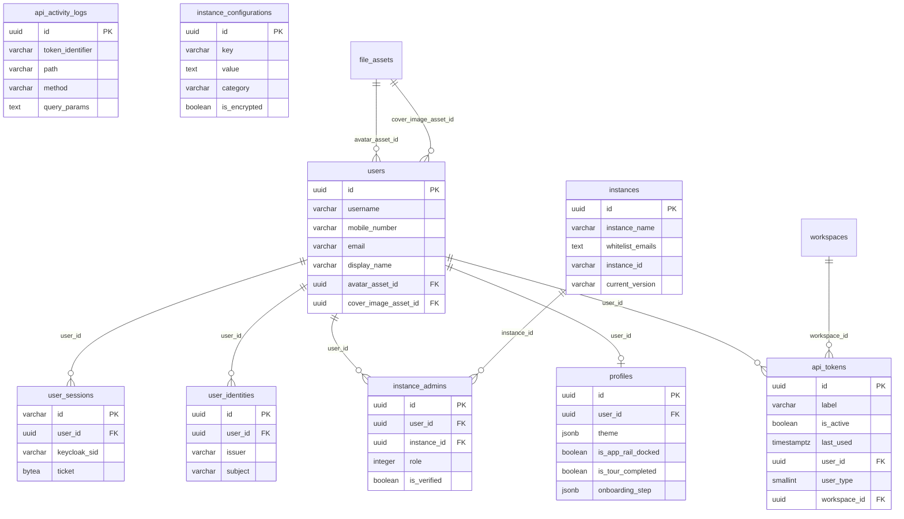

#### 3.12.2 Workspaces

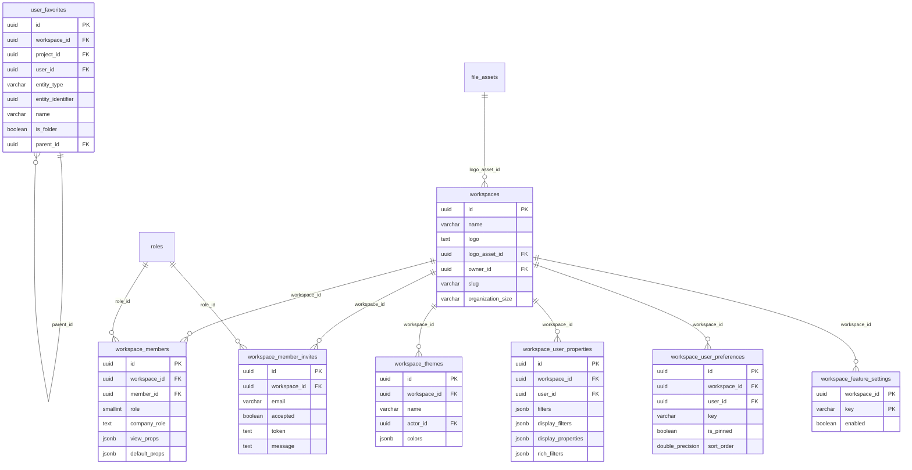

#### 3.12.3 Projects

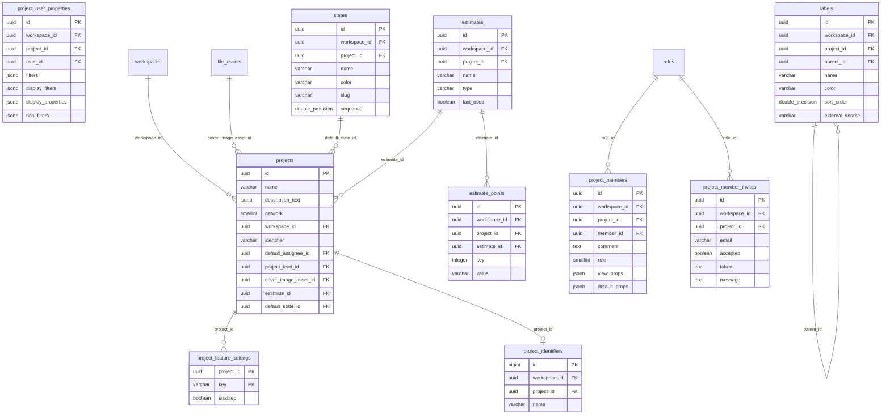

#### 3.12.4 WorkItems

```mermaid
erDiagram
  work_items {
    uuid id PK
    uuid workspace_id FK
    uuid project_id FK
    uuid parent_id FK
    uuid state_id FK
    smallint point
    uuid estimate_point_id FK
    varchar name
    varchar priority
    date start_date
    uuid type_id FK
  }
  work_item_sequences {
    uuid project_id PK
    bigint last_value
  }
  work_item_assignees {
    uuid id PK
    uuid workspace_id FK
    uuid project_id FK
    uuid work_item_id FK
    uuid assignee_id FK
  }
  work_item_labels {
    uuid id PK
    uuid workspace_id FK
    uuid project_id FK
    uuid work_item_id FK
    uuid label_id FK
  }
  work_item_relations {
    uuid id PK
    uuid workspace_id FK
    uuid project_id FK
    uuid work_item_id FK
    uuid related_work_item_id FK
    varchar relation_type
  }
  work_item_mentions {
    uuid id PK
    uuid workspace_id FK
    uuid project_id FK
    uuid work_item_id FK
    uuid mention_id FK
  }
  work_item_subscribers {
    uuid id PK
    uuid workspace_id FK
    uuid project_id FK
    uuid work_item_id FK
    uuid subscriber_id FK
  }
  work_item_links {
    uuid id PK
    uuid workspace_id FK
    uuid project_id FK
    varchar title
    text url
    uuid work_item_id FK
    jsonb metadata
  }
  work_item_comments {
    uuid id PK
    uuid workspace_id FK
    uuid project_id FK
    text comment_stripped
    jsonb comment_json
    text comment_html
    text_array attachments
    uuid work_item_id FK
    uuid actor_id FK
    uuid parent_id FK
  }
  work_item_reactions {
    uuid id PK
    uuid workspace_id FK
    uuid project_id FK
    uuid actor_id FK
    uuid work_item_id FK
    text reaction
  }
  work_item_comment_reactions {
    uuid id PK
    uuid workspace_id FK
    uuid project_id FK
    uuid actor_id FK
    uuid comment_id FK
    text reaction
  }
  work_item_votes {
    uuid id PK
    uuid workspace_id FK
    uuid project_id FK
    uuid work_item_id FK
    uuid actor_id FK
    integer vote
  }
  work_item_activities {
    uuid id PK
    uuid workspace_id FK
    uuid project_id FK
    uuid work_item_id FK
    varchar verb
    varchar field
    text old_value
    text new_value
    uuid comment_id FK
    uuid actor_id FK
  }
  work_item_description_versions {
    uuid id PK
    uuid workspace_id FK
    uuid project_id FK
    uuid work_item_id FK
    timestamptz last_saved_at
    uuid owned_by_id FK
  }
  work_item_versions {
    uuid id PK
    uuid workspace_id FK
    uuid project_id FK
    uuid parent
    uuid state
    uuid estimate_point
    varchar name
    uuid work_item_id FK
    uuid activity_id FK
    uuid owned_by_id FK
  }
  draft_work_items {
    uuid id PK
    uuid workspace_id FK
    uuid project_id FK
    uuid parent_id FK
    uuid state_id FK
    uuid estimate_point_id FK
    varchar name
    varchar priority
    date start_date
    date target_date
    uuid type_id FK
  }
  draft_work_item_assignees {
    uuid id PK
    uuid workspace_id FK
    uuid project_id FK
    uuid draft_work_item_id FK
    uuid assignee_id FK
  }
  draft_work_item_labels {
    uuid id PK
    uuid workspace_id FK
    uuid project_id FK
    uuid draft_work_item_id FK
    uuid label_id FK
  }
  draft_work_item_modules {
    uuid id PK
    uuid workspace_id FK
    uuid project_id FK
    uuid module_id FK
    uuid draft_work_item_id FK
  }
  draft_work_item_cycles {
    uuid id PK
    uuid workspace_id FK
    uuid project_id FK
    uuid draft_work_item_id FK
    uuid cycle_id FK
  }
  work_item_types {
    uuid id PK
    uuid workspace_id FK
    uuid project_id FK
    uuid workspace_id FK
    varchar name
    boolean is_default
  }
  work_item_relation_types {
    varchar key PK
    varchar reverse_key
    smallint category
  }
  work_items ||--o{ work_items : "parent_id"
  states ||--o{ work_items : "state_id"
  estimate_points ||--o{ work_items : "estimate_point_id"
  work_item_types ||--o{ work_items : "type_id"
  projects ||--o{ work_items : "project_id"
  work_items ||--o{ work_item_assignees : "work_item_id"
  projects ||--o{ work_item_assignees : "project_id"
  work_items ||--o{ work_item_labels : "work_item_id"
  labels ||--o{ work_item_labels : "label_id"
  projects ||--o{ work_item_labels : "project_id"
  work_items ||--o{ work_item_relations : "work_item_id"
  work_items ||--o{ work_item_relations : "related_work_item_id"
  projects ||--o{ work_item_relations : "project_id"
  work_items ||--o{ work_item_mentions : "work_item_id"
  projects ||--o{ work_item_mentions : "project_id"
  work_items ||--o{ work_item_subscribers : "work_item_id"
  projects ||--o{ work_item_subscribers : "project_id"
  work_items ||--o{ work_item_links : "work_item_id"
  projects ||--o{ work_item_links : "project_id"
  work_items ||--o{ work_item_comments : "work_item_id"
  work_item_comments ||--o{ work_item_comments : "parent_id"
  projects ||--o{ work_item_comments : "project_id"
  work_items ||--o{ work_item_reactions : "work_item_id"
  projects ||--o{ work_item_reactions : "project_id"
  work_item_comments ||--o{ work_item_comment_reactions : "comment_id"
  projects ||--o{ work_item_comment_reactions : "project_id"
  work_items ||--o{ work_item_votes : "work_item_id"
  projects ||--o{ work_item_votes : "project_id"
  work_items ||--o{ work_item_activities : "work_item_id"
  work_item_comments ||--o{ work_item_activities : "comment_id"
  projects ||--o{ work_item_activities : "project_id"
  work_items ||--o{ work_item_description_versions : "work_item_id"
  projects ||--o{ work_item_description_versions : "project_id"
  work_items ||--o{ work_item_versions : "work_item_id"
  work_item_activities ||--o{ work_item_versions : "activity_id"
  projects ||--o{ work_item_versions : "project_id"
  work_items ||--o{ draft_work_items : "parent_id"
  states ||--o{ draft_work_items : "state_id"
  estimate_points ||--o{ draft_work_items : "estimate_point_id"
  work_item_types ||--o{ draft_work_items : "type_id"
  draft_work_items ||--o{ draft_work_item_assignees : "draft_work_item_id"
  draft_work_items ||--o{ draft_work_item_labels : "draft_work_item_id"
  labels ||--o{ draft_work_item_labels : "label_id"
  modules ||--o{ draft_work_item_modules : "module_id"
  draft_work_items ||--o{ draft_work_item_modules : "draft_work_item_id"
  draft_work_items ||--o{ draft_work_item_cycles : "draft_work_item_id"
  cycles ||--o{ draft_work_item_cycles : "cycle_id"
  workspaces ||--o{ work_item_types : "workspace_id"
  work_item_relation_types ||--o{ work_item_relations : "relation_type"
  projects ||--o| work_item_sequences : "project_id"
  work_items ||--o{ external_links : "work_item_id"
```

#### 3.12.5 Planung (Cycles, ProjectModules, Views, Intake)

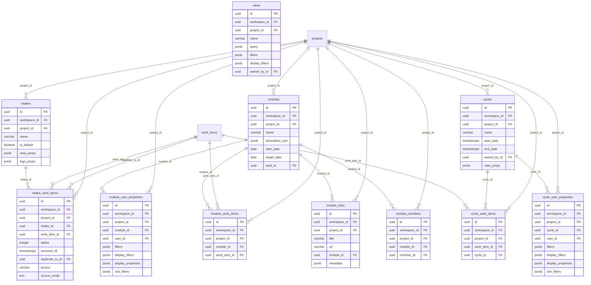

#### 3.12.6 Pages

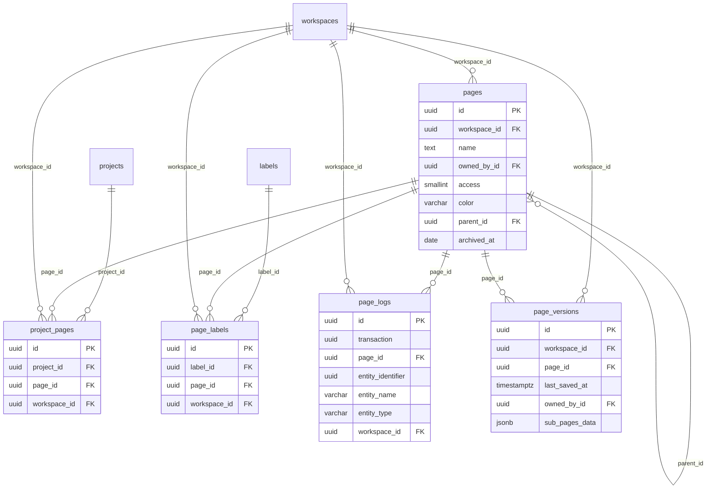

#### 3.12.7 Assets

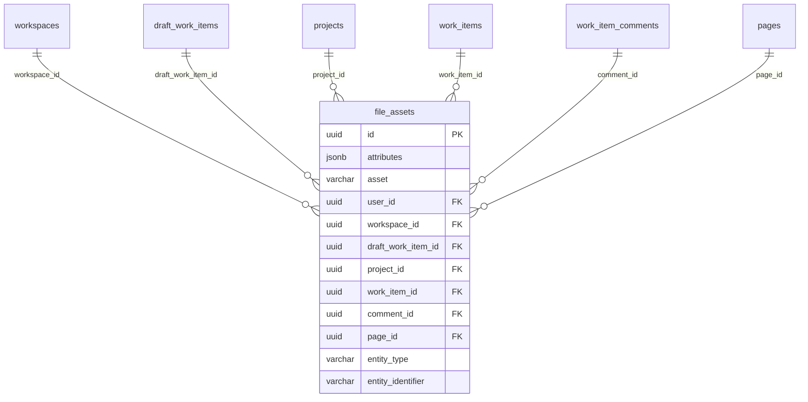

#### 3.12.8 Überblick (Home, Analytics, Notifications)

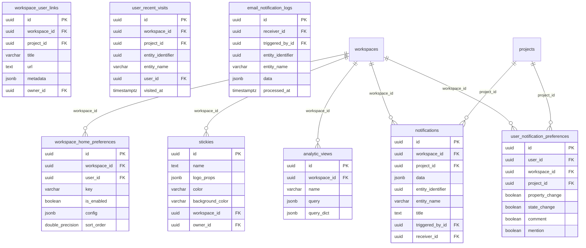

#### 3.12.9 Außenwirkung (PublicSpace, Webhooks, Exports)

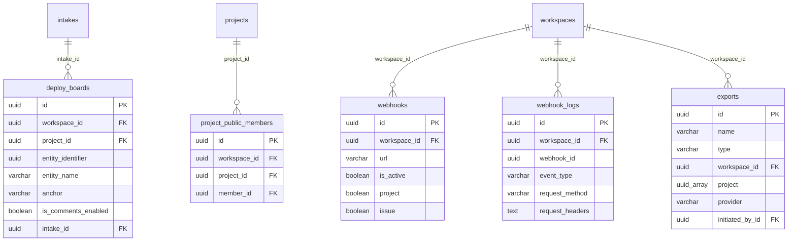

#### 3.12.10 Plattform und Andockstellen (Authorization, Instance, Messaging, Integrations, Search)

Ergänzt im Review: die zehn neuen Tabellen ohne Original-Modell, die in 3.12.1–3.12.9 fehlten. Messaging-Tabellen haben bewusst **keine** FKs (Nachrichten überleben Fachlöschungen); Kanten zu `workspaces`/`projects` nur, wo eine FK existiert.

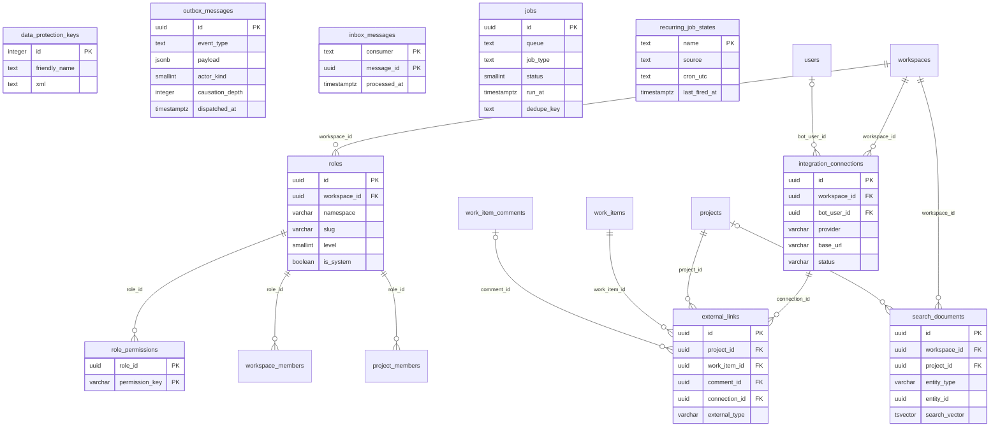

### 3.13 Migrationsstrategie

#### 3.13.1 Ablauf und Verantwortlichkeiten

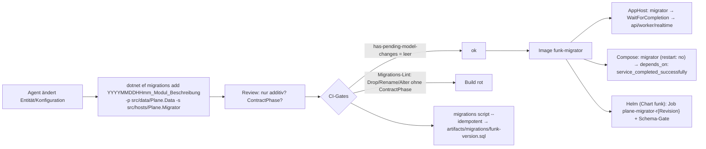

| Regel | Festlegung |
|---|---|
| Erzeugung | `dotnet ef migrations add <Name> --project src/data/Plane.Data --startup-project src/hosts/Plane.Migrator --output-dir Migrations`; Design-Time-Factory `PlaneDbContextDesignTimeFactory` (liest `ConnectionStrings__plane` oder Dummy-Verbindung, kein Netzzugriff nötig) |
| Name | `YYYYMMDDHHmm_<Modul>_<Beschreibung>` (01 §7.14); Pakete `W<n>_<Paket>_<Beschreibung>` (D16-ADR-06) |
| Konflikte paralleler Agenten | eigene Migration löschen, rebasen, neu erzeugen; Snapshot nie von Hand mergen (01 §7.14) |
| Drift-Gate | `dotnet ef migrations has-pending-model-changes` muss leer sein (CI, `Plane.Migrator.Tests/ModelDriftTests`) |
| Ausführung | ausschließlich `Plane.Migrator` (D14 §3.15 Schritte 1–11; D03-ADR-21); `Plane.Api`/`Worker`/`Realtime` prüfen nur (Schema-Gate) |
| Extensions/Funktionen | Migration `…_Platform_Extensions` (I0) per `migrationBuilder.Sql("CREATE EXTENSION IF NOT EXISTS …")` und `HasPostgresExtension("pg_trgm")`/`("unaccent")`/`("vector")` im Modell (damit der Snapshot sie kennt); externe Datenbanken ohne Superuser-Rechte: Betreiber legt die Extensions vorab an (D14 §3.15 Schritt 3 meldet klar) |
| Zirkuläre FKs | `projects.estimate_id`/`default_state_id` ↔ `estimates`/`states`: Tabellen zuerst ohne diese FKs, FKs in derselben Migration danach per `AddForeignKey` (EF ordnet automatisch; Test `InitialMigrationAppliesOnEmptyDatabase`) |
| Deferrable FK | `work_item_relation_types.reverse_key` per `migrationBuilder.Sql("ALTER TABLE … ADD CONSTRAINT … DEFERRABLE INITIALLY DEFERRED")` |
| Generated Column | `search_documents.search_vector` per `HasComputedColumnSql(sql, stored: true)` |
| Partielle/Trigram-Indizes | über Fluent API (`HasFilter`, `HasMethod("gin")`, `HasOperators("gin_trgm_ops")`, `AreNullsDistinct(false)`) – kein Raw-SQL nötig |
| Nach Release 1.0 | Indizes auf befüllten Tabellen mit `IsCreatedConcurrently()` in **eigener** Migration ohne weitere Operationen (nicht transaktional; vorher `DROP INDEX CONCURRENTLY IF EXISTS` gegen `INVALID`-Reste, Muster `MIG/0124`); Spaltenzusätze nur `NULL` oder mit konstantem Default (PostgreSQL ≥ 11 ohne Tabellen-Rewrite) |
| Expand/Contract | Drop/Rename/Typ-/Null-Änderung nur in einer mit `[ContractPhase("vX.Y")]` markierten Migration, frühestens eine Minor-Version nach dem Expand-Schritt (D14 §3.17); Architekturtest `MigrationsAreExpandOnly` liest die Operationen per `IMigrationsAssembly` |
| Squash | bis Release 1.0 je Inkrement erlaubt (01 §7.14); einmalig vor 1.0 zu `…_CE_Baseline` |
| Datenmigrationen | in der CE keine (Greenfield, ADR-003); nach 1.0 als eigene Migration mit `migrationBuilder.Sql` in Batches oder als einmaliger Job (`IJob`, Queue `maintenance`), nie im Startpfad der Api |
| Bundle | `efbundle` wird **nicht** ausgeliefert (D03-ADR-21); Betreiber mit DBA-Prozess nutzen `plane-<version>.sql` und starten den Migrator anschließend mit `--skip-schema` (Seeds, Instanz-Init, Bucket) |

#### 3.13.2 Migrator-Ablauf (Bezug auf D14 §3.15)

```csharp
// src/hosts/Plane.Migrator/MigratorWorker.cs (Ausschnitt; Schrittnummern = D14 §3.15)
public sealed class MigratorWorker(IServiceProvider sp, IHostApplicationLifetime life, ILogger<MigratorWorker> log) : BackgroundService
{
    protected override async Task ExecuteAsync(CancellationToken ct)
    {
        await using var scope = sp.CreateAsyncScope();
        var db = scope.ServiceProvider.GetRequiredService<PlaneDbContext>();
        await DatabaseReadiness.WaitAsync(db, TimeSpan.FromSeconds(60), ct);                       // 1
        await using var _ = await MigrationLock.AcquireAsync(db, PlaneLocks.Migrator, ct);          // 2  pg_advisory_lock(7356001)
        await ExtensionCheck.EnsureAsync(db, ["pg_trgm", "unaccent", "vector"], ct);                 // 3
        await SchemaMigrator.MigrateAsync(db, ct);                                                   // 4  Downgrade-Schutz → Exit 3
        await scope.ServiceProvider.GetRequiredService<DataProtectionKeyRingInit>().RunAsync(ct);   // 5
        await scope.ServiceProvider.GetRequiredService<InstanceBootstrapper>().RunAsync(ct);        // 6
        await scope.ServiceProvider.GetRequiredService<InstanceConfigurationSeeder>().RunAsync(ct); // 7
        await scope.ServiceProvider.GetRequiredService<SeedRunner>().RunAsync(SeedProfile.Base, ct); // 8  BaseSeeds (§3.14.1); --seed parity|volume-M in Test/Dev
        await scope.ServiceProvider.GetRequiredService<BucketInitializer>().RunAsync(ct);           // 9
        await scope.ServiceProvider.GetRequiredService<CacheInvalidator>().RunAsync(ct);            // 10
        log.LogInformation("migrations completed");                                                  // 11
        life.StopApplication();
    }
}
```

### 3.14 Seeds

#### 3.14.1 Referenz-Seeds (`BaseSeeds`, Migrator Schritt 8, idempotent per `INSERT … ON CONFLICT DO UPDATE` nur auf Seed-eigene Spalten)

| Seed | Tabelle | Inhalt | Schlüssel | Quelle |
|---|---|---|---|---|
| `SystemRoleSeed` | `roles` | 6 Zeilen: `workspace`/`project` × `admin` 20, `member` 15, `guest` 5; `is_system = true`, `workspace_id = NULL` | feste UUIDv7-Konstanten `SystemRoles.WorkspaceAdmin` … `SystemRoles.ProjectGuest` | D05 §3.13.3 |
| `WorkItemRelationTypeSeed` | `work_item_relation_types` | `blocked_by`↔`blocking`, `relates_to`↔`relates_to`, `duplicate`↔`duplicate` (Kategorie Relation); `start_before`↔`start_after`, `finish_before`↔`finish_after` (Dependency); `implemented_by`↔`implements` (Implementation); Labels „Blocked By“, „Blocking“, „Relates To“, „Duplicate“, „Start Before“, „Start After“, „Finish Before“, „Finish After“, „Implemented By“, „Implements“; `sort_order` 1…10 | `key` | `M/issue.py` Z. 272–293, D16 §5.3 |
| `InstanceBootstrapper` | `instances` | eine Zeile: `instance_name` = `Plane:Instance:DefaultName` (Default `"funk."`, vom Admin änderbar, Auftraggeber 23.10.2026/ABG-104, statt „Plane Community Edition“: ADR-001 entfernt den Editionsnamen, ADR-009B ersetzt den Produktnamen; DEV-DM-12/`BRAND-DM-01`), `instance_id` 24 Hex (Zufall, einmalig), `current_version` = `latest_version` = Assembly-Version, `domain` = `Plane:Urls:Web`, `is_telemetry_enabled = false`, `is_setup_done = false`, `is_test` aus `IS_TEST` | Singleton | D14 §3.15 Schritt 6, CE-INST-001 |
| `InstanceConfigurationSeeder` | `instance_configurations` | alle Schlüssel aus `InstanceConfigurationKeys.All` (D02 §4.10) **ohne** vorhandene Zeile: Wert aus gleichnamiger ENV-Variable oder `SeedDefault`, geheime Werte DP-geschützt | `key` | `configure_instance`, CE-INST-002 |
| `SystemBotSeed` | `users`, `profiles` | genau ein System-Bot der Instanz für Cron-/Hintergrund-Akteure (D06-ADR-20): feste UUIDv7-Konstante `SystemUsers.SystemBot` (wie `SystemRoles.*`, D03-ADR-04), `username = "plane_system_bot"`, `email = "system-bot@funk.invalid"`, `display_name = first_name = "funk."` (ADR-009B, ABG-104; `username`/E-Mail-Präfix bleiben interne Bezeichner), `is_bot = true`, `bot_type = "SYSTEM"`, `is_active = true`, `is_email_verified = true`; keine `user_identities`-Zeile (kein Login), keine Workspace-Mitgliedschaft | `id` | D06-ADR-20 |

Referenz-Seeds ändern nie Benutzerdaten (Ausnahme: der System-Bot ist Infrastruktur); ein erneuter Lauf ist ein No-op (`SeedRunnerTests.Base_IsIdempotent`). **Respawn:** `users`/`profiles` sind keine Referenztabellen (§4.6) – `PlaneRespawner` ruft nach jedem Reset `BaseSeeds.ApplyAsync` erneut auf (D15 §3.3.2), damit `SystemBotSeed` den Bot wiederherstellt.

#### 3.14.2 Laufzeit-Seeds (Fachcode, gleiche Commands wie Benutzeraktionen)

| Auslöser | Erzeugt | Werte | Ort | CE-ID |
|---|---|---|---|---|
| Projekt anlegen (App, v1, Demo-Seed) | 6 States (`DEFAULT_STATES`) | `Backlog` `#60646C` 15000 `backlog` **default**; `Todo` `#60646C` 25000 `unstarted`; `In Progress` `#F59E0B` 35000 `started`; `Done` `#46A758` 45000 `completed`; `Cancelled` `#9AA4BC` 55000 `cancelled`; `Triage` `#4E5355` 65000 `triage` (`is_triage = true`) – Werte per **Bulk** (Sequenzregel greift nicht) | `Plane.Projects/Domain/DefaultStates.cs` (Port `M/state.py` Z. 24–62) | CE-PRJ-004, CE-PRJ-023 |
| Projekt anlegen | `project_identifiers`-Zeile, `project_members` (Ersteller als Admin) + `project_user_properties`, `work_item_sequences` lazy (erste Nummer) | – | `CreateProjectCommand` | CE-PRJ-004 |
| `intake_view` aktivieren | `intakes`: `name = "<Projektname> Intake"`, `is_default = true`; Triage-State nachlegen, falls fehlend (`sequence` 65000) | – | `Plane.Intake` über Projekt-Event | CE-INT-001 |
| JIT-Benutzeranlage | `users`, `profiles` (Defaults §3.8.2, `background_color` zufällig), `user_identities`, `user_notification_preferences` (alle `true`, global) | – | `CreateUserStep` (Order 500, D05 §3.7.3) | CE-AUTH-012 |
| Workspace anlegen | Admin-Mitgliedschaft (Rolle 20), danach **Demo-Seed** als Job `WorkspaceDemoSeedJob` (Queue `default`) | §3.14.3 | `Plane.Workspaces` | CE-WS-001, CE-WS-002 |

#### 3.14.3 Demo-Workspace (Port `API/bgtasks/workspace_seed_task.py`, Daten `API/seeds/data/*.json`)

Die acht JSON-Dateien werden **unverändert** nach `BE/data/Plane.Data/Seeds/Demo/` kopiert (eingebettete Ressourcen, Lizenz AGPL-3.0 des Originals) und von `WorkspaceDemoSeeder` (`Plane.Workspaces/Application/Jobs/WorkspaceDemoSeedJob.cs`) über die Contracts-Commands der Eigentümer-Module angelegt (R5; kein Direkt-Insert):

| Schritt | Datei | Inhalt (Original) | Ziel-Regel |
|---|---|---|---|
| 1 | – | Bot-Benutzer `bot_user_<workspace_id>`, `display_name = "funk."` (Original `"Plane"`, ADR-009B, `BRAND-DM-02`), `is_bot = true`, `bot_type = WORKSPACE_SEED`, E-Mail `bot_user_<id>@<host von WEB_URL>`; Workspace-Mitglied Rolle 20 | ohne Passwort (ADR-008); keine `user_identities`-Zeile (kein Login möglich) |
| 2 | `projects.json` (1) | „Plane Demo Project“ → **„funk. Demo Project“** (ADR-009B, `BRAND-DM-03`), `network` 2, `cover_image` (Unsplash), `logo_props` (Emoji-PNG von jsDelivr) | Identifier = erste 5 **ASCII**-alphanumerische Zeichen des Workspace-Namens, uppercase; leer → `PDP` (Korrektur A02a-#19, DEV-DM-13); alle Workspace-Mitglieder werden Projektmitglieder mit ihrer Workspace-Rolle; `project_user_properties` mit Seed-`display_filters`/`display_properties` (A02a §2.5) |
| 3 | `states.json` (5) | Backlog `#A3A3A3` default, Todo `#3A3A3A`, In Progress `#F59E0B`, Done `#16A34A`, Cancelled `#EF4444` (abweichend von `DEFAULT_STATES`) | Seed-Werte 1:1; Triage-State zusätzlich (Invariante §3.4.4.6) |
| 4 | `labels.json` (2) | 2 Labels mit `sort_order` | 1:1 |
| 5 | `cycles.json` (2) | `CURRENT` (jetzt … +14 Tage), `UPCOMING` (Ende des letzten + 1 Tag … +14 Tage) | Zeitpunkte aus `IClock` (deterministisch im Test) |
| 6 | `modules.json` (3) | Status `planned`/`backlog`/… | 1:1 |
| 7 | `issues.json` (7) | Work Items mit `sequence_id`, `state_id`, Labels, Cycle, Modulen, `description_html`, Activity „created“ | Nummern über `ISequenceAllocator.AllocateRangeAsync` (Korrektur Q6); Activities über `IActivityRecorder` |
| 8 | `views.json` (1) | Projekt-View mit `rich_filters` `{"priority__in":"urgent"}` und Seed-Display-Properties | 1:1 (unbekannte Schlüssel durchreichen, D16 A1/A7) |
| 9 | `pages.json` (2) | Pages mit `description_html` | zusätzlich `description_json`/`description_binary` über `Plane.Documents` erzeugen (Original lässt sie leer, A02a-#19 – korrigiert, ohne Vertragswirkung) |

**Airgapped (ADR-004):** Externe Bild-URLs der Seeds (`images.unsplash.com/photo-1691230995681-480d86cbc135`, `cdn.jsdelivr.net/npm/emoji-datasource-apple/img/apple/64/{1f447,1f4a1,1f4cc,1f516,1f680,1f9f1}.png`, `media.docs.plane.so/seed_assets/{21,31,32,33,41,51,61}.png`) liegen als Dateien unter `BE/data/Plane.Data/Seeds/Demo/assets/` (Bilder, die ein Plane-Logo oder den Schriftzug zeigen, werden nach BR-06 ersetzt bzw. neu gerendert; Lizenz/Branding-Klärung Z-114), werden beim Seed als `file_assets` in den Objektspeicher hochgeladen und die URLs im HTML/JSON durch die Asset-URLs ersetzt (`DemoSeedAssetRewriter`). **Branding (ADR-009B):** `DemoSeedBrandingRewriter` ersetzt beim Seed in Namen, Titeln, `description_html` und Labels das Wort „Plane“ als Produktname durch „funk.“ (Fachvokabular wie „Work Items“, „Cycles“ bleibt) und schreibt Hyperlinks auf `docs.plane.so`/`plane.so` auf `Plane:Urls:Docs` um bzw. entfernt sie, wenn nicht konfiguriert (`BRAND-DM-03`); `WorkspaceDemoSeedTests` vergleicht gegen das **gebrandete** Golden-File und prüft `NOT ILIKE '%plane%'` auf allen Seed-Textspalten (außer technischen Bezeichnern). Lizenzprüfung der Bilddateien: §8 R-D03-07.

### 3.15 Testdaten-Generator

| Werkzeug | Ort | Zweck | Verfahren | Daten |
|---|---|---|---|---|
| `BaseSeeds` | `Plane.Data/Seeds/` | Referenzdaten in jeder Testdatenbank | wie Produktion | §3.14.1 |
| `ParitySeedLoader` | `Plane.BuildingBlocks.Testing/Seed/` (D15 §3.14) | identische Daten in Original und Ziel für Contract-/Visual-Tests | YAML `tests/seed/parity-seed.yaml` (Fragmente `base`, `labels-hierarchy`, `security-matrix`, `visual`, `e2e`), **UUIDv5** (`ns = a3c1f0c8-6d2e-5b7a-9e1f-0f00f00f0015`, Schlüssel `ws:acme`, `prj:acme/WEB`, `wi:acme/WEB-12` …), `FixedClock`/`DeterministicIdGenerator`; schreibt über die Commands der Module (Invarianten, Activities) und erzeugt `manifest.funk.json` | D15 §3.14.1 |
| `VolumeSeeder` (CE-OPS-024) | `Plane.BuildingBlocks.Testing/Seed/VolumeSeeder.cs`; CLI `funk-cli create-dummy-data --profile volume-M --workspace <slug>` (Port `create_dummy_data`, ohne interaktive Eingaben) | Last-/Performance-Tests, lokale Entwicklung | **Bogus** (MIT) mit festem `Randomizer.Seed`; IDs aus `DeterministicIdGenerator` (UUIDv7 aus `FixedClock` + Seed-Zufall), Bulk per Npgsql binärem `COPY` (`NpgsqlBinaryImporter`) je Tabelle in Abhängigkeitsreihenfolge; Invarianten-Helfer: `WorkItemSequenceBlock` (vergibt Nummern per `AllocateRangeAsync`), `SortOrderSequence`, `DefaultStates`; danach `ANALYZE` | Profile s. u. |

| Profil | Workspaces | Projekte je WS | Mitglieder je WS | Work Items je Projekt | Kommentare je WI | Labels/States je Projekt | Cycles/Module je Projekt | Pages je Projekt | Activities | Zielzeit (CI-Runner) |
|---|---|---|---|---|---|---|---|---|---|---|
| `volume-S` | 1 | 3 | 10 | 500 | 2 | 10 / 6 | 4 / 4 | 10 | ~5/WI | < 30 s |
| `volume-M` | 2 | 10 | 50 | 10 000 | 3 | 30 / 8 | 12 / 10 | 50 | ~6/WI | < 5 min |
| `volume-L` | 5 | 20 | 200 | 50 000 | 5 | 50 / 10 | 24 / 20 | 200 | ~8/WI | < 30 min (nur `perf`-Runner) |

Verteilung: Prioritäten gleichverteilt, 30 % mit Parent (max. Tiefe 3), 60 % mit 1–3 Labels, 40 % in einem Cycle, 30 % in 1–2 Modulen, 5 % archiviert, 2 % soft-gelöscht, 10 % Intake (davon 50 % Pending); Beschreibungen aus einem festen Korpus von 50 HTML-Schnipseln (inkl. Mentions, Bilder, Tabellen). Der Generator ist reproduzierbar: gleicher Seed → byte-gleicher `pg_dump --data-only` (Test `VolumeSeederDeterminismTests`).

## 4. Vollständige Mapping-Tabellen Original → Ziel

### 4.1 Django-Model → EF-Entität (alle 96 konkreten Modelle)

Reihenfolge wie Quelldateien. Enum-/Manager-Klassen (`StateGroup`, `IssueRelationChoices`, `IssueManager`, `StateManager`, `TriageStateManager`, `EstimateType`, `ModuleStatus`, `SourceType`, `IntakeIssueStatus`, `EntityNameEnum`, `BotTypeEnum`, `ROLE`, `ProjectNetwork`, `InstanceEdition`, `SessionStore`) sind keine Tabellen; ihre Abbildung steht in §3.11 bzw. §3.5. Abstrakte Basen (`BaseModel`, `WorkspaceBaseModel`, `ProjectBaseModel`, `AuditModel`, `TimeAuditModel`, `UserAuditModel`, `SoftDeleteModel`) → §3.1.1. Spaltendetails je Tabelle: §3.4.

| Nr. | Django-Model (Datei, Zeilen) | Original-Tabelle | Ziel-Entität (`BE/data/Plane.Data/Entities/<Modul>/`) | Ziel-Tabelle | Status | Abweichungen / Begründung |
|---|---|---|---|---|---|---|
| M001 | `AnalyticView` (`M/analytic.py` Z. 11–26) | `analytic_views` | `Analytics/AnalyticView` | `analytic_views` | angepasst | – |
| M002 | `APIToken` (`M/api.py` Z. 23–46) | `api_tokens` | `Identity/ApiToken` | `api_tokens` | angepasst | `token` entfällt; +`token_hash`; +`token_prefix` |
| M003 | `APIActivityLog` (`M/api.py` Z. 49–74) | `api_activity_logs` | `Identity/ApiActivityLog` | `api_activity_logs` | angepasst | – |
| M004 | `FileAsset` (`M/asset.py` Z. 31–103) | `file_assets` | `Assets/FileAsset` | `file_assets` | angepasst | `draft_issue_id`→`draft_work_item_id`; `issue_id`→`work_item_id` |
| M005 | `Cycle` (`M/cycle.py` Z. 60–101) | `cycles` | `Cycles/Cycle` | `cycles` | übernommen | `owned_by` ON DELETE CASCADE→RESTRICT |
| M006 | `CycleIssue` (`M/cycle.py` Z. 104–127) | `cycle_issues` | `Cycles/CycleWorkItem` | `cycle_work_items` | angepasst | Tabelle `cycle_issues`→`cycle_work_items`; `issue_id`→`work_item_id` |
| M007 | `CycleUserProperties` (`M/cycle.py` Z. 130–157) | `cycle_user_properties` | `Cycles/CycleUserProperties` | `cycle_user_properties` | übernommen | – |
| M008 | `DeployBoard` (`M/deploy_board.py` Z. 19–57) | `deploy_boards` | `PublicSpace/DeployBoard` | `deploy_boards` | übernommen | – |
| M009 | `Description` (`M/description.py` Z. 10–29) | `descriptions` | – | – | entfällt | nur 1:1-Spiegel von `IssueComment` (Q15); Inhalt bleibt in `work_item_comments.comment_*` |
| M010 | `DescriptionVersion` (`M/description.py` Z. 32–56) | `description_versions` | – | – | entfällt | in der CE ungenutzt (02b §1.3) |
| M011 | `Device` (`M/device.py` Z. 11–27) | `devices` | – | – | entfällt | in der CE ungenutzt (Mobile-App/Push, 02a §1.3); kein CE-Feature |
| M012 | `DeviceSession` (`M/device.py` Z. 30–42) | `device_sessions` | – | – | entfällt | in der CE ungenutzt (02a §1.3) |
| M013 | `DraftIssue` (`M/draft.py` Z. 16–136) | `draft_issues` | `WorkItems/DraftWorkItem` | `draft_work_items` | angepasst | Tabelle `draft_issues`→`draft_work_items`; `parent` ON DELETE CASCADE→SET NULL; `state` ON DELETE CASCADE→SET NULL |
| M014 | `DraftIssueAssignee` (`M/draft.py` Z. 139–162) | `draft_issue_assignees` | `WorkItems/DraftWorkItemAssignee` | `draft_work_item_assignees` | übernommen | Tabelle `draft_issue_assignees`→`draft_work_item_assignees`; `draft_issue_id`→`draft_work_item_id` |
| M015 | `DraftIssueLabel` (`M/draft.py` Z. 165–176) | `draft_issue_labels` | `WorkItems/DraftWorkItemLabel` | `draft_work_item_labels` | angepasst | Tabelle `draft_issue_labels`→`draft_work_item_labels`; `draft_issue_id`→`draft_work_item_id` |
| M016 | `DraftIssueModule` (`M/draft.py` Z. 179–198) | `draft_issue_modules` | `WorkItems/DraftWorkItemModule` | `draft_work_item_modules` | übernommen | Tabelle `draft_issue_modules`→`draft_work_item_modules`; `draft_issue_id`→`draft_work_item_id` |
| M017 | `DraftIssueCycle` (`M/draft.py` Z. 201–224) | `draft_issue_cycles` | `WorkItems/DraftWorkItemCycle` | `draft_work_item_cycles` | übernommen | Tabelle `draft_issue_cycles`→`draft_work_item_cycles`; `draft_issue_id`→`draft_work_item_id` |
| M018 | `Estimate` (`M/estimate.py` Z. 18–40) | `estimates` | `Projects/Estimate` | `estimates` | übernommen | – |
| M019 | `EstimatePoint` (`M/estimate.py` Z. 43–57) | `estimate_points` | `Projects/EstimatePoint` | `estimate_points` | übernommen | – |
| M020 | `ExporterHistory` (`M/exporter.py` Z. 24–67) | `exporters` | `Exports/ExportJob` | `exports` | angepasst | Tabelle `exporters`→`exports` |
| M021 | `UserFavorite` (`M/favorite.py` Z. 14–69) | `user_favorites` | `Workspaces/UserFavorite` | `user_favorites` | übernommen | +`teamspace_id` |
| M022 | `Importer` (`M/importer.py` Z. 13–40) | `importers` | – | – | entfällt | nicht portiert; Forgejo-Importer über `integration_sync_runs` (W1, D16 §4.2) |
| M023 | `Intake` (`M/intake.py` Z. 16–39) | `intakes` | `Intake/Intake` | `intakes` | übernommen | – |
| M024 | `IntakeIssue` (`M/intake.py` Z. 54–110) | `intake_issues` | `Intake/IntakeWorkItem` | `intake_work_items` | angepasst | Tabelle `intake_issues`→`intake_work_items`; `issue_id`→`work_item_id` |
| M025 | `Integration` (`M/integration/base.py` Z. 16–38) | `integrations` | – | – | entfällt | nicht portiert (ADR-003/-007); Ersatz `integration_connections`/`external_links` (F1, D16 §3.4.2) |
| M026 | `WorkspaceIntegration` (`M/integration/base.py` Z. 41–60) | `workspace_integrations` | – | – | entfällt | nicht portiert (ADR-003/-007); Ersatz `integration_connections`/`external_links` (F1, D16 §3.4.2) |
| M027 | `GithubRepository` (`M/integration/github.py` Z. 14–29) | `github_repositories` | – | – | entfällt | nicht portiert (ADR-003/-007); Ersatz `integration_connections`/`external_links` (F1, D16 §3.4.2) |
| M028 | `GithubRepositorySync` (`M/integration/github.py` Z. 32–51) | `github_repository_syncs` | – | – | entfällt | nicht portiert (ADR-003/-007); Ersatz `integration_connections`/`external_links` (F1, D16 §3.4.2) |
| M029 | `GithubIssueSync` (`M/integration/github.py` Z. 54–70) | `github_issue_syncs` | – | – | entfällt | nicht portiert (ADR-003/-007); Ersatz `integration_connections`/`external_links` (F1, D16 §3.4.2) |
| M030 | `GithubCommentSync` (`M/integration/github.py` Z. 73–87) | `github_comment_syncs` | – | – | entfällt | nicht portiert (ADR-003/-007); Ersatz `integration_connections`/`external_links` (F1, D16 §3.4.2) |
| M031 | `SlackProjectSync` (`M/integration/slack.py` Z. 14–35) | `slack_project_syncs` | – | – | entfällt | nicht portiert (ADR-003/-007); Ersatz `integration_connections`/`external_links` (F1, D16 §3.4.2) |
| M032 | `Issue` (`M/issue.py` Z. 104–255) | `issues` | `WorkItems/WorkItem` | `work_items` | angepasst | Tabelle `issues`→`work_items`; `point` Typ → `smallint` |
| M033 | `IssueBlocker` (`M/issue.py` Z. 258–269) | `issue_blockers` | – | – | entfällt | Altlast, seit `MIG/0043` durch `IssueRelation` ersetzt (02b §1.3) |
| M034 | `IssueRelation` (`M/issue.py` Z. 296–320) | `issue_relations` | `WorkItems/WorkItemRelation` | `work_item_relations` | angepasst | Tabelle `issue_relations`→`work_item_relations`; `issue_id`→`work_item_id`; `related_issue_id`→`related_work_item_id`; `relation_type` Typ → `varchar(30)` |
| M035 | `IssueMention` (`M/issue.py` Z. 323–342) | `issue_mentions` | `WorkItems/WorkItemMention` | `work_item_mentions` | übernommen | Tabelle `issue_mentions`→`work_item_mentions`; `issue_id`→`work_item_id` |
| M036 | `IssueAssignee` (`M/issue.py` Z. 345–368) | `issue_assignees` | `WorkItems/WorkItemAssignee` | `work_item_assignees` | übernommen | Tabelle `issue_assignees`→`work_item_assignees`; `issue_id`→`work_item_id` |
| M037 | `IssueLink` (`M/issue.py` Z. 371–384) | `issue_links` | `WorkItems/WorkItemLink` | `work_item_links` | übernommen | Tabelle `issue_links`→`work_item_links`; `issue_id`→`work_item_id` |
| M038 | `IssueAttachment` (`M/issue.py` Z. 398–412) | `issue_attachments` | – | – | entfällt | Altlast; Anhänge sind `file_assets` mit `entity_type = ISSUE_ATTACHMENT` (02b §1.3, `MIG/0079`) |
| M039 | `IssueActivity` (`M/issue.py` Z. 415–448) | `issue_activities` | `WorkItems/WorkItemActivity` | `work_item_activities` | angepasst | Tabelle `issue_activities`→`work_item_activities`; `issue_id`→`work_item_id`; `issue` ON DELETE DO NOTHING→CASCADE; `issue_comment_id`→`comment_id`; `issue_comment` ON DELETE DO NOTHING→SET NULL |
| M040 | `IssueComment` (`M/issue.py` Z. 451–540) | `issue_comments` | `WorkItems/WorkItemComment` | `work_item_comments` | angepasst | Tabelle `issue_comments`→`work_item_comments`; `description` entfällt; `issue_id`→`work_item_id`; `actor` ON DELETE CASCADE→SET NULL; +`teamspace_id` |
| M041 | `IssueLabel` (`M/issue.py` Z. 543–554) | `issue_labels` | `WorkItems/WorkItemLabel` | `work_item_labels` | angepasst | Tabelle `issue_labels`→`work_item_labels`; `issue_id`→`work_item_id` |
| M042 | `IssueSequence` (`M/issue.py` Z. 557–571) | `issue_sequences` | `WorkItems/WorkItemSequence` | `work_item_sequences` | ersetzt | Tabelle `issue_sequences`→`work_item_sequences`; Form neu (§3.4) |
| M043 | `IssueSubscriber` (`M/issue.py` Z. 574–597) | `issue_subscribers` | `WorkItems/WorkItemSubscriber` | `work_item_subscribers` | übernommen | Tabelle `issue_subscribers`→`work_item_subscribers`; `issue_id`→`work_item_id` |
| M044 | `IssueReaction` (`M/issue.py` Z. 600–624) | `issue_reactions` | `WorkItems/WorkItemReaction` | `work_item_reactions` | übernommen | Tabelle `issue_reactions`→`work_item_reactions`; `issue_id`→`work_item_id` |
| M045 | `CommentReaction` (`M/issue.py` Z. 627–651) | `comment_reactions` | `WorkItems/WorkItemCommentReaction` | `work_item_comment_reactions` | übernommen | Tabelle `comment_reactions`→`work_item_comment_reactions` |
| M046 | `IssueVote` (`M/issue.py` Z. 654–674) | `issue_votes` | `WorkItems/WorkItemVote` | `work_item_votes` | übernommen | Tabelle `issue_votes`→`work_item_votes`; `issue_id`→`work_item_id` |
| M047 | `IssueVersion` (`M/issue.py` Z. 677–779) | `issue_versions` | `WorkItems/WorkItemVersion` | `work_item_versions` | korrigiert | Tabelle `issue_versions`→`work_item_versions`; `issue_id`→`work_item_id`; `owned_by` ON DELETE CASCADE→SET NULL |
| M048 | `IssueDescriptionVersion` (`M/issue.py` Z. 782–822) | `issue_description_versions` | `WorkItems/WorkItemDescriptionVersion` | `work_item_description_versions` | übernommen | Tabelle `issue_description_versions`→`work_item_description_versions`; `issue_id`→`work_item_id`; `owned_by` ON DELETE CASCADE→SET NULL |
| M049 | `IssueType` (`M/issue_type.py` Z. 14–32) | `issue_types` | `Properties/WorkItemType` | `work_item_types` | minimal | Tabelle `issue_types`→`work_item_types`; `description` entfällt; `logo_props` entfällt; `is_epic` entfällt; `is_active` entfällt; `level` entfällt; `external_source` entfällt; `external_id` entfällt |
| M050 | `ProjectIssueType` (`M/issue_type.py` Z. 35–55) | `project_issue_types` | – | – | entfällt | nicht in der CE; Paket A1 legt `project_work_item_types` an (D16 §4.2) |
| M051 | `Label` (`M/label.py` Z. 11–57) | `labels` | `Projects/Label` | `labels` | angepasst | – |
| M052 | `Module` (`M/module.py` Z. 67–127) | `modules` | `ProjectModules/Module` | `modules` | angepasst | `description_html` Typ → `text` |
| M053 | `ModuleMember` (`M/module.py` Z. 130–149) | `module_members` | `ProjectModules/ModuleMember` | `module_members` | übernommen | – |
| M054 | `ModuleIssue` (`M/module.py` Z. 152–171) | `module_issues` | `ProjectModules/ModuleWorkItem` | `module_work_items` | übernommen | Tabelle `module_issues`→`module_work_items`; `issue_id`→`work_item_id` |
| M055 | `ModuleLink` (`M/module.py` Z. 174–187) | `module_links` | `ProjectModules/ModuleLink` | `module_links` | übernommen | – |
| M056 | `ModuleUserProperties` (`M/module.py` Z. 190–217) | `module_user_properties` | `ProjectModules/ModuleUserProperties` | `module_user_properties` | übernommen | – |
| M057 | `Notification` (`M/notification.py` Z. 13–69) | `notifications` | `Notifications/Notification` | `notifications` | übernommen | – |
| M058 | `UserNotificationPreference` (`M/notification.py` Z. 81–118) | `user_notification_preferences` | `Notifications/UserNotificationPreference` | `user_notification_preferences` | angepasst | – |
| M059 | `EmailNotificationLog` (`M/notification.py` Z. 121–149) | `email_notification_logs` | `Notifications/EmailNotificationLog` | `email_notification_logs` | übernommen | – |
| M060 | `Page` (`M/page.py` Z. 23–77) | `pages` | `Pages/Page` | `pages` | angepasst | `owned_by` ON DELETE CASCADE→RESTRICT; +`teamspace_id` |
| M061 | `PageLog` (`M/page.py` Z. 80–117) | `page_logs` | `Pages/PageLog` | `page_logs` | korrigiert | – |
| M062 | `PageLabel` (`M/page.py` Z. 120–132) | `page_labels` | `Pages/PageLabel` | `page_labels` | übernommen | – |
| M063 | `ProjectPage` (`M/page.py` Z. 135–155) | `project_pages` | `Pages/ProjectPage` | `project_pages` | übernommen | – |
| M064 | `PageVersion` (`M/page.py` Z. 158–182) | `page_versions` | `Pages/PageVersion` | `page_versions` | korrigiert | `owned_by` ON DELETE CASCADE→SET NULL |
| M065 | `Project` (`M/project.py` Z. 68–227) | `projects` | `Projects/Project` | `projects` | angepasst | `description_html` Typ → `text`; `default_assignee` ON DELETE CASCADE→SET NULL; `project_lead` ON DELETE CASCADE→SET NULL |
| M066 | `ProjectMemberInvite` (`M/project.py` Z. 242–257) | `project_member_invites` | `Projects/ProjectMemberInvite` | `project_member_invites` | übernommen | `token` Typ → `text`; +`role_id` |
| M067 | `ProjectMember` (`M/project.py` Z. 260–310) | `project_members` | `Projects/ProjectMember` | `project_members` | angepasst | `member` NOT NULL; +`role_id` |
| M068 | `ProjectIdentifier` (`M/project.py` Z. 314–331) | `project_identifiers` | `Projects/ProjectIdentifier` | `project_identifiers` | übernommen | Form neu (§3.4) |
| M069 | `ProjectDeployBoard` (`M/project.py` Z. 350–367) | `project_deploy_boards` | – | – | entfällt | DEPRECATED im Original (02a §2.3.21); ersetzt durch `deploy_boards` |
| M070 | `ProjectPublicMember` (`M/project.py` Z. 370–389) | `project_public_members` | `PublicSpace/ProjectPublicMember` | `project_public_members` | übernommen | – |
| M071 | `ProjectUserProperty` (`M/project.py` Z. 392–423) | `project_user_properties` | `Projects/ProjectUserProperty` | `project_user_properties` | übernommen | – |
| M072 | `UserRecentVisit` (`M/recent_visit.py` Z. 22–39) | `user_recent_visits` | `Home/UserRecentVisit` | `user_recent_visits` | angepasst | – |
| M073 | `Session` (`M/session.py` Z. 17–27) | `sessions` | `Identity/UserSession` | `user_sessions` | ersetzt | Tabelle `sessions`→`user_sessions` |
| M074 | `SocialLoginConnection` (`M/social_connection.py` Z. 14–43) | `social_login_connections` | – | – | entfällt | in der CE ungenutzt; ADR-008 |
| M075 | `State` (`M/state.py` Z. 79–126) | `states` | `Projects/State` | `states` | angepasst | – |
| M076 | `Sticky` (`M/sticky.py` Z. 16–57) | `stickies` | `Home/Sticky` | `stickies` | übernommen | – |
| M077 | `User` (`M/user.py` Z. 56–197) | `users` | `Identity/User` | `users` | angepasst | `email` NOT NULL; `is_superuser` entfällt; `is_password_expired` entfällt; `is_staff` entfällt; `is_password_autoset` entfällt; `is_password_reset_required` entfällt; `token` entfällt; `token_updated_at` entfällt; +`password` |
| M078 | `Profile` (`M/user.py` Z. 200–268) | `profiles` | `Identity/Profile` | `profiles` | angepasst | `billing_address_country` entfällt; `billing_address` entfällt; `has_billing_address` entfällt |
| M079 | `Account` (`M/user.py` Z. 271–295) | `accounts` | – | – | entfällt | ADR-008: verknüpfte OAuth-Konten entfallen (CE-PROF-007, D05 §4.8) |
| M080 | `IssueView` (`M/view.py` Z. 58–99) | `issue_views` | `Views/View` | `views` | angepasst | Tabelle `issue_views`→`views`; `owned_by` ON DELETE CASCADE→RESTRICT; +`teamspace_id` |
| M081 | `Webhook` (`M/webhook.py` Z. 34–62) | `webhooks` | `Webhooks/Webhook` | `webhooks` | angepasst | `secret_key` entfällt; +`secret_key_protected` |
| M082 | `WebhookLog` (`M/webhook.py` Z. 65–91) | `webhook_logs` | `Webhooks/WebhookLog` | `webhook_logs` | übernommen | – |
| M083 | `ProjectWebhook` (`M/webhook.py` Z. 94–109) | `project_webhooks` | – | – | entfällt | in der CE ungenutzt (02a §1.3) |
| M084 | `Workspace` (`M/workspace.py` Z. 119–182) | `workspaces` | `Workspaces/Workspace` | `workspaces` | angepasst | `owner` ON DELETE CASCADE→RESTRICT |
| M085 | `WorkspaceMember` (`M/workspace.py` Z. 198–231) | `workspace_members` | `Workspaces/WorkspaceMember` | `workspace_members` | angepasst | +`role_id` |
| M086 | `WorkspaceMemberInvite` (`M/workspace.py` Z. 234–258) | `workspace_member_invites` | `Workspaces/WorkspaceMemberInvite` | `workspace_member_invites` | übernommen | `token` Typ → `text`; +`role_id` |
| M087 | `Team` (`M/workspace.py` Z. 261–283) | `teams` | – | – | entfällt | Legacy, in der CE ungenutzt; Teamspaces kommen mit Paket B1 als neue Tabelle `teamspaces` (D16 §3.3.2) |
| M088 | `WorkspaceTheme` (`M/workspace.py` Z. 286–307) | `workspace_themes` | `Workspaces/WorkspaceTheme` | `workspace_themes` | übernommen | – |
| M089 | `WorkspaceUserProperties` (`M/workspace.py` Z. 310–351) | `workspace_user_properties` | `Workspaces/WorkspaceUserProperties` | `workspace_user_properties` | übernommen | – |
| M090 | `WorkspaceUserLink` (`M/workspace.py` Z. 354–371) | `workspace_user_links` | `Home/WorkspaceUserLink` | `workspace_user_links` | übernommen | – |
| M091 | `WorkspaceHomePreference` (`M/workspace.py` Z. 374–414) | `workspace_home_preferences` | `Home/WorkspaceHomePreference` | `workspace_home_preferences` | übernommen | – |
| M092 | `WorkspaceUserPreference` (`M/workspace.py` Z. 417–455) | `workspace_user_preferences` | `Workspaces/WorkspaceUserPreference` | `workspace_user_preferences` | übernommen | – |
| M093 | `Instance` (`LIC/instance.py` Z. 22–50) | `instances` | `Instance/Instance` | `instances` | angepasst | `edition` entfällt |
| M094 | `InstanceAdmin` (`LIC/instance.py` Z. 53–69) | `instance_admins` | `Instance/InstanceAdminMirror` | `instance_admins` | angepasst | `user` ON DELETE SET NULL→CASCADE; `user` NOT NULL; +`source`; +`synced_at` |
| M095 | `InstanceConfiguration` (`LIC/instance.py` Z. 72–83) | `instance_configurations` | `Instance/InstanceConfiguration` | `instance_configurations` | angepasst | `category` Typ → `varchar(100)` |
| M096 | `ChangeLog` (`LIC/instance.py` Z. 86–100) | `changelogs` | – | – | entfällt | in der CE ungenutzt (02a §1.3); „What's new“ (CE-WS-015) nutzt einen gebündelten statischen Inhalt (ADR-004) |

Abgedeckt: **75** Modelle portiert (davon `Session` → `user_sessions` ersetzt, `IssueType` minimal, `IssueSequence` als Zähler neu geformt), **21** entfallen (D03-ADR-26); dazu **14** neue Tabellen (§3.4.18) → **89** Zieltabellen (§3.3). Prüfskript: `tools/ci/datamodel-coverage` vergleicht die Klassenliste aus `M/**/*.py` + `LIC/*.py` (AST) mit `_data/03-datenmodell.json`.

### 4.2 Managers, Mixins und Modell-Logik → Ziel

| Original | Datei | Ziel | Status |
|---|---|---|---|
| `SoftDeletionManager.objects` / `all_objects` | `API/db/mixins.py` | Filter `soft_delete` / `IgnoreQueryFilters([SoftDelete])` (§3.5.1) | 1:1 |
| `IssueManager.issue_objects` (Default-Manager) | `M/issue.py` Z. 92–101 | Basismenge `WorkItemBaseSets.IssueObjects` (D02 §3.11.4), **kein** Default-Filter (Q1) | korrigiert |
| `StateManager` / `TriageStateManager` | `M/state.py` Z. 65–76 | Prädikate `StatePredicates.NotTriage` / `.Triage` in `Plane.Projects.Contracts` (`IStateCatalog` liefert ohne Triage) | angepasst |
| `BaseModel.save` (crum-Audit) | `M/base.py` Z. 24–44 | `AuditInterceptor` + `ICurrentActor` (D02 §5.1.2); `created_by_id`-Override über `ICreatedByOverride` | angepasst |
| `WorkspaceBaseModel.save`/`ProjectBaseModel.save` (Workspace aus Projekt) | `M/workspace.py` Z. 192–195, `M/project.py` Z. 237–239 | `ScopeConsistencyInterceptor` + Scope-FK (D03-ADR-05) | angepasst |
| `SoftDeleteModel.delete` + `soft_delete_related_objects` | `API/db/mixins.py`, `API/bgtasks/deletion_task.py` | `SoftDeleteInterceptor` + Registry §3.5.4 | angepasst (inline, DEV-OPS-001) |
| `hard_delete` | `API/bgtasks/deletion_task.py` Z. 114–185 | `HardDeleteJob` §3.5.5 | korrigiert (Q3) |
| `ChangeTrackerMixin` (`TRACKED_FIELDS`) | `API/db/mixins.py` | `IChangeSet<T>` über `EntityEntry.OriginalValues` (D02 §4.1) | angepasst |
| `Issue.save` (Default-State, `completed_at`, Sequenz, `sort_order`, `description_stripped`) | `M/issue.py` Z. 180–255 | `CreateWorkItemCommand` + `WorkItemStateChanger` + `ISequenceAllocator` + `WorkItemSortRules` + `HtmlTextExtractor.Strip` | angepasst |
| `IssueComment.save` (Stripped, `Description`-Spiegel) | `M/issue.py` Z. 481–530 | `CreateCommentCommand`/`UpdateCommentCommand` (Stripped); Spiegel entfällt (Q15) | korrigiert |
| `IssueVersion.log_issue_version` | `M/issue.py` Z. 736–779 | `WorkItemVersionRecorder` (§3.9.2) | korrigiert (Q11) |
| `IssueDescriptionVersion.log_issue_description_version` | `M/issue.py` Z. 800–822 | `WorkItemDescriptionVersionRecorder` | 1:1 |
| `DraftIssue.save` | `M/draft.py` Z. 84–132 | `DraftWorkItem`-Commands (`completed_at` nur bei Wechsel, Q13) | korrigiert |
| `State.save` (Slug, Sequenz) | `M/state.py` Z. 117–126 | `StateRules.Slugify`, `StateSequenceRules.Next` (Triage fest, Q12) | korrigiert |
| `Label.save`, `Cycle.save`, `Module.save`, `IssueView.save` (Sortierung, `query`) | `M/label.py`, `M/cycle.py`, `M/module.py`, `M/view.py` | Sortierregeln §3.7; `ViewQueryCache.FromLegacyFilters(filters)` | 1:1 |
| `Page.save`, `PageVersion.save`, `Description.save` (Stripped) | `M/page.py`, `M/description.py` | `HtmlTextExtractor.Strip` in den Commands | angepasst (eine Implementierung, Q14) |
| `IntakeIssue.save` (Snooze → 00:00 Projekt-TZ) | `M/intake.py` Z. 100–110 | `IntakeSnoozeRules.NormalizeToProjectDayStart` | 1:1 |
| `Project.save` (Identifier `upper`, TZ erben, Snooze-Retiming) | `M/project.py` Z. 167–227 | `Project.Create`, `Project.ChangeTimezone` + `IIntakeSnoozeRetimer` (`SELECT … FOR UPDATE`) | 1:1 |
| `ProjectMember.save` (legt `ProjectUserProperty` an) | `M/project.py` Z. 276–310 | `IProjectMembershipService.AddAsync` (eine Transaktion, `ON CONFLICT DO NOTHING`) | 1:1 |
| `Workspace.delete` (Slug-Suffix) | `M/workspace.py` Z. 156–176 | partieller Unique-Index; kein Suffix (DEV-DM-01) | korrigiert |
| `User.save` (Anzeigename, Token-Rotation) | `M/user.py` Z. 160–197 | `User.Create` (Anzeigename aus E-Mail-Lokalteil); Token entfällt | angepasst |
| `post_save(User)` → `UserNotificationPreference` | `M/user.py` Z. 298 ff. | `CreateUserStep` (JIT) | angepasst |
| `convert_uuid_to_integer` + `pg_advisory_xact_lock` | `API/utils/uuid.py`, `M/issue.py` | entfällt (Zähler-Zeilensperre, §3.6) | ersetzt |
| `get_upload_path` | `M/asset.py` Z. 19–23 | `AssetKeyBuilder.Build(workspaceId?, fileName)` (gleiches Schema, `sanitize_filename`-Port) | 1:1 |
| `get_random_color` | `API/utils/color.py` | `ColorGenerator.Random()` (Großbuchstaben, A02a-#18) | korrigiert (ohne Vertragswirkung) |
| `generate_token` (API `plane_api_`, Webhook `plane_wh_`), `get_anchor`, `generate_label_token` | `M/api.py`, `M/webhook.py`, `M/deploy_board.py` | `TokenGenerator.Create("plane_api_"/"plane_wh_")` (32 Hex aus `RandomNumberGenerator`), `AnchorGenerator.Create()`, Label = UUIDv7-Hex | angepasst (Zufallsquelle) |

### 4.3 Quirks und Fehler des Originals → Entscheidung

| Nr. | Befund (Quelle) | Entscheidung | Abweichungs-ID |
|---|---|---|---|
| Q1 | Default-Manager `issue_objects` filtert Rückwärts-Relationen (A02b §3.1 a) | Basismengen als explizite Query-Spezifikationen | – (Verhalten gleich, Technik anders) |
| Q2 | Soft-Delete `EstimatePoint`/`IssueType` nullt nur sichtbare Issues | SetNull auf alle Zeilen (§3.5.3) | DEV-DM-14 |
| Q3 | Hard-Delete bricht an `DO_NOTHING`-FK der Activities ab | FK `CASCADE` (Work Item) / `SET NULL` (Kommentar) | DEV-DM-15 |
| Q4 | kein Unique `(project_id, sequence_id)` | Unique-Index | DEV-DM-05 |
| Q5 | `close_old_issues` setzt `completed_at` nicht, nimmt fremden `cancelled`-State | über `IWorkItemStateChanger` mit State **des Projekts** (Job in 06) | DEV-DM-16 |
| Q6 | Workspace-Seed legt doppelte Sequenzen an | Allokator für Seeds | – (Zähler) |
| Q7 | Workspace-Labels instanzweit eindeutig | Unique je Workspace | DEV-LBL-04 (D02) |
| Q8 | `access` von Views/Pages invertiert | Werte 1:1, sprechende Enums | – |
| Q9 | `EstimatePoint` alphabetisch sortiert | 1:1 | – |
| Q10 | `track_page_version` nutzt `page.description` → keine Versionen | Versionen werden geschrieben | DEV-DM-10 |
| Q11 | `log_issue_version` → `FieldError` | Versionen werden geschrieben | DEV-DM-06 |
| Q12 | `State.save` überschreibt Sequenz; Triage 70000; `is_triage` nicht gesetzt | Triage 65000, Flag = Gruppe (Check) | DEV-DM-17 |
| Q13 | `DraftIssue.completed_at` bei jedem Save | nur bei State-Wechsel | DEV-DM-18 |
| Q14 | zwei `strip_tags`-Varianten | eine (`HtmlTextExtractor.Strip`, Plane-Variante) | – (Kommentare unverändert) |
| Q15 | `Description`-Spiegel verwaist/Kaskade falsch herum | Spiegel entfällt, Feld `description` = `null` | DEV-DM-03 |
| Q16 | `PageLog`-Löschung ohne `page_id`, voll eindeutig | partiell eindeutig + Seitenfilter | DEV-DM-09 |
| Q17 | State-Löschung löscht Drafts | Drafts `state_id` → `NULL` | DEV-DM-07 |
| Q18 | `CommentReaction.__str__` defekt | irrelevant | – |
| Q19 | `relation_type` ohne Choices | FK auf Katalog | DEV-DM-19 (ungültige Typen → 400) |
| Q20 | `UserNotificationPreference` ohne Unique | partieller Unique global | – |
| Q21 | Snooze „heute“ sofort wach | 1:1 | – |
| Q22 | `ModuleLink.url` `varchar(200)` vs. `IssueLink.url` `text` | 1:1 (Validierungsgrenze) | – |
| Q23 | Legacy-Analytics `Sum("point")` | Summe über `estimate_points.value` (numerisch interpretierbar) – Detail 04/Analytics | DEV-DM-20 |
| Q24 | Alt-Drafts `is_draft = true` in `issues` | nicht relevant (Greenfield) | – |
| Q25 | Activity „Schätzung entfernt“ fehlt | Activity wird geschrieben | DEV-DM-21 |
| A02a-#1 | `WorkspaceUserProperties`-Defaults verschachtelt | 1:1 (Vertrag) | – |
| A02a-#2/#3 | `Account.provider`/`SocialLoginConnection.medium` | Tabellen entfallen | – |
| A02a-#4 | `Project.description_html` als JSON | `text`, Vertrag String | – |
| A02a-#5 | `default_assignee`/`project_lead` `CASCADE` | `SET NULL` | – |
| A02a-#6 | `ProjectMember.member` nullable | `NOT NULL` | – |
| A02a-#7 | `WebhookLog.webhook` ohne FK | 1:1 | – |
| A02a-#8 | `file_size`-Validator nicht registriert | Größe im Upload-Command (`min(size, FILE_SIZE_LIMIT)`) wie Original | – |
| A02a-#9 | `UserRecentVisit.created_by` immer `NULL` | Akteur gesetzt | DEV-DM-22 (ohne Vertragswirkung) |
| A02a-#10 | Soft-Delete-Kaskade nullt Audit-Benutzer | nicht übernommen | – |
| A02a-#11 | SET_NULL beim Soft-Delete ist nicht umkehrbar | 1:1 | – |
| A02a-#12 | Slug > 36 Zeichen nicht löschbar | partieller Unique | DEV-DM-01 |
| A02a-#13 | `delete_old_s3_link` doppelt geplant | einmal | – |
| A02a-#14 | `wait_for_db` wartet nicht | `DatabaseReadiness` (D14) | – |
| A02a-#15 | `create_project_member` ohne `--role` | CLI verlangt `--role` | – |
| A02a-#16 | Workspace-Create-`IntegrityError` → 500 | `IUniqueViolationMap` → Original-409/400 | DEV-DM-23 |
| A02a-#17 | Einladungs-JWT > 255 Zeichen | `text` | – |
| A02a-#18 | Zufallsfarben gemischte Schreibweise | Großbuchstaben | – |
| A02a-#19 | Seed: Unicode-Identifier, leere Page-JSON | ASCII-Identifier, JSON/Binary erzeugt | DEV-DM-13 |
| A02a-#20 | `AnalyticView`-Update leert `query` | `query` bleibt, Abruf nutzt `query_dict` | DEV-DM-24 |
| A02a-#21 | `User.token` rotiert bei jedem Save | Spalte entfällt | – |
| A02a-#22 | `WorkspaceProjectDeployBoardEndpoint` defekt | Endpunkt-Frage (04) | – |

### 4.4 `FloatField`-Liste (für D15 R-D15-04, N9)

Jedes Feld wird als `double precision` gespeichert, im DTO als `double` geführt und vom `PythonFloatConverter` (D02-ADR-11) **immer mit Dezimalteil** ausgegeben (`65535.0`, `0.0`). Der Property-Test `FloatFieldOutputTests` iteriert über diese Liste (Quelle `_data/03-datenmodell.json` → `float_fields[]`).

| Nr. | Ziel-Tabelle.Spalte | Original | JSON-Feld (Vertrag) | Default | Beispielausgabe |
|---|---|---|---|---|---|
| F01 | `work_items.sort_order` | `issues.sort_order` | `sort_order` | 65535 | `75535.0` |
| F02 | `draft_work_items.sort_order` | `draft_issues.sort_order` | `sort_order` | 65535 | `65535.0` |
| F03 | `work_item_versions.sort_order` | `issue_versions.sort_order` | `sort_order` | 65535 | `65535.0` |
| F04 | `work_item_activities.epoch` | `issue_activities.epoch` | `epoch` | NULL | `1769940000.0` |
| F05 | `states.sequence` | `states.sequence` | `sequence` | 65535 | `15000.0` |
| F06 | `labels.sort_order` | `labels.sort_order` | `sort_order` | 65535 | `75535.0` |
| F07 | `cycles.sort_order` | `cycles.sort_order` | `sort_order` | 65535 | `55535.0` |
| F08 | `modules.sort_order` | `modules.sort_order` | `sort_order` | 65535 | `55535.0` |
| F09 | `views.sort_order` | `issue_views.sort_order` | `sort_order` | 65535 | `75535.0` |
| F10 | `pages.sort_order` | `pages.sort_order` | `sort_order` | 65535 | `65535.0` |
| F11 | `project_members.sort_order` | `project_members.sort_order` | `sort_order` | 65535 | `65535.0` |
| F12 | `project_user_properties.sort_order` | `project_user_properties.sort_order` | `sort_order` | 65535 | `55535.0` |
| F13 | `user_favorites.sequence` | `user_favorites.sequence` | `sequence` | 65535 | `55535.0` |
| F14 | `stickies.sort_order` | `stickies.sort_order` | `sort_order` | 65535 | `75535.0` |
| F15 | `workspace_home_preferences.sort_order` | dto. | `sort_order` | 65535 | `65535.0` |
| F16 | `workspace_user_preferences.sort_order` | dto. | `sort_order` | 65535 | `65535.0` |
| F17 | `file_assets.size` | `file_assets.size` | `size`, `attributes.size` (JSON) | 0 | `1024.0` |
| F18 | `roles.sort_order` | – (neu) | – (nicht im Vertrag) | 65535 | – |
| – | `issue_types.level` (Original) | entfällt (W2) | – | – | – |

Nicht in dieser Liste, aber vom gleichen Converter betroffen (Werte aus Abfragen, nicht aus Spalten): `file_size_limit` in `GET /api/instances/`, Analytics-Summen/Durchschnitte, Cycle-/Modul-Fortschritt (`completed_estimate_points` u. a.) – Liste in 04.

### 4.5 Alias-Tabelle: Original- und Nachbardokument-Namen → verbindlicher Tabellenname

| Bezeichnung (Original bzw. in D02/D05/D16) | Verbindlich (D03) | Fundstelle Nachbar |
|---|---|---|
| `issues` | `work_items` | – |
| `issue_labels` | `work_item_labels` (Spalte `work_item_id`) | D02 §3.2.2 Nr. 2, §3.11.5 (`il.issue_id` → `wil.work_item_id`) |
| `issue_assignees` | `work_item_assignees` | D02 §3.11.5 |
| `cycle_issues` | `cycle_work_items` | D02 §3.11.5 |
| `module_issues` | `module_work_items` | D02 §3.11.5 |
| `intake_issues` | `intake_work_items` | D02 §3.11.4 |
| `issue_views` | `views` | D16 §3.3.2 (B1), §5.4; D11 §3.10.2 (Quelle `issue_views`; der **Index-Typwert** `issue_view` in `search_documents.entity_type` bleibt, weil er kein Tabellenname ist) |
| `issue_comments` | `work_item_comments` | D16 |
| `issue_activities` | `work_item_activities` | D16 §5.16 |
| `issue_relations` | `work_item_relations` | D16 §3.3.1 |
| `issue_votes` | `work_item_votes` | D16 §4.2 |
| `draft_issues` | `draft_work_items` | D16 §5.1 |
| `issue_types` | `work_item_types` | 01 §1.4, D16 §5.1 |
| `issue_sequences` | `work_item_sequences` (Zähler) | 01 §10 |
| `exporters` | `exports` | 01 §5.4 (Modul `Exports`) |
| `export_histories` | `exports` | D06 Vorfassung (ABG-103) |
| `recurring_jobs` (Vorfassung D03) | `recurring_job_states` (Form D06 §3.2) | – |
| `sessions` | `user_sessions` | D05 §3.4.1 |
| `issue_reactions`, `comment_reactions`, `issue_links`, `issue_mentions`, `issue_subscribers`, `issue_description_versions`, `issue_versions` | `work_item_reactions`, `work_item_comment_reactions`, `work_item_links`, `work_item_mentions`, `work_item_subscribers`, `work_item_description_versions`, `work_item_versions` | – |
| `draft_issue_assignees/labels/modules/cycles` | `draft_work_item_assignees/labels/modules/cycles` | – |
| Entitätsnamen in D05 `ID/Domain/UserSession.cs`, `ID/Domain/ApiToken.cs`, `INS/Domain/InstanceAdminMirror.cs` | `BE/data/Plane.Data/Entities/Identity/UserSession.cs`, `…/Identity/ApiToken.cs`, `…/Instance/InstanceAdminMirror.cs` (R3: Entitäten liegen in `Plane.Data`) | D05 §4.x |

### 4.6 Referenztabellen für `TablesToIgnore` (D15 §3.3.2, `PlaneRespawner`)

| Tabelle | Grund | Befüllt durch |
|---|---|---|
| `__EFMigrationsHistory` | Schema-Stand | Migrator |
| `roles` | System-Rollen (feste IDs, von allen Mitgliedschaften referenziert) | `SystemRoleSeed` |
| `work_item_relation_types` | Relationstyp-Katalog | `WorkItemRelationTypeSeed` |
| `data_protection_keys` | Key-Ring; Leeren würde DP-geschützte Werte der Template-DB unlesbar machen | Data Protection |
| `instances` | Instanz-Singleton | `InstanceBootstrapper` |
| `instance_configurations` | Instanz-Konfiguration aus ENV (Tests überschreiben gezielt per `InstanceConfigurationOverride`) | `InstanceConfigurationSeeder` |
| `recurring_job_states` | Cron-Registrierung des Workers | Worker-Start |

**Korrektur gegenüber D15 §3.3.2:** `event_types` existiert nicht – der Event-Katalog ist reiner Code (`EventCatalog`, Snapshot-Test, 06); dafür kommen `instance_configurations` und `recurring_job_states` hinzu (Rückmeldung §9). Maschinenlesbar: `_data/03-datenmodell.json` → `reference_tables[]`.

### 4.7 Abweichungskatalog des Datenmodells (`tests/contracts/deviations.yaml`)

| ID | Kurzbeschreibung | Vertragswirkung | Abschnitt |
|---|---|---|---|
| `DEV-DM-01` | Workspace-Slug sofort nach Löschung wieder frei (partieller Unique statt Suffix `__<epoch>`) | `slug` gelöschter Workspaces nicht mehr suffigiert (nur God-Mode-Listen mit gelöschten Workspaces betroffen) | §3.4.3.1 |
| `DEV-DM-03` | Kommentar-Feld `description` immer `null` (Spiegel entfällt) | ja (Feldwert) | §3.4.5.9 |
| `DEV-DM-04` | höchstens ein Default-State je Projekt (DB-Regel) | Fehler 400 statt zweitem Default (Original setzt per View ohnehin nur einen) | §3.4.4.6 |
| `DEV-DM-05` | `(project_id, sequence_id)` eindeutig | nein | §3.6 |
| `DEV-DM-06` | Eigenschafts-Versionen werden geschrieben | ja (`…/versions/` liefert Einträge) | §3.9.2 |
| `DEV-DM-07` | Drafts bleiben bei Löschung von State/Parent erhalten (`NULL`) | ja | §3.4.5.16 |
| `DEV-DM-08` | höchstens eine aktive Cycle-Zuordnung je Work Item | nein (Original-View verschiebt bereits) | §3.4.6.2 |
| `DEV-DM-09` | `page_logs` partiell eindeutig, Löschen mit Seitenfilter | nein | §3.4.10.4 |
| `DEV-DM-10` | Page-Versionen werden geschrieben | ja | §3.9.2 |
| `DEV-DM-11` | gelöschter Workspace sofort unzugänglich (kein Fenster bis Kaskadenende) | ja (403 statt Daten) | §3.5.2 J5 |
| `DEV-DM-12` / `BRAND-DM-01` | Default-`instance_name` „funk.“ statt „Plane Community Edition“ (ADR-001, ADR-009B) | ja (Text; Screenshot-Maske laut ADR-009B) | §3.14.1 |
| `BRAND-DM-02` | Demo-Seed-Bot `display_name` „funk.“ statt „Plane“ | ja (Text in Activities/Mitgliederliste) | §3.14.3 |
| `BRAND-DM-03` | Demo-Seed: Produktname „Plane“ in Projektname, Work-Item-/Page-Titeln und -HTML durch „funk.“ ersetzt (`DemoSeedBrandingRewriter`), Links auf `docs.plane.so`/`plane.so` auf `Plane:Urls:Docs` (konfigurierbar, ADR-009B „Externe Links“) umgeschrieben bzw. entfernt | ja (Seed-Inhalt) | §3.14.3 |
| `DEV-DM-13` | Demo-Projekt-Identifier nur ASCII; Demo-Pages mit JSON/Binary | ja (Seed-Inhalt) | §3.14.3 |
| `DEV-DM-14` | SetNull bei Soft-Delete auf alle Zeilen | ja (archivierte/Triage-Items) | §3.5.3 |
| `DEV-DM-15` | Hard-Delete entfernt Activities gelöschter Work Items | nein | §3.5.5 |
| `DEV-DM-16` | Auto-Close nutzt `cancelled`-State des Projekts und setzt `completed_at` | ja | §4.3 Q5 |
| `DEV-DM-17` | Triage-State `sequence` 65000, `is_triage = true` | ja (Feldwerte) | §3.7 |
| `DEV-DM-18` | Draft-`completed_at` nur bei State-Wechsel | ja | §3.4.5.16 |
| `DEV-DM-19` | unbekannter `relation_type` → 400 | ja | §3.4.5.5 |
| `DEV-DM-20` | Legacy-Analytics-Schätzsummen aus `estimate_points` | ja | §4.3 Q23 |
| `DEV-DM-21` | Activity „Schätzung entfernt“ | ja | §4.3 Q25 |
| `DEV-DM-22` | `user_recent_visits.created_by_id` gesetzt | nein (Feld nicht im Vertrag) | §3.4.12.3 |
| `DEV-DM-23` | Unique-Verletzung bei Workspace-Anlage → Original-Konfliktantwort statt 500 | ja | §4.3 A02a-#16 |
| `DEV-DM-24` | `analytic_views.query` bleibt beim Update erhalten | nein | §4.3 A02a-#20 |
| `DEV-DM-25` | unique `work_item_labels`, `draft_work_item_labels`, `page_labels`, `user_recent_visits`, `intake_work_items.work_item_id` | Duplikate → idempotent statt doppelt | §3.4 |

### 4.8 Management-Commands mit Datenbezug → Ziel

| Original (`API/db/management/commands/`) | Ziel | Status |
|---|---|---|
| `wait_for_db`, `wait_for_migrations` | `DatabaseReadiness`, Schema-Gate (D14 §3.15) | ersetzt |
| `create_bucket`, `update_bucket` | `BucketInitializer` / entfällt | ersetzt / entfällt |
| `clear_cache` | `funk-cli clear-cache` | 1:1 |
| `create_dummy_data` | `funk-cli create-dummy-data --profile …` (`VolumeSeeder`, §3.15) | angepasst (nicht interaktiv) |
| `fix_duplicate_sequences` | entfällt (Unique + Zähler, §3.6) | entfällt |
| `copy_issue_comment_to_description`, `sync_issue_version`, `sync_issue_description_version`, `update_deleted_workspace_slug` | entfallen (Greenfield-Datenmigrationen) | entfällt |
| `create_instance_admin`, `reset_password`, `activate_user` | entfallen bzw. Keycloak (ADR-008); `funk-cli users activate <email>` setzt nur `is_active` | angepasst |
| `reactivate_workspace_member`, `create_project_member --role` | `funk-cli members reactivate|add` | 1:1 (Bug A02a-#15 behoben) |
| `test_email` | `funk-cli mail test` | 1:1 |

## 5. Code-Skelette

Die Skelette legen Namen, Signaturen und Konfigurationsmuster fest; sie ergänzen D02 §5.1/§5.2 (Basistypen, `PlaneEntityConfiguration<T>`, Label-Referenzmodul) und werden nicht wiederholt.

### 5.1 `PlaneDbContext` – `src/data/Plane.Data/PlaneDbContext.cs`

```csharp
namespace Plane.Data;

public sealed class PlaneDbContext(DbContextOptions<PlaneDbContext> options, IWorkspaceContext tenant)
    : DbContext(options), IDataProtectionKeyContext
{
    private readonly IWorkspaceContext _tenant = tenant;           // Filter workspace_tenant (D02 §3.5.4)

    // DbSets nur für Wurzeln, die Handler direkt abfragen; alle übrigen Typen kommen über die Konfigurationen ins Modell.
    public DbSet<User> Users => Set<User>();
    public DbSet<Workspace> Workspaces => Set<Workspace>();
    public DbSet<Project> Projects => Set<Project>();
    public DbSet<WorkItem> WorkItems => Set<WorkItem>();
    public DbSet<State> States => Set<State>();
    public DbSet<Label> Labels => Set<Label>();
    public DbSet<Page> Pages => Set<Page>();
    // … je Tabelle aus §3.3 genau ein DbSet (Architekturtest DbSetsMatchTableDirectory)
    public DbSet<DataProtectionKey> DataProtectionKeys => Set<DataProtectionKey>();

    protected override void ConfigureConventions(ModelConfigurationBuilder b)
    {
        b.Properties<DateTimeOffset>().HavePrecision(6);
        b.Properties<string>().AreUnicode();
        b.Properties<JsonObject>().HaveConversion<JsonNodeValueConverter<JsonObject>, JsonNodeComparer<JsonObject>>().HaveColumnType("jsonb");
        b.Properties<JsonNode>().HaveConversion<JsonNodeValueConverter<JsonNode>, JsonNodeComparer<JsonNode>>().HaveColumnType("jsonb");
        b.Properties<JsonArray>().HaveConversion<JsonNodeValueConverter<JsonArray>, JsonNodeComparer<JsonArray>>().HaveColumnType("jsonb");
    }

    protected override void OnModelCreating(ModelBuilder mb)
    {
        mb.HasPostgresExtension("pg_trgm").HasPostgresExtension("unaccent").HasPostgresExtension("vector");
        mb.HasDbFunction(typeof(PlaneDbFunctions).GetMethod(nameof(PlaneDbFunctions.Unaccent))!).HasName("plane_unaccent");

        mb.ApplyConfigurationsFromAssembly(typeof(PlaneDbContext).Assembly);   // Configurations/<Modul>/*
        ScopeForeignKeyConvention.Apply(mb);                                     // D03-ADR-05 (§5.2)
        AuditForeignKeyConvention.Apply(mb);                                     // D02 §5.1.3
        DeleteBehaviorConvention.AssertExplicit(mb);                             // jede FK hat explizites OnDelete (§3.4)

        var apply = typeof(PlaneDbContext).GetMethod(nameof(ApplyTenantFilter), BindingFlags.NonPublic | BindingFlags.Instance)!;
        foreach (var et in mb.Model.GetEntityTypes().Where(t => t.BaseType is null && typeof(IWorkspaceScoped).IsAssignableFrom(t.ClrType)))
            apply.MakeGenericMethod(et.ClrType).Invoke(this, [mb]);
        // soft_delete wird je Entität in PlaneEntityConfiguration<T> gesetzt (D02 §5.1.3)
    }

    // EF parametrisiert Zugriffe auf Felder des Kontexts je Query (kein Modell-Cache-Problem, D02-ADR-26: kein Pooling)
    private void ApplyTenantFilter<T>(ModelBuilder mb) where T : class, IWorkspaceScoped
        => mb.Entity<T>().HasQueryFilter(QueryFilterNames.WorkspaceTenant,
               e => !_tenant.IsBound || e.WorkspaceId == _tenant.WorkspaceId);
}
```

### 5.2 Scope-FK-Konvention – `src/data/Plane.Data/Conventions/ScopeForeignKeyConvention.cs`

```csharp
internal static class ScopeForeignKeyConvention
{
    public static void Apply(ModelBuilder mb)
    {
        mb.Entity<Project>().HasAlternateKey(p => new { p.Id, p.WorkspaceId }).HasName("ak_projects_id_workspace_id");

        foreach (var et in mb.Model.GetEntityTypes().Where(t => t.BaseType is null && t.ClrType != typeof(Project)))
        {
            var ws = et.FindProperty("WorkspaceId"); var pr = et.FindProperty("ProjectId");
            if (ws is null || pr is null) continue;
            var table = et.GetTableName()!;
            // Einzel-FK ProjectId → projects (falls von einer Konfiguration deklariert) durch die Scope-FK ersetzen
            foreach (var single in et.FindForeignKeys(pr).Where(f => f.Properties.Count == 1).ToList())
                et.RemoveForeignKey(single);
            mb.Entity(et.ClrType)
              .HasOne(typeof(Project)).WithMany()
              .HasForeignKey("ProjectId", "WorkspaceId")
              .HasPrincipalKey(nameof(Project.Id), nameof(Project.WorkspaceId))
              .OnDelete(DeleteBehavior.Cascade)
              .HasConstraintName($"fk_{table}_project_scope");
            mb.Entity(et.ClrType)
              .HasOne(typeof(Workspace)).WithMany()
              .HasForeignKey("WorkspaceId").OnDelete(DeleteBehavior.Cascade)          // konfiguriert eine bereits deklarierte FK, legt keine zweite an
              .HasConstraintName($"fk_{table}_workspaces_workspace_id");
        }
    }
}
```

Hinweis: Die Konfigurationsklassen der Module deklarieren **keine** eigene FK `ProjectId → Project` mehr (Abweichung zum D02-Beispiel `LabelConfiguration`, Rückmeldung §9); ein Architekturtest prüft, dass jede Entität mit `ProjectId` genau die Scope-FK besitzt.

### 5.3 JSON-Konverter – `src/data/Plane.Data/Conventions/Json/JsonNodeValueConverter.cs`

```csharp
public sealed class JsonNodeValueConverter<T>() : ValueConverter<T, string>(
    v => v.ToJsonString(PlaneJsonStorage.Options),                          // kompakt, Schlüsselreihenfolge erhalten
    s => (T)JsonNode.Parse(s, null, PlaneJsonStorage.DocumentOptions)!) where T : JsonNode;   // alle Argumente positional: Expression-Trees erlauben weder ausgelassene optionale (CS0854) noch benannte Argumente

public sealed class JsonNodeComparer<T>() : ValueComparer<T>(
    (a, b) => JsonNode.DeepEquals(a, b),
    v => v == null ? 0 : v.ToJsonString(PlaneJsonStorage.Options).GetHashCode(StringComparison.Ordinal),
    v => (T)v.DeepClone()) where T : JsonNode;

public static class PlaneJsonStorage
{
    public static readonly JsonSerializerOptions Options = new() { Encoder = JavaScriptEncoder.UnsafeRelaxedJsonEscaping, WriteIndented = false };
    public static readonly JsonDocumentOptions DocumentOptions = new() { MaxDepth = 256 };
}

// Lesemodell-Beispiel (Plane.Data/Json/LogoProps.cs)
public sealed record LogoProps(string? InUse, LogoEmoji? Emoji, LogoIcon? Icon)
{ [JsonExtensionData] public Dictionary<string, JsonElement>? Extra { get; init; } }
public sealed record LogoEmoji(string? Value, string? Url);
public sealed record LogoIcon(string? Name, string? Color, string? BackgroundColor);
```

### 5.4 Work Item – Entität und Konfiguration

```csharp
// src/data/Plane.Data/Entities/WorkItems/WorkItem.cs
[OwnedBy("WorkItems")]
public sealed class WorkItem : ProjectEntity, IExternallyReferenced, ISortable
{
    public const int NameMaxLength = 255;
    private WorkItem() { }
    internal WorkItem(Guid id, Guid workspaceId, Guid projectId, string name, int sequenceId, Guid? stateId, double sortOrder)
        : base(id, workspaceId, projectId) { Name = name; SequenceId = sequenceId; StateId = stateId; SortOrder = sortOrder; }

    public Guid? ParentId { get; private set; }
    public Guid? StateId { get; internal set; }                 // nur WorkItemStateChanger (C1, Architekturtest)
    public int? Point { get; private set; }                     // Legacy-Vertragsfeld (Original IntegerField → integer, D03-ADR-11)
    public Guid? EstimatePointId { get; private set; }
    public string Name { get; private set; } = "";
    public JsonObject DescriptionJson { get; private set; } = new();
    public string DescriptionHtml { get; private set; } = "<p></p>";
    public string? DescriptionStripped { get; private set; }
    public byte[]? DescriptionBinary { get; private set; }
    public WorkItemPriority Priority { get; private set; } = WorkItemPriority.None;   // varchar(30) über EnumValueConverter (D03-ADR-14)
    public DateOnly? StartDate { get; private set; }
    public DateOnly? TargetDate { get; private set; }
    public int SequenceId { get; private set; }
    public double SortOrder { get; set; } = 65535;
    public DateTimeOffset? CompletedAt { get; internal set; }
    public DateOnly? ArchivedAt { get; private set; }
    public bool IsDraft { get; private set; }
    public string? ExternalSource { get; set; }
    public string? ExternalId { get; set; }
    public Guid? TypeId { get; private set; }                   // A1 (CE: immer null)

    public void SetDescription(string sanitizedHtml, JsonObject? json, byte[]? binary)
    { DescriptionHtml = sanitizedHtml; DescriptionStripped = HtmlTextExtractor.Strip(sanitizedHtml); if (json is not null) DescriptionJson = json; if (binary is not null) DescriptionBinary = binary; }
}

// src/data/Plane.Data/Configurations/WorkItems/WorkItemConfiguration.cs
internal sealed class WorkItemConfiguration : PlaneEntityConfiguration<WorkItem>
{
    protected override void ConfigureEntity(EntityTypeBuilder<WorkItem> b)
    {
        b.ToTable("work_items", t =>
        {
            t.HasCheckConstraint("ck_work_items_priority", "priority IN ('urgent','high','medium','low','none')");
            t.HasCheckConstraint("ck_work_items_point", "point IS NULL OR point BETWEEN 0 AND 12");
            t.HasCheckConstraint("ck_work_items_sequence_id", "sequence_id >= 1");
            t.HasCheckConstraint("ck_work_items_not_own_parent", "parent_id IS NULL OR parent_id <> id");
            t.HasCheckConstraint("ck_work_items_description_binary_size", "description_binary IS NULL OR octet_length(description_binary) <= 10485760");
        });
        b.Property(x => x.Name).HasMaxLength(WorkItem.NameMaxLength).IsRequired();
        b.Property(x => x.DescriptionJson).HasDefaultValueSql("'{}'::jsonb");
        b.Property(x => x.DescriptionHtml).HasDefaultValue("<p></p>");
        b.Property(x => x.Priority).HasConversion<EnumValueConverter<WorkItemPriority>>().HasMaxLength(30).HasDefaultValue(WorkItemPriority.None);
        b.Property(x => x.SequenceId).HasDefaultValue(1);
        b.Property(x => x.SortOrder).HasDefaultValue(65535d);
        b.Property(x => x.ExternalSource).HasMaxLength(255);
        b.Property(x => x.ExternalId).HasMaxLength(255);

        b.HasOne<WorkItem>().WithMany().HasForeignKey(x => x.ParentId).OnDelete(DeleteBehavior.Cascade);
        b.HasOne<State>().WithMany().HasForeignKey(x => x.StateId).OnDelete(DeleteBehavior.Cascade);
        b.HasOne<EstimatePoint>().WithMany().HasForeignKey(x => x.EstimatePointId).OnDelete(DeleteBehavior.SetNull);
        b.HasOne<WorkItemType>().WithMany().HasForeignKey(x => x.TypeId).OnDelete(DeleteBehavior.SetNull);

        b.HasIndex(x => new { x.ProjectId, x.SequenceId }).IsUnique().HasDatabaseName("ux_work_items_project_sequence_id");
        b.HasIndex(x => new { x.ProjectId, x.StateId }).HasFilter("deleted_at IS NULL").HasDatabaseName("ix_work_items_project_state");
        b.HasIndex(x => new { x.ProjectId, x.CreatedAt }).IsDescending(false, true).HasFilter("deleted_at IS NULL").HasDatabaseName("ix_work_items_project_created_at");
        b.HasIndex(x => new { x.WorkspaceId, x.UpdatedAt }).HasDatabaseName("ix_work_items_workspace_updated_at");
        b.HasIndex(x => x.ParentId).HasFilter("parent_id IS NOT NULL").HasDatabaseName("ix_work_items_parent_id");
        b.HasIndex(x => x.TypeId).HasFilter("type_id IS NOT NULL").HasDatabaseName("ix_work_items_type_id");
        b.HasIndex(x => new { x.ProjectId, x.ExternalSource, x.ExternalId }).HasDatabaseName("ix_work_items_project_external");
        b.HasTrigramIndex(x => x.Name, "ix_work_items_name_trgm");
    }
}
```

### 5.5 Sequenz-Allokator – `src/data/Plane.Data/Sequences/PostgresSequenceAllocator.cs`

```csharp
public interface ISequenceAllocator          // Plane.BuildingBlocks.Persistence/Sequences (01 §7.6)
{
    ValueTask<int> NextAsync(Guid projectId, CancellationToken ct);
    ValueTask<(int First, int Last)> AllocateRangeAsync(Guid projectId, int count, CancellationToken ct);
}

internal sealed class PostgresSequenceAllocator(PlaneDbContext db, IClock clock) : ISequenceAllocator
{
    public async ValueTask<int> NextAsync(Guid projectId, CancellationToken ct) => (await AllocateRangeAsync(projectId, 1, ct)).Last;

    public async ValueTask<(int First, int Last)> AllocateRangeAsync(Guid projectId, int count, CancellationToken ct)
    {
        if (db.Database.CurrentTransaction is null)
            throw new InvalidOperationException("SequenceAllocator requires the command transaction (TransactionBehavior).");
        // Nicht komponierbares SQL (INSERT … RETURNING): KEIN Single/First direkt auf SqlQuery – EF würde es als
        // Subquery einbetten ("SELECT … FROM (INSERT …)"), was PostgreSQL ablehnt (RelationalStrings.FromSqlNonComposable).
        var rows = await db.Database.SqlQuery<long>($"""
            INSERT INTO work_item_sequences (project_id, last_value, updated_at)
            VALUES ({projectId}, {(long)count}, {clock.UtcNow})
            ON CONFLICT (project_id) DO UPDATE
               SET last_value = work_item_sequences.last_value + {(long)count}, updated_at = EXCLUDED.updated_at
            RETURNING last_value AS "Value"
            """).ToListAsync(ct);
        var last = rows.Single();
        return (checked((int)(last - count + 1)), checked((int)last));
    }
}
```

### 5.6 Such-Tabelle und Trigram-Erweiterung

```csharp
// src/data/Plane.Data/Configurations/Search/SearchDocumentConfiguration.cs  (Form D11 §3.10.1/§5.6)
internal sealed class SearchDocumentConfiguration : IEntityTypeConfiguration<SearchDocument>
{
    public void Configure(EntityTypeBuilder<SearchDocument> b)
    {
        b.ToTable("search_documents");
        b.HasKey(x => x.Id);
        b.Property(x => x.Id).ValueGeneratedNever();
        b.Property(x => x.EntityType).HasMaxLength(32);
        b.Property(x => x.Identifier).HasMaxLength(64);
        b.Property(x => x.Facets).HasDefaultValueSql("'{}'::jsonb");
        b.Property(x => x.SearchVector)
         .HasColumnType("tsvector")
         .HasComputedColumnSql("setweight(to_tsvector('simple', plane_unaccent(coalesce(identifier, '') || ' ' || title)), 'A') || " +
                               "setweight(to_tsvector('simple', plane_unaccent(coalesce(body, ''))), 'B')", stored: true);
        b.HasIndex(x => new { x.EntityType, x.EntityId }).IsUnique().HasDatabaseName("uq_search_documents_entity");
        b.HasIndex(x => x.SearchVector).HasMethod("gin").HasDatabaseName("ix_search_documents_search_vector");
        b.HasTrigramIndex(x => x.Title, "ix_search_documents_title_trgm");
        b.HasIndex(x => new { x.WorkspaceId, x.EntityType }).HasDatabaseName("ix_search_documents_workspace");
        b.HasIndex(x => x.ProjectId).HasFilter("project_id IS NOT NULL").HasDatabaseName("ix_search_documents_project");
        b.HasIndex(x => x.Facets).HasMethod("gin").HasOperators("jsonb_path_ops").HasDatabaseName("ix_search_documents_facets");
        b.HasOne<Workspace>().WithMany().HasForeignKey(x => x.WorkspaceId).OnDelete(DeleteBehavior.Cascade);
        // ProjectId → projects: Scope-FK über ScopeForeignKeyConvention (§5.2), keine eigene Deklaration
    }
}

// src/data/Plane.Data/Conventions/TrigramIndexExtensions.cs
public static class TrigramIndexExtensions
{
    public static IndexBuilder<T> HasTrigramIndex<T>(this EntityTypeBuilder<T> b, Expression<Func<T, object?>> column, string name) where T : class
        => b.HasIndex(column).HasMethod("gin").HasOperators("gin_trgm_ops").HasDatabaseName(name);
}
```

### 5.7 Migration für Extensions und Funktion (I0)

```csharp
// src/data/Plane.Data/Migrations/202611020900_Platform_Extensions.cs (Name nach 01 §7.14)
public partial class Platform_Extensions : Migration
{
    protected override void Up(MigrationBuilder m)
    {
        m.AlterDatabase().Annotation("Npgsql:PostgresExtension:pg_trgm", ",,").Annotation("Npgsql:PostgresExtension:unaccent", ",,")
                         .Annotation("Npgsql:PostgresExtension:vector", ",,");      // vom Snapshot erzeugt (HasPostgresExtension)
        m.Sql("""
            CREATE OR REPLACE FUNCTION plane_unaccent(text) RETURNS text
              LANGUAGE sql IMMUTABLE PARALLEL SAFE STRICT
              AS $$ SELECT public.unaccent('public.unaccent'::regdictionary, $1) $$;
            """);
    }
    protected override void Down(MigrationBuilder m) => m.Sql("DROP FUNCTION IF EXISTS plane_unaccent(text);");
}

// Contract-Kennzeichnung (D03-ADR-22)
[AttributeUsage(AttributeTargets.Class)]
public sealed class ContractPhaseAttribute(string sinceVersion) : Attribute { public string SinceVersion { get; } = sinceVersion; }
```

### 5.8 Referenz-Seeds – `src/data/Plane.Data/Seeds/`

```csharp
public interface IReferenceSeed { int Order { get; } ValueTask ApplyAsync(PlaneDbContext db, IClock clock, CancellationToken ct); }

internal sealed class SystemRoleSeed : IReferenceSeed
{
    public int Order => 100;
    public async ValueTask ApplyAsync(PlaneDbContext db, IClock clock, CancellationToken ct)
    {
        foreach (var r in SystemRoles.All)          // 6 Einträge, feste UUIDv7 (D05 §3.13.3)
            await db.Database.ExecuteSqlAsync($"""
                INSERT INTO roles (id, workspace_id, namespace, slug, name, level, is_system, sort_order, created_at, updated_at)
                VALUES ({r.Id}, NULL, {r.Namespace.ToDbValue()}, {r.Slug}, {r.Name}, {(short)r.Level}, TRUE, {r.SortOrder}, {clock.UtcNow}, {clock.UtcNow})   -- Enum als String bzw. smallint übergeben (Raw-SQL kennt keine Converter)
                ON CONFLICT (id) DO UPDATE SET name = EXCLUDED.name, level = EXCLUDED.level, is_system = TRUE
                """, ct);
    }
}

internal sealed class WorkItemRelationTypeSeed : IReferenceSeed   // Werte D16 §5.3 / §3.14.1
{
    public int Order => 200;
    public ValueTask ApplyAsync(PlaneDbContext db, IClock clock, CancellationToken ct) => /* Upsert der 10 Zeilen in einer Transaktion (deferrable FK) */ ValueTask.CompletedTask;
}

public static class BaseSeeds   // genutzt von Migrator (SeedRunner) und Tests (D15 §5.1: BaseSeeds.ApplyAsync)
{
    public static async Task ApplyAsync(PlaneDbContext db, IClock clock, CancellationToken ct)
    {
        foreach (var seed in ReferenceSeedCatalog.All.OrderBy(s => s.Order)) await seed.ApplyAsync(db, clock, ct);
    }
}
```

### 5.9 Lösch-Konvention und Registry-Prüfung (Test)

```csharp
// tests/Plane.ArchitectureTests/DataModel/SoftDeleteCascadeCoverageTests.cs
[Fact]
public void Every_cascading_fk_to_soft_deletable_principal_is_registered()
{
    var model = TestModel.Create();                                   // PlaneDbContext-Modell ohne Datenbank
    var registry = SoftDeleteCascadeRegistry.BuildFromModules(ModuleCatalog.All);
    var missing = model.GetEntityTypes()
        .SelectMany(e => e.GetForeignKeys())
        .Where(fk => fk.DeleteBehavior is DeleteBehavior.Cascade or DeleteBehavior.SetNull or DeleteBehavior.ClientSetNull)
        .Where(fk => typeof(ISoftDeletable).IsAssignableFrom(fk.PrincipalEntityType.ClrType))
        .Where(fk => !fk.IsScopeForeignKey())                          // Workspace/Projekt: Deferred-Wurzeln
        .Where(fk => !registry.Covers(fk))
        .Select(fk => $"{fk.DeclaringEntityType.GetTableName()}.{string.Join(",", fk.Properties.Select(p => p.GetColumnName()))}")
        .ToList();
    missing.ShouldBeEmpty();
}
```

## 6. Erweiterungspunkte für Bezahl-Pakete

**Kein Fachdesign.** Die folgende Tabelle nennt nur die Stellen **im Datenmodell**, an denen die 🧱-Pakete aus `features/30-paid-auswahlliste.md` später andocken, und was die CE dafür anlegt. Fachliche Spalten, Regeln und APIs plant die jeweilige Welle (D16 §6). Klassen P/V/R/S nach D16 §1.5. Pakete erweitern das Schema **nur additiv** (D16-ADR-06): neue Tabellen in `BE/data/Plane.Data/Entities/<Paket>/`, neue nullable Spalten, neue Indizes; Migrationen `W<n>_<Paket>_<Beschreibung>`; nie Umbenennung oder Typänderung einer CE-Spalte.

### 6.1 Andockstellen je 🧱-Paket

| Paket (Welle) | Andockstelle im Datenmodell (CE) | Kl. | CE-Inhalt / -Default | Wie das Paket später andockt (nur Anker, kein Design) | ab |
|---|---|---|---|---|---|
| **A1** Work-Item-Types & Custom Properties (W2) | `work_items.type_id`, `draft_work_items.type_id` (nullable FK `work_item_types` ON DELETE SET NULL, partieller Index); Tabelle `work_item_types` mit Minimal-Schema (`id`, `workspace_id`, `project_id` NULL, `name`, `is_default`, Audit, `[OwnedBy("Properties")]`) | P | Tabelle leer, `type_id` immer `NULL`; `projects.is_issue_type_enabled` = `false` (V) | additive Spalten an `work_item_types` (`description`, `logo_props`, `is_epic`, `is_active`, `level`, `external_*`); neue Tabellen `project_work_item_types`, `work_item_properties`, `work_item_property_options`, **`work_item_property_values`** (Anker: FK `work_item_id → work_items` ON DELETE CASCADE + Soft-Delete-Registry-Eintrag `WorkItem → WorkItemPropertyValue`, Scope-FK automatisch über `ScopeForeignKeyConvention`); Filter/Gruppierung über Registries (D02 §6) | I2 |
| **A2** Workspace-Types, Hierarchie, Roll-ups (W6) | `work_item_types.project_id` nullable (keine Projektpflicht); `IScopedCatalogEntry` an `WorkItemType` | P | – | neue Tabellen `work_item_type_hierarchy_rules`, `workspace_work_item_type_links`, `property_rollups`, `property_contexts` mit `ScopeRef`-Spalten (`workspace_id` + optional `teamspace_id`/`project_id`) | I2 |
| **A9** Relationen & Abhängigkeiten (W2) | Katalog `work_item_relation_types` (PK `key`, `reverse_key`, `workspace_id` NULL = System, `is_system`, `category`); `work_item_relations.relation_type` = FK auf `key`; Relationen projektübergreifend zulässig (kein Check auf gleiches Projekt, nur gleicher Workspace über `IWorkItemHierarchyPolicy`) | P | 10 System-Typen (§3.14.1) | workspace-eigene Typen als neue Zeilen (`is_system = false`); bei Namenskollisionen PK-Erweiterung per Expand/Contract (Surrogat-ID) – Entscheidung im W2-Fachdesign | I2 |
| **A17** Workspace-Governance States/Labels (W6) | `labels.project_id` nullable (V, Original), Unique `(workspace_id, name) WHERE project_id IS NULL` (DEV-LBL-04); `states.project_id` NOT NULL (CE) | P/V | keine Workspace-Labels/-States in der CE | W6 lockert `states.project_id` per Expand-Migration (nullable) und ergänzt partiellen Unique `(workspace_id, name) WHERE project_id IS NULL`; Leser nutzen ausschließlich `IStateCatalog`/`ILabelCatalog` | I1 |
| **B1** Teamspaces (W5) | `teamspace_id uuid NULL` **ohne FK** + partieller Index an `views`, `pages`, `work_item_comments`, `user_favorites` (01 §1.4); `roles.namespace` akzeptiert `teamspace` (Check); `ScopeLevel.Teamspace` | P | Spalten immer `NULL` | neue Tabellen `teamspaces`, `teamspace_members`, `teamspace_projects`, `teamspace_updates`; danach additive Migration `ALTER TABLE … ADD CONSTRAINT fk_<t>_teamspaces_teamspace_id FOREIGN KEY (teamspace_id) REFERENCES teamspaces(id) ON DELETE SET NULL` (NOT VALID + `VALIDATE CONSTRAINT`, weil alle Werte `NULL`) | I1 |
| **B6** Erweiterte Filter/PQL (W5) | `search_documents` (`tsvector`, `plane_unaccent`, Trigram auf `title`); Trigram-Indizes der Suchfelder (§3.10) | P | Index wird ab I5 befüllt | PQL nutzt denselben Filter-AST; zusätzliche Indizes (z. B. auf JSON-Pfade von Property-Werten) additiv mit `IsCreatedConcurrently()` | I5 |
| **C1** Workflows (nicht gewählt) | `work_items.state_id` wird nur über `IWorkItemStateChanger` geschrieben (Architekturtest); `project_feature_settings` (Schalter `is_workflow_enabled`) | P | Guard erlaubt alles | Workflow-Tabellen additiv; keine CE-Spalte nötig | I2 |
| **C3** Automation-Engine (nicht gewählt) | `outbox_messages` mit Kontextspalten (`actor_id`, `actor_kind`, `origin`, `workspace_id`, `project_id`, `correlation_id`, `causation_depth`, ABG-053), `inbox_messages (consumer, message_id)`, `jobs` (`dedupe_key`, `run_at`), `recurring_job_states` | P | CE-Consumer und CE-Jobs | Automationen konsumieren Events (eigene Consumer-Namen in `inbox_messages`), planen Jobs über `jobs`; Automations-Definitionen in eigenen Tabellen | I0 |
| **D1** Wiki & Collections (W3) | `pages` **ohne** `project_id`; Projektbezug ausschließlich über `project_pages` (PK-Struktur wie Original); `pages.is_global` (V); `teamspace_id` (B1) | P/V | nur Projekt-Pages (genau eine `project_pages`-Zeile) | Workspace-Pages = Pages ohne `project_pages`-Zeile; neue Tabellen `collections`, `collection_pages`, `collection_members`; `workspace_feature_settings` (Schalter `wiki`) | I4 |
| **D2** Nested Pages (W3) | `pages.parent_id` (nullable FK `pages` ON DELETE CASCADE, Check gegen Selbstreferenz, partieller Index), `moved_to_page`, `moved_to_project` (ohne FK), `page_versions.sub_pages_data` (`jsonb`, Default `{}`); Registry-Eintrag `Page → Page (parent_id)` als **Deferred** vorbereitet | P/V | `parent_id` immer `NULL` | Hierarchie-Abfragen per rekursivem CTE (`WITH RECURSIVE` über `parent_id`) hinter `IPageHierarchyQueries`; bei Bedarf additiver Index `(workspace_id, parent_id)` | I4 |
| **E3** IdP Group Sync (W4) | `user_identities (issuer, subject)` als feste Zuordnung; Mitgliedschaften mit `role_id` | P | JIT + Einladungen | neue Tabelle `idp_group_mappings` (Name D05 §6.2); optional additive Spalte `membership_source` an `workspace_members`/`project_members` (D05 `MembershipSource`) | I0 |
| **E5** Rollenmodell (W4) | `roles` (System-Seeds 20/15/5, `workspace_id` NULL = System, `namespace`), `role_permissions (role_id, permission_key)` leer, `workspace_members.role_id`/`project_members.role_id`/`*_member_invites.role_id` (FK RESTRICT), denormalisiertes `role` | P | 6 System-Rollen; Grants aus Code | Custom Roles = Zeilen mit `workspace_id` und `is_system = false` + `role_permissions`-Zeilen; keine Schemaänderung nötig | I0 |
| **F1** Integrations-Framework (W1) | `integration_connections` (I0), `external_links` (I2) leer; `work_items.external_source/external_id` (V) | P | leer | W1 ergänzt `integration_secrets`, `user_integration_connections`, `integration_entity_mappings`, `integration_webhook_deliveries`, `integration_sync_runs` (Form D16 §3.4.2) | I0/I2 |
| **F2** Forgejo (W1) | `users.is_bot`/`bot_type` (Bot je Verbindung, `bot_type = 'integration'`), `work_item_activities.field` reserviert `forgejo_branch`/`forgejo_commit`/`forgejo_pull_request` | P/V | – | nutzt F1-Tabellen; `external_source = 'forgejo'`, `external_id = '<connection_id>:<repo_id>#<index>'` an Work Items/Labels/States/Kommentaren (D16 §3.4.2) | I0 |
| **G1** AI-Basis (nicht gewählt) | Extension `vector` ab I0 aktiv; `search_documents` als Indexierungsquelle (I5); **keine** Vektor-Spalte in der CE | P | Null-Embeddings | neue Tabelle `search_embeddings` – Schema **reserviert und festgelegt in D11 §6.2** (Anker: `search_document_id uuid NOT NULL REFERENCES search_documents(id) ON DELETE CASCADE`, dimensionslose Spalte `embedding vector`, `model_key`, `dimensions`, je Modell partieller Ausdrucks-HNSW-Index `((embedding::vector(n)) vector_cosine_ops) WHERE model_key = …`, D11-ADR-07); deshalb hat `search_documents` einen Surrogat-PK `id` | I0/I5 |
| **H1** OAuth-App-Plattform (W1) | `users.is_bot`, `bot_type` (V); `api_tokens.user_type` (Bot, V); `outbox_messages.actor_kind` kennt `App`/`Bot` | P/V | – | neue Tabellen `apps`, `app_installations`, `app_bot_users`; Bot-Benutzer sind normale `users`-Zeilen | I0 |
| **H6** Realtime-Event-Server (W1) | Outbox als Quelle (`outbox_messages` mit `workspace_id`/`project_id` für Gruppen-Routing) | P | `RealtimeFanOutConsumer` ohne Abnehmer bis I5 | keine eigenen Tabellen nötig | I0 |

### 6.2 Reservierte Tabellennamen (Klasse R)

Damit CE-Migrationen nie mit späteren Paket-Tabellen kollidieren, sind folgende Namen reserviert (Liste `tests/Plane.ArchitectureTests/DataModel/reserved-tables.yaml`, Test `ReservedTableNamesTests` – keine CE-Tabelle darf so heißen; Pakete müssen einen dieser Namen oder einen Namen mit eigenem Präfix nutzen):

`project_work_item_types`, `work_item_properties`, `work_item_property_options`, `work_item_property_values`, `work_item_type_hierarchy_rules`, `workspace_work_item_type_links`, `property_rollups`, `property_contexts`, `teamspaces`, `teamspace_members`, `teamspace_projects`, `teamspace_updates`, `collections`, `collection_pages`, `collection_members`, `page_shares`, `page_subscribers`, `view_shares`, `idp_group_mappings`, `audit_log_entries`, `apps`, `app_installations`, `app_bot_users`, `integration_secrets`, `user_integration_connections`, `integration_entity_mappings`, `integration_webhook_deliveries`, `integration_sync_runs`, `milestones`, `milestone_work_items`, `worklogs`, `timesheet_approvals`, `module_assignment_rules`, `project_states`, `project_labels`, `project_updates`, `project_join_requests`, `intake_forms`, `intake_email_addresses`, `search_embeddings` (Quellen: D16 §3.3, §3.4.2, D05 §6.2).

### 6.3 Mechanik, die Paket-Tabellen automatisch erhalten

| Mechanik | Wirkung auf neue Paket-Entitäten | Pflicht für das Paket |
|---|---|---|
| `PlaneEntityConfiguration<T>` + `AuditForeignKeyConvention` | Audit-FKs, Präzision, `soft_delete`-Filter | Basisklasse A/W/P verwenden |
| `ScopeForeignKeyConvention` | Scope-FK bei `WorkspaceId` + `ProjectId` | – |
| Filter `workspace_tenant` | bei `IWorkspaceScoped` | `IWorkspaceScoped` implementieren |
| `OwnershipGuardInterceptor` | Schreibschutz durch fremde Module | `[OwnedBy("<Paketmodul>")]` |
| `SoftDeleteCascadeRegistry` + Coverage-Test | Kaskaden von CE-Wurzeln auf Paket-Tabellen | Einträge im Paketmodul registrieren (CE-Datei bleibt unverändert) |
| `PlaneRespawner` | neue Tabellen werden in Tests geleert | Referenztabellen des Pakets in `TablesToIgnore` des Paket-Testprojekts ergänzen |
| `ReservedTableNamesTests`, `MigrationsAreExpandOnly` | Kollisions- und Additivitätsprüfung | Migrationen `W<n>_…` nur additiv |

## 7. Akzeptanzkriterien & Tests

### 7.1 Akzeptanzkriterien (messbar)

| ID | Kriterium | Messung | Inkrement |
|---|---|---|---|
| AK-03-01 | Jede Tabelle aus §3.3, die zum laufenden Inkrement gehört, existiert nach `MigrateAsync()` auf leerer PostgreSQL-17-Datenbank mit genau den Spalten, Typen, Null-Fähigkeiten und Defaults aus §3.4 | `SchemaConformanceTests`: liest `information_schema.columns` und vergleicht mit `_data/03-datenmodell.json` (generiert aus diesem Dokument) | I0 ff. |
| AK-03-02 | Alle Unique-, partiellen und Trigram-Indizes und Check-Constraints aus §3.4 existieren mit den angegebenen Namen | `pg_indexes`/`pg_constraint`-Abgleich in `SchemaConformanceTests` | I0 ff. |
| AK-03-03 | `dotnet ef migrations has-pending-model-changes` ist leer; Migrationen sind auf leerer DB und wiederholt (No-op) anwendbar | CI-Gate + `Plane.Migrator.Tests/MigrationIdempotencyTests` | I0 |
| AK-03-04 | Kein Schreibzugriff eines Moduls auf fremde Entitäten außer deklarierten Kaskaden | `OwnershipGuardInterceptor` in allen Integrationstests aktiv (R3) | I0 |
| AK-03-05 | 100 parallele Work-Item-Anlagen in einem Projekt erzeugen `sequence_id` 1…100 ohne Lücke/Duplikat; Rollback verbraucht keine Nummer | `SequenceAllocatorConcurrencyTests` | I2 |
| AK-03-06 | Jede FK mit `CASCADE`/`SET NULL` auf eine soft-löschbare Entität ist in der Registry oder als `NoSoftCascade` vermerkt; die Kaskaden aus §3.5.4 wirken (je Wurzel ein Test) | `SoftDeleteCascadeCoverageTests`, `SoftDeleteCascadeBehaviourTests` | I0–I6 |
| AK-03-07 | Zugriff mit fremdem Workspace liefert nie Daten; Scope-FK verhindert `project_id` aus anderem Workspace (Insert per Raw-SQL schlägt mit `23503` fehl) | `TenantIsolationTests` je Modul, `ScopeForeignKeyTests` | I0 |
| AK-03-08 | Jede `IgnoreQueryFilters([SoftDelete])`-Stelle steht in §3.5.2/`soft-delete-bypass.yaml` | `SoftDeleteBypassIsDocumented` | I2 |
| AK-03-09 | Alle Felder der `FloatField`-Liste (§4.4) werden mit Dezimalteil serialisiert | `FloatFieldOutputTests` (Property-Test über DTOs) | I1 |
| AK-03-10 | `JsonDefaults` stimmen mit den Original-Funktionen überein; unbekannte JSON-Schlüssel überleben Lesen + Schreiben | `JsonDefaultsSnapshotTests`, `JsonPassthroughTests` | I0 |
| AK-03-11 | Referenz-Seeds sind idempotent; nach `BaseSeeds` existieren 6 System-Rollen mit den festen IDs und 10 Relationstypen | `SeedRunnerTests` | I0/I2 |
| AK-03-12 | Projektanlage erzeugt exakt die 6 Default-States mit Original-Werten; Triage-Invariante (genau ein Triage-State) gilt nach allen Intake-Pfaden | `DefaultStatesTests`, `TriageInvariantTests` | I0/I3 |
| AK-03-13 | Demo-Workspace-Seed erzeugt die Inhalte aus `API/seeds/data` (1 Projekt, 5+1 States, 2 Labels, 2 Cycles, 3 Module, 7 Work Items, 1 View, 2 Pages) ohne externe URL | `WorkspaceDemoSeedTests` (Golden-Vergleich mit Original-Seed, IDs maskiert) + Egress-Sperre | I1–I4 |
| AK-03-14 | Migrationen enthalten keine Drop/Rename/Typänderung ohne `[ContractPhase]` | `MigrationsAreExpandOnly` | I0 |
| AK-03-15 | Hard-Delete-Job entfernt soft-gelöschte Zeilen älter als `HardDeleteDays` inklusive Work Items mit Activities ohne Fehler | `HardDeleteJobTests` (Q3-Szenario) | I2 |
| AK-03-16 | Trigram-Indizes werden von den Suchabfragen genutzt (`EXPLAIN` zeigt `Bitmap Index Scan on ix_*_trgm` bei 10 000 Zeilen) | `SearchIndexUsageTests` (Profil `volume-S`) | I2/I5 |
| AK-03-17 | `VolumeSeeder volume-M` läuft unter 5 min und ist deterministisch | `VolumeSeederDeterminismTests`, CI-Messung | I2 |
| AK-03-18 | Keine CE-Tabelle trägt einen reservierten Namen (§6.2); jede 🧱-Andockstelle aus §6.1 existiert im Modell | `ReservedTableNamesTests`, `ExtensionAnchorSchemaTests` (Eintrag in `tests/extension-points.yaml`, D15 EP) | I0–I5 |
| AK-03-19 | `pgvector` (`vector`-Extension, `Pgvector.EntityFrameworkCore` mit EF 10) lässt sich laden, eine Testspalte anlegen und eine `CosineDistance`-Abfrage übersetzen | `PgvectorSmokeTests` (Spike S0, D15) | I0 |
| AK-03-20 | Instanz-, Konfigurations- und Rollen-Tabellen bleiben beim Respawn gefüllt; alle anderen werden geleert | `PlaneRespawnerTests` | I0 |
| AK-03-21 | Für jede Property mit konstantem DB-Default ist `ValueGenerated = Never` und der CLR-Initialisierer gleich dem Literal; ein Insert mit dem CLR-Default-Wert eines Enums (z. B. `IntakeStatus.Snoozed = 0`) speichert genau diesen Wert | `ClrDefaultsMatchDbDefaultsTests` (Modell-Scan) + `IntakeStatusInsertTests` | I0/I3 |
| AK-03-22 | Kein Spaltenpaar `NOT NULL` + `ON DELETE SET NULL` im Modell | `DeleteBehaviorIsExplicit` (Modell-Scan: `fk.DeleteBehavior == SetNull` ⇒ alle FK-Properties nullable) | I0 |
| AK-03-23 | Demo-Workspace-Seed und System-Bot enthalten in keiner Textspalte den Produktnamen „Plane“ (ADR-009B); `display_name` des Seed-Bots und Default-`instance_name` = „funk.“ | `WorkspaceDemoSeedTests.NoPlaneBranding`, `SeedRunnerTests.InstanceName` | I0/I1 |

### 7.2 Testinventar (Ablage und Verantwortung)

| Testklasse | Projekt | Inhalt |
|---|---|---|
| `SchemaConformanceTests` | `tests/Plane.Migrator.Tests/` | AK-03-01/-02 gegen `_data/03-datenmodell.json` |
| `MigrationIdempotencyTests`, `ModelDriftTests`, `InitialMigrationAppliesOnEmptyDatabase` | `tests/Plane.Migrator.Tests/` | AK-03-03 |
| `MigrationsAreExpandOnly`, `SoftDeleteCascadeCoverageTests`, `SoftDeleteBypassIsDocumented`, `ReservedTableNamesTests`, `DbSetsMatchTableDirectory`, `DeleteBehaviorIsExplicit` | `tests/Plane.ArchitectureTests/DataModel/` | Modellregeln |
| `SequenceAllocatorConcurrencyTests`, `ScopeForeignKeyTests`, `JsonPassthroughTests`, `JsonDefaultsSnapshotTests`, `FloatFieldOutputTests` | `tests/Plane.BuildingBlocks.Tests/Persistence/` | Querschnitt |
| `SoftDeleteCascadeBehaviourTests` | je Modul `tests/modules/Plane.<M>.Tests/Integration/SoftDelete/` | je Wurzel aus §3.5.4 |
| `TenantIsolationTests` | je Modul | 01 §7.9 |
| `SeedRunnerTests`, `DefaultStatesTests`, `WorkspaceDemoSeedTests` | `tests/Plane.Migrator.Tests/`, `tests/modules/Plane.Projects.Tests/`, `tests/modules/Plane.Workspaces.Tests/` | Seeds |
| `HardDeleteJobTests` | `tests/Plane.Worker.Tests/` | Aufbewahrung |
| `SearchIndexUsageTests` | `tests/modules/Plane.Search.Tests/` | Indexnutzung |
| `VolumeSeederDeterminismTests` | `tests/Plane.BuildingBlocks.Testing.Tests/` | Generator |
| `PgvectorSmokeTests`, `PlaneRespawnerTests` | `tests/Plane.BuildingBlocks.Testing.Tests/` | S0, Respawn |
| `ClrDefaultsMatchDbDefaultsTests` | `tests/Plane.ArchitectureTests/DataModel/` | AK-03-21 |
| `IntakeStatusInsertTests` | `tests/modules/Plane.Intake.Tests/` | AK-03-21 |

Alle Integrationstests laufen gegen PostgreSQL 17 mit `pgvector`-Image (Testcontainers bzw. `Aspire.Hosting.Testing`, D15 §5.1) – **nie** gegen SQLite/In-Memory, weil partielle Indizes, `tsvector`, `jsonb`, Arrays und Zeilensperren Teil des Vertrags sind.

---

## 8. Risiken & offene Punkte

### 8.1 Risiken

| ID | Risiko | Eintritt / Wirkung | Gegenmaßnahme |
|---|---|---|---|
| R-D03-01 | `Pgvector.EntityFrameworkCore` 0.3.0 (NuGet, veröffentlicht 21.12.2025, Build `net8.0`) deklariert `Npgsql.EntityFrameworkCore.PostgreSQL` **≥ 9.0.1 ohne Obergrenze** und lässt sich damit mit 10.0.x installieren; das CHANGELOG nennt „Improved type registration; dropped support for Npgsql.EFCore < 9“, aber **keine** ausdrückliche EF-10-Freigabe (geprüft 23.10.2026: NuGet-Registrierung, `pgvector-dotnet/CHANGELOG.md`) | mittel / niedrig (CE nutzt keine Vektor-Spalte) | `PgvectorSmokeTests` in S0 (01 ADR-025); Fallback: `HasColumnType("vector")` + `FromSql`, `UseVector()` entfernen |
| R-D03-02 | Scope-FK (composite) mit überlappender Spalte `workspace_id` erzeugt EF-Warnungen oder unerwartete Fix-up-Effekte bei optionalem `project_id` | niedrig / mittel | Spike in I0 mit Label (W) und State (P); Fallback: Scope-FK nur als Raw-SQL-Constraint (`migrationBuilder.Sql`), Modell behält Einzel-FK |
| R-D03-03 | Inline-Kaskaden per `ExecuteUpdate` sind bei großen Wurzeln langsam (z. B. Label mit 50 000 Zuordnungen) | niedrig / mittel | Messung mit `volume-L`; bei > 2 s Umstellung des Eintrags auf `Deferred` (Registry-Änderung, kein Schema) |
| R-D03-04 | Trigram-GIN-Indizes verlangsamen Schreiblast auf `work_items.name` | niedrig / niedrig | `fastupdate` (Default an); Messung LT-*; Index kann ohne Vertragswirkung entfallen |
| R-D03-05 | `JsonObject`-Spalten ohne `ToJson`-Mapping sind in LINQ nicht abfragbar | mittel / niedrig | Abfragen in JSON nur über benannte SQL-Bausteine; bisher kein CE-Bedarf (Original filtert nicht in JSON) |
| R-D03-06 | `plane_unaccent` muss in externen Datenbanken angelegt werden dürfen (Funktion + Extension) | mittel / mittel | Migrator meldet fehlende Rechte klar (D14 §3.15 Schritt 3); Betreiberdoku liefert SQL-Vorlage |
| R-D03-07 | Lizenz der Demo-Seed-Bilder (Unsplash-Foto, Apple-Emoji-PNGs aus `emoji-datasource-apple`, `media.docs.plane.so`) für gebündelte Weitergabe | mittel / mittel | vor I1 prüfen; Ersatz durch eigene bzw. frei lizenzierte Bilder (z. B. Emoji aus `emojibase`-Bestand, D09) mit Abweichungseintrag `DEV-DM-13` |
| R-D03-08 | Abweichungen von Nachbardokumenten bei Tabellennamen (`issue_labels`, `issue_views`, `event_types`) führen zu falschem Raw-SQL | mittel / hoch | Alias-Tabelle §4.5, Rückmeldungen §9; `SchemaConformanceTests` + Raw-SQL-Tests der Query-Engine schlagen sofort fehl |
| R-D03-09 | Paritätsabweichungen durch Korrekturen (DEV-DM-*) überraschen Contract-Tests | sicher / niedrig | jede Korrektur steht in `deviations.yaml` mit Maske/Erwartung (§4.7) |
| R-D03-10 | Migrations-Konflikte paralleler Agenten im Modell-Snapshot | hoch / niedrig | Regel 01 §7.14; ein Modul je Migration; CI-Drift-Gate |

### 8.2 Offene Punkte (mit Empfehlung)

| ID | Punkt | Empfehlung | Entscheidung durch / bis |
|---|---|---|---|
| O-D03-01 | Soll der Vertrag `issue_comment.description` (Feld fällt weg, `null`) für Clients erhalten bleiben? | `null` ausgeben (DEV-DM-03); Frontend-Typ kennt das Feld nicht | 04 / I2 |
| O-D03-02 | `work_item_versions`-Aufbewahrung (neu, Original ohne Daten) | Default 20 wie Beschreibungsversionen (`Plane:Retention:WorkItemVersionsKeep`, inline begrenzt, ABG-102; Bestätigung offen als Z-114) | Auftraggeber (Abnahme I2) |
| O-D03-03 | ~~Produktname im Default-`instance_name`~~ | **entschieden durch ADR-009B:** `"funk."` (Review 23.10.2026); **bestätigt durch Auftraggeber 23.10.2026 (ABG-104)** | – |
| O-D03-04 | Lizenzklärung Demo-Seed-Bilder (R-D03-07) | vor I1 | Auftraggeber |
| O-D03-05 | Scope-FK auch für Tabellen mit **nullable** `workspace_id` (`file_assets`, `user_notification_preferences`) | ja – die Konvention greift; `MATCH SIMPLE` erzwingt die FK nur, wenn beide Spalten gesetzt sind (Benutzer-Assets ohne Workspace bleiben zulässig) | I1 (Bestätigung im Scope-FK-Spike, R-D03-02) |
| O-D03-06 | Externe Datenbanken ohne Extension-Rechte: Trigram/`unaccent` optional machen? | nein – Pflicht-Extensions dokumentieren (D14) | I7 |

---

## 9. Abhängigkeiten zu anderen Dokumenten (02–16)

| Dokument | Beziehung | Was D03 von dort nutzt | Was D03 liefert / Rückmeldung (Änderungsbedarf beim Nachbarn) |
|---|---|---|---|
| `00-grundsatzentscheidungen.md` | bindend | ADR-001 (keine Plan-Limits → Aufbewahrung als Konfiguration `PlaneRetentionOptions`, ABG-102), ADR-003 (Greenfield), ADR-004 (Seeds ohne externe URLs), ADR-007 (Integrationstabellen), ADR-008 (keine Passwort-/OAuth-Tabellen), ADR-009 (`funk.`), ADR-009B (Branding: `instance_name`, Seed-Bot, Demo-Inhalte → `BRAND-DM-01…03`) | – |
| `01-zielarchitektur-und-tech-stack.md` | bindend | ADR-020, -024, -025, -037, -038; §1.4 Andockstellen; §5.1 Baum; R3; §7.6–7.8, §7.14; Glossar | Präzisierungen: Tabellen `work_item_sequences` (Zähler statt `IssueSequence`-Zeilen), Extension `vector` bereits in I0 (wie D14 Migrator-Schritt 3) statt I5 (§1.4 G1); keine ADR-Änderung |
| `02-backend-solution-und-konventionen.md` | nutzt | Basistypen, Interceptor-Kette, `PlaneEntityConfiguration<T>`, Label-Referenzmodul, Query-Engine (§3.11), Registrierung (D02-ADR-26) | **(1)** Raw-SQL der Query-Engine (§3.11.4/§3.11.5) mit Tabellennamen nach §4.5 (`work_item_labels`, `work_item_assignees`, `cycle_work_items`, `module_work_items`, `intake_work_items`, Spalte `work_item_id`); **(2)** `ITimestamped` als Basis von `IAuditable` (§3.1.2); **(3)** `LabelConfiguration`: Projekt-FK über `ScopeForeignKeyConvention` statt eigener `HasOne<Project>` (§5.2); **(4)** Soft-Delete-Kaskaden setzen `updated_by_id` nicht auf `NULL` (D03-ADR-09) |
| `04-api-design-und-endpunktkatalog.md` | liefert an | D04-ADR-17 (Branding in Verträgen, `BRAND-API-*`) | Tabellen-/Spaltennamen für DTO-Projektionen, `FloatField`-Liste §4.4, Vertragsfelder ohne Spalte (Konstanten: `is_password_autoset`, `is_superuser`, `is_staff`, `edition`, Kommentar-`description`, `Webhook.is_internal` = `false`), Abweichungen DEV-DM-*/BRAND-DM-* §4.7 |
| `05-auth-sicherheit-berechtigungen.md` | nutzt | `user_sessions`, `user_identities`, `api_tokens` (Hash), `roles`, `role_permissions`, `instance_admins` (Spiegel), `data_protection_keys`, DP-Zwecke | Rückmeldung: Entitäten liegen nach R3 unter `Plane.Data/Entities/<Modul>/` (D05 nennt `ID/Domain/*.cs`, §4.5); `roles` erhält Audit-Spalten und `sort_order` (§3.4.18.2) |
| `06-hintergrundjobs-events-benachrichtigungen.md` | nutzt (Fachgebiet Messaging/Jobs) | §3.2 (Tabellen `outbox_messages`, `inbox_messages`, `jobs`, `recurring_job_states` – übernommen, §3.4.18.6; verbindlich nach ABG-101), §4.2 (Cron-Namen, übernommen in §3.5.5), D06-ADR-20 (System-Bot, §3.14.1), D06-ADR-23 (`Webhook.is_internal`, `EmailNotificationLog.entity/old_value/new_value` entfallen), O-D06-06 (`cycles.completion_published_at`), §3.9.3/§3.14.1 (Activities/Webhooks) | Rückmeldung: **(1)** Tabellenname `exports` statt `export_histories` (§4.5) – **erledigt (ABG-103)**; **(2)** `PlaneLocks.Migrations = 0x504C_4E00_0003` (D06 Vorfassung) widersprach D14-ADR-16/§4.5 `PlaneLocks.Migrator = 7356001` – D03 folgt D14 – **erledigt (ABG-103)**: 06 nutzt `Migrator = 7356001`, `Scheduler = 7356002`, Erweiterungen `7356003…7356099`; **(3)** `work_item_versions` werden vom Recorder inline auf 20 begrenzt (kein Cron, §3.5.5; ABG-102); **(4)** Activity-Index `(work_item_id, created_at)` ohne `DESC` genügt (B-Tree rückwärts lesbar) |
| `07-realtime-kollaboration-dokumente.md` | nutzt | §3.6.8 (Spaltenanforderungen: `pages.description_revision` übernommen, `page_versions`, `page_logs` wie Original) | Page-Spalten und Speicherreihenfolge (§3.9.3), Größengrenze `description_binary`, Versionsregel |
| `08-frontend-angular-architektur.md` | – | – | keine (JSON-Verträge über 04) |
| `09-ui-paritaet-designsystem.md` | – | – | Seed-Fragment `visual` nutzt die Tabellen dieses Dokuments (über D15) |
| `10-editor-angular.md` | – | D10 §3.2 (Schema-Freeze) | `description_json`-Schema = Tiptap-Schema-Freeze (ADR-042) |
| `11-suche-und-ai-basis.md` | nutzt (Fachgebiet Suche) | §3.10.1 (Form `search_documents` – übernommen, §3.4.18.8), §6.2 (`search_embeddings` reserviert) | Rückmeldung: **(1)** D11-ADR-07 nennt eine FK auf „den zusammengesetzten Schlüssel `(entity_type, entity_id)`“, D11 §6.2 dagegen `search_document_id → search_documents(id)` – D03 folgt §6.2 (Surrogat-PK `id`) – **entschieden ABG-122**; **(2)** `plane_unaccent` legt bereits `…_Platform_Extensions` (I0) an – die D11-Migration `AddSearchDocuments` darf sie nicht erneut definieren und heißt nach 01 §7.14 `YYYYMMDDHHmm_Search_Documents` – **erledigt (ABG-122)**; **(3)** Quelltabelle heißt `views`, nicht `issue_views` (§4.5) – **erledigt (ABG-122)**; **(4)** `project_id` erhält die Scope-FK statt Einzel-FK – **entschieden ABG-122** (Spike-Vorbehalt Z-107) |
| `14-infrastruktur-deployment-betrieb.md` | nutzt | Migrator-Schritte (§3.15), Expand/Contract (§3.17), PostgreSQL-Image mit `pgvector`, Extension-Init-Skript | `[ContractPhase]` und `MigrationsAreExpandOnly` (§3.13); idempotentes SQL-Skript als Release-Artefakt `artifacts/migrations/funk-<version>.sql` (ABG-149); Default-Instanzname „funk.“ statt „Plane Community Edition“ (ADR-009B; D14 §3.15 Schritt 6 verweist auf D03) |
| `15-teststrategie-qualitaet-paritaet.md` | nutzt | `ParitySeedLoader`, UUIDv5-Namensraum, `PlaneRespawner`, `BaseSeeds.ApplyAsync`, Testprojekte | **R-D15-04**: `FloatField`-Liste §4.4; **TablesToIgnore**: §4.6 (ohne `event_types`, dafür `instance_configurations`, `recurring_job_states`); Testinventar §7.2; `VolumeSeeder`-Profile §3.15 |
| `16-erweiterungspunkte-bezahl-features.md` | nutzt | §3.2.6 Feature-Kataloge, §3.4.2 Integrationstabellen, §4.2 Backend-Spuren, §5.1/§5.3/§5.4/§5.13 Skizzen, D16-ADR-06 | Rückmeldung: **(1)** `external_links` entsteht in I2 (FK auf `work_items`), nicht I0 (E-13); **(2)** Tabellennamen `views` statt `issue_views`, `work_item_labels` statt `issue_labels` (§4.5); **(3)** reservierte Tabellennamen §6.2 inkl. `search_embeddings` für G1 |
| `17-abgleich-dokumentuebergreifend.md` | bindend | ABG-011 (Lieferungen von 03), ABG-053 (Outbox-Spalten), Z-12 (funktionale Fehler korrigieren), Z-10 (nur Chromium – ohne Bezug); Teil 2: ABG-101 … ABG-149 (Protokoll am Dokumentende), BR-01 … BR-14 | ABG-011: `FloatField`-Liste (§4.4) und Referenztabellen (§4.6) geliefert; ABG-053: Spalten übernommen (§3.4.18.6) |
| `migration/plan/01-roadmap-ce.md`, `_data/wp-ce.json` (noch nicht vorhanden) | liefert an | – | Migrationen/Tabellen je Inkrement (§1.4) als Bestandteil der Arbeitspakete |

---

## Prüfprotokoll (Erstellung 23.10.2026)

| Prüfung | Verfahren | Ergebnis |
|---|---|---|
| Modellabdeckung | Skript (Python-AST über `M/**/*.py`, `LIC/instance.py`): 114 Klassen, davon 96 konkrete Tabellen-Modelle; Abgleich mit der Zuordnung dieses Dokuments | 96/96 entschieden (75 portiert, 21 entfallen), keine Lücke |
| Spaltenvollständigkeit | Spaltentabellen §3.4 aus denselben AST-Daten generiert (Feldname, Typ, `max_length`, `null`, `default`, `on_delete`, Meta-Constraints/Indizes) und anschließend um Zielregeln ergänzt | jede Original-Spalte erscheint als Zielspalte oder als „entfällt“ |
| Original-Constraints | partielle Unique-Constraints und Indizes aus `Meta.constraints/indexes` je Tabelle übernommen (Namen identisch, A02a §2.6, A02b §2.7); wirkungslose `unique_together` mit `deleted_at` (A02b §2.7 b) bewusst nicht übernommen | alle aktiven Constraints der portierten Modelle abgebildet; neue Regeln als `ux_`/`ck_` gekennzeichnet |
| `FloatField` | AST-Suche über alle Modelle | 18 Felder, 17 in der CE (§4.4) |
| EF-10-Funktionen | Microsoft Learn: benannte Query-Filter und `IgnoreQueryFilters(IReadOnlyCollection<string>)` (EF Core 10, „What's New in EF Core 10“) | bestätigt |
| Npgsql-Funktionen | Npgsql-EF-Dokumentation (Context7 `/npgsql/efcore.pg`): `HasMethod`/`HasOperators` (GIN/`gin_trgm_ops`), `AreNullsDistinct` (PG 15+), `HasGeneratedTsVectorColumn`/`IsGeneratedTsVectorColumn` | bestätigt; für `search_documents` wird bewusst `HasComputedColumnSql` mit `plane_unaccent` genutzt, weil `HasGeneratedTsVectorColumn` keine Funktionsausdrücke (unaccent, Gewichte) erlaubt |
| pgvector | NuGet-Seite `Pgvector.EntityFrameworkCore` 0.3.0 (Websuche) | nur `net8.0`, keine Aussage zu EF 10 → R-D03-01, S0 |
| CE-IDs | alle genannten IDs gegen `features/_data/ce-features.json` | Bereiche aus 01 §5.4 übernommen |
| Nachbardokumente | Namensabgleich mit 01, D02, D05, D14, D15, D16, 17 | Abweichungen in §4.5/§9 als Rückmeldungen |

---

## Review-Protokoll

**Adversarialer Review vom 23.10.2026** (Prüfung gegen Analysen 02a/02b, Original-Modelle `apps/api/plane/db/models`, CE-Katalog `features/_data/ce-features.json`, Grundsatzentscheidungen 00 inkl. ADR-009B, 01, 17 sowie die inzwischen vorliegenden Nachbarn 04, 06, 07, 10, 11; Library-Fakten per Microsoft Learn und NuGet-API). Korrekturen sind direkt im Dokument und in `_data/03-datenmodell.json` umgesetzt (Feld `review`).

### Geprüft und bestätigt

| Prüfung | Verfahren | Ergebnis |
|---|---|---|
| Modellabdeckung | Abgleich aller Klassennamen aus `M/**/*.py` und `LIC/*.py` mit dem Dokument | jede Modellklasse genannt; 75 portiert, 21 entfallen, 14 neu = 89 Tabellen (JSON `tables[]` = §3.3) |
| Spaltentypen/Null | Skript: Django-Feldtyp/`max_length`/`null` je portierter Spalte gegen `_data/03-datenmodell.json` | alle Abweichungen begründet (E-Mail NOT NULL, Token `text`, `description_html` `text`, `relation_type` FK-Länge) außer `work_items.point` (behoben) |
| Mermaid | Syntaxprüfung aller `erDiagram`-Blöcke (Entitäten, Attribute, Kanten) | gültig; fehlende Tabellen ergänzt (§3.12.10) |
| Tabellenformat | Spaltenzahl je Markdown-Tabellenzeile | konsistent |
| EF-10-/Npgsql-APIs | Microsoft Learn (Named Query Filters, Sentinel-Regel EF 8+, `SqlQuery`-Komposition `FromSqlNonComposable`), NuGet-Registrierung | bestätigt bzw. Skelette korrigiert (s. u.) |
| Paketstände | NuGet-API 23.10.2026: `EFCore.NamingConventions` 10.0.1, `Npgsql.EntityFrameworkCore.PostgreSQL` 10.0.3 (11.0 nur RC), `Pgvector.EntityFrameworkCore` 0.3.0, `Bogus` 35.6.5 | Annahmen des Dokuments tragfähig; Pgvector-Befund präzisiert (R-D03-01) |
| Strategie | Bezahl-Pakete nur als Andockstellen (§6), kein Fachdesign | eingehalten; alle 17 🧱-Pakete in §6.1 |

### Gefundene Mängel und Korrekturen

| Nr. | Befund | Schwere | Korrektur (Abschnitt) |
|---|---|---|---|
| RV-01 | Messaging-Tabellen widersprachen D06 §3.2 (Fachgebiet, „Spaltennamen verbindlich“): `recurring_jobs` statt `recurring_job_states`, andere `jobs`-Statussemantik (Succeeded/Failed-Zeilen statt „Erfolg = gelöscht“), fehlende Kontextspalten in `jobs`, zusätzliche Outbox-Spalten `attempts`/`last_error`, andere Indexnamen | hoch | §3.4.18.6 neu nach D06; T086, D03-ADR-25, §4.6, §6.1 C3, ER §3.12.10, JSON; verbindlich bestätigt durch ABG-101 (17 Teil 2) |
| RV-02 | Aufbewahrungs-Cron-Namen/-Zeiten/-Fristen wichen von D06 §4.2 ab (`retention.*` statt `maintenance.*`/`messaging.*`, Outbox 7 d statt 24 h, Inbox 14 d statt 7 d, Session-Cleanup `*/30` statt `17 * * * *`/stündlich D05-ADR-03) | mittel | §3.5.5 neu, D06 als verbindliche Quelle |
| RV-03 | `owned_by_id` der drei Versionstabellen `NOT NULL` **und** `ON DELETE SET NULL` – nicht ausführbar (Verletzung bei Benutzerlöschung) | hoch | `RESTRICT`, D03-ADR-07 angepasst, AK-03-22 |
| RV-04 | Sortierregeln falsch: `user_favorites.sequence` ist `max(workspace) + 10000` (nicht `min(user) − 10000`), `stickies.sort_order` workspaceweit (nicht je Owner), `project_members.sort_order` ohne Anlage-Regel | mittel (1:1-Reihenfolge in Sidebar/Favoriten/Stickies) | §3.7, Spalte `user_favorites.sequence` |
| RV-05 | Fehlende Spalten aus Nachbarvorgaben: `cycles.completion_published_at` (D06 O-D06-06), `pages.description_revision` (D07 §3.6.8); fehlender System-Bot-Seed (D06-ADR-20) inkl. `bot_type = 'SYSTEM'` | hoch | §3.4.6.1, §3.4.10.1, §3.9.3, §3.14.1, §1.4 |
| RV-06 | `Webhook.is_internal`, `EmailNotificationLog.entity/old_value/new_value` übernommen, obwohl D06-ADR-23 sie streicht | niedrig | Spalten entfallen; DTO-Konstante `is_internal = false` (04) |
| RV-07 | `search_documents` wich vom Fachgebiet D11 §3.10.1 ab (Composite-PK statt `id`, fehlende `identifier`/`content_hash`/`source_updated_at`, andere Indexnamen und Typwerte); G1-Anker inkompatibel mit D11 §6.2 | hoch | §3.4.18.8, §5.6, §6.1 G1 nach D11 |
| RV-08 | ADR-009B (Branding) nicht umgesetzt: Default-`instance_name` „Plane“, Seed-Bot „Plane“, Demo-Projekt „Plane Demo Project“, Doku-Links; O-D03-03 war durch ADR-009B bereits entschieden | mittel | §3.14.1, §3.14.3, `BRAND-DM-01…03`, AK-03-23, O-D03-03 geschlossen |
| RV-09 | Skelett §5.5: `SqlQuery(...).SingleAsync()` über `INSERT … RETURNING` wird von EF als Subquery komponiert → PostgreSQL-Syntaxfehler | hoch (Laufzeitfehler im Kernpfad CE-WI-002) | `ToListAsync()` + `Single()` mit Begründung |
| RV-10 | Skelett §5.3: `JsonNode.Parse(s, documentOptions: …)` in einem Expression-Tree (ausgelassenes optionales + benanntes Argument) kompiliert nicht (CS0854/CS0853) | mittel | positionale Argumente |
| RV-11 | DB-Defaults ohne Sentinel-Regel: EF lässt CLR-Default-Werte weg (z. B. `IntakeStatus.Snoozed = 0` → DB-Default `-2` „Pending“) | hoch (stiller Datenfehler) | Konvention `DbDefaultsAreFallbackOnlyConvention` (§3.1.2), AK-03-21 |
| RV-12 | `work_items.point` als `smallint`, obwohl Original `IntegerField` und D03-ADR-11 `integer` verlangt | niedrig | `integer`/`int?` |
| RV-13 | D03-ADR-26 zählte `Session`/`IssueSequence` zu den nicht portierten Modellen (23 statt 21) | niedrig | Liste getrennt in „nicht portiert (21)“ und „ersetzt“ |
| RV-14 | 226 CE-IDs ohne Erwähnung, darunter datenrelevante (CE-OPS-014 Soft-Delete, CE-OPS-017 Sanitizing, CE-PAGE-020, CE-LV-006 Rich-Filter, CE-API-023 Anhänge, CE-I18N-001/-006 Sprache/Theme) | mittel | §3.3.1 vollständige Zuordnung bzw. begründeter Ausschluss |
| RV-15 | Raw-SQL-Seed übergab Enum-Werte ohne Konvertierung (`{r.Namespace}`) | niedrig | `ToDbValue()`/`(short)` |
| RV-16 | Enum-Spalten in §3.4 mit C#-Typ `string` im Widerspruch zu D03-ADR-14 und Skelett | niedrig | Lesehilfe-Regel „Enum aus §3.11 gilt“ |
| RV-17 | §9 führte 04, 06, 07, 10, 11 als „noch nicht vorhanden“ | niedrig | Zeilen mit Nutzung und Rückmeldungen aktualisiert |
| RV-18 | ER-Diagramme ohne die zehn Plattform-/Andockstellen-Tabellen | niedrig | §3.12.10 |
| RV-19 | Alias-Lücken: `export_histories` (D06), `issue_views` als D11-Quelltabelle | niedrig | §4.5 |

### Verbleibende Punkte (nicht im Review lösbar)

- `PgvectorSmokeTests` (S0) muss die EF-10-Tauglichkeit von `Pgvector.EntityFrameworkCore` 0.3.0 praktisch belegen (R-D03-01).
- Scope-FK-Spike (R-D03-02, O-D03-05) steht aus.
- Lizenzklärung der gebündelten Demo-Seed-Bilder (R-D03-07, O-D03-04) – zusätzlich prüfen, ob `media.docs.plane.so`-Bilder Plane-Branding zeigen (ADR-009B → Ersatzbilder).
- `PlaneRespawner` muss nach jedem Reset `BaseSeeds` erneut anwenden (System-Bot in `users`); D15 §3.3.2 nennt das nicht ausdrücklich.
- `JsonNodeComparer` bildet den Hash über die serialisierte Form (schlüsselreihenfolgeabhängig); ob `JsonNode.DeepEquals` Objekte reihenfolgeunabhängig vergleicht, ist im I0-Spike per Test festzuhalten – für Change-Tracking unkritisch (höchstens ein überflüssiges `UPDATE`), als Dictionary-Schlüssel ungeeignet.

---

## Abgleich-Protokoll (Dokument 17)

Umgesetzt am 23.10.2026 nach `17-abgleich-dokumentuebergreifend.md` Teil 2 / `_data/17-abgleich-teil2.json` (alle 10 Aufträge an dieses Dokument). Die maschinenlesbare Fassung `_data/03-datenmodell.json` ist von diesem Durchgang nicht berührt; ihre Angleichung (Retention-Schlüssel, Trigram-Inkremente) ist Nachzug beim nächsten Generatorlauf.

| ABG-ID | Umgesetzt in | Kern der Änderung |
|---|---|---|
| ABG-101 umgesetzt | §3.4.18.6, §9 (Zeile 06), RV-01 | Code-Definitionen in `recurring_job_states` schreibt nur der Scheduler-Leader nach jedem Lock-Erwerb (06 §3.6 Nr. 1); Messaging-Tabellen verbindlich nach ABG-101 |
| ABG-102 umgesetzt | D03-ADR-17, §3.4.5.14 (Hinweise), §3.4.10.5 (Hinweise), §3.4.11.1 (Hinweise `file_assets`), §3.5.5, §3.9.2, §8.2 O-D03-02, §9 (Zeilen 00, 06) | Objektlöschung in Schritt 1 von `maintenance.hard_delete` per `IObjectStorage.DeleteManyAsync`, kein `FileAssetPurgeConsumer`; Schlüssel `Plane:Retention:PageVersionsKeep` (Cleanup nach `ROW_NUMBER()` über `created_at DESC`), `Plane:Retention:WorkItemVersionsKeep` (inline, kein Cron), volle Schlüssel `Plane:Worker:Outbox:RetentionHours`, `Plane:Worker:InboxRetentionDays`, `Plane:Worker:DeadLetterRetentionDays`; keine Instanz-Einstellungen. Folgeangleichung: Beschreibungsversionen auf den bestehenden 02-Schlüssel `Plane:Retention:DescriptionVersionsKeep` |
| ABG-103 umgesetzt (Nachzug) | §4.5 (Alias `export_histories`), §9 (Zeile 06) | Rückmeldungen (1) `exports` und (2) `PlaneLocks.Migrator` als erledigt; Alias-Quelle „D06 Vorfassung“ |
| ABG-104 umgesetzt | §3.14.1 (`InstanceBootstrapper`, `SystemBotSeed`), §8.2 O-D03-03 | Default-`instance_name` „funk.“ aus `Plane:Instance:DefaultName`, vom Admin änderbar; System-Bot `display_name = first_name = "funk."`; O-D03-03 „bestätigt durch Auftraggeber 23.10.2026 (ABG-104)“ |
| ABG-108 umgesetzt | §3.4.10.5 (Hinweise) | Komponentenname `PageVersionRecorder` bestätigt; Schlüssel nach ABG-102 |
| ABG-109 umgesetzt | §3.9.3 (Zeile „Laden“) | fehlendes `description_binary` wird unter Zeilensperre erzeugt und sofort gespeichert (07 §3.6.2) |
| ABG-110 umgesetzt | D03-ADR-17, §3.4.5.1 und Kommentar-Tabelle (Spalten `*_stripped`), §3.9.1 Regel 1, §4.2 (Mapping inkl. Q14), §5.4 (Skelett `WorkItem.SetDescription`) | alle Vorkommen `HtmlText.StripTags` → `HtmlTextExtractor.Strip` (`Plane.Documents.Text`) |
| ABG-122 umgesetzt (Nachzug) | §9 (Zeile 11) | Rückmeldungen (2) und (3) erledigt, (1) und (4) „entschieden ABG-122“ |
| ABG-123 umgesetzt | §1.4 (Migrationsliste), §3.10.1 (Spalte „ab“) | Trigram-Indizes im Inkrement der ersten Nutzung: `workspaces.name`, `projects.name`/`identifier` I1; `users.*`, `work_items.name` I2; `cycles`/`modules`/`views` I3; `pages.name` I4; `stickies`, `search_documents.title` I5 – Anlage in der Eigentümer-Konfiguration (`HasTrigramIndex`) |
| ABG-149 umgesetzt | §3.5.1 (Query-Filter), §3.13.1 (Migrations-Diagramm), §3.15 (`VolumeSeeder`), §4.8 (Management-Commands), §9 (Zeile 14) | Befehlsbeispiele `plane-cli` → `funk-cli`; Image `funk-migrator`, Helm-Chart `funk`; Release-Artefakt `artifacts/migrations/funk-<version>.sql` (Projekt `Plane.Cli` bleibt) |

**Branding-Durchgang (ADR-009B, BR-01 … BR-14):** Geprüft wurden alle Stellen, an denen dieses Dokument sichtbare Daten der Zielplattform festlegt (Instanzname, System- und Seed-Bot, Demo-Inhalte, Seed-Bilder, CLI-/Image-/Artefaktnamen): sie zeigen „funk.“ bzw. `funk-*` (`BRAND-DM-01…03`, ergänzt um den BR-06-Hinweis zu Seed-Bildern mit Plane-Logo, Z-114); unverändert bleiben nach BR-02 Verweise auf das Original (Modellnamen, `M/…`-Pfade, „Plane-Variante“ von `strip_tags`, Original-Defaults in Herkunftsangaben), interne Bezeichner (`Plane.*`, `Plane:`-Schlüssel, `plane_unaccent`, `plane_system_bot`, `bot_user_*`, Helm-Job-Name `plane-migrator-r…`) und gespeicherte Daten-Strings.
