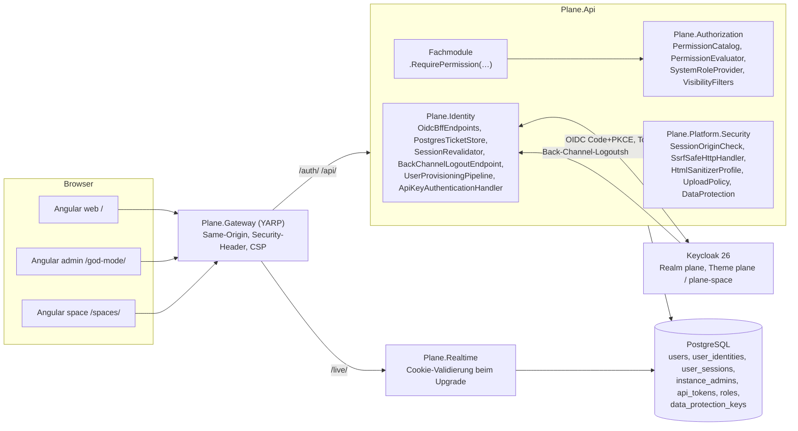
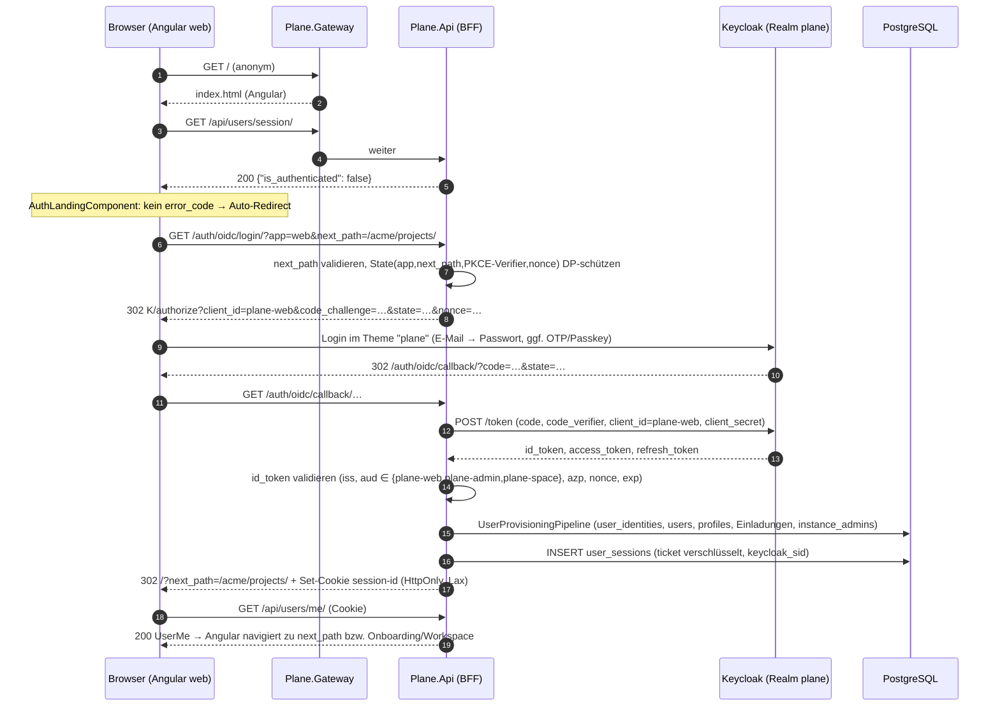
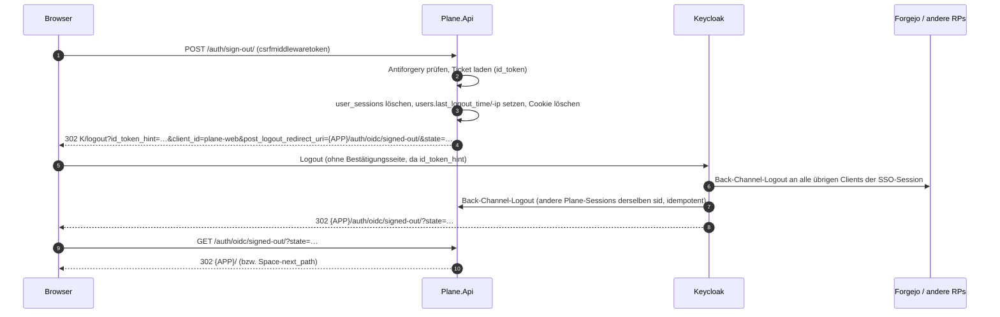

# 05 – Authentifizierung, Sicherheit und Berechtigungen (D05)

> **Status:** verbindliches Fachdokument der Zielarchitektur (Rang: `00-grundsatzentscheidungen.md` > `01-zielarchitektur-und-tech-stack.md` > **dieses Dokument** > eigene Präferenzen). Detailliert ADR-008 (Keycloak-only), ADR-017 (OIDC-BFF), ADR-018 (Keycloak als Autorisierungsserver), ADR-019 (Permission-Katalog), ADR-030 (HTML-Sanitizing) und ADR-034 (Rate Limiting) aus `01`.
> **Stand:** 23.10.2026. **Sprache:** Fließtext Deutsch, Bezeichner Englisch.
> **Repository:** Alle Zielpfade sind relativ zur Wurzel des neuen Repositories **`funk.`** (ADR-009). Der Verzeichnisbaum in `01` §5.1 ist dort noch mit dem Arbeitstitel `plane-net/` überschrieben; die Struktur unterhalb der Wurzel gilt unverändert (`src/…`, `frontend/…`, `deploy/…`, `tests/…`, `tools/…`).
> **Kürzel für das Original:** `API/` = `apps/api/plane/`, `AUTH/` = `apps/api/plane/authentication/`, `PERM/` = `apps/api/plane/app/permissions/`, `UT/` = `apps/api/plane/utils/`, `LIC/` = `apps/api/plane/license/`, `V/` = `apps/api/plane/app/views/`, `V1V/` = `apps/api/plane/api/views/`, `SPV/` = `apps/api/plane/space/views/`, `LICV/` = `apps/api/plane/license/api/views/`, `WEB/` = `apps/web/`, `SPC/` = `apps/space/`, `ADM/` = `apps/admin/`, `PKG/` = `packages/`. Analyse-Dokumente: `A03` = `migration/analysis/03-api-intern-workspace-projekt-user.md`, `A04` = `…/04-api-intern-arbeitsobjekte.md`, `A05` = `…/05-api-public-v1-space-instanz.md`, `A06` = `…/06-auth-sicherheit-querschnitt.md`, `A07` = `…/07-hintergrundjobs-mail-storage-webhooks.md`, `A08` = `…/08-frontend-web-architektur.md`, `A11` = `…/11-frontend-admin-space.md`, `A12` = `…/12-editor-echtzeit-live.md`. Paid-Dokumente: `F27` = `migration/features/27-paid-sicherheit-admin-lizenz.md`, `F30` = `migration/features/30-paid-auswahlliste.md`.
> **Maschinenlesbare Begleitdaten:** `migration/architecture/_data/05-permission-matrix.json` (Permission-Katalog + Endpunkt-Matrix, 672 Endpunkt-Methoden). Erzeugt aus dem Original-Code mit `migration/_werkzeuge/permission-matrix/` (AST-Extraktion von URL-Konfigurationen, Views, `permission_classes`, `get_permissions` und `@allow_permission`).

## Inhaltsverzeichnis

1. [Ziel & Scope](#1-ziel--scope)
2. [Entscheidungen (D05-ADR-01 ff.)](#2-entscheidungen-d05-adr-01-ff)
3. [Detaildesign](#3-detaildesign)
   - 3.1 Bausteine und Verantwortlichkeiten
   - 3.2 Endpunkte unter `/auth/` und Auth-Endpunkte der Instanz-API
   - 3.3 Anmeldung (Authorization Code + PKCE über das BFF)
   - 3.4 Sessions und Cookies
   - 3.5 CSRF und Same-Origin-Prüfung
   - 3.6 Abmeldung: RP-initiated Logout und Back-Channel-Logout
   - 3.7 Just-in-time-Provisionierung und Einladungen
   - 3.8 Instanz-Admin per Keycloak-Rolle und optionaler Step-up
   - 3.9 Erst-Einrichtung der Instanz ohne Admin-Konto
   - 3.10 Deaktivierte und gesperrte Konten
   - 3.11 Authentisierung von Realtime (Hocuspocus-WebSocket, SignalR)
   - 3.12 API-Keys (`X-Api-Key`) und Authentifizierungs-Schemata
   - 3.13 Autorisierung: Permission-Katalog, Evaluator, Regeln, Policies
   - 3.14 Gast-Sichtbarkeit (`guest_view_all_features`)
   - 3.15 Keycloak-Realm als Code
   - 3.16 Plane-Login-Theme (1:1-Optik der Sign-in-Seite)
   - 3.17 Sicherheitsmechanismen (CORS, SSRF, Sanitizing, Upload, Secrets, Rate Limits, Header, Logging)
   - 3.18 Korrektur der dokumentierten Sicherheitslücken des Originals
4. [Mapping-Tabellen Original → Ziel](#4-mapping-tabellen-original--ziel)
5. [Code-Skelette](#5-code-skelette)
6. [Erweiterungspunkte für Bezahl-Pakete](#6-erweiterungspunkte-für-bezahl-pakete)
7. [Akzeptanzkriterien & Tests](#7-akzeptanzkriterien--tests)
8. [Risiken & offene Punkte](#8-risiken--offene-punkte)
9. [Abhängigkeiten zu anderen Dokumenten (02–16)](#9-abhängigkeiten-zu-anderen-dokumenten-0216)
- [Anhang A – Permission-Katalog (vollständig, 258 Keys)](#anhang-a--permission-katalog-vollständig-258-keys)
- [Anhang B – Endpunkt-×-Rollen-Matrix (vollständig, 672 Endpunkt-Methoden)](#anhang-b--endpunkt--rollen-matrix-vollständig-672-endpunkt-methoden)

---

## 1. Ziel & Scope

### 1.1 Ziel

Dieses Dokument legt fest, **wer sich wie anmeldet** (ausschließlich Keycloak per OIDC, ADR-008), **wie eine Anmeldung in eine Plane-Session übersetzt wird** (Backend-for-Frontend in `Plane.Api`, serverseitige Session, HttpOnly-Cookie), **wer was darf** (Permission-Katalog aus dem Original-Code, System-Rollen Admin 20 / Member 15 / Guest 5, Gast-Sichtbarkeit) und **welche Sicherheitsmechanismen** die Plattform querschnittlich bereitstellt (CORS, CSRF, SSRF, Sanitizing, Uploads, Secrets, Rate Limits, Header). Es ist für Implementierungs-Agenten direkt umsetzbar: jede Klasse hat einen Ort in `funk.`, jede Regel eine Quelle im Original und ein Akzeptanzkriterium.

### 1.2 Im Scope

| Bereich | Inhalt | CE-IDs (Kern) |
|---|---|---|
| Anmeldung | OIDC Authorization Code + PKCE für `web`, `admin` (God Mode), `space`; BFF-Endpunkte unter `/auth/`; Fehlercodes; `next_path` | CE-AUTH-001, -014, -016, -023, -029 |
| Session | Cookie `session-id`, `user_sessions`, Laufzeiten, Revalidierung, Bereinigung, Session-Status-Endpunkte | CE-AUTH-024, -025 |
| Abmeldung | `POST /auth/sign-out/` (+ Space/Admin-Aliase), RP-initiated Logout, Back-Channel-Logout | CE-AUTH-022, CE-INST-008 |
| Benutzer | JIT-Provisionierung aus Claims, Avatar-Übernahme (SSRF-sicher), Einladungszuordnung, Onboarding-Weiterleitung, deaktivierte Konten | CE-AUTH-012, -027, -028, -030, CE-PROF-004, -005 |
| Instanz | Instanz-Admin aus Keycloak-Rolle, Erst-Einrichtung ohne Admin-Konto, Admin-Liste als Spiegel | CE-INST-004, -006 |
| Space | anonymes Lesen, Login für Kommentare/Reaktionen/Votes | CE-SPACE-012…014, -025…028 |
| Maschinenzugriff | API-Keys `X-Api-Key`, Rate-Limit je Key, Bearer-Schema vorkonfiguriert (aus) | CE-API-001…003, CE-WH-012…014 |
| Autorisierung | Permission-Katalog (258 Keys), Endpunkt-Matrix (672 Methoden), Evaluator, Regeln, Gast-Sichtbarkeit, Frontend-Fassade | CE-WS-008 (Gast-Regel) und alle Endpunkte |
| Keycloak | Realm als Code (Clients, Scopes, Rollen, Gruppen, Mapper, Flows, Policies, Testbenutzer), Login-Theme `plane`/`plane-space` | ADR-008 |
| Sicherheit | CORS, CSRF/Origin, SSRF-Client, HTML-Sanitizing, Upload-Validierung, Data-Protection-Key-Ring, Rate Limiting, Security-Header/CSP, Log-Redaktion, Korrektur der Original-Lücken | CE-AUTH-026, CE-WH-011, CE-OPS (Sicherheitsteile) |

### 1.3 Nicht im Scope

- Fachliches Design von Bezahl-Paketen (E1–E8, H1–H4 …). Es gibt nur die Andockstellen in §6.
- Endpunktkatalog aller Fach-APIs (→ `04-api-design-und-endpunktkatalog.md`); dieses Dokument liefert **je Endpunkt die Berechtigung** (Anhang B), nicht Request/Response-Formen.
- Ablauf der Webhook-Zustellung und E-Mail-Jobs (→ `06-hintergrundjobs-events-benachrichtigungen.md`); hier nur SSRF-Schutz und Signatur.
- Infrastruktur-Details von Keycloak-Betrieb (HA, Backup, TLS) (→ `14-infrastruktur-deployment-betrieb.md`); hier nur die Realm-Konfiguration als Code.

### 1.4 Was wird in welchem Inkrement gebraucht

| Inkrement (aus `01` §1.3) | Bausteine dieses Dokuments, die **fertig** sein müssen | Abnahme (Kurz, Details §7) |
|---|---|---|
| **I0 Walking Skeleton** | Realm-Import Dev/Test (§3.15), Login-Theme Grundform E-Mail-/Passwort-Schritt (§3.16), BFF-Endpunkte `/auth/oidc/login/`, `/auth/oidc/callback/`, `/auth/sign-out/`, `/auth/oidc/signed-out/`, `/auth/oidc/backchannel-logout/`, `/auth/get-csrf-token/` (§3.2), `user_sessions` + `PostgresTicketStore` (§3.4), Origin-Check (§3.5), JIT-Pipeline mit Schritten Identität/Benutzer/Profil (§3.7), Instanz-Admin-Rolle + Erst-Einrichtung (§3.8/§3.9), Policy-Scheme `Plane` mit `Cookie`/`ApiKey`/`Bearer`(aus) (§3.12), Permission-Katalog-Gerüst + Evaluator + Architekturtest „jede Route hat genau eine Permission“ (§3.13) mit den Keys für Workspace anlegen/lesen und Projekt anlegen/lesen, Frontend-Fassade `PermissionService` (§3.13.8), Security-Header + CSP Report-Only im Gateway (§3.17.7), Data-Protection-Key-Ring (§3.17.5) | Spike **S7** grün; Login web/admin/space; Back-Channel-Logout < 2 s; JIT; Rolle → God Mode |
| **I1 Workspace, Projekte, Konto** | Einladungs-Zuordnung + Auto-Join (§3.7.5), Signup-Gate (§3.7.6), Konto deaktivieren (§3.10), Profil-Security-Tab → Keycloak-Konto (§4.1), Rate-Limit-Policies (§3.17.6), alle Keys `workspace.*`, `project.*` (Mitglieder, Einladungen, States, Labels, Estimates, Präferenzen, Favoriten), SSRF-Client für Avatar-Download (§3.17.2), Upload-Validierung Avatar/Cover/Logo (§3.17.4), Theme vollständig inkl. Reset-Password/Update-Password/OTP/Passkey-Seiten und i18n | Permission-Matrix-Test für alle I1-Endpunkte grün |
| **I2 Work Items & Layouts** | Keys `project.work_item*`, `project.reaction.*`, Regeln `C:` (Ersteller), `VIS` (Gast-Sichtbarkeit) mit `IVisibilityFilter<WorkItem>`, HTML-Sanitizer (§3.17.3), Anhang-Upload-Validierung | Gast-Sichtbarkeits-Tests (§7) |
| **I3 Planung** | Keys `project.cycle*`, `project.module*`, `project.intake*`, `project.view*`, `workspace.view*` | Matrix-Test |
| **I4 Pages & Realtime** | `PAGE`-Regel (§3.13.5), WebSocket-Auth + Origin-Prüfung (§3.11), Keys `project.page*` | Realtime-Auth-Tests (§7) |
| **I5 Überblick** | Keys `workspace.notification.*`, `workspace.search.read`, `workspace.analytics.*`, SignalR-Gruppen-Autorisierung | Matrix-Test |
| **I6 Außenwirkung & Administration** | God Mode vollständig (Admin-Spiegel, Authentication-Seite „Keycloak“), Space-Login + `BOARD`-Regel, API-Keys (Hash-Speicherung, Rate-Limit, Activity-Log), Public-API-Harmonisierung (HARM-xx), Webhook-SSRF + Signatur | API-Key-Contract-Tests, SSRF-Testkorpus |
| **I7 Härtung & Betrieb** | CSP **enforce**, Keycloak-Prod-Konfiguration per `keycloak-config-cli`, Sicherheitstests (ZAP-Baseline, Pen-Test-Checkliste §7.5), Airgap-Theme-Prüfung | Sicherheits-Abnahme |
| **W1 (F1/F2/H1/H6)** | Bearer-Schema aktivieren (H1), Forgejo-SSO-Client (F2), Andockstellen §6 | – (Detailplanung kurz vor W1) |
| **W4 (E3/E5)** | `IRoleDefinitionProvider`-Tausch, `groups`-Claim-Auswertung | – (Detailplanung kurz vor W4) |

---

## 2. Entscheidungen (D05-ADR-01 ff.)

Jede Entscheidung konkretisiert eine ADR aus `00`/`01`; Abweichungen von `01` gibt es nicht. Wo `01` offen war (O-06, O-08), ist die Auflösung vermerkt.

| ADR | Entscheidung | Alternativen (verworfen) | Begründung | ab |
|---|---|---|---|---|
| **D05-ADR-01** | **Ein OIDC-Handler, drei Keycloak-Clients.** `Plane.Api` registriert genau ein Schema `oidc` (`Microsoft.AspNetCore.Authentication.OpenIdConnect`) mit `CallbackPath=/auth/oidc/callback/`. Die App (`web`, `admin`, `space`) wird beim Login als Query-Parameter `app` übergeben, in den `AuthenticationProperties` (State, Data-Protection-geschützt) mitgeführt und bestimmt `client_id`/`client_secret` (`plane-web`, `plane-admin`, `plane-space`) beim Redirect **und** bei der Code-Einlösung. Confidential Clients, PKCE `S256` Pflicht (`pkce.code.challenge.method=S256`). Auflösung **O-06**: je App ein Client (eigenes Login-Theme-Variante, eigene Redirect-Regeln), eine gemeinsame Plane-Session. | (a) drei Schemata mit drei Callback-Pfaden (widerspricht dem in `01` §3.3 festgelegten Redirect `…/auth/oidc/callback/`); (b) Public SPA-Client mit Token im Browser (verletzt ADR-008 „kein Token im Browser“); (c) BFF im Gateway (YARP) – trennt Session-Logik vom Fachmodell `Plane.Identity` | Ein Callback-Pfad im Realm, eine Session-Erzeugung, Theme-Varianten über Client-Zuordnung | I0 |
| **D05-ADR-02** | **Eine Session für alle drei Apps.** Cookie-Name aus `SESSION_COOKIE_NAME` (Default `session-id`), `HttpOnly`, `SameSite=Lax`, `Path=/`, `Domain=COOKIE_DOMAIN` (Default host-only), `Secure` nach der Original-Regel `_cookies_secure` (§3.4.3). Das separate Cookie `admin-session-id` entfällt (Folge ADR-008: kein separates God-Mode-Login); damit entfällt auch der Fehler E-08 (Teilstring `instances`). | getrennte Admin-Session (Original, 1 h) | Gleiche Site, gleiche Keycloak-Identität; Admin-Schutz über Rolle + optionalen Step-up (D05-ADR-11) | I0 |
| **D05-ADR-03** | **Serverseitige Session per `ITicketStore`.** Cookie-Schema `Cookies` mit `SessionStore = PostgresTicketStore` (Tabelle `user_sessions`). Der Browser erhält nur einen Data-Protection-geschützten Schlüssel; das `AuthenticationTicket` (Claims + `id_token` + `refresh_token`) liegt serialisiert und zusätzlich mit Zweck `Plane.Identity.SessionTicket.v1` verschlüsselt in PostgreSQL. **Absolute** Laufzeit `SESSION_COOKIE_AGE` (Default 604 800 s) wie Original; `SESSION_SAVE_EVERY_REQUEST=1` schaltet gleitende Laufzeit ein. Abgelaufene Zeilen löscht der Job `ExpiredSessionCleanupJob` stündlich (Korrektur E-18). | Session-Inhalt im Cookie (Größe, Sperrbarkeit); Redis-Sessions (zusätzliche Pflichtkomponente) | Sofortige Sperre durch Zeilenlöschung, `device_info` wie Original, Mehrinstanzfähigkeit über gemeinsamen Key-Ring | I0 |
| **D05-ADR-04** | **Plane-Session folgt der Keycloak-Session.** (1) Back-Channel-Logout (`POST /auth/oidc/backchannel-logout/`, OIDC Back-Channel Logout 1.0) löscht alle `user_sessions` mit passendem `keycloak_sid` (bzw. `sub`). (2) Zusätzlich **Revalidierung**: Ist `revalidated_at` älter als `Plane:Auth:RevalidateIntervalSeconds` (Default 300), tauscht `SessionRevalidator` beim nächsten Request den gespeicherten Refresh-Token; schlägt das fehl (`invalid_grant`: Session beendet, Benutzer gesperrt/deaktiviert), wird die Plane-Session gelöscht → 401. Neue Tokens aktualisieren Rollen/Gruppen im Ticket. | nur Back-Channel (verpasste Zustellung bei Netzwerkfehler bleibt unbemerkt); Token-Introspection (zusätzlicher Client mit Introspection-Recht) | Belt-and-braces gegen den S7-Abbruchgrund „Back-Channel unzuverlässig“; Rollenentzug wirkt spätestens nach 5 min | I0 |
| **D05-ADR-05** | **Abmeldung bleibt ein Formular-POST.** `POST /auth/sign-out/` (Formularfeld `csrfmiddlewaretoken`, Antiforgery) löscht die Plane-Session und leitet per 302 auf den Keycloak-`end_session_endpoint` mit `id_token_hint`, `client_id`, `post_logout_redirect_uri={APP}/auth/oidc/signed-out/` und `state` (geschütztes Ziel). Aliase mit identischem Handler: `POST /auth/spaces/sign-out/` (mit `next_path`), `POST /api/instances/admins/sign-out/` (Ziel `/god-mode/`). | GET-Logout (CSRF-anfällig); nur lokale Abmeldung (Keycloak-SSO bliebe aktiv, Forgejo ebenfalls) | Original-Frontend-Mechanik (verstecktes Formular) bleibt; vollständiges Single Logout | I0 |
| **D05-ADR-06** | **CSRF wie Original: Origin-Prüfung + Token nur für Formulare.** Für jede cookie-authentifizierte Anfrage mit unsicherer Methode prüft `SessionOriginCheckMiddleware` den `Origin`-Header exakt nach `A06` §3.14.1 (fehlender `Origin` → erlaubt, `null` → abgelehnt, Schema ignoriert bei Host-Gleichheit, Allowlist aus Basis-URLs + `CORS_ALLOWED_ORIGINS` + `CSRF_TRUSTED_ORIGINS`); Ablehnung 403 `{"detail": "CSRF Failed: origin not allowed"}`. Zusätzlich wird bei fehlendem `Origin` `Sec-Fetch-Site: cross-site` abgelehnt (Härtung ohne Vertragsänderung). Antiforgery (Formularfeld `csrfmiddlewaretoken`, Header `X-CSRFToken`, Cookie `csrftoken`) gilt nur noch für `POST /auth/sign-out/` und Aliase; `GET /auth/get-csrf-token/` bleibt. Auflösung von **E-17/OP-02**: kein Token-CSRF mehr für JSON-Endpunkte. | Double-Submit-Token für alle XHR (Frontend-Vertragsänderung) | Parität, SameSite=Lax als zweite Linie | I0 |
| **D05-ADR-07** | **JIT-Provisionierung als Pipeline.** Nach erfolgreicher Token-Validierung läuft `UserProvisioningPipeline` mit geordneten `IUserProvisioningStep`-Implementierungen (CE: Identität → Benutzer → Profil/Avatar → Signup-Gate → Instanz-Admin-Spiegel → Einladungen → Onboarding-Ziel). Verknüpfung über `(issuer, subject)` in `user_identities`; E-Mail-Verknüpfung mit einem bestehenden, **unverknüpften** Konto nur bei `email_verified=true`; `email_verified=false` → kein Konto, Fehler 5124 `OAUTH_PROVIDER_UNVERIFIED_EMAIL`. | Verknüpfung nur über E-Mail (Takeover-Risiko, vgl. GHSA-7j95-vh8g-f365); Provisionierung über Keycloak-Event-Listener/SPI (Java-Code im Stack) | Andockstelle E3 (`01` §1.4), Takeover-Schutz | I0 (Kern), I1 (Einladungen) |
| **D05-ADR-08** | **Keycloak ist führend für E-Mail und Anmeldedaten.** `users.email` und `users.is_email_verified` werden bei **jedem** Login aus den Claims übernommen. Plane bietet keine eigene E-Mail-Änderung mehr (CE-PROF-004 **angepasst**: „Change email“ öffnet die Keycloak-Kontokonsole); Passwort, 2FA, Passkeys und Geräte verwaltet die Kontokonsole (Profil → Security). Namen und Avatar übernimmt Plane nur bei der Anlage, außer `Plane:Auth:SyncProfileOnLogin=true` (Nachfolger von `ENABLE_<PROVIDER>_SYNC`, CE-AUTH-012). | E-Mail-Änderung in Plane mit Rückschreiben nach Keycloak (Admin-API-Credentials in Plane) | Eine Quelle der Wahrheit; kein Admin-Token für Keycloak in Plane | I0/I1 |
| **D05-ADR-09** | **Instanz-Admin = Keycloak-Realm-Rolle.** Konfigurierbar `Plane:Auth:InstanceAdminRole` (Default `plane-instance-admin`, Claim `roles`) und optional `Plane:Auth:InstanceAdminGroup` (Claim `groups`, z. B. `/plane-instance-admins`). `PlanePrincipal.IsInstanceAdmin` entsteht ausschließlich aus dem Session-Ticket. Tabelle `instance_admins` ist nur **Spiegel** (bei jedem Login gepflegt) für `GET /api/instances/admins/` und die Workspace-Liste; `POST`/`DELETE /api/instances/admins/` entfallen (CE-INST-004 angepasst, O-11). | eigene Admin-Pflege in Plane (Doppelpflege, widerspricht ADR-008) | Rechteentzug in Keycloak wirkt ohne Plane-Aktion | I0 |
| **D05-ADR-10** | **Erst-Einrichtung ohne Admin-Konto.** `Plane.Migrator` legt die Instanz (`is_setup_done=false`) und die Default-Konfiguration an (Korrektur B-31). Der erste Keycloak-Benutzer mit Admin-Rolle sieht im God Mode das reduzierte Setup-Formular (Vorname, Nachname, E-Mail read-only, Firmenname, Telemetrie-Checkbox ohne Wirkung) und schließt es mit `POST /api/instances/admins/setup/` (JSON) atomar ab (Row-Lock, S-16). Den ersten Admin-Benutzer legt der Realm-Import (Dev/Test) bzw. `deploy/keycloak/config/plane-bootstrap-admin.json` (Prod, Variablen `PLANE_BOOTSTRAP_ADMIN_EMAIL`, `PLANE_BOOTSTRAP_ADMIN_PASSWORD`, Required Action `UPDATE_PASSWORD`) an. | Admin-Anlage per Plane-Formular mit Passwort (widerspricht ADR-008) | ADR-008, B-31 | I0 |
| **D05-ADR-11** | **Step-up für God Mode optional, Default aus** (ADR-009, O-08). `Plane:Auth:AdminStepUpMaxAgeSeconds` = 0 (aus). Bei > 0 verlangt `AdminStepUpFilter` auf allen `/api/instances/`-Endpunkten außer `GET /api/instances/` und `…/admins/session/` einen `auth_time`-Claim jünger als der Wert; sonst 401 `{"error_code": 5210, "error_message": "ADMIN_REAUTHENTICATION_REQUIRED"}` → Admin-App leitet zu `/auth/oidc/login/?app=admin&max_age=<n>&next_path=…`. | Pflicht-Step-up (widerspricht ADR-009) | – | I0 (Schalter), I6 (UI) |
| **D05-ADR-12** | **Signup-Gate bleibt als JIT-Regel.** `ENABLE_SIGNUP` (Instanz-Konfiguration, eindeutiger Default `"1"`, Korrektur E-03) entscheidet, ob ein **neuer** Plane-Benutzer ohne offene Workspace-/Projekt-Einladung angelegt wird; sonst 5015 `SIGNUP_DISABLED`. Instanz-Admins sind ausgenommen. Optional `Plane:Auth:RequiredRole` (Default leer): ohne diese Realm-Rolle kein Zugang (5015). Der God-Mode-Schalter „Allow anyone to sign up even without an invite“ bleibt auf der neuen Seite `/god-mode/authentication/` (Rest von CE-INST-020). | Signup-Steuerung ausschließlich in Keycloak (verliert die Plane-spezifische „nur mit Einladung“-Regel, wenn Keycloak mit Forgejo geteilt wird) | Keycloak-Benutzer ≠ Plane-Benutzer; Betreiber kann Plane auf Eingeladene begrenzen | I1 |
| **D05-ADR-13** | **Realm als Code, zwei Anwendungswege.** Dev/Test: `deploy/keycloak/realms/plane-realm.json` per Aspire `WithRealmImport` (`--import-realm`; bestehende Realms werden übersprungen). Prod/Upgrade: `deploy/keycloak/config/*.json` per **keycloak-config-cli** (adorsys, Apache-2.0) als idempotenter Init-Container `keycloak-config` (Aspire-Ressource im Profil `prodlike`, Compose-Service). Platzhalter `${VAR}` werden aus Umgebungsvariablen ersetzt (Keycloak-Import) bzw. per `import.var-substitution.enabled=true` (config-cli). Secrets nie im Repo. | nur `--import-realm` (keine Aktualisierung bestehender Realms); Terraform-Provider (zusätzliche Toolchain); Keycloak-Admin-API-Code in Plane | Reproduzierbar, upgrade-fähig, airgapped (Image gespiegelt) | I0 (Dev), I7 (Prod) |
| **D05-ADR-14** | **Eigenes FreeMarker-Login-Theme `plane`** (`parent=base`, volle Kontrolle über DOM) und Kind-Theme `plane-space`. Zwei-Schritt-Ablauf wie Original (E-Mail → Passwort) über einen eigenen Browser-Flow `plane-browser` mit **Username Form** + **Password Form**. CSS wird zur Build-Zeit mit Tailwind 4.1 aus den Template-Klassen erzeugt (`tools/keycloak-theme/`), Texte aus `packages/i18n` (alle Plane-Sprachen) generiert, Schrift Inter gebündelt. Fallback (S7): Keycloakify (MIT, Node nur im Build). | `keycloak.v2`-Theme anpassen (PatternFly-DOM, keine Pixelparität); Login-UI in Angular mit Keycloak-Direct-Grant (Passwort durch Plane, verletzt ADR-008) | ADR-005-Parität, Airgap | I0 (E-Mail/Passwort), I1 (alle Seiten) |
| **D05-ADR-15** | **Authentifizierungs-Schemata als Policy-Scheme `Plane`** nach Pfad: `/api/v1/` → `ApiKey` (Header `X-Api-Key`), bei aktiviertem H1 zusätzlich `Bearer` (Keycloak-JWT, Audience `plane-api`); alle anderen Pfade → `Cookies`. Session-Cookies werden unter `/api/v1/` **nicht** akzeptiert (Original). `PlanePrincipal.Kind` = `User` / `ApiKey` / `App` / `Bot`. | ein Schema für alles (Cookie-Fallback auf v1 würde CSRF-Fläche öffnen) | Parität, H1-Andockstelle | I0 |
| **D05-ADR-16** | **API-Keys gehasht.** Format bleibt `plane_api_` + 32 Hex; gespeichert wird `token_hash = SHA-256(token)` (Hex) + `token_prefix` (erste 14 Zeichen) – Klartext nur einmal in der Create-Antwort (wie Original-UI, CE-WH-013); Lookup per Hash. Fehlerformen 1:1: ohne Header 401 `{"detail": "Authentication credentials were not provided."}`, ungültig/abgelaufen/inaktiv/Benutzer deaktiviert 403 `{"detail": "Given API token is not valid"}` (B-03 bewusst nicht geändert, Vertrag). `last_used` wird höchstens einmal pro 60 s geschrieben. Rate-Limit-Schlüssel = `token_hash`. | Klartext-Speicherung (Original) | Leak der DB kompromittiert keine Tokens | I6 |
| **D05-ADR-17** | **Autorisierung über einen aus dem Code abgeleiteten Permission-Katalog** (ADR-019): 258 Keys `<ebene>.<ressource>.<aktion>` (Anhang A), je Endpunkt-Methode genau eine Angabe `.RequirePermission(key, rules)` oder `.AllowAnonymous()` (Anhang B). System-Rollen (`roles`, `is_system=true`): Admin 20, Member 15, Guest 5 auf Workspace- und Projektebene; die Grant-Mengen entstehen aus der Matrix. **Regeln** sind deklarative Zusätze je Endpunkt: `C:<Model>` (Ersteller-Bypass), `OWN` (nur eigene Objekte), `SELF` (eigener Datensatz), `VIS` (Gast-Sichtbarkeit), `PAGE` (Page-Zugriff), `BOARD` (Deploy-Board-Schalter), `WSA|PA` (Workspace-Admin **oder** Projekt-Admin ohne Mitgliedschaft). Jeder Key ist zusätzlich als ASP.NET-Policy `perm:<key>` registriert (für SignalR-Hubs und `[Authorize]`-Konsumenten). | ASP.NET-Policies je Rolle (`role >= 15`) | E5/B1 docken ohne Umbau an; Matrix-Test maschinell | I0 (Gerüst), je Inkrement die Keys |
| **D05-ADR-18** | **WS-Admin-Override einheitlich.** Ein aktiver Workspace-Admin, der aktives Mitglied eines Projekts ist (beliebige Rolle), gilt in diesem Projekt für **alle** Projekt-Permissions als Projekt-Admin. Original: nur bei `allow_permission`, `ProjectBasePermission`, `ProjectAdminPermission`; die übrigen Klassen (`ProjectEntityPermission`, `ProjectMemberPermission`, `ProjectLitePermission`) kennen den Override nicht. Das Frontend (`WEB/store/user/base-permissions.store.ts` `getProjectRole`) behandelt WS-Admins bereits überall als Projekt-Admin → serverseitige Angleichung (HARM-00). | exakte Nachbildung je Klasse | Ein Evaluator-Pfad, UI und API konsistent; keine Rechteausweitung über Workspace-Admin-Rechte hinaus | I0 |
| **D05-ADR-19** | **Public API v1 übernimmt die Rechte der App-API.** Wo v1 im Original **weiter** war als die App (Kommentare ändern/löschen durch Gäste, Stickies fremder Nutzer, Intake-Änderung, Anhänge ohne Mitgliedschaft …), gilt die App-Regel (Sicherheitskorrektur `SEC-xx`); wo v1 **enger** war, gilt ebenfalls die App-Regel (Harmonisierung `HARM-xx`), weil derselbe Benutzer die Aktion ohnehin über die App ausführen darf. Liste §3.18. | v1 1:1 (übernimmt Lücken B-05…B-07, B-18) | `A05` §3.26 Empfehlung, Parität der UI | I6 |
| **D05-ADR-20** | **401/403-Körper je Prüfmechanismus wie Original.** Anonym → 401 `{"detail": "Authentication credentials were not provided."}`; Keys mit Herkunft „Permission-Klasse“ → 403 `{"detail": "You do not have permission to perform this action."}`; Keys mit Herkunft `allow_permission` → 403 `{"error": "You don't have the required permissions."}`; Inline-Prüfungen behalten ihren Original-Text (z. B. `{"error": "You are not allowed to view this issue"}`). Die Herkunft steht je Endpunkt in Anhang B (Spalte „Original-Prüfung“: `WS(…)`/`PRJ(…)` = Klasse bzw. `PRJ⁺(…)`/`WS(…) ∨ Creator` = Decorator) und wird als `ForbiddenStyle` am Endpunkt deklariert. | ein einheitlicher 403-Körper (Frontend-Toasts ändern sich) | ADR-003/ADR-016 | I0 |
| **D05-ADR-21** | **Frontend ohne Tokens, Rechte über eine Fassade.** Angular hält keine Tokens; alle Aufrufe `withCredentials`. Rechte prüft ausschließlich `PermissionService.allowPermissions(roles, level, workspaceSlug?, projectId?, onAllowed?)` (Signatur 1:1 zu `WEB/store/user/base-permissions.store.ts`) hinter dem Token `PERMISSION_EVALUATOR` (`01` §6.4). 401 → `window.location.replace("/?next_path=" + encodeURIComponent(pathname))` wie `WEB/services/api.service.ts`. | Token im Browser; Permission-Keys im Frontend ab CE (E5 wäre nur Implementierungstausch) | ADR-008, E5-Fassade | I0 |
| **D05-ADR-22** | **WebSocket-Authentisierung über dieselbe Session + Origin-Allowlist.** `Plane.Realtime` validiert das Session-Cookie aus dem Upgrade-Request gegen `user_sessions` (gemeinsamer Key-Ring) und lehnt Upgrades mit nicht erlaubtem `Origin` ab (Schutz gegen Cross-Site-WebSocket-Hijacking, im Original nicht vorhanden). | Ticket-Token im Query-String | Gleiches Modell wie HTTP | I0 (Hub), I4 |
| **D05-ADR-23** | **Security-Header zentral im Gateway**, CSP ab I0 `Content-Security-Policy-Report-Only`, ab I7 erzwungen; `frame-ancestors 'none'` für Web/Admin, für Space-Boards einbettbar (CE-SPACE-029), Space-Startseite `SAMEORIGIN` (Original). | CSP sofort erzwingen (Risiko für Editor/Emoji-Assets ohne Messung) | Parität + Härtung messbar | I0 (Report-Only), I7 (Enforce) |
| **D05-ADR-24** | **Ein SSRF-sicherer HTTP-Client für alle ausgehenden Aufrufe an Nutzer-URLs** (`SsrfSafeHttpHandler` in `Plane.Platform.Security`): Webhooks, Link-Vorschau, Avatar-Download, Unsplash, LLM-Endpunkt (mit Allowlist für interne LLM-Hosts). Regeln S-01/S-02 1:1. Interne Ziele (Keycloak, Forgejo, Objektspeicher) laufen über eigene benannte Clients ohne diesen Handler. | Prüfung nur zur Speicherzeit (DNS-Rebinding) | Original-Schutz inkl. Advisories bleibt | I1 |
| **D05-ADR-25** | **Data-Protection-Key-Ring in PostgreSQL** (`data_protection_keys`, `PersistKeysToDbContext`), Anwendungsname `plane` (gemeinsam für Api, Realtime, Worker, Gateway), optional `ProtectKeysWithCertificate` (`Plane:DataProtection:CertificatePath`/`…Password`), Schlüsselrotation 90 Tage (Default). Zwecke: `Plane.Identity.SessionCookie.v1`, `Plane.Identity.SessionTicket.v1`, `Plane.Identity.OidcState.v1`, `Plane.Instance.Configuration.v1` (Ersatz Fernet), `Plane.Antiforgery`. `SECRET_KEY` wird nicht mehr benötigt (Startwarnung, wenn gesetzt). | Fernet-Nachbau mit `SECRET_KEY` | ADR-036 | I0 |
| **D05-ADR-26** | **Rate Limiting** mit `Microsoft.AspNetCore.RateLimiting`, Policies 1:1 zum Original (`auth`, `anon`, `asset_id`, `api_key`, Gateway `static`), verteilter Zähler über Valkey wenn konfiguriert (ADR-034); Client-IP nur über `ForwardedHeaders` mit `KnownProxies`/`KnownNetworks` und `ForwardLimit=NUM_PROXIES` (Korrektur E-19). | Gateway-Limit allein | Parität, Brute-Force-Schutz bleibt neben Keycloak-Brute-Force-Detection | I1 |

---
## 3. Detaildesign

### 3.1 Bausteine und Verantwortlichkeiten



| Baustein (Pfad in `funk.`) | Verantwortung | Original |
|---|---|---|
| `src/modules/Identity/Plane.Identity/Authentication/` | OIDC-Konfiguration (`OidcOptionsSetup`), Login/Callback/Logout-Endpunkte (`Endpoints/Auth/OidcBffEndpoints.cs`), `PostgresTicketStore`, `SessionRevalidator`, `BackChannelLogoutEndpoint`, `SessionCookieSecurePolicy`, `NextPathValidator`, `AuthRedirectBuilder`, `ApiKeyAuthenticationHandler`, `PlanePrincipalFactory` | `AUTH/**`, `LICV/admin.py`, `API/api/middleware/api_authentication.py` |
| `src/modules/Identity/Plane.Identity/Provisioning/` | `UserProvisioningPipeline` + CE-Schritte (§3.7) | `AUTH/adapter/base.py`, `AUTH/utils/{login,user_auth_workflow,workspace_project_join,redirection_path}.py` |
| `src/modules/Identity/Plane.Identity.Contracts/` | `IUserProvisioningStep`, `ProvisioningContext`, `IdentityClaims`, `AuthErrorCodes`, `ISessionRevoker`, DTOs `UserSessionDto`, `ApiTokenDto` | – |
| `src/modules/Authorization/Plane.Authorization/` | `PermissionCatalog`, `PermissionEvaluator`, `SystemRoleProvider`, `MembershipCache`, Regel-Auswerter (`CreatorRule`, `OwnRule`, `SelfRule`, `PageAccessRule`, `BoardRule`, `WorkspaceAdminOrProjectAdminRule`), `GuestVisibilityFilter<T>`-Implementierungen, `InstanceAdminRequirementHandler` | `PERM/*.py`, `UT/permissions/*`, `LIC/api/permissions/instance.py`, Gast-Prädikate (`A06` §3.19.2) |
| `src/modules/Authorization/Plane.Authorization.Contracts/` | `Permission`, `PermissionRule`, `IPermissionEvaluator`, `IRoleDefinitionProvider`, `RoleDefinition`, `IVisibilityFilter<T>`, `SystemRoles`, `PermissionKeys` (Generator-Ausgabe aus Anhang A) | – |
| `src/modules/<M>/Plane.<M>.Contracts/Permissions/<M>Permissions.cs` | Katalog-Beiträge je Modul (Konstanten aus Anhang A, Spalte „C#-Konstante“) | – |
| `src/building-blocks/Plane.BuildingBlocks/Security/` | `PlanePrincipal`, `PrincipalRef`, `PrincipalKind`, `ICurrentActor` (R2-konform, ohne ASP.NET) | – |
| `src/building-blocks/Plane.BuildingBlocks.Web/Security/` | `RequirePermission(...)`-Erweiterungen, `PermissionEndpointFilter`, `ForbiddenStyle`, `AuthSchemeSelector` (Policy-Scheme), `SessionOriginCheckMiddleware`, `PlaneAntiforgeryOptions`, `RateLimitPolicies` | `AUTH/session.py`, `AUTH/rate_limit.py`, `API/throttles/asset.py`, `API/api/rate_limit.py` |
| `src/platform/Plane.Platform.Security/` | `SsrfSafeHttpHandler`, `IpBlocklist`, `UrlSafety`, `HtmlSanitizerProfile`, `BinaryContentValidator`, `UploadPolicy`, `FileNameSanitizer`, `CsvInjectionGuard`, `DataProtectionSetup`, `SecretRedactor` | `UT/{ip_address,url_security,content_validator,path_validator,csv_utils,url}.py` |
| `src/hosts/Plane.Gateway/Security/` | `SecurityHeadersMiddleware`, `CspPolicyProvider`, Static-Rate-Limit | `apps/*/caddy/Caddyfile`, `SPC/app/root.tsx` Header |
| `src/hosts/Plane.Realtime/Security/` | `WebSocketOriginValidator`, `SessionTicketReader` | `apps/live/src/lib/auth.ts` |
| `deploy/keycloak/` | Realm-Dateien, Theme, config-cli-Konfiguration (§3.15/§3.16) | – |
| `frontend/libs/web/core/permissions/`, `frontend/libs/web/auth/`, `frontend/libs/admin/authentication/`, `frontend/libs/space/account/` | `PermissionService`, `AuthLandingComponent`, `AuthGuard`, `unauthorizedInterceptor`, `SignOutFormComponent`, Fehler-Banner-Mapping | `WEB/store/user/base-permissions.store.ts`, `WEB/components/auth-screens/*`, `WEB/components/account/auth-forms/*`, `WEB/helpers/authentication.helper.tsx`, `ADM/app/(all)/(home)/*`, `SPC/components/account/auth-forms/*` |

### 3.2 Endpunkte unter `/auth/` und Auth-Endpunkte der Instanz-API

Alle Routen akzeptieren Pfade mit und ohne abschließenden Slash (`01` §7.11). „Rate“ = Rate-Limit-Policy (§3.17.6).

| # | Methode | Pfad | Zweck | Auth | Rate | Erfolg | Fehler | Ersetzt (Original) |
|---|---|---|---|---|---|---|---|---|
| N-01 | GET | `/auth/oidc/login/` | Login starten. Query: `app` = `web`\|`admin`\|`space` (Default `web`), `next_path` (validiert §3.3.4), optional `prompt` (`login`\|`none`), `login_hint` (E-Mail, max. 254 Zeichen), `max_age` (Ganzzahl, nur `app=admin`), `ui_locales` (aus `localStorage.userLanguage`) | anonym oder angemeldet | `auth` | 302 → Keycloak `authorization_endpoint` (mit `code_challenge`, `state`, `nonce`) | 302 `{BASE(app)}/?error_code=5900&error_message=RATE_LIMIT_EXCEEDED[&next_path=…]`; IdP nicht erreichbar → `…error_code=5201&error_message=IDENTITY_PROVIDER_UNAVAILABLE` | `/auth/sign-in/`, `/auth/sign-up/`, `/auth/magic-*`, `/auth/{google,github,gitlab,gitea}/`, Space-Pendants, `/api/instances/admins/sign-in/`, `/api/instances/admins/sign-up/` |
| N-02 | GET | `/auth/oidc/callback/` | Code einlösen (PKCE-Verifier), ID-Token validieren, JIT (§3.7), Session anlegen | anonym | `auth` | 302 → Ziel (§3.3.5) | 302 `{BASE(app)}/?[next_path=…&]error_code=<code>&error_message=<KEY>` (Codes §4.3) | `/auth/*/callback/` |
| N-03 | POST | `/auth/sign-out/` | Abmelden (Web) | Session optional | – | 302 → Keycloak `end_session_endpoint` | ohne Session: 302 `{APP}/` | `/auth/sign-out/` |
| N-04 | POST | `/auth/spaces/sign-out/` | Abmelden (Space), Formularfeld `next_path` | Session optional | – | wie N-03, Ziel `{SPACE}{next_path}` | wie N-03, Ziel `{SPACE}` | `/auth/spaces/sign-out/` |
| N-05 | POST | `/api/instances/admins/sign-out/` | Abmelden (God Mode) | Session optional | – | wie N-03, Ziel `{ADMIN}` | wie N-03 | gleich |
| N-06 | GET | `/auth/oidc/signed-out/` | Rücksprung nach Keycloak-Logout; Query `state` (DP-geschützt: `app`, `next_path`) | anonym | `anon` | 302 → `{BASE(app)}{next_path}` | ungültiger `state` → 302 `{APP}/` | – (neu) |
| N-07 | POST | `/auth/oidc/backchannel-logout/` | Keycloak Back-Channel-Logout, Formularfeld `logout_token` | Logout-Token-Signatur | – | 200 (leer, `Cache-Control: no-store`) | 400 `{"error": "invalid_request"}` bei ungültigem Token | – (neu) |
| N-08 | GET | `/auth/get-csrf-token/` | Antiforgery-Token für Formular-POSTs | anonym | `anon` | 200 `{"csrf_token": "<token>"}` + Cookie `csrftoken` | – | gleich |
| N-09 | GET | `/api/users/session/` | Session-Status (Web/Space) | anonym | `anon` | 200 `{"is_authenticated": true, "user": UserMe}` / `{"is_authenticated": false}` | – | gleich (CE-AUTH-025) |
| N-10 | GET | `/api/instances/admins/session/` | Session-Status God Mode | anonym | `anon` | 200 `{"is_authenticated": true, "user": InstanceAdminMe}` nur wenn Instanz-Admin, sonst `{"is_authenticated": false}` | – | gleich |
| N-11 | GET | `/api/instances/admins/me/` | aktueller Instanz-Admin | `INST` | – | 200 `InstanceAdminMe` | 401/403 | gleich |
| N-12 | GET | `/api/instances/admins/` | Liste der Instanz-Admins (Spiegel) | `INST` | – | 200 `[InstanceAdmin]` (Felder wie Original + `"source": "keycloak"`) | 403 | gleich (CE-INST-004 angepasst) |
| N-13 | POST | `/api/instances/admins/setup/` | Erst-Einrichtung abschließen (JSON: `first_name`, `last_name`, `company_name`, `is_telemetry_enabled`) | `INST` | `auth` | 200 `{"instance": Instance, "redirect": "/god-mode/general/"}` | 400 `{"error_code": 5150, "error_message": "ADMIN_ALREADY_EXIST"}` (bereits eingerichtet), 400 `{"error_code": 5155, "error_message": "REQUIRED_ADMIN_EMAIL_PASSWORD_FIRST_NAME"}` (Pflichtfelder) | `/api/instances/admins/sign-up/` (CE-INST-006 angepasst) |
| N-14 | – | `/auth/*` (alle übrigen 37 Original-Routen), `/api/instances/admins/sign-in/`, `/api/instances/admins/sign-up/`, `/api/instances/admins/sign-up-screen-visited/`, `POST`/`DELETE /api/instances/admins/[{pk}/]`, `/api/users/me/accounts/[{pk}/]`, `POST /api/users/me/email/generate-code/`, `PATCH /api/users/me/email/` | – | – | – | **nicht registriert** → 404 `{"error": "Page not found."}` | – | entfällt (ADR-008) |

`{APP}`, `{SPACE}`, `{ADMIN}` werden wie `base_host` (`A06` §3.1.1) aus `Plane:Urls:Web` (`WEB_URL`/`APP_BASE_URL`), `Plane:Urls:Space` (`SPACE_BASE_URL` + `SPACE_BASE_PATH`, Default `/spaces/`) und `Plane:Urls:Admin` (`ADMIN_BASE_URL` + `ADMIN_BASE_PATH`, Default `/god-mode/`) gebildet; doppelte Slashes werden normalisiert (Korrektur E-05). Implementierung: `AuthRedirectBuilder.BaseUrl(PlaneApp app)`.

### 3.3 Anmeldung (Authorization Code + PKCE über das BFF)

#### 3.3.1 Ablauf Web



#### 3.3.2 Unterschiede je App

| Aspekt | `web` | `admin` (God Mode) | `space` |
|---|---|---|---|
| Keycloak-Client | `plane-web` | `plane-admin` | `plane-space` |
| Login-Theme | `plane` | `plane` (Variante „admin“ über `client.clientId`, Überschrift „Manage your Plane instance“ / „Configure instance-wide settings to secure your instance“ aus `ADM/app/(all)/(home)/sign-in-form.tsx`) | `plane-space` |
| Einstieg (anonym, ohne `error_code`) | `/` → Auto-Redirect zu N-01 (`Plane:Auth:AutoRedirect=true`, Default) | `/god-mode/` → Auto-Redirect | `/spaces/` zeigt `AuthView` mit Button; Board-Seiten (`/spaces/issues/{anchor}`) bleiben anonym lesbar, „Sign in“-Links führen zu N-01 mit `next_path` = aktuelle Seite **inkl. Query** (Korrektur A11 3.27: Peek/Board-Parameter gingen verloren) |
| Erfolgsziel | `{APP}/?next_path=<validiert>` bzw. `{APP}/` (Original-Semantik, Frontend entscheidet über `get_redirection_path`-Äquivalent) | `{ADMIN}general/` bzw. `{ADMIN}` wenn `is_setup_done=false` (Setup-Formular) | `{SPACE}<next_path>` (validiert) bzw. `{SPACE}` |
| Voraussetzung | Instanz eingerichtet, sonst 5000 `INSTANCE_NOT_CONFIGURED` | Rolle `plane-instance-admin`, sonst 5175 `ADMIN_AUTHENTICATION_FAILED` | Instanz eingerichtet, sonst 5000 |
| Post-Login-Workflow (Einladungen) | ja | ja | ja (Original: nein; Harmonisierung, harmlos – nur bereits **angenommene** Einladungen) |
| Fehlerbanner | `WEB/helpers/authentication.helper.tsx` + neue Codes §4.3 | `ADM/app/(all)/(home)/auth-banner.tsx` (5150–5190 + 5175 + 5210) | `SPC/components/account/auth-forms/auth-banner.tsx` (2.21 in A11 + neue Codes) |

#### 3.3.3 OIDC-Parameter (verbindlich)

| Parameter | Wert |
|---|---|
| `response_type` | `code` |
| `scope` | `openid profile email plane-roles plane-groups` (`offline_access` **nicht**) |
| PKCE | `S256`, Verifier 64 Byte Zufall (Handler-Default `UsePkce=true`) |
| `response_mode` | `query` |
| `nonce` | Handler-Default (Cookie-los: im geschützten State) |
| Pushed Authorization Requests | aus (`PushedAuthorizationBehavior.Disable`); Option `Plane:Auth:Oidc:UsePar` |
| Token-Validierung | `ValidIssuer` = `Plane:Auth:Oidc:Authority`; `ValidAudiences` = alle drei Client-IDs; `azp` muss zur App im State passen; Clock-Skew 60 s; `RequireHttpsMetadata` = `Plane:Auth:Oidc:RequireHttpsMetadata` (Dev `false`) |
| Claims-Quelle | ID-Token + UserInfo (`GetClaimsFromUserInfoEndpoint=true`, damit `picture` und `groups` vollständig sind) |
| `MapInboundClaims` | `false` (Claim-Namen wie Keycloak: `sub`, `email`, `email_verified`, `given_name`, `family_name`, `name`, `picture`, `preferred_username`, `locale`, `sid`, `roles`, `groups`, `auth_time`) |
| Correlation-/Nonce-Cookies | `.plane.oidc.correlation.*`, `.plane.oidc.nonce.*`: `SameSite=Lax`, `Secure` wie Session-Cookie, `HttpOnly`, Lebensdauer 15 min |
| Discovery | `{Authority}/.well-known/openid-configuration`, Cache 24 h, Refresh bei Signaturfehler (`ConfigurationManager.RequestRefresh`) |
| Backchannel-HTTP | benannter Client `keycloak` mit Timeout 10 s (Korrektur E-24), eigene CA möglich (`Plane:Auth:Oidc:CaCertificatePath`) |

#### 3.3.4 `next_path`-Validierung (1:1 zu `UT/path_validator.py`)

`NextPathValidator.Validate(string? value) → string` implementiert exakt `validate_next_path` (`A06` §3.1.2): leer/kein String → `""`; Länge > 500 → `""`; `\` und `\t\r\n` entfernen; bei Schema/Host nur Pfad behalten; muss mit `/` beginnen, nicht mit `//`, kein `..`; Verbotsmuster (case-insensitiv) `javascript:`, `data:`, `vbscript:`, `file:`, `ftp:`, `%2e%2e`, `%2f%2f`, `%5c%5c`, `<script`, `<iframe`, `<object`, `<embed`, `<form`, `onload=`, `onerror=`, `onclick=` → `""`. `AuthRedirectBuilder.SafeRedirect(baseUrl, nextPath, params)` bildet `get_safe_redirect_url` nach – **mit einer Korrektur**: `next_path` wird URL-kodiert angehängt (E-27); das Angular-Frontend liest den Wert mit `URLSearchParams` (dekodiert), das ist kompatibel. Erlaubte Hosts = Netlocs von `Plane:Urls:{Web,Admin,Space}`. Testvektoren: `T/unit/utils/test_path_validator.py` werden 1:1 nach `tests/modules/Plane.Identity.Tests/Unit/NextPathValidatorTests.cs` portiert.

#### 3.3.5 Zielermittlung nach dem Login

Das BFF leitet wie das Original **immer auf die App-Wurzel** mit `?next_path=` um (E-12 bleibt: Ziele ohne führenden `/` werden verworfen). Die Weiterleitung zu `onboarding`, `<slug>`, `invitations`, `create-workspace` erledigt das Angular-Frontend anhand von `GET /api/users/me/settings/` (CE-AUTH-029, Port von `get_redirection_path` in `UserSettingsQuery`). Der Gitea-Sonderweg (3.7.6 in A06) entfällt.

#### 3.3.6 Fehlerfälle im Callback

| Ursache | Erkennung | Redirect-Fehler |
|---|---|---|
| Keycloak liefert `error=…` (z. B. `access_denied`, `temporarily_unavailable`, `login_required` bei `prompt=none`) | `OnRemoteFailure` / `OnMessageReceived` | 5200 `OIDC_AUTHENTICATION_FAILED` (bei `login_required`: erneuter Redirect ohne `prompt`) |
| State ungültig/abgelaufen (Correlation-Cookie fehlt, > 15 min) | `OnRemoteFailure` | 5200 |
| Token-Endpunkt/JWKS nicht erreichbar | `HttpRequestException` | 5201 `IDENTITY_PROVIDER_UNAVAILABLE` |
| `email_verified=false` | Pipeline-Schritt Identität | 5124 `OAUTH_PROVIDER_UNVERIFIED_EMAIL` (Original-Code, Text im Frontend ergänzt, OP-06) |
| E-Mail fehlt im Claim | dto. | 5010 `EMAIL_REQUIRED` |
| E-Mail gehört einem anderen, bereits verknüpften Plane-Benutzer | dto. | 5202 `IDENTITY_ALREADY_LINKED` |
| Bot-Benutzer | Pipeline-Schritt Benutzer | 5017 `BOT_USER_LOGIN_FORBIDDEN` |
| in Plane deaktiviert (`is_active=false` und `last_logout_time` gesetzt) | dto. | 5019 `USER_ACCOUNT_DEACTIVATED` |
| neuer Benutzer, Signup-Gate greift | Pipeline-Schritt Signup-Gate | 5015 `SIGNUP_DISABLED` |
| Instanz nicht eingerichtet (`web`/`space`) | Pipeline-Schritt Instanz | 5000 `INSTANCE_NOT_CONFIGURED` |
| `app=admin` ohne Admin-Rolle | dto. | 5175 `ADMIN_AUTHENTICATION_FAILED` |
| Rate-Limit | Policy `auth` | 5900 `RATE_LIMIT_EXCEEDED` |

Bei Fehlern **nach** erfolgreichem Token-Tausch wird keine Plane-Session angelegt; die Keycloak-SSO-Session bleibt bestehen (der Banner bietet „Sign in“ = N-01 mit `prompt=login`, damit ein anderes Konto gewählt werden kann).

### 3.4 Sessions und Cookies

#### 3.4.1 Tabelle `user_sessions` (Eigentümer `Identity`, Detail in `03-datenmodell-efcore.md`)

| Spalte | Typ | Inhalt |
|---|---|---|
| `id` | `varchar(64)` PK | Zufall 32 Byte, Base64URL (`RandomNumberGenerator`) – Schlüssel, den `ITicketStore.StoreAsync` liefert |
| `user_id` | `uuid` FK `users`, Index | Plane-Benutzer (Ersatz `sessions.user_id`) |
| `app` | `varchar(16)` | `web` \| `admin` \| `space` (App des Logins) |
| `keycloak_sid` | `varchar(128)`, Index | Claim `sid` (Back-Channel-Logout) |
| `keycloak_sub` | `varchar(255)`, Index | Claim `sub` (Back-Channel-Logout ohne `sid`) |
| `ticket` | `bytea` | `TicketSerializer`-Bytes, zusätzlich mit Zweck `Plane.Identity.SessionTicket.v1` geschützt |
| `device_info` | `jsonb` | `{"user_agent", "ip_address", "domain"}` wie Original (`A06` §3.1.4) |
| `auth_time` | `timestamptz` | Claim `auth_time` (Step-up) |
| `created_at`, `last_seen_at`, `revalidated_at`, `expires_at` | `timestamptz` | `last_seen_at` max. 1 Update/min; `expires_at` = `created_at + SESSION_COOKIE_AGE` (absolut) bzw. gleitend |

Indizes: `(user_id)`, `(keycloak_sid)`, `(keycloak_sub)`, `(expires_at)`. Kein Soft-Delete (harte Löschung = Sperre).

#### 3.4.2 Ticket-Inhalt (Claims im `ClaimsPrincipal`)

| Claim (Typ) | Quelle | Verwendung |
|---|---|---|
| `plane:uid` | `users.id` | `PlanePrincipal.UserId` |
| `plane:kind` | `User` | `PrincipalKind` |
| `plane:app` | State | Logout-Client, Redirects |
| `sub`, `sid`, `auth_time` | ID-Token | Back-Channel, Step-up |
| `email` | ID-Token/UserInfo | Anzeige/Logs (redigiert) |
| `roles` (mehrfach) | Mapper `plane-roles` | `IsInstanceAdmin`, `RequiredRole` |
| `groups` (mehrfach) | Mapper `plane-groups` | E3-Andockstelle (in CE nur gespeichert) |
| Token `id_token`, `refresh_token`, `expires_at` | Token-Antwort (`SaveTokens=true`) | RP-Logout, Revalidierung; **verlassen nie den Server** |

#### 3.4.3 Cookie-Attribute

| Cookie | Name | Attribute | Laufzeit |
|---|---|---|---|
| Session | `SESSION_COOKIE_NAME` (Default `session-id`) | `HttpOnly`, `SameSite=Lax`, `Path=/`, `Domain=COOKIE_DOMAIN` (leer = host-only), `Secure` = `SessionCookieSecurePolicy.Evaluate(WEB_URL, APP_BASE_URL, CORS_ALLOWED_ORIGINS)` – 1:1 `_cookies_secure` (`A06` §2.7; Tests `T/unit/settings/test_cookie_secure.py` portieren) | `Max-Age` = Rest bis `expires_at` |
| Antiforgery | `csrftoken` | `HttpOnly`, `SameSite=Lax`, `Secure` wie Session, `Domain=COOKIE_DOMAIN` | Sitzungsdauer des Browsers (Antiforgery-Default) |
| OIDC-Korrelation/Nonce | `.plane.oidc.*` | siehe §3.3.3 | 15 min |

Konfiguration (Optionsklasse `PlaneAuthOptions`, Abschnitt `Plane:Auth`, ENV-Aliasse aus `A06` §2.6):

| Option | ENV-Alias (Original) | Default |
|---|---|---|
| `SessionCookieName` | `SESSION_COOKIE_NAME` | `session-id` |
| `SessionLifetimeSeconds` | `SESSION_COOKIE_AGE` | `604800` |
| `SlidingSession` | `SESSION_SAVE_EVERY_REQUEST` (`"1"`) | `false` |
| `CookieDomain` | `COOKIE_DOMAIN` | leer |
| `RevalidateIntervalSeconds` | – | `300` |
| `AdminStepUpMaxAgeSeconds` | – (Ersatz `ADMIN_SESSION_COOKIE_AGE`, wird ignoriert + Startwarnung) | `0` |
| `AutoRedirect` | – | `true` |
| `InstanceAdminRole` / `InstanceAdminGroup` | – | `plane-instance-admin` / leer |
| `RequiredRole` | – | leer |
| `SyncProfileOnLogin` | `ENABLE_GOOGLE_SYNC` u. a. (ignoriert) | `false` |
| `Oidc:Authority`, `Oidc:ClientIds:{Web,Admin,Space}`, `Oidc:ClientSecrets:{Web,Admin,Space}`, `Oidc:RequireHttpsMetadata`, `Oidc:UsePar`, `Oidc:CaCertificatePath` | – | `…/realms/plane`, `plane-web`/`plane-admin`/`plane-space`, Secrets aus Parameter (`01` §3.4 `oidc-client-secret`; in Prod je Client getrennt), `true`, `false`, leer |
| `Oidc:AccountConsoleUrl` | – | `{Authority}/account/` |

#### 3.4.4 Lebenszyklus

| Ereignis | Wirkung |
|---|---|
| Login (Callback) | neue Zeile; vorhandene Session desselben Browsers (Cookie) wird gelöscht (Session-Fixation-Schutz, entspricht `cycle_key`/`flush` in `A06` §3.1.4) |
| Request | `PostgresTicketStore.RetrieveAsync` (L1-Cache 30 s je Schlüssel im Prozess, invalidiert über Valkey-Kanal `plane:session:revoked`) → `SessionRevalidator` (§D05-ADR-04) → `last_seen_at` |
| Sliding aktiv | `expires_at` = jetzt + Laufzeit, Cookie neu |
| Abmelden (N-03…N-05) | Zeile löschen, Cookie löschen, Keycloak-Logout |
| Back-Channel-Logout | alle Zeilen mit `keycloak_sid` (bzw. `keycloak_sub`) löschen + Revoke-Nachricht |
| Konto in Plane deaktiviert (CE-PROF-005) | alle Zeilen des Benutzers löschen (`ISessionRevoker.RevokeAllAsync(userId)`) |
| Rollenänderung in Keycloak | wirksam bei nächster Revalidierung (≤ 300 s) oder sofort nach Keycloak-„Sign out all sessions“ |
| Ablauf | Request → 401 → Frontend → `/?next_path=` → Auto-Redirect → stilles Re-Login, solange die Keycloak-SSO-Session lebt (CE-AUTH-023) |
| Bereinigung | `ExpiredSessionCleanupJob` (Cron `17 * * * *` UTC) löscht `expires_at < now()` (E-18) |

### 3.5 CSRF und Same-Origin-Prüfung

| Prüfung | Gilt für | Regel | Fehler |
|---|---|---|---|
| `SessionOriginCheckMiddleware` | Anfragen mit Schema `Cookies` und Methode ∉ {GET, HEAD, OPTIONS, TRACE}, alle Pfade (`/api/`, `/auth/`, `/api/public/`, `/api/instances/`) | `A06` §3.14.1 1:1; Allowlist = normalisierte Origins von `Plane:Urls:{Web,Admin,Space,Live}` ∪ `CORS_ALLOWED_ORIGINS` ∪ `CSRF_TRUSTED_ORIGINS`; zusätzlich: fehlt `Origin` und `Sec-Fetch-Site` = `cross-site` → ablehnen | 403 `{"detail": "CSRF Failed: origin not allowed"}` |
| Antiforgery | `POST /auth/sign-out/`, `/auth/spaces/sign-out/`, `/api/instances/admins/sign-out/` | Formularfeld `csrfmiddlewaretoken` oder Header `X-CSRFToken` passend zu Cookie `csrftoken` | 200 HTML `csrf_failure.html` 1:1 (`apps/api/templates/csrf_failure.html`, Button „Go to Home Page“ → `{APP}`) (CE-AUTH-016) |
| `SameSite=Lax` | Session-Cookie | zweite Linie | – |
| Back-Channel-Logout | N-07 | **ausgenommen** von Origin/Antiforgery (Server-zu-Server), geschützt über Logout-Token-Signatur | – |
| WebSocket-Upgrade | `/live/*` | `WebSocketOriginValidator`: `Origin` **muss** vorhanden und in der Allowlist sein | 403 vor Upgrade |

### 3.6 Abmeldung: RP-initiated Logout und Back-Channel-Logout



**Logout-Token-Validierung** (`BackChannelLogoutEndpoint`, OIDC Back-Channel Logout 1.0 §2.6): JWT-Signatur gegen JWKS der Discovery; `iss` = Authority; `aud` ∈ {`plane-web`, `plane-admin`, `plane-space`}; `iat` nicht älter als 5 min; `jti` vorhanden und nicht bereits verarbeitet (HybridCache 10 min, Replay-Schutz); `events` enthält `http://schemas.openid.net/event/backchannel-logout`; `sid` oder `sub` vorhanden; **kein** `nonce`. Danach `DELETE FROM user_sessions WHERE keycloak_sid = @sid` (bzw. `keycloak_sub = @sub`, wenn kein `sid`) und Revoke-Nachricht über Valkey (`plane:session:revoked`) an alle Instanzen (L1-Cache verwerfen, offene WebSockets und SignalR-Verbindungen dieser Sessions schließen; Close-Code 4401 für Hocuspocus). Antwort 200, `Cache-Control: no-store`. Messkriterium S7: Session-Ende < 2 s nach Logout in Keycloak.

Keycloak erreicht den Endpunkt über die **interne** Adresse (`backchannel.logout.url` je Client = `${PLANE_BACKCHANNEL_BASE_URL}/auth/oidc/backchannel-logout/`; Dev: Gateway-Endpunkt aus Sicht des Keycloak-Containers, z. B. `http://host.docker.internal:3000`, in Aspire per Endpoint-Referenz gesetzt; Risiko R-03).

### 3.7 Just-in-time-Provisionierung und Einladungen

#### 3.7.1 Datenmodell (Eigentümer `Identity`, Details in `03-…`)

| Tabelle | Neu/aus Original | Felder (Auth-relevant) |
|---|---|---|
| `users` | `User` (`A02a`) | `id`, `email` (unique, lowercase), `username` (`uuid4().hex` bei Anlage wie Original), `first_name`, `last_name`, `display_name` (aus E-Mail-Lokalteil wie `M/user.py`), `avatar`, `avatar_asset_id`, `is_active`, `is_bot`, `bot_type`, `is_email_verified`, `last_login_time`, `last_login_ip`, `last_login_uagent`, `last_login_medium` (neu immer `"oidc"`), `last_logout_time`, `last_logout_ip`, `last_active`, `user_timezone`. **Entfällt:** `password`, `is_password_autoset` (API liefert `is_password_autoset: false` als Konstante für Vertragskompatibilität), `token`, `token_updated_at` |
| `user_identities` | **neu** | `id`, `user_id` FK, `provider` (`keycloak`), `issuer`, `subject` (`sub`), `email_at_link`, `created_at`, `last_login_at`; unique `(issuer, subject)`; unique `(user_id, provider)` |
| `profiles` | `Profile` | unverändert (`is_onboarded`, `last_workspace_id`, `onboarding_step`, `company_name`, Theme, Sprache …) |
| `accounts` | `Account` | **entfällt** (CE-PROF-007) |
| `sessions` | `Session` | ersetzt durch `user_sessions` |

#### 3.7.2 Claims → Plane-Felder

| Claim | Keycloak-Quelle (Mapper §3.15.5) | Plane-Feld | Anlage | Folgelogin |
|---|---|---|---|---|
| `iss` + `sub` | Realm, Benutzer-ID (UUID) | `user_identities.(issuer, subject)` | ja | Schlüssel der Zuordnung |
| `email` | Benutzer-E-Mail | `users.email` (`Trim().ToLowerInvariant()`, Validierung wie `Adapter.sanitize_email`) | ja | **immer** synchronisiert; Konflikt → 5202 |
| `email_verified` | Benutzer | `users.is_email_verified` | ja (muss `true` sein) | synchronisiert; `false` → 5124 |
| `given_name` / `family_name` | Vor-/Nachname | `first_name` / `last_name` (`None` → `""`; URL-Verbot S-21: enthält der Name eine URL, wird er leer übernommen) | ja | nur bei `SyncProfileOnLogin` |
| `name`, `preferred_username` | – | nicht übernommen (`display_name` wie Original aus E-Mail) | – | – |
| `picture` | Benutzerattribut `picture` (IdP-Mapper bei Brokering) | `avatar` + `avatar_asset_id` (Download §3.17.2: SSRF-sicher, 10 s, max. 5 Redirects, ≤ `FILE_SIZE_LIMIT`, MIME ∈ {jpeg, png, gif, webp}, Upload als `FileAsset` `USER_AVATAR`) | ja | nur bei `SyncProfileOnLogin` |
| `locale` | Benutzerattribut `locale` | `profiles.language`, wenn Wert ∈ Plane-Sprachen | ja | nein |
| `roles` | Realm-Rollen | Ticket, `instance_admins`-Spiegel | – | – |
| `groups` | Gruppenmitgliedschaften | Ticket (E3) | – | – |

#### 3.7.3 Pipeline (CE-Schritte, Reihenfolge = `Order`)

| Order | Schritt (Klasse in `Plane.Identity/Provisioning/Steps/`) | Logik | Fehler | Original |
|---|---|---|---|---|
| 100 | `ValidateIdentityClaimsStep` | `email` vorhanden + gültig; `email_verified == true`; `RequiredRole` (falls gesetzt) vorhanden | 5010, 5005, 5124, 5015 | `sanitize_email`, S-06 |
| 200 | `ResolveInstanceStep` | Instanz laden; `app ≠ admin` und `is_setup_done=false` → Fehler; `app = admin` ohne Admin-Rolle → Fehler | 5000, 5175 | Instanz-Checks in allen Auth-Views |
| 300 | `LinkOrCreateUserStep` | (a) `user_identities` per `(iss, sub)` → Benutzer; (b) sonst Benutzer per E-Mail: existiert und **ohne** Identität → verknüpfen (nur `email_verified`), mit **anderer** Identität → 5202; (c) sonst `ctx.IsNewUser = true` (Anlage erst nach Signup-Gate) | 5202 | `complete_login_or_signup` |
| 350 | `AccountStateGuardStep` | `is_bot` → 5017; `is_active=false` und `last_logout_time != null` → 5019; `is_active=false` und `last_logout_time == null` (vorprovisioniert, E3/SCIM) → aktivieren + Mail `user_activation_email` | 5017, 5019 | S-15, `A06` §3.17 |
| 400 | `SignupGateStep` | nur `IsNewUser`: `ENABLE_SIGNUP == "0"` und keine offene Einladung (`workspace_member_invites`/`project_member_invites` mit E-Mail) und kein Instanz-Admin → 5015 | 5015 | `__check_signup` |
| 500 | `CreateUserStep` | nur `IsNewUser`: `users` + `profiles` + `user_identities` anlegen (eine Transaktion), Avatar-Download als Job (`DownloadAvatarJob`, blockiert den Login nicht) | – | `complete_login_or_signup` |
| 550 | `SyncProfileStep` | E-Mail/`is_email_verified` immer; Namen/Avatar bei `SyncProfileOnLogin` | 5202 bei E-Mail-Kollision | `sync_user_data` |
| 600 | `UpdateLoginMetadataStep` | `last_login_time`, `last_login_ip` (Client-IP §3.17.6), `last_login_uagent`, `last_login_medium="oidc"`, `last_active`, `is_active=true` | – | `save_user_data` |
| 700 | `MirrorInstanceAdminStep` | Rolle/Gruppe vorhanden → `instance_admins` upsert (role 20, `source=keycloak`); fehlt → Zeile löschen | – | – (neu) |
| 800 | `JoinAcceptedInvitationsStep` | angenommene Workspace-Einladungen → `workspace_members` (Rolle aus Einladung); angenommene Projekt-Einladungen → `workspace_members` (Rolle ∈ {5,15}, sonst 15) **und** `project_members` **mit `project_id`** (Korrektur E-02/OP-03); danach Einladungen löschen; Cache-Tags `workspace:{slug}:members` invalidieren | – | `post_user_auth_workflow` (CE-AUTH-028) |
| 900 | `ComputeLandingStep` | nur Logging/Telemetrie-frei: setzt `ctx.Landing` (für Tests); das Ziel bestimmt das Frontend (§3.3.5) | – | `get_redirection_path` |

Alle Schritte laufen in **einer** Datenbanktransaktion (`ModuleScope("Identity")`; Schreibzugriffe auf `workspace_members`/`project_members`/`instance_admins` erfolgen über die Contracts-Services der Eigentümer `Workspaces`, `Projects`, `Instance` – Regel R5 in `01`). E3 fügt später Schritte mit `Order` 750 (Gruppen-Sync) hinzu (§6).

#### 3.7.4 Edge-Cases

| Fall | Verhalten |
|---|---|
| Benutzer ändert E-Mail in Keycloak | Folgelogin synchronisiert `users.email`; offene Einladungen der **neuen** Adresse werden ab dann zugeordnet; Bestätigungsmails des Originals (`user_email_update_task`) entfallen (Keycloak verifiziert selbst, `verifyEmail=true`) |
| Gleiche E-Mail, neuer `sub` (Benutzer in Keycloak gelöscht und neu angelegt) | 5202; Auflösung durch Instanz-Admin per CLI `plane-cli identities relink --email <e> --subject <sub>` (§4.6) |
| Keycloak-Issuer ändert sich (Hostname-Umzug) | `user_identities.issuer` per CLI `plane-cli identities migrate-issuer --from <a> --to <b>` |
| Brokered Login (SAML/OIDC/LDAP in Keycloak, E1/E3/E4 durch Keycloak) | identisch; Betreiber setzt am IdP bzw. an der Federation `trustEmail=true`, sonst greift 5124 |
| Gleichzeitige Erstlogins derselben Person (zwei Tabs) | Unique-Constraints `(issuer, subject)` und `email`; zweiter Versuch fängt `DbUpdateException` und wiederholt Schritt 300 einmal |

#### 3.7.5 Einladungen (Zuordnung offener Einladungen, CE-AUTH-028)

- Offene Einladungen werden **über die E-Mail-Adresse** gefunden (`GET /api/users/me/workspaces/invitations/`, Schlüssel `user.invitation.read`, Regel `SELF` = `email == principal.email`; Korrektur Q-10: Projekt-Einladungen nur des URL-Workspaces).
- Einladungslink `/workspace-invitations/?invitation_id=…&email=…&slug=…`: anonym → `AuthLandingComponent` leitet zu N-01 mit `login_hint=<email>` und `next_path=/workspace-invitations/?…` (Theme füllt das E-Mail-Feld vor). Die Einladungs-Kopfzeile des Original-Login-Formulars („Join {workspace}“) kann das Keycloak-Theme nicht anzeigen (Keycloak kennt die Einladung nicht) – dokumentierte Abweichung DEV-UI-01 (§8).
- Annahme nur durch den Eingeladenen (S-24): Vergleich der Einladungs-E-Mail mit `principal.email` (Keycloak-verifiziert).

#### 3.7.6 Signup-Gate und Registrierung

Keycloak-Selbstregistrierung (`registrationAllowed`) ist im Realm **aus**; Betreiber können sie einschalten (Theme enthält `register.ftl`). Unabhängig davon entscheidet Plane per `ENABLE_SIGNUP`, ob ein Keycloak-Benutzer **Plane** ohne Einladung nutzen darf (D05-ADR-12). `GET /api/instances/` liefert `config.enable_signup` wie Original.

### 3.8 Instanz-Admin per Keycloak-Rolle und optionaler Step-up

| Element | Festlegung |
|---|---|
| Rolle | Realm-Rolle `plane-instance-admin` (Beschreibung „Plane God Mode administrator“); Composite: keine |
| Gruppe (optional) | `/plane-instance-admins` mit Rollenzuweisung `plane-instance-admin` (Realm-Import legt sie an); Betreiber pflegen Mitglieder in Keycloak bzw. per LDAP-Gruppen-Mapper |
| Auswertung | `PlanePrincipalFactory`: `IsInstanceAdmin = roles ∋ InstanceAdminRole ∨ groups ∋ InstanceAdminGroup`; `InstanceAdminRequirementHandler` prüft nur `IsInstanceAdmin` (Original zusätzlich `InstanceAdmin.role >= 15` – entfällt, Spiegel hat immer 20) |
| Wirkungszeit | Login, Revalidierung (≤ `RevalidateIntervalSeconds`), Back-Channel-Logout |
| Spiegel | `instance_admins(id, instance_id, user_id unique, role=20, source='keycloak', synced_at)`; Antwort `GET /api/instances/admins/` = Original-Form (`InstanceAdminSerializer`: `id`, `user_detail`, `role`, …) + `source` |
| Schutzregel Kontodeaktivierung | `DELETE /api/users/me/` für Instanz-Admins → 400 wie Original (Prüfung per `IsInstanceAdmin`) |
| God-Mode-Seite „Authentication“ (`/god-mode/authentication/`) | ersetzt CE-INST-020…024: Karte „Keycloak“ (Issuer, Realm, Status der Discovery, Link „Open Keycloak admin console“ → `{KeycloakBaseUrl}/admin/plane/console/`), Schalter „Allow anyone to sign up even without an invite“ (`ENABLE_SIGNUP`), Hinweistext „Instance admins, SSO, LDAP, 2FA and passkeys are managed in Keycloak.“ (neuer i18n-Schlüssel `admin.authentication.keycloak.*` in allen Locales) |
| Step-up | D05-ADR-11; Prüfung `AdminStepUpFilter` (Endpunktgruppe `MapInstanceApi`), `auth_time` aus Ticket |

### 3.9 Erst-Einrichtung der Instanz ohne Admin-Konto

```mermaid
sequenceDiagram
  autonumber
  participant OP as Betreiber
  participant KC as Keycloak
  participant MG as Plane.Migrator
  participant B as Browser (God Mode)
  participant A as Plane.Api
  MG->>A: (Start) Migrationen, Seeds, Instance(is_setup_done=false), Default-Konfiguration
  OP->>KC: Realm-Import bzw. keycloak-config (Bootstrap-Admin mit Rolle plane-instance-admin)
  B->>A: GET /god-mode/ → GET /api/instances/ (is_setup_done=false)
  B->>A: GET /auth/oidc/login/?app=admin
  A-->>B: … Keycloak-Login (UPDATE_PASSWORD beim ersten Login) …
  A-->>B: 302 /god-mode/ (Session, IsInstanceAdmin)
  B->>A: POST /api/instances/admins/setup/ {first_name,last_name,company_name,is_telemetry_enabled}
  A->>A: SELECT … FOR UPDATE instances; is_setup_done? → 400 5150
  A->>A: profiles.company_name, users.first/last_name, instance.instance_name=company_name, is_setup_done=true
  A-->>B: 200 {redirect:"/god-mode/general/"}
```

- **Web-App vor der Einrichtung:** `GET /api/instances/` liefert `is_setup_done=false` → Seite „Welcome to Plane“ mit Link zum God Mode (CE-INST-005, unverändert).
- **Setup-Formular** (`frontend/libs/admin/instance/setup-form/`): DOM 1:1 zu `ADM/components/instance/setup-form.tsx` ohne Passwort-/Bestätigungs-Felder; E-Mail-Feld `disabled` mit Wert aus Session; Vor-/Nachname vorbelegt aus Claims. Fehlerbanner jetzt wirksam (Korrektur des Original-Bugs „Codes als Namen verglichen“, A11 3.2 Punkt 6).
- **Telemetrie-Checkbox:** bleibt sichtbar (1:1), Wert wird in `instances.is_telemetry_enabled` gespeichert, ohne Export (ADR-004).
- **Kein Bootstrap-Admin vorhanden** (Betreiber hat keinen angelegt): God Mode zeigt nach Login ohne Rolle Banner 5175; Dokumentation in `14-…` beschreibt `kcadm.sh`-Befehl bzw. config-cli-Variablen.
- **CLI:** `plane-cli instance status` (zeigt `is_setup_done`, Anzahl Spiegel-Admins, Keycloak-Erreichbarkeit); `plane-cli instance reset-setup` (setzt `is_setup_done=false`, nur mit `--force`).

### 3.10 Deaktivierte und gesperrte Konten

| Szenario | Auslöser | Wirkung in Plane | Wirkung in Keycloak | Anmeldung danach |
|---|---|---|---|---|
| **Konto in Plane deaktivieren** (CE-PROF-005, `DELETE /api/users/me/`) | Benutzer selbst (nicht Instanz-Admin, sonst 400) | wie Original `A06` §3.17: Mitgliedschaften deaktivieren, Workspace-Einladungen der E-Mail löschen, Profil zurücksetzen, `is_active=false`, `last_logout_time/-ip`, alle `user_sessions` löschen, API-Tokens deaktivieren, Mail `user_deactivation_email`; **Passwort-Randomisierung entfällt**; Antwort 204, Frontend sendet danach `POST /auth/sign-out/` (RP-Logout) | unverändert (Konto bleibt; Sperre des Kontos selbst in Keycloak, ADR-008) | 5019 `USER_ACCOUNT_DEACTIVATED` (Banner) |
| **Reaktivierung** | Instanz-Admin | `plane-cli users activate <email>` (wie `activate_user`), später God-Mode-Benutzerverwaltung (E7) | – | normal |
| **Konto in Keycloak deaktiviert** (`enabled=false`) | Keycloak-Admin, LDAP-Sync | nächste Revalidierung: Refresh schlägt fehl → Session gelöscht → 401. API-Keys hängen nicht an einer Keycloak-Session; deshalb gleicht `IdpUserStateSyncJob` (Cron `*/15 * * * *`, Service-Account-Client `plane-backend` mit Realm-Management-Rolle `view-users`, §3.15.3) für alle Benutzer mit aktiven API-Tokens den Keycloak-Status `enabled` ab: gesperrt oder gelöscht → alle `api_tokens` des Benutzers `is_active=false`, Integration-Event `plane.identity.user_disabled_in_idp.v1`. Abschaltbar mit `Plane:Auth:IdpUserSync:Enabled=false` (dann wirkt die Sperre auf API-Keys erst nach manueller Deaktivierung in Plane) | Login unmöglich | Keycloak-Fehlerseite im Plane-Theme (`error.ftl`) |
| **Keycloak-Admin „Sign out“ / „Sign out all sessions“** | Keycloak | Back-Channel-Logout → Sessions gelöscht (< 2 s) | Sessions beendet | stilles Re-Login unmöglich, Login-Seite |
| **Konto in Keycloak gelöscht** | Keycloak-Admin | wie deaktiviert; `user_identities` bleibt (Historie) | – | neues Konto gleicher E-Mail → 5202 bis `identities relink` |
| **Bot-Benutzer** | – | Bots haben keine Identität; jede Verknüpfung → 5017 | – | – |
| **Brute-Force** | Fehlversuche | – | Brute-Force-Detection (§3.15.2) + Plane-Rate-Limit `auth` auf N-01/N-02 | temporäre Sperre |

### 3.11 Authentisierung von Realtime (Hocuspocus-WebSocket, SignalR)

- **Upgrade-Request** an `/live/collaboration` bzw. `/live/events/` trägt das Session-Cookie (same-origin über das Gateway). `Plane.Realtime` registriert dasselbe Cookie-Schema mit `PostgresTicketStore` (gemeinsamer Key-Ring, Anwendungsname `plane`) – keine HTTP-Rundreise zur API (Original: Cookie-Weitergabe an `GET /api/users/me/`, `A12`).
- **Origin-Pflicht** (D05-ADR-22) vor dem Upgrade; fehlt `Origin` → 403.
- **Hocuspocus-`token`** (`{id, cookie?}` aus `LIVE/lib/auth.ts`) wird nur noch gegen `principal.UserId` verglichen; Abweichung → `PermissionDenied` (Close-Code 4403).
- **Dokument-Autorisierung:** `IPageDocumentStore.LoadAsync` prüft `project.page.read` (+ `PAGE`-Regel) und liefert `read-write` nur bei `project.page.update`; sonst Scope `readonly` (`01` ADR-022).
- **Session-Widerruf:** Revoke-Nachricht (§3.6) schließt betroffene Verbindungen mit Close-Code 4401 (`Unauthorized`, `@hocuspocus/common` 2.15.2).
- **SignalR-Gruppen:** Beitritt `ws:{id}` erfordert `WS(A,M,G)`, `project:{id}` erfordert `PRJ(A,M,G)`, `user:{id}` nur eigene ID; Prüfung im Hub über `IPermissionEvaluator` (Keys `workspace.settings.read`, `project.project.read`), keine Client-gesteuerten Gruppennamen.

### 3.12 API-Keys (`X-Api-Key`) und Authentifizierungs-Schemata

#### 3.12.1 Schemata

| Schema | Klasse | Gilt für | Ergebnis `PlanePrincipal.Kind` |
|---|---|---|---|
| `Plane` (Policy-Scheme, Default) | `AuthSchemeSelector.ForwardDefaultSelector` | alle Pfade | leitet weiter |
| `Cookies` | `CookieAuthenticationHandler` + `PostgresTicketStore` + `PlaneCookieEvents` | alle Pfade außer `/api/v1/` | `User` |
| `oidc` | `OpenIdConnectHandler` | nur Challenge/Callback/Logout | – |
| `ApiKey` | `ApiKeyAuthenticationHandler` | `/api/v1/` | `ApiKey` (mit `UserId` des Besitzers) bzw. `Bot`, wenn `api_tokens.user_type=1` |
| `Bearer` | `JwtBearerHandler` (Authority = Keycloak, Audience `plane-api`) | `/api/v1/` **nur** bei `Plane:Auth:Bearer:Enabled=true` (Default `false`, H1) | `App` (Client-Credentials, `azp` = App-Client) bzw. `User` (Authorization Code mit Benutzer) |

Auswahlregel `/api/v1/`: Header `Authorization: Bearer …` und Bearer aktiviert → `Bearer`; sonst `ApiKey`. Kein Fallback auf Cookies (Original).

#### 3.12.2 API-Key-Prüfung (1:1 `A05` §2.1.2 mit D05-ADR-16)

1. Header `X-Api-Key` (case-insensitiv) fehlt → `NoResult` → `IsAuthenticated` scheitert → 401 `{"detail": "Authentication credentials were not provided."}`.
2. `token_hash = SHA256Hex(header)`; Lookup `api_tokens` mit `token_hash`, `is_active`, (`expired_at IS NULL OR expired_at > now()`), `users.is_active`; nicht gefunden → 403 `{"detail": "Given API token is not valid"}`.
3. `last_used` aktualisieren, wenn älter als 60 s (`ExecuteUpdate`, außerhalb der Fachtransaktion).
4. Principal: `UserId` = Besitzer, `Kind = ApiKey`, `ApiTokenId`; **workspaceübergreifend** wie Original (`api_tokens.workspace_id` bleibt ungenutzt; Workspace-Tokens sind Paket H3).
5. Rate-Limit-Policy `api_key` (Partition = `token_hash`), Header `X-RateLimit-Remaining`/`X-RateLimit-Reset` (Semantik `A05` §2.1.3, inkl. „Reset = jetzt + Fenster“), 429 ohne X-RateLimit-Header.
6. API-Activity-Log (`ApiActivityLogMiddleware`, CE-API-003): `token_identifier = token_hash` (statt HMAC mit `SECRET_KEY`), Header-Redaktion `x-api-key`, `authorization`, `cookie` → `[REDACTED]`, Body-Regeln wie `MW/logger.py`; asynchron über Job-Queue; Aufbewahrung `API_ACTIVITY_LOG_RETENTION_DAYS` (14).
7. v1-Einladungen und -Stickies erhalten ebenfalls das Rate-Limit (Korrektur B-04).

#### 3.12.3 Token-Verwaltung (CE-WH-012…014, `/api/users/api-tokens/`)

| Aktion | Verhalten |
|---|---|
| Anlegen `POST` | Token `plane_api_` + `Convert.ToHexString(RandomNumberGenerator.GetBytes(16)).ToLowerInvariant()`; Antwort 201 `APITokenSerializer`-Form **mit** `token` (einziges Mal); `expired_at` aus Original-Optionen |
| Liste/Detail `GET` | `APITokenReadSerializer`-Form (ohne `token`) + `is_active` berechnet |
| Ändern `PATCH` | nur `label`, `description`; Antwort **ohne** `token` (Korrektur Q-18) |
| Löschen `DELETE` | hart löschen |
| Permission | `user.api_token.*` mit `SELF` (nur eigene Tokens); `user_type=1` (Bot) nur über H1 |

### 3.13 Autorisierung: Permission-Katalog, Evaluator, Regeln, Policies

#### 3.13.1 Herleitung aus dem Code (Nachvollziehbarkeit)

Der Katalog ist **nicht erfunden**, sondern aus dem Original extrahiert (`migration/_werkzeuge/permission-matrix/`):

1. Alle URL-Konfigurationen (`API/app/urls/*.py` → `/api/`, `API/space/urls/*.py` → `/api/public/`, `API/api/urls/*.py` → `/api/v1/` inkl. der zwei `DefaultRouter`, `API/license/urls.py` → `/api/instances/`) werden per AST gelesen; je Route und HTTP-Methode wird die View-Klasse und Aktion bestimmt (`as_view({...})` bzw. die in der Klasse/Basisklasse definierten Methoden).
2. Je Methode wird die **Original-Prüfung** bestimmt: `permission_classes` (inkl. Vererbung), sieben `get_permissions`-Überschreibungen (`V/issue/subscriber.py`, `SPV/asset.py`, `SPV/issue.py`, `V1V/member.py`, `V1V/issue.py`, `V1V/state.py` ×2, `LICV/instance.py`) und `@allow_permission(...)` (Rollen, `level`, `creator`, `model`).
3. Die Methodenmatrix der Klassen (`A06` §2.10, `A03` §2.4.3) wird je HTTP-Methode in eine Anforderung übersetzt (`WS(A,M,G)`, `PRJ(A,M)`, `PRJ⁺(A)` = mit WS-Admin-Override, `PAGE(…)`, `INST`, `Auth`, `Anon`).
4. Jede Methode erhält einen semantischen **Permission-Key**; wo im Original für dieselbe Ressource/Aktion **unterschiedliche Rollenmengen** gelten (z. B. Cycle-Liste A/M/G, Cycle-Detail nur A/M), entstehen getrennte Keys (`project.cycle.read`, `project.cycle.read_detail`), damit die System-Rollen die Original-Rechte exakt abbilden.
5. Sicherheitskorrekturen und Harmonisierungen werden als explizite Overrides mit ID gesetzt (§3.18).

Ergebnis: **672 Endpunkt-Methoden**, davon **29 entfallen** (ADR-008, nicht erreichbare DRF-Default-Routen), **643 abgesichert** mit **258 Permission-Keys** (Anhang A), **0 Keys mit widersprüchlichen Rollenmengen** (maschinell geprüft).

#### 3.13.2 Key-Schema und Notation

`<ebene>.<ressource>.<aktion>`:
- **Ebene**: `instance` | `workspace` | `project` | `user` (eigener Account, workspace-unabhängig) | `public` (Space/öffentliche Join-Links).
- **Ressource**: snake_case-Singular des Fachobjekts (`work_item`, `work_item_comment`, `cycle`, `member`, `invitation`, …).
- **Aktion**: `read`, `create`, `update`, `delete`, sowie fachliche Aktionen aus dem Original (`archive`, `unarchive`, `lock`, `unlock`, `change_access`, `favorite`, `read_favorites`, `read_archived`, `read_detail`, `read_basic`, `read_charts`, `read_points`, `read_summary`, `read_own`, `subscribe`, `manage`, `leave`, `convert`, `transfer`, `use`, `export`, `search`, `accept`, `respond`, `check_identifier`, `release_identifier`, `deactivate`, `read_static`).

Ziel-Prüfung in Anhang B: `LEVEL(Rollen)` + Regeln, z. B. `PRJ(A)+C:Issue` = „aktiver Projekt-Admin (inkl. WS-Admin-Override) **oder** Ersteller des Work Items (mit aktiver Projektmitgliedschaft)“.

| Notation | Bedeutung | Evaluator-Baustein |
|---|---|---|
| `WS(A,M,G)` | aktives (`is_active=true`, `deleted_at IS NULL`) Workspace-Mitglied (Workspace aus `{slug}` bzw. `workspace_id`) mit Rolle ∈ Menge | `WorkspaceRoleCheck` |
| `PRJ(A,M,G)` | aktives Projektmitglied des **URL-Projekts** (`{project_id}`, bzw. `{pk}` bei `projects/{pk}`, bzw. `project_identifier`) mit Rolle ∈ Menge; **WS-Admin-Override** einheitlich (D05-ADR-18) | `ProjectRoleCheck` |
| `WSA\|PA` | aktiver WS-Admin (auch **ohne** Projektmitgliedschaft) **oder** aktiver Projekt-Admin (`V/project/base.py` `partial_update`/`destroy`) | `WorkspaceAdminOrProjectAdminRule` |
| `INST` | `PlanePrincipal.IsInstanceAdmin` | `InstanceAdminRequirementHandler` |
| `AUTH` | angemeldet (Cookie/API-Key/Bearer) | – |
| `ANON` | auch anonym (`.AllowAnonymous()`) | – |
| `+C:<Model>` | Ersteller-Bypass: (1) aktives WS-Mitglied, (2) bei Projektebene aktives Projektmitglied – sonst **sofort** 403 –, (3) `created_by_id == principal.UserId` für `{pk}` → erlaubt; sonst Rollenprüfung (`A03` §2.4.2 Schritt 1) | `CreatorRule<TEntity>` |
| `+OWN` | Datensatz gehört dem Benutzer (`owned_by`, `receiver_id`, `created_by_id` je Ressource, siehe §3.13.6) – bei Listen als Query-Filter | `OwnRule`/`IOwnershipFilter<T>` |
| `+SELF` | Pfad/Datensatz betrifft den eigenen Benutzer bzw. die eigene Mitgliedschaft | `SelfRule` |
| `+VIS` | Gast-Sichtbarkeit (§3.14) als Query-Filter bzw. Objektprüfung | `IVisibilityFilter<T>` |
| `+PAGE` | Page-Zugriff (§3.13.5) | `PageAccessRule` |
| `+BOARD` | Deploy-Board existiert für `{anchor}` und der jeweilige Schalter ist aktiv (`is_comments_enabled`, `is_reactions_enabled`, `is_votes_enabled`, Intake) | `BoardRule` |
| `+PRJ-MEMBER` | zusätzlich aktive Projektmitgliedschaft des Body-Projekts (Projekt-Favorit) | `ProjectMembershipRule` |

#### 3.13.3 System-Rollen und Grants

`roles` (Eigentümer `Authorization`): `id`, `workspace_id` (NULL = System), `namespace` (`workspace`\|`project`\|`instance`), `slug`, `name`, `level` (20/15/5), `is_system`, `sort_order`. Seeds (feste UUIDv7-Konstanten in `SystemRoles`):

| Namespace | Slug | Name | `level` |
|---|---|---|---|
| `workspace` | `admin` | Admin | 20 |
| `workspace` | `member` | Member | 15 |
| `workspace` | `guest` | Guest | 5 |
| `project` | `admin` | Admin | 20 |
| `project` | `member` | Member | 15 |
| `project` | `guest` | Guest | 5 |

`workspace_members.role_id` / `project_members.role_id` referenzieren `roles`; die API liefert weiterhin `role: 20|15|5` (= `roles.level`), Requests mit `role` werden auf die System-Rolle gleichen Levels abgebildet. `SystemRoleProvider` (CE-Implementierung von `IRoleDefinitionProvider`) liefert je System-Rolle die Grant-Menge = alle Keys aus Anhang A, deren Spalte für die Rolle „✓“ zeigt. Diese Menge wird **beim Build** aus `PermissionKeys.g.cs` (Generator-Ausgabe der Matrix-Datei) erzeugt; ein Test vergleicht sie mit `05-permission-matrix.json`.

#### 3.13.4 Evaluator-Algorithmus (`PermissionEvaluator.HasAsync`)

```text
eingabe: principal, permission(key, level), scope(workspaceId, projectId?), rules, routeValues
1. permission.level == ANON            → true
2. principal anonym                    → DENY_401
3. permission.level == AUTH            → regeln(SELF/OWN) prüfen → true/false
4. permission.level == INST            → principal.IsInstanceAdmin
5. ws := membership(principal, workspace) (aktiv, nicht gelöscht; MembershipCache je Request)
   ws == null                          → DENY
6. falls Regel C:<Model> vorhanden:
     level == PRJ und prj(principal) == null → DENY      (Original: sofort 403)
     created_by(Model, routeValues.pk) == principal → ALLOW
7. level == WS:
     roleDef := roles.Get(ws.RoleId); roleDef.Grants ∋ key → ALLOW
8. level == PRJ:
     prj := projectMembership(principal, project)
     prj == null:
        Regel WSA|PA und ws.level == 20 → ALLOW
        → DENY
     effektiv := (ws.level == 20) ? SystemRoles.ProjectAdmin : roles.Get(prj.RoleId)     (D05-ADR-18)
     effektiv.Grants ∋ key → ALLOW
9. Regel PAGE/BOARD/SELF/OWN als zusätzliche Objektprüfung (alle müssen erfüllt sein)
10. sonst DENY → 403 im ForbiddenStyle des Endpunkts
```

Der Evaluator läuft als `PermissionEndpointFilter` **vor** Model-Binding des Bodys (Original: DRF-Permission vor Serializer). `VIS`/`OWN` auf Listen wirken als Query-Filter im Handler (`IVisibilityFilter<T>`), nicht im Filter.

#### 3.13.5 Page-Zugriffsregel (`PAGE`, 1:1 `PERM/page.py`)

1. Rolle = aktive Projektrolle im URL-Projekt; keine → DENY.
2. Mit `{page_id}`: Page muss im Workspace liegen **und** eine aktive `project_pages`-Verknüpfung zum URL-Projekt haben (GHSA-g49r/GHSA-ghcr), sonst DENY.
3. `owned_by == principal` → ALLOW (vor allen weiteren Regeln).
4. Gast ohne `guest_view_all_features` → DENY.
5. Private Page (`access = 1`) → `IPageAccessExtension.HasPrivateAccessAsync(...)` – CE-Default `false` (Andockstelle D8 „Page-Sharing“).
6. Methodenregel = Rollenmenge des Keys: `project.page.read` A/M/G, `create`/`update`/`archive`/`lock`/`change_access` A/M, `delete`/`unarchive`/`unlock` nur A (Original: `DELETE` nur Admin; `unarchive`/`unlock` sind `DELETE`-Methoden auf `…/archive/` bzw. `…/lock/`).

#### 3.13.6 Eigentümer- und Self-Regeln je Ressource

| Ressource | `OWN`/`SELF`-Feld | Endpunkte |
|---|---|---|
| `sticky` | `created_by_id` | alle Sticky-Endpunkte (App und v1; Korrektur SEC-13) |
| `draft_work_item` | `created_by_id` | Liste, Detail, Ändern, Löschen (Korrektur SEC-15: Drafts strikt privat) |
| `notification` | `receiver_id` | Detail, Löschen |
| `favorite` (`user_favorites`) | `user_id` | Favoriten-Listen |
| `member_preference` | `member_id == principal` | `project-members/me`, Projekt-/Workspace-Präferenzen (Korrektur SEC-17) |
| `api_token` | `user_id` | alle Token-Endpunkte |
| `user_asset` | `created_by_id` / Benutzer-Asset | Avatar/Cover |
| `public.intake` | `created_by_id` | Space-Intake Liste/Detail/Ändern/Löschen (Korrektur SEC-18) |
| `public.asset` | Asset gehört eigenem Kommentar oder ist Beschreibungs-Asset des Boards | Space-Asset PATCH/DELETE/Restore (Korrektur SEC-19) |
| `user.invitation` | `email == principal.email` | eigene Einladungen |

#### 3.13.7 Endpunkt-Deklaration und Architekturtests

```csharp
g.MapPatch("{pk:guid}", UpdateWorkItem)
 .RequirePermission(WorkItemsPermissions.ProjectWorkItemUpdate, PermissionRule.Creator<WorkItem>())   // PRJ(A,M)+C:Issue
 .WithForbiddenStyle(ForbiddenStyle.AllowPermission);                                                 // {"error": "You don't have the required permissions."}
```

Architekturtests (`tests/Plane.ArchitectureTests/AuthorizationRules.cs`):
1. Jede registrierte Route (alle `EndpointDataSource`s von Api/Realtime) trägt **genau eine** `PermissionMetadata` oder `AllowAnonymousAttribute`.
2. Jeder `PermissionKeys`-Eintrag wird von mindestens einem Endpunkt referenziert (keine toten Keys) oder ist in `ReservedPermissionKeys` (E5-Vorhalt) gelistet.
3. Für jede Zeile aus `05-permission-matrix.json` mit `permission != null` existiert eine Route mit gleicher Methode, gleichem Pfad (Trailing-Slash-normalisiert) und gleichem Key; Zeilen mit `target = "entfällt"` haben **keine** Route.
4. Rollenwerte (`20`, `15`, `5`) kommen außerhalb von `SystemRoles`/`SystemRoleProvider` nicht vor (Analyzer-Regel `PLANE0001`).

#### 3.13.8 Frontend (`frontend/libs/web/core/permissions/`)

| Element | Festlegung |
|---|---|
| `PermissionService` | Port von `BasePermissionStore` (`WEB/store/user/base-permissions.store.ts`): Signals `workspaceUserInfo`, `workspaceProjectsPermissions`; Methoden `getWorkspaceRoleByWorkspaceSlug`, `getProjectRoleByWorkspaceSlugAndProjectId` (WS-Admin → ADMIN, wie Original), `allowPermissions(...)`, `hasPageAccess(...)`, `fetchUserWorkspaceInfo`, `fetchUserProjectInfo`, `fetchUserProjectPermissions`, `joinProject`, `leaveProject` – gleiche Namen/Signaturen |
| `PERMISSION_EVALUATOR` | `InjectionToken<PermissionEvaluatorFn>`; CE-Default `roleBasedEvaluator` (Zahlenvergleich wie Original); E5 ersetzt nur diesen Provider |
| Konstanten | `EUserPermissions`, `EUserPermissionsLevel`, `USER_ALLOWED_PERMISSIONS` aus `PKG/constants/src/user.ts` 1:1 in `libs/shared/constants` |
| Guards | `authGuard` (Session vorhanden, sonst Auto-Redirect N-01), `workspaceAccessGuard`, `projectAccessGuard` (Port `AuthenticationWrapper`, `WorkspaceAccessWrapper`, `ProjectAccessWrapper` aus `A08`) |
| Interceptor | `unauthorizedInterceptor`: 401 außer auf `/` → `location.replace("/?next_path=" + encodeURIComponent(location.pathname))`; Admin-App: 401 mit `error_code=5210` → Step-up-Redirect |
| Keine Rechte-Ableitung aus Keys | Das Frontend kennt in der CE keine Permission-Keys (nur Rollen), damit die 146 `allowPermissions`-Aufrufe des Originals 1:1 portiert werden (`A08`). Ein optionaler Endpunkt `GET /api/workspaces/{slug}/permissions/me/` ist E5-Andockstelle (§6) |

### 3.14 Gast-Sichtbarkeit (`guest_view_all_features`)

Regel (`A06` §3.19.2): Ein Gast (Projektrolle 5) sieht nur selbst erstellte Work Items/Intake-Einträge bzw. selbst besessene Pages/Views, außer `projects.guest_view_all_features = true`. Gemeinsames Prädikat (Port von `_visible_issues_q`, `V/workspace/user.py`):

```text
sichtbar(item, user) := ∃ pm ∈ project_members(item.project_id, user) mit pm.is_active ∧ pm.deleted_at IS NULL
                        ∧ (pm.level > 5 ∨ project.guest_view_all_features ∨ item.created_by_id = user)
```

| `IVisibilityFilter<T>`-Implementierung (`Plane.Authorization/Visibility/`) | Entität | Original-Stellen (alle müssen identisch greifen) | Keys mit `+VIS` |
|---|---|---|---|
| `WorkItemVisibilityFilter` | `WorkItem` | `V/issue/base.py` Z. 97–108, 311–323, 597–616, 910–921, 1033–1058, 1339–1351; Detail-403 `{"error": "You are not allowed to view this issue"}` | `project.work_item.read`, `.read_archived`, `.search` |
| `WorkItemCommentVisibilityFilter` | `WorkItemComment` | `V/issue/comment.py` Z. 94 | `project.work_item_comment.read`, `project.reaction.read` |
| `WorkItemVersionVisibilityFilter` | Beschreibungsversionen | `V/issue/version.py` Z. 99 | `project.work_item_activity.read` |
| `IntakeVisibilityFilter` | `IntakeWorkItem` | `V/intake/base.py` Z. 220, 544, 596 | `project.intake_work_item.read` |
| `ViewVisibilityFilter` | Projekt-/Workspace-Views (`owned_by` bzw. öffentlich und Nicht-Gast) | `V/view/base.py` Z. 157–161, 308, 320–332 | `project.view.read`, `workspace.view.read` |
| `PageVisibilityFilter` | `Page` (`owned_by`) | `V/page/base.py` Z. 222, 297, 444; `PERM/page.py` | `project.page.read` |
| `SearchVisibilityFilter` | Suchtreffer (Issues, Pages, Views, Intake) | `V/search/base.py` Z. 96–100, 177–182, 229–234, 266–270, 428, 540, 641, 750; `V/search/issue.py` Z. 111–114 | `workspace.search.read`, `project.work_item.search` |
| `ProfileStatsVisibilityFilter` | Profil-/Statistik-Abfragen | `V/workspace/user.py` Z. 72–80, 314–320 | `workspace.member_profile.read`, `.read_own` |
| `FavoriteVisibilityFilter` | Favoriten | `API/app/serializers/favorite.py` Z. 74–97 | `workspace.favorite.read`, `project.*.read_favorites` |
| `ExportVisibilityFilter` | Export | `API/bgtasks/export_task.py` Z. 149–153 | `workspace.export.create` |
| Feldfilter Projekt | `guest_view_all_features` lesen/schreiben | `V/project/base.py` Z. 191, `V1S/project.py` Z. 87 | `project.project.update` |

Zusätzlich gilt für alle Mitgliedschaftsprüfungen `deleted_at IS NULL` und `DISTINCT` (Korrektur Q-31). Testpflicht: je Filter ein Integrationstest „Gast sieht nur Eigenes“ + „Gast sieht alles bei `guest_view_all_features`“ + „Member sieht alles“; die Original-Contract-Tests `T/contract/app/test_issue_list_guest_scope_app.py`, `test_search_guest_scope_app.py`, `test_page_guest_view_scope_app.py` werden portiert.

### 3.15 Keycloak-Realm als Code

#### 3.15.1 Dateien (`funk./deploy/keycloak/`)

| Datei | Zweck | Anwendung |
|---|---|---|
| `realms/plane-realm.json` | vollständiger Realm für **Dev/Test** inkl. Testbenutzer (§3.15.7) | Aspire `WithRealmImport("../../../deploy/keycloak/realms")` (`--import-realm`), Testcontainers `Testcontainers.Keycloak` (`WithRealm`) |
| `config/00-plane-realm.json` | Realm **ohne** Benutzer für Prod/`prodlike` (keycloak-config-cli-Format = Realm-Representation) | Init-Container `keycloak-config` (`adorsys/keycloak-config-cli`, Version an Keycloak-Major gekoppelt ⚠ S0) mit `KEYCLOAK_URL`, `KEYCLOAK_USER`, `KEYCLOAK_PASSWORD`, `IMPORT_FILES_LOCATIONS=/config/*.json`, `IMPORT_VARSUBSTITUTION_ENABLED=true`, `IMPORT_MANAGED_CLIENT=no-delete` |
| `config/10-plane-bootstrap-admin.json` | erster Instanz-Admin (Benutzer + Rolle, Required Action `UPDATE_PASSWORD`) | nur wenn `PLANE_BOOTSTRAP_ADMIN_EMAIL` gesetzt (Compose-Profil `bootstrap`) |
| `config/20-forgejo-client.json` | Client `forgejo` (F2) | wenn Forgejo gebündelt (`Plane:Forgejo:Bundled`) |
| `themes/plane/`, `themes/plane-space/` | Login-Theme (§3.16) | Bind-Mount `/opt/keycloak/themes/` (Dev) bzw. eigenes Image `funk/keycloak` = `quay.io/keycloak/keycloak:<pin>` + Themes + `kc.sh build` (Prod, airgapped) |
| `tools/keycloak-theme/` (Repo-Wurzel) | Build des Themes: Tailwind-CSS, Messages, Passwort-Stärke-Skript, Visual-Tests | CI, Node nur Build-Zeit |

Platzhalter (Keycloak ersetzt `${VAR}` beim Import aus Umgebungsvariablen; config-cli ebenso mit `IMPORT_VARSUBSTITUTION_ENABLED`): `PLANE_PUBLIC_URL` (z. B. `http://localhost:3000`), `PLANE_BACKCHANNEL_BASE_URL`, `PLANE_WEB_CLIENT_SECRET`, `PLANE_ADMIN_CLIENT_SECRET`, `PLANE_SPACE_CLIENT_SECRET`, `PLANE_BACKEND_CLIENT_SECRET`, `FORGEJO_PUBLIC_URL`, `FORGEJO_CLIENT_SECRET`, `PLANE_DEV_USER_PASSWORD` (nur Dev/Test), `PLANE_BOOTSTRAP_ADMIN_EMAIL`, `PLANE_BOOTSTRAP_ADMIN_PASSWORD`, `PLANE_SMTP_*` (Keycloak-Mailversand für Verify/Reset). Aspire setzt sie aus Parametern (`01` §3.4 erweitert: je Client ein Secret-Parameter `oidc-web-secret`, `oidc-admin-secret`, `oidc-space-secret`, `oidc-backend-secret`). Hinweis: `01` §3.4 nennt `${env.…}` – maßgeblich ist die Keycloak-Syntax `${VAR}` (Keycloak-Doku „Importing and Exporting Realms“).

#### 3.15.2 Realm-Einstellungen (`realm = "plane"`)

| Attribut | Wert | Begründung |
|---|---|---|
| `enabled` | `true` | |
| `displayName` / `displayNameHtml` | `Plane` | Theme-Titel |
| `loginTheme` | `plane` | §3.16 |
| `accountTheme` | `keycloak.v3` | Kontokonsole (Passwort, 2FA, Passkeys, Geräte); kein 1:1-Vorbild im Original |
| `emailTheme` | `plane` | Keycloak-Mails im Plane-Stil (Templates aus `apps/api/templates/emails/auth/*` übernommen) |
| `internationalizationEnabled` / `supportedLocales` / `defaultLocale` | `true` / alle 22 Plane-Locales aus `packages/i18n/src/locales` (`bg`, `cs`, `de`, `en`, `es`, `fr`, `id`, `it`, `ja`, `ka-ge`, `ko`, `nl`, `pl`, `pt-BR`, `ro`, `ru`, `sk`, `tr-TR`, `ua`, `vi-VN`, `zh-CN`, `zh-TW`; Keycloak-Locale-Codes werden beim Build abgeleitet, z. B. `ua` → `uk`, `ka-ge` → `ka`, Liste in `tools/keycloak-theme/locale-map.json`) / `en` | i18n-Parität |
| `registrationAllowed` | `false` | ADR-008; Betreiber kann aktivieren |
| `registrationEmailAsUsername` / `loginWithEmailAllowed` / `duplicateEmailsAllowed` / `editUsernameAllowed` | `true` / `true` / `false` / `false` | E-Mail ist Identifikator wie im Original |
| `resetPasswordAllowed` | `true` | Nachfolger CE-AUTH-017/-018 |
| `rememberMe` | `false` | Original ohne „Remember me“ |
| `verifyEmail` | `true` | `email_verified` ist Pflicht (ADR-008) |
| `sslRequired` | `external` (Dev), `all` (Prod-Template) | |
| `bruteForceProtected` / `failureFactor` / `waitIncrementSeconds` / `maxFailureWaitSeconds` / `maxDeltaTimeSeconds` / `permanentLockout` | `true` / `10` / `60` / `900` / `43200` / `false` | Nachfolger `AuthenticationThrottle` 10/min |
| `passwordPolicy` | `length(8) and maxLength(128) and upperCase(1) and lowerCase(1) and digits(1) and specialChars(1) and notEmail and notUsername` | die fünf Kriterien von `PKG/utils/src/auth.ts` (`getPasswordStrength`, ≥ 8 Zeichen, Groß-, Kleinbuchstabe, Ziffer, Sonderzeichen); `maxLength(128)` ersetzt das zxcvbn-Fenster (S-17); E4 erweitert die Policy in Keycloak |
| `ssoSessionIdleTimeout` / `ssoSessionMaxLifespan` | `604800` / `604800` | gleich `SESSION_COOKIE_AGE` |
| `accessTokenLifespan` | `300` | kurz; nur serverseitig genutzt |
| `revokeRefreshToken` / `refreshTokenMaxReuse` | `false` / `0` | Revalidierung parallel aus mehreren Instanzen ohne Rotationskonflikt (R-05) |
| `offlineSessionIdleTimeout` | Default | `offline_access` wird nicht angefordert |
| `browserFlow` | `plane-browser` | §3.15.6 |
| `smtpServer` | `${PLANE_SMTP_HOST}` … (leer erlaubt; ohne SMTP setzen Admins `emailVerified` manuell) | |
| `eventsEnabled` / `adminEventsEnabled` / `enabledEventTypes` | `true` / `true` / Login-, Logout-, Update-Password-, Update-Email-, Remove-TOTP-Ereignisse; Aufbewahrung 30 Tage | Audit (E6 nutzt später) |
| `attributes."frontendUrl"` | `${KEYCLOAK_PUBLIC_URL}` (Prod), leer in Dev | Issuer-Konsistenz hinter Proxy |

#### 3.15.3 Clients

| `clientId` | Typ | Redirect-URIs | Post-Logout-Redirect | Web-Origins | Back-Channel-Logout | Flows | Login-Theme | Default-Scopes / Optional |
|---|---|---|---|---|---|---|---|---|
| `plane-web` | confidential (`clientAuthenticatorType=client-secret`, `secret=${PLANE_WEB_CLIENT_SECRET}`) | `${PLANE_PUBLIC_URL}/auth/oidc/callback/` | `${PLANE_PUBLIC_URL}/auth/oidc/signed-out/` | `-` (keine CORS-Freigaben nötig; Token-Tausch serverseitig) | `${PLANE_BACKCHANNEL_BASE_URL}/auth/oidc/backchannel-logout/`, `backchannel.logout.session.required=true`, `backchannel.logout.revoke.offline.tokens=false`, `frontchannelLogout=false` | `standardFlowEnabled=true`, `directAccessGrantsEnabled=false`, `implicitFlowEnabled=false`, `serviceAccountsEnabled=false`, `pkce.code.challenge.method=S256` | `plane` | `openid`, `profile`, `email`, `plane-roles`, `plane-groups`, `web-origins` / – |
| `plane-admin` | wie `plane-web` (`${PLANE_ADMIN_CLIENT_SECRET}`) | wie oben | wie oben | – | wie oben | wie oben | `plane` | wie oben |
| `plane-space` | wie `plane-web` (`${PLANE_SPACE_CLIENT_SECRET}`) | wie oben | wie oben | – | wie oben | wie oben | `plane-space` | wie oben |
| `plane-backend` | confidential, **nur Service-Account** (`serviceAccountsEnabled=true`, `standardFlowEnabled=false`) | – | – | – | – | Client Credentials | – | Service-Account-Rollen: `realm-management/view-users` (für `IdpUserStateSyncJob`; E3 Offline-Sync) |
| `plane-api` | **Resource-Server** (`bearerOnly`-Äquivalent: kein Flow aktiv, `publicClient=false`) | – | – | – | – | – | – | dient als Audience: Client-Scope `plane-api-audience` (Audience-Mapper `included.client.audience=plane-api`), in CE keinem Client zugewiesen (H1) |
| `forgejo` | confidential (`${FORGEJO_CLIENT_SECRET}`) | `${FORGEJO_PUBLIC_URL}/user/oauth2/keycloak/callback` | `${FORGEJO_PUBLIC_URL}/` | – | `${FORGEJO_PUBLIC_URL}/…` nicht unterstützt → `frontchannelLogout=false`, kein Back-Channel | Code + PKCE | `plane` | `openid`, `profile`, `email`, `plane-groups` |

Hinweis: Alle drei Plane-Clients nutzen denselben Redirect-Pfad; die Unterscheidung erfolgt über `state` (D05-ADR-01). Keycloak verlangt exakte Redirect-URIs – keine Wildcards.

#### 3.15.4 Rollen und Gruppen

| Element | Name | Zweck |
|---|---|---|
| Realm-Rolle | `plane-instance-admin` | God Mode (D05-ADR-09) |
| Realm-Rolle | `plane-user` | optional für `Plane:Auth:RequiredRole` (Default-Rolle `default-roles-plane` enthält sie **nicht**; Betreiber entscheidet) |
| Gruppe | `/plane-instance-admins` (Rollen-Mapping `plane-instance-admin`) | Pflege über Gruppen/LDAP |
| Gruppe | `/plane` (Elterngruppe für E3-Mappings, leer) | Konvention für IdP-Group-Sync |

#### 3.15.5 Client-Scopes und Mapper

| Client-Scope | Mapper (Typ) | Claim | Token |
|---|---|---|---|
| `profile` (Keycloak-Standard) | `given name`, `family name`, `full name`, `username`, `locale`, zusätzlich **`picture`** (User Attribute `picture` → Claim `picture`, String) | `given_name`, `family_name`, `name`, `preferred_username`, `locale`, `picture` | ID, UserInfo |
| `email` (Standard) | `email`, `email verified` | `email`, `email_verified` | ID, UserInfo |
| `plane-roles` (neu) | User Realm Role (`multivalued=true`, `claim.name=roles`, ohne Client-Präfix) | `roles` | ID, Access, UserInfo |
| `plane-groups` (neu) | Group Membership (`full.path=true`, `claim.name=groups`) | `groups` | ID, Access, UserInfo |
| `plane-api-audience` (neu, H1) | Audience (`included.client.audience=plane-api`) | `aud` | Access |
| `basic` (Standard ab KC 25) | `sub`, `auth_time` | `sub`, `auth_time` | ID, Access |
| `acr` (Standard) | ACR | `acr` | ID |

Identity-Provider-Mapper (wenn Betreiber Brokering konfiguriert, Doku in `14-…`): Attribut-Importer `picture` → User-Attribut `picture`; `trustEmail=true` nur für vertrauenswürdige IdPs.

#### 3.15.6 Authentifizierungs-Flow `plane-browser`

| Ebene | Ausführung | Anforderung | Entspricht im Original |
|---|---|---|---|
| 1 | Cookie | ALTERNATIVE | bestehende Session |
| 1 | Identity Provider Redirector (`kc_idp_hint`) | ALTERNATIVE | – (E1 über Keycloak) |
| 1 | Subflow `plane-forms` | ALTERNATIVE | Login-Formular |
| 2 | ├ Username Form | REQUIRED | E-Mail-Schritt (`AuthEmailForm`, `WEB/components/account/auth-forms/email.tsx`) |
| 2 | ├ Subflow `plane-credential` | REQUIRED | – |
| 3 | │ ├ Password Form | ALTERNATIVE | Passwort-Schritt (`AuthPasswordForm`, `…/password.tsx`) |
| 3 | │ └ WebAuthn Passwordless Authenticator | ALTERNATIVE (deaktiviert bis Betreiber Passkeys einschaltet) | – (E4 über Keycloak) |
| 2 | └ Subflow `plane-2fa` | CONDITIONAL | – |
| 3 |   ├ Condition – user configured | REQUIRED | |
| 3 |   └ OTP Form | REQUIRED | – (E4 über Keycloak) |

Required Actions aktiv: `VERIFY_EMAIL`, `UPDATE_PASSWORD`, `CONFIGURE_TOTP`, `webauthn-register-passwordless` (deaktiviert), `TERMS_AND_CONDITIONS` (deaktiviert), `UPDATE_PROFILE` (deaktiviert – Plane-Onboarding erfasst Namen).

#### 3.15.7 Testbenutzer (nur `realms/plane-realm.json`, deterministische IDs für Paritäts-Harness)

| E-Mail | `id` (= `sub`) | Status | Rollen/Gruppen | Zweck |
|---|---|---|---|---|
| `admin@plane.local` | `00000000-0000-7000-8000-000000000001` | aktiv, verifiziert | `/plane-instance-admins` | God Mode, Erst-Einrichtung |
| `member@plane.local` | `…-000000000002` | aktiv, verifiziert | – | Workspace-Member-Tests |
| `guest@plane.local` | `…-000000000003` | aktiv, verifiziert | – | Gast-Sichtbarkeit |
| `second@plane.local` | `…-000000000004` | aktiv, verifiziert | – | Einladungen, Fremdzugriffe (IDOR-Tests) |
| `unverified@plane.local` | `…-000000000005` | aktiv, **nicht** verifiziert (Required Action entfernt, `emailVerified=false`) | – | Fehler 5124 |
| `disabled@plane.local` | `…-000000000006` | `enabled=false` | – | Sperr-Tests |
| `otp@plane.local` | `…-000000000007` | aktiv, verifiziert, TOTP-Credential mit festem Secret | – | Theme-Seite OTP (Visual-Test) |

Passwort aller Testbenutzer: `${PLANE_DEV_USER_PASSWORD}` (Default im AppHost-Parameter für `dev`/`test`: zufällig generiert und in User-Secrets abgelegt; CI setzt ihn als Secret).

#### 3.15.8 Realm-Ausschnitt (verbindliche Form)

```json
{
  "realm": "plane",
  "enabled": true,
  "loginTheme": "plane",
  "emailTheme": "plane",
  "registrationAllowed": false,
  "registrationEmailAsUsername": true,
  "loginWithEmailAllowed": true,
  "duplicateEmailsAllowed": false,
  "resetPasswordAllowed": true,
  "verifyEmail": true,
  "bruteForceProtected": true,
  "failureFactor": 10,
  "passwordPolicy": "length(8) and maxLength(128) and upperCase(1) and lowerCase(1) and digits(1) and specialChars(1) and notEmail and notUsername",
  "ssoSessionIdleTimeout": 604800,
  "ssoSessionMaxLifespan": 604800,
  "accessTokenLifespan": 300,
  "browserFlow": "plane-browser",
  "roles": { "realm": [ { "name": "plane-instance-admin", "description": "Plane God Mode administrator" }, { "name": "plane-user" } ] },
  "groups": [ { "name": "plane-instance-admins", "realmRoles": ["plane-instance-admin"] }, { "name": "plane" } ],
  "clientScopes": [
    { "name": "plane-roles", "protocol": "openid-connect", "attributes": { "include.in.token.scope": "false" },
      "protocolMappers": [ { "name": "realm roles", "protocol": "openid-connect", "protocolMapper": "oidc-usermodel-realm-role-mapper",
        "config": { "claim.name": "roles", "multivalued": "true", "id.token.claim": "true", "access.token.claim": "true", "userinfo.token.claim": "true", "jsonType.label": "String" } } ] },
    { "name": "plane-groups", "protocol": "openid-connect", "attributes": { "include.in.token.scope": "false" },
      "protocolMappers": [ { "name": "groups", "protocol": "openid-connect", "protocolMapper": "oidc-group-membership-mapper",
        "config": { "claim.name": "groups", "full.path": "true", "id.token.claim": "true", "access.token.claim": "true", "userinfo.token.claim": "true" } } ] },
    { "name": "plane-api-audience", "protocol": "openid-connect",
      "protocolMappers": [ { "name": "plane-api audience", "protocol": "openid-connect", "protocolMapper": "oidc-audience-mapper",
        "config": { "included.client.audience": "plane-api", "access.token.claim": "true", "id.token.claim": "false" } } ] }
  ],
  "clients": [
    { "clientId": "plane-web", "name": "Plane Web", "enabled": true, "publicClient": false,
      "clientAuthenticatorType": "client-secret", "secret": "${PLANE_WEB_CLIENT_SECRET}",
      "redirectUris": ["${PLANE_PUBLIC_URL}/auth/oidc/callback/"], "webOrigins": ["-"],
      "standardFlowEnabled": true, "directAccessGrantsEnabled": false, "implicitFlowEnabled": false, "serviceAccountsEnabled": false,
      "frontchannelLogout": false,
      "attributes": { "pkce.code.challenge.method": "S256", "post.logout.redirect.uris": "${PLANE_PUBLIC_URL}/auth/oidc/signed-out/",
        "backchannel.logout.url": "${PLANE_BACKCHANNEL_BASE_URL}/auth/oidc/backchannel-logout/",
        "backchannel.logout.session.required": "true", "backchannel.logout.revoke.offline.tokens": "false", "login_theme": "plane" },
      "defaultClientScopes": ["basic", "profile", "email", "plane-roles", "plane-groups", "acr", "web-origins"], "optionalClientScopes": [] }
  ]
}
```

(`plane-admin`, `plane-space`, `plane-backend`, `plane-api`, Flow-Definition `authenticationFlows` und Testbenutzer analog den Tabellen; vollständige Datei entsteht in I0, Schnitt 1.)

### 3.16 Plane-Login-Theme (1:1-Optik der Sign-in-Seite)

#### 3.16.1 Aufbau

```text
deploy/keycloak/themes/
├── plane/
│   ├── login/
│   │   ├── theme.properties        # parent=base; styles=css/plane-login.css; scripts=js/plane-login.js; locales=<alle>
│   │   ├── template.ftl            # Layout = AuthBase (WEB/components/auth-screens/auth-base.tsx) + Header + Footer
│   │   ├── login-username.ftl      # E-Mail-Schritt
│   │   ├── login-password.ftl      # Passwort-Schritt
│   │   ├── login.ftl               # Kombi-Formular (Fallback, z. B. bei kc_idp_hint-Fehlern)
│   │   ├── login-reset-password.ftl, login-update-password.ftl, login-otp.ftl, login-config-totp.ftl,
│   │   ├── webauthn-authenticate.ftl, webauthn-register.ftl, select-authenticator.ftl,
│   │   ├── login-verify-email.ftl, login-page-expired.ftl, login-idp-link-confirm.ftl, login-idp-link-email.ftl,
│   │   ├── logout-confirm.ftl, info.ftl, error.ftl, register.ftl, terms.ftl
│   │   ├── messages/messages_<locale>.properties   # generiert
│   │   └── resources/{css/plane-login.css, js/plane-login.js, fonts/inter/*.woff2, img/plane-lockup.svg, img/logos/*.svg, img/bg/*.svg}
│   └── email/                      # html/*.ftl + text/*.ftl (Verify, Reset, Update-Password)
└── plane-space/
    └── login/ (parent=plane; template.ftl überschrieben: Space-Layout, „Powered by Plane Publish“-Badge, kein Brand-Footer)
```

#### 3.16.2 Seiten-Mapping Original → Theme

| Keycloak-Template | Original-Vorbild (DOM/Klassen 1:1) | Texte (i18n-Schlüssel aus `packages/i18n` bzw. Original-Literal) | Abweichung |
|---|---|---|---|
| `template.ftl` | `WEB/components/auth-screens/auth-base.tsx` (`relative z-10 flex h-screen w-screen flex-col items-center overflow-hidden overflow-y-auto px-8 pt-6 pb-10`), `header.tsx` (`AuthHeaderBase`: `PlaneLockup` 95×20, Link „Sign up“ nur bei `realm.registrationAllowed`), `footer.tsx` (Brand-Logos, schaltbar), `AuthContainer` (`mt-10 … max-w-[22.5rem] gap-6`) | `auth.common.new_to_plane`, `Sign up`, `Join 10,000+ teams building with Plane` | Brand-Footer per Theme-Property `plane.brandFooter` (Default `true`, CE-AUTH-015) |
| `login-username.ftl` | `WEB/components/account/auth-forms/email.tsx` (`AuthEmailForm`: Label `text-13 font-medium text-tertiary`, `Input size="2xl"`, Clear-Button `CloseCircleOutline`, Fehler `text-11 text-danger-primary` mit `WarningCircleOutline`, Button `variant=primary size=lg stretch=full`), Header `auth-header.tsx` („Work in all dimensions.“ / „Welcome back to Plane.“) | `auth.common.email.label`, `auth.common.email.placeholder`, `auth.common.email.errors.invalid`, `common.continue` | Einladungskopf (DEV-UI-01) |
| `login-password.ftl` | `…/auth-forms/password.tsx` (Sign-in-Variante: E-Mail-Feld disabled mit X → `url.loginRestartFlowUrl`, Passwortfeld mit Auge-Toggle, „Forgot your password?“ → `url.loginResetCredentialsUrl`, Button „Continue“) | `auth.common.password.*`, `auth.common.forgot_password` | Kein „Sign in with unique code“ (Magic-Code entfällt) |
| `login-reset-password.ftl` | `…/auth-forms/forgot-password.tsx` | `auth.forgot_password.*` | 30-s-Timer entfällt (Keycloak zeigt Info-Seite) |
| `login-update-password.ftl` | `…/auth-forms/reset-password.tsx` / `set-password.tsx` inkl. `PasswordStrengthIndicator` (Port von `getPasswordStrength`/Kriterien aus `PKG/utils/src/auth.ts` nach `resources/js/plane-login.js`, gebündelt mit esbuild) | `auth.common.password.*`, Kriterientexte | – |
| `login-otp.ftl`, `login-config-totp.ftl`, `webauthn-*.ftl`, `select-authenticator.ftl` | kein Vorbild (E4 über Keycloak) → Gestaltung im selben Layout mit Propel-`Input`/`Button`-Klassen | Keycloak-Messages, übersetzt | neu |
| `login-verify-email.ftl`, `info.ftl`, `error.ftl`, `login-page-expired.ftl` | Banner-Stil `Banner placement="inline" variant="accent"` (Propel) wie Fehlerbanner in `auth-root.tsx` | Keycloak-Messages | neu |
| `register.ftl` | Sign-up-Variante von `password.tsx` (Passwort + Bestätigung + Stärkeanzeige) | `auth.sign_up.*` | nur wenn Registrierung aktiviert |
| `plane-space/login/template.ftl` | `SPC/app/page.tsx` → `AuthView` (`SPC/components/views/auth.tsx`), `PoweredBy`-Badge (CE-SPACE-032), Rechtshinweis `SPC/components/account/terms-and-conditions.tsx` (CE-SPACE-013) | Space-Texte (A11 §2.23/2.24) | – |
| Admin-Variante (in `plane`, `client.clientId == "plane-admin"`) | `ADM/app/(all)/(home)/sign-in-form.tsx` Kopf („Manage your Plane instance“ / „Configure instance-wide settings to secure your instance“) | Original-Literale | – |
| Rechtshinweis | `WEB/components/account/terms-and-conditions.tsx` | Links aus Theme-Properties `plane.termsUrl`, `plane.privacyUrl` (leer → Hinweis ausgeblendet; airgapped) | – |

#### 3.16.3 Build und Prüfung

| Schritt (`tools/keycloak-theme/`) | Werkzeug | Ergebnis |
|---|---|---|
| `gen-messages.mjs` | Node (Build-Zeit) | liest `packages/i18n/src/locales/<locale>/*.json` (die oben genannten Schlüssel) + Original-Literale → `messages_<locale>.properties` (UTF-8, Keycloak ≥ 22 liest UTF-8) |
| `build-css.mjs` | `@tailwindcss/cli` 4.1.17 mit `libs/shared/tailwind-config` + Propel-Styles, `@source "../../deploy/keycloak/themes/**/*.ftl"` | `plane-login.css` (nur genutzte Klassen, Dark-Mode über `prefers-color-scheme` wie `next-themes` „system“) |
| `build-js.mjs` | esbuild | `plane-login.js` (Passwort-Stärke, Clear-Button, Auge-Toggle; kein Framework) |
| `visual.spec.ts` | Playwright gegen Keycloak-Container + Referenz-Screenshots des Originals (S11-Katalog) | Visual-Diff ≤ 1 % (S7-Kriterium) für: E-Mail-Schritt, Passwort-Schritt, Fehlerbanner, Space-Variante, Admin-Variante, je hell/dunkel |
| Airgap-Check | CI | Theme lädt keine externen Ressourcen (Netzwerk-Log leer außer Keycloak-Host) |

Theme-Properties (`theme.properties`): `parent=base`, `import=common/keycloak` (nur für `resourcesCommonPath`), `styles=css/plane-login.css`, `scripts=js/plane-login.js`, `locales=…`, `plane.brandFooter=true`, `plane.termsUrl=`, `plane.privacyUrl=`. Ob Keycloak ENV-Platzhalter in `theme.properties` auflöst, prüft S7 (⚠); sonst werden die Werte beim Image-Build gesetzt.

