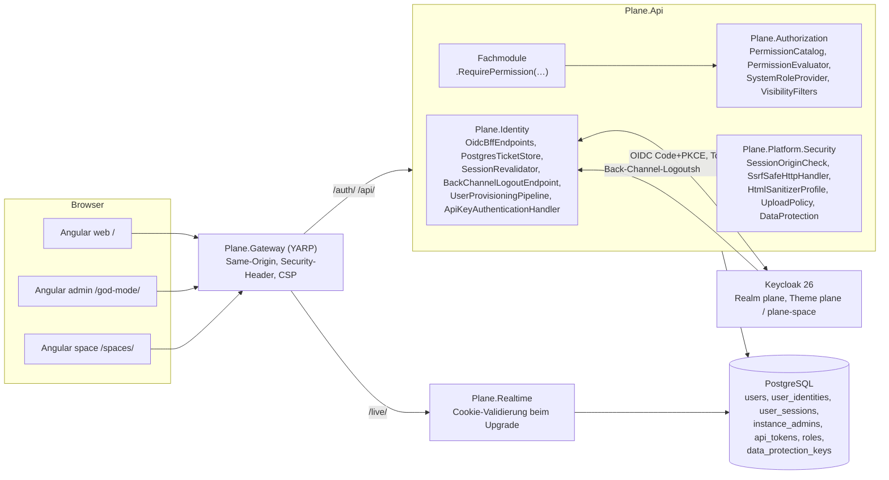
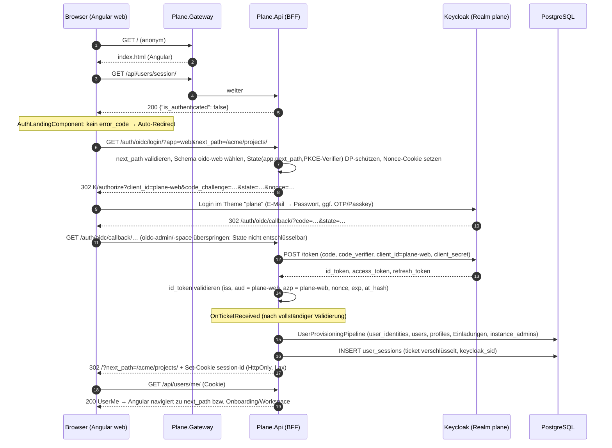
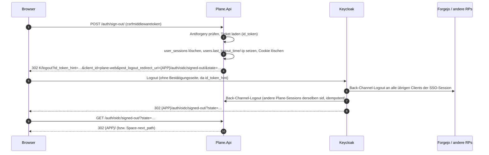

# 05 – Authentifizierung, Sicherheit und Berechtigungen (D05)

> **Status:** verbindliches Fachdokument der Zielarchitektur (Rang: `00-grundsatzentscheidungen.md` > `01-zielarchitektur-und-tech-stack.md` > **dieses Dokument** > eigene Präferenzen). Detailliert ADR-008 (Keycloak-only), ADR-017 (OIDC-BFF), ADR-018 (Keycloak als Autorisierungsserver), ADR-019 (Permission-Katalog), ADR-030 (HTML-Sanitizing) und ADR-034 (Rate Limiting) aus `01`.
> **Stand:** 23.10.2026. **Sprache:** Fließtext Deutsch, Bezeichner Englisch.
> **Repository:** Alle Zielpfade sind relativ zur Wurzel des neuen Repositories **`funk.`** (ADR-009). Der Verzeichnisbaum in `01` §5.1 ist dort noch mit dem Arbeitstitel `plane-net/` überschrieben; die Struktur unterhalb der Wurzel gilt unverändert (`src/…`, `frontend/…`, `deploy/…`, `tests/…`, `tools/…`).
> **Kürzel für das Original:** `API/` = `apps/api/plane/`, `AUTH/` = `apps/api/plane/authentication/`, `PERM/` = `apps/api/plane/app/permissions/`, `UT/` = `apps/api/plane/utils/`, `LIC/` = `apps/api/plane/license/`, `V/` = `apps/api/plane/app/views/`, `V1V/` = `apps/api/plane/api/views/`, `SPV/` = `apps/api/plane/space/views/`, `LICV/` = `apps/api/plane/license/api/views/`, `WEB/` = `apps/web/`, `SPC/` = `apps/space/`, `ADM/` = `apps/admin/`, `PKG/` = `packages/`. Analyse-Dokumente: `A03` = `migration/analysis/03-api-intern-workspace-projekt-user.md`, `A04` = `…/04-api-intern-arbeitsobjekte.md`, `A05` = `…/05-api-public-v1-space-instanz.md`, `A06` = `…/06-auth-sicherheit-querschnitt.md`, `A07` = `…/07-hintergrundjobs-mail-storage-webhooks.md`, `A08` = `…/08-frontend-web-architektur.md`, `A11` = `…/11-frontend-admin-space.md`, `A12` = `…/12-editor-echtzeit-live.md`. Paid-Dokumente: `F27` = `migration/features/27-paid-sicherheit-admin-lizenz.md`, `F30` = `migration/features/30-paid-auswahlliste.md`.
> **Maschinenlesbare Begleitdaten:** `migration/architecture/_data/05-permission-matrix.json` (Permission-Katalog + Endpunkt-Matrix, 672 Endpunkt-Methoden). Erzeugt aus dem Original-Code mit `migration/_werkzeuge/permission-matrix/` (AST-Extraktion von URL-Konfigurationen, Views, `permission_classes`, `get_permissions` und `@allow_permission`).

## Inhaltsverzeichnis

1. [Ziel & Scope](#1-ziel--scope)
2. [Entscheidungen (D05-ADR-01 ff.)](#2-entscheidungen-d05-adr-01-ff)
3. [Detaildesign](#3-detaildesign)
   - 3.1 Bausteine und Verantwortlichkeiten
   - 3.2 Endpunkte unter `/auth/` und Auth-Endpunkte der Instanz-API
   - 3.3 Anmeldung (Authorization Code + PKCE über das BFF)
   - 3.4 Sessions und Cookies
   - 3.5 CSRF und Same-Origin-Prüfung
   - 3.6 Abmeldung: RP-initiated Logout und Back-Channel-Logout
   - 3.7 Just-in-time-Provisionierung und Einladungen
   - 3.8 Instanz-Admin per Keycloak-Rolle und optionaler Step-up
   - 3.9 Erst-Einrichtung der Instanz ohne Admin-Konto
   - 3.10 Deaktivierte und gesperrte Konten
   - 3.11 Authentisierung von Realtime (Hocuspocus-WebSocket, SignalR)
   - 3.12 API-Keys (`X-Api-Key`) und Authentifizierungs-Schemata
   - 3.13 Autorisierung: Permission-Katalog, Evaluator, Regeln, Policies
   - 3.14 Gast-Sichtbarkeit (`guest_view_all_features`)
   - 3.15 Keycloak-Realm als Code
   - 3.16 Plane-Login-Theme (1:1-Optik der Sign-in-Seite)
   - 3.17 Sicherheitsmechanismen (CORS, SSRF, Sanitizing, Upload, Secrets, Rate Limits, Header, Logging)
   - 3.18 Korrektur der dokumentierten Sicherheitslücken des Originals
4. [Mapping-Tabellen Original → Ziel](#4-mapping-tabellen-original--ziel)
5. [Code-Skelette](#5-code-skelette)
6. [Erweiterungspunkte für Bezahl-Pakete](#6-erweiterungspunkte-für-bezahl-pakete)
7. [Akzeptanzkriterien & Tests](#7-akzeptanzkriterien--tests)
8. [Risiken & offene Punkte](#8-risiken--offene-punkte)
9. [Abhängigkeiten zu anderen Dokumenten (02–16)](#9-abhängigkeiten-zu-anderen-dokumenten-0216)
- [Anhang A – Permission-Katalog (vollständig, 258 Keys)](#anhang-a--permission-katalog-vollständig-258-keys)
- [Anhang B – Endpunkt-×-Rollen-Matrix (vollständig, 672 Endpunkt-Methoden)](#anhang-b--endpunkt--rollen-matrix-vollständig-672-endpunkt-methoden)

---

## 1. Ziel & Scope

### 1.1 Ziel

Dieses Dokument legt fest, **wer sich wie anmeldet** (ausschließlich Keycloak per OIDC, ADR-008), **wie eine Anmeldung in eine Plane-Session übersetzt wird** (Backend-for-Frontend in `Plane.Api`, serverseitige Session, HttpOnly-Cookie), **wer was darf** (Permission-Katalog aus dem Original-Code, System-Rollen Admin 20 / Member 15 / Guest 5, Gast-Sichtbarkeit) und **welche Sicherheitsmechanismen** die Plattform querschnittlich bereitstellt (CORS, CSRF, SSRF, Sanitizing, Uploads, Secrets, Rate Limits, Header). Es ist für Implementierungs-Agenten direkt umsetzbar: jede Klasse hat einen Ort in `funk.`, jede Regel eine Quelle im Original und ein Akzeptanzkriterium.

### 1.2 Im Scope

| Bereich | Inhalt | CE-IDs (Kern) |
|---|---|---|
| Anmeldung | OIDC Authorization Code + PKCE für `web`, `admin` (God Mode), `space`; BFF-Endpunkte unter `/auth/`; Fehlercodes; `next_path` | CE-AUTH-001, -014, -016, -023, -029 |
| Session | Cookie `session-id`, `user_sessions`, Laufzeiten, Revalidierung, Bereinigung, Session-Status-Endpunkte | CE-AUTH-024, -025 |
| Abmeldung | `POST /auth/sign-out/` (+ Space/Admin-Aliase), RP-initiated Logout, Back-Channel-Logout | CE-AUTH-022, CE-INST-008 |
| Benutzer | JIT-Provisionierung aus Claims, Avatar-Übernahme (SSRF-sicher), Einladungszuordnung, Onboarding-Weiterleitung, deaktivierte Konten | CE-AUTH-012, -027, -028, -030, CE-PROF-004, -005 |
| Instanz | Instanz-Admin aus Keycloak-Rolle, Erst-Einrichtung ohne Admin-Konto, Admin-Liste als Spiegel | CE-INST-004, -006 |
| Space | anonymes Lesen, Login für Kommentare/Reaktionen/Votes | CE-SPACE-012…014, -025…028 |
| Maschinenzugriff | API-Keys `X-Api-Key`, Rate-Limit je Key, Bearer-Schema vorkonfiguriert (aus) | CE-API-001…003, CE-WH-012…014 |
| Autorisierung | Permission-Katalog (258 Keys), Endpunkt-Matrix (672 Methoden), Evaluator, Regeln, Gast-Sichtbarkeit, Frontend-Fassade | CE-WS-008 (Gast-Regel) und alle Endpunkte |
| Keycloak | Realm als Code (Clients, Scopes, Rollen, Gruppen, Mapper, Flows, Policies, Testbenutzer), Login-Theme `plane`/`plane-space` | ADR-008 |
| Sicherheit | CORS, CSRF/Origin, SSRF-Client, HTML-Sanitizing, Upload-Validierung, Data-Protection-Key-Ring, Rate Limiting, Security-Header/CSP, Log-Redaktion, Korrektur der Original-Lücken | CE-AUTH-026, CE-WH-011, CE-OPS (Sicherheitsteile) |

### 1.3 Nicht im Scope

- Fachliches Design von Bezahl-Paketen (E1–E8, H1–H4 …). Es gibt nur die Andockstellen in §6.
- Endpunktkatalog aller Fach-APIs (→ `04-api-design-und-endpunktkatalog.md`); dieses Dokument liefert **je Endpunkt die Berechtigung** (Anhang B), nicht Request/Response-Formen.
- Ablauf der Webhook-Zustellung und E-Mail-Jobs (→ `06-hintergrundjobs-events-benachrichtigungen.md`); hier nur SSRF-Schutz und Signatur.
- Infrastruktur-Details von Keycloak-Betrieb (HA, Backup, TLS) (→ `14-infrastruktur-deployment-betrieb.md`); hier nur die Realm-Konfiguration als Code.

### 1.4 Was wird in welchem Inkrement gebraucht

| Inkrement (aus `01` §1.3) | Bausteine dieses Dokuments, die **fertig** sein müssen | Abnahme (Kurz, Details §7) |
|---|---|---|
| **I0 Walking Skeleton** | Realm-Import Dev/Test (§3.15), Login-Theme Grundform E-Mail-/Passwort-Schritt (§3.16), BFF-Endpunkte `/auth/oidc/login/`, `/auth/oidc/callback/`, `/auth/sign-out/`, `/auth/oidc/signed-out/`, `/auth/oidc/backchannel-logout/`, `/auth/get-csrf-token/` (§3.2), `user_sessions` + `PostgresTicketStore` (§3.4), Origin-Check (§3.5), JIT-Pipeline mit Schritten Identität/Benutzer/Profil (§3.7), Instanz-Admin-Rolle + Erst-Einrichtung (§3.8/§3.9), Policy-Scheme `Plane` mit `Session`/`ApiKey`/`Bearer`(aus) (§3.12), Permission-Katalog-Gerüst + Evaluator + Architekturtest „jede Route hat genau eine Permission“ (§3.13) mit den Keys für Workspace anlegen/lesen und Projekt anlegen/lesen, Frontend-Fassade `PermissionService` (§3.13.8), Security-Header + CSP Report-Only im Gateway (§3.17.7), Data-Protection-Key-Ring (§3.17.5) | Spike **S7** grün; Login web/admin/space; Back-Channel-Logout < 2 s; JIT; Rolle → God Mode |
| **I1 Workspace, Projekte, Konto** | Einladungs-Zuordnung + Auto-Join (§3.7.5), Signup-Gate (§3.7.6), Konto deaktivieren (§3.10), Profil-Security-Tab → Keycloak-Konto (§4.1, §4.7), Rate-Limit-Policies (§3.17.6), alle Keys `workspace.*`, `project.*` (Mitglieder, Einladungen, States, Labels, Estimates, Präferenzen, Favoriten), SSRF-Client für Avatar-Download (§3.17.2), Upload-Validierung Avatar/Cover/Logo (§3.17.4), Theme vollständig inkl. Reset-Password/Update-Password/OTP/Passkey-Seiten und i18n | Permission-Matrix-Test für alle I1-Endpunkte grün |
| **I2 Work Items & Layouts** | Keys `project.work_item*`, `project.reaction.*`, Regeln `C:` (Ersteller), `VIS` (Gast-Sichtbarkeit) mit `IVisibilityFilter<WorkItem>`, HTML-Sanitizer (§3.17.3), Anhang-Upload-Validierung | Gast-Sichtbarkeits-Tests (§7) |
| **I3 Planung** | Keys `project.cycle*`, `project.module*`, `project.intake*`, `project.view*`, `workspace.view*` | Matrix-Test |
| **I4 Pages & Realtime** | `PAGE`-Regel (§3.13.5), WebSocket-Auth + Origin-Prüfung (§3.11), Keys `project.page*` | Realtime-Auth-Tests (§7) |
| **I5 Überblick** | Keys `workspace.notification.*`, `workspace.search.read`, `workspace.analytics.*`, SignalR-Gruppen-Autorisierung | Matrix-Test |
| **I6 Außenwirkung & Administration** | God Mode vollständig (Admin-Spiegel, Authentication-Seite „Keycloak“), Space-Login + `BOARD`-Regel, API-Keys (Hash-Speicherung, Rate-Limit, Activity-Log), Public-API-Harmonisierung (HARM-xx), Webhook-SSRF + Signatur | API-Key-Contract-Tests, SSRF-Testkorpus |
| **I7 Härtung & Betrieb** | CSP **enforce**, Keycloak-Prod-Konfiguration per `keycloak-config-cli`, Sicherheitstests (ZAP-Baseline, Pen-Test-Checkliste §7.5), Airgap-Theme-Prüfung | Sicherheits-Abnahme |
| **W1 (F1/F2/H1/H6)** | Bearer-Schema aktivieren (H1), Forgejo-SSO-Client (F2), Andockstellen §6 | – (Detailplanung kurz vor W1) |
| **W4 (E3/E5)** | `IRoleDefinitionProvider`-Tausch, `groups`-Claim-Auswertung | – (Detailplanung kurz vor W4) |

---

## 2. Entscheidungen (D05-ADR-01 ff.)

Jede Entscheidung konkretisiert eine ADR aus `00`/`01`; Abweichungen von `01` gibt es nicht. Wo `01` offen war (O-06, O-08), ist die Auflösung vermerkt.

| ADR | Entscheidung | Alternativen (verworfen) | Begründung | ab |
|---|---|---|---|---|
| **D05-ADR-01** | **Drei OIDC-Schemata, drei Keycloak-Clients, ein Callback-Pfad.** `Plane.Api` registriert je App ein Schema `oidc-web`, `oidc-admin`, `oidc-space` (`Microsoft.AspNetCore.Authentication.OpenIdConnect`) mit fester `ClientId`/`ClientSecret` (`plane-web`, `plane-admin`, `plane-space`), **identischem** `CallbackPath=/auth/oidc/callback` (ohne Slash, weil `TrailingSlashMiddleware` den Slash vor dem Routing entfernt, D02-ADR-07; die an Keycloak gesendete und dort registrierte `redirect_uri` bleibt `…/auth/oidc/callback/`) und `SkipUnrecognizedRequests=true`. Der State jedes Schemas ist mit einem **schemaeigenen** Data-Protection-Zweck geschützt (`Plane.Identity.OidcState.v1.<scheme>`); ein Handler, der den State nicht entschlüsseln kann, überspringt die Anfrage (`HandleRequestResult.SkipHandler()`), sodass genau das Schema des Logins den Callback verarbeitet. Die App (`web`, `admin`, `space`) wird beim Login als Query-Parameter `app` übergeben und wählt das Schema. Confidential Clients, PKCE `S256` Pflicht (`pkce.code.challenge.method=S256`). Auflösung **O-06**: je App ein Client (eigene Login-Theme-Variante, eigene Redirect-Regeln), eine gemeinsame Plane-Session. | (a) **ein** Schema mit je Request umgeschriebener `client_id` (ursprünglicher D05-Entwurf, verworfen im Review: `OpenIdConnectProtocolValidator.ValidateIdToken` vergleicht das Keycloak-`azp` mit `Options.ClientId` und wirft `IDX21340` für `plane-admin`/`plane-space`; Quelle `OpenIdConnectHandler.cs` release/10.0, `ClientId = Options.ClientId`); (b) drei Callback-Pfade `/auth/oidc/{app}/callback/` (widerspricht `01` §3.3, Realm-Änderung); (c) Public SPA-Client mit Token im Browser (verletzt ADR-008); (d) BFF im Gateway (YARP) – trennt Session-Logik vom Fachmodell `Plane.Identity` | Standardverhalten des Handlers ohne Eingriff in die Protokollvalidierung; ein Callback-Pfad im Realm, eine Session-Erzeugung, Theme-Varianten über Client-Zuordnung | I0 |
| **D05-ADR-02** | **Eine Session für alle drei Apps.** Cookie-Name aus `SESSION_COOKIE_NAME` (Default `session-id`), `HttpOnly`, `SameSite=Lax`, `Path=/`, `Domain=COOKIE_DOMAIN` (Default host-only), `Secure` nach der Original-Regel `_cookies_secure` (§3.4.3). Das separate Cookie `admin-session-id` entfällt (Folge ADR-008: kein separates God-Mode-Login); damit entfällt auch der Fehler E-08 (Teilstring `instances`). | getrennte Admin-Session (Original, 1 h) | Gleiche Site, gleiche Keycloak-Identität; Admin-Schutz über Rolle + optionalen Step-up (D05-ADR-11) | I0 |
| **D05-ADR-03** | **Serverseitige Session per `ITicketStore`.** Cookie-Schema `Session` (`02` §3.4.1 Schritt 10) mit `SessionStore = PostgresTicketStore` (Tabelle `user_sessions`). Der Browser erhält nur einen Data-Protection-geschützten Schlüssel; das `AuthenticationTicket` (Claims + `id_token` + `refresh_token`) liegt serialisiert und zusätzlich mit Zweck `Plane.Identity.SessionTicket.v1` verschlüsselt in PostgreSQL. **Absolute** Laufzeit `SESSION_COOKIE_AGE` (Default 604 800 s) wie Original; `SESSION_SAVE_EVERY_REQUEST=1` schaltet gleitende Laufzeit ein. Abgelaufene Zeilen löscht der Job `ExpiredSessionCleanupJob` stündlich (Korrektur E-18). | Session-Inhalt im Cookie (Größe, Sperrbarkeit); Redis-Sessions (zusätzliche Pflichtkomponente) | Sofortige Sperre durch Zeilenlöschung, `device_info` wie Original, Mehrinstanzfähigkeit über gemeinsamen Key-Ring | I0 |
| **D05-ADR-04** | **Plane-Session folgt der Keycloak-Session.** (1) Back-Channel-Logout (`POST /auth/oidc/backchannel-logout/`, OIDC Back-Channel Logout 1.0) löscht alle `user_sessions` mit passendem `keycloak_sid` (bzw. `sub`). (2) Zusätzlich **Revalidierung**: Ist `revalidated_at` älter als `Plane:Auth:RevalidateIntervalSeconds` (Default 300), tauscht `SessionRevalidator` beim nächsten Request den gespeicherten Refresh-Token; schlägt das fehl (`invalid_grant`: Session beendet, Benutzer gesperrt/deaktiviert), wird die Plane-Session gelöscht → 401. Neue Tokens aktualisieren Rollen/Gruppen im Ticket. | nur Back-Channel (verpasste Zustellung bei Netzwerkfehler bleibt unbemerkt); Token-Introspection (zusätzlicher Client mit Introspection-Recht) | Belt-and-braces gegen den S7-Abbruchgrund „Back-Channel unzuverlässig“; Rollenentzug wirkt spätestens nach 5 min | I0 |
| **D05-ADR-05** | **Abmeldung bleibt ein Formular-POST.** `POST /auth/sign-out/` (Formularfeld `csrfmiddlewaretoken`, Antiforgery) löscht die Plane-Session und leitet per 302 auf den Keycloak-`end_session_endpoint` mit `id_token_hint`, `client_id`, `post_logout_redirect_uri={APP}/auth/oidc/signed-out/` und `state` (geschütztes Ziel). Aliase mit identischem Handler: `POST /auth/spaces/sign-out/` (mit `next_path`), `POST /api/instances/admins/sign-out/` (Ziel `/god-mode/`). | GET-Logout (CSRF-anfällig); nur lokale Abmeldung (Keycloak-SSO bliebe aktiv, Forgejo ebenfalls) | Original-Frontend-Mechanik (verstecktes Formular) bleibt; vollständiges Single Logout | I0 |
| **D05-ADR-06** | **CSRF wie Original: Origin-Prüfung + Token nur für Formulare.** Für jede cookie-authentifizierte Anfrage mit unsicherer Methode prüft `OriginCheckMiddleware` (`02` §3.4.1 Schritt 11) den `Origin`-Header exakt nach `A06` §3.14.1 (fehlender `Origin` → erlaubt, `null` → abgelehnt, Schema ignoriert bei Host-Gleichheit, Allowlist aus Basis-URLs + `CORS_ALLOWED_ORIGINS` + `CSRF_TRUSTED_ORIGINS`); Ablehnung 403 `{"detail": "CSRF Failed: origin not allowed"}`. Zusätzlich wird bei fehlendem `Origin` `Sec-Fetch-Site: cross-site` abgelehnt (Härtung ohne Vertragsänderung). Antiforgery (Formularfeld `csrfmiddlewaretoken`, Header `X-CSRFToken`, Cookie `csrftoken`) gilt nur noch für `POST /auth/sign-out/` und Aliase; `GET /auth/get-csrf-token/` bleibt. Auflösung von **E-17/OP-02**: kein Token-CSRF mehr für JSON-Endpunkte. | Double-Submit-Token für alle XHR (Frontend-Vertragsänderung) | Parität, SameSite=Lax als zweite Linie | I0 |
| **D05-ADR-07** | **JIT-Provisionierung als Pipeline.** Nach **vollständiger** Protokollvalidierung (Signatur, `iss`, `aud`, `azp`, `nonce`, `at_hash` – im Handler-Ereignis `OnTicketReceived`, **nicht** `OnTokenValidated`, weil der Handler die `OpenIdConnectProtocolValidator`-Prüfung inkl. Nonce erst **nach** `TokenValidated` ausführt) läuft `UserProvisioningPipeline` mit geordneten `IUserProvisioningStep`-Implementierungen (CE: Identität → Benutzer → Profil/Avatar → Signup-Gate → Instanz-Admin-Spiegel → Einladungen → Onboarding-Ziel). Verknüpfung über `(issuer, subject)` in `user_identities`; E-Mail-Verknüpfung mit einem bestehenden, **unverknüpften** Konto nur bei `email_verified=true`; `email_verified=false` → kein Konto, Fehler 5124 `OAUTH_PROVIDER_UNVERIFIED_EMAIL`. | Verknüpfung nur über E-Mail (Takeover-Risiko, vgl. GHSA-7j95-vh8g-f365); Provisionierung über Keycloak-Event-Listener/SPI (Java-Code im Stack) | Andockstelle E3 (`01` §1.4), Takeover-Schutz | I0 (Kern), I1 (Einladungen) |
| **D05-ADR-08** | **Keycloak ist führend für E-Mail und Anmeldedaten.** `users.email` und `users.is_email_verified` werden bei **jedem** Login aus den Claims übernommen. Plane bietet keine eigene E-Mail-Änderung mehr (CE-PROF-004 **angepasst**: „Change email“ öffnet die Keycloak-Kontokonsole); Passwort, 2FA, Passkeys und Geräte verwaltet die Kontokonsole (Profil → Security). Namen und Avatar übernimmt Plane nur bei der Anlage, außer `Plane:Auth:SyncProfileOnLogin=true` (Nachfolger von `ENABLE_<PROVIDER>_SYNC`, CE-AUTH-012). | E-Mail-Änderung in Plane mit Rückschreiben nach Keycloak (Admin-API-Credentials in Plane) | Eine Quelle der Wahrheit; kein Admin-Token für Keycloak in Plane | I0/I1 |
| **D05-ADR-09** | **Instanz-Admin = Keycloak-Realm-Rolle.** Konfigurierbar `Plane:Auth:InstanceAdminRole` (Default `plane-instance-admin`, Claim `roles`) und optional `Plane:Auth:InstanceAdminGroup` (Claim `groups`, z. B. `/plane-instance-admins`). `PlanePrincipal.IsInstanceAdmin` entsteht ausschließlich aus dem Session-Ticket. Tabelle `instance_admins` ist nur **Spiegel** (bei jedem Login gepflegt) für `GET /api/instances/admins/` und die Workspace-Liste; `POST`/`DELETE /api/instances/admins/` entfallen (CE-INST-004 angepasst, O-11). | eigene Admin-Pflege in Plane (Doppelpflege, widerspricht ADR-008) | Rechteentzug in Keycloak wirkt ohne Plane-Aktion | I0 |
| **D05-ADR-10** | **Erst-Einrichtung ohne Admin-Konto.** `Plane.Migrator` legt die Instanz (`is_setup_done=false`) und die Default-Konfiguration an (Korrektur B-31). Der erste Keycloak-Benutzer mit Admin-Rolle sieht im God Mode das reduzierte Setup-Formular (Vorname, Nachname, E-Mail read-only, Firmenname, Telemetrie-Checkbox ohne Wirkung) und schließt es mit `POST /api/instances/admins/setup/` (JSON) atomar ab (Row-Lock, S-16). Den ersten Admin-Benutzer legt der Realm-Import (Dev/Test) bzw. `deploy/keycloak/config/10-plane-bootstrap-admin.json` (Prod, Variablen `PLANE_BOOTSTRAP_ADMIN_EMAIL`, `PLANE_BOOTSTRAP_ADMIN_PASSWORD`, Required Action `UPDATE_PASSWORD`) an. | Admin-Anlage per Plane-Formular mit Passwort (widerspricht ADR-008) | ADR-008, B-31 | I0 |
| **D05-ADR-11** | **Step-up für God Mode optional, Default aus** (ADR-009, O-08). `Plane:Auth:AdminStepUpMaxAgeSeconds` = 0 (aus). Bei > 0 verlangt `AdminStepUpFilter` auf allen `/api/instances/`-Endpunkten außer `GET /api/instances/` und `…/admins/session/` einen `auth_time`-Claim jünger als der Wert; sonst 401 `{"error_code": 5210, "error_message": "ADMIN_REAUTHENTICATION_REQUIRED"}` → Admin-App leitet zu `/auth/oidc/login/?app=admin&max_age=<n>&next_path=…`. | Pflicht-Step-up (widerspricht ADR-009) | – | I0 (Schalter), I6 (UI) |
| **D05-ADR-12** | **Signup-Gate bleibt als JIT-Regel.** `ENABLE_SIGNUP` (Instanz-Konfiguration, eindeutiger Default `"1"`, Korrektur E-03) entscheidet, ob ein **neuer** Plane-Benutzer ohne offene Workspace-/Projekt-Einladung angelegt wird; sonst 5015 `SIGNUP_DISABLED`. Instanz-Admins sind ausgenommen. Optional `Plane:Auth:RequiredRole` (Default leer): ohne diese Realm-Rolle kein Zugang (5015). Der God-Mode-Schalter „Allow anyone to sign up even without an invite“ bleibt auf der neuen Seite `/god-mode/authentication/` (Rest von CE-INST-020). | Signup-Steuerung ausschließlich in Keycloak (verliert die Plane-spezifische „nur mit Einladung“-Regel, wenn Keycloak mit Forgejo geteilt wird) | Keycloak-Benutzer ≠ Plane-Benutzer; Betreiber kann Plane auf Eingeladene begrenzen | I1 |
| **D05-ADR-13** | **Realm als Code, zwei Anwendungswege.** Dev/Test: `deploy/keycloak/realms/plane-realm.json` per Aspire `WithRealmImport` (`--import-realm`; bestehende Realms werden übersprungen). Prod/Upgrade: `deploy/keycloak/config/*.json` per **keycloak-config-cli** (adorsys, Apache-2.0) als idempotenter Init-Container `keycloak-config` (Aspire-Ressource im Profil `prodlike`, Compose-Service). Platzhalter `${VAR}` werden aus Umgebungsvariablen ersetzt (Keycloak-Import) bzw. per `import.var-substitution.enabled=true` (config-cli). Secrets nie im Repo. | nur `--import-realm` (keine Aktualisierung bestehender Realms); Terraform-Provider (zusätzliche Toolchain); Keycloak-Admin-API-Code in Plane | Reproduzierbar, upgrade-fähig, airgapped (Image gespiegelt) | I0 (Dev), I7 (Prod) |
| **D05-ADR-14** | **Eigenes FreeMarker-Login-Theme `plane`** (`parent=base`, volle Kontrolle über DOM) und Kind-Theme `plane-space`. Zwei-Schritt-Ablauf wie Original (E-Mail → Passwort) über einen eigenen Browser-Flow `plane-browser` mit **Username Form** + **Password Form**. CSS wird zur Build-Zeit mit Tailwind 4.1 aus den Template-Klassen erzeugt (`tools/keycloak-theme/`), Texte aus `packages/i18n` (alle Plane-Sprachen) generiert, Schrift Inter gebündelt. Fallback (S7): Keycloakify (MIT, Node nur im Build). | `keycloak.v2`-Theme anpassen (PatternFly-DOM, keine Pixelparität); Login-UI in Angular mit Keycloak-Direct-Grant (Passwort durch Plane, verletzt ADR-008) | ADR-005-Parität, Airgap | I0 (E-Mail/Passwort), I1 (alle Seiten) |
| **D05-ADR-15** | **Authentifizierungs-Schemata als Policy-Scheme `Plane`** nach Pfad: `/api/v1/` → `ApiKey` (Header `X-Api-Key`), bei aktiviertem H1 zusätzlich `Bearer` (Keycloak-JWT, Audience `plane-api`); alle anderen Pfade → `Session` (Cookie-Schema). Session-Cookies werden unter `/api/v1/` **nicht** akzeptiert (Original). `PlanePrincipal.Kind` = `User` / `ApiKey` / `App` / `Bot`. | ein Schema für alles (Cookie-Fallback auf v1 würde CSRF-Fläche öffnen) | Parität, H1-Andockstelle | I0 |
| **D05-ADR-16** | **API-Keys gehasht.** Format bleibt `plane_api_` + 32 Hex; gespeichert wird `token_hash = SHA-256(token)` (Hex) + `token_prefix` (erste 14 Zeichen) – Klartext nur einmal in der Create-Antwort (wie Original-UI, CE-WH-013); Lookup per Hash. Fehlerformen 1:1: ohne Header 401 `{"detail": "Authentication credentials were not provided."}`, ungültig/abgelaufen/inaktiv/Benutzer deaktiviert 403 `{"detail": "Given API token is not valid"}` (B-03 bewusst nicht geändert, Vertrag). `last_used` wird höchstens einmal pro 60 s geschrieben. Rate-Limit-Schlüssel = `token_hash`. | Klartext-Speicherung (Original) | Leak der DB kompromittiert keine Tokens | I6 |
| **D05-ADR-17** | **Autorisierung über einen aus dem Code abgeleiteten Permission-Katalog** (ADR-019): 258 Keys `<ebene>.<ressource>.<aktion>` (Anhang A), je Endpunkt-Methode genau eine Angabe `.RequirePermission(key, rules)` oder `.AllowAnonymous()` (Anhang B). System-Rollen (`roles`, `is_system=true`): Admin 20, Member 15, Guest 5 auf Workspace- und Projektebene; die Grant-Mengen entstehen aus der Matrix. **Regeln** sind deklarative Zusätze je Endpunkt: `C:<Model>` (Ersteller-Bypass), `OWN` (nur eigene Objekte), `SELF` (eigener Datensatz), `VIS` (Gast-Sichtbarkeit), `PAGE` (Page-Zugriff), `BOARD` (Deploy-Board-Schalter), `WSA\|PA` (Workspace-Admin **oder** Projekt-Admin ohne Mitgliedschaft). Jeder Key ist zusätzlich als ASP.NET-Policy `perm:<key>` registriert (für SignalR-Hubs und `[Authorize]`-Konsumenten). | ASP.NET-Policies je Rolle (`role >= 15`) | E5/B1 docken ohne Umbau an; Matrix-Test maschinell | I0 (Gerüst), je Inkrement die Keys |
| **D05-ADR-18** | **WS-Admin-Override einheitlich.** Ein aktiver Workspace-Admin, der aktives Mitglied eines Projekts ist (beliebige Rolle), gilt in diesem Projekt für **alle** Projekt-Permissions als Projekt-Admin. Original: nur bei `allow_permission`, `ProjectBasePermission`, `ProjectAdminPermission`; die übrigen Klassen (`ProjectEntityPermission`, `ProjectMemberPermission`, `ProjectLitePermission`) kennen den Override nicht. Das Frontend (`WEB/store/user/base-permissions.store.ts` `getProjectRole`) behandelt WS-Admins bereits überall als Projekt-Admin → serverseitige Angleichung (HARM-00). | exakte Nachbildung je Klasse | Ein Evaluator-Pfad, UI und API konsistent; keine Rechteausweitung über Workspace-Admin-Rechte hinaus | I0 |
| **D05-ADR-19** | **Public API v1 übernimmt die Rechte der App-API.** Wo v1 im Original **weiter** war als die App (Kommentare ändern/löschen durch Gäste, Stickies fremder Nutzer, Intake-Änderung, Anhänge ohne Mitgliedschaft …), gilt die App-Regel (Sicherheitskorrektur `SEC-xx`); wo v1 **enger** war, gilt ebenfalls die App-Regel (Harmonisierung `HARM-xx`), weil derselbe Benutzer die Aktion ohnehin über die App ausführen darf. Liste §3.18. | v1 1:1 (übernimmt Lücken B-05…B-07, B-18) | `A05` §3.26 Empfehlung, Parität der UI | I6 |
| **D05-ADR-20** | **401/403-Körper je Prüfmechanismus wie Original.** Anonym → 401 `{"detail": "Authentication credentials were not provided."}`; Keys mit Herkunft „Permission-Klasse“ → 403 `{"detail": "You do not have permission to perform this action."}`; Keys mit Herkunft `allow_permission` → 403 `{"error": "You don't have the required permissions."}`; Inline-Prüfungen behalten ihren Original-Text (z. B. `{"error": "You are not allowed to view this issue"}`). Die Herkunft steht je Endpunkt in Anhang B (Spalte „Original-Prüfung“: `WS(…)`/`PRJ(…)` = Klasse bzw. `PRJ⁺(…)`/`WS(…) ∨ Creator` = Decorator) und wird als `DenyStyle` (`Detail` = Permission-Klasse, `Error` = `allow_permission`; Begriff und Mechanik aus `02` D02-ADR-05) im `PermissionDescriptor` des Keys hinterlegt; weicht ein einzelner Endpunkt desselben Keys ab, überschreibt `.WithDenyStyle(...)` am Endpunkt. | ein einheitlicher 403-Körper (Frontend-Toasts ändern sich) | ADR-003/ADR-016 | I0 |
| **D05-ADR-21** | **Frontend ohne Tokens, Rechte über eine Fassade.** Angular hält keine Tokens; alle Aufrufe `withCredentials`. Rechte prüft ausschließlich `PermissionService.allowPermissions(roles, level, workspaceSlug?, projectId?, onAllowed?)` (Signatur 1:1 zu `WEB/store/user/base-permissions.store.ts`) hinter dem Token `PERMISSION_EVALUATOR` (`01` §6.4). 401 → `window.location.replace("/?next_path=" + encodeURIComponent(pathname))` wie `WEB/services/api.service.ts`. | Token im Browser; Permission-Keys im Frontend ab CE (E5 wäre nur Implementierungstausch) | ADR-008, E5-Fassade | I0 |
| **D05-ADR-22** | **WebSocket-Authentisierung über dieselbe Session + Origin-Allowlist.** `Plane.Realtime` validiert das Session-Cookie aus dem Upgrade-Request gegen `user_sessions` (gemeinsamer Key-Ring) und lehnt Upgrades mit nicht erlaubtem `Origin` ab (Schutz gegen Cross-Site-WebSocket-Hijacking, im Original nicht vorhanden). | Ticket-Token im Query-String | Gleiches Modell wie HTTP | I0 (Hub), I4 |
| **D05-ADR-23** | **Security-Header zentral im Gateway**, CSP ab I0 `Content-Security-Policy-Report-Only`, ab I7 erzwungen; `frame-ancestors 'none'` für Web/Admin, für Space-Boards einbettbar (CE-SPACE-029), Space-Startseite `SAMEORIGIN` (Original). | CSP sofort erzwingen (Risiko für Editor/Emoji-Assets ohne Messung) | Parität + Härtung messbar | I0 (Report-Only), I7 (Enforce) |
| **D05-ADR-24** | **Ein SSRF-sicherer HTTP-Client für alle ausgehenden Aufrufe an Nutzer-URLs** (`SsrfSafeHttpHandler` in `Plane.Platform.Security`): Webhooks, Link-Vorschau, Avatar-Download, Unsplash, LLM-Endpunkt (mit Allowlist für interne LLM-Hosts). Regeln S-01/S-02 1:1. Interne Ziele (Keycloak, Forgejo, Objektspeicher) laufen über eigene benannte Clients ohne diesen Handler. | Prüfung nur zur Speicherzeit (DNS-Rebinding) | Original-Schutz inkl. Advisories bleibt | I1 |
| **D05-ADR-25** | **Data-Protection-Key-Ring in PostgreSQL** (`data_protection_keys`, `PersistKeysToDbContext`), Anwendungsname `plane` (gemeinsam für Api, Realtime, Worker, Gateway), optional `ProtectKeysWithCertificate` (`Plane:DataProtection:CertificatePath`/`…Password`), Schlüsselrotation 90 Tage (Default). Zwecke: `Plane.Identity.SessionCookie.v1`, `Plane.Identity.SessionTicket.v1`, `Plane.Identity.OidcState.v1.<scheme>` (je OIDC-Schema eigener Zweck, D05-ADR-01), `Plane.Instance.Configuration.v1` (Ersatz Fernet), `Plane.Antiforgery`. `SECRET_KEY` wird nicht mehr benötigt (Startwarnung, wenn gesetzt). | Fernet-Nachbau mit `SECRET_KEY` | ADR-036 | I0 |
| **D05-ADR-26** | **Rate Limiting** mit `Microsoft.AspNetCore.RateLimiting`, Policies 1:1 zum Original (`authentication`, `anon`, `asset_duplicate`, `api_key` aus `PlaneRateLimitPolicies` in `02` §3.13, Gateway `static`), verteilter Zähler über Valkey wenn konfiguriert (ADR-034); Client-IP nur über `ForwardedHeaders` mit `KnownProxies`/`KnownIPNetworks` (`System.Net.IPNetwork`; `KnownNetworks` ist ab .NET 10 obsolet, Warnung `ASPDEPR005`) und `ForwardLimit=NUM_PROXIES` (Korrektur E-19). | Gateway-Limit allein | Parität, Brute-Force-Schutz bleibt neben Keycloak-Brute-Force-Detection | I1 |

---
## 3. Detaildesign

### 3.1 Bausteine und Verantwortlichkeiten



| Baustein (Pfad in `funk.`) | Verantwortung | Original |
|---|---|---|
| `src/modules/Identity/Plane.Identity/Authentication/` | OIDC-Konfiguration (`OidcOptionsSetup`), Login/Callback/Logout-Endpunkte (`Endpoints/Auth/OidcBffEndpoints.cs`), `PostgresTicketStore`, `SessionRevalidator`, `BackChannelLogoutEndpoint`, `SessionCookieSecurePolicy`, `NextPathValidator`, `AuthRedirectBuilder`, `ApiKeyAuthenticationHandler`, `PlanePrincipalFactory` | `AUTH/**`, `LICV/admin.py`, `API/api/middleware/api_authentication.py` |
| `src/modules/Identity/Plane.Identity/Provisioning/` | `UserProvisioningPipeline` + CE-Schritte (§3.7) | `AUTH/adapter/base.py`, `AUTH/utils/{login,user_auth_workflow,workspace_project_join,redirection_path}.py` |
| `src/modules/Identity/Plane.Identity.Contracts/` | `IUserProvisioningStep`, `ProvisioningContext`, `IdentityClaims`, `AuthErrorCodes`, `ISessionRevoker`, DTOs `UserSessionDto`, `ApiTokenDto` | – |
| `src/modules/Authorization/Plane.Authorization/` | `PermissionCatalog`, `PermissionEvaluator`, `SystemRoleProvider`, `MembershipCache`, Regel-Auswerter (`CreatorRule`, `OwnRule`, `SelfRule`, `PageAccessRule`, `BoardRule`, `WorkspaceAdminOrProjectAdminRule`), `GuestVisibilityFilter<T>`-Implementierungen, `InstanceAdminRequirementHandler` | `PERM/*.py`, `UT/permissions/*`, `LIC/api/permissions/instance.py`, Gast-Prädikate (`A06` §3.19.2) |
| `src/modules/Authorization/Plane.Authorization.Contracts/` | `Permission`, `PermissionRule`, `IPermissionEvaluator`, `IRoleDefinitionProvider`, `RoleDefinition`, `IVisibilityFilter<T>`, `SystemRoles`, `PermissionKeys` (Generator-Ausgabe aus Anhang A) | – |
| `src/modules/<M>/Plane.<M>.Contracts/Permissions/<M>Permissions.cs` | Katalog-Beiträge je Modul (Konstanten aus Anhang A, Spalte „C#-Konstante“) | – |
| `src/building-blocks/Plane.BuildingBlocks/Security/` | `PlanePrincipal`, `PrincipalRef`, `PrincipalKind`, `ICurrentActor` (R2-konform, ohne ASP.NET) | – |
| `src/building-blocks/Plane.BuildingBlocks.Web/Security/` | `RequirePermission(...)`-Erweiterungen, `PermissionEndpointFilter`, `DenyStyle`, `AuthSchemeSelector` (Policy-Scheme), `OriginCheckMiddleware`, `PlaneAntiforgeryOptions`, `PlaneRateLimitPolicies` (Namen und Mechanik aus `02` §3.4/§3.13; Ordner dort `Permissions/`, `Security/`, `RateLimiting/`) | `AUTH/session.py`, `AUTH/rate_limit.py`, `API/throttles/asset.py`, `API/api/rate_limit.py` |
| `src/platform/Plane.Platform.Security/` | `SsrfSafeHttpHandler`, `IpBlocklist`, `UrlSafety`, `HtmlSanitizerProfile`, `BinaryContentValidator`, `UploadPolicy`, `FileNameSanitizer`, `CsvInjectionGuard`, `DataProtectionSetup`, `SecretRedactor` | `UT/{ip_address,url_security,content_validator,path_validator,csv_utils,url}.py` |
| `src/hosts/Plane.Gateway/Security/` | `SecurityHeadersMiddleware`, `CspPolicyProvider`, Static-Rate-Limit | `apps/*/caddy/Caddyfile`, `SPC/app/root.tsx` Header |
| `src/hosts/Plane.Realtime/Security/` | `WebSocketOriginValidator`, `SessionTicketReader` | `apps/live/src/lib/auth.ts` |
| `deploy/keycloak/` | Realm-Dateien, Theme, config-cli-Konfiguration (§3.15/§3.16) | – |
| `frontend/libs/web/core/permissions/`, `frontend/libs/web/auth/`, `frontend/libs/admin/authentication/`, `frontend/libs/space/account/` | `PermissionService`, `AuthLandingComponent`, `AuthGuard`, `unauthorizedInterceptor`, `SignOutFormComponent`, Fehler-Banner-Mapping | `WEB/store/user/base-permissions.store.ts`, `WEB/components/auth-screens/*`, `WEB/components/account/auth-forms/*`, `WEB/helpers/authentication.helper.tsx`, `ADM/app/(all)/(home)/*`, `SPC/components/account/auth-forms/*` |

### 3.2 Endpunkte unter `/auth/` und Auth-Endpunkte der Instanz-API

Alle Routen akzeptieren Pfade mit und ohne abschließenden Slash (`01` §7.11). „Rate“ = Rate-Limit-Policy (§3.17.6).

| # | Methode | Pfad | Zweck | Auth | Rate | Erfolg | Fehler | Ersetzt (Original) |
|---|---|---|---|---|---|---|---|---|
| N-01 | GET | `/auth/oidc/login/` | Login starten. Query: `app` = `web`\|`admin`\|`space` (Default `web`), `next_path` (validiert §3.3.4), optional `prompt` (`login`\|`none`), `login_hint` (E-Mail, max. 254 Zeichen), `max_age` (Ganzzahl, nur `app=admin`), `ui_locales` (aus `localStorage.userLanguage`) | anonym oder angemeldet | `authentication` | 302 → Keycloak `authorization_endpoint` (mit `code_challenge`, `state`, `nonce`) | 302 `{BASE(app)}/?error_code=5900&error_message=RATE_LIMIT_EXCEEDED[&next_path=…]`; IdP nicht erreichbar → `…error_code=5201&error_message=IDENTITY_PROVIDER_UNAVAILABLE` | `/auth/sign-in/`, `/auth/sign-up/`, `/auth/magic-*`, `/auth/{google,github,gitlab,gitea}/`, Space-Pendants, `/api/instances/admins/sign-in/`, `/api/instances/admins/sign-up/` |
| N-02 | GET | `/auth/oidc/callback/` | Code einlösen (PKCE-Verifier), ID-Token validieren, JIT (§3.7), Session anlegen | anonym | `authentication` | 302 → Ziel (§3.3.5) | 302 `{BASE(app)}/?[next_path=…&]error_code=<code>&error_message=<KEY>` (Codes §4.3) | `/auth/*/callback/` |
| N-03 | POST | `/auth/sign-out/` | Abmelden (Web) | Session optional | – | 302 → Keycloak `end_session_endpoint` | ohne Session: 302 `{APP}/` | `/auth/sign-out/` |
| N-04 | POST | `/auth/spaces/sign-out/` | Abmelden (Space), Formularfeld `next_path` | Session optional | – | wie N-03, Ziel `{SPACE}{next_path}` | wie N-03, Ziel `{SPACE}` | `/auth/spaces/sign-out/` |
| N-05 | POST | `/api/instances/admins/sign-out/` | Abmelden (God Mode) | Session optional | – | wie N-03, Ziel `{ADMIN}` | wie N-03 | gleich |
| N-06 | GET | `/auth/oidc/signed-out/` | Rücksprung nach Keycloak-Logout; Query `state` (DP-geschützt: `app`, `next_path`) | anonym | `anon` | 302 → `{BASE(app)}{next_path}` | ungültiger `state` → 302 `{APP}/` | – (neu) |
| N-07 | POST | `/auth/oidc/backchannel-logout/` | Keycloak Back-Channel-Logout, Formularfeld `logout_token` | Logout-Token-Signatur | – | 200 (leer, `Cache-Control: no-store`) | 400 `{"error": "invalid_request"}` bei ungültigem Token | – (neu) |
| N-08 | GET | `/auth/get-csrf-token/` | Antiforgery-Token für Formular-POSTs | anonym | `anon` | 200 `{"csrf_token": "<token>"}` + Cookie `csrftoken` | – | gleich |
| N-09 | GET | `/api/users/session/` | Session-Status (Web/Space) | anonym | `anon` | 200 `{"is_authenticated": true, "user": UserMe}` / `{"is_authenticated": false}` | – | gleich (CE-AUTH-025) |
| N-10 | GET | `/api/instances/admins/session/` | Session-Status God Mode | anonym | `anon` | 200 `{"is_authenticated": true, "user": InstanceAdminMe}` nur wenn Instanz-Admin, sonst `{"is_authenticated": false}` | – | gleich |
| N-11 | GET | `/api/instances/admins/me/` | aktueller Instanz-Admin | `INST` | – | 200 `InstanceAdminMe` | 401/403 | gleich |
| N-12 | GET | `/api/instances/admins/` | Liste der Instanz-Admins (Spiegel) | `INST` | – | 200 `[InstanceAdmin]` (Felder wie Original + `"source": "keycloak"`) | 403 | gleich (CE-INST-004 angepasst) |
| N-13 | POST | `/api/instances/admins/setup/` | Erst-Einrichtung abschließen (JSON: `first_name`, `last_name`, `company_name`, `is_telemetry_enabled`) | `INST` | `authentication` | 200 `{"instance": Instance, "redirect": "/god-mode/general/"}` | 400 `{"error_code": 5150, "error_message": "ADMIN_ALREADY_EXIST"}` (bereits eingerichtet), 400 `{"error_code": 5155, "error_message": "REQUIRED_ADMIN_EMAIL_PASSWORD_FIRST_NAME"}` (Pflichtfelder) | `/api/instances/admins/sign-up/` (CE-INST-006 angepasst) |
| N-14 | – | `/auth/*` (alle übrigen 37 Original-Routen), `/api/instances/admins/sign-in/`, `/api/instances/admins/sign-up/`, `/api/instances/admins/sign-up-screen-visited/`, `POST`/`DELETE /api/instances/admins/[{pk}/]`, `/api/users/me/accounts/[{pk}/]`, `POST /api/users/me/email/generate-code/`, `PATCH /api/users/me/email/` | – | – | – | **nicht registriert** → 404 `{"error": "Page not found."}` | – | entfällt (ADR-008) |

`{APP}`, `{SPACE}`, `{ADMIN}` werden wie `base_host` (`A06` §3.1.1) aus `Plane:Urls:Web` (`WEB_URL`/`APP_BASE_URL`), `Plane:Urls:Space` (`SPACE_BASE_URL` + `SPACE_BASE_PATH`, Default `/spaces/`) und `Plane:Urls:Admin` (`ADMIN_BASE_URL` + `ADMIN_BASE_PATH`, Default `/god-mode/`) gebildet; doppelte Slashes werden normalisiert (Korrektur E-05). Implementierung: `AuthRedirectBuilder.BaseUrl(PlaneApp app)`.

### 3.3 Anmeldung (Authorization Code + PKCE über das BFF)

#### 3.3.1 Ablauf Web



#### 3.3.2 Unterschiede je App

| Aspekt | `web` | `admin` (God Mode) | `space` |
|---|---|---|---|
| Keycloak-Client | `plane-web` | `plane-admin` | `plane-space` |
| Login-Theme | `plane` | `plane` (Variante „admin“ über `client.clientId`, Überschrift „Manage your Plane instance“ / „Configure instance-wide settings to secure your instance“ aus `ADM/app/(all)/(home)/sign-in-form.tsx`) | `plane-space` |
| Einstieg (anonym, ohne `error_code`) | `/` → Auto-Redirect zu N-01 (`Plane:Auth:AutoRedirect=true`, Default) | `/god-mode/` → Auto-Redirect | `/spaces/` zeigt `AuthView` mit Button; Board-Seiten (`/spaces/issues/{anchor}`) bleiben anonym lesbar, „Sign in“-Links führen zu N-01 mit `next_path` = aktuelle Seite **inkl. Query** (Korrektur A11 3.27: Peek/Board-Parameter gingen verloren) |
| Erfolgsziel | `{APP}/?next_path=<validiert>` bzw. `{APP}/` (Original-Semantik, Frontend entscheidet über `get_redirection_path`-Äquivalent) | `{ADMIN}general/` bzw. `{ADMIN}` wenn `is_setup_done=false` (Setup-Formular) | `{SPACE}<next_path>` (validiert) bzw. `{SPACE}` |
| Voraussetzung | Instanz eingerichtet, sonst 5000 `INSTANCE_NOT_CONFIGURED` | Rolle `plane-instance-admin`, sonst 5175 `ADMIN_AUTHENTICATION_FAILED` | Instanz eingerichtet, sonst 5000 |
| Post-Login-Workflow (Einladungen) | ja | ja | ja (Original: nein; Harmonisierung, harmlos – nur bereits **angenommene** Einladungen) |
| Fehlerbanner | `WEB/helpers/authentication.helper.tsx` + neue Codes §4.3 | `ADM/app/(all)/(home)/auth-banner.tsx` (5150–5190 + 5175 + 5210) | `SPC/components/account/auth-forms/auth-banner.tsx` (2.21 in A11 + neue Codes) |

#### 3.3.3 OIDC-Parameter (verbindlich)

| Parameter | Wert |
|---|---|
| `response_type` | `code` |
| `scope` | `openid profile email plane-roles plane-groups` (`offline_access` **nicht**) |
| PKCE | `S256`, Verifier 32 Byte Zufall, Base64URL (43 Zeichen) – Handler-Default bei `UsePkce=true` (`OpenIdConnectHandler`: `new byte[32]` + `RandomNumberGenerator.Fill`) |
| `response_mode` | `query` |
| `nonce` | Handler-Default: zufälliger Nonce im Authorize-Request, Ablage im Nonce-Cookie `.plane.oidc.nonce.<hash>` (nicht im State); Prüfung durch `OpenIdConnectProtocolValidator` nach `TokenValidated` |
| Pushed Authorization Requests | aus (`PushedAuthorizationBehavior.Disable`); Option `Plane:Auth:Oidc:UsePar` |
| Token-Validierung | `ValidIssuer` = `Plane:Auth:Oidc:Authority` (öffentlicher Issuer); `ValidAudience` = Client-ID **des Schemas**; `azp` = Client-ID des Schemas (Standardprüfung des `OpenIdConnectProtocolValidator`, IDX21340); Clock-Skew 60 s; `RequireHttpsMetadata` = `Plane:Auth:Oidc:RequireHttpsMetadata` (Dev `false`); Discovery/JWKS/Token-Endpunkt über `Plane:Auth:Oidc:MetadataAddress` (optional, interne Adresse, z. B. `http://keycloak:8080/idp/realms/plane/.well-known/openid-configuration`, `14` §3.2.2) – Keycloak meldet dank `KC_HOSTNAME` + `KC_HOSTNAME_BACKCHANNEL_DYNAMIC=true` trotzdem den öffentlichen Issuer ⚠ S7 |
| Claims-Quelle | **nur ID-Token** (`GetClaimsFromUserInfoEndpoint=false`): alle benötigten Mapper schreiben in das ID-Token (`profile` inkl. Keycloak-Standard-Mapper `picture`, `email`, `basic`, `plane-roles`, `plane-groups`); damit entfallen ein Roundtrip und das Zusammenführen über `ClaimActions`. Default-`ClaimActions` des Handlers löschen nach der Validierung u. a. `iss`, `aud`, `azp`, `nonce`, `iat`, `exp` aus der Identität – `IdentityClaims.From` liest den Issuer daher aus `Claim.Issuer` des `sub`-Claims; `sid` und `auth_time` bleiben erhalten (nicht in der Löschliste, `OpenIdConnectOptions.cs` release/10.0) |
| `MapInboundClaims` | `false` (Claim-Namen wie Keycloak: `sub`, `email`, `email_verified`, `given_name`, `family_name`, `name`, `picture`, `preferred_username`, `locale`, `sid`, `roles`, `groups`, `auth_time`) |
| Correlation-/Nonce-Cookies | `.plane.oidc.correlation.<scheme>.*`, `.plane.oidc.nonce.*`: `SameSite=Lax` (genügt, weil Keycloak per Top-Level-GET mit `response_mode=query` zurückleitet), `Secure` wie Session-Cookie, `HttpOnly`, Lebensdauer 15 min (`RemoteAuthenticationTimeout`) |
| Discovery | `{Authority}/.well-known/openid-configuration`, Cache 24 h, Refresh bei Signaturfehler (`ConfigurationManager.RequestRefresh`) |
| Backchannel-HTTP | benannter Client `keycloak` mit Timeout 10 s (Korrektur E-24), eigene CA möglich (`Plane:Auth:Oidc:CaCertificatePath`) |
| Rate-Limit am Callback | im ersten Handler-Ereignis `OnMessageReceived` über `AuthCallbackRateLimiter` (§3.17.6), weil der Handler den Callback in `UseAuthentication` (Pipeline-Schritt 10 in `02` §3.4.1) beantwortet – **vor** `UseRateLimiter` (Schritt 13) |

#### 3.3.4 `next_path`-Validierung (1:1 zu `UT/path_validator.py`)

`NextPathValidator.Validate(string? value) → string` implementiert exakt `validate_next_path` (`A06` §3.1.2): leer/kein String → `""`; Länge > 500 → `""`; `\` und `\t\r\n` entfernen; bei Schema/Host nur Pfad behalten; muss mit `/` beginnen, nicht mit `//`, kein `..`; Verbotsmuster (case-insensitiv) `javascript:`, `data:`, `vbscript:`, `file:`, `ftp:`, `%2e%2e`, `%2f%2f`, `%5c%5c`, `<script`, `<iframe`, `<object`, `<embed`, `<form`, `onload=`, `onerror=`, `onclick=` → `""`. `AuthRedirectBuilder.SafeRedirect(baseUrl, nextPath, params)` bildet `get_safe_redirect_url` nach – **mit einer Korrektur**: `next_path` wird URL-kodiert angehängt (E-27); das Angular-Frontend liest den Wert mit `URLSearchParams` (dekodiert), das ist kompatibel. Erlaubte Hosts = Netlocs von `Plane:Urls:{Web,Admin,Space}`. Testvektoren: `T/unit/utils/test_path_validator.py` werden 1:1 nach `tests/modules/Plane.Identity.Tests/Unit/NextPathValidatorTests.cs` portiert.

#### 3.3.5 Zielermittlung nach dem Login

Das BFF leitet wie das Original **immer auf die App-Wurzel** mit `?next_path=` um (E-12 bleibt: Ziele ohne führenden `/` werden verworfen). Die Weiterleitung zu `onboarding`, `<slug>`, `invitations`, `create-workspace` erledigt das Angular-Frontend anhand von `GET /api/users/me/settings/` (CE-AUTH-029, Port von `get_redirection_path` in `UserSettingsQuery`). Der Gitea-Sonderweg (3.7.6 in A06) entfällt.

#### 3.3.6 Fehlerfälle im Callback

| Ursache | Erkennung | Redirect-Fehler |
|---|---|---|
| Keycloak liefert `error=…` (z. B. `access_denied`, `temporarily_unavailable`, `login_required` bei `prompt=none`) | `OnRemoteFailure` / `OnMessageReceived` | 5200 `OIDC_AUTHENTICATION_FAILED` (bei `login_required`: erneuter Redirect ohne `prompt`) |
| State nicht entschlüsselbar (manipuliert, Key-Ring-Wechsel, fremdes Schema) | alle drei Schemata überspringen (`SkipUnrecognizedRequests`) → Platzhalter-Endpunkt `GET /auth/oidc/callback` (§5.3) | 5200 (Ziel `{APP}/`, weil die App unbekannt ist) |
| State gültig, aber Correlation-Cookie fehlt bzw. > 15 min (`RemoteAuthenticationTimeout`) | `OnRemoteFailure` | 5200 |
| Token-Endpunkt/JWKS nicht erreichbar | `HttpRequestException` | 5201 `IDENTITY_PROVIDER_UNAVAILABLE` |
| `email_verified=false` | Pipeline-Schritt Identität | 5124 `OAUTH_PROVIDER_UNVERIFIED_EMAIL` (Original-Code, Text im Frontend ergänzt, OP-06) |
| E-Mail fehlt im Claim | dto. | 5010 `EMAIL_REQUIRED` |
| E-Mail gehört einem anderen, bereits verknüpften Plane-Benutzer | dto. | 5202 `IDENTITY_ALREADY_LINKED` |
| Bot-Benutzer | Pipeline-Schritt Benutzer | 5017 `BOT_USER_LOGIN_FORBIDDEN` |
| in Plane deaktiviert (`is_active=false` und `last_logout_time` gesetzt) | dto. | 5019 `USER_ACCOUNT_DEACTIVATED` (bei `app=admin`: 5190 `ADMIN_USER_DEACTIVATED`, Admin-Banner) |
| neuer Benutzer, Signup-Gate greift | Pipeline-Schritt Signup-Gate | 5015 `SIGNUP_DISABLED` |
| Instanz nicht eingerichtet (`web`/`space`) | Pipeline-Schritt Instanz | 5000 `INSTANCE_NOT_CONFIGURED` |
| `app=admin` ohne Admin-Rolle | dto. | 5175 `ADMIN_AUTHENTICATION_FAILED` |
| Rate-Limit | N-01: Policy `authentication`; N-02: `AuthCallbackRateLimiter` in `OnMessageReceived` | 5900 `RATE_LIMIT_EXCEEDED` |
| unerwartete Ausnahme in Pipeline/Session-Anlage | `try/catch` im Callback-Handler (Log Error, Kategorie `plane.authentication`) | 5999 `AUTHENTICATION_FAILED` (statt HTTP 500) |

Bei Fehlern **nach** erfolgreichem Token-Tausch wird keine Plane-Session angelegt; die Keycloak-SSO-Session bleibt bestehen (der Banner bietet „Sign in“ = N-01 mit `prompt=login`, damit ein anderes Konto gewählt werden kann).

### 3.4 Sessions und Cookies

#### 3.4.1 Tabelle `user_sessions` (Eigentümer `Identity`, Detail in `03-datenmodell-efcore.md`)

| Spalte | Typ | Inhalt |
|---|---|---|
| `id` | `varchar(64)` PK | Zufall 32 Byte, Base64URL (`RandomNumberGenerator`) – Schlüssel, den `ITicketStore.StoreAsync` liefert |
| `user_id` | `uuid` FK `users`, Index | Plane-Benutzer (Ersatz `sessions.user_id`) |
| `app` | `varchar(16)` | `web` \| `admin` \| `space` (App des Logins) |
| `keycloak_sid` | `varchar(128)`, Index | Claim `sid` (Back-Channel-Logout) |
| `keycloak_sub` | `varchar(255)`, Index | Claim `sub` (Back-Channel-Logout ohne `sid`) |
| `ticket` | `bytea` | `TicketSerializer`-Bytes, zusätzlich mit Zweck `Plane.Identity.SessionTicket.v1` geschützt |
| `device_info` | `jsonb` | `{"user_agent", "ip_address", "domain"}` wie Original (`A06` §3.1.4) |
| `auth_time` | `timestamptz` | Claim `auth_time` (Step-up) |
| `created_at`, `last_seen_at`, `revalidated_at`, `expires_at` | `timestamptz` | `last_seen_at` max. 1 Update/min; `expires_at` = `created_at + SESSION_COOKIE_AGE` (absolut) bzw. gleitend |

Indizes: `(user_id)`, `(keycloak_sid)`, `(keycloak_sub)`, `(expires_at)`. Kein Soft-Delete (harte Löschung = Sperre).

#### 3.4.2 Ticket-Inhalt (Claims im `ClaimsPrincipal`)

| Claim (Typ) | Quelle | Verwendung |
|---|---|---|
| `plane:uid` | `users.id` | `PlanePrincipal.UserId` |
| `plane:kind` | `User` | `PrincipalKind` |
| `plane:app` | State | Logout-Client, Redirects |
| `sub`, `sid`, `auth_time` | ID-Token | Back-Channel, Step-up |
| `email` | ID-Token/UserInfo | Anzeige/Logs (redigiert) |
| `roles` (mehrfach) | Mapper `plane-roles` | `IsInstanceAdmin`, `RequiredRole` |
| `groups` (mehrfach) | Mapper `plane-groups` | E3-Andockstelle (in CE nur gespeichert) |
| Token `id_token`, `refresh_token`, `expires_at` | Token-Antwort (`SaveTokens=true`) | RP-Logout, Revalidierung; **verlassen nie den Server** |

#### 3.4.3 Cookie-Attribute

| Cookie | Name | Attribute | Laufzeit |
|---|---|---|---|
| Session | `SESSION_COOKIE_NAME` (Default `session-id`) | `HttpOnly`, `SameSite=Lax`, `Path=/`, `Domain=COOKIE_DOMAIN` (leer = host-only), `Secure` = `SessionCookieSecurePolicy.Evaluate(WEB_URL, APP_BASE_URL, CORS_ALLOWED_ORIGINS)` – 1:1 `_cookies_secure` (`A06` §2.7; Tests `T/unit/settings/test_cookie_secure.py` portieren) | `Max-Age` = Rest bis `expires_at` |
| Antiforgery | `csrftoken` | `HttpOnly`, `SameSite=Lax`, `Secure` wie Session, `Domain=COOKIE_DOMAIN` | Sitzungsdauer des Browsers (Antiforgery-Default) |
| OIDC-Korrelation/Nonce | `.plane.oidc.*` | siehe §3.3.3 | 15 min |

Konfiguration (Optionsklasse `PlaneAuthOptions`, Abschnitt `Plane:Auth`, ENV-Aliasse aus `A06` §2.6):

| Option | ENV-Alias (Original) | Default |
|---|---|---|
| `SessionCookieName` | `SESSION_COOKIE_NAME` | `session-id` |
| `SessionLifetimeSeconds` | `SESSION_COOKIE_AGE` | `604800` |
| `SlidingSession` | `SESSION_SAVE_EVERY_REQUEST` (`"1"`) | `false` |
| `CookieDomain` | `COOKIE_DOMAIN` | leer |
| `RevalidateIntervalSeconds` | – | `300` |
| `RevalidateGraceSeconds` | – | `900` (maximale Dauer ohne erfolgreiche Revalidierung bei **nicht erreichbarem** Keycloak; `invalid_grant` beendet sofort) |
| `AdminStepUpMaxAgeSeconds` | – (Ersatz `ADMIN_SESSION_COOKIE_AGE`, wird ignoriert + Startwarnung) | `0` |
| `AutoRedirect` | – | `true` |
| `InstanceAdminRole` / `InstanceAdminGroup` | – | `plane-instance-admin` / leer |
| `RequiredRole` | – | leer |
| `SyncProfileOnLogin` | `ENABLE_GOOGLE_SYNC` u. a. (ignoriert) | `false` |
| `Oidc:Authority`, `Oidc:MetadataAddress`, `Oidc:RequireHttpsMetadata`, `Oidc:UsePar`, `Oidc:CaCertificatePath` | – | `…/realms/plane` (öffentlicher Issuer), leer (= aus Authority abgeleitet; Prod: interne Adresse, `14`), `true`, `false`, leer |
| `Clients:Web:{ClientId,ClientSecret}`, `Clients:Admin:{…}`, `Clients:Space:{…}` | – | `plane-web`/`plane-admin`/`plane-space`; Secrets aus Aspire-Parametern `oidc-web-secret`, `oidc-admin-secret`, `oidc-space-secret` (ENV `Plane__Auth__Clients__Web__ClientSecret` usw., Groß-/Kleinschreibung egal) |
| `Backend:{ClientId,ClientSecret}` | – | `plane-backend`, Parameter `oidc-backend-secret` (`IdpUserStateSyncJob`) |
| `Bearer:Enabled`, `Bearer:Audience` | – | `false`, `plane-api` (H1) |
| `Oidc:AccountConsoleUrl`, `Oidc:AccountConsolePaths:{Security,PersonalInfo}`, `Oidc:DisplayName` | – | `{Authority}/account/`, `account-security/signing-in` / `personal-info` (⚠ S7, O-D05-01), `Keycloak` |

Diese Optionsnamen sind **verbindlich** (D05 ist fachlicher Eigentümer von `PlaneAuthOptions`; `14` §3.2.2 hat die Feldnamen ausdrücklich an D05 delegiert). Abweichende Schreibweisen in anderen Dokumenten (`Plane:Auth:BearerEnabled` in `02`/`15`, `Plane__Auth__Oidc__ClientSecret` im AppHost-Skelett von `01` §3.4) sind an diese Namen anzugleichen (§9).

#### 3.4.4 Lebenszyklus

| Ereignis | Wirkung |
|---|---|
| Login (Callback) | neue Zeile; vorhandene Session desselben Browsers (Cookie) wird gelöscht (Session-Fixation-Schutz, entspricht `cycle_key`/`flush` in `A06` §3.1.4) |
| Request | `PostgresTicketStore.RetrieveAsync` (L1-Cache 30 s je Schlüssel im Prozess, invalidiert über Valkey-Kanal `plane:session:revoked`) → `SessionRevalidator` (§D05-ADR-04) → `last_seen_at` |
| Sliding aktiv | `expires_at` = jetzt + Laufzeit, Cookie neu |
| Abmelden (N-03…N-05) | Zeile löschen, Cookie löschen, Keycloak-Logout |
| Back-Channel-Logout | alle Zeilen mit `keycloak_sid` (bzw. `keycloak_sub`) löschen + Revoke-Nachricht |
| Konto in Plane deaktiviert (CE-PROF-005) | alle Zeilen des Benutzers löschen (`ISessionRevoker.RevokeAllAsync(userId)`) |
| Rollenänderung in Keycloak | wirksam bei nächster Revalidierung (≤ 300 s) oder sofort nach Keycloak-„Sign out all sessions“ |
| Ablauf | Request → 401 → Frontend → `/?next_path=` → Auto-Redirect → stilles Re-Login, solange die Keycloak-SSO-Session lebt (CE-AUTH-023) |
| Bereinigung | `ExpiredSessionCleanupJob` (Cron `17 * * * *` UTC) löscht `expires_at < now()` (E-18) |

### 3.5 CSRF und Same-Origin-Prüfung

| Prüfung | Gilt für | Regel | Fehler |
|---|---|---|---|
| `OriginCheckMiddleware` | Anfragen mit Schema `Session` und Methode ∉ {GET, HEAD, OPTIONS, TRACE}, alle Pfade (`/api/`, `/auth/`, `/api/public/`, `/api/instances/`) | `A06` §3.14.1 1:1; Allowlist = normalisierte Origins von `Plane:Urls:{Web,Admin,Space,Live}` ∪ `CORS_ALLOWED_ORIGINS` ∪ `CSRF_TRUSTED_ORIGINS`; zusätzlich: fehlt `Origin` und `Sec-Fetch-Site` = `cross-site` → ablehnen | 403 `{"detail": "CSRF Failed: origin not allowed"}` |
| Antiforgery | `POST /auth/sign-out/`, `/auth/spaces/sign-out/`, `/api/instances/admins/sign-out/` | Formularfeld `csrfmiddlewaretoken` oder Header `X-CSRFToken` passend zu Cookie `csrftoken` | 200 HTML `csrf_failure.html` 1:1 (`apps/api/templates/csrf_failure.html`, Button „Go to Home Page“ → `{APP}`; Original `render()` ohne Status = 200) (CE-AUTH-016). Mechanik: die drei Sign-out-Endpunkte tragen `.DisableAntiforgery()` und prüfen selbst mit `IAntiforgery.IsRequestValidAsync(http)` – die automatische Antiforgery-Middleware würde sonst 400 liefern |
| `SameSite=Lax` | Session-Cookie | zweite Linie | – |
| Back-Channel-Logout | N-07 | **ausgenommen** von Origin/Antiforgery (Server-zu-Server), geschützt über Logout-Token-Signatur | – |
| WebSocket-Upgrade | `/live/*` | `WebSocketOriginValidator`: `Origin` **muss** vorhanden und in der Allowlist sein | 403 vor Upgrade |

### 3.6 Abmeldung: RP-initiated Logout und Back-Channel-Logout



**Logout-Token-Validierung** (`BackChannelLogoutEndpoint`, OIDC Back-Channel Logout 1.0 §2.6): JWT-Signatur gegen JWKS der Discovery; `iss` = Authority; `aud` ∈ {`plane-web`, `plane-admin`, `plane-space`}; `iat` nicht älter als 5 min; `jti` vorhanden und nicht bereits verarbeitet (HybridCache 10 min, Replay-Schutz); `events` enthält `http://schemas.openid.net/event/backchannel-logout`; `sid` oder `sub` vorhanden; **kein** `nonce`. Danach `DELETE FROM user_sessions WHERE keycloak_sid = @sid` (bzw. `keycloak_sub = @sub`, wenn kein `sid`) und Revoke-Nachricht über Valkey (`plane:session:revoked`) an alle Instanzen (L1-Cache verwerfen, offene WebSockets und SignalR-Verbindungen dieser Sessions schließen; Close-Code 4401 für Hocuspocus). Antwort 200, `Cache-Control: no-store`. Messkriterium S7: Session-Ende < 2 s nach Logout in Keycloak.

Keycloak erreicht den Endpunkt über die **interne** Adresse (`backchannel.logout.url` je Client = `${PLANE_BACKCHANNEL_BASE_URL}/auth/oidc/backchannel-logout/`; Dev: Gateway-Endpunkt aus Sicht des Keycloak-Containers, z. B. `http://host.docker.internal:3000`, in Aspire per Endpoint-Referenz gesetzt; Risiko R-03).

### 3.7 Just-in-time-Provisionierung und Einladungen

#### 3.7.1 Datenmodell (Eigentümer `Identity`, Details in `03-…`)

| Tabelle | Neu/aus Original | Felder (Auth-relevant) |
|---|---|---|
| `users` | `User` (`A02a`) | `id`, `email` (unique, lowercase), `username` (`uuid4().hex` bei Anlage wie Original), `first_name`, `last_name`, `display_name` (aus E-Mail-Lokalteil wie `M/user.py`), `avatar`, `avatar_asset_id`, `is_active`, `is_bot`, `bot_type`, `is_email_verified`, `last_login_time`, `last_login_ip`, `last_login_uagent`, `last_login_medium` (neu immer `"oidc"`), `last_logout_time`, `last_logout_ip`, `last_active`, `user_timezone`. **Entfällt:** `password`, `is_password_autoset` (API liefert `is_password_autoset: false` als Konstante für Vertragskompatibilität), `token`, `token_updated_at` |
| `user_identities` | **neu** | `id`, `user_id` FK, `provider` (`keycloak`), `issuer`, `subject` (`sub`), `email_at_link`, `created_at`, `last_login_at`; unique `(issuer, subject)`; unique `(user_id, provider)` |
| `profiles` | `Profile` | unverändert (`is_onboarded`, `last_workspace_id`, `onboarding_step`, `company_name`, Theme, Sprache …) |
| `accounts` | `Account` | **entfällt** (CE-PROF-007) |
| `sessions` | `Session` | ersetzt durch `user_sessions` |

#### 3.7.2 Claims → Plane-Felder

| Claim | Keycloak-Quelle (Mapper §3.15.5) | Plane-Feld | Anlage | Folgelogin |
|---|---|---|---|---|
| `iss` + `sub` | Realm, Benutzer-ID (UUID) | `user_identities.(issuer, subject)` | ja | Schlüssel der Zuordnung |
| `email` | Benutzer-E-Mail | `users.email` (`Trim().ToLowerInvariant()`, Validierung wie `Adapter.sanitize_email`) | ja | **immer** synchronisiert; Konflikt → 5202 |
| `email_verified` | Benutzer | `users.is_email_verified` | ja (muss `true` sein) | synchronisiert; `false` → 5124 |
| `given_name` / `family_name` | Vor-/Nachname | `first_name` / `last_name` (`None` → `""`; URL-Verbot S-21: enthält der Name eine URL, wird er leer übernommen) | ja | nur bei `SyncProfileOnLogin` |
| `name`, `preferred_username` | – | nicht übernommen (`display_name` wie Original aus E-Mail) | – | – |
| `picture` | Benutzerattribut `picture` (IdP-Mapper bei Brokering) | `avatar` + `avatar_asset_id` (Download §3.17.2: SSRF-sicher, 10 s, max. 5 Redirects, ≤ `FILE_SIZE_LIMIT`, MIME ∈ {jpeg, png, gif, webp}, Upload als `FileAsset` `USER_AVATAR`) | ja | nur bei `SyncProfileOnLogin` |
| `locale` | Benutzerattribut `locale` | `profiles.language`, wenn Wert ∈ Plane-Sprachen | ja | nein |
| `roles` | Realm-Rollen | Ticket, `instance_admins`-Spiegel | – | – |
| `groups` | Gruppenmitgliedschaften | Ticket (E3) | – | – |

#### 3.7.3 Pipeline (CE-Schritte, Reihenfolge = `Order`)

| Order | Schritt (Klasse in `Plane.Identity/Provisioning/Steps/`) | Logik | Fehler | Original |
|---|---|---|---|---|
| 100 | `ValidateIdentityClaimsStep` | `email` vorhanden + gültig; `email_verified == true`; `RequiredRole` (falls gesetzt) vorhanden | 5010, 5005, 5124, 5015 | `sanitize_email`, S-06 |
| 200 | `ResolveInstanceStep` | Instanz laden; `app ≠ admin` und `is_setup_done=false` → Fehler; `app = admin` ohne Admin-Rolle → Fehler | 5000, 5175 | Instanz-Checks in allen Auth-Views |
| 300 | `LinkOrCreateUserStep` | (a) `user_identities` per `(iss, sub)` → Benutzer; (b) sonst Benutzer per E-Mail: existiert und **ohne** Identität → verknüpfen (nur `email_verified`), mit **anderer** Identität → 5202; (c) sonst `ctx.IsNewUser = true` (Anlage erst nach Signup-Gate) | 5202 | `complete_login_or_signup` |
| 350 | `AccountStateGuardStep` | `is_bot` → 5017; `is_active=false` und `last_logout_time != null` → 5019 (bei `app=admin` 5190); `is_active=false` und `last_logout_time == null` (vorprovisioniert, E3/SCIM) → aktivieren + Mail `user_activation_email` | 5017, 5019, 5190 | S-15, `A06` §3.17 |
| 400 | `SignupGateStep` | nur `IsNewUser`: `ENABLE_SIGNUP == "0"` und keine Einladung mit dieser E-Mail (`workspace_member_invites` beliebigen Status wie Original; **zusätzlich** `project_member_invites` und Ausnahme für Instanz-Admins – bewusste, nur rechteerweiternde Harmonisierung **HARM-AUTH-01**, weil Projekt-Einladungen und Admin-Konten im Original über andere Wege angelegt wurden) → 5015 | 5015 | `__check_signup` (`AUTH/adapter/base.py` Z. 99–117: nur `WorkspaceMemberInvite.objects.filter(email=…)`) |
| 500 | `CreateUserStep` | nur `IsNewUser`: `users` + `profiles` + `user_identities` anlegen (eine Transaktion), Avatar-Download als Job (`DownloadAvatarJob`, blockiert den Login nicht) | – | `complete_login_or_signup` |
| 550 | `SyncProfileStep` | E-Mail/`is_email_verified` immer; Namen/Avatar bei `SyncProfileOnLogin` | 5202 bei E-Mail-Kollision | `sync_user_data` |
| 600 | `UpdateLoginMetadataStep` | `last_login_time`, `last_login_ip` (Client-IP §3.17.6), `last_login_uagent`, `last_login_medium="oidc"`, `last_active`, `is_active=true` | – | `save_user_data` |
| 700 | `MirrorInstanceAdminStep` | Rolle/Gruppe vorhanden → `instance_admins` upsert (role 20, `source=keycloak`); fehlt → Zeile löschen | – | – (neu) |
| 800 | `JoinAcceptedInvitationsStep` | angenommene Workspace-Einladungen → `workspace_members` (Rolle aus Einladung); angenommene Projekt-Einladungen → `workspace_members` **und** `project_members` **mit `project_id`** (Korrektur E-02/OP-03), in beiden Fällen Rolle ∈ {5,15}, sonst 15, `created_by_id` = Einlader (1:1 `AUTH/utils/workspace_project_join.py`), Konflikte ignoriert (`ON CONFLICT DO NOTHING` wie `ignore_conflicts=True`); danach Einladungen löschen; Cache-Tags `workspace:{slug}:members` invalidieren | – | `post_user_auth_workflow` (CE-AUTH-028) |
| 900 | `ComputeLandingStep` | nur Logging/Telemetrie-frei: setzt `ctx.Landing` (für Tests); das Ziel bestimmt das Frontend (§3.3.5) | – | `get_redirection_path` |

Alle Schritte laufen in **einer** Datenbanktransaktion (`ModuleScope("Identity")`; Schreibzugriffe auf `workspace_members`/`project_members`/`instance_admins` erfolgen über die Contracts-Services der Eigentümer `Workspaces`, `Projects`, `Instance` – Regel R5 in `01`). E3 fügt später Schritte mit `Order` 750 (Gruppen-Sync) hinzu (§6).

#### 3.7.4 Edge-Cases

| Fall | Verhalten |
|---|---|
| Benutzer ändert E-Mail in Keycloak | Folgelogin synchronisiert `users.email`; offene Einladungen der **neuen** Adresse werden ab dann zugeordnet; Bestätigungsmails des Originals (`user_email_update_task`) entfallen (Keycloak verifiziert selbst, `verifyEmail=true`) |
| Gleiche E-Mail, neuer `sub` (Benutzer in Keycloak gelöscht und neu angelegt) | 5202; Auflösung durch Instanz-Admin per CLI `plane-cli identities relink --email <e> --subject <sub>` (§4.6) |
| Keycloak-Issuer ändert sich (Hostname-Umzug) | `user_identities.issuer` per CLI `plane-cli identities migrate-issuer --from <a> --to <b>` |
| Brokered Login (SAML/OIDC/LDAP in Keycloak, E1/E3/E4 durch Keycloak) | identisch; Betreiber setzt am IdP bzw. an der Federation `trustEmail=true`, sonst greift 5124 |
| Gleichzeitige Erstlogins derselben Person (zwei Tabs) | Unique-Constraints `(issuer, subject)` und `email`; zweiter Versuch fängt `DbUpdateException` und wiederholt Schritt 300 einmal |

#### 3.7.5 Einladungen (Zuordnung offener Einladungen, CE-AUTH-028)

- Offene Einladungen werden **über die E-Mail-Adresse** gefunden (`GET /api/users/me/workspaces/invitations/`, Schlüssel `user.invitation.read`, Regel `SELF` = `email == principal.email`; Korrektur Q-10: Projekt-Einladungen nur des URL-Workspaces).
- Einladungslink `/workspace-invitations/?invitation_id=…&email=…&slug=…`: anonym → `AuthLandingComponent` leitet zu N-01 mit `login_hint=<email>` und `next_path=/workspace-invitations/?…` (Theme füllt das E-Mail-Feld vor). Die Einladungs-Kopfzeile des Original-Login-Formulars („Join {workspace}“) kann das Keycloak-Theme nicht anzeigen (Keycloak kennt die Einladung nicht) – dokumentierte Abweichung DEV-UI-01 (§8).
- Annahme nur durch den Eingeladenen (S-24): Vergleich der Einladungs-E-Mail mit `principal.email` (Keycloak-verifiziert).

#### 3.7.6 Signup-Gate und Registrierung

Keycloak-Selbstregistrierung (`registrationAllowed`) ist im Realm **aus**; Betreiber können sie einschalten (Theme enthält `register.ftl`). Unabhängig davon entscheidet Plane per `ENABLE_SIGNUP`, ob ein Keycloak-Benutzer **Plane** ohne Einladung nutzen darf (D05-ADR-12). `GET /api/instances/` liefert `config.enable_signup` wie Original.

### 3.8 Instanz-Admin per Keycloak-Rolle und optionaler Step-up

| Element | Festlegung |
|---|---|
| Rolle | Realm-Rolle `plane-instance-admin` (Beschreibung „Plane God Mode administrator“); Composite: keine |
| Gruppe (optional) | `/plane-instance-admins` mit Rollenzuweisung `plane-instance-admin` (Realm-Import legt sie an); Betreiber pflegen Mitglieder in Keycloak bzw. per LDAP-Gruppen-Mapper |
| Auswertung | `PlanePrincipalFactory`: `IsInstanceAdmin = roles ∋ InstanceAdminRole ∨ groups ∋ InstanceAdminGroup`; `InstanceAdminRequirementHandler` prüft nur `IsInstanceAdmin` (Original zusätzlich `InstanceAdmin.role >= 15` – entfällt, Spiegel hat immer 20) |
| Wirkungszeit | Login, Revalidierung (≤ `RevalidateIntervalSeconds`), Back-Channel-Logout |
| Spiegel | `instance_admins(id, instance_id, user_id unique, role=20, source='keycloak', synced_at)`; Antwort `GET /api/instances/admins/` = Original-Form (`InstanceAdminSerializer`: `id`, `user_detail`, `role`, …) + `source` |
| Schutzregel Kontodeaktivierung | `DELETE /api/users/me/` für Instanz-Admins → 400 wie Original (Prüfung per `IsInstanceAdmin`) |
| God-Mode-Seite „Authentication“ (`/god-mode/authentication/`) | ersetzt CE-INST-020…024: Karte „Keycloak“ (Issuer, Realm, Status der Discovery, Link „Open Keycloak admin console“ → `{KeycloakBaseUrl}/admin/plane/console/`), Schalter „Allow anyone to sign up even without an invite“ (`ENABLE_SIGNUP`), Hinweistext „Instance admins, SSO, LDAP, 2FA and passkeys are managed in Keycloak.“ (neuer i18n-Schlüssel `admin.authentication.keycloak.*` in allen Locales) |
| Step-up | D05-ADR-11; Prüfung `AdminStepUpFilter` (Endpunktgruppe `MapInstanceApi`), `auth_time` aus Ticket |

### 3.9 Erst-Einrichtung der Instanz ohne Admin-Konto

```mermaid
sequenceDiagram
  autonumber
  participant OP as Betreiber
  participant KC as Keycloak
  participant MG as Plane.Migrator
  participant B as Browser (God Mode)
  participant A as Plane.Api
  MG->>A: (Start) Migrationen, Seeds, Instance(is_setup_done=false), Default-Konfiguration
  OP->>KC: Realm-Import bzw. keycloak-config (Bootstrap-Admin mit Rolle plane-instance-admin)
  B->>A: GET /god-mode/ → GET /api/instances/ (is_setup_done=false)
  B->>A: GET /auth/oidc/login/?app=admin
  A-->>B: … Keycloak-Login (UPDATE_PASSWORD beim ersten Login) …
  A-->>B: 302 /god-mode/ (Session, IsInstanceAdmin)
  B->>A: POST /api/instances/admins/setup/ {first_name,last_name,company_name,is_telemetry_enabled}
  A->>A: SELECT … FOR UPDATE instances; is_setup_done? → 400 5150
  A->>A: profiles.company_name, users.first/last_name, instance.instance_name=company_name, is_setup_done=true
  A-->>B: 200 {redirect:"/god-mode/general/"}
```

- **Web-App vor der Einrichtung:** `GET /api/instances/` liefert `is_setup_done=false` → Seite „Welcome to Plane“ mit Link zum God Mode (CE-INST-005, unverändert).
- **Setup-Formular** (`frontend/libs/admin/instance/setup-form/`): DOM 1:1 zu `ADM/components/instance/setup-form.tsx` ohne Passwort-/Bestätigungs-Felder; E-Mail-Feld `disabled` mit Wert aus Session; Vor-/Nachname vorbelegt aus Claims. Fehlerbanner jetzt wirksam (Korrektur des Original-Bugs „Codes als Namen verglichen“, A11 3.2 Punkt 6).
- **Telemetrie-Checkbox:** bleibt sichtbar (1:1), Wert wird in `instances.is_telemetry_enabled` gespeichert, ohne Export (ADR-004).
- **Kein Bootstrap-Admin vorhanden** (Betreiber hat keinen angelegt): God Mode zeigt nach Login ohne Rolle Banner 5175; Dokumentation in `14-…` beschreibt `kcadm.sh`-Befehl bzw. config-cli-Variablen.
- **CLI:** `plane-cli instance status` (zeigt `is_setup_done`, Anzahl Spiegel-Admins, Keycloak-Erreichbarkeit); `plane-cli instance reset-setup` (setzt `is_setup_done=false`, nur mit `--force`).

### 3.10 Deaktivierte und gesperrte Konten

| Szenario | Auslöser | Wirkung in Plane | Wirkung in Keycloak | Anmeldung danach |
|---|---|---|---|---|
| **Konto in Plane deaktivieren** (CE-PROF-005, `DELETE /api/users/me/`) | Benutzer selbst (nicht Instanz-Admin, sonst 400) | wie Original `A06` §3.17: Mitgliedschaften deaktivieren, Workspace-Einladungen der E-Mail löschen, Profil zurücksetzen, `is_active=false`, `last_logout_time/-ip`, alle `user_sessions` löschen, API-Tokens deaktivieren, Mail `user_deactivation_email`; **Passwort-Randomisierung entfällt**; Antwort 204, Frontend sendet danach `POST /auth/sign-out/` (RP-Logout) | unverändert (Konto bleibt; Sperre des Kontos selbst in Keycloak, ADR-008) | 5019 `USER_ACCOUNT_DEACTIVATED` (Banner) |
| **Reaktivierung** | Instanz-Admin | `plane-cli users activate <email>` (wie `activate_user`), später God-Mode-Benutzerverwaltung (E7) | – | normal |
| **Konto in Keycloak deaktiviert** (`enabled=false`) | Keycloak-Admin, LDAP-Sync | nächste Revalidierung: Refresh schlägt fehl → Session gelöscht → 401. API-Keys hängen nicht an einer Keycloak-Session; deshalb gleicht `IdpUserStateSyncJob` (Cron `*/15 * * * *`, Service-Account-Client `plane-backend` mit Realm-Management-Rolle `view-users`, §3.15.3) für alle Benutzer mit aktiven API-Tokens den Keycloak-Status `enabled` ab: gesperrt oder gelöscht → alle `api_tokens` des Benutzers `is_active=false`, Integration-Event `plane.identity.user_disabled_in_idp.v1`. Abschaltbar mit `Plane:Auth:IdpUserSync:Enabled=false` (dann wirkt die Sperre auf API-Keys erst nach manueller Deaktivierung in Plane) | Login unmöglich | Keycloak-Fehlerseite im Plane-Theme (`error.ftl`) |
| **Keycloak-Admin „Sign out“ / „Sign out all sessions“** | Keycloak | Back-Channel-Logout → Sessions gelöscht (< 2 s) | Sessions beendet | stilles Re-Login unmöglich, Login-Seite |
| **Konto in Keycloak gelöscht** | Keycloak-Admin | wie deaktiviert; `user_identities` bleibt (Historie) | – | neues Konto gleicher E-Mail → 5202 bis `identities relink` |
| **Bot-Benutzer** | – | Bots haben keine Identität; jede Verknüpfung → 5017 | – | – |
| **Brute-Force** | Fehlversuche | – | Brute-Force-Detection (§3.15.2) + Plane-Rate-Limit `authentication` auf N-01/N-02 | temporäre Sperre |

### 3.11 Authentisierung von Realtime (Hocuspocus-WebSocket, SignalR)

- **Upgrade-Request** an `/live/collaboration` bzw. `/live/events/` trägt das Session-Cookie (same-origin über das Gateway). `Plane.Realtime` registriert dasselbe Cookie-Schema mit `PostgresTicketStore` (gemeinsamer Key-Ring, Anwendungsname `plane`) – keine HTTP-Rundreise zur API (Original: Cookie-Weitergabe an `GET /api/users/me/`, `A12`).
- **Origin-Pflicht** (D05-ADR-22) vor dem Upgrade; fehlt `Origin` → 403.
- **Hocuspocus-`token`** (`{id, cookie?}` aus `LIVE/lib/auth.ts`) wird nur noch gegen `principal.UserId` verglichen; Abweichung → `PermissionDenied` (Close-Code 4403).
- **Dokument-Autorisierung:** `IPageDocumentStore.LoadAsync` prüft `project.page.read` (+ `PAGE`-Regel) und liefert `read-write` nur bei `project.page.update`; sonst Scope `readonly` (`01` ADR-022).
- **Session-Widerruf:** Revoke-Nachricht (§3.6) schließt betroffene Verbindungen mit Close-Code 4401 (`Unauthorized`, `@hocuspocus/common` 2.15.2).
- **SignalR-Gruppen:** Beitritt `ws:{id}` erfordert `WS(A,M,G)`, `project:{id}` erfordert `PRJ(A,M,G)`, `user:{id}` nur eigene ID; Prüfung im Hub über `IPermissionEvaluator` (Keys `workspace.settings.read`, `project.project.read`), keine Client-gesteuerten Gruppennamen.

### 3.12 API-Keys (`X-Api-Key`) und Authentifizierungs-Schemata

#### 3.12.1 Schemata

| Schema | Klasse | Gilt für | Ergebnis `PlanePrincipal.Kind` |
|---|---|---|---|
| `Plane` (Policy-Scheme, Default) | `AuthSchemeSelector.ForwardDefaultSelector` | alle Pfade | leitet weiter |
| `Session` | `CookieAuthenticationHandler` + `PostgresTicketStore` + `PlaneCookieEvents` | alle Pfade außer `/api/v1/` | `User` |
| `oidc` | `OpenIdConnectHandler` | nur Challenge/Callback/Logout | – |
| `ApiKey` | `ApiKeyAuthenticationHandler` | `/api/v1/` | `ApiKey` (mit `UserId` des Besitzers) bzw. `Bot`, wenn `api_tokens.user_type=1` |
| `Bearer` | `JwtBearerHandler` (Authority = Keycloak, Audience `plane-api`) | `/api/v1/` **nur** bei `Plane:Auth:Bearer:Enabled=true` (Default `false`, H1) | `App` (Client-Credentials, `azp` = App-Client) bzw. `User` (Authorization Code mit Benutzer) |

Auswahlregel `/api/v1/`: Header `Authorization: Bearer …` und Bearer aktiviert → `Bearer`; sonst `ApiKey`. Kein Fallback auf Cookies (Original).

#### 3.12.2 API-Key-Prüfung (1:1 `A05` §2.1.2 mit D05-ADR-16)

1. Header `X-Api-Key` (case-insensitiv) fehlt → `NoResult` → `IsAuthenticated` scheitert → 401 `{"detail": "Authentication credentials were not provided."}`.
2. `token_hash = SHA256Hex(header)`; Lookup `api_tokens` mit `token_hash`, `is_active`, (`expired_at IS NULL OR expired_at > now()`), `users.is_active`; nicht gefunden → 403 `{"detail": "Given API token is not valid"}`.
3. `last_used` aktualisieren, wenn älter als 60 s (`ExecuteUpdate`, außerhalb der Fachtransaktion).
4. Principal: `UserId` = Besitzer, `Kind = ApiKey`, `ApiTokenId`; **workspaceübergreifend** wie Original (`api_tokens.workspace_id` bleibt ungenutzt; Workspace-Tokens sind Paket H3).
5. Rate-Limit-Policy `api_key` (Partition = `token_hash`), Header `X-RateLimit-Remaining`/`X-RateLimit-Reset` (Semantik `A05` §2.1.3, inkl. „Reset = jetzt + Fenster“), 429 ohne X-RateLimit-Header.
6. API-Activity-Log (`ApiActivityLogMiddleware`, CE-API-003): `token_identifier = token_hash` (statt HMAC mit `SECRET_KEY`), Header-Redaktion `x-api-key`, `authorization`, `cookie` → `[REDACTED]`, Body-Regeln wie `MW/logger.py`; asynchron über Job-Queue; Aufbewahrung `API_ACTIVITY_LOG_RETENTION_DAYS` (14).
7. v1-Einladungen und -Stickies erhalten ebenfalls das Rate-Limit (Korrektur B-04).

#### 3.12.3 Token-Verwaltung (CE-WH-012…014, `/api/users/api-tokens/`)

| Aktion | Verhalten |
|---|---|
| Anlegen `POST` | Token `plane_api_` + `Convert.ToHexString(RandomNumberGenerator.GetBytes(16)).ToLowerInvariant()`; Antwort 201 `APITokenSerializer`-Form **mit** `token` (einziges Mal); `expired_at` aus Original-Optionen |
| Liste/Detail `GET` | `APITokenReadSerializer`-Form (ohne `token`) + `is_active` berechnet |
| Ändern `PATCH` | nur `label`, `description`; Antwort **ohne** `token` (Korrektur Q-18) |
| Löschen `DELETE` | hart löschen |
| Permission | `user.api_token.*` mit `SELF` (nur eigene Tokens); `user_type=1` (Bot) nur über H1 |

### 3.13 Autorisierung: Permission-Katalog, Evaluator, Regeln, Policies

#### 3.13.1 Herleitung aus dem Code (Nachvollziehbarkeit)

Der Katalog ist **nicht erfunden**, sondern aus dem Original extrahiert (`migration/_werkzeuge/permission-matrix/`):

1. Alle URL-Konfigurationen (`API/app/urls/*.py` → `/api/`, `API/space/urls/*.py` → `/api/public/`, `API/api/urls/*.py` → `/api/v1/` inkl. der zwei `DefaultRouter`, `API/license/urls.py` → `/api/instances/`) werden per AST gelesen; je Route und HTTP-Methode wird die View-Klasse und Aktion bestimmt (`as_view({...})` bzw. die in der Klasse/Basisklasse definierten Methoden).
2. Je Methode wird die **Original-Prüfung** bestimmt: `permission_classes` (inkl. Vererbung), sieben `get_permissions`-Überschreibungen (`V/issue/subscriber.py`, `SPV/asset.py`, `SPV/issue.py`, `V1V/member.py`, `V1V/issue.py`, `V1V/state.py` ×2, `LICV/instance.py`) und `@allow_permission(...)` (Rollen, `level`, `creator`, `model`).
3. Die Methodenmatrix der Klassen (`A06` §2.10, `A03` §2.4.3) wird je HTTP-Methode in eine Anforderung übersetzt (`WS(A,M,G)`, `PRJ(A,M)`, `PRJ⁺(A)` = mit WS-Admin-Override, `PAGE(…)`, `INST`, `Auth`, `Anon`).
4. Jede Methode erhält einen semantischen **Permission-Key**; wo im Original für dieselbe Ressource/Aktion **unterschiedliche Rollenmengen** gelten (z. B. Cycle-Liste A/M/G, Cycle-Detail nur A/M), entstehen getrennte Keys (`project.cycle.read`, `project.cycle.read_detail`), damit die System-Rollen die Original-Rechte exakt abbilden.
5. Sicherheitskorrekturen und Harmonisierungen werden als explizite Overrides mit ID gesetzt (§3.18).

Ergebnis: **672 Endpunkt-Methoden**, davon **29 entfallen** (ADR-008, nicht erreichbare DRF-Default-Routen), **643 abgesichert** mit **258 Permission-Keys** (Anhang A), **0 Keys mit widersprüchlichen Rollenmengen** (maschinell geprüft). Sonderfall: `POST /api/instances/admins/sign-out/` zählt zu den 29 entfallenden Original-Prüfungen (Django-View mit wirkungsloser `permission_classes`, E-25), die **Route** bleibt aber als BFF-Alias N-05 (§3.2) mit `.AllowAnonymous()` + Antiforgery bestehen (Liste `BffAliasRoutes`, Ausnahme im Architekturtest 3, §3.13.7).

#### 3.13.2 Key-Schema und Notation

`<ebene>.<ressource>.<aktion>`:
- **Ebene**: `instance` | `workspace` | `project` | `user` (eigener Account, workspace-unabhängig) | `public` (Space/öffentliche Join-Links).
- **Ressource**: snake_case-Singular des Fachobjekts (`work_item`, `work_item_comment`, `cycle`, `member`, `invitation`, …).
- **Aktion**: `read`, `create`, `update`, `delete`, sowie fachliche Aktionen aus dem Original (`archive`, `unarchive`, `lock`, `unlock`, `change_access`, `favorite`, `read_favorites`, `read_archived`, `read_detail`, `read_basic`, `read_charts`, `read_points`, `read_summary`, `read_own`, `subscribe`, `manage`, `leave`, `convert`, `transfer`, `use`, `export`, `search`, `accept`, `respond`, `check_identifier`, `release_identifier`, `deactivate`, `read_static`).

Ziel-Prüfung in Anhang B: `LEVEL(Rollen)` + Regeln, z. B. `PRJ(A)+C:Issue` = „aktiver Projekt-Admin (inkl. WS-Admin-Override) **oder** Ersteller des Work Items (mit aktiver Projektmitgliedschaft)“.

| Notation | Bedeutung | Evaluator-Baustein |
|---|---|---|
| `WS(A,M,G)` | aktives (`is_active=true`, `deleted_at IS NULL`) Workspace-Mitglied (Workspace aus `{slug}` bzw. `workspace_id`) mit Rolle ∈ Menge | `WorkspaceRoleCheck` |
| `PRJ(A,M,G)` | aktives Projektmitglied des **URL-Projekts** (`{project_id}`, bzw. `{pk}` bei `projects/{pk}`, bzw. `project_identifier`) mit Rolle ∈ Menge; **WS-Admin-Override** einheitlich (D05-ADR-18) | `ProjectRoleCheck` |
| `WSA\|PA` | aktiver WS-Admin (auch **ohne** Projektmitgliedschaft) **oder** aktiver Projekt-Admin (`V/project/base.py` `partial_update`/`destroy`) | `WorkspaceAdminOrProjectAdminRule` |
| `INST` | `PlanePrincipal.IsInstanceAdmin` | `InstanceAdminRequirementHandler` |
| `AUTH` | angemeldet (Cookie/API-Key/Bearer) | – |
| `ANON` | auch anonym (`.AllowAnonymous()`) | – |
| `+C:<Model>` | Ersteller-Bypass: (1) aktives WS-Mitglied, (2) bei Projektebene aktives Projektmitglied – sonst **sofort** 403 –, (3) `created_by_id == principal.UserId` für `{pk}` → erlaubt; sonst Rollenprüfung (`A03` §2.4.2 Schritt 1) | `CreatorRule<TEntity>` |
| `+OWN` | Datensatz gehört dem Benutzer (`owned_by`, `receiver_id`, `created_by_id` je Ressource, siehe §3.13.6) – bei Listen als Query-Filter | `OwnRule`/`IOwnershipFilter<T>` |
| `+SELF` | Pfad/Datensatz betrifft den eigenen Benutzer bzw. die eigene Mitgliedschaft | `SelfRule` |
| `+VIS` | Gast-Sichtbarkeit (§3.14) als Query-Filter bzw. Objektprüfung | `IVisibilityFilter<T>` |
| `+PAGE` | Page-Zugriff (§3.13.5) | `PageAccessRule` |
| `+BOARD` | Deploy-Board existiert für `{anchor}` und der jeweilige Schalter ist aktiv (`is_comments_enabled`, `is_reactions_enabled`, `is_votes_enabled`, Intake) | `BoardRule` |
| `+PRJ-MEMBER` | zusätzlich aktive Projektmitgliedschaft des Body-Projekts (Projekt-Favorit) | `ProjectMembershipRule` |

#### 3.13.3 System-Rollen und Grants

`roles` (Eigentümer `Authorization`): `id`, `workspace_id` (NULL = System), `namespace` (`workspace`\|`project`\|`instance`), `slug`, `name`, `level` (20/15/5), `is_system`, `sort_order`. Seeds (feste UUIDv7-Konstanten in `SystemRoles`):

| Namespace | Slug | Name | `level` |
|---|---|---|---|
| `workspace` | `admin` | Admin | 20 |
| `workspace` | `member` | Member | 15 |
| `workspace` | `guest` | Guest | 5 |
| `project` | `admin` | Admin | 20 |
| `project` | `member` | Member | 15 |
| `project` | `guest` | Guest | 5 |

`workspace_members.role_id` / `project_members.role_id` referenzieren `roles`; die API liefert weiterhin `role: 20|15|5` (= `RoleDefinition.LegacyValue` = `roles.level`), Requests mit `role` werden auf die System-Rolle gleichen Levels abgebildet. Zusätzlich legt die CE die (leere) Tabelle `role_permissions(role_id, permission_key)` an (`02` §3.6.1, `16` E5); System-Rollen haben **keine** Zeilen darin, ihre Grants entstehen aus dem Code. Die integer-Spalte `role` in den Mitgliedschaftstabellen bleibt als **denormalisierte** Kopie von `roles.level` (PostgreSQL-Generated-Columns können keine andere Tabelle referenzieren); sie wird ausschließlich von `IWorkspaceMembershipService`/`IProjectMembershipService` im selben `SaveChanges` wie `role_id` gesetzt, ein Integritätstest (`MembershipRoleConsistencyTests`) prüft `role = roles.level` für alle Zeilen. `SystemRoleProvider` (CE-Implementierung von `IRoleDefinitionProvider`) liefert je System-Rolle die Grant-Menge = alle Keys aus Anhang A, deren Spalte für die Rolle „✓“ zeigt. Diese Menge wird **beim Build** aus `PermissionKeys.g.cs` (Generator-Ausgabe der Matrix-Datei) erzeugt; ein Test vergleicht sie mit `05-permission-matrix.json`.

#### 3.13.4 Evaluator-Algorithmus (`PermissionEvaluator.HasAsync`)

```text
eingabe: principal, permission(key, level), scope(workspaceId, projectId?), rules, routeValues
1. permission.level == ANON            → true
2. principal anonym                    → DENY_401
3. permission.level == AUTH            → regeln(SELF/OWN) prüfen → true/false
4. permission.level == INST            → principal.IsInstanceAdmin
5. ws := membership(principal, workspace) (aktiv, nicht gelöscht; MembershipCache je Request)
   ws == null                          → DENY
   wsRole := roles.Get(ws.RoleId)      (IRoleDefinitionProvider; CE: SystemRoleProvider)
6. falls Regel C:<Model> vorhanden:
     level == PRJ und prj(principal) == null → DENY      (Original: sofort 403)
     created_by(Model, routeValues.pk) == principal → ALLOW
7. level == WS:
     wsRole.PermissionKeys ∋ key → ALLOW
8. level == PRJ:
     prj := projectMembership(principal, project)
     prj == null:
        Regel WSA|PA und wsRole.PermissionKeys ∋ "workspace.admin_override" → ALLOW
        → DENY
     prjRole := roles.Get(prj.RoleId); prjRole.PermissionKeys ∋ key → ALLOW
     wsRole.PermissionKeys ∋ "workspace.admin_override" ∧ SystemRoles.ProjectAdmin.PermissionKeys ∋ key → ALLOW   (D05-ADR-18, Regel WorkspaceAdminOverride aus 02 §3.6.2 – hier auf ALLE PRJ-Deskriptoren angewendet)
9. Regel PAGE/BOARD/SELF/OWN als zusätzliche Objektprüfung (alle müssen erfüllt sein)
10. sonst DENY → 403 im DenyStyle des Keys bzw. Endpunkts
```

**Interner Key `workspace.admin_override`** (aus `02` §3.6.4, Grant nur `workspace.admin`): steuert den Override; er ist **kein** Endpunkt-Key (nicht unter den 258 aus Anhang A) und steht deshalb in `InternalPermissionKeys` (Ausnahme in Architekturtest 2). Damit prüft auch der Evaluator keine Rollenzahl (Architekturtest 4, `PLANE0001`), und E5 kann den Override Custom Roles geben.

**Namensabgleich mit `02` §3.6 (verbindlich, `02` ist Eigentümer der Mechanik):** Die Notation dieses Dokuments ist nur Kurzschrift; im Code gelten die Typen aus `02`: `+C:<Model>` = `PermissionRule.CreatorBypass(typeof(<Entity>), "pk", RequireMembership: true)`, Eigentümer-Bypass der Pages = `PermissionRule.OwnerBypass(typeof(Page), "page_id")`, `INST` = `PermissionRule.InstanceAdminOnly`, `AUTH` = `PermissionRule.AnyAuthenticated`, PRJ-Override = `PermissionRule.WorkspaceAdminOverride` (von `PermissionDescriptor.Project(...)` **standardmäßig** gesetzt, HARM-00); `OWN`, `SELF`, `VIS`, `PAGE`, `BOARD`, `WSA|PA`, `PRJ-MEMBER` ergänzen die Regelliste von `02` als `PermissionRule.Own`, `.Self`, `.GuestVisibility`, `.PageAccess`, `.Board`, `.WorkspaceAdminOrProjectAdmin`, `.ProjectMemberOfBody` (Nachtrag in `02`, §9). `RoleDefinition` hat die Form aus `02`: `RoleDefinition(Guid Id, string Name, ScopeLevel Scope, int LegacyValue, bool IsSystem, IReadOnlySet<string> PermissionKeys)`.

Der Evaluator läuft als `PermissionEndpointFilter` **vor** Model-Binding des Bodys (Original: DRF-Permission vor Serializer). `VIS`/`OWN` auf Listen wirken als Query-Filter im Handler (`IVisibilityFilter<T>`), nicht im Filter.

#### 3.13.5 Page-Zugriffsregel (`PAGE`, 1:1 `PERM/page.py`)

1. Rolle = aktive Projektrolle im URL-Projekt; keine → DENY.
2. Mit `{page_id}`: Page muss im Workspace liegen **und** eine aktive `project_pages`-Verknüpfung zum URL-Projekt haben (GHSA-g49r/GHSA-ghcr), sonst DENY.
3. `owned_by == principal` → ALLOW (vor allen weiteren Regeln).
4. Gast ohne `guest_view_all_features` → DENY.
5. Private Page (`access = 1`) → `IPageAccessExtension.HasPrivateAccessAsync(...)` – CE-Default `false` (Andockstelle D8 „Page-Sharing“).
6. Methodenregel = Rollenmenge des Keys: `project.page.read` A/M/G, `create`/`update`/`archive`/`lock`/`change_access` A/M, `delete`/`unarchive`/`unlock` nur A (Original: `DELETE` nur Admin; `unarchive`/`unlock` sind `DELETE`-Methoden auf `…/archive/` bzw. `…/lock/`).

#### 3.13.6 Eigentümer- und Self-Regeln je Ressource

| Ressource | `OWN`/`SELF`-Feld | Endpunkte |
|---|---|---|
| `sticky` | `created_by_id` | alle Sticky-Endpunkte (App und v1; Korrektur SEC-13) |
| `draft_work_item` | `created_by_id` | Liste, Detail, Ändern, Löschen (Korrektur SEC-15: Drafts strikt privat) |
| `notification` | `receiver_id` | Detail, Löschen |
| `favorite` (`user_favorites`) | `user_id` | Favoriten-Listen |
| `member_preference` | `member_id == principal` | `project-members/me`, Projekt-/Workspace-Präferenzen (Korrektur SEC-17) |
| `api_token` | `user_id` | alle Token-Endpunkte |
| `user_asset` | `created_by_id` / Benutzer-Asset | Avatar/Cover |
| `public.intake` | `created_by_id` | Space-Intake Liste/Detail/Ändern/Löschen (Korrektur SEC-18) |
| `public.asset` | Asset gehört eigenem Kommentar oder ist Beschreibungs-Asset des Boards | Space-Asset PATCH/DELETE/Restore (Korrektur SEC-19) |
| `user.invitation` | `email == principal.email` | eigene Einladungen |

#### 3.13.7 Endpunkt-Deklaration und Architekturtests

```csharp
g.MapPatch("{pk:guid}", UpdateWorkItem)
 .RequirePermission(WorkItemsPermissions.ProjectWorkItemUpdate, PermissionRule.CreatorBypass(typeof(WorkItem), "pk", RequireMembership: true))   // PRJ(A,M)+C:Issue
 .WithDenyStyle(DenyStyle.Error);                                                                       // {"error": "You don't have the required permissions."} (nur nötig, wenn vom Descriptor-Default abweichend)
```

Architekturtests (`tests/Plane.ArchitectureTests/AuthorizationRules.cs`):
1. Jede registrierte Route (alle `EndpointDataSource`s von Api/Realtime) trägt **genau eine** `PermissionMetadata` oder `AllowAnonymousAttribute`.
2. Jeder `PermissionKeys`-Eintrag wird von mindestens einem Endpunkt referenziert (keine toten Keys) oder ist in `ReservedPermissionKeys` (Paket-Vorhalt, §6.1) bzw. `InternalPermissionKeys` (`workspace.admin_override`, §3.13.4) gelistet.
3. Für jede Zeile aus `05-permission-matrix.json` mit `permission != null` existiert eine Route mit gleicher Methode, gleichem Pfad (Trailing-Slash-normalisiert) und gleichem Key; Zeilen mit `target = "entfällt"` haben **keine** Route – einzige Ausnahme sind die Einträge aus `BffAliasRoutes` (`POST /api/instances/admins/sign-out/`, N-05), die als anonyme Auth-Oberflächen-Route existieren müssen.
4. Rollenwerte (`20`, `15`, `5`) kommen außerhalb von `SystemRoles`/`SystemRoleProvider` nicht vor (Analyzer-Regel `PLANE0001`).

#### 3.13.8 Frontend (`frontend/libs/web/core/permissions/`)

| Element | Festlegung |
|---|---|
| `PermissionService` | Port von `BasePermissionStore` (`WEB/store/user/base-permissions.store.ts`): Signals `workspaceUserInfo`, `workspaceProjectsPermissions`; Methoden `getWorkspaceRoleByWorkspaceSlug`, `getProjectRoleByWorkspaceSlugAndProjectId` (WS-Admin → ADMIN, wie Original), `allowPermissions(...)`, `hasPageAccess(...)`, `fetchUserWorkspaceInfo`, `fetchUserProjectInfo`, `fetchUserProjectPermissions`, `joinProject`, `leaveProject` – gleiche Namen/Signaturen |
| `PERMISSION_EVALUATOR` | `InjectionToken<PermissionEvaluatorFn>`; CE-Default `roleBasedEvaluator` (Zahlenvergleich wie Original); E5 ersetzt nur diesen Provider |
| Konstanten | `EUserPermissions`, `EUserPermissionsLevel`, `USER_ALLOWED_PERMISSIONS` aus `PKG/constants/src/user.ts` 1:1 in `libs/shared/constants` |
| Guards | `authGuard` (Session vorhanden, sonst Auto-Redirect N-01), `workspaceAccessGuard`, `projectAccessGuard` (Port `AuthenticationWrapper`, `WorkspaceAccessWrapper`, `ProjectAccessWrapper` aus `A08`) |
| Interceptor | `unauthorizedInterceptor`: 401 außer auf `/` → `location.replace("/?next_path=" + encodeURIComponent(location.pathname))`; Admin-App: 401 mit `error_code=5210` → Step-up-Redirect |
| Keine Rechte-Ableitung aus Keys | Das Frontend kennt in der CE keine Permission-Keys (nur Rollen), damit die 146 `allowPermissions`-Aufrufe des Originals 1:1 portiert werden (`A08`). Ein optionaler Endpunkt `GET /api/workspaces/{slug}/permissions/me/` ist E5-Andockstelle (§6) |

### 3.14 Gast-Sichtbarkeit (`guest_view_all_features`)

Regel (`A06` §3.19.2): Ein Gast (Projektrolle 5) sieht nur selbst erstellte Work Items/Intake-Einträge bzw. selbst besessene Pages/Views, außer `projects.guest_view_all_features = true`. Gemeinsames Prädikat (Port von `_visible_issues_q`, `V/workspace/user.py`):

```text
sichtbar(item, user) := ∃ pm ∈ project_members(item.project_id, user) mit pm.is_active ∧ pm.deleted_at IS NULL
                        ∧ (pm.level > 5 ∨ project.guest_view_all_features ∨ item.created_by_id = user)
```

| `IVisibilityFilter<T>`-Implementierung (`Plane.Authorization/Visibility/`) | Entität | Original-Stellen (alle müssen identisch greifen) | Keys mit `+VIS` |
|---|---|---|---|
| `WorkItemVisibilityFilter` | `WorkItem` | `V/issue/base.py` Z. 97–108, 311–323, 597–616, 910–921, 1033–1058, 1339–1351; Detail-403 `{"error": "You are not allowed to view this issue"}` | `project.work_item.read`, `.read_archived`, `.search` |
| `WorkItemCommentVisibilityFilter` | `WorkItemComment` | `V/issue/comment.py` Z. 94 | `project.work_item_comment.read`, `project.reaction.read` |
| `WorkItemVersionVisibilityFilter` | Beschreibungsversionen | `V/issue/version.py` Z. 99 | `project.work_item_activity.read` |
| `IntakeVisibilityFilter` | `IntakeWorkItem` | `V/intake/base.py` Z. 220, 544, 596 | `project.intake_work_item.read` |
| `ViewVisibilityFilter` | Projekt-/Workspace-Views (`owned_by` bzw. öffentlich und Nicht-Gast) | `V/view/base.py` Z. 157–161, 308, 320–332 | `project.view.read`, `workspace.view.read` |
| `PageVisibilityFilter` | `Page` (`owned_by`) | `V/page/base.py` Z. 222, 297, 444; `PERM/page.py` | `project.page.read` |
| `SearchVisibilityFilter` | Suchtreffer (Issues, Pages, Views, Intake) | `V/search/base.py` Z. 96–100, 177–182, 229–234, 266–270, 428, 540, 641, 750; `V/search/issue.py` Z. 111–114 | `workspace.search.read`, `project.work_item.search` |
| `ProfileStatsVisibilityFilter` | Profil-/Statistik-Abfragen | `V/workspace/user.py` Z. 72–80, 314–320 | `workspace.member_profile.read`, `.read_own` |
| `FavoriteVisibilityFilter` | Favoriten | `API/app/serializers/favorite.py` Z. 74–97 | `workspace.favorite.read`, `project.*.read_favorites` |
| `ExportVisibilityFilter` | Export | `API/bgtasks/export_task.py` Z. 149–153 | `workspace.export.create` |
| Feldfilter Projekt | `guest_view_all_features` lesen/schreiben | `V/project/base.py` Z. 191, `V1S/project.py` Z. 87 | `project.project.update` |

Zusätzlich gilt für alle Mitgliedschaftsprüfungen `deleted_at IS NULL` und `DISTINCT` (Korrektur Q-31). Testpflicht: je Filter ein Integrationstest „Gast sieht nur Eigenes“ + „Gast sieht alles bei `guest_view_all_features`“ + „Member sieht alles“; die Original-Contract-Tests `T/contract/app/test_issue_list_guest_scope_app.py`, `test_search_guest_scope_app.py`, `test_page_guest_view_scope_app.py` werden portiert.

### 3.15 Keycloak-Realm als Code

#### 3.15.1 Dateien (`funk./deploy/keycloak/`)

| Datei | Zweck | Anwendung |
|---|---|---|
| `realms/plane-realm.json` | vollständiger Realm für **Dev** inkl. Testbenutzer (§3.15.7), von Hand gepflegt | Aspire `WithRealmImport("../../../deploy/keycloak/realms/plane-realm.json")` (`--import-realm`; **Datei**, nicht Verzeichnis, weil im Verzeichnis zwei Dateien desselben Realms `plane` liegen) |
| `realms/plane-realm.test.json` | **generiert** (`15` §3.14.2, Werkzeug `keycloak-test-realm`): `plane-realm.json` ⊕ `tests/seed/keycloak/test-overrides.json` (Access-Token 60 s, Back-Channel-URL `http://gateway/auth/oidc/backchannel-logout/`, Test-Schwellwerte Brute-Force) ⊕ `tests/seed/keycloak/parity-users.json` (Parity-Seed-Benutzer, Gruppen `team-a`/`team-b`, Test-Client `plane-test-app` für H1-Erweiterungstests) | Profil `test` (`WithRealmImport("…/plane-realm.test.json")`) und Testcontainers (`Testcontainers.Keycloak` mit `WithResourceMapping(<datei>, "/opt/keycloak/data/import/")` + `--import-realm` ⚠ S0: genaue Builder-API der gepinnten 4.x-Version prüfen); `KeycloakRealmConfigTests.TestRealm_IsUpToDate` (`--check`) |
| `config/00-plane-realm.json` | Realm **ohne** Benutzer für Prod/`prodlike` (keycloak-config-cli-Format = Realm-Representation) | Init-Container `keycloak-config` (`adorsys/keycloak-config-cli`, Version an Keycloak-Major gekoppelt ⚠ S0) mit `KEYCLOAK_URL`, `KEYCLOAK_USER`, `KEYCLOAK_PASSWORD`, `IMPORT_FILES_LOCATIONS=/config/*.json`, `IMPORT_VARSUBSTITUTION_ENABLED=true`, `IMPORT_MANAGED_CLIENT=no-delete` |
| `config/10-plane-bootstrap-admin.json` | erster Instanz-Admin (Benutzer + Rolle, Required Action `UPDATE_PASSWORD`) | nur wenn `PLANE_BOOTSTRAP_ADMIN_EMAIL` gesetzt (Compose-Profil `bootstrap`) |
| `config/20-forgejo-client.json` | Client `plane-forgejo` (F2) | wenn Forgejo gebündelt (`Plane:Forgejo:Bundled`) |
| `themes/plane/`, `themes/plane-space/` | Login-Theme (§3.16) | Bind-Mount `/opt/keycloak/themes/` (Dev) bzw. eigenes Image `funk/keycloak` = `quay.io/keycloak/keycloak:<pin>` + Themes + `kc.sh build` (Prod, airgapped) |
| `tools/keycloak-theme/` (Repo-Wurzel) | Build des Themes: Tailwind-CSS, Messages, Passwort-Stärke-Skript, Visual-Tests | CI, Node nur Build-Zeit |

Platzhalter (Keycloak ersetzt `${VAR}` beim Import aus Umgebungsvariablen; config-cli ebenso mit `IMPORT_VARSUBSTITUTION_ENABLED`): `PLANE_PUBLIC_URL` (z. B. `http://localhost:3000`), `PLANE_BACKCHANNEL_BASE_URL`, `PLANE_WEB_CLIENT_SECRET`, `PLANE_ADMIN_CLIENT_SECRET`, `PLANE_SPACE_CLIENT_SECRET`, `PLANE_BACKEND_CLIENT_SECRET`, `FORGEJO_PUBLIC_URL`, `FORGEJO_CLIENT_SECRET`, `PLANE_DEV_USER_PASSWORD` (nur Dev/Test), `PLANE_BOOTSTRAP_ADMIN_EMAIL`, `PLANE_BOOTSTRAP_ADMIN_PASSWORD`, `PLANE_SMTP_*` (Keycloak-Mailversand für Verify/Reset). Aspire setzt sie aus Parametern (`01` §3.4 erweitert: je Client ein Secret-Parameter `oidc-web-secret`, `oidc-admin-secret`, `oidc-space-secret`, `oidc-backend-secret`). Hinweis: `01` §3.4 nennt `${env.…}` – maßgeblich ist die Keycloak-Syntax `${VAR}` (Keycloak-Doku „Importing and Exporting Realms“).

#### 3.15.2 Realm-Einstellungen (`realm = "plane"`)

| Attribut | Wert | Begründung |
|---|---|---|
| `enabled` | `true` | |
| `displayName` / `displayNameHtml` | `Plane` | Theme-Titel |
| `loginTheme` | `plane` | §3.16 |
| `accountTheme` | `keycloak.v3` | Kontokonsole (Passwort, 2FA, Passkeys, Geräte); kein 1:1-Vorbild im Original |
| `emailTheme` | `plane` | Keycloak-Mails im Plane-Stil (Templates aus `apps/api/templates/emails/auth/*` übernommen) |
| `internationalizationEnabled` / `supportedLocales` / `defaultLocale` | `true` / alle 22 Plane-Locales aus `packages/i18n/src/locales` (`bg`, `cs`, `de`, `en`, `es`, `fr`, `id`, `it`, `ja`, `ka-ge`, `ko`, `nl`, `pl`, `pt-BR`, `ro`, `ru`, `sk`, `tr-TR`, `ua`, `vi-VN`, `zh-CN`, `zh-TW`) – im Realm stehen die **Keycloak-Codes** (BCP 47), die der Build aus `tools/keycloak-theme/locale-map.json` ableitet (z. B. `ua` → `uk`, `ka-ge` → `ka`, `tr-TR` → `tr`, `vi-VN` → `vi`); `ui_locales` aus N-01 wird mit derselben Tabelle übersetzt / `en` | i18n-Parität |
| `registrationAllowed` | `false` | ADR-008; Betreiber kann aktivieren |
| `registrationEmailAsUsername` / `loginWithEmailAllowed` / `duplicateEmailsAllowed` / `editUsernameAllowed` | `true` / `true` / `false` / `false` | E-Mail ist Identifikator wie im Original |
| `resetPasswordAllowed` | `true` | Nachfolger CE-AUTH-017/-018 |
| `rememberMe` | `false` | Original ohne „Remember me“ |
| `verifyEmail` | `true` | `email_verified` ist Pflicht (ADR-008) |
| `sslRequired` | `external` (Dev), `all` (Prod-Template) | |
| `bruteForceProtected` / `failureFactor` / `waitIncrementSeconds` / `maxFailureWaitSeconds` / `maxDeltaTimeSeconds` / `permanentLockout` | `true` / `10` / `60` / `900` / `43200` / `false` | Nachfolger `AuthenticationThrottle` 10/min |
| `passwordPolicy` | `length(8) and maxLength(128) and upperCase(1) and lowerCase(1) and digits(1) and specialChars(1) and notEmail and notUsername` | die fünf Kriterien von `PKG/utils/src/auth.ts` (`getPasswordStrength`, ≥ 8 Zeichen, Groß-, Kleinbuchstabe, Ziffer, Sonderzeichen); `maxLength(128)` ersetzt das zxcvbn-Fenster (S-17); E4 erweitert die Policy in Keycloak |
| `ssoSessionIdleTimeout` / `ssoSessionMaxLifespan` | `604800` / `604800` | gleich `SESSION_COOKIE_AGE` |
| `accessTokenLifespan` | `300` | kurz; nur serverseitig genutzt |
| `revokeRefreshToken` / `refreshTokenMaxReuse` | `false` / `0` | Revalidierung parallel aus mehreren Instanzen ohne Rotationskonflikt (R-05) |
| `offlineSessionIdleTimeout` | Default | `offline_access` wird nicht angefordert |
| `browserFlow` | `plane-browser` | §3.15.6 |
| `smtpServer` | `${PLANE_SMTP_HOST}` … (leer erlaubt; ohne SMTP setzen Admins `emailVerified` manuell) | |
| `eventsEnabled` / `adminEventsEnabled` / `enabledEventTypes` | `true` / `true` / Login-, Logout-, Update-Password-, Update-Email-, Remove-TOTP-Ereignisse; Aufbewahrung 30 Tage | Audit (E6 nutzt später) |
| `attributes."frontendUrl"` | `${KEYCLOAK_PUBLIC_URL}` (Prod), leer in Dev | Issuer-Konsistenz hinter Proxy |

#### 3.15.3 Clients

| `clientId` | Typ | Redirect-URIs | Post-Logout-Redirect | Web-Origins | Back-Channel-Logout | Flows | Login-Theme | Default-Scopes / Optional |
|---|---|---|---|---|---|---|---|---|
| `plane-web` | confidential (`clientAuthenticatorType=client-secret`, `secret=${PLANE_WEB_CLIENT_SECRET}`) | `${PLANE_PUBLIC_URL}/auth/oidc/callback/` | `${PLANE_PUBLIC_URL}/auth/oidc/signed-out/` | `-` (keine CORS-Freigaben nötig; Token-Tausch serverseitig) | `${PLANE_BACKCHANNEL_BASE_URL}/auth/oidc/backchannel-logout/`, `backchannel.logout.session.required=true`, `backchannel.logout.revoke.offline.tokens=false`, `frontchannelLogout=false` | `standardFlowEnabled=true`, `directAccessGrantsEnabled=false`, `implicitFlowEnabled=false`, `serviceAccountsEnabled=false`, `pkce.code.challenge.method=S256` | `plane` | `openid`, `profile`, `email`, `plane-roles`, `plane-groups`, `web-origins` / – |
| `plane-admin` | wie `plane-web` (`${PLANE_ADMIN_CLIENT_SECRET}`) | wie oben | wie oben | – | wie oben | wie oben | `plane` | wie oben |
| `plane-space` | wie `plane-web` (`${PLANE_SPACE_CLIENT_SECRET}`) | wie oben | wie oben | – | wie oben | wie oben | `plane-space` | wie oben |
| `plane-backend` | confidential, **nur Service-Account** (`serviceAccountsEnabled=true`, `standardFlowEnabled=false`) | – | – | – | – | Client Credentials | – | Service-Account-Rollen: `realm-management/view-users` (für `IdpUserStateSyncJob`; E3 Offline-Sync) |
| `plane-api` | **Resource-Server** (`bearerOnly`-Äquivalent: kein Flow aktiv, `publicClient=false`) | – | – | – | – | – | – | dient als Audience: Client-Scope `plane-api-audience` (Audience-Mapper `included.client.audience=plane-api`), in CE keinem Client zugewiesen (H1) |
| `plane-forgejo` (Name nach `01` §4.1, Präfix `plane-` wie alle Plane-Clients) | confidential (`${FORGEJO_CLIENT_SECRET}`) | `${FORGEJO_PUBLIC_URL}/user/oauth2/keycloak/callback` | `${FORGEJO_PUBLIC_URL}/` | – | `${FORGEJO_PUBLIC_URL}/…` nicht unterstützt → `frontchannelLogout=false`, kein Back-Channel | Code + PKCE | `plane` | `openid`, `profile`, `email`, `plane-groups` |

Hinweis: Alle drei Plane-Clients nutzen denselben Redirect-Pfad; die Unterscheidung erfolgt über `state` (D05-ADR-01). Keycloak verlangt exakte Redirect-URIs – keine Wildcards.

#### 3.15.4 Rollen und Gruppen

| Element | Name | Zweck |
|---|---|---|
| Realm-Rolle | `plane-instance-admin` | God Mode (D05-ADR-09) |
| Realm-Rolle | `plane-user` | optional für `Plane:Auth:RequiredRole` (Default-Rolle `default-roles-plane` enthält sie **nicht**; Betreiber entscheidet) |
| Gruppe | `/plane-instance-admins` (Rollen-Mapping `plane-instance-admin`) | Pflege über Gruppen/LDAP |
| Gruppe | `/plane` (Elterngruppe für E3-Mappings, leer) | Konvention für IdP-Group-Sync |

#### 3.15.5 Client-Scopes und Mapper

| Client-Scope | Mapper (Typ) | Claim | Token |
|---|---|---|---|
| `profile` (Keycloak-Standard) | `given name`, `family name`, `full name`, `username`, `locale`, `picture` (Keycloak-Standard-Mapper „picture“, User Attribute `picture` → Claim `picture`; kein eigener Mapper nötig) | `given_name`, `family_name`, `name`, `preferred_username`, `locale`, `picture` | ID, UserInfo |
| `email` (Standard) | `email`, `email verified` | `email`, `email_verified` | ID, UserInfo |
| `plane-roles` (neu) | User Realm Role (`multivalued=true`, `claim.name=roles`, ohne Client-Präfix) | `roles` | ID, Access, UserInfo |
| `plane-groups` (neu) | Group Membership (`full.path=true`, `claim.name=groups`) | `groups` | ID, Access, UserInfo |
| `plane-api-audience` (neu, H1) | Audience (`included.client.audience=plane-api`) | `aud` | Access |
| `basic` (Standard ab KC 25) | `sub`, `auth_time` | `sub`, `auth_time` | ID, Access |
| `acr` (Standard) | ACR | `acr` | ID |

Identity-Provider-Mapper (wenn Betreiber Brokering konfiguriert, Doku in `14-…`): Attribut-Importer `picture` → User-Attribut `picture`; `trustEmail=true` nur für vertrauenswürdige IdPs.

#### 3.15.6 Authentifizierungs-Flow `plane-browser`

| Ebene | Ausführung | Anforderung | Entspricht im Original |
|---|---|---|---|
| 1 | Cookie | ALTERNATIVE | bestehende Session |
| 1 | Identity Provider Redirector (`kc_idp_hint`) | ALTERNATIVE | – (E1 über Keycloak) |
| 1 | Subflow `plane-forms` | ALTERNATIVE | Login-Formular |
| 2 | ├ Username Form | REQUIRED | E-Mail-Schritt (`AuthEmailForm`, `WEB/components/account/auth-forms/email.tsx`) |
| 2 | ├ Subflow `plane-credential` | REQUIRED | – |
| 3 | │ ├ Password Form | ALTERNATIVE | Passwort-Schritt (`AuthPasswordForm`, `…/password.tsx`) |
| 3 | │ └ WebAuthn Passwordless Authenticator | ALTERNATIVE (deaktiviert bis Betreiber Passkeys einschaltet) | – (E4 über Keycloak) |
| 2 | └ Subflow `plane-2fa` | CONDITIONAL | – |
| 3 |   ├ Condition – user configured | REQUIRED | |
| 3 |   └ OTP Form | REQUIRED | – (E4 über Keycloak) |

Required Actions aktiv: `VERIFY_EMAIL`, `UPDATE_PASSWORD`, `CONFIGURE_TOTP`, `webauthn-register-passwordless` (deaktiviert), `TERMS_AND_CONDITIONS` (deaktiviert), `UPDATE_PROFILE` (deaktiviert – Plane-Onboarding erfasst Namen).

#### 3.15.7 Testbenutzer (nur `realms/plane-realm.json`, deterministische IDs für Paritäts-Harness)

| E-Mail | `id` (= `sub`) | Status | Rollen/Gruppen | Zweck |
|---|---|---|---|---|
| `admin@plane.local` | `00000000-0000-7000-8000-000000000001` | aktiv, verifiziert | `/plane-instance-admins` | God Mode, Erst-Einrichtung |
| `member@plane.local` | `…-000000000002` | aktiv, verifiziert | – | Workspace-Member-Tests |
| `guest@plane.local` | `…-000000000003` | aktiv, verifiziert | – | Gast-Sichtbarkeit |
| `second@plane.local` | `…-000000000004` | aktiv, verifiziert | – | Einladungen, Fremdzugriffe (IDOR-Tests) |
| `unverified@plane.local` | `…-000000000005` | aktiv, **nicht** verifiziert (Required Action entfernt, `emailVerified=false`) | – | Fehler 5124 |
| `disabled@plane.local` | `…-000000000006` | `enabled=false` | – | Sperr-Tests |
| `otp@plane.local` | `…-000000000007` | aktiv, verifiziert, TOTP-Credential mit festem Secret | – | Theme-Seite OTP (Visual-Test) |

Passwort aller Testbenutzer: `${PLANE_DEV_USER_PASSWORD}` (Default im AppHost-Parameter für `dev`/`test`: zufällig generiert und in User-Secrets abgelegt; CI setzt ihn als Secret).

#### 3.15.8 Realm-Ausschnitt (verbindliche Form)

```json
{
  "realm": "plane",
  "enabled": true,
  "loginTheme": "plane",
  "emailTheme": "plane",
  "registrationAllowed": false,
  "registrationEmailAsUsername": true,
  "loginWithEmailAllowed": true,
  "duplicateEmailsAllowed": false,
  "resetPasswordAllowed": true,
  "verifyEmail": true,
  "bruteForceProtected": true,
  "failureFactor": 10,
  "passwordPolicy": "length(8) and maxLength(128) and upperCase(1) and lowerCase(1) and digits(1) and specialChars(1) and notEmail and notUsername",
  "ssoSessionIdleTimeout": 604800,
  "ssoSessionMaxLifespan": 604800,
  "accessTokenLifespan": 300,
  "browserFlow": "plane-browser",
  "attributes": { "CreateDefaultClientScopes": "true" },
  "roles": { "realm": [ { "name": "plane-instance-admin", "description": "Plane God Mode administrator" }, { "name": "plane-user" } ] },
  "groups": [ { "name": "plane-instance-admins", "realmRoles": ["plane-instance-admin"] }, { "name": "plane" } ],
  "clientScopes": [
    { "name": "plane-roles", "protocol": "openid-connect", "attributes": { "include.in.token.scope": "false" },
      "protocolMappers": [ { "name": "realm roles", "protocol": "openid-connect", "protocolMapper": "oidc-usermodel-realm-role-mapper",
        "config": { "claim.name": "roles", "multivalued": "true", "id.token.claim": "true", "access.token.claim": "true", "userinfo.token.claim": "true", "jsonType.label": "String" } } ] },
    { "name": "plane-groups", "protocol": "openid-connect", "attributes": { "include.in.token.scope": "false" },
      "protocolMappers": [ { "name": "groups", "protocol": "openid-connect", "protocolMapper": "oidc-group-membership-mapper",
        "config": { "claim.name": "groups", "full.path": "true", "id.token.claim": "true", "access.token.claim": "true", "userinfo.token.claim": "true" } } ] },
    { "name": "plane-api-audience", "protocol": "openid-connect",
      "protocolMappers": [ { "name": "plane-api audience", "protocol": "openid-connect", "protocolMapper": "oidc-audience-mapper",
        "config": { "included.client.audience": "plane-api", "access.token.claim": "true", "id.token.claim": "false" } } ] }
  ],
  "clients": [
    { "clientId": "plane-web", "name": "Plane Web", "enabled": true, "publicClient": false,
      "clientAuthenticatorType": "client-secret", "secret": "${PLANE_WEB_CLIENT_SECRET}",
      "redirectUris": ["${PLANE_PUBLIC_URL}/auth/oidc/callback/"], "webOrigins": ["-"],
      "standardFlowEnabled": true, "directAccessGrantsEnabled": false, "implicitFlowEnabled": false, "serviceAccountsEnabled": false,
      "frontchannelLogout": false,
      "attributes": { "pkce.code.challenge.method": "S256", "post.logout.redirect.uris": "${PLANE_PUBLIC_URL}/auth/oidc/signed-out/",
        "backchannel.logout.url": "${PLANE_BACKCHANNEL_BASE_URL}/auth/oidc/backchannel-logout/",
        "backchannel.logout.session.required": "true", "backchannel.logout.revoke.offline.tokens": "false", "login_theme": "plane" },
      "defaultClientScopes": ["basic", "profile", "email", "plane-roles", "plane-groups", "acr", "web-origins"], "optionalClientScopes": [] }
  ]
}
```

(`plane-admin`, `plane-space`, `plane-backend`, `plane-api`, Flow-Definition `authenticationFlows` und Testbenutzer analog den Tabellen; vollständige Datei entsteht in I0, Schnitt 1.)

**Wichtig (geprüft im Keycloak-Quelltext `RealmManager.isCreateDefaultClientScopes`):** Enthält eine Realm-Datei ein `clientScopes`-Array, legt Keycloak beim Import die Standard-Scopes (`basic`, `profile`, `email`, `acr`, `web-origins`, `roles`, `address`, `phone`, `offline_access`, `microprofile-jwt`, `organization`) **nicht** an – die Clients würden dann auf nicht existierende Scopes verweisen und es gäbe weder `sub`/`auth_time` (`basic`) noch `email`. Deshalb setzt der Realm das Realm-Attribut `CreateDefaultClientScopes = "true"` (Konstante `Constants.CREATE_DEFAULT_CLIENT_SCOPES`); greift es in der gepinnten Version nicht (⚠ S7, `KeycloakRealmConfigTests` prüft `GET /admin/realms/plane/client-scopes` auf `basic`, `profile`, `email`, `acr`, `web-origins`), werden die Standard-Scopes aus einem `kc.sh export` eines frischen Realms derselben Version in die Datei übernommen. Für keycloak-config-cli (Prod) gilt dasselbe: der Realm wird dort beim ersten Lauf angelegt.

### 3.16 Plane-Login-Theme (1:1-Optik der Sign-in-Seite)

#### 3.16.1 Aufbau

```text
deploy/keycloak/themes/
├── plane/
│   ├── login/
│   │   ├── theme.properties        # parent=base; styles=css/plane-login.css; scripts=js/plane-login.js; locales=<alle>
│   │   ├── template.ftl            # Layout = AuthBase (WEB/components/auth-screens/auth-base.tsx) + Header + Footer
│   │   ├── login-username.ftl      # E-Mail-Schritt
│   │   ├── login-password.ftl      # Passwort-Schritt
│   │   ├── login.ftl               # Kombi-Formular (Fallback, z. B. bei kc_idp_hint-Fehlern)
│   │   ├── login-reset-password.ftl, login-update-password.ftl, login-otp.ftl, login-config-totp.ftl,
│   │   ├── webauthn-authenticate.ftl, webauthn-register.ftl, select-authenticator.ftl,
│   │   ├── login-verify-email.ftl, login-page-expired.ftl, login-idp-link-confirm.ftl, login-idp-link-email.ftl,
│   │   ├── logout-confirm.ftl, info.ftl, error.ftl, register.ftl, terms.ftl
│   │   ├── messages/messages_<locale>.properties   # generiert
│   │   └── resources/{css/plane-login.css, js/plane-login.js, fonts/inter/*.woff2, img/plane-lockup.svg, img/logos/*.svg, img/bg/*.svg}
│   └── email/                      # html/*.ftl + text/*.ftl (Verify, Reset, Update-Password)
└── plane-space/
    └── login/ (parent=plane; template.ftl überschrieben: Space-Layout, „Powered by Plane Publish“-Badge, kein Brand-Footer)
```

#### 3.16.2 Seiten-Mapping Original → Theme

| Keycloak-Template | Original-Vorbild (DOM/Klassen 1:1) | Texte (i18n-Schlüssel aus `packages/i18n` bzw. Original-Literal) | Abweichung |
|---|---|---|---|
| `template.ftl` | `WEB/components/auth-screens/auth-base.tsx` (`relative z-10 flex h-screen w-screen flex-col items-center overflow-hidden overflow-y-auto px-8 pt-6 pb-10`), `header.tsx` (`AuthHeaderBase`: `PlaneLockup` 95×20, Link „Sign up“ nur bei `realm.registrationAllowed`), `footer.tsx` (Brand-Logos, schaltbar), `AuthContainer` (`mt-10 … max-w-[22.5rem] gap-6`) | `auth.common.new_to_plane`, `Sign up`, `Join 10,000+ teams building with Plane` | Brand-Footer per Theme-Property `plane.brandFooter` (Default `true`, CE-AUTH-015) |
| `login-username.ftl` | `WEB/components/account/auth-forms/email.tsx` (`AuthEmailForm`: Label `text-13 font-medium text-tertiary`, `Input size="2xl"`, Clear-Button `CloseCircleOutline`, Fehler `text-11 text-danger-primary` mit `WarningCircleOutline`, Button `variant=primary size=lg stretch=full`), Header `auth-header.tsx` („Work in all dimensions.“ / „Welcome back to Plane.“) | `auth.common.email.label`, `auth.common.email.placeholder`, `auth.common.email.errors.invalid`, `common.continue` | Einladungskopf (DEV-UI-01) |
| `login-password.ftl` | `…/auth-forms/password.tsx` (Sign-in-Variante: E-Mail-Feld disabled mit X → `url.loginRestartFlowUrl`, Passwortfeld mit Auge-Toggle, „Forgot your password?“ → `url.loginResetCredentialsUrl`, Button „Continue“) | `auth.common.password.*`, `auth.common.forgot_password` | Kein „Sign in with unique code“ (Magic-Code entfällt) |
| `login-reset-password.ftl` | `…/auth-forms/forgot-password.tsx` | `auth.forgot_password.*` | 30-s-Timer entfällt (Keycloak zeigt Info-Seite) |
| `login-update-password.ftl` | `…/auth-forms/reset-password.tsx` / `set-password.tsx` inkl. `PasswordStrengthIndicator` (Port von `getPasswordStrength`/Kriterien aus `PKG/utils/src/auth.ts` nach `resources/js/plane-login.js`, gebündelt mit esbuild) | `auth.common.password.*`, Kriterientexte | – |
| `login-otp.ftl`, `login-config-totp.ftl`, `webauthn-*.ftl`, `select-authenticator.ftl` | kein Vorbild (E4 über Keycloak) → Gestaltung im selben Layout mit Propel-`Input`/`Button`-Klassen | Keycloak-Messages, übersetzt | neu |
| `login-verify-email.ftl`, `info.ftl`, `error.ftl`, `login-page-expired.ftl` | Banner-Stil `Banner placement="inline" variant="accent"` (Propel) wie Fehlerbanner in `auth-root.tsx` | Keycloak-Messages | neu |
| `register.ftl` | Sign-up-Variante von `password.tsx` (Passwort + Bestätigung + Stärkeanzeige) | `auth.sign_up.*` | nur wenn Registrierung aktiviert |
| `plane-space/login/template.ftl` | `SPC/app/page.tsx` → `AuthView` (`SPC/components/views/auth.tsx`), `PoweredBy`-Badge (CE-SPACE-032), Rechtshinweis `SPC/components/account/terms-and-conditions.tsx` (CE-SPACE-013) | Space-Texte (A11 §2.23/2.24) | – |
| Admin-Variante (in `plane`, `client.clientId == "plane-admin"`) | `ADM/app/(all)/(home)/sign-in-form.tsx` Kopf („Manage your Plane instance“ / „Configure instance-wide settings to secure your instance“) | Original-Literale | – |
| Rechtshinweis | `WEB/components/account/terms-and-conditions.tsx` | Links aus Theme-Properties `plane.termsUrl`, `plane.privacyUrl` (leer → Hinweis ausgeblendet; airgapped) | – |

#### 3.16.3 Build und Prüfung

| Schritt (`tools/keycloak-theme/`) | Werkzeug | Ergebnis |
|---|---|---|
| `gen-messages.mjs` | Node (Build-Zeit) | liest `packages/i18n/src/locales/<locale>/*.json` (die oben genannten Schlüssel) + Original-Literale → `messages_<locale>.properties` (UTF-8, Keycloak ≥ 22 liest UTF-8) |
| `build-css.mjs` | `@tailwindcss/cli` 4.1.17 mit `libs/shared/tailwind-config` + Propel-Styles, `@source "../../deploy/keycloak/themes/**/*.ftl"` | `plane-login.css` (nur genutzte Klassen, Dark-Mode über `prefers-color-scheme` wie `next-themes` „system“) |
| `build-js.mjs` | esbuild | `plane-login.js` (Passwort-Stärke, Clear-Button, Auge-Toggle; kein Framework) |
| `visual.spec.ts` | Playwright gegen Keycloak-Container + Referenz-Screenshots des Originals (S11-Katalog) | Visual-Diff ≤ 1 % (S7-Kriterium) für: E-Mail-Schritt, Passwort-Schritt, Fehlerbanner, Space-Variante, Admin-Variante, je hell/dunkel |
| Airgap-Check | CI | Theme lädt keine externen Ressourcen (Netzwerk-Log leer außer Keycloak-Host) |

Theme-Properties (`theme.properties`): `parent=base`, `import=common/keycloak` (nur für `resourcesCommonPath`), `styles=css/plane-login.css`, `scripts=js/plane-login.js`, `locales=…`, `plane.brandFooter=true`, `plane.termsUrl=`, `plane.privacyUrl=`. Ob Keycloak ENV-Platzhalter in `theme.properties` auflöst, prüft S7 (⚠); sonst werden die Werte beim Image-Build gesetzt.

### 3.17 Sicherheitsmechanismen (CORS, SSRF, Sanitizing, Upload, Secrets, Rate Limits, Header, Logging)

Alle Mechanismen dieses Abschnitts sind **querschnittlich** und liegen in `src/platform/Plane.Platform.Security/` (fachfreie Bausteine), `src/building-blocks/Plane.BuildingBlocks.Web/` (HTTP-Pipeline, Mechanik aus `02` §3.4) bzw. `src/hosts/Plane.Gateway/Security/` (Header). Jede Zeile nennt die Original-Regel (`A06` §2.14 `S-xx`) und den Ziel-Test (Detail `15` §3.13.2).

#### 3.17.1 CORS

| Element | Festlegung | Original |
|---|---|---|
| Ort | `UseCors("plane")` in `Plane.Api` (`02` §3.4.1 Schritt 8); `Plane.Realtime` registriert dieselbe Policy für `/live/events/negotiate` | `corsheaders.middleware.CorsMiddleware` |
| Erlaubte Origins | `Plane:Cors:AllowedOrigins` (ENV-Alias `CORS_ALLOWED_ORIGINS`, kommagetrennt, getrimmt, ohne abschließenden `/`); **leer → nur die eigenen Origins** aus `Plane:Urls:{Web,Admin,Space,Live}` (Korrektur **SEC-30**, OP-04) | leer → `CORS_ALLOW_ALL_ORIGINS = True` mit Credentials |
| Credentials | `AllowCredentials()` | `CORS_ALLOW_CREDENTIALS = True` |
| Methoden | `DELETE`, `GET`, `OPTIONS`, `PATCH`, `POST`, `PUT` | django-cors-headers-Default |
| Header | `accept`, `authorization`, `content-type`, `user-agent`, `x-csrftoken`, `x-requested-with`, `x-api-key` | `default_headers` + `X-API-Key` |
| Exponierte Header | `X-RateLimit-Remaining`, `X-RateLimit-Reset`, `Retry-After` (nur `/api/v1/`) | – (Härtung: Browser-Clients der Public API können die Limits lesen) |
| Preflight-Cache | `SetPreflightMaxAge(TimeSpan.FromSeconds(86400))` | `CORS_PREFLIGHT_MAX_AGE` 86400 |
| Validierung beim Start | Eintrag `*` oder Origin mit Pfad/Query → `OptionsValidationException` (ASP.NET erlaubt `AllowAnyOrigin` + Credentials ohnehin nicht) | – |
| Keycloak | `webOrigins = ["-"]` für alle Plane-Clients (§3.15.3): kein Browser-CORS zu Keycloak nötig, weil der Token-Tausch serverseitig läuft | – |
| Betriebsnorm | Same-Origin über `Plane.Gateway` (web `/`, admin `/god-mode/`, space `/spaces/`, API `/api/`, `/auth/`, live `/live/`); CORS ist nur für getrennte Hostnamen relevant | `A01` §2.8.1 |

#### 3.17.2 SSRF-sicherer HTTP-Client (`SsrfSafeHttpHandler`, D05-ADR-24)

**Klassen** (`src/platform/Plane.Platform.Security/Ssrf/`): `IpBlocklist` (S-01), `UrlSafety` (Schema-/Host-Prüfung, Port von `UT/url_security.py`), `IDnsResolver` (Default `SystemDnsResolver` über `Dns.GetHostAddressesAsync`, im Test austauschbar), `SsrfSafeHttpHandler` (`SocketsHttpHandler` mit `ConnectCallback`), `SsrfRedirectFollower` (DelegatingHandler für erlaubte Redirects), `SsrfPolicy` (benannte Optionen je Client), `SsrfBlockedException` (→ Fehlerabbildung je Aufrufer).

**Algorithmus je Verbindung** (S-02, 1:1 `pinned_fetch`):
1. Schema ∈ {`http`, `https`}, Host nicht leer, keine Benutzerinfo in der URL (`user:pass@`) – sonst `SsrfBlockedException("scheme")`.
2. Host ist IP-Literal → direkt prüfen; sonst **einmal** auflösen (`IDnsResolver`, Timeout 5 s); **alle** Adressen müssen erlaubt sein (fail-closed; leere Auflösung → blockiert).
3. Erlaubt ist eine Adresse, wenn sie in `SsrfPolicy.AllowedNetworks` (CIDR, z. B. `WEBHOOK_ALLOWED_IPS`) liegt **oder** keine der Blockregeln trifft: `IPAddress`-Eigenschaften privat, Loopback, reserviert, link-local, Multicast, unspezifiziert sowie die expliziten Netze `0.0.0.0/8`, `100.64.0.0/10`, `169.254.0.0/16`, `255.255.255.255/32`, `::ffff:0:0/96`, `64:ff9b::/96`, `64:ff9b:1::/48`, `2002::/16`, `2001::/32`, `fec0::/10`; eingebettete IPv4 (IPv4-mapped, 6to4, Teredo Server **und** Client, NAT64-niedrige 32 Bit) werden rekursiv geprüft. Ist der Host in `SsrfPolicy.AllowedHosts` (z. B. `WEBHOOK_ALLOWED_HOSTS`), entfällt nur die IP-Blockprüfung – das Pinning bleibt.
4. `ConnectCallback` verbindet zur **ersten validierten IP**; TLS über `SslClientAuthenticationOptions.TargetHost` = Original-Host (SNI + Zertifikatsprüfung gegen den Namen), `Host`-Header unverändert.
5. `UseProxy = false`, `AllowAutoRedirect = false`, `AutomaticDecompression = All`, `PooledConnectionLifetime = 2 min` (keine Wiederverwendung über DNS-Änderungen hinaus).
6. Redirects nur, wenn die Policy sie erlaubt: `SsrfRedirectFollower` folgt `301/302/303/307/308` bis `MaxRedirects`, validiert jedes Ziel neu (Schritt 1–4); `303` wechselt auf `GET`.
7. Antwortkörper werden gestreamt; `MaxResponseBytes` wird **sowohl** gegen `Content-Length` **als auch** gegen die gelesenen Bytes geprüft.

**Benannte Clients** (Registrierung `services.AddSsrfSafeHttpClient(name, configure)`; ohne `AddStandardResilienceHandler`, damit keine automatischen Wiederholungen an Nutzer-URLs entstehen – `14` §3.6):

| Name | Verwendung | Timeout | Redirects | `MaxResponseBytes` | Allowlist / Sperrliste | Original |
|---|---|---|---|---|---|---|
| `webhooks` | Webhook-Zustellung (CE-WH-007) | 30 s | 0 | 64 KiB gelesen (Antwort wird nur geloggt) | `WEBHOOK_ALLOWED_IPS` (CIDR), `WEBHOOK_ALLOWED_HOSTS` | S-03, `BG/webhook_task.py` |
| `link-preview` | Titel/Favicon von Work-Item-Links (CE-WI-035) | 1 s (Seite), 2 s (`HEAD /favicon.ico`) | 5 | 2 MiB (Härtung) | – | S-04 |
| `avatar-import` | Avatar aus Claim `picture` (CE-AUTH-012) | 10 s | 5 | `FILE_SIZE_LIMIT` | MIME ∈ {`image/jpeg`, `image/png`, `image/gif`, `image/webp`} | S-05 |
| `unsplash` | `api.unsplash.com` (CE-INST-026) | 10 s (Korrektur Q-27) | 5 | 2 MiB | – | `V/external/base.py` |
| `llm` | OpenAI-kompatibler Endpunkt (CE-AI) | 120 s | 0 | 8 MiB | `Plane:Ai:AllowedInternalHosts` (z. B. `ollama.internal`) erlaubt bewusst interne Ziele | `V/external/base.py` (ohne SSRF-Schutz) |

**Webhook-URL-Prüfung beim Speichern** (`WebhookUrlValidator` in `Plane.Webhooks`, nutzt `UrlSafety` + `IpBlocklist`, S-03 1:1): Schema ∈ {http, https} und Host ∉ {`localhost`, `127.0.0.1`} → sonst Feldfehler wie Modell-Validator; Auflösung + Blockprüfung → 400 `{"url": "Invalid or disallowed webhook URL."}`; Host in `WEBHOOK_ALLOWED_HOSTS` → fertig; Host gleich oder Subdomain von `WEBHOOK_DISALLOWED_DOMAINS` ∪ {Hosts aus `Plane:Urls:*`} → 400 `{"url": "URL domain or its subdomain is not allowed."}` (Loop-Guard; Korrektur: Hosts aus der Konfiguration statt aus dem `Host`-Header, **SEC-31**). Die Prüfung läuft **zusätzlich** bei jeder Zustellung (DNS-Rebinding). Signatur `X-Plane-Signature = HexLower(HMACSHA256(secret_key, body))` über exakt die gesendeten Bytes (Golden-Test gegen Original, `15` D15-SEC-09).

**Interne Ziele** (Keycloak `keycloak`, Objektspeicher `objectstore`, gebündeltes Forgejo `forgejo-internal`) nutzen eigene benannte Clients **ohne** `SsrfSafeHttpHandler`; deren Basisadressen stammen ausschließlich aus Konfiguration/Aspire-Service-Discovery, nie aus Nutzereingaben.

#### 3.17.3 HTML-Sanitizing und Binärprüfung (ADR-030)

`HtmlSanitizerProfile` (`Plane.Platform.Security/Html/`) kapselt eine **einmal** erzeugte, threadsichere `HtmlSanitizer`-Instanz (mganss `HtmlSanitizer` 9.x) und bildet `validate_html_content` (`UT/content_validator.py`, `nh3==0.2.18`) nach:

| Aspekt | Wert (1:1 Original) | Umsetzung |
|---|---|---|
| Größenlimit | 10 MiB (UTF-8-Bytes) | vor dem Parsen; Fehler `"HTML content exceeds maximum size limit (10MB)"` |
| Tags | `nh3.ALLOWED_TAGS` (Ammonia-Default der nh3-Version 0.2.18) ∪ `mention-component`, `label`, `input`, `image-component` | `AllowedTags` = Konstante `Nh3DefaultTags.All` (Liste wird einmalig aus der Original-Umgebung mit `python -c "import nh3; print(sorted(nh3.ALLOWED_TAGS))"` erzeugt und nach `Nh3DefaultTags.g.cs` eingecheckt ⚠ Generator `tools/golden/nh3-tags.py`) ∪ Custom-Tags |
| Attribute | exakt das `ATTRIBUTES`-Dict aus `UT/content_validator.py` (global `*`: `class`, `id`, `title`, `role`, `aria-label`, `aria-hidden`, `style`, `start`, `type`, `xmlns`, `data-tight`, `data-node-type`, `data-type`, `data-checked`, `data-background-color`, `data-text-color`, `data-name`, `data-id`, `data-icon-name`, `data-icon-color`, `data-background`, `data-emoji-unicode`, `data-emoji-url`, `data-logo-in-use`, `data-block-type`; je Tag wie `A06` S-07) | `AllowedAttributes` = **Vereinigung** aus `*` und allen Tag-Mengen (also inkl. `href`, `src`, `target`, `width`, `colspan`, `language` …); danach entfernt ein `PostProcessNode`-Handler je Element alle Attribute, die weder in `*` noch in der Menge **dieses** Tags stehen (`Nh3AttributeMap.IsAllowed(tag, attr)`, Vergleich case-insensitiv wie der HTML-Parser). **Nicht** über `RemovingAttribute` + `Cancel` lösen: ein so „geretteter“ Wert durchläuft die URL-Prüfung (`UriAttributes`/`AllowedSchemes`) **nicht** (HtmlSanitizer prüft URLs nur für erlaubte Attribute) – XSS über `href="javascript:…"`. HtmlSanitizer kennt keine Tag-spezifischen Allowlists |
| URL-Schemata | `http`, `https`, `mailto`, `tel` (relative URLs erlaubt) | `AllowedSchemes`; `UriAttributes` = `href`, `src` (das Tabellen-Attribut `background` enthält Farbnamen und wird **nicht** als URL behandelt; Golden-Test deckt es ab) |
| `style` | erlaubt (nh3 prüft CSS nicht) | `AllowedCssProperties` = HtmlSanitizer-Default (vollständige Liste) ∪ `background-color`, `color`, `text-align`, `width`; CSS-Werte mit `url(`/`expression(` werden entfernt (Härtung ohne sichtbare Wirkung, weil der Editor keine URLs in `style` schreibt) |
| `rel` an Links | Ammonia setzt `rel="noopener noreferrer"` an `<a>` | `PostProcessNode`: `a[href]` erhält `rel="noopener noreferrer"` (Golden-Test) |
| Kommentare, `<script>`/`<style>`-Inhalt | entfernt | HtmlSanitizer-Default |
| Protokollierung entfernter Elemente | `logger.warning("HTML sanitization removals: …")` | `RemovingTag`/`RemovingAttribute` sammeln → ein Log-Eintrag Kategorie `plane.api`, Level Warning, Feld `removals` (JSON) |
| Fehler | Sanitizer-Ausnahme → `(false, "Failed to sanitize HTML")` | `Result.Failure(PlaneErrors.HtmlInvalid)` → 400 `{"error": "html content is not valid"}` bzw. Feldfehler je Serializer (Liste `A06` S-07) |

Anwendungsstellen (alle mit derselben Instanz, Pflicht laut Architekturtest `HtmlFieldsAreSanitized`: jedes Request-DTO-Feld mit Suffix `_html` hat `[SanitizedHtml]`): Work-Item-`description_html` (App, v1, Space-Intake, Drafts), `comment_html` (App, v1 – **Korrektur B-08**: auch beim Anlegen –, Space), Projekt-`description_html` (App, v1), Sticky-`description_html` (App, v1), Page-`description_html` (Binary-Update), Intake-Erstellung (App, v1, Space – **Korrektur SEC-55**: Fehler werden nicht mehr verschluckt, sondern als 400 gemeldet).

**Golden-Test** `HtmlSanitizerParityTests`: 400 HTML-Fragmente (`tests/golden/sanitizer/*.html`: alle Editor-Extensions aus `A12` §2.5 + XSS-Korpus `tests/security/xss/*.html`) werden einmalig durch `nh3.clean` des Originals geschickt (`tools/golden/sanitize.py`); das Ziel muss **DOM-äquivalent** (AngleSharp-Vergleich, Attributreihenfolge egal) liefern; Abweichungen nur über `tests/golden/sanitizer/allowed-diffs.json` mit Begründung.

**Binärprüfung** `BinaryContentValidator.Validate(ReadOnlySpan<byte>|string base64)` = `validate_binary_data` 1:1 (S-08): leer → ok; Base64 ungültig → `"Invalid base64 encoding"`; > 10 MiB → `"Binary data exceeds maximum size limit (10MB)"`; < 4 Byte → `"Binary data too short to be valid document format"`; erste 200 Zeichen (UTF-8, Fehler ignoriert, lowercase) enthalten `<html`, `<!doctype`, `<script`, `javascript:`, `data:` oder `<iframe` → `"Binary data contains suspicious content patterns"`. Zusätzlich (ADR-030): das Yjs-Update muss sich mit YDotNet in ein leeres Dokument anwenden lassen (`Plane.Documents.YjsUpdateValidator`), sonst 400 `{"description_binary": ["Invalid document state."]}` (Härtung, `07`).

#### 3.17.4 Upload-Validierung (S-09)

| Regel | Festlegung | Ort |
|---|---|---|
| Dateiname | `FileNameSanitizer.Sanitize(string?)` = `sanitize_filename` 1:1: `null`/kein String → `null`; Steuerzeichen 0–31 und 127 entfernen; `\` → `/`; Basename; `..` entfernen; Trim; führende `.` entfernen; leer → `null` (Aufrufer setzt `"unnamed"` bzw. 400, wie Original je Endpunkt). Objektschlüssel enthalten **nie** den Dateinamen allein, sondern `{workspace_id}/{uuid4hex}-{sanitized}` wie Original | `Plane.Platform.Security/Uploads/` |
| MIME-Allowlist Anhänge | `UploadPolicy.AttachmentMimeTypes` = `ATTACHMENT_MIME_TYPES` aus `SET/common.py` vollständig: `image/jpeg`, `image/png`, `image/gif`, `image/svg+xml`, `image/webp`, `image/tiff`, `image/bmp`, `application/pdf`, `application/msword`, `application/vnd.openxmlformats-officedocument.wordprocessingml.document`, `application/vnd.ms-excel`, `application/vnd.openxmlformats-officedocument.spreadsheetml.sheet`, `application/vnd.ms-powerpoint`, `application/vnd.openxmlformats-officedocument.presentationml.presentation`, `text/plain`, `text/markdown`, `application/rtf`, `application/vnd.oasis.opendocument.spreadsheet`, `application/vnd.oasis.opendocument.text`, `application/vnd.oasis.opendocument.presentation`, `application/vnd.oasis.opendocument.graphics`, `application/vnd.visio`, `image/x-portable-graymap`, `image/x-portable-bitmap`, `image/x-portable-pixmap`, `application/vnd.oasis.opendocument.database`, `audio/mpeg`, `audio/wav`, `audio/ogg`, `audio/midi`, `audio/x-midi`, `audio/aac`, `audio/flac`, `audio/x-m4a`, `video/mp4`, `video/mpeg`, `video/ogg`, `video/webm`, `video/quicktime`, `video/x-msvideo`, `video/x-ms-wmv`, `application/zip`, `application/x-rar`, `application/x-rar-compressed`, `application/x-tar`, `application/gzip`, `application/x-zip`, `application/x-zip-compressed`, `application/x-7z-compressed`, `application/x-compressed`, `application/x-compressed-tar`, `application/x-compressed-tar-gz`, `application/x-compressed-tar-bz2`, `application/x-compressed-tar-zip`, `application/x-compressed-tar-7z`, `application/x-compressed-tar-rar`, `model/gltf-binary`, `model/gltf+json`, `application/octet-stream`, `font/ttf`, `font/otf`, `font/woff`, `font/woff2`, `text/css`, `text/javascript`, `application/json`, `text/xml`, `text/csv`, `application/xml`, `application/x-sql`, `application/x-gzip` (Duplikate des Originals entfernt) | `UploadPolicy` |
| MIME-Allowlist Bilder | Avatar, Cover, Workspace-Logo, Projekt-Cover, Editor-Bilder: `image/jpeg`, `image/png`, `image/webp`, `image/jpg`, `image/gif` | `UploadPolicy.ImageMimeTypes` |
| Größe | Presigned POST mit `content-length-range` `[1, min(size, FILE_SIZE_LIMIT)]` (Modus `Direct`) bzw. Prüfung beim Streamen (Modus `Proxy`, ADR-026); Request-Body-Limit 413 (S-25) | `Plane.Assets` |
| Inhaltsprüfung | **Space-Kommentarbilder**: MIME aus der Datei-Signatur (Magic Bytes) wie Original (CE-SPACE-007); **alle Bild-Uploads** (Härtung): nach Bestätigung (`PATCH …/assets/…` mit `is_uploaded`) prüft `AssetUploadVerifier` die ersten 512 Byte gegen die deklarierte Bild-MIME (JPEG `FF D8 FF`, PNG `89 50 4E 47`, GIF `47 49 46 38`, WebP `RIFF….WEBP`); Abweichung → Asset gelöscht, 400 `{"error": "Invalid file type"}` | `Plane.Assets` |
| Auslieferung | Presigned GET mit gepinntem `Content-Type`; `Content-Disposition: inline` **nur** für `INLINE_SAFE_MIME_TYPES` (`image/jpeg`, `image/jpg`, `image/png`, `image/gif`, `image/webp`), sonst `attachment; filename*=UTF-8''…` (SVG/HTML werden nie inline ausgeliefert) | `IObjectStorage` (`03`/`04`) |
| Proxy-Modus-Downloads | Gateway-Route `/uploads/` setzt zusätzlich `X-Content-Type-Options: nosniff` und `Content-Security-Policy: sandbox` | `Plane.Gateway` |

#### 3.17.5 Secrets, Data-Protection-Key-Ring und Instanz-Secrets (D05-ADR-25, ADR-036)

| Element | Festlegung |
|---|---|
| Key-Ring | Tabelle `data_protection_keys` (`DataProtectionKeys`-Entität von `Microsoft.AspNetCore.DataProtection.EntityFrameworkCore`, im `PlaneDbContext`, Eigentümer `Instance`), `SetApplicationName("plane")` in **allen** Hosts (`Plane.Api`, `Plane.Realtime`, `Plane.Worker`, `Plane.Gateway`, `Plane.Migrator`), `SetDefaultKeyLifetime(TimeSpan.FromDays(Plane:DataProtection:KeyLifetimeDays))` (Default 90) |
| Schutz des Key-Rings | optional `ProtectKeysWithCertificate(X509)` aus `Plane:DataProtection:CertificatePath` + `…:CertificatePassword` (PFX); Prod-Empfehlung in `14`; ohne Zertifikat Startwarnung `"Data protection keys are stored unencrypted at rest."` (Kategorie `plane.api`) |
| Zwecke (Purpose-Strings, versioniert) | `Plane.Identity.SessionCookie.v1` (Cookie-Schlüssel), `Plane.Identity.SessionTicket.v1` (Ticket in `user_sessions`), `Plane.Identity.OidcState.v1.<scheme>` (State je OIDC-Schema; Nonce-/Correlation-Cookies schützt der Handler mit seinem eigenen Zweck), `Plane.Instance.Configuration.v1` (verschlüsselte Instanz-Konfiguration), `Plane.Antiforgery` (Framework), `Plane.Webhooks.Secret.v1` (Webhook-Secrets – müssen für HMAC entschlüsselbar sein), `Plane.Integrations.ConnectionSecret.v1` (F1, reserviert), `Plane.Forgejo.UserToken.v1` (F2, reserviert) |
| Instanz-Secrets | Schlüssel mit `is_encrypted=true` (`EMAIL_HOST_PASSWORD`, `LLM_API_KEY`, `UNSPLASH_ACCESS_KEY`; die OAuth-Secrets entfallen, §4.4) werden mit `Plane.Instance.Configuration.v1` geschützt (`IDataProtector.Protect`, Base64URL). Lesen: `IInstanceConfiguration.GetAsync(key)` entschlüsselt; Entschlüsselungsfehler (fremder/verlorener Key-Ring) → leerer Wert + Log Error `"Instance configuration {Key} could not be decrypted"` (Original: still leer, A01 E-07) und God-Mode-Systemhinweis (I6) |
| Ausgabe an God Mode | `GET /api/instances/configurations/` liefert entschlüsselte Werte nur an `INST` (Parität CE-INST-018/-025/-026: Passwortfeld mit Auge-Toggle), mit `Cache-Control: no-store`; Werte erscheinen nie in Logs (Redaktion §3.17.8). Entscheidung zu A11 O8: **1:1 beibehalten** (Risiko R-09) |
| Webhook-Secrets | `plane_wh_` + 32 Hex; gespeichert DP-geschützt (Purpose `Plane.Webhooks.Secret.v1`), Ausgabe nur bei Anlage/Regenerierung (S-03) |
| API-Keys | nur `token_hash` (SHA-256) + `token_prefix` (D05-ADR-16) |
| OIDC-Client-Secrets | ausschließlich Konfiguration (Aspire-Parameter `oidc-web-secret`, `oidc-admin-secret`, `oidc-space-secret`, `oidc-backend-secret`; Prod: Secret-Store/ENV, `14`), nie in der DB, nie im Repo; Rotation: neues Secret in Keycloak setzen → Plane-Konfiguration aktualisieren → Neustart (kurze Login-Störung, Runbook in `14`) |
| `SECRET_KEY` | wird nicht mehr gelesen; gesetzt → Startwarnung `"SECRET_KEY is ignored; ASP.NET Core Data Protection is used."`; bekannte Platzhalter (`change-this-key-on-deployment`, `60gp0byfz2…`) → zusätzlich Level Critical (Parität S-23) |
| Rotation | automatisch durch Data Protection (neuer Schlüssel nach Ablauf, alte bleiben zum Entschlüsseln); manueller Widerruf `plane-cli dataprotection revoke --all --reason "<text>"` (führt `IKeyManager.RevokeAllKeys` aus; danach sind **alle** Sessions ungültig und verschlüsselte Instanz-Secrets müssen neu gesetzt werden – Runbook) |

#### 3.17.6 Rate Limiting und Client-IP (D05-ADR-26, ADR-034)

Mechanik, Algorithmus (`SlidingWindowRateLimiter`, verteilt über `RedisRateLimiting.AspNetCore`, wenn Valkey konfiguriert), `RateExpression`-Parser und 429-Körper sind in `02` §3.13 festgelegt; dieses Dokument legt die **Zuordnung** fest:

| Policy (`PlaneRateLimitPolicies`) | Rate (Default, ENV-Alias) | Partition | Gilt für (Ziel) | Original | ab |
|---|---|---|---|---|---|
| `anon` | `30/minute` | Client-IP, nur anonyme Requests | Default der Oberflächen App, Space, Instance, Auth (N-06, N-08, N-09, N-10) | `AnonRateThrottle` | I0 |
| `authentication` | `10/minute` (`AUTHENTICATION_RATE_LIMIT`) | Client-IP (auch angemeldet) | N-01, N-13 als Endpunkt-Policy; N-02 über `AuthCallbackRateLimiter` (`ID/Authentication/AuthCallbackRateLimiter.cs`: `PartitionedRateLimiter<HttpContext>` mit derselben Rate und Partition, bei Valkey verteilt über `RedisRateLimiting`; Aufruf in `OnMessageReceived` aller drei OIDC-Schemata, Ablehnung → `HandleResponse()` + 302 mit 5900). Grund: der OIDC-Handler beantwortet den Callback in `UseAuthentication` (Schritt 10, `02` §3.4.1), **bevor** `UseRateLimiter` (Schritt 13) läuft – Endpunkt-Metadaten oder ein `GlobalLimiter` greifen dort nie. Der Zähler ist von N-01 getrennt (Original: gemeinsamer DRF-Scope `authentication`; Abweichung ohne Sicherheitswirkung) | `AuthenticationThrottle`, `throttle_auth_redirect` | I0 |
| `asset_duplicate` | `5/minute` | Routenwert `asset_id` | `POST {W}/assets/v2/duplicate/{asset_id}/` | `AssetRateThrottle` | I1 |
| `api_key` | `60/minute` (`API_KEY_RATE_LIMIT`) | `token_hash` | gesamte Oberfläche `/api/v1/` inkl. Einladungen/Stickies (Korrektur B-04) | `ApiKeyRateThrottle` | I6 |
| `integration_webhook` | `600/minute` | `connection_id` | `/api/integrations/{provider}/webhooks/{connection_id}/` | – (F1) | W1 |
| Gateway `static` | `300/minute` | Client-IP | statische Frontends (`14` §3.7.4) | Caddy `rate_limit` | I0 |
| entfällt | – | – | `email_verification` (3/h), Magic-Code-Zähler, E-Mail-Änderungs-Zähler | `EmailVerificationThrottle`, Redis-Zähler | – (ADR-008, O-D02-08) |

**Fehlerform:** Bei N-01/N-02 (Browser-Navigation) **kein** JSON, sondern 302 `{BASE(app)}/?[next_path=…&]error_code=5900&error_message=RATE_LIMIT_EXCEEDED` (Parität `throttle_auth_redirect`); dafür setzt `AuthRateLimitRejection` den `OnRejected`-Callback der Policy `authentication` für die Oberfläche `Auth`. Sonst 429 `{"error_code": 5900, "error_message": "RATE_LIMIT_EXCEEDED"}` + `Retry-After`.

**Client-IP (Korrektur E-19, SEC-32):** `ForwardedHeadersOptions` mit `ForwardedHeaders = XForwardedFor | XForwardedProto | XForwardedHost`, `ForwardLimit = NUM_PROXIES` (Default 1 = nur `Plane.Gateway`), `KnownProxies`/`KnownIPNetworks` (nicht das in .NET 10 obsolete `KnownNetworks`, `ASPDEPR005`) aus `Plane:ForwardedHeaders:KnownNetworks` (Default: Aspire-/Compose-Netz des Gateways; ungültige Einträge → Startfehler). `Plane.Gateway` überschreibt eingehende `X-Forwarded-For`-Header von nicht vertrauten Quellen (YARP-Transform `X-Forwarded` mit `Action=Set`, wenn der direkte Peer nicht in `Plane:Gateway:TrustedProxies` liegt). Die IP für Rate Limits, `last_login_ip`, `device_info.ip_address` und Logs ist **immer** `HttpContext.Connection.RemoteIpAddress` nach dieser Middleware.

#### 3.17.7 Security-Header und Content-Security-Policy (D05-ADR-23)

`SecurityHeadersMiddleware` (`src/hosts/Plane.Gateway/Security/`) setzt die Header für **alle** Antworten (statische Frontends und proxyte API/Live/Auth), `CspPolicyProvider` baut die CSP je App. Die Header-Mechanik (Reihenfolge, HSTS-Bedingung, `Server` entfernen) steht in `14` §3.7.3; Werte:

| Header | Web `/`, Admin `/god-mode/` | Space `/spaces/` (Startseite, Auth) | Space-Boards `/spaces/issues/*` | API `/api/`, `/auth/` | Original |
|---|---|---|---|---|---|
| `X-Frame-Options` | `DENY` | `SAMEORIGIN` | **nicht gesetzt** (einbettbar, CE-SPACE-029) | `DENY` | Caddy/Django `DENY`; `SPC/app/page.tsx` `SAMEORIGIN` |
| CSP `frame-ancestors` | `'none'` | `'self'` | `*` (konfigurierbar `Plane:Gateway:SpaceFrameAncestors`, z. B. `https://intranet.example`) | `'none'` | – |
| `X-Content-Type-Options` | `nosniff` | `nosniff` | `nosniff` | `nosniff` | Caddy, Django, Space |
| `Referrer-Policy` | `same-origin` | `origin-when-cross-origin` | `origin-when-cross-origin` | `same-origin` | Django `same-origin`; Space `origin-when-cross-origin` |
| `Strict-Transport-Security` | bei HTTPS `max-age=31536000` | bei HTTPS `max-age=31536000; includeSubDomains; preload` (Space-Original) – abschaltbar `Plane:Gateway:Hsts:IncludeSubDomains=false` | wie Space | wie Web | Space-Root `max-age=31536000; includeSubDomains; preload` |
| `X-XSS-Protection` | `1; mode=block` | – | – | – | Caddy web/admin (Parität, wirkungslos in modernen Browsern) |
| `X-DNS-Prefetch-Control` | – | `on` | `on` | – | Space |
| `Cross-Origin-Opener-Policy` | `same-origin` | `same-origin` | `same-origin-allow-popups` | `same-origin` | Django `SECURE_CROSS_ORIGIN_OPENER_POLICY` |
| `Permissions-Policy` | `camera=(), microphone=(), geolocation=(), payment=(), usb=()` | dto. | dto. | dto. | – (Härtung) |
| `Cache-Control` (HTML) | `no-cache` | `no-cache` | `no-cache` | je Endpunkt (`02`) | – |

**CSP** (ab I0 als `Content-Security-Policy-Report-Only`, ab I7 als `Content-Security-Policy`; Schalter `Plane:Gateway:Csp:Mode` = `ReportOnly` | `Enforce` | `Off`; Verstöße an `POST /csp-report` des Gateways → Log Kategorie `plane.security.csp`, Rate-Limit 60/min je IP):

```text
default-src 'self';
script-src 'self' 'sha256-<theme-script>' 'wasm-unsafe-eval';
style-src 'self' 'unsafe-inline';
img-src 'self' data: blob: <Objektspeicher-PublicEndpoint> <Unsplash: https://images.unsplash.com, nur wenn UNSPLASH_ACCESS_KEY gesetzt>;
font-src 'self' data:;
connect-src 'self' <Live-Origin ws(s)://…, wenn abweichend> <Objektspeicher-PublicEndpoint (Presigned POST)>;
media-src 'self' blob: <Objektspeicher-PublicEndpoint>;
frame-src 'self' <INSTANCE_CHANGELOG_URL-Origin, wenn gesetzt>;
worker-src 'self' blob:;
object-src 'none';
base-uri 'self';
form-action 'self' <Keycloak-Origin>;
frame-ancestors <siehe Tabelle>;
report-uri /csp-report
```

- `'sha256-<theme-script>'` liest das Gateway aus `theme-script.sha256` neben `index.html` (`08` §3.8); `'unsafe-inline'` für Styles ist nötig, weil Tiptap/ProseMirror, Floating-UI und `applyCustomTheme` Inline-Styles setzen.
- `'wasm-unsafe-eval'` nur, falls ein gebündeltes Paket WebAssembly lädt (Messung in I0 per Report-Only; ohne Treffer wird der Eintrag in I7 entfernt).
- `form-action` enthält den Keycloak-Origin, weil das versteckte Logout-Formular auf die eigene Origin postet, die mit 302 zu Keycloak weiterleitet (Browser prüfen `form-action` auch für Redirect-Ziele).
- **Keycloak-Seiten** setzen ihre Header selbst: Realm-Attribut `browserSecurityHeaders` = `{"xFrameOptions": "DENY", "contentSecurityPolicy": "frame-src 'self'; frame-ancestors 'none'; object-src 'none';", "xContentTypeOptions": "nosniff", "referrerPolicy": "no-referrer", "strictTransportSecurity": "max-age=31536000"}`; das Theme lädt nur eigene Ressourcen (Airgap-Check §3.16.3).

#### 3.17.8 Logging, Redaktion und Sicherheitsereignisse

| Element | Festlegung |
|---|---|
| Redaktion | `SecretRedactor` (Implementierung von `Microsoft.Extensions.Compliance.Redaction` für Datenklasse `PlaneDataClasses.Secret`, `02` §3.14): Header `cookie`, `set-cookie`, `authorization`, `x-api-key`, `x-csrftoken`; Query-/Formularfelder `code`, `state`, `id_token_hint`, `logout_token`, `csrfmiddlewaretoken`, `token`, `password`; Ticket-Inhalte und Instanz-Secrets → `[REDACTED]` |
| Personenbezug | `PlaneDataClasses.Personal` (E-Mail, Name) im Klartext nur in Kategorie `plane.authentication` auf Level Information für Login/Logout-Ereignisse (Betriebsbedarf); sonst redigiert |
| Sicherheitsereignisse (Kategorie `plane.authentication`, strukturierte Felder) | `auth.login.succeeded` (`user_id`, `app`, `kc_sid`-Hash, `ip`), `auth.login.failed` (`error_code`, `app`, `ip`), `auth.logout` (`user_id`, `reason` = `user`\|`backchannel`\|`revalidation_failed`\|`deactivated`), `auth.session.revoked` (`count`), `auth.backchannel.rejected` (`reason`), `auth.origin.rejected` (`origin`, `path`), `auth.csrf.rejected` (`path`), `auth.apikey.rejected` (`token_prefix`), `auth.ratelimit.rejected` (`policy`, `partition`-Hash), `authz.denied` (`user_id`, `permission`, `route`; Level Debug, Metrik `plane.authz.denied` als Zähler), `security.ssrf.blocked` (`client`, `host`, `reason`) |
| Metriken | `plane.auth.logins` (Tags `app`, `result`), `plane.auth.sessions.active` (Gauge aus `user_sessions`, alle 5 min), `plane.auth.backchannel.latency_ms` (Histogramm Zeitpunkt `iat` → Löschung), `plane.authz.denied`, `plane.ssrf.blocked` |
| Audit-Andockstelle (E6) | alle obigen Ereignisse werden zusätzlich als Integration-Events `plane.identity.<event>.v1` in die Outbox geschrieben, sofern `Plane:Audit:Enabled=true` (Default `false`; E6 aktiviert und konsumiert) |
| Keycloak | eigene Ereignisse (`eventsEnabled`, `adminEventsEnabled`, §3.15.2); keine Weiterleitung in Plane in der CE |

#### 3.17.9 Weitere übernommene Mechanismen (Zuordnung)

| ID | Mechanismus | Ziel-Baustein (Pfad in `funk.`) | Regel | ab |
|---|---|---|---|---|
| S-10 | Open-Redirect-Schutz | `Plane.Identity/Authentication/NextPathValidator.cs`, `AuthRedirectBuilder.cs` | §3.3.4 | I0 |
| S-11 | Origin-Check | `Plane.BuildingBlocks.Web/Security/OriginCheckMiddleware.cs` | §3.5 | I0 |
| S-12 | CSRF für Formular-POSTs | Antiforgery (`PlaneAntiforgeryOptions`: `FormFieldName = "csrfmiddlewaretoken"`, `HeaderName = "X-CSRFToken"`, `Cookie.Name = "csrftoken"`) | §3.5 | I0 |
| S-19 | ORM-Injection-Schutz | `Plane.WorkItems` Query-Engine (`OrderByAllowlist`, `GroupByAllowlist`, Filter-AST mit Tiefenlimit 5) | `02` §3.12 | I2 |
| S-20 | CSV-/XLSX-Formel-Injection | `Plane.Platform.Security/Export/CsvInjectionGuard.cs` (Präfix `'` bei `=`, `+`, `-`, `@`, `\t`, `\r`, `\n`, auch Kopfzeilen) | 1:1 | I3 (Analytics-CSV), I6 |
| S-21 | URL-Verbot in Namen | `Plane.Platform.Security/Text/UrlDetector.cs` (`contains_url` 1:1) + `HasAlphanumeric` | Validatoren Workspace-Name, `first_name`, `last_name` | I0 |
| S-22 | Reservierte Slugs | `Plane.Workspaces` `WorkspaceSlugRules` (`RESTRICTED_WORKSPACE_SLUGS`, Regex `^[a-zA-Z0-9_-]+$`) | 1:1; zusätzlich reserviert: `auth`, `live`, `spaces`, `god-mode`, `uploads`, `csp-report` (Gateway-Pfade) | I0 |
| S-24 | Einladungs-Annahme nur durch Eingeladenen | `Plane.Workspaces`/`Plane.Projects` Einladungs-Handler | `principal.email` (Keycloak-verifiziert) == Einladungs-E-Mail | I1 |
| S-25 | Body-Größenlimit | `RequestBodyLimitMiddleware` (`02` §3.4.1) + Gateway | 413-JSON | I0 |
| S-26 | Scope-Prüfungen (IDOR) | `ScopeBindingFilter` (`02` §3.5), `PageAccessRule`, Handler-Scopes | §3.13, `TenantIsolationTests` | ab I1 |

### 3.18 Korrektur der dokumentierten Sicherheitslücken des Originals

Grundsatz (OP-01 aus `A06`, ADR-005): Sicherheitslücken werden **korrigiert**, der Erfolgsfall für berechtigte Benutzer bleibt unverändert; jede Korrektur hat eine ID, einen Contract-Test, der das **neue** Verhalten festschreibt, und einen Eintrag in der Ausnahmeliste des Paritäts-Harness (`tests/parity/exceptions.yaml`, Schlüssel = ID). Die IDs `SEC-01…SEC-21` und `HARM-01…HARM-06` sind in `05-permission-matrix.json` (Feld `deviation`) und in Anhang B (Spalte „Abw.“) je Endpunkt vermerkt; `SEC-30 ff.` liegen außerhalb der Matrix.

#### 3.18.1 Berechtigungs-Korrekturen und Harmonisierungen (Matrix)

| ID | Lücke im Original (Quelle) | Endpunkte (Anzahl) | Original-Prüfung → Ziel-Prüfung | Neues Verhalten für Nicht-Berechtigte | Test (Ziel) |
|---|---|---|---|---|---|
| **SEC-01** | DRF-Default-`update` (PUT) auf ViewSets umgeht Ersteller-, Lock-, Archiv- und Activity-Logik (`A04` I7, C4, Y4, M4, W4, W10; `A03` Q-07) | 8 (`PUT` Cycle, Work Item, Kommentar, Modul, Projekt, Projekt-View, Workspace-View, Workspace) | `Auth` bzw. `WS(A)` → **Route entfällt** | 405 `{"detail": "Method \"PUT\" not allowed."}` (DRF-Form, `02` §3.3.1) | `UnsupportedPutTests` (je Pfad) |
| **SEC-02** | geroutete DRF-Default-Aktionen `retrieve`/`update`/`partial_update` auf Zuordnungs-ViewSets ohne Projektprüfung (`A04`) | 6 (`cycle-issues/{issue_id}/`, `modules/{module_id}/issues/{issue_id}/` je GET/PUT/PATCH) | `Auth` → **Route entfällt** | 405 bzw. 404 (GET ohne Route) `{"error": "Page not found."}` | `CycleModuleIssueRoutesTests` |
| **SEC-03** | Intake-Objekt (`intakes/`, `inboxes/`) anlegen, lesen, ändern ohne Rollenprüfung (`A04` N3, N4) | 6 | `Auth` → `PRJ(A)` (create, update), `PRJ(A,M)` (retrieve) | 403 `{"detail": …}` | `IntakeObjectPermissionTests` |
| **SEC-04** | Kommentar-Detail und Reaktionslisten ohne Gast-Sichtbarkeit (`A04` C3, C7, C10) | 3 | `Auth` (+ Queryset Projektmitglied) → `PRJ(A,M,G)+VIS` | Gast ohne `guest_view_all_features` sieht nur Kommentare/Reaktionen eigener Work Items; fremde → 404 | `CommentVisibilityTests` |
| **SEC-05** | Projekt-Einladungen listen/lesen/löschen ohne Rechteprüfung (`A03` Q-08) | 3 | `Auth` → `PRJ(A)` | 403 | `ProjectInvitationPermissionTests` |
| **SEC-06** | eigene Projekt-Einladungen ignorieren den URL-Workspace (`A03` Q-10) | 1 | `Auth` → `AUTH+SELF` mit Filter `workspace.slug == {slug}` | nur Einladungen des URL-Workspaces | `UserProjectInvitationsScopeTests` |
| **SEC-07** | Views anlegen/Workspace-View lesen ohne Rolle bzw. Sichtbarkeit (`A04` W2, W8, W9) | 3 | `Auth` → `PRJ(A,M)` / `WS(A,M)` / `WS(A,M,G)+VIS` | Gäste: 403 beim Anlegen; fremde private Views → 404 | `ViewPermissionTests` |
| **SEC-08** | v1-Anhänge ohne Mitgliedschaftsprüfung, Detail ohne `issue_id`-Bindung (`A05` B-06) | 10 | `Auth` → `PRJ(A,M,G)` (+`VIS` lesen, `PRJ(A)+C:FileAsset` löschen), Asset muss zu `{issue_id}` gehören | 403 bzw. 404 `{"error": "The required object does not exist."}` (Basis-Handler-Text des Originals) | `V1AttachmentScopeTests` |
| **SEC-09** | v1-Kommentar ändern/löschen ohne Autorenprüfung, Gäste dürfen schreiben (`A05` B-07) | 4 | `PRJ(A,M,G)` → `PRJ(A)+C:IssueComment` | Nicht-Autor ohne Admin-Rolle: 403 | `V1CommentAuthorTests` |
| **SEC-10** | v1-Projekt-Summary ohne Projektmitgliedschaft – geheime Projekte zählbar (`A05` B-18) | 1 | `WS(A,M)` → `PRJ(A,M)` | 403 | `V1ProjectSummaryTests` |
| **SEC-11** | `GET user-favorite-projects/` immer 500 (`A03` Q-11) | 1 | `Auth` → **Route entfällt** (Ersatz: Workspace-Favoriten CE-WS) | 404 | `RemovedRoutesTests` |
| **SEC-12** | Projekt-Favorit anlegen/löschen ohne Workspace-/Projektbezug (`test_favorite_entity_scope_app.py`) | 2 | `Auth` → `WS(A,M,G)+PRJ-MEMBER` (anlegen), `WS(A,M,G)+OWN` (löschen) | 403 bzw. 404 | `ProjectFavoriteScopeTests` |
| **SEC-13** | v1-Stickies fremder Benutzer änderbar/löschbar | 2 | `WS(A,M,G)` → `WS(A,M,G)+C:Sticky` | 403 | `V1StickyOwnerTests` |
| **SEC-14** | v1 Work Item löschen durch jedes Mitglied (App: Admin oder Ersteller) | 2 | `PRJ(A,M)` → `PRJ(A)+C:Issue` | 403 | `V1WorkItemDeleteTests` |
| **SEC-15** | Drafts: Lesen nur Admin, Löschen fremder Drafts durch Admin, Creator-Prüfung gegen falsches Modell (`A03` Q-04, Q-05) | 3 (+ Liste) | `WS(A) ∨ Creator(…)` → `WS(A,M,G)+OWN` | fremde Drafts → 404 (auch für Admins) | `DraftPrivacyTests` |
| **SEC-16** | Deploy-Board-Detail ohne Bindung an das URL-Projekt – IDOR (`A03` Q-12) | 3 | Rollen unverändert, Objekt muss `project_id == {project_id}` haben | 404 | `DeployBoardScopeTests` |
| **SEC-17** | fremde Member-Präferenzen änderbar (`A03` Q-13) | 1 | `PRJ⁺(A,M,G)` → `PRJ(A,M,G)+SELF` (`member_id` = eigene Mitgliedschaft) | 403 | `MemberPreferenceSelfTests` |
| **SEC-18** | Space-Intake-Liste/-Detail zeigt alle Einreichungen jedem Angemeldeten (`A05` B-25) | 3 | `Auth` → `AUTH+BOARD+OWN` | nur eigene Einreichungen; fremde → 404 | `SpaceIntakeOwnerTests` |
| **SEC-19** | Space-Assets ändern/löschen/wiederherstellen ohne Eigentümerprüfung (`A05` B-24) | 5 | `Auth` → `AUTH+BOARD+OWN` | 403 | `SpaceAssetOwnerTests` |
| **SEC-20** | v1 Cycle/Modul löschen durch jedes Mitglied | 2 | `PRJ(A,M)` → `PRJ(A)+C:Cycle` bzw. `+C:Module` | 403 | `V1CycleModuleDeleteTests` |
| **SEC-21** | Projekt-Labels lesbar für jedes Workspace-Mitglied ohne Projektmitgliedschaft (geheime Projekte) | 2 | `WS(A,M,G)` → `PRJ(A,M,G)` | 403 | `LabelScopeTests` |
| **HARM-00** | WS-Admin-Override nur in einem Teil der Permission-Klassen (D05-ADR-18) | alle `PRJ`-Keys | uneinheitlich → einheitlich (aktiver WS-Admin + aktive Projektmitgliedschaft = Projekt-Admin) | – (Erweiterung nur für WS-Admins, die im UI bereits als Projekt-Admin behandelt werden) | `WorkspaceAdminOverrideTests` |
| **HARM-01** | v1-Intake-Detail/-Ändern/-Löschen weiter als App (`A05` B-11) | 3 | `PRJ(A,M,G)` → `PRJ(A,M,G)+C:Issue+VIS` (lesen), `PRJ(A)+C:Issue` (ändern, löschen) | 403 | `V1IntakeHarmonizationTests` |
| **HARM-02** | v1-Cycle-/Modul-Zuordnungslisten und Cycle-Archiv für Gäste offen (App: A/M) | 7 | `PRJ(A,M,G)` → `PRJ(A,M)` | 403 | `V1CycleModuleListTests` |
| **HARM-03** | v1-Workspace-Mitgliederliste für Gäste gesperrt (App: offen) | 2 | `WS(A,M)` → `WS(A,M,G)` | – (Erweiterung) | `V1WorkspaceMembersTests` |
| **HARM-04** | v1-Workspace-Einladungen nur Admins (App: A/M) | 5 | `WS(A)` → `WS(A,M)` | – (Erweiterung) | `V1InvitationTests` |
| **HARM-05** | v1-Projekt-Archivierung für jedes WS-Mitglied A/M ohne Projektbezug (`A05` B-05) | 2 | `WS(A,M)` / `PRJ⁺(A)` → `PRJ(A,M)` | 403 | `V1ProjectArchiveTests` |
| **HARM-06** | v1-Projekt ändern/löschen nur Projekt-Admin (App: WS-Admin **oder** Projekt-Admin) | 2 | `PRJ⁺(A)` → `WSA\|PA` | – (Erweiterung für WS-Admins ohne Mitgliedschaft) | `V1ProjectUpdateTests` |

#### 3.18.2 Weitere Sicherheitskorrekturen (außerhalb der Matrix)

| ID | Lücke im Original (Quelle) | Korrektur in `funk.` | Ort | Test | ab |
|---|---|---|---|---|---|
| **SEC-30** | leere `CORS_ALLOWED_ORIGINS` → alle Origins mit Credentials (`A06` §2.7, OP-04) | nur eigene Origins (§3.17.1) | `Plane.Api` CORS | `CorsPolicyTests` | I0 |
| **SEC-31** | `ALLOWED_HOSTS = *`; Redirect-/Callback-URLs und Webhook-Loop-Guard folgen dem `Host`-Header (`A06` §2.7) | Kestrel `AllowedHosts` = Hosts aus `Plane:Urls:*` (+ `Plane:AllowedHosts`); **alle** absoluten URLs (OIDC-Redirect, Mails, Loop-Guard) nur aus Konfiguration (`AuthRedirectBuilder`, `IPublicUrls`) | `Plane.Api`, `Plane.Gateway` | `HostHeaderInjectionTests` | I0 |
| **SEC-32** | Client-IP aus vollständigem `X-Forwarded-For` ohne `NUM_PROXIES` (E-19) | `ForwardedHeaders` mit `KnownIPNetworks` (§3.17.6) | `Plane.ServiceDefaults` | `ClientIpResolutionTests` | I0 |
| **SEC-33** | API-Keys im Klartext in DB und Cache-Schlüssel `api_key:<key>` | SHA-256-Hash (D05-ADR-16), Rate-Limit-Partition = Hash | `Plane.Identity` | `ApiKeyStorageTests` | I6 |
| **SEC-34** | OAuth-Tokens im Klartext in `accounts`, Auslieferung über `GET /api/users/me/accounts/` (E-21, E-22, `A03` Q-17) | Tabelle `accounts` entfällt; Keycloak-Tokens nur im DP-verschlüsselten Session-Ticket, verlassen den Server nie (§3.4.2) | `Plane.Identity` | `TokensNeverReturnedTests` (durchsucht alle JSON-Antworten des Paritäts-Laufs nach `eyJ`-Präfixen) | I0 |
| **SEC-35** | `PATCH /api/users/api-tokens/{pk}/` liefert das Token erneut (`A03` Q-18) | Antwort ohne `token` (§3.12.3) | `Plane.Identity` | `ApiTokenPatchTests` | I6 |
| **SEC-36** | Mass-Assignment `PATCH /api/users/me/` (`is_password_expired`, `is_password_reset_required`, `bot_type`, `is_email_valid`, `masked_at`, `last_login` beschreibbar, `A03` Q-15) | Request-DTO `UpdateCurrentUserRequest` mit Whitelist `first_name`, `last_name`, `display_name`, `user_timezone`, `avatar`, `avatar_asset`, `cover_image`, `cover_image_asset`; unbekannte Felder werden ignoriert (DRF-Verhalten für Read-only-Felder); `email` ist nicht schreibbar (D05-ADR-08); Antwort ohne `token`, `last_login_ip`, `last_login_uagent` | `Plane.Identity` | `UserMassAssignmentTests` | I1 |
| **SEC-37** | Admin-Cookie-Auswahl per Teilstring `instances` (E-08, `A01` E-09) | ein Cookie (D05-ADR-02) | – | `SessionCookieTests` | I0 |
| **SEC-38** | Zufälliger `SECRET_KEY` je Prozess, Fernet mit festem Salt `b"salt"`, Schlüsselwechsel macht Konfiguration still unlesbar (E-28, `A01` E-07, E-08) | Data-Protection-Key-Ring (§3.17.5) | alle Hosts | `DataProtectionSharedKeyRingTests` (Api schützt, Worker entschlüsselt) | I0 |
| **SEC-39** | `POST /live/convert-document/` ohne Authentifizierung öffentlich (`A12` E8, `A01` E-23) | kein HTTP-Endpunkt; Konvertierung In-Process (`Plane.Documents`); falls `07` einen internen Endpunkt vorsieht: nur Management-Port, nicht über Gateway geroutet | `Plane.Realtime` | `GatewayRoutingTests.ConvertDocumentNotRouted` | I4 |
| **SEC-40** | Dokument-Zugriffsprüfung nur beim ersten Laden, kein Read-only-Scope (`A12` E3) | Prüfung **je Verbindung** (`project.page.read` + `PAGE`), `readonly` ohne `project.page.update` (§3.11) | `Plane.Realtime` | `CollaborationAuthorizationTests` | I4 |
| **SEC-41** | Cookie als Query-Parameter-Fallback (`A12` E26) | nur `Cookie`-Header des Upgrade-Requests | `Plane.Realtime` | `CollaborationAuthTests.CookieInQuery_IsIgnored` | I4 |
| **SEC-42** | WebSocket ohne Origin-Prüfung (Cross-Site-WebSocket-Hijacking) | Origin-Pflicht + Allowlist (D05-ADR-22) | `Plane.Realtime/Security/WebSocketOriginValidator.cs` | `WebSocketOriginTests` | I0 (Hub), I4 |
| **SEC-43** | Admin-Sign-in verrät Deaktivierungsstatus vor Passwortprüfung (E-06) | entfällt (Login in Keycloak) | – | – | I0 |
| **SEC-44** | `permission_classes` auf Django-Views wirkungslos (E-25) | jede Route deklariert genau eine Permission (Architekturtest 1, §3.13.7) | – | `AuthorizationRules` | I0 |
| **SEC-45** | abgelaufene Sessions werden nie gelöscht (E-18) | `ExpiredSessionCleanupJob` (§3.4.4) | `Plane.Worker` | `ExpiredSessionCleanupJobTests` | I0 |
| **SEC-46** | ausgehende OAuth-Aufrufe ohne Timeout (E-24) | benannter Client `keycloak` 10 s, `SsrfPolicy`-Timeouts (§3.17.2) | `Plane.Identity` | `KeycloakTimeoutTests` (WireMock-Delay) | I0 |
| **SEC-47** | Magic-Code-Vergleich nicht constant-time (E-23); Magic-Codes/Passwörter in Plane | entfällt (ADR-008) | – | – | I0 |
| **SEC-48** | `sign-up-screen-visited` anonym schreibbar; letzter Instanz-Admin löschbar (`A05` B-28) | Endpunkte entfallen; Admins nur in Keycloak (D05-ADR-09) | – | `RemovedRoutesTests` | I0 |
| **SEC-49** | anonyme Ausgabe aller Instanzfelder inkl. `whitelist_emails` (`A05` B-27) | anonyme Antwort `GET /api/instances/` ohne `whitelist_emails`, `namespace`, `domain`, `last_checked_at`, `is_test`, `is_verified`, `is_support_required`; Instanz-Admins erhalten alle Felder (Frontend-Typ `IInstance` bleibt, Felder optional) | `Plane.Instance` | `InstanceAnonymousFieldsTests` | I0 |
| **SEC-50** | `next_path` in der Session nie gelöscht (E-11), unkodiert angehängt (E-27) | `next_path` nur im DP-geschützten State je Login; URL-kodiert (§3.3.4) | `Plane.Identity` | `NextPathValidatorTests`, `OidcLoginFlowTests.NextPath_*` | I0 |
| **SEC-51** | Space-Asset-GET liefert auch Bilder **interner** Kommentare (`A05` B-24) | `public.asset.read` liefert nur Assets der Board-Beschreibung, veröffentlichter Work Items und **EXTERNAL**-Kommentare | `Plane.Assets` (Handler-Filter `PublicAssetVisibilityFilter`) | `SpaceAssetVisibilityTests` | I6 |
| **SEC-52** | Space-Vote-Wert unvalidiert; Vote-Löschen ohne Board-Schalter (`A05` B-23) | `vote ∈ {-1, 1}` (sonst 400 `{"vote": ["Invalid vote."]}`); `BOARD`-Regel auch für `DELETE` | `Plane.PublicSpace` | `SpaceVoteTests` | I6 |
| **SEC-53** | `deploy_boards.is_disabled` wird nicht ausgewertet (`A05` B-26) | `BOARD`-Regel: `is_disabled = true` → Board wie nicht existent (404 `{"error": "Project is not published"}` wie fehlendes Board) | `Plane.PublicSpace` | `SpaceBoardDisabledTests` | I6 |
| **SEC-54** | v1-Kommentar-HTML beim Anlegen nicht sanitisiert (`A05` B-08) | `[SanitizedHtml]` auf allen `*_html`-Feldern (§3.17.3) | `Plane.PublicApi` | `HtmlFieldsAreSanitized` (Architekturtest) | I6 |
| **SEC-55** | Intake-Erstellung übernimmt Sanitizer-Ergebnis ohne Fehlerprüfung | Fehler → 400 | `Plane.Intake` | `IntakeSanitizerTests` | I3 |
| **SEC-56** | Workspace-Asset-Download ohne Projektprüfung (`A03` Q-33); `entity_identifier` nicht validiert (Q-34); Mention-Suche mit `project_id` ohne Mitgliedschaftsprüfung (Q-35); inaktive Mitgliedschaften zählen in der Suche (Q-36) | Download prüft `project.project.read` des Asset-Projekts; `entity_identifier` muss im URL-Workspace/-Projekt existieren (sonst 400 `{"error": "Invalid entity identifier"}`, neuer Fehlertext); Mention-Suche verlangt `PRJ(A,M,G)` des angefragten Projekts; Suche filtert `is_active` und `deleted_at IS NULL` | `Plane.Assets`, `Plane.Search` | `AssetScopeTests`, `SearchScopeTests` | I1, I5 |
| **SEC-57** | Account-Takeover über unverifizierte Provider-E-Mail (GHSA-7j95-vh8g-f365) | Verknüpfung nur über `(iss, sub)`; E-Mail-Verknüpfung nur bei `email_verified=true` und unverknüpftem Konto (D05-ADR-07) | `Plane.Identity` | `OidcProvisioningTests.EmailNotVerified_IsRejected`, `…ExistingLinkedEmail_Returns5202` | I0 |
| **SEC-58** | God-Mode-Secrets im Klartext an den Browser (A11 O8) | **bewusst beibehalten** (Parität, nur `INST`), `Cache-Control: no-store`, Log-Redaktion; Option `Plane:Security:MaskInstanceSecrets=true` liefert `"********"` und ignoriert diesen Wert beim Speichern (Betreiberwahl) | `Plane.Instance` | `InstanceSecretsResponseTests` | I6 |

**Bewusst nicht geändert** (Vertrag, keine Sicherheitslücke im engeren Sinn): `B-03` ungültiger API-Key → 403 statt 401 (Frontend/SDKs erwarten 403); `E-12` Login-Ziel immer App-Wurzel; `E-26` nie ausgelöste Fehlercodes bleiben im Katalog; `X-XSS-Protection` bleibt (wirkungslos, aber Parität).

#### 3.18.3 Erhaltene Schutzmaßnahmen aus Advisories (Regressionstests Pflicht)

| Advisory | Schutz im Original | Ziel | Test (Port) |
|---|---|---|---|
| GHSA-7j95-vh8g-f365 | verifizierte Provider-E-Mail (S-06) | SEC-57 | `OidcProvisioningTests` |
| GHSA-p548-28jp-wr4p | Admin-Erst-Einrichtung atomar (S-16) | N-13 mit `SELECT … FOR UPDATE` (§3.9) | `InstanceBootstrapConcurrencyTests` (10 parallele Aufrufe → genau ein 200) |
| GHSA-wwgj-929g-42cm | `group_by`/`order_by`-Allowlists (S-19) | Query-Engine-Allowlists | Port `test_*_order_by_allowlist_app.py`, `OrderByFuzzTests` |
| GHSA-g49r-…, GHSA-ghcr-… | Page nur über aktive `project_pages`-Verknüpfung (S-26) | `PageAccessRule` Schritt 2 (§3.13.5) | Port `test_page_guest_view_scope_app.py`, `test_page_version_project_scope_app.py` |
| GHSA-4vj8-p63v-8p24, GHSA-g36h-p63v-g9c7 | Einladung nur durch Eingeladenen annehmbar (S-24) | E-Mail-Vergleich mit Keycloak-verifizierter E-Mail | Port `test_workspace_invitation_update_app.py`, `test_project_join_cross_project_activation.py` |
| `test_ssrf_advisories.py` | SSRF-Blockliste inkl. eingebetteter IPv4 (S-01/S-02) | `IpBlocklist`, `SsrfSafeHttpHandler` | `SsrfIpBlocklistTests`, `SsrfSafeHttpHandlerTests` |

---

## 4. Mapping-Tabellen Original → Ziel

### 4.1 CE-Feature-IDs → neues Verhalten

Status: **entfällt** (ADR-008, keine Implementierung, Route 404 bzw. Frontend-Redirect), **angepasst** (Funktion bleibt, Mechanik über Keycloak), **unverändert** (1:1, Ort/Test hier). Vollständig für alle CE-IDs, deren Verhalten dieses Dokument bestimmt; die Spalte „Test“ nennt die Ziel-Testklasse bzw. die Playwright-Spec aus `15`.

| CE-ID | Feature (Katalog) | Status | Neues Verhalten in `funk.` | Bausteine | Inkr. | Test |
|---|---|---|---|---|---|---|
| CE-AUTH-001 | Sign-in-Seite | angepasst | `/` ohne Session: bei `config.is_oidc_auto_redirect_enabled = true` (Default) sofortige Vollnavigation zu N-01 `?app=web&next_path=…`; mit `error_code` in der Query zeigt `AuthLandingComponent` die Original-`AuthBase` mit Fehlerbanner und Button „Sign in“ (= N-01 mit `prompt=login`). E-Mail-/Passwort-Schritte liegen im Keycloak-Theme `plane` (§3.16) mit 1:1-Optik | §3.3, §3.16, `frontend/libs/web/auth/` | I0 | `web/auth/keycloak-login.spec.ts`, Visual `keycloak` |
| CE-AUTH-002 | Sign-up-Seite | entfällt | `/sign-up` → Redirect `/` (`08` §3.3.5); Registrierung nur, wenn der Betreiber `registrationAllowed` in Keycloak aktiviert (`register.ftl`) | §3.7.6 | I0 | `LegacyAuthRoutesTests` |
| CE-AUTH-003 | E-Mail-Existenzprüfung | entfällt | `POST /auth/email-check/` 404; der E-Mail-Schritt ist Keycloaks Username-Form | §4.2 | I0 | `RemovedRoutesTests` |
| CE-AUTH-004 | Anmeldung mit E-Mail und Passwort | entfällt | Passwortprüfung in Keycloak (Password Form im Flow `plane-browser`) | §3.15.6 | I0 | `KeycloakRealmConfigTests` |
| CE-AUTH-005 | Registrierung mit E-Mail und Passwort | entfällt | siehe CE-AUTH-002; Signup-Gate in Plane bleibt (CE-AUTH-013 Rest) | §3.7.6 | I0 | – |
| CE-AUTH-006 | Magic-Code anfordern | entfällt | – (Keycloak kennt optional „Email OTP“ nicht im CE-Umfang) | – | I0 | `RemovedRoutesTests` |
| CE-AUTH-007 | Anmeldung/Registrierung mit Magic-Code | entfällt | – | – | I0 | `RemovedRoutesTests` |
| CE-AUTH-008 | Login mit Google | entfällt | Betreiber kann Google als Identity Provider **in Keycloak** einrichten (Brokering); Plane sieht nur Keycloak-Claims | §3.7.4 | – | – |
| CE-AUTH-009 | Login mit GitHub inkl. Organisationspflicht | entfällt | dto.; Organisationspflicht ggf. über Keycloak-IdP-Mapper/Flows | – | – | – |
| CE-AUTH-010 | Login mit GitLab | entfällt | dto. | – | – | – |
| CE-AUTH-011 | Login mit Gitea | entfällt | dto.; Forgejo/Gitea hängt selbst als **Client** an Keycloak (F2) | §3.15.3 | – | – |
| CE-AUTH-012 | Profil- und Avatar-Übernahme vom Identity-Provider | angepasst | Quelle = Keycloak-Claims `given_name`, `family_name`, `picture`, `locale`; Avatar-Download SSRF-sicher als Job; Sync bei jedem Login nur mit `Plane:Auth:SyncProfileOnLogin=true` (ersetzt `ENABLE_<PROVIDER>_SYNC`) | §3.7.2, §3.17.2 | I0 (Namen), I1 (Avatar) | `AvatarImportTests`, `OidcProvisioningTests` |
| CE-AUTH-013 | Steuerung der Auth-Methoden | entfällt (Rest bleibt) | `ENABLE_EMAIL_PASSWORD`, `ENABLE_MAGIC_LINK_LOGIN`, `IS_<P>_ENABLED`, Client-IDs/Secrets entfallen; **bleibt:** `ENABLE_SIGNUP` als JIT-Regel (D05-ADR-12) | §4.4 | I1 | `SignupGateTests` |
| CE-AUTH-014 | Auth-Fehlercodes als Banner | angepasst | gleiche Banner-Komponenten und Texte; Codes kommen jetzt aus N-02 (§3.3.6); neue Codes 5200, 5201, 5202, 5210 und Texte für 5124 (§4.3) | §3.3.6, §4.3 | I0 | `AuthBannerMappingTests` (Angular) |
| CE-AUTH-015 | AGB-Hinweis und Auth-Fuß | unverändert (Ort neu) | im Keycloak-Theme (`template.ftl`), Brand-Footer per `plane.brandFooter`, Links per `plane.termsUrl`/`plane.privacyUrl` (leer → ausgeblendet, airgapped) | §3.16.2 | I1 | Visual `keycloak` |
| CE-AUTH-016 | CSRF-Fehlerseite | unverändert | HTML `csrf_failure.html` 1:1 (HTTP 200) bei ungültigem Antiforgery-Token der Sign-out-Formulare | §3.5 | I0 | `CsrfFormPostTests` |
| CE-AUTH-017 | Passwort vergessen | entfällt | Keycloak „Forgot password?“ (`login-reset-password.ftl`) im Plane-Theme; Mail-Template im Keycloak-Email-Theme `plane` | §3.16.2 | I1 | Visual `keycloak` |
| CE-AUTH-018 | Passwort zurücksetzen | entfällt | Keycloak `login-update-password.ftl` | §3.16.2 | I1 | Visual `keycloak` |
| CE-AUTH-019 | Passwort erstmalig setzen | entfällt | `/accounts/set-password` → Redirect `/`; Erst-Passwort setzt Keycloak (Required Action `UPDATE_PASSWORD`) | – | I0 | `LegacyAuthRoutesTests` |
| CE-AUTH-020 | Passwort ändern | entfällt | Profil-Tab „Security“ zeigt Verweis auf die Keycloak-Kontokonsole (§4.7) | §4.7 | I1 | `web/profile/security.spec.ts` |
| CE-AUTH-021 | Passwortstärke-Anzeige | entfällt (Ort neu) | `PasswordStrengthIndicator` als JS im Theme (`plane-login.js`, Kriterien aus `PKG/utils/src/auth.ts`) für Reset/Update/Register | §3.16.2 | I1 | Visual `keycloak` |
| CE-AUTH-022 | Abmelden | angepasst | `POST /auth/sign-out/` (+ Aliase) löscht die Plane-Session, setzt `last_logout_time/-ip`, leitet zum Keycloak-`end_session_endpoint` (RP-initiated Logout) | §3.6 | I0 | `OidcLoginFlowTests.RpLogout_*` |
| CE-AUTH-023 | Session-Ablauf | angepasst | 401 → `/?next_path=` → Auto-Redirect → stilles Re-Login solange Keycloak-SSO-Session lebt; sonst Keycloak-Login | §3.4.4, §3.13.8 | I0 | `web/auth/keycloak-login.spec.ts` |
| CE-AUTH-024 | Sessions und Cookies | angepasst | `user_sessions` + `PostgresTicketStore`; ein Cookie `session-id` für alle Apps; `admin-session-id` entfällt; Secure-Regel 1:1 | §3.4 | I0 | `SessionCookieTests`, Port `test_cookie_secure.py` |
| CE-AUTH-025 | Session-Status-Abfrage | angepasst | N-09/N-10 unverändert in der Form; N-10 liefert `is_authenticated: true` nur mit Keycloak-Admin-Rolle | §3.2 | I0 | `SessionEndpointTests` |
| CE-AUTH-026 | Rate-Limits | angepasst | `authentication` 10/min auf N-01/N-02/N-13, `anon` 30/min, `asset_duplicate` 5/min, `api_key` 60/min; `email_verification` entfällt; Brute-Force der Passworteingabe in Keycloak | §3.17.6 | I1 | `RateLimitPolicyTests` |
| CE-AUTH-027 | Login-Sperre deaktivierter Konten | angepasst | in Plane deaktiviert → 5019; in Keycloak gesperrt → Keycloak-Fehlerseite + Session-Ende per Revalidierung/Back-Channel; API-Keys über `IdpUserStateSyncJob` | §3.10 | I1 | `OidcProvisioningTests.DeactivatedUser_CannotLogin`, `IdpUserStateSyncJobTests` |
| CE-AUTH-028 | Automatischer Beitritt aus angenommenen Einladungen | unverändert (korrigiert) | `JoinAcceptedInvitationsStep` für web/admin/space; Projekt-Einladungen **mit** `project_id` (E-02) | §3.7.3, §3.7.5 | I1 | `JoinAcceptedInvitationsStepTests` |
| CE-AUTH-029 | Weiterleitung nach dem Login | angepasst | `next_path`-Validierung 1:1 (URL-kodiert), Ziel immer App-Wurzel + `next_path`; Zielermittlung im Frontend über `GET /api/users/me/settings/` | §3.3.4, §3.3.5 | I0 | `NextPathValidatorTests` |
| CE-AUTH-030 | Onboarding | angepasst | Profil-Schritt ohne Passwortfeld; Vor-/Nachname aus Claims vorbelegt; Rest (Workspace anlegen/Einladungen annehmen) unverändert | §3.7.2 | I1 | `web/onboarding.spec.ts` |
| CE-INST-002 | Instanz-Konfiguration aus ENV und DB | angepasst | 36 → 14 Schlüssel (§4.4, beantwortet O-D02-03); Verschlüsselung per Data Protection | §4.4, §3.17.5 | I0 | `InstanceConfigurationSeedTests` |
| CE-INST-003 | Instanz-Info und öffentliche Konfiguration | angepasst | `config` behält alle Felder (Frontend-Typ unverändert), entfallene Login-Flags liefern feste Werte (§4.4); neu `is_oidc_auto_redirect_enabled`, `oidc_account_console_url`; anonyme `instance`-Felder reduziert (SEC-49) | §4.4 | I0 | `InstanceEndpointContractTests` |
| CE-INST-004 | Instanz-Admins verwalten (nur API) | angepasst | `GET` = Spiegel der Keycloak-Rolle (`source: "keycloak"`); `POST`/`DELETE` entfallen; Pflege in Keycloak | §3.8 | I0 (Spiegel), I6 (God-Mode-Anzeige) | `InstanceAdminMirrorTests` |
| CE-INST-005 | Instanz-Zustände in der Web-App | unverändert | „Welcome to Plane“ solange `is_setup_done=false` | §3.9 | I0 | `web/instance-states.spec.ts` |
| CE-INST-006 | Erst-Einrichtung der Instanz | angepasst | Setup-Formular ohne Passwort, JSON-`POST /api/instances/admins/setup/` (N-13), Admin-Konto kommt aus Keycloak | §3.9 | I0 | `InstanceBootstrapConcurrencyTests`, `admin/setup.spec.ts` |
| CE-INST-007 | Admin-Anmeldung | entfällt | `/god-mode/` ohne Session → Auto-Redirect N-01 `?app=admin`; Banner-Codes 5175/5210 | §3.3.2 | I0 | `admin/login.spec.ts` |
| CE-INST-008 | Admin-Abmeldung | angepasst | verstecktes Formular → N-05 → Keycloak-Logout; Stores/Theme-Reset 1:1 | §3.6 | I0 | `admin/logout.spec.ts` |
| CE-INST-010 | Dashboard-Shell mit Sidebar | unverändert | Eintrag „Authentication“ führt zur neuen Keycloak-Seite | §3.8 | I6 | Visual `admin` |
| CE-INST-014 | Dialog für ungespeicherte Änderungen | entfällt | einzige Verwendung im Original sind die vier Provider-Formulare (`ADM/app/(all)/(dashboard)/authentication/{google,github,gitlab,gitea}/form.tsx`); `ConfirmDiscardModal` wird nicht portiert | – | – | – |
| CE-INST-015 | Kopierfelder für Plane-URLs | angepasst | auf der Keycloak-Seite: „Redirect URI“ (`{API}/auth/oidc/callback/`), „Post-logout redirect URI“ (`…/auth/oidc/signed-out/`), „Back-channel logout URL“ (`{PLANE_BACKCHANNEL_BASE_URL}/auth/oidc/backchannel-logout/`) | §3.8 | I6 | Visual `admin` |
| CE-INST-020 | Authentifizierungsmethoden-Übersicht | angepasst (Rest) | Karten für Unique codes, Passwords, Google, GitHub, GitLab, Gitea entfallen; Seite zeigt Karte „Keycloak“ + Schalter „Allow anyone to sign up even without an invite“ | §3.8 | I6 | Visual `admin` (Referenz durch Auftraggeber freigegeben, `15` §3.10) |
| CE-INST-021 | Google-OAuth-Konfiguration | entfällt | Route `/god-mode/authentication/google/` → Redirect `/god-mode/authentication/` | – | I6 | `admin/routes.spec.ts` |
| CE-INST-022 | GitHub-OAuth-Konfiguration | entfällt | dto. `/github/` | – | I6 | dto. |
| CE-INST-023 | GitLab-OAuth-Konfiguration | entfällt | dto. `/gitlab/` | – | I6 | dto. |
| CE-INST-024 | Gitea-OAuth-Konfiguration | entfällt | dto. `/gitea/` | – | I6 | dto. |
| CE-INST-017 | Allgemeine Instanzeinstellungen | unverändert | „Admin email“ = E-Mail des ersten Spiegel-Admins (Original: Instanz-Admin mit kleinster Erstellzeit) | §3.8 | I6 | `InstanceEndpointContractTests` |
| CE-SPACE-008 | Space-Login: E-Mail-Check | entfällt | Space-Startseite `/spaces/` zeigt `AuthView` mit Button „Sign in“ → N-01 `?app=space` | §3.3.2 | I6 | `space/auth.spec.ts` |
| CE-SPACE-009 | Space-Login und -Sign-up mit Passwort | entfällt | Theme `plane-space` | §3.16 | I6 | Visual `keycloak` |
| CE-SPACE-010 | Space-Login mit Unique Code | entfällt | – | – | – | – |
| CE-SPACE-011 | OAuth-Buttons im Space | entfällt | – (Korrektur K11 erübrigt sich) | – | – | – |
| CE-SPACE-012 | Fehlerbanner aus Auth-Redirects (Space) | angepasst | gleiche Banner, Codes aus N-02; neue Codes §4.3 | §4.3 | I6 | `AuthBannerMappingTests` (Space) |
| CE-SPACE-013 | Rechtshinweis Terms/Privacy (Space) | angepasst (Ort neu) | im Theme `plane-space` | §3.16.2 | I6 | Visual `keycloak` |
| CE-SPACE-014 | Eingeloggt-Ansicht und next_path-Weiterleitung | unverändert | „Nice! Just one more step.“ bzw. Weiterleitung auf validierten `next_path` | §3.3.2 | I6 | `space/auth.spec.ts` |
| CE-SPACE-018 | Board-Navbar | angepasst | „Sign in“ → N-01 `?app=space&next_path=<Pfad+Query>` (Korrektur A11 3.27), „Sign out“ → N-04 | §3.3.2 | I6 | `space/navbar.spec.ts` |
| CE-SPACE-025 | Öffentliche Kommentare | angepasst | anonym lesbar; „Sign in to add your comment“ → N-01 (mit Query); Schreiben `public.comment.*` mit `BOARD` | §3.13 | I6 | `SpacePermissionTests` |
| CE-SPACE-026 | Kommentar-Reaktionen | angepasst | dto. `public.reaction.*` | §3.13 | I6 | dto. |
| CE-SPACE-027 | Emoji-Reaktionen auf Work Items | angepasst | dto. | §3.13 | I6 | dto. |
| CE-SPACE-028 | Up- und Downvotes | angepasst | dto. `public.vote.*`; Wertprüfung (SEC-52) | §3.18.2 | I6 | `SpaceVoteTests` |
| CE-SPACE-029 | iframe-Einbettung | unverändert | Board-Seiten ohne `X-Frame-Options`, `frame-ancestors` konfigurierbar | §3.17.7 | I6 | `GatewayRoutingTests.SpaceBoardFramable` |
| CE-SPACE-032 | „Powered by Plane Publish“-Badge | unverändert (zusätzlich im Theme) | Badge auch auf der Keycloak-Login-Seite `plane-space` | §3.16.2 | I6 | Visual `keycloak` |
| CE-PROF-002 | Profil-Einstellungen (Modal und Seite) | angepasst | Tab `security` bleibt in der Navigation, Inhalt = Keycloak-Verweis (§4.7) | §4.7 | I1 | `web/profile/security.spec.ts` |
| CE-PROF-003 | Profil bearbeiten | angepasst | E-Mail-Feld read-only; „Change email“ öffnet Kontokonsole (`…/account/personal-info`); Namen/Avatar/Cover unverändert in Plane | §4.7 | I1 | `web/profile/general.spec.ts` |
| CE-PROF-004 | E-Mail-Adresse ändern | angepasst | Änderung nur in Keycloak (Verifizierung dort); Plane übernimmt beim nächsten Login (D05-ADR-08); Endpunkte `email/generate-code/`, `PATCH email/` entfallen (O-D02-08) | §3.7.4 | I1 | `EmailSyncOnLoginTests` |
| CE-PROF-005 | Konto deaktivieren | angepasst | Plane-Deaktivierung 1:1 ohne Passwort-Randomisierung + RP-Logout; Keycloak-Konto bleibt | §3.10 | I1 | `DeactivateAccountTests` |
| CE-PROF-007 | Verknüpfte OAuth-Konten (nur API) | entfällt | `accounts` und `/api/users/me/accounts/` entfallen (SEC-34) | §3.7.1 | I0 | `RemovedRoutesTests` |
| CE-WS-008 | Rollen- und Berechtigungsmodell | unverändert (Mechanik neu) | Permission-Katalog + System-Rollen 20/15/5 (§3.13), Matrix Anhang B | §3.13 | I0…I6 | `PermissionMatrixTests` |
| CE-WS-010 | Mitglieder einladen | unverändert | Rolle ≤ eigene Rolle; Annahme nur durch Eingeladenen (S-24) | §3.17.9 | I1 | Port `test_workspace_invitation_update_app.py` |
| CE-API-001 | API-Key-Authentifizierung | angepasst | Header `X-Api-Key`, Lookup per SHA-256-Hash, Fehlerformen 1:1 | §3.12.2 | I6 | `ApiKeyAuthenticationTests` |
| CE-API-002 | Rate-Limiting je API-Key | unverändert | Policy `api_key`, Header `X-RateLimit-*` | §3.17.6 | I6 | `RateLimitPolicyTests` |
| CE-API-003 | API-Aktivitätsprotokoll | angepasst | `token_identifier = token_hash`, Redaktion 1:1 | §3.12.2 | I6 | `ApiActivityLogTests` |
| CE-WH-004 | Webhook-Secret anzeigen/regenerieren | unverändert | Secret nur bei Anlage/Regenerierung; Speicherung DP-geschützt | §3.17.5 | I6 | Port `test_webhook_secret_key_scope_app.py` |
| CE-WH-007 | Webhook-Zustellung | unverändert | Client `webhooks` (SSRF, Pinning, keine Redirects), Signatur 1:1 | §3.17.2 | I6 | `WebhookDeliveryTests` |
| CE-WH-011 | SSRF-Schutz und Ziel-Allowlists | unverändert | `SsrfSafeHttpHandler` + `WebhookUrlValidator` | §3.17.2 | I6 | `SsrfIpBlocklistTests`, `WebhookUrlValidationTests` |
| CE-WH-012 | API-Token-Liste | unverändert | `user.api_token.read` + `SELF` | §3.12.3 | I6 | `ApiTokenEndpointTests` |
| CE-WH-013 | API-Token anlegen | angepasst | Klartext nur in der Create-Antwort, Speicherung als Hash | §3.12.3 | I6 | dto. |
| CE-WH-014 | API-Token löschen | unverändert | hartes Löschen | §3.12.3 | I6 | dto. |
| CE-OPS-005 | Reverse-Proxy mit automatischem HTTPS | angepasst (Sicherheitsteil) | Trusted Proxies/Client-IP über `ForwardedHeaders` (§3.17.6); TLS in `14` | §3.17.6 | I0 | `ClientIpResolutionTests` |
| CE-OPS-006 | Statische Frontend-Auslieferung (Header) | angepasst | Header-Matrix §3.17.7, CSP | §3.17.7 | I0 (Report-Only), I7 (Enforce) | `GatewayRoutingTests` (Header) |
| CE-OPS-009 | Upload-Größenlimit mit 413 | unverändert | `FILE_SIZE_LIMIT` in Gateway, API, Presigned Policy | §3.17.4 | I0 | `GatewayRoutingTests.BodyTooLarge_Returns413Json` |
| CE-OPS-012 | Objektspeicher mit Presigned Upload/Download (Sicherheitsteil) | unverändert | Typ-/Größen-Policy, `Content-Disposition`-Regel | §3.17.4 | I1 | `UploadPolicyTests` |
| CE-OPS-013 | Datei-Assets (Sicherheitsteil) | angepasst | zusätzlich Magic-Byte-Prüfung für Bilder | §3.17.4 | I1 | `AssetUploadVerifierTests` |
| CE-OPS-017 | Rich-Text-Sanitizing und Binary-Prüfung | unverändert | `HtmlSanitizerProfile`, `BinaryContentValidator` | §3.17.3 | I2 | `HtmlSanitizerParityTests` |
| CE-OPS-018 | SSRF-sichere ausgehende Requests | unverändert | §3.17.2 | §3.17.2 | I1 | `SsrfSafeHttpHandlerTests` |
| CE-OPS-019 | Strukturiertes Request-Logging (Sicherheitsteil) | angepasst | Redaktion + Sicherheitsereignisse §3.17.8 | §3.17.8 | I0 | `LogRedactionTests` |
| CE-OPS-020 | Betriebs-CLI (Auth-Teil) | angepasst | §4.6 | §4.6 | I0 | `PlaneCliTests` |

### 4.2 Auth-Endpunkte Original → Ziel

Nummern `#1…#37` und `AD-1…AD-7` aus `A06` §2.1/§2.2. „404“ = Route nicht registriert → `{"error": "Page not found."}` (N-14).

| Original | Methode + Pfad | Original-View | Ziel | Status |
|---|---|---|---|---|
| #1 | POST `/auth/sign-in/` | `SignInAuthEndpoint` | N-01/N-02 (Keycloak Password Form) | entfällt → 404 |
| #2 | POST `/auth/sign-up/` | `SignUpAuthEndpoint` | Keycloak-Registrierung (optional) + JIT | entfällt → 404 |
| #3 | POST `/auth/spaces/sign-in/` | `SignInAuthSpaceEndpoint` | N-01 `app=space` | entfällt → 404 |
| #4 | POST `/auth/spaces/sign-up/` | `SignUpAuthSpaceEndpoint` | dto. | entfällt → 404 |
| #5 | POST `/auth/sign-out/` | `SignOutAuthEndpoint` | N-03 | angepasst (RP-Logout) |
| #6 | POST `/auth/spaces/sign-out/` | `SignOutAuthSpaceEndpoint` | N-04 | angepasst |
| #7 | GET `/auth/get-csrf-token/` | `CSRFTokenEndpoint` | N-08 | unverändert |
| #8 | POST `/auth/magic-generate/` | `MagicGenerateEndpoint` | – | entfällt → 404 |
| #9 | POST `/auth/magic-sign-in/` | `MagicSignInEndpoint` | – | entfällt → 404 |
| #10 | POST `/auth/magic-sign-up/` | `MagicSignUpEndpoint` | – | entfällt → 404 |
| #11 | POST `/auth/spaces/magic-generate/` | `MagicGenerateSpaceEndpoint` | – | entfällt → 404 |
| #12 | POST `/auth/spaces/magic-sign-in/` | `MagicSignInSpaceEndpoint` | – | entfällt → 404 |
| #13 | POST `/auth/spaces/magic-sign-up/` | `MagicSignUpSpaceEndpoint` | – | entfällt → 404 |
| #14 | GET `/auth/google/` | `GoogleOauthInitiateEndpoint` | N-01 (Keycloak-IdP-Hint `kc_idp_hint=google` nur, wenn Betreiber Brokering einrichtet; nicht Teil der CE-UI) | entfällt → 404 |
| #15 | GET `/auth/google/callback/` | `GoogleCallbackEndpoint` | N-02 | entfällt → 404 |
| #16 | GET `/auth/spaces/google/` | `GoogleOauthInitiateSpaceEndpoint` | – | entfällt → 404 |
| #17 | GET `/auth/spaces/google/callback/` | `GoogleCallbackSpaceEndpoint` (defekt, E-01) | – | entfällt → 404 |
| #18 | GET `/auth/github/` | `GitHubOauthInitiateEndpoint` | – | entfällt → 404 |
| #19 | GET `/auth/github/callback/` | `GitHubCallbackEndpoint` | – | entfällt → 404 |
| #20 | GET `/auth/spaces/github/` | `GitHubOauthInitiateSpaceEndpoint` | – | entfällt → 404 |
| #21 | GET `/auth/spaces/github/callback/` | `GitHubCallbackSpaceEndpoint` (defekt) | – | entfällt → 404 |
| #22 | GET `/auth/gitlab/` | `GitLabOauthInitiateEndpoint` | – | entfällt → 404 |
| #23 | GET `/auth/gitlab/callback/` | `GitLabCallbackEndpoint` | – | entfällt → 404 |
| #24 | GET `/auth/spaces/gitlab/` | `GitLabOauthInitiateSpaceEndpoint` | – | entfällt → 404 |
| #25 | GET `/auth/spaces/gitlab/callback/` | `GitLabCallbackSpaceEndpoint` (defekt) | – | entfällt → 404 |
| #26 | POST `/auth/email-check/` | `EmailCheckEndpoint` | – | entfällt → 404 |
| #27 | POST `/auth/spaces/email-check/` | `EmailCheckSpaceEndpoint` | – | entfällt → 404 |
| #28 | POST `/auth/forgot-password/` | `ForgotPasswordEndpoint` | Keycloak „Forgot password?“ | entfällt → 404 |
| #29 | POST `/auth/reset-password/<uidb64>/<token>/` | `ResetPasswordEndpoint` | Keycloak Action-Token | entfällt → 404 |
| #30 | POST `/auth/spaces/forgot-password/` | `ForgotPasswordSpaceEndpoint` | dto. | entfällt → 404 |
| #31 | POST `/auth/spaces/reset-password/<uidb64>/<token>/` | `ResetPasswordSpaceEndpoint` | dto. | entfällt → 404 |
| #32 | POST `/auth/change-password/` | `ChangePasswordEndpoint` | Keycloak-Kontokonsole | entfällt → 404 |
| #33 | POST `/auth/set-password/` | `SetUserPasswordEndpoint` | Keycloak Required Action `UPDATE_PASSWORD` | entfällt → 404 |
| #34 | GET `/auth/gitea/` | `GiteaOauthInitiateEndpoint` | – | entfällt → 404 |
| #35 | GET `/auth/gitea/callback/` | `GiteaCallbackEndpoint` | – | entfällt → 404 |
| #36 | GET `/auth/spaces/gitea/` | `GiteaOauthInitiateSpaceEndpoint` | – | entfällt → 404 |
| #37 | GET `/auth/spaces/gitea/callback/` | `GiteaCallbackSpaceEndpoint` | – | entfällt → 404 |
| AD-1 | POST `/api/instances/admins/sign-up/` | `InstanceAdminSignUpEndpoint` | N-13 `POST /api/instances/admins/setup/` (JSON, `instance.settings.update`) | angepasst (CE-INST-006) |
| AD-2 | POST `/api/instances/admins/sign-in/` | `InstanceAdminSignInEndpoint` | N-01 `app=admin` | entfällt → 404 |
| AD-3 | POST `/api/instances/admins/sign-out/` | `InstanceAdminSignOutEndpoint` | N-05 (BFF-Alias) | angepasst |
| AD-4 | GET `/api/instances/admins/session/` | `InstanceAdminUserSessionEndpoint` | N-10 (`instance.session.read`, anonym) | angepasst (Admin = Keycloak-Rolle) |
| AD-5 | GET `/api/instances/admins/me/` | `InstanceAdminUserMeEndpoint` | N-11 (`instance.admin.read`) | unverändert |
| AD-6 | GET `/api/instances/admins/` | `InstanceAdminEndpoint.get` | N-12 (`instance.admin.read`, Spiegel) | angepasst |
| AD-6 | POST `/api/instances/admins/` | `InstanceAdminEndpoint.post` | – | entfällt → 404 (Pflege in Keycloak) |
| AD-7 | DELETE `/api/instances/admins/<uuid:pk>/` | `InstanceAdminEndpoint.delete` | – | entfällt → 404 |
| – | POST `/api/instances/admins/sign-up-screen-visited/` | `SignUpScreenVisitedEndpoint` | – | entfällt → 404 (SEC-48) |
| – | GET `/api/users/session/` | `UserSessionEndpoint` | N-09 (`user.session.read`, anonym) | unverändert |
| – | GET/DELETE `/api/users/me/accounts/[<uuid:pk>/]` | `AccountEndpoint` | – | entfällt → 404 (CE-PROF-007, SEC-34) |
| – | POST `/api/users/me/email/generate-code/` | `UserEndpoint.generate_email_verification_code` | – | entfällt → 404 (CE-PROF-004) |
| – | PATCH `/api/users/me/email/` | `UserEndpoint.update_email` | – | entfällt → 404 (CE-PROF-004) |
| – | DELETE `/api/users/me/` | `UserEndpoint.deactivate` | gleich (`user.user.deactivate`, §3.10) | angepasst (keine Passwort-Randomisierung) |
| – | GET `/api/users/me/instance-admin/` | `UserEndpoint.retrieve_instance_admin` | gleich (`user.user.read`), Ergebnis aus `PlanePrincipal.IsInstanceAdmin` | angepasst |
| neu | GET `/auth/oidc/login/`, GET `/auth/oidc/callback/`, GET `/auth/oidc/signed-out/`, POST `/auth/oidc/backchannel-logout/` | – | N-01, N-02, N-06, N-07 (Oberfläche `Auth`, `.AllowAnonymous()`) | neu |

### 4.3 Fehlercodes (`AUTHENTICATION_ERROR_CODES` → `AuthErrorCodes`)

`AuthErrorCodes` (`src/modules/Identity/Plane.Identity.Contracts/AuthErrorCodes.cs`) enthält **alle** Original-Codes (Vertrag mit `packages/types`/Frontend-Enums, E-26) plus die neuen. „aktiv“ = wird in `funk.` ausgelöst; „ruhend“ = im Katalog, nie ausgelöst.

| Code | Schlüssel | Status in `funk.` | Auslöser in `funk.` |
|---|---|---|---|
| 5000 | `INSTANCE_NOT_CONFIGURED` | aktiv | `ResolveInstanceStep` (web/space bei `is_setup_done=false`) |
| 5005 | `INVALID_EMAIL` | aktiv | `ValidateIdentityClaimsStep` (Claim `email` syntaktisch ungültig) |
| 5010 | `EMAIL_REQUIRED` | aktiv | `ValidateIdentityClaimsStep` (Claim fehlt) |
| 5015 | `SIGNUP_DISABLED` | aktiv | `SignupGateStep`, `RequiredRole` fehlt |
| 5016 | `MAGIC_LINK_LOGIN_DISABLED` | ruhend | – |
| 5017 | `BOT_USER_LOGIN_FORBIDDEN` | aktiv | `AccountStateGuardStep` |
| 5018 | `PASSWORD_LOGIN_DISABLED` | ruhend | – |
| 5019 | `USER_ACCOUNT_DEACTIVATED` | aktiv | `AccountStateGuardStep` |
| 5020 | `INVALID_PASSWORD` | ruhend | – |
| 5021 | `PASSWORD_TOO_WEAK` | ruhend | – (Keycloak-Passwort-Richtlinie) |
| 5025 | `SMTP_NOT_CONFIGURED` | ruhend | – |
| 5030 | `USER_ALREADY_EXIST` | ruhend | – |
| 5035 | `AUTHENTICATION_FAILED_SIGN_UP` | ruhend | – |
| 5040 | `REQUIRED_EMAIL_PASSWORD_SIGN_UP` | ruhend | – |
| 5045 | `INVALID_EMAIL_SIGN_UP` | ruhend | – |
| 5050 | `INVALID_EMAIL_MAGIC_SIGN_UP` | ruhend | – |
| 5055 | `MAGIC_SIGN_UP_EMAIL_CODE_REQUIRED` | ruhend | – |
| 5056 | `EMAIL_PASSWORD_AUTHENTICATION_DISABLED` | ruhend | – |
| 5060 | `USER_DOES_NOT_EXIST` | ruhend | – |
| 5065 | `AUTHENTICATION_FAILED_SIGN_IN` | ruhend | – |
| 5070 | `REQUIRED_EMAIL_PASSWORD_SIGN_IN` | ruhend | – |
| 5075 | `INVALID_EMAIL_SIGN_IN` | ruhend | – |
| 5080 | `INVALID_EMAIL_MAGIC_SIGN_IN` | ruhend | – |
| 5085 | `MAGIC_SIGN_IN_EMAIL_CODE_REQUIRED` | ruhend | – |
| 5090 | `INVALID_MAGIC_CODE_SIGN_IN` | ruhend | – |
| 5092 | `INVALID_MAGIC_CODE_SIGN_UP` | ruhend | – |
| 5095 | `EXPIRED_MAGIC_CODE_SIGN_IN` | ruhend | – |
| 5097 | `EXPIRED_MAGIC_CODE_SIGN_UP` | ruhend | – |
| 5100 | `EMAIL_CODE_ATTEMPT_EXHAUSTED_SIGN_IN` | ruhend | – |
| 5102 | `EMAIL_CODE_ATTEMPT_EXHAUSTED_SIGN_UP` | ruhend | – |
| 5104 | `OAUTH_NOT_CONFIGURED` | ruhend | – |
| 5105 | `GOOGLE_NOT_CONFIGURED` | ruhend | – |
| 5110 | `GITHUB_NOT_CONFIGURED` | ruhend | – |
| 5111 | `GITLAB_NOT_CONFIGURED` | ruhend | – |
| 5112 | `GITEA_NOT_CONFIGURED` | ruhend | – |
| 5115 | `GOOGLE_OAUTH_PROVIDER_ERROR` | ruhend | – |
| 5120 | `GITHUB_OAUTH_PROVIDER_ERROR` | ruhend | – |
| 5121 | `GITLAB_OAUTH_PROVIDER_ERROR` | ruhend | – |
| 5122 | `GITHUB_USER_NOT_IN_ORG` | ruhend | – |
| 5123 | `GITEA_OAUTH_PROVIDER_ERROR` | ruhend | – |
| 5124 | `OAUTH_PROVIDER_UNVERIFIED_EMAIL` | **aktiv** | `ValidateIdentityClaimsStep` (`email_verified != true`) |
| 5125 | `INVALID_PASSWORD_TOKEN` | ruhend | – |
| 5130 | `EXPIRED_PASSWORD_TOKEN` | ruhend | – |
| 5135 | `INCORRECT_OLD_PASSWORD` | ruhend | – |
| 5138 | `MISSING_PASSWORD` | ruhend | – |
| 5140 | `INVALID_NEW_PASSWORD` | ruhend | – |
| 5145 | `PASSWORD_ALREADY_SET` | ruhend | – |
| 5150 | `ADMIN_ALREADY_EXIST` | aktiv | N-13 bei `is_setup_done=true` (im Row-Lock geprüft) |
| 5155 | `REQUIRED_ADMIN_EMAIL_PASSWORD_FIRST_NAME` | aktiv | N-13 ohne `first_name` (Name bleibt Vertrag) |
| 5160 | `INVALID_ADMIN_EMAIL` | ruhend | – |
| 5165 | `INVALID_ADMIN_PASSWORD` | ruhend | – |
| 5170 | `REQUIRED_ADMIN_EMAIL_PASSWORD` | ruhend | – |
| 5175 | `ADMIN_AUTHENTICATION_FAILED` | aktiv | `ResolveInstanceStep` (`app=admin` ohne Rolle/Gruppe) |
| 5180 | `ADMIN_USER_ALREADY_EXIST` | ruhend | – |
| 5185 | `ADMIN_USER_DOES_NOT_EXIST` | ruhend | – |
| 5190 | `ADMIN_USER_DEACTIVATED` | aktiv | `app=admin` und Plane-Konto deaktiviert (statt 5019, Parität Admin-Banner) |
| **5200** | `OIDC_AUTHENTICATION_FAILED` | **neu** | Keycloak-Fehler im Callback, ungültiger/abgelaufener State |
| **5201** | `IDENTITY_PROVIDER_UNAVAILABLE` | **neu** | Discovery/Token/JWKS nicht erreichbar (Timeout 10 s) |
| **5202** | `IDENTITY_ALREADY_LINKED` | **neu** | E-Mail gehört einem anders verknüpften Benutzer |
| **5210** | `ADMIN_REAUTHENTICATION_REQUIRED` | **neu** | `AdminStepUpFilter` (JSON 401, nur bei Step-up > 0) |
| 5900 | `RATE_LIMIT_EXCEEDED` | aktiv | Policies §3.17.6 |
| 5999 | `AUTHENTICATION_FAILED` | aktiv (Fallback) | unerwartete Ausnahme in der Pipeline (statt 500) |

**Banner-Texte für aktive Codes ohne Original-Text** (Literal-Strings wie in `WEB/helpers/authentication.helper.tsx`, Ergänzung in `frontend/libs/shared/constants/src/auth/auth-error-messages.ts` für web, admin und space; Auflösung OP-06):

| Code | `title` | `message` |
|---|---|---|
| 5124 | `Email not verified` | `Your email address is not verified. Please verify it with your identity provider and try again.` |
| 5200 | `Sign in failed` | `We couldn't sign you in. Please try again.` |
| 5201 | `Sign in unavailable` | `The sign-in service is currently unavailable. Please try again later or contact your administrator.` |
| 5202 | `Account already linked` | `This email is already linked to a different account. Please contact your administrator.` |
| 5210 | `Re-authentication required` | `Please sign in again to continue to instance settings.` |
| 5999 | `Authentication failed` | `Authentication failed. Please try again.` |

### 4.4 Instanz-Konfiguration und ENV (beantwortet O-D02-03)

**Instanz-Konfigurationsschlüssel** (`instance_configurations`, Seed durch `Plane.Migrator`, ehemals `configure_instance`; Nummern aus `A05` §2.7.4):

| # | Schlüssel | Ziel | Grund |
|---|---|---|---|
| 1 | `ENABLE_SIGNUP` | **bleibt** (Seed `"1"`, Lese-Default `"1"` überall, Korrektur E-03) | Signup-Gate (D05-ADR-12) |
| 2 | `ENABLE_EMAIL_PASSWORD` | entfällt | ADR-008 |
| 3 | `ENABLE_MAGIC_LINK_LOGIN` | entfällt | ADR-008 |
| 4 | `DISABLE_WORKSPACE_CREATION` | bleibt | CE-INST-028 |
| 5–8 | `IS_GOOGLE_ENABLED`, `GOOGLE_CLIENT_ID`, `GOOGLE_CLIENT_SECRET`, `ENABLE_GOOGLE_SYNC` | entfällt | ADR-008 |
| 9–13 | `IS_GITHUB_ENABLED`, `GITHUB_CLIENT_ID`, `GITHUB_CLIENT_SECRET`, `GITHUB_ORGANIZATION_ID`, `ENABLE_GITHUB_SYNC` | entfällt | ADR-008 |
| 14–18 | `IS_GITLAB_ENABLED`, `GITLAB_HOST`, `GITLAB_CLIENT_ID`, `GITLAB_CLIENT_SECRET`, `ENABLE_GITLAB_SYNC` | entfällt | ADR-008 |
| 19–23 | `IS_GITEA_ENABLED`, `GITEA_HOST`, `GITEA_CLIENT_ID`, `GITEA_CLIENT_SECRET`, `ENABLE_GITEA_SYNC` | entfällt | ADR-008 |
| 24–31 | `ENABLE_SMTP`, `EMAIL_HOST`, `EMAIL_HOST_USER`, `EMAIL_HOST_PASSWORD` (verschlüsselt), `EMAIL_PORT`, `EMAIL_FROM`, `EMAIL_USE_TLS`, `EMAIL_USE_SSL` | bleibt | CE-INST-018 |
| 32–34 | `LLM_API_KEY` (verschlüsselt), `LLM_PROVIDER`, `LLM_MODEL` | bleibt (weitere AI-Schlüssel wie Basis-URL legt `11` fest) | CE-INST-025 |
| 35 | `GPT_ENGINE` | entfällt | kein Leser |
| 36 | `UNSPLASH_ACCESS_KEY` (verschlüsselt) | bleibt | CE-INST-026 |

Ergebnis: **14 Schlüssel** in der CE (ohne AI-Erweiterungen aus `11`). Unbekannte Schlüssel in `PATCH /api/instances/configurations/` → 400 `{"error": "Invalid configuration key: <KEY>"}` (neu, statt stillem Anlegen).

**Feld `config` in `GET /api/instances/`** (Typ `IInstanceConfig` aus `packages/types` bleibt unverändert, damit der Angular-Port 1:1 bleibt):

| Feld | Wert in `funk.` |
|---|---|
| `enable_signup` | `ENABLE_SIGNUP == "1"` |
| `is_workspace_creation_disabled` | `DISABLE_WORKSPACE_CREATION == "1"` |
| `is_google_enabled`, `is_github_enabled`, `is_gitlab_enabled`, `is_gitea_enabled` | immer `false` |
| `is_magic_login_enabled`, `is_email_password_enabled` | immer `false` |
| `github_app_name` | `""` |
| `slack_client_id` | `null` |
| `has_unsplash_configured`, `has_llm_configured`, `file_size_limit`, `is_smtp_configured`, `admin_base_url`, `space_base_url`, `app_base_url`, `instance_changelog_url`, `is_self_managed` | wie Original |
| **neu** `is_oidc_auto_redirect_enabled` | `Plane:Auth:AutoRedirect` (Default `true`; Antwort auf `08` §3.3.5) |
| **neu** `oidc_account_console_url` | `Plane:Auth:Oidc:AccountConsoleUrl` (Default `{Authority}/account/`) |
| **neu** `oidc_provider_name` | `Plane:Auth:Oidc:DisplayName` (Default `"Keycloak"`; Button-Text „Sign in with {name}“ auf der Fehlerseite) |

**ENV-Variablen (Auth/Sicherheit)** – Mapping Original → Optionen (ENV-Aliasse bleiben gültig, Mechanik `02` §3.10):

| Original-ENV | Ziel-Option | Status |
|---|---|---|
| `SESSION_COOKIE_NAME`, `SESSION_COOKIE_AGE`, `SESSION_SAVE_EVERY_REQUEST`, `COOKIE_DOMAIN` | `Plane:Auth:SessionCookieName`, `…:SessionLifetimeSeconds`, `…:SlidingSession`, `…:CookieDomain` | bleibt |
| `ADMIN_SESSION_COOKIE_AGE` | – (Startwarnung, Ersatz `Plane:Auth:AdminStepUpMaxAgeSeconds`) | entfällt |
| `AUTHENTICATION_RATE_LIMIT`, `API_KEY_RATE_LIMIT` | `Plane:RateLimits:Authentication`, `…:ApiKey` | bleibt |
| `CORS_ALLOWED_ORIGINS` | `Plane:Cors:AllowedOrigins` | bleibt (Default geändert, SEC-30) |
| `CSRF_TRUSTED_ORIGINS` (abgeleitet) | `Plane:Security:TrustedOrigins` | bleibt (zusätzliche Allowlist §3.5) |
| `WEB_URL`, `APP_BASE_URL`, `ADMIN_BASE_URL`, `ADMIN_BASE_PATH`, `SPACE_BASE_URL`, `SPACE_BASE_PATH`, `LIVE_BASE_URL`, `LIVE_BASE_PATH` | `Plane:Urls:*` | bleibt |
| `NUM_PROXIES` | `Plane:ForwardedHeaders:ForwardLimit` + `…:KnownNetworks` | bleibt (erweitert) |
| `WEBHOOK_ALLOWED_IPS`, `WEBHOOK_ALLOWED_HOSTS`, `WEBHOOK_DISALLOWED_DOMAINS` | `Plane:Webhooks:Ssrf:*` | bleibt |
| `FILE_SIZE_LIMIT` | `Plane:Storage:FileSizeLimit` | bleibt |
| `ALLOWED_HOSTS` | `AllowedHosts` (Kestrel) | bleibt (Default aus `Plane:Urls`, SEC-31) |
| `SECRET_KEY` | – (Data Protection) | entfällt (Warnung) |
| `SKIP_ENV_VAR` | – (Instanz-Konfiguration immer aus DB, ENV nur beim Seed) | entfällt |
| `ENABLE_*_SYNC`, `IS_*_ENABLED`, `*_CLIENT_ID`, `*_CLIENT_SECRET`, `GITHUB_ORGANIZATION_ID`, `GITLAB_HOST`, `GITEA_HOST` | – | entfällt (Startwarnung „ignored, use Keycloak identity brokering“) |
| neu | `Plane:Auth:Oidc:*`, `Plane:Auth:Clients:{Web,Admin,Space}:*`, `Plane:Auth:Backend:*`, `Plane:Auth:{InstanceAdminRole,InstanceAdminGroup,RequiredRole,SyncProfileOnLogin,AutoRedirect,RevalidateIntervalSeconds,AdminStepUpMaxAgeSeconds}`, `Plane:Auth:Bearer:{Enabled,Audience}`, `Plane:Auth:IdpUserSync:Enabled`, `Plane:DataProtection:*`, `Plane:Gateway:Csp:Mode`, `Plane:Gateway:SpaceFrameAncestors`, `Plane:Security:MaskInstanceSecrets` | neu |

### 4.5 Backend-Dateien Original → Ziel

Zielpfade relativ zu `funk.`; `ID/` = `src/modules/Identity/Plane.Identity/`, `IDC/` = `src/modules/Identity/Plane.Identity.Contracts/`, `AZ/` = `src/modules/Authorization/Plane.Authorization/`, `SEC/` = `src/platform/Plane.Platform.Security/`, `BBW/` = `src/building-blocks/Plane.BuildingBlocks.Web/`, `INS/` = `src/modules/Instance/Plane.Instance/`.

| Original (`apps/api/plane/…`) | Inhalt | Ziel | Status |
|---|---|---|---|
| `authentication/adapter/base.py` | `Adapter`: `sanitize_email`, `__check_signup`, `complete_login_or_signup`, `save_user_data`, `sync_user_data`, `download_and_upload_avatar` | `ID/Provisioning/UserProvisioningPipeline.cs` + `Steps/{ValidateIdentityClaimsStep,ResolveInstanceStep,LinkOrCreateUserStep,AccountStateGuardStep,SignupGateStep,CreateUserStep,SyncProfileStep,UpdateLoginMetadataStep,MirrorInstanceAdminStep,JoinAcceptedInvitationsStep,ComputeLandingStep}.cs`, `ID/Provisioning/Jobs/DownloadAvatarJob.cs` | angepasst |
| `authentication/adapter/credential.py` | `CredentialAdapter` | – | entfällt |
| `authentication/adapter/error.py` | `AUTHENTICATION_ERROR_CODES`, `AuthenticationException` | `IDC/AuthErrorCodes.cs`, `ID/Authentication/AuthenticationFailure.cs` | angepasst (+4 Codes) |
| `authentication/adapter/exception.py` | `auth_exception_handler` (Throttled → 5900, 401-Text) | `BBW/Errors/PlaneExceptionHandler.cs` (`02` §3.8.2) | unverändert |
| `authentication/adapter/oauth.py` | `OauthAdapter` (Token-Tausch, Userinfo, Account speichern) | `ID/Authentication/OidcOptionsSetup.cs` (ASP.NET-`OpenIdConnectHandler`) | ersetzt |
| `authentication/middleware/session.py` | Cookie-Auswahl nach Pfad, Speichern | `ID/Authentication/SessionCookieSetup.cs`, `PostgresTicketStore.cs` | ersetzt (ein Cookie) |
| `authentication/provider/credentials/email.py`, `magic_code.py` | Passwort-/Magic-Code-Provider | – | entfällt |
| `authentication/provider/oauth/{google,github,gitlab,gitea}.py` | OAuth-Provider | – | entfällt |
| `authentication/rate_limit.py` | `AuthenticationThrottle`, `throttle_auth_redirect`, `EmailVerificationThrottle` | `BBW/RateLimiting/PlaneRateLimitPolicies.cs` (`authentication`), `ID/Authentication/AuthRateLimitRejection.cs` | angepasst (`email_verification` entfällt) |
| `authentication/session.py` | `BaseSessionAuthentication.enforce_csrf` | `BBW/Security/OriginCheckMiddleware.cs` | unverändert (+ `Sec-Fetch-Site`) |
| `authentication/urls.py` | 37 Routen | `ID/Endpoints/Auth/OidcBffEndpoints.cs` (N-01…N-08) | ersetzt |
| `authentication/utils/host.py` | `base_host` | `ID/Authentication/AuthRedirectBuilder.cs` (`BaseUrl(PlaneApp)`) | unverändert (Normalisierung E-05) |
| `authentication/utils/login.py` | `user_login` (Session, `device_info`) | `ID/Authentication/SessionIssuer.cs` (`SignInAsync` mit `PostgresTicketStore`, `device_info`) | angepasst |
| `authentication/utils/oauth_state.py` | State in Session | OIDC-Handler je App-Schema (State/Nonce/Correlation, DP-Zweck `Plane.Identity.OidcState.v1.<scheme>`) | ersetzt |
| `authentication/utils/password.py` | zxcvbn | Keycloak `passwordPolicy` (§3.15.2) | entfällt |
| `authentication/utils/redirection_path.py` | `get_redirection_path` | `src/modules/Identity/Plane.Identity/Application/Users/UserSettingsQuery.cs` (Felder `workspace.last_workspace_slug`, `fallback_workspace_slug`, `invites`), `ComputeLandingStep` | unverändert |
| `authentication/utils/user_auth_workflow.py`, `workspace_project_join.py` | `post_user_auth_workflow`, `process_workspace_project_invitations` | `ID/Provisioning/Steps/JoinAcceptedInvitationsStep.cs` (über `IWorkspaceMembershipService`, `IProjectMembershipService` aus den Contracts der Eigentümer) | korrigiert (E-02) |
| `authentication/views/app/{check,email,magic,google,github,gitlab,gitea,password_management}.py`, `views/space/{check,email,magic,google,github,gitlab,gitea,password_management}.py` | Login-/Registrierungs-/Passwort-Views | – | entfällt |
| `authentication/views/app/signout.py`, `views/space/signout.py` | Sign-out | `ID/Endpoints/Auth/SignOutEndpoints.cs` (N-03, N-04, N-05) | angepasst |
| `authentication/views/common.py` | `CSRFTokenEndpoint`, `csrf_failure`, `ChangePasswordEndpoint`, `SetUserPasswordEndpoint` | `ID/Endpoints/Auth/CsrfTokenEndpoint.cs` (N-08), `ID/Endpoints/Auth/CsrfFailurePage.cs` + `Resources/csrf_failure.html` (1:1 aus `apps/api/templates/csrf_failure.html`); Passwort-Endpunkte entfallen | teilweise |
| `api/middleware/api_authentication.py` | `APIKeyAuthentication` | `ID/Authentication/ApiKeyAuthenticationHandler.cs` | angepasst (Hash) |
| `api/rate_limit.py` | `ApiKeyRateThrottle` | `PlaneRateLimitPolicies.ApiKey` | unverändert (Partition = Hash) |
| `throttles/asset.py` | `AssetRateThrottle` | `PlaneRateLimitPolicies.AssetDuplicate` | unverändert |
| `middleware/logger.py` | `APITokenLogMiddleware`, `RequestLoggerMiddleware` | `BBW/Logging/ApiActivityLogMiddleware.cs`, `RequestLoggingMiddleware.cs` (`02` §3.4.1) | angepasst (`token_identifier`) |
| `middleware/request_body_size.py` | 413 | `BBW/RequestBodyLimitMiddleware.cs` | unverändert |
| `license/api/views/admin.py` | Admin-Sign-up/-in/-out, `InstanceAdminEndpoint`, `InstanceAdminUserMeEndpoint`, `InstanceAdminUserSessionEndpoint`, `SignUpScreenVisitedEndpoint` | `INS/Endpoints/InstanceAdminEndpoints.cs` (N-10, N-11, N-12), `INS/Endpoints/InstanceSetupEndpoint.cs` (N-13) | angepasst |
| `license/api/permissions/instance.py` | `InstanceAdminPermission` | `AZ/Instance/InstanceAdminRequirementHandler.cs` | angepasst (Rolle aus Keycloak) |
| `license/utils/encryption.py` | Fernet mit `SECRET_KEY` | `SEC/DataProtection/DataProtectionSetup.cs`, `INS/Configuration/InstanceSecretProtector.cs` | ersetzt |
| `license/utils/instance_value.py` | `get_configuration_value`, `get_email_configuration` | `INS/Configuration/InstanceConfiguration.cs` (`IInstanceConfiguration`) | angepasst (ohne `SKIP_ENV_VAR`) |
| `utils/instance_config_variables/core.py` | Seed der 36 Schlüssel | `src/hosts/Plane.Migrator/Seeds/InstanceConfigurationSeed.cs` (14 Schlüssel) | angepasst |
| `app/permissions/base.py`, `utils/permissions/base.py` | `ROLE`, `allow_permission` | `AZ/PermissionEvaluator.cs`, `AZ/Rules/CreatorRule.cs`, `src/modules/Authorization/Plane.Authorization.Contracts/SystemRoles.cs` | ersetzt |
| `app/permissions/workspace.py`, `utils/permissions/workspace.py` | `WorkSpaceBasePermission`, `WorkspaceOwnerPermission`, `WorkSpaceAdminPermission`, `WorkspaceEntityPermission`, `WorkspaceViewerPermission`, `WorkspaceUserPermission`, `WorkspaceMemberPermission` | Keys `workspace.*` + `WorkspaceRoleCheck` (Anhang A/B) | ersetzt |
| `app/permissions/project.py`, `utils/permissions/project.py` | `ProjectBasePermission`, `ProjectEntityPermission`, `ProjectMemberPermission`, `ProjectLitePermission`, `ProjectAdminPermission` | Keys `project.*` + `ProjectRoleCheck`, `WorkspaceAdminOrProjectAdminRule` | ersetzt (HARM-00) |
| `app/permissions/page.py`, `utils/permissions/page.py` | `ProjectPagePermission` | `AZ/Rules/PageAccessRule.cs` + `IPageAccessExtension` | unverändert |
| `utils/ip_address.py` | IP-Blockliste | `SEC/Ssrf/IpBlocklist.cs` | unverändert |
| `utils/url_security.py` | `validate_url`, `pinned_fetch`, `pinned_fetch_following_redirects` | `SEC/Ssrf/{UrlSafety,SsrfSafeHttpHandler,SsrfRedirectFollower}.cs` | unverändert |
| `utils/content_validator.py` | `validate_html_content`, `validate_binary_data`, `has_alphanumeric` | `SEC/Html/HtmlSanitizerProfile.cs`, `SEC/Html/BinaryContentValidator.cs`, `SEC/Text/TextRules.cs` | unverändert |
| `utils/path_validator.py` | `validate_next_path`, `get_safe_redirect_url`, `sanitize_filename`, `get_allowed_hosts` | `ID/Authentication/NextPathValidator.cs`, `AuthRedirectBuilder.cs`, `SEC/Uploads/FileNameSanitizer.cs` | unverändert (E-27 korrigiert) |
| `utils/csv_utils.py` | Formel-Präfix | `SEC/Export/CsvInjectionGuard.cs` | unverändert |
| `utils/url.py` | `contains_url` | `SEC/Text/UrlDetector.cs` | unverändert |
| `settings/common.py` (Sicherheits-Settings `A06` §2.7) | Cookies, CORS, CSRF, MIME-Listen, `FILE_SIZE_LIMIT` | `PlaneAuthOptions`, `PlaneCorsOptions`, `PlaneSecurityOptions`, `UploadPolicy`, `PlaneStorageOptions` | angepasst |
| `db/models/session.py` | `Session` | `ID/Domain/UserSession.cs` (`user_sessions`) | ersetzt |
| `db/models/user.py` (`User`, `Profile`, `Account`) | Auth-Felder | `ID/Domain/User.cs` (ohne Passwort/Token), `Profile.cs`, `UserIdentity.cs` (neu); `Account` entfällt | angepasst |
| `db/models/api.py` (`APIToken`, `APIActivityLog`) | Klartext-Token | `ID/Domain/ApiToken.cs` (`token_hash`, `token_prefix`), `ID/Domain/ApiActivityLog.cs` | angepasst |
| `license/models/instance.py` (`InstanceAdmin`) | Admin-Tabelle | `INS/Domain/InstanceAdminMirror.cs` (`instance_admins`, `source`) | angepasst |
| `apps/live/src/lib/auth.ts`, `auth-middleware.ts` | Cookie → `GET /api/users/me/` | `src/hosts/Plane.Realtime/Security/{SessionTicketReader,WebSocketOriginValidator}.cs` | ersetzt (In-Process) |

### 4.6 Management-Commands → `plane-cli`

`plane-cli` = `tools/Plane.Cli/` (`System.CommandLine`, nutzt `PlaneDbContext` und die Contracts-Services; Container-Befehl `docker compose exec api plane-cli …`, Detail `14`).

| Original-Command | Wirkung im Original | `plane-cli` | Status |
|---|---|---|---|
| `activate_user <email>` | `is_active=True` | `users activate <email>` (setzt `is_active=true`, `last_logout_time=null` bleibt gesetzt → nächster Login erlaubt) | unverändert |
| `reset_password <email>` | neues Passwort setzen | – (Keycloak-Admin-Konsole bzw. `kcadm.sh set-password`) | entfällt |
| `create_instance_admin <email>` | `InstanceAdmin` anlegen | – (Rolle `plane-instance-admin` in Keycloak zuweisen; `instance admins list` zeigt den Spiegel) | entfällt |
| `reactivate_workspace_member <email> <slug>` | Mitgliedschaft aktivieren | `workspaces reactivate-member --email <e> --slug <s>` | unverändert |
| `create_project_member` | Projektmitglied anlegen | `projects add-member --project <id> --email <e> --role <20\|15\|5>` | unverändert |
| `configure_instance` | Seed der Instanz-Konfiguration | `Plane.Migrator` (automatisch) + `instance config set <KEY> <VALUE>` | angepasst |
| `register_instance` | Instanz anlegen/Version | `Plane.Migrator` (automatisch, B-31) | angepasst |
| – | – | `instance status` (§3.9), `instance reset-setup --force` | neu |
| – | – | `identities relink --email <e> --subject <sub>`, `identities migrate-issuer --from <a> --to <b>`, `identities list --email <e>` (§3.7.4) | neu |
| – | – | `sessions revoke --user <email>` / `--all` (löscht `user_sessions`, sendet Revoke-Nachricht) | neu |
| – | – | `apitokens revoke --user <email>` | neu |
| – | – | `dataprotection revoke --all --reason <text>` (§3.17.5) | neu |
| – | – | `permissions explain --user <email> --route "<METHOD> <path>"` (Evaluator-Trace: Key, Rolle, Regeln, Ergebnis) | neu |

### 4.7 Frontend-Komponenten Original → Ziel

| Original | Ziel (`frontend/…`) | Status |
|---|---|---|
| `WEB/app/(all)/(home)/page.tsx` + `WEB/components/account/auth-forms/auth-root.tsx`, `form-root.tsx` | `libs/web/auth/landing/auth-landing.component.ts` (Auto-Redirect oder Banner + Button „Sign in“, Markup von `AuthBase`) | angepasst |
| `WEB/components/auth-screens/auth-base.tsx`, `header.tsx`, `footer.tsx` | `libs/web/auth/layout/{auth-base,auth-header,auth-footer}.component.ts` (für Fehler-/Landing-Zustand) **und** `deploy/keycloak/themes/plane/login/template.ftl` (Login) | angepasst |
| `WEB/components/account/auth-forms/auth-header.tsx` | `libs/web/auth/layout/auth-form-header.component.ts`; Texte im Theme | angepasst |
| `WEB/components/account/auth-forms/email.tsx`, `password.tsx`, `forgot-password.tsx`, `reset-password.tsx`, `set-password.tsx`, `forgot-password-popover.tsx` | Keycloak-Templates (§3.16.2) | Ort neu |
| `WEB/components/account/auth-forms/unique-code.tsx` | – | entfällt |
| `WEB/components/account/terms-and-conditions.tsx` | Theme `template.ftl` | Ort neu |
| `WEB/components/account/deactivate-account-modal.tsx` | `libs/web/profile/deactivate-account/deactivate-account-modal.component.ts` (nach 204 → `SignOutFormComponent.submit()`) | angepasst |
| `WEB/helpers/authentication.helper.tsx` | `libs/shared/constants/src/auth/auth-error-messages.ts` + `libs/web/auth/auth-error.util.ts` (`authErrorHandler`) | angepasst (+ Codes §4.3) |
| `WEB/services/auth.service.ts` | `libs/shared/services/auth/auth.service.ts` (nur `requestCSRFToken`, `signOut`-Formular-URL) | angepasst |
| `WEB/lib/wrappers/authentication-wrapper.tsx` | `libs/web/core/guards/auth.guard.ts` (`authGuard`) | angepasst |
| `WEB/components/auth-screens/workspace/not-a-member.tsx`, `project/project-access-restriction.tsx`, `not-authorized-view.tsx` | `libs/web/core/permissions/views/{not-a-member,project-access-restriction,not-authorized}.component.ts` | unverändert |
| `WEB/store/user/base-permissions.store.ts` (+ `permissions.store.ts`) | `libs/web/core/permissions/permission.service.ts` | unverändert (§3.13.8) |
| Profil-Tab `security` (`WEB/components/settings/profile/content/pages/security.tsx`, Route `WEB/app/(all)/settings/profile/[profileTabId]`) | `libs/web/profile/security/profile-security.component.ts`: Überschrift/Layout des Original-Tabs, Inhalt eine Karte mit Text „Password, two-factor authentication, passkeys and signed-in devices are managed in your identity provider account.“ und Button „Manage account security“ → `oidc_account_console_url` + `account-security/signing-in` (neues Fenster); `api-tokens`, `general`, `preferences`, `notifications` unverändert | angepasst |
| Profil „Change email“ (`WEB/components/settings/profile/content/pages/general/form.tsx`, `WEB/components/core/modals/change-email-modal.tsx`) | Modal entfällt; Button öffnet `oidc_account_console_url` + `personal-info` (⚠ Pfade der Kontokonsole `keycloak.v3` in S7 prüfen) | angepasst |
| `WEB/app/(all)/sign-up`, `accounts/{forgot-password,reset-password,set-password}` | Redirect-Funktionen auf `/` (`08` §3.3.5) | entfällt |
| `ADM/app/(all)/(home)/page.tsx`, `sign-in-form.tsx`, `auth-header.tsx`, `auth-helpers.tsx`, `auth-banner.tsx` | `libs/admin/authentication/admin-landing.component.ts` (Auto-Redirect, Banner 5150–5190, 5175, 5210), Login im Theme (Admin-Variante) | angepasst |
| `ADM/components/instance/setup-form.tsx`, `form-header.tsx` | `libs/admin/instance/setup-form/setup-form.component.ts` (ohne Passwort, §3.9) | angepasst |
| `ADM/components/instance/failure.tsx` | `libs/admin/instance/instance-failure.component.ts` | unverändert |
| `ADM/app/(all)/(dashboard)/authentication/page.tsx` + `components/authentication/*` | `libs/admin/authentication/keycloak-settings.page.ts` (Karte „Keycloak“, Signup-Schalter, Kopierfelder) | angepasst |
| `ADM/app/(all)/(dashboard)/authentication/{google,github,gitlab,gitea}/*` | Redirect auf `/god-mode/authentication/` | entfällt |
| `ADM/components/common/confirm-discard-modal.tsx` | – | entfällt (CE-INST-014) |
| Admin-Sidebar-Dropdown „Sign out“ | `libs/admin/layout/sidebar-dropdown.component.ts` + `SignOutFormComponent` (`action=/api/instances/admins/sign-out/`) | unverändert |
| `SPC/components/views/auth.tsx` (`AuthView`), `SPC/components/account/auth-forms/auth-root.tsx` | `libs/space/account/auth-view.component.ts` (Button „Sign in“ → N-01 `app=space`, Banner) | angepasst |
| `SPC/components/account/auth-forms/{email,password,unique-code}.tsx`, `auth-header.tsx` | Theme `plane-space` | Ort neu / entfällt (`unique-code`) |
| `SPC/components/account/auth-forms/auth-banner.tsx`, `SPC/helpers/authentication.helper.tsx` | `libs/space/account/auth-banner.component.ts` + gemeinsame Fehlertexte | angepasst |
| `SPC/components/account/user-logged-in.tsx` | `libs/space/account/user-logged-in.component.ts` | unverändert |
| `SPC/components/account/terms-and-conditions.tsx` | Theme `plane-space` | Ort neu |
| `SPC/hooks/oauth/core.tsx` | – | entfällt |
| versteckte Sign-out-Formulare (web `UserMenu`, space `UserAvatar`, admin Dropdown) | `libs/shared/auth/sign-out-form.component.ts` (holt `csrf_token` per N-08, sendet `csrfmiddlewaretoken` [+ `next_path`]) | unverändert |

### 4.8 Datenmodell (Auth-relevante Tabellen)

| Original-Tabelle (Modell) | Ziel-Tabelle | Eigentümer | Änderung |
|---|---|---|---|
| `users` (`User`) | `users` | Identity | ohne `password`, `is_password_autoset`, `token`, `token_updated_at`, `is_password_expired`, `is_password_reset_required`; `last_login_medium` immer `"oidc"` (§3.7.1) |
| `profiles` (`Profile`) | `profiles` | Identity | unverändert |
| `accounts` (`Account`) | – | – | entfällt (SEC-34) |
| `sessions` (`Session`) | `user_sessions` | Identity | §3.4.1 |
| – | `user_identities` | Identity | neu (§3.7.1) |
| `api_tokens` (`APIToken`) | `api_tokens` | Identity | `token` → `token_hash` (unique) + `token_prefix`; `user_type` (0 = Mensch, 1 = Bot) bleibt |
| `api_activity_logs` (`APIActivityLog`) | `api_activity_logs` | Identity | `token_identifier` = `token_hash` |
| `instance_admins` (`InstanceAdmin`) | `instance_admins` | Instance | + `source`, `synced_at`; nur Spiegel |
| `instance_configurations` (`InstanceConfiguration`) | `instance_configurations` | Instance | 14 Schlüssel; `value` bei `is_encrypted` DP-geschützt |
| `workspace_members`, `project_members` (`role` Integer) | dto. + `role_id` FK `roles` | Workspaces/Projects | `role` bleibt als **denormalisierte** Spalte (= `roles.level`, gesetzt im selben `SaveChanges` wie `role_id`; keine Generated Column, weil PostgreSQL dort keine Fremdtabellen erlaubt) für Abfragen und API |
| – | `role_permissions` | Authorization | neu, in der CE leer (E5-Vorhalt, `02` §3.6.1) |
| – | `roles` | Authorization | neu (§3.13.3; Seeds) |
| – | `data_protection_keys` | Instance | neu (§3.17.5) |

---

## 5. Code-Skelette

Die Skelette legen **Namen, Signaturen und Ablauf** fest; Details (Logging, Fehlerzweige) ergänzt der Implementierungs-Agent nach §3. Mechanik-Bausteine aus `02` (`PermissionDescriptor`, `PermissionEndpointFilter`, `PlaneEndpointRouteBuilder`, `PlaneErrors`) werden vorausgesetzt.

### 5.1 Registrierung der Authentifizierung (`ID/Authentication/AuthenticationRegistration.cs`)

```csharp
namespace Plane.Identity.Authentication;

public static class AuthenticationRegistration
{
    public const string PolicyScheme = "Plane", SessionScheme = "Session", ApiKeyScheme = "ApiKey", BearerScheme = "Bearer";
    public const string OidcWeb = "oidc-web", OidcAdmin = "oidc-admin", OidcSpace = "oidc-space";       // D05-ADR-01
    public static string OidcSchemeFor(PlaneApp app) => app switch
    {
        PlaneApp.Admin => OidcAdmin, PlaneApp.Space => OidcSpace, _ => OidcWeb,
    };

    public static IServiceCollection AddPlaneAuthentication(this IServiceCollection services, IConfiguration cfg)
    {
        services.AddOptions<PlaneAuthOptions>().Bind(cfg.GetSection("Plane:Auth")).ValidateDataAnnotations().ValidateOnStart();
        services.AddSingleton<ITicketStore, PostgresTicketStore>();
        services.AddScoped<SessionRevalidator>();
        services.AddSingleton<AuthCallbackRateLimiter>();                                                  // §3.17.6
        services.AddSingleton<IPostConfigureOptions<CookieAuthenticationOptions>, SessionCookiePostConfigure>(); // SessionStore + DP-Zweck
        services.AddSingleton<IPostConfigureOptions<OpenIdConnectOptions>, OidcOptionsSetup>();            // je Schema: Client, Authority, Events
        services.AddHttpClient("keycloak", c => c.Timeout = TimeSpan.FromSeconds(10));                     // E-24 / SEC-46

        var auth = services.AddAuthentication(PolicyScheme)
            .AddPolicyScheme(PolicyScheme, "Plane", o => o.ForwardDefaultSelector = AuthSchemeSelector.Select)
            .AddCookie(SessionScheme, o =>
            {
                o.Cookie.HttpOnly = true;
                o.Cookie.SameSite = SameSiteMode.Lax;
                o.Cookie.Path = "/";
                o.SlidingExpiration = false;                       // gleitend nur über PlaneAuthOptions.SlidingSession (eigene Logik im TicketStore)
                o.Events = new PlaneCookieEvents();                // 401/403 als JSON statt Redirect, OnValidatePrincipal → SessionRevalidator
            });

        foreach (var scheme in new[] { OidcWeb, OidcAdmin, OidcSpace })
        {
            auth.AddOpenIdConnect(scheme, o =>
            {
                o.SignInScheme = SessionScheme;
                o.CallbackPath = "/auth/oidc/callback";            // OHNE Slash: TrailingSlashMiddleware (D02-ADR-07) läuft vor UseAuthentication
                o.SkipUnrecognizedRequests = true;                 // fremder State → nächstes Schema (D05-ADR-01)
                o.SignedOutCallbackPath = $"/auth/oidc/{scheme}/signed-out-internal"; // nicht genutzt; N-06 ist ein eigener Endpunkt
                o.ResponseType = OpenIdConnectResponseType.Code;
                o.ResponseMode = OpenIdConnectResponseMode.Query;
                o.UsePkce = true;
                o.SaveTokens = true;
                o.GetClaimsFromUserInfoEndpoint = false;           // alle Claims im ID-Token (§3.3.3)
                o.MapInboundClaims = false;
                o.PushedAuthorizationBehavior = PushedAuthorizationBehavior.Disable; // Plane:Auth:Oidc:UsePar → Use
                o.Scope.Clear();
                foreach (var s in new[] { "openid", "profile", "email", "plane-roles", "plane-groups" }) o.Scope.Add(s);
                o.TokenValidationParameters.NameClaimType = "email";
                o.TokenValidationParameters.RoleClaimType = "roles";
                o.TokenValidationParameters.ClockSkew = TimeSpan.FromSeconds(60);
                o.CorrelationCookie.Name = $".plane.oidc.correlation.{scheme}.";
                o.NonceCookie.Name = ".plane.oidc.nonce.";
                o.RemoteAuthenticationTimeout = TimeSpan.FromMinutes(15);
            });
        }

        auth.AddScheme<ApiKeyAuthenticationOptions, ApiKeyAuthenticationHandler>(ApiKeyScheme, _ => { })
            .AddJwtBearer(BearerScheme, o =>                       // H1: vorkonfiguriert, AuthSchemeSelector nutzt es nur bei Plane:Auth:Bearer:Enabled
            {
                o.MapInboundClaims = false;
                o.TokenValidationParameters.ValidAudience = "plane-api";   // Plane:Auth:Bearer:Audience
                o.TokenValidationParameters.RoleClaimType = "roles";
            });

        services.AddScoped<IPlanePrincipalAccessor, PlanePrincipalAccessor>();
        return services;
    }
}

public static class AuthSchemeSelector
{
    public static string? Select(HttpContext ctx)
    {
        if (!ctx.Request.Path.StartsWithSegments("/api/v1")) return AuthenticationRegistration.SessionScheme;
        var bearerEnabled = ctx.RequestServices.GetRequiredService<IOptionsMonitor<PlaneAuthOptions>>().CurrentValue.Bearer.Enabled;
        return bearerEnabled && ctx.Request.Headers.Authorization.ToString().StartsWith("Bearer ", StringComparison.OrdinalIgnoreCase)
            ? AuthenticationRegistration.BearerScheme
            : AuthenticationRegistration.ApiKeyScheme;     // kein Cookie-Fallback auf /api/v1/ (D05-ADR-15)
    }
}
```

Hinweis zur Request-Pipeline: Die drei OIDC-Schemata sind `IAuthenticationRequestHandler`; `UseAuthentication` ruft für **jede** Anfrage auf `/auth/oidc/callback` nacheinander alle drei auf. Wegen `SkipUnrecognizedRequests=true` und schemaeigenem State-Zweck verarbeitet genau eines den Callback; die übrigen geben `SkipHandler` zurück (Quelle: `OpenIdConnectHandler.HandleRemoteAuthenticateAsync`, release/10.0).

### 5.2 OIDC-Ereignisse: Client je Schema, Provisionierung, Fehler-Redirects (`ID/Authentication/OidcOptionsSetup.cs`)

```csharp
internal sealed class OidcOptionsSetup(IOptionsMonitor<PlaneAuthOptions> auth, IPublicUrls urls, IDataProtectionProvider dp, IHttpClientFactory http)   // IPublicUrls = Plane:Urls (SEC-31)
    : IPostConfigureOptions<OpenIdConnectOptions>
{
    public const string AppItem = "plane.app", NextPathItem = "plane.next_path";

    public void PostConfigure(string? name, OpenIdConnectOptions o)
    {
        PlaneApp app;
        switch (name)
        {
            case AuthenticationRegistration.OidcWeb: app = PlaneApp.Web; break;
            case AuthenticationRegistration.OidcAdmin: app = PlaneApp.Admin; break;
            case AuthenticationRegistration.OidcSpace: app = PlaneApp.Space; break;
            default: return;
        }
        var a = auth.CurrentValue;
        var client = a.Clients.For(app);                       // Plane:Auth:Clients:{Web|Admin|Space}:{ClientId,ClientSecret}
        o.Authority = a.Oidc.Authority;
        if (!string.IsNullOrEmpty(a.Oidc.MetadataAddress)) o.MetadataAddress = a.Oidc.MetadataAddress;   // interne Adresse (Prod)
        o.ClientId = client.ClientId;                          // fest je Schema → Standard-azp-/aud-Prüfung greift (IDX21340 vermieden)
        o.ClientSecret = client.ClientSecret;
        o.RequireHttpsMetadata = a.Oidc.RequireHttpsMetadata;
        o.Backchannel = http.CreateClient("keycloak");
        o.TokenValidationParameters.ValidIssuer = a.Oidc.Authority;
        o.StateDataFormat = new PropertiesDataFormat(dp.CreateProtector($"Plane.Identity.OidcState.v1.{name}"));  // schemaeigen!
        if (a.Oidc.UsePar) o.PushedAuthorizationBehavior = PushedAuthorizationBehavior.Use;

        o.Events = new OpenIdConnectEvents
        {
            OnRedirectToIdentityProvider = ctx =>
            {
                ctx.ProtocolMessage.RedirectUri = $"{urls.Web}/auth/oidc/callback/";   // registrierte URI mit Slash; nie aus Host-Header (SEC-31)
                CopyIfPresent(ctx, "prompt"); CopyIfPresent(ctx, "login_hint"); CopyIfPresent(ctx, "max_age"); CopyIfPresent(ctx, "ui_locales");
                return Task.CompletedTask;
            },
            OnMessageReceived = async ctx =>                     // erstes Ereignis des Callbacks → Rate-Limit (§3.17.6)
            {
                if (ctx.Properties is null) return;              // MessageReceived läuft in ALLEN drei Schemata vor dem Skip → nur das zuständige zählt
                var limiter = ctx.HttpContext.RequestServices.GetRequiredService<AuthCallbackRateLimiter>();
                if (!await limiter.TryAcquireAsync(ctx.HttpContext))
                {
                    ctx.HandleResponse();
                    ctx.Response.Redirect(AuthRedirectBuilder.ErrorRedirect(ctx.Properties, AuthErrorCodes.RateLimitExceeded, app));
                }
            },
            OnAuthorizationCodeReceived = ctx =>
            {
                // redirect_uri muss exakt der im Authorize-Request gesendeten entsprechen (mit Slash)
                ctx.TokenEndpointRequest!.RedirectUri = $"{urls.Web}/auth/oidc/callback/";
                return Task.CompletedTask;
            },
            OnTicketReceived = async ctx =>                      // NACH Signatur-, aud-, azp-, nonce-, at_hash-Prüfung (D05-ADR-07)
            {
                var pipeline = ctx.HttpContext.RequestServices.GetRequiredService<UserProvisioningPipeline>();
                var result = await pipeline.RunAsync(IdentityClaims.From(ctx.Principal!), app, ctx.HttpContext.RequestAborted);
                if (result.IsFailure) { Fail(ctx, result.Error, app); return; }
                ctx.Principal = PlanePrincipalFactory.CreateSessionPrincipal(ctx.Principal!, result.Value, app); // plane:uid, plane:kind, plane:app
                // Session-Fixation: vorhandenes session-id-Cookie dieses Browsers → Zeile löschen (§3.4.4)
                await SessionIssuer.RemoveExistingSessionAsync(ctx.HttpContext);
            },
            OnRemoteFailure = ctx =>
            {
                var code = ctx.Failure is HttpRequestException or TaskCanceledException
                    ? AuthErrorCodes.IdentityProviderUnavailable : AuthErrorCodes.OidcAuthenticationFailed;
                ctx.HandleResponse();
                ctx.Response.Redirect(AuthRedirectBuilder.ErrorRedirect(ctx.Properties, code, app));    // Properties können null sein
                return Task.CompletedTask;
            },
        };
    }

    private static void Fail(TicketReceivedContext ctx, AuthErrorCode code, PlaneApp app)
    {
        ctx.HandleResponse();                               // keine Session (§3.3.6); SignInAsync wird nicht aufgerufen
        ctx.Response.Redirect(AuthRedirectBuilder.ErrorRedirect(ctx.Properties, code, app));
    }

    private static void CopyIfPresent(RedirectContext ctx, string key)
    {
        if (ctx.Properties.Items.TryGetValue("plane." + key, out var v) && !string.IsNullOrEmpty(v)) ctx.ProtocolMessage.SetParameter(key, v);
    }
}
```

### 5.3 BFF-Endpunkte (`ID/Endpoints/Auth/OidcBffEndpoints.cs`)

Routen-Templates ohne abschließenden Slash (D02-ADR-07: `TrailingSlashMiddleware` normalisiert, beide Schreibweisen funktionieren).

```csharp
internal sealed class OidcBffEndpoints : IEndpointModule
{
    public void Map(PlaneEndpointRouteBuilder routes)
    {
        var g = routes.Auth("oidc");                        // Oberfläche Auth: kein Origin-Check für GET, Rate-Limit-Default anon

        g.MapGet("login", (HttpContext http, [AsParameters] LoginQuery q, IOptionsMonitor<PlaneAuthOptions> o) =>
        {
            var app = PlaneAppParser.FromQuery(q.App);                                       // web | admin | space, Default web
            var next = NextPathValidator.Validate(q.NextPath);
            var props = new AuthenticationProperties { RedirectUri = AuthRedirectBuilder.SuccessTarget(app, next) };
            props.Items[OidcOptionsSetup.AppItem] = app.ToString().ToLowerInvariant();
            props.Items[OidcOptionsSetup.NextPathItem] = next;
            if (q.Prompt is "login" or "none") props.Items["plane.prompt"] = q.Prompt;
            if (LoginHint.IsValid(q.LoginHint)) props.Items["plane.login_hint"] = q.LoginHint;
            if (app == PlaneApp.Admin && q.MaxAge is > 0) props.Items["plane.max_age"] = q.MaxAge.Value.ToString(CultureInfo.InvariantCulture);
            if (UiLocales.TryMapToKeycloak(q.UiLocales, out var kcLocale)) props.Items["plane.ui_locales"] = kcLocale;   // ua → uk usw.
            return Results.Challenge(props, [AuthenticationRegistration.OidcSchemeFor(app)]);
        })
        .AllowAnonymous()
        .WithRateLimit(PlaneRateLimitPolicies.Authentication);    // Ablehnung → 302 mit 5900 (AuthRateLimitRejection)

        // N-02: den gültigen Callback beantwortet eines der drei OIDC-Schemata in UseAuthentication. Dieser Endpunkt wird nur erreicht,
        // wenn ALLE Schemata übersprungen haben (State fehlt/nicht entschlüsselbar) → 5200 statt 404 (§3.3.6); zugleich Architekturtest 1.
        g.MapGet("callback", (HttpContext http) =>
            Results.Redirect(AuthRedirectBuilder.ErrorRedirect(null, AuthErrorCodes.OidcAuthenticationFailed, PlaneApp.Web)))
         .AllowAnonymous().WithRateLimit(PlaneRateLimitPolicies.Authentication).ExcludeFromDescription();   // erreicht UseRateLimiter regulär

        g.MapGet("signed-out", (string? state, IDataProtectionProvider dp) =>
            Results.Redirect(SignedOutState.TryUnprotect(dp, state, out var s) ? AuthRedirectBuilder.SafeRedirect(s.App, s.NextPath) : AuthRedirectBuilder.BaseUrl(PlaneApp.Web)))
         .AllowAnonymous();

        g.MapPost("backchannel-logout", BackChannelLogoutEndpoint.HandleAsync)
         .AllowAnonymous().DisableAntiforgery().ExcludeFromOriginCheck();   // Server-zu-Server (§3.5)
    }
}

public sealed record LoginQuery(string? App, [property: FromQuery(Name = "next_path")] string? NextPath, string? Prompt,
                                [property: FromQuery(Name = "login_hint")] string? LoginHint,
                                [property: FromQuery(Name = "max_age")] int? MaxAge,
                                [property: FromQuery(Name = "ui_locales")] string? UiLocales);
```

Hinweis: Weil `UseAuthentication` (Schritt 10) vor `UseRateLimiter` (Schritt 13) liegt (`02` §3.4.1), greift am Callback keine Endpunkt-Policy; das Limit setzt `AuthCallbackRateLimiter` in `OnMessageReceived` durch (§3.17.6, R-07 damit erledigt).

### 5.4 Ticket-Store und Revalidierung (`ID/Authentication/PostgresTicketStore.cs`, `SessionRevalidator.cs`)

```csharp
internal sealed class PostgresTicketStore(IServiceScopeFactory scopes, IDataProtectionProvider dp, IClock clock,
                                          IOptionsMonitor<PlaneAuthOptions> auth, ISessionCache cache) : ITicketStore
{
    private readonly IDataProtector _protector = dp.CreateProtector("Plane.Identity.SessionTicket.v1");

    public Task<string> StoreAsync(AuthenticationTicket ticket) => StoreAsync(ticket, null!, default);

    public async Task<string> StoreAsync(AuthenticationTicket ticket, HttpContext http, CancellationToken ct)
    {
        var id = Base64Url.EncodeToString(RandomNumberGenerator.GetBytes(32));
        var now = clock.UtcNow;
        await using var scope = scopes.CreateAsyncScope();
        var db = scope.ServiceProvider.GetRequiredService<PlaneDbContext>();
        db.Set<UserSession>().Add(new UserSession
        {
            Id = id,
            UserId = ticket.Principal.GetPlaneUserId(),
            App = ticket.Principal.FindFirstValue("plane:app")!,
            KeycloakSid = ticket.Principal.FindFirstValue("sid"),
            KeycloakSub = ticket.Principal.FindFirstValue("sub")!,
            AuthTime = ticket.Principal.GetAuthTime(),
            Ticket = _protector.Protect(TicketSerializer.Default.Serialize(ticket)),
            DeviceInfo = DeviceInfo.From(http),                          // user_agent, ip_address, domain (A06 §3.1.4)
            CreatedAt = now, LastSeenAt = now, RevalidatedAt = now,
            ExpiresAt = now.AddSeconds(auth.CurrentValue.SessionLifetimeSeconds),
        });
        await db.SaveChangesAsync(ct);
        return id;
    }

    public async Task<AuthenticationTicket?> RetrieveAsync(string key, HttpContext http, CancellationToken ct)
    {
        if (cache.TryGet(key, out var cached)) return cached;            // L1 30 s, invalidiert über plane:session:revoked
        await using var scope = scopes.CreateAsyncScope();
        var row = await scope.ServiceProvider.GetRequiredService<PlaneDbContext>().Set<UserSession>()
            .AsNoTracking().SingleOrDefaultAsync(s => s.Id == key && s.ExpiresAt > clock.UtcNow, ct);
        if (row is null) return null;                                    // gelöscht = gesperrt
        var ticket = TicketSerializer.Default.Deserialize(_protector.Unprotect(row.Ticket));
        ticket!.Properties.ExpiresUtc = row.ExpiresAt;
        ticket.Properties.Items["plane.session_id"] = row.Id;
        ticket.Properties.Items["plane.revalidated_at"] = row.RevalidatedAt.ToString("O");
        cache.Set(key, ticket);
        return ticket;
    }

    public Task RenewAsync(string key, AuthenticationTicket ticket, HttpContext http, CancellationToken ct) => /* Ticket + revalidated_at + (sliding) expires_at */ Task.CompletedTask;
    public Task RemoveAsync(string key, HttpContext http, CancellationToken ct) => /* DELETE + cache.Invalidate(key) */ Task.CompletedTask;
    public Task RenewAsync(string key, AuthenticationTicket ticket) => RenewAsync(key, ticket, null!, default);
    public Task<AuthenticationTicket?> RetrieveAsync(string key) => RetrieveAsync(key, null!, default);
    public Task RemoveAsync(string key) => RemoveAsync(key, null!, default);
}

internal sealed class SessionRevalidator(IOptionsMonitor<PlaneAuthOptions> auth, IKeycloakTokenClient tokens, IClock clock)
{
    /// Aufruf aus PlaneCookieEvents.ValidatePrincipal (D05-ADR-04).
    public async Task ValidateAsync(CookieValidatePrincipalContext ctx)
    {
        var last = DateTimeOffset.Parse(ctx.Properties.Items["plane.revalidated_at"]!, CultureInfo.InvariantCulture);
        if (clock.UtcNow - last < TimeSpan.FromSeconds(auth.CurrentValue.RevalidateIntervalSeconds)) return;

        var app = PlaneAppParser.From(ctx.Principal!.FindFirstValue("plane:app"));
        var refreshed = await tokens.RefreshAsync(app, ctx.Properties.GetTokenValue("refresh_token")!, ctx.HttpContext.RequestAborted);
        if (refreshed.IsFailure && refreshed.Error == RefreshError.Transient)   // Keycloak nicht erreichbar/5xx/Timeout
        {
            // Verfügbarkeit vor Sofortsperre: Session bleibt, nächster Versuch frühestens nach 30 s (Log Warning plane.authentication);
            // Back-Channel-Logout wirkt unabhängig davon. Höchstdauer ohne erfolgreiche Revalidierung: Plane:Auth:RevalidateGraceSeconds (Default 900) → danach 401.
            if (clock.UtcNow - last > TimeSpan.FromSeconds(auth.CurrentValue.RevalidateGraceSeconds)) { ctx.RejectPrincipal(); return; }
            ctx.Properties.Items["plane.revalidated_at"] = clock.UtcNow.AddSeconds(30 - auth.CurrentValue.RevalidateIntervalSeconds).ToString("O");
            ctx.ShouldRenew = true;
            return;
        }
        if (refreshed.IsFailure)                                         // invalid_grant: Keycloak-Session beendet, Konto gesperrt
        {
            ctx.RejectPrincipal();
            await ctx.HttpContext.SignOutAsync(AuthenticationRegistration.SessionScheme);   // löscht user_sessions-Zeile
            return;
        }
        ctx.Properties.StoreTokens(refreshed.Value.AsAuthenticationTokens());
        ctx.ReplacePrincipal(PlanePrincipalFactory.RefreshRolesAndGroups(ctx.Principal!, refreshed.Value.IdTokenClaims));
        ctx.Properties.Items["plane.revalidated_at"] = clock.UtcNow.ToString("O");
        ctx.ShouldRenew = true;                                          // → RenewAsync
    }
}
```

### 5.5 Back-Channel-Logout (`ID/Authentication/BackChannelLogoutEndpoint.cs`)

```csharp
internal static class BackChannelLogoutEndpoint
{
    private const string LogoutEvent = "http://schemas.openid.net/event/backchannel-logout";

    public static async Task<IResult> HandleAsync(HttpRequest request, IOidcConfigurationProvider oidc, IOptionsMonitor<PlaneAuthOptions> auth,
                                                  HybridCache replay, ISessionRevoker revoker, CancellationToken ct)
    {
        request.HttpContext.Response.Headers.CacheControl = "no-store";
        var form = await request.ReadFormAsync(ct);
        var token = form["logout_token"].ToString();
        if (string.IsNullOrEmpty(token)) return Results.BadRequest(new { error = "invalid_request" });

        var a = auth.CurrentValue;
        var result = await new JsonWebTokenHandler().ValidateTokenAsync(token, new TokenValidationParameters
        {
            ValidIssuer = a.Oidc.Authority,
            ValidAudiences = [a.Clients.Web.ClientId, a.Clients.Admin.ClientId, a.Clients.Space.ClientId],
            IssuerSigningKeys = (await oidc.GetAsync(ct)).SigningKeys,
            ValidateLifetime = false,                                    // Logout-Token hat kein exp-Pflichtfeld; iat-Prüfung unten
        });
        if (!result.IsValid) return Results.BadRequest(new { error = "invalid_request" });

        var jwt = (JsonWebToken)result.SecurityToken;
        if (jwt.TryGetPayloadValue<string>("nonce", out _)) return Results.BadRequest(new { error = "invalid_request" });
        if (!jwt.TryGetPayloadValue<JsonElement>("events", out var ev) || !ev.TryGetProperty(LogoutEvent, out _)) return Results.BadRequest(new { error = "invalid_request" });
        if (DateTimeOffset.UtcNow - jwt.IssuedAt > TimeSpan.FromMinutes(5)) return Results.BadRequest(new { error = "invalid_request" });
        var jti = jwt.Id;
        if (string.IsNullOrEmpty(jti) || !await ReplayGuard.TryRegisterAsync(replay, jti, TimeSpan.FromMinutes(10), ct)) return Results.BadRequest(new { error = "invalid_request" });

        jwt.TryGetPayloadValue<string>("sid", out var sid);
        var sub = jwt.Subject;
        if (string.IsNullOrEmpty(sid) && string.IsNullOrEmpty(sub)) return Results.BadRequest(new { error = "invalid_request" });

        var removed = string.IsNullOrEmpty(sid) ? await revoker.RevokeBySubjectAsync(sub!, ct) : await revoker.RevokeByKeycloakSidAsync(sid, ct);
        // revoker: DELETE user_sessions + Valkey "plane:session:revoked" (L1-Cache, WebSockets 4401, SignalR) + Log auth.session.revoked
        return Results.Ok();
    }
}
```

### 5.6 Provisionierungs-Pipeline (`IDC/Provisioning/*.cs`, `ID/Provisioning/*.cs`)

```csharp
namespace Plane.Identity.Contracts.Provisioning;

public sealed record IdentityClaims(string Issuer, string Subject, string? Email, bool EmailVerified, string? GivenName, string? FamilyName,
                                    string? Picture, string? Locale, string? KeycloakSid, DateTimeOffset? AuthTime,
                                    IReadOnlyList<string> Roles, IReadOnlyList<string> Groups);

public sealed class ProvisioningContext
{
    public required IdentityClaims Claims { get; init; }
    public required PlaneApp App { get; init; }
    public required string? ClientIp { get; init; }
    public required string? UserAgent { get; init; }
    public Guid? UserId { get; set; }
    public bool IsNewUser { get; set; }
    public bool IsInstanceAdmin { get; set; }
    public string? Landing { get; set; }
    public AuthErrorCode? Error { get; private set; }
    public IDictionary<string, object?> Items { get; } = new Dictionary<string, object?>();   // Erweiterungen (E3) legen hier Zwischenergebnisse ab
    public void Fail(AuthErrorCode code) => Error ??= code;
}

public interface IUserProvisioningStep          // 01 §5.5 (E3-Andockstelle)
{
    int Order { get; }
    ValueTask ExecuteAsync(ProvisioningContext ctx, CancellationToken ct);
}
```

```csharp
namespace Plane.Identity.Provisioning;

internal sealed class UserProvisioningPipeline(IEnumerable<IUserProvisioningStep> steps, PlaneDbContext db, IHttpContextAccessor http)
{
    private readonly IUserProvisioningStep[] _ordered = steps.OrderBy(s => s.Order).ToArray();

    public async Task<Result<ProvisionedUser, AuthErrorCode>> RunAsync(IdentityClaims claims, PlaneApp app, CancellationToken ct)
    {
        var ctx = new ProvisioningContext { Claims = claims, App = app,
                                            ClientIp = http.HttpContext?.Connection.RemoteIpAddress?.ToString(),
                                            UserAgent = http.HttpContext?.Request.Headers.UserAgent.ToString() };
        await using var tx = await db.Database.BeginTransactionAsync(ct);
        foreach (var step in _ordered)
        {
            await step.ExecuteAsync(ctx, ct);
            if (ctx.Error is { } e) { await tx.RollbackAsync(ct); return e; }
        }
        await db.SaveChangesAsync(ct);
        await tx.CommitAsync(ct);
        return new ProvisionedUser(ctx.UserId!.Value, ctx.IsInstanceAdmin, ctx.IsNewUser);
    }
}

internal sealed class SignupGateStep(IInstanceConfiguration config, IInvitationLookup invitations) : IUserProvisioningStep
{
    public int Order => 400;
    public async ValueTask ExecuteAsync(ProvisioningContext ctx, CancellationToken ct)
    {
        if (!ctx.IsNewUser || ctx.IsInstanceAdmin) return;
        if (await config.GetAsync("ENABLE_SIGNUP", "1", ct) == "1") return;
        if (await invitations.HasPendingInvitationAsync(ctx.Claims.Email!, ct)) return;   // workspace_member_invites ∪ project_member_invites
        ctx.Fail(AuthErrorCodes.SignupDisabled);                                          // 5015
    }
}
```

Registrierung: `services.AddUserProvisioningStep<SignupGateStep>()` je Schritt (Erweiterung `IServiceCollection` in `Plane.Identity.Contracts`, damit Fremdmodule – E3 – eigene Schritte registrieren können, ohne `Plane.Identity` zu referenzieren).

### 5.7 Prinzipal (`src/building-blocks/Plane.BuildingBlocks/Security/PlanePrincipal.cs`)

```csharp
namespace Plane.BuildingBlocks.Security;

public enum PrincipalKind { Anonymous = 0, User = 1, ApiKey = 2, App = 3, Bot = 4 }

public sealed record PlanePrincipal(
    PrincipalKind Kind,
    Guid? UserId,
    string? Email,
    bool IsInstanceAdmin,
    IReadOnlyList<string> Groups,          // Keycloak-groups (E3), in der CE nur gespeichert
    IReadOnlyList<string> ApiScopes,       // H1: aus Bearer-Token "scope"; CE: leer
    Guid? ApiTokenId,                      // nur Kind = ApiKey
    string? ClientId,                      // H1: azp des App-Clients
    DateTimeOffset? AuthTime)              // Step-up
{
    public static readonly PlanePrincipal Anonymous = new(PrincipalKind.Anonymous, null, null, false, [], [], null, null, null);
    public bool IsAuthenticated => Kind != PrincipalKind.Anonymous;
    public PrincipalRef ToRef() => new(UserId ?? Guid.Empty, Kind);
}

public readonly record struct PrincipalRef(Guid UserId, PrincipalKind Kind);
```

### 5.8 Permission-Katalog, Deklaration und Generator (`AZ`, `src/modules/<M>/Plane.<M>.Contracts/Permissions/`)

```csharp
// Generator-Ausgabe aus migration/architecture/_data/05-permission-matrix.json (tools/Plane.PermissionGen → PermissionKeys.g.cs je Modul)
namespace Plane.WorkItems.Contracts.Permissions;

public static partial class WorkItemsPermissions
{
    /// PRJ(A,M) · Original: allow_permission([ADMIN, MEMBER], creator=True, model=Issue) · DenyStyle.Error
    public static readonly PermissionDescriptor ProjectWorkItemUpdate =
        PermissionDescriptor.Project("project.work_item.update", roles: [SystemRoleLevel.Admin, SystemRoleLevel.Member],
                                     denyStyle: DenyStyle.Error, apiScope: "projects.work_items:write");
    // … alle Keys des Moduls (Anhang A, Spalte „C#-Konstante“)
}
```

```csharp
namespace Plane.Authorization.Contracts;

public abstract record PermissionRule
{
    // Regeln aus 02 §3.6.1 (Eigentümer der Mechanik): CreatorBypass, OwnerBypass, InstanceAdminOnly, AnyAuthenticated, WorkspaceAdminOverride, ActiveWorkspaceMember …
    public static PermissionRule CreatorBypass(Type entity, string routeParam = "pk", bool RequireMembership = true) => new CreatorBypassRule(entity, routeParam, RequireMembership);
    // Ergänzungen dieses Dokuments (Nachtrag in 02):
    public static readonly PermissionRule Own = new OwnRuleSpec();
    public static readonly PermissionRule Self = new SelfRuleSpec();
    public static readonly PermissionRule GuestVisibility = new VisibilityRuleSpec();
    public static readonly PermissionRule PageAccess = new PageRuleSpec();
    public static readonly PermissionRule Board = new BoardRuleSpec();
    public static readonly PermissionRule WorkspaceAdminOrProjectAdmin = new WsaOrPaRuleSpec();
    public static readonly PermissionRule ProjectMemberOfBody = new ProjectMembershipRuleSpec();
}

public interface IRoleDefinitionProvider                        // 01 §5.5; CE: SystemRoleProvider, E5: CustomRoleProvider
{
    ValueTask<RoleDefinition?> GetAsync(Guid roleId, CancellationToken ct);
}

public sealed record RoleDefinition(Guid Id, string Name, ScopeLevel Scope, int LegacyValue, bool IsSystem, IReadOnlySet<string> PermissionKeys);   // Form 1:1 aus 02 §3.6.1
```

```csharp
// Endpunkt (Muster, Notation Anhang B → Code)
g.MapDelete("{pk:guid}", DeleteWorkItem)
 .RequirePermission(WorkItemsPermissions.ProjectWorkItemDelete, PermissionRule.CreatorBypass(typeof(WorkItem)));   // PRJ(A)+C:Issue
g.MapGet("", ListWorkItems)
 .RequirePermission(WorkItemsPermissions.ProjectWorkItemRead, PermissionRule.GuestVisibility);          // PRJ(A,M,G)+VIS → Handler nutzt IVisibilityFilter<WorkItem>
```

Generator `tools/Plane.PermissionGen/` (Konsolen-Tool, läuft in CI und als MSBuild-Target `GeneratePermissionKeys` vor `Plane.*.Contracts`): liest `05-permission-matrix.json` (Kopie unter `funk./docs/security/05-permission-matrix.json`, Prüfsumme gegen die Plan-Datei im CI), erzeugt je Modul `<M>Permissions.g.cs`, `SystemRoleGrants.g.cs` (Grant-Mengen je System-Rolle) und `tests/security/permission-matrix.yaml` (Eingabe für `PermissionMatrixTests`, `15` §3.13.1). Abweichungen zwischen generiertem Code und Datei brechen den Build.

### 5.9 SSRF-sicherer Handler (`SEC/Ssrf/SsrfSafeHttpHandler.cs`)

```csharp
public static class SsrfHttpClientExtensions
{
    public static IHttpClientBuilder AddSsrfSafeHttpClient(this IServiceCollection services, string name, Action<SsrfPolicy> configure)
    {
        services.Configure(name, configure);
        return services.AddHttpClient(name)
            .ConfigurePrimaryHttpMessageHandler(sp =>
            {
                var policy = sp.GetRequiredService<IOptionsMonitor<SsrfPolicy>>().Get(name);
                var dns = sp.GetRequiredService<IDnsResolver>();
                return new SocketsHttpHandler
                {
                    UseProxy = false,
                    AllowAutoRedirect = false,
                    AutomaticDecompression = DecompressionMethods.All,
                    PooledConnectionLifetime = TimeSpan.FromMinutes(2),
                    ConnectTimeout = policy.ConnectTimeout,
                    ConnectCallback = async (ctx, ct) =>
                    {
                        var address = await SsrfGuard.ResolveAndValidateAsync(dns, ctx.DnsEndPoint.Host, policy, ct); // wirft SsrfBlockedException
                        var socket = new Socket(address.AddressFamily, SocketType.Stream, ProtocolType.Tcp) { NoDelay = true };
                        try { await socket.ConnectAsync(new IPEndPoint(address, ctx.DnsEndPoint.Port), ct); return new NetworkStream(socket, ownsSocket: true); }
                        catch { socket.Dispose(); throw; }
                    },
                    // TLS: SNI/Zertifikatsname = ctx.DnsEndPoint.Host (Default von SocketsHttpHandler, da nur der Socket ersetzt wird)
                };
            })
            .AddHttpMessageHandler(sp => new SsrfRedirectFollower(sp.GetRequiredService<IOptionsMonitor<SsrfPolicy>>().Get(name)))
            .ConfigureHttpClient((sp, c) => c.Timeout = sp.GetRequiredService<IOptionsMonitor<SsrfPolicy>>().Get(name).Timeout);
    }
}

public sealed class SsrfPolicy
{
    public TimeSpan Timeout { get; set; } = TimeSpan.FromSeconds(10);
    public TimeSpan ConnectTimeout { get; set; } = TimeSpan.FromSeconds(5);
    public int MaxRedirects { get; set; }                       // 0 = keine
    public long MaxResponseBytes { get; set; } = 2 * 1024 * 1024;
    public IList<IPNetwork> AllowedNetworks { get; } = [];      // WEBHOOK_ALLOWED_IPS
    public ISet<string> AllowedHosts { get; } = new HashSet<string>(StringComparer.OrdinalIgnoreCase);   // WEBHOOK_ALLOWED_HOSTS
}
```

### 5.10 Angular: Landing, Interceptor, Sign-out, Rechte-Fassade

```typescript
// frontend/libs/web/auth/landing/auth-landing.component.ts
@Component({
  selector: 'pl-auth-landing',
  templateUrl: './auth-landing.component.html',          // Markup = AuthBase + Banner (WEB/components/auth-screens/auth-base.tsx)
  changeDetection: ChangeDetectionStrategy.OnPush,
})
export class AuthLandingComponent {
  private readonly route = inject(ActivatedRoute);
  private readonly instance = inject(InstanceStore);
  private readonly runtime = inject(RUNTIME_CONFIG);
  readonly errorInfo = computed(() => authErrorHandler(this.route.snapshot.queryParamMap.get('error_code') as EAuthenticationErrorCodes));

  constructor() {
    afterNextRender(() => {
      const hasError = !!this.route.snapshot.queryParamMap.get('error_code');
      if (!hasError && this.instance.config()?.is_oidc_auto_redirect_enabled) this.signIn(false);
    });
  }

  signIn(forcePrompt = true): void {
    const next = this.route.snapshot.queryParamMap.get('next_path') ?? '';
    const params = new URLSearchParams({ app: 'web', next_path: next });
    if (forcePrompt) params.set('prompt', 'login');
    const lang = localStorage.getItem('userLanguage'); if (lang) params.set('ui_locales', lang);
    window.location.assign(`${this.runtime.apiBaseUrl}/auth/oidc/login/?${params.toString()}`);
  }
}
```

```typescript
// frontend/libs/web/core/http/unauthorized.interceptor.ts
export const unauthorizedInterceptor: HttpInterceptorFn = (req, next) =>
  next(req.clone({ withCredentials: true })).pipe(
    catchError((err: HttpErrorResponse) => {
      if (err.status === 401 && window.location.pathname !== '/') {
        window.location.replace(`/?next_path=${encodeURIComponent(window.location.pathname)}`);   // 1:1 WEB/services/api.service.ts
      }
      return throwError(() => err);
    }),
  );
```

```typescript
// frontend/libs/shared/auth/sign-out-form.component.ts
@Component({
  selector: 'pl-sign-out-form',
  template: `<form #f method="post" [action]="action()" class="hidden">
               <input type="hidden" name="csrfmiddlewaretoken" [value]="csrf()" />
               @if (nextPath()) { <input type="hidden" name="next_path" [value]="nextPath()" /> }
             </form>`,
  changeDetection: ChangeDetectionStrategy.OnPush,
})
export class SignOutFormComponent {
  readonly action = input.required<string>();      // '/auth/sign-out/' | '/auth/spaces/sign-out/' | '/api/instances/admins/sign-out/'
  readonly nextPath = input<string | null>(null);
  protected readonly csrf = signal('');
  private readonly form = viewChild.required<ElementRef<HTMLFormElement>>('f');
  private readonly auth = inject(AuthService);

  async submit(): Promise<void> {
    this.csrf.set((await this.auth.requestCSRFToken()).csrf_token);
    await Promise.resolve();                         // DOM-Update des Hidden-Felds abwarten
    this.form().nativeElement.submit();
  }
}
```

```typescript
// frontend/libs/web/core/permissions/permission.service.ts (Auszug; Signatur 1:1 BasePermissionStore.allowPermissions)
export type PermissionEvaluatorFn = (ctx: { roles: EUserPermissions[]; level: EUserPermissionsLevel;
  workspaceRole?: EUserPermissions; projectRole?: EUserPermissions }) => boolean;
export const PERMISSION_EVALUATOR = new InjectionToken<PermissionEvaluatorFn>('PERMISSION_EVALUATOR', {
  factory: () => roleBasedEvaluator,                 // CE; E5 ersetzt nur diesen Provider
});

@Injectable({ providedIn: 'root' })
export class PermissionService {
  private readonly evaluate = inject(PERMISSION_EVALUATOR);
  allowPermissions(allowPermissions: EUserPermissions[], level: EUserPermissionsLevel, workspaceSlug?: string,
                   projectId?: string, onPermissionAllowed?: () => boolean): boolean {
    const ws = workspaceSlug ?? this.router.workspaceSlug(); const pid = projectId ?? this.router.projectId();
    const allowed = this.evaluate({ roles: allowPermissions, level,
      workspaceRole: ws ? this.getWorkspaceRoleByWorkspaceSlug(ws) : undefined,
      projectRole: ws && pid ? this.getProjectRoleByWorkspaceSlugAndProjectId(ws, pid) : undefined });
    return allowed && (onPermissionAllowed ? onPermissionAllowed() : true);
  }
  // getWorkspaceRoleByWorkspaceSlug, getProjectRoleByWorkspaceSlugAndProjectId, hasPageAccess, fetch*, joinProject, leaveProject …
}
```

### 5.11 AppHost-Ausschnitt Keycloak (Detail `14`)

```csharp
// src/hosts/Plane.AppHost/Program.cs (Ausschnitt; Ressourcennamen wie 01 §3.3)
var kcAdminPassword = builder.AddParameter("keycloak-admin-password", secret: true);
var oidcWeb   = builder.AddParameter("oidc-web-secret", secret: true);
var oidcAdmin = builder.AddParameter("oidc-admin-secret", secret: true);
var oidcSpace = builder.AddParameter("oidc-space-secret", secret: true);
var oidcBack  = builder.AddParameter("oidc-backend-secret", secret: true);
var devUserPw = builder.AddParameter("plane-dev-user-password", secret: true);

var keycloak = builder.AddKeycloak("keycloak", port: 8180, adminPassword: kcAdminPassword)
    .WithRealmImport("../../../deploy/keycloak/realms")
    .WithBindMount("../../../deploy/keycloak/themes", "/opt/keycloak/themes", isReadOnly: true)
    .WithEnvironment("PLANE_PUBLIC_URL", gateway.GetEndpoint("http"))
    .WithEnvironment("PLANE_BACKCHANNEL_BASE_URL", gateway.GetEndpoint("http"))       // Sicht aus dem Container ⚠ R-03
    .WithEnvironment("PLANE_WEB_CLIENT_SECRET", oidcWeb)
    .WithEnvironment("PLANE_ADMIN_CLIENT_SECRET", oidcAdmin)
    .WithEnvironment("PLANE_SPACE_CLIENT_SECRET", oidcSpace)
    .WithEnvironment("PLANE_BACKEND_CLIENT_SECRET", oidcBack)
    .WithEnvironment("PLANE_DEV_USER_PASSWORD", devUserPw);

api.WithReference(keycloak).WaitFor(keycloak)
   .WithEnvironment("Plane__Auth__Oidc__ClientSecrets__Web", oidcWeb)
   .WithEnvironment("Plane__Auth__Oidc__ClientSecrets__Admin", oidcAdmin)
   .WithEnvironment("Plane__Auth__Oidc__ClientSecrets__Space", oidcSpace)
   .WithEnvironment("Plane__Auth__Oidc__ClientSecrets__Backend", oidcBack);
```

---

## 6. Erweiterungspunkte für Bezahl-Pakete

Kein Fachdesign. Dieser Abschnitt listet nur die **Stellen in D05-Bausteinen**, die die strukturrelevanten Pakete (🧱, `F30`) später nutzen, und was die CE dafür **bereits** liefern muss (Contract + CE-Default + Test, Regel P7 aus `01`). Gesamtüberblick der Andockstellen: `01` §1.4/§5.5, Detail `16-erweiterungspunkte-bezahl-features.md`.

### 6.1 Übersicht je 🧱-Paket

| Paket (Welle) | Andockstelle in D05 | CE liefert (verbindlich) | ab |
|---|---|---|---|
| **A1** Work-Item-Types & Custom Properties (W2) | Permission-Namensraum `project.work_item_type.*`, `project.work_item_property.*`, `workspace.work_item_type.*`; Sanitizing von Rich-Text-Property-Werten | Keys in `ReservedPermissionKeys` (Architekturtest 2 akzeptiert sie ohne Endpunkt); `HtmlSanitizerProfile` als injizierbarer Dienst `IHtmlSanitizer` (nicht statisch) | I2 |
| **A2** Workspace-Types/Hierarchie (W6) | Permission-Scope über `ScopeRef` statt fester Workspace/Projekt-Annahme | `PermissionEvaluator.HasAsync(principal, permission, ScopeRef scope, …)` (01 §5.5) – Scope-Auflösung über `IScopeResolver` | I1 |
| **A9** Relationen (W2) | projektübergreifende Relationen erfordern Rechte in **beiden** Projekten | Regel-Hook `IRelatedScopeCheck` im Evaluator (CE: verlangt `project.work_item.read` im Projekt jedes referenzierten Work Items bei `POST …/issue-relation/` und Sub-Issue-Zuordnung – Scope-Schutz wie `test_sub_issue_cross_project_scope_app.py`/`test_issue_subresource_scope_app.py`; Abgleich der genauen Original-Regel in `04`) | I2 |
| **A17** Workspace-Governance States/Labels (W6) | Workspace-Ebene für States/Labels | Keys `workspace.state.*`, `workspace.label.*` reserviert; `PermissionDescriptor.Workspace(...)` unterstützt sie ohne Codeänderung | I1 |
| **B1** Teamspaces (W5) | Ebene `ScopeLevel.Teamspace`, Teamspace-Mitgliedschaften, Sichtbarkeit | `ScopeLevel.Teamspace` im Enum; `IScopeResolver` (CE: liefert nie Teamspace); `IVisibilityFilter<T>` ist komponierbar (`CompositeVisibilityFilter<T>` – B1 hängt einen Teamspace-Filter an); `roles.namespace` erlaubt `teamspace`; Permission-Präfix `teamspace.*` reserviert | I1 |
| **B6** Erweiterte Filter/PQL (W5) | Abfragen dürfen nie an Sichtbarkeit vorbei | Pflicht: jede Query-Engine-Ausführung ruft `IVisibilityFilter<WorkItem>` **nach** dem Filter-AST auf (Architekturtest `WorkItemQueriesApplyVisibility`) | I2 |
| **C1** Workflows (nicht gewählt) | Übergangsregeln nach Rolle | `IStateTransitionGuard` erhält `PlanePrincipal` im `StateTransition` | I2 |
| **C3** Automation-Engine (nicht gewählt) | Aktionen im Namen eines Bots | `PrincipalKind.Bot` + `users.is_bot`; `ICurrentActor` im Worker aus Job-Kontext (Bot-ID), Evaluator wertet Bots wie Benutzer mit eigener Mitgliedschaft | I0 |
| **D1** Wiki & Collections (W3) | Pages ohne Projekt | `PageAccessRule` akzeptiert `ScopeRef` (CE: nur Projekt-Scope); Keys `workspace.page.*` reserviert | I4 |
| **D2** Nested Pages (W3) | Rechtevererbung über `parent_id` | `IPageAccessExtension.HasPrivateAccessAsync(...)` (CE `false`) und `IPageHierarchy` (CE flach) – D2/D8 implementieren | I4 |
| **E3** IdP Group Sync (W4) | §6.2 | `groups`-Claim im Ticket, `IUserProvisioningStep`-Kette, Revalidierung ruft Pipeline-Teilmenge | I0 |
| **E5** Rollenmodell (W4) | §6.3 | Permission-Katalog, `roles`, `role_id`, `IRoleDefinitionProvider`, Frontend-Token `PERMISSION_EVALUATOR` | I0 |
| **F1** Integrations-Framework (W1) | eingehende Webhooks, Verbindungs-Secrets, ausgehende Aufrufe | Oberfläche `Integrations` (`/api/integrations/{provider}/webhooks/{connection_id}/`): `.AllowAnonymous()` + `IWebhookSignatureVerifier`, kein Origin-Check (kein Cookie), Policy `integration_webhook`; DP-Zweck `Plane.Integrations.ConnectionSecret.v1`; `AddSsrfSafeHttpClient("integrations", …)` für nutzerkonfigurierte Ziel-URLs; Keys `workspace.integration.*` reserviert | I0 (Contracts), W1 |
| **F2** Forgejo (W1) | SSO, Benutzerzuordnung, persönliche Verknüpfung | Keycloak-Client `plane-forgejo` + `config/20-forgejo-client.json` (§3.15.1); Zuordnung Plane-Benutzer ↔ Forgejo-Benutzer über **gleiches** `sub` (`user_identities.subject` = Forgejo „external login user id“ der Quelle `keycloak`); DP-Zweck `Plane.Forgejo.UserToken.v1`; Forgejo-Basis-URLs aus Workspace-Einstellungen nur über `AddSsrfSafeHttpClient("forgejo", …)` mit Allowlist `Plane:Forgejo:AllowedHosts` (gebündeltes Forgejo vorbelegt); Keys `workspace.forgejo_connection.*`, `project.forgejo_mapping.*` reserviert; Smoke-Test `ForgejoSsoSmokeTests` ab I0 | I0 |
| **G1** AI-Basis (nicht gewählt) | Embeddings/Suche dürfen keine unsichtbaren Inhalte liefern | `ISearchProvider`-Ergebnisse laufen durch `SearchVisibilityFilter` (CE-Pflicht, §3.14); Client `llm` mit SSRF-Policy | I5 |
| **H1** OAuth-App-Plattform (W1) | §6.4 | Bearer-Schema, `PrincipalKind.App`/`Bot`, Spalte `api_scope` je Key, Audience `plane-api` | I0 |
| **H6** Realtime-Event-Server (W1) | Autorisierung von Hub-Gruppen | SignalR-Hub `/live/events/` nutzt Session-Schema + `IPermissionEvaluator` für Gruppenbeitritt (§3.11); Policy `perm:<key>` je Key registriert (D05-ADR-17); Revoke-Nachricht schließt Hub-Verbindungen | I0 |

**`ReservedPermissionKeys`** (`src/modules/Authorization/Plane.Authorization.Contracts/ReservedPermissionKeys.cs`, CE-Pflicht ab I0): Präfixe `project.work_item_type.`, `project.work_item_property.`, `workspace.work_item_type.`, `workspace.state.`, `workspace.label.`, `teamspace.`, `workspace.page.`, `workspace.integration.`, `workspace.forgejo_connection.`, `project.forgejo_mapping.` und Einzel-Key `project.work_item.read_all`. Keys mit diesen Präfixen dürfen im Katalog ohne Endpunkt existieren (Architekturtest 2) und dürfen von CE-Endpunkten **nicht** verwendet werden (Architekturtest `ReservedKeysUnusedInCe`), damit ein Paket sie später ohne Kollision belegt.

### 6.2 E3 – IdP Group Sync (Gruppen-/Rollen-Claims)

| Andockstelle | CE-Zustand | Was E3 später ergänzt (ohne CE-Umbau) |
|---|---|---|
| Claim `groups` (Mapper `plane-groups`, `full.path=true`, §3.15.5) | im ID-/Access-Token und UserInfo; im Ticket als Claim `groups` gespeichert; `PlanePrincipal.Groups` befüllt; **keine Auswertung** außer `InstanceAdminGroup` | Auswertung in einem neuen Provisioning-Schritt |
| Gruppenkonvention | Elterngruppe `/plane` im Realm (leer) | Pfade wie `/plane/<workspace-slug>/<role-slug>` oder frei konfigurierbare Zuordnungstabelle (`idp_group_mappings`, Fachdesign W4) |
| `IUserProvisioningStep` (Order-Raster in Hunderterschritten) | Schritte 100…900 (§3.7.3) | `GroupSyncStep` mit `Order = 750` (nach Admin-Spiegel, vor Einladungen) – Registrierung über `AddUserProvisioningStep<T>()` aus `Plane.Identity.Contracts` |
| Wiederholte Synchronisation | `SessionRevalidator` aktualisiert Rollen/Gruppen im Ticket (≤ 300 s) und veröffentlicht bei Änderung das In-Process-Ereignis `IdentityClaimsChanged(userId, oldGroups, newGroups)` (CE: kein Konsument) | Konsument synchronisiert Mitgliedschaften ohne erneuten Login |
| Offline-Sync / SCIM | `plane-backend` Service-Account mit `view-users` (§3.15.3); `AccountStateGuardStep` aktiviert vorprovisionierte Konten (`is_active=false`, `last_logout_time=null`) | SCIM-Endpunkt bzw. Job liest Keycloak-Gruppen per Admin-API (zusätzliche Rolle `query-groups`, `view-users`) |
| Rollen aus Keycloak | `roles`-Claim enthält Realm-Rollen; nur `plane-instance-admin`/`RequiredRole` ausgewertet | Abbildung Realm-/Client-Rollen → Workspace-Rollen über dieselbe Zuordnungstabelle |
| Mitgliedschafts-Schreibzugriffe | `JoinAcceptedInvitationsStep` nutzt `IWorkspaceMembershipService.AddOrActivateAsync(userId, workspaceId, roleId, source)` / `IProjectMembershipService.…` mit Parameter `MembershipSource` (`Invitation` \| `Manual` \| `IdpSync`) | `IdpSync` markiert verwaltete Mitgliedschaften (Schutz vor manueller Änderung, Fachdesign W4) |

### 6.3 E5 – Custom Roles auf dem Permission-Katalog

| Andockstelle | CE-Zustand | Was E5 später ergänzt |
|---|---|---|
| Tabelle `roles` (`workspace_id` NULL = System) | 6 System-Rollen (§3.13.3) | Custom Roles mit `workspace_id`, `is_system=false`; Grants in der bereits in der CE angelegten (leeren) Tabelle `role_permissions(role_id, permission_key)` |
| `IRoleDefinitionProvider` | `SystemRoleProvider` (Grants aus `SystemRoleGrants.g.cs`) | `CustomRoleProvider` (Decorator: System-Rollen aus Code, Custom aus DB, Cache-Tag `roles:{workspace_id}`) – reiner DI-Tausch |
| Mitgliedschaften | `role_id` FK + denormalisierte `role` (= `roles.level`, gepflegt vom Membership-Service, §3.13.3) | Custom Role referenziert über `role_id`; API liefert weiterhin `role` (= `roles.level` der Basisrolle) + neues Feld `role_id` |
| Permission-Katalog | 258 Keys + `ReservedPermissionKeys`; Endpunkt-Metadaten tragen Key + Regeln | Permission-Schemes (GAC) bündeln Keys; Regeln (`C:`, `OWN`, `VIS`, `PAGE`) bleiben endpunktseitig und gelten für alle Rollen |
| Gast-Sichtbarkeit | `VIS` an `level == 5` gekoppelt (Prädikat §3.14) | Prädikat wird zu „Rolle hat Grant `project.work_item.read_all`“ – Key ist **reserviert**; CE: Admin/Member implizit, Gast nur mit `guest_view_all_features` |
| Rechte-Endpunkt | reserviert: `GET /api/workspaces/{slug}/permissions/me/` (nicht registriert) | liefert effektive Keys je Scope für das Frontend |
| Frontend | `PERMISSION_EVALUATOR` = `roleBasedEvaluator`; Aufrufer übergeben Rollenlisten | `keyBasedEvaluator` übersetzt Rollenlisten der 146 Original-Aufrufe in Keys (Mapping-Tabelle im Paket) und nutzt `/permissions/me/` |
| Policies | `perm:<key>` je Key | unverändert nutzbar |
| Architekturtest 4 | Rollenwerte `20/15/5` nur in `SystemRoles`/`SystemRoleProvider` | sichert, dass kein Code an E5 vorbei auf Levels prüft |

### 6.4 H1 (und H4) – Keycloak als Autorisierungsserver für Plane-Apps und MCP

| Andockstelle | CE-Zustand | Was H1/H4 später ergänzen |
|---|---|---|
| Schema `Bearer` (`JwtBearerHandler`, Authority = Keycloak, Audience `plane-api`) | registriert, `Plane:Auth:Bearer:Enabled=false` | Schalter an; Bearer zusätzlich auf weiteren Oberflächen (z. B. `/api/v2/`, H3) |
| Client-Scope `plane-api-audience` | im Realm, keinem Client zugewiesen | je App-Client als Default-Scope |
| API-Scopes | Spalte `api_scope` je Key in Anhang A (`<ebene-plural>.<ressource-plural>:read\|write`) | Keycloak-Client-Scopes mit genau diesen Namen; `scope`-Claim → `PlanePrincipal.ApiScopes`; Evaluator verlangt bei `Kind = App`/`Bot` **zusätzlich** zum Rollen-Grant den Scope (`IApiScopeCheck`, CE: immer erfüllt, weil nie aufgerufen) |
| App-Identitäten | `PrincipalKind.App` (Client-Credentials, `azp` = App-Client), `PrincipalKind.Bot` (`users.is_bot`, `api_tokens.user_type=1`) | Bot-Benutzer je installierter App (Mitgliedschaften wie Menschen); Zuordnung Keycloak-Service-Account (`sub`) → Bot-User über `user_identities` (`provider = "keycloak-client"`) |
| Consent | – | Keycloak-Consent (`consentRequired=true` für Drittanbieter-Apps); Theme-Template `login-oauth-grant.ftl` im Plane-Stil ergänzen (Liste §3.16.1) |
| Dynamische Registrierung / Marketplace | – | Keycloak Client Registration Service (Initial-Access-Token, nur Instanz-Admins); Plane speichert App-Metadaten |
| MCP (H4) | – | `Plane.Api` veröffentlicht OAuth-Protected-Resource-Metadaten (RFC 9728) unter `/.well-known/oauth-protected-resource` mit `authorization_servers = [Keycloak-Issuer]`; MCP-Server validiert Keycloak-Tokens mit Audience `plane-mcp` (eigener Resource-Client analog `plane-api`) ⚠ Keycloak-Unterstützung der MCP-Autorisierungsanforderungen kurz vor W9 prüfen |
| Rate Limiting | Policy `api_key` (Partition Token-Hash) | Policy `oauth_app` (Partition `azp` + `sub`) |
| Audit | Sicherheitsereignisse §3.17.8 (`Kind` im Ereignis) | App-Aktivitäten (H2) |

### 6.5 Weitere gewählte, nicht strukturrelevante Pakete mit Berührung zu D05 (nur Hinweis)

| Paket | Berührung | Vorbereitung in der CE |
|---|---|---|
| E6 Audit Logs | Sicherheitsereignisse | Outbox-Events `plane.identity.*.v1` hinter `Plane:Audit:Enabled` (§3.17.8) |
| E7 God-Mode-Erweiterungen (User Management, Session-Einstellungen) | Benutzer sperren, Sessions verwalten | `ISessionRevoker`, `plane-cli sessions revoke`, Session-Optionen in `PlaneAuthOptions` (live über `IOptionsMonitor`) |
| H3 Public API v2 / Workspace-Tokens | Workspace-gebundene API-Keys | `api_tokens.workspace_id` bleibt im Schema (CE ungenutzt, §3.12.2) |
| D8 Page-Sharing | private Pages teilen | `IPageAccessExtension` (§3.13.5) |
| H7 Betrieb (FIPS, External Secrets) | Key-Ring-Schutz, Secrets | `ProtectKeysWithCertificate`, Secrets nur aus Konfiguration (§3.17.5) |

---

## 7. Akzeptanzkriterien & Tests

Teststrategie, Werkzeuge, Pyramide und Gates stehen in `15` (D15-ADR-04, -05, -15); hier die **D05-spezifischen** Kriterien (messbar, mit Test) und die Zuordnung zu Testklassen. Test-Projekte: `tests/modules/Plane.Identity.Tests/` (Unit + Integration mit `KeycloakFixture`), `tests/modules/Plane.Authorization.Tests/`, `tests/Plane.Platform.Tests/Security/`, `tests/Plane.Security.Tests/` (Matrix, Tenant-Isolation, Header), `tests/Plane.AppHost.Tests/` (System), `tests/Plane.ArchitectureTests/`, `frontend/e2e/` (Playwright), `tools/keycloak-theme/visual.spec.ts`.

### 7.1 Akzeptanzkriterien je Inkrement

| AK | Kriterium (messbar) | Test | Inkr. |
|---|---|---|---|
| AK-01 | Login web/admin/space über Keycloak endet mit Cookie `session-id` (`HttpOnly`, `SameSite=Lax`, `Secure` nach `_cookies_secure`-Regel, `Path=/`), ohne Token im Browser (kein `localStorage`/`sessionStorage`-Eintrag mit `eyJ`, keine Token-Felder in JSON-Antworten) | `OidcLoginFlowTests.Login_{Web,Admin,Space}`, `TokensNeverReturnedTests` | I0 |
| AK-02 | Authorization Code + PKCE: Authorize-Request enthält `code_challenge_method=S256`; Token-Request ohne gültigen `code_verifier` wird von Keycloak abgelehnt (Negativtest mit manipuliertem Verifier → 5200) | `OidcLoginFlowTests.Pkce_IsEnforced` | I0 |
| AK-03 | JIT: erster Login legt genau 1 `users`, 1 `profiles`, 1 `user_identities` an; zweiter Login legt nichts an; `email_verified=false` → kein Datensatz, Redirect mit 5124; gleiche E-Mail mit anderem `sub` → 5202 | `OidcProvisioningTests` (7 Fälle) | I0 |
| AK-04 | Back-Channel-Logout: nach „Sign out“ in Keycloak (Admin-API `POST /admin/realms/plane/users/{id}/logout`) liefert der nächste API-Request mit dem alten Cookie **401 innerhalb von 2 s** (p95 über 20 Läufe) | `OidcLoginFlowTests.BackChannelLogout_EndsSessionWithin2s` | I0 |
| AK-05 | Revalidierung: Benutzer in Keycloak deaktiviert → spätestens nach `RevalidateIntervalSeconds` (+ 1 Request) 401; Rollenentzug `plane-instance-admin` → God-Mode-Endpunkte 403 spätestens nach demselben Intervall | `SessionRevalidationTests` (Intervall im Test 5 s) | I0 |
| AK-06 | RP-initiated Logout: `POST /auth/sign-out/` löscht `user_sessions`-Zeile, setzt `last_logout_time/-ip`, 302 auf `end_session_endpoint` mit `id_token_hint`, `client_id`, `post_logout_redirect_uri`; danach Keycloak-SSO-Session beendet (erneuter N-01 zeigt Login-Formular) | `OidcLoginFlowTests.RpLogout_EndsBothSessions` | I0 |
| AK-07 | Instanz-Admin: Testbenutzer `admin@plane.local` (Gruppe `/plane-instance-admins`) erreicht `GET /api/instances/admins/me/` mit 200; `member@plane.local` erhält 403; `instance_admins` enthält genau den Spiegel | `InstanceAdminMirrorTests` | I0 |
| AK-08 | Erst-Einrichtung: frische DB + Bootstrap-Admin → God Mode zeigt Setup-Formular ohne Passwort; 10 parallele `POST /api/instances/admins/setup/` → genau 1 × 200, 9 × 400 mit 5150 | `InstanceBootstrapConcurrencyTests`, `admin/setup.spec.ts` | I0 |
| AK-09 | Origin-Check: unsichere Methode mit Cookie und fremdem `Origin` → 403 `{"detail": "CSRF Failed: origin not allowed"}`; `Origin: null` → 403; fehlender `Origin` + `Sec-Fetch-Site: cross-site` → 403; fehlender `Origin` ohne `Sec-Fetch-Site` → erlaubt (Parität) | Port `test_session_origin_check.py`, `test_session_origin_check_app.py` | I0 |
| AK-10 | `next_path`: alle Vektoren aus `test_path_validator.py` liefern identische Ergebnisse; kein Redirect verlässt die Hosts aus `Plane:Urls` (Fuzz 10 000 Eingaben) | `NextPathValidatorTests`, `NextPathFuzzTests` | I0 |
| AK-11 | Permission-Matrix: für **jede** der 643 abgesicherten Endpunkt-Methoden liefern die Akteur-Klassen aus `15` §3.13.1 den in Anhang B festgelegten Status und Fehlerkörper (`DenyStyle`); 29 entfallene Methoden liefern 404/405 (Ausnahme N-05) | `PermissionMatrixTests` (generiert aus `05-permission-matrix.json`) | I0 (Gerüst + I0-Keys), je Inkrement die Keys des Inkrements, I6 vollständig |
| AK-12 | Architekturtests 1–4 (§3.13.7) grün; `HtmlFieldsAreSanitized`, `WorkItemQueriesApplyVisibility` grün | `AuthorizationRules`, `SecurityConventions` | I0 / I2 |
| AK-13 | Gast-Sichtbarkeit: je `IVisibilityFilter<T>` drei Fälle (Gast eigen / Gast mit `guest_view_all_features` / Member) grün; portierte Contract-Tests `test_issue_list_guest_scope_app.py`, `test_search_guest_scope_app.py`, `test_page_guest_view_scope_app.py`, `test_export_task_guest_scope.py` grün | `GuestVisibilityTests` | I2 (Work Items), I4 (Pages), I5 (Suche), I6 (Export) |
| AK-14 | API-Keys: Klartext nur in der Create-Antwort; DB enthält nur Hash; ohne Header 401, ungültig 403 mit Original-Körpern; 61. Request/min → 429 mit `X-RateLimit-*` wie Original | `ApiKeyAuthenticationTests`, Port `test_api_authentication.py`, `test_api_token.py` | I6 |
| AK-15 | SSRF: alle Fälle aus `test_ssrf_advisories.py`/`test_url_security.py` blockiert; DNS-Rebinding-Test (zweite Auflösung intern) verbindet zur ersten IP | `SsrfIpBlocklistTests`, `SsrfSafeHttpHandlerTests` | I1 |
| AK-16 | HTML-Sanitizing: Golden-Korpus DOM-äquivalent zu `nh3` (0 ungeplante Abweichungen); XSS-Korpus: 0 ausführbare Payloads im gerenderten Angular-DOM (Playwright, `dialog`-Ereignis = Fehler) | `HtmlSanitizerParityTests`, `xss.spec.ts` | I2 |
| AK-17 | Security-Header: Header-Menge je Pfadklasse exakt wie §3.17.7; CSP Report-Only ab I0 mit **0** Reports bei vollständigem E2E-Lauf ab I6; ab I7 erzwungen ohne E2E-Fehler | `GatewayRoutingTests.SecurityHeaders_*`, CSP-Report-Auswertung im E2E-Job | I0 / I6 / I7 |
| AK-18 | Login-Theme: Visual-Diff ≤ 1 % gegen Original-Referenz (E-Mail-Schritt, Passwort-Schritt, Fehlerbanner, Space-, Admin-Variante, hell/dunkel, 1440×900 und 390×844); Theme lädt 0 externe Ressourcen | `tools/keycloak-theme/visual.spec.ts`, Airgap-Check | I0 (E-Mail/Passwort), I1 (alle) |
| AK-19 | Realm als Code: `plane-realm.json` und `config/*.json` importieren fehlerfrei in den gepinnten Keycloak; Assertions auf §3.15.2–§3.15.6 (Clients, Scopes, Mapper, Flow, Passwort-Richtlinie, Brute-Force) grün; keycloak-config-cli-Lauf zweimal hintereinander → zweiter Lauf ohne Änderung | `KeycloakRealmConfigTests`, `KeycloakConfigCliIdempotencyTests` | I0 (Dev), I7 (Prod) |
| AK-20 | Realtime: WebSocket-Upgrade ohne Cookie → 403; mit fremdem `Origin` → 403; Gast ohne Page-Recht → `PermissionDenied`; nur Leserecht → Server verwirft Updates (Scope `readonly`); Back-Channel-Logout schließt offene Verbindung mit 4401 < 2 s | `CollaborationAuthorizationTests`, `WebSocketOriginTests`, `RealtimeSmokeTests` | I4 (Hub-Teil I0) |
| AK-21 | Deaktivierung: `DELETE /api/users/me/` → alle Sessions/Tokens ungültig, nächster Login 5019; Instanz-Admin → 400 | `DeactivateAccountTests` | I1 |
| AK-22 | Einladungen: angenommene Workspace- und Projekt-Einladung führt beim Login zu Mitgliedschaften **mit** `project_id`; Einladungen danach gelöscht; Login eines anderen Kontos kann fremde Einladung nicht annehmen | `JoinAcceptedInvitationsStepTests`, Port `test_workspace_invitation_update_app.py` | I1 |
| AK-23 | Rate Limits: je Policy der Grenzwert + 1 → 429 (bzw. 302 mit 5900 auf N-01/N-02); bei zwei Api-Instanzen mit Valkey wird das Limit **gemeinsam** gezählt | `RateLimitPolicyTests`, `DistributedRateLimitTests` | I1 |
| AK-24 | Data Protection: Api schützt, Worker und Realtime entschlüsseln (gemeinsamer Key-Ring); Neustart aller Hosts erhält Sessions; ohne Zertifikat Startwarnung | `DataProtectionSharedKeyRingTests` | I0 |
| AK-25 | Log-Redaktion: im gesamten Systemtest-Lauf erscheinen in Logs keine Werte von `session-id`, `X-Api-Key`, `code`, `id_token_hint`, `logout_token`, Instanz-Secrets (Suche nach Testwerten) | `LogRedactionTests` (System) | I0 |

### 7.2 Portierte Original-Tests (Pflicht)

| Original (`apps/api/plane/tests/…`) | Ziel | Hinweis |
|---|---|---|
| `unit/utils/test_path_validator.py` | `Plane.Identity.Tests/Unit/NextPathValidatorTests.cs`, `Plane.Platform.Tests/Security/FileNameSanitizerTests.cs` | 1:1 Vektoren |
| `unit/settings/test_cookie_secure.py` | `Plane.Identity.Tests/Unit/SessionCookieSecurePolicyTests.cs` | 1:1 |
| `unit/views/test_session_origin_check.py`, `contract/app/test_session_origin_check_app.py` | `Plane.Platform.Tests/Security/OriginCheckMiddlewareTests.cs` + Contract | + `Sec-Fetch-Site`-Fall |
| `unit/middleware/test_api_authentication.py`, `contract/app/test_api_token.py`, `contract/api/test_authentication.py` | `Plane.Identity.Tests/ApiKeyAuthenticationTests.cs`, `ApiTokenEndpointTests.cs` | Speicherung als Hash; PATCH ohne Token (SEC-35) |
| `contract/app/test_authentication.py`, `smoke/test_auth_smoke.py` | `OidcLoginFlowTests`, `OidcProvisioningTests` | nur noch Fälle, die nicht Passwort/Magic-Code betreffen: Bot-Sperre, Deaktivierung, Signup-Gate, Einladungs-Workflow, Rate-Limit |
| `contract/app/test_oauth_callback_state_app.py` | `OidcCallbackStateTests` | ersetzt (State/Nonce/PKCE des Handlers, ungültiger State → 5200) |
| `contract/app/test_password_strength_input_bound_app.py` | `KeycloakRealmConfigTests.PasswordPolicy_HasMaxLength` | ersetzt |
| `unit/bg_tasks/test_ssrf_advisories.py`, `unit/bg_tasks/test_url_security.py` | `SsrfIpBlocklistTests`, `SsrfSafeHttpHandlerTests` | 1:1 |
| `unit/utils/test_csv_export_sanitization.py`, `test_xlsx_export_sanitization.py` | `CsvInjectionGuardTests` | 1:1 |
| `unit/utils/test_url.py` | `UrlDetectorTests` | 1:1 |
| `unit/utils/test_order_by_sanitize.py` | Query-Engine-Tests (`04`/`02`) | 1:1 |
| `contract/app/test_static_asset_disposition_app.py` | `AssetDispositionTests` | 1:1 |
| `contract/app/test_webhook_secret_key_scope_app.py` | `WebhookSecretTests` | 1:1 |
| `contract/api/test_api_permission_parity.py` | `PermissionMatrixTests` (Teil v1) | angepasst um SEC-/HARM-Abweichungen |
| Scope-/Autorisierungs-Contract-Tests (30 Dateien: `test_cycle_issue_project_scope.py`, `test_project_members_roster_scope.py`, `test_state_admin_scope.py`, `test_work_item_link_relation_project_scope.py`, `test_asset_role_scope_app.py`, `test_creator_project_membership_app.py`, `test_deploy_board_project_scope_app.py`, `test_draft_to_issue_owner_scope_app.py`, `test_favorite_entity_scope_app.py`, `test_issue_history_scope_app.py`, `test_issue_id_project_scope_app.py`, `test_issue_list_guest_scope_app.py`, `test_issue_subresource_scope_app.py`, `test_module_project_scope_app.py`, `test_page_guest_view_scope_app.py`, `test_page_version_project_scope_app.py`, `test_project_member_is_active_authz.py`, `test_search_guest_scope_app.py`, `test_space_asset_comment_scope_app.py`, `test_spaces_board_object_scope_app.py`, `test_state_admin_scope_app.py`, `test_sub_issue_cross_project_scope_app.py`, `test_user_owned_fk_scope_app.py`, `test_workspace_analytics_project_scope_app.py`, `test_workspace_cycles_modules_project_scope_app.py`, `test_workspace_draft_project_membership_app.py`, `test_workspace_file_asset_project_scope_app.py`, `test_workspace_stats_grouping_project_scope_app.py`, `test_workspace_update_admin_scope_app.py`, `test_workspace_user_profile_scope_app.py`) | Modul-Testprojekte + `TenantIsolationTests` | je Modul im jeweiligen Inkrement |
| `contract/app/test_workspace_invitation_update_app.py`, `contract/app/test_workspace_member_mass_assignment_app.py`, `contract/api/test_members_lite.py` | `Plane.Workspaces.Tests` | 1:1 |
| `unit/bg_tasks/test_export_task_guest_scope.py`, `unit/bg_tasks/test_issue_activity_scope.py` | `Plane.Exports.Tests`, `Plane.WorkItems.Tests` | 1:1 |

### 7.3 Keycloak- und Theme-Tests

| Test | Inhalt |
|---|---|
| `KeycloakRealmConfigTests` | lädt `deploy/keycloak/realms/plane-realm.json` als JSON und prüft jede Zeile aus §3.15.2–§3.15.6 (z. B. `clients[clientId=plane-web].attributes["pkce.code.challenge.method"] == "S256"`, `directAccessGrantsEnabled == false`, `backchannel.logout.session.required == "true"`, Mapper `plane-groups.full.path == "true"`, `bruteForceProtected`, `passwordPolicy`); zusätzlich gegen den laufenden Container über die Admin-API (Import wirklich wirksam) |
| `KeycloakConfigCliIdempotencyTests` | Profil `prodlike`: config-cli zweimal; zweiter Lauf meldet 0 Änderungen; Secrets kommen aus Umgebungsvariablen (keine Literale in `config/*.json`, Regex-Check `"secret":\s*"(?!\$\{)`) |
| `KeycloakHeadlessLogin` (Hilfsklasse `15`) | Login per HTTP gegen das Theme-Formular: nutzt die Formular-IDs `username`, `password`, `kc-login` → Theme muss diese IDs beibehalten (Vertrag Theme ↔ Tests) |
| `visual.spec.ts` | Screenshots §3.16.3; Referenz = Original-Sign-in (`/`, `/spaces/`, `/god-mode/`) mit identischem Viewport/Theme |
| `theme-i18n.spec.ts` | für jede der 22 Locales: Seite `login-username` rendert ohne fehlende Message-Keys (`???key???`-Muster) |
| `ForgejoSsoSmokeTests` | Forgejo-Login via Keycloak; Forgejo-Benutzer hat `login_source` „keycloak“ mit `sub` des Plane-Testbenutzers |

### 7.4 Matrix-Test (Generierung und Abdeckung)

1. `tools/Plane.PermissionGen` erzeugt `tests/security/permission-matrix.yaml` aus `05-permission-matrix.json`: je Endpunkt-Methode der Erwartungswert je Akteur-Klasse (`15` §3.13.1). Ableitung: Ziel-Prüfung → Akteur-Ergebnis (z. B. `PRJ(A,M)+C:Issue` ⇒ `prj-admin` 2xx, `prj-member` 2xx, `prj-guest` 403, `creator` (Gast, Ersteller) 2xx, `ws-member-not-in-project` 403, `anon` 401, `foreign-ws-admin` 403/404).
2. `PermissionMatrixTests` ruft jede Methode je Akteur mit Seed-Objekten auf und vergleicht Status **und** Fehlerkörper-Klasse (`Detail`/`Error`/Inline-Text).
3. Abdeckung: 100 % der Zeilen mit `permission != null` und der `entfällt`-Zeilen; fehlende Matrixzeile für eine registrierte Route = Testfehler (neue Routen müssen die JSON-Datei ergänzen; Pflege-Workflow: Änderung in `05-permission-matrix.json` + Anhang A/B neu generieren mit `migration/_werkzeuge/permission-matrix/gen_appendix.py` bzw. im Zielrepo `tools/Plane.PermissionGen --emit-md`).

### 7.5 Pen-Test-Checkliste (Abnahme I7, ergänzt ZAP-Läufe `15` D15-SEC-04/-05)

| # | Prüfpunkt | Erwartung |
|---|---|---|
| P-01 | Session-Fixation: vor dem Login gesetztes `session-id` wird nach Login ersetzt | neue Session-ID, alte Zeile gelöscht |
| P-02 | Cookie-Diebstahl-Simulation: kopiertes Cookie nach Keycloak-Logout | 401 < 2 s |
| P-03 | CSRF: Cross-Site-Formular-POST auf `/api/…` und `/auth/sign-out/` | 403 bzw. CSRF-Fehlerseite |
| P-04 | Open Redirect: `next_path` mit `//evil`, `/\evil`, `%2f%2f`, `javascript:`, absoluten URLs; `post_logout_redirect_uri`-Manipulation | kein Redirect auf Fremd-Host; Keycloak lehnt nicht registrierte URIs ab |
| P-05 | OIDC: State-Replay, Code-Replay, `azp`-Vertauschung (Code von `plane-space` an `app=admin`), Mix-up | 5200, keine Session |
| P-06 | Back-Channel-Logout-Fälschung: unsigniertes/fremd signiertes/abgelaufenes/wiederholtes Logout-Token | 400, keine Löschung |
| P-07 | IDOR: alle ID-Parameter mit IDs aus fremdem Workspace/Projekt (`TenantIsolationTests`-Bericht) | 403/404 |
| P-08 | Privilege Escalation: Gast/Member auf Admin-Aktionen, Rollen-Erhöhung über `PATCH …/members/{id}/` über eigene Rolle hinaus | 403 bzw. 400 wie Original |
| P-09 | Mass Assignment: zusätzliche Felder (`is_bot`, `is_active`, `role`, `workspace`, `created_by`) in allen PATCH/POST-Körpern | ignoriert oder 400, nie wirksam |
| P-10 | SSRF: Webhook-/Link-/Avatar-URLs auf Metadaten-Endpunkte (`169.254.169.254`), IPv6-Varianten, DNS-Rebinding, Redirect auf interne Ziele | blockiert |
| P-11 | XSS: gespeicherte Payloads in allen `*_html`-Feldern, Namen, Labels, Kommentaren (Space), Dateinamen | nicht ausführbar (Sanitizer + Angular-Escaping + CSP) |
| P-12 | Upload: HTML/SVG als Bild deklariert, Polyglot-Dateien, Pfad-Traversal im Dateinamen | abgewiesen bzw. `attachment`-Download |
| P-13 | WebSocket: Cross-Site-Upgrade, Cookie in Query, fremder `documentName` | 403 / ignoriert / `PermissionDenied` |
| P-14 | Rate Limits: Umgehung über `X-Forwarded-For` | wirkungslos |
| P-15 | Header/CSP: Clickjacking auf Web/Admin, Einbettung Space-Board erlaubt | wie §3.17.7 |
| P-16 | API-Keys: Timing-Unterschiede gültig/ungültig, Token im Log/Activity-Log | nicht messbar (Hash-Lookup), nur Hash geloggt |
| P-17 | Keycloak: Brute-Force-Sperre, Passwort-Richtlinie, Registrierung aus, Admin-Konsole nicht über das öffentliche Gateway erreichbar (Pfad `/admin/` nur intern, `14`) | wie §3.15.2 |
| P-18 | Secrets: Repo/Images ohne Secrets (gitleaks, Trivy), Key-Ring mit Zertifikat geschützt (Prod) | 0 Treffer |

---

## 8. Risiken & offene Punkte

### 8.1 Risiken

| ID | Risiko | Wirkung | Gegenmaßnahme | Prüfung / Frist |
|---|---|---|---|---|
| R-01 | Pixelparität des FreeMarker-Themes (`plane`) zur React-Sign-in-Seite wird nicht erreicht (Keycloak-`base`-Markup, Fehlermeldungs-Platzierung) | ADR-005 im Login verletzt | eigenes `template.ftl` ohne PatternFly; Klassen aus dem Original; Visual-Diff in CI; Fallback Keycloakify (MIT, Node nur Build) | S7 (Visual ≤ 1 %), Ende I0 |
| R-02 | Aspire-Keycloak-Integration ist Preview (`01` O-01) | API-Bruch beim Update | Version pinnen; Fallback `AddContainer("keycloak", "quay.io/keycloak/keycloak", "<pin>")` mit gleichem Realm-Import | S0 |
| R-03 | Back-Channel-Logout-URL aus Sicht des Keycloak-Containers in Dev (Host-Netz, Ports) bzw. Prod (internes Netz) nicht erreichbar | Sessions enden erst durch Revalidierung (≤ 300 s) | `PLANE_BACKCHANNEL_BASE_URL` getrennt von `PLANE_PUBLIC_URL`; Aspire-Endpoint-Referenz; Systemtest AK-04 schlägt sonst fehl | S7 |
| R-04 | Dynamische `client_id`/`client_secret` je Request im **einen** OIDC-Handler (D05-ADR-01) verhält sich bei Token-Validierung, Logout oder PAR anders als erwartet | Login einzelner Apps scheitert | Events gemäß §5.2; Tests je App (AK-01); Fallback: drei Schemata `oidc-web`/`oidc-admin`/`oidc-space` mit **gemeinsamem** `CallbackPath` ist nicht möglich → dann drei Callback-Pfade `/auth/oidc/{app}/callback/` (Realm-Änderung, kein Frontend-Einfluss) | S7 |
| R-05 | `revokeRefreshToken=false` (Wiederverwendung erlaubt) senkt den Schutz bei Diebstahl des Refresh-Tokens | Token-Missbrauch außerhalb von Plane | Refresh-Token verlässt nie den Server (verschlüsseltes Ticket); bei Bedarf Rotation einschalten und Revalidierung per Advisory-Lock je Session serialisieren | I7-Härtung |
| R-06 | Revalidierungslast auf Keycloak (1 Refresh je aktiver Session alle 300 s) | Latenz/Last bei vielen Sessions | Intervall konfigurierbar; Revalidierung nur bei Requests (keine Hintergrundaktivität); Lasttest LT-13 (`15`) | I7 |
| R-07 | Rate-Limit-Metadaten am Callback greifen nicht, weil der OIDC-Handler vor dem Routing antwortet (§5.3) | Brute-Force-Schutz des Callbacks fehlt | Pfadbasierter globaler Limiter als Ersatz; Keycloak-Brute-Force schützt die Passworteingabe ohnehin | S7 |
| R-08 | HtmlSanitizer weicht in Randfällen von `nh3`/Ammonia ab (Attribut-Normalisierung, Entities, Custom-Elemente) | Editor-Inhalte verändern sich beim Speichern | Golden-Korpus (AK-16) mit DOM-Vergleich; Abweichungsliste mit Begründung | Start I2 |
| R-09 | God-Mode-Secrets werden wie im Original im Klartext an Instanz-Admins ausgeliefert (SEC-58) | Offenlegung bei kompromittierter Admin-Session | `no-store`, Redaktion, optional Maskierung; Step-up für God Mode zuschaltbar | Entscheidung Auftraggeber (O-D05-03) |
| R-10 | Permission-Matrix aus AST-Extraktion enthält Fehlzuordnungen (dynamische `get_permissions`, Decorators in Basisklassen) | falsche Rechte in einzelnen Endpunkten | Paritäts-Harness ruft die Original-Endpunkte mit denselben Akteuren auf (`15` §3.13) und vergleicht mit der Matrix; Abweichungen → Korrektur der JSON-Datei | je Inkrement |
| R-11 | Harmonisierungen (HARM-00, -03, -04, -06) erweitern Rechte gegenüber der Public API v1 des Originals | Auftraggeber-Akzeptanz | Rechte nie über die App-Rechte desselben Benutzers hinaus; Liste in §3.18.1 zur Freigabe | O-D05-02 |
| R-12 | CSP blockiert Funktionen (Editor-Erweiterungen, Emoji, Worker, Changelog-iframe) | Fehlfunktionen nach Enforce | Report-Only ab I0, Auswertung je E2E-Lauf (AK-17), Enforce erst I7 | I7 |
| R-13 | Pfade/Deep-Links der Keycloak-Kontokonsole (`keycloak.v3`) ändern sich zwischen Keycloak-Versionen | tote Links im Profil | Pfade als Konfiguration (`Plane:Auth:Oidc:AccountConsolePaths:{Security,PersonalInfo}`), E2E-Test gegen gepinnte Version | S7, je Keycloak-Upgrade |
| R-14 | keycloak-config-cli ist an die Keycloak-Major-Version gekoppelt | Prod-Konfiguration nicht anwendbar nach Upgrade | Versionspaar pinnen (Image-Tag `<cli>-<kc>`), Upgrade-Test in CI | S0, je Upgrade |
| R-15 | Ein Cookie für Web und God Mode: gestohlene Web-Session eines Instanz-Admins öffnet den God Mode | höhere Auswirkung von Session-Diebstahl | HttpOnly/SameSite/Origin-Check, Back-Channel-Logout, optionaler Step-up (D05-ADR-11, Default aus nach ADR-009) | dokumentiert, Betreiberentscheidung |
| R-16 | Konten mit gleicher E-Mail und neuem `sub` (Keycloak-Neuanlage, IdP-Wechsel) → 5202 | Supportaufwand | CLI `identities relink`; Doku in `14` | I1 |
| R-17 | Keycloak löst ENV-Platzhalter in `theme.properties` ggf. nicht auf | Brand-Footer/Links nicht konfigurierbar zur Laufzeit | Werte beim Image-Build setzen (§3.16.3) | S7 |

### 8.2 Dokumentierte UI-/Vertragsabweichungen (Ergänzung der Abweichungslisten in `09` und `04`)

| ID | Abweichung | Grund | Sichtbar |
|---|---|---|---|
| DEV-UI-01 | Keycloak-Login zeigt keinen Einladungskopf „Join {workspace}“ | Keycloak kennt die Einladung nicht | Login über Einladungslink |
| DEV-UI-02 | Login-Seiten liegen unter der Keycloak-URL (`…/realms/plane/protocol/openid-connect/auth`, Prod-Pfad `/idp/` laut `14`) statt `/` bzw. `/spaces/` | ADR-008 | Adresszeile |
| DEV-UI-03 | Kein „Sign up“-Link (außer bei aktivierter Keycloak-Registrierung), kein „Sign in with unique code“, keine OAuth-Buttons | ADR-008 | Login |
| DEV-UI-04 | Profil-Tab „Security“ enthält nur den Verweis auf die Kontokonsole; „Change email“ öffnet die Kontokonsole | ADR-008 (D05-ADR-08) | Profil |
| DEV-UI-05 | God-Mode-Seite „Authentication“ zeigt Keycloak-Karte statt Provider-Karten; Provider-Unterseiten entfallen | ADR-008 | God Mode |
| DEV-UI-06 | Setup-Formular ohne Passwort-/Bestätigungsfelder, E-Mail read-only | ADR-008 | God Mode Erst-Einrichtung |
| DEV-UI-07 | Banner-Texte für 5124, 5200, 5201, 5202, 5210, 5999 (neu, §4.3) | OP-06 | Fehlerfall |
| DEV-API-01 | `PUT` auf acht ViewSets → 405 (SEC-01) | Sicherheitskorrektur | API |
| DEV-API-02 | `config`-Login-Flags fest `false`, neue Felder `is_oidc_auto_redirect_enabled`, `oidc_account_console_url`, `oidc_provider_name`; anonyme `instance`-Felder reduziert (SEC-49) | ADR-008, B-27 | API |
| DEV-API-03 | SEC-/HARM-Abweichungen der Matrix (§3.18.1) | Sicherheit/Harmonisierung | API |

### 8.3 Offene Punkte

| ID | Frage | Empfehlung | Entscheidung bis |
|---|---|---|---|
| O-D05-01 | Exakte Deep-Link-Pfade der Kontokonsole `keycloak.v3` (Security, Personal info) und Rücksprung (`referrer`, `referrer_uri`) | in S7 gegen die gepinnte Keycloak-Version verifizieren und in `PlaneAuthOptions` hinterlegen | Ende S7 |
| O-D05-02 | Freigabe der rechteerweiternden Harmonisierungen HARM-00, HARM-03, HARM-04, HARM-06 | freigeben (keine Rechte über App-Rechte hinaus) | Start I0 (HARM-00), Start I6 (übrige) |
| O-D05-03 | God-Mode-Secrets im Klartext (SEC-58): Default `MaskInstanceSecrets=false` (Parität) oder `true` | `false` (Parität), Betreiber kann maskieren | Start I6 |
| O-D05-04 | Passwortlose Anmeldung als Ersatz für Magic-Code (Passkeys sind in Keycloak enthalten, E-Mail-OTP nicht im Keycloak-Kern) | Passkeys als Option im Flow (deaktiviert); kein E-Mail-OTP in der CE | Ende I1 |
| O-D05-05 | Ist das Auto-Redirect auch für Space-Boards gewünscht (anonymes Lesen bleibt)? | nein: Space-Startseite zeigt Button, Boards bleiben anonym | Start I6 |
| O-D05-06 | Rate-Limit am OIDC-Callback (R-07) | pfadbasierter Limiter, falls Endpoint-Metadaten nicht greifen | Ende S7 |
| O-D05-07 | Namensabgleich mit `14`/`15` | **im Review entschieden:** Client `plane-forgejo` (folgt `01` §4.1 und `16`, Rang `01` > D05); Themes `plane`/`plane-space` (deckt sich mit D14-ADR-04); Test-Realm = generierte `plane-realm.test.json` nach `15` §3.14.2; Rest-Anpassungen in `14`/`15` siehe §9 | erledigt |

---

## 9. Abhängigkeiten zu anderen Dokumenten (02–16)

Dokumente `12` und `13` sind in `01` Anhang A nicht vergeben. „Liefert“ = dieses Dokument ist fachlicher Eigentümer; „benötigt“ = Vorgabe aus dem anderen Dokument; „Abgleich“ = dort nötige Anpassung, damit beide Dokumente widerspruchsfrei sind (D05 hat bei Auth/Sicherheit fachlichen Vorrang, `02` bei der Mechanik).

| Dokument | D05 liefert | D05 benötigt | Abgleich (verbindliche Auflösung) |
|---|---|---|---|
| `02-backend-solution-und-konventionen.md` | Permission-Keys + Regeln je Endpunkt (Anhang A/B), Auth-Schemata, BFF-Endpunkte, SSRF-/Sanitizer-/Upload-Bausteine, Entscheidungen O-D02-03 (§4.4: 14 Schlüssel, feste `config`-Werte) und O-D02-08 (E-Mail-Endpunkte entfallen, Policy `email_verification` entfällt) | Endpunkt-Mechanik (`PermissionDescriptor`, `DenyStyle`, `PermissionEndpointFilter`, `OriginCheckMiddleware`, `PlaneRateLimitPolicies`, Oberflächen, Fehlerformen, Pipeline-Reihenfolge §3.4) | Namen aus `02` übernommen (§3.1, §3.5, §3.13, §3.17.6). **Anpassung in `02`:** `ApiActivityLogMiddleware` nutzt `token_identifier = token_hash` (§3.12.2) statt HMAC mit `Plane:Security:ApiLogHmacKey` – der Schlüssel entfällt; `PermissionDescriptor` ergänzt optionale endpunktbezogene Regeln (`.RequirePermission(descriptor, rules…)`) und `.WithDenyStyle(...)` |
| `03-datenmodell-efcore.md` | Tabellen `user_sessions`, `user_identities`, `roles`, `instance_admins` (Spiegel), `api_tokens` (Hash), `data_protection_keys`; Wegfall `accounts`, Passwortfelder (§3.4.1, §3.7.1, §4.8) | Konventionen (UUIDv7, snake_case, benannte Query-Filter, `[OwnedBy]`) | – |
| `04-api-design-und-endpunktkatalog.md` | Berechtigung je Endpunkt (Anhang B), entfallene Auth-Routen (§4.2), Bug-/Sicherheitsentscheidungen SEC-/HARM-xx (§3.18) | Request/Response-Formen, Paritäts-Ausnahmen | Bug-/Sicherheits-Entscheidungstabelle in `04` verweist für alle Rechte-Abweichungen auf §3.18 (keine Doppelpflege) |
| `06-hintergrundjobs-events-benachrichtigungen.md` | Jobs `ExpiredSessionCleanupJob` (`17 * * * *`), `IdpUserStateSyncJob` (`*/15 * * * *`), `DownloadAvatarJob`; SSRF-Client `webhooks` + Signatur; Mail `user_activation_email`/`user_deactivation_email`; Integration-Events `plane.identity.*.v1` | Job-/Cron-Mechanik, Outbox, Mail-Templates | Webhook-Zustellung nutzt ausschließlich `AddSsrfSafeHttpClient("webhooks")` |
| `07-realtime-kollaboration-dokumente.md` | Upgrade-Authentisierung, Origin-Pflicht, Close-Codes 4401/4403, Dokumentrecht je Verbindung (§3.11, SEC-39…42), Binärprüfung | Hocuspocus-Protokoll, `IPageDocumentStore` | `/live/convert-document/` wird nicht über das Gateway geroutet (SEC-39) |
| `08-frontend-angular-architektur.md` | `PermissionService`/`PERMISSION_EVALUATOR`, Guards, `unauthorizedInterceptor`, `SignOutFormComponent`, `AuthLandingComponent`, Instanz-Feld `is_oidc_auto_redirect_enabled` (Antwort auf `08` §3.3.5), Banner-Codes (§4.3), Profil-Security-Tab (§4.7) | Routen-/Store-Mapping, Runtime-Config, CSP-Hash des Theme-Skripts | Profil-Tab `security` bleibt als Tab mit Keycloak-Verweis (wie `08` Route 57) |
| `09-ui-paritaet-designsystem.md` | Theme-Seiten-Mapping (§3.16.2), UI-Abweichungen DEV-UI-01…07 (§8.2) | Propel-/Tailwind-Klassen, Visual-Verfahren | **Anpassung in `09`:** Zeile W-025 (`/settings/profile/security`) nicht „Tab entfällt“, sondern „Inhalt ersetzt durch Keycloak-Verweis (DEV-UI-04)“ |
| `10-editor-angular.md` | Sanitizer-Allowlist als Vertrag für Editor-HTML (§3.17.3) | Extension-Liste für den Golden-Korpus | Neue Editor-Attribute erfordern Erweiterung der Allowlist **und** des Golden-Korpus |
| `11-suche-und-ai-basis.md` | `SearchVisibilityFilter`, Client `llm` mit `Plane:Ai:AllowedInternalHosts` | AI-Konfigurationsschlüssel (z. B. Basis-URL) | weitere AI-Schlüssel ergänzen §4.4 nicht, sondern `11` |
| `14-infrastruktur-deployment-betrieb.md` | Realm-Inhalt (§3.15), Theme-Inhalt (§3.16), Header-Werte und CSP (§3.17.7), Forwarded-Headers-Regeln, Secrets/Key-Ring (§3.17.5), CLI (§4.6) | Container, Packaging, Pfad `/idp/`, ENV-Mapping, TLS, Backup | **Anpassungen in `14`:** (1) Client-ID für Forgejo heißt `forgejo` (nicht `plane-forgejo`); (2) Themes heißen `plane` (Web + Admin-Variante über `client.clientId`) und `plane-space` (`parent=plane`) – kein separates `plane-base`/`plane-admin`; (3) §3.7.3 „CSP nicht gesetzt“ ersetzen durch D05-ADR-23 (Report-Only ab I0, Enforce ab I7) und Header-Matrix §3.17.7 inkl. `X-Frame-Options`-Ausnahme für `/spaces/issues/*`; (4) O-14-05 ist durch D05-ADR-12 entschieden (`ENABLE_SIGNUP` bleibt, Default `"1"`) |
| `15-teststrategie-qualitaet-paritaet.md` | Akzeptanzkriterien AK-01…25, Matrix-Datei, Pen-Test-Checkliste, Port-Liste (§7) | Testwerkzeuge, `TestAuth`-Schema, `KeycloakHeadlessLogin`, Akteur-Klassen, Seeds | **Anpassungen in `15`:** (1) Test-IDs `SEC-01…SEC-10` in `15` §3.13.3 kollidieren mit den Korrektur-IDs dieses Dokuments – in `15` als `D15-SEC-xx` führen (hier bereits so zitiert); (2) Test-Realm: Testbenutzer liegen in `deploy/keycloak/realms/plane-realm.json` (§3.15.7); eine separate `plane-realm.test.json` enthält nur die Test-Overrides (kurze Token-Lebensdauern, Back-Channel-URL), wird von `Plane.AppHost` im Profil `test` statt der Dev-Datei importiert und **muss** dieselben Clients/Scopes/Mapper enthalten (Prüfung `KeycloakRealmConfigTests` für beide Dateien); (3) S-14 „E-Mail-Änderungscodes bleiben in Plane, falls …“ entfällt (CE-PROF-004 angepasst, O-D15-03 damit entschieden) |
| `16-erweiterungspunkte-bezahl-features.md` | Andockstellen §6 (insbesondere E3, E5, H1/H4, F1, F2, H6) | Paket-Skizzen kurz vor der Umsetzung | `16` übernimmt §6.1–§6.4 als Referenz, Fachdesign erst vor W1/W4 |
| `00`/`01` | Konkretisierung von ADR-008, ADR-017…019, ADR-030, ADR-034, ADR-036; Auflösung O-06, O-08, O-11 | Grundsatzentscheidungen | `01` §5.1 „`plane-net/`“ ist der alte Arbeitstitel des Repos `funk.` (ADR-009) |

---

## Anhang A – Permission-Katalog (vollständig, 258 Keys)

Erzeugt aus `migration/architecture/_data/05-permission-matrix.json` (Feld `catalog`). Spalten Admin/Member/Guest = Grant der System-Rolle (Workspace- bzw. Projektrolle je nach Ebene); „Regeln“ = an wie vielen Endpunkten des Keys die Regel zusätzlich deklariert ist (Notation §3.13.2); „API-Scope (H1)“ = reservierter Scope-Name für Bearer-Tokens (§6.4). Die C#-Konstanten erzeugt `tools/Plane.PermissionGen` (§5.8).

| # | Permission-Key | C#-Konstante | Ebene | Admin (20) | Member (15) | Guest (5) | Regeln an Endpunkten (Anzahl) | Endpunkte | API-Scope (H1) |
|---|---|---|---|---|---|---|---|---|---|
| 1 | `instance.admin.read` | `InstancePermissions.InstanceAdminRead` | Instanz | nur Instanz-Admin | nur Instanz-Admin | nur Instanz-Admin | – | 3 | `instance.admins:read` |
| 2 | `instance.configuration.create` | `InstancePermissions.InstanceConfigurationCreate` | Instanz | nur Instanz-Admin | nur Instanz-Admin | nur Instanz-Admin | – | 1 | `instance.configurations:write` |
| 3 | `instance.configuration.delete` | `InstancePermissions.InstanceConfigurationDelete` | Instanz | nur Instanz-Admin | nur Instanz-Admin | nur Instanz-Admin | – | 1 | `instance.configurations:write` |
| 4 | `instance.configuration.read` | `InstancePermissions.InstanceConfigurationRead` | Instanz | nur Instanz-Admin | nur Instanz-Admin | nur Instanz-Admin | – | 1 | `instance.configurations:read` |
| 5 | `instance.configuration.update` | `InstancePermissions.InstanceConfigurationUpdate` | Instanz | nur Instanz-Admin | nur Instanz-Admin | nur Instanz-Admin | – | 1 | `instance.configurations:write` |
| 6 | `instance.session.read` | `InstancePermissions.InstanceSessionRead` | anonym | jeder (auch anonym) | jeder (auch anonym) | jeder (auch anonym) | – | 1 | `instance.sessions:read` |
| 7 | `instance.settings.read` | `InstancePermissions.InstanceSettingsRead` | anonym | jeder (auch anonym) | jeder (auch anonym) | jeder (auch anonym) | – | 1 | `instance.settings:read` |
| 8 | `instance.settings.update` | `InstancePermissions.InstanceSettingsUpdate` | Instanz | nur Instanz-Admin | nur Instanz-Admin | nur Instanz-Admin | – | 1 | `instance.settings:write` |
| 9 | `instance.workspace.create` | `InstancePermissions.InstanceWorkspaceCreate` | Instanz | nur Instanz-Admin | nur Instanz-Admin | nur Instanz-Admin | – | 1 | `instance.workspaces:write` |
| 10 | `instance.workspace.read` | `InstancePermissions.InstanceWorkspaceRead` | Instanz | nur Instanz-Admin | nur Instanz-Admin | nur Instanz-Admin | – | 2 | `instance.workspaces:read` |
| 11 | `project.ai_assistant.use` | `AssistantPermissions.ProjectAiAssistantUse` | Projekt | ✓ | ✓ | – | – | 1 | `projects.ai_assistants:write` |
| 12 | `project.analytics.read` | `AnalyticsPermissions.ProjectAnalyticsRead` | Projekt | ✓ | ✓ | – | – | 2 | `projects.analytics:read` |
| 13 | `project.analytics.read_charts` | `AnalyticsPermissions.ProjectAnalyticsReadCharts` | Projekt | ✓ | ✓ | ✓ | – | 1 | `projects.analytics:read` |
| 14 | `project.asset.create` | `AssetsPermissions.ProjectAssetCreate` | Projekt | ✓ | ✓ | ✓ | – | 3 | `projects.assets:write` |
| 15 | `project.asset.delete` | `AssetsPermissions.ProjectAssetDelete` | Projekt | ✓ | ✓ | ✓ | – | 2 | `projects.assets:write` |
| 16 | `project.asset.read` | `AssetsPermissions.ProjectAssetRead` | Projekt | ✓ | ✓ | ✓ | – | 3 | `projects.assets:read` |
| 17 | `project.asset.update` | `AssetsPermissions.ProjectAssetUpdate` | Projekt | ✓ | ✓ | ✓ | – | 2 | `projects.assets:write` |
| 18 | `project.cycle.archive` | `CyclesPermissions.ProjectCycleArchive` | Projekt | ✓ | ✓ | – | – | 6 | `projects.cycles:write` |
| 19 | `project.cycle.create` | `CyclesPermissions.ProjectCycleCreate` | Projekt | ✓ | ✓ | – | – | 3 | `projects.cycles:write` |
| 20 | `project.cycle.delete` | `CyclesPermissions.ProjectCycleDelete` | Projekt | ✓ | – | – | `C:Cycle`×2 | 2 | `projects.cycles:write` |
| 21 | `project.cycle.favorite` | `WorkspacesPermissions.ProjectCycleFavorite` | Projekt | ✓ | ✓ | – | – | 2 | `projects.cycles:write` |
| 22 | `project.cycle.read` | `CyclesPermissions.ProjectCycleRead` | Projekt | ✓ | ✓ | ✓ | – | 6 | `projects.cycles:read` |
| 23 | `project.cycle.read_archived` | `CyclesPermissions.ProjectCycleReadArchived` | Projekt | ✓ | ✓ | – | – | 6 | `projects.cycles:read` |
| 24 | `project.cycle.read_detail` | `CyclesPermissions.ProjectCycleReadDetail` | Projekt | ✓ | ✓ | – | – | 1 | `projects.cycles:read` |
| 25 | `project.cycle.read_favorites` | `WorkspacesPermissions.ProjectCycleReadFavorites` | Projekt | ✓ | ✓ | ✓ | `OWN`×1 | 1 | `projects.cycles:read` |
| 26 | `project.cycle.unarchive` | `CyclesPermissions.ProjectCycleUnarchive` | Projekt | ✓ | ✓ | – | – | 6 | `projects.cycles:write` |
| 27 | `project.cycle.update` | `CyclesPermissions.ProjectCycleUpdate` | Projekt | ✓ | ✓ | – | – | 2 | `projects.cycles:write` |
| 28 | `project.cycle_work_item.create` | `CyclesPermissions.ProjectCycleWorkItemCreate` | Projekt | ✓ | ✓ | – | – | 2 | `projects.cycle_work_items:write` |
| 29 | `project.cycle_work_item.delete` | `CyclesPermissions.ProjectCycleWorkItemDelete` | Projekt | ✓ | ✓ | – | – | 2 | `projects.cycle_work_items:write` |
| 30 | `project.cycle_work_item.read` | `CyclesPermissions.ProjectCycleWorkItemRead` | Projekt | ✓ | ✓ | – | – | 3 | `projects.cycle_work_items:read` |
| 31 | `project.cycle_work_item.transfer` | `CyclesPermissions.ProjectCycleWorkItemTransfer` | Projekt | ✓ | ✓ | – | – | 2 | `projects.cycle_work_items:write` |
| 32 | `project.estimate.create` | `ProjectsPermissions.ProjectEstimateCreate` | Projekt | ✓ | ✓ | – | – | 4 | `projects.estimates:write` |
| 33 | `project.estimate.delete` | `ProjectsPermissions.ProjectEstimateDelete` | Projekt | ✓ | ✓ | – | – | 4 | `projects.estimates:write` |
| 34 | `project.estimate.read` | `ProjectsPermissions.ProjectEstimateRead` | Projekt | ✓ | ✓ | ✓ | – | 4 | `projects.estimates:read` |
| 35 | `project.estimate.read_points` | `ProjectsPermissions.ProjectEstimateReadPoints` | Projekt | ✓ | ✓ | – | – | 1 | `projects.estimates:read` |
| 36 | `project.estimate.update` | `ProjectsPermissions.ProjectEstimateUpdate` | Projekt | ✓ | ✓ | – | – | 4 | `projects.estimates:write` |
| 37 | `project.intake.create` | `IntakePermissions.ProjectIntakeCreate` | Projekt | ✓ | – | – | – | 2 | `projects.intakes:write` |
| 38 | `project.intake.delete` | `IntakePermissions.ProjectIntakeDelete` | Projekt | ✓ | ✓ | – | – | 2 | `projects.intakes:write` |
| 39 | `project.intake.read` | `IntakePermissions.ProjectIntakeRead` | Projekt | ✓ | ✓ | – | – | 4 | `projects.intakes:read` |
| 40 | `project.intake.update` | `IntakePermissions.ProjectIntakeUpdate` | Projekt | ✓ | – | – | – | 2 | `projects.intakes:write` |
| 41 | `project.intake_work_item.create` | `IntakePermissions.ProjectIntakeWorkItemCreate` | Projekt | ✓ | ✓ | ✓ | – | 3 | `projects.intake_work_items:write` |
| 42 | `project.intake_work_item.delete` | `IntakePermissions.ProjectIntakeWorkItemDelete` | Projekt | ✓ | – | – | `C:Issue`×3 | 3 | `projects.intake_work_items:write` |
| 43 | `project.intake_work_item.read` | `IntakePermissions.ProjectIntakeWorkItemRead` | Projekt | ✓ | ✓ | ✓ | `C:Issue`×3, `VIS`×8 | 8 | `projects.intake_work_items:read` |
| 44 | `project.intake_work_item.update` | `IntakePermissions.ProjectIntakeWorkItemUpdate` | Projekt | ✓ | – | – | `C:Issue`×3 | 3 | `projects.intake_work_items:write` |
| 45 | `project.invitation.create` | `ProjectsPermissions.ProjectInvitationCreate` | Projekt | ✓ | – | – | – | 1 | `projects.invitations:write` |
| 46 | `project.invitation.delete` | `ProjectsPermissions.ProjectInvitationDelete` | Projekt | ✓ | – | – | – | 1 | `projects.invitations:write` |
| 47 | `project.invitation.read` | `ProjectsPermissions.ProjectInvitationRead` | Projekt | ✓ | – | – | – | 2 | `projects.invitations:read` |
| 48 | `project.label.create` | `ProjectsPermissions.ProjectLabelCreate` | Projekt | ✓ | – | – | – | 4 | `projects.labels:write` |
| 49 | `project.label.delete` | `ProjectsPermissions.ProjectLabelDelete` | Projekt | ✓ | – | – | – | 2 | `projects.labels:write` |
| 50 | `project.label.read` | `ProjectsPermissions.ProjectLabelRead` | Projekt | ✓ | ✓ | ✓ | – | 4 | `projects.labels:read` |
| 51 | `project.label.update` | `ProjectsPermissions.ProjectLabelUpdate` | Projekt | ✓ | – | – | – | 3 | `projects.labels:write` |
| 52 | `project.member.create` | `ProjectsPermissions.ProjectMemberCreate` | Projekt | ✓ | – | – | – | 5 | `projects.members:write` |
| 53 | `project.member.delete` | `ProjectsPermissions.ProjectMemberDelete` | Projekt | ✓ | – | – | – | 3 | `projects.members:write` |
| 54 | `project.member.leave` | `ProjectsPermissions.ProjectMemberLeave` | Projekt | ✓ | ✓ | ✓ | – | 1 | `projects.members:write` |
| 55 | `project.member.read` | `ProjectsPermissions.ProjectMemberRead` | Projekt | ✓ | ✓ | ✓ | – | 7 | `projects.members:read` |
| 56 | `project.member.read_own` | `ProjectsPermissions.ProjectMemberReadOwn` | Projekt | ✓ | ✓ | ✓ | `SELF`×1 | 1 | `projects.members:read` |
| 57 | `project.member.update` | `ProjectsPermissions.ProjectMemberUpdate` | Projekt | ✓ | – | – | – | 3 | `projects.members:write` |
| 58 | `project.member_preference.read` | `ProjectsPermissions.ProjectMemberPreferenceRead` | Projekt | ✓ | ✓ | ✓ | – | 4 | `projects.member_preferences:read` |
| 59 | `project.member_preference.update` | `ProjectsPermissions.ProjectMemberPreferenceUpdate` | Projekt | ✓ | ✓ | ✓ | `SELF`×2 | 5 | `projects.member_preferences:write` |
| 60 | `project.module.archive` | `ProjectModulesPermissions.ProjectModuleArchive` | Projekt | ✓ | ✓ | – | – | 6 | `projects.modules:write` |
| 61 | `project.module.create` | `ProjectModulesPermissions.ProjectModuleCreate` | Projekt | ✓ | ✓ | – | – | 2 | `projects.modules:write` |
| 62 | `project.module.delete` | `ProjectModulesPermissions.ProjectModuleDelete` | Projekt | ✓ | – | – | `C:Module`×2 | 2 | `projects.modules:write` |
| 63 | `project.module.favorite` | `WorkspacesPermissions.ProjectModuleFavorite` | Projekt | ✓ | ✓ | ✓ | – | 2 | `projects.modules:write` |
| 64 | `project.module.read` | `ProjectModulesPermissions.ProjectModuleRead` | Projekt | ✓ | ✓ | ✓ | – | 4 | `projects.modules:read` |
| 65 | `project.module.read_archived` | `ProjectModulesPermissions.ProjectModuleReadArchived` | Projekt | ✓ | ✓ | ✓ | – | 6 | `projects.modules:read` |
| 66 | `project.module.read_detail` | `ProjectModulesPermissions.ProjectModuleReadDetail` | Projekt | ✓ | ✓ | – | – | 1 | `projects.modules:read` |
| 67 | `project.module.read_favorites` | `WorkspacesPermissions.ProjectModuleReadFavorites` | Projekt | ✓ | ✓ | ✓ | – | 1 | `projects.modules:read` |
| 68 | `project.module.unarchive` | `ProjectModulesPermissions.ProjectModuleUnarchive` | Projekt | ✓ | ✓ | – | – | 6 | `projects.modules:write` |
| 69 | `project.module.update` | `ProjectModulesPermissions.ProjectModuleUpdate` | Projekt | ✓ | ✓ | – | – | 2 | `projects.modules:write` |
| 70 | `project.module_link.create` | `ProjectModulesPermissions.ProjectModuleLinkCreate` | Projekt | ✓ | ✓ | – | – | 1 | `projects.module_links:write` |
| 71 | `project.module_link.delete` | `ProjectModulesPermissions.ProjectModuleLinkDelete` | Projekt | ✓ | ✓ | – | – | 1 | `projects.module_links:write` |
| 72 | `project.module_link.read` | `ProjectModulesPermissions.ProjectModuleLinkRead` | Projekt | ✓ | ✓ | ✓ | – | 2 | `projects.module_links:read` |
| 73 | `project.module_link.update` | `ProjectModulesPermissions.ProjectModuleLinkUpdate` | Projekt | ✓ | ✓ | – | – | 2 | `projects.module_links:write` |
| 74 | `project.module_work_item.create` | `ProjectModulesPermissions.ProjectModuleWorkItemCreate` | Projekt | ✓ | ✓ | – | – | 3 | `projects.module_work_items:write` |
| 75 | `project.module_work_item.delete` | `ProjectModulesPermissions.ProjectModuleWorkItemDelete` | Projekt | ✓ | ✓ | – | – | 2 | `projects.module_work_items:write` |
| 76 | `project.module_work_item.read` | `ProjectModulesPermissions.ProjectModuleWorkItemRead` | Projekt | ✓ | ✓ | – | – | 3 | `projects.module_work_items:read` |
| 77 | `project.page.archive` | `PagesPermissions.ProjectPageArchive` | Projekt | ✓ | ✓ | – | `PAGE`×1 | 1 | `projects.pages:write` |
| 78 | `project.page.change_access` | `PagesPermissions.ProjectPageChangeAccess` | Projekt | ✓ | ✓ | – | `PAGE`×1 | 1 | `projects.pages:write` |
| 79 | `project.page.create` | `PagesPermissions.ProjectPageCreate` | Projekt | ✓ | ✓ | – | `PAGE`×2 | 2 | `projects.pages:write` |
| 80 | `project.page.delete` | `PagesPermissions.ProjectPageDelete` | Projekt | ✓ | – | – | `PAGE`×1 | 1 | `projects.pages:write` |
| 81 | `project.page.favorite` | `WorkspacesPermissions.ProjectPageFavorite` | Projekt | ✓ | ✓ | – | – | 2 | `projects.pages:write` |
| 82 | `project.page.lock` | `PagesPermissions.ProjectPageLock` | Projekt | ✓ | ✓ | – | `PAGE`×1 | 1 | `projects.pages:write` |
| 83 | `project.page.read` | `PagesPermissions.ProjectPageRead` | Projekt | ✓ | ✓ | ✓ | `PAGE`×4, `VIS`×4 | 4 | `projects.pages:read` |
| 84 | `project.page.unarchive` | `PagesPermissions.ProjectPageUnarchive` | Projekt | ✓ | – | – | `PAGE`×1 | 1 | `projects.pages:write` |
| 85 | `project.page.unlock` | `PagesPermissions.ProjectPageUnlock` | Projekt | ✓ | – | – | `PAGE`×1 | 1 | `projects.pages:write` |
| 86 | `project.page.update` | `PagesPermissions.ProjectPageUpdate` | Projekt | ✓ | ✓ | – | `PAGE`×2 | 2 | `projects.pages:write` |
| 87 | `project.page_version.read` | `PagesPermissions.ProjectPageVersionRead` | Projekt | ✓ | ✓ | ✓ | `PAGE`×2 | 2 | `projects.page_versions:read` |
| 88 | `project.project.archive` | `ProjectsPermissions.ProjectProjectArchive` | Projekt | ✓ | ✓ | – | – | 2 | `projects.projects:write` |
| 89 | `project.project.delete` | `ProjectsPermissions.ProjectProjectDelete` | Workspace | – | – | – | – | 2 | `projects.projects:write` |
| 90 | `project.project.read` | `ProjectsPermissions.ProjectProjectRead` | Workspace | ✓ | ✓ | ✓ | – | 2 | `projects.projects:read` |
| 91 | `project.project.read_summary` | `ProjectsPermissions.ProjectProjectReadSummary` | Projekt | ✓ | ✓ | – | – | 1 | `projects.projects:read` |
| 92 | `project.project.unarchive` | `ProjectsPermissions.ProjectProjectUnarchive` | Projekt | ✓ | ✓ | – | – | 2 | `projects.projects:write` |
| 93 | `project.project.update` | `ProjectsPermissions.ProjectProjectUpdate` | Workspace | – | – | – | – | 2 | `projects.projects:write` |
| 94 | `project.publish.create` | `PublicSpacePermissions.ProjectPublishCreate` | Projekt | ✓ | ✓ | – | – | 1 | `projects.publishs:write` |
| 95 | `project.publish.delete` | `PublicSpacePermissions.ProjectPublishDelete` | Projekt | ✓ | ✓ | – | – | 1 | `projects.publishs:write` |
| 96 | `project.publish.read` | `PublicSpacePermissions.ProjectPublishRead` | Projekt | ✓ | ✓ | ✓ | – | 2 | `projects.publishs:read` |
| 97 | `project.publish.update` | `PublicSpacePermissions.ProjectPublishUpdate` | Projekt | ✓ | ✓ | – | – | 1 | `projects.publishs:write` |
| 98 | `project.reaction.create` | `WorkItemsPermissions.ProjectReactionCreate` | Projekt | ✓ | ✓ | ✓ | – | 2 | `projects.reactions:write` |
| 99 | `project.reaction.delete` | `WorkItemsPermissions.ProjectReactionDelete` | Projekt | ✓ | ✓ | ✓ | – | 2 | `projects.reactions:write` |
| 100 | `project.reaction.read` | `WorkItemsPermissions.ProjectReactionRead` | Projekt | ✓ | ✓ | ✓ | `VIS`×2 | 2 | `projects.reactions:read` |
| 101 | `project.state.create` | `ProjectsPermissions.ProjectStateCreate` | Projekt | ✓ | – | – | – | 2 | `projects.states:write` |
| 102 | `project.state.delete` | `ProjectsPermissions.ProjectStateDelete` | Projekt | ✓ | – | – | – | 2 | `projects.states:write` |
| 103 | `project.state.read` | `ProjectsPermissions.ProjectStateRead` | Projekt | ✓ | ✓ | ✓ | – | 5 | `projects.states:read` |
| 104 | `project.state.update` | `ProjectsPermissions.ProjectStateUpdate` | Projekt | ✓ | – | – | – | 3 | `projects.states:write` |
| 105 | `project.view.create` | `ViewsPermissions.ProjectViewCreate` | Projekt | ✓ | ✓ | – | – | 1 | `projects.views:write` |
| 106 | `project.view.delete` | `ViewsPermissions.ProjectViewDelete` | Projekt | ✓ | – | – | `C:IssueView`×1 | 1 | `projects.views:write` |
| 107 | `project.view.favorite` | `WorkspacesPermissions.ProjectViewFavorite` | Projekt | ✓ | ✓ | – | – | 2 | `projects.views:write` |
| 108 | `project.view.read` | `ViewsPermissions.ProjectViewRead` | Projekt | ✓ | ✓ | ✓ | `VIS`×2 | 2 | `projects.views:read` |
| 109 | `project.view.read_favorites` | `WorkspacesPermissions.ProjectViewReadFavorites` | Projekt | ✓ | ✓ | ✓ | `OWN`×1 | 1 | `projects.views:read` |
| 110 | `project.view.update` | `ViewsPermissions.ProjectViewUpdate` | Projekt | ✓ | ✓ | ✓ | `C:IssueView`×1 | 1 | `projects.views:write` |
| 111 | `project.work_item.archive` | `WorkItemsPermissions.ProjectWorkItemArchive` | Projekt | ✓ | ✓ | – | – | 2 | `projects.work_items:write` |
| 112 | `project.work_item.create` | `WorkItemsPermissions.ProjectWorkItemCreate` | Projekt | ✓ | ✓ | – | – | 3 | `projects.work_items:write` |
| 113 | `project.work_item.delete` | `WorkItemsPermissions.ProjectWorkItemDelete` | Projekt | ✓ | – | – | `C:Issue`×3 | 4 | `projects.work_items:write` |
| 114 | `project.work_item.read` | `WorkItemsPermissions.ProjectWorkItemRead` | Projekt | ✓ | ✓ | ✓ | `C:Issue`×1, `VIS`×15 | 15 | `projects.work_items:read` |
| 115 | `project.work_item.read_archived` | `WorkItemsPermissions.ProjectWorkItemReadArchived` | Projekt | ✓ | ✓ | – | `VIS`×2 | 2 | `projects.work_items:read` |
| 116 | `project.work_item.search` | `WorkItemsPermissions.ProjectWorkItemSearch` | Projekt | ✓ | ✓ | ✓ | `VIS`×1 | 1 | `projects.work_items:read` |
| 117 | `project.work_item.unarchive` | `WorkItemsPermissions.ProjectWorkItemUnarchive` | Projekt | ✓ | ✓ | – | – | 1 | `projects.work_items:write` |
| 118 | `project.work_item.update` | `WorkItemsPermissions.ProjectWorkItemUpdate` | Projekt | ✓ | ✓ | – | `C:Issue`×1 | 7 | `projects.work_items:write` |
| 119 | `project.work_item_activity.read` | `WorkItemsPermissions.ProjectWorkItemActivityRead` | Projekt | ✓ | ✓ | ✓ | `VIS`×9 | 9 | `projects.work_item_activities:read` |
| 120 | `project.work_item_attachment.create` | `WorkItemsPermissions.ProjectWorkItemAttachmentCreate` | Projekt | ✓ | ✓ | ✓ | – | 6 | `projects.work_item_attachments:write` |
| 121 | `project.work_item_attachment.delete` | `WorkItemsPermissions.ProjectWorkItemAttachmentDelete` | Projekt | ✓ | – | – | `C:FileAsset`×6 | 6 | `projects.work_item_attachments:write` |
| 122 | `project.work_item_attachment.read` | `WorkItemsPermissions.ProjectWorkItemAttachmentRead` | Projekt | ✓ | ✓ | ✓ | `VIS`×4 | 8 | `projects.work_item_attachments:read` |
| 123 | `project.work_item_attachment.update` | `WorkItemsPermissions.ProjectWorkItemAttachmentUpdate` | Projekt | ✓ | ✓ | ✓ | – | 4 | `projects.work_item_attachments:write` |
| 124 | `project.work_item_comment.create` | `WorkItemsPermissions.ProjectWorkItemCommentCreate` | Projekt | ✓ | ✓ | ✓ | – | 3 | `projects.work_item_comments:write` |
| 125 | `project.work_item_comment.delete` | `WorkItemsPermissions.ProjectWorkItemCommentDelete` | Projekt | ✓ | – | – | `C:IssueComment`×3 | 3 | `projects.work_item_comments:write` |
| 126 | `project.work_item_comment.read` | `WorkItemsPermissions.ProjectWorkItemCommentRead` | Projekt | ✓ | ✓ | ✓ | `VIS`×6 | 6 | `projects.work_item_comments:read` |
| 127 | `project.work_item_comment.update` | `WorkItemsPermissions.ProjectWorkItemCommentUpdate` | Projekt | ✓ | – | – | `C:IssueComment`×3 | 3 | `projects.work_item_comments:write` |
| 128 | `project.work_item_link.create` | `WorkItemsPermissions.ProjectWorkItemLinkCreate` | Projekt | ✓ | ✓ | – | – | 3 | `projects.work_item_links:write` |
| 129 | `project.work_item_link.delete` | `WorkItemsPermissions.ProjectWorkItemLinkDelete` | Projekt | ✓ | ✓ | – | – | 3 | `projects.work_item_links:write` |
| 130 | `project.work_item_link.read` | `WorkItemsPermissions.ProjectWorkItemLinkRead` | Projekt | ✓ | ✓ | ✓ | – | 6 | `projects.work_item_links:read` |
| 131 | `project.work_item_link.update` | `WorkItemsPermissions.ProjectWorkItemLinkUpdate` | Projekt | ✓ | ✓ | – | – | 4 | `projects.work_item_links:write` |
| 132 | `project.work_item_relation.create` | `WorkItemsPermissions.ProjectWorkItemRelationCreate` | Projekt | ✓ | ✓ | – | – | 2 | `projects.work_item_relations:write` |
| 133 | `project.work_item_relation.delete` | `WorkItemsPermissions.ProjectWorkItemRelationDelete` | Projekt | ✓ | ✓ | – | – | 1 | `projects.work_item_relations:write` |
| 134 | `project.work_item_relation.read` | `WorkItemsPermissions.ProjectWorkItemRelationRead` | Projekt | ✓ | ✓ | ✓ | – | 2 | `projects.work_item_relations:read` |
| 135 | `project.work_item_subscription.manage` | `WorkItemsPermissions.ProjectWorkItemSubscriptionManage` | Projekt | ✓ | ✓ | – | – | 2 | `projects.work_item_subscriptions:write` |
| 136 | `project.work_item_subscription.read` | `WorkItemsPermissions.ProjectWorkItemSubscriptionRead` | Projekt | ✓ | ✓ | ✓ | – | 2 | `projects.work_item_subscriptions:read` |
| 137 | `project.work_item_subscription.subscribe` | `WorkItemsPermissions.ProjectWorkItemSubscriptionSubscribe` | Projekt | ✓ | ✓ | ✓ | – | 2 | `projects.work_item_subscriptions:write` |
| 138 | `public.asset.create` | `AssetsPermissions.PublicAssetCreate` | angemeldet | jeder Angemeldete | jeder Angemeldete | jeder Angemeldete | `BOARD`×4, `OWN`×1 | 4 | `public.assets:write` |
| 139 | `public.asset.delete` | `AssetsPermissions.PublicAssetDelete` | angemeldet | jeder Angemeldete | jeder Angemeldete | jeder Angemeldete | `BOARD`×2, `OWN`×2 | 2 | `public.assets:write` |
| 140 | `public.asset.read` | `AssetsPermissions.PublicAssetRead` | anonym | jeder (auch anonym) | jeder (auch anonym) | jeder (auch anonym) | – | 2 | `public.assets:read` |
| 141 | `public.asset.update` | `AssetsPermissions.PublicAssetUpdate` | angemeldet | jeder Angemeldete | jeder Angemeldete | jeder Angemeldete | `BOARD`×2, `OWN`×2 | 2 | `public.assets:write` |
| 142 | `public.board.read` | `PublicSpacePermissions.PublicBoardRead` | anonym | jeder (auch anonym) | jeder (auch anonym) | jeder (auch anonym) | – | 11 | `public.boards:read` |
| 143 | `public.comment.create` | `PublicSpacePermissions.PublicCommentCreate` | angemeldet | jeder Angemeldete | jeder Angemeldete | jeder Angemeldete | `BOARD`×1 | 1 | `public.comments:write` |
| 144 | `public.comment.delete` | `PublicSpacePermissions.PublicCommentDelete` | angemeldet | jeder Angemeldete | jeder Angemeldete | jeder Angemeldete | `BOARD`×1 | 1 | `public.comments:write` |
| 145 | `public.comment.read` | `PublicSpacePermissions.PublicCommentRead` | anonym | jeder (auch anonym) | jeder (auch anonym) | jeder (auch anonym) | `BOARD`×2 | 2 | `public.comments:read` |
| 146 | `public.comment.update` | `PublicSpacePermissions.PublicCommentUpdate` | angemeldet | jeder Angemeldete | jeder Angemeldete | jeder Angemeldete | `BOARD`×1 | 1 | `public.comments:write` |
| 147 | `public.intake.create` | `IntakePermissions.PublicIntakeCreate` | angemeldet | jeder Angemeldete | jeder Angemeldete | jeder Angemeldete | `BOARD`×2 | 2 | `public.intakes:write` |
| 148 | `public.intake.delete` | `IntakePermissions.PublicIntakeDelete` | angemeldet | jeder Angemeldete | jeder Angemeldete | jeder Angemeldete | `BOARD`×1 | 1 | `public.intakes:write` |
| 149 | `public.intake.read` | `IntakePermissions.PublicIntakeRead` | angemeldet | jeder Angemeldete | jeder Angemeldete | jeder Angemeldete | `BOARD`×3, `OWN`×3 | 3 | `public.intakes:read` |
| 150 | `public.intake.update` | `IntakePermissions.PublicIntakeUpdate` | angemeldet | jeder Angemeldete | jeder Angemeldete | jeder Angemeldete | `BOARD`×1 | 1 | `public.intakes:write` |
| 151 | `public.invitation.read` | `WorkspacesPermissions.PublicInvitationRead` | anonym | jeder (auch anonym) | jeder (auch anonym) | jeder (auch anonym) | – | 2 | `public.invitations:read` |
| 152 | `public.invitation.respond` | `WorkspacesPermissions.PublicInvitationRespond` | anonym | jeder (auch anonym) | jeder (auch anonym) | jeder (auch anonym) | – | 2 | `public.invitations:write` |
| 153 | `public.reaction.create` | `PublicSpacePermissions.PublicReactionCreate` | angemeldet | jeder Angemeldete | jeder Angemeldete | jeder Angemeldete | `BOARD`×2 | 2 | `public.reactions:write` |
| 154 | `public.reaction.delete` | `PublicSpacePermissions.PublicReactionDelete` | angemeldet | jeder Angemeldete | jeder Angemeldete | jeder Angemeldete | `BOARD`×2 | 2 | `public.reactions:write` |
| 155 | `public.reaction.read` | `PublicSpacePermissions.PublicReactionRead` | angemeldet | jeder Angemeldete | jeder Angemeldete | jeder Angemeldete | `BOARD`×2 | 2 | `public.reactions:read` |
| 156 | `public.vote.create` | `PublicSpacePermissions.PublicVoteCreate` | angemeldet | jeder Angemeldete | jeder Angemeldete | jeder Angemeldete | `BOARD`×1 | 1 | `public.votes:write` |
| 157 | `public.vote.delete` | `PublicSpacePermissions.PublicVoteDelete` | angemeldet | jeder Angemeldete | jeder Angemeldete | jeder Angemeldete | `BOARD`×1 | 1 | `public.votes:write` |
| 158 | `public.vote.read` | `PublicSpacePermissions.PublicVoteRead` | angemeldet | jeder Angemeldete | jeder Angemeldete | jeder Angemeldete | `BOARD`×1 | 1 | `public.votes:read` |
| 159 | `user.api_token.create` | `IdentityPermissions.UserApiTokenCreate` | angemeldet | jeder Angemeldete | jeder Angemeldete | jeder Angemeldete | `SELF`×2 | 2 | `users.api_tokens:write` |
| 160 | `user.api_token.delete` | `IdentityPermissions.UserApiTokenDelete` | angemeldet | jeder Angemeldete | jeder Angemeldete | jeder Angemeldete | `SELF`×2 | 2 | `users.api_tokens:write` |
| 161 | `user.api_token.read` | `IdentityPermissions.UserApiTokenRead` | angemeldet | jeder Angemeldete | jeder Angemeldete | jeder Angemeldete | `SELF`×2 | 2 | `users.api_tokens:read` |
| 162 | `user.api_token.update` | `IdentityPermissions.UserApiTokenUpdate` | angemeldet | jeder Angemeldete | jeder Angemeldete | jeder Angemeldete | `SELF`×2 | 2 | `users.api_tokens:write` |
| 163 | `user.asset.read_static` | `AssetsPermissions.UserAssetReadStatic` | anonym | jeder (auch anonym) | jeder (auch anonym) | jeder (auch anonym) | – | 1 | `users.assets:read` |
| 164 | `user.invitation.accept` | `WorkspacesPermissions.UserInvitationAccept` | angemeldet | jeder Angemeldete | jeder Angemeldete | jeder Angemeldete | `SELF`×1 | 1 | `users.invitations:write` |
| 165 | `user.invitation.read` | `WorkspacesPermissions.UserInvitationRead` | angemeldet | jeder Angemeldete | jeder Angemeldete | jeder Angemeldete | `SELF`×2 | 2 | `users.invitations:read` |
| 166 | `user.notification_preference.read` | `NotificationsPermissions.UserNotificationPreferenceRead` | angemeldet | jeder Angemeldete | jeder Angemeldete | jeder Angemeldete | `SELF`×1 | 1 | `users.notification_preferences:read` |
| 167 | `user.notification_preference.update` | `NotificationsPermissions.UserNotificationPreferenceUpdate` | angemeldet | jeder Angemeldete | jeder Angemeldete | jeder Angemeldete | `SELF`×1 | 1 | `users.notification_preferences:write` |
| 168 | `user.session.read` | `IdentityPermissions.UserSessionRead` | anonym | jeder (auch anonym) | jeder (auch anonym) | jeder (auch anonym) | – | 1 | `users.sessions:read` |
| 169 | `user.timezone.read` | `IdentityPermissions.UserTimezoneRead` | anonym | jeder (auch anonym) | jeder (auch anonym) | jeder (auch anonym) | – | 1 | `users.timezones:read` |
| 170 | `user.unsplash.read` | `AssistantPermissions.UserUnsplashRead` | angemeldet | jeder Angemeldete | jeder Angemeldete | jeder Angemeldete | `SELF`×1 | 1 | `users.unsplashs:read` |
| 171 | `user.user.deactivate` | `IdentityPermissions.UserUserDeactivate` | angemeldet | jeder Angemeldete | jeder Angemeldete | jeder Angemeldete | `SELF`×1 | 1 | `users.users:write` |
| 172 | `user.user.read` | `IdentityPermissions.UserUserRead` | angemeldet | jeder Angemeldete | jeder Angemeldete | jeder Angemeldete | `SELF`×6 | 6 | `users.users:read` |
| 173 | `user.user.update` | `IdentityPermissions.UserUserUpdate` | angemeldet | jeder Angemeldete | jeder Angemeldete | jeder Angemeldete | `SELF`×3 | 3 | `users.users:write` |
| 174 | `user.user_activity.read` | `IdentityPermissions.UserUserActivityRead` | angemeldet | jeder Angemeldete | jeder Angemeldete | jeder Angemeldete | `SELF`×1 | 1 | `users.user_activities:read` |
| 175 | `user.user_asset.create` | `AssetsPermissions.UserUserAssetCreate` | angemeldet | jeder Angemeldete | jeder Angemeldete | jeder Angemeldete | `SELF`×8 | 8 | `users.user_assets:write` |
| 176 | `user.user_asset.delete` | `AssetsPermissions.UserUserAssetDelete` | angemeldet | jeder Angemeldete | jeder Angemeldete | jeder Angemeldete | `SELF`×8 | 8 | `users.user_assets:write` |
| 177 | `user.user_asset.read` | `AssetsPermissions.UserUserAssetRead` | angemeldet | jeder Angemeldete | jeder Angemeldete | jeder Angemeldete | `SELF`×2 | 2 | `users.user_assets:read` |
| 178 | `user.user_asset.update` | `AssetsPermissions.UserUserAssetUpdate` | angemeldet | jeder Angemeldete | jeder Angemeldete | jeder Angemeldete | `SELF`×6 | 6 | `users.user_assets:write` |
| 179 | `user.user_profile.read` | `IdentityPermissions.UserUserProfileRead` | angemeldet | jeder Angemeldete | jeder Angemeldete | jeder Angemeldete | `SELF`×1 | 1 | `users.user_profiles:read` |
| 180 | `user.user_profile.update` | `IdentityPermissions.UserUserProfileUpdate` | angemeldet | jeder Angemeldete | jeder Angemeldete | jeder Angemeldete | `SELF`×1 | 1 | `users.user_profiles:write` |
| 181 | `user.workspace.create` | `WorkspacesPermissions.UserWorkspaceCreate` | angemeldet | jeder Angemeldete | jeder Angemeldete | jeder Angemeldete | `SELF`×2 | 2 | `users.workspaces:write` |
| 182 | `user.workspace.read` | `WorkspacesPermissions.UserWorkspaceRead` | Workspace | ✓ | ✓ | ✓ | – | 1 | `users.workspaces:read` |
| 183 | `workspace.ai_assistant.use` | `AssistantPermissions.WorkspaceAiAssistantUse` | Workspace | ✓ | ✓ | – | – | 1 | `workspaces.ai_assistants:write` |
| 184 | `workspace.analytics.export` | `AnalyticsPermissions.WorkspaceAnalyticsExport` | Workspace | ✓ | ✓ | – | – | 1 | `workspaces.analytics:write` |
| 185 | `workspace.analytics.read` | `AnalyticsPermissions.WorkspaceAnalyticsRead` | Workspace | ✓ | ✓ | – | – | 5 | `workspaces.analytics:read` |
| 186 | `workspace.analytics.read_basic` | `AnalyticsPermissions.WorkspaceAnalyticsReadBasic` | Workspace | ✓ | ✓ | ✓ | – | 2 | `workspaces.analytics:read` |
| 187 | `workspace.analytics_view.create` | `AnalyticsPermissions.WorkspaceAnalyticsViewCreate` | Workspace | ✓ | ✓ | – | – | 1 | `workspaces.analytics_views:write` |
| 188 | `workspace.analytics_view.delete` | `AnalyticsPermissions.WorkspaceAnalyticsViewDelete` | Workspace | ✓ | ✓ | – | – | 1 | `workspaces.analytics_views:write` |
| 189 | `workspace.analytics_view.read` | `AnalyticsPermissions.WorkspaceAnalyticsViewRead` | Workspace | ✓ | ✓ | – | – | 2 | `workspaces.analytics_views:read` |
| 190 | `workspace.analytics_view.update` | `AnalyticsPermissions.WorkspaceAnalyticsViewUpdate` | Workspace | ✓ | ✓ | – | – | 1 | `workspaces.analytics_views:write` |
| 191 | `workspace.asset.create` | `AssetsPermissions.WorkspaceAssetCreate` | Workspace | ✓ | ✓ | ✓ | – | 5 | `workspaces.assets:write` |
| 192 | `workspace.asset.delete` | `AssetsPermissions.WorkspaceAssetDelete` | Workspace | ✓ | ✓ | ✓ | – | 2 | `workspaces.assets:write` |
| 193 | `workspace.asset.read` | `AssetsPermissions.WorkspaceAssetRead` | Workspace | ✓ | ✓ | ✓ | – | 6 | `workspaces.assets:read` |
| 194 | `workspace.asset.update` | `AssetsPermissions.WorkspaceAssetUpdate` | Workspace | ✓ | ✓ | ✓ | – | 5 | `workspaces.assets:write` |
| 195 | `workspace.asset_legacy.create` | `AssetsPermissions.WorkspaceAssetLegacyCreate` | Workspace | ✓ | ✓ | ✓ | – | 2 | `workspaces.asset_legacies:write` |
| 196 | `workspace.asset_legacy.delete` | `AssetsPermissions.WorkspaceAssetLegacyDelete` | Workspace | ✓ | ✓ | ✓ | – | 2 | `workspaces.asset_legacies:write` |
| 197 | `workspace.asset_legacy.read` | `AssetsPermissions.WorkspaceAssetLegacyRead` | Workspace | ✓ | ✓ | ✓ | – | 2 | `workspaces.asset_legacies:read` |
| 198 | `workspace.asset_legacy.update` | `AssetsPermissions.WorkspaceAssetLegacyUpdate` | Workspace | ✓ | ✓ | ✓ | – | 1 | `workspaces.asset_legacies:write` |
| 199 | `workspace.draft_work_item.convert` | `WorkItemsPermissions.WorkspaceDraftWorkItemConvert` | Workspace | ✓ | ✓ | – | – | 1 | `workspaces.draft_work_items:write` |
| 200 | `workspace.draft_work_item.create` | `WorkItemsPermissions.WorkspaceDraftWorkItemCreate` | Workspace | ✓ | ✓ | ✓ | – | 1 | `workspaces.draft_work_items:write` |
| 201 | `workspace.draft_work_item.delete` | `WorkItemsPermissions.WorkspaceDraftWorkItemDelete` | Workspace | ✓ | ✓ | ✓ | `OWN`×1 | 1 | `workspaces.draft_work_items:write` |
| 202 | `workspace.draft_work_item.read` | `WorkItemsPermissions.WorkspaceDraftWorkItemRead` | Workspace | ✓ | ✓ | ✓ | `OWN`×2 | 2 | `workspaces.draft_work_items:read` |
| 203 | `workspace.draft_work_item.update` | `WorkItemsPermissions.WorkspaceDraftWorkItemUpdate` | Workspace | ✓ | ✓ | ✓ | `OWN`×1 | 1 | `workspaces.draft_work_items:write` |
| 204 | `workspace.export.create` | `ExportsPermissions.WorkspaceExportCreate` | Workspace | ✓ | ✓ | – | `VIS`×1 | 1 | `workspaces.exports:write` |
| 205 | `workspace.export.read` | `ExportsPermissions.WorkspaceExportRead` | Workspace | ✓ | ✓ | – | – | 1 | `workspaces.exports:read` |
| 206 | `workspace.favorite.create` | `WorkspacesPermissions.WorkspaceFavoriteCreate` | Workspace | ✓ | ✓ | – | – | 2 | `workspaces.favorites:write` |
| 207 | `workspace.favorite.delete` | `WorkspacesPermissions.WorkspaceFavoriteDelete` | Workspace | ✓ | ✓ | – | – | 2 | `workspaces.favorites:write` |
| 208 | `workspace.favorite.read` | `WorkspacesPermissions.WorkspaceFavoriteRead` | Workspace | ✓ | ✓ | – | `VIS`×3 | 3 | `workspaces.favorites:read` |
| 209 | `workspace.favorite.update` | `WorkspacesPermissions.WorkspaceFavoriteUpdate` | Workspace | ✓ | ✓ | – | – | 2 | `workspaces.favorites:write` |
| 210 | `workspace.invitation.create` | `WorkspacesPermissions.WorkspaceInvitationCreate` | Workspace | ✓ | ✓ | – | – | 2 | `workspaces.invitations:write` |
| 211 | `workspace.invitation.delete` | `WorkspacesPermissions.WorkspaceInvitationDelete` | Workspace | ✓ | ✓ | – | – | 2 | `workspaces.invitations:write` |
| 212 | `workspace.invitation.read` | `WorkspacesPermissions.WorkspaceInvitationRead` | Workspace | ✓ | ✓ | – | – | 4 | `workspaces.invitations:read` |
| 213 | `workspace.invitation.update` | `WorkspacesPermissions.WorkspaceInvitationUpdate` | Workspace | ✓ | ✓ | – | – | 2 | `workspaces.invitations:write` |
| 214 | `workspace.member.delete` | `WorkspacesPermissions.WorkspaceMemberDelete` | Workspace | ✓ | – | – | – | 1 | `workspaces.members:write` |
| 215 | `workspace.member.leave` | `WorkspacesPermissions.WorkspaceMemberLeave` | Workspace | ✓ | ✓ | ✓ | – | 1 | `workspaces.members:write` |
| 216 | `workspace.member.read` | `WorkspacesPermissions.WorkspaceMemberRead` | Workspace | ✓ | ✓ | ✓ | – | 5 | `workspaces.members:read` |
| 217 | `workspace.member.read_own` | `WorkspacesPermissions.WorkspaceMemberReadOwn` | Workspace | ✓ | ✓ | ✓ | `SELF`×1 | 1 | `workspaces.members:read` |
| 218 | `workspace.member.update` | `WorkspacesPermissions.WorkspaceMemberUpdate` | Workspace | ✓ | – | – | – | 1 | `workspaces.members:write` |
| 219 | `workspace.member_preference.read` | `WorkspacesPermissions.WorkspaceMemberPreferenceRead` | Workspace | ✓ | ✓ | ✓ | – | 4 | `workspaces.member_preferences:read` |
| 220 | `workspace.member_preference.update` | `WorkspacesPermissions.WorkspaceMemberPreferenceUpdate` | Workspace | ✓ | ✓ | ✓ | `SELF`×1 | 5 | `workspaces.member_preferences:write` |
| 221 | `workspace.member_profile.export` | `WorkspacesPermissions.WorkspaceMemberProfileExport` | Workspace | ✓ | ✓ | – | – | 1 | `workspaces.member_profiles:write` |
| 222 | `workspace.member_profile.read` | `WorkspacesPermissions.WorkspaceMemberProfileRead` | Workspace | ✓ | ✓ | ✓ | `VIS`×4 | 4 | `workspaces.member_profiles:read` |
| 223 | `workspace.member_profile.read_own` | `WorkspacesPermissions.WorkspaceMemberProfileReadOwn` | Workspace | ✓ | ✓ | ✓ | `SELF`×3, `VIS`×3 | 3 | `workspaces.member_profiles:read` |
| 224 | `workspace.notification.delete` | `NotificationsPermissions.WorkspaceNotificationDelete` | Workspace | ✓ | ✓ | ✓ | `OWN`×1 | 2 | `workspaces.notifications:write` |
| 225 | `workspace.notification.read` | `NotificationsPermissions.WorkspaceNotificationRead` | Workspace | ✓ | ✓ | ✓ | `OWN`×1 | 3 | `workspaces.notifications:read` |
| 226 | `workspace.notification.update` | `NotificationsPermissions.WorkspaceNotificationUpdate` | Workspace | ✓ | ✓ | ✓ | – | 5 | `workspaces.notifications:write` |
| 227 | `workspace.project.check_identifier` | `ProjectsPermissions.WorkspaceProjectCheckIdentifier` | Workspace | ✓ | ✓ | – | – | 1 | `workspaces.projects:write` |
| 228 | `workspace.project.create` | `ProjectsPermissions.WorkspaceProjectCreate` | Workspace | ✓ | ✓ | – | – | 2 | `workspaces.projects:write` |
| 229 | `workspace.project.favorite` | `WorkspacesPermissions.WorkspaceProjectFavorite` | Workspace | ✓ | ✓ | ✓ | `OWN`×1, `PRJ-MEMBER`×1 | 2 | `workspaces.projects:write` |
| 230 | `workspace.project.read` | `ProjectsPermissions.WorkspaceProjectRead` | Workspace | ✓ | ✓ | ✓ | – | 5 | `workspaces.projects:read` |
| 231 | `workspace.project.release_identifier` | `ProjectsPermissions.WorkspaceProjectReleaseIdentifier` | Workspace | ✓ | ✓ | – | – | 1 | `workspaces.projects:write` |
| 232 | `workspace.project_invitation.accept` | `ProjectsPermissions.WorkspaceProjectInvitationAccept` | Workspace | ✓ | ✓ | – | – | 1 | `workspaces.project_invitations:write` |
| 233 | `workspace.project_metadata.read` | `WorkspacesPermissions.WorkspaceProjectMetadataRead` | Workspace | ✓ | ✓ | ✓ | – | 5 | `workspaces.project_metadatas:read` |
| 234 | `workspace.quick_link.create` | `HomePermissions.WorkspaceQuickLinkCreate` | Workspace | ✓ | ✓ | ✓ | – | 1 | `workspaces.quick_links:write` |
| 235 | `workspace.quick_link.delete` | `HomePermissions.WorkspaceQuickLinkDelete` | Workspace | ✓ | ✓ | ✓ | – | 1 | `workspaces.quick_links:write` |
| 236 | `workspace.quick_link.read` | `HomePermissions.WorkspaceQuickLinkRead` | Workspace | ✓ | ✓ | ✓ | – | 2 | `workspaces.quick_links:read` |
| 237 | `workspace.quick_link.update` | `HomePermissions.WorkspaceQuickLinkUpdate` | Workspace | ✓ | ✓ | ✓ | – | 1 | `workspaces.quick_links:write` |
| 238 | `workspace.recent_visit.read` | `HomePermissions.WorkspaceRecentVisitRead` | Workspace | ✓ | ✓ | ✓ | – | 1 | `workspaces.recent_visits:read` |
| 239 | `workspace.search.read` | `SearchPermissions.WorkspaceSearchRead` | Workspace | ✓ | ✓ | ✓ | `VIS`×4 | 4 | `workspaces.searchs:read` |
| 240 | `workspace.settings.delete` | `WorkspacesPermissions.WorkspaceSettingsDelete` | Workspace | ✓ | – | – | – | 1 | `workspaces.settings:write` |
| 241 | `workspace.settings.read` | `WorkspacesPermissions.WorkspaceSettingsRead` | Workspace | ✓ | ✓ | ✓ | – | 1 | `workspaces.settings:read` |
| 242 | `workspace.settings.update` | `WorkspacesPermissions.WorkspaceSettingsUpdate` | Workspace | ✓ | – | – | – | 1 | `workspaces.settings:write` |
| 243 | `workspace.sticky.create` | `HomePermissions.WorkspaceStickyCreate` | Workspace | ✓ | ✓ | ✓ | – | 2 | `workspaces.stickies:write` |
| 244 | `workspace.sticky.delete` | `HomePermissions.WorkspaceStickyDelete` | Workspace | ✓ | ✓ | ✓ | `C:Sticky`×2 | 2 | `workspaces.stickies:write` |
| 245 | `workspace.sticky.read` | `HomePermissions.WorkspaceStickyRead` | Workspace | ✓ | ✓ | ✓ | `OWN`×4 | 4 | `workspaces.stickies:read` |
| 246 | `workspace.sticky.update` | `HomePermissions.WorkspaceStickyUpdate` | Workspace | ✓ | ✓ | ✓ | `C:Sticky`×2 | 2 | `workspaces.stickies:write` |
| 247 | `workspace.theme.create` | `WorkspacesPermissions.WorkspaceThemeCreate` | Workspace | ✓ | ✓ | – | – | 1 | `workspaces.themes:write` |
| 248 | `workspace.theme.delete` | `WorkspacesPermissions.WorkspaceThemeDelete` | Workspace | ✓ | ✓ | – | – | 1 | `workspaces.themes:write` |
| 249 | `workspace.theme.read` | `WorkspacesPermissions.WorkspaceThemeRead` | Workspace | ✓ | ✓ | – | – | 2 | `workspaces.themes:read` |
| 250 | `workspace.theme.update` | `WorkspacesPermissions.WorkspaceThemeUpdate` | Workspace | ✓ | ✓ | – | – | 1 | `workspaces.themes:write` |
| 251 | `workspace.view.create` | `ViewsPermissions.WorkspaceViewCreate` | Workspace | ✓ | ✓ | – | – | 1 | `workspaces.views:write` |
| 252 | `workspace.view.delete` | `ViewsPermissions.WorkspaceViewDelete` | Workspace | ✓ | – | – | `C:IssueView`×1 | 1 | `workspaces.views:write` |
| 253 | `workspace.view.read` | `ViewsPermissions.WorkspaceViewRead` | Workspace | ✓ | ✓ | ✓ | `VIS`×3 | 3 | `workspaces.views:read` |
| 254 | `workspace.view.update` | `ViewsPermissions.WorkspaceViewUpdate` | Workspace | ✓ | ✓ | ✓ | `C:IssueView`×1 | 1 | `workspaces.views:write` |
| 255 | `workspace.webhook.create` | `WebhooksPermissions.WorkspaceWebhookCreate` | Workspace | ✓ | – | – | – | 3 | `workspaces.webhooks:write` |
| 256 | `workspace.webhook.delete` | `WebhooksPermissions.WorkspaceWebhookDelete` | Workspace | ✓ | – | – | – | 2 | `workspaces.webhooks:write` |
| 257 | `workspace.webhook.read` | `WebhooksPermissions.WorkspaceWebhookRead` | Workspace | ✓ | – | – | – | 3 | `workspaces.webhooks:read` |
| 258 | `workspace.webhook.update` | `WebhooksPermissions.WorkspaceWebhookUpdate` | Workspace | ✓ | – | – | – | 2 | `workspaces.webhooks:write` |

## Anhang B – Endpunkt-×-Rollen-Matrix (vollständig, 672 Endpunkt-Methoden)

Erzeugt aus `migration/architecture/_data/05-permission-matrix.json` (Feld `endpoints`), gruppiert nach Eigentümer-Modul (`01` §5.4). Pfad-Kürzel: `{W}` = `/api/workspaces/{slug}`, `{P}` = `{W}/projects/{project_id}`, `{V1W}` = `/api/v1/workspaces/{slug}`, `{V1P}` = `{V1W}/projects/{project_id}`, `{SP}` = `/api/public/anchor/{anchor}`. Datei-Kürzel: `V/` = `app/views/`, `V1V/` = `api/views/`, `SPV/` = `space/views/`, `LICV/` = `license/api/views/` (relativ zu `apps/api/plane/`).

**Spalten:** „Original-Prüfung“ = wirksame Prüfung im Original (`WS(…)`/`PRJ(…)` = Permission-Klasse → `DenyStyle.Detail`; `PRJ⁺(…)` = `allow_permission` mit WS-Admin-Override bzw. `… ∨ Creator(Model)` = `allow_permission(creator=True)` → `DenyStyle.Error`; `Auth` = nur angemeldet; `Anon` = `AllowAny`; `INST` = `InstanceAdminPermission`). „Ziel-Prüfung“ = Notation §3.13.2. „Abw.“ = Korrektur-/Harmonisierungs-ID (§3.18) bzw. `ADR-008`.


### B.Identity (29 Endpunkt-Methoden)

| Methode | Pfad | Original (Klasse.Aktion, Datei) | Original-Prüfung | Ziel-Permission | Ziel-Prüfung | Abw. |
|---|---|---|---|---|---|---|
| GET | `/api/v1/users/me/` | `UserEndpoint.get` (V1V/user.py:34) | `Auth` | `user.user.read` | `AUTH+SELF` |  |
| GET | `/api/timezones/` | `TimezoneEndpoint.get` (V/timezone/base.py:24) | `Anon` | `user.timezone.read` | `ANON` |  |
| DELETE | `/api/users/api-tokens/` | `ApiTokenEndpoint.delete` (V/api.py:51) | `Auth` | `user.api_token.delete` | `AUTH+SELF` |  |
| GET | `/api/users/api-tokens/` | `ApiTokenEndpoint.get` (V/api.py:41) | `Auth` | `user.api_token.read` | `AUTH+SELF` |  |
| PATCH | `/api/users/api-tokens/` | `ApiTokenEndpoint.patch` (V/api.py:56) | `Auth` | `user.api_token.update` | `AUTH+SELF` |  |
| POST | `/api/users/api-tokens/` | `ApiTokenEndpoint.post` (V/api.py:21) | `Auth` | `user.api_token.create` | `AUTH+SELF` |  |
| DELETE | `/api/users/api-tokens/{pk}/` | `ApiTokenEndpoint.delete` (V/api.py:51) | `Auth` | `user.api_token.delete` | `AUTH+SELF` |  |
| GET | `/api/users/api-tokens/{pk}/` | `ApiTokenEndpoint.get` (V/api.py:41) | `Auth` | `user.api_token.read` | `AUTH+SELF` |  |
| PATCH | `/api/users/api-tokens/{pk}/` | `ApiTokenEndpoint.patch` (V/api.py:56) | `Auth` | `user.api_token.update` | `AUTH+SELF` |  |
| POST | `/api/users/api-tokens/{pk}/` | `ApiTokenEndpoint.post` (V/api.py:21) | `Auth` | `user.api_token.create` | `AUTH+SELF` |  |
| GET | `/api/users/last-visited-workspace/` | `UserLastProjectWithWorkspaceEndpoint.get` (V/workspace/user.py:86) | `Auth` | `user.user.read` | `AUTH+SELF` |  |
| DELETE | `/api/users/me/` | `UserEndpoint.deactivate` (V/user/base.py:278) | `Auth` | `user.user.deactivate` | `AUTH+SELF` |  |
| GET | `/api/users/me/` | `UserEndpoint.retrieve` (V/user/base.py:84) | `Auth` | `user.user.read` | `AUTH+SELF` |  |
| PATCH | `/api/users/me/` | `UserEndpoint.partial_update` (V/user/base.py:99) | `Auth` | `user.user.update` | `AUTH+SELF` |  |
| DELETE | `/api/users/me/accounts/` | `AccountEndpoint.delete` (V/user/base.py:436) | `Auth` | — | **entfällt** | ADR-008 |
| GET | `/api/users/me/accounts/` | `AccountEndpoint.get` (V/user/base.py:426) | `Auth` | — | **entfällt** | ADR-008 |
| DELETE | `/api/users/me/accounts/{pk}/` | `AccountEndpoint.delete` (V/user/base.py:436) | `Auth` | — | **entfällt** | ADR-008 |
| GET | `/api/users/me/accounts/{pk}/` | `AccountEndpoint.get` (V/user/base.py:426) | `Auth` | — | **entfällt** | ADR-008 |
| GET | `/api/users/me/activities/` | `UserActivityEndpoint.get` (V/user/base.py:408) | `Auth` | `user.user_activity.read` | `AUTH+SELF` |  |
| PATCH | `/api/users/me/email/` | `UserEndpoint.update_email` (V/user/base.py:191) | `Auth` | — | **entfällt** | ADR-008 |
| POST | `/api/users/me/email/generate-code/` | `UserEndpoint.generate_email_verification_code` (V/user/base.py:144) | `Auth` | — | **entfällt** | ADR-008 |
| GET | `/api/users/me/instance-admin/` | `UserEndpoint.retrieve_instance_admin` (V/user/base.py:94) | `Auth` | `user.user.read` | `AUTH+SELF` |  |
| PATCH | `/api/users/me/onboard/` | `UpdateUserOnBoardedEndpoint.patch` (V/user/base.py:392) | `Auth` | `user.user.update` | `AUTH+SELF` |  |
| GET | `/api/users/me/profile/` | `ProfileEndpoint.get` (V/user/base.py:445) | `Auth` | `user.user_profile.read` | `AUTH+SELF` |  |
| PATCH | `/api/users/me/profile/` | `ProfileEndpoint.patch` (V/user/base.py:450) | `Auth` | `user.user_profile.update` | `AUTH+SELF` |  |
| GET | `/api/users/me/settings/` | `UserEndpoint.retrieve_user_settings` (V/user/base.py:90) | `Auth` | `user.user.read` | `AUTH+SELF` |  |
| PATCH | `/api/users/me/tour-completed/` | `UpdateUserTourCompletedEndpoint.patch` (V/user/base.py:400) | `Auth` | `user.user.update` | `AUTH+SELF` |  |
| GET | `/api/users/me/workspaces/` | `UserWorkSpacesEndpoint.get` (V/workspace/base.py:181) | `Auth` | `user.user.read` | `AUTH+SELF` |  |
| GET | `/api/users/session/` | `UserSessionEndpoint.get` (V/user/base.py:380) | `Anon` | `user.session.read` | `ANON` |  |

### B.Instance (21 Endpunkt-Methoden)

| Methode | Pfad | Original (Klasse.Aktion, Datei) | Original-Prüfung | Ziel-Permission | Ziel-Prüfung | Abw. |
|---|---|---|---|---|---|---|
| GET | `/api/instances/` | `InstanceEndpoint.get` (license/V1V/instance.py:36) | `Anon` | `instance.settings.read` | `ANON` |  |
| PATCH | `/api/instances/` | `InstanceEndpoint.patch` (license/V1V/instance.py:162) | `INST` | `instance.settings.update` | `INST` |  |
| DELETE | `/api/instances/admins/` | `InstanceAdminEndpoint.delete` (license/V1V/admin.py:85) | `INST` | — | **entfällt** | ADR-008 |
| GET | `/api/instances/admins/` | `InstanceAdminEndpoint.get` (license/V1V/admin.py:73) | `INST` | `instance.admin.read` | `INST` |  |
| POST | `/api/instances/admins/` | `InstanceAdminEndpoint.post` (license/V1V/admin.py:51) | `INST` | — | **entfällt** | ADR-008 |
| GET | `/api/instances/admins/me/` | `InstanceAdminUserMeEndpoint.get` (license/V1V/admin.py:412) | `INST` | `instance.admin.read` | `INST` |  |
| GET | `/api/instances/admins/session/` | `InstanceAdminUserSessionEndpoint.get` (license/V1V/admin.py:420) | `Anon` | `instance.session.read` | `ANON` |  |
| POST | `/api/instances/admins/sign-in/` | `InstanceAdminSignInEndpoint.post` (license/V1V/admin.py:275) | `Anon` | — | **entfällt** | ADR-008 |
| POST | `/api/instances/admins/sign-out/` | `InstanceAdminSignOutEndpoint.post` (license/V1V/admin.py:433) | `INST` | — | **entfällt** | ADR-008 (Route bleibt als BFF-Alias N-05, .AllowAnonymous() + Antiforgery) |
| POST | `/api/instances/admins/sign-up-screen-visited/` | `SignUpScreenVisitedEndpoint.post` (license/V1V/instance.py:176) | `Anon` | — | **entfällt** | ADR-008 |
| POST | `/api/instances/admins/sign-up/` | `InstanceAdminSignUpEndpoint.post` (license/V1V/admin.py:96) | `Anon` | — | **entfällt** | ADR-008 |
| DELETE | `/api/instances/admins/{pk}/` | `InstanceAdminEndpoint.delete` (license/V1V/admin.py:85) | `INST` | — | **entfällt** | ADR-008 |
| GET | `/api/instances/admins/{pk}/` | `InstanceAdminEndpoint.get` (license/V1V/admin.py:73) | `INST` | `instance.admin.read` | `INST` |  |
| POST | `/api/instances/admins/{pk}/` | `InstanceAdminEndpoint.post` (license/V1V/admin.py:51) | `INST` | — | **entfällt** | ADR-008 |
| GET | `/api/instances/configurations/` | `InstanceConfigurationEndpoint.get` (license/V1V/configuration.py:36) | `INST` | `instance.configuration.read` | `INST` |  |
| PATCH | `/api/instances/configurations/` | `InstanceConfigurationEndpoint.patch` (license/V1V/configuration.py:43) | `INST` | `instance.configuration.update` | `INST` |  |
| DELETE | `/api/instances/configurations/disable-email-feature/` | `DisableEmailFeatureEndpoint.delete` (license/V1V/configuration.py:66) | `INST` | `instance.configuration.delete` | `INST` |  |
| POST | `/api/instances/email-credentials-check/` | `EmailCredentialCheckEndpoint.post` (license/V1V/configuration.py:89) | `INST` | `instance.configuration.create` | `INST` |  |
| GET | `/api/instances/workspace-slug-check/` | `InstanceWorkSpaceAvailabilityCheckEndpoint.get` (license/V1V/workspace.py:22) | `INST` | `instance.workspace.read` | `INST` |  |
| GET | `/api/instances/workspaces/` | `InstanceWorkSpaceEndpoint.get` (license/V1V/workspace.py:40) | `INST` | `instance.workspace.read` | `INST` |  |
| POST | `/api/instances/workspaces/` | `InstanceWorkSpaceEndpoint.post` (license/V1V/workspace.py:71) | `INST` | `instance.workspace.create` | `INST` |  |

### B.Workspaces (83 Endpunkt-Methoden)

| Methode | Pfad | Original (Klasse.Aktion, Datei) | Original-Prüfung | Ziel-Permission | Ziel-Prüfung | Abw. |
|---|---|---|---|---|---|---|
| GET | `{V1W}/invitations/` | `WorkspaceInvitationsViewset.list` (V1V/invite.py) | `WS(A)` | `workspace.invitation.read` | `WS(A,M)` | HARM-04 |
| POST | `{V1W}/invitations/` | `WorkspaceInvitationsViewset.create` (V1V/invite.py) | `WS(A)` | `workspace.invitation.create` | `WS(A,M)` | HARM-04 |
| DELETE | `{V1W}/invitations/{pk}/` | `WorkspaceInvitationsViewset.destroy` (V1V/invite.py) | `WS(A)` | `workspace.invitation.delete` | `WS(A,M)` | HARM-04 |
| GET | `{V1W}/invitations/{pk}/` | `WorkspaceInvitationsViewset.retrieve` (V1V/invite.py) | `WS(A)` | `workspace.invitation.read` | `WS(A,M)` | HARM-04 |
| PATCH | `{V1W}/invitations/{pk}/` | `WorkspaceInvitationsViewset.partial_update` (V1V/invite.py) | `WS(A)` | `workspace.invitation.update` | `WS(A,M)` | HARM-04 |
| GET | `{V1W}/members-lite/` | `WorkspaceMemberLiteAPIEndpoint.get` (V1V/member.py:262) | `WS(A,M)` | `workspace.member.read` | `WS(A,M,G)` | HARM-03 |
| GET | `{V1W}/members/` | `WorkspaceMemberAPIEndpoint.get` (V1V/member.py:77) | `WS(A,M)` | `workspace.member.read` | `WS(A,M,G)` | HARM-03 |
| GET | `/api/users/me/workspaces/invitations/` | `UserWorkspaceInvitationsViewSet.list` (V/workspace/invite.py) | `Auth` | `user.invitation.read` | `AUTH+SELF` |  |
| POST | `/api/users/me/workspaces/invitations/` | `UserWorkspaceInvitationsViewSet.create` (V/workspace/invite.py:270) | `Auth` | `user.invitation.accept` | `AUTH+SELF` |  |
| GET | `/api/users/me/workspaces/{slug}/activity-graph/` | `UserActivityGraphEndpoint.get` (V/workspace/user.py:566) | `Auth` | `workspace.member_profile.read_own` | `WS(A,M,G)+SELF+VIS` |  |
| GET | `/api/users/me/workspaces/{slug}/dashboard/` | `UserWorkspaceDashboardEndpoint.get` (V/workspace/base.py:235) | `Auth` | `workspace.member_profile.read_own` | `WS(A,M,G)+SELF+VIS` |  |
| GET | `/api/users/me/workspaces/{slug}/issues-completed-graph/` | `UserIssueCompletedGraphEndpoint.get` (V/workspace/user.py:583) | `Auth` | `workspace.member_profile.read_own` | `WS(A,M,G)+SELF+VIS` |  |
| GET | `/api/users/me/workspaces/{slug}/projects/invitations/` | `UserProjectInvitationsViewset.list` (V/project/invite.py) | `Auth` | `user.invitation.read` | `AUTH+SELF` | SEC-06 |
| GET | `/api/workspace-slug-check/` | `WorkSpaceAvailabilityCheckEndpoint.get` (V/workspace/base.py:216) | `Auth` | `user.workspace.create` | `AUTH+SELF` |  |
| GET | `/api/workspaces/` | `WorkSpaceViewSet.list` (V/workspace/base.py:154) | `WS(A,M,G)` | `user.workspace.read` | `WS(A,M,G)` |  |
| POST | `/api/workspaces/` | `WorkSpaceViewSet.create` (V/workspace/base.py:82) | `Auth` | `user.workspace.create` | `AUTH+SELF` |  |
| DELETE | `{P}/favorite-pages/{page_id}/` | `PageFavoriteViewSet.destroy` (V/page/base.py:483) | `PRJ⁺(A,M)` | `project.page.favorite` | `PRJ(A,M)` |  |
| POST | `{P}/favorite-pages/{page_id}/` | `PageFavoriteViewSet.create` (V/page/base.py:471) | `PRJ⁺(A,M)` | `project.page.favorite` | `PRJ(A,M)` |  |
| GET | `{P}/join/{pk}/` | `ProjectJoinEndpoint.get` (V/project/invite.py:292) | `Anon` | `public.invitation.read` | `ANON` |  |
| POST | `{P}/join/{pk}/` | `ProjectJoinEndpoint.post` (V/project/invite.py:195) | `Anon` | `public.invitation.respond` | `ANON` |  |
| GET | `{P}/user-favorite-cycles/` | `CycleFavoriteViewSet.list` (V/cycle/base.py) | `Auth` | `project.cycle.read_favorites` | `PRJ(A,M,G)+OWN` |  |
| POST | `{P}/user-favorite-cycles/` | `CycleFavoriteViewSet.create` (V/cycle/base.py:573) | `PRJ⁺(A,M)` | `project.cycle.favorite` | `PRJ(A,M)` |  |
| DELETE | `{P}/user-favorite-cycles/{cycle_id}/` | `CycleFavoriteViewSet.destroy` (V/cycle/base.py:587) | `PRJ⁺(A,M)` | `project.cycle.favorite` | `PRJ(A,M)` |  |
| GET | `{P}/user-favorite-modules/` | `ModuleFavoriteViewSet.list` (V/module/base.py) | `PRJ(A,M,G)` | `project.module.read_favorites` | `PRJ(A,M,G)` |  |
| POST | `{P}/user-favorite-modules/` | `ModuleFavoriteViewSet.create` (V/module/base.py:811) | `PRJ(A,M,G)` | `project.module.favorite` | `PRJ(A,M,G)` |  |
| DELETE | `{P}/user-favorite-modules/{module_id}/` | `ModuleFavoriteViewSet.destroy` (V/module/base.py:824) | `PRJ(A,M,G)` | `project.module.favorite` | `PRJ(A,M,G)` |  |
| GET | `{P}/user-favorite-views/` | `IssueViewFavoriteViewSet.list` (V/view/base.py) | `Auth` | `project.view.read_favorites` | `PRJ(A,M,G)+OWN` |  |
| POST | `{P}/user-favorite-views/` | `IssueViewFavoriteViewSet.create` (V/view/base.py:421) | `PRJ⁺(A,M)` | `project.view.favorite` | `PRJ(A,M)` |  |
| DELETE | `{P}/user-favorite-views/{view_id}/` | `IssueViewFavoriteViewSet.destroy` (V/view/base.py:435) | `PRJ⁺(A,M)` | `project.view.favorite` | `PRJ(A,M)` |  |
| DELETE | `{W}/` | `WorkSpaceViewSet.destroy` (V/workspace/base.py:169) | `WS(A) ∧ WS(A)` | `workspace.settings.delete` | `WS(A)` |  |
| GET | `{W}/` | `WorkSpaceViewSet.retrieve` (V/workspace/base.py) | `Auth` | `workspace.settings.read` | `WS(A,M,G)` |  |
| PATCH | `{W}/` | `WorkSpaceViewSet.partial_update` (V/workspace/base.py:158) | `WS(A) ∧ WS(A)` | `workspace.settings.update` | `WS(A)` |  |
| PUT | `{W}/` | `WorkSpaceViewSet.update` (V/workspace/base.py) | `WS(A)` | — | **entfällt** | SEC-01 |
| GET | `{W}/cycles/` | `WorkspaceCyclesEndpoint.get` (V/workspace/cycle.py:22) | `WS(A,M,G)` | `workspace.project_metadata.read` | `WS(A,M,G)` |  |
| GET | `{W}/estimates/` | `WorkspaceEstimatesEndpoint.get` (V/workspace/estimate.py:22) | `WS(A,M,G)` | `workspace.project_metadata.read` | `WS(A,M,G)` |  |
| GET | `{W}/home-preferences/` | `WorkspaceHomePreferenceViewSet.get` (V/workspace/home.py:24) | `WS(A,M,G)` | `workspace.member_preference.read` | `WS(A,M,G)` |  |
| PATCH | `{W}/home-preferences/` | `WorkspaceHomePreferenceViewSet.patch` (V/workspace/home.py:68) | `WS(A,M,G)` | `workspace.member_preference.update` | `WS(A,M,G)` |  |
| GET | `{W}/home-preferences/{key}/` | `WorkspaceHomePreferenceViewSet.get` (V/workspace/home.py:24) | `WS(A,M,G)` | `workspace.member_preference.read` | `WS(A,M,G)` |  |
| PATCH | `{W}/home-preferences/{key}/` | `WorkspaceHomePreferenceViewSet.patch` (V/workspace/home.py:68) | `WS(A,M,G)` | `workspace.member_preference.update` | `WS(A,M,G)` |  |
| GET | `{W}/invitations/` | `WorkspaceInvitationsViewset.list` (V/workspace/invite.py) | `WS(A,M)` | `workspace.invitation.read` | `WS(A,M)` |  |
| POST | `{W}/invitations/` | `WorkspaceInvitationsViewset.create` (V/workspace/invite.py:52) | `WS(A,M)` | `workspace.invitation.create` | `WS(A,M)` |  |
| DELETE | `{W}/invitations/{pk}/` | `WorkspaceInvitationsViewset.destroy` (V/workspace/invite.py:153) | `WS(A,M)` | `workspace.invitation.delete` | `WS(A,M)` |  |
| GET | `{W}/invitations/{pk}/` | `WorkspaceInvitationsViewset.retrieve` (V/workspace/invite.py) | `WS(A,M)` | `workspace.invitation.read` | `WS(A,M)` |  |
| PATCH | `{W}/invitations/{pk}/` | `WorkspaceInvitationsViewset.partial_update` (V/workspace/invite.py:130) | `WS(A,M)` | `workspace.invitation.update` | `WS(A,M)` |  |
| GET | `{W}/invitations/{pk}/join/` | `WorkspaceJoinEndpoint.get` (V/workspace/invite.py:250) | `Anon` | `public.invitation.read` | `ANON` |  |
| POST | `{W}/invitations/{pk}/join/` | `WorkspaceJoinEndpoint.post` (V/workspace/invite.py:172) | `Anon` | `public.invitation.respond` | `ANON` |  |
| GET | `{W}/labels/` | `WorkspaceLabelsEndpoint.get` (V/workspace/label.py:22) | `WS(A,M,G)` | `workspace.project_metadata.read` | `WS(A,M,G)` |  |
| GET | `{W}/members/` | `WorkSpaceMemberViewSet.list` (V/workspace/member.py:62) | `WS(A,M,G)` | `workspace.member.read` | `WS(A,M,G)` |  |
| POST | `{W}/members/leave/` | `WorkSpaceMemberViewSet.leave` (V/workspace/member.py:187) | `WS(A,M,G)` | `workspace.member.leave` | `WS(A,M,G)` |  |
| DELETE | `{W}/members/{pk}/` | `WorkSpaceMemberViewSet.destroy` (V/workspace/member.py:138) | `WS(A)` | `workspace.member.delete` | `WS(A)` |  |
| GET | `{W}/members/{pk}/` | `WorkSpaceMemberViewSet.retrieve` (V/workspace/member.py:74) | `WS(A,M,G)` | `workspace.member.read` | `WS(A,M,G)` |  |
| PATCH | `{W}/members/{pk}/` | `WorkSpaceMemberViewSet.partial_update` (V/workspace/member.py:93) | `WS(A)` | `workspace.member.update` | `WS(A)` |  |
| GET | `{W}/modules/` | `WorkspaceModulesEndpoint.get` (V/workspace/module.py:25) | `WS(A,M,G)` | `workspace.project_metadata.read` | `WS(A,M,G)` |  |
| GET | `{W}/project-members/` | `WorkspaceProjectMemberEndpoint.get` (V/workspace/member.py:256) | `WS(A,M,G)` | `workspace.member.read` | `WS(A,M,G)` |  |
| GET | `{W}/sidebar-preferences/` | `WorkspaceUserPreferenceViewSet.get` (V/workspace/user_preference.py:26) | `WS(A,M,G)` | `workspace.member_preference.read` | `WS(A,M,G)` |  |
| PATCH | `{W}/sidebar-preferences/` | `WorkspaceUserPreferenceViewSet.patch` (V/workspace/user_preference.py:82) | `WS(A,M,G)` | `workspace.member_preference.update` | `WS(A,M,G)` |  |
| GET | `{W}/states/` | `WorkspaceStatesEndpoint.get` (V/workspace/state.py:21) | `WS(A,M,G)` | `workspace.project_metadata.read` | `WS(A,M,G)` |  |
| GET | `{W}/user-activity/{user_id}/` | `WorkspaceUserActivityEndpoint.get` (V/workspace/user.py:412) | `WS(A,M,G)` | `workspace.member_profile.read` | `WS(A,M,G)+VIS` |  |
| POST | `{W}/user-activity/{user_id}/export/` | `ExportWorkspaceUserActivityEndpoint.post` (V/workspace/base.py:351) | `WS(A,M)` | `workspace.member_profile.export` | `WS(A,M)` |  |
| GET | `{W}/user-favorite-projects/` | `ProjectFavoritesViewSet.list` (V/project/base.py) | `Auth` | — | **entfällt** | SEC-11 |
| POST | `{W}/user-favorite-projects/` | `ProjectFavoritesViewSet.create` (V/project/base.py:515) | `Auth` | `workspace.project.favorite` | `WS(A,M,G)+PRJ-MEMBER` | SEC-12 |
| DELETE | `{W}/user-favorite-projects/{project_id}/` | `ProjectFavoritesViewSet.destroy` (V/project/base.py:527) | `Auth` | `workspace.project.favorite` | `WS(A,M,G)+OWN` | SEC-12 |
| DELETE | `{W}/user-favorites/` | `WorkspaceFavoriteEndpoint.delete` (V/workspace/favorite.py:90) | `WS(A,M)` | `workspace.favorite.delete` | `WS(A,M)` |  |
| GET | `{W}/user-favorites/` | `WorkspaceFavoriteEndpoint.get` (V/workspace/favorite.py:25) | `WS(A,M)` | `workspace.favorite.read` | `WS(A,M)+VIS` |  |
| PATCH | `{W}/user-favorites/` | `WorkspaceFavoriteEndpoint.patch` (V/workspace/favorite.py:79) | `WS(A,M)` | `workspace.favorite.update` | `WS(A,M)` |  |
| POST | `{W}/user-favorites/` | `WorkspaceFavoriteEndpoint.post` (V/workspace/favorite.py:39) | `WS(A,M)` | `workspace.favorite.create` | `WS(A,M)` |  |
| DELETE | `{W}/user-favorites/{favorite_id}/` | `WorkspaceFavoriteEndpoint.delete` (V/workspace/favorite.py:90) | `WS(A,M)` | `workspace.favorite.delete` | `WS(A,M)` |  |
| GET | `{W}/user-favorites/{favorite_id}/` | `WorkspaceFavoriteEndpoint.get` (V/workspace/favorite.py:25) | `WS(A,M)` | `workspace.favorite.read` | `WS(A,M)+VIS` |  |
| PATCH | `{W}/user-favorites/{favorite_id}/` | `WorkspaceFavoriteEndpoint.patch` (V/workspace/favorite.py:79) | `WS(A,M)` | `workspace.favorite.update` | `WS(A,M)` |  |
| POST | `{W}/user-favorites/{favorite_id}/` | `WorkspaceFavoriteEndpoint.post` (V/workspace/favorite.py:39) | `WS(A,M)` | `workspace.favorite.create` | `WS(A,M)` |  |
| GET | `{W}/user-favorites/{favorite_id}/group/` | `WorkspaceFavoriteGroupEndpoint.get` (V/workspace/favorite.py:98) | `WS(A,M)` | `workspace.favorite.read` | `WS(A,M)+VIS` |  |
| GET | `{W}/user-issues/{user_id}/` | `WorkspaceUserProfileIssuesEndpoint.get` (V/workspace/user.py:152) | `WS(A,M,G)` | `workspace.member_profile.read` | `WS(A,M,G)+VIS` |  |
| GET | `{W}/user-profile/{user_id}/` | `WorkspaceUserProfileEndpoint.get` (V/workspace/user.py:300) | `Auth` | `workspace.member_profile.read` | `WS(A,M,G)+VIS` |  |
| GET | `{W}/user-properties/` | `WorkspaceUserPropertiesEndpoint.get` (V/workspace/user.py:288) | `WS(A,M,G)` | `workspace.member_preference.read` | `WS(A,M,G)` |  |
| PATCH | `{W}/user-properties/` | `WorkspaceUserPropertiesEndpoint.patch` (V/workspace/user.py:274) | `WS(A,M,G)` | `workspace.member_preference.update` | `WS(A,M,G)` |  |
| GET | `{W}/user-stats/{user_id}/` | `WorkspaceUserProfileStatsEndpoint.get` (V/workspace/user.py:441) | `WS(A,M,G)` | `workspace.member_profile.read` | `WS(A,M,G)+VIS` |  |
| GET | `{W}/workspace-members/me/` | `WorkspaceMemberUserEndpoint.get` (V/workspace/member.py:233) | `Auth` | `workspace.member.read_own` | `WS(A,M,G)+SELF` |  |
| GET | `{W}/workspace-themes/` | `WorkspaceThemeViewSet.list` (V/workspace/base.py) | `WS(A,M)` | `workspace.theme.read` | `WS(A,M)` |  |
| POST | `{W}/workspace-themes/` | `WorkspaceThemeViewSet.create` (V/workspace/base.py:331) | `WS(A,M)` | `workspace.theme.create` | `WS(A,M)` |  |
| DELETE | `{W}/workspace-themes/{pk}/` | `WorkspaceThemeViewSet.destroy` (V/workspace/base.py) | `WS(A,M)` | `workspace.theme.delete` | `WS(A,M)` |  |
| GET | `{W}/workspace-themes/{pk}/` | `WorkspaceThemeViewSet.retrieve` (V/workspace/base.py) | `WS(A,M)` | `workspace.theme.read` | `WS(A,M)` |  |
| PATCH | `{W}/workspace-themes/{pk}/` | `WorkspaceThemeViewSet.partial_update` (V/workspace/base.py) | `WS(A,M)` | `workspace.theme.update` | `WS(A,M)` |  |
| POST | `{W}/workspace-views/` | `WorkspaceMemberUserViewsEndpoint.post` (V/workspace/member.py:222) | `Auth` | `workspace.member_preference.update` | `WS(A,M,G)+SELF` |  |

### B.Projects (97 Endpunkt-Methoden)

| Methode | Pfad | Original (Klasse.Aktion, Datei) | Original-Prüfung | Ziel-Permission | Ziel-Prüfung | Abw. |
|---|---|---|---|---|---|---|
| DELETE | `{V1P}/archive/` | `ProjectArchiveUnarchiveAPIEndpoint.delete` (V1V/project.py:690) | `PRJ⁺(A)` | `project.project.unarchive` | `PRJ(A,M)` | HARM-05 |
| POST | `{V1P}/archive/` | `ProjectArchiveUnarchiveAPIEndpoint.post` (V1V/project.py:666) | `WS(A,M)` | `project.project.archive` | `PRJ(A,M)` | HARM-05 |
| DELETE | `{V1P}/estimates/` | `ProjectEstimateAPIEndpoint.delete` (V1V/estimate.py:129) | `PRJ(A,M)` | `project.estimate.delete` | `PRJ(A,M)` |  |
| GET | `{V1P}/estimates/` | `ProjectEstimateAPIEndpoint.get` (V1V/estimate.py:83) | `PRJ(A,M,G)` | `project.estimate.read` | `PRJ(A,M,G)` |  |
| PATCH | `{V1P}/estimates/` | `ProjectEstimateAPIEndpoint.patch` (V1V/estimate.py:106) | `PRJ(A,M)` | `project.estimate.update` | `PRJ(A,M)` |  |
| POST | `{V1P}/estimates/` | `ProjectEstimateAPIEndpoint.post` (V1V/estimate.py:47) | `PRJ(A,M)` | `project.estimate.create` | `PRJ(A,M)` |  |
| GET | `{V1P}/estimates/{estimate_id}/estimate-points/` | `EstimatePointListCreateAPIEndpoint.get` (V1V/estimate.py:168) | `PRJ(A,M,G)` | `project.estimate.read` | `PRJ(A,M,G)` |  |
| POST | `{V1P}/estimates/{estimate_id}/estimate-points/` | `EstimatePointListCreateAPIEndpoint.post` (V1V/estimate.py:196) | `PRJ(A,M)` | `project.estimate.create` | `PRJ(A,M)` |  |
| DELETE | `{V1P}/estimates/{estimate_id}/estimate-points/{estimate_point_id}/` | `EstimatePointDetailAPIEndpoint.delete` (V1V/estimate.py:286) | `PRJ(A,M)` | `project.estimate.delete` | `PRJ(A,M)` |  |
| PATCH | `{V1P}/estimates/{estimate_id}/estimate-points/{estimate_point_id}/` | `EstimatePointDetailAPIEndpoint.patch` (V1V/estimate.py:264) | `PRJ(A,M)` | `project.estimate.update` | `PRJ(A,M)` |  |
| GET | `{V1P}/labels/` | `LabelListCreateAPIEndpoint.get` (V1V/issue.py:1006) | `PRJ(A,M,G)` | `project.label.read` | `PRJ(A,M,G)` |  |
| POST | `{V1P}/labels/` | `LabelListCreateAPIEndpoint.post` (V1V/issue.py:933) | `PRJ⁺(A)` | `project.label.create` | `PRJ(A)` |  |
| DELETE | `{V1P}/labels/{pk}/` | `LabelDetailAPIEndpoint.delete` (V1V/issue.py:1116) | `PRJ⁺(A)` | `project.label.delete` | `PRJ(A)` |  |
| GET | `{V1P}/labels/{pk}/` | `LabelDetailAPIEndpoint.get` (V1V/issue.py:1041) | `PRJ(A,M,G)` | `project.label.read` | `PRJ(A,M,G)` |  |
| PATCH | `{V1P}/labels/{pk}/` | `LabelDetailAPIEndpoint.patch` (V1V/issue.py:1071) | `PRJ⁺(A)` | `project.label.update` | `PRJ(A)` |  |
| POST | `{V1P}/labels/{pk}/` | `LabelDetailAPIEndpoint.post` (V1V/issue.py:933) | `PRJ⁺(A)` | `project.label.create` | `PRJ(A)` |  |
| GET | `{V1P}/members/` | `ProjectMemberListCreateAPIEndpoint.get` (V1V/member.py:129) | `PRJ(A,M,G)` | `project.member.read` | `PRJ(A,M,G)` |  |
| POST | `{V1P}/members/` | `ProjectMemberListCreateAPIEndpoint.post` (V1V/member.py:160) | `PRJ⁺(A)` | `project.member.create` | `PRJ(A)` |  |
| DELETE | `{V1P}/members/{pk}/` | `ProjectMemberDetailAPIEndpoint.delete` (V1V/member.py:231) | `PRJ⁺(A)` | `project.member.delete` | `PRJ(A)` |  |
| GET | `{V1P}/members/{pk}/` | `ProjectMemberDetailAPIEndpoint.get` (V1V/member.py:183) | `PRJ(A,M,G)` | `project.member.read` | `PRJ(A,M,G)` |  |
| PATCH | `{V1P}/members/{pk}/` | `ProjectMemberDetailAPIEndpoint.patch` (V1V/member.py:211) | `PRJ⁺(A)` | `project.member.update` | `PRJ(A)` |  |
| POST | `{V1P}/members/{pk}/` | `ProjectMemberDetailAPIEndpoint.post` (V1V/member.py:160) | `PRJ⁺(A)` | `project.member.create` | `PRJ(A)` |  |
| GET | `{V1P}/project-members-lite/` | `ProjectMemberLiteAPIEndpoint.get` (V1V/member.py:309) | `PRJ(A,M,G)` | `project.member.read` | `PRJ(A,M,G)` |  |
| GET | `{V1P}/project-members/` | `ProjectMemberListCreateAPIEndpoint.get` (V1V/member.py:129) | `PRJ(A,M,G)` | `project.member.read` | `PRJ(A,M,G)` |  |
| POST | `{V1P}/project-members/` | `ProjectMemberListCreateAPIEndpoint.post` (V1V/member.py:160) | `PRJ⁺(A)` | `project.member.create` | `PRJ(A)` |  |
| DELETE | `{V1P}/project-members/{pk}/` | `ProjectMemberDetailAPIEndpoint.delete` (V1V/member.py:231) | `PRJ⁺(A)` | `project.member.delete` | `PRJ(A)` |  |
| GET | `{V1P}/project-members/{pk}/` | `ProjectMemberDetailAPIEndpoint.get` (V1V/member.py:183) | `PRJ(A,M,G)` | `project.member.read` | `PRJ(A,M,G)` |  |
| PATCH | `{V1P}/project-members/{pk}/` | `ProjectMemberDetailAPIEndpoint.patch` (V1V/member.py:211) | `PRJ⁺(A)` | `project.member.update` | `PRJ(A)` |  |
| POST | `{V1P}/project-members/{pk}/` | `ProjectMemberDetailAPIEndpoint.post` (V1V/member.py:160) | `PRJ⁺(A)` | `project.member.create` | `PRJ(A)` |  |
| GET | `{V1P}/states/` | `StateListCreateAPIEndpoint.get` (V1V/state.py:155) | `PRJ(A,M,G)` | `project.state.read` | `PRJ(A,M,G)` |  |
| POST | `{V1P}/states/` | `StateListCreateAPIEndpoint.post` (V1V/state.py:86) | `PRJ⁺(A)` | `project.state.create` | `PRJ(A)` |  |
| DELETE | `{V1P}/states/{state_id}/` | `StateDetailAPIEndpoint.delete` (V1V/state.py:236) | `PRJ⁺(A)` | `project.state.delete` | `PRJ(A)` |  |
| GET | `{V1P}/states/{state_id}/` | `StateDetailAPIEndpoint.get` (V1V/state.py:211) | `PRJ(A,M,G)` | `project.state.read` | `PRJ(A,M,G)` |  |
| PATCH | `{V1P}/states/{state_id}/` | `StateDetailAPIEndpoint.patch` (V1V/state.py:283) | `PRJ⁺(A)` | `project.state.update` | `PRJ(A)` |  |
| GET | `{V1P}/summary/` | `ProjectSummaryAPIEndpoint.get` (V1V/project.py:718) | `WS(A,M)` | `project.project.read_summary` | `PRJ(A,M)` | SEC-10 |
| GET | `{V1W}/projects-lite/` | `ProjectListLiteAPIEndpoint.get` (V1V/project.py:394) | `WS(A,M,G)` | `workspace.project.read` | `WS(A,M,G)` |  |
| GET | `{V1W}/projects/` | `ProjectListCreateAPIEndpoint.get` (V1V/project.py:167) | `WS(A,M,G)` | `workspace.project.read` | `WS(A,M,G)` |  |
| POST | `{V1W}/projects/` | `ProjectListCreateAPIEndpoint.post` (V1V/project.py:224) | `WS(A,M)` | `workspace.project.create` | `WS(A,M)` |  |
| DELETE | `{V1W}/projects/{pk}/` | `ProjectDetailAPIEndpoint.delete` (V1V/project.py:623) | `PRJ⁺(A)` | `project.project.delete` | `WSA\|PA` | HARM-06 |
| GET | `{V1W}/projects/{pk}/` | `ProjectDetailAPIEndpoint.get` (V1V/project.py:516) | `WS(A,M,G)` | `project.project.read` | `WS(A,M,G)` |  |
| PATCH | `{V1W}/projects/{pk}/` | `ProjectDetailAPIEndpoint.patch` (V1V/project.py:546) | `PRJ⁺(A)` | `project.project.update` | `WSA\|PA` | HARM-06 |
| GET | `/api/users/me/workspaces/{slug}/project-roles/` | `UserProjectRolesEndpoint.get` (V/project/member.py:370) | `WS(A,M,G)` | `workspace.project.read` | `WS(A,M,G)` |  |
| POST | `/api/users/me/workspaces/{slug}/projects/invitations/` | `UserProjectInvitationsViewset.create` (V/project/invite.py:131) | `WS(A,M)` | `workspace.project_invitation.accept` | `WS(A,M)` |  |
| DELETE | `{P}/archive/` | `ProjectArchiveUnarchiveEndpoint.delete` (V/project/base.py:438) | `PRJ⁺(A,M)` | `project.project.unarchive` | `PRJ(A,M)` |  |
| POST | `{P}/archive/` | `ProjectArchiveUnarchiveEndpoint.post` (V/project/base.py:430) | `PRJ⁺(A,M)` | `project.project.archive` | `PRJ(A,M)` |  |
| POST | `{P}/bulk-create-labels/` | `BulkCreateIssueLabelsEndpoint.post` (V/issue/label.py:92) | `PRJ⁺(A)` | `project.label.create` | `PRJ(A)` |  |
| GET | `{P}/cycles/{cycle_id}/user-properties/` | `CycleUserPropertiesEndpoint.get` (V/cycle/base.py:652) | `PRJ⁺(A,M,G)` | `project.member_preference.read` | `PRJ(A,M,G)` |  |
| PATCH | `{P}/cycles/{cycle_id}/user-properties/` | `CycleUserPropertiesEndpoint.patch` (V/cycle/base.py:632) | `PRJ⁺(A,M,G)` | `project.member_preference.update` | `PRJ(A,M,G)` |  |
| GET | `{P}/estimates/` | `BulkEstimatePointEndpoint.list` (V/estimate/base.py:54) | `PRJ(A,M,G)` | `project.estimate.read` | `PRJ(A,M,G)` |  |
| POST | `{P}/estimates/` | `BulkEstimatePointEndpoint.create` (V/estimate/base.py:64) | `PRJ(A,M)` | `project.estimate.create` | `PRJ(A,M)` |  |
| DELETE | `{P}/estimates/{estimate_id}/` | `BulkEstimatePointEndpoint.destroy` (V/estimate/base.py:147) | `PRJ(A,M)` | `project.estimate.delete` | `PRJ(A,M)` |  |
| GET | `{P}/estimates/{estimate_id}/` | `BulkEstimatePointEndpoint.retrieve` (V/estimate/base.py:103) | `PRJ(A,M,G)` | `project.estimate.read` | `PRJ(A,M,G)` |  |
| PATCH | `{P}/estimates/{estimate_id}/` | `BulkEstimatePointEndpoint.partial_update` (V/estimate/base.py:109) | `PRJ(A,M)` | `project.estimate.update` | `PRJ(A,M)` |  |
| POST | `{P}/estimates/{estimate_id}/estimate-points/` | `EstimatePointEndpoint.create` (V/estimate/base.py:155) | `PRJ⁺(A,M)` | `project.estimate.create` | `PRJ(A,M)` |  |
| DELETE | `{P}/estimates/{estimate_id}/estimate-points/<estimate_point_id>/` | `EstimatePointEndpoint.destroy` (V/estimate/base.py:197) | `PRJ⁺(A,M)` | `project.estimate.delete` | `PRJ(A,M)` |  |
| PATCH | `{P}/estimates/{estimate_id}/estimate-points/<estimate_point_id>/` | `EstimatePointEndpoint.partial_update` (V/estimate/base.py:182) | `PRJ⁺(A,M)` | `project.estimate.update` | `PRJ(A,M)` |  |
| GET | `{P}/intake-state/` | `IntakeStateEndpoint.get` (V/state/base.py:143) | `PRJ⁺(A,M,G)` | `project.state.read` | `PRJ(A,M,G)` |  |
| GET | `{P}/invitations/` | `ProjectInvitationsViewset.list` (V/project/invite.py) | `Auth` | `project.invitation.read` | `PRJ(A)` | SEC-05 |
| POST | `{P}/invitations/` | `ProjectInvitationsViewset.create` (V/project/invite.py:56) | `PRJ⁺(A)` | `project.invitation.create` | `PRJ(A)` |  |
| DELETE | `{P}/invitations/{pk}/` | `ProjectInvitationsViewset.destroy` (V/project/invite.py) | `Auth` | `project.invitation.delete` | `PRJ(A)` | SEC-05 |
| GET | `{P}/invitations/{pk}/` | `ProjectInvitationsViewset.retrieve` (V/project/invite.py) | `Auth` | `project.invitation.read` | `PRJ(A)` | SEC-05 |
| GET | `{P}/issue-labels/` | `LabelViewSet.list` (V/issue/label.py) | `WS(A,M,G)` | `project.label.read` | `PRJ(A,M,G)` | SEC-21 |
| POST | `{P}/issue-labels/` | `LabelViewSet.create` (V/issue/label.py:44) | `WS(A,M) ∧ PRJ⁺(A)` | `project.label.create` | `PRJ(A)` |  |
| DELETE | `{P}/issue-labels/{pk}/` | `LabelViewSet.destroy` (V/issue/label.py:86) | `PRJ⁺(A) ∧ PRJ⁺(A)` | `project.label.delete` | `PRJ(A)` |  |
| GET | `{P}/issue-labels/{pk}/` | `LabelViewSet.retrieve` (V/issue/label.py) | `WS(A,M,G)` | `project.label.read` | `PRJ(A,M,G)` | SEC-21 |
| PATCH | `{P}/issue-labels/{pk}/` | `LabelViewSet.partial_update` (V/issue/label.py:59) | `PRJ⁺(A) ∧ PRJ⁺(A)` | `project.label.update` | `PRJ(A)` |  |
| PUT | `{P}/issue-labels/{pk}/` | `LabelViewSet.update` (V/issue/label.py) | `PRJ⁺(A)` | `project.label.update` | `PRJ(A)` |  |
| GET | `{P}/members/` | `ProjectMemberViewSet.list` (V/project/member.py:157) | `PRJ⁺(A,M,G)` | `project.member.read` | `PRJ(A,M,G)` |  |
| POST | `{P}/members/` | `ProjectMemberViewSet.create` (V/project/member.py:47) | `PRJ⁺(A)` | `project.member.create` | `PRJ(A)` |  |
| POST | `{P}/members/leave/` | `ProjectMemberViewSet.leave` (V/project/member.py:325) | `PRJ⁺(A,M,G)` | `project.member.leave` | `PRJ(A,M,G)` |  |
| DELETE | `{P}/members/{pk}/` | `ProjectMemberViewSet.destroy` (V/project/member.py:292) | `PRJ⁺(A)` | `project.member.delete` | `PRJ(A)` |  |
| GET | `{P}/members/{pk}/` | `ProjectMemberViewSet.retrieve` (V/project/member.py:172) | `PRJ⁺(A,M,G)` | `project.member.read` | `PRJ(A,M,G)` |  |
| PATCH | `{P}/members/{pk}/` | `ProjectMemberViewSet.partial_update` (V/project/member.py:207) | `PRJ⁺(A)` | `project.member.update` | `PRJ(A)` |  |
| GET | `{P}/modules/{module_id}/user-properties/` | `ModuleUserPropertiesEndpoint.get` (V/module/base.py:858) | `PRJ⁺(A,M,G)` | `project.member_preference.read` | `PRJ(A,M,G)` |  |
| PATCH | `{P}/modules/{module_id}/user-properties/` | `ModuleUserPropertiesEndpoint.patch` (V/module/base.py:838) | `PRJ⁺(A,M,G)` | `project.member_preference.update` | `PRJ(A,M,G)` |  |
| GET | `{P}/preferences/member/{member_id}/` | `ProjectMemberPreferenceEndpoint.get` (V/project/member.py:404) | `PRJ⁺(A,M,G)` | `project.member_preference.read` | `PRJ(A,M,G)` |  |
| PATCH | `{P}/preferences/member/{member_id}/` | `ProjectMemberPreferenceEndpoint.patch` (V/project/member.py:392) | `PRJ⁺(A,M,G)` | `project.member_preference.update` | `PRJ(A,M,G)+SELF` | SEC-17 |
| GET | `{P}/project-estimates/` | `ProjectEstimatePointEndpoint.get` (V/estimate/base.py:36) | `PRJ⁺(A,M)` | `project.estimate.read_points` | `PRJ(A,M)` |  |
| GET | `{P}/project-members/me/` | `ProjectMemberUserEndpoint.get` (V/project/member.py:354) | `Auth` | `project.member.read_own` | `PRJ(A,M,G)+SELF` |  |
| POST | `{P}/project-views/` | `ProjectUserViewsEndpoint.post` (V/project/base.py:476) | `Auth` | `project.member_preference.update` | `PRJ(A,M,G)+SELF` |  |
| GET | `{P}/states/` | `StateViewSet.list` (V/state/base.py:81) | `PRJ⁺(A,M,G)` | `project.state.read` | `PRJ(A,M,G)` |  |
| POST | `{P}/states/` | `StateViewSet.create` (V/state/base.py:48) | `PRJ⁺(A)` | `project.state.create` | `PRJ(A)` |  |
| DELETE | `{P}/states/{pk}/` | `StateViewSet.destroy` (V/state/base.py:119) | `PRJ⁺(A)` | `project.state.delete` | `PRJ(A)` |  |
| GET | `{P}/states/{pk}/` | `StateViewSet.retrieve` (V/state/base.py) | `Auth` | `project.state.read` | `PRJ(A,M,G)` |  |
| PATCH | `{P}/states/{pk}/` | `StateViewSet.partial_update` (V/state/base.py:64) | `PRJ⁺(A)` | `project.state.update` | `PRJ(A)` |  |
| POST | `{P}/states/{pk}/mark-default/` | `StateViewSet.mark_as_default` (V/state/base.py:109) | `PRJ⁺(A)` | `project.state.update` | `PRJ(A)` |  |
| GET | `{P}/user-properties/` | `ProjectUserDisplayPropertyEndpoint.get` (V/issue/base.py:769) | `PRJ⁺(A,M,G)` | `project.member_preference.read` | `PRJ(A,M,G)` |  |
| PATCH | `{P}/user-properties/` | `ProjectUserDisplayPropertyEndpoint.patch` (V/issue/base.py:747) | `PRJ⁺(A,M,G)` | `project.member_preference.update` | `PRJ(A,M,G)` |  |
| DELETE | `{W}/project-identifiers/` | `ProjectIdentifierEndpoint.delete` (V/project/base.py:458) | `WS(A,M)` | `workspace.project.release_identifier` | `WS(A,M)` |  |
| GET | `{W}/project-identifiers/` | `ProjectIdentifierEndpoint.get` (V/project/base.py:447) | `WS(A,M)` | `workspace.project.check_identifier` | `WS(A,M)` |  |
| GET | `{W}/projects/` | `ProjectViewSet.list` (V/project/base.py:147) | `WS(A,M,G)` | `workspace.project.read` | `WS(A,M,G)` |  |
| POST | `{W}/projects/` | `ProjectViewSet.create` (V/project/base.py:259) | `WS(A,M)` | `workspace.project.create` | `WS(A,M)` |  |
| GET | `{W}/projects/details/` | `ProjectViewSet.list_detail` (V/project/base.py:103) | `WS(A,M,G)` | `workspace.project.read` | `WS(A,M,G)` |  |
| DELETE | `{W}/projects/{pk}/` | `ProjectViewSet.destroy` (V/project/base.py:383) | `Auth` | `project.project.delete` | `WSA\|PA` |  |
| GET | `{W}/projects/{pk}/` | `ProjectViewSet.retrieve` (V/project/base.py:227) | `WS(A,M,G)` | `project.project.read` | `WS(A,M,G)` |  |
| PATCH | `{W}/projects/{pk}/` | `ProjectViewSet.partial_update` (V/project/base.py:315) | `Auth` | `project.project.update` | `WSA\|PA` |  |
| PUT | `{W}/projects/{pk}/` | `ProjectViewSet.update` (V/project/base.py) | `Auth` | — | **entfällt** | SEC-01 |

### B.WorkItems (124 Endpunkt-Methoden)

| Methode | Pfad | Original (Klasse.Aktion, Datei) | Original-Prüfung | Ziel-Permission | Ziel-Prüfung | Abw. |
|---|---|---|---|---|---|---|
| GET | `{V1P}/issues/` | `IssueListCreateAPIEndpoint.get` (V1V/issue.py:317) | `PRJ(A,M,G)` | `project.work_item.read` | `PRJ(A,M,G)+VIS` |  |
| POST | `{V1P}/issues/` | `IssueListCreateAPIEndpoint.post` (V1V/issue.py:456) | `PRJ(A,M)` | `project.work_item.create` | `PRJ(A,M)` |  |
| GET | `{V1P}/issues/{issue_id}/activities/` | `IssueActivityListAPIEndpoint.get` (V1V/issue.py:1732) | `PRJ(A,M,G)` | `project.work_item_activity.read` | `PRJ(A,M,G)+VIS` |  |
| GET | `{V1P}/issues/{issue_id}/activities/{pk}/` | `IssueActivityDetailAPIEndpoint.get` (V1V/issue.py:1789) | `PRJ(A,M,G)` | `project.work_item_activity.read` | `PRJ(A,M,G)+VIS` |  |
| GET | `{V1P}/issues/{issue_id}/comments/` | `IssueCommentListCreateAPIEndpoint.get` (V1V/issue.py:1433) | `PRJ(A,M,G)` | `project.work_item_comment.read` | `PRJ(A,M,G)+VIS` |  |
| POST | `{V1P}/issues/{issue_id}/comments/` | `IssueCommentListCreateAPIEndpoint.post` (V1V/issue.py:1467) | `PRJ(A,M,G)` | `project.work_item_comment.create` | `PRJ(A,M,G)` |  |
| DELETE | `{V1P}/issues/{issue_id}/comments/{pk}/` | `IssueCommentDetailAPIEndpoint.delete` (V1V/issue.py:1685) | `PRJ(A,M,G)` | `project.work_item_comment.delete` | `PRJ(A)+C:IssueComment` | SEC-09 |
| GET | `{V1P}/issues/{issue_id}/comments/{pk}/` | `IssueCommentDetailAPIEndpoint.get` (V1V/issue.py:1585) | `PRJ(A,M,G)` | `project.work_item_comment.read` | `PRJ(A,M,G)+VIS` |  |
| PATCH | `{V1P}/issues/{issue_id}/comments/{pk}/` | `IssueCommentDetailAPIEndpoint.patch` (V1V/issue.py:1616) | `PRJ(A,M,G)` | `project.work_item_comment.update` | `PRJ(A)+C:IssueComment` | SEC-09 |
| GET | `{V1P}/issues/{issue_id}/issue-attachments/` | `IssueAttachmentListCreateAPIEndpoint.get` (V1V/issue.py:2024) | `Auth` | `project.work_item_attachment.read` | `PRJ(A,M,G)+VIS` | SEC-08 |
| POST | `{V1P}/issues/{issue_id}/issue-attachments/` | `IssueAttachmentListCreateAPIEndpoint.post` (V1V/issue.py:1898) | `Auth` | `project.work_item_attachment.create` | `PRJ(A,M,G)` | SEC-08 |
| DELETE | `{V1P}/issues/{issue_id}/issue-attachments/{pk}/` | `IssueAttachmentDetailAPIEndpoint.delete` (V1V/issue.py:2060) | `Auth` | `project.work_item_attachment.delete` | `PRJ(A)+C:FileAsset` | SEC-08 |
| GET | `{V1P}/issues/{issue_id}/issue-attachments/{pk}/` | `IssueAttachmentDetailAPIEndpoint.get` (V1V/issue.py:2135) | `Auth` | `project.work_item_attachment.read` | `PRJ(A,M,G)+VIS` | SEC-08 |
| PATCH | `{V1P}/issues/{issue_id}/issue-attachments/{pk}/` | `IssueAttachmentDetailAPIEndpoint.patch` (V1V/issue.py:2197) | `Auth` | `project.work_item_attachment.update` | `PRJ(A,M,G)` | SEC-08 |
| GET | `{V1P}/issues/{issue_id}/links/` | `IssueLinkListCreateAPIEndpoint.get` (V1V/issue.py:1171) | `PRJ(A,M,G)` | `project.work_item_link.read` | `PRJ(A,M,G)` |  |
| POST | `{V1P}/issues/{issue_id}/links/` | `IssueLinkListCreateAPIEndpoint.post` (V1V/issue.py:1204) | `PRJ(A,M)` | `project.work_item_link.create` | `PRJ(A,M)` |  |
| DELETE | `{V1P}/issues/{issue_id}/links/{pk}/` | `IssueLinkDetailAPIEndpoint.delete` (V1V/issue.py:1357) | `PRJ(A,M)` | `project.work_item_link.delete` | `PRJ(A,M)` |  |
| GET | `{V1P}/issues/{issue_id}/links/{pk}/` | `IssueLinkDetailAPIEndpoint.get` (V1V/issue.py:1276) | `PRJ(A,M,G)` | `project.work_item_link.read` | `PRJ(A,M,G)` |  |
| PATCH | `{V1P}/issues/{issue_id}/links/{pk}/` | `IssueLinkDetailAPIEndpoint.patch` (V1V/issue.py:1316) | `PRJ(A,M)` | `project.work_item_link.update` | `PRJ(A,M)` |  |
| DELETE | `{V1P}/issues/{pk}/` | `IssueDetailAPIEndpoint.delete` (V1V/issue.py:852) | `PRJ(A,M)` | `project.work_item.delete` | `PRJ(A)+C:Issue` | SEC-14 |
| GET | `{V1P}/issues/{pk}/` | `IssueDetailAPIEndpoint.get` (V1V/issue.py:582) | `PRJ(A,M,G)` | `project.work_item.read` | `PRJ(A,M,G)+VIS` |  |
| PATCH | `{V1P}/issues/{pk}/` | `IssueDetailAPIEndpoint.patch` (V1V/issue.py:778) | `PRJ(A,M)` | `project.work_item.update` | `PRJ(A,M)` |  |
| PUT | `{V1P}/issues/{pk}/` | `IssueDetailAPIEndpoint.put` (V1V/issue.py:623) | `PRJ(A,M)` | `project.work_item.update` | `PRJ(A,M)` |  |
| GET | `{V1P}/work-items/` | `IssueListCreateAPIEndpoint.get` (V1V/issue.py:317) | `PRJ(A,M,G)` | `project.work_item.read` | `PRJ(A,M,G)+VIS` |  |
| POST | `{V1P}/work-items/` | `IssueListCreateAPIEndpoint.post` (V1V/issue.py:456) | `PRJ(A,M)` | `project.work_item.create` | `PRJ(A,M)` |  |
| GET | `{V1P}/work-items/{issue_id}/activities/` | `IssueActivityListAPIEndpoint.get` (V1V/issue.py:1732) | `PRJ(A,M,G)` | `project.work_item_activity.read` | `PRJ(A,M,G)+VIS` |  |
| GET | `{V1P}/work-items/{issue_id}/activities/{pk}/` | `IssueActivityDetailAPIEndpoint.get` (V1V/issue.py:1789) | `PRJ(A,M,G)` | `project.work_item_activity.read` | `PRJ(A,M,G)+VIS` |  |
| GET | `{V1P}/work-items/{issue_id}/attachments/` | `IssueAttachmentListCreateAPIEndpoint.get` (V1V/issue.py:2024) | `Auth` | `project.work_item_attachment.read` | `PRJ(A,M,G)+VIS` | SEC-08 |
| POST | `{V1P}/work-items/{issue_id}/attachments/` | `IssueAttachmentListCreateAPIEndpoint.post` (V1V/issue.py:1898) | `Auth` | `project.work_item_attachment.create` | `PRJ(A,M,G)` | SEC-08 |
| DELETE | `{V1P}/work-items/{issue_id}/attachments/{pk}/` | `IssueAttachmentDetailAPIEndpoint.delete` (V1V/issue.py:2060) | `Auth` | `project.work_item_attachment.delete` | `PRJ(A)+C:FileAsset` | SEC-08 |
| GET | `{V1P}/work-items/{issue_id}/attachments/{pk}/` | `IssueAttachmentDetailAPIEndpoint.get` (V1V/issue.py:2135) | `Auth` | `project.work_item_attachment.read` | `PRJ(A,M,G)+VIS` | SEC-08 |
| PATCH | `{V1P}/work-items/{issue_id}/attachments/{pk}/` | `IssueAttachmentDetailAPIEndpoint.patch` (V1V/issue.py:2197) | `Auth` | `project.work_item_attachment.update` | `PRJ(A,M,G)` | SEC-08 |
| GET | `{V1P}/work-items/{issue_id}/comments/` | `IssueCommentListCreateAPIEndpoint.get` (V1V/issue.py:1433) | `PRJ(A,M,G)` | `project.work_item_comment.read` | `PRJ(A,M,G)+VIS` |  |
| POST | `{V1P}/work-items/{issue_id}/comments/` | `IssueCommentListCreateAPIEndpoint.post` (V1V/issue.py:1467) | `PRJ(A,M,G)` | `project.work_item_comment.create` | `PRJ(A,M,G)` |  |
| DELETE | `{V1P}/work-items/{issue_id}/comments/{pk}/` | `IssueCommentDetailAPIEndpoint.delete` (V1V/issue.py:1685) | `PRJ(A,M,G)` | `project.work_item_comment.delete` | `PRJ(A)+C:IssueComment` | SEC-09 |
| GET | `{V1P}/work-items/{issue_id}/comments/{pk}/` | `IssueCommentDetailAPIEndpoint.get` (V1V/issue.py:1585) | `PRJ(A,M,G)` | `project.work_item_comment.read` | `PRJ(A,M,G)+VIS` |  |
| PATCH | `{V1P}/work-items/{issue_id}/comments/{pk}/` | `IssueCommentDetailAPIEndpoint.patch` (V1V/issue.py:1616) | `PRJ(A,M,G)` | `project.work_item_comment.update` | `PRJ(A)+C:IssueComment` | SEC-09 |
| GET | `{V1P}/work-items/{issue_id}/links/` | `IssueLinkListCreateAPIEndpoint.get` (V1V/issue.py:1171) | `PRJ(A,M,G)` | `project.work_item_link.read` | `PRJ(A,M,G)` |  |
| POST | `{V1P}/work-items/{issue_id}/links/` | `IssueLinkListCreateAPIEndpoint.post` (V1V/issue.py:1204) | `PRJ(A,M)` | `project.work_item_link.create` | `PRJ(A,M)` |  |
| DELETE | `{V1P}/work-items/{issue_id}/links/{pk}/` | `IssueLinkDetailAPIEndpoint.delete` (V1V/issue.py:1357) | `PRJ(A,M)` | `project.work_item_link.delete` | `PRJ(A,M)` |  |
| GET | `{V1P}/work-items/{issue_id}/links/{pk}/` | `IssueLinkDetailAPIEndpoint.get` (V1V/issue.py:1276) | `PRJ(A,M,G)` | `project.work_item_link.read` | `PRJ(A,M,G)` |  |
| PATCH | `{V1P}/work-items/{issue_id}/links/{pk}/` | `IssueLinkDetailAPIEndpoint.patch` (V1V/issue.py:1316) | `PRJ(A,M)` | `project.work_item_link.update` | `PRJ(A,M)` |  |
| GET | `{V1P}/work-items/{issue_id}/relations/` | `IssueRelationListCreateAPIEndpoint.get` (V1V/issue.py:2394) | `PRJ(A,M,G)` | `project.work_item_relation.read` | `PRJ(A,M,G)` |  |
| POST | `{V1P}/work-items/{issue_id}/relations/` | `IssueRelationListCreateAPIEndpoint.post` (V1V/issue.py:2529) | `PRJ(A,M)` | `project.work_item_relation.create` | `PRJ(A,M)` |  |
| DELETE | `{V1P}/work-items/{pk}/` | `IssueDetailAPIEndpoint.delete` (V1V/issue.py:852) | `PRJ(A,M)` | `project.work_item.delete` | `PRJ(A)+C:Issue` | SEC-14 |
| GET | `{V1P}/work-items/{pk}/` | `IssueDetailAPIEndpoint.get` (V1V/issue.py:582) | `PRJ(A,M,G)` | `project.work_item.read` | `PRJ(A,M,G)+VIS` |  |
| PATCH | `{V1P}/work-items/{pk}/` | `IssueDetailAPIEndpoint.patch` (V1V/issue.py:778) | `PRJ(A,M)` | `project.work_item.update` | `PRJ(A,M)` |  |
| PUT | `{V1P}/work-items/{pk}/` | `IssueDetailAPIEndpoint.put` (V1V/issue.py:623) | `PRJ(A,M)` | `project.work_item.update` | `PRJ(A,M)` |  |
| GET | `{V1W}/issues/{project_identifier}-{issue_identifier}/` | `WorkspaceIssueAPIEndpoint.get` (V1V/issue.py:236) | `PRJ(A,M,G)` | `project.work_item.read` | `PRJ(A,M,G)+VIS` |  |
| GET | `{V1W}/work-items/{project_identifier}-{issue_identifier}/` | `WorkspaceIssueAPIEndpoint.get` (V1V/issue.py:236) | `PRJ(A,M,G)` | `project.work_item.read` | `PRJ(A,M,G)+VIS` |  |
| DELETE | `/api/assets/v2/workspaces/{slug}/projects/{project_id}/issues/{issue_id}/attachments/` | `IssueAttachmentV2Endpoint.delete` (V/issue/attachment.py:155) | `PRJ⁺(A) ∨ Creator(FileAsset)` | `project.work_item_attachment.delete` | `PRJ(A)+C:FileAsset` |  |
| GET | `/api/assets/v2/workspaces/{slug}/projects/{project_id}/issues/{issue_id}/attachments/` | `IssueAttachmentV2Endpoint.get` (V/issue/attachment.py:178) | `PRJ⁺(A,M,G)` | `project.work_item_attachment.read` | `PRJ(A,M,G)` |  |
| PATCH | `/api/assets/v2/workspaces/{slug}/projects/{project_id}/issues/{issue_id}/attachments/` | `IssueAttachmentV2Endpoint.patch` (V/issue/attachment.py:211) | `PRJ⁺(A,M,G)` | `project.work_item_attachment.update` | `PRJ(A,M,G)` |  |
| POST | `/api/assets/v2/workspaces/{slug}/projects/{project_id}/issues/{issue_id}/attachments/` | `IssueAttachmentV2Endpoint.post` (V/issue/attachment.py:102) | `PRJ⁺(A,M,G)` | `project.work_item_attachment.create` | `PRJ(A,M,G)` |  |
| DELETE | `/api/assets/v2/workspaces/{slug}/projects/{project_id}/issues/{issue_id}/attachments/{pk}/` | `IssueAttachmentV2Endpoint.delete` (V/issue/attachment.py:155) | `PRJ⁺(A) ∨ Creator(FileAsset)` | `project.work_item_attachment.delete` | `PRJ(A)+C:FileAsset` |  |
| GET | `/api/assets/v2/workspaces/{slug}/projects/{project_id}/issues/{issue_id}/attachments/{pk}/` | `IssueAttachmentV2Endpoint.get` (V/issue/attachment.py:178) | `PRJ⁺(A,M,G)` | `project.work_item_attachment.read` | `PRJ(A,M,G)` |  |
| PATCH | `/api/assets/v2/workspaces/{slug}/projects/{project_id}/issues/{issue_id}/attachments/{pk}/` | `IssueAttachmentV2Endpoint.patch` (V/issue/attachment.py:211) | `PRJ⁺(A,M,G)` | `project.work_item_attachment.update` | `PRJ(A,M,G)` |  |
| POST | `/api/assets/v2/workspaces/{slug}/projects/{project_id}/issues/{issue_id}/attachments/{pk}/` | `IssueAttachmentV2Endpoint.post` (V/issue/attachment.py:102) | `PRJ⁺(A,M,G)` | `project.work_item_attachment.create` | `PRJ(A,M,G)` |  |
| GET | `{P}/archived-issues/` | `IssueArchiveViewSet.list` (V/issue/archive.py:107) | `PRJ⁺(A,M)` | `project.work_item.read_archived` | `PRJ(A,M)+VIS` |  |
| POST | `{P}/bulk-archive-issues/` | `BulkArchiveIssuesEndpoint.post` (V/issue/archive.py:309) | `PRJ(A,M) ∧ PRJ⁺(A,M)` | `project.work_item.archive` | `PRJ(A,M)` |  |
| DELETE | `{P}/bulk-delete-issues/` | `BulkDeleteIssuesEndpoint.delete` (V/issue/base.py:777) | `PRJ⁺(A)` | `project.work_item.delete` | `PRJ(A)` |  |
| GET | `{P}/comments/{comment_id}/reactions/` | `CommentReactionViewSet.list` (V/issue/comment.py) | `Auth` | `project.reaction.read` | `PRJ(A,M,G)+VIS` | SEC-04 |
| POST | `{P}/comments/{comment_id}/reactions/` | `CommentReactionViewSet.create` (V/issue/comment.py:209) | `PRJ⁺(A,M,G)` | `project.reaction.create` | `PRJ(A,M,G)` |  |
| DELETE | `{P}/comments/{comment_id}/reactions/{reaction_code}/` | `CommentReactionViewSet.destroy` (V/issue/comment.py:240) | `PRJ⁺(A,M,G)` | `project.reaction.delete` | `PRJ(A,M,G)` |  |
| GET | `{P}/deleted-issues/` | `DeletedIssuesListViewSet.get` (V/issue/base.py:804) | `PRJ⁺(A,M,G)` | `project.work_item.read` | `PRJ(A,M,G)+VIS` |  |
| POST | `{P}/issue-dates/` | `IssueBulkUpdateDateEndpoint.post` (V/issue/base.py:1129) | `PRJ⁺(A,M)` | `project.work_item.update` | `PRJ(A,M)` |  |
| GET | `{P}/issues-detail/` | `IssueDetailEndpoint.get` (V/issue/base.py:1030) | `PRJ⁺(A,M,G)` | `project.work_item.read` | `PRJ(A,M,G)+VIS` |  |
| GET | `{P}/issues/` | `IssueViewSet.list` (V/issue/base.py:267) | `PRJ⁺(A,M,G)` | `project.work_item.read` | `PRJ(A,M,G)+VIS` |  |
| POST | `{P}/issues/` | `IssueViewSet.create` (V/issue/base.py:406) | `PRJ⁺(A,M)` | `project.work_item.create` | `PRJ(A,M)` |  |
| GET | `{P}/issues/list/` | `IssueListEndpoint.get` (V/issue/base.py:86) | `PRJ⁺(A,M,G)` | `project.work_item.read` | `PRJ(A,M,G)+VIS` |  |
| GET | `{P}/issues/{issue_id}/comments/` | `IssueCommentViewSet.list` (V/issue/comment.py:69) | `PRJ⁺(A,M,G)` | `project.work_item_comment.read` | `PRJ(A,M,G)+VIS` |  |
| POST | `{P}/issues/{issue_id}/comments/` | `IssueCommentViewSet.create` (V/issue/comment.py:76) | `PRJ⁺(A,M,G)` | `project.work_item_comment.create` | `PRJ(A,M,G)` |  |
| DELETE | `{P}/issues/{issue_id}/comments/{pk}/` | `IssueCommentViewSet.destroy` (V/issue/comment.py:168) | `PRJ⁺(A) ∨ Creator(IssueComment)` | `project.work_item_comment.delete` | `PRJ(A)+C:IssueComment` |  |
| GET | `{P}/issues/{issue_id}/comments/{pk}/` | `IssueCommentViewSet.retrieve` (V/issue/comment.py) | `Auth` | `project.work_item_comment.read` | `PRJ(A,M,G)+VIS` | SEC-04 |
| PATCH | `{P}/issues/{issue_id}/comments/{pk}/` | `IssueCommentViewSet.partial_update` (V/issue/comment.py:130) | `PRJ⁺(A) ∨ Creator(IssueComment)` | `project.work_item_comment.update` | `PRJ(A)+C:IssueComment` |  |
| PUT | `{P}/issues/{issue_id}/comments/{pk}/` | `IssueCommentViewSet.update` (V/issue/comment.py) | `Auth` | — | **entfällt** | SEC-01 |
| GET | `{P}/issues/{issue_id}/history/` | `IssueActivityEndpoint.get` (V/issue/activity.py:31) | `PRJ(A,M,G) ∧ PRJ⁺(A,M,G)` | `project.work_item_activity.read` | `PRJ(A,M,G)+VIS` |  |
| DELETE | `{P}/issues/{issue_id}/issue-attachments/` | `IssueAttachmentEndpoint.delete` (V/issue/attachment.py:65) | `PRJ⁺(A) ∨ Creator(FileAsset)` | `project.work_item_attachment.delete` | `PRJ(A)+C:FileAsset` |  |
| GET | `{P}/issues/{issue_id}/issue-attachments/` | `IssueAttachmentEndpoint.get` (V/issue/attachment.py:91) | `PRJ⁺(A,M,G)` | `project.work_item_attachment.read` | `PRJ(A,M,G)` |  |
| POST | `{P}/issues/{issue_id}/issue-attachments/` | `IssueAttachmentEndpoint.post` (V/issue/attachment.py:38) | `PRJ⁺(A,M,G)` | `project.work_item_attachment.create` | `PRJ(A,M,G)` |  |
| DELETE | `{P}/issues/{issue_id}/issue-attachments/{pk}/` | `IssueAttachmentEndpoint.delete` (V/issue/attachment.py:65) | `PRJ⁺(A) ∨ Creator(FileAsset)` | `project.work_item_attachment.delete` | `PRJ(A)+C:FileAsset` |  |
| GET | `{P}/issues/{issue_id}/issue-attachments/{pk}/` | `IssueAttachmentEndpoint.get` (V/issue/attachment.py:91) | `PRJ⁺(A,M,G)` | `project.work_item_attachment.read` | `PRJ(A,M,G)` |  |
| POST | `{P}/issues/{issue_id}/issue-attachments/{pk}/` | `IssueAttachmentEndpoint.post` (V/issue/attachment.py:38) | `PRJ⁺(A,M,G)` | `project.work_item_attachment.create` | `PRJ(A,M,G)` |  |
| GET | `{P}/issues/{issue_id}/issue-links/` | `IssueLinkViewSet.list` (V/issue/link.py) | `PRJ(A,M,G)` | `project.work_item_link.read` | `PRJ(A,M,G)` |  |
| POST | `{P}/issues/{issue_id}/issue-links/` | `IssueLinkViewSet.create` (V/issue/link.py:48) | `PRJ(A,M)` | `project.work_item_link.create` | `PRJ(A,M)` |  |
| DELETE | `{P}/issues/{issue_id}/issue-links/{pk}/` | `IssueLinkViewSet.destroy` (V/issue/link.py:104) | `PRJ(A,M)` | `project.work_item_link.delete` | `PRJ(A,M)` |  |
| GET | `{P}/issues/{issue_id}/issue-links/{pk}/` | `IssueLinkViewSet.retrieve` (V/issue/link.py) | `PRJ(A,M,G)` | `project.work_item_link.read` | `PRJ(A,M,G)` |  |
| PATCH | `{P}/issues/{issue_id}/issue-links/{pk}/` | `IssueLinkViewSet.partial_update` (V/issue/link.py:73) | `PRJ(A,M)` | `project.work_item_link.update` | `PRJ(A,M)` |  |
| PUT | `{P}/issues/{issue_id}/issue-links/{pk}/` | `IssueLinkViewSet.update` (V/issue/link.py) | `PRJ(A,M)` | `project.work_item_link.update` | `PRJ(A,M)` |  |
| GET | `{P}/issues/{issue_id}/issue-relation/` | `IssueRelationViewSet.list` (V/issue/relation.py:61) | `PRJ(A,M,G)` | `project.work_item_relation.read` | `PRJ(A,M,G)` |  |
| POST | `{P}/issues/{issue_id}/issue-relation/` | `IssueRelationViewSet.create` (V/issue/relation.py:240) | `PRJ(A,M)` | `project.work_item_relation.create` | `PRJ(A,M)` |  |
| GET | `{P}/issues/{issue_id}/issue-subscribers/` | `IssueSubscriberViewSet.list` (V/issue/subscriber.py:67) | `PRJ(A,M,G)` | `project.work_item_subscription.read` | `PRJ(A,M,G)` |  |
| POST | `{P}/issues/{issue_id}/issue-subscribers/` | `IssueSubscriberViewSet.create` (V/issue/subscriber.py) | `PRJ(A,M)` | `project.work_item_subscription.manage` | `PRJ(A,M)` |  |
| DELETE | `{P}/issues/{issue_id}/issue-subscribers/{subscriber_id}/` | `IssueSubscriberViewSet.destroy` (V/issue/subscriber.py:74) | `PRJ(A,M)` | `project.work_item_subscription.manage` | `PRJ(A,M)` |  |
| GET | `{P}/issues/{issue_id}/meta/` | `IssueMetaEndpoint.get` (V/issue/base.py:1190) | `PRJ⁺(A,M,G)` | `project.work_item.read` | `PRJ(A,M,G)+VIS` |  |
| GET | `{P}/issues/{issue_id}/reactions/` | `IssueReactionViewSet.list` (V/issue/reaction.py) | `Auth` | `project.reaction.read` | `PRJ(A,M,G)+VIS` | SEC-04 |
| POST | `{P}/issues/{issue_id}/reactions/` | `IssueReactionViewSet.create` (V/issue/reaction.py:46) | `PRJ⁺(A,M,G)` | `project.reaction.create` | `PRJ(A,M,G)` |  |
| DELETE | `{P}/issues/{issue_id}/reactions/{reaction_code}/` | `IssueReactionViewSet.destroy` (V/issue/reaction.py:67) | `PRJ⁺(A,M,G)` | `project.reaction.delete` | `PRJ(A,M,G)` |  |
| POST | `{P}/issues/{issue_id}/remove-relation/` | `IssueRelationViewSet.remove_relation` (V/issue/relation.py:309) | `PRJ(A,M)` | `project.work_item_relation.delete` | `PRJ(A,M)` |  |
| GET | `{P}/issues/{issue_id}/sub-issues/` | `SubIssuesEndpoint.get` (V/issue/sub_issue.py:37) | `PRJ(A,M,G)` | `project.work_item.read` | `PRJ(A,M,G)+VIS` |  |
| POST | `{P}/issues/{issue_id}/sub-issues/` | `SubIssuesEndpoint.post` (V/issue/sub_issue.py:210) | `PRJ(A,M)` | `project.work_item.update` | `PRJ(A,M)` |  |
| DELETE | `{P}/issues/{issue_id}/subscribe/` | `IssueSubscriberViewSet.unsubscribe` (V/issue/subscriber.py:103) | `PRJ(A,M,G)` | `project.work_item_subscription.subscribe` | `PRJ(A,M,G)` |  |
| GET | `{P}/issues/{issue_id}/subscribe/` | `IssueSubscriberViewSet.subscription_status` (V/issue/subscriber.py:113) | `PRJ(A,M,G)` | `project.work_item_subscription.read` | `PRJ(A,M,G)` |  |
| POST | `{P}/issues/{issue_id}/subscribe/` | `IssueSubscriberViewSet.subscribe` (V/issue/subscriber.py:84) | `PRJ(A,M,G)` | `project.work_item_subscription.subscribe` | `PRJ(A,M,G)` |  |
| GET | `{P}/issues/{issue_id}/versions/` | `IssueVersionEndpoint.get` (V/issue/version.py:37) | `PRJ⁺(A,M,G)` | `project.work_item_activity.read` | `PRJ(A,M,G)+VIS` |  |
| GET | `{P}/issues/{issue_id}/versions/{pk}/` | `IssueVersionEndpoint.get` (V/issue/version.py:37) | `PRJ⁺(A,M,G)` | `project.work_item_activity.read` | `PRJ(A,M,G)+VIS` |  |
| DELETE | `{P}/issues/{pk}/` | `IssueViewSet.destroy` (V/issue/base.py:719) | `PRJ⁺(A) ∨ Creator(Issue)` | `project.work_item.delete` | `PRJ(A)+C:Issue` |  |
| GET | `{P}/issues/{pk}/` | `IssueViewSet.retrieve` (V/issue/base.py:494) | `PRJ⁺(A,M,G) ∨ Creator(Issue)` | `project.work_item.read` | `PRJ(A,M,G)+C:Issue+VIS` |  |
| PATCH | `{P}/issues/{pk}/` | `IssueViewSet.partial_update` (V/issue/base.py:629) | `PRJ⁺(A,M) ∨ Creator(Issue)` | `project.work_item.update` | `PRJ(A,M)+C:Issue` |  |
| PUT | `{P}/issues/{pk}/` | `IssueViewSet.update` (V/issue/base.py) | `Auth` | — | **entfällt** | SEC-01 |
| DELETE | `{P}/issues/{pk}/archive/` | `IssueArchiveViewSet.unarchive` (V/issue/archive.py:281) | `PRJ⁺(A,M)` | `project.work_item.unarchive` | `PRJ(A,M)` |  |
| GET | `{P}/issues/{pk}/archive/` | `IssueArchiveViewSet.retrieve` (V/issue/archive.py:221) | `PRJ⁺(A,M)` | `project.work_item.read_archived` | `PRJ(A,M)+VIS` |  |
| POST | `{P}/issues/{pk}/archive/` | `IssueArchiveViewSet.archive` (V/issue/archive.py:257) | `PRJ⁺(A,M)` | `project.work_item.archive` | `PRJ(A,M)` |  |
| GET | `{P}/search-issues/` | `IssueSearchEndpoint.get` (V/search/issue.py:100) | `Auth` | `project.work_item.search` | `PRJ(A,M,G)+VIS` |  |
| GET | `{P}/v2/issues/` | `IssuePaginatedViewSet.list` (V/issue/base.py:867) | `PRJ⁺(A,M,G)` | `project.work_item.read` | `PRJ(A,M,G)+VIS` |  |
| GET | `{P}/work-items/{work_item_id}/description-versions/` | `WorkItemDescriptionVersionEndpoint.get` (V/issue/version.py:87) | `PRJ⁺(A,M,G)` | `project.work_item_activity.read` | `PRJ(A,M,G)+VIS` |  |
| GET | `{P}/work-items/{work_item_id}/description-versions/{pk}/` | `WorkItemDescriptionVersionEndpoint.get` (V/issue/version.py:87) | `PRJ⁺(A,M,G)` | `project.work_item_activity.read` | `PRJ(A,M,G)+VIS` |  |
| GET | `{W}/draft-issues/` | `WorkspaceDraftIssueViewSet.list` (V/workspace/draft.py:120) | `WS(A,M,G)` | `workspace.draft_work_item.read` | `WS(A,M,G)+OWN` |  |
| POST | `{W}/draft-issues/` | `WorkspaceDraftIssueViewSet.create` (V/workspace/draft.py:133) | `WS(A,M,G)` | `workspace.draft_work_item.create` | `WS(A,M,G)` |  |
| DELETE | `{W}/draft-issues/{pk}/` | `WorkspaceDraftIssueViewSet.destroy` (V/workspace/draft.py:237) | `WS(A) ∨ Creator(DraftIssue)` | `workspace.draft_work_item.delete` | `WS(A,M,G)+OWN` | SEC-15 |
| GET | `{W}/draft-issues/{pk}/` | `WorkspaceDraftIssueViewSet.retrieve` (V/workspace/draft.py:224) | `WS(A) ∨ Creator(Issue)` | `workspace.draft_work_item.read` | `WS(A,M,G)+OWN` | SEC-15 |
| PATCH | `{W}/draft-issues/{pk}/` | `WorkspaceDraftIssueViewSet.partial_update` (V/workspace/draft.py:190) | `WS(A,M) ∨ Creator(Issue)` | `workspace.draft_work_item.update` | `WS(A,M,G)+OWN` | SEC-15 |
| POST | `{W}/draft-to-issue/{draft_id}/` | `WorkspaceDraftIssueViewSet.create_draft_to_issue` (V/workspace/draft.py:243) | `WS(A,M)` | `workspace.draft_work_item.convert` | `WS(A,M)` |  |
| GET | `{W}/work-items/{project_identifier}-{issue_identifier}/` | `IssueDetailIdentifierEndpoint.get` (V/issue/base.py:1209) | `Auth` | `project.work_item.read` | `PRJ(A,M,G)+VIS` |  |

### B.Cycles (45 Endpunkt-Methoden)

| Methode | Pfad | Original (Klasse.Aktion, Datei) | Original-Prüfung | Ziel-Permission | Ziel-Prüfung | Abw. |
|---|---|---|---|---|---|---|
| DELETE | `{V1P}/archived-cycles/` | `CycleArchiveUnarchiveAPIEndpoint.delete` (V1V/cycle.py:831) | `PRJ(A,M)` | `project.cycle.unarchive` | `PRJ(A,M)` |  |
| GET | `{V1P}/archived-cycles/` | `CycleArchiveUnarchiveAPIEndpoint.get` (V1V/cycle.py:778) | `PRJ(A,M,G)` | `project.cycle.read_archived` | `PRJ(A,M)` | HARM-02 |
| POST | `{V1P}/archived-cycles/` | `CycleArchiveUnarchiveAPIEndpoint.post` (V1V/cycle.py:800) | `PRJ(A,M)` | `project.cycle.archive` | `PRJ(A,M)` |  |
| DELETE | `{V1P}/archived-cycles/{cycle_id}/unarchive/` | `CycleArchiveUnarchiveAPIEndpoint.delete` (V1V/cycle.py:831) | `PRJ(A,M)` | `project.cycle.unarchive` | `PRJ(A,M)` |  |
| GET | `{V1P}/archived-cycles/{cycle_id}/unarchive/` | `CycleArchiveUnarchiveAPIEndpoint.get` (V1V/cycle.py:778) | `PRJ(A,M,G)` | `project.cycle.read_archived` | `PRJ(A,M)` | HARM-02 |
| POST | `{V1P}/archived-cycles/{cycle_id}/unarchive/` | `CycleArchiveUnarchiveAPIEndpoint.post` (V1V/cycle.py:800) | `PRJ(A,M)` | `project.cycle.archive` | `PRJ(A,M)` |  |
| GET | `{V1P}/cycles-lite/` | `CycleListLiteAPIEndpoint.get` (V1V/cycle.py:381) | `PRJ(A,M,G)` | `project.cycle.read` | `PRJ(A,M,G)` |  |
| GET | `{V1P}/cycles/` | `CycleListCreateAPIEndpoint.get` (V1V/cycle.py:191) | `PRJ(A,M,G)` | `project.cycle.read` | `PRJ(A,M,G)` |  |
| POST | `{V1P}/cycles/` | `CycleListCreateAPIEndpoint.post` (V1V/cycle.py:300) | `PRJ(A,M)` | `project.cycle.create` | `PRJ(A,M)` |  |
| DELETE | `{V1P}/cycles/{cycle_id}/archive/` | `CycleArchiveUnarchiveAPIEndpoint.delete` (V1V/cycle.py:831) | `PRJ(A,M)` | `project.cycle.unarchive` | `PRJ(A,M)` |  |
| GET | `{V1P}/cycles/{cycle_id}/archive/` | `CycleArchiveUnarchiveAPIEndpoint.get` (V1V/cycle.py:778) | `PRJ(A,M,G)` | `project.cycle.read_archived` | `PRJ(A,M)` | HARM-02 |
| POST | `{V1P}/cycles/{cycle_id}/archive/` | `CycleArchiveUnarchiveAPIEndpoint.post` (V1V/cycle.py:800) | `PRJ(A,M)` | `project.cycle.archive` | `PRJ(A,M)` |  |
| GET | `{V1P}/cycles/{cycle_id}/cycle-issues/` | `CycleIssueListCreateAPIEndpoint.get` (V1V/cycle.py:891) | `PRJ(A,M,G)` | `project.cycle_work_item.read` | `PRJ(A,M)` | HARM-02 |
| POST | `{V1P}/cycles/{cycle_id}/cycle-issues/` | `CycleIssueListCreateAPIEndpoint.post` (V1V/cycle.py:957) | `PRJ(A,M)` | `project.cycle_work_item.create` | `PRJ(A,M)` |  |
| DELETE | `{V1P}/cycles/{cycle_id}/cycle-issues/{issue_id}/` | `CycleIssueDetailAPIEndpoint.delete` (V1V/cycle.py:1140) | `PRJ(A,M)` | `project.cycle_work_item.delete` | `PRJ(A,M)` |  |
| GET | `{V1P}/cycles/{cycle_id}/cycle-issues/{issue_id}/` | `CycleIssueDetailAPIEndpoint.get` (V1V/cycle.py:1117) | `PRJ(A,M,G)` | `project.cycle_work_item.read` | `PRJ(A,M)` | HARM-02 |
| POST | `{V1P}/cycles/{cycle_id}/transfer-issues/` | `TransferCycleIssueAPIEndpoint.post` (V1V/cycle.py:1221) | `PRJ(A,M)` | `project.cycle_work_item.transfer` | `PRJ(A,M)` |  |
| DELETE | `{V1P}/cycles/{pk}/` | `CycleDetailAPIEndpoint.delete` (V1V/cycle.py:616) | `PRJ(A,M)` | `project.cycle.delete` | `PRJ(A)+C:Cycle` | SEC-20 |
| GET | `{V1P}/cycles/{pk}/` | `CycleDetailAPIEndpoint.get` (V1V/cycle.py:510) | `PRJ(A,M,G)` | `project.cycle.read` | `PRJ(A,M,G)` |  |
| PATCH | `{V1P}/cycles/{pk}/` | `CycleDetailAPIEndpoint.patch` (V1V/cycle.py:542) | `PRJ(A,M)` | `project.cycle.update` | `PRJ(A,M)` |  |
| DELETE | `{P}/archived-cycles/` | `CycleArchiveUnarchiveEndpoint.delete` (V/cycle/archive.py:607) | `PRJ⁺(A,M)` | `project.cycle.unarchive` | `PRJ(A,M)` |  |
| GET | `{P}/archived-cycles/` | `CycleArchiveUnarchiveEndpoint.get` (V/cycle/archive.py:272) | `PRJ⁺(A,M)` | `project.cycle.read_archived` | `PRJ(A,M)` |  |
| POST | `{P}/archived-cycles/` | `CycleArchiveUnarchiveEndpoint.post` (V/cycle/archive.py:587) | `PRJ⁺(A,M)` | `project.cycle.archive` | `PRJ(A,M)` |  |
| DELETE | `{P}/archived-cycles/{pk}/` | `CycleArchiveUnarchiveEndpoint.delete` (V/cycle/archive.py:607) | `PRJ⁺(A,M)` | `project.cycle.unarchive` | `PRJ(A,M)` |  |
| GET | `{P}/archived-cycles/{pk}/` | `CycleArchiveUnarchiveEndpoint.get` (V/cycle/archive.py:272) | `PRJ⁺(A,M)` | `project.cycle.read_archived` | `PRJ(A,M)` |  |
| POST | `{P}/archived-cycles/{pk}/` | `CycleArchiveUnarchiveEndpoint.post` (V/cycle/archive.py:587) | `PRJ⁺(A,M)` | `project.cycle.archive` | `PRJ(A,M)` |  |
| GET | `{P}/cycles/` | `CycleViewSet.list` (V/cycle/base.py:185) | `PRJ⁺(A,M,G)` | `project.cycle.read` | `PRJ(A,M,G)` |  |
| POST | `{P}/cycles/` | `CycleViewSet.create` (V/cycle/base.py:272) | `PRJ⁺(A,M)` | `project.cycle.create` | `PRJ(A,M)` |  |
| POST | `{P}/cycles/date-check/` | `CycleDateCheckEndpoint.post` (V/cycle/base.py:523) | `PRJ⁺(A,M)` | `project.cycle.create` | `PRJ(A,M)` |  |
| GET | `{P}/cycles/{cycle_id}/analytics/` | `CycleAnalyticsEndpoint.get` (V/cycle/base.py:793) | `PRJ⁺(A,M,G)` | `project.cycle.read` | `PRJ(A,M,G)` |  |
| DELETE | `{P}/cycles/{cycle_id}/archive/` | `CycleArchiveUnarchiveEndpoint.delete` (V/cycle/archive.py:607) | `PRJ⁺(A,M)` | `project.cycle.unarchive` | `PRJ(A,M)` |  |
| GET | `{P}/cycles/{cycle_id}/archive/` | `CycleArchiveUnarchiveEndpoint.get` (V/cycle/archive.py:272) | `PRJ⁺(A,M)` | `project.cycle.read_archived` | `PRJ(A,M)` |  |
| POST | `{P}/cycles/{cycle_id}/archive/` | `CycleArchiveUnarchiveEndpoint.post` (V/cycle/archive.py:587) | `PRJ⁺(A,M)` | `project.cycle.archive` | `PRJ(A,M)` |  |
| GET | `{P}/cycles/{cycle_id}/cycle-issues/` | `CycleIssueViewSet.list` (V/cycle/issue.py:110) | `PRJ⁺(A,M)` | `project.cycle_work_item.read` | `PRJ(A,M)` |  |
| POST | `{P}/cycles/{cycle_id}/cycle-issues/` | `CycleIssueViewSet.create` (V/cycle/issue.py:224) | `PRJ⁺(A,M)` | `project.cycle_work_item.create` | `PRJ(A,M)` |  |
| DELETE | `{P}/cycles/{cycle_id}/cycle-issues/{issue_id}/` | `CycleIssueViewSet.destroy` (V/cycle/issue.py:320) | `PRJ⁺(A,M)` | `project.cycle_work_item.delete` | `PRJ(A,M)` |  |
| GET | `{P}/cycles/{cycle_id}/cycle-issues/{issue_id}/` | `CycleIssueViewSet.retrieve` (V/cycle/issue.py) | `Auth` | — | **entfällt** | SEC-02 |
| PATCH | `{P}/cycles/{cycle_id}/cycle-issues/{issue_id}/` | `CycleIssueViewSet.partial_update` (V/cycle/issue.py) | `Auth` | — | **entfällt** | SEC-02 |
| PUT | `{P}/cycles/{cycle_id}/cycle-issues/{issue_id}/` | `CycleIssueViewSet.update` (V/cycle/issue.py) | `Auth` | — | **entfällt** | SEC-02 |
| GET | `{P}/cycles/{cycle_id}/progress/` | `CycleProgressEndpoint.get` (V/cycle/base.py:665) | `PRJ⁺(A,M,G)` | `project.cycle.read` | `PRJ(A,M,G)` |  |
| POST | `{P}/cycles/{cycle_id}/transfer-issues/` | `TransferCycleIssueEndpoint.post` (V/cycle/base.py:601) | `PRJ⁺(A,M)` | `project.cycle_work_item.transfer` | `PRJ(A,M)` |  |
| DELETE | `{P}/cycles/{pk}/` | `CycleViewSet.destroy` (V/cycle/base.py:479) | `PRJ⁺(A) ∨ Creator(Cycle)` | `project.cycle.delete` | `PRJ(A)+C:Cycle` |  |
| GET | `{P}/cycles/{pk}/` | `CycleViewSet.retrieve` (V/cycle/base.py:412) | `PRJ⁺(A,M)` | `project.cycle.read_detail` | `PRJ(A,M)` |  |
| PATCH | `{P}/cycles/{pk}/` | `CycleViewSet.partial_update` (V/cycle/base.py:337) | `PRJ⁺(A,M)` | `project.cycle.update` | `PRJ(A,M)` |  |
| PUT | `{P}/cycles/{pk}/` | `CycleViewSet.update` (V/cycle/base.py) | `Auth` | — | **entfällt** | SEC-01 |

### B.ProjectModules (47 Endpunkt-Methoden)

| Methode | Pfad | Original (Klasse.Aktion, Datei) | Original-Prüfung | Ziel-Permission | Ziel-Prüfung | Abw. |
|---|---|---|---|---|---|---|
| DELETE | `{V1P}/archived-modules/` | `ModuleArchiveUnarchiveAPIEndpoint.delete` (V1V/module.py:1118) | `PRJ(A,M)` | `project.module.unarchive` | `PRJ(A,M)` |  |
| GET | `{V1P}/archived-modules/` | `ModuleArchiveUnarchiveAPIEndpoint.get` (V1V/module.py:1056) | `PRJ(A,M,G)` | `project.module.read_archived` | `PRJ(A,M,G)` |  |
| POST | `{V1P}/archived-modules/` | `ModuleArchiveUnarchiveAPIEndpoint.post` (V1V/module.py:1084) | `PRJ(A,M)` | `project.module.archive` | `PRJ(A,M)` |  |
| DELETE | `{V1P}/archived-modules/{pk}/unarchive/` | `ModuleArchiveUnarchiveAPIEndpoint.delete` (V1V/module.py:1118) | `PRJ(A,M)` | `project.module.unarchive` | `PRJ(A,M)` |  |
| GET | `{V1P}/archived-modules/{pk}/unarchive/` | `ModuleArchiveUnarchiveAPIEndpoint.get` (V1V/module.py:1056) | `PRJ(A,M,G)` | `project.module.read_archived` | `PRJ(A,M,G)` |  |
| POST | `{V1P}/archived-modules/{pk}/unarchive/` | `ModuleArchiveUnarchiveAPIEndpoint.post` (V1V/module.py:1084) | `PRJ(A,M)` | `project.module.archive` | `PRJ(A,M)` |  |
| GET | `{V1P}/modules-lite/` | `ModuleListLiteAPIEndpoint.get` (V1V/module.py:303) | `PRJ(A,M,G)` | `project.module.read` | `PRJ(A,M,G)` |  |
| GET | `{V1P}/modules/` | `ModuleListCreateAPIEndpoint.get` (V1V/module.py:266) | `PRJ(A,M,G)` | `project.module.read` | `PRJ(A,M,G)` |  |
| POST | `{V1P}/modules/` | `ModuleListCreateAPIEndpoint.post` (V1V/module.py:194) | `PRJ(A,M)` | `project.module.create` | `PRJ(A,M)` |  |
| GET | `{V1P}/modules/{module_id}/module-issues/` | `ModuleIssueListCreateAPIEndpoint.get` (V1V/module.py:644) | `PRJ(A,M,G)` | `project.module_work_item.read` | `PRJ(A,M)` | HARM-02 |
| POST | `{V1P}/modules/{module_id}/module-issues/` | `ModuleIssueListCreateAPIEndpoint.post` (V1V/module.py:712) | `PRJ(A,M)` | `project.module_work_item.create` | `PRJ(A,M)` |  |
| DELETE | `{V1P}/modules/{module_id}/module-issues/{issue_id}/` | `ModuleIssueDetailAPIEndpoint.delete` (V1V/module.py:914) | `PRJ(A,M)` | `project.module_work_item.delete` | `PRJ(A,M)` |  |
| GET | `{V1P}/modules/{module_id}/module-issues/{issue_id}/` | `ModuleIssueDetailAPIEndpoint.get` (V1V/module.py:850) | `PRJ(A,M,G)` | `project.module_work_item.read` | `PRJ(A,M)` | HARM-02 |
| DELETE | `{V1P}/modules/{pk}/` | `ModuleDetailAPIEndpoint.delete` (V1V/module.py:540) | `PRJ(A,M)` | `project.module.delete` | `PRJ(A)+C:Module` | SEC-20 |
| GET | `{V1P}/modules/{pk}/` | `ModuleDetailAPIEndpoint.get` (V1V/module.py:518) | `PRJ(A,M,G)` | `project.module.read` | `PRJ(A,M,G)` |  |
| PATCH | `{V1P}/modules/{pk}/` | `ModuleDetailAPIEndpoint.patch` (V1V/module.py:452) | `PRJ(A,M)` | `project.module.update` | `PRJ(A,M)` |  |
| DELETE | `{V1P}/modules/{pk}/archive/` | `ModuleArchiveUnarchiveAPIEndpoint.delete` (V1V/module.py:1118) | `PRJ(A,M)` | `project.module.unarchive` | `PRJ(A,M)` |  |
| GET | `{V1P}/modules/{pk}/archive/` | `ModuleArchiveUnarchiveAPIEndpoint.get` (V1V/module.py:1056) | `PRJ(A,M,G)` | `project.module.read_archived` | `PRJ(A,M,G)` |  |
| POST | `{V1P}/modules/{pk}/archive/` | `ModuleArchiveUnarchiveAPIEndpoint.post` (V1V/module.py:1084) | `PRJ(A,M)` | `project.module.archive` | `PRJ(A,M)` |  |
| DELETE | `{P}/archived-modules/` | `ModuleArchiveUnarchiveEndpoint.delete` (V/module/archive.py:561) | `PRJ(A,M)` | `project.module.unarchive` | `PRJ(A,M)` |  |
| GET | `{P}/archived-modules/` | `ModuleArchiveUnarchiveEndpoint.get` (V/module/archive.py:258) | `PRJ(A,M,G)` | `project.module.read_archived` | `PRJ(A,M,G)` |  |
| POST | `{P}/archived-modules/` | `ModuleArchiveUnarchiveEndpoint.post` (V/module/archive.py:544) | `PRJ(A,M)` | `project.module.archive` | `PRJ(A,M)` |  |
| DELETE | `{P}/archived-modules/{pk}/` | `ModuleArchiveUnarchiveEndpoint.delete` (V/module/archive.py:561) | `PRJ(A,M)` | `project.module.unarchive` | `PRJ(A,M)` |  |
| GET | `{P}/archived-modules/{pk}/` | `ModuleArchiveUnarchiveEndpoint.get` (V/module/archive.py:258) | `PRJ(A,M,G)` | `project.module.read_archived` | `PRJ(A,M,G)` |  |
| POST | `{P}/archived-modules/{pk}/` | `ModuleArchiveUnarchiveEndpoint.post` (V/module/archive.py:544) | `PRJ(A,M)` | `project.module.archive` | `PRJ(A,M)` |  |
| POST | `{P}/issues/{issue_id}/modules/` | `ModuleIssueViewSet.create_issue_modules` (V/module/issue.py:261) | `PRJ⁺(A,M)` | `project.module_work_item.create` | `PRJ(A,M)` |  |
| GET | `{P}/modules/` | `ModuleViewSet.list` (V/module/base.py:355) | `PRJ⁺(A,M,G)` | `project.module.read` | `PRJ(A,M,G)` |  |
| POST | `{P}/modules/` | `ModuleViewSet.create` (V/module/base.py:296) | `PRJ⁺(A,M)` | `project.module.create` | `PRJ(A,M)` |  |
| DELETE | `{P}/modules/{module_id}/archive/` | `ModuleArchiveUnarchiveEndpoint.delete` (V/module/archive.py:561) | `PRJ(A,M)` | `project.module.unarchive` | `PRJ(A,M)` |  |
| GET | `{P}/modules/{module_id}/archive/` | `ModuleArchiveUnarchiveEndpoint.get` (V/module/archive.py:258) | `PRJ(A,M,G)` | `project.module.read_archived` | `PRJ(A,M,G)` |  |
| POST | `{P}/modules/{module_id}/archive/` | `ModuleArchiveUnarchiveEndpoint.post` (V/module/archive.py:544) | `PRJ(A,M)` | `project.module.archive` | `PRJ(A,M)` |  |
| GET | `{P}/modules/{module_id}/issues/` | `ModuleIssueViewSet.list` (V/module/issue.py:97) | `PRJ⁺(A,M)` | `project.module_work_item.read` | `PRJ(A,M)` |  |
| POST | `{P}/modules/{module_id}/issues/` | `ModuleIssueViewSet.create_module_issues` (V/module/issue.py:212) | `PRJ⁺(A,M)` | `project.module_work_item.create` | `PRJ(A,M)` |  |
| DELETE | `{P}/modules/{module_id}/issues/{issue_id}/` | `ModuleIssueViewSet.destroy` (V/module/issue.py:338) | `PRJ⁺(A,M)` | `project.module_work_item.delete` | `PRJ(A,M)` |  |
| GET | `{P}/modules/{module_id}/issues/{issue_id}/` | `ModuleIssueViewSet.retrieve` (V/module/issue.py) | `Auth` | — | **entfällt** | SEC-02 |
| PATCH | `{P}/modules/{module_id}/issues/{issue_id}/` | `ModuleIssueViewSet.partial_update` (V/module/issue.py) | `Auth` | — | **entfällt** | SEC-02 |
| PUT | `{P}/modules/{module_id}/issues/{issue_id}/` | `ModuleIssueViewSet.update` (V/module/issue.py) | `Auth` | — | **entfällt** | SEC-02 |
| GET | `{P}/modules/{module_id}/module-links/` | `ModuleLinkViewSet.list` (V/module/base.py) | `PRJ(A,M,G)` | `project.module_link.read` | `PRJ(A,M,G)` |  |
| POST | `{P}/modules/{module_id}/module-links/` | `ModuleLinkViewSet.create` (V/module/base.py) | `PRJ(A,M)` | `project.module_link.create` | `PRJ(A,M)` |  |
| DELETE | `{P}/modules/{module_id}/module-links/{pk}/` | `ModuleLinkViewSet.destroy` (V/module/base.py) | `PRJ(A,M)` | `project.module_link.delete` | `PRJ(A,M)` |  |
| GET | `{P}/modules/{module_id}/module-links/{pk}/` | `ModuleLinkViewSet.retrieve` (V/module/base.py) | `PRJ(A,M,G)` | `project.module_link.read` | `PRJ(A,M,G)` |  |
| PATCH | `{P}/modules/{module_id}/module-links/{pk}/` | `ModuleLinkViewSet.partial_update` (V/module/base.py) | `PRJ(A,M)` | `project.module_link.update` | `PRJ(A,M)` |  |
| PUT | `{P}/modules/{module_id}/module-links/{pk}/` | `ModuleLinkViewSet.update` (V/module/base.py) | `PRJ(A,M)` | `project.module_link.update` | `PRJ(A,M)` |  |
| DELETE | `{P}/modules/{pk}/` | `ModuleViewSet.destroy` (V/module/base.py:725) | `PRJ⁺(A) ∨ Creator(Module)` | `project.module.delete` | `PRJ(A)+C:Module` |  |
| GET | `{P}/modules/{pk}/` | `ModuleViewSet.retrieve` (V/module/base.py:397) | `PRJ⁺(A,M)` | `project.module.read_detail` | `PRJ(A,M)` |  |
| PATCH | `{P}/modules/{pk}/` | `ModuleViewSet.partial_update` (V/module/base.py:653) | `PRJ⁺(A,M)` | `project.module.update` | `PRJ(A,M)` |  |
| PUT | `{P}/modules/{pk}/` | `ModuleViewSet.update` (V/module/base.py) | `Auth` | — | **entfällt** | SEC-01 |

### B.Intake (34 Endpunkt-Methoden)

| Methode | Pfad | Original (Klasse.Aktion, Datei) | Original-Prüfung | Ziel-Permission | Ziel-Prüfung | Abw. |
|---|---|---|---|---|---|---|
| GET | `{V1P}/intake-issues/` | `IntakeIssueListCreateAPIEndpoint.get` (V1V/intake.py:108) | `PRJ(A,M,G)` | `project.intake_work_item.read` | `PRJ(A,M,G)+VIS` |  |
| POST | `{V1P}/intake-issues/` | `IntakeIssueListCreateAPIEndpoint.post` (V1V/intake.py:144) | `PRJ(A,M,G)` | `project.intake_work_item.create` | `PRJ(A,M,G)` |  |
| DELETE | `{V1P}/intake-issues/{issue_id}/` | `IntakeIssueDetailAPIEndpoint.delete` (V1V/intake.py:460) | `PRJ(A,M,G)` | `project.intake_work_item.delete` | `PRJ(A)+C:Issue` | HARM-01 |
| GET | `{V1P}/intake-issues/{issue_id}/` | `IntakeIssueDetailAPIEndpoint.get` (V1V/intake.py:278) | `PRJ(A,M,G)` | `project.intake_work_item.read` | `PRJ(A,M,G)+C:Issue+VIS` | HARM-01 |
| PATCH | `{V1P}/intake-issues/{issue_id}/` | `IntakeIssueDetailAPIEndpoint.patch` (V1V/intake.py:309) | `PRJ(A,M,G)` | `project.intake_work_item.update` | `PRJ(A)+C:Issue` | HARM-01 |
| GET | `{P}/inbox-issues/` | `IntakeIssueViewSet.list` (V/intake/base.py:179) | `PRJ⁺(A,M,G)` | `project.intake_work_item.read` | `PRJ(A,M,G)+VIS` |  |
| POST | `{P}/inbox-issues/` | `IntakeIssueViewSet.create` (V/intake/base.py:230) | `PRJ⁺(A,M,G)` | `project.intake_work_item.create` | `PRJ(A,M,G)` |  |
| DELETE | `{P}/inbox-issues/{pk}/` | `IntakeIssueViewSet.destroy` (V/intake/base.py:555) | `PRJ⁺(A) ∨ Creator(Issue)` | `project.intake_work_item.delete` | `PRJ(A)+C:Issue` |  |
| GET | `{P}/inbox-issues/{pk}/` | `IntakeIssueViewSet.retrieve` (V/intake/base.py:508) | `PRJ⁺(A,M,G) ∨ Creator(Issue)` | `project.intake_work_item.read` | `PRJ(A,M,G)+C:Issue+VIS` |  |
| PATCH | `{P}/inbox-issues/{pk}/` | `IntakeIssueViewSet.partial_update` (V/intake/base.py:336) | `PRJ⁺(A) ∨ Creator(Issue)` | `project.intake_work_item.update` | `PRJ(A)+C:Issue` |  |
| GET | `{P}/inboxes/` | `IntakeViewSet.list` (V/intake/base.py:75) | `PRJ⁺(A,M)` | `project.intake.read` | `PRJ(A,M)` |  |
| POST | `{P}/inboxes/` | `IntakeViewSet.create` (V/intake/base.py) | `Auth` | `project.intake.create` | `PRJ(A)` | SEC-03 |
| DELETE | `{P}/inboxes/{pk}/` | `IntakeViewSet.destroy` (V/intake/base.py:84) | `PRJ⁺(A,M)` | `project.intake.delete` | `PRJ(A,M)` |  |
| GET | `{P}/inboxes/{pk}/` | `IntakeViewSet.retrieve` (V/intake/base.py) | `Auth` | `project.intake.read` | `PRJ(A,M)` | SEC-03 |
| PATCH | `{P}/inboxes/{pk}/` | `IntakeViewSet.partial_update` (V/intake/base.py) | `Auth` | `project.intake.update` | `PRJ(A)` | SEC-03 |
| GET | `{P}/intake-issues/` | `IntakeIssueViewSet.list` (V/intake/base.py:179) | `PRJ⁺(A,M,G)` | `project.intake_work_item.read` | `PRJ(A,M,G)+VIS` |  |
| POST | `{P}/intake-issues/` | `IntakeIssueViewSet.create` (V/intake/base.py:230) | `PRJ⁺(A,M,G)` | `project.intake_work_item.create` | `PRJ(A,M,G)` |  |
| DELETE | `{P}/intake-issues/{pk}/` | `IntakeIssueViewSet.destroy` (V/intake/base.py:555) | `PRJ⁺(A) ∨ Creator(Issue)` | `project.intake_work_item.delete` | `PRJ(A)+C:Issue` |  |
| GET | `{P}/intake-issues/{pk}/` | `IntakeIssueViewSet.retrieve` (V/intake/base.py:508) | `PRJ⁺(A,M,G) ∨ Creator(Issue)` | `project.intake_work_item.read` | `PRJ(A,M,G)+C:Issue+VIS` |  |
| PATCH | `{P}/intake-issues/{pk}/` | `IntakeIssueViewSet.partial_update` (V/intake/base.py:336) | `PRJ⁺(A) ∨ Creator(Issue)` | `project.intake_work_item.update` | `PRJ(A)+C:Issue` |  |
| GET | `{P}/intake-work-items/{work_item_id}/description-versions/` | `IntakeWorkItemDescriptionVersionEndpoint.get` (V/intake/base.py:584) | `PRJ⁺(A,M,G)` | `project.intake_work_item.read` | `PRJ(A,M,G)+VIS` |  |
| GET | `{P}/intake-work-items/{work_item_id}/description-versions/{pk}/` | `IntakeWorkItemDescriptionVersionEndpoint.get` (V/intake/base.py:584) | `PRJ⁺(A,M,G)` | `project.intake_work_item.read` | `PRJ(A,M,G)+VIS` |  |
| GET | `{P}/intakes/` | `IntakeViewSet.list` (V/intake/base.py:75) | `PRJ⁺(A,M)` | `project.intake.read` | `PRJ(A,M)` |  |
| POST | `{P}/intakes/` | `IntakeViewSet.create` (V/intake/base.py) | `Auth` | `project.intake.create` | `PRJ(A)` | SEC-03 |
| DELETE | `{P}/intakes/{pk}/` | `IntakeViewSet.destroy` (V/intake/base.py:84) | `PRJ⁺(A,M)` | `project.intake.delete` | `PRJ(A,M)` |  |
| GET | `{P}/intakes/{pk}/` | `IntakeViewSet.retrieve` (V/intake/base.py) | `Auth` | `project.intake.read` | `PRJ(A,M)` | SEC-03 |
| PATCH | `{P}/intakes/{pk}/` | `IntakeViewSet.partial_update` (V/intake/base.py) | `Auth` | `project.intake.update` | `PRJ(A)` | SEC-03 |
| GET | `{SP}/intakes/{intake_id}/inbox-issues/` | `IntakeIssuePublicViewSet.list` (SPV/intake.py:57) | `Auth` | `public.intake.read` | `AUTH+BOARD+OWN` | SEC-18 |
| POST | `{SP}/intakes/{intake_id}/inbox-issues/` | `IntakeIssuePublicViewSet.create` (SPV/intake.py:108) | `Auth` | `public.intake.create` | `AUTH+BOARD` |  |
| GET | `{SP}/intakes/{intake_id}/intake-issues/` | `IntakeIssuePublicViewSet.list` (SPV/intake.py:57) | `Auth` | `public.intake.read` | `AUTH+BOARD+OWN` | SEC-18 |
| POST | `{SP}/intakes/{intake_id}/intake-issues/` | `IntakeIssuePublicViewSet.create` (SPV/intake.py:108) | `Auth` | `public.intake.create` | `AUTH+BOARD` |  |
| DELETE | `{SP}/intakes/{intake_id}/intake-issues/{pk}/` | `IntakeIssuePublicViewSet.destroy` (SPV/intake.py:272) | `Auth` | `public.intake.delete` | `AUTH+BOARD` |  |
| GET | `{SP}/intakes/{intake_id}/intake-issues/{pk}/` | `IntakeIssuePublicViewSet.retrieve` (SPV/intake.py:250) | `Auth` | `public.intake.read` | `AUTH+BOARD+OWN` | SEC-18 |
| PATCH | `{SP}/intakes/{intake_id}/intake-issues/{pk}/` | `IntakeIssuePublicViewSet.partial_update` (SPV/intake.py:189) | `Auth` | `public.intake.update` | `AUTH+BOARD` |  |

### B.Pages (16 Endpunkt-Methoden)

| Methode | Pfad | Original (Klasse.Aktion, Datei) | Original-Prüfung | Ziel-Permission | Ziel-Prüfung | Abw. |
|---|---|---|---|---|---|---|
| GET | `{P}/pages-summary/` | `PageViewSet.summary` (V/page/base.py:416) | `PAGE(A,M,G)` | `project.page.read` | `PRJ(A,M,G)+PAGE+VIS` |  |
| GET | `{P}/pages/` | `PageViewSet.list` (V/page/base.py:286) | `PAGE(A,M,G)` | `project.page.read` | `PRJ(A,M,G)+PAGE+VIS` |  |
| POST | `{P}/pages/` | `PageViewSet.create` (V/page/base.py:145) | `PAGE(A,M)` | `project.page.create` | `PRJ(A,M)+PAGE` |  |
| DELETE | `{P}/pages/{page_id}/` | `PageViewSet.destroy` (V/page/base.py:363) | `PAGE(A)` | `project.page.delete` | `PRJ(A)+PAGE` |  |
| GET | `{P}/pages/{page_id}/` | `PageViewSet.retrieve` (V/page/base.py:218) | `PAGE(A,M,G)` | `project.page.read` | `PRJ(A,M,G)+PAGE+VIS` |  |
| PATCH | `{P}/pages/{page_id}/` | `PageViewSet.partial_update` (V/page/base.py:170) | `PAGE(A,M)` | `project.page.update` | `PRJ(A,M)+PAGE` |  |
| POST | `{P}/pages/{page_id}/access/` | `PageViewSet.access` (V/page/base.py:266) | `PAGE(A,M)` | `project.page.change_access` | `PRJ(A,M)+PAGE` |  |
| DELETE | `{P}/pages/{page_id}/archive/` | `PageViewSet.unarchive` (V/page/base.py:334) | `PAGE(A)` | `project.page.unarchive` | `PRJ(A)+PAGE` |  |
| POST | `{P}/pages/{page_id}/archive/` | `PageViewSet.archive` (V/page/base.py:303) | `PAGE(A,M)` | `project.page.archive` | `PRJ(A,M)+PAGE` |  |
| GET | `{P}/pages/{page_id}/description/` | `PagesDescriptionViewSet.retrieve` (V/page/base.py:498) | `PAGE(A,M,G)` | `project.page.read` | `PRJ(A,M,G)+PAGE+VIS` |  |
| PATCH | `{P}/pages/{page_id}/description/` | `PagesDescriptionViewSet.partial_update` (V/page/base.py:518) | `PAGE(A,M)` | `project.page.update` | `PRJ(A,M)+PAGE` |  |
| POST | `{P}/pages/{page_id}/duplicate/` | `PageDuplicateEndpoint.post` (V/page/base.py:578) | `PAGE(A,M)` | `project.page.create` | `PRJ(A,M)+PAGE` |  |
| DELETE | `{P}/pages/{page_id}/lock/` | `PageViewSet.unlock` (V/page/base.py:253) | `PAGE(A)` | `project.page.unlock` | `PRJ(A)+PAGE` |  |
| POST | `{P}/pages/{page_id}/lock/` | `PageViewSet.lock` (V/page/base.py:241) | `PAGE(A,M)` | `project.page.lock` | `PRJ(A,M)+PAGE` |  |
| GET | `{P}/pages/{page_id}/versions/` | `PageVersionEndpoint.get` (V/page/version.py:19) | `PAGE(A,M,G)` | `project.page_version.read` | `PRJ(A,M,G)+PAGE` |  |
| GET | `{P}/pages/{page_id}/versions/{pk}/` | `PageVersionEndpoint.get` (V/page/version.py:19) | `PAGE(A,M,G)` | `project.page_version.read` | `PRJ(A,M,G)+PAGE` |  |

### B.Views (13 Endpunkt-Methoden)

| Methode | Pfad | Original (Klasse.Aktion, Datei) | Original-Prüfung | Ziel-Permission | Ziel-Prüfung | Abw. |
|---|---|---|---|---|---|---|
| GET | `{P}/views/` | `IssueViewViewSet.list` (V/view/base.py:297) | `PRJ⁺(A,M,G)` | `project.view.read` | `PRJ(A,M,G)+VIS` |  |
| POST | `{P}/views/` | `IssueViewViewSet.create` (V/view/base.py) | `Auth` | `project.view.create` | `PRJ(A,M)` | SEC-07 |
| DELETE | `{P}/views/{pk}/` | `IssueViewViewSet.destroy` (V/view/base.py:373) | `PRJ⁺(A) ∨ Creator(IssueView)` | `project.view.delete` | `PRJ(A)+C:IssueView` |  |
| GET | `{P}/views/{pk}/` | `IssueViewViewSet.retrieve` (V/view/base.py:316) | `PRJ⁺(A,M,G)` | `project.view.read` | `PRJ(A,M,G)+VIS` |  |
| PATCH | `{P}/views/{pk}/` | `IssueViewViewSet.partial_update` (V/view/base.py:351) | `Creator(IssueView)` | `project.view.update` | `PRJ(A,M,G)+C:IssueView` |  |
| PUT | `{P}/views/{pk}/` | `IssueViewViewSet.update` (V/view/base.py) | `Auth` | — | **entfällt** | SEC-01 |
| GET | `{W}/issues/` | `WorkspaceViewIssuesViewSet.list` (V/view/base.py:224) | `WS(A,M,G)` | `workspace.view.read` | `WS(A,M,G)+VIS` |  |
| GET | `{W}/views/` | `WorkspaceViewViewSet.list` (V/view/base.py:79) | `WS(A,M,G)` | `workspace.view.read` | `WS(A,M,G)+VIS` |  |
| POST | `{W}/views/` | `WorkspaceViewViewSet.create` (V/view/base.py) | `Auth` | `workspace.view.create` | `WS(A,M)` | SEC-07 |
| DELETE | `{W}/views/{pk}/` | `WorkspaceViewViewSet.destroy` (V/view/base.py:122) | `WS(A) ∨ Creator(IssueView)` | `workspace.view.delete` | `WS(A)+C:IssueView` |  |
| GET | `{W}/views/{pk}/` | `WorkspaceViewViewSet.retrieve` (V/view/base.py:109) | `Auth` | `workspace.view.read` | `WS(A,M,G)+VIS` | SEC-07 |
| PATCH | `{W}/views/{pk}/` | `WorkspaceViewViewSet.partial_update` (V/view/base.py:88) | `Creator(IssueView)` | `workspace.view.update` | `WS(A,M,G)+C:IssueView` |  |
| PUT | `{W}/views/{pk}/` | `WorkspaceViewViewSet.update` (V/view/base.py) | `Auth` | — | **entfällt** | SEC-01 |

### B.Assets (70 Endpunkt-Methoden)

| Methode | Pfad | Original (Klasse.Aktion, Datei) | Original-Prüfung | Ziel-Permission | Ziel-Prüfung | Abw. |
|---|---|---|---|---|---|---|
| DELETE | `/api/v1/assets/user-assets/` | `UserAssetEndpoint.delete` (V1V/asset.py:233) | `Auth` | `user.user_asset.delete` | `AUTH+SELF` |  |
| PATCH | `/api/v1/assets/user-assets/` | `UserAssetEndpoint.patch` (V1V/asset.py:205) | `Auth` | `user.user_asset.update` | `AUTH+SELF` |  |
| POST | `/api/v1/assets/user-assets/` | `UserAssetEndpoint.post` (V1V/asset.py:112) | `Auth` | `user.user_asset.create` | `AUTH+SELF` |  |
| DELETE | `/api/v1/assets/user-assets/server/` | `UserServerAssetEndpoint.delete` (V1V/asset.py:389) | `Auth` | `user.user_asset.delete` | `AUTH+SELF` |  |
| PATCH | `/api/v1/assets/user-assets/server/` | `UserServerAssetEndpoint.patch` (V1V/asset.py:361) | `Auth` | `user.user_asset.update` | `AUTH+SELF` |  |
| POST | `/api/v1/assets/user-assets/server/` | `UserServerAssetEndpoint.post` (V1V/asset.py:284) | `Auth` | `user.user_asset.create` | `AUTH+SELF` |  |
| DELETE | `/api/v1/assets/user-assets/{asset_id}/` | `UserAssetEndpoint.delete` (V1V/asset.py:233) | `Auth` | `user.user_asset.delete` | `AUTH+SELF` |  |
| PATCH | `/api/v1/assets/user-assets/{asset_id}/` | `UserAssetEndpoint.patch` (V1V/asset.py:205) | `Auth` | `user.user_asset.update` | `AUTH+SELF` |  |
| POST | `/api/v1/assets/user-assets/{asset_id}/` | `UserAssetEndpoint.post` (V1V/asset.py:112) | `Auth` | `user.user_asset.create` | `AUTH+SELF` |  |
| DELETE | `/api/v1/assets/user-assets/{asset_id}/server/` | `UserServerAssetEndpoint.delete` (V1V/asset.py:389) | `Auth` | `user.user_asset.delete` | `AUTH+SELF` |  |
| PATCH | `/api/v1/assets/user-assets/{asset_id}/server/` | `UserServerAssetEndpoint.patch` (V1V/asset.py:361) | `Auth` | `user.user_asset.update` | `AUTH+SELF` |  |
| POST | `/api/v1/assets/user-assets/{asset_id}/server/` | `UserServerAssetEndpoint.post` (V1V/asset.py:284) | `Auth` | `user.user_asset.create` | `AUTH+SELF` |  |
| GET | `{V1W}/assets/` | `GenericAssetEndpoint.get` (V1V/asset.py:427) | `WS(A,M,G)` | `workspace.asset.read` | `WS(A,M,G)` |  |
| PATCH | `{V1W}/assets/` | `GenericAssetEndpoint.patch` (V1V/asset.py:608) | `WS(A,M,G)` | `workspace.asset.update` | `WS(A,M,G)` |  |
| POST | `{V1W}/assets/` | `GenericAssetEndpoint.post` (V1V/asset.py:507) | `WS(A,M,G)` | `workspace.asset.create` | `WS(A,M,G)` |  |
| GET | `{V1W}/assets/{asset_id}/` | `GenericAssetEndpoint.get` (V1V/asset.py:427) | `WS(A,M,G)` | `workspace.asset.read` | `WS(A,M,G)` |  |
| PATCH | `{V1W}/assets/{asset_id}/` | `GenericAssetEndpoint.patch` (V1V/asset.py:608) | `WS(A,M,G)` | `workspace.asset.update` | `WS(A,M,G)` |  |
| POST | `{V1W}/assets/{asset_id}/` | `GenericAssetEndpoint.post` (V1V/asset.py:507) | `WS(A,M,G)` | `workspace.asset.create` | `WS(A,M,G)` |  |
| GET | `/api/assets/v2/static/{asset_id}/` | `StaticFileAssetEndpoint.get` (V/asset/v2.py:546) | `Anon` | `user.asset.read_static` | `ANON` |  |
| DELETE | `/api/assets/v2/user-assets/` | `UserAssetsV2Endpoint.delete` (V/asset/v2.py:233) | `Auth` | `user.user_asset.delete` | `AUTH+SELF` |  |
| PATCH | `/api/assets/v2/user-assets/` | `UserAssetsV2Endpoint.patch` (V/asset/v2.py:212) | `Auth` | `user.user_asset.update` | `AUTH+SELF` |  |
| POST | `/api/assets/v2/user-assets/` | `UserAssetsV2Endpoint.post` (V/asset/v2.py:151) | `Auth` | `user.user_asset.create` | `AUTH+SELF` |  |
| DELETE | `/api/assets/v2/user-assets/{asset_id}/` | `UserAssetsV2Endpoint.delete` (V/asset/v2.py:233) | `Auth` | `user.user_asset.delete` | `AUTH+SELF` |  |
| PATCH | `/api/assets/v2/user-assets/{asset_id}/` | `UserAssetsV2Endpoint.patch` (V/asset/v2.py:212) | `Auth` | `user.user_asset.update` | `AUTH+SELF` |  |
| POST | `/api/assets/v2/user-assets/{asset_id}/` | `UserAssetsV2Endpoint.post` (V/asset/v2.py:151) | `Auth` | `user.user_asset.create` | `AUTH+SELF` |  |
| DELETE | `/api/assets/v2/workspaces/{slug}/` | `WorkspaceFileAssetEndpoint.delete` (V/asset/v2.py:491) | `WS(A,M,G)` | `workspace.asset.delete` | `WS(A,M,G)` |  |
| GET | `/api/assets/v2/workspaces/{slug}/` | `WorkspaceFileAssetEndpoint.get` (V/asset/v2.py:512) | `WS(A,M,G)` | `workspace.asset.read` | `WS(A,M,G)` |  |
| PATCH | `/api/assets/v2/workspaces/{slug}/` | `WorkspaceFileAssetEndpoint.patch` (V/asset/v2.py:458) | `WS(A,M,G)` | `workspace.asset.update` | `WS(A,M,G)` |  |
| POST | `/api/assets/v2/workspaces/{slug}/` | `WorkspaceFileAssetEndpoint.post` (V/asset/v2.py:381) | `WS(A,M,G)` | `workspace.asset.create` | `WS(A,M,G)` |  |
| GET | `/api/assets/v2/workspaces/{slug}/check/{asset_id}/` | `AssetCheckEndpoint.get` (V/asset/v2.py:843) | `WS(A,M,G)` | `workspace.asset.read` | `WS(A,M,G)` |  |
| GET | `/api/assets/v2/workspaces/{slug}/download/{asset_id}/` | `WorkspaceAssetDownloadEndpoint.get` (V/asset/v2.py:941) | `WS(A,M,G)` | `workspace.asset.read` | `WS(A,M,G)` |  |
| POST | `/api/assets/v2/workspaces/{slug}/duplicate-assets/{asset_id}/` | `DuplicateAssetEndpoint.post` (V/asset/v2.py:885) | `WS(A,M,G)` | `workspace.asset.create` | `WS(A,M,G)` |  |
| DELETE | `/api/assets/v2/workspaces/{slug}/projects/{project_id}/` | `ProjectAssetEndpoint.delete` (V/asset/v2.py:721) | `PRJ⁺(A,M,G)` | `project.asset.delete` | `PRJ(A,M,G)` |  |
| GET | `/api/assets/v2/workspaces/{slug}/projects/{project_id}/` | `ProjectAssetEndpoint.get` (V/asset/v2.py:737) | `PRJ⁺(A,M,G)` | `project.asset.read` | `PRJ(A,M,G)` |  |
| PATCH | `/api/assets/v2/workspaces/{slug}/projects/{project_id}/` | `ProjectAssetEndpoint.patch` (V/asset/v2.py:700) | `PRJ⁺(A,M,G)` | `project.asset.update` | `PRJ(A,M,G)` |  |
| POST | `/api/assets/v2/workspaces/{slug}/projects/{project_id}/` | `ProjectAssetEndpoint.post` (V/asset/v2.py:633) | `PRJ⁺(A,M,G)` | `project.asset.create` | `PRJ(A,M,G)` |  |
| GET | `/api/assets/v2/workspaces/{slug}/projects/{project_id}/download/{asset_id}/` | `ProjectAssetDownloadEndpoint.get` (V/asset/v2.py:968) | `PRJ⁺(A,M,G)` | `project.asset.read` | `PRJ(A,M,G)` |  |
| POST | `/api/assets/v2/workspaces/{slug}/projects/{project_id}/{entity_id}/bulk/` | `ProjectBulkAssetEndpoint.post` (V/asset/v2.py:767) | `PRJ⁺(A,M,G)` | `project.asset.create` | `PRJ(A,M,G)` |  |
| DELETE | `/api/assets/v2/workspaces/{slug}/projects/{project_id}/{pk}/` | `ProjectAssetEndpoint.delete` (V/asset/v2.py:721) | `PRJ⁺(A,M,G)` | `project.asset.delete` | `PRJ(A,M,G)` |  |
| GET | `/api/assets/v2/workspaces/{slug}/projects/{project_id}/{pk}/` | `ProjectAssetEndpoint.get` (V/asset/v2.py:737) | `PRJ⁺(A,M,G)` | `project.asset.read` | `PRJ(A,M,G)` |  |
| PATCH | `/api/assets/v2/workspaces/{slug}/projects/{project_id}/{pk}/` | `ProjectAssetEndpoint.patch` (V/asset/v2.py:700) | `PRJ⁺(A,M,G)` | `project.asset.update` | `PRJ(A,M,G)` |  |
| POST | `/api/assets/v2/workspaces/{slug}/projects/{project_id}/{pk}/` | `ProjectAssetEndpoint.post` (V/asset/v2.py:633) | `PRJ⁺(A,M,G)` | `project.asset.create` | `PRJ(A,M,G)` |  |
| POST | `/api/assets/v2/workspaces/{slug}/restore/{asset_id}/` | `AssetRestoreEndpoint.post` (V/asset/v2.py:587) | `WS(A,M,G)` | `workspace.asset.update` | `WS(A,M,G)` |  |
| DELETE | `/api/assets/v2/workspaces/{slug}/{asset_id}/` | `WorkspaceFileAssetEndpoint.delete` (V/asset/v2.py:491) | `WS(A,M,G)` | `workspace.asset.delete` | `WS(A,M,G)` |  |
| GET | `/api/assets/v2/workspaces/{slug}/{asset_id}/` | `WorkspaceFileAssetEndpoint.get` (V/asset/v2.py:512) | `WS(A,M,G)` | `workspace.asset.read` | `WS(A,M,G)` |  |
| PATCH | `/api/assets/v2/workspaces/{slug}/{asset_id}/` | `WorkspaceFileAssetEndpoint.patch` (V/asset/v2.py:458) | `WS(A,M,G)` | `workspace.asset.update` | `WS(A,M,G)` |  |
| POST | `/api/assets/v2/workspaces/{slug}/{asset_id}/` | `WorkspaceFileAssetEndpoint.post` (V/asset/v2.py:381) | `WS(A,M,G)` | `workspace.asset.create` | `WS(A,M,G)` |  |
| DELETE | `/api/users/file-assets/` | `UserAssetsEndpoint.delete` (V/asset/base.py:99) | `Auth` | `user.user_asset.delete` | `AUTH+SELF` |  |
| GET | `/api/users/file-assets/` | `UserAssetsEndpoint.get` (V/asset/base.py:81) | `Auth` | `user.user_asset.read` | `AUTH+SELF` |  |
| POST | `/api/users/file-assets/` | `UserAssetsEndpoint.post` (V/asset/base.py:92) | `Auth` | `user.user_asset.create` | `AUTH+SELF` |  |
| DELETE | `/api/users/file-assets/{asset_key}/` | `UserAssetsEndpoint.delete` (V/asset/base.py:99) | `Auth` | `user.user_asset.delete` | `AUTH+SELF` |  |
| GET | `/api/users/file-assets/{asset_key}/` | `UserAssetsEndpoint.get` (V/asset/base.py:81) | `Auth` | `user.user_asset.read` | `AUTH+SELF` |  |
| POST | `/api/users/file-assets/{asset_key}/` | `UserAssetsEndpoint.post` (V/asset/base.py:92) | `Auth` | `user.user_asset.create` | `AUTH+SELF` |  |
| DELETE | `/api/workspaces/file-assets/{workspace_id}/{asset_key}/` | `FileAssetEndpoint.delete` (V/asset/base.py:49) | `WS(A,M,G)` | `workspace.asset_legacy.delete` | `WS(A,M,G)` |  |
| GET | `/api/workspaces/file-assets/{workspace_id}/{asset_key}/` | `FileAssetEndpoint.get` (V/asset/base.py:27) | `WS(A,M,G)` | `workspace.asset_legacy.read` | `WS(A,M,G)` |  |
| POST | `/api/workspaces/file-assets/{workspace_id}/{asset_key}/` | `FileAssetEndpoint.post` (V/asset/base.py:39) | `WS(A,M,G)` | `workspace.asset_legacy.create` | `WS(A,M,G)` |  |
| POST | `/api/workspaces/file-assets/{workspace_id}/{asset_key}/restore/` | `FileAssetViewSet.restore` (V/asset/base.py:65) | `WS(A,M,G)` | `workspace.asset_legacy.update` | `WS(A,M,G)` |  |
| DELETE | `{W}/file-assets/` | `FileAssetEndpoint.delete` (V/asset/base.py:49) | `WS(A,M,G)` | `workspace.asset_legacy.delete` | `WS(A,M,G)` |  |
| GET | `{W}/file-assets/` | `FileAssetEndpoint.get` (V/asset/base.py:27) | `WS(A,M,G)` | `workspace.asset_legacy.read` | `WS(A,M,G)` |  |
| POST | `{W}/file-assets/` | `FileAssetEndpoint.post` (V/asset/base.py:39) | `WS(A,M,G)` | `workspace.asset_legacy.create` | `WS(A,M,G)` |  |
| DELETE | `/api/public/assets/v2/anchor/{anchor}/` | `EntityAssetEndpoint.delete` (SPV/asset.py:198) | `Auth` | `public.asset.delete` | `AUTH+BOARD+OWN` | SEC-19 |
| GET | `/api/public/assets/v2/anchor/{anchor}/` | `EntityAssetEndpoint.get` (SPV/asset.py:46) | `Anon` | `public.asset.read` | `ANON` |  |
| PATCH | `/api/public/assets/v2/anchor/{anchor}/` | `EntityAssetEndpoint.patch` (SPV/asset.py:177) | `Auth` | `public.asset.update` | `AUTH+BOARD+OWN` | SEC-19 |
| POST | `/api/public/assets/v2/anchor/{anchor}/` | `EntityAssetEndpoint.post` (SPV/asset.py:87) | `Auth` | `public.asset.create` | `AUTH+BOARD` |  |
| POST | `/api/public/assets/v2/anchor/{anchor}/restore/{pk}/` | `AssetRestoreEndpoint.post` (SPV/asset.py:217) | `Auth` | `public.asset.create` | `AUTH+BOARD+OWN` | SEC-19 |
| POST | `/api/public/assets/v2/anchor/{anchor}/{entity_id}/bulk/` | `EntityBulkAssetEndpoint.post` (SPV/asset.py:235) | `Auth` | `public.asset.create` | `AUTH+BOARD` |  |
| DELETE | `/api/public/assets/v2/anchor/{anchor}/{pk}/` | `EntityAssetEndpoint.delete` (SPV/asset.py:198) | `Auth` | `public.asset.delete` | `AUTH+BOARD+OWN` | SEC-19 |
| GET | `/api/public/assets/v2/anchor/{anchor}/{pk}/` | `EntityAssetEndpoint.get` (SPV/asset.py:46) | `Anon` | `public.asset.read` | `ANON` |  |
| PATCH | `/api/public/assets/v2/anchor/{anchor}/{pk}/` | `EntityAssetEndpoint.patch` (SPV/asset.py:177) | `Auth` | `public.asset.update` | `AUTH+BOARD+OWN` | SEC-19 |
| POST | `/api/public/assets/v2/anchor/{anchor}/{pk}/` | `EntityAssetEndpoint.post` (SPV/asset.py:87) | `Auth` | `public.asset.create` | `AUTH+BOARD` |  |

### B.Analytics (16 Endpunkt-Methoden)

| Methode | Pfad | Original (Klasse.Aktion, Datei) | Original-Prüfung | Ziel-Permission | Ziel-Prüfung | Abw. |
|---|---|---|---|---|---|---|
| GET | `{P}/advance-analytics-charts/` | `ProjectAdvanceAnalyticsChartEndpoint.get` (V/analytic/project_analytics.py:318) | `PRJ⁺(A,M,G)` | `project.analytics.read_charts` | `PRJ(A,M,G)` |  |
| GET | `{P}/advance-analytics-stats/` | `ProjectAdvanceAnalyticsStatsEndpoint.get` (V/analytic/project_analytics.py:166) | `PRJ⁺(A,M)` | `project.analytics.read` | `PRJ(A,M)` |  |
| GET | `{P}/advance-analytics/` | `ProjectAdvanceAnalyticsEndpoint.get` (V/analytic/project_analytics.py:85) | `PRJ⁺(A,M)` | `project.analytics.read` | `PRJ(A,M)` |  |
| GET | `{W}/advance-analytics-charts/` | `AdvanceAnalyticsChartEndpoint.get` (V/analytic/advance.py:288) | `WS(A,M)` | `workspace.analytics.read` | `WS(A,M)` |  |
| GET | `{W}/advance-analytics-stats/` | `AdvanceAnalyticsStatsEndpoint.get` (V/analytic/advance.py:161) | `WS(A,M)` | `workspace.analytics.read` | `WS(A,M)` |  |
| GET | `{W}/advance-analytics/` | `AdvanceAnalyticsEndpoint.get` (V/analytic/advance.py:107) | `WS(A,M)` | `workspace.analytics.read` | `WS(A,M)` |  |
| GET | `{W}/analytic-view/` | `AnalyticViewViewset.list` (V/analytic/base.py) | `WS(A,M)` | `workspace.analytics_view.read` | `WS(A,M)` |  |
| POST | `{W}/analytic-view/` | `AnalyticViewViewset.create` (V/analytic/base.py) | `WS(A,M)` | `workspace.analytics_view.create` | `WS(A,M)` |  |
| DELETE | `{W}/analytic-view/{pk}/` | `AnalyticViewViewset.destroy` (V/analytic/base.py) | `WS(A,M)` | `workspace.analytics_view.delete` | `WS(A,M)` |  |
| GET | `{W}/analytic-view/{pk}/` | `AnalyticViewViewset.retrieve` (V/analytic/base.py) | `WS(A,M)` | `workspace.analytics_view.read` | `WS(A,M)` |  |
| PATCH | `{W}/analytic-view/{pk}/` | `AnalyticViewViewset.partial_update` (V/analytic/base.py) | `WS(A,M)` | `workspace.analytics_view.update` | `WS(A,M)` |  |
| GET | `{W}/analytics/` | `AnalyticsEndpoint.get` (V/analytic/base.py:40) | `WS(A,M)` | `workspace.analytics.read` | `WS(A,M)` |  |
| GET | `{W}/default-analytics/` | `DefaultAnalyticsEndpoint.get` (V/analytic/base.py:266) | `WS(A,M,G)` | `workspace.analytics.read_basic` | `WS(A,M,G)` |  |
| POST | `{W}/export-analytics/` | `ExportAnalyticsEndpoint.post` (V/analytic/base.py:237) | `WS(A,M)` | `workspace.analytics.export` | `WS(A,M)` |  |
| GET | `{W}/project-stats/` | `ProjectStatsEndpoint.get` (V/analytic/base.py:412) | `WS(A,M,G)` | `workspace.analytics.read_basic` | `WS(A,M,G)` |  |
| GET | `{W}/saved-analytic-view/{analytic_id}/` | `SavedAnalyticEndpoint.get` (V/analytic/base.py:198) | `WS(A,M)` | `workspace.analytics.read` | `WS(A,M)` |  |

### B.Home (16 Endpunkt-Methoden)

| Methode | Pfad | Original (Klasse.Aktion, Datei) | Original-Prüfung | Ziel-Permission | Ziel-Prüfung | Abw. |
|---|---|---|---|---|---|---|
| GET | `{V1W}/stickies/` | `StickyViewSet.list` (V1V/sticky.py) | `WS(A,M,G)` | `workspace.sticky.read` | `WS(A,M,G)+OWN` |  |
| POST | `{V1W}/stickies/` | `StickyViewSet.create` (V1V/sticky.py) | `WS(A,M,G)` | `workspace.sticky.create` | `WS(A,M,G)` |  |
| DELETE | `{V1W}/stickies/{pk}/` | `StickyViewSet.destroy` (V1V/sticky.py) | `WS(A,M,G)` | `workspace.sticky.delete` | `WS(A,M,G)+C:Sticky` | SEC-13 |
| GET | `{V1W}/stickies/{pk}/` | `StickyViewSet.retrieve` (V1V/sticky.py) | `WS(A,M,G)` | `workspace.sticky.read` | `WS(A,M,G)+OWN` |  |
| PATCH | `{V1W}/stickies/{pk}/` | `StickyViewSet.partial_update` (V1V/sticky.py) | `WS(A,M,G)` | `workspace.sticky.update` | `WS(A,M,G)+C:Sticky` | SEC-13 |
| GET | `{W}/quick-links/` | `QuickLinkViewSet.list` (V/workspace/quick_link.py:61) | `WS(A,M,G)` | `workspace.quick_link.read` | `WS(A,M,G)` |  |
| POST | `{W}/quick-links/` | `QuickLinkViewSet.create` (V/workspace/quick_link.py:24) | `WS(A,M,G)` | `workspace.quick_link.create` | `WS(A,M,G)` |  |
| DELETE | `{W}/quick-links/{pk}/` | `QuickLinkViewSet.destroy` (V/workspace/quick_link.py:55) | `WS(A,M,G)` | `workspace.quick_link.delete` | `WS(A,M,G)` |  |
| GET | `{W}/quick-links/{pk}/` | `QuickLinkViewSet.retrieve` (V/workspace/quick_link.py:46) | `WS(A,M,G)` | `workspace.quick_link.read` | `WS(A,M,G)` |  |
| PATCH | `{W}/quick-links/{pk}/` | `QuickLinkViewSet.partial_update` (V/workspace/quick_link.py:34) | `WS(A,M,G)` | `workspace.quick_link.update` | `WS(A,M,G)` |  |
| GET | `{W}/recent-visits/` | `UserRecentVisitViewSet.list` (V/workspace/recent_visit.py:25) | `WS(A,M,G)` | `workspace.recent_visit.read` | `WS(A,M,G)` |  |
| GET | `{W}/stickies/` | `WorkspaceStickyViewSet.list` (V/workspace/sticky.py:41) | `WS(A,M,G)` | `workspace.sticky.read` | `WS(A,M,G)+OWN` |  |
| POST | `{W}/stickies/` | `WorkspaceStickyViewSet.create` (V/workspace/sticky.py:32) | `WS(A,M,G)` | `workspace.sticky.create` | `WS(A,M,G)` |  |
| DELETE | `{W}/stickies/{pk}/` | `WorkspaceStickyViewSet.destroy` (V/workspace/sticky.py:59) | `Creator(Sticky)` | `workspace.sticky.delete` | `WS(A,M,G)+C:Sticky` |  |
| GET | `{W}/stickies/{pk}/` | `WorkspaceStickyViewSet.retrieve` (V/workspace/sticky.py) | `Auth` | `workspace.sticky.read` | `WS(A,M,G)+OWN` |  |
| PATCH | `{W}/stickies/{pk}/` | `WorkspaceStickyViewSet.partial_update` (V/workspace/sticky.py:55) | `Creator(Sticky)` | `workspace.sticky.update` | `WS(A,M,G)+C:Sticky` |  |

### B.Notifications (12 Endpunkt-Methoden)

| Methode | Pfad | Original (Klasse.Aktion, Datei) | Original-Prüfung | Ziel-Permission | Ziel-Prüfung | Abw. |
|---|---|---|---|---|---|---|
| GET | `/api/users/me/notification-preferences/` | `UserNotificationPreferenceEndpoint.get` (V/notification/base.py:301) | `Auth` | `user.notification_preference.read` | `AUTH+SELF` |  |
| PATCH | `/api/users/me/notification-preferences/` | `UserNotificationPreferenceEndpoint.patch` (V/notification/base.py:307) | `Auth` | `user.notification_preference.update` | `AUTH+SELF` |  |
| GET | `{W}/users/notifications/` | `NotificationViewSet.list` (V/notification/base.py:49) | `WS(A,M,G)` | `workspace.notification.read` | `WS(A,M,G)` |  |
| POST | `{W}/users/notifications/mark-all-read/` | `MarkAllReadNotificationViewSet.create` (V/notification/base.py:239) | `WS(A,M,G)` | `workspace.notification.update` | `WS(A,M,G)` |  |
| GET | `{W}/users/notifications/unread/` | `UnreadNotificationEndpoint.get` (V/notification/base.py:205) | `WS(A,M,G)` | `workspace.notification.read` | `WS(A,M,G)` |  |
| DELETE | `{W}/users/notifications/{pk}/` | `NotificationViewSet.destroy` (V/notification/base.py) | `Auth` | `workspace.notification.delete` | `WS(A,M,G)+OWN` |  |
| GET | `{W}/users/notifications/{pk}/` | `NotificationViewSet.retrieve` (V/notification/base.py) | `Auth` | `workspace.notification.read` | `WS(A,M,G)+OWN` |  |
| PATCH | `{W}/users/notifications/{pk}/` | `NotificationViewSet.partial_update` (V/notification/base.py:157) | `WS(A,M,G)` | `workspace.notification.update` | `WS(A,M,G)` |  |
| DELETE | `{W}/users/notifications/{pk}/archive/` | `NotificationViewSet.unarchive` (V/notification/base.py:193) | `WS(A,M,G)` | `workspace.notification.update` | `WS(A,M,G)` |  |
| POST | `{W}/users/notifications/{pk}/archive/` | `NotificationViewSet.archive` (V/notification/base.py:185) | `WS(A,M,G)` | `workspace.notification.update` | `WS(A,M,G)` |  |
| DELETE | `{W}/users/notifications/{pk}/read/` | `NotificationViewSet.mark_unread` (V/notification/base.py:177) | `WS(A,M,G)` | `workspace.notification.delete` | `WS(A,M,G)` |  |
| POST | `{W}/users/notifications/{pk}/read/` | `NotificationViewSet.mark_read` (V/notification/base.py:169) | `WS(A,M,G)` | `workspace.notification.update` | `WS(A,M,G)` |  |

### B.Search (4 Endpunkt-Methoden)

| Methode | Pfad | Original (Klasse.Aktion, Datei) | Original-Prüfung | Ziel-Permission | Ziel-Prüfung | Abw. |
|---|---|---|---|---|---|---|
| GET | `{V1W}/issues/search/` | `IssueSearchEndpoint.get` (V1V/issue.py:2274) | `Auth` | `workspace.search.read` | `WS(A,M,G)+VIS` |  |
| GET | `{V1W}/work-items/search/` | `IssueSearchEndpoint.get` (V1V/issue.py:2274) | `Auth` | `workspace.search.read` | `WS(A,M,G)+VIS` |  |
| GET | `{W}/entity-search/` | `SearchEndpoint.get` (V/search/base.py:332) | `WS(A,M,G)` | `workspace.search.read` | `WS(A,M,G)+VIS` |  |
| GET | `{W}/search/` | `GlobalSearchEndpoint.get` (V/search/base.py:295) | `Auth` | `workspace.search.read` | `WS(A,M,G)+VIS` |  |

### B.PublicSpace (30 Endpunkt-Methoden)

| Methode | Pfad | Original (Klasse.Aktion, Datei) | Original-Prüfung | Ziel-Permission | Ziel-Prüfung | Abw. |
|---|---|---|---|---|---|---|
| GET | `{P}/project-deploy-boards/` | `DeployBoardViewSet.list` (V/project/base.py:544) | `PRJ(A,M,G)` | `project.publish.read` | `PRJ(A,M,G)` |  |
| POST | `{P}/project-deploy-boards/` | `DeployBoardViewSet.create` (V/project/base.py:552) | `PRJ(A,M)` | `project.publish.create` | `PRJ(A,M)` |  |
| DELETE | `{P}/project-deploy-boards/{pk}/` | `DeployBoardViewSet.destroy` (V/project/base.py) | `PRJ(A,M)` | `project.publish.delete` | `PRJ(A,M)` | SEC-16 |
| GET | `{P}/project-deploy-boards/{pk}/` | `DeployBoardViewSet.retrieve` (V/project/base.py) | `PRJ(A,M,G)` | `project.publish.read` | `PRJ(A,M,G)` | SEC-16 |
| PATCH | `{P}/project-deploy-boards/{pk}/` | `DeployBoardViewSet.partial_update` (V/project/base.py) | `PRJ(A,M)` | `project.publish.update` | `PRJ(A,M)` | SEC-16 |
| GET | `/api/public/workspaces/{slug}/project-boards/` | `WorkspaceProjectDeployBoardEndpoint.get` (SPV/project.py:31) | `Anon` | `public.board.read` | `ANON` |  |
| GET | `/api/public/workspaces/{slug}/projects/{project_id}/anchor/` | `WorkspaceProjectAnchorEndpoint.get` (SPV/project.py:57) | `Anon` | `public.board.read` | `ANON` |  |
| GET | `{SP}/comments/{comment_id}/reactions/` | `CommentReactionPublicViewSet.list` (SPV/issue.py) | `Auth` | `public.reaction.read` | `AUTH+BOARD` |  |
| POST | `{SP}/comments/{comment_id}/reactions/` | `CommentReactionPublicViewSet.create` (SPV/issue.py:519) | `Auth` | `public.reaction.create` | `AUTH+BOARD` |  |
| DELETE | `{SP}/comments/{comment_id}/reactions/{reaction_code}/` | `CommentReactionPublicViewSet.destroy` (SPV/issue.py:566) | `Auth` | `public.reaction.delete` | `AUTH+BOARD` |  |
| GET | `{SP}/cycles/` | `ProjectCyclesEndpoint.get` (SPV/cycle.py:18) | `Anon` | `public.board.read` | `ANON` |  |
| GET | `{SP}/issues/` | `ProjectIssuesPublicEndpoint.get` (SPV/issue.py:109) | `Anon` | `public.board.read` | `ANON` |  |
| GET | `{SP}/issues/{issue_id}/` | `IssueRetrievePublicEndpoint.get` (SPV/issue.py:689) | `Anon` | `public.board.read` | `ANON` |  |
| GET | `{SP}/issues/{issue_id}/comments/` | `IssueCommentPublicViewSet.list` (SPV/issue.py) | `Anon` | `public.comment.read` | `ANON+BOARD` |  |
| POST | `{SP}/issues/{issue_id}/comments/` | `IssueCommentPublicViewSet.create` (SPV/issue.py:291) | `Auth` | `public.comment.create` | `AUTH+BOARD` |  |
| DELETE | `{SP}/issues/{issue_id}/comments/{pk}/` | `IssueCommentPublicViewSet.destroy` (SPV/issue.py:368) | `Auth` | `public.comment.delete` | `AUTH+BOARD` |  |
| GET | `{SP}/issues/{issue_id}/comments/{pk}/` | `IssueCommentPublicViewSet.retrieve` (SPV/issue.py) | `Anon` | `public.comment.read` | `ANON+BOARD` |  |
| PATCH | `{SP}/issues/{issue_id}/comments/{pk}/` | `IssueCommentPublicViewSet.partial_update` (SPV/issue.py:334) | `Auth` | `public.comment.update` | `AUTH+BOARD` |  |
| GET | `{SP}/issues/{issue_id}/reactions/` | `IssueReactionPublicViewSet.list` (SPV/issue.py) | `Auth` | `public.reaction.read` | `AUTH+BOARD` |  |
| POST | `{SP}/issues/{issue_id}/reactions/` | `IssueReactionPublicViewSet.create` (SPV/issue.py:422) | `Auth` | `public.reaction.create` | `AUTH+BOARD` |  |
| DELETE | `{SP}/issues/{issue_id}/reactions/{reaction_code}/` | `IssueReactionPublicViewSet.destroy` (SPV/issue.py:463) | `Auth` | `public.reaction.delete` | `AUTH+BOARD` |  |
| DELETE | `{SP}/issues/{issue_id}/votes/` | `IssueVotePublicViewSet.destroy` (SPV/issue.py:665) | `Auth` | `public.vote.delete` | `AUTH+BOARD` |  |
| GET | `{SP}/issues/{issue_id}/votes/` | `IssueVotePublicViewSet.list` (SPV/issue.py) | `Auth` | `public.vote.read` | `AUTH+BOARD` |  |
| POST | `{SP}/issues/{issue_id}/votes/` | `IssueVotePublicViewSet.create` (SPV/issue.py:624) | `Auth` | `public.vote.create` | `AUTH+BOARD` |  |
| GET | `{SP}/labels/` | `ProjectLabelsEndpoint.get` (SPV/label.py:18) | `Anon` | `public.board.read` | `ANON` |  |
| GET | `{SP}/members/` | `ProjectMembersEndpoint.get` (SPV/project.py:68) | `Anon` | `public.board.read` | `ANON` |  |
| GET | `{SP}/meta/` | `ProjectMetaDataEndpoint.get` (SPV/meta.py:19) | `Anon` | `public.board.read` | `ANON` |  |
| GET | `{SP}/modules/` | `ProjectModulesEndpoint.get` (SPV/module.py:18) | `Anon` | `public.board.read` | `ANON` |  |
| GET | `{SP}/settings/` | `ProjectDeployBoardPublicSettingsEndpoint.get` (SPV/project.py:22) | `Anon` | `public.board.read` | `ANON` |  |
| GET | `{SP}/states/` | `ProjectStatesEndpoint.get` (SPV/state.py:21) | `Anon` | `public.board.read` | `ANON` |  |

### B.Webhooks (10 Endpunkt-Methoden)

| Methode | Pfad | Original (Klasse.Aktion, Datei) | Original-Prüfung | Ziel-Permission | Ziel-Prüfung | Abw. |
|---|---|---|---|---|---|---|
| GET | `{W}/webhook-logs/{webhook_id}/` | `WebhookLogsEndpoint.get` (V/webhook/base.py:126) | `WS(A)` | `workspace.webhook.read` | `WS(A)` |  |
| DELETE | `{W}/webhooks/` | `WebhookEndpoint.delete` (V/webhook/base.py:108) | `WS(A)` | `workspace.webhook.delete` | `WS(A)` |  |
| GET | `{W}/webhooks/` | `WebhookEndpoint.get` (V/webhook/base.py:42) | `WS(A)` | `workspace.webhook.read` | `WS(A)` |  |
| PATCH | `{W}/webhooks/` | `WebhookEndpoint.patch` (V/webhook/base.py:82) | `WS(A)` | `workspace.webhook.update` | `WS(A)` |  |
| POST | `{W}/webhooks/` | `WebhookEndpoint.post` (V/webhook/base.py:22) | `WS(A)` | `workspace.webhook.create` | `WS(A)` |  |
| DELETE | `{W}/webhooks/{pk}/` | `WebhookEndpoint.delete` (V/webhook/base.py:108) | `WS(A)` | `workspace.webhook.delete` | `WS(A)` |  |
| GET | `{W}/webhooks/{pk}/` | `WebhookEndpoint.get` (V/webhook/base.py:42) | `WS(A)` | `workspace.webhook.read` | `WS(A)` |  |
| PATCH | `{W}/webhooks/{pk}/` | `WebhookEndpoint.patch` (V/webhook/base.py:82) | `WS(A)` | `workspace.webhook.update` | `WS(A)` |  |
| POST | `{W}/webhooks/{pk}/` | `WebhookEndpoint.post` (V/webhook/base.py:22) | `WS(A)` | `workspace.webhook.create` | `WS(A)` |  |
| POST | `{W}/webhooks/{pk}/regenerate/` | `WebhookSecretRegenerateEndpoint.post` (V/webhook/base.py:116) | `WS(A)` | `workspace.webhook.create` | `WS(A)` |  |

### B.Exports (2 Endpunkt-Methoden)

| Methode | Pfad | Original (Klasse.Aktion, Datei) | Original-Prüfung | Ziel-Permission | Ziel-Prüfung | Abw. |
|---|---|---|---|---|---|---|
| GET | `{W}/export-issues/` | `ExportIssuesEndpoint.get` (V/exporter/base.py:69) | `WS(A,M)` | `workspace.export.read` | `WS(A,M)` |  |
| POST | `{W}/export-issues/` | `ExportIssuesEndpoint.post` (V/exporter/base.py:24) | `WS(A,M)` | `workspace.export.create` | `WS(A,M)+VIS` |  |

### B.Assistant (3 Endpunkt-Methoden)

| Methode | Pfad | Original (Klasse.Aktion, Datei) | Original-Prüfung | Ziel-Permission | Ziel-Prüfung | Abw. |
|---|---|---|---|---|---|---|
| GET | `/api/unsplash/` | `UnsplashEndpoint.get` (V/external/base.py:216) | `Auth` | `user.unsplash.read` | `AUTH+SELF` |  |
| POST | `{P}/ai-assistant/` | `GPTIntegrationEndpoint.post` (V/external/base.py:150) | `PRJ⁺(A,M)` | `project.ai_assistant.use` | `PRJ(A,M)` |  |
| POST | `{W}/ai-assistant/` | `WorkspaceGPTIntegrationEndpoint.post` (V/external/base.py:186) | `WS(A,M)` | `workspace.ai_assistant.use` | `WS(A,M)` |  |


