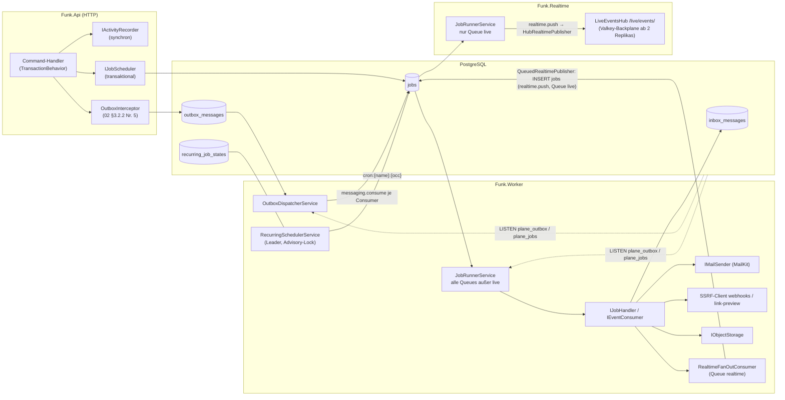
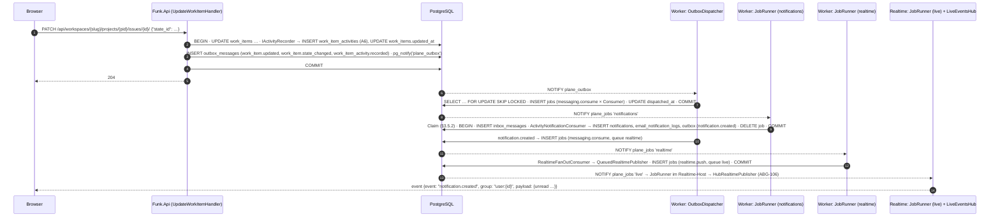
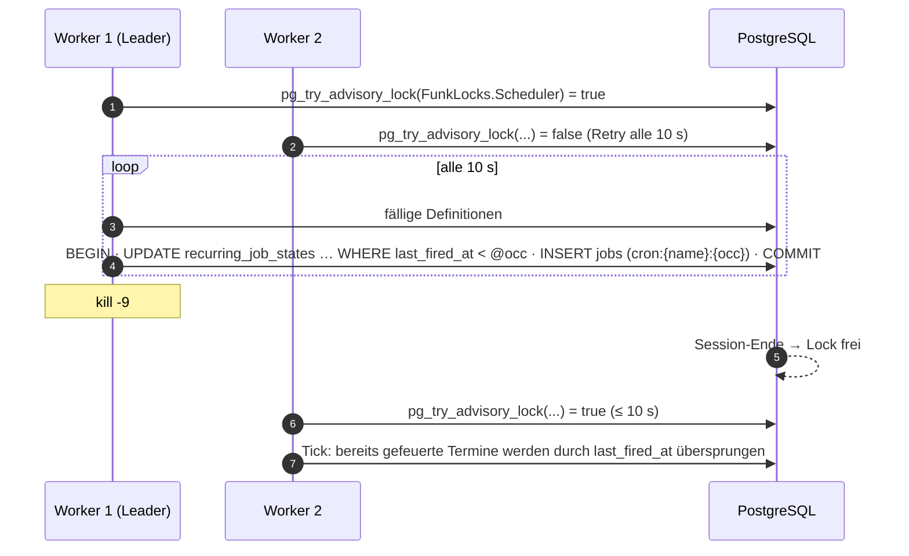
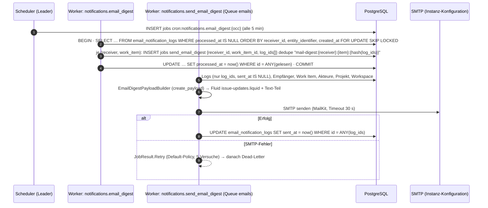
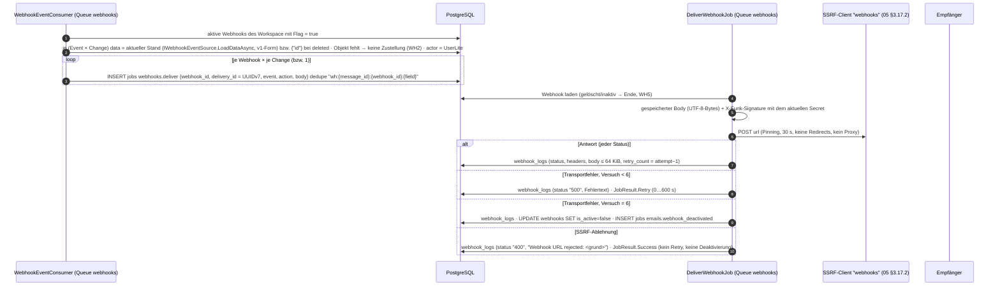

# 06 – Hintergrundjobs, Events und Benachrichtigungen

> **Status:** verbindlich für das Thema Hintergrundverarbeitung (Fachdokument nach `01` Anhang A: „Task→Job-Tabelle, Event-Katalog, Activity-Pipeline, Notifications, E-Mail, Webhooks, Exporte“, baut auf ADR-020, ADR-027, ADR-028).
> **Rangfolge:** `00-grundsatzentscheidungen.md` (ADR-000…009) > `01-zielarchitektur-und-tech-stack.md` (ADR-010…052) > `17-abgleich-dokumentuebergreifend.md` (ABG-001…058 und Auftraggeber-Entscheidungen) > dieses Dokument. Namen und Schnittstellen aus `02`, `05`, `08`, `09`, `14`, `15`, `16` werden übernommen; wo dieses Dokument dort etwas ergänzt, ist es als **Nachtrag** markiert und in §9 als Änderungsauftrag geführt.
> **Stand:** 23.10.2026. **Zielcode:** Repository `funk.` (ADR-009); alle Zielpfade sind relativ zu dessen Wurzel. Original-Referenz: Plane v1.4.2 CE in diesem Repository.
> **Maschinenlesbar:** `migration/architecture/_data/06-event-catalog.json` (Event-Katalog, 82 Einträge, Quelle für `EventCatalogSnapshotTests` und `EventEmissionTests`, ABG-011) und `migration/architecture/_data/06-jobs.json` (Task→Job-Tabelle, Cron-Plan, Aufrufstellen der Activity-Pipeline).
> **Sprache:** Fließtext Deutsch, Bezeichner Englisch.

**Kürzel:** `API/` = `apps/api/plane/`, `BG/` = `apps/api/plane/bgtasks/`, `TPL/` = `apps/api/templates/`, `WEB/` = `apps/web/`. `A07` = `migration/analysis/07-hintergrundjobs-mail-storage-webhooks.md` (IST-Analyse, Nummern T1…T47, B1…B13, C1…C78, A1…A38, W1…W22, M1…M14, E1…E13, N1…N9, EM1…EM7, WH1…WH11 beziehen sich darauf). `BE/` = `src/` in `funk.`, `MSG/` = `src/building-blocks/Funk.BuildingBlocks.Messaging/`, `MAIL/` = `src/platform/Funk.Platform.Mail/`.

## Inhaltsverzeichnis

1. [Ziel & Scope](#1-ziel--scope)
2. [Entscheidungen (D06-ADR-01 ff.)](#2-entscheidungen-d06-adr-01-ff)
3. [Detaildesign](#3-detaildesign)
   - 3.1 Bausteine und Projekte · 3.2 Datenmodell der Messaging-Infrastruktur · 3.3 Outbox und Dispatcher · 3.4 Consumer und Inbox · 3.5 Job-Queue, Retry, Dead-Letter, Queues und Worker-Pools · 3.6 Scheduler (Cron, Leader) · 3.7 EventContext, Akteur, Herkunft, Kausaltiefe · 3.8 Event-Katalog · 3.9 Activity-Pipeline · 3.10 In-App-Benachrichtigungen · 3.11 E-Mail-Benachrichtigungen (Bündelung) · 3.12 Echtzeit-Push (SignalR) · 3.13 E-Mail-Plattform und Templates · 3.14 Webhooks · 3.15 Exporte · 3.16 Cleanup, Retention, Hard-Delete · 3.17 Automationen · 3.18 Weitere Jobs · 3.19 Skalierung · 3.20 Monitoring
4. [Vollständige Mapping-Tabellen Original → Ziel](#4-vollständige-mapping-tabellen-original--ziel)
5. [Code-Skelette](#5-code-skelette)
6. [Erweiterungspunkte für Bezahl-Pakete](#6-erweiterungspunkte-für-bezahl-pakete)
7. [Akzeptanzkriterien & Tests](#7-akzeptanzkriterien--tests)
8. [Risiken & offene Punkte](#8-risiken--offene-punkte)
9. [Abhängigkeiten zu anderen Dokumenten (02–16)](#9-abhängigkeiten-zu-anderen-dokumenten-0216)
- [Abgleich-Protokoll (Dokument 17)](#abgleich-protokoll-dokument-17)

---

## 1. Ziel & Scope

### 1.1 Ziel

Dieses Dokument macht die gesamte Hintergrundverarbeitung der Community Edition für einen Implementierungs-Agenten **direkt umsetzbar**:

1. die Messaging-Infrastruktur aus ADR-020 (transaktionale Outbox, Inbox, PostgreSQL-Job-Queue, Cron-Scheduler mit Leader-Lock) mit konkreten Tabellen, Klassen, Algorithmen, Options-Klasse `FunkWorkerOptions` (benannte Worker-Pools, Pflicht-Restpunkt aus `17` §7) und Tests,
2. den **Port jeder Celery-Task** (47 aktive `@shared_task` + der auskommentierte `restore_related_objects`, A07 §2.3) und **jedes Beat-Eintrags** (B1…B13, A07 §2.2) auf Job, Consumer oder synchronen Domänendienst mit Trigger, Queue, Retry, Idempotenz und Leader-Bedarf (§4.2, §4.3),
3. den **Event-Katalog** (`plane.<aggregat>.<ereignis>.v1`, 82 Einträge, Obermenge der Mindestmenge aus `16` §3.2.4) samt Produzenten-Commands und CE-Consumern,
4. die **Activity-Pipeline** mit allen 78 Aufrufstellen, 27 Activity-Typen, 12 Feld-Trackern und 38 Varianten so, dass jede Feldänderung dieselbe `work_item_activities`-Zeile wie im Original erzeugt (Abweichungen nur als dokumentierte Fehlerkorrekturen),
5. In-App-Benachrichtigungen, E-Mail-Benachrichtigungen mit 5-Minuten-Bündelung und den Echtzeit-Push des Ungelesen-Zählers über SignalR,
6. den Port aller E-Mail-Templates aus `apps/api/templates/` nach Fluid (Liquid) mit MailKit,
7. Webhooks (Events, Payload, Signatur, Retry, Deaktivierung, SSRF), Exporte (CSV/JSON/XLSX, Analytics-CSV per Mail), Cleanup/Retention/Hard-Delete und die Automationen Auto-Archive/Auto-Close inklusive Korrektur des projektübergreifenden Close-State-Fallbacks,
8. die Erweiterungspunkte, die die 🧱-Pakete C1, C3 und H6 (und die übrigen strukturrelevanten Pakete, soweit sie Jobs/Events berühren) später brauchen – ohne Fachdesign.

### 1.2 Scope

| Im Scope | Nicht im Scope (zuständiges Dokument) |
|---|---|
| `Funk.BuildingBlocks.Messaging` vollständig (Outbox-Dispatcher, Inbox, Job-Queue, Scheduler, Event-Katalog, `FunkWorkerOptions`) | `OutboxInterceptor`, `TransactionBehavior`, Domain-Event-Schleife (Mechanik `02` §3.2.2/§3.19; hier nur genutzt) |
| Task→Job-Tabelle, Cron-Plan, Queue-Zuordnung, Retry-Policies | Endpunktverträge der Notification-, Webhook-, Export- und Asset-APIs (`04`), Berechtigungen (`05` Anhang B) |
| Event-Katalog mit Payload-Feldern und Produzenten | Entitäten/Indizes der Fachtabellen (`03`; hier nur Spalten, die die Pipelines lesen/schreiben, als Vorgabe) |
| Activity-Pipeline (`IActivityRecorder`, Typen, Varianten, Subscriber, Mentions) | Activity-Darstellung im Frontend (`08`/`09`, `ACTIVITY_RENDERERS`) |
| Notifications (Erzeugung, E-Mail-Bündelung, Präferenzen-Auswertung, SignalR-Push) | Inbox-UI und Inbox-Endpunkte (`04`, `08`) |
| E-Mail-Plattform (`IMailSender`, `MailTemplateRenderer`, alle Templates, Bilder, Text-Teil, SMTP-Test-Fehlertexte) | SMTP-Formular im God Mode (`11`-Analyse, `04`) |
| Webhook-Zustellung, Trigger-Abbildung, Payload, Signatur, Logs, Deaktivierung | SSRF-Handler und URL-Prüfung beim Speichern (`05` §3.17.2 – hier nur genutzt) |
| Exporte (Work Items CSV/JSON/XLSX, Analytics-CSV per Mail), Ablauf der Export-Links | Objektspeicher-Abstraktion `IObjectStorage` (`02`/`14` §3.7.6) |
| Cleanup-, Retention- und Hard-Delete-Jobs, Soft-Delete-Kaskaden-Job (Deferred) | Soft-Delete-Mechanik Inline (`02` D02-ADR-03) |
| Automationen (Auto-Archive, Auto-Close, Intake-Unsnooze, Cycle-Abschluss-Erkennung) | State-Change-Pipeline-Interna (`16` §5.9; hier Nutzung durch Auto-Close) |
| Weitere Jobs: Workspace-Seed, Link-Crawler, Asset-Metadaten, Asset-Kopie, Recent Visits, API-Activity-Log, Identity-Jobs aus `05` | Page-Transaktionen/-Versionen im Detail und `convert-document` (`07`; hier nur Einordnung), Suche/Indexierung (`11`) |
| Skalierung und Monitoring der Hintergrundverarbeitung | AppHost/Helm/Compose der Worker-Replikate (`14` §3.11/§3.12) |
| Erweiterungspunkte §6 (nur Andockstellen, kein Fachdesign) | Fachdesign der Bezahl-Pakete (Wellenpläne, `16` §6) |

### 1.3 Wann welcher Teil gebraucht wird (Inkremente nach `01` §1.3)

| Baustein (Abschnitt) | Inkrement | erster Nutzer / Abnahme | Spike |
|---|---|---|---|
| Tabellen `outbox_messages`, `inbox_messages`, `jobs`, `recurring_job_states` (§3.2); Outbox-Dispatcher, JobRunner, Scheduler, Leader-Lock, `FunkWorkerOptions`, Event-Katalog + Snapshot-Test, `LISTEN/NOTIFY` (§3.3–§3.7) | **I0 (Gerüst)** | Schnitt 2/3 „Workspace/Projekt anlegen“ schreibt `funk.workspace.created.v1`, `funk.project.created.v1`; `identity.expired_sessions_cleanup` (SEC-45) läuft | S12 vor I1 |
| Consumer-Queue `realtime` im Worker, Registrierung `RealtimeFanOutConsumer`, Publisher-Pfad `QueuedRealtimePublisher` → Job `realtime.push` auf Queue `live` → `HubRealtimePublisher` im Realtime-Host (§3.12, 17 ABG-106) | I0 (Gerüst ohne Consumer), I5 (Nutzung) | H6-Hub-Gerüst (`01` §1.4) | – |
| Messaging produktiv (Retry, Dead-Letter, Pools, Kill-Tests), Mail-Plattform (MailKit, Fluid, Mailpit), Templates M5, M7, M8, M9 (§3.13), Workspace-Seed (§3.18.1), Asset-Metadaten-Job, Hard-Delete, Soft-Delete-Kaskade Deferred, Cleanup unbestätigter Assets, IdP-Sync-Job | **I1** | CE-WS-002, CE-WS-010, CE-PRJ-021, CE-OPS-013, CE-OPS-014, CE-OPS-016, CE-AUTH-027 | S12 grün |
| Activity-Pipeline vollständig, Subscriber/Mentions synchron, Beschreibungs-Versionen, Link-Crawler, Work-Item-Events (§3.9, §3.18) | **I2** | CE-WI-003, CE-WI-039, CE-WI-041, CE-WI-044, CE-WI-035 | – |
| Cycle-/Modul-/Intake-/View-Events, Auto-Archive/-Close, Unsnooze, Cycle-Abschluss-Erkennung (§3.17) | **I3** | CE-PRJ-039, CE-PRJ-040, CE-INT-008 | – |
| Page-Events, Page-Versionen/-Log-Einordnung, Asset-Kopie bei Page-Duplikat, Page-Versions-Cleanup | **I4** | CE-PAGE-009, CE-PAGE-012, CE-PAGE-019 | S2 (Konvertierung, `07`) |
| In-App-Notifications, E-Mail-Bündelung (M12), SignalR-Push des Zählers, Recent Visits, Analytics-Export (M11), Suchindex-Consumer (`11`) | **I5** | CE-NOTIF-001…009, CE-HOME-005, CE-ANA-009 | – |
| Webhooks inkl. Deaktivierungs-Mail (M10), Exporte, API-Activity-Log, Webhook-/API-Log-Cleanup, Export-Link-Ablauf | **I6** | CE-WH-001…011, CE-EXP-001/-002, CE-API-003 | – |
| Last-/Ausfalltests der Worker (LT-12, Kill-Tests), Airgap-Prüfung der Mails, Alarme | **I7** | CE-OPS (Rest) | – |
| Erweiterungspunkte §6: C3 (I0), H6 (I0/I5), C1 (I2), F1/F2-Queues (I0 reserviert, W1 genutzt) | je Zeile §6 | `16` §1.4 | – |

---

## 2. Entscheidungen (D06-ADR-01 ff.)

Spalte „ab“ = Inkrement der ersten Umsetzung. Alle Entscheidungen präzisieren `01` ADR-020/-023/-027/-028 und `02` D02-ADR-24/-25; keine widerspricht einer Entscheidung aus `00`, `01` oder `17`.

| ID | Belang | Entscheidung | Alternativen (verworfen) | Begründung | ab |
|---|---|---|---|---|---|
| **D06-ADR-01** | Framework | **Eigene PostgreSQL-Implementierung** nach ADR-020 in `Funk.BuildingBlocks.Messaging`: vier Tabellen (§3.2), drei Hintergrunddienste (`OutboxDispatcherService`, `JobRunnerService`, `RecurringSchedulerService`), `Cronos` für Cron. Fallback bei rotem Spike S12: Wolverine (MIT) hinter denselben Interfaces (`IJobScheduler`, `IEventConsumer<T>`, `IRecurringJobRegistry`). | Hangfire (LGPL, Pro kommerziell), Quartz.NET (nur Cron), MassTransit v9 (kommerziell), RabbitMQ | Bindend durch ADR-020; kein Broker, transaktionale Konsistenz mit Fachdaten, Backup = `pg_dump`, Airgap-tauglich. | I0 |
| **D06-ADR-02** | Zwei asynchrone Wege, eine Regel | (a) **Integration-Event** (Outbox) für Reaktionen **anderer** Module oder späterer Pakete; (b) **transaktionales Job-Enqueue** (`IJobScheduler.EnqueueAsync` innerhalb der Command-Transaktion) für aufgeschobene Arbeit **des eigenen** Moduls (Mails, Seed, Crawl, Export, Metadaten). Ein Command darf beides tun. Synchron in derselben Transaktion bleibt, was das Original zwar asynchron macht, was aber Konsistenz braucht und billig ist (Activity, Subscriber, Mentions, Beschreibungs-/Page-Versionen). PageLog synchron über `PageReferenceIndexer` in derselben Transaktion (`07` D07-ADR-23, 17 ABG-108); kein Consumer. | alles über Events; alles über Jobs; Celery-Nachbau mit `.delay()` | Hält Modulgrenzen (R5) ein, vermeidet Event-Inflation für rein interne Arbeit und beseitigt die Original-Defekte „Task läuft vor Commit“ (A07 §1.4, E1, WH1). | I0 |
| **D06-ADR-03** | Consumer-Ausführung | Der Dispatcher **fächert** jede Outbox-Nachricht beim Versand in je einen Job `messaging.consume` je registriertem Consumer auf (Queue des Consumers, Dedupe-Schlüssel `evt:{message_id}:{consumer}`); der Job trägt Payload und Kontext als Kopie. Consumer laufen transaktional mit **Inbox** (`inbox_messages (consumer, message_id)`, `ON CONFLICT DO NOTHING`). Nachrichten ohne Consumer werden nur als versandt markiert (`02` §5.2.12). | Dispatcher ruft Consumer direkt; Consumer lesen Outbox selbst | Einheitliche Retry-, Dead-Letter-, Queue- und Pool-Mechanik für Jobs **und** Consumer; Fehler eines Consumers blockiert keinen anderen. | I0 |
| **D06-ADR-04** | Zustellgarantie | **At-least-once** für Jobs und Consumer, **exactly-once-Wirkung** über (a) Inbox für Consumer, (b) `Transactional = true` für reine DB-Jobs (Abschluss-`DELETE` in derselben Transaktion), (c) fachliche Idempotenz für Jobs mit Außenwirkung (Mail: `sent_at` je Log, Webhook: stabile `X-Funk-Delivery`). | exactly-once über verteilte Transaktionen | Mit PostgreSQL allein erreichbar und testbar (S12-Kriterium „Kill -9 verliert keine Nachricht, keine Doppelverarbeitung“). | I0 |
| **D06-ADR-05** | Queues und Worker-Pools | Feste CE-Queues `default`, `notifications`, `emails`, `webhooks`, `exports`, `maintenance`, `realtime`, `live` (nur Realtime-Host/AllInOne, ABG-106), `indexing`; Paket-Queues nur aus `16` §3.2.5. Jede Host-Instanz verarbeitet die Queues aus **`FunkWorkerOptions.Queues`/`ExcludeQueues`** (`Funk:Worker:Queues`, Pflicht-Restpunkt `17` §7); Host-Defaults §3.5.6. Damit lassen sich `webhooks`, `exports`, `integrations`, `importers`, `automations` ohne Codeänderung auf eigene Replikate legen. | ein globaler Pool wie Celery (`celery`-Queue) | Original-Defekt WH11 (Webhook-HTTP blockiert den allgemeinen Pool 30 s) entfällt; `16` X9 verlangt benannte Pools. | I0 |
| **D06-ADR-06** | Retry-Policy | `JobRetryPolicy` je Job-Typ; Default **5 Versuche**, exponentiell ab 30 s (Faktor 4, max. 1 h, volle Jitter); Webhook-Zustellung **6 Versuche** (1 + 5 Retries) mit Wartezeit zufällig 0…600 s (= Celery `retry_backoff=600`, `retry_backoff_max=600`, `retry_jitter=True`); Wartungs-Jobs 3 Versuche. Erschöpft → Status `dead` (Dead-Letter) + Metrik + Log `plane.exception`. Unerwartete Ausnahmen gelten als „Retry“, fachlich endgültige Fehler als `JobResult.Fail`. | Original-Verhalten (Exception schlucken, kein Retry, A07 §1.4) | Original verliert Mails/Activities stillschweigend (EM3, N7); Abweichung `DEV-JOB-002`. | I1 |
| **D06-ADR-07** | Scheduler | Cron-Ausdrücke in **UTC** (`Cronos`, 5 Felder), Registrierung im Code (`IRecurringJobRegistry.Register`) **und** optional zur Laufzeit (`IRecurringScheduleStore`, für C3/B7, CE ohne Nutzung). Genau **ein** Leader je Datenbank über `pg_try_advisory_lock(FunkLocks.Scheduler)` auf einer dedizierten Verbindung; Auslösung = Insert eines Jobs mit Dedupe-Schlüssel `cron:{name}:{occurrence:O}` **und** bedingtes Update `recurring_job_states.last_fired_at` in einer Transaktion (kein Doppellauf auch bei kurzzeitig zwei Leadern). Versäumte Termine: **einmal nachholen** (Celery-Beat-Semantik). | Cron je Worker-Instanz; Quartz-Cluster | Leader-Failover < 30 s und „kein doppelter Cron-Lauf“ (S12) mit Bordmitteln; `14` §4.5 legt `FunkLocks.Scheduler` fest. | I0 |
| **D06-ADR-08** | Cron-Plan | Alle Beat-Einträge mit **identischer UTC-Zeit** übernommen, außer B3 (Telemetrie, entfällt ADR-004) und B13 (Duplikat von B6, entfällt `14` §4.5); neu: Outbox-/Inbox-/Dead-Letter-Cleanup, Identity-Jobs aus `05`, Cycle-Abschluss-Erkennung (`16` §3.2.4 verlangt `funk.cycle.completed.v1`), Index-Abgleich `indexing.reconcile` (`11` §3.10.4). Vollständiger Plan §4.2. | Zeiten „entzerren“ | Paritätstest `CronRegistrationTests` vergleicht Original-Zeiten; Abweichung `DEV-OPS-003`. | I1 |
| **D06-ADR-09** | Activity synchron | `IActivityRecorder` (`Funk.WorkItems.Contracts`, Implementierung `Funk.WorkItems`) schreibt Activities **in derselben Transaktion** wie die Fachänderung (`02` D02-ADR-25), inkl. `work_items.updated_at = now`, Assignee-Subscribern und `work_item_mentions`, und veröffentlicht danach **ein** Event `funk.work_item_activity.recorded.v1` je Aufruf. Die Feldlogik ist ein Port von `BG/issue_activities_task.py` (Tabellen §4.5–§4.7). | asynchron wie Original (`issue_activity.delay`) | Activity existiert genau dann, wenn die Änderung committet ist; alles-oder-nichts-Abbruch des Originals (E3, E7) entfällt (`DEV-ACT-001`). | I1 (Gerüst), I2 |
| **D06-ADR-10** | Notifications | Erzeugung **asynchron** im Consumer `ActivityNotificationConsumer` (Queue `notifications`) aus `funk.work_item_activity.recorded.v1`, Algorithmus 1:1 zu `BG/notification_task.py` (A07 §3.2) mit den Korrekturen §4.10; `sender`-Strings, `title` = Activity-`comment`, `data`-JSON mit Python-`str()`-Semantik (`"None"`) **unverändert**, weil das Angular-Frontend die Original-Store-Logik portiert. | Erzeugung synchron im Command | Fan-out auf viele Empfänger gehört nicht in die Request-Latenz; Reihenfolge zur Activity ist durch die Outbox gesichert. | I5 |
| **D06-ADR-11** | E-Mail-Bündelung | Cron `notifications.email_digest` alle 5 min (B1) gruppiert unverarbeitete `email_notification_logs` je **(Empfänger, Work Item)**; je Gruppe ein Job `notifications.send_email_digest` mit **genau den IDs dieser Gruppe** (Korrektur EM2); Sperre über Job-Dedupe statt Redis-Lock; Basis-URL aus Konfiguration (`IPublicUrls.Web`, SEC-31) statt Redis-Origin-Key (Korrektur EM1). Activities aus Automationen erzeugen **keine** E-Mail-Logs (Original versendet sie nie, `DEV-NOTIF-006`). | Redis-Origin/Redis-Lock nachbauen | A07 §5.7 Nr. 3; ADR-004/P4 „so viel wie möglich in PostgreSQL“. | I5 |
| **D06-ADR-12** | Echtzeit-Push | Transport nach `07` D07-ADR-27/§3.16, Ort und Publisher-Pfade verbindlich nach **17 ABG-106**: Notifications veröffentlichen `funk.notification.created.v1`; der `RealtimeFanOutConsumer` (Modul `Funk.RealtimeEvents`, Consumer `realtime.fanout`, generisch für alle katalogisierten Events, kein `LabelRealtimeConsumer`) läuft auf der Queue **`realtime`** im **Worker** (dessen Modulkatalog enthält `Notifications` für die Zähler-Abfrage aus `Funk.Notifications.Contracts`, `02` §3.1.3) und ruft `IRealtimePublisher.PublishAsync` auf. **Einziger Zustellweg zum Hub:** in Api/Worker ist `IRealtimePublisher` der **`QueuedRealtimePublisher`** (Job `realtime.push` mit `{group, event, payload, occurred_at}` transaktional auf der Queue **`live`**, `FunkQueues.Live`); nur der Host `Funk.Realtime` (und `Funk.AllInOne`) registriert SignalR, verarbeitet `live` und stellt über **`HubRealtimePublisher`** (`IHubContext<LiveEventsHub>`) zu. Ab 2 Realtime-Replikas verteilt die Valkey-Backplane. **Entfällt:** `HubContextRealtimePublisher`, `NotifyRealtimePublisher`, `LiveEventsNotifyListener`, Kanal `plane_live_events`. Live-Event `notification.created` an Gruppe `user:{receiver_id}` mit den Zählern im Format von `GET …/users/notifications/unread/`. Gruppen-Autorisierung wie `05` §3.11 (`ws:` → `workspace.settings.read`, `project:` → `project.project.read`, `user:` nur eigene ID). Zustellung höchstens einmal (`07`). | JobRunner für `realtime` im Realtime-Host (Zähler-Abfrage dort nicht verfügbar); SignalR-Client im Worker; `pg_notify`-Pfad ohne Valkey; Polling | Ein Transport für alle Hosts über die vorhandene Job-Queue (kein zweiter Benachrichtigungskanal), funktioniert im Einzelknoten ohne Valkey; AK-D08-35 (< 2 s, Messung Z-104/S12). | I0 (Gerüst), I5 |
| **D06-ADR-13** | Template-Engine | **Fluid** (Liquid, MIT) nach ADR-027; mechanischer Port jeder Django-Datei unter `TPL/emails/**` nach `MAIL/Templates/<gleicher Pfad>.liquid`; Kontext als `Dictionary<string, object?>` mit den **Original-Variablennamen** (snake_case), damit keine Namensstrategie nötig ist; Ausgabe-Encoder `DjangoHtmlEncoder` (maskiert exakt wie Django `escape()`), Django-Filter `safe` → Liquid-Filter `raw`. Betreffzeilen als Code-Konstanten (`MailSubjects`). | Razor-`HtmlRenderer`, Scriban, RazorLight | Templates bleiben als Dateien 1:1 vergleichbar (G-MAIL, `15` §3.9). | I1 |
| **D06-ADR-14** | Bilder in E-Mails | Externe Bild-URLs der Original-Templates werden nicht mehr geladen: die Logos (`media.docs.plane.so`) werden durch die **gebündelten funk.-Logos** `MAIL/Assets/logo-{white,dark}.png` ersetzt; Marketing- und Social-Bilder (`plane-marketing.s3…`, `creative-assets.mailinblue.com`, `ik.imagekit.io`) **entfallen ersatzlos** (Auftraggeber 23.10.2026, 17 ABG-105, `BRAND-MAIL-05`). Die Logos werden per Default als **CID-Inline-Ressourcen** (MimeKit `BodyBuilder.LinkedResources`) eingebettet; Option `Funk:Mail:ImageMode = Inline│Hosted` (`Hosted` → `{WEB_URL}/static/emails/<datei>` über das Gateway). | externe URLs belassen | ADR-004 (keine externen Laufzeitabhängigkeiten); CID funktioniert auch, wenn der Mail-Client die Instanz nicht erreicht (`DEV-MAIL-006`). | I1 |
| **D06-ADR-15** | Webhook-Trigger | Webhooks sind eine **Projektion der Integration-Events**: `WebhookEventConsumer` bildet über eine Trigger-Tabelle (§3.14.2) die 24 Original-Auslösestellen (W1…W22, WD1, WD2) **plus** die 6 Auslöser aus `04` DT-WH-07 ab (17 ABG-137: Löschen von Work Items, Cycles, Modulen, Kommentaren; Cycle-/Modul-Zuordnung als `issue`/`updated`) – Filter auf `EventContext.Origin ∈ {App, V1}` und das Event-Feld `Operation`. Pro geändertem Feld eine Zustellung (Original-Fan-out); `data` = Stand beim Fan-out im Consumer (entspricht dem Ausführungszeitpunkt von `webhook_activity`, WH3) und für alle Zustellversuche unverändert; `deleted` (mit `data = {"id": …}`) für Projekte, Work Items, Cycles, Module und Kommentare. Erweiterung für H3/A1/F2 nur über `IWebhookEventSource` (`16` E-08). | Webhooks für alle Änderungen; Aufrufe in den Commands | Vertrag CE-WH-008 1:1; trotzdem keine Webhook-Logik in Fach-Commands. | I6 |
| **D06-ADR-16** | Webhook-Zustellung | Job `webhooks.deliver` je (Webhook, Trigger, Feld) in Queue `webhooks`; der Job trägt den beim Fan-out gebauten Body (Original: `event_data` wird in `webhook_activity` berechnet und an `webhook_send_task` übergeben), Retries senden ihn byte-gleich; Client `webhooks` aus `05` §3.17.2 (SSRF, Pinning, 30 s, keine Redirects, kein Proxy); Signatur `X-Plane-Signature = HexLower(HMACSHA256(secret, body))` über **die gesendeten Bytes**; **HTTP-Status jeder Art = zugestellt** (1:1, WH4); Retry nur bei Transportfehler; nach dem 6. erfolglosen Versuch `is_active=false` + Mail M10. `X-Plane-Delivery` stabil je Zustellung über alle Versuche (Korrektur WH6, `DEV-WH-001`); Logs als JSON (WH9, `DEV-WH-002`). | Retry auch bei 5xx; neue Delivery-ID je Versuch | Vertragstreue für Empfänger, Deaktivierungslogik unverändert; v2-Semantik ist Paket H3. | I6 |
| **D06-ADR-17** | Exporte | Job `exports.work_items` (Queue `exports`, Heartbeat für lange Läufe), Spalten/Reihenfolge/Kopfzeilen/Formel-Schutz wie `API/utils/porters/**`; CSV mit `CsvHelper`, XLSX mit `ClosedXML` (Sheet `Sheet`), JSON mit `System.Text.Json` (Einrückung 2); ZIP über `System.IO.Compression`; Ablage über `IObjectStorage` (privat, kein `public-read`), Download-Link presigned 7 Tage bzw. HMAC-signierte Dateisystem-URL (`14` §3.7.6); Exporttypen über `IExportTypeProvider` (`16` E-16). | EPPlus (kommerziell), MiniExcel | ADR-028; Lizenz-Hygiene; Paritätsgate G-EXPORT (`15`). | I6 |
| **D06-ADR-18** | Cleanup/Retention | Batch-Löschungen per `ExecuteDeleteAsync` in Blöcken à 500 IDs (Server-Cursor wie `process_cleanup_task`), Fristen aus `FunkRetentionOptions` (`02` §3.15); Hard-Delete löscht zusätzlich die **Objektspeicher-Dateien** hart gelöschter `file_assets` (Korrektur „S3-Objekte werden nie gelöscht“, `DEV-OPS-002`). | Datenbank-Partitionierung; TTL-Index | Original-Kriterien bleiben 1:1, Speicherwachstum wird begrenzt. | I1 |
| **D06-ADR-19** | Automationen | Auto-Archive setzt nur `archived_at` (kein State-Wechsel, ABG-056); **Auto-Close** läuft über `IWorkItemStateChanger` mit `StateChangeOrigin.AutoClose` und erzeugt die Original-Activity-Variante A13; Close-State-Fallback **projektbezogen** (erster State der Gruppe `cancelled` **desselben Projekts**, sonst Projekt überspringen + Warnung; Korrektur `DEV-AUTO-001`); Auswahl per `NOT EXISTS`-Semantik ohne Doppeltreffer und ohne gelöschte Zuordnungen (`DEV-AUTO-002`). | Original-Fallback `State.objects.filter(group="cancelled").first()` (beliebiges Projekt) | Vom Auftraggeber verlangte Korrektur; State-Change-Pipeline ist C1-Andockstelle (`16` §5.9). | I3 |
| **D06-ADR-20** | Akteur und Audit im Hintergrund | Jeder Job/Consumer läuft in einem DI-Scope mit `ICurrentActor` aus `EventContext`/Job-Spalten (`actor_id`, `actor_kind`); Jobs ohne fachlichen Akteur (Cron) laufen als **System-Bot** der Instanz (`users.is_bot = true`, `bot_type = "SYSTEM"` als neuer Wert neben dem Original-Wert `WORKSPACE_SEED` aus `BotTypeEnum`, `username = "plane_system_bot"`, angelegt vom Migrator); Automationen behalten den Original-Akteur `project.created_by`. Audit-Felder werden nie implizit `NULL` (Korrektur A07 §3.8 Punkt 5, `DEV-JOB-003`). | Audit `NULL` im Worker wie Original | `AuditInterceptor` (`02` §3.2.2) braucht immer einen Akteur; `16` D16-ADR-12 (Bot-Akteure). | I0 |
| **D06-ADR-21** | Kausaltiefe | `EventContext.CausationDepth`: Commands aus HTTP-Requests und Cron-Jobs = 0; jedes von einem Consumer/Job ausgelöste Event = Tiefe des auslösenden Kontexts + 1; `> 5` wird **nicht** in die Outbox geschrieben, sondern verworfen + Warnung `plane.worker` + Metrik `plane.outbox.dropped{reason="causation_depth"}` (ABG-053). | keine Begrenzung | Schutz gegen Endlosschleifen späterer Automationen (C3) und Sync-Echos (F2). | I0 |
| **D06-ADR-22** | Payload-Disziplin | Integration-Events tragen IDs, `Operation`, `ChangedFields` und – nur wo Webhooks/Audit es brauchen – `Changes` (Feldname, alter und neuer JSON-Wert der Request-Form), **nie** Entitäten oder Secrets. Jobs tragen ihre Parameter als JSON; personenbezogene Daten nur, wo der Job sie zwingend braucht (Empfänger-E-Mail wird **zur Laufzeit** geladen, nicht gespeichert). Ausnahme: `webhooks.deliver` trägt den fertigen Webhook-Body inkl. `actor` (`UserLite`), weil der Vertrag den Stand beim Fan-out verlangt (WH3); erfolgreiche Jobs werden gelöscht, tote nach `DeadLetterRetentionDays`. | ganze DTOs im Event | `01` §7.15, `16` §3.2.4; Datenschutz; Payload-Größe. | I0 |
| **D06-ADR-23** | Ungenutzter Original-Code | **Nicht portiert:** T2 `export_analytics_to_csv_email`, T24 `issue_task`, T33 `project_invitation` (Template wird für G-MAIL portiert, kein Auslöser wie im Original), T21/T22/T25/T26 Backfills (ADR-003), T47 Telemetrie (ADR-004), `issue_draft.activity.*`-Handler (A35–A37), `restore_related_objects`, `ProjectWebhook`. **Spalten bleiben (Schema `03`), werden aber nicht ausgewertet:** `webhooks.is_internal` (immer `false`), `email_notification_logs.entity` (`""` wie Original-Default), `.old_value`/`.new_value` (`NULL`), `user_notification_preferences.workspace_id`/`project_id` (`NULL`). `webhooks.version` (`"v1"`) bleibt (H3). | alles portieren | A07 O6; Greenfield. | – |
| **D06-ADR-24** | Entfallene Mails (ADR-008) | M1 Magic-Code, M2/M3 E-Mail-Änderung (`05` D05-ADR-08), M4 Passwort-Reset entfallen samt Templates `emails/auth/magic_signin.html`, `emails/auth/forgot_password.html`, `emails/user/email_updated.html`. M8 Aktivierung wird vom `AccountStateGuardStep` (`05` §3.7.3, Order 350) ausgelöst, M9 von `DeactivateAccountCommand`. | Templates „für später“ behalten | Keycloak übernimmt Login, Passwort und E-Mail-Verifikation. | I1 |
| **D06-ADR-25** | Branding in Mails, Seeds und Bot-Namen (ADR-009B, Review-Ergänzung) | Nach außen sichtbares „Plane“ wird „funk.“: (a) **Mail-Betreffzeilen und -Texte** (`MailSubjects`, Template-Texte, Klartext von M13/M14) – mechanisch „Plane“ → „funk.“, nur in Text, nicht in Variablen-/Dateinamen (`BRAND-MAIL-01`); (b) **Logos** `logo-white.png`/`logo-dark.png` werden aus `assets/funk_logo.svg` (Repo `funk.`) in Originalgröße gerendert, statt die Plane-Logos zu übernehmen (`BRAND-MAIL-02`); (c) **Footer-/Social-Links** auf `plane.so`, `forum.plane.so`, GitHub/X/LinkedIn von Plane entfallen samt Icons; optional eigene Ziele über `FunkMailOptions.FooterLinks` (Liste `{Label, Url, Icon}`, Default leer → Footer-Linkblock wird nicht gerendert) (`BRAND-MAIL-03`); (d) **Absender-Default** `FunkMailOptions.DefaultFrom` = `funk. <noreply@<Host aus Funk:Urls:Web>>` statt `Team Plane <team@mailer.plane.so>` (`BRAND-MAIL-04`); (e) **Seed-Inhalte** (`seeds/data/*.json`: Work-Item-, Cycle-, Projekt- und Page-Texte) und **Bot-Anzeigename** `display_name = first_name = "funk."`; Links auf `docs.plane.so` in Seeds entfallen (Linktext bleibt als Klartext) (`BRAND-SEED-01`); (f) **Marketing-Bilder** `invite-hero.png` (imagekit), alle `icon-*.png` aus `plane-marketing.s3…` und die Social-Icons (mailinblue) entfallen ersatzlos: das jeweilige ``-Element und eine nur dafür vorhandene Tabellenzelle werden entfernt, Text und Layout der übrigen Zellen bleiben; es werden **keine** Bilder aus Original-URLs übernommen (`BRAND-MAIL-05`, 17 ABG-105). **Unverändert** (Vertrag bzw. interne Daten, ADR-003/ADR-009B „interne Bezeichner“): gespeicherte Activity-`comment`-Texte (`Plane has archived the issue`, `Plane updated the state to `, A12b/A13), Webhook-Header `X-Plane-*`, Secret-Präfix `plane_wh_`, `User-Agent: Autopilot`, Konfigurationsschlüssel `Plane:*` (O-D06-12). | Plane-Texte 1:1 belassen | ADR-009B ist bindend und nennt E-Mail-Templates ausdrücklich; G-MAIL vergleicht gegen Original-Renderings mit vorab ersetztem Branding (ADR-009B, Abschnitt Visuelle Parität). | I1 |

---

## 3. Detaildesign

### 3.1 Bausteine und Projekte



| Projekt / Ordner (relativ zu `funk.`) | Inhalt (Klassen, verbindliche Namen) | ab |
|---|---|---|
| `src/building-blocks/Funk.BuildingBlocks/Messaging/` (Contracts, keine Infrastruktur) | `IIntegrationEvent`, `IDomainEvent`, `IEventConsumer<T>`, `EventContext`, `IJob`, `IJobHandler<TJob>`, `JobContext`, `JobResult`, `JobRetryPolicy`, `IJobScheduler`, `IJobCancellation`, `IRecurringJobRegistry`, `IRecurringScheduleStore`, `IMessagingRegistry`, `FieldChange`, `EventOperations`, `FunkQueues`, `FunkLocks`, `JobTypeAttribute` | I0 |
| `MSG/Outbox/` | `OutboxMessage` (Entität, `[OwnedBy("Messaging")]`), `OutboxDispatcherService`, `OutboxWakeup` (`LISTEN plane_outbox`); `MSG/Diagnostics/FunkMessagingMetrics` (Meter `Funk.Messaging`, alle Metriken §3.20) | I0 |
| `MSG/Inbox/` | `InboxMessage`, `InboxGuard` (`TryBeginAsync(consumer, messageId)`) | I0 |
| `MSG/Jobs/` | `JobRecord` (Entität), `PostgresJobScheduler : IJobScheduler, IJobCancellation`, `JobClaimer` (SQL §3.5.2), `JobRunnerService`, `JobExecutor`, `JobLeaseReaper`, `JobTypeRegistry`, `ConsumeEventJob` + `ConsumeEventJobHandler`, `JobsWakeup` (`LISTEN plane_jobs`) | I0 |
| `MSG/Scheduling/` | `RecurringJobRegistry`, `RecurringJobState` (Entität), `RecurringSchedulerService`, `SchedulerLeaderElection` (`pg_try_advisory_lock`), `DatabaseRecurringScheduleStore`, `MisfirePolicy` | I0 |
| `MSG/Catalog/` | `EventCatalog` (Liste aller `IIntegrationEvent`-Typen aus den Modul-Registrierungen), `EventCatalogEntry`, `D16MinimumEvents` | I0 |
| `MSG/Options/` | `FunkWorkerOptions`, `FunkWorkerOptionsValidator`, `FunkWorkerOptionsPostConfigure` (Komma-Liste → Array, Host-Defaults) | I0 |
| `MSG/Hosting/` | `MessagingServiceCollectionExtensions.AddPlaneMessaging(IHostApplicationBuilder, FunkHostKind, IReadOnlyList<IModule>)`; Host-Art = `FunkHostKind { Api, Worker, Realtime, Gateway, Migrator, AllInOne, Cli }` aus `Funk.ServiceDefaults` (`14` §5.2, kein eigenes Enum) | I0 |
| `MSG/Maintenance/` | `OutboxCleanupJob`, `InboxCleanupJob`, `DeadLetterCleanupJob` | I0 |
| `src/platform/Funk.Platform.Mail/` | `IMailSender`, `SmtpMailSender` (MailKit), `DevSmtpOverride` (Mailpit, `14` §3.2.3), `MailTemplateRenderer` (Fluid), `Rendering/DjangoHtmlEncoder`, `MailTemplates` (Katalog), `MailSubjects`, `PlainTextFromHtml`, `MailImageResolver`, `SmtpErrorMapper`, `Templates/**.liquid`, `Assets/*.png` | I1 |
| `src/modules/WorkItems/Funk.WorkItems/Activity/` | `WorkItemActivityRecorder : IActivityRecorder`, `ActivityTypeHandlers/*` (27 Handler, §4.5), `FieldTrackers/*` (12 Tracker, §4.6), `MentionExtractor`, `SubscriberMaintenance` | I1/I2 |
| `src/modules/Notifications/Funk.Notifications/` | `Application/Consumers/ActivityNotificationConsumer.cs`, `Application/Jobs/StackEmailNotificationsJob.cs`, `Application/Jobs/SendEmailDigestJob.cs`, `Domain/NotificationRecipientResolver.cs`, `Domain/EmailPreferenceRules.cs`, `Domain/EmailDigestPayloadBuilder.cs`, `Domain/PythonText.cs` | I5 |
| `src/modules/RealtimeEvents/Funk.RealtimeEvents/` | `Application/Consumers/RealtimeFanOutConsumer.cs`, `Application/RealtimeFanOutMap.cs` (dieses Dokument); `Hubs/LiveEventsHub.cs`, `HubRealtimePublisher` (nur Realtime-Host/AllInOne), `QueuedRealtimePublisher` (Api/Worker), `Application/Jobs/RealtimePushJob` (`realtime.push`, Queue `live`), Gruppen-Autorisierer (Detail und Namen `07` §3.16; Pfade 17 ABG-106) | I0/I5 |
| `src/modules/Webhooks/Funk.Webhooks/` | `Application/Consumers/WebhookEventConsumer.cs`, `Application/Jobs/DeliverWebhookJob.cs`, `Application/Jobs/SendWebhookDeactivationEmailJob.cs`, `Domain/WebhookTriggerMap.cs`, `Domain/WebhookPayloadBuilder.cs`, `Domain/WebhookSigner.cs`, `Sources/*WebhookEventSource.cs` | I6 |
| `src/modules/Exports/Funk.Exports/` | `Application/Jobs/ExportWorkItemsJob.cs`, `Application/Jobs/ExpireExportLinksJob.cs`, `Domain/WorkItemExportColumns.cs`, `Formatters/{Csv,Json,Xlsx}ExportFormatter.cs`, `Domain/SpreadsheetSafeText.cs`, `Sources/WorkItemExportTypeProvider.cs` | I6 |
| `src/hosts/Funk.Worker/` | `Program.cs` (`AddPlaneMessaging(FunkHostKind.Worker, ModuleCatalog.All)`, kein `MapEndpoints`) | I0 |

### 3.2 Datenmodell der Messaging-Infrastruktur

Eigentümer der vier Tabellen ist der Pseudo-Eigentümer `Messaging` (`[OwnedBy("Messaging")]`; nur Klassen in `Funk.BuildingBlocks.Messaging` schreiben sie). `03` übernimmt die Tabellen in die Migration `…_Messaging_Initial` (I0). Spaltennamen sind verbindlich (ABG-053 für die Kontextspalten von `outbox_messages`, ABG-101 für Tabellennamen, Outbox ohne `attempts`/`last_error` und den Leader als einzigen Schreiber der Code-Definitionen).

```sql
-- 1) Transaktionale Outbox (geschrieben vom OutboxInterceptor im selben Commit, 02 §3.2.2 Nr. 5)
CREATE TABLE outbox_messages (
  id               uuid        PRIMARY KEY,          -- UUIDv7 = Message-ID
  event_type       text        NOT NULL,             -- "funk.work_item.updated.v1"
  payload          jsonb       NOT NULL,             -- serialisiertes Event (snake_case)
  occurred_at      timestamptz NOT NULL,
  traceparent      text        NULL,                 -- W3C, 01 §7.16
  actor_id         uuid        NULL,                 -- ABG-053
  actor_kind       smallint    NULL,                 -- PrincipalKind: 0 User, 1 ApiKey, 2 App, 3 Bot
  origin           text        NOT NULL,             -- "App" | "V1" | "Space" | "Instance" | "Auth" | "Integrations" | "worker" | StateChangeOrigin-Name
  workspace_id     uuid        NULL,
  project_id       uuid        NULL,
  correlation_id   text        NULL,                 -- Request-/Trace-ID des auslösenden Requests
  causation_depth  int         NOT NULL DEFAULT 0,
  dispatched_at    timestamptz NULL                  -- gesetzt vom Dispatcher; keine attempts/last_error (ABG-101: Fehler je Consumer in jobs.attempts/last_error)
);
CREATE INDEX ix_outbox_pending    ON outbox_messages (id) WHERE dispatched_at IS NULL;
CREATE INDEX ix_outbox_dispatched ON outbox_messages (dispatched_at) WHERE dispatched_at IS NOT NULL;

-- 2) Inbox (Idempotenz je Consumer)
CREATE TABLE inbox_messages (
  consumer      text        NOT NULL,                -- stabiler Consumer-Name, z. B. "notifications.activity"
  message_id    uuid        NOT NULL,
  processed_at  timestamptz NOT NULL,
  PRIMARY KEY (consumer, message_id)
);
CREATE INDEX ix_inbox_processed ON inbox_messages (processed_at);

-- 3) Job-Queue
CREATE TABLE jobs (
  id               uuid        PRIMARY KEY,          -- UUIDv7
  queue            text        NOT NULL,             -- FunkQueues.* oder reservierte Paket-Queue (16 §3.2.5)
  job_type         text        NOT NULL,             -- stabiler Name aus [JobType("…")]
  payload          jsonb       NOT NULL,
  status           smallint    NOT NULL DEFAULT 0,   -- 0 pending, 1 running, 4 dead (Erfolg = Zeile gelöscht)
  priority         smallint    NOT NULL DEFAULT 0,   -- reserviert, CE nutzt 0
  run_at           timestamptz NOT NULL,
  attempts         int         NOT NULL DEFAULT 0,
  max_attempts     int         NOT NULL,
  dedupe_key       text        NULL,
  locked_by        text        NULL,                 -- "<host>/<pid>/<runner-guid>"
  locked_until     timestamptz NULL,
  last_error       text        NULL,                 -- gekürzt auf 4 000 Zeichen, redigiert
  created_at       timestamptz NOT NULL,
  dead_at          timestamptz NULL,
  -- Kontext (wie outbox_messages, D06-ADR-20/-21)
  actor_id uuid NULL, actor_kind smallint NULL, origin text NOT NULL, workspace_id uuid NULL, project_id uuid NULL,
  correlation_id text NULL, causation_depth int NOT NULL DEFAULT 0, traceparent text NULL
);
CREATE INDEX ix_jobs_ready ON jobs (queue, priority DESC, run_at) WHERE status = 0;
CREATE INDEX ix_jobs_lease ON jobs (locked_until) WHERE status = 1;
CREATE UNIQUE INDEX ux_jobs_dedupe ON jobs (dedupe_key) WHERE dedupe_key IS NOT NULL AND status IN (0, 1);
CREATE INDEX ix_jobs_dead  ON jobs (dead_at) WHERE status = 4;

-- 4) Zustand der wiederkehrenden Jobs (Code-Registrierung und dynamische Definitionen); Tabellenname und Spalten
--    verbindlich nach 17 ABG-101 (03 §3.4.18.6 angeglichen); Code-Definitionen schreibt nur der Leader (§3.6 Nr. 1)
CREATE TABLE recurring_job_states (
  name            text        PRIMARY KEY,           -- "notifications.email_digest"
  source          text        NOT NULL,              -- "code" | "dynamic" (IRecurringScheduleStore, §6)
  cron_utc        text        NOT NULL,
  job_type        text        NOT NULL,
  queue           text        NOT NULL,
  payload         jsonb       NOT NULL DEFAULT '{}',
  enabled         bool        NOT NULL DEFAULT true,
  last_fired_at   timestamptz NULL,                  -- Termin (occurrence), nicht Ausführungszeit
  next_fire_at    timestamptz NULL,
  updated_at      timestamptz NOT NULL
);
```

Regeln: (1) `jobs.dedupe_key` ist nur eindeutig, solange ein Job **offen** ist (`pending`/`running`); nach Erfolg darf derselbe Schlüssel erneut eingereiht werden (Recent Visits, Link-Crawl). (2) Erfolgreiche Jobs werden **gelöscht**; Historie liefern Metriken und Logs (`plane.worker`). (3) Tote Jobs (`status = 4`) bleiben `DeadLetterRetentionDays` (30) zur Analyse; `funk-cli jobs requeue --id|--type` setzt sie zurück auf `pending` (Nachtrag `14` §3.22). (4) Beim Schreiben eines Jobs/einer Outbox-Zeile innerhalb einer Transaktion wird `SELECT pg_notify('plane_jobs', <queue>)` bzw. `pg_notify('plane_outbox', '')` in derselben Transaktion ausgeführt – PostgreSQL stellt die Benachrichtigung erst beim Commit zu.

### 3.3 Outbox und Dispatcher

**Schreiben:** ausschließlich durch den `OutboxInterceptor` (`02` §3.2.2 Nr. 5) aus `IHasDomainEvents.DequeueIntegrationEvents()`; Kontextspalten aus `ICurrentActor`/`ICommandOrigin`. Vor dem Insert prüft der Interceptor die Kausaltiefe (D06-ADR-21). Events entstehen dadurch **nur bei Commit** (Original-Defekte E1/WH1 entfallen, `DEV-JOB-001`).

**Versand (`OutboxDispatcherService`, Host-Rollen Worker/AllInOne, beliebig viele Instanzen parallel):**

1. Warten auf `NOTIFY plane_outbox` oder `OutboxPollIntervalMilliseconds` (1 000 ms).
2. In **einer** Transaktion: `SELECT id, event_type, payload, … FROM outbox_messages WHERE dispatched_at IS NULL ORDER BY id LIMIT @batch FOR UPDATE SKIP LOCKED` (`@batch` = `OutboxBatchSize`, 200).
3. Je Nachricht: Consumer-Liste aus `EventCatalog.ConsumersFor(event_type)` (Registrierung über `IModule.RegisterMessaging`, nur Module des Host-Katalogs **aller** Hosts – die Registry ist host-unabhängig, siehe §3.5.6); je Consumer `INSERT INTO jobs (…, queue = consumer.Queue, job_type = 'messaging.consume', dedupe_key = 'evt:' || id || ':' || consumer.Name, payload = {message_id, event_type, consumer, event, context}) ON CONFLICT DO NOTHING`; Kontextspalten 1:1 übernehmen.
4. `UPDATE outbox_messages SET dispatched_at = now() WHERE id = ANY(@ids)`; `pg_notify('plane_jobs', <queue>)` je betroffener Queue; Commit.
5. Metriken: `plane.outbox.dispatch.duration` (je `event_type`), `plane.outbox.lag` (Nachtrag, `dispatched_at − occurred_at`), `plane.outbox.pending` (Gauge, alle 15 s per `count(*)` mit Index).

Reihenfolge: Nachrichten werden in UUIDv7-Reihenfolge eingereiht; eine **globale** Verarbeitungsreihenfolge wird nicht garantiert (das Original garantiert sie ebenfalls nicht). Consumer, die Reihenfolge brauchen, prüfen sie fachlich (z. B. `ActivityNotificationConsumer` liest den Ist-Zustand, nicht den Event-Zustand). Bereinigung: Cron `messaging.outbox_cleanup` löscht versandte Zeilen älter als `Funk:Worker:Outbox:RetentionHours` (24 h, `FunkWorkerOptions.Outbox.RetentionHours`, ABG-102).



### 3.4 Consumer und Inbox

| Regel | Festlegung |
|---|---|
| Registrierung | `IModule.RegisterMessaging(IMessagingRegistry m)`: `m.AddConsumer<TEvent, TConsumer>(name: "notifications.activity", queue: FunkQueues.Notifications)`; Name **stabil** (Inbox-Schlüssel), Schema `<modul>.<zweck>` in `snake_case`. |
| Ausführung | Job `messaging.consume` → `ConsumeEventJobHandler`: neuer DI-Scope, `ModuleScope` = Assembly des Consumers (R3), `ICurrentActor`/`ICommandOrigin` aus dem Kontext (`Origin = "worker"`, `CausationDepth = ctx + 1` für ausgelöste Events), dann `BEGIN` → `InboxGuard.TryBeginAsync(consumer, message_id)` (`INSERT … ON CONFLICT DO NOTHING`; 0 Zeilen = bereits verarbeitet → `JobResult.Success`) → `consumer.HandleAsync(event, ctx)` → `SaveChangesAsync` → Job-Zeile löschen → `COMMIT`. |
| Verschachtelte Commands | Ein Consumer darf Commands **seines** Moduls über `ISender` senden; sie laufen in der offenen Transaktion (`02` §3.19 „Verschachtelte Commands“). |
| Außenwirkung | Consumer machen **keine** HTTP-/SMTP-Aufrufe; sie reihen dafür Jobs transaktional ein (Webhook-Zustellung, Mail). |
| Deserialisierung | `System.Text.Json` mit `FunkJsonContext` (snake_case); unbekannte Felder ignoriert (additive Event-Evolution, `15` EP-T11). Unbekannter `event_type` → `JobResult.Fail("unknown event type")` (Dead-Letter). |
| Bereinigung | Cron `messaging.inbox_cleanup` löscht `processed_at < now − InboxRetentionDays` (7 Tage); das Fenster ist größer als jede Retry-Kette (max. ≈ 2 h). |
| Test-Host | `FunkApiFactory` registriert `InlineOutboxDispatcher` (`IOutboxDrainer`, `15` §3.3.1); `factory.DrainOutboxAsync()` führt Dispatcher **und** alle dadurch eingereihten `messaging.consume`-Jobs synchron aus (Endlosschutz: max. 10 Runden). |

### 3.5 Job-Queue, Retry, Dead-Letter, Queues und Worker-Pools

#### 3.5.1 Job-Vertrag

Ein Job ist ein unveränderlicher `record` mit den Parametern und den statischen Metadaten `JobType`, `Queue`, `RetryPolicy`, `Transactional`; ausgeführt wird er von genau einem `IJobHandler<TJob>` (Skelett §5.2). `IJobScheduler.EnqueueAsync(job, runAt, dedupeKey)` schreibt **innerhalb** einer offenen Command-Transaktion über den `FunkDbContext` (Commit mit der Fachänderung), **außerhalb** über eine eigene Verbindung sofort. `IJobCancellation.CancelAsync(dedupeKey)` löscht einen noch nicht gestarteten Job (Nachtrag zu `01` §5.5, additiv in einem eigenen Interface).

#### 3.5.2 Claim, Lease, Abschluss

```sql
-- JobClaimer.ClaimAsync(@queue, @free, @worker, @lease)
UPDATE jobs SET status = 1, attempts = attempts + 1, locked_by = @worker, locked_until = now() + @lease
WHERE id IN (
  SELECT id FROM jobs
  WHERE queue = @queue AND status = 0 AND run_at <= now()
  ORDER BY priority DESC, run_at, id
  LIMIT @free
  FOR UPDATE SKIP LOCKED)
RETURNING *;
```

| Schritt | Verhalten |
|---|---|
| Schleife | je verarbeiteter Queue ein `QueueLoop` mit `SemaphoreSlim(Concurrency[queue])`; geweckt durch `NOTIFY plane_jobs` (Payload = Queue) oder `PollIntervalMilliseconds` (2 000 ms); Claim nur für freie Slots (`ClaimBatchSize` max. 20). |
| Ausführung | `JobExecutor`: neuer DI-Scope, `ModuleScope` aus Handler-Assembly, `ICurrentActor` aus Spalten (fehlt der Akteur → System-Bot, D06-ADR-20), `Activity` (`ActivitySource "Funk.Messaging"`, Elternkontext aus `traceparent`), Timeout = `LeaseSeconds − 10 s` als `CancellationToken`. |
| Heartbeat | Handler mit `JobContext.Heartbeat()` (Export, Hard-Delete) verlängern `locked_until` alle `LeaseSeconds / 3`. |
| Erfolg | `DELETE FROM jobs WHERE id = @id AND locked_by = @worker` (bei `Transactional = true` in der Handler-Transaktion). |
| Retry | `UPDATE jobs SET status = 0, run_at = now() + policy.NextDelay(attempts), locked_by = NULL, locked_until = NULL, last_error = @err`; Metrik `plane.jobs.executed{outcome="retry"}`. |
| Dead-Letter | `attempts >= max_attempts` oder `JobResult.Fail` → `status = 4, dead_at = now()`; Log `plane.exception` (Level Error, `job_type`, `job_id`, gekürzte Ursache), Metrik `outcome="dead_letter"`, optional Hook `IJobDeadLetterHandler<TJob>`. |
| Absturz (Kill -9) | `JobLeaseReaper` (alle `ReaperIntervalSeconds` = 30 s, jede Instanz): `UPDATE jobs SET status = 0, locked_by = NULL WHERE status = 1 AND locked_until < now()`; der Versuch zählt (attempts bereits erhöht). |
| Herunterfahren | `IHostApplicationLifetime.ApplicationStopping` → keine neuen Claims, laufende Jobs bekommen `ShutdownGraceSeconds` (30 s), danach Abbruch per Token; nicht beendete Jobs fallen über den Lease zurück. |

#### 3.5.3 Retry-Policies

| Policy (`JobRetryPolicy.*`) | Versuche | Wartezeit vor Versuch n+1 | Verwendung |
|---|---|---|---|
| `Default` | 5 | `random(0, min(3600, 30 · 4^(n−1)))` s (volle Jitter) | Consumer, Mail, Crawl, Metadaten, Seed, Export |
| `Webhook` | 6 | `random(0, 600)` s (Celery-Äquivalent) | `webhooks.deliver` |
| `Maintenance` | 3 | 5 min, 30 min | Cleanup-/Retention-Jobs (Cron holt ohnehin am Folgetag nach) |
| `Once` | 1 | – | God-Mode-Testmail entfällt als Job; `funk-cli`-Einmaljobs |

#### 3.5.4 Queues

| Queue (`FunkQueues`) | Inhalt | Concurrency-Default | Host-Default |
|---|---|---|---|
| `default` | Seed, Link-Crawl, Asset-Metadaten, Asset-Kopie, Recent Visits, Avatar-Download, Soft-Delete-Kaskade (Deferred), Consumer ohne eigene Queue | 8 | Worker |
| `notifications` | `ActivityNotificationConsumer`, `StackEmailNotificationsJob` | 8 | Worker |
| `emails` | alle Mail-Jobs (M5, M7–M12) | 4 | Worker |
| `webhooks` | `WebhookEventConsumer`, `webhooks.deliver`, Deaktivierungs-Mail-Auslösung | 16 | Worker |
| `exports` | `exports.work_items`, `exports.analytics_email`; mit D5 geteilt (`16` §3.2.5) | 2 | Worker |
| `maintenance` | alle Cleanup-, Retention-, Hard-Delete-, Automations- und Identity-Cron-Jobs | 1 | Worker |
| `realtime` | `RealtimeFanOutConsumer` (eigene Queue, damit Live-Events nicht hinter Mails/Webhooks warten) | 16 | Worker |
| `live` | `realtime.push` (`RealtimePushJob` aus `QueuedRealtimePublisher` → `HubRealtimePublisher`; 17 ABG-106) | 16 | Realtime, AllInOne (Worker schließt sie aus) |
| `indexing` | `SearchIndexingConsumer` und Jobs `indexing.*` (§3.18, `11` §3.10.4); **CE-Queue** `FunkQueues.Indexing` ab I5, keine Reservierung – G1/B6 nutzen sie mit (17 ABG-125) | 4 | Worker |
| reserviert (`16` §3.2.5) | `integrations`, `importers`, `automations`, `sla`, `scheduled_comms`, `pii`, `agents`, `snapshots` | 4 | Worker (sobald ein Paket registriert) |

#### 3.5.5 Options-Klasse `FunkWorkerOptions` (Abschnitt `Funk:Worker`, Projekt `Funk.BuildingBlocks.Messaging`, ab I0)

| Eigenschaft | Typ = Default | Bedeutung / Validierung |
|---|---|---|
| `Queues` | `string[]` = Host-Default (§3.5.6) | verarbeitete Queues; `"*"` = alle registrierten; ENV als Array (`Funk__Worker__Queues__0=webhooks`) **oder** Komma-Liste (`Funk__Worker__Queues=webhooks,emails`); unbekannter Name → Startfehler, außer reservierte Paket-Queue (Warnung `plane.config`) |
| `ExcludeQueues` | `string[]` = `[]` | von `"*"` abgezogen |
| `Concurrency` | `Dictionary<string,int>` = Tabelle §3.5.4 | 1…256 je Queue |
| `PollIntervalMilliseconds` | `int` = 2000 | 100…60 000 (Sicherheitsnetz ohne `LISTEN`) |
| `ClaimBatchSize` | `int` = 20 | 1…500 |
| `LeaseSeconds` | `int` = 300 | 30…3 600 |
| `ReaperIntervalSeconds` | `int` = 30 | 5…600 |
| `ShutdownGraceSeconds` | `int` = 30 | 0…600 |
| `UseListenNotify` | `bool` = `true` | `false` bei Transaktions-Pooling (PgBouncer), dann nur Polling. Die Leader-Verbindung des Schedulers (Session-Advisory-Lock) und – falls aktiv – die `LISTEN`-Verbindung brauchen **Session-Semantik**: hinter PgBouncer im Transaktionsmodus über eine eigene Verbindungszeichenfolge im Session-Modus bzw. direkt zur Datenbank führen (Connection-String-Name `plane-session`, Fallback = Haupt-Verbindung; Nachtrag an `02` §3.15 `FunkDatabaseOptions`/`14`, O-D06-11) |
| `Scheduler.Enabled` | `bool` = Host-Default | Teilnahme an der Leader-Wahl |
| `Scheduler.TickSeconds` | `int` = 10 | 1…60; Leader prüft fällige Termine |
| `Scheduler.LeaderRetrySeconds` | `int` = 10 | Nicht-Leader versuchen den Lock alle n s (Failover < 30 s) |
| `Outbox.Enabled` | `bool` = Host-Default | Dispatcher aktiv |
| `Outbox.BatchSize` | `int` = 200 | 1…5 000 |
| `Outbox.PollIntervalMilliseconds` | `int` = 1000 | 100…60 000 |
| `Outbox.RetentionHours` | `int` = 24 | 1…720 |
| `InboxRetentionDays` | `int` = 7 | 1…90 |
| `DeadLetterRetentionDays` | `int` = 30 | 1…365 |

#### 3.5.6 Host-Defaults und Pool-Beispiele

| Host (`FunkHostKind`, `14` §5.2) | `Queues` | `ExcludeQueues` | `Scheduler.Enabled` | `Outbox.Enabled` |
|---|---|---|---|---|
| `Api` (`Funk.Api`) | `[]` (kein JobRunner, nur Enqueue) | – | `false` | `false` |
| `Worker` (`Funk.Worker`) | `["*"]` | `["live"]` (ABG-106) | `true` | `true` |
| `Realtime` (`Funk.Realtime`) | `["live"]` (JobRunner nur für `realtime.push` → `HubRealtimePublisher`; ABG-106) | – | `false` | `false` |
| `AllInOne` (`Funk.AllInOne`) | `["*"]` (inkl. `live`; registriert SignalR) | – | `true` | `true` |
| `Migrator`, `Gateway`, `Cli` | `[]` | – | `false` | `false` |

Beispiel eigener Webhook-Pool (Compose/Helm, `14` §6.1): Replika `worker` mit `Funk__Worker__ExcludeQueues=webhooks,live` (überschreibt den Default `["live"]`, daher `live` mitnennen), Replika `worker-webhooks` mit `Funk__Worker__Queues=webhooks`, `Funk__Worker__Scheduler__Enabled=false`, `Funk__Worker__Outbox__Enabled=false`. Eine Queue ohne verarbeitende Instanz wird durch die Metrik `plane.jobs.oldest_pending_age_seconds{queue}` (Nachtrag `14` §3.19.2) und den Alarm „> 600 s“ sichtbar; eine Startprüfung ist prozessübergreifend nicht möglich.

### 3.6 Scheduler (Cron, Leader)

1. **Registrierung:** `IModule.RegisterMessaging` → `m.Recurring.Register<TJob>(name, cronUtc)`; **nur der Leader** schreibt nach jedem Erwerb des Locks die Code-Definitionen seines Builds idempotent nach `recurring_job_states` (`source = 'code'`; geänderte Cron-Ausdrücke werden überschrieben, `updated_at` nur bei Änderung gesetzt, nicht mehr registrierte Namen auf `enabled = false`). Dadurch überschreiben sich bei Rolling-Updates alte und neue Replikas nicht gegenseitig; maßgeblich ist der Build des aktuellen Leaders.
2. **Leader-Wahl:** `SchedulerLeaderElection` öffnet eine **eigene, langlebige** Npgsql-Verbindung (`Keepalive=10`, `Tcp Keepalive=true`) und ruft `SELECT pg_try_advisory_lock(@FunkLocks.Scheduler)`; Nicht-Leader wiederholen alle `LeaderRetrySeconds`. Bricht die Verbindung ab, gibt PostgreSQL den Lock frei; der Leader prüft vor jedem Tick `SELECT 1` und tritt bei Fehler zurück. Gauge `plane.scheduler.leader{instance}` = 1/0.
3. **Tick (nur Leader, alle `TickSeconds`):** für jede aktive Definition `next = cron.GetNextOccurrence(last_fired_at ?? updated_at, UTC)`; ist `next <= now`: in **einer** Transaktion `UPDATE recurring_job_states SET last_fired_at = @occ, next_fire_at = @following WHERE name = @n AND (last_fired_at IS NULL OR last_fired_at < @occ)` – nur bei 1 betroffener Zeile `INSERT INTO jobs (…, dedupe_key = 'cron:' || name || ':' || @occ, origin = 'worker', actor = System-Bot) ON CONFLICT DO NOTHING`.
4. **Versäumte Termine (`MisfirePolicy.FireOnceNow`):** liegen mehrere Termine in der Vergangenheit (Stillstand), wird **ein** Job mit dem jüngsten versäumten Termin erzeugt (Celery-Beat-Verhalten bei `DatabaseScheduler`).
5. **Kein Doppellauf:** auch bei kurzzeitig zwei Leadern (Netzwerk-Partition) verhindert die bedingte `UPDATE`-Klausel einen zweiten Job für denselben Termin; der Dedupe-Index verhindert parallele offene Jobs desselben Termins.
6. **Keine Überlappung desselben Cron-Jobs:** Ist zum neuen Termin noch ein Job des vorigen Termins offen (`EXISTS (SELECT 1 FROM jobs WHERE starts_with(dedupe_key, 'cron:' || @name || ':') AND status IN (0, 1))`), wird der Termin als gefeuert markiert, aber **kein** Job eingefügt; Log `plane.worker` `"cron {name} skipped: previous run still active"`, Metrik `plane.scheduler.skipped{name}`. Das Original ließ Überlappungen zu (Celery-Beat feuert unabhängig vom Lauf); Korrektur `DEV-JOB-004` – betrifft praktisch nur lange Läufe von `maintenance.hard_delete` und `notifications.email_digest` bei Rückstau.



`FunkLocks` (Konstanten `long`, eine Klasse für alle Hosts in `Funk.BuildingBlocks/Messaging/FunkLocks.cs`): `Migrator = 7356001` (unverändert aus `14` D14-ADR-16/§3.15 und `03` D03-ADR-21), `Scheduler = 7356002` (neu); weitere Werte nur additiv aus dem Bereich `7356003…7356099`. Die Erst-Einrichtung (`05` S-16) nutzt eine Zeilensperre (`SELECT … FOR UPDATE`), keinen Advisory-Lock.

### 3.7 EventContext, Akteur, Herkunft, Kausaltiefe

| Feld (`EventContext`, Signatur `16` §5.11) | Quelle beim Schreiben | Rekonstruktion im Consumer |
|---|---|---|
| `MessageId`, `EventType`, `OccurredAt`, `TraceParent` | Interceptor (`IIdGenerator`, `IClock`, `Activity.Current`) | Spalten `id`, `event_type`, `occurred_at`, `traceparent` |
| `ActorId`, `ActorKind` | `ICurrentActor` (Request-Prinzipal, im Worker Job-Akteur) | `actor_id`, `actor_kind` → `ICurrentActor` des Consumer-Scopes |
| `Origin` | `ICommandOrigin`: Oberfläche des Requests (`App`, `V1`, `Space`, `Instance`, `Auth`, `Integrations`), in Jobs/Consumern `worker`, in den Automationen `AutoArchive` bzw. `AutoClose` (`StateChangeOrigin`-Namen, §3.17.1); der `WorkItemStateChanger` setzt zusätzlich `StateChangeOrigin` in sein Event | `origin` |
| `WorkspaceId`, `ProjectId` | `IRequestScope` bzw. Event-Payload | `workspace_id`, `project_id` |
| `CorrelationId` | `HttpContext.TraceIdentifier` bzw. `X-Request-Id` (Gateway); in Jobs = CorrelationId des auslösenden Kontexts | `correlation_id` |
| `CausationDepth` | Request/Cron = 0; Consumer/Job = Tiefe des Kontexts + 1 | `causation_depth` |

`ICommandOrigin` (scoped, `Funk.BuildingBlocks/Messaging/ICommandOrigin.cs`): `string Origin`, `int CausationDepth`, `string? CorrelationId`; gesetzt von `SurfaceConventions` (Api) bzw. `JobExecutor` (Worker). Der `OutboxInterceptor` (02) liest ausschließlich diese Schnittstelle.

### 3.8 Event-Katalog

**Regeln** (ergänzen `01` §7.15, `02` §3.1.2, `16` §3.2.4): Name `plane.<aggregat>.<ereignis>.v<n>`, C#-Typ `<Aggregat><Ereignis>V<n>` in `Plane.<Eigentümer>.Contracts/Events/`; nach Merge unveränderlich, Änderungen nur additiv (neues optionales Feld) oder als `.v2` parallel (`15` EP-T11). Payload-Felder in `snake_case`; IDs als UUID-Strings; `Operation` (Konstanten `EventOperations`) unterscheidet die Auslöser eines Events (Webhook-Projektion §3.14.2, Audit E6); `ChangedFields` = Feldnamen der Request-Form; `Changes` = `FieldChange(field, old_value, new_value)` mit JSON-Werten (Diff-Regel §3.14.3). Reservierte Namensräume aus `16` §3.2.4 verwendet die CE nicht (`No_CE_event_uses_reserved_prefix`). Die Tabelle ist aus `_data/06-event-catalog.json` erzeugt; Spalte „Status“: *aktiv* = CE löst aus; *reserviert* = Klasse existiert (Snapshot), CE löst nicht aus; *Webhook* = Quelle einer v1-Webhook-Zustellung; *additiv zu 16* = nicht in der Mindestmenge von `16` §3.2.4 (zulässige Ergänzung, O-16-08).

| Event-Typ | C#-Typ | Eigentümer | Produzenten (Commands/Jobs) | Payload (zusätzlich zu `EventContext`) | ab | CE-Consumer | Paket-Consumer (`16`) | Status |
|---|---|---|---|---|---|---|---|---|
| `funk.identity.user_provisioned.v1` | `UserProvisionedV1` | `Identity` | UserProvisioningPipeline (nach jedem Login-Durchlauf, 05 §3.7) | UserId, IsNewUser | I0 | – | E3, E6, E7 | aktiv |
| `funk.identity.user_deactivated.v1` | `UserDeactivatedV1` | `Identity` | DeactivateAccountCommand (CE-PROF-005) | UserId | I1 | – | E3, E6 | aktiv |
| `funk.identity.user_disabled_in_idp.v1` | `UserDisabledInIdpV1` | `Identity` | IdpUserStateSyncJob (05 §3.10) | UserId, IdpState (`disabled`│`deleted`) | I1 | – | E3, E6, E7 | aktiv |
| `plane.identity.<sicherheitsereignis>.v1` | `IdentitySecurityEventV1 (je Ereignis aus 05 §3.17.8)` | `Identity` | Sicherheitsereignisse 05 §3.17.8, nur bei `Funk:Audit:Enabled=true` (Default `false`) | EventName, UserId?, App?, Reason? | I0 | – | E6 | aktiv (hinter Schalter) |
| `funk.instance_configuration.updated.v1` | `InstanceConfigurationUpdatedV1` | `Instance` | UpdateInstanceConfigurationCommand, DisableEmailFeatureCommand | Keys (nur Namen, nie Werte) | I1 | – | E7 | aktiv |
| `funk.workspace.created.v1` | `WorkspaceCreatedV1` | `Workspaces` | CreateWorkspaceCommand | WorkspaceId, Slug, OwnerId | I0 | – | E6, B1 | aktiv · additiv zu 16 |
| `funk.workspace.updated.v1` | `WorkspaceUpdatedV1` | `Workspaces` | UpdateWorkspaceCommand, SetWorkspaceLogoCommand | WorkspaceId, Operation, Changes: FieldChange[] (Feld, alt, neu; nur geänderte Request-Felder) | I1 | – | E6 | aktiv · additiv zu 16 |
| `funk.workspace.deleted.v1` | `WorkspaceDeletedV1` | `Workspaces` | DeleteWorkspaceCommand | WorkspaceId | I1 | RecentVisitCleanupConsumer (I5), SearchIndexingConsumer (I5, `11` §3.10.3, ABG-124) | E6 | aktiv · additiv zu 16 |
| `funk.workspace_member.added.v1` | `WorkspaceMemberAddedV1` | `Workspaces` | AcceptWorkspaceInvitationCommand, JoinAcceptedInvitationsStep (05), CreateWorkspaceCommand (Ersteller als Admin) | WorkspaceId, UserId, Role (20/15/5), OldRole? (nur updated) | I1 | – | E3, E5, E6, B1, F2 | aktiv |
| `funk.workspace_member.updated.v1` | `WorkspaceMemberUpdatedV1` | `Workspaces` | UpdateWorkspaceMemberCommand (Rolle) | WorkspaceId, UserId, Role (20/15/5), OldRole? (nur updated) | I1 | – | E3, E5, E6, B1, F2 | aktiv |
| `funk.workspace_member.removed.v1` | `WorkspaceMemberRemovedV1` | `Workspaces` | RemoveWorkspaceMemberCommand, LeaveWorkspaceCommand, DeactivateAccountCommand | WorkspaceId, UserId, Role (20/15/5), OldRole? (nur updated) | I1 | – | E3, E5, E6, B1, F2 | aktiv |
| `funk.project.created.v1` | `ProjectCreatedV1` | `Projects` | CreateProjectCommand (App/V1), WorkspaceSeedJob | ProjectId, WorkspaceId, Operation (`create`│`seed`) | I0 | WebhookEventConsumer (I6), SearchIndexingConsumer (I5, `11` §3.10.3) | E5, E6, B1, F2 | aktiv · Webhook |
| `funk.project.updated.v1` | `ProjectUpdatedV1` | `Projects` | UpdateProjectCommand (`update`), SetProjectCoverCommand (`cover`), UpdateProjectAutomationCommand (`update`, gleicher PATCH-Endpunkt) | ProjectId, WorkspaceId, Operation, Changes: FieldChange[] (Feld, alt, neu; nur geänderte Request-Felder) | I1 | WebhookEventConsumer (I6), SearchIndexingConsumer (I5, `11` §3.10.3) | E6, F2 | aktiv · Webhook |
| `funk.project.archived.v1` | `ProjectArchivedV1` | `Projects` | ArchiveProjectCommand | ProjectId, WorkspaceId | I1 | SearchIndexingConsumer (I5, `11` §3.10.3) | E6, B1 | aktiv |
| `funk.project.unarchived.v1` | `ProjectUnarchivedV1` | `Projects` | RestoreProjectCommand | ProjectId, WorkspaceId | I1 | SearchIndexingConsumer (I5, `11` §3.10.3) | E6 | aktiv · additiv zu 16 |
| `funk.project.deleted.v1` | `ProjectDeletedV1` | `Projects` | DeleteProjectCommand (App/V1) | ProjectId, WorkspaceId | I1 | WebhookEventConsumer (I6), RecentVisitCleanupConsumer (I5), SearchIndexingConsumer (I5, `11` §3.10.3) | E5, E6, F2 | aktiv · Webhook |
| `funk.project_member.added.v1` | `ProjectMemberAddedV1` | `Projects` | AddProjectMembersCommand, JoinProjectCommand, AcceptProjectInvitationCommand, CreateProjectCommand (Ersteller) | ProjectId, WorkspaceId, UserId, Role, OldRole? (nur updated) | I1 | – | E3, E5, E6, B1, F2 | aktiv |
| `funk.project_member.updated.v1` | `ProjectMemberUpdatedV1` | `Projects` | UpdateProjectMemberCommand | ProjectId, WorkspaceId, UserId, Role, OldRole? (nur updated) | I1 | – | E3, E5, E6, B1, F2 | aktiv |
| `funk.project_member.removed.v1` | `ProjectMemberRemovedV1` | `Projects` | RemoveProjectMemberCommand, LeaveProjectCommand | ProjectId, WorkspaceId, UserId, Role, OldRole? (nur updated) | I1 | – | E3, E5, E6, B1, F2 | aktiv |
| `funk.state.created.v1` | `StateCreatedV1` | `Projects` | CreateStateCommand (Default-States der Projektanlage erzeugen nur `funk.project.created.v1`) | StateId, ProjectId, WorkspaceId | I1 | RealtimeFanOutConsumer (I5, Gruppe `project:{id}`) | F2, A17, H6 | aktiv |
| `funk.state.updated.v1` | `StateUpdatedV1` | `Projects` | UpdateStateCommand, MarkStateDefaultCommand | StateId, ProjectId, WorkspaceId, ChangedFields | I1 | RealtimeFanOutConsumer (I5, Gruppe `project:{id}`) | F2, A17, H6 | aktiv |
| `funk.state.deleted.v1` | `StateDeletedV1` | `Projects` | DeleteStateCommand | StateId, ProjectId, WorkspaceId | I1 | RealtimeFanOutConsumer (I5, Gruppe `project:{id}`) | F2, A17, H6 | aktiv |
| `funk.label.created.v1` | `LabelCreatedV1` | `Projects` | CreateLabelCommand, BulkCreateLabelsCommand (je Label ein Event, 02 §5.2.12) | LabelId, ProjectId, WorkspaceId | I1 | RealtimeFanOutConsumer (I5, Gruppe `project:{id}`) | F2, A17, H6 | aktiv |
| `funk.label.updated.v1` | `LabelUpdatedV1` | `Projects` | UpdateLabelCommand (02 §5.2.12) | LabelId, ProjectId, WorkspaceId, ChangedFields | I1 | RealtimeFanOutConsumer (I5, Gruppe `project:{id}`) | F2, A17, H6 | aktiv |
| `funk.label.deleted.v1` | `LabelDeletedV1` | `Projects` | DeleteLabelCommand (02 §5.2.12) | LabelId, ProjectId, WorkspaceId | I1 | RealtimeFanOutConsumer (I5, Gruppe `project:{id}`) | F2, A17, H6 | aktiv |
| `funk.estimate.created.v1` | `EstimateCreatedV1` | `Projects` | CreateEstimateCommand | EstimateId, ProjectId, WorkspaceId | I1 | – | A11, F2 | aktiv · additiv zu 16 |
| `funk.estimate.updated.v1` | `EstimateUpdatedV1` | `Projects` | UpdateEstimateCommand, Create/Update/DeleteEstimatePointCommand | EstimateId, ProjectId, WorkspaceId, ChangedFields | I1 | – | A11, F2 | aktiv |
| `funk.estimate.deleted.v1` | `EstimateDeletedV1` | `Projects` | DeleteEstimateCommand | EstimateId, ProjectId, WorkspaceId | I1 | – | A11 | aktiv · additiv zu 16 |
| `funk.work_item.created.v1` | `WorkItemCreatedV1` | `WorkItems` | CreateWorkItemCommand (`create`), UpsertWorkItemCommand (`put_create`), ConvertDraftToWorkItemCommand (`draft_convert`), IWorkItemCommands aus Intake (`intake_create`) und Space-Intake (`space_intake_create`), WorkspaceSeedJob (`seed`) | WorkItemId, ProjectId, WorkspaceId, Operation | I2 | WebhookEventConsumer (I6), SearchIndexingConsumer (I5, `11` §3.10.3) | C3, E6, F2, G1, H3, H6, A12 | aktiv · Webhook |
| `funk.work_item.updated.v1` | `WorkItemUpdatedV1` | `WorkItems` | UpdateWorkItemCommand (`update`), UpsertWorkItemCommand (`put`), BulkUpdateWorkItemDatesCommand (`bulk_date_update`), UpdateIntakeWorkItemCommand (`intake_update`), DeleteEstimatePointCommand über IWorkItemCommands (`estimate_point_delete`), Space-Intake-Update (`space_intake_update`) | WorkItemId, ProjectId, WorkspaceId, Operation, ChangedFields, Changes: FieldChange[] (Feld, alt, neu; nur geänderte Request-Felder) | I2 | WebhookEventConsumer (I6), SearchIndexingConsumer (I5, `11` §3.10.3) | C3, E6, F2, G1, H3, H6, A14, B3 | aktiv · Webhook |
| `funk.work_item.state_changed.v1` | `WorkItemStateChangedV1` | `WorkItems` | WorkItemStateChanger (alle Pfade, 16 §5.9) | WorkItemId, WorkspaceId, ProjectId, FromStateId?, ToStateId, Origin (StateChangeOrigin), ActorId? | I2 | SearchIndexingConsumer (I5, `11` §3.10.3) | C1, C3, E6, F2, A14, B3 | aktiv |
| `funk.work_item.assignees_changed.v1` | `WorkItemAssigneesChangedV1` | `WorkItems` | UpdateWorkItemCommand, UpsertWorkItemCommand, CreateWorkItemCommand (initiale Werte) | WorkItemId, ProjectId, WorkspaceId, Added[], Removed[] | I2 | – | C3, E6, F2, A12, H6 | aktiv |
| `funk.work_item.labels_changed.v1` | `WorkItemLabelsChangedV1` | `WorkItems` | UpdateWorkItemCommand, UpsertWorkItemCommand, CreateWorkItemCommand (initiale Werte) | WorkItemId, ProjectId, WorkspaceId, Added[], Removed[] | I2 | – | C3, E6, F2, A12, H6 | aktiv |
| `funk.work_item.archived.v1` | `WorkItemArchivedV1` | `WorkItems` | ArchiveWorkItemCommand, BulkArchiveWorkItemsCommand, AutoArchiveAndCloseJob (EventContext.Origin `AutoArchive`) | WorkItemId, ProjectId, WorkspaceId, ArchivedAt (Datum) | I2 | SearchIndexingConsumer (I5, `11` §3.10.3) | C3, E6, F2 | aktiv |
| `funk.work_item.unarchived.v1` | `WorkItemUnarchivedV1` | `WorkItems` | RestoreArchivedWorkItemCommand | WorkItemId, ProjectId, WorkspaceId | I2 | SearchIndexingConsumer (I5, `11` §3.10.3) | C3, E6 | aktiv |
| `funk.work_item.deleted.v1` | `WorkItemDeletedV1` | `WorkItems` | DeleteWorkItemCommand, BulkDeleteWorkItemsCommand, DeleteIntakeWorkItemCommand (nicht angenommene) | WorkItemId, ProjectId, WorkspaceId | I2 | RecentVisitCleanupConsumer (I5), SearchIndexingConsumer (I5, `11` §3.10.3), WebhookEventConsumer (I6, ABG-137) | C3, E6, F2, G1, A5 | aktiv |
| `funk.work_item.restored.v1` | `WorkItemRestoredV1` | `WorkItems` | – (CE kennt kein Wiederherstellen gelöschter Work Items) | WorkItemId, ProjectId, WorkspaceId | I2 | SearchIndexingConsumer (I5, `11` §3.10.3) | E6 | reserviert (Klasse, kein CE-Auslöser) |
| `funk.work_item.moved.v1` | `WorkItemMovedV1` | `WorkItems` | – (A8) | WorkItemId, FromProjectId, ToProjectId, WorkspaceId | I2 | SearchIndexingConsumer (I5, `11` §3.10.3) | A8 | reserviert (Klasse, kein CE-Auslöser) |
| `funk.work_item.cycle_changed.v1` | `WorkItemCycleChangedV1` | `Cycles` | AddCycleWorkItemsCommand, RemoveCycleWorkItemCommand, TransferCycleWorkItemsCommand, DeleteCycleCommand, ConvertDraftToWorkItemCommand (über ICycleAssignment) | WorkItemId, ProjectId, WorkspaceId, FromCycleId?, ToCycleId? | I3 | WebhookEventConsumer (I6, ABG-137) | B4, A12, E6, C3 | aktiv |
| `funk.work_item.module_changed.v1` | `WorkItemModuleChangedV1` | `ProjectModules` | AddModuleWorkItemsCommand, SetWorkItemModulesCommand, RemoveModuleWorkItemCommand, DeleteModuleCommand | WorkItemId, ProjectId, WorkspaceId, Added[], Removed[] | I3 | WebhookEventConsumer (I6, ABG-137) | A12, E6, C3 | aktiv |
| `funk.work_item.relation_added.v1` | `WorkItemRelationAddedV1` | `WorkItems` | CreateWorkItemRelationsCommand | WorkItemId, RelatedWorkItemId, RelationType (Katalogschlüssel), WorkspaceId | I2 | – | A9, F2, E6 | aktiv |
| `funk.work_item.relation_removed.v1` | `WorkItemRelationRemovedV1` | `WorkItems` | RemoveWorkItemRelationCommand | WorkItemId, RelatedWorkItemId, RelationType, WorkspaceId | I2 | – | A9, F2, E6 | aktiv |
| `funk.work_item.parent_changed.v1` | `WorkItemParentChangedV1` | `WorkItems` | UpdateWorkItemCommand (`parent_id`), AddSubWorkItemsCommand, UpsertWorkItemCommand | WorkItemId, ProjectId, WorkspaceId, OldParentId?, NewParentId? | I2 | SearchIndexingConsumer (I5, `11` §3.10.3) | A2, A9, E6 | aktiv |
| `funk.work_item_activity.recorded.v1` | `WorkItemActivityRecordedV1` | `WorkItems` | IActivityRecorder (jeder Aufruf, §3.9) | BatchId, ActivityType (Original-Typstring), WorkItemId?, ProjectId, WorkspaceId, ActivityIds[], Notify, EmailEligible, NewDescriptionMentionIds[], CommentMentions[] (CommentId, NewMentionIds[]) | I2 | ActivityNotificationConsumer (I5) | E6, H6, C3 | aktiv · additiv zu 16 |
| `funk.work_item_comment.created.v1` | `WorkItemCommentCreatedV1` | `WorkItems` | CreateWorkItemCommentCommand (App/V1) und Space-Varianten über IWorkItemCommands | CommentId, WorkItemId, ProjectId, WorkspaceId, Operation | I2 | WebhookEventConsumer (I6; nur created/updated, Origin App/V1), SearchIndexingConsumer (I5, `11` §3.10.3) | F2, C3, E6, G1, H6, A16 | aktiv · Webhook |
| `funk.work_item_comment.updated.v1` | `WorkItemCommentUpdatedV1` | `WorkItems` | UpdateWorkItemCommentCommand (App/V1) und Space-Varianten über IWorkItemCommands | CommentId, WorkItemId, ProjectId, WorkspaceId, Operation, Changes: FieldChange[] (Feld, alt, neu; nur geänderte Request-Felder) | I2 | WebhookEventConsumer (I6; nur created/updated, Origin App/V1), SearchIndexingConsumer (I5, `11` §3.10.3) | F2, C3, E6, G1, H6, A16 | aktiv · Webhook |
| `funk.work_item_comment.deleted.v1` | `WorkItemCommentDeletedV1` | `WorkItems` | DeleteWorkItemCommentCommand (App/V1) und Space-Varianten über IWorkItemCommands | CommentId, WorkItemId, ProjectId, WorkspaceId | I2 | SearchIndexingConsumer (I5, `11` §3.10.3), WebhookEventConsumer (I6, ABG-137) | F2, C3, E6, G1, H6, A16 | aktiv |
| `funk.work_item_reaction.created.v1` | `WorkItemReactionCreatedV1` | `WorkItems` | CreateWorkItemReactionCommand, Space-Variante | ReactionId, WorkItemId, ProjectId, WorkspaceId, Reaction | I2 | – | H6 | aktiv |
| `funk.work_item_comment_reaction.created.v1` | `WorkItemCommentReactionCreatedV1` | `WorkItems` | CreateCommentReactionCommand, Space-Variante | ReactionId, CommentId, WorkItemId, ProjectId, WorkspaceId, Reaction | I2 | – | H6, A16 | aktiv · additiv zu 16 |
| `funk.work_item_vote.created.v1` | `WorkItemVoteCreatedV1` | `WorkItems` | Space: CreatePublicVoteCommand über IWorkItemCommands | WorkItemId, ProjectId, WorkspaceId, Vote (1│-1) | I6 | – | A16 | aktiv · additiv zu 16 |
| `funk.work_item_reaction.deleted.v1` | `WorkItemReactionDeletedV1` | `WorkItems` | DeleteWorkItemReactionCommand, Space-Variante | ReactionId, WorkItemId, ProjectId, WorkspaceId, Reaction | I2 | – | H6 | aktiv |
| `funk.work_item_comment_reaction.deleted.v1` | `WorkItemCommentReactionDeletedV1` | `WorkItems` | DeleteCommentReactionCommand, Space-Variante | ReactionId, CommentId, WorkItemId, ProjectId, WorkspaceId, Reaction | I2 | – | H6, A16 | aktiv · additiv zu 16 |
| `funk.work_item_vote.deleted.v1` | `WorkItemVoteDeletedV1` | `WorkItems` | Space: DeletePublicVoteCommand über IWorkItemCommands | WorkItemId, ProjectId, WorkspaceId, Vote (1│-1) | I6 | – | A16 | aktiv · additiv zu 16 |
| `funk.work_item_link.created.v1` | `WorkItemLinkCreatedV1` | `WorkItems` | CreateWorkItemLinkCommand | LinkId, WorkItemId, ProjectId, WorkspaceId | I2 | – | E6, H6 | aktiv |
| `funk.work_item_link.updated.v1` | `WorkItemLinkUpdatedV1` | `WorkItems` | UpdateWorkItemLinkCommand | LinkId, WorkItemId, ProjectId, WorkspaceId | I2 | – | E6, H6 | aktiv · additiv zu 16 |
| `funk.work_item_link.deleted.v1` | `WorkItemLinkDeletedV1` | `WorkItems` | DeleteWorkItemLinkCommand | LinkId, WorkItemId, ProjectId, WorkspaceId | I2 | – | E6, H6 | aktiv |
| `funk.work_item_attachment.created.v1` | `WorkItemAttachmentCreatedV1` | `WorkItems` | ConfirmWorkItemAttachmentUploadCommand | AttachmentId (Asset-ID), WorkItemId, ProjectId, WorkspaceId | I2 | – | E6, H6 | aktiv |
| `funk.work_item_attachment.deleted.v1` | `WorkItemAttachmentDeletedV1` | `WorkItems` | DeleteWorkItemAttachmentCommand | AttachmentId (Asset-ID), WorkItemId, ProjectId, WorkspaceId | I2 | – | E6, H6 | aktiv |
| `funk.cycle.created.v1` | `CycleCreatedV1` | `Cycles` | CreateCycleCommand (App/V1) | CycleId, ProjectId, WorkspaceId, Operation | I3 | WebhookEventConsumer (I6), SearchIndexingConsumer (I5, `11` §3.10.3) | B4, E6, A12 | aktiv · Webhook |
| `funk.cycle.updated.v1` | `CycleUpdatedV1` | `Cycles` | UpdateCycleCommand (App/V1) | CycleId, ProjectId, WorkspaceId, Operation, Changes: FieldChange[] (Feld, alt, neu; nur geänderte Request-Felder) | I3 | WebhookEventConsumer (I6), SearchIndexingConsumer (I5, `11` §3.10.3) | B4, E6 | aktiv · Webhook |
| `funk.cycle.completed.v1` | `CycleCompletedV1` | `Cycles` | CycleCompletionDetectionJob (§3.17.4) | CycleId, ProjectId, WorkspaceId, EndDate | I3 | SearchIndexingConsumer (I5, `11` §3.10.3) | B4, A12, B7, E6 | aktiv |
| `funk.cycle.archived.v1` | `CycleArchivedV1` | `Cycles` | ArchiveCycleCommand | CycleId, ProjectId, WorkspaceId | I3 | SearchIndexingConsumer (I5, `11` §3.10.3) | E6 | aktiv · additiv zu 16 |
| `funk.cycle.unarchived.v1` | `CycleUnarchivedV1` | `Cycles` | RestoreCycleCommand | CycleId, ProjectId, WorkspaceId | I3 | SearchIndexingConsumer (I5, `11` §3.10.3) | E6 | aktiv · additiv zu 16 |
| `funk.cycle.deleted.v1` | `CycleDeletedV1` | `Cycles` | DeleteCycleCommand (App/V1) | CycleId, ProjectId, WorkspaceId | I3 | RecentVisitCleanupConsumer (I5), SearchIndexingConsumer (I5, `11` §3.10.3), WebhookEventConsumer (I6, ABG-137) | B4, E6 | aktiv |
| `funk.module.created.v1` | `ModuleCreatedV1` | `ProjectModules` | CreateModuleCommand (App/V1) | ModuleId, ProjectId, WorkspaceId, Operation | I3 | WebhookEventConsumer (I6), SearchIndexingConsumer (I5, `11` §3.10.3) | A12, E6 | aktiv · Webhook |
| `funk.module.updated.v1` | `ModuleUpdatedV1` | `ProjectModules` | UpdateModuleCommand (App/V1) | ModuleId, ProjectId, WorkspaceId, Operation, Changes: FieldChange[] (Feld, alt, neu; nur geänderte Request-Felder) | I3 | WebhookEventConsumer (I6), SearchIndexingConsumer (I5, `11` §3.10.3) | A12, E6 | aktiv · Webhook |
| `funk.module.archived.v1` | `ModuleArchivedV1` | `ProjectModules` | ArchiveModuleCommand | ModuleId, ProjectId, WorkspaceId | I3 | SearchIndexingConsumer (I5, `11` §3.10.3) | E6 | aktiv · additiv zu 16 |
| `funk.module.unarchived.v1` | `ModuleUnarchivedV1` | `ProjectModules` | RestoreModuleCommand | ModuleId, ProjectId, WorkspaceId | I3 | SearchIndexingConsumer (I5, `11` §3.10.3) | E6 | aktiv · additiv zu 16 |
| `funk.module.deleted.v1` | `ModuleDeletedV1` | `ProjectModules` | DeleteModuleCommand (App/V1) | ModuleId, ProjectId, WorkspaceId | I3 | RecentVisitCleanupConsumer (I5), SearchIndexingConsumer (I5, `11` §3.10.3), WebhookEventConsumer (I6, ABG-137) | A12, E6 | aktiv |
| `funk.intake_work_item.created.v1` | `IntakeWorkItemCreatedV1` | `Intake` | CreateIntakeWorkItemCommand (App/V1), CreatePublicIntakeWorkItemCommand (Space) | IntakeWorkItemId, WorkItemId, ProjectId, WorkspaceId, Source | I3 | SearchIndexingConsumer (I5, `11` §3.10.3) | A15, C3, G1 | aktiv |
| `funk.intake_work_item.status_changed.v1` | `IntakeWorkItemStatusChangedV1` | `Intake` | UpdateIntakeWorkItemCommand (Accept/Decline/Snooze/Duplicate), UnsnoozeIntakeWorkItemsJob (Origin `worker`) | IntakeWorkItemId, WorkItemId, ProjectId, WorkspaceId, OldStatus, NewStatus (-2…2) | I3 | SearchIndexingConsumer (I5, `11` §3.10.3) | A15, C3 | aktiv |
| `funk.view.created.v1` | `ViewCreatedV1` | `Views` | CreateProjectViewCommand, CreateWorkspaceViewCommand | ViewId, WorkspaceId, ProjectId? | I3 | SearchIndexingConsumer (I5, `11` §3.10.3) | B5 | aktiv |
| `funk.view.updated.v1` | `ViewUpdatedV1` | `Views` | UpdateProjectViewCommand, UpdateWorkspaceViewCommand | ViewId, WorkspaceId, ProjectId? | I3 | SearchIndexingConsumer (I5, `11` §3.10.3) | B5 | aktiv |
| `funk.view.deleted.v1` | `ViewDeletedV1` | `Views` | DeleteProjectViewCommand, DeleteWorkspaceViewCommand | ViewId, WorkspaceId, ProjectId? | I3 | RecentVisitCleanupConsumer (I5, nur deleted), SearchIndexingConsumer (I5, `11` §3.10.3) | B5 | aktiv |
| `funk.page.created.v1` | `PageCreatedV1` | `Pages` | CreatePageCommand, DuplicatePageCommand, WorkspaceSeedJob | PageId, WorkspaceId, ProjectIds[] | I4 | SearchIndexingConsumer (I5, `11` §3.10.3) | D1, D2, D8, D11, G1, H6 | aktiv |
| `funk.page.updated.v1` | `PageUpdatedV1` | `Pages` | UpdatePageCommand (Metadaten, Zugriff, Sperre); **Regel (17 ABG-124):** jede Änderung der Projektverknüpfung (`project_pages`) ⇒ `funk.page.updated.v1` mit `ChangedFields ∋ "projects"` (Pflicht für D1/D2; in der CE ändert sich `project_pages` nur bei Anlage/Duplizieren → `funk.page.created.v1`) | PageId, WorkspaceId, ProjectIds[], ChangedFields | I4 | SearchIndexingConsumer (I5, `11` §3.10.3) | D1, D2, D8, D11, G1, H6 | aktiv |
| `funk.page.description_updated.v1` | `PageDescriptionUpdatedV1` | `Pages` | spätere Inhaltsänderungen: IPageDocumentStore.SaveAsync (Funk.Collaboration, Live), REST-Fallback `PageDocumentStore.SaveFromRestAsync` (Beschreibungs-PATCH), UpdatePageCommand nur mit `description_html`; Create/Duplicate schreiben stattdessen `funk.page.created.v1` (17 ABG-108) | PageId, WorkspaceId, ProjectIds[], Revision (07 §3.6) | I4 | SearchIndexingConsumer (I5, `11` §3.10.3; abonniert auch `funk.page.created.v1`, ABG-124) | D1, D2, D8, D11, G1, H6 | aktiv |
| `funk.page.archived.v1` | `PageArchivedV1` | `Pages` | ArchivePageCommand | PageId, WorkspaceId, ProjectIds[] | I4 | SearchIndexingConsumer (I5, `11` §3.10.3) | D1, D2, D8, D11, G1, H6 | aktiv |
| `funk.page.unarchived.v1` | `PageUnarchivedV1` | `Pages` | RestorePageCommand | PageId, WorkspaceId, ProjectIds[] | I4 | SearchIndexingConsumer (I5, `11` §3.10.3) | D1, D2, D8, D11, G1, H6 | aktiv · additiv zu 16 |
| `funk.page.deleted.v1` | `PageDeletedV1` | `Pages` | DeletePageCommand | PageId, WorkspaceId, ProjectIds[] | I4 | SearchIndexingConsumer (I5, `11` §3.10.3) | D1, D2, D8, D11, G1, H6 | aktiv |
| `funk.page.moved.v1` | `PageMovedV1` | `Pages` | – (D2) | PageId, OldParentId?, NewParentId?, WorkspaceId | I4 | SearchIndexingConsumer (I5, `11` §3.10.3) | D2 | reserviert (Klasse, kein CE-Auslöser) |
| `funk.notification.created.v1` | `NotificationCreatedV1` | `Notifications` | ActivityNotificationConsumer (je Empfänger und Workspace ein Event pro Batch) | ReceiverId, WorkspaceId, NotificationIds[], Senders[] | I5 | RealtimeFanOutConsumer (Gruppe `user:{id}`, §3.12) | H6 | aktiv · additiv zu 16 |

**`EventOperations`** (Werte des Feldes `Operation`): `create`, `put_create`, `update`, `put`, `cover`, `seed`, `draft_convert`, `intake_create`, `space_intake_create`, `bulk_date_update`, `intake_update`, `space_intake_update`, `estimate_point_delete`, `space_create`, `space_update`. Neue Werte nur additiv.

**CE-Consumer (vollständig):**

| Consumer-Name (Inbox-Schlüssel) | Klasse | Modul | Queue | abonnierte Events | ab |
|---|---|---|---|---|---|
| `notifications.activity` | `ActivityNotificationConsumer` | `Funk.Notifications` | `notifications` | `funk.work_item_activity.recorded.v1` | I5 |
| `webhooks.events` | `WebhookEventConsumer` | `Funk.Webhooks` | `webhooks` | `plane.project.created/updated/deleted.v1`, `plane.work_item.created/updated/deleted/cycle_changed/module_changed.v1`, `plane.cycle.created/updated/deleted.v1`, `plane.module.created/updated/deleted.v1`, `plane.work_item_comment.created/updated/deleted.v1` (inkl. der 6 DT-WH-07-Auslöser, 17 ABG-137) | I6 |
| `realtime.fanout` | `RealtimeFanOutConsumer` | `Funk.RealtimeEvents` | `realtime` (Worker) | `funk.notification.created.v1` (→ `user:{receiver}`), `plane.label.*.v1`, `plane.state.*.v1` (→ `project:{id}`, `02` §5.2.12) | I5 |
| `home.recent_visit_cleanup` | `RecentVisitCleanupConsumer` | `Funk.Home` | `default` | `funk.work_item.deleted.v1`, `funk.project.deleted.v1`, `funk.cycle.deleted.v1`, `funk.module.deleted.v1`, `funk.view.deleted.v1`, `funk.page.deleted.v1`, `funk.workspace.deleted.v1` | I5 |
| `search.indexing` | `SearchIndexingConsumer` | `Funk.Search` (Detail `11` §3.10.3, dort verbindlich) | `indexing` | `plane.work_item.created/updated/state_changed/archived/unarchived/restored/parent_changed/moved/deleted.v1`, `plane.work_item_comment.created/updated/deleted.v1`, `plane.intake_work_item.created/status_changed.v1`, `plane.page.created/updated/description_updated/archived/moved/deleted.v1`, `plane.project.created/updated/archived/deleted.v1`, `plane.cycle.created/updated/completed/deleted.v1`, `plane.module.created/updated/deleted.v1`, `plane.view.created/updated/deleted.v1`, `funk.project.unarchived.v1`, `funk.page.unarchived.v1`, `plane.cycle.archived/unarchived.v1`, `plane.module.archived/unarchived.v1`, `funk.workspace.deleted.v1` (Abo-Liste verbindlich nach `11` §3.10.3, 17 ABG-124; Nachtjob `indexing.reconcile` bleibt Sicherheitsnetz) | I5 |

Alle übrigen Events haben in der CE keinen Consumer (der Dispatcher markiert sie nur als versandt); sie sind trotzdem Pflicht, weil Pakete daran hängen (`16` §3.2.4) und `EventEmissionTests` (`15` §6.2 C3) sie je Produzenten-Command genau einmal erwarten. Die Liste „Command → erwartetes Event“ für diesen Test ist das Feld `producers` in `_data/06-event-catalog.json`.

### 3.9 Activity-Pipeline

#### 3.9.1 Vertrag (Präzisierung von `02` D02-ADR-25 / §3.19 „Activity“)

`IActivityRecorder` (`Funk.WorkItems.Contracts/Services/IActivityRecorder.cs`) ist der **einzige** Weg, `work_item_activities` zu schreiben. Er wird von Command-Handlern der Module `WorkItems`, `Cycles`, `ProjectModules`, `Intake`, `Projects` (Estimate-Punkt löschen), `PublicSpace` (über `IWorkItemCommands`) und vom `AutoArchiveAndCloseJob` aufgerufen – immer **innerhalb** der offenen Command-Transaktion. Die Implementierung betritt für ihre Schreibzugriffe den Eigentümer-Scope `ModuleScope.Enter("WorkItems")` (Konvention für alle Contracts-Service-Implementierungen mit Schreibwirkung; Bestätigung der Guard-Mechanik durch `02`, O-D06-03).

```text
RecordAsync(ActivityRecordRequest r):
  r.Type            ActivityType (27 Werte, §4.5; Original-Typstring z. B. "issue.activity.updated")
  r.WorkItemId      Guid?   (null bei cycle.activity.* – die Work-Item-IDs stehen in RequestedData)
  r.ProjectId       Guid
  r.RequestedData   JsonObject?   (Request-Form wie Original requested_data; nur gesendete Felder)
  r.CurrentInstance JsonObject?   (Vorher-Zustand wie Original current_instance)
  r.Options         ActivityOptions(Notify, SubscribeActor, EmailEligible)   – je Aufrufstelle §4.4
  r.Epoch           long?   (Default: IClock.UtcNow in Sekunden, wie int(timezone.now().timestamp()))
```

#### 3.9.2 Ablauf (Port von `issue_activity`, A07 §3.1.2)

1. `ProjectId` muss existieren (sonst `InvalidOperationException` → Command scheitert; im Original stiller Abbruch, hier Programmierfehler).
2. `WorkspaceId` aus dem Projekt.
3. Ist `WorkItemId` gesetzt: `work_items.updated_at = now` (über den getrackten Eintrag, sonst `ExecuteUpdateAsync` nur auf `updated_at`) – **jede** Activity verschiebt `updated_at`, auch Reaktionen, Kommentare, Links und Votes (Grundlage für Sortierung „Last updated“ und Automationsfristen, A07 §5.7 Nr. 2).
4. Typ-Handler aus `ActivityTypeHandlers` (§4.5) erzeugt `WorkItemActivity`-Entitäten; bei `issue.activity.updated` iteriert er über **alle Schlüssel von `RequestedData`** und ruft je Schlüssel den Feld-Tracker (§4.6); nicht abgebildete Schlüssel (`sort_order`, `type_id`, `is_draft`, `description_json`, `description_binary`, …) erzeugen keine Activity.
5. Sonderfälle 1:1: A1 (`created the issue`) übernimmt `created_at := work_item.created_at` und `actor_id := work_item.created_by_id`; A3-Deduplizierung (jüngste Activity des Work Items ist `field = "description"` vom selben Akteur → nur `created_at = now` setzen, keine neue Zeile); `extract_ids`-Semantik (`label_ids`│`labels`, `assignee_ids`│`assignees`, `parent_id`│`parent`, `state_id`│`state`).
6. **Subscriber/Mentions synchron** (in der CE ab I2 statt im Notification-Task, `DEV-NOTIF-007`): (a) neu hinzugefügte Assignees (A10) → `work_item_subscribers` (`ON CONFLICT DO NOTHING`, `created_by = updated_by = assignee` wie Original); (b) ist `Options.Notify && Options.SubscribeActor` und der Typ benachrichtigungsfähig (§4.5) → Akteur als Subscriber (`get_or_create`); (c) `description_html` geändert → `MentionExtractor` (AngleSharp, `mention-component[entity_name="user_mention"]`, Attribut `entity_identifier`, nur gültige UUIDs) berechnet `neu = Mentions(neu) − Mentions(alt)`; `work_item_mentions` wird auf die Mentions der neuen Fassung synchronisiert (neue anlegen, entfernte löschen, A07 §3.2.5); neu Erwähnte, die aktive Projektmitglieder und weder Subscriber noch Assignee noch Ersteller sind, werden Subscriber; (d) Kommentar-Activities: Mentions aus `comment_html` (neu minus alt) → Subscriber wie (c).
7. Entitäten in den `FunkDbContext` (geschrieben im einen `SaveChanges` des Commands, `02` D02-ADR-24).
8. Event `WorkItemActivityRecordedV1` (immer, auch wenn `Notify = false`), Payload §3.8 – inkl. `NewDescriptionMentionIds` und `CommentMentions` aus Schritt 6, damit der Notification-Consumer nicht erneut parsen muss.
9. Unterdrückung durch den Aufrufer wie Original: enthält ein PATCH `skip_activity: true` **und** `description_html`, rufen `UpdateWorkItemCommand` und `UpdateIntakeWorkItemCommand` weder den Recorder noch den Beschreibungs-Versionsdienst auf und erzeugen keine Events mit `Changes` (A07 §3.1.2 Nr. 8).

#### 3.9.3 Tabelle `work_item_activities` (verbindlich `03` §3.4.5.13; hier nur, was die Pipeline braucht)

Spalten laut `03`: `work_item_id` (nullable; **keine** Soft-Delete-Kaskade – Activity bleibt wie Original `DO_NOTHING` –, beim **Hard**-Delete `ON DELETE CASCADE`, `03` D03-ADR-06), `verb` (Default `created`), `field`, `old_value`, `new_value`, `comment` (NOT NULL), `attachments` (`text[]`, ungenutzt), `comment_id` (Original `issue_comment_id`, FK `SET NULL`), `actor_id` (`SET NULL`), `old_identifier`, `new_identifier`, `epoch` (`double precision`) + `ProjectEntity`-Spalten. JSON-Namen im API-Vertrag bleiben `issue`, `issue_comment`, `issue_detail` (Serializer-Form `IssueActivitySerializer`, `04`). Die Pipeline nutzt die Indizes aus `03`: `ix_work_item_activities_work_item_created` (Detail-Zeitleiste, A3-Dedupe „jüngste Activity des Work Items“ als Rückwärts-Scan), `ix_work_item_activities_workspace_actor_created` (Profil-Aktivität CE-PROF-010).

#### 3.9.4 Feld-Tracker und Eigentümer der Anzeigewerte

Die Tracker sind die in `02` §5.2.10 eingeführten `IActivityFieldResolver` (Feldname → `ActivityFieldChange`-Liste); jeder Resolver gehört dem Modul, das den Anzeigewert besitzt. Zuordnung, Original-Funktion und Varianten: §4.6. Reservierte Paket-Felder (`16` §3.2.3) dürfen nur von Paket-Resolvern erzeugt werden (`ReservationCollisionTests`).

#### 3.9.5 Weitere synchrone Versionierung (gleiche Transaktion)

| Original-Task | Ziel (synchron im Command) | Regel | Eigentümer |
|---|---|---|---|
| T23 `issue_description_version_task` | `WorkItemDescriptionVersionRecorder.RecordAsync(workItem, before, actor, isCreating)` in `UpdateWorkItemCommand`, `CreateWorkItemCommand`, `CreateIntakeWorkItemCommand`, `UpdateIntakeWorkItemCommand` | nur bei geändertem `description_html`; jüngste Version gleicher Besitzer und `now − last_saved_at ≤ 600 s` → überschreiben **inkl.** `last_saved_at = now` (gleitendes Fenster, 1:1); sonst neue Version; Begrenzung über Cron `maintenance.description_versions_cleanup` | `WorkItems` |
| T31 `track_page_version` | `PageVersionRecorder` (`Funk.Pages/Application/Services/PageVersionRecorder.cs`) synchron in `IPageDocumentStore.SaveAsync` bzw. REST-Fallback (`07` D07-ADR-22, 17 ABG-108) | festes 10-min-Fenster ohne Aktualisierung von `last_saved_at` (1:1); > Grenze (20) → älteste soft-löschen; Versionen werden jetzt tatsächlich erzeugt (Fix CE-PAGE-019, `DEV-07-03`) | `Pages` (Detail `07`) |

Ebenfalls synchron: T30 `page_transaction` → **`PageReferenceIndexer`** (`Funk.Pages/Application/Services/`, `07` D07-ADR-23, 17 ABG-108) gleicht `page_logs` in derselben Transaktion gegen den **aktuellen** Inhalt ab – an allen Original-Auslösepunkten: `CreatePageCommand` (mit `description_html`), `UpdatePageCommand` (PATCH mit `description_html`), `PageDocumentStore.SaveFromRestAsync` (Beschreibungs-PATCH), `PageDocumentStore.SaveAsync` (Live) und `DuplicatePageCommand`. Kein Consumer `pages.page_log_sync`. Die Korrekturen `DEV-OPS-004` (Löschung auf die Seite beschränkt, nur UUID-`src`) gelten dort.

### 3.10 In-App-Benachrichtigungen

`ActivityNotificationConsumer.HandleAsync(WorkItemActivityRecordedV1 e)` – Port von `BG/notification_task.py` (A07 §3.2) mit den Korrekturen aus §4.10:

1. `e.ActivityType` in der Ausschlussliste (`cycle.activity.*`, `module.activity.*`, `issue_reaction.activity.*`, `comment_reaction.activity.*`, `issue_vote.activity.*`, `issue_draft.activity.*`) **oder** `e.Notify = false` → Ende.
2. Work Item laden **inkl.** soft-gelöschter (`IgnoreQueryFilters([soft_delete])`); ist es gelöscht (`issue.activity.deleted`), endet der Consumer ohne Notifications – das effektive Original-Verhalten (N2) bleibt bewusst erhalten, aber ohne Ausnahme (`DEV-NOTIF-003`).
3. Activities des Batches laden (`e.ActivityIds`), nur die des **eigenen** Work Items (Relationen auf andere Work Items werden übersprungen, A07 §3.2.3 „Nie benachrichtigt“), ohne `field = "description"`.
4. Aktive Projektmitglieder laden; Empfänger = Subscriber des Work Items ∩ aktive Projektmitglieder − Akteur − `e.NewDescriptionMentionIds` − alle `e.CommentMentions[*].NewMentionIds`.
5. Je Empfänger Präferenzen laden (`user_notification_preferences`; fehlt die Zeile → alle Flags `true`, `DEV-NOTIF-002`); je Activity **eine** `notifications`-Zeile: `entity_name = "issue"`, `entity_identifier = work_item_id`, `title = activity.comment`, `message = NULL`, `sender` = `in_app:issue_activities:created` (Empfänger = Ersteller) │ `…:assigned` (Empfänger ist Assignee und der Ersteller ist kein Assignee) │ `…:subscribed`, `triggered_by_id = actor`, `receiver_id`, `project_id`, `workspace_id`, `data` (Subscriber-Variante A07 §2.8.3, alle Werte außer `old_identifier`/`new_identifier` über `PythonText.Str` – `null` → `"None"`; bei Kommentar-Activities `issue_activity.issue_comment = comment_stripped`).
6. E-Mail-Log nur, wenn `e.EmailEligible` und `EmailPreferenceRules.ShouldEmail(field, newStateGroup, prefs)` (§4.10 `DEV-NOTIF-004`): `field == "state"` → `state_change` **oder** (`issue_completed` und neuer State in Gruppe `completed`); `field == "comment"` → `comment`; jedes andere Feld → `property_change`. `email_notification_logs.data` = Subscriber-Variante A07 §2.8.4 inkl. `activity_time` (ISO-8601 der Activity).
7. Kommentar-Erwähnungen: je `CommentMentions[i].NewMentionIds` ∩ aktive Projektmitglieder − Akteur **eine** Notification (Korrektur N9) mit `sender = in_app:issue_activities:mentioned`, `title = ""`, `message = "<display_name> has mentioned you in a comment in issue <name>"`, `data` ohne `issue_comment`; E-Mail-Log bei `prefs.mention` (Feld `mention`, Empfänger = **Erwähnter**, Korrektur N1).
8. Beschreibungs-Erwähnungen: je `NewDescriptionMentionIds` ∩ aktive Mitglieder − Akteur: ist die jüngste Activity des Work Items ein Beschreibungs-Edit desselben Akteurs (A3-Fall) → **eine** Notification mit `message = "You have been mentioned in the issue <name>"` und `issue_activity` aus dieser letzten Activity (inkl. korrekter `old_identifier`/`new_identifier`, Korrektur N8), sonst eine je Activity des Batches; E-Mail-Log bei `prefs.mention` mit `issue_activity.field = "mention"`, ohne `issue_comment` (Original-Form, `activity_time` hier im Python-Format `YYYY-MM-DD HH:MM:SS.ffffff+00:00` wie Original).
9. `AddRange` aller Notifications und E-Mail-Logs (EF bündelt), `SaveChanges`; danach je (Empfänger, Workspace) ein Event `funk.notification.created.v1` (für den Push §3.12).
10. Fehler (ungültige Mention-UUID, fehlende Benutzer) überspringen nur den betroffenen Eintrag und werden in `plane.worker` geloggt (Korrektur N4, N5, N7).

**Präferenzen** (`user_notification_preferences`, A07 §2.9): werden bei `CreateUserStep` (`05` §3.7.3, Order 500) für jeden Nicht-Bot-Benutzer mit allen Flags `true` angelegt (ersetzt das `post_save`-Signal); API `GET|PATCH /api/users/me/notification-preferences/` bleibt (Detail `04`). Präferenzen steuern **nur** E-Mails; In-App-Benachrichtigungen entstehen immer.

### 3.11 E-Mail-Benachrichtigungen (Bündelung)



| Regel | Festlegung (Original-Bezug A07 §3.3) |
|---|---|
| Fenster | alles seit dem letzten Lauf, keine Mindestwartezeit (1:1) |
| Gruppierung | eine Mail je **(Empfänger, Work Item)**, innerhalb der Mail je Akteur (`triggered_by_id`) |
| `create_payload` | je Akteur je `field` deduplizierte Listen `old_value`/`new_value` (Strings; `"None"` ist gültig, 1:1); `comment` und `mention` werden als Kommentarblöcke herausgelöst; bei `mention` werden `mention-component`-Tags durch `@<display_name>` ersetzt (fehlender Benutzer → `@` + ursprüngliche ID, Korrektur EM4), bei `comment` nicht (1:1) |
| `activity_time` | je Akteur die **jüngste** Änderungszeit (Korrektur des Tippfehlers `data.get("actor_id")`), Ausgabe `hh:mm tt` (12-h-Format, z. B. `02:05 PM`; Korrektur des Formats `%H:%M %p` → „14:05 PM“, `DEV-MAIL-004`) |
| Betreff | `<IDENT>-<seq> <name ohne Steuerzeichen \x00–\x1F, \x7F–\x9F>` (1:1, M12) |
| Template-Kontext | 1:1 A07 §3.3.4 (`data`, `summary` = `"Updates were made to the issue by"`, `actors_involved`, `issue{issue_identifier,name,issue_url}`, `receiver{email}`, `issue_url`, `project_url`, `workspace`, `project`, `user_preference`, `comments`, `entity_type = "issue"`); URLs aus `IPublicUrls.Web` (Korrektur EM1); Avatar-URL absolut über `IPublicUrls.Asset(...)` (Korrektur EM5) |
| Kommentar-HTML | `{{ actor_comment \| raw }}` wie Original-Filter `safe`, aber Inhalt vorher durch `HtmlSanitizerProfile` (`05` §3.17.3) – Kommentare sind beim Speichern bereits bereinigt; Doppelprüfung schließt EM6 |
| `sent_at` | nur für die `log_ids` **dieser** Gruppe (Korrektur EM2) |
| SMTP nicht konfiguriert (`EMAIL_HOST` leer) | Job endet mit `JobResult.Success` ohne Versand, Logs bleiben `sent_at IS NULL`, Log `plane.worker` Information `"SMTP not configured, mail skipped"`; `ENABLE_SMTP` wird wie im Original **nicht** ausgewertet (A07 O4, Entscheidung: 1:1, weil „Disable email feature“ ohnehin `EMAIL_HOST` leert) |
| Automationen | erzeugen keine E-Mail-Logs (`EmailEligible = false`, §4.4 C65/C66; Original erzeugt sie, versendet sie aber nie und löscht sie nie – EM1, `DEV-NOTIF-006`) |

### 3.12 Echtzeit-Push (SignalR)

| Element | Festlegung |
|---|---|
| Hub (Vertrag `07` §3.16.1, hier nur zitiert) | `LiveEventsHub` unter `/live/events/` im Host `Funk.Realtime` (Modul `Funk.RealtimeEvents`, ABG-058), nur WebSockets, Session-Cookie; Client→Server `JoinGroup(group)`/`LeaveGroup(group)`; Server→Client Methode `event` mit `LiveEvent { event, group, payload, occurred_at }` (`16` §5.12); beim Verbinden automatisch Gruppe `user:{userId}`. |
| Gruppen-Autorisierung | `IRealtimeGroupAuthorizer` je Präfix (`16` E-22), Permissions und Neuprüfung wie `07` §3.16.1; reservierte/unbekannte Präfixe → abgelehnt. |
| Publisher | `IRealtimePublisher` (01 §5.5), **ein** Zustellweg (17 ABG-106): in Api/Worker `QueuedRealtimePublisher` (Job `realtime.push` mit `{group, event, payload, occurred_at}` transaktional auf Queue `live`, `FunkQueues.Live`; Weckruf `pg_notify('plane_jobs', 'live')`); der JobRunner im Host `Funk.Realtime` (bzw. `Funk.AllInOne`) verarbeitet `live` und stellt über `HubRealtimePublisher` (`IHubContext<LiveEventsHub>`) zu. Nur diese Hosts registrieren SignalR. `HubContextRealtimePublisher`, `NotifyRealtimePublisher`, `LiveEventsNotifyListener` und der Kanal `plane_live_events` entfallen. Aufrufer in der CE ist ausschließlich der `RealtimeFanOutConsumer` im **Worker** (Queue `realtime`, §3.5.4). Zustellung höchstens einmal; der Publisher-Aufruf erfolgt **nach** Inbox-Eintrag im Consumer, ein Retry nach Teilerfolg kann ein Live-Event doppelt senden (für Zähler unschädlich, Client setzt den Absolutwert). |
| Mehrinstanz | ab 2 Realtime-Replikas Valkey-Backplane `AddStackExchangeRedis` Pflicht (`14` D14-ADR-21; die Replika, die einen `realtime.push`-Job zieht, stellt über die Backplane an alle Verbindungen zu); ohne Valkey genau eine Realtime-Replika. Worker-Replikas beliebig (Consumer-Queue `realtime` mit `SKIP LOCKED`). |
| CE-Event `notification.created` | Gruppe `user:{receiver_id}`, Payload `{"workspace_id": "<uuid>", "workspace_slug": "<slug>", "notification_ids": ["<uuid>", …], "unread": {"total_unread_notifications_count": <int>, "mention_unread_notifications_count": <int>}}`; die Zähler berechnet der `RealtimeFanOutConsumer` beim Senden mit **derselben** Query wie `GET /api/workspaces/{slug}/users/notifications/unread/` (`UnreadNotificationCountQuery` aus `Funk.Notifications.Contracts`), Form = `TUnreadNotificationsCount`. Frontend-Handler (`08` Store 49): ist `workspace_slug` der aktuelle Workspace → `setUnreadNotificationsCount(payload.unread)`, sonst ignorieren. |
| Weitere CE-Events | `label.created│updated│deleted`, `state.created│updated│deleted` an `project:{project_id}` mit `{ "id": "<uuid>" }` (`02` §5.2.12); in der CE ohne Frontend-Handler (Andockstelle H6). |
| Latenz | Ziel < 2 s vom Commit bis zum Client (AK-D08-35): Outbox-`NOTIFY` → Dispatcher → `messaging.consume` (Queue `notifications`, Notification-Erzeugung) → Outbox → Dispatcher → `messaging.consume` (Queue `realtime`, Worker) → `QueuedRealtimePublisher` → `realtime.push` (Queue `live`, Realtime-Host) → `HubRealtimePublisher` → Hub. Budget: je Hop ≤ 250 ms mit `LISTEN/NOTIFY` (gemessen in `LiveEventLatencyTests`, 17 Z-104). |
| Veraltete Pushes | `RealtimeFanOutConsumer` verwirft Nachrichten, deren `OccurredAt` älter als 60 s ist (Rückstau nach Ausfall; Zähler lädt der Client beim nächsten Aufruf bzw. Reconnect per REST, `08`); Metrik `plane.jobs.executed{outcome="success"}` zählt sie mit, Log Debug. |

### 3.13 E-Mail-Plattform und Templates

#### 3.13.1 Versand (`Funk.Platform.Mail`)

| Element | Festlegung |
|---|---|
| Schnittstelle | `IMailSender.SendAsync(MailMessageSpec spec, CancellationToken ct)`; `MailMessageSpec(To[], Subject, HtmlBody, TextBody, Attachments[], LinkedResources[])`; Aufruf **nur** aus Jobs der Queue `emails` (Ausnahme: synchroner God-Mode-Test, siehe unten) |
| Konfiguration | zur Laufzeit je Versand aus `IInstanceConfigurationStore` (`02` §3.16): `EMAIL_HOST`, `EMAIL_PORT` (Default `587`), `EMAIL_HOST_USER`, `EMAIL_HOST_PASSWORD` (verschlüsselt), `EMAIL_USE_TLS` (`"1"` → `SecureSocketOptions.StartTls`), `EMAIL_USE_SSL` (`"1"` → `SslOnConnect`; beide `"0"` → `None`; beide `"1"` → `SslOnConnect`), `EMAIL_FROM` (Format `Name <adresse>`, leer → `FunkMailOptions.DefaultFrom` = `funk. <noreply@<Host aus Funk:Urls:Web>>` (Original-Lesedefault `Team Plane <team@mailer.plane.so>` entfällt, D06-ADR-25 (d)); Cache `plane:instance:config` (`02` §3.12) |
| Dev/Test | `Funk__Mail__DevSmtp__Host`/`Port` (Mailpit, `14` §3.2.3) überschreibt Host/Port, TLS aus, ohne Anmeldung |
| Verbindung | MailKit `SmtpClient`, `Timeout = 30 s`, je Job eine Verbindung (wie Original `get_connection` je Task); Zertifikatsprüfung Standard, CA-Bundle des Containers |
| Text-Teil | `PlainTextFromHtml.Convert(html)` = Port `generate_plain_text_from_html`: `<style>`-Blöcke entfernen, Tags entfernen (AngleSharp `TextContent` pro Blockelement), HTML-Entities dekodieren, ≥ 3 Leerzeilen → 2, Ergebnis mit `"\n\n"` umschließen; byte-gleich zum Original geprüft (G-MAIL) |
| Bilder | `MailImageResolver`: Template referenziert `{{ images.logo_white }}` usw.; `ImageMode=Inline` → `cid:<name>@plane` + `LinkedResource` (nur tatsächlich gerenderte Bilder werden angehängt), `Hosted` → `{WEB_URL}/static/emails/<datei>` |
| Fehler | SMTP-/Netzwerkfehler → `JobResult.Retry`; `SmtpCommandException` mit `MailboxUnavailable` an **allen** Empfängern → `JobResult.Fail` (Dead-Letter, kein Sinn in Wiederholung) |
| God-Mode-Test (`POST /api/instances/email-credentials-check/`, M13) | **synchron** im Request (wie Original), Klartext-Mail Betreff `Email Notification from funk.`, Text `This is a sample email notification sent from funk. application.` (Original mit „Plane“, `BRAND-MAIL-01`); `SmtpErrorMapper` liefert die Original-Texte (A07 §2.17.1): `Invalid email header.`, `Invalid credentials provided`, `Could not connect with the SMTP server.`, `From address is invalid.`, `SMTP server disconnected unexpectedly.`, `All recipient addresses were refused.`, `Timeout error while trying to connect to the SMTP server.`, `Network connection error. Please check your internet connection.`, sonst `Could not send email. Please check your configuration` (alle 400) – MailKit-Ausnahmen werden darauf abgebildet (`AuthenticationException` → Credentials, `SocketException`/`SslHandshakeException` → Connect, `SmtpCommandException` mit `SenderNotAccepted` → From, `RecipientNotAccepted` → Recipients, `ServiceNotConnectedException` → Disconnected, `TimeoutException`/`OperationCanceledException` → Timeout, `ParseException` → Header) |
| CLI | `funk-cli test-email <to>` (CE-OPS-020) rendert `emails/test_email.liquid`, Betreff `Test email from funk.` (M14, Original `Test email from Plane`, `BRAND-MAIL-01`) |

#### 3.13.2 Template-Port (Django → Liquid)

Jede Datei `TPL/emails/<pfad>.html` wird nach `MAIL/Templates/emails/<pfad>.liquid` übertragen; HTML, Inline-CSS und Texte bleiben **byte-gleich**, nur Template-Syntax und Bildquellen ändern sich. Die Datei `MAIL/Templates/PORTING.md` dokumentiert je Template den Diff gegenüber dem Original (für Reviews).

| Django (im Original verwendet; Häufigkeit) | Liquid (Fluid) | Hinweis |
|---|---|---|
| `{{ var }}` | `{{ var }}` | Encoder `DjangoHtmlEncoder` (`MAIL/Rendering/DjangoHtmlEncoder.cs`, Ableitung von `System.Text.Encodings.Web.TextEncoder`): `&`→`&amp;`, `<`→`&lt;`, `>`→`&gt;`, `"`→`&quot;`, `'`→`&#x27;`, alles andere unverändert – wie Django-Autoescape. **Nicht** `HtmlEncoder.Default`: der kodiert zusätzlich Nicht-ASCII (`ü`→`&#xFC;`) und `+`, was die Golden-Vergleiche (G-MAIL) bricht |
| `{{ x\|safe }}` (1) | `{{ x \| raw }}` | nur `actor_comment` in `issue-updates` |
| `` / `` / `` / `` (56/6/11/56) | `` / `` / `` / `` | Vergleiche `==` unverändert |
| `` / `` (8/8) | identisch | – |
| `\|length` (17) | `\| size` | – |
| `\|add:"-1"` (4), `\|add:"-2"` (4) | `\| minus: 1`, `\| minus: 2` | „+N more“-Zähler |
| `\|slice:":2"` (4) | `` bzw. `\| slice: 0, 2` | Verhalten an Golden prüfen |
| `\|last` (15) | `\| last` | – |
| Index `.0`, `.1`, `.2` | `[0]`, `[1]`, `[2]` | – |
| Kommentare `<!-- … {{ … }} -->` | unverändert | werden wie in Django ausgewertet, bleiben unsichtbar |
| externe Bild-URLs (A07 §2.17.3) | Logos: `{{ images.<name> }}` (§3.13.1); Marketing-/Social-Bilder: `` und eine nur dafür vorhandene Tabellenzelle entfernt | `DEV-MAIL-006`, `BRAND-MAIL-05` (ABG-105); `fonts.googleapis.com`-Import wird entfernt (Fallback-Fonts des Templates greifen) |
| Link-Ziele (`github.com`, `x.com`, `linkedin.com`, `plane.so`, `forum.plane.so`) und Plane im Text | Footer-Linkblock `…` aus `FunkMailOptions.FooterLinks`; „Plane“ → „funk.“ | D06-ADR-25 (`BRAND-MAIL-01`, `-03`); `PORTING.md` listet jede Ersetzung |

**Gebündelte Bilder** (`MAIL/Assets/`, Herkunft in `MAIL/Assets/SOURCES.md`; enthält **nur** die zwei funk.-Logos): `logo-white.png`, `logo-dark.png` (gerendert aus `assets/funk_logo.svg` in der Pixelgröße der Original-Logos `media.docs.plane.so/logo/new-logo-{white,dark}.png`, D06-ADR-25 (b)); `social-{github,linkedin,twitter,website}-32.png` entfallen mit den Plane-Social-Links (D06-ADR-25 (c)); `invite-hero.png` (Original `ik.imagekit.io/…/115727700_n9t8rrnwT.png`) und `icon-{due-date,duplicate,assignee,labels,state,backlog,in-progress,todo,done,cancelled,forward-arrow,link,priority,blocking}.png` (Original `plane-marketing.s3.ap-south-1.amazonaws.com/plane-assets/emails/*`) **entfallen** (ABG-105, `BRAND-MAIL-05`; `` und nur dafür vorhandene Tabellenzelle werden entfernt, übriges Layout bleibt).

**Template-Katalog** (`MailTemplates`, vollständig; Betreffzeilen exakt, A07 §2.17.2): siehe §4.9.

#### 3.13.3 Renderer

`MailTemplateRenderer.RenderAsync(string templatePath, IReadOnlyDictionary<string, object?> model)`: Templates werden beim Start aus eingebetteten Ressourcen geparst (`FluidParser`, Cache je Pfad), Parse-Fehler brechen den Start ab (`MailTemplateStartupCheck`). Der Kontext ist ein `Dictionary<string, object?>` mit den Original-Variablennamen (z. B. `workspace_name`, `abs_url`, `first_name`); verschachtelte Werte als `Dictionary`/`IReadOnlyList` (keine `MemberAccessStrategy`-Registrierung nötig). Achtung Semantik: Django rendert einen Python-`None`-Wert als Text `None`, Fluid rendert `null` als leeren Text. Deshalb übergeben die Aufrufer überall dort, wo das Original `None` in den Kontext legt und es sichtbar würde, den String `"None"` (`PythonText.Str`); wo das Original leere Strings übergibt, wird `""` übergeben. G-MAIL prüft das je Template mit einem Kontext, der diese Fälle enthält.

### 3.14 Webhooks

#### 3.14.1 Datenmodell (Vorgabe für `03`)

`webhooks` (`workspace_id`, `url` varchar(1024), `is_active` bool = true, `secret_key_protected` (`bytea`, `03` §3.4.16.1) – DP-geschützt mit Purpose `Funk.Webhooks.Secret.v1` (`05` §3.17.5), Klartextformat `funk_wh_` + 32 Hex –, Flags `project`, `issue`, `module`, `cycle`, `issue_comment` bool = false, `version` varchar(50) = `"v1"`, Audit, Soft-Delete; partieller Unique-Index `(workspace_id, url) WHERE deleted_at IS NULL`). `webhook_logs` (`workspace_id`, `webhook_id` uuid **ohne FK** (1:1), `event_type`, `request_method` (= Aktion `created`/`updated`/`deleted`, 1:1 WH8), `request_headers` text (JSON), `request_body` text (JSON), `response_status` text, `response_headers` text (JSON), `response_body` text (max. 64 KiB, `05` §3.17.2), `retry_count` smallint, `created_at`). Maßgeblich für Typen und Indizes ist `03` §3.4.16; `webhooks.is_internal` bleibt dort als Spalte (immer `false`, von keinem CE-Pfad ausgewertet), `ProjectWebhook` entfällt (D06-ADR-23).

#### 3.14.2 Trigger-Tabelle (`WebhookTriggerMap`, vollständig)

Der `WebhookEventConsumer` erzeugt nur dann Zustellungen, wenn **alle** Bedingungen einer Zeile zutreffen; `EventContext.Origin` ist die Oberfläche des Requests.

| Integration-Event | Origin | `Operation` | Webhook-`event` (Header `X-Plane-Event`) | Flag | `action` | Fan-out | Original-Stellen |
|---|---|---|---|---|---|---|---|
| `funk.project.created.v1` | App, V1 | `create` | `project` | `project` | `created` | 1 Zustellung, `activity.field = null` | W11, W21 |
| `funk.project.updated.v1` | App, V1 | `update` | `project` | `project` | `updated` | je Eintrag in `Changes` | W12, W22 |
| `funk.project.deleted.v1` | App, V1 | – | `project` | `project` | `deleted` | 1, `data = {"id"}` | WD1, WD2 |
| `funk.work_item.created.v1` | App, V1 | `create`, `put_create` | `issue` | `issue` | `created` | 1 | W3, W5, W15 |
| `funk.work_item.updated.v1` | App, V1 | `update`, `put` | `issue` | `issue` | `updated` | je `Changes` | W4, W6, W16 |
| `funk.cycle.created.v1` | App, V1 | `create` | `cycle` | `cycle` | `created` | 1 | W1, W13 |
| `funk.cycle.updated.v1` | App, V1 | `update` | `cycle` | `cycle` | `updated` | je `Changes` | W2, W14 |
| `funk.module.created.v1` | App, V1 | `create` | `module` | `module` | `created` | 1 | W9, W19 |
| `funk.module.updated.v1` | App, V1 | `update` | `module` | `module` | `updated` | je `Changes` | W10, W20 |
| `funk.work_item_comment.created.v1` | App, V1 | `create` | `issue_comment` | `issue_comment` | `created` | 1 | W7, W17 |
| `funk.work_item_comment.updated.v1` | App, V1 | `update` | `issue_comment` | `issue_comment` | `updated` | je `Changes` | W8, W18 |
| `funk.work_item.deleted.v1` | App, V1 | – (nur `DeleteWorkItemCommand`, `BulkDeleteWorkItemsCommand` je Element; nicht Intake) | `issue` | `issue` | `deleted` | 1, `data = {"id"}` | neu: `04` DT-WH-07 (EP-0268, EP-0256, EP-0652, EP-0657), ABG-137 |
| `funk.cycle.deleted.v1` | App, V1 | – | `cycle` | `cycle` | `deleted` | 1, `data = {"id"}` | neu: DT-WH-07 (EP-0323, EP-0549), ABG-137 |
| `funk.module.deleted.v1` | App, V1 | – | `module` | `module` | `deleted` | 1, `data = {"id"}` | neu: DT-WH-07 (EP-0345, EP-0593), ABG-137 |
| `funk.work_item_comment.deleted.v1` | App, V1 | – | `issue_comment` | `issue_comment` | `deleted` | 1, `data = {"id"}` | neu: DT-WH-07 (EP-0253, EP-0641, EP-0646), ABG-137 |
| `funk.work_item.cycle_changed.v1` | App, V1 | – (nur `AddCycleWorkItemsCommand`, `RemoveCycleWorkItemCommand`; Transfer, Cycle-Löschung, Draft-Konvertierung lösen nichts aus, `04` §4.27) | `issue` | `issue` | `updated` | 1 je Work Item, `activity.field = "cycles"`, `old_value`/`new_value` = Cycle-ID (`null` bei erster Zuordnung bzw. Entfernung) | neu: DT-WH-07 (EP-0325, EP-0326, EP-0551, EP-0553), ABG-137 |
| `funk.work_item.module_changed.v1` | App, V1 | – (nur `AddModuleWorkItemsCommand`, `SetWorkItemModulesCommand`, `RemoveModuleWorkItemCommand`; Modul-Löschung löst nichts aus, `04` §4.27) | `issue` | `issue` | `updated` | je hinzugefügtem/entferntem Modul 1, `activity.field = "modules"`, `old_value`/`new_value` = Modul-ID | neu: DT-WH-07 (EP-0351, EP-0353, EP-0354, EP-0596, EP-0597), ABG-137 |

Nicht ausgelöst (1:1 A07 §2.10.3, ausgenommen die 6 Zeilen aus DT-WH-07/ABG-137, die die Original-UI verspricht): Archivierung; Bulk-Operationen (außer Bulk-Löschen je Element); Automationen; Intake; Links/Anhänge/Reaktionen; Space. Die Event-Arten `cycle_issue`, `module_issue`, `intake_issue`, `user` haben im CE keinen Auslöser (WH7) und werden nicht abgebildet.

#### 3.14.3 Diff-Regel (`Changes`, Port `model_activity`)

`ChangeSetBuilder.FromRequest(JsonObject request, JsonObject before)` (`Funk.BuildingBlocks/Messaging/ChangeSetBuilder.cs`): für **jeden** Schlüssel `k` des Request-JSON, der auch in `before` existiert und dessen Wert sich per **roher JSON-Gleichheit** unterscheidet (`JsonNode.DeepEquals`; typ- und reihenfolgesensitiv wie Python `!=`: `["a","b"] ≠ ["b","a"]`, `"5" ≠ 5`), ein `FieldChange(k, before[k], request[k])`. `before` ist die DTO-Form der Oberfläche **vor** der Änderung (App: Form von `current_instance` im jeweiligen View, V1: v1-Serializer-Form; Detail je Endpunkt in `04`). Der Handler berechnet `Changes` vor `SaveChanges` und legt sie ins Event.

#### 3.14.4 Zustellung



| Aspekt | Festlegung |
|---|---|
| Methode/Header | `POST`; `Content-Type: application/json`, `User-Agent: Autopilot`, `X-Plane-Delivery: <delivery_id>` (stabil über alle Versuche einer Zustellung, `DEV-WH-001`), `X-Plane-Event: <event>`, `X-Plane-Signature: <hex>` (nur wenn Secret nicht leer); `Host` = Original-Host (Pinning, `05`) |
| Body | `{"event", "action", "webhook_id", "workspace_id", "workspace_slug", "data", "activity": {"field", "new_value", "old_value", "actor", "old_identifier": null, "new_identifier": null}}` (1:1 A07 §2.10.4); `action` ∈ `created`/`updated`/`deleted`; `actor` = `UserLite`-Form der Public API |
| `data` | Stand **beim Fan-out** im `WebhookEventConsumer` (= Ausführung von `webhook_activity` im Original, WH3, 1:1; alle Versuche einer Zustellung senden denselben Body), geliefert von `IWebhookEventSource.LoadDataAsync` (v1-Serializer-Form: Projekt `ProjectSerializer` + Zähler, Issue `IssueExpandSerializer` mit `expand=["labels","assignees"]`, Cycle/Modul mit Zählern, Kommentar ohne `comment_stripped`/`comment_json` + `is_member`); Objekt beim Fan-out bereits gelöscht → Zustellung entfällt still (WH2) |
| Serialisierung | `System.Text.Json`, snake_case, kompakt; Abweichung zu Python-`json.dumps` (Leerzeichen nach `,`/`:`) ist zulässig, weil die Signatur über die gesendeten Bytes gebildet wird (`DEV-WH-003`, `05` D15-SEC-09 prüft Signatur gegen Body) |
| Signatur | `WebhookSigner.Sign(secret, bodyBytes)` = `Convert.ToHexStringLower(HMACSHA256.HashData(UTF8(secret), bodyBytes))` |
| Retry | Policy `Webhook` (§3.5.3): nur `HttpRequestException`, `TaskCanceledException` (Timeout), `IOException`; HTTP-Status 1xx–5xx = zugestellt (WH4, 1:1) |
| Deaktivierung | beim 6. Transportfehler: `is_active = false`; Job `emails.webhook_deactivated` an `webhook.created_by` (M10, `reason` wird wie im Original **nicht** angezeigt, WH10) |
| Logs | jede Ausführung eine `webhook_logs`-Zeile; Header/Body als JSON statt Python-Repr (`DEV-WH-002`); Aufbewahrung `WebhookLogDays` (14) |
| Rate/Last | Queue `webhooks` mit 16 parallelen Zustellungen je Instanz; eigener Pool möglich (§3.5.6) |

### 3.15 Exporte

#### 3.15.1 Work-Item-Export (CE-EXP-001/-002)

1. `POST /api/workspaces/{slug}/export-issues/` (Handler in `Funk.Exports`, Endpunkt-Detail `04`): `provider ∉ {csv, xlsx, json}` → 400 `{"error": "Provider '<x>' not found."}`; ohne `project` alle nicht archivierten Projekte mit aktiver Mitgliedschaft; legt `exports` (Entität `ExportJob`, `03` §3.4.17.1; Original-Tabelle `exporters`, Felder A07 §2.12.1) mit `status = "queued"`, `type = "issue_exports"`, `token = 32 Hex` an und reiht **transaktional** `ExportWorkItemsJob(exportId)` ein; Antwort 200 `{"message": "Once the export is ready you will be able to download it"}`.
2. Job (`exports.work_items`, Queue `exports`, Policy `Default`, Heartbeat): `status = "processing"` → Datenquelle über `IExportTypeProvider` (`type`) → Berechtigungsfilter 1:1 A07 §3.5.2 (inkl. Drafts, archivierter und Intake-Work-Items; aktive Projektmitgliedschaft des **Initiators**; `role > GUEST OR guest_view_all_features OR created_by = initiator`) → Formatierung → ZIP (`CompressionLevel.Optimal`, Deflate): `multiple = true` → je Projekt `"<slug>-<project_id>.<ext>"`, sonst `"<slug>-<workspace_id>.<ext>"`.
3. Ablage: `IObjectStorage.PutAsync(key, zip, "application/zip")` mit `key = "<workspace_id>/export-<slug>-<token[:6]>-<yyyy-MM-dd>.zip"` (1:1); Objekt **privat** (kein `public-read`, Korrektur der MinIO-Sonderlogik inkl. hart kodiertem `/uploads`, `DEV-EXP-003`); `url` = presigned GET 7 Tage über `PublicEndpoint` (S3) bzw. HMAC-signierte Gateway-URL (Dateisystem, `14` §3.7.6); `status = "completed"`, `key`, `url`. Fehler: `status = "failed"`, `reason` = Fehlermeldung (bei unbekanntem Format `"Unsupported format: <x>"`), danach **kein** Retry (Fehler sind deterministisch; `JobResult.Fail` nach Status-Update).
4. Historie `GET …/export-issues/?per_page&cursor` (Frontend pollt alle 3 s, 1:1); Ablauf über Cron `exports.expire_links` (§3.16).

| Format | Implementierung (`Funk.Exports/Formatters/`) | Regeln (1:1 `API/utils/porters/formatters.py`) |
|---|---|---|
| CSV | `CsvExportFormatter` (`CsvHelper`, `NewLine = "\r\n"`, Quoting nur bei Bedarf wie Python-`csv`) | flach: verschachtelte Objekte → `a__b`; Listen → `json.dumps`-Form (`["Alice", "Bob"]`, mit `", "`-Trenner wie Python); Listen von Objekten → JSON-String; Kopfzeile = Vereinigung aller Schlüssel in Erstauftrittsreihenfolge, `key.replace("_"," ").title()` (Python-`title()`-Semantik inkl. „Sequence Id“, `PythonTitleCase`); leere Daten → leerer String |
| XLSX | `XlsxExportFormatter` (`ClosedXML`, ein Blatt `Sheet`) | `None` → `""`; Listen → `", ".join(str(v))`; **Listen von Objekten als JSON** statt Python-Repr (`DEV-EXP-002`); Objekte → JSON; leere Daten → leere Mappe |
| JSON | `JsonExportFormatter` (`System.Text.Json`, Einrückung 2) | `default=str`-Semantik: Datums-/Zeitwerte als Python-`str()` (`YYYY-MM-DD HH:MM:SS.ffffff+00:00`), UUIDs als String |
| alle | `SpreadsheetSafeText.Escape` | Strings mit Präfix `=`, `+`, `-`, `@`, Tab, CR, LF erhalten `'` (CSV, XLSX; `API/utils/csv_utils.py`) |

Spalten (Reihenfolge = `IssueExportSerializer.Meta.fields`): §4.12. Die drei Zählspalten `sub_issues_count`, `link_count`, `attachment_count` fehlen im Original, weil das Export-Queryset sie nicht annotiert und DRF die `read_only`-`IntegerField`s per `SkipField` auslässt (geprüft in `API/utils/porters/serializers/issue.py` und `API/app/serializers/issue.py` Z. 753–755); die Zielversion **befüllt** sie (Korrektur `DEV-EXP-001`, G-EXPORT führt die Abweichung).

#### 3.15.2 Analytics-Export per E-Mail (CE-ANA-009)

`POST /api/workspaces/{slug}/export-analytics/` validiert Achsen (Texte 1:1 A07 §3.6) und reiht `ExportAnalyticsEmailJob(workspaceId, userId, request)` (Queue `exports`) ein; Antwort `{"message": "Once the export is ready it will be emailed to you at <email>"}`. Der Job nutzt dieselbe Distribution wie die Analytics-API (`IAnalyticsPlotQuery` aus `Funk.Analytics.Contracts`), erzeugt CSV (`QUOTE_ALL`, Formel-Schutz, Spaltenköpfe `row_mapping` A07 §2.13) und reiht die Mail M11 (`emails/exports/analytics.liquid`, Anhang `<slug>-analytics.csv`, `text/csv`) ein. Korrekturen: Segment nach Modul verwendet `module_details` (`DEV-EXP-004`); Segmentspalten in stabiler Reihenfolge (sortiert nach Anzeigename, statt Mengen-Reihenfolge).

### 3.16 Cleanup, Retention, Hard-Delete

Alle Jobs dieses Abschnitts laufen auf Queue `maintenance` (Concurrency 1), Policy `Maintenance`, löschen in Blöcken à 500 IDs (`process_cleanup_task`-Semantik: ID-Cursor, je Block eigene Transaktion, fehlerhafter Block → Log + weiter; Abschluss-Log `"<job> cleanup task completed"` mit `total_records_deleted`, `total_batches`) und lesen ihre Fristen aus `FunkRetentionOptions` (`02` §3.15; ungültige/negative Werte → Default, `_retention_days`-Semantik). Tabellennamen sind Vorgaben für `03`.

| Job (`job_type`) | Kriterium | Löschart | Option (Default) | Original |
|---|---|---|---|---|
| `maintenance.hard_delete` (`HardDeleteJob`) | (1) `file_assets` mit `deleted_at < now − HardDeleteDays`: Objektspeicher-Dateien per `IObjectStorage.DeleteManyAsync` (Blöcke à 1 000), dann Zeilen; (2) in Original-Reihenfolge `workspaces`, `projects`, `cycles`, `modules`, `work_items`, `pages`, `views` (IssueView), `labels`, `states`, `work_item_activities`, `work_item_comments`, `work_item_links`, `work_item_reactions`, `user_favorites`, `module_work_items`, `cycle_work_items`, `estimates`, `estimate_points`; (3) danach **jede** weitere Tabelle mit `deleted_at` (Liste generiert aus dem EF-Modell: alle `ISoftDeletable`-Entitäten, `HardDeleteTableRegistry`) | hart (DB-Kaskaden laut Modell, `03`) | `HardDeleteDays` (60) | T10 `hard_delete`; Objektspeicher-Bereinigung neu (`DEV-OPS-002`) |
| `assets.soft_delete_unuploaded` | `file_assets.is_uploaded = false AND created_at < now − UnuploadedAssetDays` | soft (`deleted_at`, `is_deleted`); Datei fällt mit Hard-Delete | `UnuploadedAssetDays` (7) | T16 |
| `maintenance.api_activity_logs_cleanup` | `api_activity_logs.created_at <= now − ApiActivityLogDays` | hart | `ApiActivityLogDays` (14) | T3 |
| `maintenance.email_notification_logs_cleanup` | `sent_at <= now − EmailLogDays` **und** (neu) `sent_at IS NULL AND processed_at <= now − UnsentEmailLogDays` | hart | `EmailLogDays` (7), `UnsentEmailLogDays` (30, Nachtrag) | T4; unversendete Logs blieben im Original für immer (`DEV-MAIL-007`) |
| `maintenance.page_versions_cleanup` | `ROW_NUMBER() OVER (PARTITION BY page_id ORDER BY created_at DESC) > PageVersionsKeep` | hart | `Funk:Retention:PageVersionsKeep` (20; keine Instanz-Einstellung `PAGE_VERSION_LIMIT`, 17 ABG-102) | T5 (`cleanup_task`); zusätzlich weich-löscht `PageVersionRecorder` beim Schreiben die älteste Version nach `last_saved_at` (> 20, Original `page_version_task`, `07`) |
| `maintenance.description_versions_cleanup` | `ROW_NUMBER() OVER (PARTITION BY work_item_id ORDER BY created_at DESC) > DescriptionVersionsKeep` | hart | `DescriptionVersionsKeep` (20) | T6 |
| `maintenance.webhook_logs_cleanup` | `webhook_logs.created_at <= now − WebhookLogDays` | hart | `WebhookLogDays` (14) | T7 |
| `exports.expire_links` (Queue `exports`) | `exports.url IS NOT NULL AND created_at <= now − ExportLinkDays` | Objekt löschen, `url = NULL` (Zeile bleibt) | `ExportLinkDays` (8) | T15 (B6; B13 entfällt) |
| `identity.expired_sessions_cleanup` | `user_sessions.expires_at < now()` | hart | – | `05` SEC-45 |
| `messaging.outbox_cleanup` | `outbox_messages.dispatched_at < now − Outbox.RetentionHours` | hart | `Funk:Worker:Outbox:RetentionHours` (24) | neu |
| `messaging.inbox_cleanup` | `inbox_messages.processed_at < now − InboxRetentionDays` | hart | `Funk:Worker:InboxRetentionDays` (7) | neu |
| `messaging.dead_letter_cleanup` | `jobs.status = 4 AND dead_at < now − DeadLetterRetentionDays` | hart | `Funk:Worker:DeadLetterRetentionDays` (30) | neu |

**Soft-Delete-Kaskade (Deferred):** `SoftDeleteCascadeJob(RootEntity, RootId, DeletedAt)` (`02` D02-ADR-03, Queue `default`, `Transactional = true`) setzt für Wurzeln `Workspace`/`Project` die Kaskade aus `SoftDeleteCascadeRegistry` rekursiv per `ExecuteUpdateAsync … WHERE deleted_at IS NULL` (idempotent). Ersetzt T9 `soft_delete_related_objects` (für alle übrigen Wurzeln inline, `DEV-OPS-001`).

### 3.17 Automationen

#### 3.17.1 Auto-Archive und Auto-Close (`work_items.auto_archive_close`, Cron `0 1 * * *`, B5)

`AutoArchiveAndCloseJob` (Modul `WorkItems`, Queue `maintenance`, Akteur je Projekt = `project.created_by`, `ICommandOrigin.Origin` = `AutoArchive` im Archiv-Teil bzw. `AutoClose` im Close-Teil – damit unterscheiden spätere Automationen (C3) und Webhooks (Filter `App`/`V1`) die Herkunft): zuerst Archiv-, dann Close-Teil (Reihenfolge wie `archive_and_close_old_issues`); je Projekt eine eigene Transaktion (ein fehlerhaftes Projekt blockiert die anderen nicht, wie die Original-`try`-Blöcke je Teilfunktion).

Gemeinsame Auswahl (`AutomationCandidateQuery`, Basis `WorkItemBaseSets.IssueObjects` aus `02` §3.11.4 = ohne Drafts, Archiv, Triage-Intake, archivierte Projekte):

```sql
-- @months = projects.archive_in bzw. projects.close_in (1…12), @groups je Teil
SELECT wi.id FROM work_items wi
JOIN states s ON s.id = wi.state_id
WHERE wi.project_id = @project AND wi.archived_at IS NULL AND wi.deleted_at IS NULL
  AND wi.updated_at <= now() - make_interval(days => @months * 30)
  AND s."group" = ANY(@groups)
  AND NOT EXISTS (SELECT 1 FROM cycle_work_items cw JOIN cycles c ON c.id = cw.cycle_id
                  WHERE cw.work_item_id = wi.id AND cw.deleted_at IS NULL AND c.deleted_at IS NULL
                    AND (c.end_date IS NULL OR c.end_date >= now()))
  AND NOT EXISTS (SELECT 1 FROM module_work_items mw JOIN modules m ON m.id = mw.module_id
                  WHERE mw.work_item_id = wi.id AND mw.deleted_at IS NULL AND m.deleted_at IS NULL
                    AND (m.target_date IS NULL OR m.target_date >= current_date))
  AND (NOT EXISTS (SELECT 1 FROM intake_work_items iw WHERE iw.work_item_id = wi.id AND iw.deleted_at IS NULL)
       OR EXISTS (SELECT 1 FROM intake_work_items iw WHERE iw.work_item_id = wi.id AND iw.deleted_at IS NULL AND iw.status IN (1, -1, 2)))
ORDER BY wi.id;
```

Abweichung zur Original-Join-Auswertung (A07 §3.7 Edge-Cases): Ein Work Item qualifiziert sich nur, wenn **keine** aktive Cycle-/Modul-Zuordnung mehr läuft; gelöschte Zuordnungen zählen nicht; jedes Work Item erscheint genau einmal (keine doppelten Activities) – `DEV-AUTO-002`.

| Teil | Bedingung | Aktion | Activity (Variante) | Optionen | Events |
|---|---|---|---|---|---|
| Archiv | `projects.archive_in > 0`, `@groups = {completed, cancelled}` | `archived_at = heute (UTC-Datum, DateOnly)`; **kein** State-Wechsel, `IWorkItemStateChanger` wird **nicht** aufgerufen (ABG-056) | A12b `Plane has archived the issue` (`requested_data = {"archived_at": "<yyyy-MM-dd>", "automation": true}`, `current_instance = {"archived_at": null}`) | Notify, kein SubscribeActor, **kein** EmailEligible | `funk.work_item.archived.v1` (`EventContext.Origin = AutoArchive`) |
| Close | `projects.close_in > 0`, `@groups = {backlog, unstarted, started}` | Ziel-State = `projects.default_state_id`; ist er `NULL`: erster State der Gruppe `cancelled` **desselben Projekts** (`ORDER BY sequence, created_at`); gibt es keinen → Projekt überspringen, Warnung `plane.worker` `"auto-close skipped: project {id} has no cancelled state"` (`DEV-AUTO-001`); je Work Item `IWorkItemStateChanger.ChangeAsync(id, state, StateChangeOrigin.AutoClose)` (Guards/Hooks laufen, `completed_at`-Regel greift – Original umging sie per `bulk_update`, `DEV-AUTO-003`) | A13 `Plane updated the state to ` (`field = "state"`, `old_value = NULL`, `old_identifier = NULL`, `new_value` = State-Name, `new_identifier` = State-ID) – der Changer wählt diese Variante für `Origin = AutoClose` | wie Archiv | `funk.work_item.state_changed.v1` (Origin `AutoClose`) |

Batching: je Projekt höchstens 500 Work Items je Transaktion (Folgeblöcke in weiteren Transaktionen); `updated_at` wird durch die Activity auf `now` gesetzt (1:1), dadurch qualifiziert sich ein Work Item frühestens nach erneutem Ablauf der Frist.

#### 3.17.2 Intake-Unsnooze (`intake.unsnooze`, Cron `*/5 * * * *`, B2)

`UnsnoozeIntakeWorkItemsJob` (Modul `Intake`, Queue `maintenance`): `UPDATE intake_work_items SET status = -2, snoozed_till = NULL, updated_at = now() WHERE status = 0 AND snoozed_till <= now() AND deleted_at IS NULL RETURNING id, work_item_id, project_id, workspace_id` (1:1, `snoozed_till` ist bereits der Weckzeitpunkt in Projekt-Zeitzone, CE-INT-008); **keine** Activity (1:1); je Zeile `funk.intake_work_item.status_changed.v1` (`OldStatus = 0`, `NewStatus = -2`, additiv); Log `plane.worker` `"unsnooze_expired_intake_issues: returned {n} intake issues to pending"`.

#### 3.17.3 Projekt-Einstellungen (Quelle der Automationen)

`projects.archive_in` (0…12, 0 = aus), `projects.close_in` (0…12), `projects.default_state_id` (Close-State; UI `WEB/components/automation/auto-{archive,close}-automation.tsx`) – Eigentümer `Projects`, Änderung über `UpdateProjectCommand` (`Operation = update`, damit Webhook `project`/`updated` wie Original-PATCH). Validierung 0…12 (Original UI-Begrenzung, Backend-Regel aus `04`).

#### 3.17.4 Cycle-Abschluss-Erkennung (`cycles.completion_detection`, Cron `*/15 * * * *`, neu)

`CycleCompletionDetectionJob` (Modul `Cycles`, Queue `maintenance`): `UPDATE cycles SET completion_published_at = now() WHERE end_date IS NOT NULL AND end_date < now() AND completion_published_at IS NULL AND deleted_at IS NULL RETURNING …` → je Zeile `funk.cycle.completed.v1`. `UpdateCycleCommand` setzt `completion_published_at = NULL`, wenn `end_date` in die Zukunft verschoben wird. Neue Spalte `cycles.completion_published_at timestamptz NULL` (Nachtrag `03`). Grund: `16` §3.2.4 verlangt das Event, das Original kennt keinen Auslöser (Cycle-Status ist im Original rein datumsberechnet).

### 3.18 Weitere Jobs

| Job (`job_type`, Klasse) | Modul | Auslöser (transaktional, außer markiert) | Queue | Idempotenz / Dedupe | Verhalten (Original-Bezug) | ab |
|---|---|---|---|---|---|---|
| `workspaces.seed` (`WorkspaceSeedJob`) | Workspaces | `CreateWorkspaceCommand` | `default` | `Transactional`; Abbruch, wenn Bot `bot_user_<workspace_id>` existiert | T46 in **einer** Transaktion (Original ohne Transaktion, Teildaten bei Fehler, `DEV-OPS-005`); Bot-User (`username = bot_user_<ws_id>`, `display_name = first_name = "funk."` (Original „Plane“, D06-ADR-25 (e)), `is_bot = true`, `bot_type = "WORKSPACE_SEED"`, `email = bot_user_<ws_id>@<Host aus Funk:Urls:Web>`, kein Passwort – Keycloak-Login unmöglich, `05`) über `IBotUserProvisioner` (Identity); Inhalte aus eingebetteten JSON-Dateien `Funk.Workspaces/Seeds/Data/{projects,states,labels,cycles,modules,issues,views,pages}.json` (Kopie von `API/seeds/data/*.json`, Texte mit „Plane“ → „funk.“ und ohne `docs.plane.so`-Links, `BRAND-SEED-01`), ausgeführt durch `IWorkspaceSeedContributor` je Eigentümer-Modul (Projects → Projekt/States/Labels/Mitglieder/`ProjectUserProperty`, Cycles, ProjectModules, WorkItems → 7 Work Items inkl. Sequenz + Activity A1, Views, Pages) in fester Reihenfolge; externe URLs ersetzt: Unsplash-Cover → gebündelte Datei als `PROJECT_COVER`-Asset, jsDelivr-Emoji → `logo_props` mit Unicode-Emoji (`DEV-OPS-005`) | I1 |
| `work_items.crawl_link` (`CrawlWorkItemLinkJob`) | WorkItems | `CreateWorkItemLinkCommand`, `UpdateWorkItemLinkCommand` (nur URL geändert) | `default` | Dedupe `link-crawl:{link_id}` | T44 1:1: Client `link-preview` (`05`: 1 s Seite, 2 s `HEAD /favicon.ico`, 5 Redirects je Hop SSRF-geprüft, max. 2 MiB), Browser-User-Agent wie Original, `<title>` getrimmt, Favicon-Reihenfolge `icon`, `shortcut icon`, `apple-touch-icon`, `apple-touch-icon-precomposed`, sonst `/favicon.ico`, als `data:`-URI; jeder Fehler → Default-Icon (lucide `link`, Base64-SVG des Originals); `metadata = {title, favicon, url, favicon_url}`. Neu: `Funk:LinkPreview:Enabled` (Default `true`, Airgap-Bundle `false`) – aus → sofort Default-Metadaten ohne Netzaufruf | I2 |
| `assets.read_metadata` (`ReadAssetMetadataJob`) | Assets | Upload-Bestätigungen (alle 10 Aufrufstellen A07 §2.16.6), nur wenn `storage_metadata` leer | `default` | Dedupe `asset-meta:{asset_id}` | T35: `IObjectStorage.HeadAsync` → `{ContentType, ContentLength, LastModified (ISO), ETag, Metadata}`; Objekt fehlt → still beenden | I1 |
| `pages.copy_duplicated_assets` (`CopyDuplicatedAssetsJob`) | Pages | `DuplicatePageCommand` (`07` D07-ADR-24) | `default` | Dedupe `page-asset-copy:{new_asset_id}`; Objekt bereits vorhanden → nur `is_uploaded = true` | T8 (Objektteil): `DuplicatePageCommand` legt synchron die neuen `file_assets`-Zeilen (`is_uploaded = false`, Key `<workspace_id>/<uuid32>-<name>`) an und schreibt `image-component[src]`, Binary, HTML und JSON um (`07`); der Job kopiert je Asset das Objekt (`IObjectStorage.CopyAsync`) und setzt `is_uploaded = true`. Quell-Assets werden im Workspace **und Projekt der Quell-Page** gesucht (Korrektur der Schleifenvariable, `DEV-OPS-006`) | I4 |
| `home.record_visit` (`RecordRecentVisitJob`) | Home | Query-Handler der Detail-Endpunkte (`project`, `issue`, `module`, `cycle`, `view`, `page` – Aufrufstellen A07 §3.15) – **außerhalb** einer Transaktion | `default` | Dedupe `recent:{user}:{entity_name}:{entity_id}` | T34 1:1: vorhandener Eintrag → `visited_at = now`; sonst bei genau 20 Einträgen je (User, Workspace) ältesten (`created_at`) soft-löschen, dann anlegen | I5 |
| `identity.write_api_activity_log` (`WriteApiActivityLogJob`) | Identity | `ApiActivityLogMiddleware` (`05` §3.12.2) – außerhalb einer Transaktion | `default` | keine (jede Anfrage) | T27: `api_activity_logs` mit `token_identifier = token_hash`, Header als JSON (redigiert), Body-Regeln wie `MW/logger.py` | I6 |
| `identity.download_avatar` (`DownloadAvatarJob`) | Identity | `CreateUserStep` (`05` §3.7.3) | `default` | Dedupe `avatar:{user_id}` | Client `avatar-import` (`05`), Upload als `USER_AVATAR` | I0 |
| `identity.idp_user_state_sync` (`IdpUserStateSyncJob`) | Identity | Cron `*/15 * * * *` | `maintenance` | – | `05` §3.10 (Keycloak-Status ↔ API-Tokens) | I1 |
| `emails.workspace_invitation` (`SendWorkspaceInvitationEmailJob`) | Workspaces | `CreateWorkspaceInvitationsCommand` (je neu angelegter Einladung) | `emails` | `Transactional`; Dedupe `mail-ws-invite:{invitation_id}` | T45/M5; speichert den Klartext der Mail in `workspace_member_invites.message` (1:1); Einladung gelöscht → still beenden | I1 |
| `emails.project_addition` (`SendProjectAdditionEmailJob`) | Projects | `AddProjectMembersCommand` (je neu hinzugefügtem Mitglied) | `emails` | Dedupe `mail-prj-add:{project_member_id}` | T32/M7 | I1 |
| `emails.user_activation` (`SendUserActivationEmailJob`) | Identity | `AccountStateGuardStep` (Aktivierung vorprovisionierter Konten, `05` §3.7.3) | `emails` | Dedupe `mail-activate:{user_id}:{epoch}` | T36/M8 | I1 |
| `emails.user_deactivation` (`SendUserDeactivationEmailJob`) | Identity | `DeactivateAccountCommand` | `emails` | Dedupe `mail-deactivate:{user_id}:{epoch}` | T37/M9 (`login_url = <web>/login` 1:1; Link führt auf die Keycloak-Einstiegsseite) | I1 |
| `emails.webhook_deactivated` (`SendWebhookDeactivationEmailJob`) | Webhooks | `DeliverWebhookJob` (6. Fehlschlag) | `emails` | Dedupe `mail-wh-off:{webhook_id}:{delivery_id}` | T40/M10 | I6 |
| `notifications.send_email_digest` (`SendEmailDigestJob`) | Notifications | `StackEmailNotificationsJob` | `emails` | Dedupe `mail-digest:{receiver}:{work_item}:{hash}`; `sent_at` je Log | T13/M12 (§3.11) | I5 |
| `exports.analytics_email` (`ExportAnalyticsEmailJob`) | Analytics | `ExportAnalyticsCommand` | `exports` | – | T1/M11 (§3.15.2) | I5 |
| `messaging.consume` (`ConsumeEventJob`) | Messaging | Outbox-Dispatcher | Queue des Consumers | Dedupe `evt:{message_id}:{consumer}` + Inbox | §3.4 | I0 |
| `maintenance.soft_delete_cascade` (`SoftDeleteCascadeJob`) | Persistence (`02`) | `SoftDeleteInterceptor` (Deferred) | `default` | `Transactional`, `WHERE deleted_at IS NULL` | §3.16 | I1 |
| `realtime.push` (`RealtimePushJob`) | RealtimeEvents | `QueuedRealtimePublisher` (Api/Worker, transaktional) | `live` (nur Realtime-Host/AllInOne) | keine (Zustellung höchstens einmal); Policy `Default` | stellt `{group, event, payload, occurred_at}` über `HubRealtimePublisher` zu (§3.12, 17 ABG-106) | I0/I5 |
| `indexing.index_entity` (`IndexEntityJob`) | Search | `SearchIndexingConsumer` (`runAt = now + IndexingDebounceMilliseconds`) | `indexing` | Dedupe `indexing:{type}:{id}` (`11` §3.10.4); Policy `Default` | lädt den aktuellen Zustand und schreibt `search_documents` über `IIndexingPipeline` (Fachlogik `11` §3.10.4, 17 ABG-125) | I5 |
| `indexing.remove_entry` (`RemoveIndexEntryJob`) | Search | `SearchIndexingConsumer` (sofort) | `indexing` | Dedupe `indexing-remove:{type}:{id}`; Policy `Default` | `IIndexingPipeline.RemoveAsync` (`11` §3.10.4) | I5 |
| `indexing.remove_scope` (`RemoveIndexEntriesByScopeJob`) | Search | `SearchIndexingConsumer` (Projekt-/Workspace-Löschung, Work-Item-Kommentare) | `indexing` | Dedupe `indexing-remove-scope:{ws}:{project}:{type}:{facetKey}:{facetValue}`; Policy `Default` | `DELETE … WHERE` nach Scope (`11` §3.10.4) | I5 |
| `indexing.rebuild` (`SearchIndexRebuildJob`) | Search | `funk-cli search reindex`, Identifier-Änderung, Erstbefüllung (Migrator) – außerhalb einer Transaktion | `indexing` | Dedupe `indexing:rebuild:{ws}:{project}:{type}`; Policy `Default` | plant `IndexEntityJob` in Batches (`11` §3.10.4); Cron `indexing.reconcile` (`23 3 * * *`) siehe §4.2 | I5 |

### 3.19 Skalierung

| Thema | Festlegung |
|---|---|
| Worker horizontal | beliebig viele `worker`-Replikas; Claims per `FOR UPDATE SKIP LOCKED`, Dispatcher parallel, Scheduler genau ein Leader. **Valkey ist für den Worker nicht nötig** (alle Sperren in PostgreSQL; Korrektur der Formulierung in `14` §3.18 „Notification-Locks bzw. PG-Locks“, Änderungsauftrag §9). |
| Realtime | Live-Events entstehen im Worker (`RealtimeFanOutConsumer`, Queue `realtime`) und erreichen den Hub über den Job `realtime.push` auf Queue `live`, den nur der Realtime-Host (bzw. AllInOne) verarbeitet (`HubRealtimePublisher`, 17 ABG-106); ab 2 Realtime-Replikas Valkey-Backplane Pflicht (`14` D14-ADR-21). |
| Verbindungsbudget | Worker `MaxPoolSize = 20` (`02` §3.15): 1 dedizierte `LISTEN`-Verbindung, 1 Leader-Verbindung, Rest für Dispatcher und Handler. Handler halten Verbindungen nur während DB-Arbeit; HTTP-/SMTP-Arbeit (Webhook, Crawl, Mail) läuft **ohne** offene Transaktion. `FunkWorkerOptionsValidator` warnt, wenn die Summe der Concurrency **transaktionaler** Queues (`notifications`, `maintenance`, `default`, Consumer-Queues) `MaxPoolSize − 4` übersteigt. |
| Durchsatzziele (S12, Nachweis vor I1) | 1 000 Jobs/s mit 3 Worker-Instanzen ohne Doppelverarbeitung; Outbox-Latenz p95 < 500 ms; Leader-Failover < 30 s; Kill -9 ohne Nachrichtenverlust. |
| Lastprofil CE | Spitzen: Bulk-Operationen (z. B. 100 Work Items × Felder → Webhook-Fan-out `Webhooks × Changes`), E-Mail-Digest alle 5 min, Hard-Delete nachts. Gegenmaßnahmen: eigene Queues, Concurrency je Queue, Batch-Größen, nächtliche Cron-Zeiten wie Original. |
| Pools (`16` X9) | `integrations`, `importers`, `automations` (Pakete) und `webhooks`, `exports` (CE) können per `Funk__Worker__Queues` auf eigene Replikas gelegt werden (§3.5.6); Helm: zusätzliche `worker.pools[]` mit eigener `queues`-Liste (Nachtrag `14` §3.12). |
| Einzelknoten/AIO | ein Prozess verarbeitet alle Queues inkl. `realtime` und `live` (`FunkHostKind.AllInOne`, registriert SignalR), Scheduler und Dispatcher aktiv; derselbe Publisher-Pfad `QueuedRealtimePublisher` → `live` → `HubRealtimePublisher` ohne Valkey (17 ABG-106). |

### 3.20 Monitoring

| Signal | Festlegung |
|---|---|
| Metriken (Meter `Funk.Messaging`, Namen verbindlich nach `14` §3.19.2) | `plane.outbox.pending`, `plane.outbox.dispatch.duration{event_type}`, `plane.jobs.executed{queue,job,outcome=success│retry│dead_letter}`, `plane.jobs.duration{queue,job}`, `plane.jobs.queue_depth{queue}`, `plane.scheduler.leader{instance}`; **Nachtrag** (additiv): `plane.outbox.lag` (Histogramm ms), `plane.outbox.dropped{reason}`, `plane.jobs.oldest_pending_age_seconds{queue}`, `plane.mail.sent{template,outcome}`, `plane.webhooks.deliveries{event,outcome=delivered│retry│deactivated│rejected}`, `plane.notifications.created{sender}`, `plane.scheduler.fired{name}`, `plane.scheduler.skipped{name}`. Die in `02` §3.14 genannten `plane.outbox.lag_ms`/`plane.jobs.failed` werden durch diese Namen ersetzt (Änderungsauftrag §9). |
| Logs | Kategorie `plane.worker` (Start/Ende je Cron-Lauf, Cleanup-Zusammenfassungen, übersprungene Einträge), `plane.exception` (Dead-Letter, unerwartete Ausnahmen mit `job_id`, `job_type`, `queue`, `attempt`, Trace-ID), `plane.external` (ausgehende HTTP-Aufrufe Webhook/Crawl), keine PII/Secrets (`02` §3.14 Redaktion; Webhook-Secrets und SMTP-Passwörter nie im Log). |
| Traces | `ActivitySource "Funk.Messaging"`: Spans `outbox.dispatch`, `job.execute {job_type}` (Elternkontext aus `traceparent`, dadurch Request → Event → Consumer → Mail in einem Trace), `scheduler.tick`. |
| Health (`/health/ready`, Management-Port, ABG-014) | Worker: PostgreSQL, Schema-Gate, Data-Protection-Key-Ring; zusätzlich Check `messaging` = `Degraded` (nicht blockierend), wenn die eigene Runner-Schleife > 60 s nicht gelaufen ist oder `plane.outbox.pending > 10 000`. |
| Alarme (`14` §3.19.4, Ergänzung) | `plane.outbox.pending > 1 000` für 10 min; `plane.jobs.executed{outcome="dead_letter"} > 0` je Stunde; `plane.jobs.oldest_pending_age_seconds > 600` (Queue ohne Verarbeiter); kein Leader (`sum(plane.scheduler.leader) == 0`) > 2 min; `plane.webhooks.deliveries{outcome="deactivated"}` > 0. |
| Betrieb | `funk-cli jobs list --status dead [--queue]`, `funk-cli jobs requeue --id <id>│--type <job_type>`, `funk-cli jobs purge-dead --older-than <tage>`, `funk-cli scheduler status` (Leader, nächste Termine) – Nachtrag `14` §3.22. |

---

## 4. Vollständige Mapping-Tabellen Original → Ziel

Status-Legende wie `02` §4: **1:1** = Verhalten identisch · **angepasst** = Verhalten gleich, Technik anders · **korrigiert** = dokumentierte Abweichung in `tests/contracts/deviations.yaml` (ID in Spalte) · **erweitert** = zusätzliches Verhalten · **entfällt** = nicht portiert (Grund).

### 4.1 Celery-Infrastruktur

| Original | Ziel | Status |
|---|---|---|
| `Celery("plane")`, `config_from_object(...)`, `autodiscover_tasks()` (`API/celery.py`) | `AddPlaneMessaging(FunkHostKind, catalog)` + explizite Registrierung in `IModule.RegisterMessaging` (keine Scans, `02` D02-ADR-01) | angepasst |
| Broker RabbitMQ (`AMQP_URL`, `RABBITMQ_*`), Queue `celery` | Tabellen `jobs`, `outbox_messages`, `inbox_messages`; benannte Queues §3.5.4; Variablen werden mit Warnung ignoriert (`14` §3.9.2) | angepasst |
| Serializer `json`, kein Result-Backend | `System.Text.Json` (`FunkJsonContext`), Ergebnis nur `JobResult` | angepasst |
| `django_celery_beat.DatabaseScheduler` (13 Einträge) | `RecurringSchedulerService` + `recurring_job_states` + Leader-Lock `FunkLocks.Scheduler` | angepasst |
| `CELERY_TIMEZONE = "UTC"` | Cron in UTC | 1:1 |
| `.delay()` vor Commit (A07 §1.4) | Outbox/transaktionales Enqueue (nur bei Commit) | korrigiert `DEV-JOB-001` |
| `try/except → log_exception`, kein Retry | `JobRetryPolicy` + Dead-Letter | korrigiert `DEV-JOB-002` |
| Audit-Felder `NULL` im Worker (`crum` ohne Request) | `ICurrentActor` aus Job-/Event-Kontext | korrigiert `DEV-JOB-003` |
| Logger `plane.worker` (JSON) | Kategorie `plane.worker` (`02` §3.14) | 1:1 |
| Worker-/Beat-Container (`docker-entrypoint-{worker,beat}.sh`, `wait_for_db`, `wait_for_migrations`) | Host `Funk.Worker` (Scheduler eingebaut), Start nach `migrator` (`WaitForCompletion`, `14` §3.2.2), Schema-Gate im Readiness-Check | angepasst |
| Redis-Schlüssel `<issue_id>` (Origin, 600 s) | `IPublicUrls.Web` | korrigiert `DEV-MAIL-003` |
| Redis-Lock `send_email_notif_<…>` (300 s) | Job-Dedupe `mail-digest:{…}` | angepasst |

### 4.2 Beat-Plan B1…B13 → Cron (vollständig, UTC)

| Orig. | Beat-Name | Task | Cron (UTC) | Ziel-Name | Job-Klasse | Modul | Queue | ab | Status |
|---|---|---|---|---|---|---|---|---|---|
| B1 | `check-every-five-minutes-to-send-email-notifications` | `stack_email_notification` | `*/5 * * * *` | `notifications.email_digest` | `StackEmailNotificationsJob` | Notifications | notifications | I5 | übernommen |
| B2 | `check-every-five-minutes-to-unsnooze-intake-issues` | `unsnooze_expired_intake_issues` | `*/5 * * * *` | `intake.unsnooze` | `UnsnoozeIntakeWorkItemsJob` | Intake | maintenance | I3 | übernommen |
| B3 | `push-instance-metrics` | `push_instance_metrics` | `alle METRICS_PUSH_INTERVAL_MINUTES (360)` | – | – | – | – | – | entfällt (ADR-004, Telemetrie) |
| B4 | `check-every-day-to-delete-hard-delete` | `hard_delete` | `0 0 * * *` | `maintenance.hard_delete` | `HardDeleteJob` | Persistence/Messaging | maintenance | I1 | übernommen + Objektspeicher (DEV-OPS-002) |
| B5 | `check-every-day-to-archive-and-close` | `archive_and_close_old_issues` | `0 1 * * *` | `work_items.auto_archive_close` | `AutoArchiveAndCloseJob` | WorkItems | maintenance | I3 | korrigiert (DEV-AUTO-001…003) |
| B6 | `check-every-day-to-delete_exporter_history` | `delete_old_s3_link` | `30 1 * * *` | `exports.expire_links` | `ExpireExportLinksJob` | Exports | exports | I6 | übernommen |
| B7 | `check-every-day-to-delete-file-asset` | `delete_unuploaded_file_asset` | `0 2 * * *` | `assets.soft_delete_unuploaded` | `SoftDeleteUnuploadedAssetsJob` | Assets | maintenance | I1 | übernommen |
| B8 | `check-every-day-to-delete-api-logs` | `delete_api_logs` | `30 2 * * *` | `maintenance.api_activity_logs_cleanup` | `ApiActivityLogCleanupJob` | Identity | maintenance | I6 | übernommen |
| B9 | `check-every-day-to-delete-email-notification-logs` | `delete_email_notification_logs` | `45 2 * * *` | `maintenance.email_notification_logs_cleanup` | `EmailNotificationLogCleanupJob` | Notifications | maintenance | I5 | erweitert (DEV-MAIL-007) |
| B10 | `check-every-day-to-delete-page-versions` | `delete_page_versions` | `0 3 * * *` | `maintenance.page_versions_cleanup` | `PageVersionCleanupJob` | Pages | maintenance | I4 | übernommen (Grenze konfigurierbar) |
| B11 | `check-every-day-to-delete-issue-description-versions` | `delete_issue_description_versions` | `15 3 * * *` | `maintenance.description_versions_cleanup` | `DescriptionVersionCleanupJob` | WorkItems | maintenance | I2 | übernommen (Grenze konfigurierbar) |
| B12 | `check-every-day-to-delete-webhook-logs` | `delete_webhook_logs` | `30 3 * * *` | `maintenance.webhook_logs_cleanup` | `WebhookLogCleanupJob` | Webhooks | maintenance | I6 | übernommen |
| B13 | `check-every-day-to-delete-exporter-history` | `delete_old_s3_link` | `45 3 * * *` | – | – | – | – | – | entfällt (Duplikat von B6, 14 §4.5, DEV-OPS-003) |
| neu | – | – | `17 * * * *` | `identity.expired_sessions_cleanup` | `ExpiredSessionCleanupJob` | Identity | maintenance | I0 | neu (05 SEC-45) |
| neu | – | – | `*/15 * * * *` | `identity.idp_user_state_sync` | `IdpUserStateSyncJob` | Identity | maintenance | I1 | neu (05 §3.10) |
| neu | – | – | `5 * * * *` | `messaging.outbox_cleanup` | `OutboxCleanupJob` | Messaging | maintenance | I0 | neu |
| neu | – | – | `25 4 * * *` | `messaging.inbox_cleanup` | `InboxCleanupJob` | Messaging | maintenance | I0 | neu |
| neu | – | – | `40 4 * * *` | `messaging.dead_letter_cleanup` | `DeadLetterCleanupJob` | Messaging | maintenance | I0 | neu |
| neu | – | – | `*/15 * * * *` | `cycles.completion_detection` | `CycleCompletionDetectionJob` | Cycles | maintenance | I3 | neu (16 §3.2.4) |
| neu | – | – | `23 3 * * *` | `indexing.reconcile` | `SearchIndexReconcileJob` | Search (`11` §3.10.4) | indexing | I5 | neu (`11`) |

`CronRegistrationTests` (`15` §3.3.4) prüfen: die 11 übernommenen Original-Einträge mit identischer UTC-Zeit, B3/B13 als ausdrücklich entfallen (Liste `DroppedBeatEntries`), die 7 neuen Einträge – verbindlich nach 17 ABG-138 (präzisiert die `15`-Formulierung „alle 13 Beat-Einträge registriert“; O-D06-02 geschlossen).

Fußnote: Für `work_item_versions` gibt es **keinen** Cron – die Begrenzung auf `Funk:Retention:WorkItemVersionsKeep` (20) erfolgt beim Schreiben im selben Command durch `WorkItemVersionRecorder` (17 ABG-102, K03.4).

### 4.3 Task-Inventar T1…T47 → Ziel (vollständig)

Spalte „Leader“ = Ausführung nur über den Scheduler-Leader (Cron). Alle übrigen Jobs laufen auf jeder Instanz, die die Queue verarbeitet.

| Nr. | Original-Task (`plane.bgtasks.*`) | Ziel | Trigger | Queue | Retry | Idempotenz | Leader | ab | Status |
|---|---|---|---|---|---|---|---|---|---|
| T1 | `analytic_plot_export.analytic_export_task` | ExportAnalyticsCommand → ExportAnalyticsEmailJob (`exports.analytics_email`) → Mail M11 | Job (transaktional) | exports | Default | – | nein | I5 | übernommen, Modul-Segment korrigiert (DEV-EXP-004) |
| T2 | `analytic_plot_export.export_analytics_to_csv_email` | – | – | – | – | – | – | – | entfällt (kein Aufrufer, D06-ADR-23) |
| T3 | `cleanup_task.delete_api_logs` | `maintenance.api_activity_logs_cleanup` | Cron B8 | maintenance | Maintenance | Batch-Delete idempotent | ja (Cron) | I6 | übernommen |
| T4 | `cleanup_task.delete_email_notification_logs` | `maintenance.email_notification_logs_cleanup` | Cron B9 | maintenance | Maintenance | idempotent | ja | I5 | erweitert (DEV-MAIL-007) |
| T5 | `cleanup_task.delete_page_versions` | `maintenance.page_versions_cleanup` | Cron B10 | maintenance | Maintenance | idempotent | ja | I4 | übernommen |
| T6 | `cleanup_task.delete_issue_description_versions` | `maintenance.description_versions_cleanup` | Cron B11 | maintenance | Maintenance | idempotent | ja | I2 | übernommen |
| T7 | `cleanup_task.delete_webhook_logs` | `maintenance.webhook_logs_cleanup` | Cron B12 | maintenance | Maintenance | idempotent | ja | I6 | übernommen |
| T8 | `copy_s3_object.copy_s3_objects_of_description_and_assets` | Umschreiben synchron in `DuplicatePageCommand` (`07` D07-ADR-24) + `pages.copy_duplicated_assets` (`CopyDuplicatedAssetsJob`) für die Objektkopie | Job aus DuplicatePageCommand | default | Default | Dedupe je Asset | nein | I4 | angepasst (synchron + Objektkopie als Job, DEV-OPS-006, `07` DEV-07-04) |
| T9 | `deletion_task.soft_delete_related_objects` | Inline-Kaskade `SoftDeleteInterceptor`; Deferred `maintenance.soft_delete_cascade` | synchron bzw. Job | default | Default | WHERE deleted_at IS NULL | nein | I0/I1 | korrigiert (DEV-OPS-001, 02 D02-ADR-03) |
| T10 | `deletion_task.hard_delete` | `maintenance.hard_delete` (`HardDeleteJob`) | Cron B4 | maintenance | Maintenance | idempotent, Heartbeat | ja | I1 | erweitert (DEV-OPS-002) |
| – | `deletion_task.restore_related_objects` | – | – | – | – | – | – | – | entfällt (kein Task, Rumpf `pass`) |
| T11 | `dummy_data_task.create_dummy_data` | `funk-cli create-dummy-data` (synchron, Bogus, CE-OPS-024) | CLI | – | – | – | nein | I7 | angepasst |
| T12 | `email_notification_task.stack_email_notification` | `notifications.email_digest` (`StackEmailNotificationsJob`) | Cron B1 | notifications | Default | FOR UPDATE SKIP LOCKED + processed_at | ja | I5 | korrigiert (EM2) |
| T13 | `email_notification_task.send_email_notification` | `notifications.send_email_digest` (`SendEmailDigestJob`) | Job aus T12 | emails | Default | Dedupe + sent_at je Log | nein | I5 | korrigiert (EM1–EM5) |
| T14 | `export_task.issue_export_task` | `exports.work_items` (`ExportWorkItemsJob`) | Job aus Export-Command | exports | Default | Status-Maschine, Heartbeat | nein | I6 | korrigiert (DEV-EXP-001…003) |
| T15 | `exporter_expired_task.delete_old_s3_link` | `exports.expire_links` | Cron B6 | exports | Maintenance | idempotent | ja | I6 | übernommen (B13 entfällt) |
| T16 | `file_asset_task.delete_unuploaded_file_asset` | `assets.soft_delete_unuploaded` | Cron B7 | maintenance | Maintenance | idempotent | ja | I1 | übernommen |
| T17 | `forgot_password_task.forgot_password` | – | – | – | – | – | – | – | entfällt (ADR-008) |
| T18 | `issue_activities_task.issue_activity` | `IActivityRecorder` (synchron) + Event `funk.work_item_activity.recorded.v1` | synchron im Command | – | – (Transaktion des Commands) | Commit-gebunden | nein | I1/I2 | korrigiert (DEV-ACT-001…006) |
| T19 | `issue_automation_task.archive_and_close_old_issues` | `work_items.auto_archive_close` (`AutoArchiveAndCloseJob`) | Cron B5 | maintenance | Maintenance | je Projekt Transaktion; Auswahlkriterien idempotent | ja | I3 | korrigiert (DEV-AUTO-001…003) |
| T20 | `issue_automation_task.unsnooze_expired_intake_issues` | `intake.unsnooze` (`UnsnoozeIntakeWorkItemsJob`) | Cron B2 | maintenance | Maintenance | idempotent (UPDATE … WHERE) | ja | I3 | übernommen + Event |
| T21 | `issue_description_version_sync.sync_issue_description_version` | – | – | – | – | – | – | – | entfällt (Backfill, ADR-003) |
| T22 | `issue_description_version_sync.schedule_issue_description_version` | – | – | – | – | – | – | – | entfällt (Backfill, ADR-003) |
| T23 | `issue_description_version_task.issue_description_version_task` | `WorkItemDescriptionVersionRecorder` (synchron) | synchron im Command | – | – | Commit-gebunden | nein | I2 | angepasst (synchron) |
| T24 | `issue_version_sync.issue_task` | – | – | – | – | – | – | – | entfällt (kein Aufrufer) |
| T25 | `issue_version_sync.sync_issue_version` | – | – | – | – | – | – | – | entfällt (Backfill, ADR-003, CE-WI-042); laufende Versionen schreibt `WorkItemVersionRecorder` mit Inline-Begrenzung `Funk:Retention:WorkItemVersionsKeep` (20, `03` §3.5.5, 17 ABG-102), kein Cron |
| T26 | `issue_version_sync.schedule_issue_version` | – | – | – | – | – | – | – | entfällt (Backfill) |
| T27 | `logger_task.process_logs` | `identity.write_api_activity_log` | Job aus `ApiActivityLogMiddleware` (05) | default | Default | – | nein | I6 | angepasst (token_hash, 05) |
| T28 | `magic_link_code_task.magic_link` | – | – | – | – | – | – | – | entfällt (ADR-008) |
| T29 | `notification_task.notifications` | `notifications.activity` (`ActivityNotificationConsumer`) | Consumer `funk.work_item_activity.recorded.v1` | notifications | Default | Inbox | nein | I5 | korrigiert (DEV-NOTIF-001…007) |
| T30 | `page_transaction_task.page_transaction` | `PageReferenceIndexer` (synchron, `07` D07-ADR-23, 17 ABG-108) | synchron in Create/Update/Duplicate und im Store (`SaveAsync`, `SaveFromRestAsync`) | – | – | Commit-gebunden, Abgleich gegen aktuellen Inhalt | nein | I4 | korrigiert (DEV-OPS-004) |
| T31 | `page_version_task.track_page_version` | `PageVersionRecorder` (synchron, `07` D07-ADR-22, 17 ABG-108) | synchron im Store | – | – | Commit-gebunden | nein | I4 | korrigiert (Versionen entstehen jetzt, `07` DEV-07-03) |
| T32 | `project_add_user_email_task.project_add_user_email` | `emails.project_addition` | Job aus AddProjectMembersCommand | emails | Default | Dedupe | nein | I1 | übernommen |
| T33 | `project_invitation_task.project_invitation` | – (Template portiert für G-MAIL) | – | – | – | – | – | – | entfällt (kein Aufrufer) |
| T34 | `recent_visited_task.recent_visited_task` | `home.record_visit` | Job aus Query-Handlern | default | Default | Dedupe | nein | I5 | übernommen |
| T35 | `storage_metadata_task.get_asset_object_metadata` | `assets.read_metadata` | Job aus Upload-Bestätigung | default | Default | Dedupe | nein | I1 | übernommen |
| T36 | `user_activation_email_task.user_activation_email` | `emails.user_activation` | Job aus AccountStateGuardStep (05) | emails | Default | Dedupe | nein | I1 | angepasst (Auslöser Keycloak-Login) |
| T37 | `user_deactivation_email_task.user_deactivation_email` | `emails.user_deactivation` | Job aus DeactivateAccountCommand | emails | Default | Dedupe | nein | I1 | übernommen |
| T38 | `user_email_update_task.send_email_update_magic_code` | – | – | – | – | – | – | – | entfällt (05 D05-ADR-08) |
| T39 | `user_email_update_task.send_email_update_confirmation` | – | – | – | – | – | – | – | entfällt (05 D05-ADR-08) |
| T40 | `webhook_task.send_webhook_deactivation_email` | `emails.webhook_deactivated` | Job aus DeliverWebhookJob | emails | Default | Dedupe | nein | I6 | übernommen |
| T41 | `webhook_task.webhook_send_task` | `webhooks.deliver` (`DeliverWebhookJob`) | Job aus WebhookEventConsumer | webhooks | Webhook (6 Versuche, 0–600 s) | stabile Delivery-ID | nein | I6 | korrigiert (DEV-WH-001…003) |
| T42 | `webhook_task.webhook_activity` | `WebhookEventConsumer` (Fan-out je Webhook) | Consumer (Trigger-Tabelle §3.14.2) | webhooks | Default | Inbox + Dedupe | nein | I6 | angepasst |
| T43 | `webhook_task.model_activity` | `ChangeSetBuilder` im Command + Integration-Event (`Changes`) | synchron im Command | – | – | Commit-gebunden | nein | I1–I3 | angepasst (DEV-WH-004) |
| T44 | `work_item_link_task.crawl_work_item_link_title` | `work_items.crawl_link` | Job aus Link-Commands | default | Default | Dedupe | nein | I2 | erweitert (abschaltbar) |
| T45 | `workspace_invitation_task.workspace_invitation` | `emails.workspace_invitation` | Job aus CreateWorkspaceInvitationsCommand | emails | Default | Transactional + Dedupe | nein | I1 | übernommen |
| T46 | `workspace_seed_task.workspace_seed` | `workspaces.seed` | Job aus CreateWorkspaceCommand | default | Default | Transactional + Bot-Prüfung | nein | I1 | korrigiert (DEV-OPS-005) |
| T47 | `license.bgtasks.telemetry_metrics.push_instance_metrics` | – | – | – | – | – | – | – | entfällt (ADR-004) |

Zusätzliche Ziel-Jobs ohne Original-Task: `identity.expired_sessions_cleanup`, `identity.idp_user_state_sync`, `identity.download_avatar` (aus `05`), `messaging.consume`, `messaging.outbox_cleanup`, `messaging.inbox_cleanup`, `messaging.dead_letter_cleanup`, `cycles.completion_detection`; aus `11` §3.10.4 (Queue `indexing`): `IndexEntityJob`, `RemoveIndexEntryJob`, `SearchIndexReconcileJob` (`indexing.reconcile`), `SearchIndexRebuildJob`.

### 4.4 Aufrufstellen der Activity-Pipeline C1…C78 (vollständig)

Spalte „Optionen“ = `ActivityOptions` des Ziel-Aufrufs: `Notify` (Original `notification=True`), `Email` (= `EmailEligible`: `notification=True` **und** Original übergibt `origin`), `SubscribeActor` (`notification=True` und `subscriber=True`). Für ausgeschlossene Typen (§3.10 Schritt 1) wirkt `Notify` nicht. Oberfläche = `EventContext.Origin`. Maschinenlesbar: `_data/06-jobs.json` → `activity_call_sites`.

| Nr. | Original (Datei, View) | Typ → `ActivityType` | Ziel (Modul · Command/Job) | Oberfläche | Optionen |
|---|---|---|---|---|---|
| C1 | `API/api/views/cycle.py` `CycleIssueListCreateAPIEndpoint.post` | `cycle.activity.created` → `ActivityType.CycleWorkItemsAdded` | `Cycles` · `AddCycleWorkItemsCommand` | V1 | Notify · Email · SubscribeActor |
| C2 | `API/api/views/cycle.py` `CycleIssueDetailAPIEndpoint.delete` | `cycle.activity.deleted` → `ActivityType.CycleWorkItemsRemoved` | `Cycles` · `RemoveCycleWorkItemCommand` | V1 | – |
| C3 | `API/api/views/cycle.py` `CycleDetailAPIEndpoint.delete` | `cycle.activity.deleted` → `ActivityType.CycleWorkItemsRemoved` | `Cycles` · `DeleteCycleCommand` | V1 | – |
| C4 | `API/api/views/intake.py` `IntakeIssueListCreateAPIEndpoint.post` | `issue.activity.created` → `ActivityType.WorkItemCreated` | `Intake` · `CreateIntakeWorkItemCommand` | V1 | – |
| C5 | `API/api/views/intake.py` `IntakeIssueDetailAPIEndpoint.patch` | `issue.activity.updated` → `ActivityType.WorkItemUpdated` | `Intake` · `UpdateIntakeWorkItemCommand` | V1 | – |
| C6 | `API/api/views/intake.py` `IntakeIssueDetailAPIEndpoint.patch` | `intake.activity.created` → `ActivityType.IntakeStatusChanged` | `Intake` · `UpdateIntakeWorkItemCommand` | V1 | – |
| C7 | `API/api/views/issue.py` `IssueLinkListCreateAPIEndpoint.post` | `link.activity.created` → `ActivityType.LinkCreated` | `WorkItems` · `CreateWorkItemLinkCommand` | V1 | – |
| C8 | `API/api/views/issue.py` `IssueLinkDetailAPIEndpoint.patch` | `link.activity.updated` → `ActivityType.LinkUpdated` | `WorkItems` · `UpdateWorkItemLinkCommand` | V1 | – |
| C9 | `API/api/views/issue.py` `IssueLinkDetailAPIEndpoint.delete` | `link.activity.deleted` → `ActivityType.LinkDeleted` | `WorkItems` · `DeleteWorkItemLinkCommand` | V1 | – |
| C10 | `API/api/views/issue.py` `IssueCommentListCreateAPIEndpoint.post` | `comment.activity.created` → `ActivityType.CommentCreated` | `WorkItems` · `CreateWorkItemCommentCommand` | V1 | – |
| C11 | `API/api/views/issue.py` `IssueCommentDetailAPIEndpoint.patch` | `comment.activity.updated` → `ActivityType.CommentUpdated` | `WorkItems` · `UpdateWorkItemCommentCommand` | V1 | – |
| C12 | `API/api/views/issue.py` `IssueCommentDetailAPIEndpoint.delete` | `comment.activity.deleted` → `ActivityType.CommentDeleted` | `WorkItems` · `DeleteWorkItemCommentCommand` | V1 | – |
| C13 | `API/api/views/issue.py` `IssueAttachmentDetailAPIEndpoint.delete` | `attachment.activity.deleted` → `ActivityType.AttachmentDeleted` | `WorkItems` · `DeleteWorkItemAttachmentCommand` | V1 | Notify · Email · SubscribeActor |
| C14 | `API/api/views/issue.py` `IssueAttachmentDetailAPIEndpoint.patch` | `attachment.activity.created` → `ActivityType.AttachmentCreated` | `WorkItems` · `ConfirmWorkItemAttachmentUploadCommand` | V1 | Notify · Email · SubscribeActor |
| C15 | `API/api/views/issue.py` `IssueRelationListCreateAPIEndpoint.post` | `issue_relation.activity.created` → `ActivityType.RelationCreated` | `WorkItems` · `CreateWorkItemRelationsCommand` | V1 | Notify · Email · SubscribeActor |
| C16 | `API/api/views/issue.py` `IssueListCreateAPIEndpoint.post` | `issue.activity.created` → `ActivityType.WorkItemCreated` | `WorkItems` · `CreateWorkItemCommand` | V1 | Notify · Email · SubscribeActor |
| C17 | `API/api/views/issue.py` `IssueDetailAPIEndpoint.put` | `issue.activity.updated` → `ActivityType.WorkItemUpdated` | `WorkItems` · `UpsertWorkItemCommand` | V1 | Notify · Email · SubscribeActor |
| C18 | `API/api/views/issue.py` `IssueDetailAPIEndpoint.put` | `issue.activity.created` → `ActivityType.WorkItemCreated` | `WorkItems` · `UpsertWorkItemCommand` | V1 | Notify · Email · SubscribeActor |
| C19 | `API/api/views/issue.py` `IssueDetailAPIEndpoint.patch` | `issue.activity.updated` → `ActivityType.WorkItemUpdated` | `WorkItems` · `UpdateWorkItemCommand` | V1 | Notify · Email · SubscribeActor |
| C20 | `API/api/views/issue.py` `IssueDetailAPIEndpoint.delete` | `issue.activity.deleted` → `ActivityType.WorkItemDeleted` | `WorkItems` · `DeleteWorkItemCommand` | V1 | – |
| C21 | `API/api/views/module.py` `ModuleDetailAPIEndpoint.delete` | `module.activity.deleted` → `ActivityType.ModuleWorkItemRemoved` | `ProjectModules` · `DeleteModuleCommand` | V1 | – |
| C22 | `API/api/views/module.py` `ModuleIssueListCreateAPIEndpoint.post` | `module.activity.created` → `ActivityType.ModuleWorkItemAdded` | `ProjectModules` · `AddModuleWorkItemsCommand` | V1 | – |
| C23 | `API/api/views/module.py` `ModuleIssueDetailAPIEndpoint.delete` | `module.activity.deleted` → `ActivityType.ModuleWorkItemRemoved` | `ProjectModules` · `RemoveModuleWorkItemCommand` | V1 | – |
| C24 | `API/app/views/cycle/base.py` `CycleViewSet.destroy` | `cycle.activity.deleted` → `ActivityType.CycleWorkItemsRemoved` | `Cycles` · `DeleteCycleCommand` | App | Notify · Email · SubscribeActor |
| C25 | `API/app/views/cycle/issue.py` `CycleIssueViewSet.create` | `cycle.activity.created` → `ActivityType.CycleWorkItemsAdded` | `Cycles` · `AddCycleWorkItemsCommand` | App | Notify · Email · SubscribeActor |
| C26 | `API/app/views/cycle/issue.py` `CycleIssueViewSet.destroy` | `cycle.activity.deleted` → `ActivityType.CycleWorkItemsRemoved` | `Cycles` · `RemoveCycleWorkItemCommand` | App | Notify · Email · SubscribeActor |
| C27 | `API/app/views/estimate/base.py` `EstimatePointEndpoint.destroy` | `issue.activity.updated` → `ActivityType.WorkItemUpdated` | `Projects` · `DeleteEstimatePointCommand` | App | – |
| C28 | `API/app/views/estimate/base.py` `EstimatePointEndpoint.destroy` | `issue.activity.updated` → `ActivityType.WorkItemUpdated` | `Projects` · `DeleteEstimatePointCommand` | App | – |
| C29 | `API/app/views/intake/base.py` `IntakeIssueViewSet.create` | `issue.activity.created` → `ActivityType.WorkItemCreated` | `Intake` · `CreateIntakeWorkItemCommand` | App | Notify · Email · SubscribeActor |
| C30 | `API/app/views/intake/base.py` `IntakeIssueViewSet.partial_update` | `issue.activity.updated` → `ActivityType.WorkItemUpdated` | `Intake` · `UpdateIntakeWorkItemCommand` | App | Notify · Email · SubscribeActor |
| C31 | `API/app/views/intake/base.py` `IntakeIssueViewSet.partial_update` | `intake.activity.created` → `ActivityType.IntakeStatusChanged` | `Intake` · `UpdateIntakeWorkItemCommand` | App | – |
| C32 | `API/app/views/issue/archive.py` `IssueArchiveViewSet.archive` | `issue.activity.updated` → `ActivityType.WorkItemUpdated` | `WorkItems` · `ArchiveWorkItemCommand` | App | Notify · Email · SubscribeActor |
| C33 | `API/app/views/issue/archive.py` `IssueArchiveViewSet.unarchive` | `issue.activity.updated` → `ActivityType.WorkItemUpdated` | `WorkItems` · `RestoreArchivedWorkItemCommand` | App | Notify · Email · SubscribeActor |
| C34 | `API/app/views/issue/archive.py` `BulkArchiveIssuesEndpoint.post` | `issue.activity.updated` → `ActivityType.WorkItemUpdated` | `WorkItems` · `BulkArchiveWorkItemsCommand` | App | Notify · Email · SubscribeActor |
| C35 | `API/app/views/issue/attachment.py` `IssueAttachmentV2Endpoint.delete` | `attachment.activity.deleted` → `ActivityType.AttachmentDeleted` | `WorkItems` · `DeleteWorkItemAttachmentCommand` | App | Notify · Email · SubscribeActor |
| C36 | `API/app/views/issue/attachment.py` `IssueAttachmentV2Endpoint.patch` | `attachment.activity.created` → `ActivityType.AttachmentCreated` | `WorkItems` · `ConfirmWorkItemAttachmentUploadCommand` | App | Notify · Email · SubscribeActor |
| C37 | `API/app/views/issue/attachment.py` `IssueAttachmentEndpoint.post` | `attachment.activity.created` → `ActivityType.AttachmentCreated` | `WorkItems` · `– (v1-Multipart-Upload nicht portiert, A07 O8)` | App | Notify · Email · SubscribeActor |
| C38 | `API/app/views/issue/attachment.py` `IssueAttachmentEndpoint.delete` | `attachment.activity.deleted` → `ActivityType.AttachmentDeleted` | `WorkItems` · `DeleteWorkItemAttachmentCommand (Legacy-Route, A07 O8)` | App | Notify · Email · SubscribeActor |
| C39 | `API/app/views/issue/base.py` `IssueBulkUpdateDateEndpoint.post` | `issue.activity.updated` → `ActivityType.WorkItemUpdated` | `WorkItems` · `BulkUpdateWorkItemDatesCommand` | App | – |
| C40 | `API/app/views/issue/base.py` `IssueBulkUpdateDateEndpoint.post` | `issue.activity.updated` → `ActivityType.WorkItemUpdated` | `WorkItems` · `BulkUpdateWorkItemDatesCommand` | App | – |
| C41 | `API/app/views/issue/base.py` `IssueViewSet.create` | `issue.activity.created` → `ActivityType.WorkItemCreated` | `WorkItems` · `CreateWorkItemCommand` | App | Notify · Email · SubscribeActor |
| C42 | `API/app/views/issue/base.py` `IssueViewSet.partial_update` | `issue.activity.updated` → `ActivityType.WorkItemUpdated` | `WorkItems` · `UpdateWorkItemCommand` | App | Notify · Email · SubscribeActor |
| C43 | `API/app/views/issue/base.py` `IssueViewSet.destroy` | `issue.activity.deleted` → `ActivityType.WorkItemDeleted` | `WorkItems` · `DeleteWorkItemCommand` | App | Notify · Email |
| C44 | `API/app/views/issue/comment.py` `IssueCommentViewSet.create` | `comment.activity.created` → `ActivityType.CommentCreated` | `WorkItems` · `CreateWorkItemCommentCommand` | App | Notify · Email · SubscribeActor |
| C45 | `API/app/views/issue/comment.py` `IssueCommentViewSet.partial_update` | `comment.activity.updated` → `ActivityType.CommentUpdated` | `WorkItems` · `UpdateWorkItemCommentCommand` | App | Notify · Email · SubscribeActor |
| C46 | `API/app/views/issue/comment.py` `IssueCommentViewSet.destroy` | `comment.activity.deleted` → `ActivityType.CommentDeleted` | `WorkItems` · `DeleteWorkItemCommentCommand` | App | Notify · Email · SubscribeActor |
| C47 | `API/app/views/issue/comment.py` `CommentReactionViewSet.create` | `comment_reaction.activity.created` → `ActivityType.CommentReactionCreated` | `WorkItems` · `CreateCommentReactionCommand` | App | Notify · Email · SubscribeActor |
| C48 | `API/app/views/issue/comment.py` `CommentReactionViewSet.destroy` | `comment_reaction.activity.deleted` → `ActivityType.CommentReactionDeleted` | `WorkItems` · `DeleteCommentReactionCommand` | App | Notify · Email · SubscribeActor |
| C49 | `API/app/views/issue/link.py` `IssueLinkViewSet.destroy` | `link.activity.deleted` → `ActivityType.LinkDeleted` | `WorkItems` · `DeleteWorkItemLinkCommand` | App | Notify · Email · SubscribeActor |
| C50 | `API/app/views/issue/link.py` `IssueLinkViewSet.create` | `link.activity.created` → `ActivityType.LinkCreated` | `WorkItems` · `CreateWorkItemLinkCommand` | App | Notify · Email · SubscribeActor |
| C51 | `API/app/views/issue/link.py` `IssueLinkViewSet.partial_update` | `link.activity.updated` → `ActivityType.LinkUpdated` | `WorkItems` · `UpdateWorkItemLinkCommand` | App | Notify · Email · SubscribeActor |
| C52 | `API/app/views/issue/reaction.py` `IssueReactionViewSet.create` | `issue_reaction.activity.created` → `ActivityType.ReactionCreated` | `WorkItems` · `CreateWorkItemReactionCommand` | App | Notify · Email · SubscribeActor |
| C53 | `API/app/views/issue/reaction.py` `IssueReactionViewSet.destroy` | `issue_reaction.activity.deleted` → `ActivityType.ReactionDeleted` | `WorkItems` · `DeleteWorkItemReactionCommand` | App | Notify · Email · SubscribeActor |
| C54 | `API/app/views/issue/relation.py` `IssueRelationViewSet.create` | `issue_relation.activity.created` → `ActivityType.RelationCreated` | `WorkItems` · `CreateWorkItemRelationsCommand` | App | Notify · Email · SubscribeActor |
| C55 | `API/app/views/issue/relation.py` `IssueRelationViewSet.remove_relation` | `issue_relation.activity.deleted` → `ActivityType.RelationDeleted` | `WorkItems` · `RemoveWorkItemRelationCommand` | App | Notify · Email · SubscribeActor |
| C56 | `API/app/views/issue/sub_issue.py` `SubIssuesEndpoint.post` | `issue.activity.updated` → `ActivityType.WorkItemUpdated` | `WorkItems` · `AddSubWorkItemsCommand` | App | Notify · Email · SubscribeActor |
| C57 | `API/app/views/module/base.py` `ModuleViewSet.destroy` | `module.activity.deleted` → `ActivityType.ModuleWorkItemRemoved` | `ProjectModules` · `DeleteModuleCommand` | App | Notify · Email · SubscribeActor |
| C58 | `API/app/views/module/issue.py` `ModuleIssueViewSet.create_module_issues` | `module.activity.created` → `ActivityType.ModuleWorkItemAdded` | `ProjectModules` · `AddModuleWorkItemsCommand` | App | Notify · Email · SubscribeActor |
| C59 | `API/app/views/module/issue.py` `ModuleIssueViewSet.create_issue_modules` | `module.activity.created` → `ActivityType.ModuleWorkItemAdded` | `ProjectModules` · `SetWorkItemModulesCommand` | App | Notify · Email · SubscribeActor |
| C60 | `API/app/views/module/issue.py` `ModuleIssueViewSet.create_issue_modules` | `module.activity.deleted` → `ActivityType.ModuleWorkItemRemoved` | `ProjectModules` · `SetWorkItemModulesCommand` | App | Notify · Email · SubscribeActor |
| C61 | `API/app/views/module/issue.py` `ModuleIssueViewSet.destroy` | `module.activity.deleted` → `ActivityType.ModuleWorkItemRemoved` | `ProjectModules` · `RemoveModuleWorkItemCommand` | App | Notify · Email · SubscribeActor |
| C62 | `API/app/views/workspace/draft.py` `WorkspaceDraftIssueViewSet.create_draft_to_issue` | `issue.activity.created` → `ActivityType.WorkItemCreated` | `WorkItems` · `ConvertDraftToWorkItemCommand` | App | Notify · Email · SubscribeActor |
| C63 | `API/app/views/workspace/draft.py` `WorkspaceDraftIssueViewSet.create_draft_to_issue` | `cycle.activity.created` → `ActivityType.CycleWorkItemsAdded` | `WorkItems` · `ConvertDraftToWorkItemCommand` | App | Notify · Email · SubscribeActor |
| C64 | `API/app/views/workspace/draft.py` `WorkspaceDraftIssueViewSet.create_draft_to_issue` | `module.activity.created` → `ActivityType.ModuleWorkItemAdded` | `WorkItems` · `ConvertDraftToWorkItemCommand` | App | Notify · Email · SubscribeActor |
| C65 | `API/bgtasks/issue_automation_task.py` `.close_old_issues` | `issue.activity.updated` → `ActivityType.WorkItemUpdated` | `WorkItems` · `AutoArchiveAndCloseJob → IWorkItemStateChanger (AutoClose)` | worker | Notify |
| C66 | `API/bgtasks/issue_automation_task.py` `.archive_old_issues` | `issue.activity.updated` → `ActivityType.WorkItemUpdated` | `WorkItems` · `AutoArchiveAndCloseJob (Archiv-Teil)` | worker | Notify |
| C67 | `API/space/views/intake.py` `IntakeIssuePublicViewSet.create` | `issue.activity.created` → `ActivityType.WorkItemCreated` | `PublicSpace` · `CreatePublicIntakeWorkItemCommand (→ IIntakeCommands)` | Space | – |
| C68 | `API/space/views/intake.py` `IntakeIssuePublicViewSet.partial_update` | `issue.activity.updated` → `ActivityType.WorkItemUpdated` | `PublicSpace` · `UpdatePublicIntakeWorkItemCommand (→ IIntakeCommands)` | Space | – |
| C69 | `API/space/views/issue.py` `IssueCommentPublicViewSet.create` | `comment.activity.created` → `ActivityType.CommentCreated` | `PublicSpace` · `CreatePublicCommentCommand (→ IWorkItemCommands)` | Space | – |
| C70 | `API/space/views/issue.py` `IssueCommentPublicViewSet.partial_update` | `comment.activity.updated` → `ActivityType.CommentUpdated` | `PublicSpace` · `UpdatePublicCommentCommand (→ IWorkItemCommands)` | Space | – |
| C71 | `API/space/views/issue.py` `IssueCommentPublicViewSet.destroy` | `comment.activity.deleted` → `ActivityType.CommentDeleted` | `PublicSpace` · `DeletePublicCommentCommand (→ IWorkItemCommands)` | Space | – |
| C72 | `API/space/views/issue.py` `IssueReactionPublicViewSet.create` | `issue_reaction.activity.created` → `ActivityType.ReactionCreated` | `PublicSpace` · `CreatePublicReactionCommand (→ IWorkItemCommands)` | Space | – |
| C73 | `API/space/views/issue.py` `IssueReactionPublicViewSet.destroy` | `issue_reaction.activity.deleted` → `ActivityType.ReactionDeleted` | `PublicSpace` · `DeletePublicReactionCommand (→ IWorkItemCommands)` | Space | – |
| C74 | `API/space/views/issue.py` `CommentReactionPublicViewSet.create` | `comment_reaction.activity.created` → `ActivityType.CommentReactionCreated` | `PublicSpace` · `CreatePublicCommentReactionCommand (→ IWorkItemCommands)` | Space | – |
| C75 | `API/space/views/issue.py` `CommentReactionPublicViewSet.destroy` | `comment_reaction.activity.deleted` → `ActivityType.CommentReactionDeleted` | `PublicSpace` · `DeletePublicCommentReactionCommand (→ IWorkItemCommands)` | Space | – |
| C76 | `API/space/views/issue.py` `IssueVotePublicViewSet.create` | `issue_vote.activity.created` → `ActivityType.VoteCreated` | `PublicSpace` · `CreatePublicVoteCommand (→ IWorkItemCommands)` | Space | – |
| C77 | `API/space/views/issue.py` `IssueVotePublicViewSet.destroy` | `issue_vote.activity.deleted` → `ActivityType.VoteDeleted` | `PublicSpace` · `DeletePublicVoteCommand (→ IWorkItemCommands)` | Space | – |
| C78 | `API/utils/cycle_transfer_issues.py` `.transfer_cycle_issues` | `cycle.activity.created` → `ActivityType.CycleWorkItemsAdded` | `Cycles` · `TransferCycleWorkItemsCommand` | App | Notify · Email · SubscribeActor |

### 4.5 Activity-Typen (`ACTIVITY_MAPPER`, 27) → Handler

Handler liegen in `src/modules/WorkItems/Funk.WorkItems/Activity/ActivityTypeHandlers/`; `ActivityType` ist ein Enum mit dem Original-Typstring als `[EnumValue]`.

| Original-Typ | `ActivityType` | Handler-Klasse (Port von) | Varianten (§4.7) | benachrichtigungsfähig | CE-Aufrufer (§4.4) |
|---|---|---|---|---|---|
| `issue.activity.created` | `WorkItemCreated` | `WorkItemCreatedHandler` (`create_issue_activity`) | A1 (+ A10 je Assignee) | ja | C4, C16, C18, C29, C41, C62, C67 |
| `issue.activity.updated` | `WorkItemUpdated` | `WorkItemUpdatedHandler` (`update_issue_activity`, Tracker §4.6) | A2–A13 | ja | C5, C17, C19, C27, C28, C30, C32–C34, C39, C40, C42, C56, C65, C66, C68 |
| `issue.activity.deleted` | `WorkItemDeleted` | `WorkItemDeletedHandler` (`delete_issue_activity`) | A14 | ja (wirkungslos, §3.10 Schritt 2) | C20, C43 |
| `comment.activity.created` | `CommentCreated` | `CommentCreatedHandler` | A15 | ja | C10, C44, C69 |
| `comment.activity.updated` | `CommentUpdated` | `CommentUpdatedHandler` | A16 | ja | C11, C45, C70 |
| `comment.activity.deleted` | `CommentDeleted` | `CommentDeletedHandler` | A17 | ja | C12, C46, C71 |
| `cycle.activity.created` | `CycleWorkItemsAdded` | `CycleWorkItemsAddedHandler` (`create_cycle_issue_activity`) | A18, A18b | nein | C1, C25, C63, C78 |
| `cycle.activity.deleted` | `CycleWorkItemsRemoved` | `CycleWorkItemsRemovedHandler` | A19 | nein | C2, C3, C24, C26 |
| `module.activity.created` | `ModuleWorkItemAdded` | `ModuleWorkItemAddedHandler` | A20 | nein | C22, C58, C59, C64 |
| `module.activity.deleted` | `ModuleWorkItemRemoved` | `ModuleWorkItemRemovedHandler` | A21 | nein | C21, C23, C57, C60, C61 |
| `link.activity.created` | `LinkCreated` | `LinkCreatedHandler` | A22 | ja | C7, C50 |
| `link.activity.updated` | `LinkUpdated` | `LinkUpdatedHandler` | A23 | ja | C8, C51 |
| `link.activity.deleted` | `LinkDeleted` | `LinkDeletedHandler` | A24 | ja | C9, C49 |
| `attachment.activity.created` | `AttachmentCreated` | `AttachmentCreatedHandler` | A25 | ja | C14, C36, C37 |
| `attachment.activity.deleted` | `AttachmentDeleted` | `AttachmentDeletedHandler` | A26 | ja | C13, C35, C38 |
| `issue_relation.activity.created` | `RelationCreated` | `RelationCreatedHandler` | A33, A33b | ja | C15, C54 |
| `issue_relation.activity.deleted` | `RelationDeleted` | `RelationDeletedHandler` | A34, A34b | ja | C55 |
| `issue_reaction.activity.created` | `ReactionCreated` | `ReactionCreatedHandler` | A27 | nein | C52, C72 |
| `issue_reaction.activity.deleted` | `ReactionDeleted` | `ReactionDeletedHandler` | A28 | nein | C53, C73 |
| `comment_reaction.activity.created` | `CommentReactionCreated` | `CommentReactionCreatedHandler` | A29 | nein | C47, C74 |
| `comment_reaction.activity.deleted` | `CommentReactionDeleted` | `CommentReactionDeletedHandler` | A30 | nein | C48, C75 |
| `issue_vote.activity.created` | `VoteCreated` | `VoteCreatedHandler` | A31 | nein | C76 |
| `issue_vote.activity.deleted` | `VoteDeleted` | `VoteDeletedHandler` | A32 | nein | C77 |
| `intake.activity.created` | `IntakeStatusChanged` | `IntakeStatusChangedHandler` (`create_intake_activity`) | A38 | ja (alle Aufrufer ohne Notify) | C6, C31 |
| `issue_draft.activity.created` | – | – | A35 | – | keine – entfällt (D06-ADR-23) |
| `issue_draft.activity.updated` | – | – | A36 | – | keine – entfällt |
| `issue_draft.activity.deleted` | – | – | A37 | – | keine – entfällt |

Ein unbekannter Typ ist in der Zielversion ein Compile-Fehler (Enum); das Original-Verhalten „unbekannter Typ setzt nur `updated_at`“ entfällt.

### 4.6 Feld-Tracker bei `issue.activity.updated` (12) → `IActivityFieldResolver`

| Schlüssel in `RequestedData` | Original-Tracker (`BG/issue_activities_task.py`) | Resolver-Klasse | Eigentümer (Anzeigewert) | Varianten |
|---|---|---|---|---|
| `name` | `track_name` (Z. 50–74) | `NameActivityFieldResolver` | WorkItems | A2 |
| `parent_id`, `parent` | `track_parent` (Z. 115–167) | `ParentActivityFieldResolver` | WorkItems | A4 |
| `priority` | `track_priority` (Z. 171–195) | `PriorityActivityFieldResolver` | WorkItems | A5 |
| `state_id`, `state` | `track_state` (Z. 199–236) | `StateActivityFieldResolver` | Projects (über `IStateCatalog`) | A6 |
| `description_html` | `track_description` (Z. 78–111) | `DescriptionActivityFieldResolver` | WorkItems | A3 |
| `target_date` | `track_target_date` (Z. 240–266) | `TargetDateActivityFieldResolver` | WorkItems | A7 |
| `start_date` | `track_start_date` (Z. 270–296) | `StartDateActivityFieldResolver` | WorkItems | A8 |
| `label_ids`, `labels` | `track_labels` (Z. 300–367) | `LabelActivityFieldResolver` (`02` §5.2.10) | Projects (über `ILabelCatalog`) | A9, A9b |
| `assignee_ids`, `assignees` | `track_assignees` (Z. 371–460) | `AssigneeActivityFieldResolver` | WorkItems (Mitgliedschaften über `IProjectMembershipLookup`) | A10, A10b |
| `estimate_point` | `track_estimate_points` (Z. 463–507) | `EstimatePointActivityFieldResolver` | Projects | A11 |
| `archived_at` | `track_archive_at` (Z. 510–556) | `ArchivedAtActivityFieldResolver` | WorkItems | A12, A12b, A12c |
| `closed_to` | `track_closed_to` (Z. 559–586) | `ClosedToActivityFieldResolver` (nur `Origin = AutoClose`, aufgerufen vom `WorkItemStateChanger`) | Projects | A13 |

### 4.7 Activity-Varianten A1…A38 → Ziel

Spalten `field`/`verb`/`comment` sind **byte-gleich** zum Original (Frontend-Rendering und Notification-Titel hängen daran, A07 §5.7 Nr. 1). Nur die Spalte „Ziel“ nennt Abweichungen.

| Var. | `field` | `verb` | `comment` (exakt) | Ziel |
|---|---|---|---|---|
| A1 | `NULL` | `created` | `created the issue` | 1:1 (inkl. `created_at`/`actor` vom Work Item) |
| A2 | `name` | `updated` | `updated the name to` | 1:1 |
| A3 | `description` | `updated` | `updated the description to` | 1:1 inkl. Deduplizierung (E2 bleibt) |
| A4 | `parent` | `updated` | `updated the parent issue to` | korrigiert `DEV-ACT-003`: bei `AddSubWorkItemsCommand` ist `old_value` der **bisherige** Parent (Original: Identifier des Sub-Items selbst, E4) |
| A5 | `priority` | `updated` | `updated the priority to` | 1:1 |
| A6 | `state` | `updated` | `updated the state to` | 1:1 |
| A7 | `target_date` | `updated` | `updated the target date to` | 1:1; leeres Vorher-Datum → `""` (Korrektur E5, `DEV-ACT-004`) |
| A8 | `start_date` | `updated` | `updated the start date to ` (Leerzeichen am Ende) | 1:1; leeres Vorher-Datum → `""` (E5, `DEV-ACT-004`) |
| A9 / A9b | `labels` | `updated` | `added label ` / `removed label ` | 1:1 |
| A10 / A10b | `assignees` | `updated` | `added assignee ` / `removed assignee ` | 1:1 (nur aktive Mitglieder ≥ 15; Subscriber-Seiteneffekt §3.9.2 Nr. 6) |
| A11 | `estimate_<estimates.type>` | `updated` bzw. `removed` | `updated the estimate point to ` | korrigiert `DEV-ACT-002`: beim Entfernen `field` aus dem **alten** Estimate-Typ, `verb = "removed"`, `new_value = NULL` (Original: `AttributeError`, gesamter Batch verloren, E3) |
| A12 / A12b / A12c | `archived_at` | `updated` | `has restored the issue` / `Plane has archived the issue` / `Actor has archived the issue` | 1:1 |
| A13 | `state` | `updated` | `Plane updated the state to ` | 1:1 (Auto-Close); fehlender State kann nicht mehr auftreten (§3.17.1) |
| A14 | `issue` | `deleted` | `deleted the issue` | 1:1 |
| A15–A17 | `comment` | `created`/`updated`/`deleted` | `created a comment` / `updated a comment` / `deleted the comment` | 1:1 (A16 nur bei geändertem `comment_html`) |
| A18 / A18b | `cycles` | `updated` / `created` | `updated cycle from <alt>\n                to <neu>` (mehrzeilig inkl. Einrückung) / `added cycle <Name>` | 1:1 (String-Konstante `CycleActivityTexts.Moved` mit exakt 16 Leerzeichen) |
| A19 | `cycles` | `deleted` | `removed this issue from <Name>` | 1:1 |
| A20 / A21 | `modules` | `created` / `deleted` | `added module <Name>` / `removed this issue from <module_name>` | 1:1 |
| A22–A24 | `link` | `created`/`updated`/`deleted` | `created a link` / `updated a link` / `deleted the link` | 1:1 |
| A25 / A26 | `attachment` | `created` / `deleted` | `created an attachment` / `deleted the attachment` | 1:1 |
| A27 / A28 | `reaction` | `created` / `deleted` | `added the reaction` / `removed the reaction` | korrigiert `DEV-ACT-005`: `new_identifier` = ID **dieser** Reaktion (Original sucht ohne Work-Item-Filter, E6) |
| A29 / A30 | `reaction` | `created` / `deleted` | `added the reaction` / `removed the reaction` | korrigiert `DEV-ACT-005`: Kommentar/Work Item aus der Reaktion selbst (E7, kein Abbruch) |
| A31 | `vote` | `updated` (sic) | `added the vote` | 1:1 (Verb bleibt `updated`) |
| A32 | `vote` | `deleted` | `removed the vote` | 1:1 |
| A33 / A33b | `<relation_type>` / Inverse | `updated` | `added <relation_type> relation` / `added <inverse> relation` | 1:1 (Ziel-ID in `old_identifier` bleibt); Inverse aus dem Relationstyp-Katalog (A9-Seed, `01` §1.4) |
| A34 / A34b | `<relation_type>` / Inverse | `deleted` | `deleted <relation_type> relation` / `deleted <inverse> relation` | korrigiert `DEV-ACT-006`: Gegenseite nutzt die vollständige Inverse (auch `start_*`, `finish_*`, `implement*`), `old_identifier` = Quell-Work-Item, Kommentar mit Inverse (E8) |
| A35–A37 | `draft` | – | – | entfällt (keine Aufrufer) |
| A38 | `intake` | Status als String (`"-2"`…`"2"`) | `updated the intake status` | 1:1 (Statustexte `Pending`, `Rejected`, `Snoozed`, `Accepted`, `Duplicate`) |

### 4.8 Notification-Strukturen → Ziel

| Original | Ziel | Status |
|---|---|---|
| Modell `Notification` (A07 §2.8.1) | Tabelle `notifications` (Felder 1:1; `message` bleibt `jsonb` mit JSON-String, `message_html` Default `<p></p>`); alle 9 Indizes (A07 §2.8.1) | 1:1 |
| `sender` = `in_app:issue_activities:{created,assigned,subscribed,mentioned}` | Konstanten `NotificationSenders` | 1:1 (API-relevant: Inbox-Tab „Mentions“ filtert `sender ILIKE '%mentioned%'`) |
| `data` Subscriber-/Mention-Varianten (A07 §2.8.3) | `NotificationDataBuilder` mit `PythonText.Str` | 1:1 (inkl. `"None"`) |
| `EmailNotificationLog` (A07 §2.8.4) | Tabelle `email_notification_logs` (`03` §3.4.14.3); `entity` = `""`, `old_value`/`new_value` = `NULL` (Original setzt sie nie) | 1:1 |
| `UserNotificationPreference` (`property_change`, `state_change`, `issue_completed`, `comment`, `mention`; `workspace`/`project` ungenutzt) | Tabelle `user_notification_preferences` (`03` §3.4.14.2: eine globale Zeile je User, `workspace_id`/`project_id` immer `NULL`, Unique-Index `ux_user_notification_preferences_global`) | angepasst |
| `IssueSubscriber`, `IssueMention` | `work_item_subscribers`, `work_item_mentions` (Eigentümer WorkItems, gepflegt vom Recorder) | angepasst (`DEV-NOTIF-007`) |
| Präferenz-Logik mit `property_change`-Fallback (N6) | `EmailPreferenceRules` je Feld | korrigiert `DEV-NOTIF-004` |

### 4.9 E-Mail-Templates (`apps/api/templates/`, vollständig)

| Original-Datei | Ziel (`MAIL/Templates/…`) | Mail | Betreff (Original-Text → Zielwert in `MailSubjects`, „Plane“ → „funk.“, `BRAND-MAIL-01`) | Job | Status | ab |
|---|---|---|---|---|---|---|
| `admin/base_site.html` | – | – | – | – | entfällt (Django-Admin) | – |
| `base.html` | – | – | – | – | entfällt (Django-Basislayout, von keiner Mail genutzt) | – |
| `csrf_failure.html` | – (keine Mail; `src/modules/Identity/Funk.Identity/Resources/csrf_failure.html`, `05` §3.5) | – | – | – | Eigentümer `05` | I0 |
| `emails/auth/forgot_password.html` | – | M4 | – | – | entfällt (ADR-008) | – |
| `emails/auth/magic_signin.html` | – | M1, M2 | – | – | entfällt (ADR-008, D05-ADR-08) | – |
| `emails/exports/analytics.html` | `emails/exports/analytics.liquid` | M11 | `Your Export is ready` | `exports.analytics_email` | 1:1 + Logo, Marketing-Bilder entfernt (`BRAND-MAIL-05`) | I5 |
| `emails/invitations/project_invitation.html` | `emails/invitations/project_invitation.liquid` | M6 | `<inviter first_name│display_name│email> invited you to join <project.name> on Plane` → Ziel `<inviter first_name│display_name│email> invited you to join <project.name> on funk.` | – (kein Auslöser, wie Original) | portiert für G-MAIL | I1 |
| `emails/invitations/workspace_invitation.html` | `emails/invitations/workspace_invitation.liquid` | M5 | `<inviter first_name│display_name│email> has invited you to join them in <workspace.name> on Plane` → Ziel `<inviter first_name│display_name│email> has invited you to join them in <workspace.name> on funk.` | `emails.workspace_invitation` | 1:1 + Logo, Marketing-Bilder entfernt (`BRAND-MAIL-05`) | I1 |
| `emails/notifications/issue-updates.html` | `emails/notifications/issue-updates.liquid` | M12 | `<IDENT>-<seq> <name ohne Steuerzeichen>` | `notifications.send_email_digest` | korrigiert (`DEV-MAIL-004`, `-005`, `-006`) | I5 |
| `emails/notifications/project_addition.html` | `emails/notifications/project_addition.liquid` | M7 | `You have been invited to a Plane project` → Ziel `You have been invited to a funk. project` | `emails.project_addition` | 1:1 + Logo, Marketing-Bilder entfernt (`BRAND-MAIL-05`) | I1 |
| `emails/notifications/webhook-deactivate.html` | `emails/notifications/webhook-deactivate.liquid` | M10 | `Webhook Deactivated` | `emails.webhook_deactivated` | 1:1 + Logo, Marketing-Bilder entfernt (`BRAND-MAIL-05`) | I6 |
| `emails/test_email.html` | `emails/test_email.liquid` | M14 | `Test email from Plane` → Ziel `Test email from funk.` | `funk-cli test-email` (synchron) | 1:1 | I1 |
| `emails/user/email_updated.html` | – | M3 | – | – | entfällt (D05-ADR-08) | – |
| `emails/user/user_activation.html` | `emails/user/user_activation.liquid` | M8 | `<first_name│display_name│email> has been activated on Plane` → Ziel `<first_name│display_name│email> has been activated on funk.` | `emails.user_activation` | 1:1 + Logo, Marketing-Bilder entfernt (`BRAND-MAIL-05`) | I1 |
| `emails/user/user_deactivation.html` | `emails/user/user_deactivation.liquid` | M9 | `<first_name│display_name│email> has been deactivated on Plane` → Ziel `<first_name│display_name│email> has been deactivated on funk.` | `emails.user_deactivation` | 1:1 + Logo, Marketing-Bilder entfernt (`BRAND-MAIL-05`) | I1 |
| – (Klartext im Endpunkt) | – | M13 | `Email Notification from Plane` → Ziel `Email Notification from funk.` | synchron (`POST /api/instances/email-credentials-check/`) | 1:1 | I6 |

Kontextvariablen je Template exakt wie A07 §2.17.2/§2.17.3 (z. B. M5: `email`, `first_name`, `workspace_name`, `abs_url = <WEB_URL>/workspace-invitations/?invitation_id=<id>&slug=<slug>&token=<token>`; M7: `project_name`, `workspace_name`, `email`, `inviter_first_name`, `project_url = <WEB_URL>/<slug>/projects/<project_id>/issues`; M8: `email`, `profile_url = <WEB_URL>/profile`; M9: `email`, `login_url = <WEB_URL>/login`; M10: `email`, `message = "Webhook <url> has been deactivated due to failed requests."`, `webhook_url = <WEB_URL>/<slug>/settings/webhooks/<id>`). Alle Basis-URLs aus `IPublicUrls` (SEC-31), nie aus dem Request-Host.

### 4.10 Defekte und Edge-Cases des Originals → Entscheidung (Abweichungsregister)

Regel des Auftraggebers (`17`, Z-12): optisch 1:1, funktionale Fehler werden korrigiert und dokumentiert. Jede `DEV-*`-ID wird in `tests/contracts/deviations.yaml` eingetragen (Feld `doc: 06`).

| Original-Fall (A07) | Entscheidung | ID |
|---|---|---|
| A07 §1.4 Tasks vor Commit; E1, WH1 | Outbox/transaktionales Enqueue | `DEV-JOB-001` |
| A07 §1.4 Exceptions geschluckt, kein Retry; N7 | Retry-Policies, Dead-Letter, strukturiertes Logging | `DEV-JOB-002` |
| A07 §3.8 P5 Audit-Felder `NULL` im Worker | Akteur aus Kontext / System-Bot | `DEV-JOB-003` |
| Beat feuert auch, wenn der vorige Lauf desselben Eintrags noch läuft | Termin überspringen + Log/Metrik (§3.6 Nr. 6) | `DEV-JOB-004` |
| Activity asynchron, alles-oder-nichts | synchron im Command | `DEV-ACT-001` |
| E2 Beschreibungs-Dedupe | beibehalten | 1:1 |
| E3 Estimate entfernen bricht ab | korrigiert | `DEV-ACT-002` |
| E4 Sub-Issue `old_value` falsch | korrigiert | `DEV-ACT-003` |
| E5 `"None"` als Datum | `""` | `DEV-ACT-004` |
| E6, E7 Reaktions-IDs ohne Filter | korrigiert | `DEV-ACT-005` |
| E8 Relation-Gegenseite beim Löschen | korrigiert | `DEV-ACT-006` |
| E9 Auto-Close ohne State | projektbezogener Fallback / Überspringen | `DEV-AUTO-001` |
| E10 Gast als Assignee → keine Activity | beibehalten | 1:1 |
| E11 Cycle löschen: `issue_id` = Cycle-ID für Redis/`updated_at` | Redis entfällt; `updated_at` je betroffenem Work Item | angepasst |
| E12 Labels/Assignees mengenbasiert | beibehalten | 1:1 |
| E13 englische `comment`-Texte | beibehalten | 1:1 |
| N1 falscher Empfänger E-Mail-Log (Beschreibungs-Mention) | korrigiert | `DEV-NOTIF-001` |
| N2 Löschung erzeugt keine Notification (Absturz) | Verhalten beibehalten, ohne Absturz | `DEV-NOTIF-003` |
| N3 fehlende Präferenz bricht ab | Defaults `true` | `DEV-NOTIF-002` |
| N4, N5 Abbrüche bei fehlenden Daten/ungültiger UUID | überspringen + Log | `DEV-NOTIF-003` |
| N6 `property_change` überstimmt `comment`/`state_change` | Regel je Feld | `DEV-NOTIF-004` |
| N8 Identifier aus falscher Schleifenvariable | korrigiert | `DEV-NOTIF-005` |
| N9 Mehrfach-Mention je Activity | eine je Kommentar-Aktion | `DEV-NOTIF-005` |
| Subscriber/Mentions erst im Notification-Task | synchron im Recorder | `DEV-NOTIF-007` |
| EM1 kein Origin → Mail nie, Log nie gelöscht | Basis-URL aus Konfiguration; Automationen erzeugen keine Logs | `DEV-MAIL-003`, `DEV-NOTIF-006` |
| EM2 `sent_at` für fremde Logs | nur Gruppe | `DEV-MAIL-001` |
| EM3 SMTP-Fehler ohne Retry | Retry + Dead-Letter | `DEV-MAIL-002` |
| EM4 erwähnter User fehlt → Abbruch | `@<id>` | `DEV-MAIL-008` |
| EM5 absolute Avatar-URL kaputt | `IPublicUrls.Asset` | `DEV-MAIL-005` |
| EM6 Kommentar-HTML ungefiltert | zusätzlich sanitisiert | `DEV-MAIL-009` |
| EM7 SMTP nicht konfiguriert → Fehler je Mail | still überspringen + Info-Log | `DEV-MAIL-010` |
| `activity_time` `%H:%M %p` und Tippfehler | 12-h-Format, jüngste Zeit je Akteur | `DEV-MAIL-004` |
| externe Bild-URLs in Mails (ADR-004) | Logos gebündelt (CID/Hosted), Marketing-/Social-Bilder entfernt | `DEV-MAIL-006`, `BRAND-MAIL-05` |
| unversendete E-Mail-Logs nie gelöscht | 30 Tage | `DEV-MAIL-007` |
| WH2/WH3 Daten = Stand bei Ausführung | beibehalten (nach Commit) | `DEV-WH-004` |
| WH4 HTTP-Fehler = Erfolg | beibehalten | 1:1 |
| WH5 Webhook gelöscht | still beenden | 1:1 |
| WH6 neue Delivery-ID je Versuch | stabil je Zustellung | `DEV-WH-001` |
| WH7 `intake_issue`/`user` ohne Filter | nicht abgebildet (kein Auslöser) | 1:1 |
| WH8 `request_method` = Aktion | beibehalten | 1:1 |
| WH9 Python-Repr in Logs | JSON | `DEV-WH-002` |
| WH10 Grund nicht in Mail | beibehalten | 1:1 |
| WH11 Worker-Blockade | eigene Queue | angepasst |
| Signatur über Python-`json.dumps`-Bytes | über die gesendeten STJ-Bytes | `DEV-WH-003` |
| Export: Zählspalten fehlen (`SkipField`) | befüllt | `DEV-EXP-001` |
| Export XLSX: Python-Repr von Objektlisten | JSON | `DEV-EXP-002` |
| Export: `public-read`, hart kodiertes `/uploads` | privat, presigned/signiert | `DEV-EXP-003` |
| Analytics-Export: Modul-Segment, Spaltenreihenfolge | korrigiert, sortiert | `DEV-EXP-004` |
| Automationen: Join-Duplikate, gelöschte Zuordnungen, `bulk_update` ohne `completed_at` | `NOT EXISTS`, Changer | `DEV-AUTO-002`, `DEV-AUTO-003` |
| T9 Kaskade asynchron | inline (`02`) | `DEV-OPS-001` |
| S3-Objekte nie gelöscht | Hard-Delete löscht Dateien | `DEV-OPS-002` |
| B13 Duplikat, B3 Telemetrie | entfallen | `DEV-OPS-003` |
| PageLog-Löschung seitenübergreifend, Nicht-UUID-`src` | auf Seite beschränkt, nur UUID | `DEV-OPS-004` |
| Seed ohne Transaktion, externe URLs | eine Transaktion, gebündelt | `DEV-OPS-005` |
| Asset-Kopie: Projekt aus Schleifenvariable | Projekt der Quell-Page | `DEV-OPS-006` |

### 4.11 ENV-Variablen dieses Bereichs (A07 §2.18) → Ziel

Maßgeblich sind `02` §4.9 und `14` §4.7; hier nur die Zuordnung der Hintergrund-Variablen.

| Original | Ziel | Status |
|---|---|---|
| `AMQP_URL`, `RABBITMQ_HOST/_PORT/_USER/_PASSWORD/_VHOST` | – | entfällt (Warnung, ADR-020) |
| `METRICS_PUSH_INTERVAL_MINUTES`, `OTLP_METRICS_PROTOCOL`, `OTEL_EXPORTER_OTLP_METRICS_INSECURE`, `SERVICE_NAME` | – | entfällt (ADR-004) |
| `HARD_DELETE_AFTER_DAYS` | `Funk:Retention:HardDeleteDays` (60) | 1:1 |
| `API_ACTIVITY_LOG_RETENTION_DAYS` | `Funk:Retention:ApiActivityLogDays` (14) | 1:1 |
| `WEBHOOK_LOG_RETENTION_DAYS` | `Funk:Retention:WebhookLogDays` (14) | 1:1 |
| `EMAIL_LOG_RETENTION_DAYS` | `Funk:Retention:EmailLogDays` (7) | 1:1 |
| `UNUPLOADED_ASSET_DELETE_DAYS` | `Funk:Retention:UnuploadedAssetDays` (7) | 1:1 |
| `WEBHOOK_ALLOWED_IPS`, `WEBHOOK_ALLOWED_HOSTS`, `WEBHOOK_DISALLOWED_DOMAINS` | `Funk:Webhooks:AllowedNetworks`, `…:AllowedHosts`, `…:DisallowedDomains` (ABG-044) | 1:1 |
| `EMAIL_HOST`, `EMAIL_HOST_USER`, `EMAIL_HOST_PASSWORD`, `EMAIL_PORT`, `EMAIL_USE_TLS`, `EMAIL_USE_SSL`, `EMAIL_FROM`, `ENABLE_SMTP` | Instanz-Konfiguration (Seed aus ENV, `02` §3.16) | 1:1 |
| `WEB_URL`, `APP_BASE_URL` | `Funk:Urls:Web`/`App` (`IPublicUrls`) | 1:1 |
| `LIVE_BASE_URL`, `LIVE_BASE_PATH` (für `convert-document`) | – (in-process `Funk.Documents`) | entfällt |
| `SIGNED_URL_EXPIRATION`, `AWS_*`, `USE_MINIO`, `MINIO_*`, `FILE_SIZE_LIMIT` | `Funk:Storage:*`, `Funk:Uploads:*` (`02` §3.15, `14`) | angepasst |
| `SECRET_KEY` (Fernet SMTP-Passwort, HMAC API-Log) | ASP.NET Core Data Protection; `token_hash` (ABG-012) | entfällt |
| `DEBUG` (`print` in `webhook_activity`) | Log-Level | entfällt |
| – (neu) | `Funk:Worker:*` (§3.5.5), `Funk:Retention:UnsentEmailLogDays` (30), `Funk:Mail:ImageMode` (`Inline`), `Funk:LinkPreview:Enabled` (`true`) | neu (Nachtrag `02` §3.15, eingetragen) |
| `EMAIL_FROM`-Lesedefault `Team Plane <team@mailer.plane.so>` | `Funk:Mail:DefaultFrom` = `funk. <noreply@<Host aus Funk:Urls:Web>>`, neu `Funk:Mail:FooterLinks` (Default leer) | korrigiert (ADR-009B, D06-ADR-25; Änderungsauftrag `02` §3.15 `FunkMailOptions`) |

### 4.12 Exportspalten (`IssueExportSerializer`, 28) → Ziel

`WorkItemExportColumns` (Reihenfolge verbindlich; Kopfzeile = `PythonTitleCase(key.Replace('_', ' '))`):

| # | Schlüssel | Kopf | Quelle | Ziel |
|---|---|---|---|---|
| 1 | `project_name` | Project Name | `projects.name` | 1:1 |
| 2 | `project_identifier` | Project Identifier | `projects.identifier` | 1:1 |
| 3 | `parent` | Parent | `"<parent.project.identifier>-<parent.sequence_id>"` oder `""` | 1:1 |
| 4 | `identifier` | Identifier | `"<project.identifier>-<sequence_id>"` | 1:1 |
| 5 | `sequence_id` | Sequence Id | Feld | 1:1 |
| 6 | `name` | Name | Feld | 1:1 |
| 7 | `state_name` | State Name | `states.name` | 1:1 |
| 8 | `priority` | Priority | Feld | 1:1 |
| 9 | `assignees` | Assignees | `full_name` aktiver Assignees (Liste) | 1:1 |
| 10 | `subscribers` | Subscribers | `full_name` aller Subscriber | 1:1 |
| 11 | `created_by_name` | Created By Name | `created_by.full_name` | 1:1 |
| 12 | `start_date` | Start Date | Feld | 1:1 |
| 13 | `target_date` | Target Date | Feld | 1:1 |
| 14 | `completed_at` | Completed At | Feld | 1:1 |
| 15 | `created_at` | Created At | Feld | 1:1 |
| 16 | `updated_at` | Updated At | Feld | 1:1 |
| 17 | `archived_at` | Archived At | Feld | 1:1 |
| 18 | `estimate` | Estimate | `estimate_point.value` oder `""` | 1:1 |
| 19 | `labels` | Labels | Label-Namen (nicht gelöschte Zuordnungen) | 1:1 |
| 20 | `cycles` | Cycles | Cycle-Namen | 1:1 |
| 21 | `modules` | Modules | Modul-Namen | 1:1 |
| 22 | `links` | Links | `[{url, title (sonst url)}]` | 1:1 |
| 23 | `relations` | Relations | `[{type, issue: "<IDENT>-<seq>", direction: "outgoing"│"incoming"}]` | 1:1 |
| 24 | `comments` | Comments | `[{comment: comment_stripped, created_by: full_name, created_at: "YYYY-MM-DD HH:MM:SS"}]` aufsteigend | 1:1 |
| 25 | `sub_issues_count` | Sub Issues Count | Anzahl Sub-Work-Items | korrigiert `DEV-EXP-001` (fehlte) |
| 26 | `link_count` | Link Count | Anzahl Links | korrigiert `DEV-EXP-001` |
| 27 | `attachment_count` | Attachment Count | Anzahl hochgeladener Anhänge | korrigiert `DEV-EXP-001` |
| 28 | `is_draft` | Is Draft | Feld | 1:1 |

### 4.13 CE-IDs → Bausteine dieses Dokuments

| CE-ID | Baustein (Abschnitt) | ab |
|---|---|---|
| CE-WS-002 | `workspaces.seed` (§3.18) | I1 |
| CE-WS-004 | Soft-Delete Deferred + Hard-Delete (§3.16) | I1 |
| CE-WS-010 | Mail M5 (§3.13, §4.9) | I1 |
| CE-PRJ-009 | Webhook `project`/`deleted` (§3.14.2) | I6 |
| CE-PRJ-021 | Mail M7 | I1 |
| CE-PRJ-039, CE-PRJ-040 | `work_items.auto_archive_close` (§3.17.1) | I3 |
| CE-WI-003 | Activity, Events mit `Changes`, Webhook-Projektion (§3.9, §3.14) | I2 |
| CE-WI-035, CE-API-020 | `work_items.crawl_link` (§3.18) | I2 |
| CE-WI-039 | Activity-Pipeline vollständig (§3.9, §4.4–§4.7) | I2 |
| CE-WI-041 | `WorkItemDescriptionVersionRecorder`, Cleanup B11 (§3.9.5, §3.16) | I2 |
| CE-WI-042 | Backfill entfällt; laufende Versionen schreibt `WorkItemVersionRecorder` mit Inline-Begrenzung `WorkItemVersionsKeep` (`03` §3.5.5, 17 ABG-102), kein Cron (§4.3 T25) | – |
| CE-WI-044 | Mentions/Subscriber im Recorder (§3.9.2) | I2 |
| CE-WI-045, CE-WI-046, CE-WI-047 | Activities A12/A14, Events, Recent-Visit-Cleanup | I2 |
| CE-INT-008 | `intake.unsnooze` (§3.17.2) | I3 |
| CE-PAGE-009, CE-PAGE-012, CE-PAGE-019, CE-RT-005, CE-RT-008 | `pages.copy_duplicated_assets`, `PageReferenceIndexer` (synchron), `PageVersionRecorder`, Cleanup B10 (Detail `07`) | I4 |
| CE-ANA-009 | `exports.analytics_email` (§3.15.2) | I5 |
| CE-HOME-005 | `home.record_visit`, `RecentVisitCleanupConsumer` | I5 |
| CE-NOTIF-001, -002, -003 | `ActivityNotificationConsumer`, Recorder (§3.9, §3.10) | I2/I5 |
| CE-NOTIF-004 | Zähler-Push `notification.created` (§3.12) | I5 |
| CE-NOTIF-008 | E-Mail-Bündelung (§3.11) | I5 |
| CE-NOTIF-009 | `EmailPreferenceRules` (§3.10) | I5 |
| CE-PROF-005 | Mail M9, Event `funk.identity.user_deactivated.v1` | I1 |
| CE-AUTH-027 | Mail M8, `identity.idp_user_state_sync` | I1 |
| CE-API-003 | `identity.write_api_activity_log`, Cleanup B8 | I6 |
| CE-WH-001…011 | Webhook-Modell, Trigger, Zustellung, Signatur, Retry, Deaktivierung, Logs, SSRF-Nutzung (§3.14) | I6 |
| CE-EXP-001, CE-EXP-002 | `exports.work_items`, `exports.expire_links` (§3.15, §3.16) | I6 |
| CE-INST-018 | SMTP-Konfiguration zur Laufzeit aus der Instanz-Konfiguration (§3.13.1; Formular/Endpunkte `04`, `11`-Analyse) | I1 |
| CE-INST-019 | Test-E-Mail M13 synchron mit den 9 Original-Fehlertexten (`SmtpErrorMapper`, §3.13.1, AK-D06-17) | I6 |
| CE-OPS-013 | `assets.read_metadata`, `assets.soft_delete_unuploaded` | I1 |
| CE-OPS-014 | `maintenance.hard_delete`, Soft-Delete-Kaskade | I1 |
| CE-OPS-015 | Cleanup-/Retention-Jobs (§3.16) | I1…I6 (je Datenart) |
| CE-OPS-016 | Cron-Plan (§4.2) | I1 |
| CE-OPS-018 | Nutzung der SSRF-Clients `webhooks`, `link-preview`, `avatar-import` (`05`) | I2/I6 |
| CE-OPS-020 | `funk-cli test-email`, `funk-cli jobs …`, `funk-cli create-dummy-data` | I1/I7 |
| CE-OPS-024 | `funk-cli create-dummy-data` (T11) | I7 |
| CE-SRCH-001 (Indexteil) | Consumer `search.indexing`, Queue `indexing`, Cron `indexing.reconcile` (Mechanik hier, Fachlogik `11`) | I5 |

**Bewusst nicht in diesem Dokument** (nur Lese-/UI-Seite der hier erzeugten Daten): CE-NOTIF-004 bis -007 und CE-INT-012 (Inbox-UI, Filter, Lesen/Archivieren/Snoozen, Intake-Detail in der Inbox – `04`/`08`; Live-Zähler-Anteil von CE-NOTIF-004 ist §3.12), CE-API-022 und CE-PROF-010 (Lesen der Activities, CSV „Download today's activity“ clientseitig – `04`/`08`), CE-ANA-007 (Insight-CSV clientseitig – `08`), CE-WH-002 bis -006, -010, -012 bis -014 (Webhook-/API-Token-Verwaltung – `04`/`05`; Zustell-Logs schreibt §3.14), CE-OPS-012 (Objektspeicher – `02`/`14`), CE-OPS-019 (Request-Logging – `02` §3.14).

---

## 5. Code-Skelette

Skelette legen Namen, Signaturen und Ablauf fest; Fehlerbehandlung, Logging-Quellgeneratoren und Nebensächliches sind gekürzt. Signaturen aus `01` §5.5/`16` §5.11 sind **unverändert** übernommen; neue Typen sind markiert.

### 5.1 Contracts – `src/building-blocks/Funk.BuildingBlocks/Messaging/`

```csharp
namespace Funk.BuildingBlocks.Messaging;

// 01 §5.5 (unverändert)
public interface IIntegrationEvent { static abstract string EventType { get; } }
public interface IEventConsumer<in TEvent> where TEvent : IIntegrationEvent
{ ValueTask HandleAsync(TEvent @event, EventContext ctx, CancellationToken ct); }
public interface IJobScheduler
{ ValueTask EnqueueAsync<TJob>(TJob job, DateTimeOffset? runAt = null, string? dedupeKey = null, CancellationToken ct = default) where TJob : IJob; }
public interface IRecurringJobRegistry { void Register<TJob>(string name, string cronUtc) where TJob : IJob, new(); }

// 16 §5.11 (unverändert)
public sealed record EventContext(Guid MessageId, string EventType, DateTimeOffset OccurredAt,
    Guid? ActorId, PrincipalKind? ActorKind, string Origin, Guid? WorkspaceId, Guid? ProjectId,
    string? CorrelationId, string? TraceParent, int CausationDepth);

// D06 – Job-Vertrag
public interface IJob
{
    static abstract string JobType { get; }                       // "notifications.email_digest" (stabil, nie umbenennen)
    static abstract string Queue { get; }                         // FunkQueues.*
    static virtual JobRetryPolicy RetryPolicy => JobRetryPolicy.Default;
    static virtual bool Transactional => false;                   // true: Handler + Job-Abschluss in einer Transaktion
}
public interface IJobHandler<in TJob> where TJob : IJob
{ ValueTask<JobResult> HandleAsync(TJob job, JobContext ctx, CancellationToken ct); }

public sealed record JobContext(Guid JobId, int Attempt, int MaxAttempts, EventContext Context, Func<CancellationToken, ValueTask> Heartbeat)
{ public bool IsLastAttempt => Attempt >= MaxAttempts; }

public readonly record struct JobResult(JobOutcome Outcome, string? Reason = null, TimeSpan? RetryAfter = null)
{
    public static JobResult Success { get; } = new(JobOutcome.Success);
    public static JobResult Retry(string reason, TimeSpan? after = null) => new(JobOutcome.Retry, reason, after);
    public static JobResult Fail(string reason) => new(JobOutcome.Fail, reason);     // sofort Dead-Letter
}
public enum JobOutcome { Success, Retry, Fail }

public sealed record JobRetryPolicy(int MaxAttempts, Func<int, Random, TimeSpan> Delay)
{
    public static readonly JobRetryPolicy Default = new(5, (n, r) => TimeSpan.FromSeconds(r.NextDouble() * Math.Min(3600, 30 * Math.Pow(4, n - 1))));
    public static readonly JobRetryPolicy Webhook = new(6, (_, r) => TimeSpan.FromSeconds(r.NextDouble() * 600));   // Celery retry_backoff=600, jitter
    public static readonly JobRetryPolicy Maintenance = new(3, (n, _) => n == 1 ? TimeSpan.FromMinutes(5) : TimeSpan.FromMinutes(30));
    public static readonly JobRetryPolicy Once = new(1, (_, _) => TimeSpan.Zero);
}

public interface IJobCancellation { ValueTask<bool> CancelAsync(string dedupeKey, CancellationToken ct); }        // D06, additiv

public interface IRecurringScheduleStore                                                                        // D06, C3/B7-Andockstelle
{
    ValueTask UpsertAsync(RecurringScheduleDefinition definition, CancellationToken ct);
    ValueTask RemoveAsync(string name, CancellationToken ct);
    ValueTask<IReadOnlyList<RecurringScheduleDefinition>> ListAsync(string namePrefix, CancellationToken ct);
}
public sealed record RecurringScheduleDefinition(string Name, string CronUtc, string JobType, JsonObject Payload, bool Enabled = true);

public interface IMessagingRegistry
{
    void AddConsumer<TEvent, TConsumer>(string name, string queue) where TEvent : IIntegrationEvent where TConsumer : class, IEventConsumer<TEvent>;
    void AddJob<TJob, THandler>() where TJob : IJob where THandler : class, IJobHandler<TJob>;
    void AddEvent<TEvent>() where TEvent : IIntegrationEvent;                // Katalog-Eintrag ohne Consumer (Snapshot)
    IRecurringJobRegistry Recurring { get; }
}

public static class FunkQueues
{
    public const string Default = "default", Notifications = "notifications", Emails = "emails", Webhooks = "webhooks",
        Exports = "exports", Maintenance = "maintenance", Realtime = "realtime", Indexing = "indexing",
        Live = "live";   // nur Funk.Realtime/Funk.AllInOne (realtime.push → HubRealtimePublisher), 17 ABG-106
}

public sealed record FieldChange(string Field, JsonNode? OldValue, JsonNode? NewValue);
public static class ChangeSetBuilder
{
    // Port model_activity: jeder Request-Schlüssel, der in 'before' existiert und roh ungleich ist
    public static IReadOnlyList<FieldChange> FromRequest(JsonObject request, JsonObject before) =>
        request.Where(kv => before.ContainsKey(kv.Key) && !JsonNode.DeepEquals(kv.Value, before[kv.Key]))
               .Select(kv => new FieldChange(kv.Key, before[kv.Key]?.DeepClone(), kv.Value?.DeepClone()))
               .ToList();
}
```

### 5.2 Options und Registrierung – `MSG/Options/FunkWorkerOptions.cs`, `MSG/Hosting/`

```csharp
public sealed class FunkWorkerOptions
{
    public const string Section = "Funk:Worker";
    public string[] Queues { get; set; } = [];                 // Host-Default per PostConfigure (§3.5.6)
    public string[] ExcludeQueues { get; set; } = [];
    public Dictionary<string, int> Concurrency { get; set; } = new()
    { ["default"] = 8, ["notifications"] = 8, ["emails"] = 4, ["webhooks"] = 16, ["exports"] = 2, ["maintenance"] = 1, ["realtime"] = 16, ["live"] = 16, ["indexing"] = 4 };
    public int PollIntervalMilliseconds { get; set; } = 2000;
    public int ClaimBatchSize { get; set; } = 20;
    public int LeaseSeconds { get; set; } = 300;
    public int ReaperIntervalSeconds { get; set; } = 30;
    public int ShutdownGraceSeconds { get; set; } = 30;
    public bool UseListenNotify { get; set; } = true;
    public SchedulerSettings Scheduler { get; set; } = new();
    public OutboxSettings Outbox { get; set; } = new();
    public int InboxRetentionDays { get; set; } = 7;
    public int DeadLetterRetentionDays { get; set; } = 30;

    public sealed class SchedulerSettings { public bool? Enabled { get; set; } public int TickSeconds { get; set; } = 10; public int LeaderRetrySeconds { get; set; } = 10; }
    public sealed class OutboxSettings { public bool? Enabled { get; set; } public int BatchSize { get; set; } = 200; public int PollIntervalMilliseconds { get; set; } = 1000; public int RetentionHours { get; set; } = 24; }
}

// Host-Art: FunkHostKind { Api, Worker, Realtime, Gateway, Migrator, AllInOne, Cli } aus Funk.ServiceDefaults (14 §5.2) – kein eigenes Enum.

public static class MessagingServiceCollectionExtensions
{
    public static IHostApplicationBuilder AddPlaneMessaging(this IHostApplicationBuilder b, FunkHostKind kind, IReadOnlyList<IModule> hostCatalog)
    {
        b.Services.AddPlaneOptions<FunkWorkerOptions>(FunkWorkerOptions.Section);         // ValidateOnStart (02 §3.15)
        b.Services.AddSingleton<IPostConfigureOptions<FunkWorkerOptions>>(new FunkWorkerOptionsPostConfigure(kind)); // Komma-Liste, Host-Defaults §3.5.6
        var registry = new MessagingRegistry(handlerModules: hostCatalog);                    // Handler nur aus dem Host-Katalog …
        foreach (var m in ModuleCatalog.All) m.RegisterMessaging(registry);                   // … Consumer-Liste/Event-Katalog aus ALLEN Modulen (02 §3.1), damit jeder Dispatcher alle Consumer kennt
        b.Services.AddSingleton(registry.Build());                                            // EventCatalog, JobTypeRegistry, Recurring
        b.Services.AddScoped<IJobScheduler, PostgresJobScheduler>().AddScoped<IJobCancellation>(sp => (PostgresJobScheduler)sp.GetRequiredService<IJobScheduler>());
        b.Services.AddScoped<IRecurringScheduleStore, DatabaseRecurringScheduleStore>();
        if (kind is FunkHostKind.Worker or FunkHostKind.AllInOne)
        {
            b.Services.AddHostedService<JobRunnerService>();                                  // verarbeitet nur Handler der Module im Host-Katalog
            b.Services.AddHostedService<JobLeaseReaper>();
            b.Services.AddHostedService<OutboxDispatcherService>();                           // gesteuert über Outbox.Enabled
            b.Services.AddHostedService<RecurringSchedulerService>();                         // gesteuert über Scheduler.Enabled
        }
        b.Services.AddSingleton<FunkMessagingMetrics>();                                     // Meter "Funk.Messaging" (§3.20)
        b.Services.Configure<HostOptions>(h => h.ShutdownTimeout =
            TimeSpan.FromSeconds(b.Configuration.GetValue("Funk:Worker:ShutdownGraceSeconds", 30) + 10));
        return b;
    }
}
```

`FunkWorkerOptionsValidator`: `Queues`/`ExcludeQueues` nur bekannte oder reservierte Namen (`FunkQueues`, `Reservations.Queues`), `"*"` nur allein; Bereiche §3.5.5; Warnung bei Concurrency-Summe transaktionaler Queues `> FunkDatabaseOptions.MaxPoolSize − 4`. Ein Handler-Typ, dessen Queue in `Queues` steht, dessen Modul aber nicht im Host-Katalog ist, führt zum Startfehler `"Queue '<q>' is configured but no handler for job type '<t>' is registered in host '<role>'"`.

### 5.3 Job-Runner (Kern) – `MSG/Jobs/JobRunnerService.cs`

```csharp
internal sealed class JobRunnerService(IOptionsMonitor<FunkWorkerOptions> options, JobClaimer claimer, JobExecutor executor,
    JobsWakeup wakeup, ILogger<JobRunnerService> log) : BackgroundService
{
    private readonly ConcurrentDictionary<Guid, Task> _inFlight = new();
    private readonly CancellationTokenSource _hardStop = new();       // bricht laufende Jobs erst nach ShutdownGraceSeconds ab (§3.5.2)

    protected override Task ExecuteAsync(CancellationToken stop) =>  // stop = keine neuen Claims mehr
        Task.WhenAll(ResolveQueues(options.CurrentValue).Select(q => RunQueueAsync(q, stop)));

    private async Task RunQueueAsync(string queue, CancellationToken stop)
    {
        var o = options.CurrentValue;
        var slots = new SemaphoreSlim(o.Concurrency.GetValueOrDefault(queue, 4));
        while (!stop.IsCancellationRequested)
        {
            var free = slots.CurrentCount;
            IReadOnlyList<JobRecord> jobs = free == 0 ? [] : await claimer.ClaimAsync(queue, Math.Min(free, o.ClaimBatchSize), TimeSpan.FromSeconds(o.LeaseSeconds), stop);
            foreach (var job in jobs)
            {
                await slots.WaitAsync(CancellationToken.None);                                   // claimed ≤ free → blockiert nicht
                _inFlight[job.Id] = Task.Run(async () =>
                {
                    try { await executor.ExecuteAsync(job, _hardStop.Token); }
                    finally { slots.Release(); _inFlight.TryRemove(job.Id, out _); wakeup.Signal(queue); }   // freier Slot weckt die Schleife sofort
                }, CancellationToken.None);
            }
            if (jobs.Count == 0 || slots.CurrentCount == 0)
                await wakeup.WaitAsync(queue, TimeSpan.FromMilliseconds(o.PollIntervalMilliseconds), stop);   // NOTIFY plane_jobs, Slot-Freigabe oder Poll
        }
    }

    public override async Task StopAsync(CancellationToken hostToken)
    {
        await base.StopAsync(hostToken);                                                         // Schleifen enden, keine neuen Claims
        _hardStop.CancelAfter(TimeSpan.FromSeconds(options.CurrentValue.ShutdownGraceSeconds));
        await Task.WhenAll(_inFlight.Values).WaitAsync(hostToken).ConfigureAwait(ConfigureAwaitOptions.SuppressThrowing);
        // HostOptions.ShutdownTimeout ≥ ShutdownGraceSeconds + 10 s (gesetzt in AddPlaneMessaging); nicht beendete Jobs fallen über den Lease zurück
    }
}

internal sealed class JobExecutor(IServiceScopeFactory scopes, JobTypeRegistry types, IClock clock, FunkMessagingMetrics metrics)
{
    public async Task ExecuteAsync(JobRecord job, CancellationToken stop)
    {
        await using var scope = scopes.CreateAsyncScope();
        var entry = types.Get(job.JobType);                                   // Handler, Policy, Transactional, Modul
        scope.ServiceProvider.GetRequiredService<IJobContextAccessor>().Set(job); // ICurrentActor, ICommandOrigin (Origin "worker", Tiefe), ModuleScope
        using var span = FunkActivitySources.Messaging.StartActivity($"job.execute {job.JobType}", ActivityKind.Consumer, job.TraceParent);
        JobResult result;
        try { result = await entry.InvokeAsync(scope.ServiceProvider, job, stop); }   // Transactional → BEGIN … DELETE jobs … COMMIT im Invoker
        catch (Exception ex) when (ex is not OperationCanceledException || !stop.IsCancellationRequested)
        { result = JobResult.Retry(ex.GetType().Name + ": " + ex.Message); }
        await scope.ServiceProvider.GetRequiredService<JobCompletion>().CompleteAsync(job, result, entry.Policy, stop);  // Erfolg/Retry/Dead (§3.5.2)
        metrics.Executed(job.Queue, job.JobType, result.Outcome, clock.UtcNow - job.ClaimedAt);   // ClaimedAt: nur im Speicher (RETURNING-Zeitpunkt), keine Spalte
    }
}
```

### 5.4 Scheduler-Tick – `MSG/Scheduling/RecurringSchedulerService.cs`

```csharp
internal sealed class RecurringSchedulerService(SchedulerLeaderElection leader, NpgsqlDataSource db, IClock clock,
    IOptionsMonitor<FunkWorkerOptions> options, RecurringJobRegistry registry) : BackgroundService
{
    protected override async Task ExecuteAsync(CancellationToken stop)
    {
        if (options.CurrentValue.Scheduler.Enabled != true) return;
        while (!stop.IsCancellationRequested)
        {
            if (await leader.TryAcquireOrConfirmAsync(stop))                             // pg_try_advisory_lock(FunkLocks.Scheduler) auf eigener Verbindung
            {
                if (leader.JustAcquired) await registry.SyncDefinitionsAsync(db, stop);  // nur Leader: source = 'code', idempotent (§3.6 Nr. 1)
                foreach (var d in await LoadEnabledAsync(stop))
                {
                    var now = clock.UtcNow;
                    var due = CronExpression.Parse(d.CronUtc).GetOccurrences((d.LastFiredAt ?? d.UpdatedAt).UtcDateTime, now.UtcDateTime,
                                                                              TimeZoneInfo.Utc, fromInclusive: false, toInclusive: true).LastOrDefault();
                    if (due == default) continue;                                        // MisfirePolicy.FireOnceNow: nur der jüngste Termin
                    await FireAsync(d, new DateTimeOffset(due, TimeSpan.Zero), stop);   // eine Tx: UPDATE … WHERE last_fired_at < @occ; nur bei 1 Zeile und ohne offenen Vorlauf (§3.6 Nr. 6):
                                                                                        // INSERT jobs cron:{name}:{occ:O} ON CONFLICT DO NOTHING; pg_notify('plane_jobs', queue)
                }
            }
            await Task.Delay(TimeSpan.FromSeconds(leader.IsLeader ? options.CurrentValue.Scheduler.TickSeconds : options.CurrentValue.Scheduler.LeaderRetrySeconds), stop);
        }
    }
}
```

### 5.5 Modul-Registrierung (Beispiel) – `src/modules/Notifications/Funk.Notifications/NotificationsModule.cs`

```csharp
public sealed class NotificationsModule : IModule
{
    public string Name => "Notifications";
    public void AddServices(IServiceCollection s, IConfiguration c)
    {
        s.AddScoped<NotificationRecipientResolver>().AddScoped<EmailPreferenceRules>().AddScoped<EmailDigestPayloadBuilder>();
    }
    public void MapEndpoints(FunkEndpointRouteBuilder e) { NotificationEndpoints.Map(e); PreferenceEndpoints.Map(e); }
    public void RegisterMessaging(IMessagingRegistry m)
    {
        m.AddConsumer<WorkItemActivityRecordedV1, ActivityNotificationConsumer>("notifications.activity", FunkQueues.Notifications);
        m.AddEvent<NotificationCreatedV1>();
        m.AddJob<StackEmailNotificationsJob, StackEmailNotificationsHandler>();
        m.AddJob<SendEmailDigestJob, SendEmailDigestHandler>();
        m.AddJob<EmailNotificationLogCleanupJob, EmailNotificationLogCleanupHandler>();
        m.Recurring.Register<StackEmailNotificationsJob>("notifications.email_digest", "*/5 * * * *");              // B1
        m.Recurring.Register<EmailNotificationLogCleanupJob>("maintenance.email_notification_logs_cleanup", "45 2 * * *"); // B9
    }
    public IEnumerable<PermissionDescriptor> Permissions => NotificationsPermissions.All;
}

[JobType("notifications.email_digest")]
internal sealed record StackEmailNotificationsJob : IJob
{ public static string JobType => "notifications.email_digest"; public static string Queue => FunkQueues.Notifications; public static bool Transactional => true; }

[JobType("notifications.send_email_digest")]
internal sealed record SendEmailDigestJob(Guid ReceiverId, Guid WorkItemId, IReadOnlyList<Guid> LogIds) : IJob
{ public static string JobType => "notifications.send_email_digest"; public static string Queue => FunkQueues.Emails; }
```

### 5.6 Activity-Recorder – `Funk.WorkItems.Contracts/Services/IActivityRecorder.cs`, `Funk.WorkItems/Activity/`

```csharp
public interface IActivityRecorder
{
    ValueTask<ActivityBatch> RecordAsync(ActivityRecordRequest request, CancellationToken ct);
}
public sealed record ActivityRecordRequest(ActivityType Type, Guid ProjectId, Guid? WorkItemId,
    JsonObject? RequestedData, JsonObject? CurrentInstance, ActivityOptions Options, long? Epoch = null);
public sealed record ActivityOptions(bool Notify, bool SubscribeActor, bool EmailEligible)
{
    public static readonly ActivityOptions None = new(false, false, false);
    public static readonly ActivityOptions Full = new(true, true, true);             // Standard der App-Endpunkte
    public static readonly ActivityOptions Automation = new(true, false, false);     // C65/C66
}
public sealed record ActivityBatch(Guid BatchId, IReadOnlyList<Guid> ActivityIds);

internal sealed class WorkItemActivityRecorder(FunkDbContext db, IIdGenerator ids, IClock clock, ICurrentActor actor,
    ActivityTypeHandlerRegistry handlers, SubscriberMaintenance subscribers, MentionExtractor mentions, IModuleScope moduleScope)
    : IActivityRecorder
{
    public async ValueTask<ActivityBatch> RecordAsync(ActivityRecordRequest r, CancellationToken ct)
    {
        using var _ = moduleScope.Enter("WorkItems");                                        // Schreib-Eigentum (R3)
        var project = await db.Projects.AsNoTracking().Where(p => p.Id == r.ProjectId).Select(p => new { p.Id, p.WorkspaceId }).SingleAsync(ct);
        if (r.WorkItemId is { } wid) await TouchUpdatedAtAsync(wid, ct);                      // jede Activity verschiebt updated_at
        var ctx = new ActivityBuildContext(project.Id, project.WorkspaceId, r.WorkItemId, actor.UserId, r.Epoch ?? clock.UtcNow.ToUnixTimeSeconds());
        var activities = await handlers.For(r.Type).BuildAsync(ctx, r.RequestedData, r.CurrentInstance, ct);   // §4.5–§4.7
        db.WorkItemActivities.AddRange(activities);
        var mention = await subscribers.ApplyAsync(r, ctx, activities, mentions, ct);        // Assignees, Akteur, Mentions (§3.9.2 Nr. 6)
        var batch = new ActivityBatch(ids.Next(), activities.Select(a => a.Id).ToList());
        WorkItemOutbox.Raise(db, new WorkItemActivityRecordedV1(batch.BatchId, r.Type.ToOriginalString(), r.WorkItemId, project.Id, project.WorkspaceId,
            batch.ActivityIds, r.Options.Notify, r.Options.EmailEligible, mention.NewDescriptionMentionIds, mention.CommentMentions));
        return batch;
    }
}
```

### 5.7 Notification-Consumer – `Funk.Notifications/Application/Consumers/ActivityNotificationConsumer.cs`

```csharp
internal sealed class ActivityNotificationConsumer(FunkDbContext db, NotificationRecipientResolver recipients, EmailPreferenceRules rules,
    NotificationDataBuilder data, IIdGenerator ids, ILogger<ActivityNotificationConsumer> log) : IEventConsumer<WorkItemActivityRecordedV1>
{
    private static readonly FrozenSet<string> Excluded = FrozenSet.ToFrozenSet([
        "cycle.activity.created", "cycle.activity.deleted", "module.activity.created", "module.activity.deleted",
        "issue_reaction.activity.created", "issue_reaction.activity.deleted", "comment_reaction.activity.created", "comment_reaction.activity.deleted",
        "issue_vote.activity.created", "issue_vote.activity.deleted", "issue_draft.activity.created", "issue_draft.activity.updated", "issue_draft.activity.deleted"]);

    public async ValueTask HandleAsync(WorkItemActivityRecordedV1 e, EventContext ctx, CancellationToken ct)
    {
        if (!e.Notify || Excluded.Contains(e.ActivityType) || e.WorkItemId is not { } workItemId) return;
        var item = await db.WorkItems.IgnoreQueryFilters([QueryFilterNames.SoftDelete]).AsNoTracking().SingleOrDefaultAsync(w => w.Id == workItemId, ct);
        if (item is null || item.DeletedAt is not null) return;                                // N2: Verhalten beibehalten, ohne Absturz
        var activities = await db.WorkItemActivities.AsNoTracking()
            .Where(a => e.ActivityIds.Contains(a.Id) && a.WorkItemId == workItemId && a.Field != "description").ToListAsync(ct);
        var target = await recipients.ResolveAsync(item, ctx.ActorId, e, ct);                  // Subscriber ∩ aktive Mitglieder − Akteur − neu Erwähnte
        var created = new List<Notification>();
        foreach (var r in target.Subscribers)
            foreach (var a in activities)
            {
                created.Add(Notification.ForSubscriber(ids.Next(), item, a, r, data.Subscriber(item, a)));
                if (e.EmailEligible && rules.ShouldEmail(a.Field, a.NewIdentifier, r.Preferences))
                    db.EmailNotificationLogs.Add(EmailNotificationLog.ForSubscriber(ids.Next(), item, a, r, data.SubscriberEmail(item, a)));
            }
        created.AddRange(await MentionNotificationsAsync(item, activities, target, e, ct));     // §3.10 Nr. 7/8 inkl. E-Mail-Logs
        db.Notifications.AddRange(created);
        foreach (var g in created.GroupBy(n => n.ReceiverId))
            NotificationOutbox.Raise(db, new NotificationCreatedV1(g.Key, item.WorkspaceId, g.Select(n => n.Id).ToList(), g.Select(n => n.Sender).Distinct().ToList()));
    }
}
```

### 5.8 Webhook-Zustellung – `Funk.Webhooks/Application/Jobs/DeliverWebhookJob.cs`

```csharp
internal sealed record DeliverWebhookJob(Guid WebhookId, Guid WorkspaceId, Guid DeliveryId, string Event, string Action,
    string Body) : IJob                                     // Body = fertiger JSON-Text, erzeugt beim Fan-out (WH3: Stand von webhook_activity)
{
    public static string JobType => "webhooks.deliver";
    public static string Queue => FunkQueues.Webhooks;
    public static JobRetryPolicy RetryPolicy => JobRetryPolicy.Webhook;
}

// Fan-out (WebhookEventConsumer, = webhook_activity): je (Event × Change) einmal data laden (IWebhookEventSource.LoadDataAsync bzw. {"id"} bei
// deleted; null → keine Zustellung, WH2), je aktivem Webhook mit Flag den Body bauen (WebhookPayloadBuilder, STJ kompakt) und
// DeliverWebhookJob(…, DeliveryId = ids.Next(), Body) mit Dedupe "wh:{message_id}:{webhook_id}:{field}" einreihen.
internal sealed class DeliverWebhookHandler(FunkDbContext db, IHttpClientFactory http, IJobScheduler jobs,
    IWebhookSecretProtector secrets, IClock clock) : IJobHandler<DeliverWebhookJob>
{
    public async ValueTask<JobResult> HandleAsync(DeliverWebhookJob j, JobContext ctx, CancellationToken ct)
    {
        var hook = await db.Webhooks.SingleOrDefaultAsync(w => w.Id == j.WebhookId && w.WorkspaceId == j.WorkspaceId, ct);
        if (hook is null || !hook.IsActive) return JobResult.Success;                                     // WH5
        var body = Encoding.UTF8.GetBytes(j.Body);                                                         // alle Versuche byte-gleich
        using var req = new HttpRequestMessage(HttpMethod.Post, hook.Url) { Content = new ByteArrayContent(body) };
        req.Content.Headers.ContentType = new("application/json");
        req.Headers.UserAgent.ParseAdd("Autopilot");
        req.Headers.Add("X-Funk-Delivery", j.DeliveryId.ToString());                                     // stabil (DEV-WH-001)
        req.Headers.Add("X-Funk-Event", j.Event);
        var secret = secrets.Unprotect(hook.SecretKeyProtected);
        if (!string.IsNullOrEmpty(secret)) req.Headers.Add("X-Funk-Signature", WebhookSigner.Sign(secret, body));
        try
        {
            using var res = await http.CreateClient("webhooks").SendAsync(req, HttpCompletionOption.ResponseHeadersRead, ct);
            await WebhookLogWriter.WriteAsync(db, hook, j, req, body, res, attempt: ctx.Attempt, ct);    // jeder Status = zugestellt (WH4)
            return JobResult.Success;
        }
        catch (SsrfBlockedException ex)
        {
            await WebhookLogWriter.WriteRejectedAsync(db, hook, j, req, body, $"Webhook URL rejected: {ex.Reason}", ctx.Attempt, ct);
            return JobResult.Success;                                                                     // kein Retry, keine Deaktivierung
        }
        catch (Exception ex) when (ex is HttpRequestException or TaskCanceledException or IOException)
        {
            await WebhookLogWriter.WriteFailedAsync(db, hook, j, req, body, ex.Message, ctx.Attempt, ct);  // response_status "500"
            if (!ctx.IsLastAttempt) return JobResult.Retry(ex.Message);
            hook.Deactivate(clock.UtcNow);                                                                // is_active = false
            await jobs.EnqueueAsync(new SendWebhookDeactivationEmailJob(hook.Id, hook.CreatedById, j.DeliveryId), dedupeKey: $"mail-wh-off:{hook.Id}:{j.DeliveryId}", ct: ct);
            await db.SaveChangesAsync(ct);
            return JobResult.Success;
        }
    }
}

public static class WebhookSigner
{
    public static string Sign(string secret, ReadOnlySpan<byte> body) =>
        Convert.ToHexStringLower(HMACSHA256.HashData(Encoding.UTF8.GetBytes(secret), body));
}
```

### 5.9 Erweiterungs-Interfaces – `Funk.Webhooks.Contracts`, `Funk.Exports.Contracts` (`16` E-08, E-16)

```csharp
// Funk.Webhooks.Contracts/Extensions/IWebhookEventSource.cs  (E-08, ab I6)
public interface IWebhookEventSource
{
    string WebhookEvent { get; }                                       // Header X-Funk-Event: "project" | "issue" | "cycle" | "module" | "issue_comment"
    IReadOnlyCollection<string> IntegrationEventTypes { get; }         // abonnierte Events
    WebhookTrigger? Map(IIntegrationEvent @event, EventContext ctx);   // null = keine Zustellung (Trigger-Tabelle §3.14.2)
    bool IsSubscribed(WebhookSubscription webhook);                    // CE: Flag-Spalte; Pakete: eigene Speicherung
    ValueTask<JsonNode?> LoadDataAsync(Guid entityId, string action, CancellationToken ct);   // v1-Serializer-Form
}
public sealed record WebhookTrigger(string Action, Guid EntityId, Guid WorkspaceId, IReadOnlyList<FieldChange> Changes, Guid? ActorId);
public sealed record WebhookSubscription(Guid Id, Guid WorkspaceId, bool Project, bool Issue, bool Module, bool Cycle, bool IssueComment, string Version);

// Funk.Exports.Contracts/Extensions/IExportTypeProvider.cs  (E-16, ab I6)
public interface IExportTypeProvider
{
    string Type { get; }                                               // CE: "issue_exports"; A10: "issue_worklogs"
    IReadOnlyCollection<string> Providers { get; }                     // "csv", "json", "xlsx"
    IAsyncEnumerable<ExportFile> BuildAsync(ExportRequest request, CancellationToken ct);   // je Datei Spalten + Zeilen
}
public sealed record ExportRequest(Guid ExportId, Guid WorkspaceId, string WorkspaceSlug, IReadOnlyList<Guid> ProjectIds, bool Multiple, Guid InitiatedById, string Provider);
public sealed record ExportFile(string FileNameWithoutExtension, IReadOnlyList<string> Columns, IAsyncEnumerable<IReadOnlyDictionary<string, object?>> Rows);
```

### 5.10 Auto-Close mit projektbezogenem Fallback – `Funk.WorkItems/Application/Jobs/AutoArchiveAndCloseJob.cs`

```csharp
internal sealed record AutoArchiveAndCloseJob : IJob
{ public static string JobType => "work_items.auto_archive_close"; public static string Queue => FunkQueues.Maintenance;
  public static JobRetryPolicy RetryPolicy => JobRetryPolicy.Maintenance; }

internal sealed class AutoArchiveAndCloseHandler(FunkDbContext db, AutomationCandidateQuery candidates, IStateCatalog states,
    ISender sender, IJobContextAccessor jobCtx, ILogger<AutoArchiveAndCloseHandler> log) : IJobHandler<AutoArchiveAndCloseJob>
{
    public async ValueTask<JobResult> HandleAsync(AutoArchiveAndCloseJob _, JobContext ctx, CancellationToken ct)
    {
        foreach (var p in await db.Projects.AsNoTracking().Where(p => p.ArchiveIn > 0).Select(p => new { p.Id, p.ArchiveIn, p.CreatedById }).ToListAsync(ct))
            await jobCtx.RunAsActorAsync(p.CreatedById, () => ArchiveBatchesAsync(p.Id, p.ArchiveIn, ct));         // AutoArchiveWorkItemsCommand je 500
        foreach (var p in await db.Projects.AsNoTracking().Where(p => p.CloseIn > 0).Select(p => new { p.Id, p.CloseIn, p.DefaultStateId, p.CreatedById }).ToListAsync(ct))
        {
            var closeState = p.DefaultStateId
                ?? (await states.ListAsync(ScopeRef.ForProject(p.Id), ct))                                          // A17-fähig, nur Projekt-Scope in CE
                     .Where(s => s.Group == "cancelled").OrderBy(s => s.Sequence).ThenBy(s => s.CreatedAt).Select(s => (Guid?)s.Id).FirstOrDefault();
            if (closeState is null) { log.AutoCloseSkippedNoCancelledState(p.Id); continue; }                     // DEV-AUTO-001
            await jobCtx.RunAsActorAsync(p.CreatedById, () =>
                CloseBatchesAsync(p.Id, p.CloseIn, closeState.Value, ct));                                          // je Work Item IWorkItemStateChanger(…, AutoClose)
        }
        return JobResult.Success;
    }
}
```

### 5.11 Mail-Renderer – `MAIL/MailTemplateRenderer.cs`

```csharp
public sealed class MailTemplateRenderer
{
    private static readonly FluidParser Parser = new();
    private readonly ConcurrentDictionary<string, IFluidTemplate> _cache = new();
    private readonly TemplateOptions _options = new();               // Encoder wird beim Rendern übergeben (Fluid encodiert sonst nicht)

    public async ValueTask<RenderedMail> RenderAsync(string path, IReadOnlyDictionary<string, object?> model, MailImageResolver images, CancellationToken ct)
    {
        var template = _cache.GetOrAdd(path, p => Parser.Parse(EmbeddedTemplates.Read(p)));           // Parse-Fehler beim Start (MailTemplateStartupCheck)
        var ctx = new TemplateContext(_options);
        foreach (var (k, v) in model) ctx.SetValue(k, v);
        ctx.SetValue("images", images.ForTemplate(path));                                              // cid:… oder {WEB_URL}/static/emails/…
        var html = await template.RenderAsync(ctx, DjangoHtmlEncoder.Instance);                         // `| raw` umgeht ihn (nur actor_comment)
        return new RenderedMail(html, PlainTextFromHtml.Convert(html), images.UsedResources);
    }
}

// MAIL/Rendering/DjangoHtmlEncoder.cs – Port von django.utils.html.escape (AllowUnsafeBlocks im Projekt)
public sealed class DjangoHtmlEncoder : TextEncoder
{
    public static readonly DjangoHtmlEncoder Instance = new();
    public override int MaxOutputCharactersPerInputCharacter => 6;                                      // "&quot;"
    public override bool WillEncode(int s) => s is '&' or '<' or '>' or '"' or '\'';
    public override unsafe int FindFirstCharacterToEncode(char* text, int length)
    { for (var i = 0; i < length; i++) if (WillEncode(text[i])) return i; return -1; }
    public override unsafe bool TryEncodeUnicodeScalar(int s, char* buffer, int bufferLength, out int written)
    {
        var r = s switch { '&' => "&amp;", '<' => "&lt;", '>' => "&gt;", '"' => "&quot;", '\'' => "&#x27;", _ => char.ConvertFromUtf32(s) };
        if (r.Length > bufferLength) { written = 0; return false; }
        for (var i = 0; i < r.Length; i++) buffer[i] = r[i];
        written = r.Length; return true;
    }
}
```

### 5.12 Frontend-Handler (Ergänzung zu `08` §6.1) – `frontend/libs/web/notifications/src/live/notification-count.live-handler.ts`

```ts
import { LiveEventHandler } from '@funk/web/core/live-events';
import { WorkspaceNotificationStore } from '../state/notifications/workspace-notifications.store';
import { RouterStore } from '@funk/web/core/router';

interface NotificationCreatedPayload {
  workspace_id: string;
  workspace_slug: string;
  notification_ids: string[];
  unread: { total_unread_notifications_count: number; mention_unread_notifications_count: number };
}

export const notificationCountLiveHandler: LiveEventHandler = {
  eventType: 'notification.created',
  handle: (evt, injector) => {
    const payload = evt.payload as NotificationCreatedPayload;
    if (injector.get(RouterStore).workspaceSlug() !== payload.workspace_slug) return;   // anderer Workspace: ignorieren
    injector.get(WorkspaceNotificationStore).setUnreadNotificationsCount(payload.unread);
  },
};
// Registrierung: { provide: LIVE_EVENT_HANDLERS, multi: true, useValue: [notificationCountLiveHandler] } in provideNotifications() (I5)
```

---

## 6. Erweiterungspunkte für Bezahl-Pakete

**Kein Fachdesign.** Die Tabelle nennt nur die Stellen **in den Bausteinen dieses Dokuments**, an denen die strukturrelevanten Pakete (🧱, `features/30-paid-auswahlliste.md`) später andocken; die Andockstellen selbst sind in `01` §1.4/§5.5 und `16` §3 verbindlich. Jede Stelle hat in der CE eine Default-Implementierung und einen Test (`01` P7, `16` D16-ADR-08).

### 6.1 C1 – State-Change-Pipeline (nicht gewählt, 🧱)

| Andockstelle in D06 | CE-Stand | Test | ab |
|---|---|---|---|
| Auto-Close ruft **ausschließlich** `IWorkItemStateChanger.ChangeAsync(…, StateChangeOrigin.AutoClose)` (§3.17.1); Guards (`IStateTransitionGuard`) können einen automatischen Wechsel ablehnen → Work Item wird übersprungen, Log `plane.worker` `"auto-close rejected by guard"` (kein Job-Fehler) | Guard erlaubt alles | `StateChangeOriginTests` (`15` §6.2 C1, ABG-056: Auto-Close über Changer, Auto-Archive **ohne** Changer) + `AutoCloseRespectsGuardTests` mit `FakeStateTransitionGuard` | I3 |
| Activity-Variante je `StateChangeOrigin` im Changer (A6 für User/PublicApi/Intake/CycleTransfer/Integration/Automation, A13 für AutoClose) – Pakete wählen über `IActivityFieldResolver` für Feld `workflow` eigene Varianten | nur A6/A13 | `StateActivityVariantTests` | I2 |
| Event `funk.work_item.state_changed.v1` mit `Origin` als Trigger für Workflow-Hooks | Event aktiv, ohne Consumer | `EventEmissionTests` | I2 |

### 6.2 C3 – Event-Katalog als Automations-Trigger, Scheduler (nicht gewählt, 🧱)

| Andockstelle in D06 | CE-Stand | Test | ab |
|---|---|---|---|
| Versionierter Event-Katalog (§3.8, `_data/06-event-catalog.json`) als **vollständige Trigger-Liste**; Pakete registrieren Consumer per `IMessagingRegistry.AddConsumer` auf Queue `automations` (reserviert) | 82 Events, 6 CE-Consumer | `EventCatalogSnapshotTests` (EP-T11), `No_CE_event_uses_reserved_prefix` | I0 |
| `EventContext` mit `ActorId`/`ActorKind`/`Origin`/`CorrelationId`/`CausationDepth` (§3.7); `CausationDepth > 5` verworfen (D06-ADR-21) | Tiefe 0/1 in der CE | `CausationDepthTests` (Test-Consumer, der sich selbst triggert, stoppt nach Tiefe 5) | I0 |
| Geplante Einzel-Jobs: `IJobScheduler.EnqueueAsync(job, runAt, dedupeKey)` + `IJobCancellation.CancelAsync(dedupeKey)` (Neuplanung = abbrechen + neu einreihen) | genutzt für Mails/Seed | `ScheduledJobTests` (FixedClock: Job läuft nicht vor `runAt`, Abbruch wirkt) | I0 |
| Wiederkehrende Jobs aus Code (`IRecurringJobRegistry`) **und** zur Laufzeit (`IRecurringScheduleStore`, `recurring_job_states.source = 'dynamic'`, Namenspräfix `automations.` reserviert) | nur Code-Einträge | `DynamicScheduleTests` (Test-Definition per Store → läuft genau einmal je Termin nur auf dem Leader) | I1 |
| `StateChangeOrigin.Automation`, Activity-Feld `automation` (reserviert, `16` §3.2.3) | ungenutzt | `ReservationCollisionTests` | I0 |
| `ChangeSetBuilder`/`Changes` in Events (Bedingungen „Feld X geändert von A nach B“) | für Webhooks genutzt | `ChangeSetBuilderTests` | I1 |

### 6.3 H6 – Realtime-Event-Server (W1, 🧱)

| Andockstelle in D06 | CE-Stand | Test | ab |
|---|---|---|---|
| Consumer-Queue `realtime` (Worker, §3.5.4) und Queue `live` (Realtime-Host); `IRealtimePublisher` = `QueuedRealtimePublisher` (Api/Worker) bzw. `HubRealtimePublisher` (Realtime/AllInOne), 17 ABG-106 | Gerüst I0, Nutzung I5 | `RealtimePublisherPathTests` (mit und ohne Valkey erreicht ein Test-Event den Test-Client; Worker und Realtime als getrennte Prozesse; Worker zieht keine `live`-Jobs) | I0 |
| `RealtimeFanOutMap`: Event-Typ → Gruppe + Live-Event-Name + Payload-Projektion; H6 ergänzt Einträge für Work Items, Kommentare, Cycles, Pages (Gruppen `project:`, `ws:`, reserviert `teamspace:`, `page:`) | `notification.created`, `label.*`, `state.*` | `RealtimeFanOutMapTests` (Fake-Eintrag erreicht Test-Client) | I5 |
| `IRealtimeGroupAuthorizer` je Präfix (`16` E-22) | `user:`, `ws:`, `project:` | `GroupAuthorizationTests` | I0 |
| Latenz-Budget < 2 s (Outbox → Dispatcher → Queue → Hub) | gemessen für Notifications | `LiveEventLatencyTests` (Aspire-Testing) | I5 |

### 6.4 Übrige 🧱-Pakete mit Bezug zu Jobs/Events

| Paket | Andockstelle in D06 | CE-Default | Test | ab |
|---|---|---|---|---|
| **A1** Work-Item-Types & Custom Properties | Activity-Felder `type`, `property:<id>` nur über Paket-Resolver; Events `plane.work_item.created/updated.v1` (mit `Changes`) als Auslöser für Property-Logik; Exportspalten über `IExportTypeProvider`-Dekoration (`WorkItemExportColumns` erweiterbar per `IExportColumnContributor`, Nachtrag) | keine Resolver/Spalten | `ActivityResolverRegistryTests`, `ExportColumnContributorTests` | I2/I6 |
| **A2** Workspace-Types, Hierarchie | Roll-up-Neuberechnung als Consumer auf `funk.work_item.parent_changed.v1`/`.updated.v1` (Queue `snapshots`, reserviert) | – | Event-Katalog | I2 |
| **A9** Relationen | Activity A33/A34 nutzen Katalogschlüssel und `inverse_key` aus `work_item_relation_types` – neue Typen erzeugen ohne Codeänderung korrekte Activities; Events `relation_added/removed` | 10 Seed-Typen | `RelationActivityCatalogTests` (Fake-Typ) | I2 |
| **A17** States/Labels-Governance | Resolver `state`/`labels` lesen nur über `IStateCatalog`/`ILabelCatalog` (Workspace-Scope später ohne Änderung); Events `plane.state.*`/`plane.label.*` | Projekt-Scope | Architekturtest „kein direkter `db.States`/`db.Labels`-Zugriff in Notifications/Exports/Activity“ | I1 |
| **B1** Teamspaces | Gruppe `teamspace:{id}` reserviert; Consumer auf `plane.project_member.*.v1` | Join abgelehnt | `GroupAuthorizationTests` | I0 |
| **B6** PQL/Advanced Search | Queue `indexing` und `SearchIndexingConsumer` (Detail `11`) | FTS-Index | `IndexingConsumerTests` (`11`) | I5 |
| **D1/D2** Wiki, Nested Pages | `plane.page.*.v1` inkl. reserviertem `.moved`; Page-Versions-Cleanup über `PageVersionsKeep` (konfigurierbar, ADR-001) | flach | Event-Katalog | I4 |
| **E3** IdP Group Sync | Cron-Namensraum `identity.` (Gruppenabgleich als weiterer Job neben `identity.idp_user_state_sync`); Events `funk.identity.user_provisioned.v1` | – | Event-Katalog | I0 |
| **E5** Rollenmodell | Empfängerermittlung (§3.10 Nr. 4) prüft „aktives Projektmitglied“ über `IProjectMembershipLookup`, nicht über Rollenzahlen; E5 kann Sichtbarkeitsregeln über `INotificationRecipientFilter` (Nachtrag, CE-Default: keine Filterung) ergänzen | keine Filterung | `RecipientFilterTests` | I5 |
| **F1** Integrations-Framework | Queue `integrations`; eingehende Webhooks idempotent über `inbox_messages` (Consumer-Name `integrations.webhook.<provider>`, `message_id` = Delivery-ID, `16` §3.4.3); Cron-Präfix `integrations.` | Queue leer | `InboxIdempotencyTests` (doppelte Delivery → einmal verarbeitet) | I0 (reserviert), W1 |
| **F2** Forgejo | Ausgangs-Sync als Consumer auf `plane.work_item.*`/`plane.work_item_comment.*` (Queue `integrations`); Echo-Unterdrückung über `EventContext.ActorKind = Bot` und `Origin = Integrations`; Activity-Felder `forgejo_*`; Importer auf Queue `importers` (eigener Pool) | – | `EchoSuppressionContractTests` (Fake-Consumer ignoriert eigene Bot-Änderung) | W1 |
| **G1** AI-Basis | Embedding-Jobs auf Queue `indexing`, Auslöser dieselben Events wie Suche | `NullEmbeddingGenerator` | `11` | I5 |
| **H1** OAuth-Apps | `EventContext.ActorKind ∈ {App, Bot}`; Webhook-Versand an App-Endpunkte später über `IWebhookEventSource` | – | – | I0 |

---

## 7. Akzeptanzkriterien & Tests

### 7.1 Akzeptanzkriterien (messbar)

| Nr. | Kriterium | Messung | Inkrement |
|---|---|---|---|
| AK-D06-01 | Rollback der Fach-Transaktion hinterlässt keine `outbox_messages`- und keine `jobs`-Zeile; Commit erzeugt sie genau einmal | `OutboxAtomicityTests` | I0 |
| AK-D06-02 | 3 Dispatcher + 3 Runner, 10 000 Events × 2 Consumer: jede Inbox-Zeile genau einmal, keine verlorene Nachricht bei `kill -9` eines Workers während der Verarbeitung (S12) | `ExactlyOnceEffectTests`, `KillWorkerTests` (Aspire-Testing, Prozess-Kill) | I0 (S12 vor I1) |
| AK-D06-03 | Durchsatz 1 000 Jobs/s mit 3 Worker-Instanzen; Outbox-Latenz (Commit → Dispatch) p95 < 500 ms mit `LISTEN/NOTIFY` | `MessagingThroughputBenchmark` (S12) | vor I1 |
| AK-D06-04 | Leader-Failover < 30 s nach `kill -9` des Leaders; kein Cron-Termin doppelt (auch bei erzwungen zwei gleichzeitigen Leadern über Test-Hook) | `SchedulerFailoverTests` | I0 |
| AK-D06-05 | Cron-Plan: 11 übernommene Beat-Einträge mit identischer UTC-Zeit, B3/B13 als entfallen geführt, 7 neue Einträge | `CronRegistrationTests` | I1 |
| AK-D06-06 | Retry/Backoff/Dead-Letter je Policy (Default 5, Webhook 6 mit 0–600 s, Maintenance 3) mit `FixedClock`; `JobResult.Fail` → sofort `dead` | `JobRetryPolicyTests` | I1 |
| AK-D06-07 | `FunkWorkerOptions`: Host-Defaults §3.5.6; ENV als Array **und** Komma-Liste; unbekannte Queue → Startfehler; zwei Pools (`worker` ohne `webhooks`, `worker-webhooks` nur `webhooks`) verarbeiten keine fremden Jobs | `FunkWorkerOptionsTests`, `WorkerQueueFilterTests` (`14` §6.1) | I0 |
| AK-D06-08 | Event-Katalog = `_data/06-event-catalog.json` (82 Einträge), enthält die Mindestmenge aus `16` §3.2.4 für das laufende Inkrement, kein reserviertes Präfix; Snapshot ändert sich nur additiv | `EventCatalogSnapshotTests` (EP-T11) | I0 |
| AK-D06-09 | Jeder Produzent aus `_data/06-event-catalog.json` (`producers`) erzeugt sein Event genau einmal je erfolgreichem Command | `EventEmissionTests` (`RecordingEventConsumer<T>`) | je Inkrement des Events |
| AK-D06-10 | Activity-Parität: für alle 78 Aufrufstellen (§4.4) und alle Varianten A1–A38 erzeugt die Zielversion dieselben `field`/`verb`/`old_value`/`new_value`/`old_identifier`/`new_identifier`/`comment`/`actor`-Werte wie das Original (Aufzeichnung im Paritäts-Harness), ausgenommen die `DEV-ACT-*`-Fälle | `ActivityParityTests` (Golden je Variante, `tests/contracts/golden/work-items/activity/`) | I2 (Rest I3/I6 je Aufrufer) |
| AK-D06-11 | Activity existiert genau dann, wenn die Änderung committet ist; `work_items.updated_at` ändert sich bei jeder Activity (auch Reaktion/Vote) | `ActivityTransactionTests` | I2 |
| AK-D06-12 | Notifications: Empfänger, `sender`, `title`, `message`, `data` (inkl. `"None"`) identisch zum Original für die Szenarien Feldänderung (3 Felder → 3 Einträge je Subscriber), Assignee, Ersteller, Kommentar-Mention, Beschreibungs-Mention (inkl. Dedupe-Fall), Akteur ausgeschlossen, inaktives Mitglied ausgeschlossen | `NotificationParityTests` | I5 |
| AK-D06-13 | E-Mail-Präferenzen: `comment = false` unterdrückt Kommentar-Mails auch bei `property_change = true` (`DEV-NOTIF-004`); `issue_completed` greift nur bei State-Gruppe `completed` | `EmailPreferenceRulesTests` | I5 |
| AK-D06-14 | E-Mail-Bündelung: Änderungen eines Empfängers an 2 Work Items → 2 Mails, `sent_at` nur für die Logs der jeweiligen Mail; SMTP-Ausfall → Retry, nach Wiederkehr zugestellt; Automations-Activities erzeugen keine Logs | `EmailDigestTests` (Mailpit-Fixture) | I5 |
| AK-D06-15 | Live-Zähler: `notification.created` erreicht den Browser < 2 s nach Commit, auch im Einzelknoten ohne Valkey (Worker und Realtime getrennt) und mit 2 Realtime-Replikas + Valkey | `LiveEventLatencyTests`, `web/notifications/inbox.spec.ts` (`08` AK-D08-35) | I5 |
| AK-D06-16 | G-MAIL: jedes portierte Template (§4.9) rendert mit Beispielkontext HTML-normalisiert gleich dem Original-Rendering **mit vorab ersetztem Branding** (Ersetzungen exakt die `BRAND-MAIL-*`-Liste aus `PORTING.md`: Logo getauscht, Marketing-/Social-Bilder samt nur dafür vorhandener Zelle entfernt, `BRAND-MAIL-05`, ABG-105), Text-Teil byte-gleich, Betreff exakt; keine externen Bild-URLs und kein Vorkommen von „Plane“/`plane.so` im Ergebnis (Ausnahme: Variablenwerte aus Benutzerdaten) | `MailGoldenTests` (`tests/Funk.Platform.Tests/Golden/mail/`) | I1/I5/I6 |
| AK-D06-17 | SMTP-Test-Endpunkt liefert für jede der 9 Fehlerklassen den Original-Text (400) | `SmtpErrorMapperTests` (Fake-SMTP-Server) | I6 |
| AK-D06-18 | Webhooks: für jede der 24 Original-Auslösestellen (§3.14.2) gleiche Anzahl Zustellungen, Header-Namen, Body-Struktur, `action`, `activity.field/old_value/new_value`; zusätzlich die 6 DT-WH-07-Auslöser (`deleted` mit `data = {"id"}`, `issue`/`updated` mit `activity.field = "cycles"`/`"modules"`, ABG-137); keine Zustellung für nicht gelistete Aktionen; Signatur = HMAC-SHA256-Hex über den gesendeten Body | `WebhookParityTests`, `WebhookSignatureTests` (`15` D15-SEC-09), `WebhookTriggerCoverageTests` (jede Zeile der `WebhookTriggerMap` inkl. der 6 DT-WH-07-Auslöser aus 17 ABG-137 hat genau die in `04` §4.27 genannten auslösenden Endpunkte; nicht genannte lösen nichts aus) | I6 |
| AK-D06-19 | Webhook-Retry: Transportfehler → 6 Versuche mit Wartezeit 0–600 s, danach `is_active = false` + Mail M10; HTTP 500 → kein Retry; SSRF-Ablehnung → Log 400, kein Retry; `X-Funk-Delivery` und Body (inkl. `data`-Snapshot vom Fan-out) über alle Versuche byte-gleich, auch wenn das Objekt zwischen zwei Versuchen geändert wird | `WebhookDeliveryTests` (WireMock, FixedClock) | I6 |
| AK-D06-20 | G-EXPORT: CSV/XLSX/JSON eines Seed-Projekts gleich dem Original (Spalten, Reihenfolge, Werte, Formel-Schutz) bis auf `DEV-EXP-001…003`; ZIP-Dateinamen und Storage-Key-Schema 1:1; Link nach 8 Tagen entfernt | `ExportParityTests` (`tests/modules/Funk.Exports.Tests/Golden/`) | I6 |
| AK-D06-21 | Auto-Archive/-Close: Auswahl gemäß §3.17.1 (Fälle: laufender Cycle, beendetes + laufendes Modul, gelöschte Zuordnung, Intake-Status −2/0/1/−1/2), Close ohne `default_state` wählt den `cancelled`-State **desselben** Projekts, ohne solchen State wird das Projekt übersprungen; Activities A12b/A13 1:1; kein Work Item doppelt | `AutoArchiveCloseTests` | I3 |
| AK-D06-22 | Cleanup-Jobs löschen exakt die Original-Kriterien (Ports der Original-Tests `T/unit/bg_tasks/test_cleanup_task.py`, `T/unit/settings/test_retention.py`: Ledger A-073, A-093) zuzüglich `UnsentEmailLogDays`; Hard-Delete entfernt Objektspeicher-Dateien | `CleanupTaskTests`, `RetentionTests`, `HardDeleteStorageTests` | I1 |
| AK-D06-23 | Jobs/Consumer setzen Audit-Felder mit dem Kontext-Akteur bzw. System-Bot; kein `created_by_id IS NULL` aus Hintergrundpfaden | `BackgroundAuditTests` | I1 |
| AK-D06-24 | Kausaltiefe > 5 wird verworfen und gezählt (`plane.outbox.dropped`) | `CausationDepthTests` | I0 |
| AK-D06-25 | Airgap: weder Mail-Rendering noch Jobs lösen externe Netzaufrufe aus, wenn `Funk:LinkPreview:Enabled=false` und `Funk:Mail:ImageMode=Inline` (DNS-Sink) | `AirgapEgressTests` (I7-Gate, `14` §3.14.3) | I7 |
| AK-D06-26 | Metriken aus §3.20 vorhanden und mit korrekten Attributen befüllt; Dead-Letter erzeugt Log `plane.exception` mit Trace-ID | `MessagingMetricsTests` | I1 |
| AK-D06-27 | Cron-Überlappung: läuft der Job eines Termins noch (Test-Job mit `ControllableJobRunner` blockiert), erzeugt der Folgetermin keinen zweiten Job, `plane.scheduler.skipped{name}` = 1; nach Ende läuft der übernächste Termin normal | `SchedulerOverlapTests` | I1 |
| AK-D06-28 | Geordnetes Herunterfahren: `SIGTERM` während eines 10-s-Jobs → keine neuen Claims, der laufende Job beendet sich innerhalb `ShutdownGraceSeconds` erfolgreich (Zeile gelöscht); ein 60-s-Job wird nach der Frist abgebrochen und nach Lease-Ablauf erneut ausgeführt | `GracefulShutdownTests` | I1 |
| AK-D06-29 | Branding (ADR-009B): Workspace-Seed, Bot-Anzeigename und alle Mail-Betreffzeilen enthalten kein „Plane“ und keine `plane.so`-Links; Ausnahmen exakt die Liste aus D06-ADR-25 | `BrandingLeakTests` (Seed + `MailSubjects` + Templates) | I1 |

### 7.2 Testinventar (Zuordnung zu den Testprojekten aus `15` §3.2)

| Testprojekt | Tests aus diesem Dokument |
|---|---|
| `tests/Funk.BuildingBlocks.Tests/Messaging/` | `OutboxAtomicityTests`, `ExactlyOnceEffectTests`, `JobRetryPolicyTests`, `ChangeSetBuilderTests`, `CausationDepthTests`, `FunkWorkerOptionsTests`, `ScheduledJobTests`, `InboxIdempotencyTests` |
| `tests/Funk.Worker.Tests/` | `CronRegistrationTests`, `SchedulerFailoverTests`, `SchedulerOverlapTests`, `GracefulShutdownTests`, `BrandingLeakTests`, `DynamicScheduleTests`, `WorkerQueueFilterTests`, `KillWorkerTests`, `CleanupTaskTests` + `RetentionTests` (Ledger A-073/A-093 unter `Acceptance/Original/`), `HardDeleteStorageTests`, `BackgroundAuditTests`, `MessagingMetricsTests` |
| `tests/Funk.Contracts.Tests/` | `EventCatalogSnapshotTests` (EP-T11), `EventEmissionTests`, `ReservationCollisionTests` (Queues, Events, Activity-Felder) |
| `tests/modules/Funk.WorkItems.Tests/` | `ActivityParityTests`, `ActivityTransactionTests`, `StateActivityVariantTests`, `RelationActivityCatalogTests`, `AutoArchiveCloseTests`, `AutoCloseRespectsGuardTests`, `StateChangeOriginTests` |
| `tests/modules/Funk.Notifications.Tests/` | `NotificationParityTests`, `EmailPreferenceRulesTests`, `EmailDigestTests`, `RecipientFilterTests` |
| `tests/modules/Funk.Webhooks.Tests/` | `WebhookParityTests`, `WebhookDeliveryTests`, `WebhookSignatureTests`, `WebhookTriggerCoverageTests` |
| `tests/modules/Funk.Exports.Tests/` | `ExportParityTests`, `ExportColumnContributorTests` |
| `tests/modules/Funk.RealtimeEvents.Tests/` | `RealtimePublisherPathTests`, `RealtimeFanOutMapTests`, `GroupAuthorizationTests` |
| `tests/Funk.Platform.Tests/` | `MailGoldenTests` (G-MAIL), `SmtpErrorMapperTests`, `PlainTextFromHtmlTests`, `MailImageResolverTests` |
| `tests/Funk.AppHost.Tests/` | `LiveEventLatencyTests`, `MessagingThroughputBenchmark` (Kategorie `S12`), `AirgapEgressTests` (I7) |

Test-Hilfen (`Funk.BuildingBlocks.Testing`, `15` §9.2): `InlineOutboxDispatcher`/`factory.DrainOutboxAsync()`, `FixedClock`, `RecordingEventConsumer<TEvent>`, `TestRecurringJob`, `FakeStateTransitionGuard`, `MailpitFixture`, `WireMockWebhookTarget`, `ControllableJobRunner` (führt Jobs einer Queue schrittweise aus).

---

## 8. Risiken & offene Punkte

### 8.1 Risiken

| Nr. | Risiko | Wahrscheinlichkeit / Auswirkung | Gegenmaßnahme |
|---|---|---|---|
| R-D06-01 | Eigenbau der Messaging-Infrastruktur verfehlt Zuverlässigkeit/Durchsatz (S12) | mittel / hoch | Spike S12 vor I1 mit den Kriterien AK-D06-02…-04; Fallback Wolverine (MIT) hinter denselben Interfaces (`01` §9) |
| R-D06-02 | `LISTEN/NOTIFY` funktioniert nicht hinter Transaktions-Pooling (PgBouncer) oder bricht bei Verbindungsabbruch ab | mittel / niedrig | `UseListenNotify=false` → reines Polling (1–2 s); Wiederverbindung mit Backoff; Polling bleibt immer als Sicherheitsnetz aktiv |
| R-D06-03 | Activity-Parität (38 Varianten, 78 Aufrufer) wird von parallel arbeitenden Agenten uneinheitlich umgesetzt | hoch / hoch | ein zentraler Recorder, Aufrufer übergeben nur Typ + Request/Before-JSON; Golden je Variante (AK-D06-10); `_data/06-jobs.json` als Checkliste je Aufrufer |
| R-D06-04 | Große `Changes`-Werte (`description_html`) blähen `outbox_messages`/`jobs` auf | mittel / mittel | Retention 24 h; `jsonb`-TOAST; Metrik `plane.outbox.pending`; Zustell-Jobs tragen nur den Body ihrer einen Zustellung (ein `FieldChange` + `data`); erfolgreiche Jobs werden sofort gelöscht |
| R-D06-05 | Webhook-Fan-out bei Bulk-Änderungen (Webhooks × Felder × Work Items) überlastet Queue/Empfänger | mittel / mittel | eigene Queue + Concurrency, eigener Pool (§3.5.6), Metrik `plane.webhooks.deliveries`; Original-Semantik bleibt (Vertrag) |
| R-D06-06 | Fluid und Django erzeugen abweichende Whitespaces/Escapes | mittel / niedrig | `DjangoHtmlEncoder` (gleiche Maskierung wie Django); G-MAIL vergleicht HTML normalisiert, Text-Teil byte-gleich; `PORTING.md` je Template |
| R-D06-07 | Verbindungspool des Workers erschöpft (viele parallele transaktionale Handler) | mittel / mittel | Budget §3.19, Validator-Warnung, keine offenen Transaktionen während HTTP/SMTP |
| R-D06-08 | Realtime-Host oder Valkey ausgefallen → Live-Events gehen verloren (Zustellung höchstens einmal, `07`); Worker-Ausfall → Rückstau in Queue `realtime` | niedrig / niedrig | `RealtimeFanOutConsumer` verwirft Nachrichten mit `OccurredAt` älter als 60 s; Client lädt Zähler bei Reconnect und Seitenaufruf per REST (`08`); Alarm `oldest_pending_age` |
| R-D06-09 | Synchrone Activity erhöht die Latenz schreibender Requests (Lookups für Labels/Assignees/States) | mittel / mittel | gebündelte Lookups je Request (`GetManyAsync`), Messung im I2-Lasttest; Grenze p95 +20 ms gegenüber Request ohne Activity |
| R-D06-10 | **Geschlossen (17 ABG-105):** Herkunft/Lizenz der Mail-Icons (Marketing-Icons aus `plane-marketing.s3…`, Hero-Bild) – entfällt, die Bilder werden nicht übernommen (`BRAND-MAIL-05`); Logos sind durch das funk.-Logo ersetzt | – / – | keine (O-D06-05 geschlossen) |
| R-D06-11 | Contracts-Service-Schreibzugriffe (Recorder aus fremden Modulen) kollidieren mit dem `OwnershipGuardInterceptor` | mittel / mittel | O-D06-03: Guard wertet den Modul-Scope zum Zeitpunkt des Trackings je Entität aus; Test `ActivityRecorderOwnershipTests` |

### 8.2 Offene Punkte (mit Empfehlung)

| Nr. | Offener Punkt | Empfehlung | Entscheidung bis |
|---|---|---|---|
| O-D06-01 | **Geschlossen (17 ABG-125):** `indexing` ist CE-Queue (`FunkQueues.Indexing`, ab I5) und **keine** Reservierung; G1/B6 nutzen sie mit; Jobs `indexing.*` in §3.18 | `16` entfernt `indexing` aus `Reservations.Queues` (Auftrag in 17 Teil 2 an 16) | entschieden |
| O-D06-02 | **Geschlossen (17 ABG-138):** `CronRegistrationTests` prüfen 11 übernommene Original-Einträge mit identischer UTC-Zeit, B3/B13 als entfallen (`DroppedBeatEntries`), 7 neue Einträge (§4.2, AK-D06-05) | `15` übernimmt das Kriterium (Auftrag in 17 Teil 2 an 15) | entschieden |
| O-D06-03 | `OwnershipGuardInterceptor` (`02` §3.2.2) prüft den aktuellen `ModuleScope` beim `SaveChanges`; Contracts-Services (Recorder, Seed-Contributor) schreiben fremd-eigene Entitäten im selben Commit | `02` ergänzt: Scope wird je Entität beim `Add`/`Attach` erfasst (`ChangeTracker.Tracked`-Ereignis), `IModuleScope.Enter(owner)` in Contracts-Service-Implementierungen | Spike S0 |
| O-D06-04 | Metriknamen: `02` §3.14 (`plane.outbox.lag_ms`, `plane.jobs.failed`, Meter `Plane`) vs. `14` §3.19.2 (Meter `Funk.Messaging`, verbindlich) | `14` maßgeblich (Infrastruktur), `02` §3.14 auf die Namen aus §3.20 umstellen | Start I1 |
| O-D06-05 | **Geschlossen (17 ABG-105, Auftraggeber 23.10.2026):** Mail-Bilder – Marketing-Bilder (Icons, Hero-Bild, Social-Icons) entfallen ersatzlos (`BRAND-MAIL-05`); Logos aus `assets/funk_logo.svg` (D06-ADR-25) | entschieden | – |
| O-D06-06 | Spalte `cycles.completion_published_at` (Cycle-Abschluss-Event) | in `03` aufnehmen | Start I3 |
| O-D06-07 | `before`-Form für `Changes` je Endpunkt (App: `current_instance` des jeweiligen Views; V1: v1-Serializer) | `04` dokumentiert je webhook-relevantem Endpunkt die Serializer-Form; Paritätstest vergleicht `activity.old_value` | Start I6 |
| O-D06-08 | API-Activity-Log über die Job-Queue (`05` §3.12.2) verdoppelt Schreiblast bei hohem v1-Verkehr | in I6 messen (LT-10); bei p95-Überschreitung gebündeltes Schreiben (`Channel<T>` + `COPY`) als Implementierungsdetail hinter derselben Middleware | I6 |
| O-D06-09 | Recent Visits schreiben auf GET-Pfaden einen Job je Besuch | Dedupe-Schlüssel begrenzt Doppelungen; bei Lastproblemen In-Memory-Puffer im Api-Host | I7 |
| O-D06-10 | E-Mail-Sprache: Original nur Englisch | 1:1 Englisch (A07 O13); Mehrsprachigkeit wäre Paket-Thema | – |
| O-D06-11 | Session-Semantik für Leader-Lock und `LISTEN` hinter PgBouncer (Transaktions-Pooling) | eigener Connection-String `plane-session` (Fallback Haupt-Verbindung) als Nachtrag in `02` §3.15 `FunkDatabaseOptions` und `14` (Compose/Helm-Variable); ohne PgBouncer keine Wirkung | Start I1 |
| O-D06-12 | (weitergeführt als 17 Z-110, Auftraggeber vor I6; bis dahin BR-02 Nr. 4) Nach außen sichtbare Bezeichner mit „Plane“ im Webhook-Vertrag (`X-Funk-Delivery`, `X-Funk-Event`, `X-Funk-Signature`, Secret-Präfix `funk_wh_`) vs. ADR-009B | Empfehlung: Vertrag unverändert lassen (ADR-003, CE-WH-008; Empfänger-Kompatibilität), als bewusste Ausnahme in der `BRAND-*`-Liste führen; Auftraggeber bestätigt | Start I6 |

---

## 9. Abhängigkeiten zu anderen Dokumenten (02–16)

| Dokument | Beziehung | Was 06 liefert | Was 06 erwartet / Änderungsauftrag |
|---|---|---|---|
| `00-grundsatzentscheidungen.md` | bindend | – | ADR-001 (Limits konfigurierbar: Versionsgrenzen), ADR-003 (Backfills entfallen), ADR-004 (Telemetrie entfällt, Bilder gebündelt), ADR-007 (Forgejo-Queues), ADR-008 (Auth-Mails entfallen), ADR-009 (`funk.`) |
| `01-zielarchitektur-und-tech-stack.md` | bindend | Präzisierung ADR-020/-023/-027/-028; Nachtrag `IJobCancellation`, `IRecurringScheduleStore` (additiv zu §5.5) | ADR-020 (Eigenbau, S12), Hosts §1.1, §1.4 (C3, H6, F1, F2), §5.5-Signaturen, §7.15/§7.16 |
| `02-backend-solution-und-konventionen.md` | nutzt/liefert | Event-Katalog-Inhalt, Activity-Inhalte, Job-Tabelle, `FunkWorkerOptions` | **Nachträge (in diesem Schritt in `02` §3.15 eingetragen):** `FunkWorkerOptions` (`Funk:Worker`), `FunkRetentionOptions.UnsentEmailLogDays`, `FunkMailOptions.ImageMode`, `FunkLinkPreviewOptions` (`Funk:LinkPreview:Enabled`). **Offen:** O-D06-03 (Ownership-Guard je Entität), O-D06-04 (Metriknamen §3.14), `ICommandOrigin` in `Funk.BuildingBlocks/Messaging` (Ort der Schnittstelle) |
| `03-datenmodell-efcore.md` | nutzt/liefert | Spalten- und Semantikbedarf der Messaging-Tabellen §3.2 (`outbox_messages`, `inbox_messages`, `jobs`, `recurring_job_states`), Spalte `cycles.completion_published_at` (O-D06-06), System-Bot `plane_system_bot` (`bot_type = "SYSTEM"`) | Tabellen- und Spaltennamen der Fachtabellen (`work_item_activities`, `notifications`, `email_notification_logs`, `user_notification_preferences`, `webhooks`, `webhook_logs`, `exports`) werden aus `03` übernommen. **Änderungsaufträge (Review 06):** ~~§3.4.18.6 `jobs`/`recurring_job_states` auf die Spalten und Status von §3.2 bringen~~ (erledigt, 17 ABG-101: 03 ist angeglichen, Code-Definitionen schreibt nur der Leader); §3.5.5 Cron-Namen, Retention-Werte und Sessions-Cron auf §4.2/§3.16 (bzw. `05`) angleichen; `bot_type`-Werteliste um `SYSTEM` ergänzen |
| `04-api-design-und-endpunktkatalog.md` | nutzt | Auslöser je Endpunkt (Activity-Optionen §4.4, Events, Webhook-Trigger §3.14.2, Export-/Analytics-Antworttexte) | Endpunktverträge Notifications/Webhooks/Exports/Assets; `before`-Form je webhook-relevantem Endpunkt (O-D06-07) **Umgesetzt (17 ABG-137):** `WebhookTriggerMap` §3.14.2 um die 6 Auslöser aus DT-WH-07 erweitert (O-D04-09 entschieden). |
| `05-auth-sicherheit-berechtigungen.md` | nutzt | Job-/Cron-Mechanik für `ExpiredSessionCleanupJob`, `IdpUserStateSyncJob`, `DownloadAvatarJob`; Mails M8/M9; Outbox für `plane.identity.*.v1` | SSRF-Clients `webhooks`, `link-preview`, `avatar-import` (§3.17.2), Webhook-Secret-Purpose, `HtmlSanitizerProfile`, `ApiActivityLogMiddleware`, Provisioning-Kette (Präferenzen-Anlage in `CreateUserStep`) |
| `07-realtime-kollaboration-dokumente.md` | nutzt/liefert | Event-Katalog (Page-Events, `notification.created`), Job `CopyDuplicatedAssetsJob` (`pages.copy_duplicated_assets`, Queue `default`, nur Objektkopie + `is_uploaded`), Consumer-Queue `realtime` (Worker) für den `RealtimeFanOutConsumer` | **verbindlich aus 07:** Hub-Vertrag §3.16.1, Publisher-Pfade §3.16.4 in der Fassung von 17 ABG-106 (`QueuedRealtimePublisher` → Queue `live` → `HubRealtimePublisher`; `RealtimeFanOutConsumer` im Worker), `PageVersionRecorder` (D07-ADR-22), `PageReferenceIndexer` synchron (D07-ADR-23, ABG-108), Duplizieren (D07-ADR-24). **Entschieden:** Versionsgrenze nur `Funk:Retention:PageVersionsKeep` (02), keine Instanz-Einstellung `PAGE_VERSION_LIMIT` (17 ABG-102) |
| `08-frontend-angular-architektur.md` | Vertragspartner | Live-Event `notification.created` (Name, Gruppe, Payload §3.12), Handler-Skelett §5.12, Activity-`field`/`verb`-Katalog §4.7 für `ACTIVITY_RENDERERS` | `LiveEventsService`, `LIVE_EVENT_HANDLERS`, `WorkspaceNotificationStore.setUnreadNotificationsCount` (Store 49) |
| `09-ui-paritaet-designsystem.md` | indirekt | – | – (Mails sind kein UI-Paritätsgegenstand; G-MAIL in `15`) |
| `11-suche-und-ai-basis.md` | nutzt | Queue `indexing`, Consumer-Registrierung, Events als Indexquelle (§3.8), Cron-Eintrag `indexing.reconcile` (§4.2) | `SearchIndexingConsumer` mit Ereignisliste `11` §3.10.3 (verbindlich, inkl. `plane.project.unarchived`, `plane.page.unarchived`, `plane.cycle.archived/unarchived`, `plane.module.archived/unarchived`, `plane.workspace.deleted`; erledigt nach 17 ABG-124); Jobs `indexing.*` nach `11` §3.10.4 in §3.18 (ABG-125); Regel `funk.page.updated.v1` mit `ChangedFields ∋ "projects"` für Pakete (ABG-124) |
| `14-infrastruktur-deployment-betrieb.md` | nutzt/liefert | `FunkWorkerOptions` + Pool-Beispiel (§3.5.6), Metriken/Alarme (§3.20), CLI-Befehle (§3.20) | **Nachtrag (in diesem Schritt in `14` §6.1 eingetragen):** Verweis auf `FunkWorkerOptions`. **Offen (Änderungsaufträge):** §3.18 Worker ohne Valkey-Pflicht; §3.19.2 Metrik-Nachträge (§3.20); §3.22 `funk-cli jobs …`, `scheduler status`, `test-email`; §3.12 Helm `worker.pools[]`; §3.14.3 Airgap-Prüfliste um `Funk:LinkPreview:Enabled=false`, `Funk:Mail:ImageMode=Inline` |
| `15-teststrategie-qualitaet-paritaet.md` | nutzt | Testnamen und Projekte §7.2, `EventEmissionTests`-Quelle (`_data/06-event-catalog.json`, Feld `producers`), Cron-Erwartung (AK-D06-05) | G-MAIL, G-EXPORT, Ledger A-073/A-093, `InlineOutboxDispatcher`; **Änderungsauftrag:** §3.3.4 „alle 13 Beat-Einträge“ → „11 übernommen, B3/B13 entfallen, 7 neu“ (entschieden 17 ABG-138, O-D06-02 geschlossen) |
| `16-erweiterungspunkte-bezahl-features.md` | nutzt/liefert | Event-Katalog (Obermenge der Mindestmenge, O-16-08 damit erledigt), Signaturen E-08 `IWebhookEventSource` und E-16 `IExportTypeProvider` (§5.9), Queues/Cron-Präfixe, `EventContext`-Rekonstruktion (ABG-053) | **Änderungsauftrag:** `indexing` aus `Reservations.Queues` (entschieden 17 ABG-125, O-D06-01 geschlossen); additive Events (Spalte „additiv zu 16“ in §3.8) in §3.2.4 nachtragen |
| `17-abgleich-dokumentuebergreifend.md` | bindend | erledigt den Punkt „Weiterhin offen: `Funk__Worker__Queues`“ (§7) und ABG-011/ABG-053 für 06 | – |
| `migration/plan/01-roadmap-ce.md`, `plan/_data/wp-ce.json` | nutzt | Inkrement-Zuordnung §1.3, Jobs je Inkrement (`_data/06-jobs.json`) | Arbeitspakete: I0 Messaging-Gerüst, S12 vor I1, I1 Mail-Plattform, I2 Activity, I5 Notifications, I6 Webhooks/Exporte |

---

## Prüfprotokoll (Erstellung 23.10.2026)

| Prüfung | Ergebnis |
|---|---|
| Vollständigkeit Tasks | 47 aktive `@shared_task` + 1 auskommentierter (`restore_related_objects`) im Original gezählt (`grep -rn "@shared_task" API/bgtasks API/license/bgtasks` = 48 Treffer inkl. Kommentar) – alle in §4.3 |
| Vollständigkeit Beat | 13 Einträge aus `API/celery.py` Z. 47–109 – alle in §4.2 mit identischen Zeiten |
| Aufrufstellen Activity | 78 aus A07 §2.4, per Skript in §4.4 und `_data/06-jobs.json` übertragen |
| Mindestmenge Events (`16` §3.2.4) | 63 Event-Typen per Skript gegen `_data/06-event-catalog.json` geprüft: keiner fehlt |
| Templates | 15 Dateien unter `apps/api/templates/` – alle in §4.9; Django-Konstrukte per `grep` gezählt (§3.13.2) |
| Original-Faktenprüfung | Auto-Close-Fallback `State.objects.filter(group="cancelled").first()` (`BG/issue_automation_task.py` Z. 127), `archived_at` ist `DateField` (`API/db/models/issue.py` Z. 160), `modules.target_date` `DateField`, `cycles.end_date` `DateTimeField`, `BotTypeEnum.WORKSPACE_SEED`, Export-Zählspalten `IntegerField(read_only=True)` ohne Annotation (`API/app/serializers/issue.py` Z. 753–755) |
| Bibliotheken | Fluid: `raw`-Filter und HTML-Encoder (Context7 `/sebastienros/fluid`, README); MailKit, Cronos, CsvHelper, ClosedXML wie `01` §8.1 |

---

## Review-Protokoll

**Adversarialer Review, 23.10.2026.** Geprüft gegen `00` (ADR-000…009B), `01` (ADR-020/-023/-027/-028), `17`, die Nachbarn `02`, `05`, `08`, `14`, `15`, `16` sowie die inzwischen vorliegenden Dokumente `03`, `04`, `07`, `11`; Quellen A07 (§2.1–§2.18, §3.1–§3.7), CE-Katalog und Original-Code.

### Prüfmethode

| Prüfung | Vorgehen | Ergebnis |
|---|---|---|
| Aufrufstellen Activity | Skript: Spalten `notification`/`origin`/`subscriber` aus A07 §2.4 gegen die Optionen in §4.4 (Regel Notify/Email/SubscribeActor) und gegen Typ und View | 78/78 deckungsgleich |
| Event-Katalog | Skript: Markdown-Tabelle §3.8 ↔ `_data/06-event-catalog.json` ↔ Mindestmenge `16` §3.2.4 | 82 ↔ 82; 63 Pflicht-Events enthalten; Produzentenangaben für `state.*`/`label.*` korrigiert |
| Tasks, Beat, Templates | `grep @shared_task` (48 inkl. auskommentiertem), `API/celery.py` Z. 47–109 (Zeiten), `find apps/api/templates` (15 Dateien) | vollständig; Zeiten identisch |
| Original-Faktenprüfung | `BG/webhook_task.py` (Z. 235–530), `BG/issue_automation_task.py` (Z. 26–160) gelesen | Fehler gefunden: Webhook-`data` stammt aus `webhook_activity`, nicht aus dem Sendeversuch (korrigiert) |
| CE-IDs | Abgleich aller referenzierten IDs mit `ce-features.json`; Domänen NOTIF/WH/EXP/OPS/HOME/ANA/API/INT/INST auf Lücken geprüft | keine unbekannte ID; CE-INST-019 ergänzt; bewusste Ausschlüsse in §4.13 dokumentiert |
| Bibliotheken | NuGet-Index und Paketinhalte: **Cronos 0.13.0** (MIT; `CronExpression.Parse(string)`, `GetOccurrences(DateTime, DateTime, TimeZoneInfo, bool, bool)` laut XML-Doku vorhanden), **Fluid.Core 2.40.0** (stabil, 3.0 nur Beta; README: ohne Encoder keine Kodierung, Filter `raw` und ``), **MailKit 4.18.1**, **ClosedXML 0.105.1**, **CsvHelper 33.1.0** (stabil; 34 nur RC) | APIs der Skelette passen; HTML-Encoder-Wahl korrigiert |
| Markdown/Mermaid | Spaltenzahl aller Tabellen, an Tabellen klebende Absätze, Semikolons in Sequenzdiagrammen | 4 an Tabellen klebende Absätze getrennt, 11 Sequenz-Nachrichten entschärft, `subgraph PG` repariert |

### Korrekturen im Dokument

| # | Befund | Korrektur |
|---|---|---|
| K1 | Realtime-Design nicht umsetzbar: `RealtimeFanOutConsumer` sollte im Host `Funk.Realtime` laufen und dort die Ungelesen-Zähler über `Funk.Notifications.Contracts` abfragen – der Realtime-Modulkatalog (`02` §3.1.3) enthält `Notifications` nicht; zudem widersprach es `07` D07-ADR-27/§3.16 (Consumer im Worker, Publisher `HubContextRealtimePublisher`/`NotifyRealtimePublisher`) | D06-ADR-12, §3.1 (Diagramm, Tabellen), §3.3, §3.5.4, §3.5.6, §3.12, §3.18, §3.19, §6.3, R-D06-08, Tests auf `07` ausgerichtet; `QueuedRealtimePublisher`, `HubRealtimePublisher`, Job `realtime.push` gestrichen; Realtime-Host ohne JobRunner; Nachtrag in `02` §3.15 und `14` §6.1 (Host-Defaults) angeglichen. **Teilweise überholt durch 17 ABG-106:** Consumer bleibt im Worker, Zustellung aber wieder über `QueuedRealtimePublisher` → `realtime.push` (Queue `live`, JobRunner nur im Realtime-Host/AllInOne) → `HubRealtimePublisher`; `HubContextRealtimePublisher`/`NotifyRealtimePublisher`/`LiveEventsNotifyListener` entfallen |
| K2 | Webhook-`data` wurde bei jedem Zustellversuch neu geladen; Original berechnet `event_data` in `webhook_activity` und schickt bei Retries denselben Payload | Fan-out im `WebhookEventConsumer` lädt `data` einmal, Job trägt den fertigen Body (`DeliverWebhookJob.Body`), Retries byte-gleich (D06-ADR-15/-16/-22, §3.14.4, §5.8, AK-D06-19, R-D06-04) |
| K3 | ADR-009B (Branding) nicht umgesetzt: Mail-Betreffzeilen/-Texte, Logos, Social-Links auf `plane.so`, Absender `Team Plane <team@mailer.plane.so>`, Seed-Texte und Bot-Name „Plane“ | neue D06-ADR-25 mit `BRAND-MAIL-01…04`, `BRAND-SEED-01`; §3.13.1/§3.13.2/§4.9/§4.11/§3.18 angepasst; AK-D06-16 vergleicht gegen Referenzen mit ersetztem Branding; neues AK-D06-29; Ausnahmen (Activity-`comment`, `X-Funk-*`) als O-D06-12 |
| K4 | Eigenes Enum `HostRole` dupliziert `FunkHostKind` aus `14` §5 | durchgängig `FunkHostKind` aus `14` §5.2 (inkl. `Gateway`, `Cli`) |
| K5 | `FunkLocks` widersprach `14`/`03` (`Migrator = 7356001`), erfand einen Lock für `05` S-16 (dort Zeilensperre) | `Migrator = 7356001`, `Scheduler = 7356002`, Bereich für Erweiterungen |
| K6 | Pages widersprachen `07`: PageLog synchron (`PageReferenceIndexer`), `PageVersionRecorder`, `CopyPageAssetsJob` mit Konvertierung im Job | `PageLogSyncConsumer` (6. CE-Consumer, Event-Katalog und JSON), `PageVersionTracker`, `CopyDuplicatedAssetsJob` (`pages.copy_duplicated_assets`, nur Objektkopie); T8/T30/T31, §3.9.5, §3.18, §4.13, §9. **Korrigiert nach 17 ABG-108:** PageLog synchron über `PageReferenceIndexer`, `PageVersionRecorder`; `pages.page_log_sync` gestrichen (Consumer-Tabelle, Event-Katalog) |
| K7 | Such-Consumer abonnierte nur Work-Item-/Kommentar-/Page-Events, `11` §3.10.3 verlangt deutlich mehr; Cron `indexing.reconcile` fehlte im Cron-Plan | Abonnements nach `11` (+ Änderungsauftrag für Archiv-Events), Cron `23 3 * * *` in §4.2 (jetzt 7 neue Einträge, AK-D06-05), Jobs aus `11` in §4.3 |
| K8 | Tabellen-/Spaltennamen wichen von `03` ab (`export_histories`, `recurring_job_states`, `work_item_comment_id`, Activity-FK, entfallene Spalten) | Namen aus `03` übernommen (`exports`, `comment_id`, Hard-Delete-Kaskade); entfallene Spalten bleiben als ungenutzte Spalten (D06-ADR-23, §3.14.1, §4.8). **Korrigiert nach 17 ABG-101:** Cron-Zustandstabelle heißt `recurring_job_states` (Spalten nach §3.2), `outbox_messages` **ohne** `attempts`/`last_error` (Fehler je Consumer in `jobs.attempts`/`last_error`) |
| K9 | Mail-Rendering mit `HtmlEncoder.Default` kodiert Nicht-ASCII und `+` als Entities – nicht Django-gleich (G-MAIL) | `DjangoHtmlEncoder` (Skelett §5.11) |
| K10 | JobRunner-Skelett: laufende Jobs bekamen bei Shutdown keine Gnadenfrist (Token = Stop-Token), wurden beim Herunterfahren nicht abgewartet; freier Slot weckte die Schleife nicht | `_hardStop` mit `ShutdownGraceSeconds`, `StopAsync` wartet auf In-Flight-Jobs, `HostOptions.ShutdownTimeout`, Slot-Freigabe signalisiert `wakeup`; AK-D06-28 |
| K11 | Scheduler: Definitionen von jeder Instanz synchronisiert (Rolling-Update-Flattern); Überlappung desselben Cron-Jobs möglich | Sync nur durch den Leader; §3.6 Nr. 6 „keine Überlappung“ (`DEV-JOB-004`, Metrik `plane.scheduler.skipped`, AK-D06-27) |
| K12 | Inkonsistente Herkunft beim Auto-Archive (`worker` vs. `AutoArchive`) | `ICommandOrigin` = `AutoArchive`/`AutoClose` im Automationsjob (§3.7, §3.17.1, Katalog) |
| K13 | PgBouncer: Leader-Advisory-Lock und `LISTEN` brauchen Session-Semantik | Hinweis in §3.5.5, O-D06-11 |
| K14 | §9 führte `03`, `04`, `07`, `11` als „noch nicht erstellt“ | Zeilen mit den tatsächlichen Abhängigkeiten und Änderungsaufträgen aktualisiert |
| K15 | Maschinenlesbare Dateien | `_data/06-event-catalog.json` (Produzenten, Consumer, Payload `Revision`), `_data/06-jobs.json` (Tasks/Beat aus §4.2/§4.3 neu erzeugt, neue Liste `consumers`) |

### Machbarkeitsbewertung

PostgreSQL-Queue mit `FOR UPDATE SKIP LOCKED`, `pg_notify` innerhalb der Transaktion (Zustellung beim Commit), partieller Unique-Index als Dedupe (wirksam auch für `ON CONFLICT DO NOTHING` ohne Ziel) und Session-Advisory-Lock sind Standardtechnik; Risiko bleibt der Eigenbau als Ganzes (R-D06-01, Spike S12, Fallback Wolverine). Cronos und Fluid decken die genutzten APIs ab. Die Live-Event-Kette hat jetzt zwei Outbox-Hops (Notification-Erzeugung, Fan-out); das 2-s-Ziel ist mit `LISTEN/NOTIFY` realistisch, muss aber in `LiveEventLatencyTests` gemessen werden.

### Verbleibende Punkte (nicht im Dokument lösbar)

- ~~`03` §3.4.18.6/§3.5.5 an dieses Dokument angleichen (Spalten `jobs`/`recurring_job_states`, Löschung erfolgreicher Jobs, Retention-Werte, Cron-Namen, Sessions-Cron)~~ – **erledigt** (17 ABG-101 Tabellen/Spalten/Leader-Schreiber, ABG-102 Retention-Schlüssel; 03 angeglichen).
- ~~`07`: Versionsgrenze `PAGE_VERSION_LIMIT` vs. `PageVersionsKeep` (`02`) entscheiden; Auslösen von `funk.page.description_updated.v1` bei `CreatePageCommand`/`DuplicatePageCommand` bestätigen.~~ – **entschieden** (17 ABG-102: nur `PageVersionsKeep`; ABG-108: Create/Duplicate → `funk.page.created.v1`, PageLog synchron über `PageReferenceIndexer`).
- ~~`11`: Archiv-/Entarchivierungs-Events zusätzlich abonnieren.~~ – **erledigt** (17 ABG-124, 11 §3.10.3 angeglichen).
- `02` §3.15: `FunkMailOptions.DefaultFrom` (ADR-009B), `FooterLinks`, Session-Connection-String (O-D06-11).
- Auftraggeber: ~~O-D06-05 (Icon-Lizenzen)~~ (geschlossen, ABG-105), O-D06-12 (`X-Funk-*`-Header als Branding-Ausnahme; 17 Z-110).

## Abgleich-Protokoll (Dokument 17)

Umsetzung der verbindlichen Entscheidungen aus `17-abgleich-dokumentuebergreifend.md` **Teil 2** (ABG-101 … ABG-149) bzw. `_data/17-abgleich-teil2.json` (Stand 23.10.2026), soweit ihre `targets` dieses Dokument nennen. Die Fundstellen wurden per Volltextsuche ermittelt (Fließtext, Tabellen, Mermaid-Diagramme, DDL, Code-Skelette, §8/§9, Review-Protokoll).

| ABG-ID | Thema | Umgesetzt in diesem Dokument |
|---|---|---|
| ABG-101 umgesetzt | Messaging-Tabellen | §3.2 DDL `CREATE TABLE recurring_job_states` (Kommentar „Änderungsauftrag an 03“ ersetzt), `outbox_messages` ohne `attempts`/`last_error`; alle Vorkommen `recurring_jobs` → `recurring_job_states` (§1.3, D06-ADR-07, §3.1-Diagramm, §3.6 Nr. 1/3 und Sequenzdiagramm, §4.1, §6, §9); §3.2 Einleitung (Leader als einziger Schreiber der Code-Definitionen, §3.6 Nr. 1); K8 korrigiert; §9-Auftrag an `03` und „Verbleibende Punkte“ als erledigt markiert |
| ABG-102 umgesetzt | Aufbewahrung | §3.16 `maintenance.page_versions_cleanup` mit vollem Schlüssel `Funk:Retention:PageVersionsKeep` (keine Instanz-Einstellung `PAGE_VERSION_LIMIT`; beide Original-Regeln: `PageVersionRecorder` weich, Cron hart); §4.2 Fußnote „kein Cron für `work_item_versions`“; §4.3 T25 und §4.13 CE-WI-042 („Backfill entfällt; `WorkItemVersionRecorder` mit Inline-Begrenzung `WorkItemVersionsKeep`“); §9 Zeile `07` (Versionsgrenze entschieden). Messaging-Fristen standen bereits mit vollem Schlüssel in §3.16 |
| ABG-105 umgesetzt | E-Mail-Bilder (Auftraggeber 23.10.2026) | D06-ADR-14 (nur Logos gebündelt, Marketing-/Social-Bilder entfallen), D06-ADR-25 neuer Punkt (f) `BRAND-MAIL-05`, §3.13.2 (Mapping-Zeile externe Bild-URLs, Absatz „Gebündelte Bilder“: `MAIL/Assets/` nur zwei funk.-Logos, `invite-hero.png`/`icon-*.png` entfallen), §4.9 Status „1:1 + Logo, Marketing-Bilder entfernt“, §4.10 Zeile externe Bild-URLs, AK-D06-16 (Referenz-Renderings mit getauschtem Logo und entfernten Marketing-Bildern); R-D06-10 und O-D06-05 geschlossen |
| ABG-106 umgesetzt | Live-Events | D06-ADR-05 (Queue `live`), D06-ADR-12 neu gefasst (Consumer im Worker, einziger Zustellweg `QueuedRealtimePublisher` → `realtime.push` auf Queue `live` → `HubRealtimePublisher`; Gruppen-Autorisierung wie `05` §3.11), §1.3, §3.1-Diagramm und Projekttabelle, Sequenzdiagramm §3.3, §3.5.4 neue Queue-Zeile `live`, §3.5.6 Host-Defaults (Worker `ExcludeQueues = ["live"]`, Realtime `["live"]`, AllInOne `["*"]`) und Pool-Beispiel (`ExcludeQueues=webhooks,live`), §3.12 (Publisher, Mehrinstanz, Latenzkette), §3.18 Job `realtime.push`, §3.19 (Realtime, AIO), §5.1 `FunkQueues.Live` und Concurrency-Default, §6.3, §9 Zeile `07`, K1-Hinweis; `HubContextRealtimePublisher`, `NotifyRealtimePublisher`, `LiveEventsNotifyListener`, `plane_live_events` gestrichen |
| ABG-108 umgesetzt | Page-Nebenwirkungen | D06-ADR-02 (PageLog synchron über `PageReferenceIndexer`), Consumer-Zeile `pages.page_log_sync` gestrichen, Event-Zeile `funk.page.description_updated.v1` (Produzenten nur spätere Inhaltsänderungen, Create/Duplicate → `funk.page.created.v1`; CE-Konsument ohne `PageLogSyncConsumer`), §3.9.5 (`PageVersionRecorder`; T30 synchron mit allen Original-Auslösepunkten), §4.3 T30/T31, §4.13 CE-PAGE-Zeile, §9 Zeile `07`, K6 korrigiert, „Verbleibende Punkte“ |
| ABG-124 umgesetzt | Ereignisquellen Such-Index | §3.8 Consumer-Zeile `search.indexing` (+ `funk.workspace.deleted.v1`, Zusatz „Änderungsauftrag an `11`“ gestrichen), Event-Zeile `funk.workspace.deleted.v1` (CE-Konsument `SearchIndexingConsumer (I5)`), sechs Archiv-/Entarchivierungs-Zeilen (Verweis `11` §3.10.3), Event-Zeile `funk.page.updated.v1` (Regel `ChangedFields ∋ "projects"`, Pflicht für D1/D2), §9 Zeile `11` |
| ABG-125 umgesetzt | Indexing-Jobs | §3.18 vier Zeilen `indexing.index_entity`, `indexing.remove_entry`, `indexing.remove_scope`, `indexing.rebuild` (Queue `indexing`, Policy `Default`, Dedupe nach `11` §3.10.4, ab I5); §3.5.4 `indexing` als CE-Queue ohne Reservierung; O-D06-01 geschlossen; §9 Zeile `16` |
| ABG-137 umgesetzt | Webhook-Auslöser | D06-ADR-15 („24 Original-Stellen + 6 Auslöser aus `04` DT-WH-07“, `deleted` für Projekte, Work Items, Cycles, Module, Kommentare), §3.14.2 sechs neue Zeilen und Absatz „Nicht ausgelöst“, Consumer-Abos `webhooks.events`, Event-Katalog-Spalte „CE-Konsument“ der sechs Events, AK-D06-18 und Testliste (`WebhookTriggerCoverageTests`), §9 Zeile `04` |
| ABG-138 umgesetzt | Cron-Testkriterium | §4.2 Absatz `CronRegistrationTests` (11 + B3/B13 entfallen + 7 neu, verbindlich nach ABG-138); O-D06-02 geschlossen; §9 Zeile `15` |
| ABG-149 umgesetzt | Betriebs-CLI | alle Befehlsbeispiele `plane-cli` → `funk-cli` (§3.2 Regel 3 `jobs requeue`, §3.5.3, §3.13.1 `test-email`, §3.18 `search reindex`, §3.20 Betrieb, §4.3 T11, §4.9 M14, §4.13 CE-OPS-020/-024); Projektname `Funk.Cli` bleibt |

**Branding-Durchgang (ADR-009B, ABG-148, BR-01 … BR-14):** Alle nach außen sichtbaren Namen dieses Dokuments – Mail-Absender, Betreffzeilen (§4.9 jetzt mit ausdrücklichem Zielwert „… funk.“ je Mail), Mail-Texte, Logos, Footer, Seed-Texte, Bot-Anzeigename und CLI-Befehl – lauten „funk.“; unverändert bleiben nach BR-02 die Verweise auf das Original (Pfade, Task-/Beat-Namen, Original-Betreffs als Quelle), interne Bezeichner (`Plane.*`, `Plane:`-Schlüssel, `FunkQueues`, Kanal `plane_jobs`, CID-Suffix, `plane-session`), gespeicherte Activity-Texte (A12b/A13) und die Protokollbezeichner `X-Plane-*`/`plane_wh_` bis zur Entscheidung Z-110 (O-D06-12).

**Nachgezogen in der Prüfung Teil 2 (17 §2.7, N2-05):** `_data/06-event-catalog.json` (Produzenten/CE-Konsumenten aus §3.8: ABG-108 ohne `PageLogSyncConsumer`, Produzenten von `funk.page.description_updated.v1`; ABG-124 Konsument von `funk.workspace.deleted.v1` und Regel bei `funk.page.updated.v1`; ABG-137 `WebhookEventConsumer` und `webhook_relevant = true` der sechs Events) und `_data/06-jobs.json` (Task-Zeilen aus §4.3, Consumer `pages.page_log_sync` gestrichen, neues Array `further_jobs` aus §3.18 mit `realtime.push` und `indexing.*`, ABG-106/-125). Die Querverweise „06 §3.5 Nr. 1“ in ABG-101 meinen §3.6 Nr. 1 dieses Dokuments.
