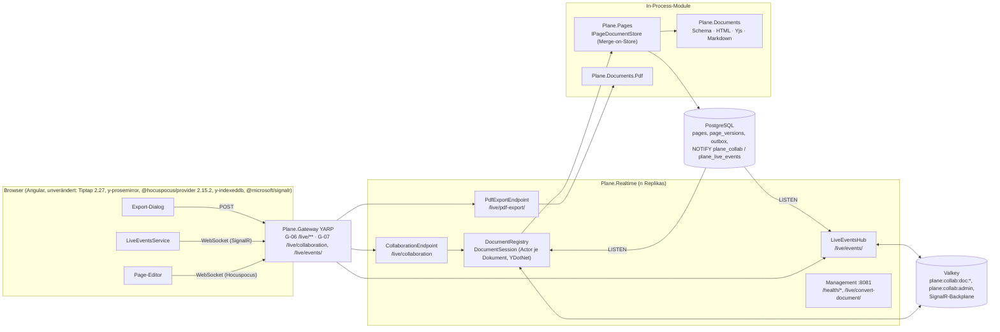
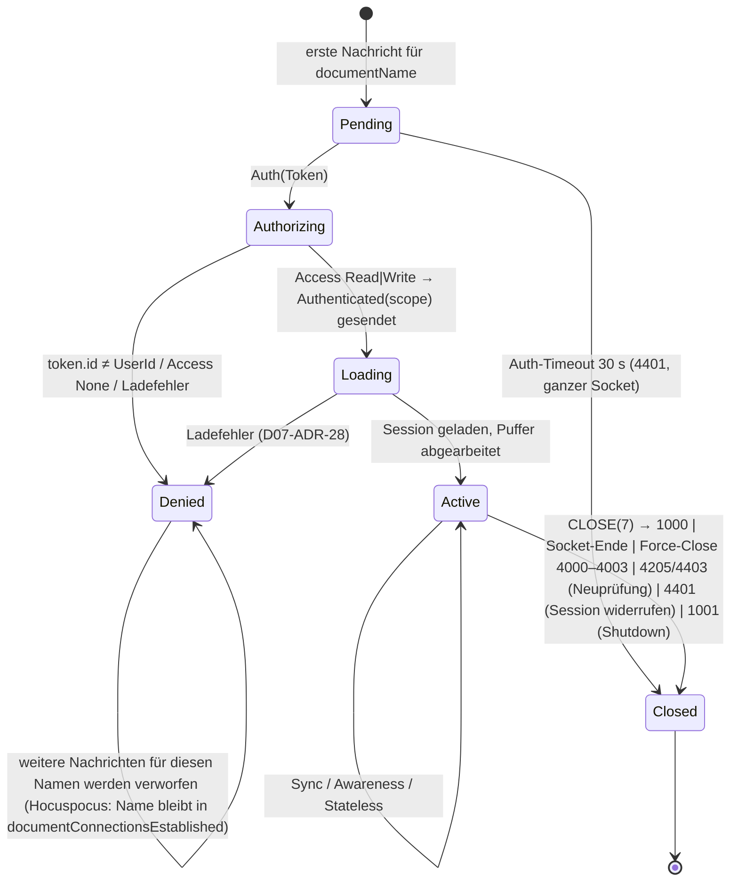
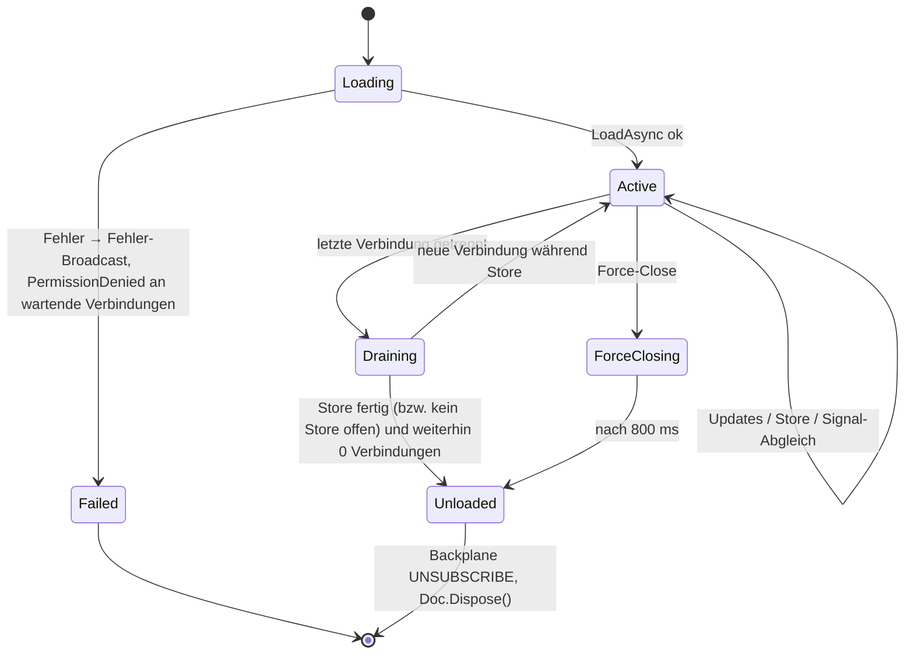

# 07 – Realtime-Kollaboration und Dokumente (Hocuspocus-Protokoll in .NET, Konvertierungen, PDF, Live-Events)

> **Stand:** 23.10.2026. **Verbindlichkeit:** verbindlich für alle Implementierungs-Agenten im Thema Realtime/Dokumente (01 Anhang A: ADR-022, -023, -029, -031, -032). Bei Widerspruch gilt `00` > `01` > `17` > dieses Dokument; wo dieses Dokument eine Signatur aus `01` §5.5 oder `16` §5.13 **präzisiert**, steht das als Änderungsauftrag in §9.2 (Regel 4 aus `17` §1: „Präzisierung, keine ADR-Änderung“).
>
> **Kürzel (wie 01):** `API/` = `apps/api/plane/`, `WEB/` = `apps/web/`, `LIVE/` = `apps/live/src/`, `PKG/` = `packages/`, `EDITOR/` = `packages/editor/src/`. Ziel: Pfade relativ zur Wurzel des Repositorys **`funk.`** (ADR-009), `BE/` = `funk./src/`, `FE/` = `funk./frontend/`. Analyse-Dokumente: `A12` = `migration/analysis/12-editor-echtzeit-live.md`, `A04` = `…/04-api-intern-arbeitsobjekte.md`, `A07` = `…/07-hintergrundjobs-mail-storage-webhooks.md`. Feature-IDs: `CE-*` aus `migration/features/10-ce-feature-katalog.md`.
>
> **Geprüfte Quellen (Stichtag 23.10.2026):** Original-Code `apps/live/src/**` (alle 49 Quelldateien), `packages/editor/src/{extensions,helpers,constants,types,hooks}/**` (Server-Schema, Konvertierer, Ereignisse, Client-Setup), `apps/web/{components/pages/editor/editor-body.tsx, components/pages/modals/export-page-modal.tsx, components/editor/pdf/document.tsx, hooks/use-parse-editor-content.ts, hooks/use-realtime-page-events.tsx, hooks/use-page-fallback.ts}`, `apps/api/plane/{app/views/page/base.py, app/serializers/page.py, bgtasks/page_version_task.py, bgtasks/copy_s3_object.py}`; npm-Tarballs **`@hocuspocus/server`, `@hocuspocus/provider`, `@hocuspocus/common`, `@hocuspocus/extension-redis` je 2.15.2** (Quelltext `src/**`, maßgeblich für das Wire-Verhalten); NuGet **`YDotNet` 0.6.0** (XML-Doku + Metadaten der Assembly: P/Invoke- und Methodensignaturen) und **`YDotNet.Native.Linux` 0.6.0** (enthaltene `libyrs.so`-Varianten); Microsoft Learn „WebSockets support in ASP.NET Core“ (aspnetcore-10.0, `KeepAliveTimeout`). Lockfile-Versionen des Originals: `@tiptap/core` 2.27.3, `@tiptap/html` 2.26.2, `zeed-dom` 0.15.1, `yjs` 13.6.27, `y-prosemirror` 1.3.7, `y-protocols` 1.0.6, `lib0` 0.2.114, `prosemirror-model` 1.25.12, `prosemirror-tables` 1.7.1.

## Inhaltsverzeichnis

1. [Ziel & Scope](#1-ziel--scope)
2. [Entscheidungen (D07-ADR-01 ff.)](#2-entscheidungen-d07-adr-01-ff)
3. [Detaildesign](#3-detaildesign)
   - 3.1 Komponenten und Projektstruktur
   - 3.2 Host `Plane.Realtime`: Pipeline, Endpunkte, Ports
   - 3.3 Wire-Protokoll (Byte-Ebene, Hocuspocus 2.15.2)
   - 3.4 Verbindungsablauf und Zustandsautomaten
   - 3.5 Authentisierung und Autorisierung
   - 3.6 Dokument-Lebenszyklus (Laden, Migration, Sitzung, Speichern, Titel-Sync, Entladen)
   - 3.7 Stateless-Ereignisse und Server-Ereignisse
   - 3.8 Force-Close, Admin-Kanal, Graceful Shutdown
   - 3.9 Awareness
   - 3.10 Horizontale Skalierung (Valkey-Backplane, PostgreSQL-Signale, Konvergenz)
   - 3.11 REST-Pfade der Pages mit Realtime-Bezug (Fallback, Versionen, Duplizieren)
   - 3.12 `Plane.Documents`: Schema, PM-JSON, HTML, Yjs
   - 3.13 Node-/Mark-Inventar mit exakter HTML-Serialisierung
   - 3.14 Markdown
   - 3.15 PDF-Export (`Plane.Documents.Pdf`, zwei Stilprofile)
   - 3.16 Realtime-Events für weitere Objekte (SignalR, H6)
   - 3.17 Konfiguration
   - 3.18 Observability
   - 3.19 Sicherheit
   - 3.20 Abweichungen vom Original und bewusst beibehaltene Eigenheiten
4. [Vollständige Mapping-Tabellen Original → Ziel](#4-vollständige-mapping-tabellen-original--ziel)
5. [Code-Skelette](#5-code-skelette)
6. [Erweiterungspunkte für Bezahl-Pakete](#6-erweiterungspunkte-für-bezahl-pakete)
7. [Akzeptanzkriterien, Tests und Spike-Plan](#7-akzeptanzkriterien-tests-und-spike-plan)
8. [Risiken & offene Punkte](#8-risiken--offene-punkte)
9. [Abhängigkeiten zu anderen Dokumenten (02–16)](#9-abhängigkeiten-zu-anderen-dokumenten-0216)

---

## 1. Ziel & Scope

### 1.1 Ziel

Der Node-Dienst `live` des Originals (Express + Hocuspocus 2.15.2 + `@react-pdf/renderer`) wird vollständig durch **reines .NET** ersetzt (ADR-002, P5 „kein Node zur Laufzeit“). Der Browser-Client (Tiptap 2.27 + `y-prosemirror` + **unveränderter `@hocuspocus/provider` 2.15.2** + `y-indexeddb`) bleibt Quelltext-identisch (ADR-042); deshalb baut der Server das **Hocuspocus-2-Wire-Protokoll** byte- und verhaltensgleich nach. Alle serverseitigen Dokument-Umwandlungen (Yjs ⇄ ProseMirror-JSON ⇄ HTML, Markdown, PDF) laufen in .NET-Bibliotheken ohne JavaScript-Laufzeit (Fallback Jint nur nach Spike-Entscheid, ADR-031). Zusätzlich legt dieses Dokument den Transport für **Live-Events weiterer Objekte** (SignalR-Hub `/live/events/`, H6-Andockstelle) fest.

Messbare Zielgrößen (Details §7):

| Ziel | Messgröße |
|---|---|
| Client unverändert | Playwright-Test mit dem Original-Paket `@hocuspocus/provider@2.15.2` besteht alle Protokollfälle P-01 … P-30 (§7.3) |
| Parität der Dokumentformate | G-DOC-Korpus (≥ 200 Dokumente): PM-JSON strukturgleich 100 %, HTML byte-gleich nach Normalisierung ≥ 99 %, Yjs-Roundtrip .NET ↔ Browser 100 % (AK-15-14) |
| Keine verlorenen Änderungen | Konvergenz 100 % in LT-17/LT-18; Merge-on-Store-Property-Test (§7.2) ohne Verlust |
| PDF-Optik | Pixel-Diff ≤ 2 % je Seite gegen Original (beide Profile, S3) |
| Betrieb | Speicherwachstum < 5 % in 1 h Soak (LT-20); Reconnect-Sturm < 15 s (LT-19) |

### 1.2 Scope

| Im Scope (dieses Dokument legt fest) | Nicht im Scope (zuständiges Dokument) |
|---|---|
| Hocuspocus-Wire-Protokoll (Server), Verbindungs-/Dokument-Lebenszyklus, Awareness, Stateless-Ereignisse, Titel-Sync, Force-Close, Admin-Kanal, Close-Codes | Angular-Editor, NodeViews, `CollaborationSession`-Service im Browser (→ `10-editor-angular.md`, `08` §3.12) |
| Persistenz-Semantik `description_binary` inkl. HTML→Binary-Migration, Merge-on-Store, Debounce, Versionierung der Page-Inhalte, PageLog-Auslösung | Tabellen-/Spaltendefinition der Entitäten (→ `03-datenmodell-efcore.md`; hier nur die Anforderungen, §3.6.8) |
| `Plane.Documents`: C#-Port des Server-Schemas (alle Nodes/Marks), HTML-Serialisierung und -Parsing, Yjs-Abbildung, Text-Extraktion, Markdown, Validierung | HTML-Sanitizing-Allowlist (→ `05` §3.17.3, `HtmlSanitizerProfile`) |
| `Plane.Documents.Pdf`: PDF-Export in zwei Stilprofilen (Live- und Web-Optik) | Export-Dialog im Angular-Client (→ `08`, `10`) |
| Skalierung: Valkey-Pub/Sub-Backplane, PostgreSQL-Signale, Graceful Shutdown | Route/Timeouts im Gateway, Replikas, Images (→ `14`; hier: Ping-Intervall, Shutdown-Verhalten, Speicherbedarf, Absicherung `/live/convert-document/`, wie in `14` §9 angefragt) |
| SignalR-Hub `/live/events/`: Transport, Gruppen-Autorisierung, Publisher-Pfade | Katalog der Ereignisnamen/Nutzlasten je Fachobjekt (→ `06`), Frontend-Handler (→ `08` §6) |
| Erweiterungspunkte der 🧱-Pakete in diesem Bereich (§6) | Fachdesign der Bezahl-Pakete (erst kurz vor W1/W3) |

### 1.3 Begriffe

| Begriff | Bedeutung |
|---|---|
| **Dokumentname** (`documentName`) | Erster Wert jeder Hocuspocus-Nachricht (`varString`). In der CE = Page-ID als UUID-String (`HocuspocusProvider({name: docId})`, `docId = page.id`). |
| **Dokumenttyp** (`documentType`) | Query-Parameter des WebSocket-Upgrades; CE: nur `project_page` (`LIVE/types/index.ts` `TDocumentTypes`). |
| **Fragment** | Benanntes `Y.XmlFragment` im `Y.Doc`: `default` (Inhalt, Tiptap `Collaboration.configure({field:"default"})`) und `title` (Titel-Editor, `field:"title"`). Beide Namen sind Teil des Datenformats (`A12` §5.7 Punkt 2). |
| **Zustand** (`state`) | `Y.encodeStateAsUpdate(doc)` (Update-Format v1) = Inhalt von `pages.description_binary`. |
| **Sitzung** (`DocumentSession`) | Ein geladenes Dokument in einer `Plane.Realtime`-Instanz mit allen lokalen Verbindungen (entspricht Hocuspocus `Document`). |
| **Verbindung** (`DocumentConnection`) | Eine Kombination aus WebSocket und Dokumentname (Hocuspocus `Connection`; ein WebSocket kann mehrere Dokumente multiplexen). |
| **Backplane** | Instanzübergreifende Verteilung von Updates/Awareness/Stateless (Valkey-Pub/Sub). |
| **Signal** | Leichtgewichtige PostgreSQL-`NOTIFY`-Nachricht über externe Änderungen (REST-Speichern, Zugriffsänderung) an alle Realtime-Instanzen. |

### 1.4 Welcher Teil wird in welchem Inkrement gebraucht

Die Inkremente folgen `01` §1.3. Jede Zeile ist ein abnehmbarer vertikaler Schnitt (Backend + Frontend-Anteil + Tests); die Arbeitspaket-IDs vergibt `migration/plan/_data/wp-ce.json`.

| Inkrement | Bausteine aus diesem Dokument (müssen fertig sein) | CE-IDs | Abnahme (Auszug, §7) |
|---|---|---|---|
| **I0 Walking Skeleton** | Host `Plane.Realtime` mit `RealtimeComposition` (Health `/live/health/` auf App-Port, `/health/*` auf Management-Port), `WebSocketOriginValidator` + `SessionTicketReader` (05), leerer SignalR-Hub `/live/events/` (H6-Gerüst, `IRealtimeGroupAuthorizer` mit CE-Präfixen), `/live/{**}`-Fallback 404 `{"message":"Not Found"}`, Gateway-Routen G-06/G-07 (14). **Spike-Track:** S1 (Protokoll/YDotNet), S2 (Konvertierung inkl. typisierter Attribute, §7.6), S3 (PDF) laufen ab Tag 3 und liefern `docs/spikes/S{1,2,3}-ergebnis.md`. | CE-RT-009 (Gerüst), CE-OPS-021 (Hub-Gerüst) | AK-07-01, AK-07-02; `RealtimeSmokeTests` (Hub-Teil) |
| **I1 Workspace, Projekte, Konto** | – (keine Realtime-Funktion). `Plane.Documents.Text.HtmlTextExtractor` wird für `description_stripped` von Workspaces/Projekten **noch nicht** gebraucht (Projekt-Beschreibung ist Text). | – | – |
| **I2 Work Items & Layouts** | `Plane.Documents` Teil A: Server-Schema aller Nodes/Marks (§3.13), `HtmlSerializer`, `HtmlParser`, PM-JSON-Modell, `HtmlTextExtractor`, `YjsUpdateValidator` (05 §3.17.3) und `DocumentConverter.ConvertHtmlToAllFormats(variant: Rich)` für Work-Item-Beschreibungen, Kommentare, Stickies (`description_binary` optional, nur Validierung); Golden-Korpora G-SCHEMA, G-DOC (HTML↔JSON-Teil). Lite-Editor-Spike S5 (Dokument 10). | CE-WI-005, CE-WI-037, CE-OPS-017, CE-PAGE-021/-022 (Server-Teil) | AK-07-20 … AK-07-23 |
| **I3 Planung** | – | – | – |
| **I4 Pages & Realtime** | Vollständig: `Plane.Collaboration` (+ `.Protocol`, `.Contracts`), `ProjectPageDocumentType`, `IPageDocumentStore` in `Plane.Pages` mit Merge-on-Store, HTML→Binary-Migration, Titel-Sync, Versionierung (Fix CE-PAGE-019), PageLog-Event, Stateless/Force-Close/Admin-Kanal, Awareness, Valkey-Backplane + In-Memory-Backplane, PostgreSQL-Signale, REST-Fallback-Merge, Duplizieren mit Asset-Umschreibung, `Plane.Documents` Teil B (Yjs-Abbildung, `YjsUpdateWriter`, Document-Variante), `Plane.Documents.Pdf` (Profile `live` und `web`), Markdown (`HtmlToMarkdownConverter`, `MarkdownRenderer`), Management-Endpunkt `/live/convert-document/`. Lasttests LT-16 … LT-20. | CE-RT-001 … -009, CE-PAGE-005 … -013, -019, -037 (Server), CE-WI-041 (Formate) | AK-07-03 … AK-07-19, AK-07-24 … AK-07-36 |
| **I5 Überblick** | Erste Nutzung des Hubs: `IRealtimePublisher` mit beiden Publisher-Pfaden (§3.16.4), `RealtimeFanOutConsumer` (Notification-Zähler; Ereignisnamen aus 06), Client `LiveEventsService` (08). Text-Extraktion für Such-Index (`IIndexingPipeline`, G1-Andockstelle) nutzt `HtmlTextExtractor`. | CE-NOTIF-001 (Zähler-Push), CE-SRCH (Index-Text) | AK-07-37 … AK-07-40 |
| **I6 Außenwirkung** | Space zeigt Beschreibungen als gespeichertes HTML (kein Realtime-Pfad); Webhook-/Public-API-Nutzlasten nutzen `description_html` aus der Persistenz. Keine neuen Bausteine. | CE-SPACE-*, CE-API-* (nur Nutzung) | – |
| **I7 Härtung** | Soak/Last im Nightly, AIO-Variante (`Plane.AllInOne` mit In-Memory-Backplane), Airgap-Prüfung Fonts/Emoji-Font, CLI `plane-cli realtime …` (§3.8.4), Multi-Arch-Smoke mit `libyrs`/SkiaSharp | CE-OPS-004 (AIO) | AK-07-41 … AK-07-43 |
| **W1** | H6 vollständig (Events aller Objekte über dieselben Pfade), F2-Issue-Sync nutzt `MarkdownRenderer`/`HtmlToMarkdownConverter` | EE-* (W1) | Paket-Plan |
| **W3** | D1 (`workspace_page`), D2 (`affectedPages`, Eltern-Titel-Broadcast), D3, D4 (Presence-Flag), D5 (Export-Erweiterungen) docken an §6 an | EE-* (W3) | Paket-Plan |

### 1.5 Überblick



---

## 2. Entscheidungen (D07-ADR-01 ff.)

Spalte „ab“ = Inkrement der ersten Umsetzung. „Spike“ = Entscheidung steht unter dem Vorbehalt des genannten Spikes; der Fallback ist in §7.6 hinterlegt.

| Nr. | Belang | Entscheidung | Alternativen (verworfen) | Begründung | ab |
|---|---|---|---|---|---|
| **D07-ADR-01** | Protokoll | **Server-seitiger Nachbau des Hocuspocus-2.15.2-Protokolls** (Nachrichtentypen, Reihenfolgen, Antwortpflichten, Timeouts, Close-Codes) mit dem Quelltext von `@hocuspocus/server@2.15.2` als **Verhaltensreferenz** (Dateien `ClientConnection.ts`, `Connection.ts`, `Document.ts`, `MessageReceiver.ts`, `OutgoingMessage.ts`, `Hocuspocus.ts`). Der Client bleibt der unveränderte Provider. | y-websocket-Protokoll + Provider-Tausch (Fallback 1 aus `01` §9 S1); Node-Sidecar (verletzt ADR-002) | Parität ohne Client-Änderung; das Protokoll ist klein (9 Typen) und im Quelltext vollständig sichtbar | I0 (S1), I4 |
| **D07-ADR-02** | Codec-Ort | Kodierung/Dekodierung (lib0, Hocuspocus-Rahmen, y-protocols-Sync, Awareness-Update) in einer **eigenen, abhängigkeitsfreien Assembly `Plane.Collaboration.Protocol`** (nur BCL, `public`), genutzt von `Plane.Collaboration` **und** `Plane.LoadTests.Collaboration` (D15-ADR-14). Architekturtest `CollaborationProtocolIsPure`: keine Referenz außer `System.*`. | Codec in `Plane.Collaboration` (`internal`, R9) – Lasttest käme nicht heran; `YDotNet.Protocol` (y-websocket-orientiert, async-Stream-API, keine Hocuspocus-Rahmen) | Gleicher Codec in Server und Lasttest-Client, testbar ohne Native-Lib; Namespace `Plane.Collaboration.Protocol` wie in `15` §3.12.3 | I0 (S1) |
| **D07-ADR-03** | Nebenläufigkeit | **Ein Actor je geladenem Dokument** (`DocumentSession` mit `Channel<IDocumentCommand>`, eine Verarbeitungsschleife). Jeder YDotNet-Zugriff (`Doc`, Transaktionen, Beobachter) geschieht ausschließlich innerhalb dieser Schleife; Sockets schreiben über je eine eigene Sende-Queue (`Channel<ReadOnlyMemory<byte>>`, begrenzt 1 024, bei Überlauf Close 1008). | Locks pro Dokument; geteiltes `Doc` über Threads | YDotNet/yrs erlaubt nur eine schreibende Transaktion; der Actor serialisiert wie die Node-Event-Loop und macht Reihenfolgen deterministisch testbar | I4 |
| **D07-ADR-04** | Authentisierung | **Session-Cookie aus dem Upgrade-Request** (Cookie-Schema mit `PostgresTicketStore`, 05 §3.11); das Hocuspocus-`token` (`{id, name, color}`) dient nur dem Abgleich `token.id == principal.UserId`. **Kein** Cookie aus dem Token (`token.cookie`) und **kein** Cookie aus Query-Parametern (SEC-41, E26). `Origin`-Pflicht vor dem Upgrade (D05-ADR-22, SEC-42). | Token im Query-String; HTTP-Rundreise an die API (Original `GET /api/users/me/`) | Gleiches Sicherheitsmodell wie HTTP, keine Hosts-Kopplung per HTTP (`01` §3.2) | I4 (Origin ab I0) |
| **D07-ADR-05** | Autorisierung | **Prüfung je Verbindung** über `ICollaborationDocumentType.AuthorizeAsync` (CE: `project.page.read` + `PAGE`-Regel, `05` §3.13.5); Scope **`read-write` nur mit `project.page.update`**, sonst `readonly`. Updates einer `readonly`-Verbindung werden nicht angewendet (Antwort `SyncStatus(0)`, Hocuspocus-Semantik). Zugriffsänderungen während der Sitzung lösen eine Neuprüfung aller Verbindungen aus (Signal `access`, §3.10.5): Verlust des Leserechts → Close **4403**; Wechsel `read-write`→`readonly` → Close **4205** (Client verbindet neu und erhält `readonly`). | Prüfung nur beim ersten Laden (Original, E3/SEC-40) | Schließt die Lücke E3; Rechte folgen dem Permission-Katalog (E5 tauscht nur die Evaluator-Implementierung) | I4 |
| **D07-ADR-06** | Persistenz | **Merge-on-Store**: `IPageDocumentStore.SaveAsync` sperrt die Page-Zeile (`SELECT … FOR UPDATE`), führt den gespeicherten Zustand und den Sitzungszustand als Yjs-Updates zusammen (`YjsMerge.Merge`, entspricht `applyUpdates` aus `EDITOR/helpers/yjs-utils.ts`), leitet daraus HTML/JSON/Text ab und schreibt in **einer** Transaktion. Der zusammengeführte Zustand fließt in die Sitzung zurück. Keine Redlock-Sperre. | Hocuspocus-Redis-Redlock „nur eine Instanz speichert“ (Original); Last-Writer-Wins | CRDT-Merge ist kommutativ und idempotent → keine verlorenen Updates, auch bei Backplane-Ausfall, parallelem REST-Fallback (CE-RT-003) und mehreren Instanzen | I4 |
| **D07-ADR-07** | Debounce | **Exakte Hocuspocus-2.15.2-Semantik:** Store `debounce` = 10 000 ms, `maxDebounce` = 10 000 ms (Default aus `Hocuspocus.ts` `defaultConfiguration`, von Plane nicht überschrieben), Prüfung von `maxDebounce` nur beim nächsten Update; **sofort** beim Trennen der letzten Verbindung (`unloadImmediately: true`); nur Updates **lokaler** Verbindungen planen einen Store (Updates aus der Backplane nicht). Titel-Store: Trailing-Debounce 5 000 ms mit Abbruch laufender Vorgänge (`TitleUpdateManager`). | „10 s, max. 60 s“ aus `A12` §3.3/§3.5 – die 60 s stammen aus älteren Hocuspocus-Versionen und sind für 2.15.2 **falsch** (korrigiert) | Gleiches Last-/Speicherprofil wie das Original (LT-20: ≤ 1 Schreibvorgang je 10 s je Dokument) | I4 |
| **D07-ADR-08** | Abgeleitete Formate | `description_html`, `description_json`, `description_stripped` werden **immer serverseitig aus dem zusammengeführten Zustand** erzeugt – auch beim REST-PATCH `…/description/` (CE-RT-003); vom Client gesendetes HTML/JSON wird nur noch validiert (Sanitizer-/Längenprüfung wie Original), nicht übernommen. HTML durchläuft danach `HtmlSanitizerProfile` (05) wie im Original `validate_html_content`. | Client-HTML speichern (Original beim REST-Fallback) | Konsistenz zwischen Binary und HTML; kein Auseinanderlaufen durch alte Clients | I4 |
| **D07-ADR-09** | Typisierte Yjs-Attribute | **YDotNet 0.6.0 kennt XML-Element-Attribute nur als `string`** (geprüft: `XmlElement.InsertAttribute(Transaction, string, string)`, `GetAttribute(...) : string`, Enumerator `KeyValuePair<string,string>`), während `y-prosemirror` typisierte Werte schreibt (`level: 1`, `checked: false`, `colwidth: [150]`). Daher: **Schreiben** neuer Inhalte (HTML→Yjs, Titel-Migration, Duplizieren) über einen **eigenen Update-Encoder `YjsUpdateWriter`** (Yjs-Update-Format v1, nur „frisches Dokument eines Clients“, ContentType/ContentString/ContentFormat/ContentAny), der das Ergebnis per `ApplyV1` in YDotNet lädt; **Lesen** über YDotNet mit **schema-gesteuerter Typ-Rückwandlung** (`AttributeCoercion`, §3.12.6). Text-Formatierungen (Marks) sind in YDotNet typisiert (`Input.Object`, `TextChunk.Attributes`) und brauchen keine Sonderlösung. | Attribute als Strings schreiben (bricht `checked: "false"` → wahr, `colwidth` als String → Tabellen-Resize defekt); Jint+`yjs` für alle Pfade | Einziger Weg, mit YDotNet 0.6 browsergleiche Zustände zu erzeugen; der Encoder ist eng begrenzt (Erzeugung, keine Integration) und gegen Original-`yjs` im Browser prüfbar (G-DOC) | Spike S2 (Kriterium S2-K6), I4 |
| **D07-ADR-10** | Deterministische Server-Schreibvorgänge | Server erzeugt Yjs-Inhalte **nur** als deterministische Initial-Updates: HTML→Binary-Migration mit Client-ID `ClientIds.ContentMigration(pageId)`, Titel-Migration mit `ClientIds.TitleMigration(pageId)` (je 32-Bit aus SHA-256 von `"{pageId}:content"` bzw. `":title"`, ungleich 0), Clock ab 0. Die Migration läuft unter Zeilensperre und prüft das leere Binary erneut. | Zufällige Client-IDs (Original) | Parallele Migration in zwei Instanzen erzeugt **identische** Updates → Merge idempotent statt doppeltem Inhalt | I4 |
| **D07-ADR-11** | Dokument-Bibliothek | **`Plane.Documents`**: C#-Port des Server-Schemas `CoreEditorExtensionsWithoutProps` (+ `DocumentEditorExtensionsWithoutProps`) mit **einer Klasse je Tiptap-Extension** (`IDocumentNodeSpec`/`IDocumentMarkSpec`, DI-Sammlung, Erweiterungspunkt E-11). HTML-Ausgabe = Port von ProseMirror `DOMSerializer` + Tiptap `mergeAttributes`/`getRenderedAttributes` + Serialisierer von `zeed-dom` 0.15.1; HTML-Eingabe = Port von ProseMirror `DOMParser` (Parse-Regeln, Prioritäten, Whitespace-Regeln) auf AngleSharp. Golden-Files aus dem Original (`tools/golden/generate.mjs`). | Allgemeiner HTML-Mapper ohne Schema; Jint als Primärweg | Byte-Parität prüfbar, keine JS-Laufzeit, erweiterbar für D9/D10 | I2 (HTML/JSON), I4 (Yjs) |
| **D07-ADR-12** | Server-HTML ohne Block-IDs | Das Server-Schema enthält wie im Original **kein** `UniqueID` → serverseitig erzeugtes HTML/JSON trägt **kein** `data-id`/`id` an Blöcken (E20). Block-IDs bleiben im Yjs-Zustand erhalten. Knoten mit eigenem `id`-Attribut (`imageComponent`, `calloutComponent`, `mention`, `issue-embed-component`) rendern es weiter. | `data-id` serverseitig mitrendern (Empfehlung `A12` O6) | Golden-Parität von `description_html`/`description_json` zum Original; Deep-Links nutzen den Browser-Editor (Yjs) | I2 |
| **D07-ADR-13** | Quirks der Serialisierung | `renderHTML`/`parseHTML` werden **1:1** übernommen, auch E16 (`customColor` matcht jedes `<span>`), E17 (`style="background-color: null; color: null;"` an `td`) und E15 (`colwidth` nur erster Wert). Funktionale Folgefehler werden **an der Nutzungsstelle** korrigiert (PDF-Renderer ignoriert `null`-Farben; Web-Profil entfernt sie wie `use-parse-editor-content.ts`). | Quirks im Serialisierer beheben | Byte-Parität des gespeicherten HTML; Z-12 (optisch 1:1, funktionale Fehler korrigieren) wird an der Wirkungsstelle erfüllt | I2 |
| **D07-ADR-14** | Skalierung | **Valkey-Pub/Sub** mit Kanal je Dokument `plane:collab:doc:{documentName}` und Admin-Kanal `plane:collab:admin`, eigenes Binärformat (§3.10.2); Updates werden als Yjs-Update gepusht, Anti-Entropie per SyncStep1/2 beim Laden und nach Wiederverbindung. Ohne Valkey (eine Replika, D14-ADR-21) `InMemoryCollaborationBackplane`. Keine Sticky Sessions (Dokumentname steht nicht in der URL). | Hocuspocus-Redis-Format (Pull über SyncStep1 bei jeder Änderung); Sticky Routing per YARP (unmöglich, Name nur in Nachrichten); PostgreSQL `LISTEN/NOTIFY` für Updates (8-KB-Grenze) | Geringe Latenz (LT-17 p95 < 150 ms), einfacher Push; Pflicht-Valkey ab 2 Replikas ist in 14 bereits festgelegt | I4 |
| **D07-ADR-15** | Externe Änderungen | **PostgreSQL-Signale** `NOTIFY plane_collab, '<json>'` (≤ 512 Byte) aus der schreibenden Transaktion (REST-PATCH `description`, Lock/Unlock, Archiv, Zugriff, Löschen, Speichern einer anderen Instanz). Jede Realtime-Instanz lauscht (`LISTEN`) und gleicht betroffene Sitzungen ab. Funktioniert ohne Valkey und hostübergreifend (Api → Realtime). | Outbox-Consumer (läuft im Worker, nicht im Realtime-Host); Valkey (optional) | PostgreSQL ist immer vorhanden (P4); Zustellung erst nach Commit | I4 |
| **D07-ADR-16** | Stateless | Mapping Server↔Client-Namen **1:1** aus `EDITOR/constants/document-collaborative-events.ts`; JSON-Formate (`BroadcastedEvent`, `force_close`) **byte-kompatibel** zu `createRealtimeEvent`. **Neu:** Server plausibilisiert Client-Stateless gegen den Page-Zustand, bevor er rundsendet (Sicherheitskorrektur SEC-RT-01), und erzeugt `error_code: page_locked`/`page_archived`, wenn Updates wegen Sperre/Archiv abgewiesen werden (Fix E4). | Ungeprüftes Rundsenden (Original) | Verhindert vorgetäuschte „deleted“/„locked“-Meldungen durch beliebige Verbindungen; Client-Code unverändert | I4 |
| **D07-ADR-17** | Force-Close & Shutdown | Force-Close-Ablauf 1:1 (Stateless-JSON `force_close` → 50 ms → Close mit Code/Grund → Admin-Kanal → 800 ms → Entladen); Codes 4000–4003 und Texte aus `LIVE/types/admin-commands.ts`. **Graceful Shutdown** dagegen: alle offenen Stores sofort ausführen, dann Verbindungen mit **1001 „server_shutdown“** schließen (kein 4000), damit der Client (`use-yjs-setup.ts`: 4000–4003 = „forced“, pausiert) automatisch neu verbindet. | Shutdown per Force-Close 4000 (Client bliebe getrennt); Original `closeConnections()` ohne Code | Rolling Restart ohne Nutzeraktion (LT-19) | I4 |
| **D07-ADR-18** | Größenlimits | `MaxMessageBytes` = 10 MiB je WebSocket-Nachricht (Überschreitung → Close 1009 „Message Too Big“, Provider verbindet nicht neu); `MaxDocumentBytes` = 10 MiB für den zusammengeführten Zustand (= Limit von `validate_binary_data`, 05). Überschreitung beim Store → `error` (`content_too_large`, `should_disconnect: true`) + Force-Close 4001 `document_too_large` instanzübergreifend (CE-RT-006). | Proxy-413 als Auslöser (Original) | Explizite, testbare Grenze statt Zufall der Proxy-Konfiguration | I4 |
| **D07-ADR-19** | Konvertierung API-seitig | Konvertierungen laufen **In-Process** über `IDocumentConverter` (`Plane.Documents`) in jedem Host. `POST /live/convert-document/` existiert nur noch auf dem **Management-Port** (Diagnose/Paritätstest, SEC-39) und korrigiert E2 (Page = `document`, Work Item = `rich`). | Öffentlicher Endpunkt (Original, E8) | Keine unauthentisierte Rechenlast über das Gateway; keine Hosts-Kopplung | I4 |
| **D07-ADR-20** | PDF | **Ein Renderer, zwei Stilprofile** in `Plane.Documents.Pdf` (PDFsharp/MigraDoc exakt `[6.2.4]`, ADR-029): Profil **`live`** = Optik `LIVE/lib/pdf/*` (Endpunktvertrag `/live/pdf-export/`), Profil **`web`** = Optik `WEB/components/editor/pdf/document.tsx` + Vorverarbeitung aus `WEB/hooks/use-parse-editor-content.ts`. Der Angular-Export-Dialog ruft `POST /live/pdf-export/` mit `profile: "web"` (additives Feld). Bilder direkt aus `IObjectStorage` (kein HTTP-Redirect), Bildpipeline SkiaSharp (ADR-032), Mentions per Mitglieder-Lookup (Fix E27), Callout-Emoji als Zeichen mit gebündelter Schrift Noto Emoji (OFL-1.1, Fix E6). | Clientseitiges PDF im Browser beibehalten (`@react-pdf/renderer` im Angular-Bundle) – zweiter Renderer, Node-artige Bibliothek im Frontend; nur Live-Optik | ADR-029 verlangt serverseitigen Export auch für das Web; die CE-Nutzer sehen heute die Web-Optik → beide Optiken nötig | I4 (S3 in I0-Track) |
| **D07-ADR-21** | Markdown | Client-Markdown (Copy as Markdown, Markdown-Export, Clipboard) bleibt **Quelltext-identisch** im Browser (`convertHTMLToMarkdown` aus `PKG/utils/src/editor/markdown-parser`). Serverseitig zwei Bausteine: `HtmlToMarkdownConverter` (Port derselben Regeln, für W1-Sync und spätere Exporte) und `MarkdownRenderer` (Markdown→HTML über **Markdig**, BSD-2-Clause; Port-Ziel von `API/utils/markdown.py`, 02 §4). | Markdown nur im Client; eigener Markdown-Parser | W1 (Forgejo-Issue-Sync, ADR-007) braucht beide Richtungen serverseitig; Markdig ist reif und permissiv | I4 (Bausteine), W1 (Nutzung) |
| **D07-ADR-22** | Page-Versionen | Versionen werden **erzeugt** (Fix CE-PAGE-019: Original-Task greift auf nicht existierendes `page.description` zu und bricht immer ab, `A04` §2.14): synchron in `SaveAsync`, wenn sich `description_html` ändert – jüngste Version (nach `last_saved_at`) desselben Nutzers mit `now − last_saved_at ≤ 600 s` wird überschrieben (`last_saved_at` bleibt dabei unverändert → feste 10-Minuten-Fenster wie Original, `A07` §T31), sonst neue Version; > 20 Versionen → älteste weich löschen (Original-Regeln aus `API/bgtasks/page_version_task.py`). Die Grenze 20 wird Instanz-Einstellung `PAGE_VERSION_LIMIT` (ADR-001, über E-12). | Weiterhin asynchroner Task | Gleiche Transaktion wie der Inhalt; keine Zusatzlast im Worker | I4 |
| **D07-ADR-23** | PageLog | `page_logs` (Mentions, Bilder, Work-Item-Referenzen aus dem HTML, CE-PAGE-012) wird **asynchron** über das Integration-Event `plane.page.description_updated.v1` (Outbox) in `Plane.Pages` synchronisiert; der Consumer gleicht gegen den aktuellen Inhalt ab (idempotent, reihenfolgeunabhängig) statt gegen „altes HTML“. | Synchron im Store; altes HTML im Event (Original `page_transaction`) | Kurze Sperrzeit im Store, robuste Wiederholung | I4 |
| **D07-ADR-24** | Duplizieren | Page duplizieren (CE-PAGE-009) erzeugt den neuen Zustand **synchron**: Binary → PM-JSON → `imageComponent.src` auf neue Asset-IDs umschreiben → `YjsUpdateWriter` (Inhalt + Titel „{name} (Copy)“) → HTML/JSON; Asset-Zeilen werden sofort angelegt, die Objektkopie läuft als Job. Variante `document` (Fix E2). | Asynchron wie Original (`copy_s3_objects_of_description_and_assets` + Live-Konvertierung; Fenster ohne Binary, Race mit HTML-Migration) | Kein Zwischenzustand; Kopie sofort kollaborativ öffenbar | I4 |
| **D07-ADR-25** | Awareness | Eigene Implementierung der **y-protocols-Awareness-Semantik** (`Plane.Collaboration/Awareness/AwarenessRegistry`): Clock-Regeln, Entfernen (State `null`), Timeout 30 s, Zuordnung Client-ID → Verbindung, Entfernen beim Trennen, **Echo an alle Verbindungen einschließlich Sender**. | Awareness nur durchreichen (ohne Zustand); YDotNet-Awareness (existiert nicht) | Der Provider schließt die Verbindung, wenn 30 s keine Nachricht kommt (`messageReconnectTimeout` 30 000 ms); die 15-s-Erneuerung der eigenen Awareness, die der Server zurückspiegelt, hält leerlaufende Editoren verbunden | I4 |
| **D07-ADR-26** | Dokumenttypen | Registry `ICollaborationDocumentType` (E-10, aus `16` §5.13) mit **präzisierten Rückgabetypen** (§5.4); `documentName` ist für `project_page` eine UUID, sonst `PermissionDenied`. Unbekannter `documentType` → Fehlertext `Invalid document type {type} provided.` (Original `LIVE/services/page/handler.ts`) im Log, Client erhält `PermissionDenied("permission-denied")`. | Hart verdrahtete Page-Logik | D1/B1 registrieren weitere Typen ohne Protokolländerung | I4 |
| **D07-ADR-27** | Live-Events (H6) | SignalR-Hub `LiveEventsHub` unter `/live/events/` **nur WebSockets** (`HttpTransportType.WebSockets`, Client `skipNegotiation: true`), Cookie-Schema, Origin-Prüfung; Client-Methoden `JoinGroup`/`LeaveGroup`, Server-Methode `event` mit `LiveEvent {event, group, payload, occurred_at}`; Gruppen-Autorisierung ausschließlich über `IRealtimeGroupAuthorizer` (E-22). **Publisher-Pfade:** mit Valkey → `IHubContext` + Valkey-Backplane aus jedem Host (Api, Worker, Realtime); ohne Valkey → `NOTIFY plane_live_events` und lokale Zustellung in der (einzigen) Realtime-Replika. | Nur Valkey (Einzelknoten ohne Valkey hätte keine Live-Events); SSE | Erfüllt ADR-023 (Backplane Valkey) und D14-ADR-21 (Valkey optional bei einer Replika) | I0 (Hub), I5 (Nutzung) |
| **D07-ADR-28** | Fehler beim Laden | Ladefehler eines Dokuments → wie Hocuspocus: Stateless-JSON `error` (`error_type: "fetch"`, Text „Unable to load the page. Please try refreshing.“) an bereits verbundene Verbindungen, dann **`PermissionDenied("permission-denied")`** an die anfragende Verbindung (Hocuspocus sendet bei Fehlern in `setUpNewConnection` PermissionDenied; Client → `auth-failed`). | Close 1011 | Client-Verhalten identisch zum Original | I4 |
| **D07-ADR-29** | Fallback-Engine (nur bei S2-Abbruch) | **Jint 4.x** (BSD-2-Clause) mit einem zur Build-Zeit per esbuild erzeugten ES2020-IIFE-Bundle (`@tiptap/html` 2.26.2, `zeed-dom` 0.15.1, `yjs` 13.6.27, `y-prosemirror` 1.3.7, `CoreEditorExtensionsWithoutProps`), Pool von Engines (Größe = CPU-Kerne), Einsatz hinter derselben Schnittstelle `IDocumentConverter`. | Node-Sidecar | ADR-002; Schnittstelle bleibt stabil | nur nach S2-Entscheid |

### 2.1 Abwägung der Kernentscheidungen

| Entscheidung | (a) Parität/Client | (b) Risiko | (c) Betrieb | Ergebnis |
|---|---|---|---|---|
| D07-ADR-01 Protokoll-Nachbau | Client unverändert | YDotNet-Reife (S1) | kein Node | angenommen mit Fallback-Kette §7.6 |
| D07-ADR-06 Merge-on-Store | keine Änderung | Merge-Kosten O(Dokumentgröße) je Store; bei 10 MiB ≈ 20–50 ms (in S1 messen) | keine Locks außer Zeilensperre | angenommen |
| D07-ADR-09 Eigener Update-Encoder | browsergleiche Zustände | Encoder-Fehler → inkonsistente Dokumente; abgesichert durch Browser-Dekodierung aller G-DOC-Fälle | – | angenommen, Spike-Kriterium S2-K6 |
| D07-ADR-14/-15 Valkey + PostgreSQL-Signal | – | zwei Kanäle | Valkey nur ab 2 Replikas | angenommen |
| D07-ADR-20 Zwei PDF-Profile | beide Original-Optiken | doppelte Stiltabellen | ein Renderer | angenommen, S3 prüft beide |

---

## 3. Detaildesign

### 3.1 Komponenten und Projektstruktur

Ergänzt `01` §5.1 (Ordner existieren dort bereits; neu ist nur `Plane.Collaboration.Protocol`, D07-ADR-02). Alle Typen außer den als `public` markierten sind `internal` (R9).

```text
funk./
├── src/
│   ├── hosts/
│   │   ├── Plane.Realtime/
│   │   │   ├── Program.cs                         # var app = RealtimeComposition.Build(args); app.Run();
│   │   │   └── Security/                          # (05) WebSocketOriginValidator.cs, SessionTicketReader.cs
│   │   └── Plane.Hosting/Realtime/
│   │       ├── RealtimeComposition.cs             # Pipeline §3.2, Modulkatalog (02 §3.1: Identity, Authorization, Workspaces,
│   │       │                                       #   Projects, Pages, Collaboration, RealtimeEvents)
│   │       └── RealtimeHealthEndpoint.cs          # GET /live/health/ (App-Port, CE-RT-009)
│   ├── documents/
│   │   ├── Plane.Documents/                       # public API: IDocumentConverter, DocumentVariant, PmNode/PmMark, IDocumentNodeSpec …
│   │   │   ├── Schema/                            # DocumentSchema, SchemaVariant, AttributeSpec, ContentExpression(+Parser), MarkSet
│   │   │   │   ├── Nodes/                         # je Extension eine Klasse (§3.13.1): DocNodeSpec … WorkItemEmbedNodeSpec
│   │   │   │   ├── Marks/                         # BoldMarkSpec … CustomColorMarkSpec (§3.13.2)
│   │   │   │   └── GlobalAttributes/              # TextAlignGlobalAttribute (paragraph, heading)
│   │   │   ├── Model/                             # PmNode, PmMark, PmJson (System.Text.Json), PmNodeBuilder, SchemaValidator
│   │   │   ├── Html/                              # HtmlSerializer, DomOutputSpec, TiptapAttributeMerger, ZeedDomWriter,
│   │   │   │                                       # HtmlParser, ParseRule, WhitespaceMode, MarkParseRules, UrlProtocolRules
│   │   │   ├── Yjs/                               # YjsProseMirrorMapper, AttributeCoercion, YjsUpdateWriter (+Lib0Writer-Nutzung),
│   │   │   │                                       # YjsMerge, YjsUpdateValidator, ClientIds, FragmentNames
│   │   │   ├── Conversion/                        # DocumentConverter : IDocumentConverter (Port EDITOR/helpers/yjs-utils.ts),
│   │   │   │                                       # TitleDocuments (generateTitleProsemirrorJson), DocumentAssetRewriter
│   │   │   ├── Text/                              # HtmlTextExtractor (02 §4: html_processor.py), PlainTextRenderer (renderText)
│   │   │   ├── Markdown/                          # HtmlToMarkdownConverter (Port PKG/utils/src/editor/markdown-parser),
│   │   │   │                                       # MarkdownRenderer (Markdig, Port-Ziel API/utils/markdown.py)
│   │   │   ├── References/                        # DocumentReferenceExtractor (mention-component, image-component, issue-embed)
│   │   │   └── DocumentsServiceCollectionExtensions.cs
│   │   └── Plane.Documents.Pdf/
│   │       ├── PdfExporter.cs                     # IPdfExporter : RenderAsync(PdfRenderRequest) → byte[]
│   │       ├── Profiles/                          # PdfProfile (Live, Web), LivePdfStyles.cs (Port LIVE/lib/pdf/styles.ts),
│   │       │                                       # WebPdfStyles.cs (Port WEB/components/editor/pdf/document.tsx), PdfColors.cs (colors.ts)
│   │       ├── Rendering/                         # PdfDocumentBuilder (MigraDoc), NodeRenderers/*.cs, MarkRenderers.cs, PdfIcons.cs
│   │       ├── Preprocessing/                     # WebProfilePreprocessor (Port use-parse-editor-content.ts, auf PM-JSON-Ebene)
│   │       ├── Images/                            # PdfImagePipeline (SkiaSharp: EXIF, Flatten weiß, fit 1200, JPEG 85)
│   │       └── Fonts/                             # Inter *.ttf (18 Dateien aus WEB/app/assets/fonts/inter), NotoEmoji-Regular.ttf,
│   │                                               # PlaneFontResolver : IFontResolver, fonts-manifest.json (SHA-256)
│   └── modules/
│       ├── Collaboration/
│       │   ├── Plane.Collaboration.Protocol/      # public, nur BCL (D07-ADR-02)
│       │   │   ├── Lib0Reader.cs  Lib0Writer.cs   # varUint, varInt, varString, varUint8Array (lib0 0.2.114)
│       │   │   ├── HocuspocusMessageType.cs  AuthMessageType.cs  SyncMessageType.cs
│       │   │   ├── HocuspocusCodec.cs             # Parse(ReadOnlySpan<byte>) → IncomingFrame; Builder für alle Ausgänge
│       │   │   ├── AwarenessUpdate.cs             # Kodierung y-protocols awareness (clientId, clock, stateJson)
│       │   │   ├── CloseCodes.cs                  # PlaneCloseCodes (4000–4003), HocuspocusCloseCodes (1009, 4205, 4401, 4403, 4408)
│       │   │   └── ForceCloseReason.cs            # Werte + Texte (LIVE/types/admin-commands.ts)
│       │   ├── Plane.Collaboration.Contracts/
│       │   │   ├── Extensions/                    # ICollaborationDocumentType, CollaborationAccess, CollaborationConnectionParameters,
│       │   │   │                                   # CollaborationDocumentLoad, CollaborationStoreResult (§5.4)
│       │   │   ├── Services/                      # ICollaborationDocumentControl (ForceClose/Broadcast), CollaborationSignals (Kanal/Payload)
│       │   │   └── Events/                        # BroadcastedEvent, RealtimeEventAction (Port EDITOR/types/document-collaborative-events.ts)
│       │   └── Plane.Collaboration/
│       │       ├── CollaborationModule.cs         # public sealed : IModule
│       │       ├── Transport/                     # CollaborationEndpoint, ClientSocket, SocketSender, ConnectionQueue
│       │       ├── Sessions/                      # DocumentRegistry, DocumentSession (Actor), DocumentConnection, IDocumentCommand-Typen,
│       │       │                                   # StoreScheduler (Debounce §3.6.4), TitleSyncScheduler (§3.6.5)
│       │       ├── Awareness/                     # AwarenessRegistry (§3.9)
│       │       ├── Stateless/                     # StatelessEventMap, StatelessValidator, RealtimeEventFactory
│       │       ├── ForceClose/                    # ForceCloseCoordinator, AdminCommand, AdminCommandHandlerMap
│       │       ├── Scaling/                       # ICollaborationBackplane, ValkeyCollaborationBackplane, InMemoryCollaborationBackplane,
│       │       │                                   # BackplaneEnvelope, CollaborationSignalListener (LISTEN plane_collab)
│       │       ├── DocumentTypes/                 # DocumentTypeRegistry, ProjectPageDocumentType
│       │       ├── Http/                          # PdfExportEndpoint (/live/pdf-export/), ConvertDocumentEndpoint (Management-Port)
│       │       ├── Diagnostics/                   # CollaborationMetrics (Meter "Plane.Realtime"), LogEvents
│       │       └── Shutdown/                      # CollaborationShutdownService (IHostedLifecycleService, §3.8.5)
│       ├── Pages/Plane.Pages/Application/Services/
│       │   ├── PageDocumentStore.cs               # IPageDocumentStore (Merge-on-Store, Migration, Versionen, Signale)
│       │   └── PageVersionTracker.cs              # 600-s-Fenster, Limit (D07-ADR-22)
│       └── RealtimeEvents/
│           ├── Plane.RealtimeEvents.Contracts/    # IRealtimePublisher, RealtimeGroups, IRealtimeGroupAuthorizer, LiveEventDto
│           └── Plane.RealtimeEvents/              # LiveEventsHub, Group-Authorizer (ws/project/user), Publisher-Implementierungen,
│                                                   # RealtimeFanOutConsumer (I5), LiveEventsNotifyListener
├── tests/
│   ├── Plane.Collaboration.Tests/                 # Protocol/, Sessions/, Persistence/, Scaling/, Security/, Browser/, Acceptance/Original/
│   ├── Plane.Documents.Tests/                     # Unit/, Golden/{schema,docs,markdown}/, Browser/ (Yjs-Dekodierung im Chromium)
│   ├── Plane.Documents.Pdf.Tests/                 # Golden/{cases,pages,web}/, Acceptance/Original/PdfRenderingTests.cs
│   ├── modules/Plane.Pages.Tests/                 # PageDocumentStoreTests, PageVersionTrackerTests, DuplicatePageTests
│   ├── modules/Plane.RealtimeEvents.Tests/        # HubGroupAuthorizationTests, PublisherPathTests
│   └── load/Plane.LoadTests.Collaboration/        # (15) SyntheticEditor nutzt Plane.Collaboration.Protocol
└── tools/golden/generate.mjs                       # Subkommandos schema | docs | markdown | web-pdf | lib0-vectors (§7.5)
```

**Abhängigkeitsregeln (zusätzlich zu `01` §5.2):** `Plane.Collaboration.Protocol` → nur BCL; `Plane.Documents` → `Plane.BuildingBlocks`, `AngleSharp`, `YDotNet`, `Markdig`; `Plane.Documents.Pdf` → `Plane.Documents`, `PDFsharp-MigraDoc`, `SkiaSharp`; `Plane.Collaboration` → `Plane.Collaboration.Protocol`, `Plane.Collaboration.Contracts`, `Plane.Pages.Contracts`, `Plane.Authorization.Contracts`, `Plane.Workspaces.Contracts`, `Plane.Documents`, `Plane.Documents.Pdf`, `Plane.Platform.Storage`, `StackExchange.Redis`. `Plane.Pages` → `Plane.Documents`, `Plane.Collaboration.Contracts` (nur `CollaborationSignals`). Architekturtests: `CollaborationProtocolIsPure`, `OnlyDocumentSessionTouchesYDotNetDoc` (Typen außerhalb `Plane.Collaboration.Sessions` und `Plane.Documents.Yjs` dürfen `YDotNet.Document.Doc` nicht referenzieren).

### 3.2 Host `Plane.Realtime`: Pipeline, Endpunkte, Ports

**Pipeline-Reihenfolge** (`RealtimeComposition.Build`):

1. `builder.AddServiceDefaults()` (OpenTelemetry, Health, Management-Port 8081, ABG-014).
2. Data Protection mit gemeinsamem Key-Ring (Anwendungsname `plane`), Cookie-Schema `session-id` mit `PostgresTicketStore` (05 §3.11) – **ohne** OIDC-Handler.
3. Module aus `Plane.Realtime/ModuleCatalog.cs` (02 §3.1): `AddServices` aller Module, `CollaborationModule`, `RealtimeEventsModule`.
4. `AddSignalR(o => { o.EnableDetailedErrors = env.IsDevelopment(); o.MaximumReceiveMessageSize = 32 * 1024; })` + JSON-Protokoll mit `JsonNamingPolicy.SnakeCaseLower`; bei konfiguriertem Valkey `.AddStackExchangeRedis(…, o => o.Configuration.ChannelPrefix = RedisChannel.Literal("plane:signalr"))`.
5. `app.UseForwardedHeaders()` (14 D14-ADR-22), `app.UseResponseCompression()` (nur HTTP-Antworten unter `/live/*`, `CompressionLevel`/`CompressionThresholdBytes`, nicht WebSocket).
6. `app.UseWebSockets(new WebSocketOptions { KeepAliveInterval = 30 s, KeepAliveTimeout = 30 s })` – PING/PONG-Strategie (.NET ≥ 9): Ping nach 30 s Stille, Abbruch ohne Pong nach weiteren 30 s; entspricht der Hocuspocus-Prüfung (`Connection.check` im 30-s-Takt, Close 4408) und hält den YARP-`ActivityTimeout` von 120 s (G-07) aktiv.
7. `WebSocketOriginValidator` (Middleware vor allen Upgrades, 05 SEC-42), `app.UseAuthentication()`, `app.UseAuthorization()`.
8. Endpunkte (Tabelle), Fallback `app.MapFallback("/live/{**rest}", …)` → 404 `{"message":"Not Found"}` (Original `server.ts`).

| Methode | Pfad | Port | Auth | Request | Response | Original | CE-ID | ab |
|---|---|---|---|---|---|---|---|---|
| GET (Upgrade) | `/live/collaboration` (auch mit `/`) | App | Cookie + Origin; Hocuspocus-Auth-Nachricht | Query `documentType` (Pflicht), `projectId`, `workspaceSlug` (CE Pflicht für `project_page`), `teamId` (reserviert, ignoriert) | Hocuspocus-Protokoll (§3.3); ohne Upgrade-Header → 400 `{"message":"Bad Request"}` | `LIVE/controllers/collaboration.controller.ts` | CE-RT-001 | I4 |
| GET | `/live/health/` (auch ohne `/`) | App | keine | – | 200 `{"status":"OK","timestamp":"<ISO-8601 ms, Z>","version":"<APP_VERSION>"}` | `LIVE/controllers/health.controller.ts` | CE-RT-009 | I0 |
| POST | `/live/pdf-export/` | App | Cookie + Origin/Referer-CSRF-Prüfung (05 §3.14) | §3.15.1 | `application/pdf` bzw. `{"message": …}` 400/401/403/404/413/502/504/500 | `LIVE/controllers/pdf-export.controller.ts` | CE-PAGE-011 | I4 |
| GET/POST (WS) | `/live/events/` | App | Cookie + Origin | SignalR-Protokoll (JSON), nur WebSockets | §3.16 | – (neu) | CE-OPS-021 | I0 |
| POST | `/live/convert-document/` | **Management 8081** | keine (Port nicht über Gateway erreichbar) | `{"description_html": string (nicht leer, enthält < und >), "variant": "rich"\|"document"}` | 200 `{"description_json": {…}, "description_binary": "<base64>"}`; 400 `{"message":"Validation error","context":{"validationErrors":[{"path":"…","message":"…"}]}}`; 500 `{"message":"Internal server error."}` | `LIVE/controllers/document.controller.ts` | CE-RT-008 | I4 |
| GET | `/health/live`, `/health/ready`, `/health/startup` | Management 8081 | keine | – | JSON `{"status","checks"}` (ABG-014); `ready` prüft PostgreSQL, Key-Ring, Valkey (falls konfiguriert), Signal-Listener verbunden | – | CE-RT-009 | I0 |
| * | `/live/*` sonst | App | – | – | 404 `{"message":"Not Found"}` | `LIVE/server.ts` | – | I0 |

CORS: nicht benötigt (same-origin über Gateway, 05 §3.17.6); `/live/events/negotiate` erhält die Policy `plane` (05) nur für getrennte Hostnamen.

### 3.3 Wire-Protokoll (Byte-Ebene, Hocuspocus 2.15.2)

#### 3.3.1 lib0-Grundtypen (lib0 0.2.114)

| Typ | Kodierung | C# (`Lib0Writer`/`Lib0Reader`) |
|---|---|---|
| `varUint` | 7 Bit je Byte, niederwertigste Gruppe zuerst, Bit 0x80 = Fortsetzung; max. 53 Bit (JS-Number) | `WriteVarUint(ulong)`, `ReadVarUint() : ulong` (Fehler bei > 2⁵³−1 oder > 8 Byte → `ProtocolException`) |
| `varInt` | erstes Byte: Bit 0x80 Fortsetzung, Bit 0x40 Vorzeichen, 6 Bit Wert; Folgebytes wie `varUint` | `ReadVarInt() : long` (nur für `SyncStatus` beim Lesen eigener Testnachrichten nötig; Server schreibt `varUint`, der Client liest `varInt` – für 0/1 identisches Byte) |
| `varUint8Array` | `varUint(länge)` + Bytes | `WriteVarUint8Array(ReadOnlySpan<byte>)`, `ReadVarUint8Array() : ReadOnlySpan<byte>` (Längenprüfung gegen Restpuffer) |
| `varString` | `varUint8Array(UTF-8)`; ungültiges UTF-8 → U+FFFD (wie `TextDecoder`) | `WriteVarString(string)`, `ReadVarString()` |

#### 3.3.2 Rahmen und Nachrichtentypen

Jede WebSocket-**Binär**nachricht = `varString(documentName)` + `varUint(messageType)` + Nutzlast. Text-Frames werden ignoriert und protokolliert.

| Wert | Name | Richtung (Client→Server / Server→Client) | Nutzlast | Server-Verhalten (Referenz `@hocuspocus/server` 2.15.2) |
|---|---|---|---|---|
| 0 | `Sync` | ↔ | `varUint(syncType)` + `varUint8Array(payload)` (y-protocols) | §3.3.3 |
| 1 | `Awareness` | ↔ | `varUint8Array(awarenessUpdate)` | anwenden, an **alle** Verbindungen des Dokuments (inkl. Sender) senden, Backplane (§3.9) |
| 2 | `Auth` | ↔ | `varUint(authType)` + `varString` | Client→Server nur `Token=0` vor Authentisierung; danach eingehende `Auth` → ignorieren + Log `collab.auth.duplicate` |
| 3 | `QueryAwareness` | → (Client sendet in 2.15.2 nur über BroadcastChannel, nicht über WS) | – | Antwort: Awareness-Update aller bekannten Clients an diese Verbindung (**Abweichung DEV-07-09**: Hocuspocus antwortet über WebSocket nicht; harmlos) |
| 4 | `SyncReply` | → (nur Server-intern/Redis im Original) | wie `Sync` | wie `Sync`, aber ohne Rück-SyncStep1 (`requestFirstSync=false`) |
| 5 | `Stateless` | ↔ | `varString(payload)` | Client→Server: §3.7; Server→Client: Ereignis-String bzw. JSON |
| 6 | `BroadcastStateless` | → (nur Redis im Original) | `varString` | an alle lokalen Verbindungen als `Stateless` (5) senden. **Der Server sendet Typ 6 nie an Clients** (Client-`MessageReceiver` kennt 6 nicht und wirft) |
| 7 | `CLOSE` | → | – | Verbindung schließen mit 1000 `provider_initiated`. **Der Server sendet Typ 7 nie** |
| 8 | `SyncStatus` | ← | `varUint(1\|0)` | nur Server→Client: 1 = angewendet, 0 = abgewiesen (readonly) |

Auth-Untertypen (`@hocuspocus/common/src/auth.ts`): `Token=0` (Client, `varString(token)`), `PermissionDenied=1` (`varString(reason)`), `Authenticated=2` (`varString(scope)` mit `"read-write"` oder `"readonly"`).

**Server→Client erlaubt:** 0, 1, 2 (nur 1/2), 5, 8. Architekturtest `ServerNeverEmitsClientUnknownTypes` prüft alle Builder.

#### 3.3.3 Sync (y-protocols 1.0.6)

| `syncType` | Name | Eingehend (Client→Server) | Antwort des Servers |
|---|---|---|---|
| 0 | `SyncStep1` (State-Vector) | `sv = payload` | in **einer** Nachricht `Sync`(0) + `SyncStep2`(1) + `varUint8Array(StateDiffV1(sv))`; danach **separate** Nachricht `Sync`(0) + `SyncStep1`(0) + `varUint8Array(StateVectorV1())` (nur bei Typ 0 `Sync`, nicht bei `SyncReply`) |
| 1 | `SyncStep2` (Update) | readonly: `SyncStatus(1)`, wenn der Snapshot das Update bereits enthält (`snapshotContainsUpdate`), sonst `SyncStatus(0)`, **nicht anwenden**; read-write: `ApplyV1` → `SyncStatus(1)` | Broadcast des erzeugten Updates (§3.6.3) |
| 2 | `Update` | readonly: `SyncStatus(0)`, nicht anwenden; read-write: `ApplyV1` → `SyncStatus(1)` | Broadcast |
| sonst | – | `ProtocolException` → Verbindung schließen 4403 `Forbidden` (Hocuspocus: Exception → Close mit Code des Fehlers, Default Forbidden) | – |

`snapshotContainsUpdate`-Äquivalent: Update in temporäres `Doc` mit aktuellem Zustand anwenden und Snapshot-Bytes vergleichen (`Transaction.Snapshot()`); Kosten nur für readonly-Verbindungen.

#### 3.3.4 Awareness-Update (y-protocols `encodeAwarenessUpdate`)

`varUint(anzahl)` + je Eintrag `varUint(clientId)`, `varUint(clock)`, `varString(JSON.stringify(state))` (entfernt: `"null"`). Der Server parst `state` **nicht** semantisch (nur JSON-Syntaxprüfung, max. 16 KiB je Eintrag, max. 64 Einträge je Nachricht → sonst Close 1008).

#### 3.3.5 Close-Codes

| Code | Grund-Text | Quelle | Auslöser im Ziel | Client-Reaktion (Original-Code) |
|---|---|---|---|---|
| 1000 | `provider_initiated` | Hocuspocus | Client sendet `CLOSE` (7) | normal |
| 1001 | `server_shutdown` | D07-ADR-17 | Graceful Shutdown | transient → Reconnect (bis 3 Versuche, `use-yjs-setup.ts`) |
| 1008 | `policy_violation` | WS-Standard | Sende-Queue voll, Awareness-Grenzen | transient |
| 1009 | `Message Too Big` | `@hocuspocus/common` `MessageTooBig` | Nachricht > `MaxMessageBytes` | Provider setzt `shouldConnect=false` |
| 1011 | `Internal server error` | `collaboration.controller.ts` | unerwartete Exception im Socket-Handler | transient |
| 4000 | `<ForceCloseReason>` | `LIVE/types/admin-commands.ts` `FORCE_CLOSE` | Admin-Force-Close, kritischer Fehler | „forced-close“, Provider pausiert |
| 4001 | `document_too_large` | `DOCUMENT_TOO_LARGE` | Store > `MaxDocumentBytes` | dto. |
| 4002 | `memory_leak` | `MEMORY_PRESSURE` | Speicherdruck (§3.8.3, optional) | dto. |
| 4003 | `security_violation` | `SECURITY_VIOLATION` | Protokollmissbrauch nach Authentisierung (z. B. Nachricht für fremden Dokumentnamen auf readonly-Socket in Schleife) | dto. |
| 4205 | `Reset Connection` | `@hocuspocus/common` `ResetConnection` | Scope-Wechsel read-write → readonly (D07-ADR-05) | transient → Reconnect, neues `Authenticated(readonly)` |
| 4401 | `Unauthorized` | `Unauthorized` | 30 s ohne Auth-Nachricht; Session widerrufen (05 §3.6, Revoke-Nachricht `plane:session:revoked`) | Provider `shouldConnect=false` |
| 4403 | `Forbidden` | `Forbidden` | Protokollfehler, Leserecht entzogen | Provider versucht erneut (Hocuspocus-Verhalten) |
| 4408 | `Connection Timeout` | `ConnectionTimeout` | nur im Lasttest-Client relevant; Server bricht ohne Pong per `KeepAliveTimeout` ab (TCP-Abbruch statt Close-Frame) | transient |

#### 3.3.6 Für den Server verbindliche Provider-Eigenschaften (aus `@hocuspocus/provider` 2.15.2)

| Eigenschaft | Wert | Konsequenz für den Server |
|---|---|---|
| `messageReconnectTimeout` | 30 000 ms, Prüfung alle 3 000 ms | Der Client schließt, wenn 30 s **keine** Nachricht ankommt → Server muss Awareness-Echos an den Sender senden (D07-ADR-25); die eigene Awareness erneuert y-protocols alle 15 s |
| Reconnect | `delay` 1 000 ms, `factor` 2, `minDelay` 1 000, `maxDelay` 30 000, `jitter`, `maxAttempts` 0 | Reconnect-Sturm nach Neustart verteilt sich (LT-19) |
| `onOpen` | sendet `Auth(Token)` (wenn Token gesetzt) **und sofort danach** `SyncStep1` + eigene Awareness – ohne auf `Authenticated` zu warten | Server muss Nachrichten je Dokumentname puffern, bis Laden abgeschlossen ist (§3.4.1) |
| Close 4401 / 1009 | `shouldConnect=false` | nur für endgültige Fälle verwenden |
| unbekannter Nachrichtentyp | Exception im Client | nur Typen 0, 1, 2, 5, 8 senden |
| `forceSyncInterval` | `false` (Default, Plane setzt nichts) | kein periodisches Sync erwartet |

### 3.4 Verbindungsablauf und Zustandsautomaten

#### 3.4.1 Ablauf (Sequenz)

```mermaid
sequenceDiagram
  autonumber
  participant C as Browser (HocuspocusProvider 2.15.2)
  participant E as CollaborationEndpoint (ClientSocket)
  participant R as DocumentRegistry
  participant S as DocumentSession (Actor)
  participant T as ProjectPageDocumentType
  participant P as IPageDocumentStore (Plane.Pages)
  C->>E: GET /live/collaboration?documentType=project_page&projectId=…&workspaceSlug=… (Cookie, Origin)
  E->>E: Origin-Allowlist, Cookie-Ticket → PlanePrincipal (sonst 401/403 vor Upgrade)
  E-->>C: 101 Switching Protocols
  C->>E: [pageId][Auth][Token]{"id","name","color"}
  C->>E: [pageId][Sync][Step1 sv] , [pageId][Awareness]…  (werden gepuffert)
  E->>E: token.id == principal.UserId? (sonst PermissionDenied)
  E->>T: AuthorizeAsync(principal, query, pageId)
  T->>P: LoadAccessAsync … (project.page.read/update + PAGE-Regel)
  alt None
    E-->>C: [pageId][Auth][PermissionDenied]["permission-denied"]
  else Read / Write
    E-->>C: [pageId][Auth][Authenticated]["readonly"|"read-write"]
    E->>R: GetOrLoad(documentType, pageId)
    R->>S: (neu) StartAsync → T.LoadAsync → P.LoadAsync (inkl. HTML→Binary-Migration, §3.6.2)
    S->>S: ApplyV1(state); Titel-Migration falls Fragment "title" leer; Backplane SUBSCRIBE + SyncStep1-Anfrage
    R-->>E: Session
    E->>S: AddConnection(conn) → ggf. aktuelle Awareness senden
    E->>S: gepufferte Nachrichten in Reihenfolge
    S-->>C: Sync Step2 + Sync Step1 ; Awareness-Echo
    C->>S: Sync Step2 (lokaler Stand) → SyncStatus(1)
  end
  loop Bearbeitung
    C->>S: [pageId][Sync][Update]
    S-->>C: SyncStatus(1) an Sender; Update an alle Verbindungen (inkl. Sender)
    S->>S: StoreScheduler.Touch()
  end
  Note over S: letzte Verbindung trennt → Store sofort → Entladen (§3.6.6)
```

**Puffer vor Authentisierung (1:1 `ClientConnection`):** Für jeden Dokumentnamen gibt es einen Puffer; die erste Nachricht eines Namens legt den Puffer an. Nur eine `Auth`-Nachricht eines noch nicht etablierten Namens startet die Authentisierung, alle anderen Nachrichten werden gepuffert (max. `PreAuthQueueLimit` = 256 Nachrichten bzw. `MaxMessageBytes` gesamt, sonst Close 1008). Nach erfolgreichem Aufbau werden die gepufferten Nachrichten in Eingangsreihenfolge verarbeitet. Kommt 30 s (`AuthenticationTimeoutMilliseconds`) keine erfolgreiche Authentisierung **irgendeines** Dokuments zustande, schließt der Socket mit 4401 `Unauthorized` (Hocuspocus `closeIdleConnectionTimeout`).

**Multiplexing:** Ein Socket kann mehrere Dokumentnamen tragen (Provider-Design; Plane nutzt einen). Der Socket wird geschlossen, wenn seine letzte `DocumentConnection` geschlossen wird; Close-Code/-Grund sind die des auslösenden Schließens.

#### 3.4.2 Zustandsautomat `DocumentConnection`



#### 3.4.3 Zustandsautomat `DocumentSession`



### 3.5 Authentisierung und Autorisierung

| Schritt | Regel | Fehlerbild | Quelle/Begründung |
|---|---|---|---|
| Upgrade | `Origin` vorhanden und in Allowlist (`Plane:Urls:Web/Admin/Space` + `Plane:Realtime:AdditionalAllowedOrigins`) | 403 vor Upgrade | 05 D05-ADR-22, SEC-42 |
| Upgrade | Cookie `session-id` → Ticket aus `user_sessions`, `revalidated_at` frisch (05 §3.11) | 401 vor Upgrade, Body `{"message":"Unauthorized"}` | 05 §3.11 |
| Upgrade | Query `documentType` vorhanden | ohne → Socket wird angenommen, Auth-Nachricht wird mit `PermissionDenied` beantwortet (Original wirft erst im Laden) | Parität |
| Auth-Nachricht | Token ist JSON mit `id` (String); `id == principal.UserId` | `PermissionDenied("permission-denied")` | `LIVE/lib/auth.ts` (`AUTH_USER_MISMATCH`) |
| Auth-Nachricht | `token.cookie` wird ignoriert; kein Cookie aus Query | – | SEC-41 |
| Dokument | `documentName` ist UUID (CE `project_page`) | `PermissionDenied` | SEC-RT-02 |
| Dokument | `ICollaborationDocumentType.AuthorizeAsync`: CE `ProjectPageDocumentType` → `IPermissionEvaluator` mit Scope `Project(workspaceSlug→WorkspaceId, projectId)`; `project.page.read` + `PAGE`-Regel (Page im Workspace **und** aktive `project_pages`-Verknüpfung zum Projekt, Eigentümer-Bypass, Gast-Regel, private Page nur Eigentümer bzw. `IPageAccessExtension`) | `None` → `PermissionDenied` | 05 §3.13.5, SEC-40 |
| Scope | `Write` nur mit `project.page.update` (+ `PAGE`) | sonst `readonly` | D07-ADR-05 |
| Sitzung | Revoke-Nachricht `plane:session:revoked` (Valkey) bzw. Signal `session_revoked` (PostgreSQL, ohne Valkey) → alle Verbindungen der betroffenen Session-ID schließen | Close 4401 | 05 §3.6/§3.11 |
| Sitzung | Signal `access` für eine Page → alle Verbindungen neu autorisieren | 4403 / 4205 | D07-ADR-05 |
| Sitzung | Workspace-/Projektmitgliedschaft entfernt (Event `plane.project.member_removed.v1`, `plane.workspace.member_removed.v1`) → `Plane.Projects`/`Plane.Workspaces` senden Signal `member_removed` mit `user_id` → Neuprüfung aller Verbindungen dieses Nutzers | 4403 | Sicherheitskorrektur SEC-RT-03 |

`PlanePrincipal` für WebSocket-Verbindungen hat `Kind = User`; `ApiKey`, `App` und `Bot` werden in der CE abgewiesen (`PermissionDenied`) – Andockstelle H1 in §6.

### 3.6 Dokument-Lebenszyklus (Laden, Migration, Sitzung, Speichern, Titel-Sync, Entladen)

#### 3.6.1 Registry und Actor

- `DocumentRegistry` hält `ConcurrentDictionary<DocumentKey, DocumentSession>` mit `DocumentKey(DocumentType, DocumentName)`. `GetOrLoadAsync` ist pro Schlüssel einmalig (laufendes Laden wird geteilt, Hocuspocus `loadingDocuments`).
- `DocumentSession` besitzt: `YDotNet.Document.Doc` (`DocOptions { SkipGarbageCollection = false }` = Hocuspocus `gc: true`), Verbindungsliste, `AwarenessRegistry`, `StoreScheduler`, `TitleSyncScheduler`, `LastStoredRevision`, Flags `IsLocked`, `IsArchived`, `IsLoading`.
- Alle Eingänge sind Kommandos im `Channel<IDocumentCommand>` (unbegrenzt, Reihenfolge = Eingang): `ConnectionAdded`, `ConnectionRemoved`, `IncomingMessage`, `BackplaneMessage`, `StoreDue`, `TitleDue`, `SignalReceived`, `ForceClose`, `Shutdown`. Ausgänge (Senden an Sockets, Backplane-Publish, Store) werden aus der Schleife angestoßen; der **Store** läuft asynchron außerhalb der Schleife und meldet das Ergebnis als Kommando `StoreCompleted` zurück (die Schleife blockiert nicht während der DB-Transaktion).
- Update-Erfassung: `Doc.ObserveUpdatesV1` liefert das tatsächlich erzeugte Update je Transaktion; die Schleife kennt die auslösende Quelle (aktuelles Kommando) und setzt `Origin` = `Local(connectionId)` | `Backplane` | `Store` | `Migration`.

#### 3.6.2 Laden

`ProjectPageDocumentType.LoadAsync` → `IPageDocumentStore.LoadAsync(pageId, user)`:

1. Page per ID lesen inkl. Prüfung „im Workspace + aktive `project_pages`-Verknüpfung zum Projekt der Verbindung“ (sonst `NotFound` → Ladefehler).
2. `description_binary` nicht leer → Snapshot `{State, Name, IsLocked, ArchivedAt, Revision}` zurück.
3. `description_binary` leer (Page per API/HTML angelegt, Seeds) → **Migration unter Zeilensperre**: `BEGIN; SELECT … FOR UPDATE`; erneut prüfen, ob leer; `state = DocumentConverter.CreateDocumentState(description_html ?? "<p></p>", name)` (D07-ADR-09/-10: deterministischer Writer, Variante `Document`, Fragmente `default` + `title`); abgeleitete Formate erzeugen und speichern wie beim Store (§3.6.4 Schritte 5–8, aber **ohne** Version und **ohne** `description_updated`-Event, weil sich das HTML fachlich nicht ändert); `COMMIT`. Fehler beim Speichern werden wie im Original nur protokolliert (`collab.migration.persist_failed`), die Sitzung arbeitet mit dem erzeugten Zustand weiter. Entspricht `LIVE/extensions/database.ts` `fetchDocument` (Zweig `byteLength === 0`).
4. In der Sitzung: `ApplyV1(state)`; danach **Titel-Migration** wie `TitleSyncExtension.onLoadDocument`: ist das Fragment `title` leer und `name` nicht `null`, wird `TitleDocuments.CreateTitleUpdate(pageId, name)` angewendet (deterministische Client-ID `ClientIds.TitleMigration(pageId)`, Inhalt `heading(level: 1)` mit Text `name`; bei leerem Namen nur `heading` ohne Text). Diese Änderung plant **keinen** Store (Original: `merge` außerhalb einer Verbindung → kein `onStoreDocument`), wird aber beim nächsten Store mitgeschrieben.
5. Backplane abonnieren, `SyncStep1` (eigener State-Vector) und `QueryAwareness` publizieren (Hocuspocus-Redis `afterLoadDocument`).
6. Fehler in 1–4 → `BroadcastedEvent` `error` (`error_type: "fetch"`, `error_message: "Unable to load the page. Please try refreshing."`) an bereits verbundene Verbindungen (in der Praxis keine) und `PermissionDenied` an alle wartenden Verbindungen (D07-ADR-28); Sitzung wird verworfen (kein Store eines leeren Dokuments, Hocuspocus-Regel `!document.isLoading`).

#### 3.6.3 Sitzung: Verarbeitung eingehender Nachrichten

| Eingang | Verarbeitung im Actor |
|---|---|
| `Sync/Step1` | §3.3.3; kein Store |
| `Sync/Step2`, `Sync/Update` von `read-write` | Wenn `IsLocked` oder `IsArchived`: **nicht anwenden**, `SyncStatus(0)`, einmal je Verbindung und Zustand `BroadcastedEvent` `error` mit `error_code` `page_locked` bzw. `page_archived`, `error_type: "store"`, Text „Unable to save the page. Please try again.“ an diese Verbindung (Fix E4). Sonst `ApplyV1` in Transaktion mit Origin `Local`; Größenprüfung des Gesamtzustands erfolgt beim Store; `SyncStatus(1)` an Sender; erzeugtes Update an **alle** Verbindungen (inkl. Sender) und an die Backplane; `StoreScheduler.Touch()`; `TitleSyncScheduler.Check()` |
| `Sync/*` von `readonly` | §3.3.3 (keine Anwendung) |
| `Awareness` | §3.9 |
| `Stateless` | §3.7 |
| `CLOSE` | Verbindung schließen 1000 |
| Ungültige Nachricht (Dekodierfehler, falscher Dokumentname auf dieser Verbindung) | Verbindung schließen 4403 `Forbidden` (Hocuspocus: Exception → Forbidden); Log `collab.protocol.invalid` mit Hexdump der ersten 64 Byte (Debug) |

#### 3.6.4 Speichern (Store) und Merge-on-Store

**Planung (`StoreScheduler`, exakt `useDebounce` aus `@hocuspocus/server/src/util/debounce.ts`):**

```text
Touch():                                  # nur bei Updates mit Origin Local
  start = pending?.Start ?? now
  cancel pending timer
  if now - start >= MaxDebounce (10 000 ms): run now
  else: pending = (Start: start, Timer: now + Debounce (10 000 ms))
ConnectionRemoved and connections == 0:
  if !IsLoading and pending != null: run now (unloadImmediately) → nach Erfolg Entladen (§3.6.6)
  else: Entladen sofort
```

**Ausführung** (`DocumentPersister.StoreAsync`, außerhalb der Schleife, höchstens ein laufender Store je Dokument; währenddessen eintreffende Updates setzen `pending` erneut):

1. `state = Doc.ReadTransaction().StateDiffV1(emptySv)` (= `encodeStateAsUpdate`), `title = TitleDocuments.ExtractTitleText(doc)`.
2. `ICollaborationDocumentType.SaveAsync(documentName, state, title: null, auth, ct)` → `IPageDocumentStore.SaveAsync(pageId, state, title: null, user)` (Titel separat, §3.6.5). Akteur = Nutzer der Verbindung, die das **erste** ungespeicherte Update geliefert hat (Hocuspocus: Kontext der auslösenden Verbindung).
3. In `PageDocumentStore.SaveAsync` (Transaktion `ReadCommitted`, `CreateExecutionStrategy`):
   1. `SELECT … FROM pages WHERE id = @id FOR UPDATE` (+ Projektverknüpfung).
   2. `IsLocked` → Ergebnis `Locked`; `archived_at != null` → `Archived` (kein Schreiben).
   3. `merged = dbState.IsEmpty ? state : YjsMerge.Merge(dbState, state)`.
   4. `YjsMerge.SnapshotEquals(merged, dbState)` → `Unchanged` (kein Schreiben, `Revision` unverändert).
   5. `merged.Length > MaxDocumentBytes` → `TooLarge`.
   6. `formats = DocumentConverter.FromDocumentState(merged)` → `ContentJson`, `ContentHtml` (danach `HtmlSanitizerProfile.Sanitize`), `TitleText`; `description_stripped = HtmlTextExtractor.Strip(html)`.
   7. Felder setzen: `description_binary`, `description_html`, `description_json`, `description_stripped`, `description_revision = description_revision + 1`, `updated_by_id`, `updated_at`.
   8. Wenn sich `description_html` geändert hat: `PageVersionTracker.Track(page, user)` (D07-ADR-22) und Integration-Event `PageDescriptionUpdatedV1` (`plane.page.description_updated.v1`, Payload `{page_id, workspace_id, project_ids[], actor_id, revision}`) in die Outbox (D07-ADR-23).
   9. `SELECT pg_notify('plane_collab', @payload)` mit `{"k":"stored","t":"project_page","d":"<pageId>","r":<revision>,"i":"<instanceId>"}` (wird erst beim Commit zugestellt).
   10. Commit → Ergebnis `Saved(merged, revision)`.
4. Rückmeldung an den Actor (`StoreCompleted`):

| Ergebnis | Reaktion der Sitzung |
|---|---|
| `Saved(merged, r)` | `ApplyV1(merged)` mit Origin `Store` (bringt Updates anderer Instanzen/REST-Fallback in die Sitzung; Broadcast nur, wenn ein Update entsteht), `LastStoredRevision = r` |
| `Unchanged` | nichts |
| `Locked` / `Archived` | `IsLocked`/`IsArchived` setzen; `error` mit `error_code` `page_locked`/`page_archived` an alle Verbindungen (Fix E4) |
| `TooLarge` | `error` (`content_too_large`, „Document is too large to save. Please reduce the content size.“, `should_disconnect: true`) an alle; dann Force-Close `document_too_large`/4001 instanzübergreifend (§3.8); **kein** Wiederholungsversuch |
| `NotFound` (Page gelöscht) | Stateless `deleted` (Client-Name) mit JSON-Variante, dann Force-Close `critical_error`/4000 |
| Exception | `error` (`error_type: "store"`, „Unable to save the page. Please try again.“) an alle; `pending` bleibt gesetzt → nächster Versuch beim nächsten `Touch` bzw. spätestens nach `StoreRetryMilliseconds` (10 000) |

#### 3.6.5 Titel-Synchronisation

- Nach jeder angewendeten Transaktion mit Origin `Local` liest `TitleSyncScheduler.Check()` den Titeltext (`TitleDocuments.ExtractTitleText`: Text aller `XmlText` im Fragment `title` in Dokumentreihenfolge, `Trim()`); weicht er vom zuletzt gesehenen ab → `Schedule(title)`.
- `Schedule`: Trailing-Debounce `TitleDebounceMilliseconds` = 5 000; ein laufender Speichervorgang wird abgebrochen (`CancellationToken`, Original `AbortController` mit 20 ms Wartezeit); bei Fehler (kein Abbruch) erneuter Versuch nach 5 000 ms; Erfolg mit unverändertem Wert setzt den Puffer zurück (Original `DebounceManager`).
- Ausführung: `ICollaborationDocumentType.UpdateTitleAsync(documentName, title, auth, ct)` → `IPageDocumentStore.UpdateTitleAsync(pageId, title, user)` = fachlich identisch zu `PATCH …/pages/{id}/` mit `{name}` (gleiche Validierung, Activity/Events des Pages-Moduls; gesperrte/archivierte Page → abgelehnt, nur Log).
- `beforeUnloadDocument`-Äquivalent: vor dem Entladen `Flush()` (nur wenn ein Wert ansteht); danach Beobachter abmelden.
- Eltern-Broadcast `property_updated {name}` an `parentPage` (Original E7, nie aktiv): in der CE kein Eltern-Bezug (`IPageHierarchy` flach) → Andockstelle D2 (§6).
- **Abweichung DEV-07-05:** Das Original extrahiert den Titel über `extractTextFromHTML(fragment.toJSON())` (XML-String → DOMPurify-Text). Text mit `<…>`-Folgen kann dort verloren gehen; das Ziel nutzt den reinen Text. Für alle Titel ohne spitze Klammern identisch.

#### 3.6.6 Entladen

Bedingung: 0 Verbindungen **und** kein laufender/ausstehender Store. Ablauf: `TitleSyncScheduler.Flush()` → Backplane `UNSUBSCRIBE` (nach `BackplaneUnsubscribeDelayMilliseconds` = 1 000, Original `disconnectDelay`) → Awareness leeren → `Doc.Dispose()` → aus Registry entfernen → Metrik `plane.realtime.documents.loaded` −1. Kommt während des Entladens eine Verbindung, wird die Sitzung reaktiviert (Zustand `Draining → Active`).

#### 3.6.7 Laden/Speichern-Konstanten (Original → Ziel)

| Konstante | Original | Ziel (Option, Default) |
|---|---|---|
| Store-Debounce | `debounce: 10000` (`LIVE/hocuspocus.ts`) | `Plane:Realtime:DebounceMilliseconds` = 10 000 |
| Store-Max-Debounce | `maxDebounce` Default 10 000 (`@hocuspocus/server` `defaultConfiguration`) | `MaxDebounceMilliseconds` = 10 000 |
| Sofort-Store bei letzter Trennung | `unloadImmediately: true` | fest |
| Titel-Debounce | `TitleUpdateManager(…, 5000)` | `TitleDebounceMilliseconds` = 5 000 |
| Auth-Timeout | `timeout: 30000` | `AuthenticationTimeoutMilliseconds` = 30 000 |
| Ping/Pong | `timeout` 30 000 (Intervall + Prüfung) | `KeepAliveIntervalSeconds` = 30, `KeepAliveTimeoutSeconds` = 30 |
| Redis-Disconnect-Verzögerung | `disconnectDelay` 1 000 | `BackplaneUnsubscribeDelayMilliseconds` = 1 000 |
| Force-Close-Wartezeiten | 50 ms / 800 ms | `ForceCloseNotifyDelayMilliseconds` = 50, `ForceCloseUnloadDelayMilliseconds` = 800 |
| Binary-Limit | 10 MB (`validate_binary_data`) | `MaxDocumentBytes` = 10 485 760 |

#### 3.6.8 Anforderungen an das Datenmodell (an `03` zu übernehmen)

| Tabelle | Spalte | Typ | Regel | Grund |
|---|---|---|---|---|
| `pages` | `description_binary` | `bytea` NULL | Quelle der Wahrheit | `A12` §5.5 |
| `pages` | `description_html` | `text` NOT NULL Default `'<p></p>'` | abgeleitet, sanitisiert | Vertrag Exporte/PageLog |
| `pages` | `description_json` | `jsonb` NOT NULL Default `'{}'` | abgeleitet | – |
| `pages` | `description_stripped` | `text` NULL | abgeleitet (`strip_tags`) | Suche |
| `pages` | `description_revision` | `bigint` NOT NULL Default 0 | +1 je geändertem Store/PATCH | Signal-Abgleich ohne Binärvergleich (neu) |
| `pages` | `name` | `text` NOT NULL | synchron zu Fragment `title` | – |
| `page_versions` | `last_saved_at`, `owned_by_id`, `description_binary`, `description_html`, `description_json`, `description_stripped`, `sub_pages_data` (`jsonb`, CE `{}`) | wie Original `API/db/models/page.py` Z. 158–182 | – | D07-ADR-22 |
| `page_logs` | wie Original (`transaction`, `entity_identifier`, `entity_name`, `entity_type`, `page_id`) | – | Consumer `PageLogSyncConsumer` | D07-ADR-23 |

Kein separates Update-Log (`page_yjs_updates`) in der CE: der Merge-on-Store-Ansatz braucht es nicht; Andockstelle D3 (§6).

### 3.7 Stateless-Ereignisse und Server-Ereignisse

#### 3.7.1 Mapping (1:1 `EDITOR/constants/document-collaborative-events.ts`)

| Schlüssel | Client sendet (`server`) | Server sendet (`client`) | Payload-Typ (JSON-Variante) | In CE vom Client gesendet | Plausibilisierung vor dem Rundsenden (SEC-RT-01) |
|---|---|---|---|---|---|
| `lock` | `lock` | `locked` | `{is_locked}` | ja | Page `is_locked = true` |
| `unlock` | `unlock` | `unlocked` | `{}` | ja | `is_locked = false` |
| `archive` | `archive` | `archived` | `{archived_at}` | ja | `archived_at != null` |
| `unarchive` | `unarchive` | `unarchived` | `{}` | ja | `archived_at == null` |
| `make-public` | `make-public` | `made-public` | `{access}` | ja | `access = 0` |
| `make-private` | `make-private` | `made-private` | `{access}` | ja | `access = 1` |
| `delete` | `delete` | `deleted` | `{deleted_at}` | nein | Page gelöscht (`deleted_at != null` bzw. nicht mehr auffindbar) |
| `move` | `move` | `moved` | `{new_project_id, new_page_id}` | nein | CE: verworfen (Andockstelle D2) |
| `duplicate` | `duplicate` | `duplicated` | `{new_page_id}` | nein | CE: verworfen |
| `property_update` | `property_update` | `property_updated` | `Partial<TPage>` | nein | CE: verworfen |
| `restore` | `restore` | `restored` | `{deleted_page_ids?}` | nein | CE: verworfen |
| `error` | – | `error` | `{error_message, error_type, error_code?, should_disconnect?}` | – | nur serverseitig erzeugt |

Ablauf: Client-Stateless-String → `StatelessEventMap.TryGetClientName` (unbekannt → ignorieren, wie Original) → `StatelessValidator.ValidateAsync(page, key)` über `IPageDocumentStore.GetStateAsync(pageId)` (liest `is_locked`, `archived_at`, `access`, `deleted_at`; HybridCache 2 s) → bei Erfolg Sitzungsflags aktualisieren (`IsLocked`/`IsArchived`) und `Stateless(clientName)` an **alle** lokalen Verbindungen (inkl. Sender) + Backplane `Stateless`. Bei Fehlschlag: verwerfen, Log `collab.stateless.rejected` (Warnung). Die Plausibilisierung ist abschaltbar (`Plane:Realtime:ValidateStateless`, Default `true`) nur für Paritäts-Replays.

#### 3.7.2 Server-JSON-Ereignisse (`BroadcastedEvent`)

Format byte-kompatibel zu `createRealtimeEvent` (`EDITOR/types/document-collaborative-events.ts`), Schlüsselreihenfolge wie dort:

```json
{
  "affectedPages": { "currentPage": "<pageId>", "parentPage": null, "descendantPages": [] },
  "workspace_slug": "<slug>",
  "project_id": "",
  "teamspace_id": "",
  "user_id": "<userId>",
  "timestamp": "2026-10-23T10:00:00.000Z",
  "action": "error",
  "data": { "error_message": "…", "error_type": "store", "error_code": "content_too_large", "should_disconnect": true, "user_id": "<userId>" }
}
```

`project_id`/`teamspace_id` sind wie im Original leere Strings, wenn nicht gesetzt (Original `broadcastError` setzt `project_id` nicht). Versand als `Stateless(JSON)` an alle lokalen Verbindungen **und** über die Backplane an andere Instanzen (Original: `broadcastMessageToPage` über Redis `BroadcastStateless` mit leerem Identifier → alle Instanzen inkl. eigener). `undefined`-Felder des Originals (`error_code`, `should_disconnect`) werden **weggelassen**, nicht als `null` geschrieben (`JsonIgnoreCondition.WhenWritingNull` für `data`).

Erzeuger in der CE: Lade-/Speicherfehler (§3.6), Sperr-/Archiv-Ablehnung (E4-Fix). Weitere Aktionen (`moved`, `duplicated`, `restored`, `property_updated` mit `parentPage`/`descendantPages`) sind Andockstellen (§6, D2). Der Angular-Client wertet JSON-Ereignisse über `RealtimePageEventsService` aus (Fix E5, `08` §3.12; Handler 1:1 aus `WEB/hooks/use-realtime-page-events.tsx`).

#### 3.7.3 `ICollaborationDocumentControl` (serverseitige Auslöser aus anderen Modulen)

`Plane.Collaboration.Contracts/Services/ICollaborationDocumentControl` (implementiert nur im Realtime-Host; in Api/Worker als `SignalingCollaborationDocumentControl`, das ein PostgreSQL-Signal sendet):

| Methode | Wirkung | Nutzer CE | Nutzer später |
|---|---|---|---|
| `BroadcastEventAsync(DocumentKey, BroadcastedEvent)` | Stateless-JSON an alle Verbindungen des Dokuments (alle Instanzen) | – | D2 (`moved`, `restored`), D8 |
| `ForceCloseAsync(DocumentKey, ForceCloseReason, int code)` | §3.8 | CLI `plane-cli realtime force-close` | E7 (God Mode) |
| `NotifyChangedAsync(DocumentKey, CollaborationChangeKind)` | Signal `content`/`access`/`deleted` | `Plane.Pages` (REST-PATCH, Lock, Access, Archiv, Löschen) | D1/D2/B1 |

### 3.8 Force-Close, Admin-Kanal, Graceful Shutdown

#### 3.8.1 Force-Close-Ablauf (1:1 `LIVE/extensions/force-close-handler.ts`)

`ForceCloseCoordinator.ForceCloseAcrossInstancesAsync(documentName, reason, code = 4000)`:

1. Dokument lokal nicht geladen → Ende (Log „already unloaded“).
2. An alle lokalen Verbindungen `Stateless` mit `{"type":"force_close","reason":"<reason>","code":<code>,"message":"<Text>","timestamp":"<ISO>"}`.
3. 50 ms warten.
4. Jede lokale Verbindung schließen mit `(code, reason)`.
5. Admin-Kommando publizieren: `{"command":"force_close","docId":"<documentName>","reason":"<reason>","code":<code>,"originServer":"<InstanceName>","timestamp":"<ISO>"}` auf `plane:collab:admin`.
6. 800 ms warten.
7. Dokument entladen (ohne Store; der Inhalt ist in den Fällen 4001/4000 bereits persistiert bzw. nicht speicherbar).

Empfangende Instanz (`AdminCommandHandlerMap["force_close"]`): Schritte 2–4 für ihre Verbindungen, **kein** Entladen (wie Original; die Sitzung entlädt sich, sobald die letzte Verbindung weg ist, und speichert ggf. ausstehende Änderungen).

Texte (`ForceCloseReason`, exakt):

| Grund | Text |
|---|---|
| `critical_error` | A critical error occurred. Please refresh the page. |
| `memory_leak` | Memory limit exceeded. Please refresh the page. |
| `document_too_large` | Content limit reached and live sync is off. Create a new page or use nested pages to continue syncing. |
| `admin_request` | Connection closed by administrator. Please try again later. |
| `server_shutdown` | Server is shutting down. Please reconnect in a moment. |
| `security_violation` | Security violation detected. Connection terminated. |
| `corruption_detected` | Data corruption detected. Please refresh the page. |
| sonst | Connection closed. Please refresh the page. |

#### 3.8.2 Admin-Kanal

| Kommando | Felder | Handler CE | Bemerkung |
|---|---|---|---|
| `force_close` | `command, docId, reason, code, originServer, timestamp?` | ja | Validierung: `reason` ∈ Enum, `code` ∈ {4000, 4001, 4002, 4003}; ungültig → Log `collab.admin.invalid` |
| `health_check` | `command, originServer, timestamp` | ja (neu: Antwort im Log + Metrik `plane.realtime.admin.health_checks`) | Original: kein Handler (Warnung) |
| `restart_document` | `command, docId, originServer, timestamp` | ja (neu): Dokument lokal ohne Force-Close-Meldung neu aus dem Store laden (Abgleich wie Signal `content`) | Original: kein Handler |

Ohne Valkey gehen Admin-Kommandos über das PostgreSQL-Signal (`{"k":"admin","c":{…}}`).

#### 3.8.3 Speicherdruck (optional)

`Plane:Realtime:MemoryPressureThresholdBytes` (Default 0 = aus). Bei aktivem Grenzwert prüft `CollaborationMemoryWatchdog` alle 10 s `GC.GetGCMemoryInfo().TotalCommittedBytes` + Native-Schätzung (Summe der Zustandsgrößen); Überschreitung → die zuletzt aktive Hälfte der Sitzungen **bleibt**, für die übrigen (älteste Aktivität zuerst) Store + Force-Close `memory_leak`/4002, bis 80 % des Grenzwerts erreicht sind. Metrik `plane.realtime.memory.evictions`.

#### 3.8.4 Betriebsbefehle (`plane-cli`, I7)

| Befehl | Wirkung |
|---|---|
| `plane-cli realtime documents` | Liste geladener Dokumente je Instanz (über `health_check`-Antworten im Admin-Kanal) |
| `plane-cli realtime force-close <pageId> [--reason admin_request] [--code 4000]` | Force-Close über Admin-Kanal/Signal |
| `plane-cli realtime refresh <pageId>` | `restart_document` |

#### 3.8.5 Graceful Shutdown (beantwortet `14` §9 „Shutdown-Verhalten“)

`CollaborationShutdownService` (`IHostedLifecycleService.StoppingAsync`), Budget `ShutdownFlushTimeoutSeconds` = 60 (< `terminationGracePeriodSeconds` 120 der Realtime-Pods, 14):

1. Neue Upgrades mit 503 ablehnen (`/health/ready` → `Unhealthy`, damit das Gateway umleitet).
2. Für alle Sitzungen ausstehende Stores **sofort** ausführen (parallel, max. 8 gleichzeitig) und Titel-Flush.
3. Alle Verbindungen mit **1001 `server_shutdown`** schließen (kein Force-Close-JSON, D07-ADR-17).
4. Backplane abmelden, Signal-Listener schließen, Sitzungen entsorgen.

SignalR-Hub: `HubConnectionContext` werden vom Framework beim Stopp geschlossen; Clients verbinden über `withAutomaticReconnect([0, 2000, 10000, 30000])` neu (08).

### 3.9 Awareness

`AwarenessRegistry` je Sitzung implementiert die Semantik von `y-protocols/awareness.js` 1.0.6:

| Regel | Umsetzung |
|---|---|
| Speicher | `Dictionary<ulong clientId, (ulong Clock, string? StateJson, long LastUpdatedMs)>`; `StateJson == null` ⇔ entfernt |
| Anwenden eines Updates (`applyAwarenessUpdate`) | je Eintrag: `current = states[clientId]`; akzeptieren, wenn `current == null` **oder** `clock > current.Clock` **oder** (`clock == current.Clock` **und** `state == null` **und** `current.State != null`); Ergebnislisten `added`/`updated`/`removed` (Änderung = JSON-String ungleich) |
| Zuordnung zur Verbindung | `added` → `connection.Clients.Add(id)`, `removed` → `Remove` (nur bei Origin `Local`) |
| Weiterleitung | Update mit allen geänderten Client-IDs (`added ∪ updated ∪ removed`) neu kodieren (aktueller Zustand der Registry) und an **alle** lokalen Verbindungen senden (inkl. Sender) + Backplane `Awareness` (nur bei Origin `Local`) |
| Trennen | für alle `connection.Clients`: Eintrag mit `clock + 1`, `state = null` → Weiterleitung wie oben (Hocuspocus `removeAwarenessStates`) |
| Neue Verbindung | wenn Registry nicht leer: vollständiges Update aller Einträge mit `state != null` an die neue Verbindung (`sendCurrentAwareness`) |
| Zeitüberschreitung | alle 3 000 ms: Einträge fremder Clients mit `now − LastUpdated ≥ 30 000 ms` und `state != null` → entfernt (`removed`), weiterleiten (y-protocols `outdatedTimeout`) |
| Server-eigener Zustand | keiner (Hocuspocus `setLocalState(null)`) |
| Grenzen | max. 64 Einträge je Update, 16 KiB je State, 1 024 Clients je Dokument → sonst Close 1008 |

Die CE zeigt keine fremden Cursor (`EDITOR_FLAGS` deaktiviert `collaboration-cursor`, D4), die Weiterleitung ist trotzdem Pflicht (D07-ADR-25).

### 3.10 Horizontale Skalierung (Valkey-Backplane, PostgreSQL-Signale, Konvergenz)

#### 3.10.1 Kanäle

| Kanal | Medium | Inhalt | Abonniert von |
|---|---|---|---|
| `plane:collab:doc:{documentType}:{documentName}` | Valkey Pub/Sub (Binär) | `BackplaneEnvelope` (§3.10.2) | Instanzen mit geladener Sitzung |
| `plane:collab:admin` | Valkey Pub/Sub (JSON UTF-8) | Admin-Kommandos (§3.8.2) | alle Realtime-Instanzen |
| `plane:session:revoked` | Valkey Pub/Sub | Session-Widerruf (05) | alle Hosts |
| `plane_collab` | PostgreSQL `LISTEN/NOTIFY` (JSON ≤ 512 Byte) | Signale `stored`, `content`, `access`, `deleted`, `member_removed`, `session_revoked` (nur ohne Valkey), `admin` (nur ohne Valkey) | alle Realtime-Instanzen (`CollaborationSignalListener`) |
| `plane_live_events` | PostgreSQL `LISTEN/NOTIFY` | Live-Events ohne Valkey (§3.16.4) | Realtime-Instanz |

#### 3.10.2 `BackplaneEnvelope` (Valkey, Binär)

| Offset | Länge | Feld | Werte |
|---|---|---|---|
| 0 | 1 | `Version` | `1` |
| 1 | 16 | `InstanceId` | GUID der sendenden Instanz (Echo-Unterdrückung) |
| 17 | 1 | `Kind` | `1` Update, `2` SyncStep1, `3` SyncStep2, `4` Awareness, `5` QueryAwareness, `6` Stateless |
| 18 | 16 | `TargetInstanceId` | nur bei `3` (Antwort an Anfragende), sonst `Guid.Empty` |
| 34 | rest | `Payload` | `1`/`3`: Yjs-Update v1; `2`: State-Vector v1; `4`: Awareness-Update; `5`: leer; `6`: UTF-8-String |

Verarbeitung beim Empfang (eigene `InstanceId` → verwerfen; Dokument nicht geladen → verwerfen):

| Kind | Reaktion |
|---|---|
| Update | `ApplyV1` mit Origin `Backplane` → erzeugtes Update an lokale Verbindungen; **kein** Store-`Touch` |
| SyncStep1 | Antwort `SyncStep2` mit `StateDiffV1(sv)` an `TargetInstanceId = Absender`; zusätzlich eigenes `SyncStep1` zurück (beidseitiger Abgleich) |
| SyncStep2 | nur wenn `TargetInstanceId == self`: `ApplyV1` mit Origin `Backplane` |
| Awareness | in `AwarenessRegistry` mit Origin `Backplane` anwenden (keine Verbindungszuordnung), an lokale Verbindungen weiterleiten |
| QueryAwareness | vollständige lokale Awareness (nur Clients eigener Verbindungen) als `Awareness` publizieren |
| Stateless | an alle lokalen Verbindungen als `Stateless` |

Sendezeitpunkte: Update nach jeder Transaktion mit Origin `Local`; SyncStep1 + QueryAwareness nach dem Laden und nach jeder Wiederverbindung zu Valkey (`ConnectionRestored`); Awareness bei Origin `Local`; Stateless bei Client-Stateless und Server-Ereignissen.

#### 3.10.3 Konvergenzargument

1. Updates sind CRDT-Operationen; Anwenden ist kommutativ und idempotent.
2. Valkey-Pub/Sub ist „höchstens einmal“. Verlorene Nachrichten werden ausgeglichen durch (a) SyncStep1/2 nach Laden und Wiederverbindung, (b) **Merge-on-Store** (jede speichernde Instanz übernimmt den DB-Zustand) und (c) das Signal `stored` (§3.10.4), das alle anderen Instanzen zum Abgleich mit dem DB-Zustand veranlasst.
3. Daraus folgt: Spätestens `MaxDebounce + Signal-Latenz` (≈ 10–11 s) nach der letzten Änderung sind alle Instanzen und die DB konvergent – auch bei vollständigem Valkey-Ausfall (Test `Scaling/ValkeyOutageConvergenceTests`).

#### 3.10.4 Verarbeitung der Signale (`CollaborationSignalListener`)

Eigene dedizierte `NpgsqlConnection` (nicht aus dem Pool), `LISTEN plane_collab`, `WaitAsync`-Schleife, Wiederverbindung mit Backoff 1 s … 30 s; nach Wiederverbindung werden **alle** geladenen Sitzungen einmal abgeglichen (verpasste Signale). `/health/ready` ist `Degraded`, solange der Listener getrennt ist.

| Signal | Payload | Reaktion |
|---|---|---|
| `stored` | `{k,t,d,r,i}` | `i == self` → ignorieren; Sitzung geladen und `r > LastStoredRevision` → `LoadStateAsync` (nur Binary) → `ApplyV1` mit Origin `Store` |
| `content` | `{k,t,d,r}` | wie `stored` (REST-PATCH, Duplikat-Ziel, Version wiederhergestellt) |
| `access` | `{k,t,d}` | Flags (`IsLocked`, `IsArchived`) neu lesen; alle Verbindungen neu autorisieren (D07-ADR-05) |
| `deleted` | `{k,t,d}` | Stateless `deleted` an alle, dann Force-Close `critical_error`/4000 |
| `member_removed` | `{k,u,w,p?}` | alle Verbindungen des Nutzers `u` in Workspace `w` (Projekt `p`) neu autorisieren |
| `session_revoked` | `{k,s}` | Verbindungen der Session `s` schließen 4401 (nur wenn kein Valkey konfiguriert, sonst Valkey-Kanal aus 05) |
| `admin` | `{k,c}` | wie Admin-Kanal |

Sender: `Plane.Pages` (über `IDbNotificationPublisher.NotifyAsync(CollaborationSignals.Channel, payload)` in der laufenden Transaktion), `Plane.Projects`/`Plane.Workspaces` (`member_removed`), `Plane.Identity` (`session_revoked`), `plane-cli` (`admin`). `IDbNotificationPublisher`/`IDbNotificationListener` liegen in `Plane.BuildingBlocks.Persistence` (Änderungsauftrag an 02, §9.2).

#### 3.10.5 Betrieb mit einer Replika ohne Valkey

`Plane:Realtime:Backplane` = `Auto` (Default): Valkey, wenn `ConnectionStrings:valkey` gesetzt, sonst `InMemory`. Mit `Plane:Scale:ExpectMultipleInstances=true` und ohne Valkey meldet `/health/ready` `Unhealthy` (14 D14-ADR-21). AIO (`Plane.AllInOne`) nutzt `InMemory` und dieselben PostgreSQL-Signale (Api und Realtime im selben Prozess, Signale trotzdem über PostgreSQL – ein Codepfad).

#### 3.10.6 Kapazität (beantwortet `14` §9 „Speicherbedarf je Dokument“)

| Größe | Richtwert (in S1 zu messen und in `docs/spikes/S1-ergebnis.md` festzuschreiben) |
|---|---|
| Speicher je geladenem Dokument | ≈ 3 × Zustandsgröße (yrs-Blockstruktur) + 8 KiB je Verbindung (Puffer) + Awareness; typische Page 20 KB → ≈ 80 KB |
| Dokumente je Replika (1 GiB Limit) | ≥ 5 000 typische Pages oder ≥ 30 Dokumente à 10 MiB |
| Verbindungen je Replika | ≥ 5 000 (Kestrel `MaxConcurrentUpgradedConnections` = `Plane:Realtime:MaxConnections`, Default 10 000) |
| Store-Kosten | Merge + Konvertierung p95 < 50 ms für 1 MiB-Zustand |

### 3.11 REST-Pfade der Pages mit Realtime-Bezug (Fallback, Versionen, Duplizieren)

Die Endpunkte gehören dem Modul `Plane.Pages` (Katalog in `04`); dieses Dokument legt ihr Dokumentverhalten fest.

| Endpunkt (Original) | Verhalten im Ziel | Abweichung | CE-ID |
|---|---|---|---|
| `GET {P}/pages/{page_id}/description/` | `application/octet-stream`, `Content-Disposition: attachment; filename="page_description.bin"`, Body = `description_binary` (leer, wenn `NULL`). **Neu:** ist die Page in einer Sitzung geladen, liefert der Endpunkt trotzdem den DB-Stand (kein Hostwechsel); der Client merged ohnehin (CE-RT-003) | – | CE-RT-003, CE-PAGE-013 |
| `PATCH {P}/pages/{page_id}/description/` | Validierung wie Original (`PageBinaryUpdateSerializer`: Base64, `BinaryContentValidator` + `YjsUpdateValidator`, HTML-Sanitizing nur als Prüfung); Sperre/Archiv → 400 `{"error_code":4701,"error_message":"PAGE_LOCKED"}` bzw. `4702 PAGE_ARCHIVED`; danach **Merge-on-Store** mit dem gesendeten Binary (§3.6.4 Schritte 3.1–3.10, Signal `content` statt `stored`); Antwort 200 `{"message":"Updated successfully"}` | DEV-07-02: HTML/JSON werden aus dem gemergten Zustand abgeleitet, nicht aus dem Request übernommen | CE-RT-003 |
| `GET {P}/pages/{page_id}/versions/`, `…/versions/{pk}/` | unverändert (04); Versionen existieren jetzt (D07-ADR-22) | DEV-07-03 | CE-PAGE-019 |
| Version wiederherstellen (Client ersetzt Editorinhalt durch Versions-HTML) | rein clientseitig wie Original (`editorRef.setEditorValue` → Yjs-Updates über die Verbindung) | – | CE-PAGE-019 |
| `POST {P}/pages/{page_id}/duplicate/` | D07-ADR-24: neue Page mit `name = "{name} (Copy)"`, `description_binary` sofort gesetzt (umgeschriebene Asset-IDs), `description_html/json/stripped` abgeleitet; neue `FileAsset`-Zeilen (`is_uploaded = false`) + Job `CopyDuplicatedAssetsJob` (Queue `default`, 06) kopiert Objekte und setzt `is_uploaded = true`; PageLog über Event | DEV-07-04 (synchron, Variante `document` statt `rich`, E2) | CE-PAGE-009 |
| `PATCH {P}/pages/{page_id}/` (`name`) | unverändert; zusätzlich Signal `content` nicht nötig (Titel-Fragment ist führend; REST-Umbenennung außerhalb des Editors ändert das Fragment nicht – Original-Verhalten, CE-Client benennt nur über den Titel-Editor um) | – | CE-PAGE-004 |
| `POST/DELETE {P}/pages/{page_id}/lock/`, `…/archive/`, `…/access/`, `DELETE …/pages/{page_id}/` | unverändert (04); zusätzlich Signal `access` bzw. `deleted` (§3.10.4) im selben Commit | Ergänzung | CE-PAGE-005 … -008 |

