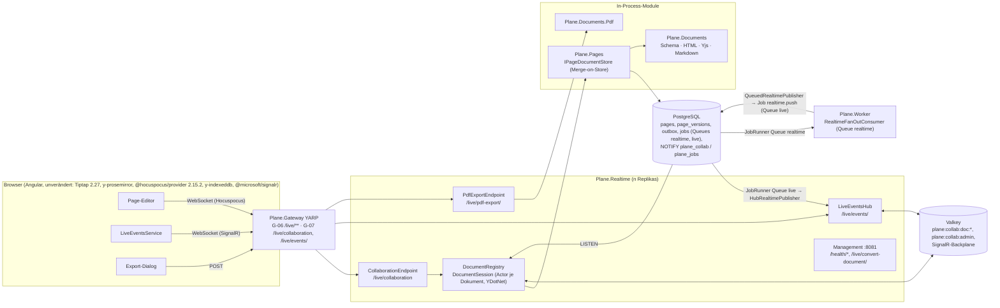
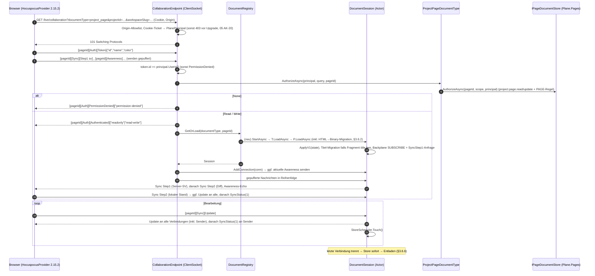
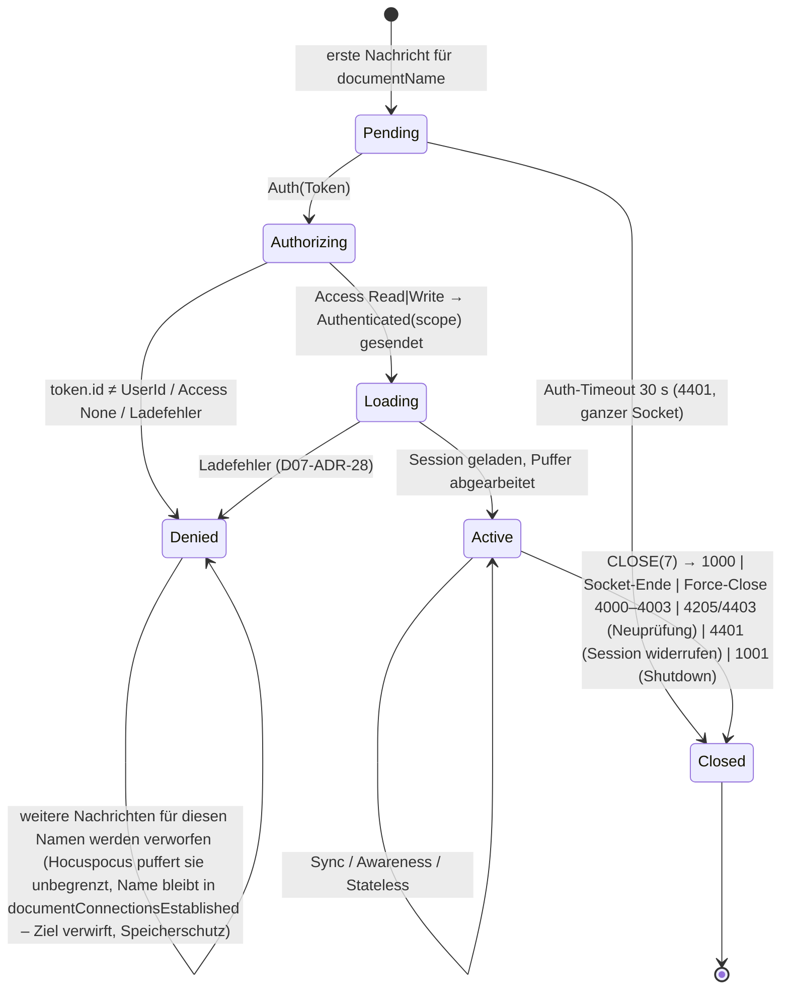
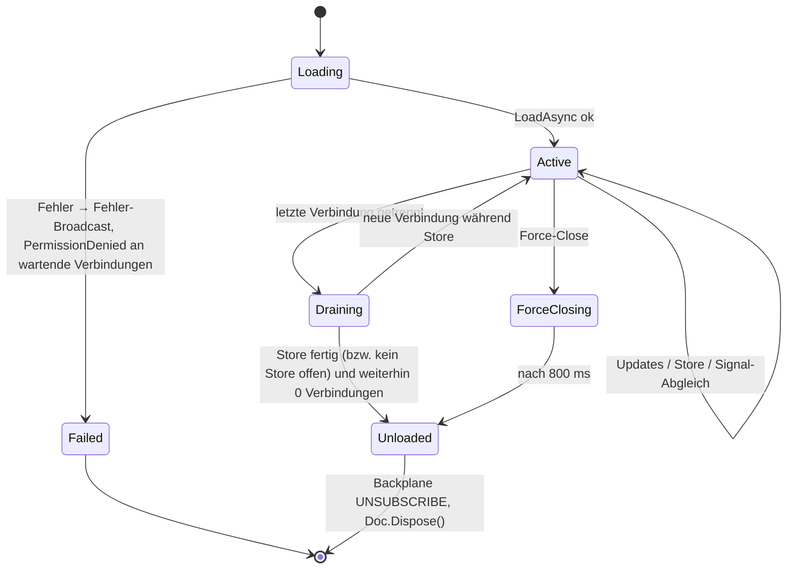

# 07 – Realtime-Kollaboration und Dokumente (Hocuspocus-Protokoll in .NET, Konvertierungen, PDF, Live-Events)

> **Stand:** 23.10.2026. **Verbindlichkeit:** verbindlich für alle Implementierungs-Agenten im Thema Realtime/Dokumente (01 Anhang A: ADR-022, -023, -029, -031, -032). Bei Widerspruch gilt `00` > `01` > `17` > dieses Dokument; wo dieses Dokument eine Signatur aus `01` §5.5 oder `16` §5.13 **präzisiert**, steht das als Änderungsauftrag in §9.2 (Regel 4 aus `17` §1: „Präzisierung, keine ADR-Änderung“).
>
> **Kürzel (wie 01):** `API/` = `apps/api/plane/`, `WEB/` = `apps/web/`, `LIVE/` = `apps/live/src/`, `PKG/` = `packages/`, `EDITOR/` = `packages/editor/src/`. Ziel: Pfade relativ zur Wurzel des Repositorys **`funk.`** (ADR-009), `BE/` = `funk./src/`, `FE/` = `funk./frontend/`. Analyse-Dokumente: `A12` = `migration/analysis/12-editor-echtzeit-live.md`, `A04` = `…/04-api-intern-arbeitsobjekte.md`, `A07` = `…/07-hintergrundjobs-mail-storage-webhooks.md`. Feature-IDs: `CE-*` aus `migration/features/10-ce-feature-katalog.md`.
>
> **Geprüfte Quellen (Stichtag 23.10.2026):** Original-Code `apps/live/src/**` (alle 46 Quelldateien) und `apps/live/tests/**` (2 Testdateien), `packages/editor/src/{extensions,helpers,constants,types,hooks}/**` (Server-Schema, Konvertierer, Ereignisse, Client-Setup), `apps/web/{components/pages/editor/editor-body.tsx, components/pages/modals/export-page-modal.tsx, components/editor/pdf/document.tsx, hooks/use-parse-editor-content.ts, hooks/use-realtime-page-events.tsx, hooks/use-page-fallback.ts}`, `apps/api/plane/{app/views/page/base.py, app/serializers/page.py, bgtasks/page_version_task.py, bgtasks/copy_s3_object.py}`; npm-Tarballs **`@hocuspocus/server`, `@hocuspocus/provider`, `@hocuspocus/common`, `@hocuspocus/extension-redis` je 2.15.2** (Quelltext `src/**`, maßgeblich für das Wire-Verhalten); NuGet **`YDotNet` 0.6.0** (XML-Doku + Metadaten der Assembly: P/Invoke- und Methodensignaturen) und **`YDotNet.Native.Linux` 0.6.0** (enthaltene `libyrs.so`-Varianten); Microsoft Learn „WebSockets support in ASP.NET Core“ (aspnetcore-10.0, `KeepAliveTimeout`). Lockfile-Versionen des Originals: `@tiptap/core` 2.27.3, `@tiptap/html` 2.26.2, `zeed-dom` 0.15.1, `yjs` 13.6.27, `y-prosemirror` 1.3.7, `y-protocols` 1.0.6, `lib0` 0.2.114, `prosemirror-model` 1.25.12, `prosemirror-tables` 1.7.1.

## Inhaltsverzeichnis

1. [Ziel & Scope](#1-ziel--scope)
2. [Entscheidungen (D07-ADR-01 ff.)](#2-entscheidungen-d07-adr-01-ff)
3. [Detaildesign](#3-detaildesign)
   - 3.1 Komponenten und Projektstruktur
   - 3.2 Host `Plane.Realtime`: Pipeline, Endpunkte, Ports
   - 3.3 Wire-Protokoll (Byte-Ebene, Hocuspocus 2.15.2)
   - 3.4 Verbindungsablauf und Zustandsautomaten
   - 3.5 Authentisierung und Autorisierung
   - 3.6 Dokument-Lebenszyklus (Laden, Migration, Sitzung, Speichern, Titel-Sync, Entladen)
   - 3.7 Stateless-Ereignisse und Server-Ereignisse
   - 3.8 Force-Close, Admin-Kanal, Graceful Shutdown
   - 3.9 Awareness
   - 3.10 Horizontale Skalierung (Valkey-Backplane, PostgreSQL-Signale, Konvergenz)
   - 3.11 REST-Pfade der Pages mit Realtime-Bezug (Fallback, Versionen, Duplizieren)
   - 3.12 `Plane.Documents`: Schema, PM-JSON, HTML, Yjs
   - 3.13 Node-/Mark-Inventar mit exakter HTML-Serialisierung
   - 3.14 Markdown
   - 3.15 PDF-Export (`Plane.Documents.Pdf`, zwei Stilprofile)
   - 3.16 Realtime-Events für weitere Objekte (SignalR, H6)
   - 3.17 Konfiguration
   - 3.18 Observability
   - 3.19 Sicherheit
   - 3.20 Abweichungen vom Original und bewusst beibehaltene Eigenheiten
4. [Vollständige Mapping-Tabellen Original → Ziel](#4-vollständige-mapping-tabellen-original--ziel)
5. [Code-Skelette](#5-code-skelette)
6. [Erweiterungspunkte für Bezahl-Pakete](#6-erweiterungspunkte-für-bezahl-pakete)
7. [Akzeptanzkriterien, Tests und Spike-Plan](#7-akzeptanzkriterien-tests-und-spike-plan)
8. [Risiken & offene Punkte](#8-risiken--offene-punkte)
9. [Abhängigkeiten zu anderen Dokumenten (02–16)](#9-abhängigkeiten-zu-anderen-dokumenten-0216)

---

## 1. Ziel & Scope

### 1.1 Ziel

Der Node-Dienst `live` des Originals (Express + Hocuspocus 2.15.2 + `@react-pdf/renderer`) wird vollständig durch **reines .NET** ersetzt (ADR-002, P5 „kein Node zur Laufzeit“). Der Browser-Client (Tiptap 2.27 + `y-prosemirror` + **unveränderter `@hocuspocus/provider` 2.15.2** + `y-indexeddb`) bleibt Quelltext-identisch (ADR-042); deshalb baut der Server das **Hocuspocus-2-Wire-Protokoll** byte- und verhaltensgleich nach. Alle serverseitigen Dokument-Umwandlungen (Yjs ⇄ ProseMirror-JSON ⇄ HTML, Markdown, PDF) laufen in .NET-Bibliotheken ohne JavaScript-Laufzeit (Fallback Jint nur nach Spike-Entscheid, ADR-031). Zusätzlich legt dieses Dokument den Transport für **Live-Events weiterer Objekte** (SignalR-Hub `/live/events/`, H6-Andockstelle) fest.

Messbare Zielgrößen (Details §7):

| Ziel | Messgröße |
|---|---|
| Client unverändert | Playwright-Test mit dem Original-Paket `@hocuspocus/provider@2.15.2` besteht alle Protokollfälle P-01 … P-30 (§7.3) |
| Parität der Dokumentformate | G-DOC-Korpus (≥ 200 Dokumente): PM-JSON strukturgleich 100 %, HTML byte-gleich nach Normalisierung ≥ 99 %, Yjs-Roundtrip .NET ↔ Browser 100 % (AK-15-14) |
| Keine verlorenen Änderungen | Konvergenz 100 % in LT-17/LT-18; Merge-on-Store-Property-Test (§7.2) ohne Verlust |
| PDF-Optik | Pixel-Diff ≤ 2 % je Seite gegen Original (beide Profile, S3) |
| Betrieb | Speicherwachstum < 5 % in 1 h Soak (LT-20); Reconnect-Sturm < 15 s (LT-19) |

### 1.2 Scope

| Im Scope (dieses Dokument legt fest) | Nicht im Scope (zuständiges Dokument) |
|---|---|
| Hocuspocus-Wire-Protokoll (Server), Verbindungs-/Dokument-Lebenszyklus, Awareness, Stateless-Ereignisse, Titel-Sync, Force-Close, Admin-Kanal, Close-Codes | Angular-Editor, NodeViews, `CollaborationSession`-Service im Browser (→ `10-editor-angular.md`, `08` §3.12) |
| Persistenz-Semantik `description_binary` inkl. HTML→Binary-Migration, Merge-on-Store, Debounce, Versionierung der Page-Inhalte, PageLog-Auslösung | Tabellen-/Spaltendefinition der Entitäten (→ `03-datenmodell-efcore.md`; hier nur die Anforderungen, §3.6.8) |
| `Plane.Documents`: C#-Port des Server-Schemas (alle Nodes/Marks), HTML-Serialisierung und -Parsing, Yjs-Abbildung, Text-Extraktion, Markdown, Validierung | HTML-Sanitizing-Allowlist (→ `05` §3.17.3, `HtmlSanitizerProfile`) |
| `Plane.Documents.Pdf`: PDF-Export in zwei Stilprofilen (Live- und Web-Optik) | Export-Dialog im Angular-Client (→ `08`, `10`) |
| Skalierung: Valkey-Pub/Sub-Backplane, PostgreSQL-Signale, Graceful Shutdown | Route/Timeouts im Gateway, Replikas, Images (→ `14`; hier: Ping-Intervall, Shutdown-Verhalten, Speicherbedarf, Absicherung `/live/convert-document/`, wie in `14` §9 angefragt) |
| SignalR-Hub `/live/events/`: Transport, Gruppen-Autorisierung, Publisher-Pfade | Katalog der Ereignisnamen/Nutzlasten je Fachobjekt (→ `06`), Frontend-Handler (→ `08` §6) |
| Erweiterungspunkte der 🧱-Pakete in diesem Bereich (§6) | Fachdesign der Bezahl-Pakete (erst kurz vor W1/W3) |

### 1.3 Begriffe

| Begriff | Bedeutung |
|---|---|
| **Dokumentname** (`documentName`) | Erster Wert jeder Hocuspocus-Nachricht (`varString`). In der CE = Page-ID als UUID-String (`HocuspocusProvider({name: docId})`, `docId = page.id`). |
| **Dokumenttyp** (`documentType`) | Query-Parameter des WebSocket-Upgrades; CE: nur `project_page` (`LIVE/types/index.ts` `TDocumentTypes`). |
| **Fragment** | Benanntes `Y.XmlFragment` im `Y.Doc`: `default` (Inhalt, Tiptap `Collaboration.configure({field:"default"})`) und `title` (Titel-Editor, `field:"title"`). Beide Namen sind Teil des Datenformats (`A12` §5.7 Punkt 2). |
| **Zustand** (`state`) | `Y.encodeStateAsUpdate(doc)` (Update-Format v1) = Inhalt von `pages.description_binary`. |
| **Sitzung** (`DocumentSession`) | Ein geladenes Dokument in einer `Plane.Realtime`-Instanz mit allen lokalen Verbindungen (entspricht Hocuspocus `Document`). |
| **Verbindung** (`DocumentConnection`) | Eine Kombination aus WebSocket und Dokumentname (Hocuspocus `Connection`; ein WebSocket kann mehrere Dokumente multiplexen). |
| **Backplane** | Instanzübergreifende Verteilung von Updates/Awareness/Stateless (Valkey-Pub/Sub). |
| **Signal** | Leichtgewichtige PostgreSQL-`NOTIFY`-Nachricht über externe Änderungen (REST-Speichern, Zugriffsänderung) an alle Realtime-Instanzen. |

### 1.4 Welcher Teil wird in welchem Inkrement gebraucht

Die Inkremente folgen `01` §1.3. Jede Zeile ist ein abnehmbarer vertikaler Schnitt (Backend + Frontend-Anteil + Tests); die Arbeitspaket-IDs vergibt `migration/plan/_data/wp-ce.json`.

| Inkrement | Bausteine aus diesem Dokument (müssen fertig sein) | CE-IDs | Abnahme (Auszug, §7) |
|---|---|---|---|
| **I0 Walking Skeleton** | Host `Plane.Realtime` mit `RealtimeComposition` (Health `/live/health/` auf App-Port, `/health/*` auf Management-Port), `WebSocketOriginValidator` + `SessionTicketReader` (05), leerer SignalR-Hub `/live/events/` (H6-Gerüst, `IRealtimeGroupAuthorizer` mit CE-Präfixen), `/live/{**}`-Fallback 404 `{"message":"Not Found"}`, Gateway-Routen G-06/G-07 (14). **Spike-Track:** S1 (Protokoll/YDotNet), S2 (Konvertierung inkl. typisierter Attribute, §7.6), S3 (PDF) laufen ab Tag 3 und liefern `docs/spikes/S{1,2,3}-ergebnis.md`. | CE-RT-009 (Gerüst); Hub-Gerüst: – (Walking Skeleton I0; H6-Andockstelle, kein CE-Feature, CE-Bezug erst ab I5 über CE-NOTIF-001, 17 ABG-112) | AK-07-01, AK-07-02; `RealtimeSmokeTests` (Hub-Teil) |
| **I1 Workspace, Projekte, Konto** | – (keine Realtime-Funktion). `Plane.Documents.Text.HtmlTextExtractor` wird für `description_stripped` von Workspaces/Projekten **noch nicht** gebraucht (Projekt-Beschreibung ist Text). | – | – |
| **I2 Work Items & Layouts** | `Plane.Documents` Teil A: Server-Schema aller Nodes/Marks (§3.13), `HtmlSerializer`, `HtmlParser`, PM-JSON-Modell, `HtmlTextExtractor` (`description_stripped`), `YjsUpdateValidator` (05 §3.17.3; Work-Item-Beschreibungen, Kommentare, Stickies senden `description_binary` optional, der Server validiert nur) und `DocumentReferenceExtractor` (Mentions für CE-WI-044); Golden-Korpora G-SCHEMA, G-DOC (HTML↔JSON-Teil). Lite-Editor-Spike S5 (Dokument 10). | CE-WI-005, CE-WI-037, CE-OPS-017, CE-PAGE-021/-022 (Server-Teil) | AK-07-20 … AK-07-23 |
| **I3 Planung** | – | – | – |
| **I4 Pages & Realtime** | Vollständig: `Plane.Collaboration` (+ `.Protocol`, `.Contracts`), `ProjectPageDocumentType`, `IPageDocumentStore` in `Plane.Pages` mit Merge-on-Store, HTML→Binary-Migration, Titel-Sync, Versionierung (Fix CE-PAGE-019), PageLog-Event, Stateless/Force-Close/Admin-Kanal, Awareness, Valkey-Backplane + In-Memory-Backplane, PostgreSQL-Signale, REST-Fallback-Merge, Duplizieren mit Asset-Umschreibung, `Plane.Documents` Teil B (Yjs-Abbildung, `YjsUpdateWriter`, Document-Variante), `Plane.Documents.Pdf` (Profile `live` und `web`), Markdown (`HtmlToMarkdownConverter`, `MarkdownRenderer`), Management-Endpunkt `/live/convert-document/`. Lasttests LT-16 … LT-20. | CE-RT-001 … -009, CE-PAGE-005 … -013, -019, -037 (Server), CE-WI-041 (Formate) | AK-07-03 … AK-07-19, AK-07-24 … AK-07-36, AK-07-44 … AK-07-46 |
| **I5 Überblick** | Erste Nutzung des Hubs: `IRealtimePublisher` (`HubRealtimePublisher`/`QueuedRealtimePublisher`, §3.16.4), `RealtimeFanOutConsumer` auf Queue `realtime` im **Worker**, Zustellung über Job `realtime.push` auf Queue `live` an den Realtime-Host (17 ABG-106; Notification-Zähler; Ereignisnamen aus 06), Client `LiveEventsService` (08). Text-Extraktion für Such-Index (`IIndexingPipeline`, G1-Andockstelle) nutzt `HtmlTextExtractor`. | CE-NOTIF-001 (Zähler-Push), CE-SRCH (Index-Text) | AK-07-37 … AK-07-40 |
| **I6 Außenwirkung** | Space zeigt Beschreibungen als gespeichertes HTML (kein Realtime-Pfad); Webhook-/Public-API-Nutzlasten nutzen `description_html` aus der Persistenz. Keine neuen Bausteine. | CE-SPACE-*, CE-API-* (nur Nutzung) | – |
| **I7 Härtung** | Soak/Last im Nightly, AIO-Variante (`Plane.AllInOne` mit In-Memory-Backplane), Airgap-Prüfung Fonts/Emoji-Font, CLI `funk-cli realtime …` (§3.8.4, 17 ABG-149), Multi-Arch-Smoke mit `libyrs`/SkiaSharp | CE-OPS-004 (AIO) | AK-07-41 … AK-07-43 |
| **W1** | H6 vollständig (Events aller Objekte über dieselben Pfade), F2-Issue-Sync nutzt `MarkdownRenderer`/`HtmlToMarkdownConverter` | EE-* (W1) | Paket-Plan |
| **W3** | D1 (`workspace_page`), D2 (`affectedPages`, Eltern-Titel-Broadcast), D3, D4 (Presence-Flag), D5 (Export-Erweiterungen) docken an §6 an | EE-* (W3) | Paket-Plan |

### 1.5 Überblick



---

## 2. Entscheidungen (D07-ADR-01 ff.)

Spalte „ab“ = Inkrement der ersten Umsetzung. „Spike“ = Entscheidung steht unter dem Vorbehalt des genannten Spikes; der Fallback ist in §7.6 hinterlegt.

| Nr. | Belang | Entscheidung | Alternativen (verworfen) | Begründung | ab |
|---|---|---|---|---|---|
| **D07-ADR-01** | Protokoll | **Server-seitiger Nachbau des Hocuspocus-2.15.2-Protokolls** (Nachrichtentypen, Reihenfolgen, Antwortpflichten, Timeouts, Close-Codes) mit dem Quelltext von `@hocuspocus/server@2.15.2` als **Verhaltensreferenz** (Dateien `ClientConnection.ts`, `Connection.ts`, `Document.ts`, `MessageReceiver.ts`, `OutgoingMessage.ts`, `Hocuspocus.ts`). Der Client bleibt der unveränderte Provider. | y-websocket-Protokoll + Provider-Tausch (Fallback 1 aus `01` §9 S1); Node-Sidecar (verletzt ADR-002) | Parität ohne Client-Änderung; das Protokoll ist klein (9 Typen) und im Quelltext vollständig sichtbar | I0 (S1), I4 |
| **D07-ADR-02** | Codec-Ort | Kodierung/Dekodierung (lib0, Hocuspocus-Rahmen, y-protocols-Sync, Awareness-Update) in einer **eigenen, abhängigkeitsfreien Assembly `Plane.Collaboration.Protocol`** (nur BCL, `public`), genutzt von `Plane.Collaboration` **und** `Plane.LoadTests.Collaboration` (D15-ADR-14). Architekturtest `CollaborationProtocolIsPure`: keine Referenz außer `System.*`. | Codec in `Plane.Collaboration` (`internal`, R9) – Lasttest käme nicht heran; `YDotNet.Protocol` (y-websocket-orientiert, async-Stream-API, keine Hocuspocus-Rahmen) | Gleicher Codec in Server und Lasttest-Client, testbar ohne Native-Lib; Namespace `Plane.Collaboration.Protocol` wie in `15` §3.12.3 | I0 (S1) |
| **D07-ADR-03** | Nebenläufigkeit | **Ein Actor je geladenem Dokument** (`DocumentSession` mit `Channel<IDocumentCommand>`, eine Verarbeitungsschleife). Jeder YDotNet-Zugriff (`Doc`, Transaktionen, Beobachter) geschieht ausschließlich innerhalb dieser Schleife; Sockets schreiben über je eine eigene Sende-Queue (`Channel<ReadOnlyMemory<byte>>`, begrenzt 1 024, bei Überlauf Close 1008). | Locks pro Dokument; geteiltes `Doc` über Threads | YDotNet/yrs erlaubt nur eine schreibende Transaktion; der Actor serialisiert wie die Node-Event-Loop und macht Reihenfolgen deterministisch testbar | I4 |
| **D07-ADR-04** | Authentisierung | **Session-Cookie aus dem Upgrade-Request** (Cookie-Schema mit `PostgresTicketStore`, 05 §3.11); das Hocuspocus-`token` (`{id, name, color}`) dient nur dem Abgleich `token.id == principal.UserId`. **Kein** Cookie aus dem Token (`token.cookie`) und **kein** Cookie aus Query-Parametern (SEC-41, E26). `Origin`-Pflicht vor dem Upgrade (D05-ADR-22, SEC-42). | Token im Query-String; HTTP-Rundreise an die API (Original `GET /api/users/me/`) | Gleiches Sicherheitsmodell wie HTTP, keine Hosts-Kopplung per HTTP (`01` §3.2) | I4 (Origin ab I0) |
| **D07-ADR-05** | Autorisierung | **Prüfung je Verbindung** über `ICollaborationDocumentType.AuthorizeAsync` (CE: `project.page.read` + `PAGE`-Regel, `05` §3.13.5); Scope **`read-write` nur mit `project.page.update`**, sonst `readonly`. Updates einer `readonly`-Verbindung werden nicht angewendet (Antwort `SyncStatus(0)`, Hocuspocus-Semantik). Zugriffsänderungen während der Sitzung lösen eine Neuprüfung aller Verbindungen aus (Signal `access`, §3.10.4): Verlust des Leserechts → **zuerst** `Auth/PermissionDenied("permission-denied")` für diesen Dokumentnamen (Provider: `authenticationFailed` → `disconnect()`, Client-Stage `disconnected(auth-failed)`, endgültig), danach Dokumentverbindung schließen mit **4403** (falls der Client noch verbunden ist; 4403 allein ließe den Plane-Client in „reconnecting“ hängen, §3.3.5); Wechsel `read-write`→`readonly` → Close **4205** (Client verbindet neu und erhält `readonly`). | Prüfung nur beim ersten Laden (Original, E3/SEC-40) | Schließt die Lücke E3; Rechte folgen dem Permission-Katalog (E5 tauscht nur die Evaluator-Implementierung) | I4 |
| **D07-ADR-06** | Persistenz | **Merge-on-Store**: `IPageDocumentStore.SaveAsync` sperrt die Page-Zeile (`SELECT … FOR UPDATE`), führt den gespeicherten Zustand und den Sitzungszustand als Yjs-Updates zusammen (`YjsMerge.Merge`, entspricht `applyUpdates` aus `EDITOR/helpers/yjs-utils.ts`), leitet daraus HTML/JSON/Text ab und schreibt in **einer** Transaktion. Der zusammengeführte Zustand fließt in die Sitzung zurück. Keine Redlock-Sperre. | Hocuspocus-Redis-Redlock „nur eine Instanz speichert“ (Original); Last-Writer-Wins | CRDT-Merge ist kommutativ und idempotent → keine verlorenen Updates, auch bei Backplane-Ausfall, parallelem REST-Fallback (CE-RT-003) und mehreren Instanzen | I4 |
| **D07-ADR-07** | Debounce | **Exakte Hocuspocus-2.15.2-Semantik:** Store `debounce` = 10 000 ms, `maxDebounce` = 10 000 ms (Default aus `Hocuspocus.ts` `defaultConfiguration`, von Plane nicht überschrieben), Prüfung von `maxDebounce` nur beim nächsten Update; **sofort** beim Trennen der letzten Verbindung (`unloadImmediately: true`); nur Updates **lokaler** Verbindungen planen einen Store (Updates aus der Backplane nicht). Titel-Store: Trailing-Debounce 5 000 ms mit Abbruch laufender Vorgänge (`TitleUpdateManager`). | „10 s, max. 60 s“ aus `A12` §3.3/§3.5 – die 60 s stammen aus älteren Hocuspocus-Versionen und sind für 2.15.2 **falsch** (korrigiert) | Gleiches Last-/Speicherprofil wie das Original (LT-20: ≤ 1 Schreibvorgang je 10 s je Dokument) | I4 |
| **D07-ADR-08** | Abgeleitete Formate | `description_html`, `description_json`, `description_stripped` werden **immer serverseitig aus dem zusammengeführten Zustand** erzeugt – auch beim REST-PATCH `…/description/` (CE-RT-003); vom Client gesendetes HTML/JSON wird nur noch validiert (Sanitizer-/Längenprüfung wie Original), nicht übernommen. HTML durchläuft danach `HtmlSanitizerProfile` (05) wie im Original `validate_html_content`. | Client-HTML speichern (Original beim REST-Fallback) | Konsistenz zwischen Binary und HTML; kein Auseinanderlaufen durch alte Clients | I4 |
| **D07-ADR-09** | Typisierte Yjs-Attribute | **YDotNet 0.6.0 kennt XML-Element-Attribute nur als `string`** (geprüft: `XmlElement.InsertAttribute(Transaction, string, string)`, `GetAttribute(...) : string`, Enumerator `KeyValuePair<string,string>`), während `y-prosemirror` typisierte Werte schreibt (`level: 1`, `checked: false`, `colwidth: [150]`). Daher: **Schreiben** neuer Inhalte (HTML→Yjs, Titel-Migration, Duplizieren) über einen **eigenen Update-Encoder `YjsUpdateWriter`** (Yjs-Update-Format v1, nur „frisches Dokument eines Clients“, ContentType/ContentString/ContentFormat/ContentAny), der das Ergebnis per `ApplyV1` in YDotNet lädt; **Lesen** über YDotNet mit **schema-gesteuerter Typ-Rückwandlung** (`AttributeCoercion`, §3.12.6). Text-Formatierungen (Marks) sind in YDotNet typisiert (`Input.Object`, `TextChunk.Attributes`) und brauchen keine Sonderlösung. | Attribute als Strings schreiben (bricht `checked: "false"` → wahr, `colwidth` als String → Tabellen-Resize defekt); Jint+`yjs` für alle Pfade | Einziger Weg, mit YDotNet 0.6 browsergleiche Zustände zu erzeugen; der Encoder ist eng begrenzt (Erzeugung, keine Integration) und gegen Original-`yjs` im Browser prüfbar (G-DOC) | Spike S2 (Kriterium S2-K6), I4 |
| **D07-ADR-10** | Deterministische Server-Schreibvorgänge | Server erzeugt Yjs-Inhalte **nur** als deterministische Initial-Updates: HTML→Binary-Migration mit Client-ID `ClientIds.ContentMigration(pageId)`, Titel-Migration mit `ClientIds.TitleMigration(pageId)` (je 32-Bit aus SHA-256 von `"{pageId}:content"` bzw. `":title"`, ungleich 0), Clock ab 0. Die Migration läuft unter Zeilensperre und prüft das leere Binary erneut. | Zufällige Client-IDs (Original) | Parallele Migration in zwei Instanzen erzeugt **identische** Updates → Merge idempotent statt doppeltem Inhalt | I4 |
| **D07-ADR-11** | Dokument-Bibliothek | **`Plane.Documents`**: C#-Port des Server-Schemas `CoreEditorExtensionsWithoutProps` (+ `DocumentEditorExtensionsWithoutProps`) mit **einer Klasse je Tiptap-Extension** (`IDocumentNodeSpec`/`IDocumentMarkSpec`, DI-Sammlung, Erweiterungspunkt E-11). HTML-Ausgabe = Port von ProseMirror `DOMSerializer` + Tiptap `mergeAttributes`/`getRenderedAttributes` + Serialisierer von `zeed-dom` 0.15.1; HTML-Eingabe = Port von ProseMirror `DOMParser` (Parse-Regeln, Prioritäten, Whitespace-Regeln) auf AngleSharp. Golden-Files aus dem Original (`tools/golden/generate.mjs`). | Allgemeiner HTML-Mapper ohne Schema; Jint als Primärweg | Byte-Parität prüfbar, keine JS-Laufzeit, erweiterbar für D9/D10 | I2 (HTML/JSON), I4 (Yjs) |
| **D07-ADR-12** | Server-HTML ohne Block-IDs | Das Server-Schema enthält wie im Original **kein** `UniqueID` → serverseitig erzeugtes HTML/JSON trägt **kein** `data-id`/`id` an Blöcken (E20). Block-IDs bleiben im Yjs-Zustand erhalten. Knoten mit eigenem `id`-Attribut (`imageComponent`, `calloutComponent`, `mention`, `issue-embed-component`) rendern es weiter. | `data-id` serverseitig mitrendern (Empfehlung `A12` O6) | Golden-Parität von `description_html`/`description_json` zum Original; Deep-Links nutzen den Browser-Editor (Yjs) | I2 |
| **D07-ADR-13** | Quirks der Serialisierung | `renderHTML`/`parseHTML` werden **1:1** übernommen, auch E16 (`customColor` matcht jedes `<span>`), E17 (`style="background-color: null; color: null;"` an `td`) und E15 (`colwidth` nur erster Wert). Funktionale Folgefehler werden **an der Nutzungsstelle** korrigiert (PDF-Renderer ignoriert `null`-Farben; Web-Profil entfernt sie wie `use-parse-editor-content.ts`). | Quirks im Serialisierer beheben | Byte-Parität des gespeicherten HTML; Z-12 (optisch 1:1, funktionale Fehler korrigieren) wird an der Wirkungsstelle erfüllt | I2 |
| **D07-ADR-14** | Skalierung | **Valkey-Pub/Sub** mit Kanal je Dokument `plane:collab:doc:{documentName}` und Admin-Kanal `plane:collab:admin`, eigenes Binärformat (§3.10.2); Updates werden als Yjs-Update gepusht, Anti-Entropie per SyncStep1/2 beim Laden und nach Wiederverbindung. Ohne Valkey (eine Replika, D14-ADR-21) `InMemoryCollaborationBackplane`. Keine Sticky Sessions (Dokumentname steht nicht in der URL). | Hocuspocus-Redis-Format (Pull über SyncStep1 bei jeder Änderung); Sticky Routing per YARP (unmöglich, Name nur in Nachrichten); PostgreSQL `LISTEN/NOTIFY` für Updates (8-KB-Grenze) | Geringe Latenz (LT-17 p95 < 150 ms), einfacher Push; Pflicht-Valkey ab 2 Replikas ist in 14 bereits festgelegt | I4 |
| **D07-ADR-15** | Externe Änderungen | **PostgreSQL-Signale** `NOTIFY plane_collab, '<json>'` (≤ 512 Byte) aus der schreibenden Transaktion (REST-PATCH `description`, Lock/Unlock, Archiv, Zugriff, Löschen, Speichern einer anderen Instanz). Jede Realtime-Instanz lauscht (`LISTEN`) und gleicht betroffene Sitzungen ab. Funktioniert ohne Valkey und hostübergreifend (Api → Realtime). | Outbox-Consumer (läuft im Worker, nicht im Realtime-Host); Valkey (optional) | PostgreSQL ist immer vorhanden (P4); Zustellung erst nach Commit | I4 |
| **D07-ADR-16** | Stateless | Mapping Server↔Client-Namen **1:1** aus `EDITOR/constants/document-collaborative-events.ts`; JSON-Formate (`BroadcastedEvent`, `force_close`) **byte-kompatibel** zu `createRealtimeEvent`. **Neu:** Server plausibilisiert Client-Stateless gegen den Page-Zustand, bevor er rundsendet (Sicherheitskorrektur SEC-RT-01), und erzeugt `error_code: page_locked`/`page_archived`, wenn Updates wegen Sperre/Archiv abgewiesen werden (Fix E4). | Ungeprüftes Rundsenden (Original) | Verhindert vorgetäuschte „deleted“/„locked“-Meldungen durch beliebige Verbindungen; Client-Code unverändert | I4 |
| **D07-ADR-17** | Force-Close & Shutdown | Force-Close-Ablauf 1:1 (Stateless-JSON `force_close` → 50 ms → Close mit Code/Grund → Admin-Kanal → 800 ms → Entladen); Codes 4000–4003 und Texte aus `LIVE/types/admin-commands.ts`. **Graceful Shutdown** dagegen: alle offenen Stores sofort ausführen, dann Verbindungen mit **1001 „server_shutdown“** schließen (kein 4000), damit der Client (`use-yjs-setup.ts`: 4000–4003 = „forced“, pausiert) automatisch neu verbindet. | Shutdown per Force-Close 4000 (Client bliebe getrennt); Original `closeConnections()` ohne Code | Rolling Restart ohne Nutzeraktion (LT-19) | I4 |
| **D07-ADR-18** | Größenlimits | `MaxMessageBytes` = 10 MiB je WebSocket-Nachricht (Überschreitung → Close 1009 „Message Too Big“, Provider verbindet nicht neu); `MaxDocumentBytes` = 10 MiB für den zusammengeführten Zustand (= Limit von `validate_binary_data`, 05). Überschreitung beim Store → `error` (`content_too_large`, `should_disconnect: true`) + Force-Close 4001 `document_too_large` instanzübergreifend (CE-RT-006). | Proxy-413 als Auslöser (Original) | Explizite, testbare Grenze statt Zufall der Proxy-Konfiguration | I4 |
| **D07-ADR-19** | Konvertierung API-seitig | Konvertierungen laufen **In-Process** über `IDocumentConverter` (`Plane.Documents`) in jedem Host. `POST /live/convert-document/` existiert nur noch auf dem **Management-Port** (Diagnose/Paritätstest, SEC-39) und korrigiert E2 (Page = `document`, Work Item = `rich`). | Öffentlicher Endpunkt (Original, E8) | Keine unauthentisierte Rechenlast über das Gateway; keine Hosts-Kopplung | I4 |
| **D07-ADR-20** | PDF | **Ein Renderer, zwei Stilprofile** in `Plane.Documents.Pdf` (PDFsharp/MigraDoc exakt `[6.2.4]`, ADR-029): Profil **`live`** = Optik `LIVE/lib/pdf/*` (Endpunktvertrag `/live/pdf-export/`), Profil **`web`** = Optik `WEB/components/editor/pdf/document.tsx` + Vorverarbeitung aus `WEB/hooks/use-parse-editor-content.ts`. Der Angular-Export-Dialog ruft `POST /live/pdf-export/` mit `profile: "web"` (additives Feld). Bilder direkt aus `IObjectStorage` (kein HTTP-Redirect), Bildpipeline SkiaSharp (ADR-032), Mentions per Mitglieder-Lookup (Fix E27), Callout-Emoji als Zeichen mit gebündelter Schrift Noto Emoji (OFL-1.1, Fix E6). | Clientseitiges PDF im Browser beibehalten (`@react-pdf/renderer` im Angular-Bundle) – zweiter Renderer, Node-artige Bibliothek im Frontend; nur Live-Optik | ADR-029 verlangt serverseitigen Export auch für das Web; die CE-Nutzer sehen heute die Web-Optik → beide Optiken nötig | I4 (S3 in I0-Track) |
| **D07-ADR-21** | Markdown | Client-Markdown (Copy as Markdown, Markdown-Export, Clipboard) bleibt **Quelltext-identisch** im Browser (`convertHTMLToMarkdown` aus `PKG/utils/src/editor/markdown-parser`). Serverseitig zwei Bausteine: `HtmlToMarkdownConverter` (Port derselben Regeln, für W1-Sync und spätere Exporte) und `MarkdownRenderer` (Markdown→HTML über **Markdig**, BSD-2-Clause; Port-Ziel von `API/utils/markdown.py`, 02 §4). | Markdown nur im Client; eigener Markdown-Parser | W1 (Forgejo-Issue-Sync, ADR-007) braucht beide Richtungen serverseitig; Markdig ist reif und permissiv | I4 (Bausteine), W1 (Nutzung) |
| **D07-ADR-22** | Page-Versionen | Versionen werden **erzeugt** (Fix CE-PAGE-019: Original-Task greift auf nicht existierendes `page.description` zu und bricht immer ab, `A04` §2.14): synchron in `SaveAsync`, wenn sich `description_html` ändert – jüngste Version (nach `last_saved_at`) desselben Nutzers mit `now − last_saved_at ≤ 600 s` wird überschrieben (`last_saved_at` bleibt dabei unverändert → feste 10-Minuten-Fenster wie Original, `A07` §T31), sonst neue Version; > 20 Versionen → älteste weich löschen (Original-Regeln aus `API/bgtasks/page_version_task.py`). Die Grenze 20 ist `PlaneRetentionOptions.PageVersionsKeep` (`Plane:Retention:PageVersionsKeep`, Default 20, Eigentümer `02` §3.15; Review-Korrektur – vorher eigene Instanz-Einstellung `PAGE_VERSION_LIMIT`); das 600-s-Fenster ist die Konstante `PageVersionRecorder.MergeWindow` (Original-Regel, nicht konfigurierbar). Komponente `PageVersionRecorder` (Name wie `03`/`06`). | Weiterhin asynchroner Task | Gleiche Transaktion wie der Inhalt; keine Zusatzlast im Worker | I4 |
| **D07-ADR-23** | PageLog | `page_logs` (Mentions, Bilder, Work-Item-Referenzen aus dem HTML, CE-PAGE-012) wird **synchron in derselben Transaktion** wie der Inhalt von `PageReferenceIndexer` (`Plane.Pages`, Name und Regel aus `06` T30 / D06-ADR-02) abgeglichen, sobald sich `description_html` geändert hat – an **allen** Original-Auslösepunkten (17 ABG-108; Original `page_transaction.delay` in `app/views/page/base.py` `create`, `partial_update`, `PagesDescriptionViewSet.partial_update`, `PageDuplicateEndpoint.post`, dazu das Live-Speichern): `CreatePageCommand` (mit `description_html`), `UpdatePageCommand` (PATCH mit `description_html`), `PageDocumentStore.SaveFromRestAsync` (Beschreibungs-PATCH), `PageDocumentStore.SaveAsync` (Live) und `DuplicatePageCommand`. Soll-Menge aus dem **neuen** HTML (`DocumentReferenceExtractor`), Ist-Menge aus `page_logs` der Page, Differenz einfügen/weich löschen (Löschung auf die Page beschränkt, nur UUID-`src`, `DEV-OPS-004`). Events (17 ABG-108 Nr. 4): Create/Duplicate schreiben `plane.page.created.v1`, spätere Inhaltsänderungen `plane.page.description_updated.v1` in die Outbox (Quelle für Suche/G1/B6/C3, kein PageLog-Consumer `pages.page_log_sync`); Consumer, die Inhalt brauchen (Suche), abonnieren beide (ABG-124). Review-Korrektur: die frühere Fassung (asynchroner Consumer `PageLogSyncConsumer`) widersprach `06` D06-ADR-02 | asynchroner Consumer (frühere Fassung); altes HTML im Event (Original `page_transaction`) | Konsistent mit dem Commit, eine Regel für alle Pfade (Anlegen, Page-PATCH, Store, REST-PATCH, Duplizieren); Aufwand < 1 ms für typische Pages, Zeilensperre bleibt kurz | I4 |
| **D07-ADR-24** | Duplizieren | Page duplizieren (CE-PAGE-009) erzeugt den neuen Zustand **synchron**: Binary → PM-JSON → `imageComponent.src` auf neue Asset-IDs umschreiben → `YjsUpdateWriter` (Inhalt + Titel „{name} (Copy)“) → HTML/JSON; Asset-Zeilen werden sofort angelegt, die Objektkopie läuft als Job `pages.copy_duplicated_assets` (`CopyDuplicatedAssetsJob`, Queue `default`, `06`; kopiert nur Objekte und setzt `is_uploaded`, 17 ABG-108). Variante `document` (Fix E2). | Asynchron wie Original (`copy_s3_objects_of_description_and_assets` + Live-Konvertierung; Fenster ohne Binary, Race mit HTML-Migration) | Kein Zwischenzustand; Kopie sofort kollaborativ öffenbar | I4 |
| **D07-ADR-25** | Awareness | Eigene Implementierung der **y-protocols-Awareness-Semantik** (`Plane.Collaboration/Awareness/AwarenessRegistry`): Clock-Regeln, Entfernen (State `null`), Timeout 30 s, Zuordnung Client-ID → Verbindung, Entfernen beim Trennen, **Echo an alle Verbindungen einschließlich Sender**. | Awareness nur durchreichen (ohne Zustand); YDotNet-Awareness (existiert nicht) | Der Provider schließt die Verbindung, wenn 30 s keine Nachricht kommt (`messageReconnectTimeout` 30 000 ms); die 15-s-Erneuerung der eigenen Awareness, die der Server zurückspiegelt, hält leerlaufende Editoren verbunden | I4 |
| **D07-ADR-26** | Dokumenttypen | Registry `ICollaborationDocumentType` (E-10, aus `16` §5.13) mit **präzisierten Rückgabetypen** (§5.4); `documentName` ist für `project_page` eine UUID, sonst `PermissionDenied`. Unbekannter `documentType` → Fehlertext `Invalid document type {type} provided.` (Original `LIVE/services/page/handler.ts`) im Log, Client erhält `PermissionDenied("permission-denied")`. | Hart verdrahtete Page-Logik | D1/B1 registrieren weitere Typen ohne Protokolländerung | I4 |
| **D07-ADR-27** | Live-Events (H6) | SignalR-Hub `LiveEventsHub` unter `/live/events/` **nur WebSockets** (`HttpTransportType.WebSockets`, Client `skipNegotiation: true`), Cookie-Schema, Origin-Prüfung; Client-Methoden `JoinGroup`/`LeaveGroup`, Server-Methode `event` mit `LiveEvent {event, group, payload, occurred_at}`; Gruppen-Autorisierung ausschließlich über `IRealtimeGroupAuthorizer` (E-22). **Publisher-Pfade (verbindlich nach 17 ABG-106):** `IRealtimePublisher` hat zwei Implementierungen – `HubRealtimePublisher` (nur Hosts `Plane.Realtime` und `Plane.AllInOne`, in-process `IHubContext<LiveEventsHub>`) und `QueuedRealtimePublisher` (Api/Worker: reiht einen `realtime.push`-Job transaktional auf der **Queue `live`** ein, `PlaneQueues.Live`); das ist der **einzige** Zustellweg zum Hub. Der `RealtimeFanOutConsumer` (Modul `Plane.RealtimeEvents`, Consumer `realtime.fanout`, generisch für alle katalogisierten Events, **kein** `LabelRealtimeConsumer`) läuft auf der Queue **`realtime` im Worker** (dessen Modulkatalog enthält `Notifications` für die Zähler-Abfrage, `02` §3.1.3). Nur `Plane.Realtime` (und `Plane.AllInOne`) registrieren SignalR und verarbeiten `live` – Host-Defaults `Plane:Worker:Queues`: Realtime `["live"]`, Worker `["*"]` mit `ExcludeQueues = ["live"]`, AllInOne `["*"]`; ab 2 Realtime-Replikas verteilt die Valkey-Backplane (`AddStackExchangeRedis`) an alle Verbindungen. **Entfällt:** `HubContextRealtimePublisher`, `NotifyRealtimePublisher`, `LiveEventsNotifyListener`, Kanal `plane_live_events`. | (a) `IHubContext` + Valkey aus jedem Host und `NOTIFY plane_live_events` ohne Valkey (frühere Fassung dieses Dokuments – zweiter Zustellweg, 8-KB-Grenze, widerspricht 06); (b) nur Valkey (Einzelknoten ohne Valkey hätte keine Live-Events); (c) SSE; (d) `RealtimeFanOutConsumer` auf Queue `realtime` im Realtime-Host (Vorfassung: Zähler-Abfrage dort mangels Modul `Notifications` nicht möglich, 06 K1) | Ein Zustellweg für alle Konfigurationen (Job-Queue in PostgreSQL ist immer da), transaktional mit dem Auslöser, Latenz < 2 s über `NOTIFY plane_jobs` mit zwei Job-Hops (`realtime` im Worker → `live` im Realtime-Host, Messung S12, 17 Z-104; 06 §3.12); die eigene Queue `live` verhindert, dass der Worker `realtime.push` zieht; erfüllt ADR-023 und D14-ADR-21 | I0 (Hub), I5 (Nutzung) |
| **D07-ADR-28** | Fehler beim Laden | Ladefehler eines Dokuments → wie Hocuspocus: Stateless-JSON `error` (`error_type: "fetch"`, Text „Unable to load the page. Please try refreshing.“) an bereits verbundene Verbindungen, dann **`PermissionDenied("permission-denied")`** an die anfragende Verbindung (Hocuspocus sendet bei Fehlern in `setUpNewConnection` PermissionDenied; Client → `auth-failed`). | Close 1011 | Client-Verhalten identisch zum Original | I4 |
| **D07-ADR-29** | Fallback-Engine (nur bei S2-Abbruch) | **Jint 4.x** (BSD-2-Clause) mit einem zur Build-Zeit per esbuild erzeugten ES2020-IIFE-Bundle (`@tiptap/html` 2.26.2, `zeed-dom` 0.15.1, `yjs` 13.6.27, `y-prosemirror` 1.3.7, `CoreEditorExtensionsWithoutProps`), Pool von Engines (Größe = CPU-Kerne), Einsatz hinter derselben Schnittstelle `IDocumentConverter`. | Node-Sidecar | ADR-002; Schnittstelle bleibt stabil | nur nach S2-Entscheid |

### 2.1 Abwägung der Kernentscheidungen

| Entscheidung | (a) Parität/Client | (b) Risiko | (c) Betrieb | Ergebnis |
|---|---|---|---|---|
| D07-ADR-01 Protokoll-Nachbau | Client unverändert | YDotNet-Reife (S1) | kein Node | angenommen mit Fallback-Kette §7.6 |
| D07-ADR-06 Merge-on-Store | keine Änderung | Merge-Kosten O(Dokumentgröße) je Store; bei 10 MiB ≈ 20–50 ms (in S1 messen) | keine Locks außer Zeilensperre | angenommen |
| D07-ADR-09 Eigener Update-Encoder | browsergleiche Zustände | Encoder-Fehler → inkonsistente Dokumente; abgesichert durch Browser-Dekodierung aller G-DOC-Fälle | – | angenommen, Spike-Kriterium S2-K6 |
| D07-ADR-14/-15 Valkey + PostgreSQL-Signal | – | zwei Kanäle | Valkey nur ab 2 Replikas | angenommen |
| D07-ADR-20 Zwei PDF-Profile | beide Original-Optiken | doppelte Stiltabellen | ein Renderer | angenommen, S3 prüft beide |

---

## 3. Detaildesign

### 3.1 Komponenten und Projektstruktur

Ergänzt `01` §5.1 (Ordner existieren dort bereits; neu ist nur `Plane.Collaboration.Protocol`, D07-ADR-02). Alle Typen außer den als `public` markierten sind `internal` (R9).

```text
funk./
├── src/
│   ├── hosts/
│   │   ├── Plane.Realtime/
│   │   │   ├── Program.cs                         # var app = RealtimeComposition.Build(args); app.Run();
│   │   │   └── Security/                          # (05) WebSocketOriginValidator.cs, SessionTicketReader.cs
│   │   └── Plane.Hosting/Realtime/
│   │       ├── RealtimeComposition.cs             # Pipeline §3.2, Modulkatalog (02 §3.1: Identity, Authorization, Workspaces,
│   │       │                                       #   Projects, Pages, Collaboration, RealtimeEvents)
│   │       └── RealtimeHealthEndpoint.cs          # GET /live/health/ (App-Port, CE-RT-009)
│   ├── documents/
│   │   ├── Plane.Documents/                       # public API: IDocumentConverter, DocumentVariant, PmNode/PmMark, IDocumentNodeSpec …
│   │   │   ├── Schema/                            # DocumentSchema, SchemaVariant, AttributeSpec, ContentExpression(+Parser), MarkSet
│   │   │   │   ├── Nodes/                         # je Extension eine Klasse (§3.13.1): DocNodeSpec … WorkItemEmbedNodeSpec
│   │   │   │   ├── Marks/                         # BoldMarkSpec … CustomColorMarkSpec (§3.13.2)
│   │   │   │   └── GlobalAttributes/              # TextAlignGlobalAttribute (paragraph, heading)
│   │   │   ├── Model/                             # PmNode, PmMark, PmJson (System.Text.Json), PmNodeBuilder, SchemaValidator
│   │   │   ├── Html/                              # HtmlSerializer, DomOutputSpec, TiptapAttributeMerger, ZeedDomWriter,
│   │   │   │                                       # HtmlParser, ParseRule, WhitespaceMode, MarkParseRules, UrlProtocolRules
│   │   │   ├── Yjs/                               # YjsProseMirrorMapper, AttributeCoercion, YjsUpdateWriter (+Lib0Writer-Nutzung),
│   │   │   │                                       # YjsMerge, YjsUpdateValidator, ClientIds, FragmentNames
│   │   │   ├── Conversion/                        # DocumentConverter : IDocumentConverter (Port EDITOR/helpers/yjs-utils.ts),
│   │   │   │                                       # TitleDocuments (generateTitleProsemirrorJson), DocumentAssetRewriter
│   │   │   ├── Text/                              # HtmlTextExtractor (02 §4: html_processor.py), PlainTextRenderer (renderText)
│   │   │   ├── Markdown/                          # HtmlToMarkdownConverter (Port PKG/utils/src/editor/markdown-parser),
│   │   │   │                                       # MarkdownRenderer (Markdig, Port-Ziel API/utils/markdown.py)
│   │   │   ├── References/                        # DocumentReferenceExtractor (mention-component, image-component, issue-embed)
│   │   │   └── DocumentsServiceCollectionExtensions.cs
│   │   └── Plane.Documents.Pdf/
│   │       ├── PdfExporter.cs                     # IPdfExporter : RenderAsync(PdfRenderRequest) → byte[]
│   │       ├── Profiles/                          # PdfProfile (Live, Web), LivePdfStyles.cs (Port LIVE/lib/pdf/styles.ts),
│   │       │                                       # WebPdfStyles.cs (Port WEB/components/editor/pdf/document.tsx), PdfColors.cs (colors.ts)
│   │       ├── Rendering/                         # PdfDocumentBuilder (MigraDoc), NodeRenderers/*.cs, MarkRenderers.cs, PdfIcons.cs
│   │       ├── Preprocessing/                     # WebProfilePreprocessor (Port use-parse-editor-content.ts, auf PM-JSON-Ebene)
│   │       ├── Images/                            # PdfImagePipeline (SkiaSharp: EXIF, Flatten weiß, fit 1200, JPEG 85)
│   │       └── Fonts/                             # Inter *.ttf (18 Dateien aus WEB/app/assets/fonts/inter), NotoEmoji-Regular.ttf,
│   │                                               # LiberationMono-{Regular,Bold}.ttf, PlaneFontResolver : IFontResolver,
│   │                                               # PdfTextRunSplitter (Emoji-Segmente), fonts-manifest.json (SHA-256)
│   └── modules/
│       ├── Collaboration/
│       │   ├── Plane.Collaboration.Protocol/      # public, nur BCL (D07-ADR-02)
│       │   │   ├── Lib0Reader.cs  Lib0Writer.cs   # varUint, varInt, varString, varUint8Array (lib0 0.2.114)
│       │   │   ├── HocuspocusMessageType.cs  AuthMessageType.cs  SyncMessageType.cs
│       │   │   ├── HocuspocusCodec.cs             # Parse(ReadOnlySpan<byte>) → IncomingFrame; Builder für alle Ausgänge
│       │   │   ├── AwarenessUpdate.cs             # Kodierung y-protocols awareness (clientId, clock, stateJson)
│       │   │   ├── CloseCodes.cs                  # PlaneCloseCodes (4000–4003), HocuspocusCloseCodes (1009, 4205, 4401, 4403, 4408)
│       │   │   └── ForceCloseReason.cs            # Werte + Texte (LIVE/types/admin-commands.ts)
│       │   ├── Plane.Collaboration.Contracts/
│       │   │   ├── Extensions/                    # ICollaborationDocumentType, CollaborationAccess, CollaborationConnectionParameters,
│       │   │   │                                   # CollaborationDocumentLoad, CollaborationStoreResult (§5.4)
│       │   │   ├── Services/                      # ICollaborationDocumentControl (ForceClose/Broadcast), CollaborationSignals (Kanal/Payload)
│       │   │   └── Events/                        # BroadcastedEvent, RealtimeEventAction (Port EDITOR/types/document-collaborative-events.ts)
│       │   └── Plane.Collaboration/
│       │       ├── CollaborationModule.cs         # public sealed : IModule
│       │       ├── Transport/                     # CollaborationEndpoint, ClientSocket, SocketSender, ConnectionQueue
│       │       ├── Sessions/                      # DocumentRegistry, DocumentSession (Actor), DocumentConnection, IDocumentCommand-Typen,
│       │       │                                   # StoreScheduler (Debounce §3.6.4), TitleSyncScheduler (§3.6.5)
│       │       ├── Awareness/                     # AwarenessRegistry (§3.9)
│       │       ├── Stateless/                     # StatelessEventMap, StatelessValidator, RealtimeEventFactory
│       │       ├── ForceClose/                    # ForceCloseCoordinator, AdminCommand, AdminCommandHandlerMap
│       │       ├── Scaling/                       # ICollaborationBackplane, ValkeyCollaborationBackplane, InMemoryCollaborationBackplane,
│       │       │                                   # BackplaneEnvelope, CollaborationSignalListener (LISTEN plane_collab)
│       │       ├── DocumentTypes/                 # DocumentTypeRegistry, ProjectPageDocumentType
│       │       ├── Http/                          # PdfExportEndpoint (/live/pdf-export/), ConvertDocumentEndpoint (Management-Port)
│       │       ├── Diagnostics/                   # CollaborationMetrics (Meter "Plane.Realtime"), LogEvents
│       │       └── Shutdown/                      # CollaborationShutdownService (IHostedLifecycleService, §3.8.5)
│       ├── Pages/Plane.Pages/Application/Services/
│       │   ├── PageDocumentStore.cs               # IPageDocumentStore (Merge-on-Store, Migration, Versionen, Signale)
│       │   ├── PageVersionRecorder.cs             # 600-s-Fenster, Limit PageVersionsKeep (D07-ADR-22)
│       │   └── PageReferenceIndexer.cs            # page_logs-Abgleich, synchron (D07-ADR-23, 06 T30)
│       └── RealtimeEvents/
│           ├── Plane.RealtimeEvents.Contracts/    # IRealtimePublisher, RealtimeGroups, IRealtimeGroupAuthorizer, LiveEventDto
│           └── Plane.RealtimeEvents/              # Hub/LiveEventsHub.cs, Group-Authorizer (ws/project/user), HubRealtimePublisher.cs (nur Realtime/AllInOne),
│                                                   # QueuedRealtimePublisher.cs (Api/Worker), Application/Jobs/RealtimePushJob.cs (Queue live),
│                                                   # Application/Consumers/RealtimeFanOutConsumer.cs (Worker, Queue realtime, 17 ABG-106),
│                                                   # RealtimeFanOutMap.cs (I5) – Ordner wie 06 §3.1
├── tests/
│   ├── Plane.Collaboration.Tests/                 # Protocol/, Sessions/, Persistence/, Scaling/, Security/, Browser/, Acceptance/Original/
│   ├── Plane.Documents.Tests/                     # Unit/, Golden/{schema,docs,markdown}/, Browser/ (Yjs-Dekodierung im Chromium)
│   ├── Plane.Documents.Pdf.Tests/                 # Golden/{cases,pages,web}/, Acceptance/Original/PdfRenderingTests.cs
│   ├── modules/Plane.Pages.Tests/                 # PageDocumentStoreTests, PageVersionRecorderTests, DuplicatePageTests
│   ├── modules/Plane.RealtimeEvents.Tests/        # HubGroupAuthorizationTests, PublisherPathTests
│   └── load/Plane.LoadTests.Collaboration/        # (15) SyntheticEditor nutzt Plane.Collaboration.Protocol
└── tools/golden/generate.mjs                       # Subkommandos schema | docs | markdown | web-pdf | lib0-vectors (§7.5)
```

**Abhängigkeitsregeln (zusätzlich zu `01` §5.2):** `Plane.Collaboration.Protocol` → nur BCL; `Plane.Documents` → `Plane.BuildingBlocks`, `AngleSharp`, `YDotNet`, `Markdig`; `Plane.Documents.Pdf` → `Plane.Documents`, `PDFsharp-MigraDoc`, `SkiaSharp`; `Plane.Collaboration` → `Plane.Collaboration.Protocol`, `Plane.Collaboration.Contracts`, `Plane.Pages.Contracts`, `Plane.Authorization.Contracts`, `Plane.Workspaces.Contracts`, `Plane.Documents`, `Plane.Documents.Pdf`, `Plane.Platform.Storage`, `StackExchange.Redis`. `Plane.Pages` → `Plane.Documents`, `Plane.Collaboration.Contracts` (nur `CollaborationSignals`). Architekturtests: `CollaborationProtocolIsPure`, `OnlyDocumentSessionTouchesYDotNetDoc` (Typen außerhalb `Plane.Collaboration.Sessions` und `Plane.Documents.Yjs` dürfen `YDotNet.Document.Doc` nicht referenzieren).

### 3.2 Host `Plane.Realtime`: Pipeline, Endpunkte, Ports

**Pipeline-Reihenfolge** (`RealtimeComposition.Build`):

1. `builder.AddServiceDefaults()` (OpenTelemetry, Health, Management-Port 8081, ABG-014).
2. Data Protection mit gemeinsamem Key-Ring (Anwendungsname `plane`), Cookie-Schema `session-id` mit `PostgresTicketStore` (05 §3.11) – **ohne** OIDC-Handler; `CookieAuthenticationEvents.OnRedirectToLogin` → 403 `{"message":"Forbidden"}` für Upgrades (05 AK-20) bzw. 401 `{"message":"Authentication required"}` für `/live/pdf-export/` (Original-Text), `OnRedirectToAccessDenied` → 403 (keine 302-Weiterleitung). Policy `realtime-session` = Schema `session-id` + `PrincipalKind.User`.
3. Module aus `Plane.Realtime/ModuleCatalog.cs` (02 §3.1): `AddServices` aller Module, `CollaborationModule`, `RealtimeEventsModule`.
4. `AddSignalR(o => { o.EnableDetailedErrors = env.IsDevelopment(); o.MaximumReceiveMessageSize = 32 * 1024; })` + JSON-Protokoll mit `JsonNamingPolicy.SnakeCaseLower`; bei konfiguriertem Valkey `.AddStackExchangeRedis(…, o => o.Configuration.ChannelPrefix = RedisChannel.Literal("plane:signalr"))`.
5. `app.UseForwardedHeaders()` (14 D14-ADR-22), `app.UseResponseCompression()` (nur HTTP-Antworten unter `/live/*`, `CompressionLevel`/`CompressionThresholdBytes`, nicht WebSocket).
6. `app.UseWebSockets(new WebSocketOptions { KeepAliveInterval = 30 s, KeepAliveTimeout = 30 s })` – PING/PONG-Strategie (.NET ≥ 9, beide Werte positiv; Microsoft Learn „WebSockets support in .NET“): Ping erst nach 30 s **ohne eingehende Daten** des Clients, Abbruch ohne Pong nach weiteren 30 s; Voraussetzung ist ein ständig ausstehendes `ReceiveAsync` (§3.4.1); funktional entspricht das der Hocuspocus-Prüfung (`Connection.check` im 30-s-Takt, Close 4408) und hält den YARP-`ActivityTimeout` von 120 s (G-07) aktiv.
7. `WebSocketOriginValidator` (Middleware vor allen Upgrades, 05 SEC-42), `app.UseAuthentication()`, `app.UseAuthorization()`.
8. Endpunkte (Tabelle), Fallback `app.MapFallback("/live/{**rest}", …)` → 404 `{"message":"Not Found"}` (Original `server.ts`).

| Methode | Pfad | Port | Auth | Request | Response | Original | CE-ID | ab |
|---|---|---|---|---|---|---|---|---|
| GET (Upgrade) | `/live/collaboration` (auch mit `/`) | App | Cookie + Origin; Hocuspocus-Auth-Nachricht | Query `documentType` (Pflicht), `projectId`, `workspaceSlug` (CE Pflicht für `project_page`), `teamId` (reserviert, ignoriert) | Hocuspocus-Protokoll (§3.3); ohne Upgrade-Header → 400 `{"message":"Bad Request"}` | `LIVE/controllers/collaboration.controller.ts` | CE-RT-001 | I4 |
| GET | `/live/health/` (auch ohne `/`) | App | keine | – | 200 `{"status":"OK","timestamp":"<ISO-8601 ms, Z>","version":"<APP_VERSION>"}` | `LIVE/controllers/health.controller.ts` | CE-RT-009 | I0 |
| POST | `/live/pdf-export/` | App | Cookie + Origin/Referer-CSRF-Prüfung (05 §3.14) | §3.15.1 | `application/pdf` bzw. `{"message": …}` 400/401/403/404/413/502/504/500 | `LIVE/controllers/pdf-export.controller.ts` | CE-PAGE-011 | I4 |
| GET/POST (WS) | `/live/events/` | App | Cookie + Origin | SignalR-Protokoll (JSON), nur WebSockets | §3.16 | – (neu) | – (Walking Skeleton I0) | I0 |
| POST | `/live/convert-document/` | **Management 8081** | keine (Port nicht über Gateway erreichbar) | `{"description_html": string (nicht leer, enthält < und >), "variant": "rich"\|"document"}` | 200 `{"description_json": {…}, "description_binary": "<base64>"}`; 400 `{"message":"Validation error","context":{"validationErrors":[{"path":"…","message":"…"}]}}`; 500 `{"message":"Internal server error."}` | `LIVE/controllers/document.controller.ts` | CE-RT-008 | I4 |
| GET | `/health/live`, `/health/ready`, `/health/startup` | Management 8081 | keine | – | JSON `{"status","checks"}` (ABG-014); `ready` prüft PostgreSQL, Key-Ring, Valkey (falls konfiguriert), Signal-Listener verbunden | – | CE-RT-009 | I0 |
| * | `/live/*` sonst | App | – | – | 404 `{"message":"Not Found"}` | `LIVE/server.ts` | – | I0 |

CORS: nicht benötigt (same-origin über Gateway, 05 §3.17.6); einen Negotiate-Aufruf gibt es nicht (`skipNegotiation: true`, nur WebSockets, D07-ADR-27) – der Hub prüft beim WebSocket-Upgrade auf `/live/events/` den `Origin`-Header gegen dieselbe Origin-Liste wie die CORS-Policy `plane` (05), auch bei getrennten Hostnamen.

### 3.3 Wire-Protokoll (Byte-Ebene, Hocuspocus 2.15.2)

#### 3.3.1 lib0-Grundtypen (lib0 0.2.114)

| Typ | Kodierung | C# (`Lib0Writer`/`Lib0Reader`) |
|---|---|---|
| `varUint` | 7 Bit je Byte, niederwertigste Gruppe zuerst, Bit 0x80 = Fortsetzung; max. 53 Bit (JS-Number) | `WriteVarUint(ulong)`, `ReadVarUint() : ulong` (Fehler bei > 2⁵³−1 oder > 8 Byte → `ProtocolException`) |
| `varInt` | erstes Byte: Bit 0x80 Fortsetzung, Bit 0x40 Vorzeichen, 6 Bit Wert; Folgebytes wie `varUint` | `ReadVarInt() : long` (nur für `SyncStatus` beim Lesen eigener Testnachrichten nötig; Server schreibt `varUint`, der Client liest `varInt` – für 0/1 identisches Byte) |
| `varUint8Array` | `varUint(länge)` + Bytes | `WriteVarUint8Array(ReadOnlySpan<byte>)`, `ReadVarUint8Array() : ReadOnlySpan<byte>` (Längenprüfung gegen Restpuffer) |
| `varString` | `varUint8Array(UTF-8)`; ungültiges UTF-8 → U+FFFD (wie `TextDecoder`) | `WriteVarString(string)`, `ReadVarString()` |

#### 3.3.2 Rahmen und Nachrichtentypen

Jede WebSocket-**Binär**nachricht = `varString(documentName)` + `varUint(messageType)` + Nutzlast. Text-Frames werden ignoriert und protokolliert.

| Wert | Name | Richtung (Client→Server / Server→Client) | Nutzlast | Server-Verhalten (Referenz `@hocuspocus/server` 2.15.2) |
|---|---|---|---|---|
| 0 | `Sync` | ↔ | `varUint(syncType)` + `varUint8Array(payload)` (y-protocols) | §3.3.3 |
| 1 | `Awareness` | ↔ | `varUint8Array(awarenessUpdate)` | anwenden, an **alle** Verbindungen des Dokuments (inkl. Sender) senden, Backplane (§3.9) |
| 2 | `Auth` | ↔ | `varUint(authType)` + `varString` | Client→Server nur `Token=0` vor Authentisierung; danach eingehende `Auth` → ignorieren + Log `collab.auth.duplicate` |
| 3 | `QueryAwareness` | → (Client sendet in 2.15.2 nur über BroadcastChannel, nicht über WS) | – | Antwort: Awareness-Update aller bekannten Clients an diese Verbindung (**Abweichung DEV-07-09**: Hocuspocus antwortet über WebSocket nicht; harmlos) |
| 4 | `SyncReply` | → (nur Server-intern/Redis im Original) | wie `Sync` | wie `Sync`, aber ohne Rück-SyncStep1 (`requestFirstSync=false`) |
| 5 | `Stateless` | ↔ | `varString(payload)` | Client→Server: §3.7; Server→Client: Ereignis-String bzw. JSON |
| 6 | `BroadcastStateless` | → (im Original nur über Redis genutzt; der Provider sendet ihn nicht) | `varString` | **Vom Client empfangen: verwerfen** + Log `collab.protocol.broadcast_stateless_rejected` (Sicherheitskorrektur SEC-RT-07, Review: Hocuspocus 2.15.2 verteilt einen von **irgendeinem** Client gesendeten Typ 6 ungeprüft als `Stateless` an alle Verbindungen und umginge damit `onStateless`/SEC-RT-01). Instanzübergreifend läuft Stateless über die Backplane (Kind 6, §3.10.2). **Der Server sendet Typ 6 nie an Clients** (Client-`MessageReceiver` kennt 6 nicht und wirft) |
| 7 | `CLOSE` | → | – | Verbindung schließen mit 1000 `provider_initiated`. **Der Server sendet Typ 7 nie** |
| 8 | `SyncStatus` | ← | `varUint(1\|0)` | nur Server→Client: 1 = angewendet, 0 = abgewiesen (readonly) |

Auth-Untertypen (`@hocuspocus/common/src/auth.ts`): `Token=0` (Client, `varString(token)`), `PermissionDenied=1` (`varString(reason)`), `Authenticated=2` (`varString(scope)` mit `"read-write"` oder `"readonly"`).

**Server→Client erlaubt:** 0, 1, 2 (nur 1/2), 5, 8. Architekturtest `ServerNeverEmitsClientUnknownTypes` prüft alle Builder.

#### 3.3.3 Sync (y-protocols 1.0.6)

| `syncType` | Name | Eingehend (Client→Server) | Antwort des Servers |
|---|---|---|---|
| 0 | `SyncStep1` (State-Vector) | `sv = payload` | **zwei** Nachrichten in **dieser Reihenfolge** (Review-Korrektur, `MessageReceiver.readSyncMessage` über WebSocket ohne `reply`): **zuerst** `Sync`(0) + `SyncStep1`(0) + `varUint8Array(StateVectorV1())` (eigener State-Vector; nur bei Typ 0 `Sync`, nicht bei `SyncReply`), **danach** `Sync`(0) + `SyncStep2`(1) + `varUint8Array(StateDiffV1(sv))` (die im Eingangspuffer aufgebaute Antwort wird erst nach Rückkehr aus `readSyncMessage` gesendet). Der Kommentar im Hocuspocus-Quelltext („SyncStep2 immediately followed by SyncStep1“) beschreibt nicht das tatsächliche Verhalten; maßgeblich ist der Code (P-01 prüft die Reihenfolge) |
| 1 | `SyncStep2` (Update) | readonly: `SyncStatus(1)`, wenn der Zustand das Update bereits enthält (`snapshotContainsUpdate`), sonst `SyncStatus(0)`, **nicht anwenden**; read-write: `ApplyV1`; das erzeugte Update geht **während** der Transaktion an alle Verbindungen (Yjs-`update`-Ereignis feuert synchron in `applyUpdate`), **danach** `SyncStatus(1)` an den Sender | Broadcast des erzeugten Updates (§3.6.3) |
| 2 | `Update` | readonly: `SyncStatus(0)`, nicht anwenden; read-write: `ApplyV1` → Broadcast an alle (inkl. Sender) → danach `SyncStatus(1)` | Broadcast |
| sonst | – | `ProtocolException` → Dokumentverbindung schließen 4403 `Forbidden` (Hocuspocus: Exception in `MessageReceiver` → `Connection.close({code, reason})`, Default Forbidden) | – |

`snapshotContainsUpdate`-Äquivalent (Review-Korrektur): **nicht** über ein temporäres `Doc` mit Snapshot-Vergleich (yrs integriert Structs mit fehlenden Abhängigkeiten nicht, sie landen als „pending“ – der Snapshot bliebe gleich und das Ergebnis wäre fälschlich `true`; zudem kostet die Kopie O(Dokumentgröße)), sondern 1:1 wie `yjs` `snapshotContainsUpdateV2`: ein schlanker Leser `Plane.Documents.Yjs.YjsUpdateReader` (nur Struct-IDs, -Längen und Delete-Set, Content wird übersprungen) prüft (a) für jeden Struct `sv[client] ≥ clock + length` gegen `Transaction.StateVectorV1()` und (b) dass das Delete-Set des Updates im aktuellen Delete-Set enthalten ist (Delete-Set aus `Transaction.Snapshot()` dekodiert). `YjsUpdateReader` ist dieselbe Komponente, die `YjsUpdateValidator` und `YjsMerge.SnapshotEquals` nutzen; Kosten nur für readonly-Verbindungen.

**Unbekannter Nachrichtentyp** (Wert > 8 oder nicht zugeordnet): ignorieren und protokollieren (`collab.protocol.unknown_type`), **kein** Schließen (Hocuspocus `MessageReceiver.apply` `default`-Zweig: nur `console.error`).

**Dekodierfehler im Rahmen** (`documentName`/`messageType` nicht lesbar): ganzer Socket wird mit **4401 `Unauthorized`** geschlossen (Hocuspocus `ClientConnection.messageHandler`/`handleQueueingMessage` `catch` → `websocket.close(Unauthorized)`); Dekodierfehler **innerhalb** der Nutzlast einer etablierten Dokumentverbindung (Sync-/Awareness-Nutzlast, unbekannter `syncType`) → nur diese Dokumentverbindung mit **4403** (Review-Korrektur; vorher pauschal 4403).

#### 3.3.4 Awareness-Update (y-protocols `encodeAwarenessUpdate`)

`varUint(anzahl)` + je Eintrag `varUint(clientId)`, `varUint(clock)`, `varString(JSON.stringify(state))` (entfernt: `"null"`; die Clock eines entfernten Eintrags ist die **unveränderte** letzte Clock aus `meta`, `encodeAwarenessUpdate` erhöht sie nicht). Der Server parst `state` **nicht** semantisch (nur JSON-Syntaxprüfung, max. 16 KiB je Eintrag, max. 64 Einträge je Nachricht → sonst Close 1008).

#### 3.3.5 Close-Codes

| Code | Grund-Text | Quelle | Auslöser im Ziel | Client-Reaktion (Original-Code) |
|---|---|---|---|---|
| 1000 | `provider_initiated` | Hocuspocus | Client sendet `CLOSE` (7) | normal |
| 1001 | `server_shutdown` | D07-ADR-17 | Graceful Shutdown | transient → Reconnect (bis 3 Versuche, `use-yjs-setup.ts`) |
| 1008 | `policy_violation` | WS-Standard | Sende-Queue voll, Awareness-Grenzen | transient |
| 1009 | `Message Too Big` | `@hocuspocus/common` `MessageTooBig` | Nachricht > `MaxMessageBytes` | Provider setzt `shouldConnect=false` |
| 1011 | `Internal server error` | `collaboration.controller.ts` | unerwartete Exception im Socket-Handler | transient |
| 4000 | `<ForceCloseReason>` | `LIVE/types/admin-commands.ts` `FORCE_CLOSE` | Admin-Force-Close, kritischer Fehler | „forced-close“, Provider pausiert |
| 4001 | `document_too_large` | `DOCUMENT_TOO_LARGE` | Store > `MaxDocumentBytes` | dto. |
| 4002 | `memory_leak` | `MEMORY_PRESSURE` | Speicherdruck (§3.8.3, optional) | dto. |
| 4003 | `security_violation` | `SECURITY_VIOLATION` | Protokollmissbrauch nach Authentisierung (z. B. Nachricht für fremden Dokumentnamen auf readonly-Socket in Schleife) | dto. |
| 4205 | `Reset Connection` | `@hocuspocus/common` `ResetConnection` | Scope-Wechsel read-write → readonly (D07-ADR-05) | transient → Reconnect (Provider: kein Sonderfall, `connect()`), neues `Authenticated(readonly)`; `use-yjs-setup.ts` zählt einen Retry |
| 4401 | `Unauthorized` | `Unauthorized` | 30 s ohne Auth-Nachricht; Rahmen-Dekodierfehler (§3.3.3); Session widerrufen (05 §3.6, Revoke-Nachricht `plane:session:revoked`) | Provider `shouldConnect=false` → `use-yjs-setup.ts` wertet das als „forced-close“ (`Manually disconnected`), kein Reconnect |
| 4403 | `Forbidden` | `Forbidden` | Protokollfehler in der Nutzlast; Leserecht entzogen (dann **zuvor** `PermissionDenied`, D07-ADR-05) | **Provider verbindet nicht neu** (Review-Korrektur): `HocuspocusProviderWebsocket.onClose` kehrt bei 4403 und `quiet=false` (Plane-Default) vor dem `connect()` zurück; `use-yjs-setup.ts` zeigt dann dauerhaft „reconnecting“, bis Sichtbarkeit/Fokus neu verbindet. Deshalb wird 4403 nie allein für Rechteentzug genutzt |
| 4408 | `Connection Timeout` | `ConnectionTimeout` | Server sendet 4408 **nie**: er bricht ohne Pong per `KeepAliveTimeout` ab (Abort statt Close-Frame). Der Provider erzeugt 4408 `forced` **lokal** (`checkConnection`: nach drei Prüfungen ohne eingehende Nachricht in `messageReconnectTimeout`) | transient |

#### 3.3.6 Für den Server verbindliche Provider-Eigenschaften (aus `@hocuspocus/provider` 2.15.2)

| Eigenschaft | Wert | Konsequenz für den Server |
|---|---|---|
| `messageReconnectTimeout` | 30 000 ms, Prüfung alle 3 000 ms | Der Client schließt, wenn 30 s **keine** Nachricht ankommt → Server muss Awareness-Echos an den Sender senden (D07-ADR-25); die eigene Awareness erneuert y-protocols alle 15 s |
| Reconnect | `delay` 1 000 ms, `factor` 2, `minDelay` 1 000, `maxDelay` 30 000, `jitter`, `maxAttempts` 0 | Reconnect-Sturm nach Neustart verteilt sich (LT-19) |
| `onOpen` | sendet `Auth(Token)` (wenn Token gesetzt) **und sofort danach** `SyncStep1` + eigene Awareness – ohne auf `Authenticated` zu warten | Server muss Nachrichten je Dokumentname puffern, bis Laden abgeschlossen ist (§3.4.1) |
| Close 4401 / 1009 | `shouldConnect=false` | nur für endgültige Fälle verwenden |
| unbekannter Nachrichtentyp | Exception im Client | nur Typen 0, 1, 2, 5, 8 senden |
| `forceSyncInterval` | `false` (Default, Plane setzt nichts) | kein periodisches Sync erwartet |
| `authenticatedHandler(scope)` | setzt `provider.authorizedScope = scope` (`"read-write"`/`"readonly"`) und feuert `authenticated` (ohne Parameter) | Der Angular-Client liest den Scope aus `provider.authorizedScope` (beantwortet den ⚠-Punkt in `10` `CollaborationSession.authorizedScope`) |
| `permissionDeniedHandler(reason)` | feuert `authenticationFailed`, `disconnect()` (setzt `shouldConnect=false`, schließt den Socket selbst) | Server muss nach `PermissionDenied` **nicht** schließen; Plane-Client endet in `disconnected(auth-failed)` |
| `MessageReceiver` (Client) | kennt 0, 1, 2, 3, 5, 8; andere Typen werfen | Server sendet nur 0, 1, 2, 5, 8 (3 wäre erlaubt, wird nicht gebraucht) |

### 3.4 Verbindungsablauf und Zustandsautomaten

#### 3.4.1 Ablauf (Sequenz)



**Puffer vor Authentisierung (1:1 `ClientConnection`):** Für jeden Dokumentnamen gibt es einen Puffer; die erste Nachricht eines Namens legt den Puffer an. Nur eine `Auth`-Nachricht eines noch nicht etablierten Namens startet die Authentisierung, alle anderen Nachrichten werden gepuffert (max. `PreAuthQueueLimit` = 256 Nachrichten bzw. `MaxMessageBytes` gesamt, sonst Close 1008). Nach erfolgreichem Aufbau werden die gepufferten Nachrichten in Eingangsreihenfolge verarbeitet. Die Empfangsschleife des Sockets hält **immer** ein ausstehendes `ReceiveAsync` und übergibt Nachrichten nur per `TryWrite` an den Actor bzw. Puffer (kein `await` auf die Verarbeitung): .NET verarbeitet PONG-Frames nur während eines ausstehenden `ReceiveAsync`; ein blockierter Leser führt bei aktivem `KeepAliveTimeout` zu Fehlabbrüchen (Microsoft Learn „WebSockets support in .NET“, Keep-Alive strategies). Kommt 30 s (`AuthenticationTimeoutMilliseconds`) keine erfolgreiche Authentisierung **irgendeines** Dokuments zustande, schließt der Socket mit 4401 `Unauthorized` (Hocuspocus `closeIdleConnectionTimeout`).

**Multiplexing:** Ein Socket kann mehrere Dokumentnamen tragen (Provider-Design; Plane nutzt einen). Der Socket wird geschlossen, wenn seine letzte `DocumentConnection` geschlossen wird; Close-Code/-Grund sind die des auslösenden Schließens.

#### 3.4.2 Zustandsautomat `DocumentConnection`



#### 3.4.3 Zustandsautomat `DocumentSession`



### 3.5 Authentisierung und Autorisierung

| Schritt | Regel | Fehlerbild | Quelle/Begründung |
|---|---|---|---|
| Upgrade | `Origin` vorhanden und in Allowlist (`Plane:Urls:Web/Admin/Space` + `Plane:Realtime:AdditionalAllowedOrigins`) | 403 vor Upgrade | 05 D05-ADR-22, SEC-42 |
| Upgrade | Cookie `session-id` → Ticket aus `user_sessions`, `revalidated_at` frisch (05 §3.11) | **403** vor Upgrade, Body `{"message":"Forbidden"}` (wie 05 AK-20; Review-Korrektur von 401). Das Cookie-Schema im Realtime-Host setzt `Events.OnRedirectToLogin`/`OnRedirectToAccessDenied` auf reine Statuscodes – sonst antwortet der Cookie-Handler mit 302 auf eine Login-Seite | 05 §3.11, AK-20 |
| Upgrade | Query `documentType` vorhanden | ohne → Socket wird angenommen, Auth-Nachricht wird mit `PermissionDenied` beantwortet (Original wirft erst im Laden) | Parität |
| Auth-Nachricht | Token ist JSON mit `id` (String); `id == principal.UserId` | `PermissionDenied("permission-denied")`; der Server schließt **nicht** zusätzlich (der Provider trennt selbst, §3.3.6; 05 §3.11 nennt hier „Close-Code 4403“ – Hocuspocus sendet keinen, siehe Review-Protokoll) | `LIVE/lib/auth.ts` (`AUTH_USER_MISMATCH`) |
| Auth-Nachricht | `token.cookie` wird ignoriert; kein Cookie aus Query | – | SEC-41 |
| Dokument | `documentName` ist UUID (CE `project_page`) | `PermissionDenied` | SEC-RT-02 |
| Dokument | `ICollaborationDocumentType.AuthorizeAsync`: CE `ProjectPageDocumentType` → `IPermissionEvaluator` mit Scope `Project(workspaceSlug→WorkspaceId, projectId)`; `project.page.read` + `PAGE`-Regel (Page im Workspace **und** aktive `project_pages`-Verknüpfung zum Projekt, Eigentümer-Bypass, Gast-Regel, private Page nur Eigentümer bzw. `IPageAccessExtension`) | `None` → `PermissionDenied` | 05 §3.13.5, SEC-40 |
| Scope | `Write` nur mit `project.page.update` (+ `PAGE`) | sonst `readonly` | D07-ADR-05 |
| Sitzung | Revoke-Nachricht `plane:session:revoked` (Valkey) bzw. Signal `session_revoked` (PostgreSQL, ohne Valkey) → alle Verbindungen der betroffenen Session-ID schließen | Close 4401 | 05 §3.6/§3.11 |
| Sitzung | Signal `access` für eine Page → alle Verbindungen neu autorisieren | Leserecht weg: `PermissionDenied` + Close 4403; `read-write`→`readonly`: 4205 | D07-ADR-05 |
| Sitzung | Workspace-/Projektmitgliedschaft entfernt (Event `plane.project_member.removed.v1`, `plane.workspace_member.removed.v1`; Namen nach 06-Event-Katalog) → `Plane.Projects`/`Plane.Workspaces` senden Signal `member_removed` mit `user_id` → Neuprüfung aller Verbindungen dieses Nutzers | `PermissionDenied` + 4403 | Sicherheitskorrektur SEC-RT-03 |

`PlanePrincipal` für WebSocket-Verbindungen hat `Kind = User`; `ApiKey`, `App` und `Bot` werden in der CE abgewiesen (`PermissionDenied`) – Andockstelle H1 in §6.

### 3.6 Dokument-Lebenszyklus (Laden, Migration, Sitzung, Speichern, Titel-Sync, Entladen)

#### 3.6.1 Registry und Actor

- `DocumentRegistry` hält `ConcurrentDictionary<DocumentKey, DocumentSession>` mit `DocumentKey(DocumentType, DocumentName)`. `GetOrLoadAsync` ist pro Schlüssel einmalig (laufendes Laden wird geteilt, Hocuspocus `loadingDocuments`).
- `DocumentSession` besitzt: `YDotNet.Document.Doc` (`DocOptions { SkipGarbageCollection = false }` = Hocuspocus `gc: true`), Verbindungsliste, `AwarenessRegistry`, `StoreScheduler`, `TitleSyncScheduler`, `LastStoredRevision`, Flags `IsLocked`, `IsArchived`, `IsLoading`.
- Alle Eingänge sind Kommandos im `Channel<IDocumentCommand>` (unbegrenzt, Reihenfolge = Eingang): `ConnectionAdded`, `ConnectionRemoved`, `IncomingMessage`, `BackplaneMessage`, `StoreDue`, `TitleDue`, `SignalReceived`, `ForceClose`, `Shutdown`. Ausgänge (Senden an Sockets, Backplane-Publish, Store) werden aus der Schleife angestoßen; der **Store** läuft asynchron außerhalb der Schleife und meldet das Ergebnis als Kommando `StoreCompleted` zurück (die Schleife blockiert nicht während der DB-Transaktion).
- Update-Erfassung: `Doc.ObserveUpdatesV1` liefert das tatsächlich erzeugte Update je Transaktion; die Schleife kennt die auslösende Quelle (aktuelles Kommando) und setzt `Origin` = `Local(connectionId)` | `Backplane` | `Store` | `Migration`.

#### 3.6.2 Laden

`ProjectPageDocumentType.LoadAsync` → `IPageDocumentStore.LoadAsync(pageId, user)`:

1. Page per ID lesen inkl. Prüfung „im Workspace + aktive `project_pages`-Verknüpfung zum Projekt der Verbindung“ (sonst `NotFound` → Ladefehler).
2. `description_binary` nicht leer → Snapshot `{State, Name, IsLocked, ArchivedAt, Revision}` zurück.
3. `description_binary` leer (Page per API/HTML angelegt, Seeds) → **Migration unter Zeilensperre**: `BEGIN; SELECT … FOR UPDATE`; erneut prüfen, ob leer; `state = DocumentConverter.CreateDocumentState(description_html ?? "<p></p>", name)` (D07-ADR-09/-10: deterministischer Writer, Variante `Document`, Fragmente `default` + `title`); abgeleitete Formate erzeugen und speichern wie beim Store (§3.6.4 Schritte 5–8, aber **ohne** Version und **ohne** `description_updated`-Event, weil sich das HTML fachlich nicht ändert); `COMMIT`. Fehler beim Speichern werden wie im Original nur protokolliert (`collab.migration.persist_failed`), die Sitzung arbeitet mit dem erzeugten Zustand weiter. Entspricht `LIVE/extensions/database.ts` `fetchDocument` (Zweig `byteLength === 0`).
4. In der Sitzung: `ApplyV1(state)`; danach **Titel-Migration** wie `TitleSyncExtension.onLoadDocument`: ist das Fragment `title` leer und `name` nicht `null`, wird `TitleDocuments.CreateTitleUpdate(pageId, name)` angewendet (deterministische Client-ID `ClientIds.TitleMigration(pageId)`, Inhalt `heading(level: 1)` mit Text `name`; bei leerem Namen nur `heading` ohne Text). Diese Änderung plant **keinen** Store (Original: `merge` außerhalb einer Verbindung → kein `onStoreDocument`), wird aber beim nächsten Store mitgeschrieben. „Leer“ heißt: `XmlFragment("title").ChildLength(tx) == 0` (YDotNet sieht gelöschte Items nicht; Hocuspocus prüft `_start == null`). Der Unterschied ist folgenlos: war der Titel bereits einmal migriert, ist das deterministische Update (gleiche Client-ID, Clock 0) schon integriert und `ApplyV1` ist ein No-op. Das Original erzeugt diese Titel-Migration mit `TITLE_EDITOR_EXTENSIONS`, die HTML→Binary-Migration (Schritt 3) dagegen mit dem Document-Schema – beide ergeben dasselbe Yjs-Element `heading` mit `level: 1` (Zahl).
5. Backplane abonnieren, `SyncStep1` (eigener State-Vector) und `QueryAwareness` publizieren (Hocuspocus-Redis `afterLoadDocument`).
6. Fehler in 1–4 → `BroadcastedEvent` `error` (`error_type: "fetch"`, `error_message: "Unable to load the page. Please try refreshing."`) an bereits verbundene Verbindungen (in der Praxis keine) und `PermissionDenied` an alle wartenden Verbindungen (D07-ADR-28); Sitzung wird verworfen (kein Store eines leeren Dokuments, Hocuspocus-Regel `!document.isLoading`).

#### 3.6.3 Sitzung: Verarbeitung eingehender Nachrichten

| Eingang | Verarbeitung im Actor |
|---|---|
| `Sync/Step1` | §3.3.3; kein Store |
| `Sync/Step2`, `Sync/Update` von `read-write` | Wenn `IsLocked` oder `IsArchived`: **nicht anwenden**, `SyncStatus(0)`, einmal je Verbindung und Zustand `BroadcastedEvent` `error` mit `error_code` `page_locked` bzw. `page_archived`, `error_type: "store"`, Text „Unable to save the page. Please try again.“ an diese Verbindung (Fix E4). Sonst `ApplyV1` in Transaktion mit Origin `Local`; Größenprüfung des Gesamtzustands erfolgt beim Store; erzeugtes Update (nur wenn die Transaktion Inhalt erzeugt hat, wie Yjs) an **alle** Verbindungen (inkl. Sender) und an die Backplane; **danach** `SyncStatus(1)` an den Sender (Reihenfolge wie Hocuspocus); `StoreScheduler.Touch(connection.User)`; `TitleSyncScheduler.Check(connection.User)` |
| `Sync/*` von `readonly` | §3.3.3 (keine Anwendung) |
| `Awareness` | §3.9 |
| `Stateless` | §3.7 |
| `CLOSE` | Verbindung schließen 1000 |
| Ungültige Nutzlast (Sync-/Awareness-Dekodierfehler, unbekannter `syncType`) | Dokumentverbindung schließen 4403 `Forbidden` (Hocuspocus: Exception → Forbidden); Log `collab.protocol.invalid` mit Hexdump der ersten 64 Byte (Debug). Rahmenfehler → 4401 für den Socket (§3.3.3). Ein **anderer** Dokumentname auf demselben Socket ist kein Fehler, sondern startet eine weitere Dokumentverbindung (Multiplexing, §3.4.1) |
| Unbekannter Nachrichtentyp | ignorieren, Log `collab.protocol.unknown_type` (Hocuspocus-Verhalten) |

#### 3.6.4 Speichern (Store) und Merge-on-Store

**Planung (`StoreScheduler`, exakt `useDebounce` aus `@hocuspocus/server/src/util/debounce.ts`):**

```text
Touch(user):                              # nur bei Updates mit Origin Local
  start = pending?.Start ?? now
  actor = user                            # jeder Aufruf ersetzt die Funktion → Kontext des LETZTEN Updates
  cancel pending timer
  if now - start >= MaxDebounce (10 000 ms): run now
  else: pending = (Start: start, Actor: actor, Timer: now + Debounce (10 000 ms))
ConnectionRemoved and connections == 0:
  if !IsLoading and pending != null: run now (unloadImmediately) → nach Erfolg Entladen (§3.6.6)
  else: Entladen sofort
```

**Ausführung** (`DocumentPersister.StoreAsync`, außerhalb der Schleife, höchstens ein laufender Store je Dokument; währenddessen eintreffende Updates setzen `pending` erneut):

1. `state = Doc.ReadTransaction().StateDiffV1(emptySv)` (= `encodeStateAsUpdate`), `title = TitleDocuments.ExtractTitleText(doc)`.
2. `ICollaborationDocumentType.SaveAsync(documentName, state, title: null, auth, ct)` → `IPageDocumentStore.SaveAsync(pageId, state, title: null, user)` (Titel separat, §3.6.5). Akteur = Nutzer der Verbindung, die das **letzte** Update vor dem Store geliefert hat (Review-Korrektur: Hocuspocus `useDebounce` ersetzt bei jedem `debounce`-Aufruf die gespeicherte Funktion samt `hookPayload.context`; `storeDocument` ruft die API mit dem Cookie dieses Kontexts auf → `updated_by` = letzter Bearbeiter).
3. In `PageDocumentStore.SaveAsync` (Transaktion `ReadCommitted`, `CreateExecutionStrategy`):
   1. `SELECT … FROM pages WHERE id = @id FOR UPDATE` (+ Projektverknüpfung).
   2. `IsLocked` → Ergebnis `Locked`; `archived_at != null` → `Archived` (kein Schreiben).
   3. `merged = dbState.IsEmpty ? state : YjsMerge.Merge(dbState, state)`.
   4. `YjsMerge.SnapshotEquals(merged, dbState)` → `Unchanged` (kein Schreiben, `Revision` unverändert).
   5. `merged.Length > MaxDocumentBytes` → `TooLarge`.
   6. `formats = DocumentConverter.FromDocumentState(merged)` → `ContentJson`, `ContentHtml` (danach `HtmlSanitizerProfile.Sanitize`), `TitleText`; `description_stripped = HtmlTextExtractor.Strip(html)`.
   7. Felder setzen: `description_binary`, `description_html`, `description_json`, `description_stripped`, `description_revision = description_revision + 1`, `updated_by_id`, `updated_at`.
   8. Wenn sich `description_html` geändert hat: `PageVersionRecorder.Track(page, user)` (D07-ADR-22), `PageReferenceIndexer.SyncAsync(page, html)` (D07-ADR-23, synchron) und Integration-Event `PageDescriptionUpdatedV1` (`plane.page.description_updated.v1`, Payload `{page_id, workspace_id, project_ids[], actor_id, revision}`) in die Outbox (D07-ADR-23). **Event-Regel (17 ABG-108 Nr. 4):** Anlegen (`CreatePageCommand`) und Duplizieren (`DuplicatePageCommand`) schreiben `plane.page.created.v1` (kein `description_updated`); jede spätere Inhaltsänderung – Live-Store, REST-PATCH `…/description/` (`SaveFromRestAsync`), `UpdatePageCommand` mit `description_html` – schreibt `plane.page.description_updated.v1`; Consumer, die Inhalt brauchen (Suche, ABG-124), abonnieren beide.
   9. `SELECT pg_notify('plane_collab', @payload)` mit `{"k":"stored","t":"project_page","d":"<pageId>","r":<revision>,"i":"<instanceId>"}` (wird erst beim Commit zugestellt).
   10. Commit → Ergebnis `Saved(merged, revision)`.
4. Rückmeldung an den Actor (`StoreCompleted`):

| Ergebnis | Reaktion der Sitzung |
|---|---|
| `Saved(merged, r)` | `ApplyV1(merged)` mit Origin `Store` (bringt Updates anderer Instanzen/REST-Fallback in die Sitzung; Broadcast nur, wenn ein Update entsteht), `LastStoredRevision = r` |
| `Unchanged` | nichts |
| `Locked` / `Archived` | `IsLocked`/`IsArchived` setzen; `error` mit `error_code` `page_locked`/`page_archived` an alle Verbindungen (Fix E4) |
| `TooLarge` | `error` (`content_too_large`, „Document is too large to save. Please reduce the content size.“, `should_disconnect: true`) an alle; dann Force-Close `document_too_large`/4001 instanzübergreifend (§3.8); **kein** Wiederholungsversuch |
| `NotFound` (Page gelöscht) | Stateless `deleted` (Client-Name) mit JSON-Variante, dann Force-Close `critical_error`/4000 |
| Exception | `error` (`error_type: "store"`, „Unable to save the page. Please try again.“) an alle; `pending` bleibt gesetzt → nächster Versuch beim nächsten `Touch` bzw. spätestens nach `StoreRetryMilliseconds` (10 000) |

#### 3.6.5 Titel-Synchronisation

- Nach jeder angewendeten Transaktion mit Origin `Local` liest `TitleSyncScheduler.Check()` den Titeltext (`TitleDocuments.ExtractTitleText`: Text aller `XmlText` im Fragment `title` in Dokumentreihenfolge, `Trim()`); weicht er vom zuletzt gesehenen ab → `Schedule(title)`.
- `Schedule`: Trailing-Debounce `TitleDebounceMilliseconds` = 5 000; ein laufender Speichervorgang wird abgebrochen (`CancellationToken`, Original `AbortController` mit 20 ms Wartezeit); bei Fehler (kein Abbruch) erneuter Versuch nach 5 000 ms; Erfolg mit unverändertem Wert setzt den Puffer zurück (Original `DebounceManager`).
- Ausführung: `ICollaborationDocumentType.UpdateTitleAsync(documentName, title, user, ct)` → `IPageDocumentStore.UpdateTitleAsync(pageId, title, user)`; `user` = Nutzer der Verbindung, deren Transaktion den Titel zuletzt geändert hat (**Abweichung DEV-07-17**: das Original erzeugt den `TitleUpdateManager` in `afterLoadDocument` mit dem Kontext der **ladenden** Verbindung und speichert jeden Titel mit deren Cookie; außerdem reagiert der Original-`observeDeep` auch auf Titeländerungen aus Redis, wodurch jede Instanz mit geladener Sitzung denselben Titel speichert – das Ziel speichert nur auf der Instanz, deren lokale Verbindung geändert hat) = fachlich identisch zu `PATCH …/pages/{id}/` mit `{name}` (gleiche Validierung, Activity/Events des Pages-Moduls; gesperrte/archivierte Page → abgelehnt, nur Log).
- `beforeUnloadDocument`-Äquivalent: vor dem Entladen `Flush()` (nur wenn ein Wert ansteht); danach Beobachter abmelden.
- Eltern-Broadcast `property_updated {name}` an `parentPage` (Original E7, nie aktiv): in der CE kein Eltern-Bezug (`IPageHierarchy` flach) → Andockstelle D2 (§6).
- **Abweichung DEV-07-05:** Das Original extrahiert den Titel über `extractTextFromHTML(fragment.toJSON())` (XML-String → DOMPurify-Text). Text mit `<…>`-Folgen kann dort verloren gehen; das Ziel nutzt den reinen Text. Für alle Titel ohne spitze Klammern identisch.

#### 3.6.6 Entladen

Bedingung: 0 Verbindungen **und** kein laufender/ausstehender Store. Ablauf: `TitleSyncScheduler.Flush()` → Backplane `UNSUBSCRIBE` (nach `BackplaneUnsubscribeDelayMilliseconds` = 1 000, Original `disconnectDelay`) → Awareness leeren → `Doc.Dispose()` → aus Registry entfernen → Metrik `plane.realtime.documents.loaded` −1. Kommt während des Entladens eine Verbindung, wird die Sitzung reaktiviert (Zustand `Draining → Active`).

#### 3.6.7 Laden/Speichern-Konstanten (Original → Ziel)

| Konstante | Original | Ziel (Option, Default) |
|---|---|---|
| Store-Debounce | `debounce: 10000` (`LIVE/hocuspocus.ts`) | `Plane:Realtime:DebounceMilliseconds` = 10 000 |
| Store-Max-Debounce | `maxDebounce` Default 10 000 (`@hocuspocus/server` `defaultConfiguration`) | `MaxDebounceMilliseconds` = 10 000 |
| Sofort-Store bei letzter Trennung | `unloadImmediately: true` | fest |
| Titel-Debounce | `TitleUpdateManager(…, 5000)` | `TitleDebounceMilliseconds` = 5 000 |
| Auth-Timeout | `timeout: 30000` | `AuthenticationTimeoutMilliseconds` = 30 000 |
| Ping/Pong | `timeout` 30 000 (Intervall + Prüfung) | `KeepAliveIntervalSeconds` = 30, `KeepAliveTimeoutSeconds` = 30 |
| Redis-Disconnect-Verzögerung | `disconnectDelay` 1 000 | `BackplaneUnsubscribeDelayMilliseconds` = 1 000 |
| Force-Close-Wartezeiten | 50 ms / 800 ms | `ForceCloseNotifyDelayMilliseconds` = 50, `ForceCloseUnloadDelayMilliseconds` = 800 |
| Binary-Limit | 10 MB (`validate_binary_data`) | `MaxDocumentBytes` = 10 485 760 |

#### 3.6.8 Anforderungen an das Datenmodell (an `03` zu übernehmen)

| Tabelle | Spalte | Typ | Regel | Grund |
|---|---|---|---|---|
| `pages` | `description_binary` | `bytea` NULL | Quelle der Wahrheit | `A12` §5.5 |
| `pages` | `description_html` | `text` NOT NULL Default `'<p></p>'` | abgeleitet, sanitisiert | Vertrag Exporte/PageLog |
| `pages` | `description_json` | `jsonb` NOT NULL Default `'{}'` | abgeleitet | – |
| `pages` | `description_stripped` | `text` NULL | abgeleitet (`strip_tags`) | Suche |
| `pages` | `description_revision` | `bigint` NOT NULL Default 0 | +1 je geändertem Store/PATCH | Signal-Abgleich ohne Binärvergleich (neu) |
| `pages` | `name` | `text` NOT NULL | synchron zu Fragment `title` | – |
| `page_versions` | `last_saved_at`, `owned_by_id`, `description_binary`, `description_html`, `description_json`, `description_stripped`, `sub_pages_data` (`jsonb`, CE `{}`) | wie Original `API/db/models/page.py` Z. 158–182 | – | D07-ADR-22 |
| `page_logs` | wie Original (`transaction`, `entity_identifier`, `entity_name`, `entity_type`, `page_id`) | – | `PageReferenceIndexer` (synchron) | D07-ADR-23 |

Kein separates Update-Log (`page_yjs_updates`) in der CE: der Merge-on-Store-Ansatz braucht es nicht; Andockstelle D3 (§6).

### 3.7 Stateless-Ereignisse und Server-Ereignisse

#### 3.7.1 Mapping (1:1 `EDITOR/constants/document-collaborative-events.ts`)

| Schlüssel | Client sendet (`server`) | Server sendet (`client`) | Payload-Typ (JSON-Variante) | In CE vom Client gesendet | Plausibilisierung vor dem Rundsenden (SEC-RT-01) |
|---|---|---|---|---|---|
| `lock` | `lock` | `locked` | `{is_locked}` | ja | Page `is_locked = true` |
| `unlock` | `unlock` | `unlocked` | `{}` | ja | `is_locked = false` |
| `archive` | `archive` | `archived` | `{archived_at}` | ja | `archived_at != null` |
| `unarchive` | `unarchive` | `unarchived` | `{}` | ja | `archived_at == null` |
| `make-public` | `make-public` | `made-public` | `{access}` | ja | `access = 0` |
| `make-private` | `make-private` | `made-private` | `{access}` | ja | `access = 1` |
| `delete` | `delete` | `deleted` | `{deleted_at}` | nein | Page gelöscht (`deleted_at != null` bzw. nicht mehr auffindbar) |
| `move` | `move` | `moved` | `{new_project_id, new_page_id}` | nein | CE: verworfen (Andockstelle D2) |
| `duplicate` | `duplicate` | `duplicated` | `{new_page_id}` | nein | CE: verworfen |
| `property_update` | `property_update` | `property_updated` | `Partial<TPage>` | nein | CE: verworfen |
| `restore` | `restore` | `restored` | `{deleted_page_ids?}` | nein | CE: verworfen |
| `error` | – | `error` | `{error_message, error_type, error_code?, should_disconnect?}` | – | nur serverseitig erzeugt |

Ablauf: Client-Stateless-String → `StatelessEventMap.TryGetClientName` (unbekannt → ignorieren, wie Original) → `StatelessValidator.ValidateAsync(page, key)` über `IPageDocumentStore.GetStateAsync(pageId)` (liest `is_locked`, `archived_at`, `access`, `deleted_at`; HybridCache 2 s) → bei Erfolg Sitzungsflags aktualisieren (`IsLocked`/`IsArchived`) und `Stateless(clientName)` an **alle** lokalen Verbindungen (inkl. Sender) + Backplane `Stateless`. Bei Fehlschlag: verwerfen, Log `collab.stateless.rejected` (Warnung). Die Plausibilisierung ist abschaltbar (`Plane:Realtime:ValidateStateless`, Default `true`) nur für Paritäts-Replays.

#### 3.7.2 Server-JSON-Ereignisse (`BroadcastedEvent`)

Format byte-kompatibel zu `createRealtimeEvent` (`EDITOR/types/document-collaborative-events.ts`), Schlüsselreihenfolge wie dort:

```json
{
  "affectedPages": { "currentPage": "<pageId>", "parentPage": null, "descendantPages": [] },
  "workspace_slug": "<slug>",
  "project_id": "",
  "teamspace_id": "",
  "user_id": "<userId>",
  "timestamp": "2026-10-23T10:00:00.000Z",
  "action": "error",
  "data": { "error_message": "…", "error_type": "store", "error_code": "content_too_large", "should_disconnect": true, "user_id": "<userId>" }
}
```

`project_id`/`teamspace_id` sind wie im Original leere Strings, wenn nicht gesetzt (Original `broadcastError` setzt `project_id` nicht). Versand als `Stateless(JSON)` an alle lokalen Verbindungen **und** über die Backplane an andere Instanzen (Original: `broadcastMessageToPage` über Redis `BroadcastStateless` mit leerem Identifier → alle Instanzen inkl. eigener). `undefined`-Felder des Originals (`error_code`, `should_disconnect`) werden **weggelassen**, nicht als `null` geschrieben (`JsonIgnoreCondition.WhenWritingNull` für `data`).

Erzeuger in der CE: Lade-/Speicherfehler (§3.6), Sperr-/Archiv-Ablehnung (E4-Fix). Weitere Aktionen (`moved`, `duplicated`, `restored`, `property_updated` mit `parentPage`/`descendantPages`) sind Andockstellen (§6, D2). Der Angular-Client wertet JSON-Ereignisse über `RealtimePageEventsService` aus (Fix E5, `08` §3.12; Handler 1:1 aus `WEB/hooks/use-realtime-page-events.tsx`).

#### 3.7.3 `ICollaborationDocumentControl` (serverseitige Auslöser aus anderen Modulen)

`Plane.Collaboration.Contracts/Services/ICollaborationDocumentControl` (implementiert nur im Realtime-Host; in Api/Worker als `SignalingCollaborationDocumentControl`, das ein PostgreSQL-Signal sendet):

| Methode | Wirkung | Nutzer CE | Nutzer später |
|---|---|---|---|
| `BroadcastEventAsync(DocumentKey, BroadcastedEvent)` | Stateless-JSON an alle Verbindungen des Dokuments (alle Instanzen) | – | D2 (`moved`, `restored`), D8 |
| `ForceCloseAsync(DocumentKey, ForceCloseReason, int code)` | §3.8 | CLI `funk-cli realtime force-close` | E7 (God Mode) |
| `NotifyChangedAsync(DocumentKey, CollaborationChangeKind)` | Signal `content`/`access`/`deleted` | `Plane.Pages` (REST-PATCH, Lock, Access, Archiv, Löschen) | D1/D2/B1 |

### 3.8 Force-Close, Admin-Kanal, Graceful Shutdown

#### 3.8.1 Force-Close-Ablauf (1:1 `LIVE/extensions/force-close-handler.ts`)

`ForceCloseCoordinator.ForceCloseAcrossInstancesAsync(documentName, reason, code = 4000)`:

1. Dokument lokal nicht geladen → Ende (Log „already unloaded“).
2. An alle lokalen Verbindungen `Stateless` mit `{"type":"force_close","reason":"<reason>","code":<code>,"message":"<Text>","timestamp":"<ISO>"}`.
3. 50 ms warten.
4. Jede lokale Verbindung schließen mit `(code, reason)`.
5. Admin-Kommando publizieren: `{"command":"force_close","docId":"<documentName>","reason":"<reason>","code":<code>,"originServer":"<InstanceName>","timestamp":"<ISO>"}` auf `plane:collab:admin`.
6. 800 ms warten.
7. Dokument entladen (ohne Store; der Inhalt ist in den Fällen 4001/4000 bereits persistiert bzw. nicht speicherbar).

Empfangende Instanz (`AdminCommandHandlerMap["force_close"]`): Schritte 2–4 für ihre Verbindungen, **kein** Entladen (wie Original; die Sitzung entlädt sich, sobald die letzte Verbindung weg ist, und speichert ggf. ausstehende Änderungen).

Texte (`ForceCloseReason`, exakt):

| Grund | Text |
|---|---|
| `critical_error` | A critical error occurred. Please refresh the page. |
| `memory_leak` | Memory limit exceeded. Please refresh the page. |
| `document_too_large` | Content limit reached and live sync is off. Create a new page or use nested pages to continue syncing. |
| `admin_request` | Connection closed by administrator. Please try again later. |
| `server_shutdown` | Server is shutting down. Please reconnect in a moment. |
| `security_violation` | Security violation detected. Connection terminated. |
| `corruption_detected` | Data corruption detected. Please refresh the page. |
| sonst | Connection closed. Please refresh the page. |

#### 3.8.2 Admin-Kanal

| Kommando | Felder | Handler CE | Bemerkung |
|---|---|---|---|
| `force_close` | `command, docId, reason, code, originServer, timestamp?` | ja | Validierung: `reason` ∈ Enum, `code` ∈ {4000, 4001, 4002, 4003}; ungültig → Log `collab.admin.invalid` |
| `health_check` | `command, originServer, timestamp` | ja (neu: Antwort im Log + Metrik `plane.realtime.admin.health_checks`) | Original: kein Handler (Warnung) |
| `restart_document` | `command, docId, originServer, timestamp` | ja (neu): Dokument lokal ohne Force-Close-Meldung neu aus dem Store laden (Abgleich wie Signal `content`) | Original: kein Handler |

Ohne Valkey gehen Admin-Kommandos über das PostgreSQL-Signal (`{"k":"admin","c":{…}}`).

#### 3.8.3 Speicherdruck (optional)

`Plane:Realtime:MemoryPressureThresholdBytes` (Default 0 = aus). Bei aktivem Grenzwert prüft `CollaborationMemoryWatchdog` alle 10 s `GC.GetGCMemoryInfo().TotalCommittedBytes` + Native-Schätzung (Summe der Zustandsgrößen); Überschreitung → die zuletzt aktive Hälfte der Sitzungen **bleibt**, für die übrigen (älteste Aktivität zuerst) Store + Force-Close `memory_leak`/4002, bis 80 % des Grenzwerts erreicht sind. Metrik `plane.realtime.memory.evictions`.

#### 3.8.4 Betriebsbefehle (`funk-cli`, I7)

Befehlsname nach 17 ABG-149 `funk-cli` (Projekt `src/tools/Plane.Cli` bleibt).

| Befehl | Wirkung |
|---|---|
| `funk-cli realtime documents` | Liste geladener Dokumente je Instanz (über `health_check`-Antworten im Admin-Kanal) |
| `funk-cli realtime force-close <pageId> [--reason admin_request] [--code 4000]` | Force-Close über Admin-Kanal/Signal |
| `funk-cli realtime refresh <pageId>` | `restart_document` |

#### 3.8.5 Graceful Shutdown (beantwortet `14` §9 „Shutdown-Verhalten“)

`CollaborationShutdownService` (`IHostedLifecycleService.StoppingAsync`), Budget `ShutdownFlushTimeoutSeconds` = 60 (< `terminationGracePeriodSeconds` 120 der Realtime-Pods, 14):

1. Neue Upgrades mit 503 ablehnen (`/health/ready` → `Unhealthy`, damit das Gateway umleitet).
2. Für alle Sitzungen ausstehende Stores **sofort** ausführen (parallel, max. 8 gleichzeitig) und Titel-Flush.
3. Alle Verbindungen mit **1001 `server_shutdown`** schließen (kein Force-Close-JSON, D07-ADR-17).
4. Backplane abmelden, Signal-Listener schließen, Sitzungen entsorgen.

SignalR-Hub: `HubConnectionContext` werden vom Framework beim Stopp geschlossen; Clients verbinden über `withAutomaticReconnect([0, 2000, 10000, 30000])` neu (08).

### 3.9 Awareness

`AwarenessRegistry` je Sitzung implementiert die Semantik von `y-protocols/awareness.js` 1.0.6:

| Regel | Umsetzung |
|---|---|
| Speicher | `meta: Dictionary<ulong clientId, (ulong Clock, long LastUpdatedMs)>` (wird **nie** entfernt, wie y-protocols) und `states: Dictionary<ulong clientId, string StateJson>` (nur aktive Einträge) |
| Anwenden eines Updates (`applyAwarenessUpdate`, y-protocols 1.0.6 wörtlich) | je Eintrag: `currClock = meta.TryGet(id)?.Clock ?? 0`; **akzeptieren genau dann, wenn** `currClock < clock` **oder** (`currClock == clock` **und** `state == null` **und** `states.ContainsKey(id)`) – ein erster Eintrag mit `clock == 0` wird also **abgewiesen** (Review-Korrektur; vorher „`current == null` → akzeptieren“). Bei Annahme: `state == null` → `states.Remove(id)`, sonst `states[id] = state`; `meta[id] = (clock, now)`. Klassifikation: `meta` vorher unbekannt und `state != null` → `added`; `meta` vorher bekannt und `state == null` → `removed`; sonst `state != null` → **`updated` (auch bei unverändertem Inhalt!)** |
| Zuordnung zur Verbindung | `added` → `connection.Clients.Add(id)`, `removed` → `Remove` (nur bei Origin `Local`); zusätzlich (Korrektur, DEV-07-16) `updated`-IDs, die vorher entfernt waren, → `Add` (Hocuspocus verliert diese Zuordnung, wodurch beim Trennen der Eintrag erst nach 30 s per Timeout verschwindet) |
| Weiterleitung | Update mit `added ∪ updated ∪ removed` (Hocuspocus hört auf das `update`-, nicht auf das `change`-Ereignis) neu kodieren (aktueller Zustand) und an **alle** lokalen Verbindungen senden (inkl. Sender) + Backplane `Awareness` (nur bei Origin `Local`). **Pflicht:** die 15-s-Erneuerung eines Clients mit **gleichem** Inhalt landet in `updated` und wird zurückgespiegelt – nur so erhält ein leerlaufender Editor innerhalb von `messageReconnectTimeout` eine Nachricht (D07-ADR-25). Ein Filter „nur bei geändertem JSON“ würde leerlaufende Editoren alle 30 s trennen |
| Trennen | für alle `connection.Clients` mit aktivem Eintrag: `states.Remove(id)`, `meta` **unverändert** (gleiche Clock; y-protocols `removeAwarenessStates` erhöht die Clock nur für die eigene lokale ID) → Weiterleitung `removed` wie oben; Empfänger akzeptieren über die Regel „gleiche Clock + `null`“. Eine erhöhte Clock (frühere Fassung „`clock + 1`“) würde nach einem schnellen Reconnect desselben Clients dessen Awareness bei allen anderen Clients bis zur übernächsten Erneuerung (≤ 30 s) unterdrücken |
| Neue Verbindung | wenn Registry nicht leer: vollständiges Update aller Einträge mit `state != null` an die neue Verbindung (`sendCurrentAwareness`, im `Connection`-Konstruktor – also **vor** der Verarbeitung der gepufferten Nachrichten) |
| Zeitüberschreitung | alle 3 000 ms: Einträge fremder Clients mit `now − LastUpdated ≥ 30 000 ms` und `state != null` → entfernt (`removed`), weiterleiten (y-protocols `outdatedTimeout`) |
| Server-eigener Zustand | keiner (Hocuspocus `setLocalState(null)`) |
| Grenzen | max. 64 Einträge je Update, 16 KiB je State, 1 024 Clients je Dokument → sonst Close 1008 |

Die CE zeigt keine fremden Cursor (`EDITOR_FLAGS` deaktiviert `collaboration-cursor`, D4), die Weiterleitung ist trotzdem Pflicht (D07-ADR-25).

### 3.10 Horizontale Skalierung (Valkey-Backplane, PostgreSQL-Signale, Konvergenz)

#### 3.10.1 Kanäle

| Kanal | Medium | Inhalt | Abonniert von |
|---|---|---|---|
| `plane:collab:doc:{documentType}:{documentName}` | Valkey Pub/Sub (Binär) | `BackplaneEnvelope` (§3.10.2) | Instanzen mit geladener Sitzung |
| `plane:collab:admin` | Valkey Pub/Sub (JSON UTF-8) | Admin-Kommandos (§3.8.2) | alle Realtime-Instanzen |
| `plane:session:revoked` | Valkey Pub/Sub | Session-Widerruf (05) | alle Hosts |
| `plane_collab` | PostgreSQL `LISTEN/NOTIFY` (JSON ≤ 512 Byte) | Signale `stored`, `content`, `access`, `deleted`, `member_removed`, `session_revoked` (nur ohne Valkey), `admin` (nur ohne Valkey) | alle Realtime-Instanzen (`CollaborationSignalListener`) |
| Queue `live` (`jobs`-Tabelle, Weckruf `NOTIFY plane_jobs`) | PostgreSQL (06) | Job `realtime.push` (Live-Events, §3.16.4) – **kein** eigener NOTIFY-Kanal (`plane_live_events` entfällt, 17 ABG-106) | JobRunner jeder Realtime-Replika bzw. `Plane.AllInOne`; der Worker schließt `live` aus (`ExcludeQueues = ["live"]`) |
| Queue `realtime` (`jobs`-Tabelle) | PostgreSQL (06) | `RealtimeFanOutConsumer` (Consumer `realtime.fanout`) | JobRunner des Workers (17 ABG-106) |
| `plane:signalr*` | Valkey (SignalR-Backplane) | Hub-Nachrichten ab 2 Replikas | alle Realtime-Replikas |

#### 3.10.2 `BackplaneEnvelope` (Valkey, Binär)

| Offset | Länge | Feld | Werte |
|---|---|---|---|
| 0 | 1 | `Version` | `1` |
| 1 | 16 | `InstanceId` | GUID der sendenden Instanz (Echo-Unterdrückung) |
| 17 | 1 | `Kind` | `1` Update, `2` SyncStep1, `3` SyncStep2, `4` Awareness, `5` QueryAwareness, `6` Stateless |
| 18 | 16 | `TargetInstanceId` | nur bei `3` (Antwort an Anfragende), sonst `Guid.Empty` |
| 34 | rest | `Payload` | `1`/`3`: Yjs-Update v1; `2`: State-Vector v1; `4`: Awareness-Update; `5`: leer; `6`: UTF-8-String |

Verarbeitung beim Empfang (eigene `InstanceId` → verwerfen; Dokument nicht geladen → verwerfen):

| Kind | Reaktion |
|---|---|
| Update | `ApplyV1` mit Origin `Backplane` → erzeugtes Update an lokale Verbindungen; **kein** Store-`Touch` |
| SyncStep1 | Antwort `SyncStep2` mit `StateDiffV1(sv)` an `TargetInstanceId = Absender`; zusätzlich eigenes `SyncStep1` zurück (beidseitiger Abgleich) |
| SyncStep2 | nur wenn `TargetInstanceId == self`: `ApplyV1` mit Origin `Backplane` |
| Awareness | in `AwarenessRegistry` mit Origin `Backplane` anwenden (keine Verbindungszuordnung), an lokale Verbindungen weiterleiten |
| QueryAwareness | vollständige lokale Awareness (nur Clients eigener Verbindungen) als `Awareness` publizieren |
| Stateless | an alle lokalen Verbindungen als `Stateless` |

Sendezeitpunkte: Update nach jeder Transaktion mit Origin `Local`; SyncStep1 + QueryAwareness nach dem Laden und nach jeder Wiederverbindung zu Valkey (`ConnectionRestored`); Awareness bei Origin `Local`; Stateless bei Client-Stateless und Server-Ereignissen.

#### 3.10.3 Konvergenzargument

1. Updates sind CRDT-Operationen; Anwenden ist kommutativ und idempotent.
2. Valkey-Pub/Sub ist „höchstens einmal“. Verlorene Nachrichten werden ausgeglichen durch (a) SyncStep1/2 nach Laden und Wiederverbindung, (b) **Merge-on-Store** (jede speichernde Instanz übernimmt den DB-Zustand) und (c) das Signal `stored` (§3.10.4), das alle anderen Instanzen zum Abgleich mit dem DB-Zustand veranlasst.
3. Daraus folgt: Spätestens `MaxDebounce + Signal-Latenz` (≈ 10–11 s) nach der letzten Änderung sind alle Instanzen und die DB konvergent – auch bei vollständigem Valkey-Ausfall (Test `Scaling/ValkeyOutageConvergenceTests`).

#### 3.10.4 Verarbeitung der Signale (`CollaborationSignalListener`)

Eigene dedizierte `NpgsqlConnection` (nicht aus dem Pool), `LISTEN plane_collab`, `WaitAsync`-Schleife, Wiederverbindung mit Backoff 1 s … 30 s; nach Wiederverbindung werden **alle** geladenen Sitzungen einmal abgeglichen (verpasste Signale). `/health/ready` ist `Degraded`, solange der Listener getrennt ist.

| Signal | Payload | Reaktion |
|---|---|---|
| `stored` | `{k,t,d,r,i}` | `i == self` → ignorieren; Sitzung geladen und `r > LastStoredRevision` → `LoadStateAsync` (nur Binary) → `ApplyV1` mit Origin `Store` |
| `content` | `{k,t,d,r}` | wie `stored` (REST-PATCH, Duplikat-Ziel, Version wiederhergestellt) |
| `access` | `{k,t,d}` | Flags (`IsLocked`, `IsArchived`) neu lesen; alle Verbindungen neu autorisieren (D07-ADR-05) |
| `deleted` | `{k,t,d}` | Stateless `deleted` an alle, dann Force-Close `critical_error`/4000 |
| `member_removed` | `{k,u,w,p?}` | alle Verbindungen des Nutzers `u` in Workspace `w` (Projekt `p`) neu autorisieren |
| `session_revoked` | `{k,s}` | Verbindungen der Session `s` schließen 4401 (nur wenn kein Valkey konfiguriert, sonst Valkey-Kanal aus 05) |
| `admin` | `{k,c}` | wie Admin-Kanal |

Sender: `Plane.Pages` (über `IDbNotificationPublisher.NotifyAsync(CollaborationSignals.Channel, payload)` in der laufenden Transaktion), `Plane.Projects`/`Plane.Workspaces` (`member_removed`), `Plane.Identity` (`session_revoked`), `funk-cli` (`admin`; Projekt `Plane.Cli`). `IDbNotificationPublisher`/`IDbNotificationListener` liegen in `Plane.BuildingBlocks.Persistence` (Änderungsauftrag an 02, §9.2).

#### 3.10.5 Betrieb mit einer Replika ohne Valkey

`Plane:Realtime:Backplane` = `Auto` (Default): Valkey, wenn `ConnectionStrings:valkey` gesetzt, sonst `InMemory`. Mit `Plane:Scale:ExpectMultipleInstances=true` und ohne Valkey meldet `/health/ready` `Unhealthy` (14 D14-ADR-21). AIO (`Plane.AllInOne`) nutzt `InMemory` und dieselben PostgreSQL-Signale (Api und Realtime im selben Prozess, Signale trotzdem über PostgreSQL – ein Codepfad).

#### 3.10.6 Kapazität (beantwortet `14` §9 „Speicherbedarf je Dokument“)

| Größe | Richtwert (in S1 zu messen und in `docs/spikes/S1-ergebnis.md` festzuschreiben) |
|---|---|
| Speicher je geladenem Dokument | ≈ 3 × Zustandsgröße (yrs-Blockstruktur) + 8 KiB je Verbindung (Puffer) + Awareness; typische Page 20 KB → ≈ 80 KB |
| Dokumente je Replika (1 GiB Limit) | ≥ 5 000 typische Pages oder ≥ 30 Dokumente à 10 MiB |
| Verbindungen je Replika | ≥ 5 000 (Kestrel `MaxConcurrentUpgradedConnections` = `Plane:Realtime:MaxConnections`, Default 10 000) |
| Store-Kosten | Merge + Konvertierung p95 < 50 ms für 1 MiB-Zustand |

### 3.11 REST-Pfade der Pages mit Realtime-Bezug (Fallback, Versionen, Duplizieren)

Die Endpunkte gehören dem Modul `Plane.Pages` (Katalog in `04`); dieses Dokument legt ihr Dokumentverhalten fest.

| Endpunkt (Original) | Verhalten im Ziel | Abweichung | CE-ID |
|---|---|---|---|
| `GET {P}/pages/{page_id}/description/` | `application/octet-stream`, `Content-Disposition: attachment; filename="page_description.bin"`, Body = `description_binary` (leer, wenn `NULL`). **Neu:** ist die Page in einer Sitzung geladen, liefert der Endpunkt trotzdem den DB-Stand (kein Hostwechsel); der Client merged ohnehin (CE-RT-003) | – | CE-RT-003, CE-PAGE-013 |
| `PATCH {P}/pages/{page_id}/description/` | Validierung wie Original (`PageBinaryUpdateSerializer`: Base64, `BinaryContentValidator` + `YjsUpdateValidator`, HTML-Sanitizing nur als Prüfung); Sperre/Archiv → 400 `{"error_code":4701,"error_message":"PAGE_LOCKED"}` bzw. `4702 PAGE_ARCHIVED`; danach **Merge-on-Store** mit dem gesendeten Binary (§3.6.4 Schritte 3.1–3.10, Signal `content` statt `stored`); Antwort 200 `{"message":"Updated successfully"}` | DEV-07-02: HTML/JSON werden aus dem gemergten Zustand abgeleitet, nicht aus dem Request übernommen | CE-RT-003 |
| `GET {P}/pages/{page_id}/versions/`, `…/versions/{pk}/` | unverändert (04); Versionen existieren jetzt (D07-ADR-22) | DEV-07-03 | CE-PAGE-019 |
| Version wiederherstellen (Client ersetzt Editorinhalt durch Versions-HTML) | rein clientseitig wie Original (`editorRef.setEditorValue` → Yjs-Updates über die Verbindung) | – | CE-PAGE-019 |
| `POST {P}/pages/{page_id}/duplicate/` | D07-ADR-24: neue Page mit `name = "{name} (Copy)"`, `description_binary` sofort gesetzt (umgeschriebene Asset-IDs), `description_html/json/stripped` abgeleitet; neue `FileAsset`-Zeilen (`is_uploaded = false`) + Job `pages.copy_duplicated_assets` (`CopyDuplicatedAssetsJob`, Queue `default`, 06; 17 ABG-108) kopiert **nur noch** die Objekte (`IObjectStorage.CopyAsync`, Quell-Assets aus Workspace **und** Projekt der Quell-Page, `DEV-OPS-006`) und setzt `is_uploaded = true` – das Umschreiben von `src` und die Neuberechnung von `description_json`/`description_binary` geschieht synchron im `DuplicatePageCommand` (06 angeglichen, 17 ABG-108); PageLog synchron über `PageReferenceIndexer`; Event `plane.page.created.v1` | DEV-07-04 (synchron, Variante `document` statt `rich`, E2) | CE-PAGE-009 |
| `POST {P}/pages/` (Anlegen) | `CreatePageCommand` (Katalog `04`): enthält der Request `description_html`, gleicht `PageReferenceIndexer` `page_logs` synchron in derselben Transaktion ab (Original `PageViewSet.create` → `page_transaction.delay`); Event `plane.page.created.v1`; `description_binary` bleibt leer → HTML→Binary-Migration beim ersten Laden (§3.6.2) (17 ABG-108) | – (synchron statt Task) | CE-PAGE-012 |
| `PATCH {P}/pages/{page_id}/` mit `description_html` | `UpdatePageCommand`: PageLog synchron über `PageReferenceIndexer` (Original `PageViewSet.partial_update` → `page_transaction.delay`), Event `plane.page.description_updated.v1` (17 ABG-108) | – (synchron statt Task) | CE-PAGE-012 |
| `PATCH {P}/pages/{page_id}/` (`name`) | unverändert; zusätzlich Signal `content` nicht nötig (Titel-Fragment ist führend; REST-Umbenennung außerhalb des Editors ändert das Fragment nicht – Original-Verhalten, CE-Client benennt nur über den Titel-Editor um) | – | CE-PAGE-004 |
| `POST/DELETE {P}/pages/{page_id}/lock/`, `…/archive/`, `…/access/`, `DELETE …/pages/{page_id}/` | unverändert (04); zusätzlich Signal `access` bzw. `deleted` (§3.10.4) im selben Commit | Ergänzung | CE-PAGE-005 … -008 |

### 3.12 `Plane.Documents`: Schema, PM-JSON, HTML, Yjs

#### 3.12.1 Öffentliche Schnittstelle

```csharp
public enum DocumentVariant { Rich, Document }          // "rich" | "document" (TConvertDocumentRequestBody.variant)

public interface IDocumentConverter
{
    // Port EDITOR/helpers/yjs-utils.ts – Namen in Klammern = Original-Funktion
    ReadOnlyMemory<byte> CreateRichTextState(string? html);                                    // getBinaryDataFromRichTextEditorHTMLString
    ReadOnlyMemory<byte> CreateDocumentState(string? html, string? title, Guid? deterministicFor = null); // getBinaryDataFromDocumentEditorHTMLString
    DocumentFormats FromRichTextState(ReadOnlySpan<byte> state);                              // getAllDocumentFormatsFromRichTextEditorBinaryData
    DocumentFormats FromDocumentState(ReadOnlySpan<byte> state, bool includeTitle = true);     // getAllDocumentFormatsFromDocumentEditorBinaryData
    DocumentPayload ConvertHtmlToAllFormats(string documentHtml, DocumentVariant variant);    // convertHTMLDocumentToAllFormats
    PmNode ParseHtml(string html, DocumentVariant variant);                                   // generateJSON
    string RenderHtml(PmNode doc, DocumentVariant variant);                                    // generateHTML
    ReadOnlyMemory<byte> Merge(ReadOnlySpan<byte> a, ReadOnlySpan<byte> b);                   // applyUpdates
}
public sealed record DocumentFormats(ReadOnlyMemory<byte> ContentBinary, JsonObject ContentJson, string ContentHtml, string? TitleHtml, string? TitleText);
public sealed record DocumentPayload(JsonObject DescriptionJson, string DescriptionHtml, string DescriptionBinaryBase64);   // TDocumentPayload (snake_case im JSON)
```

Semantik je Funktion (Original-Verhalten, Prüfung über G-DOC):

| Funktion | Ablauf |
|---|---|
| `CreateRichTextState(html)` | `ParseHtml(html ?? "<p></p>", Rich)` → `YjsUpdateWriter.WriteFragment("default", doc)` |
| `CreateDocumentState(html, title)` | `ParseHtml(html ?? "<p></p>", Document)` → Fragment `default`; wenn `title != null`: `TitleDocuments.Create(title)` (`{type:"doc",content:[{type:"heading",attrs:{level:1},content:[{type:"text",text}]}]}`, bei leerem Titel ohne `content` des Headings) als Fragment `title` im **selben** Update (Original merged zwei Docs; Ergebnis identisch, da disjunkte Fragmente). `deterministicFor` setzt `ClientIds.ContentMigration(id)`/`ClientIds.TitleMigration(id)` |
| `FromRichTextState` | Fragment `default` → `YjsProseMirrorMapper.ToPm(Rich)` → JSON + `RenderHtml` |
| `FromDocumentState(includeTitle)` | wie oben mit Variante `Document`; Titel: Fragment `title` → PM mit dem **Document-Schema** (Review-Korrektur: `yjs-utils.ts` nutzt `documentEditorSchema`/`DOCUMENT_EDITOR_EXTENSIONS`, nicht das Title-Schema) → `TitleHtml` = `<h1 class="editor-heading-block">…</h1>` → `TitleText = HtmlTextExtractor.ExtractText(TitleHtml).Trim()` (Original `extractTextFromHTML` = DOMPurify-Sanitize + trim) |
| `ConvertHtmlToAllFormats` | `Create*State` → `From*State` (Roundtrip normalisiert HTML auf das Schema); ungültige Variante → `ArgumentException("Invalid variant provided: …")` |
| `Merge(a, b)` | neues Doc, `ApplyV1(a)`, `ApplyV1(b)`, `StateDiffV1(empty)` |

Weitere öffentliche Bausteine: `HtmlTextExtractor` (`Strip(html)` = Django `strip_tags`-Äquivalent für `description_stripped`; `ExtractText(html)`), `DocumentReferenceExtractor` (liefert `mention-component[entity_identifier, entity_name, id]`, `image-component[src]`, `issue-embed-component[entity_identifier]` aus HTML – Vertrag aus `A12` §4.2 für PageLog/Activity), `DocumentAssetRewriter.Rewrite(PmNode, IReadOnlyDictionary<string,string> oldToNew)` (`imageComponent.src`), `YjsUpdateValidator.Validate(ReadOnlySpan<byte>) : bool` (05 §3.17.3: Update lässt sich in leeres Doc anwenden, keine Exception, keine Fremd-Fragmente außer `default`/`title`).

#### 3.12.2 Schema-Modell

```csharp
public interface IDocumentNodeSpec
{
    string Name { get; }                                  // "paragraph"
    int Priority => 100;                                  // Tiptap-Extension-Priorität (Reihenfolge der Parse-Regeln!)
    SchemaVariants Variants { get; }                      // Rich | Document | Title (Flags)
    string? Group { get; } string? Content { get; }       // "block", "inline*"
    bool Inline { get; } bool Atom { get; } bool Code { get; } bool Defining { get; } bool Isolating { get; }
    string? Marks { get; }                                // "" = keine Marks (codeBlock), null = Default
    WhitespaceMode Whitespace { get; }                     // Normal | Pre (codeBlock: preserveWhitespace "full")
    IReadOnlyList<AttributeSpec> Attributes { get; }      // inkl. globaler Attribute (textAlign) nach Registrierungsreihenfolge
    IReadOnlyList<ParseRule> ParseRules { get; }          // parseHTML()
    DomOutputSpec Render(PmNode node, AttributeMap renderedAttributes); // renderHTML({node, HTMLAttributes})
    string? RenderText(PmNode node) => null;              // renderText (mention, emoji, hardBreak "\n")
}
public sealed record AttributeSpec(string Name, JsonNode? Default, bool Rendered = true,
    Func<IElement, JsonNode?>? ParseHtml = null, Func<AttributeMap, AttributeMap>? RenderHtml = null, AttributeKind Kind = AttributeKind.Any);
public enum AttributeKind { Any, String, Number, Boolean, NumberArray }   // steuert AttributeCoercion (§3.12.6)
```

Regeln, die 1:1 aus `@tiptap/core` 2.27.3 portiert werden (Quelldatei im Original-`node_modules`, Port-Datei in `Plane.Documents`):

| Original (`@tiptap/core/src/…`) | Port | Inhalt |
|---|---|---|
| `helpers/getAttributesFromExtensions.ts` | `Schema/DocumentSchema.Build` | globale Attribute zuerst (in Extension-Reihenfolge), dann Node-Attribute |
| `helpers/getRenderedAttributes.ts` | `Html/TiptapAttributeMerger.GetRendered` | nur `rendered != false`; ohne `renderHTML` → `{name: value}`; Ergebnisse per `mergeAttributes` vereinigt |
| `utilities/mergeAttributes.ts` | `Html/TiptapAttributeMerger.Merge` | `class`: Leerzeichen-getrennt, neue Klassen ohne Duplikate angehängt; `style`: Deklarationen nach Eigenschaft zusammengeführt, spätere gewinnen, Ausgabe `"a: b; c: d"`; sonst überschreiben |
| `helpers/injectExtensionAttributesToParseRule.ts` | `Html/ParseRule.ApplyAttributes` | je Attribut `parseHTML(el)` oder `fromString(el.getAttribute(name))`; `null`/`undefined` → Default bleibt |
| `utilities/fromString.ts` | `Html/TiptapValueParser.FromString` | `^[+-]?(?:\d*\.)?\d+$` → Zahl; `"true"`/`"false"` → bool; sonst String |
| `helpers/getSchemaByResolvedExtensions.ts` | `Schema/DocumentSchema` | Priorität, `parseHTML`-Regeln je Extension, `topNode` `doc` |
| `@tiptap/html` `generateHTML`/`generateJSON` (2.26.2) | `HtmlSerializer`/`HtmlParser` | `Node.fromJSON(schema, json)` → `DOMSerializer.serializeFragment` → `zeed-dom`-Serialisierung; `DOMParser.fromSchema(schema).parse(zeedDom(html))` |

Aus `prosemirror-model` 1.25.12 portiert: `DOMSerializer.renderSpec` (Attribute in Einfügereihenfolge, `null`/`undefined` ausgelassen, Loch `0`), Mark-Verschachtelung (äußerer Mark = früher im Schema-Rang), `DOMParser` (Regel-Priorität 50 Default, Tag-/Style-Regeln, `getAttrs`/`getContent`, `preserveWhitespace`, Block/Inline-Kontext, „findPlace“ mit Content-Expression-Automaten und Wrapping), `ContentMatch` (Content-Expressions, `fillBefore` für fehlende Pflicht-Kinder), `Node.check()`.

#### 3.12.3 HTML-Serialisierung (`HtmlSerializer` + `ZeedDomWriter`)

| Regel | Wert (zeed-dom 0.15.1, maßgeblich bleibt Golden-File) |
|---|---|
| Void-Elemente | `area, base, br, col, embed, hr, img, input, link, meta, param, source, track, wbr` → `<br>`, `` (ohne `/`) |
| Text-Escaping | `&` → `&amp;`, `<` → `&lt;`, `>` → `&gt;` (Anführungszeichen unverändert) |
| Attribut-Escaping | `&` → `&amp;`, `"` → `&quot;`; Attribut ohne Wert (leerer String) → `name=""` |
| Benutzerdefinierte Elemente | `<image-component …></image-component>`, `<mention-component …></mention-component>` (nie selbstschließend) |
| Reihenfolge | Attribute in Einfügereihenfolge aus `mergeAttributes` |
| Whitespace | keinerlei Einrückung/Zeilenumbrüche |

#### 3.12.4 HTML-Parsing (`HtmlParser`)

AngleSharp `HtmlParser` (Fragment-Modus wie `zeed-dom` `parseHTML`), danach ProseMirror-`DOMParser`-Port. Besonderheiten, die explizit getestet werden (G-DOC-Fehlerfälle): Whitespace-Kollaps außerhalb `pre` (ProseMirror-Regel: Folgen von Leerraum → ein Leerzeichen, führend/abschließend in Blöcken entfernt), `preserveWhitespace: "full"` für `codeBlock`, unbekannte Tags → Inhalt übernehmen (`ignore` nur für `script`, `style`), ungültige Kinder → Umhüllen/Verschieben gemäß Content-Expression, Mark-Regeln mit `style` (`font-weight`, `font-style`, `text-decoration`), Link-Protokollfilter (`isAllowedUri`: erlaubt `http`, `https`, `ftp`, `ftps`, `mailto`, `tel`, `callto`, `sms`, `cid`, `xmpp` + relative URLs; Plane: Protokolle `http`/`https` zusätzlich registriert; gefährlich → Mark ohne `href` bzw. `href=""` beim Rendern, `EDITOR/extensions/custom-link/*`).

#### 3.12.5 Yjs ⇄ ProseMirror (`YjsProseMirrorMapper`, Port `y-prosemirror` 1.3.7)

| Richtung | Regel (Original-Funktion) |
|---|---|
| Y → PM (`yXmlFragmentToProseMirrorRootNode`) | Fragment-Kinder in Reihenfolge; `XmlElement` → Node mit `type = Tag`, `attrs = Attribute` (nach `AttributeCoercion`, unbekannte verworfen, Defaults ergänzt); `XmlText` → Text-Nodes je Delta-Chunk, Formatierungsattribute → Marks (`key` = Mark-Name; Schlüssel `name--hash` → Name vor `--`; Wert-Objekt = Mark-Attrs; `ychange` ignoriert); ungültiger Node (Content-Expression verletzt, unbekannter Typ) → **weglassen** (y-prosemirror löscht ihn im Quelldoc – das Ziel verändert den Quellzustand **nicht**, DEV-07-08) |
| PM → Y (`prosemirrorJSONToYDoc`/`updateYFragment`) | ausschließlich über `YjsUpdateWriter` (D07-ADR-09): Node → `XmlElement(type)` mit allen Attributen ≠ `null` **typisiert** (Zahl/Bool/Array/String/Objekt als `ContentAny`); benachbarte Text-Nodes → **ein** `XmlText` mit Formatierungs-Runs (Marks als Attribute-Objekt, beendet mit `null`-Format wie Yjs `insert` mit Attributen); Mark-Schlüssel = Mark-Name (alle CE-Marks schließen sich selbst aus → kein `--hash`) |
| Fragmente | `default` (Inhalt), `title` (Titel) – feste Namen in `FragmentNames` |

#### 3.12.6 Typ-Rückwandlung beim Lesen (`AttributeCoercion`)

YDotNet liefert Element-Attribute als `string` (D07-ADR-09). Rückwandlung nach `AttributeSpec.Kind`:

| Kind | Eingangs-String (Darstellung von yrs, **in S2 bestätigen**) | Ergebnis |
|---|---|---|
| `Number` | `"1"`, `"1.5"` | `JsonValue` Zahl (ganzzahlig → `long`) |
| `Boolean` | `"true"`/`"false"` | bool |
| `NumberArray` | `"[150]"`, `"[150,200]"` | `JsonArray` von Zahlen |
| `String` | beliebig | String |
| `Any` | JSON-Literal → typisiert, sonst String | – |
| fehlt | – | Default aus `AttributeSpec` |

Kann ein Wert nicht zurückgewandelt werden (z. B. ein Browser-Client hat einen String geschrieben), gilt der Wert unverändert als String (wie y-prosemirror: Attribute werden ungeprüft übernommen).

**Mehrdeutigkeit bei `Any` (Review-Befund):** Ein reiner String-Zugriff kann `"128161"` (String) nicht von `128161` (Zahl) unterscheiden, falls yrs beide gleich darstellt. Das tritt im Original real auf: `calloutComponent.data-emoji-unicode` hat den **String**-Default `"128161"` (Einfügen im Editor über `getStoredLogo()`), wird aber beim HTML-Parsen per `fromString` zur **Zahl**; Gleiches gilt für alle `Any`-Attribute ohne `parseHTML` (`id`, `data-icon-color`, `data-background`, `entity_identifier` …, die bei Ziffernfolgen zu Zahlen werden). Auswirkung nur auf `description_json` (JSON-Typ), nicht auf HTML (`data-emoji-unicode="128161"` in beiden Fällen) und nicht auf den Yjs-Zustand (der Server schreibt Bestandsattribute nie zurück). Regel: S2-K6(d) misst, ob YDotNet Strings und Zahlen unterscheidbar liefert (z. B. JSON-Quoting). Wenn nicht: F-S2-2 (typisierter Native-Zugriff) ist Pflicht für JSON-Parität; scheitert auch F-S2-2, gilt **DEV-07-18** (`Any`-Attribute erscheinen in `description_json` als String, wenn sie im Yjs-Zustand eine Ziffernfolge sind und das Schema keinen Typ festlegt) mit Eintrag in `Golden/docs/known-differences.yaml`. Abbruchkriterium S2-K6: Wenn YDotNet für typisierte Attribute **nicht** reproduzierbar eine dieser Darstellungen liefert, greift Fallback F-S2-2 (§7.6).

### 3.13 Node-/Mark-Inventar mit exakter HTML-Serialisierung

Server-Schema = `CoreEditorExtensionsWithoutProps` (Varianten `Rich` und `Document`) + `DocumentEditorExtensionsWithoutProps` (nur `Document`: `issue-embed-component`); Titel-Schema = `TITLE_EDITOR_EXTENSIONS` (`doc` mit `content: "heading"`, `heading` Level 1, `text`). Quelle der Spalten: `A12` §2.5 + Original-Dateien (Spalte „Datei“). „Ausgabe“ zeigt das vollständige HTML mit Beispielwerten; Attribute in exakt dieser Reihenfolge.

#### 3.13.1 Nodes

| # | Node (C#-Klasse) | Schema | Attribute (Default; Kind) | parseHTML | Ausgabe (renderHTML → HTML) | Datei (Original) | Var. |
|---|---|---|---|---|---|---|---|
| 1 | `doc` (`DocNodeSpec`) | `content: block+` (Titel: `heading`) | – | – | (Wurzel, kein Element) | `EDITOR/extensions/starter-kit.ts`, `title-extension.ts` | R D T |
| 2 | `paragraph` (`ParagraphNodeSpec`) | `group: block`, `content: inline*` | `textAlign` (**`null`**; String, global – `@tiptap/extension-text-align` 2.26.1 `defaultAlignment: null`, Review-Korrektur) | `p` | `<p class="editor-paragraph-block">…</p>`; mit gesetztem `textAlign` (auch explizit `left`): `<p class="editor-paragraph-block" style="text-align: center">…</p>`; Parse: `style.textAlign` ∈ {left, center, right}, sonst `null` | `starter-kit.ts`, `text-align.ts` | R D |
| 3 | `text` (`TextNodeSpec`) | `group: inline` | – | – | escapter Text | StarterKit | R D T |
| 4 | `heading` (`HeadingNodeSpec`) | `content: inline*`, `group: block`, `defining` | `level` (1; Number), `textAlign` (`null`) | `h1`…`h6` → `level` | `<h2 class="editor-heading-block">…</h2>`, mit Ausrichtung `… style="text-align: right"`; der Server rendert auch den Titel mit dem Document-Schema (`<h1 class="editor-heading-block">…</h1>`, §3.12.1); das Title-Schema (`Heading.configure({levels:[1]})`, ohne Klasse, ohne `textAlign`) dient nur Golden `title.schema.json` und der Titel-Migration | `starter-kit.ts` | R D T |
| 5 | `blockquote` (`BlockquoteNodeSpec`) | `content: block+`, `group: block`, `defining` | – | `blockquote` | `<blockquote>…</blockquote>` | `quote.ts` | R D |
| 6 | `bulletList` (`BulletListNodeSpec`) | `content: listItem+`, `group: block list` | – | `ul` (Priorität so, dass `ul[data-type=taskList]` vorher greift) | `<ul class="list-disc pl-7 space-y-(--list-spacing-y)">…</ul>` | `starter-kit.ts` | R D |
| 7 | `orderedList` (`OrderedListNodeSpec`) | `content: listItem+`, `group: block list` | `start` (1; Number; parse `start`-Attribut), `type` (null; String) | `ol` | `<ol class="list-decimal pl-7 space-y-(--list-spacing-y)">…</ol>`; `start ≠ 1` → `… start="3"` (Tiptap: `start === 1` wird ausgelassen) | `starter-kit.ts` | R D |
| 8 | `listItem` (`ListItemNodeSpec`) | `content: paragraph block*`, `defining` | – | `li` | `<li class="not-prose space-y-2">…</li>` | `starter-kit.ts` | R D |
| 9 | `taskList` (`TaskListNodeSpec`) | `content: taskItem+`, `group: block list` | – | `ul[data-type="taskList"]` (Priorität 51) | `<ul class="not-prose pl-2 space-y-2" data-type="taskList">…</ul>` | `core-without-props.ts` | R D |
| 10 | `taskItem` (`TaskItemNodeSpec`) | `content: paragraph block*`, `defining`, `nested: true` | `checked` (false; Boolean; parse `data-checked === "true"`, render `data-checked`) | `li[data-type="taskItem"]` (Priorität 51) | `<li class="flex" data-checked="false" data-type="taskItem"><label><input type="checkbox"><span></span></label><div>…</div></li>`; checked: `data-checked="true"` und `<input type="checkbox" checked="checked">` | `core-without-props.ts`, `@tiptap/extension-task-item` | R D |
| 11 | `codeBlock` (`CodeBlockNodeSpec`) | `content: text*`, `marks: ""`, `group: block`, `code`, `defining`, Whitespace `full` | `language` (null; String; `rendered: false`; parse: `class` des ersten Kindes `language-*`) | `pre` (`preserveWhitespace: "full"`) | `<pre><code>…</code></pre>`; mit Sprache `<pre><code class="language-ts">…</code></pre>` | `code/without-props.tsx`, `code/code-block.ts` | R D |
| 12 | `horizontalRule` (`HorizontalRuleNodeSpec`) | `group: block` | – | `div[data-type="horizontalRule"]`, `hr` | `<div class="py-4 border-strong-1" data-type="horizontalRule"><div></div></div>` | `horizontal-rule.ts` | R D |
| 13 | `hardBreak` (`HardBreakNodeSpec`) | `inline`, `group: inline`, `selectable: false` | – | `br` | `<br>`; `renderText` = `"\n"` | StarterKit | R D |
| 14 | `image` (`ImageNodeSpec`, Legacy) | `group: block`, `inline: false`, `draggable` | `src` (null), `alt` (null), `title` (null), `width` (`35%`), `height` (null), `aspectRatio` (null; Number), `alignment` (`left`) | `img[src]` außer `src^="data:"` | `` (null-Attribute entfallen) | `image/extension-config.tsx` | R D |
| 15 | `imageComponent` (`ImageComponentNodeSpec`) | `group: block`, `atom` | `src` (null), `alt` (null), `title` (null), `id` (null), `width` (`35%`), `height` (`auto`), `aspectRatio` (null; Number), `alignment` (`left`), `status` (`pending`) | `image-component` | `<image-component src="<assetId>" id="…" width="300px" height="200px" aspectRatio="1.5" alignment="left" status="uploaded"></image-component>` | `custom-image/extension-config.tsx`, `custom-image/types.ts` | R D |
| 16 | `table` (`TableNodeSpec`) | `content: tableRow+`, `group: block`, `isolating`, `tableRole: table` | – (CE ohne UniqueID) | `table` | `<table><tbody>…</tbody></table>` (`renderHTML` = `["table", mergeAttributes(options.HTMLAttributes, HTMLAttributes), ["tbody", 0]]`; `colgroup` entsteht nur in der Browser-NodeView `TableView`) | `table/table/table.ts` | R D |
| 17 | `tableRow` (`TableRowNodeSpec`) | `content: (tableCell \| tableHeader)*`, `tableRole: row` | `background` (null), `textColor` (null) | `tr` | ohne `background`: `<tr style="">…</tr>` (Review-Korrektur: `renderHTML` übergibt `style: ""`, `mergeAttributes` übernimmt den leeren String, `DOMSerializer` lässt nur `null`/`undefined` weg – belegt durch `API/seeds/data/pages.json`); mit `background`: `<tr background="#f00" textColor="#fff" style="background-color: #f00; color: #fff">` | `table/table-row.ts` | R D |
| 18 | `tableHeader` (`TableHeaderNodeSpec`) | `content: block+`, `isolating`, `tableRole: header_cell` | `colspan` (1; Number), `rowspan` (1; Number), `colwidth` ([150]; NumberArray; parse nur **erster** Wert, E15), `background` (`none`) | `th` | `<th colspan="1" rowspan="1" colwidth="150" background="none" style="background-color: none;">…</th>` | `table/table-header.ts` | R D |
| 19 | `tableCell` (`TableCellNodeSpec`) | `content: block+`, `isolating`, `tableRole: cell` | `colspan` (1), `rowspan` (1), `colwidth` ([150]), `background` (null), `textColor` (null) | `td` | `<td colspan="1" rowspan="1" colwidth="150" style="background-color: null; color: null;">…</td>` (wörtlich `null`, E17, D07-ADR-13) | `table/table-cell.ts` | R D |
| 20 | `mention` (`MentionNodeSpec`) | `inline`, `group: inline`, `atom`, `selectable` | `id` (null), `entity_identifier` (null), `entity_name` (null) | `mention-component` | `<mention-component id="…" entity_identifier="<userId>" entity_name="user_mention"></mention-component>`; `renderText` = `@{display_name ‖ id ‖ entity_identifier}` (Server: kein Display-Name → `@{id}`) | `mentions/extension-config.ts` | R D |
| 21 | `emoji` (`EmojiNodeSpec`) | `inline`, `group: inline`, `selectable: false` | `name` (null; render `data-name`) | `span[data-type="emoji"]` | `<span data-name="smile" data-type="emoji">😄</span>` (Review-Korrektur der Reihenfolge: `mergeAttributes(HTMLAttributes, options.HTMLAttributes, {"data-type"})`); unbekannter Name → `:name:` als Inhalt; Eintrag ohne `emoji` → `:{shortcodes[0]}:`; `renderText` = Unicode | `emoji/emoji.ts`, `emoji/extension.ts` (Emoji-Daten: `gitHubEmojis` aus `@tiptap/extension-emoji`, gefiltert auf Einträge mit `emoji`, ohne `fallbackImage`; gebündelt als `Schema/emoji-github.json`, Snapshot-Test gegen Original) | R D |
| 22 | `calloutComponent` (`CalloutNodeSpec`) | `group: block`, `content: block+`, `selectable`, `draggable` | `id` (null), `data-icon-color` (undef.), `data-icon-name` (undef.), `data-emoji-unicode` (`128161`; Any → nach `fromString` Zahl), `data-emoji-url` (`https://cdn.jsdelivr.net/npm/emoji-datasource-apple/img/apple/64/1f4a1.png`, E21 – nur gespeichert, nie geladen), `data-logo-in-use` (`emoji`), `data-background` (undef.), `data-block-type` (`callout-component`) | `div[data-block-type="callout-component"]` | `<div id="…" data-emoji-unicode="128161" data-emoji-url="…" data-logo-in-use="emoji" data-background="gray" data-block-type="callout-component">…</div>` (Reihenfolge = `ECalloutAttributeNames`) | `callout/extension-config.ts`, `callout/types.ts`, `callout/utils.ts` | R D |
| 23 | `issue-embed-component` (`WorkItemEmbedNodeSpec`) | `group: block`, `atom`, `selectable`, `draggable` | `entity_identifier`, `project_identifier`, `workspace_identifier`, `id`, `entity_name` (alle undef.) | `issue-embed-component` | `<issue-embed-component entity_identifier="…" project_identifier="…" workspace_identifier="…" id="…" entity_name="issue"></issue-embed-component>` | `work-item-embed/extension-config.ts` | D |

#### 3.13.2 Marks (Rangfolge = Registrierungsreihenfolge im Schema, bestimmt die Verschachtelung)

| Mark (C#-Klasse) | Attribute | parseHTML | Ausgabe | Besonderheit | Datei |
|---|---|---|---|---|---|
| `link` (`LinkMarkSpec`) | `href` (null), `target` (`_blank`), `rel` (`noopener noreferrer nofollow`), `class` (`text-accent-secondary underline underline-offset-[3px] hover:text-accent-primary transition-colors cursor-pointer`) | `a[href]` ohne gefährliches Protokoll | `<a target="_blank" rel="noopener noreferrer nofollow" class="…" href="https://…">` (gefährlich → `href=""`) | `priority: 1000`, `inclusive: false` | `custom-link/extension.tsx` |
| `bold` (`BoldMarkSpec`) | – | `strong`, `b` (nicht `font-weight: normal`), `style font-weight` (400 < Gewicht) | `<strong>` | – | StarterKit |
| `italic` (`ItalicMarkSpec`) | – | `em`, `i` (nicht `font-style: normal`), `style font-style=italic` | `<em>` | – | StarterKit |
| `strike` (`StrikeMarkSpec`) | – | `s`, `del`, `strike`, `style text-decoration` enthält `line-through` | `<s>` | – | StarterKit |
| `underline` (`UnderlineMarkSpec`) | – | `u`, `style text-decoration` enthält `underline` | `<u>` | – | `@tiptap/extension-underline` |
| `textStyle` (`TextStyleMarkSpec`) | – | `span` mit `style` (nur wenn Attribute vorhanden) | `<span>` | Träger-Mark | `@tiptap/extension-text-style` |
| `code` (`CodeInlineMarkSpec`) | – | `code` | `<code class="rounded-sm bg-layer-3 px-[6px] py-[1.5px] font-code font-medium text-(--extended-color-orange-600) border-[0.5px] border-subtle" spellcheck="false">` | `excludes: "_"` | `code-inline/index.tsx` |
| `customColor` (`CustomColorMarkSpec`) | `color` (null; parse `data-text-color`), `backgroundColor` (null; parse `data-background-color`) | `span` (matcht **jedes** `span`, E16) | `<span data-text-color="gray">`; Nicht-Listenwert zusätzlich `style="color: …"`; Hintergrund analog `data-background-color`/`style="background-color: …"` | Liste = `COLORS_LIST`-Keys | `custom-color.ts` |

Die exakte Rangfolge (und damit z. B. `<a><strong>` vs. `<strong><a>`) wird aus dem G-SCHEMA-Snapshot (`tests/Plane.Documents.Tests/Golden/schema/rich.schema.json` bzw. `document.schema.json`, Feld `marks` in Reihenfolge; Namen wie `10` §3.2.3) generiert; die Tabelle oben ist nicht maßgeblich für die Reihenfolge.

#### 3.13.3 Konstanten, die in `Plane.Documents` gespiegelt werden

| Konstante | Original | Ziel |
|---|---|---|
| `CORE_EXTENSIONS` (Namen) | `EDITOR/constants/extension.ts` | `Schema/CoreExtensionNames.cs` (Snapshot-Test gegen Original) |
| `COLORS_LIST` (8 Keys) | `EDITOR/constants/common.ts` | `Schema/EditorColors.cs` (für `customColor`-Listenprüfung, PDF-Farbauflösung) |
| `DEFAULT_CALLOUT_BLOCK_ATTRIBUTES`, `ECalloutAttributeNames` | `EDITOR/extensions/callout/utils.ts`, `types.ts` | `Schema/Nodes/CalloutDefaults.cs` |
| `EMentionComponentAttributeNames` | `EDITOR/extensions/mentions/types.ts` | `Schema/Nodes/MentionAttributeNames.cs` |
| `DocumentCollaborativeEvents` | `EDITOR/constants/document-collaborative-events.ts` | `Plane.Collaboration/Stateless/StatelessEventMap.cs` |

### 3.14 Markdown

| Baustein | Richtung | Regeln (Port) | Nutzer |
|---|---|---|---|
| Browser (unverändert) | HTML → Markdown | `convertHTMLToMarkdown` (`PKG/utils/src/editor/markdown-parser/root.ts`): optional `<h1>{name}</h1>` voran; `rehype-parse` → `addSpacesToCheckboxes` → `rehype-remark` mit Handlern (`image-component` → ``, `img` → ``, `mention-component` `user_mention` → `[@display_name](url) `, sonst `[@]() `, `u` → Text, `i`/`em` → `_text_`) → `remark-gfm` → `remark-stringify` | Copy as Markdown, Markdown-Export (CE-PAGE-037, CE-PAGE-011), Clipboard |
| `HtmlToMarkdownConverter` (Server) | HTML → GFM | dieselben Handler und Ausgaberegeln (Listen `-`, `1.`, Task `- [ ]`/`- [x]`, Tabellen GFM, Code-Fences mit drei Backticks, Escaping wie `mdast-util-to-markdown`); Metadaten (Asset-URLs, Display-Namen) über `MarkdownContext` | W1 (Forgejo-Issue-Beschreibung/Kommentare ausgehend), D5 |
| `MarkdownRenderer` (Server, Markdig 0.4x, `UseAdvancedExtensions` ohne `UseAutoIdentifiers`) | Markdown → HTML | danach `HtmlParser` (Schema `Rich`) → `HtmlSerializer` → Sanitizer; Task-Listen → `taskList`/`taskItem` | W1 (Forgejo eingehend), Importer |

Golden-Korpus `G-MD` (neu, 60 Fälle): `tools/golden/generate.mjs markdown` erzeugt aus G-DOC-HTML mit dem Original-`convertHTMLToMarkdown` die erwartete Ausgabe; `HtmlToMarkdownConverter` muss byte-gleich sein (Zeilenenden `\n`).

### 3.15 PDF-Export (`Plane.Documents.Pdf`, zwei Stilprofile)

#### 3.15.1 Endpunktvertrag `POST /live/pdf-export/`

Request (`application/json`; Original Effect-Schema `PdfExportRequestBody`, `LIVE/schema/pdf-export.ts`; Feld `profile` neu, additiv):

| Feld | Typ | Pflicht | Default | Validierung (jeder Fehler → 400 `{"message":"Invalid request body"}`, Text wörtlich wie Original; Prüfungen „UUID“/„max. 255“ sind neu) |
|---|---|---|---|---|
| `pageId` | String (getrimmt, nicht leer) | ja | – | UUID |
| `workspaceSlug` | String (getrimmt, nicht leer) | ja | – | – |
| `projectId` | String | für `project_page` ja (Original: Fehler im Service) | – | UUID |
| `title` | String | nein | Titeltext aus Fragment `title` | max. 255 |
| `author`, `subject` | String | nein | – (leer; kein Produktname als Default, `BRAND-DOC-01`) | PDF-Metadaten `Author`/`Subject` |
| `pageSize` | `A4\|A3\|A2\|LETTER\|LEGAL\|TABLOID` | nein | `A4` | – |
| `pageOrientation` | `portrait\|landscape` | nein | `portrait` | – |
| `fileName` | String | nein | `page-{pageId}.pdf` | – |
| `noAssets` | Boolean | nein | `false` | – |
| `profile` | `live\|web` | nein | `live` | neu (D07-ADR-20) |

Ablauf (`PdfExportEndpoint` → `PdfExportService`):

1. Authentisierung über Cookie (401 `{"message":"Authentication required"}`), CSRF-Prüfung Origin/Referer (05), Autorisierung `project.page.read` + `PAGE` über `ICollaborationDocumentType.AuthorizeAsync` (403 `{"message":"Forbidden"}`, neu – Original prüfte nur indirekt über die API).
2. **Zustand beschaffen** (`IDocumentStateProvider.GetLatestAsync`): Sitzung lokal geladen → aktueller Sitzungszustand; sonst DB-Zustand und – wenn Valkey konfiguriert – `SyncStep1`-Anfrage an andere Instanzen mit 300 ms Antwortfenster (Antworten werden gemergt). Leeres Binary → 404 `{"message":"Page content not found"}` (Original `PdfContentFetchError` mit „not found“).
3. `FromDocumentState` → PM-JSON + Titel.
4. Mentions: alle `mention`-Nodes mit `entity_name = user_mention` → `IWorkspaceMemberLookup.GetDisplayNamesAsync(workspaceId, ids)` (Fix E27; Original-Endpunkt `…/mentions/` fehlt in der CE). Unbekannt → Profil `live`: `entity_name ‖ id ‖ entity_identifier` (Original-Fallback), Profil `web`: leerer Name (`@`, wie `use-parse-editor-content.ts` mit fehlendem Nutzer).
5. Bilder (nur wenn `!noAssets`): Asset-IDs = `src` von `imageComponent`/`image`, die nicht mit `http` oder `data:` beginnen (dedupliziert) → `FileAsset` im Workspace prüfen → Bytes direkt über `IObjectStorage.OpenReadAsync` (kein presigned Redirect) → `PdfImagePipeline` (SkiaSharp: EXIF-Rotation, Flatten auf Weiß, „fit inside“ 1 200 px ohne Vergrößerung, JPEG Qualität 85) mit `ImageConcurrency` = 4, Timeout 8 000 ms, 1 Wiederholung; Fehler je Bild → Profil `live`: Platzhalter „[Image: {erste 8 Zeichen der ID}...]“ gestrichelt; Profil `web`: Bild entfällt. `http(s)`-Bilder werden **nicht** abgerufen (Airgap, SSRF) → wie Fehler.
6. Rendern mit Timeout 15 000 ms (`PdfRenderTimeout`) → 504 `{"message":"PDF generation timed out"}`.
7. Antwort: `Content-Type: application/pdf`, `Content-Disposition: attachment; filename="<bereinigt>"; filename*=UTF-8''<encodeURIComponent(fileName)>`, `Content-Length`. Bereinigung 1:1 `pdf-export.controller.ts`: Anführungszeichen, Backslash, CR und LF entfernen, danach jedes Zeichen außerhalb `0x20–0x7E` durch `_` ersetzen; `filename*` kodiert wie JavaScript `encodeURIComponent` (unreservierte Zeichen `A–Z a–z 0–9 - _ . ! ~ * ' ( )` bleiben, also **nicht** `Uri.EscapeDataString`, das `!*'()` kodiert).

**PDF-Metadaten (ADR-009B, 17 ABG-148, `BRAND-DOC-01`):** `Title` = `title` (Default Titeltext), `Author` = Request-Feld `author` (Default leer; sendet der Client einen Benutzernamen, wird dieser übernommen), `Subject` = `subject`, `Creator` und `Producer` = „funk.“ aus `Brand.ProductName` (`Plane.BuildingBlocks/Branding/Brand.cs`, BR-03) – ersetzt die Bibliotheks-Defaults (Original `@react-pdf/renderer`: „react-pdf“; PDFsharp: „PDFsharp …“). Beide Profile; einen sichtbaren Kopf-/Fußbereich mit Produktnamen gibt es wie im Original nicht. Die G-PDF-Referenzen werden nach BR-13 mit ersetztem Branding verglichen; Gate G-BRAND (15) prüft die Metadaten der G-PDF-Ausgaben auf Restvorkommen „Plane“.

Fehler → HTTP 1:1 Original: Validierung 400, Authentisierung 401, Inhalt nicht gefunden 404 (sonst Abruffehler 502), Timeout 504, Rendering 500 `{"message":"Failed to generate PDF"}`, Metadaten-/Bildfehler 502; neu: Autorisierung 403, Zustand > `MaxDocumentBytes` 413.

Retry-Semantik (Port `LIVE/services/pdf-export/effect-utils.ts`, 11 Original-Fälle A-115): `WithTimeoutAndRetry(op, timeout, maxRetries)` – exponentieller Backoff ab 200 ms; `RecoverWithDefault(op, fallback)` – Warnung loggen, Fallback liefern; `TryAsync(op, errorFactory)` – synchrone Exceptions eingeschlossen. Konstanten: Inhaltsbeschaffung 7 000 ms/3 Wiederholungen, Bild 8 000 ms/1, Rendering 15 000 ms/0.

#### 3.15.2 Gemeinsamer Renderer

`PdfDocumentBuilder` (MigraDoc) traversiert das PM-JSON mit `INodeRenderer` je Node-Typ und `MarkRenderer` für Text-Runs. Unbekannte Nodes → Kinder rendern (Original „unbekannt → View mit Kindern“). Schriften über `PlaneFontResolver` (PDFsharp `IFontResolver`, nur gebündelte Dateien, keine Systemschriften; PDFsharp 6.2 verlangt im Core-Build für **jede** Schrift – auch für die Familie „Courier“ – einen Resolver mit Font-Datei, die PDF-Basisschriften werden nicht ohne Datei unterstützt): Familie `Inter` (TTF aus `WEB/app/assets/fonts/inter/`), Familie `Courier`/`Courier-Bold` → gebündelte **Liberation Mono** Regular/Bold (OFL-1.1, metrisch kompatibel zu Courier New: gleiche Zeichenbreite 600/1000 em, damit Umbrüche denen der Original-PDF-Basisschrift Courier entsprechen; Review-Ergänzung), `Noto Emoji` (monochrom, OFL-1.1) für Emoji-Codepoints. MigraDoc hat **keinen** automatischen Glyphen-Fallback: `PdfTextRunSplitter` teilt jeden Text-Run nach Codepoints (Unicode-Eigenschaft `Extended_Pictographic`, Regional Indicators, Keycaps, ZWJ-Folgen und VS16 zusammenhängend) und setzt für Emoji-Segmente die Familie `Noto Emoji`; Zeichen außerhalb der BMP (Surrogatpaare) müssen von PDFsharp 6.2.4 korrekt gemessen/eingebettet werden – Prüfpunkt S3-K6. Seitenformate: A4, A3, A2, LETTER, LEGAL, TABLOID mit `pageOrientation`.

#### 3.15.3 Profil `live` (Optik `LIVE/lib/pdf/*`)

Quelle der Werte: `LIVE/lib/pdf/styles.ts` (Stylesheet), `colors.ts` (Farbtokens, nur Light), `node-renderers.tsx`, `mark-renderers.ts`, `icons.tsx`. Port nach `Profiles/LivePdfStyles.cs` **Wert für Wert** (Tabelle = Kontrollauszug, maßgeblich ist die Quelldatei).

| Element | Werte (Original) |
|---|---|
| Schrift | Original: `@fontsource/inter` **Latin-Subset** WOFF, Gewichte 400/600/700 je normal + italic (`plane-pdf-exporter.tsx`). Ziel: `regular`, `semibold`, `bold` + `regular-italic`, `semibold-italic`, `bold-italic` aus `WEB/app/assets/fonts/inter/` (PDFsharp liest kein WOFF; echte Kursive wie im Original). Nicht-lateinische Zeichen (z. B. Kyrillisch, Griechisch) fehlen im Original-PDF; das Ziel rendert sie, soweit Inter sie enthält (**DEV-07-19**, funktionale Korrektur nach Z-12). Inter-Version des Asset-Ordners vs. `@fontsource/inter` wird in S3 verglichen (Metrik-Abweichung fließt in S3-K1) |
| Seite | Padding 40, Inter 11 pt, Zeilenhöhe 1.6, Farbe `TEXT_COLORS.primary` |
| Titel | 24 pt, 600, marginBottom 20 |
| h1 … h6 | 20/16/14/12/11/10 pt, 600; marginTop 16/14/12/10/8/6, marginBottom 8/6/4/4/4/4; h4/h5 `TEXT_COLORS.secondary`, h6 `tertiary` |
| Absatz | Wrapper marginBottom 8; Ausrichtung aus `textAlign`; Hintergrund aus `attrs.backgroundColor` |
| Blockquote | linke Linie 3 `BORDER_COLORS.strong`, paddingLeft 12, marginVertical 8, normal/400, nicht umbrechen |
| Code-Block | Hintergrund `BACKGROUND_COLORS.layer1`, Padding 12, Radius 4, Courier 10, marginVertical 8, nicht umbrechen |
| Inline-Code | Hintergrund `layer1`, Padding 2/4, Radius 2, Courier 10, Farbe `CODE_COLORS.text` |
| Listen | marginVertical 8; Eintrag Zeile mit Abstand 6, marginBottom 4, paddingRight 10; Aufzählung `•`, Nummerierung `{index}.`; verschachtelt marginLeft 18 |
| Task-Liste | Checkbox 12×12, Rahmen 1 `BORDER_COLORS.strong`, Radius 2, marginTop 2; erledigt: Hintergrund/Rahmen `BRAND_COLORS.default` + weißes Häkchen (`icons.tsx`) |
| Tabelle | Rahmen 1 `BORDER_COLORS.subtle1`, marginVertical 8; Kopfzeile Hintergrund `BACKGROUND_COLORS.surface2`; Zelle Padding 8, rechter Rahmen 1, Breite `colwidth[0]` sonst gleichmäßig; Kopfzelle fett; Zellhintergrund über `ResolveColorForPdf(background)`, `null`/`"none"` → keiner |
| Trennlinie | untere Linie 1 `subtle1`, marginVertical 16 |
| Bild | Breite aus `width` (px/%) sonst max. 400, maxHeight 500, Ausrichtung `alignment` |
| Callout | Hintergrund `EDITOR_BACKGROUND_COLORS_LIGHT[data-background ‖ "gray"]` (Fallback `BACKGROUND_COLORS.layer3`), Padding 12, Radius 6, Icon-Container rechts 10/oben 2; Icon: Emoji aus `data-emoji-unicode` (kommagetrennte **Dezimal-Codepoints → Zeichen**, Fix E6, Logik `decimalToEmojiEnhanced` aus `PKG/blocks/src/emoji-icon-picker/helper.tsx`), sonst Icon-Mapping `FileText/File`→Document, `Link`, `Globe`, `Clipboard`, `CheckSquare/Check`, sonst Lightbulb |
| Mention | `@{display_name}`, Hintergrund und Text aus `MENTION_COLORS` |
| Marks | `bold` fett, `italic` kursiv, `underline`, `strike` durchgestrichen, `code` wie Inline-Code, `link` `LINK_COLORS` + unterstrichen + PDF-Link, `textStyle` color/backgroundColor direkt, `customColor` über `ResolveColorForPdf` (Hex, `var(--editor-colors-<key>-text|background)`, Key aus `COLORS_LIST`) |

#### 3.15.4 Profil `web` (Optik `WEB/components/editor/pdf/document.tsx`)

Vorverarbeitung (`WebProfilePreprocessor`, Port `replaceCustomComponentsFromHTMLContent` auf PM-Ebene): Titel als erster Block `h1.page-title`; `mention` → Text `@{display_name}` mit Stil „mention-block“; `codeBlock` → Block „code-block“ (Courier, Zeilenumbrüche erhalten); `code`-Mark → „inline-code-block“ (Courier-Bold); `imageComponent` → Bild mit `width`/`height` aus Attributen (bei `noAssets` alle Bilder entfernt); `taskItem`-Checkbox → Kästchen „input-checkbox“ (checked: `#3f76ff`); `issue-embed-component` entfernt; `background-color: null`/`color: null` ignoriert.

| Selektor (Original-Stylesheet) | Werte (`convertRemToPixel(x)` = x × 16 px, `PKG/utils`) |
|---|---|
| `Page` | Hintergrund `#ffffff`, Padding 64, Format = `pageSize` (Web-Dialog: A4, A3, A2, Letter, Legal, Tabloid; immer Hochformat) |
| Schrift | `*` → Inter (18 Registrierungen über **9 aufrechte** Dateien `thin … heavy.ttf`; **Kursiv nutzt im Original die aufrechte Datei** → Q-07-04, 1:1 übernommen; die `*-italic.ttf` des Asset-Ordners nutzt nur das Profil `live`), `.courier` → Courier, `.courier-bold` → Courier-Bold (beide über Liberation Mono, §3.15.2) |
| `h1.page-title` | 1.6 rem, bold, marginTop 0, marginBottom 2 rem |
| `h1:not(.page-title)` | 1.4 rem, semibold, marginTop 2 rem, marginBottom 0.25 rem |
| `h2` … `h6` | 1.2/1.1/1/0.9/0.8 rem, semibold; marginTop 1.4/1/1/1/1 rem; marginBottom 0.0625 rem |
| `p` (außerhalb Tabellen) | 0.8 rem; außerhalb Listen marginTop 0.25 rem, marginBottom 0.0625 rem |
| `ul, ol` | 0.8 rem, marginHorizontal −20; `li` marginTop 0.45 rem; verschachtelt marginVertical 0 |
| `div.input-checkbox` | absolut top 0.15 rem, left −1.2 rem, 0.75 × 0.75 rem, Rahmen 1.5 px, Radius 0.125 rem; leer weiß/`#171717`, checked `#3f76ff`; erledigte Absätze `#a3a3a3` |
| code-block | marginVertical 0.5 rem, Padding 1 rem, Radius 0.5 rem, Hintergrund `#f7f7f7`, 0.7 rem |
| inline-code-block | Padding 0.09375/0.375 rem, Rahmen 0.5 px `#e5e5e5`, Radius 0.25 rem, Hintergrund `#e8e8e8`, Farbe `#f97316`, 0.7 rem |
| `blockquote` | linke Linie 3 px grau, paddingLeft 1 rem, marginTop 0.625 rem |
| `img` | Radius 0.375 rem |
| Trennlinie | marginVertical 1 rem, Höhe 1, grau |
| mention-block | Farbe `#3f76ff`, Hintergrund `#3f76ff33`, paddingHorizontal 0.375 rem |
| `table` | marginTop 0.5 rem, marginBottom 1 rem; `td` Padding 0.625 rem, Rahmen 1 px `#e5e5e5`; `table p` 0.7 rem |

Dateiname im Web-Dialog bleibt clientseitig: `{titel kleingeschrieben, [^a-z0-9-_] → "-", Mehrfach-"-" zusammengefasst}-{pageSize kleingeschrieben}.pdf` (Original `export-page-modal.tsx`); der Client sendet ihn als `fileName`.

#### 3.15.5 Bibliotheken und Lizenzen

| Paket | Version | Lizenz | Zweck |
|---|---|---|---|
| `PDFsharp-MigraDoc` (+ `PDFsharp`) | exakt `[6.2.4]` (ADR-029, O-09) | MIT | Layout und PDF |
| `SkiaSharp`, `SkiaSharp.NativeAssets.Linux.NoDependencies` | 3.119.x (ADR-032) | MIT | Bildpipeline |
| Inter (TTF) | aus dem Original-Repo | OFL-1.1 | Schrift |
| Noto Emoji (`NotoEmoji-Regular.ttf`, statische Instanz) | Stand der Font-Bündelung in I4 (SHA-256 in `fonts-manifest.json`) | OFL-1.1 | Emoji (neu) |
| Liberation Mono (`LiberationMono-Regular.ttf`, `-Bold.ttf`) | 2.1.x (SHA-256 in `fonts-manifest.json`) | OFL-1.1 | Ersatz der PDF-Basisschrift Courier (neu, Review) |
| `UglyToad.PdfPig` (nur Tests) | 0.1.x | Apache-2.0 | Textextraktion G-PDF |
| `Docnet.Core` (nur Tests, Rasterung) | 2.6.x ⚠ S3 | MIT (PDFium BSD-3) | Pixel-Diff |

### 3.16 Realtime-Events für weitere Objekte (SignalR, H6)

#### 3.16.1 Hub-Vertrag

| Aspekt | Festlegung |
|---|---|
| Pfad | `/live/events/` (Gateway G-07), `app.MapHub<LiveEventsHub>("/live/events", o => { o.Transports = HttpTransportType.WebSockets; o.WebSockets.CloseTimeout = 5 s; })` |
| Client | `@microsoft/signalr` 10.x, `withUrl(url, { transport: WebSockets, skipNegotiation: true, withCredentials: true })`, `withAutomaticReconnect([0, 2000, 10000, 30000])` (08 §3.12) |
| Authentisierung | `[Authorize(Policy = "realtime-session")]` (Cookie-Schema, `PrincipalKind.User`; gleiche Policy wie `/live/collaboration`), Origin-Prüfung, Session-Widerruf → `Context.Abort()`; ohne gültige Session 403 vor dem Upgrade (05 AK-20) |
| Server→Client | Methode `event` mit `LiveEvent { event, group, payload, occurred_at }` (snake_case, `occurred_at` ISO-8601 µs `Z`) |
| Client→Server | `JoinGroup(string group) : bool`, `LeaveGroup(string group) : void`; beim Verbinden automatisch `user:{userId}`. `06`/`08` schreiben `joinGroup`/`leaveGroup`: SignalR löst Hub-Methodennamen serverseitig **ohne Beachtung der Groß-/Kleinschreibung** auf, beide Schreibweisen sind derselbe Vertrag; der Client ruft `joinGroup` |
| Gruppen | `ws:{workspaceId}`, `project:{projectId}`, `user:{userId}`; reserviert `teamspace:{id}` (B1), `page:{id}` (D7/D8) – CE lehnt reservierte Präfixe ab (`JoinGroup` → `false`) |
| Autorisierung | `IRealtimeGroupAuthorizer` je Präfix (E-22): `ws:` → `workspace.settings.read` (05 §3.11), `project:` → `project.project.read`, `user:` → nur eigene ID; Neuprüfung bei Signal `member_removed` (Gruppen verlassen, Ereignis `access.revoked` an den Nutzer) |
| Grenzen | max. 200 Gruppen je Verbindung; `MaximumReceiveMessageSize` 32 KiB |

#### 3.16.2 Ereignisnamen und Nutzlast

Schema `<objekt>.<ereignis>` (16 X10), Nutzlast = schlankes Objekt mit IDs und geänderten Feldern (max. 7 KiB, sonst `{"id": …, "truncated": true}` und der Client lädt nach). Der Katalog der CE-Ereignisse gehört `06` (Notification-Zähler ab I5); dieses Dokument legt nur den Transport fest.

#### 3.16.3 Erzeugung

`RealtimeFanOutConsumer` (Modul `Plane.RealtimeEvents`, Consumer `realtime.fanout`, `IEventConsumer<T>` generisch für alle in `06` katalogisierten Integration-Events über `RealtimeFanOutMap` – kein eigener Consumer je Objekt wie `LabelRealtimeConsumer`; **Queue `realtime`, ausgeführt vom JobRunner im Worker**, 06 D06-ADR-12, 17 ABG-106) → `IRealtimePublisher.PublishAsync(group, eventName, payload)` (im Worker `QueuedRealtimePublisher` → Job `realtime.push` auf Queue `live`). Weitere Aufrufer in Api/Worker (z. B. latenzkritische Hinweise per `IPostCommitAction`) nutzen denselben `QueuedRealtimePublisher`; einen zweiten Zustellweg gibt es nicht. Veraltete Pushes (`OccurredAt` > 60 s) werden verworfen (06 §3.12).

#### 3.16.4 Publisher-Pfade (D07-ADR-27, verbindlich nach 17 ABG-106)

| Host | Implementierung `IRealtimePublisher` | Weg |
|---|---|---|
| `Plane.Realtime`, `Plane.AllInOne` | `HubRealtimePublisher` | `RealtimePushJobHandler` (Queue `live`) → `IHubContext<LiveEventsHub>.Clients.Group(group).SendAsync("event", dto)`; ab 2 Replikas über die Valkey-Backplane (`AddStackExchangeRedis`, Kanalpräfix `plane:signalr`) an alle Replikas; jede Replika verarbeitet die Queue `live` (Host-Default `Plane:Worker:Queues = ["live"]`, AllInOne `["*"]`) |
| `Plane.Api`, `Plane.Worker` | `QueuedRealtimePublisher` | Job `realtime.push` (Nutzlast `{group, event, payload, occurred_at}`) transaktional auf Queue `live` (`PlaneQueues.Live`); Weckruf `pg_notify('plane_jobs', 'live')` (06) → JobRunner im Realtime-Host → `HubRealtimePublisher`. Der Worker verarbeitet `realtime` (`RealtimeFanOutConsumer`) und schließt `live` aus (`ExcludeQueues = ["live"]`) |

Kein Host außer `Plane.Realtime` (und `Plane.AllInOne`) registriert SignalR; ohne Valkey (eine Replika) ist der Weg identisch. **Entfallen** (17 ABG-106): `HubContextRealtimePublisher`, `NotifyRealtimePublisher`, `LiveEventsNotifyListener`, Kanal `plane_live_events`. Latenz mit zwei Job-Hops (`realtime` im Worker → `live` im Realtime-Host) < 2 s, Messung in Spike S12 (17 Z-104). Nutzlast > 7 KiB → `{"id": …, "truncated": true}` (§3.16.2). Zustellung ist „höchstens einmal“ (Job-Erfolg = an den Hub übergeben); Clients laden bei Reconnect den betroffenen Zustand (Store-Revalidierung, 08).

### 3.17 Konfiguration

`PlaneRealtimeOptions` (`Plane:Realtime`, Eigentümer der Klasse: 02 §3.15; Erweiterung dieses Dokuments, Änderungsauftrag §9.2):

| Schlüssel | Typ | Default | ENV-Alias (Original) | Bedeutung |
|---|---|---|---|---|
| `DebounceMilliseconds` | int | 10 000 | – | Store-Debounce |
| `MaxDebounceMilliseconds` | int | 10 000 | – | Store-Max-Debounce |
| `TitleDebounceMilliseconds` | int | 5 000 | – | Titel-Store |
| `StoreRetryMilliseconds` | int | 10 000 | – | Wiederholung nach Store-Fehler |
| `AuthenticationTimeoutMilliseconds` | int | 30 000 | – | Auth-Timeout (4401) |
| `KeepAliveIntervalSeconds` / `KeepAliveTimeoutSeconds` | int | 30 / 30 | – | WebSocket PING/PONG |
| `MaxMessageBytes` | long | 10 485 760 | – | Close 1009 |
| `MaxDocumentBytes` | long | 10 485 760 | – | `content_too_large` |
| `PreAuthQueueLimit` | int | 256 | – | Puffer vor Auth |
| `SendQueueLimit` | int | 1 024 | – | Sende-Queue je Socket |
| `AwarenessOutdatedMilliseconds` | int | 30 000 | – | Awareness-Timeout |
| `ForceCloseNotifyDelayMilliseconds` / `ForceCloseUnloadDelayMilliseconds` | int | 50 / 800 | – | Force-Close |
| `BackplaneUnsubscribeDelayMilliseconds` | int | 1 000 | – | Abmelden nach Leerlauf |
| `Backplane` | `Auto\|Valkey\|InMemory` | `Auto` | – | §3.10.5 |
| `InstanceName` | string | `HOSTNAME` bzw. GUID | `HOSTNAME` | `originServer` |
| `ValidateStateless` | bool | `true` | – | SEC-RT-01 |
| `AdditionalAllowedOrigins` | string[] | `[]` | `CORS_ALLOWED_ORIGINS` | Origin-Allowlist-Ergänzung |
| `MaxConnections` | int | 10 000 | – | Kestrel-Upgrade-Limit |
| `ShutdownFlushTimeoutSeconds` | int | 60 | – | §3.8.5 |
| `MemoryPressureThresholdBytes` | long | 0 | – | §3.8.3 |
| `InternalSecret` | string? | – | `LIVE_SERVER_SECRET_KEY` | ungenutzt (02/14) |
| `CompressionLevel` / `CompressionThresholdBytes` | int | 6 / 5 000 | `COMPRESSION_LEVEL` / `COMPRESSION_THRESHOLD` | HTTP-Kompression `/live/*` |

`PlanePdfExportOptions` (`Plane:PdfExport`, neu): `ContentFetchTimeoutMilliseconds` 7 000, `ContentFetchRetries` 3, `ImageTimeoutMilliseconds` 8 000, `ImageRetries` 1, `ImageConcurrency` 4, `RenderTimeoutMilliseconds` 15 000, `ImageMaxDimension` 1 200, `JpegQuality` 85, `MaxImagesPerDocument` 500.

Versionsaufbewahrung: `PlaneRetentionOptions.PageVersionsKeep` (`Plane:Retention:PageVersionsKeep`, Default 20, Eigentümer `02` §3.15); Merge-Fenster 600 s ist Konstante (Review-Korrektur, keine eigene Instanz-Einstellung).

### 3.18 Observability

Logging-Kategorie `plane.realtime` (01 §7.16), Meter `Plane.Realtime`, ActivitySource `Plane.Realtime`:

| Metrik | Typ | Tags |
|---|---|---|
| `plane.realtime.connections` | UpDownCounter | `channel` = `collaboration`\|`events` (14) |
| `plane.realtime.documents.loaded` | UpDownCounter | `document_type` |
| `plane.realtime.messages.received` / `.sent` | Counter | `type` (0–8) |
| `plane.realtime.update.apply.duration` | Histogram (ms) | – |
| `plane.realtime.store.duration` | Histogram (ms) | `result` (`saved`, `unchanged`, `locked`, `archived`, `too_large`, `error`) |
| `plane.realtime.store.bytes` | Histogram | – |
| `plane.realtime.backplane.published` / `.received` / `.dropped` | Counter | `kind` |
| `plane.realtime.signals.received` | Counter | `kind` |
| `plane.realtime.force_close` | Counter | `reason`, `code` |
| `plane.realtime.auth.denied` | Counter | `reason` (`token_mismatch`, `no_access`, `load_failed`, `invalid_document`) |
| `plane.pdf.export.duration` | Histogram | `profile`, `result` |

Traces: je Verbindung kein Span (zu langlebig); Spans für `collab.load`, `collab.store`, `collab.migrate`, `pdf.export`, `convert`. Log-Ereignisse mit IDs: `collab.connected`, `collab.auth.denied`, `collab.load.failed`, `collab.store.failed`, `collab.force_close`, `collab.stateless.rejected`, `collab.protocol.invalid`, `collab.backplane.reconnected`, `collab.signal.listener_reconnected`. Keine Dokumentinhalte, Tokens oder Cookies im Log (Redaktion 01 §7.16).

### 3.19 Sicherheit

| ID | Bedrohung (Original-Befund) | Maßnahme | Test |
|---|---|---|---|
| SEC-39 | `/live/convert-document/` öffentlich (E8) | nur Management-Port | `GatewayRoutingTests.ConvertDocumentNotRouted` (05) |
| SEC-40 | Rechteprüfung nur beim ersten Laden, kein readonly (E3) | je Verbindung, Scope `readonly`, Neuprüfung per Signal | `Security/CollaborationAuthorizationTests` |
| SEC-41 | Cookie im Query (E26) | nur `Cookie`-Header | `Security/CollaborationAuthTests.CookieInQuery_IsIgnored` |
| SEC-42 | WebSocket ohne Origin-Prüfung | Origin-Pflicht | `WebSocketOriginTests` |
| SEC-RT-01 | Beliebige Verbindung kann `deleted`/`locked` an alle senden | Plausibilisierung gegen Page-Zustand (§3.7.1) | `Security/StatelessSpoofingTests` |
| SEC-RT-02 | Fremde Dokumentnamen im Multiplex (Zugriff auf andere Workspaces) | jeder Dokumentname wird einzeln autorisiert; UUID-Pflicht; Scope aus Query muss zur Page passen | `Security/CrossWorkspaceDocumentTests` (D15-SEC-03) |
| SEC-RT-03 | Mitglied entfernt, Verbindung bleibt offen | Signal `member_removed` → Neuprüfung | `Security/MemberRemovalDisconnectsTests` |
| SEC-RT-04 | Speicher-/CPU-Erschöpfung durch große Nachrichten/Awareness | Grenzen §3.17, FsCheck-Fuzzing (D15-SEC-03) | `Protocol/FuzzTests` |
| SEC-RT-05 | PDF-Export lädt fremde URLs (SSRF) | nur Assets aus `IObjectStorage` des Workspaces; `http(s)`-Bilder nie abrufen | `PdfExport/NoExternalFetchTests` |
| SEC-RT-06 | XSS über gespeichertes HTML | HTML wird nur serverseitig aus dem Schema erzeugt und anschließend sanitisiert (D07-ADR-08) | G-SANITIZE + `PageDocumentStoreTests.HtmlIsDerivedAndSanitized` |
| SEC-RT-07 | Client sendet `BroadcastStateless` (Typ 6) und verteilt beliebige Ereignisse (`deleted`, `locked`, Fake-`force_close`-JSON) an alle Verbindungen (Original-Verhalten `MessageReceiver`) | Typ 6 vom Client wird verworfen (§3.3.2) | `Security/StatelessSpoofingTests.BroadcastStatelessFromClientIsDropped` |

### 3.20 Abweichungen vom Original und bewusst beibehaltene Eigenheiten

Jede Abweichung wird zusätzlich in `tests/contracts/deviations.yaml` (Contract-Replay) bzw. in der Abweichungsliste der UI-Parität (Z-12) geführt.

| ID | Abweichung | Grund | Sichtbar für Nutzer |
|---|---|---|---|
| DEV-07-01 | Rechte je Verbindung, `readonly`-Scope, Neuprüfung (4205/4403) | SEC-40 | nur bei fehlenden Rechten |
| DEV-07-02 | REST-PATCH `description`: HTML/JSON aus gemergtem Zustand | D07-ADR-08 | nein |
| DEV-07-03 | Page-Versionen werden erzeugt | Fix CE-PAGE-019 | ja (Versionsliste gefüllt) |
| DEV-07-04 | Duplizieren synchron, Variante `document` | Fix E2, Race | nein (Kopie sofort vollständig) |
| DEV-07-05 | Titeltext ohne HTML-Umweg | §3.6.5 | nur bei `<…>` im Titel |
| DEV-07-06 | `page_locked`/`page_archived`-Fehler werden erzeugt | Fix E4 | ja (passender Toast statt „Unable to save“) |
| DEV-07-07 | Stateless-Plausibilisierung | SEC-RT-01 | nein |
| DEV-07-08 | Ungültige Y-Elemente werden beim Konvertieren ausgelassen, Quellzustand bleibt unverändert | Server verändert Nutzerdokumente nicht | nein |
| DEV-07-09 | `QueryAwareness` wird beantwortet | harmlos | nein |
| DEV-07-10 | Shutdown mit 1001 statt Close ohne Code | D07-ADR-17 | nein (Reconnect wie Original) |
| DEV-07-11 | PDF: Mentions mit Namen (E27), Emoji im Callout (E6), Bilder ohne HTTP-Rundreise | Fixes | ja (korrekte Inhalte) |
| DEV-07-12 | Web-PDF wird serverseitig gerendert | ADR-029 | Optik gleich (S3) |
| DEV-07-13 | `/live/convert-document/` nicht öffentlich | SEC-39 | nein |
| DEV-07-14 | Live startet ohne Valkey (E14) | D14-ADR-21 | nein |
| DEV-07-15 | `restart_document`/`health_check` haben Handler | Betrieb | nein |
| DEV-07-16 | Awareness: nach Entfernen erneut gemeldete Client-IDs werden wieder der Verbindung zugeordnet; Nachrichten abgewiesener Dokumentnamen werden verworfen statt unbegrenzt gepuffert | Speicherschutz, sauberes Entfernen beim Trennen (§3.9) | nein |
| DEV-07-17 | Titel-Speichern mit dem Nutzer der ändernden Verbindung und nur auf der Instanz mit lokaler Änderung | Original speichert mit dem Kontext der ladenden Verbindung und auf jeder Instanz (§3.6.5) | nein (`updated_by` korrekt) |
| DEV-07-18 | (bedingt, nur bei rotem S2-K6d und F-S2-2) `Any`-Attribute mit Ziffernfolge erscheinen in `description_json` als String | YDotNet-Stringzugriff (§3.12.6) | nein (HTML gleich) |
| DEV-07-19 | PDF-Profil `live`: Inter-TTF statt Latin-Subset-WOFF, nicht-lateinische Zeichen werden gerendert; Courier über Liberation Mono | Z-12, PDFsharp liest kein WOFF und hat keine Basisschriften | ja (fehlende Glyphen erscheinen) |
| DEV-07-20 | Rechteentzug während der Sitzung: `PermissionDenied` vor Close 4403; Upgrade ohne Session 403 | Client-Verhalten bei 4403 (§3.3.5), 05 AK-20 | ja (eindeutiger Zustand „auth-failed“ statt Endlos-„reconnecting“) |
| DEV-07-21 | `BroadcastStateless` (Typ 6) von Clients wird verworfen | SEC-RT-07 | nein (Provider sendet ihn nie) |
| BRAND-DOC-01 | PDF-Metadaten `Creator`/`Producer` = „funk.“ (`Brand.ProductName`), `Author` ohne Produkt-Default (§3.15.1); Eintrag im Abweichungsregister nach BR-13 | ADR-009B, 17 ABG-148 | nur in den PDF-Dokumenteigenschaften |

| ID | Bewusst beibehalten (Golden-Parität) | Wirkung |
|---|---|---|
| Q-07-01 | E16 `customColor` matcht jedes `<span>` | JSON enthält `customColor` mit `null`-Attributen |
| Q-07-02 | E17 `background-color: null; color: null;` an `td` | nur im gespeicherten HTML; Renderer ignorieren es |
| Q-07-03 | E20 kein `data-id` im Server-HTML/JSON | Block-IDs nur im Yjs-Zustand |
| Q-07-04 | Web-PDF: Kursiv nutzt aufrechte Inter-Dateien | Kursiv erscheint aufrecht (optisch 1:1) |
| Q-07-05 | E15 `colwidth` nur erster Wert beim Parsen | wie Original |
| Q-07-06 | E21 CDN-URL als Default von `data-emoji-url` | nur gespeichert, nie geladen (Airgap unberührt) |

---

## 4. Vollständige Mapping-Tabellen Original → Ziel

Spalte „Art“: **1:1** = Verhalten unverändert portiert, **angepasst** = mit dokumentierter Abweichung (§3.20), **ersetzt** = andere Technik, gleiche Aufgabe, **entfällt** = keine Entsprechung nötig.

### 4.1 `apps/live` – alle Dateien

| Original (`apps/live/…`) | Ziel (`funk./…`) | Art | CE-ID | ab |
|---|---|---|---|---|
| `src/start.ts` | `src/hosts/Plane.Realtime/Program.cs` + `CollaborationShutdownService` (SIGTERM → Graceful Shutdown §3.8.5) | ersetzt | CE-RT-001 | I0 |
| `src/server.ts` | `src/hosts/Plane.Hosting/Realtime/RealtimeComposition.cs` (Pipeline §3.2, 404-Fallback, Kompression) | ersetzt | CE-RT-001 | I0 |
| `src/env.ts` | `PlaneRealtimeOptions`, `PlaneUrlsOptions` mit `ValidateOnStart` (02 §3.15) | ersetzt | – | I0 |
| `src/hocuspocus.ts` (`HocusPocusServerManager`, `debounce: 10000`, `name`) | `Plane.Collaboration/Sessions/DocumentRegistry.cs`, `StoreScheduler.cs`, `PlaneRealtimeOptions.InstanceName` | ersetzt | CE-RT-001 | I4 |
| `src/redis.ts` (`RedisManager`) | Aspire-Client-Integration `Aspire.StackExchange.Redis` (`IConnectionMultiplexer`), optional | ersetzt | CE-RT-007 | I4 |
| `src/controllers/index.ts` | Endpunkt-Registrierung in `CollaborationModule.MapEndpoints` | ersetzt | – | I4 |
| `src/controllers/collaboration.controller.ts` | `Plane.Collaboration/Transport/CollaborationEndpoint.cs`, `ClientSocket.cs` | ersetzt | CE-RT-001 | I4 |
| `src/controllers/document.controller.ts` (`/convert-document/`) | `Plane.Collaboration/Http/ConvertDocumentEndpoint.cs` (nur Management-Port) | angepasst (SEC-39, E2) | CE-RT-008 | I4 |
| `src/controllers/health.controller.ts` | `Plane.Hosting/Realtime/RealtimeHealthEndpoint.cs` | 1:1 | CE-RT-009 | I0 |
| `src/controllers/pdf-export.controller.ts` | `Plane.Collaboration/Http/PdfExportEndpoint.cs` | angepasst (Autorisierung, `profile`) | CE-PAGE-011 | I4 |
| `src/extensions/index.ts` (`getExtensions`, Reihenfolge Logger → Database → Redis → TitleSync → ForceClose) | feste Verarbeitungsreihenfolge im `DocumentSession`-Actor | ersetzt | CE-RT-001 | I4 |
| `src/extensions/logger.ts` | Logging-Kategorie `plane.realtime`, `LogEvents` | ersetzt | – | I4 |
| `src/extensions/database.ts` (`fetchDocument`, `storeDocument`) | `ProjectPageDocumentType` + `Plane.Pages/…/PageDocumentStore.cs` (Laden/Migration/Merge-on-Store), Fehler-Broadcast in `DocumentSession` | angepasst (Merge, E4) | CE-RT-005, CE-RT-006 | I4 |
| `src/extensions/redis.ts` (Redis-Extension + Admin-Kanal) | `Scaling/ValkeyCollaborationBackplane.cs`, `ForceClose/AdminCommandHandlerMap.cs` | ersetzt (eigenes Format §3.10.2) | CE-RT-007 | I4 |
| `src/extensions/title-sync.ts` | `Sessions/TitleSyncScheduler.cs`, Titel-Migration in `DocumentSession.LoadAsync` | 1:1 (DEV-07-05) | CE-RT-005 | I4 |
| `src/extensions/title-update/debounce.ts` (`DebounceManager`) | `Sessions/TitleSyncScheduler.cs` (Trailing-Debounce, Abbruch, Retry) | 1:1 | CE-RT-005 | I4 |
| `src/extensions/title-update/title-update-manager.ts` | `TitleSyncScheduler` + `ICollaborationDocumentType.UpdateTitleAsync` | 1:1 | CE-RT-005 | I4 |
| `src/extensions/title-update/title-utils.ts` (ungenutzt) | – | entfällt | – | – |
| `src/extensions/force-close-handler.ts` | `ForceClose/ForceCloseCoordinator.cs` | 1:1 | CE-RT-006 | I4 |
| `src/lib/auth.ts` (`onAuthenticate`, `handleAuthentication`) | `Transport/ClientSocket.AuthenticateAsync` + `src/hosts/Plane.Realtime/Security/SessionTicketReader.cs` (05) | angepasst (SEC-41) | CE-RT-001 | I4 |
| `src/lib/auth-middleware.ts` (`requireSecretKey`, ungenutzt) | – (`InternalSecret` bleibt ungenutzt) | entfällt | – | – |
| `src/lib/errors.ts` (`AppError`) | Exceptions + Ergebnis-Typen (`CollaborationStoreResult`), `LogEvents` | ersetzt | – | I4 |
| `src/lib/stateless.ts` (`onStateless`) | `Stateless/StatelessEventMap.cs`, `StatelessValidator.cs` | angepasst (SEC-RT-01) | CE-RT-004 | I4 |
| `src/lib/pdf/index.ts` | `Plane.Documents.Pdf/PdfExporter.cs` | ersetzt | CE-PAGE-011 | I4 |
| `src/lib/pdf/plane-pdf-exporter.tsx` | `Rendering/PdfDocumentBuilder.cs` (Profil `live`) | 1:1 | CE-PAGE-011 | I4 |
| `src/lib/pdf/node-renderers.tsx` | `Rendering/NodeRenderers/*.cs` (je Node eine Klasse: `ParagraphRenderer` …) | 1:1 (E6-Fix) | CE-PAGE-011 | I4 |
| `src/lib/pdf/mark-renderers.ts` | `Rendering/MarkRenderers.cs` | 1:1 | CE-PAGE-011 | I4 |
| `src/lib/pdf/styles.ts` | `Profiles/LivePdfStyles.cs` | 1:1 | CE-PAGE-011 | I4 |
| `src/lib/pdf/colors.ts` | `Profiles/PdfColors.cs` (+ `ResolveColorForPdf`) | 1:1 | CE-PAGE-011 | I4 |
| `src/lib/pdf/icons.tsx` | `Rendering/PdfIcons.cs` (SVG-Pfade als PDFsharp-`XGraphicsPath`) | 1:1 | CE-PAGE-011 | I4 |
| `src/lib/pdf/types.ts` | `Plane.Documents.Pdf/PdfRenderRequest.cs`, `PdfExportOptions` | 1:1 | CE-PAGE-011 | I4 |
| `src/schema/pdf-export.ts` | `Http/PdfExportRequest.cs` + FluentValidation `PdfExportRequestValidator` | 1:1 (+ `profile`) | CE-PAGE-011 | I4 |
| `src/services/api.service.ts` (Axios zur API) | – (In-Process-Aufrufe über Contracts) | entfällt | – | – |
| `src/services/user.service.ts` (`GET /api/users/me/`) | – (Session-Ticket) | entfällt | – | – |
| `src/services/page/core.service.ts` (description laden/speichern, Details, Titel, Mentions, Bild-URL) | `IPageDocumentStore` (Load/Save/UpdateTitle/GetState), `IWorkspaceMemberLookup`, `IObjectStorage` | ersetzt | CE-RT-005, CE-PAGE-011 | I4 |
| `src/services/page/extended.service.ts` (EE-Platzhalter) | `ICollaborationDocumentType`-Registry (E-10) | ersetzt | – | I4 |
| `src/services/page/handler.ts` (`getPageService`) | `DocumentTypes/DocumentTypeRegistry.cs` | 1:1 (Fehlertext) | CE-RT-001 | I4 |
| `src/services/page/project-page.service.ts` | `DocumentTypes/ProjectPageDocumentType.cs` | 1:1 | CE-RT-001 | I4 |
| `src/services/pdf-export/index.ts`, `pdf-export.service.ts` | `Plane.Collaboration/Http/PdfExportService.cs` | angepasst (Zustand aus Sitzung, Assets direkt) | CE-PAGE-011 | I4 |
| `src/services/pdf-export/effect-utils.ts` | `Plane.Collaboration/Http/PdfRetry.cs` (`WithTimeoutAndRetry`, `RecoverWithDefault`, `TryAsync`) | 1:1 | CE-PAGE-011 | I4 |
| `src/services/pdf-export/types.ts` | `PdfExportErrors.cs` (Tagged Errors → HTTP) | 1:1 | CE-PAGE-011 | I4 |
| `src/types/admin-commands.ts` | `Plane.Collaboration.Protocol/CloseCodes.cs`, `ForceCloseReason.cs`; `ForceClose/AdminCommand.cs` | 1:1 | CE-RT-006 | I4 |
| `src/types/index.ts` (`TDocumentTypes`, Kontext, `TConvertDocumentRequestBody`) | `CollaborationConnectionParameters`, `DocumentVariant`, `ConvertDocumentRequest` | 1:1 | CE-RT-001, -008 | I4 |
| `src/utils/broadcast-error.ts` | `Stateless/RealtimeEventFactory.CreateError` | 1:1 | CE-RT-006 | I4 |
| `src/utils/broadcast-message.ts` | `DocumentSession.BroadcastStatelessAllInstances` | 1:1 | CE-RT-006 | I4 |
| `tests/lib/pdf/pdf-rendering.test.ts` (21 Fälle) | `tests/Plane.Documents.Pdf.Tests/Acceptance/Original/PdfRenderingTests.cs` (A-114) | 1:1 | CE-PAGE-011 | I4 |
| `tests/services/pdf-export/effect-utils.test.ts` (11 Fälle) | `tests/Plane.Collaboration.Tests/Acceptance/Original/PdfExportEffectUtilsTests.cs` (A-115) | 1:1 | CE-PAGE-011 | I4 |
| `package.json`, `tsconfig.json`, `tsdown.config.ts`, `vitest.config.ts`, `.prettierignore` | `Plane.Realtime.csproj`, Testprojekte (15) | ersetzt | – | I0 |
| `Dockerfile.live`, `Dockerfile.dev` | SDK-Container-Build, Image `funk-realtime` (14 D14-ADR-10, 17 ABG-149) | ersetzt | – | I0 |
| `.env.example` | `deploy/compose/.env.example` (14) | ersetzt | – | I0 |

### 4.2 `packages/editor` – serverrelevante Teile

| Original (`packages/editor/src/…`) | Ziel | Art | ab |
|---|---|---|---|
| `lib.ts` (Server-Einstieg) | `Plane.Documents` (öffentliche API §3.12.1) | ersetzt | I2 |
| `extensions/core-without-props.ts` | `Schema/DocumentSchema.cs` (Registrierungsreihenfolge = Array-Reihenfolge) | 1:1 | I2 |
| `extensions/core/without-props.ts` (`CoreEditorAdditionalExtensionsWithoutProps`, CE leer) | DI-Sammlung `IEnumerable<IDocumentNodeSpec>`/`IDocumentMarkSpec` (E-11) | ersetzt | I2 |
| `extensions/starter-kit.ts` | `Nodes/{Doc,Paragraph,Text,Heading,BulletList,OrderedList,ListItem,HardBreak}NodeSpec.cs`, `Marks/{Bold,Italic,Strike}MarkSpec.cs` | 1:1 | I2 |
| `extensions/title-extension.ts` | `Schema/SchemaVariant.Title` | 1:1 | I4 |
| `extensions/quote.ts` | `Nodes/BlockquoteNodeSpec.cs` | 1:1 | I2 |
| `extensions/horizontal-rule.ts` | `Nodes/HorizontalRuleNodeSpec.cs` | 1:1 | I2 |
| `extensions/custom-link/*` (Schema, `isAllowedUri`) | `Marks/LinkMarkSpec.cs`, `Html/UrlProtocolRules.cs` | 1:1 | I2 |
| `extensions/image/extension-config.tsx` | `Nodes/ImageNodeSpec.cs` | 1:1 | I2 |
| `extensions/custom-image/extension-config.tsx`, `types.ts` | `Nodes/ImageComponentNodeSpec.cs` | 1:1 | I2 |
| `extensions/code/without-props.tsx`, `code-block.ts`, `code-block-lowlight.ts` (nur Schema) | `Nodes/CodeBlockNodeSpec.cs` | 1:1 | I2 |
| `extensions/code-inline/index.tsx` | `Marks/CodeInlineMarkSpec.cs` | 1:1 | I2 |
| `extensions/table/*` (`table.ts`, `table-row.ts`, `table-header.ts`, `table-cell.ts`) | `Nodes/{Table,TableRow,TableHeader,TableCell}NodeSpec.cs` | 1:1 (E15, E17) | I2 |
| `extensions/mentions/extension-config.ts`, `types.ts`, `utils.ts` (`getMentionDisplayText`) | `Nodes/MentionNodeSpec.cs`, `Text/PlainTextRenderer.cs` | 1:1 | I2 |
| `extensions/emoji/emoji.ts`, `extension.ts` (Schema, `shortcodeToEmoji`) | `Nodes/EmojiNodeSpec.cs`, `Schema/EmojiCatalog.cs` (gebündelte Emoji-Daten wie Client) | 1:1 | I2 |
| `extensions/callout/extension-config.ts`, `types.ts`, `utils.ts` | `Nodes/CalloutNodeSpec.cs`, `CalloutDefaults.cs` | 1:1 | I2 |
| `extensions/work-item-embed/extension-config.ts` | `Nodes/WorkItemEmbedNodeSpec.cs` | 1:1 | I2 |
| `extensions/custom-color.ts` | `Marks/CustomColorMarkSpec.cs` | 1:1 (E16) | I2 |
| `extensions/text-align.ts` | `GlobalAttributes/TextAlignGlobalAttribute.cs` | 1:1 | I2 |
| `@tiptap/extension-task-list`/`-task-item` (Konfiguration in `core-without-props.ts`) | `Nodes/TaskListNodeSpec.cs`, `TaskItemNodeSpec.cs` | 1:1 | I2 |
| `@tiptap/extension-underline`, `@tiptap/extension-text-style` | `Marks/UnderlineMarkSpec.cs`, `TextStyleMarkSpec.cs` | 1:1 | I2 |
| `helpers/yjs-utils.ts` (alle 11 Exporte: `applyUpdates` → `Merge`; `convertBinaryDataToBase64String`/`convertBase64StringToBinaryData` → `Convert.ToBase64String`/`FromBase64String` in `DocumentPayload`; `getBinaryDataFromRichTextEditorHTMLString` → `CreateRichTextState`; `generateTitleProsemirrorJson` → `TitleDocuments.Create`; `getBinaryDataFromDocumentEditorHTMLString` → `CreateDocumentState`; `getAllDocumentFormatsFromRichTextEditorBinaryData` → `FromRichTextState`; `getAllDocumentFormatsFromDocumentEditorBinaryData` → `FromDocumentState`; `convertHTMLDocumentToAllFormats` → `ConvertHtmlToAllFormats`; `extractTextFromHTML` → `HtmlTextExtractor.ExtractText`; Konstante `TITLE_EDITOR_EXTENSIONS` → `SchemaVariant.Title`) | `Conversion/DocumentConverter.cs` (§3.12.1), `Yjs/YjsMerge.cs`, `TitleDocuments.cs`, `Text/HtmlTextExtractor.cs` | 1:1 | I2/I4 |
| `helpers/parser.ts` (`getEditorContentWithReplacedAssets`) | `Conversion/DocumentAssetRewriter.cs` (Duplizieren, D07-ADR-24) | 1:1 | I4 |
| `helpers/asset-duplication.ts`, `paste-asset.ts` | bleiben im Browser (08/10) | – | – |
| `helpers/get-document-server-event.ts` (`getServerEventName`) | `Stateless/StatelessEventMap.TryGetServerName` | 1:1 | I4 |
| `constants/document-collaborative-events.ts` | `Stateless/StatelessEventMap.cs` | 1:1 | I4 |
| `types/document-collaborative-events.ts` (`createRealtimeEvent`, `CommonRealtimeFields`) | `Plane.Collaboration.Contracts/Events/BroadcastedEvent.cs`, `RealtimeEventFactory.cs` | 1:1 | I4 |
| `constants/extension.ts` (`CORE_EXTENSIONS`, `BLOCK_NODE_TYPES`) | `Schema/CoreExtensionNames.cs` | 1:1 | I2 |
| `constants/common.ts` (`COLORS_LIST`) | `Schema/EditorColors.cs` | 1:1 | I2 |
| `hooks/use-yjs-setup.ts`, `contexts/collaboration-context.tsx` | Browser: `CollaborationSession` (10, 08 §3.12) – **Gegenseite** dieses Protokolls | – | I4 |

### 4.3 `apps/web` / `apps/space` – Client-Teile mit Serverbezug

| Original | Ziel Client (Zuständigkeit) | Serverbezug in diesem Dokument | CE-ID |
|---|---|---|---|
| `WEB/components/pages/editor/editor-body.tsx` (`buildRealtimeConfig`, Token `{id,name,color}`) | `libs/web/pages` (08) | URL `…/live/collaboration?documentType&projectId&workspaceSlug`, Token-Abgleich §3.5 | CE-PAGE-013 |
| `WEB/hooks/use-collaborative-page-actions.tsx` | `CollaborativePageActionsService` (08) | Stateless-Mapping §3.7.1 | CE-RT-004 |
| `WEB/hooks/use-realtime-page-events.tsx` | `RealtimePageEventsService` (08), wertet JSON-Ereignisse aus (Fix E5) | `BroadcastedEvent` §3.7.2 | CE-RT-004, -006 |
| `WEB/hooks/use-page-fallback.ts` | `PageFallbackService` (08) | REST `GET/PATCH …/description/` mit Merge §3.11 | CE-RT-003 |
| `WEB/components/pages/modals/export-page-modal.tsx` | Export-Dialog (08/10) ruft `POST /live/pdf-export/` (`profile: "web"`, `pageSize`, `noAssets`, `title`, `fileName`) | §3.15 | CE-PAGE-011 |
| `WEB/components/editor/pdf/document.tsx`, `index.ts` | entfällt im Client | `Profiles/WebPdfStyles.cs` | CE-PAGE-011 |
| `WEB/hooks/use-parse-editor-content.ts` (`replaceCustomComponentsFromHTMLContent`) | `replaceCustomComponentsFromMarkdownContent` bleibt im Client (Markdown-Export) | HTML-Teil → `WebProfilePreprocessor` | CE-PAGE-011, -037 |
| `WEB/app/assets/fonts/inter/*.ttf` (18) | – | `Plane.Documents.Pdf/Fonts/` (09 §4.11) | CE-PAGE-011 |
| `PKG/constants/src/endpoints.ts` (`LIVE_BASE_URL`, `LIVE_BASE_PATH`) | Runtime-Config `live_base_url`, `live_base_path` (08) | Pfad `/live` | – |
| `PKG/utils/src/editor/markdown-parser/*` | bleibt (Client) | Port `HtmlToMarkdownConverter` | CE-PAGE-037 |

### 4.4 `apps/api` – Teile mit Dokumentbezug

| Original (`apps/api/plane/…`) | Ziel | Art | CE-ID |
|---|---|---|---|
| `app/views/page/base.py` `PagesDescriptionViewSet.retrieve` | `Plane.Pages/Endpoints/App/PageDescriptionEndpoints.cs` (GET, Octet-Stream) | 1:1 | CE-RT-003 |
| `…PagesDescriptionViewSet.partial_update` | dto. PATCH → `IPageDocumentStore.SaveFromRestAsync` (Merge) | angepasst (DEV-07-02) | CE-RT-003 |
| `…PageDuplicateEndpoint` | `Plane.Pages/Application/Commands/DuplicatePage/DuplicatePageCommand.cs` | angepasst (DEV-07-04) | CE-PAGE-009 |
| `app/serializers/page.py` `PageBinaryUpdateSerializer` | `PageDescriptionUpdateRequestValidator` (Base64, `BinaryContentValidator`, `YjsUpdateValidator`, HTML-Prüfung) | 1:1 | CE-RT-003, CE-OPS-017 |
| `bgtasks/page_version_task.py` `track_page_version` | `Plane.Pages/Application/Services/PageVersionRecorder.cs` (synchron) | angepasst (Fix, DEV-07-03) | CE-PAGE-019 |
| `bgtasks/page_transaction_task.py` `page_transaction` | `Plane.Pages/Application/Services/PageReferenceIndexer.cs` (synchron in `CreatePageCommand`, `UpdatePageCommand` (PATCH mit `description_html`), `PageDocumentStore.SaveAsync`/`SaveFromRestAsync`, `DuplicatePageCommand`; 06 T30, 17 ABG-108) | angepasst (D07-ADR-23, DEV-OPS-004) | CE-PAGE-012 |
| `bgtasks/copy_s3_object.py` (`copy_s3_objects_of_description_and_assets`, `sync_with_external_service`) | `DuplicatePageCommand` + Job `CopyDuplicatedAssetsJob` (`pages.copy_duplicated_assets`, 06) + `IDocumentConverter` | angepasst (E2) | CE-PAGE-009, CE-RT-008 |
| `utils/content_validator.py` `validate_binary_data` | `Plane.Platform.Security/BinaryContentValidator.cs` (05) + `Plane.Documents/Yjs/YjsUpdateValidator.cs` | 1:1 + Härtung | CE-OPS-017 |
| `utils/content_validator.py` `validate_html_content` | `HtmlSanitizerProfile` (05) | 1:1 | CE-OPS-017 |
| `utils/html_processor.py` `strip_tags` | `Plane.Documents/Text/HtmlTextExtractor.Strip` | 1:1 | – |
| `utils/markdown.py` (mistune-Instanz, ungenutzt) | `Plane.Documents/Markdown/MarkdownRenderer.cs` | ersetzt | – |
| `settings/common.py` `LIVE_URL` | entfällt (In-Process) | entfällt | – |
| `utils/error_codes.py` `PAGE_LOCKED` 4701, `PAGE_ARCHIVED` 4702 | `PlaneErrorCodes` (02) | 1:1 | CE-PAGE-005, -007 |

### 4.5 Umgebungsvariablen (Live-Server)

| Variable (Original) | Ziel | Bemerkung |
|---|---|---|
| `APP_VERSION` | `Plane:AppVersion` (14) | Health |
| `HOSTNAME` | `Plane:Realtime:InstanceName` | `originServer` |
| `PORT` | Aspire/Kestrel-Endpunkt `http` (14) | – |
| `API_BASE_URL` | entfällt | In-Process |
| `CORS_ALLOWED_ORIGINS` | `Plane:Realtime:AdditionalAllowedOrigins` | Origin-Allowlist |
| `LIVE_BASE_PATH` | `Plane:Urls:LivePath` = `/live/` (Konstante, 14) | – |
| `COMPRESSION_LEVEL`, `COMPRESSION_THRESHOLD` | `Plane:Realtime:CompressionLevel`, `…:CompressionThresholdBytes` | 14 §4.7 |
| `LIVE_SERVER_SECRET_KEY` | `Plane:Realtime:InternalSecret` | ungenutzt, Warnung bei Bekannt-Default (14) |
| `REDIS_URL`, `REDIS_HOST`, `REDIS_PORT` | `ConnectionStrings:valkey` (14) | optional bei einer Replika |
| `WEB_BASE_URL`, `LIVE_BASE_URL` (nur `.env.example`) | `Plane:Urls:*` (14) | – |

### 4.6 Hocuspocus-Hooks → Ziel-Komponenten

| Hook (`@hocuspocus/server` 2.15.2) | Plane-Nutzung im Original | Ziel |
|---|---|---|
| `onConfigure` | Redis-Admin-Kanal, ForceCloseHandler | `CollaborationModule` Start: Backplane + `AdminCommandHandlerMap` |
| `onConnect` | – | `ClientSocket` (Origin/Cookie bereits vor Upgrade) |
| `onAuthenticate` | `LIVE/lib/auth.ts` | `ClientSocket.AuthenticateAsync` + `ICollaborationDocumentType.AuthorizeAsync` |
| `onCreateDocument` | – | `DocumentSession` Konstruktor (`DocOptions`) |
| `onLoadDocument` | Database.fetch, TitleSync.onLoadDocument | `DocumentSession.LoadAsync` (§3.6.2) |
| `afterLoadDocument` | Redis subscribe + SyncStep1/QueryAwareness, Titel-Observer | dto. Schritt 5, `TitleSyncScheduler.Attach` |
| `beforeHandleMessage` | – | – |
| `onStateless` | `LIVE/lib/stateless.ts` | `StatelessEventMap` + `StatelessValidator` |
| `beforeBroadcastStateless` | Redis-Weitergabe | Backplane `Stateless` |
| `onChange` | Redis SyncStep1 | Backplane `Update` |
| `onStoreDocument` / `afterStoreDocument` | Database.store, Redlock | `StoreScheduler` + `IPageDocumentStore.SaveAsync` (Merge-on-Store, keine Sperre) |
| `onAwarenessUpdate` | Redis-Weitergabe | `AwarenessRegistry` + Backplane `Awareness` |
| `onDisconnect` | Redis verzögertes Unsubscribe | `DocumentSession.ConnectionRemoved` |
| `beforeUnloadDocument` / `afterUnloadDocument` | Titel-Flush/Observer entfernen | §3.6.6 |
| `onDestroy` | Redis quit | `CollaborationShutdownService` |

### 4.7 npm-Pakete → .NET

| npm (Original `apps/live`) | .NET-Ersatz | Lizenz |
|---|---|---|
| `@hocuspocus/server`, `@hocuspocus/extension-database`, `-logger`, `-redis`, `@hocuspocus/transformer` 2.15.2 | `Plane.Collaboration` (+ `.Protocol`) | eigen (AGPL-3.0) |
| `yjs` 13.6.x, `y-protocols` 1.0.6, `lib0` | `YDotNet` 0.6.0 / `YDotNet.Native.Linux` 0.6.0 + `Plane.Collaboration.Protocol` + `YjsUpdateWriter` | MIT |
| `y-prosemirror` 1.3.7 | `YjsProseMirrorMapper` | eigen |
| `@tiptap/core`, `@tiptap/html`, `@tiptap/pm`, `@tiptap/starter-kit`, `@tiptap/extension-*`, `zeed-dom` | `Plane.Documents` + `AngleSharp` 1.x | MIT |
| `@react-pdf/renderer` ^4.8.1, `@fontsource/inter` | `PDFsharp-MigraDoc` 6.2.4 + Inter-TTF | MIT / OFL |
| `react-pdf-html` (Web) | `WebProfilePreprocessor` + `WebPdfStyles` | eigen |
| `sharp` | `SkiaSharp` 3.119.x | MIT |
| `effect` 3.20.0 | `PdfRetry` (eigen), `CancellationToken`-Timeouts | – |
| `ioredis` 5.7.0, `redlock` | `StackExchange.Redis` (Aspire-Integration); Redlock entfällt | MIT |
| `express`, `express-ws`, `ws`, `helmet`, `compression`, `cors` | ASP.NET Core (WebSockets, ResponseCompression), Gateway-Security-Header (05/14) | MIT |
| `zod` | Options-Validierung, FluentValidation 12.x | MIT/Apache-2.0 |
| `uuid` | `Guid`/`IIdGenerator` | – |
| `@plane/decorators`, `@plane/logger` | Minimal APIs, `ILogger` | – |
| `mistune` (API) | `Markdig` 0.4x | BSD-2-Clause |
| (neu) | `Jint` 4.x nur im S2-Fallback | BSD-2-Clause |

### 4.8 CE-IDs → Bausteine, Inkrement, Tests

| CE-ID | Name (Kurz) | Bausteine (dieses Dokument) | ab | Tests (Auszug) |
|---|---|---|---|---|
| CE-RT-001 | Realtime-Kollaborationsserver | §3.2–§3.6, §3.9, §3.10 | I4 (Spike I0) | P-01 … P-30, LT-17, LT-20 |
| CE-RT-002 | Kollaboration + Offline-Cache (Client) | Server-Gegenseite §3.3/§3.4 (Client: 10/08) | I4 | P-05, P-22, LT-19, `web/realtime/collaboration.spec.ts` |
| CE-RT-003 | REST-Fallback-Speicherung | §3.11 Merge-PATCH | I4 | `PageDocumentStoreTests.RestPatchMergesWithLiveSession` |
| CE-RT-004 | Echtzeit-Seitenereignisse | §3.7 | I4 | P-14 … P-16, `StatelessSpoofingTests` |
| CE-RT-005 | Persistenz und Titel-Sync | §3.6.2–§3.6.5 | I4 | `StoreSchedulerTests`, `TitleSyncSchedulerTests`, G-DOC |
| CE-RT-006 | Fehler-Broadcast und Force-Close | §3.6.4, §3.8 | I4 | P-17 … P-20 |
| CE-RT-007 | Horizontale Skalierung | §3.10 | I4 | LT-18, `ValkeyOutageConvergenceTests` |
| CE-RT-008 | Dokument-Konvertierung | §3.12, Management-Endpunkt | I4 (HTML-Teil I2) | G-DOC, `ConvertDocumentEndpointTests` |
| CE-RT-009 | Health-Endpunkt | §3.2 | I0 | `ResourceHealthTests` (15) |
| CE-PAGE-005/-006/-007/-008 | Lock, Zugriff, Archiv, Löschen | Signale `access`/`deleted`, Stateless | I4 | `AccessSignalTests` |
| CE-PAGE-009 | Duplizieren | D07-ADR-24 | I4 | `DuplicatePageTests` |
| CE-PAGE-011 | Export PDF/Markdown | §3.15, §3.14 | I4 | G-PDF (beide Profile), A-114, A-115 |
| CE-PAGE-012 | PageLog | D07-ADR-23 | I4 | `PageReferenceIndexerTests` |
| CE-PAGE-013 | Kollaborativer Editor (Seite) | gesamte Server-Seite | I4 | E2E `collaboration.spec.ts` |
| CE-PAGE-019 | Versionshistorie | D07-ADR-22 | I4 | `PageVersionRecorderTests` |
| CE-PAGE-021/-022/-023 | Rich/Lite/Document-Editor | Server-Schema/Konvertierung | I2 | G-SCHEMA, G-DOC |
| CE-PAGE-037 | Markdown-Funktionen | Client 1:1; Server-Port | I4 | G-MD |
| CE-WI-005, CE-WI-037, CE-HOME-010 | Beschreibungen, Kommentare, Stickies | `YjsUpdateValidator`, `HtmlTextExtractor`, `ConvertHtmlToAllFormats(Rich)` | I2 / I5 | G-DOC (Rich-Fälle) |
| CE-WI-041 | Beschreibungs-Versionen | Formate (Binary/HTML/JSON) aus `Plane.Documents` | I2 | – |
| CE-OPS-017 | Sanitizing + Binary-Prüfung | `YjsUpdateValidator` (+ 05) | I2 | G-SANITIZE, `YjsUpdateValidatorTests` |
| – (Walking Skeleton I0) | Hinweiszeile: H6-Hub-Gerüst ist kein CE-Feature, sondern Teil des Walking Skeleton (CE-OPS-021 = „Lokale Entwicklungsumgebung“ wird hier nicht zugeordnet; CE-Bezug erst ab I5 über CE-NOTIF-001, 17 ABG-112) | §3.16 | I0 | `RealtimeSmokeTests` (Hub) |
| CE-NOTIF-001 | Inbox-Zähler live | §3.16.3/§3.16.4 | I5 | AK-D08-35, `PublisherPathTests` |

---

## 5. Code-Skelette

Konventionen aus `02` gelten (Datei-Header AGPL-3.0, `internal sealed`, `IClock`, `IIdGenerator`, keine statischen Zustände). Die Skelette legen Namen, Signaturen und die nicht verhandelbaren Abläufe fest; Fehlerbehandlung ist gekürzt.

### 5.1 `Plane.Collaboration.Protocol` – lib0 und Rahmen

```csharp
// src/modules/Collaboration/Plane.Collaboration.Protocol/Lib0Writer.cs
namespace Plane.Collaboration.Protocol;

public sealed class Lib0Writer(int initialCapacity = 256)
{
    private readonly ArrayBufferWriter<byte> _buffer = new(initialCapacity);

    public void WriteVarUint(ulong value)
    {
        Span<byte> tmp = stackalloc byte[10]; var i = 0;
        while (value > 0x7F) { tmp[i++] = (byte)(0x80 | (value & 0x7F)); value >>= 7; }
        tmp[i++] = (byte)value;
        _buffer.Write(tmp[..i]);
    }
    public void WriteVarUint8Array(ReadOnlySpan<byte> data) { WriteVarUint((ulong)data.Length); _buffer.Write(data); }
    public void WriteVarString(string s) => WriteVarUint8Array(Encoding.UTF8.GetBytes(s));
    public ReadOnlyMemory<byte> ToMemory() => _buffer.WrittenMemory;
}

// Lib0Reader.cs – ref struct über ReadOnlySpan<byte>, wirft ProtocolException bei Überlauf/Abschneiden
public ref struct Lib0Reader(ReadOnlySpan<byte> data)
{
    private readonly ReadOnlySpan<byte> _data = data; private int _pos;
    public readonly bool HasMore => _pos < _data.Length;
    public ulong ReadVarUint()
    {
        ulong num = 0; var shift = 0;
        while (true)
        {
            if (_pos >= _data.Length) throw new ProtocolException("varUint truncated");
            var b = _data[_pos++];
            num |= (ulong)(b & 0x7F) << shift;
            if (b < 0x80) return num <= (1UL << 53) - 1 ? num : throw new ProtocolException("varUint > 2^53");
            shift += 7; if (shift > 63) throw new ProtocolException("varUint too long");
        }
    }
    public ReadOnlySpan<byte> ReadVarUint8Array()
    {
        var len = checked((int)ReadVarUint());
        if (len > _data.Length - _pos) throw new ProtocolException("varUint8Array truncated");
        var slice = _data.Slice(_pos, len); _pos += len; return slice;
    }
    public string ReadVarString() => Encoding.UTF8.GetString(ReadVarUint8Array());   // ungültiges UTF-8 → U+FFFD
    public readonly ReadOnlySpan<byte> Remaining => _data[_pos..];
}

// HocuspocusMessageType.cs (Werte = @hocuspocus/server/src/types.ts)
public enum HocuspocusMessageType : byte
{ Sync = 0, Awareness = 1, Auth = 2, QueryAwareness = 3, SyncReply = 4, Stateless = 5, BroadcastStateless = 6, Close = 7, SyncStatus = 8 }
public enum AuthMessageType : byte { Token = 0, PermissionDenied = 1, Authenticated = 2 }
public enum SyncMessageType : byte { Step1 = 0, Step2 = 1, Update = 2 }

// HocuspocusCodec.cs – nur Ausgänge, die der Provider kennt (0, 1, 2, 5, 8)
public static class HocuspocusCodec
{
    public static ReadOnlyMemory<byte> Authenticated(string doc, bool readOnly) =>
        Frame(doc, HocuspocusMessageType.Auth, w => { w.WriteVarUint((byte)AuthMessageType.Authenticated); w.WriteVarString(readOnly ? "readonly" : "read-write"); });
    public static ReadOnlyMemory<byte> PermissionDenied(string doc, string reason = "permission-denied") =>
        Frame(doc, HocuspocusMessageType.Auth, w => { w.WriteVarUint((byte)AuthMessageType.PermissionDenied); w.WriteVarString(reason); });
    public static ReadOnlyMemory<byte> SyncStep1(string doc, ReadOnlySpan<byte> stateVector) => SyncFrame(doc, SyncMessageType.Step1, stateVector);
    public static ReadOnlyMemory<byte> SyncStep2(string doc, ReadOnlySpan<byte> diff) => SyncFrame(doc, SyncMessageType.Step2, diff);
    public static ReadOnlyMemory<byte> Update(string doc, ReadOnlySpan<byte> update) => SyncFrame(doc, SyncMessageType.Update, update);
    public static ReadOnlyMemory<byte> Awareness(string doc, ReadOnlySpan<byte> awarenessUpdate) =>
        Frame(doc, HocuspocusMessageType.Awareness, w => w.WriteVarUint8Array(awarenessUpdate));
    public static ReadOnlyMemory<byte> Stateless(string doc, string payload) =>
        Frame(doc, HocuspocusMessageType.Stateless, w => w.WriteVarString(payload));
    public static ReadOnlyMemory<byte> SyncStatus(string doc, bool applied) =>
        Frame(doc, HocuspocusMessageType.SyncStatus, w => w.WriteVarUint(applied ? 1UL : 0UL));

    public static IncomingFrame Parse(ReadOnlySpan<byte> message) { /* documentName, type, Payload-Offset; ProtocolException bei Fehlern */ throw new NotImplementedException(); }
    // Frame/SyncFrame: varString(doc) + varUint(type) + Nutzlast (SyncFrame: varUint(syncType) + varUint8Array(payload))
}
```

### 5.2 Contracts (präzisiert, Änderungsauftrag §9.2)

```csharp
// src/modules/Pages/Plane.Pages.Contracts/Services/IPageDocumentStore.cs   (01 §5.5 präzisiert)
public interface IPageDocumentStore
{
    ValueTask<PageDocumentAccess> AuthorizeAsync(Guid pageId, PageDocumentScope scope, PlanePrincipal principal, CancellationToken ct);
    ValueTask<PageDocumentSnapshot?> LoadAsync(Guid pageId, PageDocumentScope scope, PrincipalRef user, CancellationToken ct);   // inkl. HTML→Binary-Migration
    ValueTask<PageDocumentSaveResult> SaveAsync(Guid pageId, ReadOnlyMemory<byte> yjsState, string? title, PrincipalRef user, CancellationToken ct);
    ValueTask<PageDocumentSaveResult> SaveFromRestAsync(Guid pageId, ReadOnlyMemory<byte> yjsState, PrincipalRef user, CancellationToken ct); // PATCH …/description/
    ValueTask<PageTitleUpdateResult> UpdateTitleAsync(Guid pageId, string title, PrincipalRef user, CancellationToken ct);
    ValueTask<PageDocumentState?> GetStateAsync(Guid pageId, CancellationToken ct);   // is_locked, archived_at, access, deleted (Stateless-Prüfung)
    ValueTask<(ReadOnlyMemory<byte> State, long Revision)?> LoadStateAsync(Guid pageId, CancellationToken ct); // Signal-Abgleich
}
public readonly record struct PageDocumentScope(Guid WorkspaceId, Guid ProjectId);
public enum PageDocumentAccess { None = 0, ReadOnly = 1, ReadWrite = 2 }
public sealed record PageDocumentSnapshot(Guid PageId, Guid WorkspaceId, Guid ProjectId, ReadOnlyMemory<byte> YjsState, string Name,
    bool IsLocked, DateTimeOffset? ArchivedAt, long Revision, bool MigratedFromHtml);
public enum PageDocumentSaveStatus { Saved, Unchanged, Locked, Archived, TooLarge, NotFound }
public sealed record PageDocumentSaveResult(PageDocumentSaveStatus Status, ReadOnlyMemory<byte> MergedState, long Revision);
public enum PageTitleUpdateResult { Updated, Unchanged, Rejected, NotFound }
public sealed record PageDocumentState(bool IsLocked, DateTimeOffset? ArchivedAt, int Access, bool IsDeleted);

// src/modules/Collaboration/Plane.Collaboration.Contracts/Extensions/ICollaborationDocumentType.cs   (16 §5.13 präzisiert, E-10)
public interface ICollaborationDocumentType
{
    string Name { get; }                                                               // "project_page"
    ValueTask<CollaborationAccess> AuthorizeAsync(PlanePrincipal p, IReadOnlyDictionary<string, string> query, string documentName, CancellationToken ct);
    ValueTask<CollaborationDocumentLoad?> LoadAsync(string documentName, IReadOnlyDictionary<string, string> query, PrincipalRef user, CancellationToken ct);
    ValueTask<CollaborationStoreResult> SaveAsync(string documentName, ReadOnlyMemory<byte> yjsState, string? title, PrincipalRef user, CancellationToken ct);
    ValueTask UpdateTitleAsync(string documentName, string title, PrincipalRef user, CancellationToken ct);
    ValueTask<bool> ValidateStatelessAsync(string documentName, string serverEventName, CancellationToken ct);   // SEC-RT-01
}
public enum CollaborationAccess { None, Read, Write }                                   // unverändert aus 16
public sealed record CollaborationDocumentLoad(ReadOnlyMemory<byte> State, string? Title, bool IsReadOnlyContent, long Revision, BroadcastContext Context);
public sealed record BroadcastContext(string WorkspaceSlug, string? ProjectId, string? TeamspaceId);     // Felder für BroadcastedEvent
public enum CollaborationStoreStatus { Saved, Unchanged, Locked, Archived, TooLarge, NotFound }
public sealed record CollaborationStoreResult(CollaborationStoreStatus Status, ReadOnlyMemory<byte> MergedState, long Revision);

// Services/CollaborationSignals.cs – Vertrag des PostgreSQL-Kanals (Sender: Pages, Projects, Workspaces, Identity, CLI)
public static class CollaborationSignals
{
    public const string Channel = "plane_collab";
    public static string Stored(string type, Guid doc, long rev, Guid instance) => Json(new { k = "stored", t = type, d = doc, r = rev, i = instance });
    public static string Content(string type, Guid doc, long rev) => Json(new { k = "content", t = type, d = doc, r = rev });
    public static string Access(string type, Guid doc) => Json(new { k = "access", t = type, d = doc });
    public static string Deleted(string type, Guid doc) => Json(new { k = "deleted", t = type, d = doc });
    public static string MemberRemoved(Guid user, Guid workspace, Guid? project) => Json(new { k = "member_removed", u = user, w = workspace, p = project });
    private static string Json(object o) => JsonSerializer.Serialize(o);   // ≤ 512 Byte
}
public interface ICollaborationDocumentControl
{
    ValueTask BroadcastEventAsync(string documentType, string documentName, BroadcastedEvent evt, CancellationToken ct);
    ValueTask ForceCloseAsync(string documentType, string documentName, string reason, int code, CancellationToken ct);
    ValueTask NotifyChangedAsync(string documentType, string documentName, CollaborationChangeKind kind, long? revision, CancellationToken ct);
}
public enum CollaborationChangeKind { Content, Access, Deleted }
```

### 5.3 `ProjectPageDocumentType`

```csharp
// src/modules/Collaboration/Plane.Collaboration/DocumentTypes/ProjectPageDocumentType.cs
internal sealed class ProjectPageDocumentType(IPageDocumentStore store, IWorkspaceLookup workspaces) : ICollaborationDocumentType
{
    public string Name => "project_page";

    public async ValueTask<CollaborationAccess> AuthorizeAsync(PlanePrincipal p, IReadOnlyDictionary<string, string> q, string documentName, CancellationToken ct)
    {
        if (p.Kind != PrincipalKind.User) return CollaborationAccess.None;                          // H1-Andockstelle (§6)
        if (!Guid.TryParse(documentName, out var pageId)) return CollaborationAccess.None;          // SEC-RT-02
        if (!q.TryGetValue("workspaceSlug", out var slug) || !q.TryGetValue("projectId", out var pid) || !Guid.TryParse(pid, out var projectId))
            return CollaborationAccess.None;                                                        // Original: "Missing required fields."
        var ws = await workspaces.FindBySlugAsync(slug, ct);
        if (ws is null) return CollaborationAccess.None;
        return await store.AuthorizeAsync(pageId, new(ws.Id, projectId), p, ct) switch
        {
            PageDocumentAccess.ReadWrite => CollaborationAccess.Write,
            PageDocumentAccess.ReadOnly  => CollaborationAccess.Read,
            _                            => CollaborationAccess.None,
        };
    }
    // LoadAsync/SaveAsync/UpdateTitleAsync: Delegation an IPageDocumentStore, Status-Mapping 1:1;
    // ValidateStatelessAsync: StatelessValidator-Regeln aus §3.7.1 über store.GetStateAsync
}
```

### 5.4 Transport und Authentisierung

```csharp
// src/modules/Collaboration/Plane.Collaboration/Transport/CollaborationEndpoint.cs
internal static class CollaborationEndpoint
{
    public static void Map(IEndpointRouteBuilder app)
    {
        app.Map("/live/collaboration", HandleAsync).RequireAuthorization("realtime-session");    // Policy: Cookie-Schema, PrincipalKind.User
        app.Map("/live/collaboration/", HandleAsync).RequireAuthorization("realtime-session");
    }

    private static async Task HandleAsync(HttpContext http, ClientSocketFactory factory, IOptions<PlaneRealtimeOptions> o)
    {
        if (!http.WebSockets.IsWebSocketRequest) { http.Response.StatusCode = 400; await http.Response.WriteAsJsonAsync(new { message = "Bad Request" }); return; }
        using var ws = await http.WebSockets.AcceptWebSocketAsync(new WebSocketAcceptContext
        {
            KeepAliveInterval = TimeSpan.FromSeconds(o.Value.KeepAliveIntervalSeconds),
            KeepAliveTimeout  = TimeSpan.FromSeconds(o.Value.KeepAliveTimeoutSeconds),
            DangerousEnableCompression = false,
        });
        var principal = http.User.ToPlanePrincipal();                                             // Plane.Identity
        var query = http.Request.Query.ToDictionary(k => k.Key, v => v.Value.ToString());
        await using var socket = factory.Create(ws, principal, query, http.Connection.Id, http.RequestAborted);
        await socket.RunAsync();                                                                  // Empfangsschleife, MaxMessageBytes, Auth-Timeout
    }
}

// ClientSocket.AuthenticateAsync (Ausschnitt) – entspricht ClientConnection.handleQueueingMessage
private async ValueTask OnAuthAsync(string documentName, string token, CancellationToken ct)
{
    _established.Add(documentName);
    var tokenUserId = TokenParser.TryGetUserId(token);                    // JSON {"id": "..."}; token.cookie wird ignoriert (SEC-41)
    if (tokenUserId != _principal.UserId) { await DenyAsync(documentName, "token_mismatch"); return; }
    if (!_query.TryGetValue("documentType", out var type) || !_types.TryGet(type, out var docType))
    { _log.InvalidDocumentType(type); await DenyAsync(documentName, "invalid_document"); return; }   // "Invalid document type {type} provided."
    var access = await docType.AuthorizeAsync(_principal, _query, documentName, ct);
    if (access == CollaborationAccess.None) { await DenyAsync(documentName, "no_access"); return; }
    await _sender.SendAsync(HocuspocusCodec.Authenticated(documentName, readOnly: access == CollaborationAccess.Read));
    _authTimeout.Cancel();
    try
    {
        var session = await _registry.GetOrLoadAsync(new DocumentKey(type, documentName), docType, _query, _principal.ToRef(), ct);
        var conn = new DocumentConnection(this, documentName, access, _principal.ToRef());
        await session.AddConnectionAsync(conn);                         // sendet aktuelle Awareness
        await session.ReplayAsync(conn, DrainQueue(documentName));      // gepufferte Nachrichten in Reihenfolge
    }
    catch (DocumentLoadException) { await DenyAsync(documentName, "load_failed"); }               // D07-ADR-28
}
private ValueTask DenyAsync(string doc, string metricReason)
{ _metrics.AuthDenied(metricReason); return _sender.SendAsync(HocuspocusCodec.PermissionDenied(doc)); }   // Grund-Text immer "permission-denied"
```

### 5.5 `DocumentSession` (Actor) und `StoreScheduler`

```csharp
// src/modules/Collaboration/Plane.Collaboration/Sessions/DocumentSession.cs
internal sealed class DocumentSession : IAsyncDisposable
{
    private readonly Channel<IDocumentCommand> _inbox = Channel.CreateUnbounded<IDocumentCommand>(new() { SingleReader = true });
    private readonly Doc _doc = new(new DocOptions { SkipGarbageCollection = false });
    private readonly List<DocumentConnection> _connections = [];
    private readonly AwarenessRegistry _awareness;
    private readonly StoreScheduler _store;
    private readonly TitleSyncScheduler _title;
    private UpdateOrigin _currentOrigin = UpdateOrigin.None;     // nur in der Schleife gesetzt

    public DocumentSession(DocumentKey key, ICollaborationDocumentType type, ICollaborationBackplane backplane, IClock clock, IOptions<PlaneRealtimeOptions> o)
    {
        _doc.ObserveUpdatesV1(e => OnLocalDocUpdate(e.Update));  // feuert synchron innerhalb der Transaktion der Schleife
        // …
    }

    private async Task RunAsync(CancellationToken ct)
    {
        await foreach (var cmd in _inbox.Reader.ReadAllAsync(ct))
        {
            switch (cmd)
            {
                case IncomingMessage m:   HandleMessage(m); break;          // §3.3.3, §3.6.3
                case BackplaneMessage b:  HandleBackplane(b); break;        // §3.10.2
                case ConnectionAdded a:   _connections.Add(a.Connection); _awareness.SendCurrent(a.Connection); break;
                case ConnectionRemoved r: OnRemoved(r.Connection); break;    // Awareness-Entfernung, Store sofort, Entladen
                case StoreDue:            StartStore(); break;
                case StoreCompleted s:    OnStoreCompleted(s.Result); break; // §3.6.4 Tabelle
                case TitleDue t:          StartTitleUpdate(t.Title); break;
                case SignalReceived g:    await OnSignalAsync(g.Signal); break;
                case ForceClose f:        await ForceCloseAsync(f); break;
                case Shutdown:            await FlushAndCloseAsync(1001, "server_shutdown"); return;
            }
        }
    }

    private void ApplyFromConnection(DocumentConnection c, ReadOnlySpan<byte> update)
    {
        if (_isLocked || _isArchived) { c.Send(HocuspocusCodec.SyncStatus(c.DocumentName, false)); NotifyLockedOnce(c); return; }   // Fix E4
        _currentOrigin = UpdateOrigin.Local(c.Id);
        using (var tx = _doc.WriteTransaction(c.OriginBytes)) { tx.ApplyV1(update.ToArray()); tx.Commit(); }   // ObserveUpdatesV1 sendet hier das Update an alle
        _currentOrigin = UpdateOrigin.None;
        c.Send(HocuspocusCodec.SyncStatus(c.DocumentName, true));        // erst NACH dem Broadcast (Hocuspocus-Reihenfolge, P-08)
        _store.Touch(c.User);                                             // nur Origin Local; Akteur = letzter Bearbeiter
        _title.Check(_doc, c.User);
    }

    private void OnLocalDocUpdate(byte[] update)
    {
        var frame = HocuspocusCodec.Update(_name, update);
        foreach (var conn in _connections) conn.Send(frame);              // inkl. Sender (Hocuspocus Document.handleUpdate)
        if (_currentOrigin.IsLocal) _backplane.PublishUpdate(_key, update);
    }
}

// Sessions/StoreScheduler.cs – exakt useDebounce (@hocuspocus/server/src/util/debounce.ts)
internal sealed class StoreScheduler(IClock clock, ITimerFactory timers, int debounceMs, int maxDebounceMs, Action runStore)
{
    private DateTimeOffset? _start; private ITimer? _timer;
    public PrincipalRef? Actor { get; private set; }                  // Kontext des letzten Touch (useDebounce ersetzt func)
    public bool IsPending => _start is not null;
    public void Touch(PrincipalRef user)
    {
        var now = clock.UtcNow; _start ??= now; Actor = user; _timer?.Dispose();
        if ((now - _start.Value).TotalMilliseconds >= maxDebounceMs) { RunNow(); return; }
        _timer = timers.Once(TimeSpan.FromMilliseconds(debounceMs), RunNow);
    }
    public void RunNow() { _timer?.Dispose(); _timer = null; _start = null; runStore(); }   // runStore postet StoreDue in die Inbox
}
```

### 5.6 Merge-on-Store in `Plane.Pages`

```csharp
// src/modules/Pages/Plane.Pages/Application/Services/PageDocumentStore.cs
internal sealed class PageDocumentStore(PlaneDbContext db, IDocumentConverter converter, IHtmlSanitizerProfile sanitizer,
    PageVersionRecorder versions, PageReferenceIndexer references, IDbNotificationPublisher notify, IRealtimeInstance instance, IClock clock,
    IOptions<PlaneRealtimeOptions> o) : IPageDocumentStore
{
    public async ValueTask<PageDocumentSaveResult> SaveAsync(Guid pageId, ReadOnlyMemory<byte> state, string? title, PrincipalRef user, CancellationToken ct)
    {
        using var scope = ModuleScope.Enter("Pages");                                            // R3 OwnershipGuard
        return await db.Database.CreateExecutionStrategy().ExecuteAsync(async () =>
        {
            await using var tx = await db.Database.BeginTransactionAsync(IsolationLevel.ReadCommitted, ct);
            var page = await db.Pages.FromSql($"SELECT * FROM pages WHERE id = {pageId} AND deleted_at IS NULL FOR UPDATE").SingleOrDefaultAsync(ct);
            if (page is null) return new(PageDocumentSaveStatus.NotFound, state, 0);
            if (page.IsLocked) return new(PageDocumentSaveStatus.Locked, state, page.DescriptionRevision);
            if (page.ArchivedAt is not null) return new(PageDocumentSaveStatus.Archived, state, page.DescriptionRevision);

            var db0 = page.DescriptionBinary ?? [];
            var merged = db0.Length == 0 ? state : converter.Merge(db0, state.Span);
            if (db0.Length > 0 && YjsMerge.SnapshotEquals(merged.Span, db0)) return new(PageDocumentSaveStatus.Unchanged, merged, page.DescriptionRevision);
            if (merged.Length > o.Value.MaxDocumentBytes) return new(PageDocumentSaveStatus.TooLarge, merged, page.DescriptionRevision);

            var f = converter.FromDocumentState(merged.Span);
            var html = sanitizer.Sanitize(f.ContentHtml);
            var htmlChanged = !string.Equals(page.DescriptionHtml, html, StringComparison.Ordinal);
            page.SetDescription(merged.ToArray(), html, f.ContentJson, HtmlTextExtractor.Strip(html), user.UserId, clock.UtcNow);   // Revision++
            if (title is not null && title != page.Name) page.Rename(title, user.UserId, clock.UtcNow);
            if (htmlChanged)
            {
                await versions.TrackAsync(page, user, ct);                                           // D07-ADR-22
                await references.SyncAsync(page, html, ct);                                          // D07-ADR-23 PageReferenceIndexer (synchron)
                page.Raise(new PageDescriptionUpdatedV1(page.Id, page.WorkspaceId, page.ProjectIds, user.UserId, page.DescriptionRevision));
            }
            await db.SaveChangesAsync(ct);                                                           // Outbox im selben Commit
            await notify.NotifyAsync(CollaborationSignals.Channel,
                CollaborationSignals.Stored("project_page", page.Id, page.DescriptionRevision, instance.Id), ct);
            await tx.CommitAsync(ct);
            return new PageDocumentSaveResult(PageDocumentSaveStatus.Saved, merged, page.DescriptionRevision);
        });
    }
}

// PageVersionRecorder.TrackAsync – Original-Regeln (API/bgtasks/page_version_task.py)
//   latest = page_versions WHERE page_id ORDER BY last_saved_at DESC LIMIT 1
//   if latest?.OwnedById == user && now - latest.LastSavedAt <= MergeWindow(600 s): Felder überschreiben (last_saved_at unverändert)
//   else: neue Version (last_saved_at = now, sub_pages_data = {})
//   if count(not deleted) > PlaneRetentionOptions.PageVersionsKeep (20): älteste nach last_saved_at weich löschen
```

### 5.7 Schema-Spezifikationen (Beispiele)

```csharp
// src/documents/Plane.Documents/Schema/Nodes/ParagraphNodeSpec.cs
public sealed class ParagraphNodeSpec : IDocumentNodeSpec
{
    public string Name => "paragraph";
    public SchemaVariants Variants => SchemaVariants.Rich | SchemaVariants.Document;
    public string? Group => "block"; public string? Content => "inline*";
    public bool Inline => false; public bool Atom => false; public bool Code => false; public bool Defining => false; public bool Isolating => false;
    public string? Marks => null; public WhitespaceMode Whitespace => WhitespaceMode.Normal;
    public IReadOnlyList<AttributeSpec> Attributes { get; } = [TextAlignGlobalAttribute.Spec];          // global: textAlign
    public IReadOnlyList<ParseRule> ParseRules { get; } = [ParseRule.Tag("p")];
    private static readonly AttributeMap Options = new() { ["class"] = "editor-paragraph-block" };      // StarterKit paragraph.HTMLAttributes
    public DomOutputSpec Render(PmNode node, AttributeMap rendered) =>
        DomOutputSpec.Element("p", TiptapAttributeMerger.Merge(Options, rendered), DomOutputSpec.Hole);
}

// Schema/GlobalAttributes/TextAlignGlobalAttribute.cs – @tiptap/extension-text-align 2.26.1 (defaultAlignment: null)
public static class TextAlignGlobalAttribute
{
    private static readonly string[] Alignments = ["left", "center", "right"];                          // EDITOR/extensions/text-align.ts
    public static readonly AttributeSpec Spec = new("textAlign", null, Kind: AttributeKind.String,
        ParseHtml: el => (el as IHtmlElement)?.Style.GetTextAlign() is { } a && Alignments.Contains(a) ? a : null,
        RenderHtml: attrs => attrs["textAlign"]?.GetValue<string>() is { Length: > 0 } a ? new() { ["style"] = $"text-align: {a}" } : new());   // auch "left" wird gerendert
}

// Schema/Nodes/TableCellNodeSpec.cs – Quirk E17 bewusst 1:1 (D07-ADR-13)
public sealed class TableCellNodeSpec : IDocumentNodeSpec
{
    public string Name => "tableCell";
    public IReadOnlyList<AttributeSpec> Attributes { get; } =
    [
        new("colspan", 1, Kind: AttributeKind.Number),
        new("rowspan", 1, Kind: AttributeKind.Number),
        new("colwidth", new JsonArray(150), Kind: AttributeKind.NumberArray,
            ParseHtml: el => el.GetAttribute("colwidth") is { } v && int.TryParse(v, out var w) ? new JsonArray(w) : null),   // nur erster Wert (E15)
        new("background", null), new("textColor", null),
    ];
    public IReadOnlyList<ParseRule> ParseRules { get; } = [ParseRule.Tag("td")];
    public DomOutputSpec Render(PmNode node, AttributeMap rendered) => DomOutputSpec.Element("td",
        TiptapAttributeMerger.Merge(new(), rendered, new() { ["style"] = $"background-color: {JsString(node.Attrs["background"])}; color: {JsString(node.Attrs["textColor"])};" }),
        DomOutputSpec.Hole);
    private static string JsString(JsonNode? v) => v is null ? "null" : v.ToString();                    // JS-Template-String-Semantik
    // übrige Eigenschaften wie Tabelle §3.13.1 Zeile 19
}

// Schema/Marks/LinkMarkSpec.cs
public sealed class LinkMarkSpec : IDocumentMarkSpec
{
    public string Name => "link"; public int Priority => 1000; public bool Inclusive => false;
    public IReadOnlyList<AttributeSpec> Attributes { get; } =
    [
        new("href", null, ParseHtml: el => el.GetAttribute("href")),
        new("target", "_blank"), new("rel", "noopener noreferrer nofollow"),
        new("class", "text-accent-secondary underline underline-offset-[3px] hover:text-accent-primary transition-colors cursor-pointer"),
    ];
    public IReadOnlyList<ParseRule> ParseRules { get; } = [ParseRule.Tag("a[href]", el => UrlProtocolRules.IsAllowed(el.GetAttribute("href")) ? ParseResult.Ok : ParseResult.Skip)];
    public DomOutputSpec Render(PmMark mark, AttributeMap rendered)
    {
        var href = rendered.GetString("href");
        if (!UrlProtocolRules.IsAllowed(href)) rendered = rendered.With("href", "");                     // Original: gefährlich → href=""
        return DomOutputSpec.Element("a", TiptapAttributeMerger.Merge(new(), rendered), DomOutputSpec.Hole);
    }
}
```

### 5.8 Yjs-Abbildung und Update-Writer

```csharp
// src/documents/Plane.Documents/Yjs/YjsProseMirrorMapper.cs
internal sealed class YjsProseMirrorMapper(DocumentSchema schema, AttributeCoercion coercion)
{
    public PmNode ToPm(Doc doc, string fragment, SchemaVariant variant)
    {
        using var tx = doc.ReadTransaction();
        var frag = tx.GetXmlFragment(fragment) ?? throw new InvalidOperationException($"fragment {fragment} missing");
        var children = new List<PmNode>();
        for (var child = frag.FirstChild(tx); child is not null; child = Next(child, tx))
            if (MapNode(child, tx, variant) is { } n) children.Add(n);                 // ungültig → weglassen (DEV-07-08)
        return schema.CreateChecked("doc", PmAttrs.Empty, children, variant) ?? PmNode.EmptyDoc(variant);
    }
    // XmlElement: Tag → Spec; Attribute via XmlElement.Iterate(tx) → coercion.Coerce(spec, name, stringValue)
    // XmlText: Chunks(tx) → je Chunk Text + Marks aus Attributes (Output.JsonObject je Mark; Schlüssel "name--hash" → name)
}

// Yjs/YjsUpdateWriter.cs – erzeugt ein Yjs-Update v1 für ein frisches Dokument mit EINEM Client (D07-ADR-09)
public sealed class YjsUpdateWriter
{
    // Struktur des Updates (yjs 13.6 encoding.js, writeStructs/writeDeleteSet):
    //   varUint(1 Client) · varUint(numStructs) · varUint(clientId) · varUint(clock 0)
    //   je Item: info-Byte (BIT8 origin, BIT7 rightOrigin, BIT6 parentSub, Content-Ref in den unteren 5 Bit)
    //            [origin ID] · parent (bei fehlendem origin: parentYKey=true → varString(fragmentName) bzw. Parent-ID) · [parentSub]
    //            Content: ContentType (ref 7: typeRef XmlElement=3 + varString(nodeName) / XmlText=6),
    //                     ContentString (ref 4), ContentFormat (ref 6: varString(key) + JSON-Wert), ContentAny (ref 8: Attribute als Map-Einträge mit parentSub)
    //   Delete-Set: varUint(0)
    public static byte[] WriteFragments(uint clientId, IReadOnlyList<(string Fragment, PmNode Root)> fragments, DocumentSchema schema) => throw new NotImplementedException();
}
public static class ClientIds
{
    public static uint ContentMigration(Guid pageId) => Derive(pageId, "content");
    public static uint TitleMigration(Guid pageId) => Derive(pageId, "title");
    private static uint Derive(Guid id, string purpose)
    { var h = SHA256.HashData(Encoding.UTF8.GetBytes($"{id:D}:{purpose}")); var v = BinaryPrimitives.ReadUInt32LittleEndian(h) & 0x7FFFFFFF; return v == 0 ? 1u : v; } // 31 Bit, im Wertebereich von yjs (uint32) und yrs
}
```

### 5.9 Backplane

```csharp
// src/modules/Collaboration/Plane.Collaboration/Scaling/ICollaborationBackplane.cs
internal interface ICollaborationBackplane
{
    ValueTask SubscribeAsync(DocumentKey key, Func<BackplaneEnvelope, ValueTask> onMessage, CancellationToken ct);
    ValueTask UnsubscribeAsync(DocumentKey key);
    void PublishUpdate(DocumentKey key, ReadOnlySpan<byte> update);
    void PublishSyncStep1(DocumentKey key, ReadOnlySpan<byte> stateVector);
    void PublishSyncStep2(DocumentKey key, Guid target, ReadOnlySpan<byte> diff);
    void PublishAwareness(DocumentKey key, ReadOnlySpan<byte> awarenessUpdate);
    void PublishQueryAwareness(DocumentKey key);
    void PublishStateless(DocumentKey key, string payload);
    ValueTask PublishAdminAsync(AdminCommand command, CancellationToken ct);
    event Action? ConnectionRestored;                                  // → SyncStep1 für alle geladenen Dokumente
}
public readonly record struct BackplaneEnvelope(byte Version, Guid InstanceId, BackplaneKind Kind, Guid TargetInstanceId, ReadOnlyMemory<byte> Payload)
{
    public const int HeaderLength = 34;                                // §3.10.2
    public static string Channel(DocumentKey key) => $"plane:collab:doc:{key.Type}:{key.Name}";
    public const string AdminChannel = "plane:collab:admin";
}
public enum BackplaneKind : byte { Update = 1, SyncStep1 = 2, SyncStep2 = 3, Awareness = 4, QueryAwareness = 5, Stateless = 6 }
```

### 5.10 PDF

```csharp
// src/documents/Plane.Documents.Pdf/PdfExporter.cs
public interface IPdfExporter { ValueTask<byte[]> RenderAsync(PdfRenderRequest request, CancellationToken ct); }
public enum PdfProfile { Live, Web }
public enum PdfPageSize { A4, A3, A2, LETTER, LEGAL, TABLOID }
public sealed record PdfRenderRequest(PmNode Document, string? Title, string? Author, string? Subject, PdfPageSize PageSize, bool Landscape,
    bool NoAssets, PdfProfile Profile, IReadOnlyDictionary<string, string> MentionDisplayNames, IReadOnlyDictionary<string, PdfImage> Images);
public sealed record PdfImage(byte[] Jpeg, int Width, int Height);

internal sealed class PdfExporter(IEnumerable<INodeRenderer> renderers, PlaneFontResolver fonts) : IPdfExporter
{
    public ValueTask<byte[]> RenderAsync(PdfRenderRequest r, CancellationToken ct)
    {
        IPdfStyles styles = r.Profile == PdfProfile.Live ? LivePdfStyles.Instance : WebPdfStyles.Instance;
        var doc = r.Profile == PdfProfile.Web ? WebProfilePreprocessor.Apply(r.Document, r) : r.Document;
        var builder = new PdfDocumentBuilder(styles, renderers, r);       // MigraDoc Document, Section je Seite (PageSetup aus PageSize/Landscape)
        if (r.Profile == PdfProfile.Live && r.Title is { Length: > 0 }) builder.Title(r.Title);   // Web: Titel ist erster Block h1.page-title
        builder.RenderChildren(doc);
        return ValueTask.FromResult(builder.ToPdfBytes(r.Title, r.Author ?? "", r.Subject,
            creator: Brand.ProductName, producer: Brand.ProductName));                          // Metadaten, BRAND-DOC-01 („funk.“)
    }
}
```

### 5.11 Live-Events-Hub

```csharp
// src/modules/RealtimeEvents/Plane.RealtimeEvents/Hubs/LiveEventsHub.cs
[Authorize(Policy = "realtime-session")]
internal sealed class LiveEventsHub(IEnumerable<IRealtimeGroupAuthorizer> authorizers, ILogger<LiveEventsHub> log) : Hub
{
    public override async Task OnConnectedAsync()
    {
        var p = Context.User!.ToPlanePrincipal();
        await Groups.AddToGroupAsync(Context.ConnectionId, RealtimeGroups.User(p.UserId));
    }
    public async Task<bool> JoinGroup(string group)
    {
        var p = Context.User!.ToPlanePrincipal();
        var prefix = group.Split(':', 2)[0] + ":";
        var auth = authorizers.FirstOrDefault(a => a.Prefix == prefix);
        if (auth is null || !await auth.CanJoinAsync(p, group, Context.ConnectionAborted)) return false;   // reservierte Präfixe: kein Authorizer in der CE
        await Groups.AddToGroupAsync(Context.ConnectionId, group);
        return true;
    }
    public Task LeaveGroup(string group) => Groups.RemoveFromGroupAsync(Context.ConnectionId, group);
}

// Publisher – Registrierung je Host (06 §3.12, 17 ABG-106): Plane.Realtime/Plane.AllInOne → HubRealtimePublisher;
// Plane.Api/Plane.Worker → QueuedRealtimePublisher (einziger Zustellweg zum Hub)
internal sealed class HubRealtimePublisher(IHubContext<LiveEventsHub> hub, IClock clock) : IRealtimePublisher
{
    public async ValueTask PublishAsync(string group, string eventName, JsonObject payload, CancellationToken ct) =>
        await hub.Clients.Group(group).SendAsync("event",
            new LiveEventDto(eventName, group, LiveEventPayload.Truncate(payload, 7 * 1024), clock.UtcNow), ct);   // Valkey-Backplane ab 2 Replikas
}
internal sealed class QueuedRealtimePublisher(IJobScheduler jobs, IClock clock) : IRealtimePublisher   // IJobScheduler: 06 §5 (Z. „IJobScheduler“)
{
    public ValueTask PublishAsync(string group, string eventName, JsonObject payload, CancellationToken ct) =>
        jobs.EnqueueAsync(new RealtimePushJob(group, eventName, payload, clock.UtcNow), ct: ct);   // in offener Transaktion: Commit mit der Fachänderung
}
[JobType("realtime.push")]                                       // Queue PlaneQueues.Live, Handler RealtimePushJobHandler → HubRealtimePublisher (nur Realtime-Host/AllInOne)
public sealed record RealtimePushJob(string Group, string Event, JsonObject Payload, DateTimeOffset OccurredAt) : IJob;
public sealed record LiveEventDto(string Event, string Group, JsonObject Payload, DateTimeOffset OccurredAt);   // snake_case: event, group, payload, occurred_at
// RealtimeFanOutConsumer (Consumer "realtime.fanout", Queue PlaneQueues.Realtime, nur Worker): RealtimeFanOutMap → IRealtimePublisher
// (= QueuedRealtimePublisher); Skelett und Map 06 §5 – kein LabelRealtimeConsumer (17 ABG-106)
```

### 5.12 Golden-Erzeugung (Node nur zur Entwicklungszeit)

```js
// tools/golden/generate.mjs (Ausschnitt "docs") – läuft gegen das Original-Repo (Pfad per --original)
import { generateJSON, generateHTML } from "@tiptap/html";
import { prosemirrorJSONToYDoc, yXmlFragmentToProseMirrorRootNode } from "y-prosemirror";
import * as Y from "yjs";
import { getSchema } from "@tiptap/core";
import { CoreEditorExtensionsWithoutProps, DocumentEditorExtensionsWithoutProps } from "<original>/packages/editor/src/lib.ts";
for (const c of cases) {                                 // tests/Plane.Documents.Tests/Golden/docs/<nnn>-<name>/input.html
  const ext = c.variant === "document" ? [...CoreEditorExtensionsWithoutProps, ...DocumentEditorExtensionsWithoutProps] : CoreEditorExtensionsWithoutProps;
  const json = generateJSON(c.html, ext);
  const ydoc = prosemirrorJSONToYDoc(getSchema(ext), json, "default");
  write(c, { "pm.json": json, "output.html": generateHTML(json, ext), "state.yjs.bin": Y.encodeStateAsUpdate(ydoc),
             "roundtrip.json": yXmlFragmentToProseMirrorRootNode(ydoc.getXmlFragment("default"), getSchema(ext)).toJSON() });
}
```

---

## 6. Erweiterungspunkte für Bezahl-Pakete

Kein Fachdesign der Pakete. Die Tabelle nennt für **alle 17 🧱-Pakete** (`30-paid-auswahlliste.md`), welche Andockstelle dieses Dokument in der CE bereitstellt, wo sie liegt, was die CE-Default-Implementierung tut, wie sie getestet wird und ab wann sie existiert. „–“ = das Paket hat in diesem Themenbereich keine Andockstelle (Begründung in der Spalte). Die Nummern E-xx/X-xx verweisen auf `16`.

| Paket (Welle) | Andockstelle in D07 | Ort (Typ/Datei) | CE-Default | Test (CE) | ab |
|---|---|---|---|---|---|
| **A1** Work-Item-Types & Custom Properties (W2) | – (Properties sind keine Editor-Inhalte). Nur indirekt: Server-Schema-Registry E-11 erlaubt spätere Property-Mentions/-Embeds | `IEnumerable<IDocumentNodeSpec>` | CE-Nodes | `DocumentSchemaRegistryTests` | I2 |
| **A2** Workspace-Types, Hierarchie (W6) | – (keine Dokument-/Realtime-Wirkung) | – | – | – | – |
| **A9** Relationen & Abhängigkeiten (W2) | – (Relationen werden nicht im Editor gepflegt) | – | – | – | – |
| **A17** Workspace-Governance States/Labels (W6) | – | – | – | – | – |
| **B1** Teamspaces (W5) | (1) Dokumenttyp `teamspace_page` über `ICollaborationDocumentType` (E-10); Query-Parameter `teamId` wird bereits angenommen und an `AuthorizeAsync` durchgereicht; (2) Realtime-Gruppe `teamspace:{id}` (reserviert, `IRealtimeGroupAuthorizer` E-22); (3) `BroadcastContext.TeamspaceId` füllt `teamspace_id` in `BroadcastedEvent` | `Plane.Collaboration.Contracts/Extensions/`, `RealtimeGroups.Teamspace` | Typ nicht registriert → `PermissionDenied`; Gruppe → `JoinGroup` = `false`; `teamspace_id` = `""` | `CollaborationDocumentTypeRegistryTests` (Fake-Typ), `HubGroupAuthorizationTests.ReservedPrefixRejected` | I4 / I0 |
| **B6** Erweiterte Filter/PQL (W5) | Volltext der Pages für Advanced Search: `PageDescriptionUpdatedV1` + `description_stripped` als Quelle für `IIndexingPipeline` | `Plane.Pages.Contracts/Events`, `HtmlTextExtractor` | CE indexiert über G1-Gerüst (11) | `EventCatalogSnapshotTests` (15 EP-T11) | I4/I5 |
| **C1** Workflows (nicht gewählt) | – (State-Wechsel laufen nicht über Dokumente) | – | – | – | – |
| **C3** Automation-Engine (nicht gewählt) | Versionierte Events des Dokumentbereichs: `plane.page.description_updated.v1` (+ Lock/Archiv/Access-Events aus `Plane.Pages`, Katalog 06) als Trigger-Quelle; keine Automations-Hooks im Protokoll | Outbox/Event-Katalog | Event wird geschrieben, ohne Automations-Consumer | `EventCatalogSnapshotTests` | I4 |
| **D1** Wiki & Collections (W3) | (1) Dokumenttyp `workspace_page` (E-10) mit eigener `AuthorizeAsync`-Regel; (2) `IPageDocumentStore` arbeitet mit `PageDocumentScope` und ist projektunabhängig erweiterbar (Workspace-Scope, `project_pages`-Verknüpfung optional); (3) Signale/Backplane-Kanäle enthalten den Dokumenttyp (`plane:collab:doc:{type}:{name}`, Signal-Feld `t`) | `Plane.Collaboration.Contracts`, `Plane.Pages.Contracts` | nur `project_page` | `CollaborationDocumentTypeRegistryTests`, AK-16-15 | I4 |
| **D2** Nested Pages (W3) | (1) `BroadcastedEvent.affectedPages` (`parentPage`, `descendantPages`) serverseitig erzeugbar über `ICollaborationDocumentControl.BroadcastEventAsync`; (2) Eltern-Titel-Broadcast `property_updated {name}` in `TitleSyncScheduler` über `IPageHierarchy` (CE flach → kein Broadcast); (3) Stateless `move`/`duplicate`/`restore`/`property_update` sind gemappt, aber in der CE von `ValidateStatelessAsync` verworfen; (4) Force-Close-Text „use nested pages“ unverändert | `Stateless/StatelessEventMap.cs`, `TitleSyncScheduler`, `ICollaborationDocumentControl` | kein Eltern-Bezug, Stateless verworfen | `StatelessEventMapTests` (vollständige Tabelle), `TitleSyncSchedulerTests.NoParentNoBroadcast` | I4 |
| **E3** IdP Group Sync (W4) | – (Rechteänderungen wirken über Signal `member_removed`/`access`; keine eigene Andockstelle) | – | – | – | – |
| **E5** Rollenmodell (W4) | Autorisierung je Verbindung ausschließlich über `IPermissionEvaluator` (`project.page.read`/`update`) → Custom Roles wirken ohne Änderung; Hub-Gruppen über `IRealtimeGroupAuthorizer` + `IPermissionEvaluator` | `ProjectPageDocumentType.AuthorizeAsync` → `IPageDocumentStore.AuthorizeAsync` | System-Rollen 20/15/5 | `CollaborationAuthorizationTests` (Matrix aus `tests/security/permission-matrix.yaml`) | I4 |
| **F1** Integrations-Framework (W1) | Serverseitige Markdown⇄HTML-Konvertierung (`MarkdownRenderer`, `HtmlToMarkdownConverter`) und `IDocumentConverter.ConvertHtmlToAllFormats(Rich)` für eingehende Beschreibungen; `DocumentReferenceExtractor` für Verknüpfungen | `Plane.Documents/Markdown/`, `Conversion/` | Bausteine vorhanden, ohne Aufrufer | G-MD, G-DOC | I4 |
| **F2** Forgejo (W1) | wie F1 (Issue-Sync Titel/Beschreibung/Kommentare); Link-Previews **nicht** im Editor-Schema der CE (kein Node) – Paket ergänzt ggf. eigenen Node über E-11 | `Plane.Documents` | – | – | I4 |
| **G1** AI-Basis (nicht gewählt) | Text-Extraktion (`HtmlTextExtractor`, `TitleText`) und Event `plane.page.description_updated.v1` als Index-/Embedding-Quelle (`IIndexingPipeline`, `IEmbeddingGenerator` Null-Provider) | `Plane.Documents/Text/`, Outbox | Null-Provider | `IndexingPipelineDefaultsTests` (11) | I5 |
| **H1** OAuth-App-Plattform (W1) | `PlanePrincipal.Kind` wird in `AuthorizeAsync` ausgewertet: CE nur `User`; Apps/Bots (Bearer-Token) könnten später serverseitig Dokumente bearbeiten über eine **Direct-Connection**-Schnittstelle `ICollaborationDocumentEditor` (Hocuspocus `DirectConnection`-Äquivalent: Update in die laufende Sitzung einspeisen, Origin `App`) – in der CE nur Interface ohne Implementierung (R10) | `Plane.Collaboration.Contracts/Extensions/ICollaborationDocumentEditor.cs` | Kind ≠ User → `None`; kein Editor registriert | `CollaborationAuthorizationTests.NonUserPrincipalDenied` | I4 |
| **H6** Realtime-Event-Server (W1) | vollständiger Transport §3.16: Hub, Gruppen-Schema, `IRealtimeGroupAuthorizer`, `IRealtimePublisher` (`HubRealtimePublisher` im Realtime-Host, `QueuedRealtimePublisher` in Api/Worker), `RealtimeFanOutConsumer` auf Queue `realtime` im Worker, `realtime.push` auf Queue `live` (17 ABG-106); reservierte Gruppen `teamspace:`, `page:` | `Plane.RealtimeEvents(.Contracts)` | CE-Gruppen ws/project/user; erste Nutzung Notification-Zähler (I5) | `RealtimeSmokeTests`, `HubGroupAuthorizationTests`, `PublisherPathTests` | I0 / I5 |

**Nicht-🧱-Pakete mit Bezug zu diesem Dokument (nur Hinweis, keine CE-Pflicht über das Genannte hinaus):** D3 (Versionslimit über `Plane:Retention:PageVersionsKeep`, optional Update-Log `page_yjs_updates` als Erweiterung von `PageDocumentStore`), D4 (Awareness wird bereits weitergeleitet; Paket entfernt nur `collaboration-cursor` aus `EDITOR_FLAGS`), D5 (Export-Typen über `IPdfExporter`-Profile und E-16; DOCX nicht in der CE), D6/D9/D10 (neue Nodes über E-11 client- **und** serverseitig mit Golden-Files), D7 (Mark `comment` über E-11, Stateless-JSON-Ereignisse über `ICollaborationDocumentControl`), D8 (`IPageAccessExtension` wirkt über `PAGE`-Regel in `AuthorizeAsync`, Gruppe `page:{id}`).

**Regeln für Andockstellen (prüfbar):**

1. Neue Dokumenttypen dürfen das Wire-Protokoll nicht ändern; sie implementieren nur `ICollaborationDocumentType` (Architekturtest: keine Typen außerhalb `Plane.Collaboration` referenzieren `Plane.Collaboration.Protocol` außer Lasttests).
2. Neue Nodes/Marks erweitern das Server-Schema nur additiv (Schema-Freeze der CE-Nodes, ADR-042); jeder neue Node bringt ≥ 3 G-DOC-Fälle mit.
3. Stateless-Ereignisse erweitern `StatelessEventMap` nur additiv; die Original-Namen bleiben.
4. Gruppenpräfixe sind in `RealtimeGroups` registriert; unbekannte Präfixe werden abgelehnt.

---

## 7. Akzeptanzkriterien, Tests und Spike-Plan

### 7.1 Akzeptanzkriterien

| ID | Kriterium (messbar) | Nachweis | Inkr. |
|---|---|---|---|
| AK-07-01 | `GET /live/health/` liefert 200 mit `status`, `timestamp`, `version`; `/live/foo` → 404 `{"message":"Not Found"}`; `/health/ready` auf 8081 | `Plane.AppHost.Tests/ResourceHealthTests`, `RealtimeRoutingTests` | I0 |
| AK-07-02 | Hub `/live/events/` nimmt WebSocket mit Session-Cookie an (Negotiation übersprungen), ohne Cookie 403 (05 AK-20, kein 302), falscher Origin 403; `JoinGroup("teamspace:…")` → `false` | `RealtimeSmokeTests` (Hub), `WebSocketOriginTests` | I0 |
| AK-07-03 | Original-`@hocuspocus/provider@2.15.2` im Chromium: alle Protokollfälle P-01 … P-30 (§7.3) grün | `Plane.Collaboration.Tests/Browser/ProviderConformanceTests` | I4 (S1) |
| AK-07-04 | Token-Mismatch, fehlender `documentType`, unbekannter Typ, Nicht-UUID-Name, fehlende Rechte → jeweils `PermissionDenied("permission-denied")`; Client-Stage `disconnected(auth-failed)` | P-03, P-04, `CollaborationAuthorizationTests` | I4 |
| AK-07-05 | Gast ohne `guest_view_all_features` → `PermissionDenied`; Member ohne Update-Recht (nur möglich mit E5-Fake-Rolle) → `Authenticated("readonly")`, Updates → `SyncStatus(0)`, Server-Zustand unverändert | `CollaborationAuthorizationTests` (Matrix) | I4 |
| AK-07-06 | Zwei Browser auf derselben Page konvergieren (PM-JSON gleich) nach 100 zufälligen Operationen je Client | `Browser/TwoClientConvergenceTests` | I4 |
| AK-07-07 | Persistenz: Bei durchgehendem Tippen höchstens 1 Store je 10 s (± 1 s) je Dokument; nach letzter Trennung Store < 1 s; nach Store sind `description_html/json/stripped` aus dem Binary ableitbar und gleich | `Sessions/StoreSchedulerTests` (Fake-Uhr), `Persistence/StoreIntegrationTests` | I4 |
| AK-07-08 | Merge-on-Store verliert keine Änderungen: Property-Test mit 3 Instanzen + REST-Fallback-PATCH + zufällig verworfenen Backplane-Nachrichten → End-Zustand in DB enthält alle Operationen | `Persistence/MergeOnStorePropertyTests` (FsCheck) | I4 |
| AK-07-09 | HTML→Binary-Migration: Page mit `description_binary = NULL` öffnet mit Inhalt aus `description_html` und Titel aus `name`; zwei parallele Ladevorgänge (2 Instanzen) erzeugen **keinen** doppelten Inhalt | `Persistence/MigrationTests.ParallelMigrationIsIdempotent` | I4 |
| AK-07-10 | Titel-Sync: Titeländerung erreicht `pages.name` nach 5 s ± 0,5 s Ruhe; laufende Änderung bricht vorigen Speichervorgang ab; Flush beim Entladen | `Sessions/TitleSyncSchedulerTests`, P-12 | I4 |
| AK-07-11 | Stateless: `lock` nach erfolgreichem REST-Lock → alle Clients (beide Instanzen) erhalten `locked`; `lock` ohne gesperrte Page wird verworfen | P-14, `Security/StatelessSpoofingTests` | I4 |
| AK-07-12 | Gesperrte/archivierte Page: Updates werden abgewiesen, Client erhält einmal `error` mit `error_code: page_locked`/`page_archived` | P-16, `Sessions/LockGateTests` | I4 |
| AK-07-13 | Dokument > `MaxDocumentBytes`: alle Clients aller Instanzen erhalten `error` (`content_too_large`) + `force_close`-JSON + Close 4001; Dokument nach ≤ 1 s entladen | P-18, `Scaling/ForceCloseAcrossInstancesTests` | I4 |
| AK-07-14 | Admin-Force-Close per CLI schließt alle Verbindungen mit 4000 und Text „Connection closed by administrator. Please try again later.“ | P-19 | I4 |
| AK-07-15 | Zwei Realtime-Instanzen (Profil `test`): Update auf A erscheint auf B p95 < 150 ms (LT-17), 500 Pages × 2 Editoren p95 < 250 ms (LT-18) | `Plane.LoadTests.Collaboration` | I4 |
| AK-07-16 | Valkey-Ausfall während Bearbeitung: Konvergenz aller Instanzen ≤ 12 s nach letzter Änderung (über Merge-on-Store + Signal `stored`) | `Scaling/ValkeyOutageConvergenceTests` | I4 |
| AK-07-17 | Rolling Restart einer Instanz: 200 Clients wieder `synced` < 15 s, keine verlorenen Änderungen (LT-19) | LT-19 | I4 |
| AK-07-18 | Leerlaufender Editor bleibt 5 min verbunden (Awareness-Echo, `messageReconnectTimeout`) | P-24 | I4 |
| AK-07-19 | Soak 1 h: Speicherwachstum < 5 %, keine nativen Abstürze, Exit-Code 0 (LT-20) | LT-20 (Nightly) | I4 |
| AK-07-20 | G-SCHEMA: serialisiertes C#-Server-Schema (Nodes, Marks, Attribute inkl. Defaults, Content-Expressions, Gruppen, Reihenfolge) = Original-Snapshot für Varianten Rich, Document, Title | `Plane.Documents.Tests/Golden/SchemaSnapshotTests` | I2 |
| AK-07-21 | G-DOC HTML↔JSON: JSON strukturgleich 100 %, HTML byte-gleich nach Normalisierung ≥ 99 % (Rest nur dokumentierte Attribut-Reihenfolge in `Golden/docs/known-differences.yaml`) | `Golden/DocsGoldenTests` | I2 |
| AK-07-22 | `YjsUpdateValidator` lehnt abgeschnittene/zufällige Bytes ab, akzeptiert alle G-DOC-Zustände; Fehlertext `{"description_binary": ["Invalid document state."]}` | `Yjs/YjsUpdateValidatorTests` | I2 |
| AK-07-23 | Durchsatz Konvertierung ≥ 200 Dokumente/s (Ø 20 KB) für HTML→JSON→HTML auf einem CI-Kern | `Benchmarks/ConversionBenchmarks` (BenchmarkDotNet, Nightly) | I2 |
| AK-07-24 | G-DOC Yjs: `state.yjs.bin` (Original) mit .NET gelesen ⇒ `roundtrip.json`; .NET-erzeugter Zustand (`YjsUpdateWriter`) im Chromium mit Original-`yjs`/`y-prosemirror` dekodiert ⇒ identisches PM-JSON, inklusive typisierter Attribute (`level` Zahl, `checked` Bool, `colwidth` Array) – 100 % | `Golden/YjsGoldenTests`, `Browser/YjsDecodeInBrowserTests` | I4 (S2) |
| AK-07-25 | REST-Fallback: PATCH `…/description/` während laufender Sitzung → Änderungen erscheinen in allen verbundenen Clients ≤ 2 s (Signal `content`) | `Persistence/RestPatchMergesWithLiveSession` | I4 |
| AK-07-26 | Versionen: Speichern mit geändertem HTML erzeugt `page_versions`; zweiter Store desselben Nutzers innerhalb 600 s überschreibt; > 20 → älteste weich gelöscht | `Plane.Pages.Tests/PageVersionRecorderTests` | I4 |
| AK-07-27 | PageLog nach Anlegen (`CreatePageCommand`), Page-PATCH mit `description_html` (`UpdatePageCommand`), Store, REST-PATCH `…/description/` und Duplizieren (17 ABG-108): `page_logs` der Page entsprechen im selben Commit exakt den Mentions/Bildern/Work-Item-Referenzen des neuen HTML; Rollback des Stores hinterlässt keine PageLog-Änderung | `Plane.Pages.Tests/PageReferenceIndexerTests` | I4 |
| AK-07-28 | Duplizieren: Kopie hat sofort `description_binary`, Titel „{name} (Copy)“, neue Asset-IDs in `imageComponent.src`, öffnet kollaborativ ohne Migration | `Plane.Pages.Tests/DuplicatePageTests` | I4 |
| AK-07-29 | PDF Profil `live`: 21 Original-Fälle (A-114) bestehen über Textextraktion; 20 Referenzseiten Pixel-Diff ≤ 2 % je Seite (150 dpi) | `Plane.Documents.Pdf.Tests` | I4 (S3) |
| AK-07-30 | PDF Profil `web`: 20 Referenzseiten (aus `generate.mjs web-pdf`) Pixel-Diff ≤ 2 %; Formate A4 … Tabloid; „No images“ entfernt alle Bilder | `Plane.Documents.Pdf.Tests/Golden/web` | I4 (S3) |
| AK-07-31 | PDF-Fehlerbilder: 400/401/403/404/413/502/504/500 mit `{"message"}`; `Content-Disposition` mit `filename` + `filename*` | `Http/PdfExportEndpointTests` | I4 |
| AK-07-32 | PDF rendert 20-seitiges Dokument < 3 s; keine Netzwerkzugriffe (Airgap-Test mit gesperrtem Egress) | `PdfPerformanceTests`, Airgap-CI | I4 |
| AK-07-33 | Markdown G-MD: `HtmlToMarkdownConverter` byte-gleich zu `convertHTMLToMarkdown` (60 Fälle); `MarkdownRenderer` erzeugt schema-gültiges HTML (Rundreise ohne Verlust für GFM-Kernelemente) | `Golden/MarkdownGoldenTests` | I4 |
| AK-07-34 | `/live/convert-document/` antwortet nur auf Port 8081; über Gateway 404 | `GatewayRoutingTests.ConvertDocumentNotRouted` (05) | I4 |
| AK-07-35 | Fuzzing: 10 000 zufällige/abgeschnittene Nachrichten → kein Absturz, Verbindung mit Code geschlossen, keine fremden Dokumentdaten (D15-SEC-03) | `Protocol/FuzzTests` | I4 |
| AK-07-36 | Session-Widerruf (Back-Channel-Logout) schließt offene Kollaborationsverbindungen < 2 s mit 4401 | `Security/SessionRevocationClosesSocketsTests` | I4 |
| AK-07-37 | Live-Event aus dem Worker (`RealtimeFanOutConsumer` auf Queue `realtime` → `QueuedRealtimePublisher` → Job `realtime.push` auf Queue `live` → Realtime-JobRunner → `HubRealtimePublisher`) erreicht den Client < 2 s nach Commit, sowohl mit 2 Replikas + Valkey als auch mit 1 Replika ohne Valkey; Api/Worker registrieren kein SignalR, der Worker zieht keine `live`-Jobs (17 ABG-106) | `PublisherPathTests`, AK-14-18 | I5 |
| AK-07-38 | Gruppen-Autorisierung: fremde Workspace-/Projekt-Gruppe → `false`; `user:` nur eigene ID | `HubGroupAuthorizationTests` | I5 |
| AK-07-39 | Mitglied entfernt → Hub-Gruppe verlassen; Kollaborationsverbindung erhält `PermissionDenied` (Client `disconnected(auth-failed)`) und danach Close 4403 | `MemberRemovalDisconnectsTests` | I5 |
| AK-07-40 | Nutzlast > 7 KiB wird als `{"id": …, "truncated": true}` zugestellt; Push mit `OccurredAt` älter als 60 s wird vom `RealtimePushJobHandler` (Queue `live`, Realtime-Host) verworfen | `PublisherPathTests.TruncatesLargePayload`, `PublisherPathTests.DropsStalePush` | I5 |
| AK-07-41 | AIO-Image: Kollaboration, PDF und Hub funktionieren ohne Valkey | `e2e/aio/smoke.spec.ts` (14) | I7 |
| AK-07-42 | Multi-Arch (amd64/arm64): `libyrs` und SkiaSharp laden; Protokoll-Smoke grün | `images.yml` (14) | I7 |
| AK-07-43 | Graceful Shutdown: ausstehende Stores werden < `ShutdownFlushTimeoutSeconds` geschrieben, Clients erhalten 1001 und verbinden neu | `Shutdown/GracefulShutdownTests` | I7 |
| AK-07-44 | Wire-Transkripte: für 12 Szenarien (Verbindungsaufbau, Pre-Auth-Puffer, Update read-write, Update readonly, Step2 readonly enthalten/nicht enthalten, Awareness-Erneuerung mit gleichem Inhalt, Trennen mit Awareness-Entfernung, Stateless `lock`, `CLOSE`, Token-Mismatch, unbekannter Nachrichtentyp, Rahmen-Dekodierfehler) ist die Folge der Server→Client-Nachrichten (Typ, Untertyp, Reihenfolge; Yjs-Nutzlasten semantisch verglichen) identisch zum eingecheckten Transkript des Original-`@hocuspocus/server` 2.15.2 | `Protocol/WireTranscriptTests` (Golden `Golden/wire/*.jsonl`) | I4 (S1) |
| AK-07-45 | Awareness-Vektoren: 200 Fälle aus `y-protocols` 1.0.6 (`applyAwarenessUpdate`/`removeAwarenessStates`, inkl. Clock 0, gleiche Clock + `null`, unveränderter Inhalt) ergeben in `AwarenessRegistry` dieselben `added`/`updated`/`removed`-Listen und dieselben kodierten Weiterleitungen | `Sessions/AwarenessRegistryTests` (Vektoren aus `generate.mjs awareness-vectors`) | I4 (S1) |
| AK-07-46 | PDF-Schriften: S3-K6 grün (Emoji außerhalb der BMP über Noto Emoji, Liberation Mono statt Courier, keine Systemschrift; `FontResolverTests` schlägt fehl, wenn eine Familie ohne gebündelte Datei angefragt wird) | `Plane.Documents.Pdf.Tests/FontResolverTests`, `EmojiRunSplitterTests` | I4 (S3) |

### 7.2 Testinventar (Projekte und Klassen)

| Projekt | Klassen (Mindestumfang) | Ebene (15) |
|---|---|---|
| `tests/Plane.Collaboration.Tests/Protocol/` | `Lib0RoundtripTests`, `Lib0VectorsTests` (Vektoren aus `generate.mjs lib0-vectors`), `HocuspocusCodecTests`, `AwarenessUpdateCodecTests`, `WireTranscriptTests` (AK-07-44), `SnapshotContainsUpdateTests` (pending Structs, Delete-Set), `FuzzTests` | L1 |
| `…/Sessions/` | `StoreSchedulerTests`, `TitleSyncSchedulerTests`, `AwarenessRegistryTests`, `DocumentSessionLifecycleTests`, `LockGateTests`, `StatelessEventMapTests` | L1/L2 |
| `…/Persistence/` | `StoreIntegrationTests`, `MergeOnStorePropertyTests`, `MigrationTests`, `RestPatchMergesWithLiveSession` | L3 |
| `…/Scaling/` | `ValkeyBackplaneTests`, `InMemoryBackplaneTests`, `ValkeyOutageConvergenceTests`, `ForceCloseAcrossInstancesTests`, `SignalListenerReconnectTests` | L3/L6 |
| `…/Security/` | `CollaborationAuthTests`, `CollaborationAuthorizationTests`, `StatelessSpoofingTests`, `CrossWorkspaceDocumentTests`, `MemberRemovalDisconnectsTests`, `SessionRevocationClosesSocketsTests` | L3/L7 |
| `…/Browser/` (Microsoft.Playwright .NET, nur Chromium – Z-10) | `ProviderConformanceTests` (P-01 … P-30), `TwoClientConvergenceTests`, `YjsDecodeInBrowserTests` (gebündelte Original-Pakete aus `tests/Plane.Collaboration.Tests/Browser/fixtures/provider-bundle.js`, erzeugt mit esbuild aus `@hocuspocus/provider@2.15.2`, `yjs@13.6.27`, `y-prosemirror@1.3.7`) | L6 |
| `…/Acceptance/Original/` | `PdfExportEffectUtilsTests` (A-115) | L5 |
| `…/Http/` | `PdfExportEndpointTests`, `ConvertDocumentEndpointTests` | L3 |
| `…/Shutdown/` | `GracefulShutdownTests` | L6 |
| `tests/Plane.Documents.Tests/` | `SchemaSnapshotTests`, `DocsGoldenTests`, `YjsGoldenTests`, `AttributeCoercionTests`, `YjsUpdateWriterTests`, `MarkdownGoldenTests`, `HtmlTextExtractorTests`, `YjsUpdateValidatorTests`, `DocumentSchemaRegistryTests` (Fake-Node), `ConversionBenchmarks` | L1/L4 |
| `tests/Plane.Documents.Pdf.Tests/` | `Acceptance/Original/PdfRenderingTests` (A-114), `LiveProfileGoldenTests`, `WebProfileGoldenTests`, `PdfPerformanceTests`, `NoExternalFetchTests`, `FontResolverTests`, `EmojiRunSplitterTests`, `ContentDispositionTests` (Bereinigung/`encodeURIComponent`-Parität) | L4/L5 |
| `tests/modules/Plane.Pages.Tests/` | `PageDocumentStoreTests`, `PageVersionRecorderTests`, `PageReferenceIndexerTests`, `DuplicatePageTests`, `AccessSignalTests` | L3 |
| `tests/modules/Plane.RealtimeEvents.Tests/` | `HubGroupAuthorizationTests`, `PublisherPathTests` | L3/L6 |
| `tests/load/Plane.LoadTests.Collaboration/` | LT-16 … LT-20 (15 §3.12.3) | L9 |
| `frontend/apps/e2e/web/realtime/collaboration.spec.ts` | Frontend-sichtbare Teile CE-RT-001 … -009 (15) | L7 |

### 7.3 Protokollfälle P-01 … P-30 (Original-Provider im Browser, S1)

| Nr. | Fall | Erwartung |
|---|---|---|
| P-01 | Verbindung mit gültigem Cookie und Token | `Authenticated("read-write")`, danach Server-`SyncStep1` **vor** `SyncStep2` (Reihenfolge §3.3.3), Stage `synced`; `provider.authorizedScope == "read-write"` |
| P-02 | Verbindung ohne Cookie | Upgrade 403 (kein 302) |
| P-03 | Token-`id` ≠ Session-Nutzer | `PermissionDenied`, `onAuthenticationFailed` |
| P-04 | fehlender/unbekannter `documentType` | `PermissionDenied` |
| P-05 | Initial-Sync mit IndexedDB-Cache (Client hat ältere Offline-Änderungen) | Server erhält Client-Step2, beide konvergieren |
| P-06 | Nachrichten vor `Authenticated` (Step1 + Awareness) | gepuffert, danach verarbeitet; kein Datenverlust |
| P-07 | Auth-Timeout (Rohsocket ohne Auth) | nach 30 s Close 4401 |
| P-08 | Update von read-write | Update an andere Clients und an Sender, **danach** `SyncStatus(1)` an den Sender (Reihenfolge im Mitschnitt geprüft) |
| P-09 | Update von readonly | `SyncStatus(0)`, kein Broadcast, Zustand unverändert |
| P-10 | Step2 von readonly, bereits enthalten | `SyncStatus(1)` |
| P-11 | Zwei Clients gleichzeitig tippen (Absatz, Liste, Tabelle) | Konvergenz |
| P-12 | Titel im Titel-Editor ändern | Fragment `title` synchron; `pages.name` nach 5 s |
| P-13 | Page ohne Binary (nur HTML) öffnen | Inhalt + Titel erscheinen, DB-Binary gesetzt |
| P-14 | Lock/Unlock über UI | `locked`/`unlocked` bei allen Clients beider Instanzen |
| P-15 | Archive/Unarchive, Make public/private | `archived`/`unarchived`, `made-public`/`made-private` |
| P-16 | Tippen auf gesperrter Page (manipulierter Client) | `SyncStatus(0)`, `error` `page_locked` |
| P-17 | Speicherfehler (DB nicht erreichbar, Fault-Injection) | `error` „Unable to save the page. Please try again.“; Wiederholung erfolgreich |
| P-18 | Dokument zu groß | `error` (`content_too_large`), `force_close`-JSON, Close 4001, Stage `disconnected(forced-close)` |
| P-19 | Admin-Force-Close | Close 4000, Text `admin_request` |
| P-20 | Ladefehler (Page in DB gelöscht zwischen Auth und Laden) | `PermissionDenied` |
| P-21 | `CLOSE`-Nachricht des Providers (`provider.disconnect()`) | Verbindung 1000, Awareness entfernt |
| P-22 | Netzwerkabbruch und Wiederverbindung (Sichtbarkeit/online) | Reconnect, Stage `synced`, keine Doppelinhalte |
| P-23 | Awareness: Client B sieht Zustand von A; nach Trennen von A entfernt | `awareness.getStates()` bei B |
| P-24 | Leerlauf 5 min | keine Verbindungsabbrüche: die 15-s-Erneuerung mit **unverändertem** Awareness-Inhalt wird an den Sender zurückgespiegelt |
| P-25 | Nachricht > `MaxMessageBytes` | Close 1009, Provider verbindet nicht neu |
| P-26 | Session in Keycloak beendet (Back-Channel-Logout) | Close 4401 |
| P-27 | Rechte während Sitzung entzogen (Page privat gemacht) | Nicht-Eigentümer: `PermissionDenied` → Stage `disconnected(auth-failed)`, kein Reconnect-Versuch; Eigentümer bleibt verbunden |
| P-28 | Server-Shutdown | Close 1001, automatischer Reconnect zur anderen Instanz |
| P-29 | Multiplex: zweiter Dokumentname auf demselben Socket ohne Rechte | nur dieser Name `PermissionDenied`, erster bleibt aktiv |
| P-30 | lib0-Property-Test: 1 000 zufällige Werte (varUint bis 2⁵³−1, varString mit Unicode inkl. Surrogaten, varUint8Array) .NET→Browser→.NET | bitgleich |

### 7.4 Testdaten

Seed-Fragment `collaboration` (15 §3.4): Workspace `parity`, Projekt `PAR`, Nutzer `admin@plane.test` (Admin), `member@plane.test` (Member), `guest@plane.test` (Gast ohne `guest_view_all_features`), Pages: `page-empty-binary` (nur HTML aus `API/seeds/data/pages.json`), `page-rich` (alle Nodes/Marks), `page-locked`, `page-archived`, `page-private` (Eigentümer `member`), `page-large` (9,9 MiB Zustand). Keycloak-Testnutzer aus `deploy/keycloak/realms/plane-realm.test.json` (05).

### 7.5 Golden-Erzeugung (nur Entwicklungszeit, Node)

| Kommando (`tools/golden/generate.mjs`) | Ausgabe | Quelle im Original |
|---|---|---|
| `schema` | `tests/Plane.Documents.Tests/Golden/schema/{rich,document,title}.schema.json` (Server-Varianten; die Browser-Varianten legt `10` unter `…/schema/browser/` ab) | `packages/editor` (`getSchema(CoreEditorExtensionsWithoutProps)` …) |
| `docs` | `…/Golden/docs/<nnn>-<name>/{input.html,pm.json,output.html,state.yjs.bin,roundtrip.json}` | `@tiptap/html`, `y-prosemirror`, `yjs` (§5.12) |
| `markdown` | `…/Golden/markdown/<nnn>.{html,md}` | `PKG/utils/src/editor/markdown-parser` |
| `lib0-vectors` | `tests/Plane.Collaboration.Tests/Protocol/vectors.json` | `lib0` 0.2.114, `@hocuspocus/common` 2.15.2 |
| `wire` | `tests/Plane.Collaboration.Tests/Golden/wire/<szenario>.jsonl` (je Zeile Richtung, Typ, Untertyp, Base64-Nutzlast) | Original-`@hocuspocus/server` 2.15.2 mit Plane-Extensions-Attrappen (In-Memory-Persistenz) + `@hocuspocus/provider` 2.15.2 in Node (nur Entwicklungszeit) |
| `awareness-vectors` | `tests/Plane.Collaboration.Tests/Sessions/awareness-vectors.json` | `y-protocols` 1.0.6 `awareness.js` |
| `web-pdf` | `tests/Plane.Documents.Pdf.Tests/Golden/web/<nnn>.pdf` | `WEB/components/editor/pdf/document.tsx` + `use-parse-editor-content.ts` (esbuild-Bundle, `@react-pdf/renderer` in Node) |
| (Paritäts-Setup) `POST /live/pdf-export/` am Original | `…/Golden/{cases,pages}/*.pdf` + `*.txt` | Original-Live-Server (15 G-PDF) |

Alle Golden-Dateien sind eingecheckt; CI führt `generate.mjs` nicht aus (kein Node in der CI-Laufzeit der Tests, P5). `tools/golden/README.md` dokumentiert Original-SHA und Paketversionen.

### 7.6 Spike-Plan (präzisiert `01` §9 S1, S2, S3)

#### S1 – YDotNet + Hocuspocus-Protokoll (10 PT, I0-Spike-Track, gated I4)

| Tag | Inhalt | Ergebnis |
|---|---|---|
| 1–2 | `Plane.Collaboration.Protocol` (lib0, Codec, Awareness-Codec) + P-30 | Vektoren grün |
| 3–4 | Minimaler Server (eine Instanz, In-Memory-Persistenz), P-01, P-03, P-05 … P-11, P-21 … P-24 | Original-Provider synced |
| 5 | Persistenz mit Merge-on-Store gegen PostgreSQL (Testcontainers), Debounce, P-13 | Store-Takt 10 s |
| 6–7 | Valkey-Backplane, 2 Instanzen, P-14, P-18, P-19, LT-17 (50 Editoren) | p95-Latenz |
| 8–9 | Soak 1 h (LT-20), Fuzzing, Speicherprofil je Dokument (§3.10.6) | Speicherwerte |
| 10 | Ergebnisbericht `docs/spikes/S1-ergebnis.md` | Entscheidung |

**Erfolgskriterien:** `01` §9 S1 vollständig, zusätzlich: P-01 … P-30 grün; Speicher je typischer Page ≤ 200 KB; keine `AccessViolationException`/SIGSEGV in 1 h Soak; YDotNet-`ObserveUpdatesV1` liefert Updates, die der Original-Client anwendet.
**Abbruchkriterien:** nach 10 PT ein Kriterium rot; nativer Absturz/Speicherleck ohne Workaround; YDotNet-Transaktionen blockieren > 50 ms bei 1-MiB-Dokument.
**Fallback (Reihenfolge, `01` §9):** F-S1-1: Protokoll auf y-websocket umstellen, Client `CollaborationProviderFactory` (08 R-D08-13) tauscht den Provider (eine Datei); F-S1-2: YDotNet-Fork mit aktuellem `yrs` (eigenes NuGet-Paket `Plane.YDotNet` im internen Feed, Lizenz MIT bleibt); F-S1-3: Node-Sidecar **nur** mit ADR-002-Änderung durch den Auftraggeber.

#### S2 – Konvertierung ohne Node (8 PT, gated I2 für HTML/JSON, I4 für Yjs)

| Kriterium | Wert |
|---|---|
| S2-K1 | G-SCHEMA identisch (alle Varianten) |
| S2-K2 | G-DOC: JSON strukturgleich 100 % |
| S2-K3 | G-DOC: HTML byte-gleich nach Normalisierung ≥ 99 % |
| S2-K4 | Roundtrip HTML → Binary → HTML stabil (Fixpunkt nach 1 Runde) |
| S2-K5 | Durchsatz ≥ 200 Dokumente/s (Ø 20 KB) |
| S2-K6 (neu) | **Typisierte Attribute:** (a) YDotNet liest von Original-`yjs` geschriebene Attribute `level` (Zahl), `checked` (Bool), `colwidth` (Array), `aspectRatio` (Zahl), `data-emoji-unicode` (Zahl) in einer der Darstellungen aus §3.12.6 reproduzierbar; (b) `YjsUpdateWriter`-Zustände werden im Browser vom Original-`y-prosemirror` zu identischem PM-JSON dekodiert (100 % G-DOC); (c) Browser-Updates auf einen `YjsUpdateWriter`-Zustand (Tippen, Tabellenspalte ändern, Checkbox) konvergieren; (d) YDotNet-Lesewert von `data-emoji-unicode` ist für String `"128161"` und Zahl `128161` unterscheidbar (sonst §3.12.6 „Mehrdeutigkeit“) |

**Abbruch:** < 95 % HTML-Gleichheit nach 8 PT **oder** S2-K6 nicht erfüllbar.
**Fallback:** F-S2-1 (HTML/JSON-Abweichung): Jint-Engine (D07-ADR-29) für `HtmlSerializer`/`HtmlParser`, C#-Pfad bleibt für Text-Extraktion; F-S2-2 (S2-K6a rot): direkter P/Invoke-Zugriff auf die in `libyrs` vorhandenen Attribut-Funktionen mit typisierten Werten über eine eigene Interop-Schicht `Plane.Documents.Yjs.Native` (gleiche Native-Lib, Prüfung der yffi-Signaturen im Spike) – sonst Jint mit `yjs` für **Lesen** (Y→PM), Schreiben bleibt `YjsUpdateWriter`; F-S2-3 (S2-K6b rot): Jint mit `yjs` + `y-prosemirror` für Schreiben; Leistung messen, Engine-Pool.

#### S3 – PDF (5 PT, gated CE-PAGE-011 in I4)

| Kriterium | Wert |
|---|---|
| S3-K1 | 20 Referenzseiten je Profil (`live`, `web`) Pixel-Diff ≤ 2 % (150 dpi, `Docnet.Core` + SkiaSharp) |
| S3-K2 | 21 Original-Fälle (A-114) über Textextraktion (PdfPig) |
| S3-K3 | 20-Seiten-Dokument < 3 s |
| S3-K4 | Inter-TTF und Noto Emoji über `PlaneFontResolver` eingebettet (Subsetting), keine Systemschriften (Prüfung in `noble-chiseled-extra`) |
| S3-K5 | MigraDoc bildet Callout (Icon + Inhalt), Task-Checkbox (absolut positioniert im Web-Profil) und Tabellen mit `colwidth` ab |
| S3-K6 (neu) | Emoji außerhalb der BMP (😄 U+1F604, 💡 U+1F4A1, ZWJ-Folge 👩‍💻, Flagge 🇩🇪) werden über `PdfTextRunSplitter` mit Noto Emoji gesetzt, sind per PdfPig als dieselben Codepoints extrahierbar und verschieben den Zeilenumbruch nicht; Courier-Ersatz Liberation Mono hält die Zeilenumbrüche der Code-Blöcke gegenüber dem Original (Textextraktion je Zeile gleich) |

**Abbruch:** > 5 % Abweichung nach 5 PT. **Fallback:** F-S3-1: SkiaSharp `SKDocument` mit eigenem Layout für die betroffenen Profile; F-S3-2: Abweichungen vom Auftraggeber abnehmen lassen (Abweichungsliste Z-12).

---

## 8. Risiken & offene Punkte

### 8.1 Risiken

| ID | Risiko | Eintritt / Wirkung | Maßnahme | Indikator |
|---|---|---|---|---|
| R-07-01 | YDotNet 0.6 (frühes Stadium, ~1 Release/Halbjahr) stürzt nativ ab oder leakt | mittel / hoch | Actor-Isolation, Soak nightly, Crash-Dumps, Fallback-Kette S1 | LT-20, Exit-Codes `realtime` |
| R-07-02 | YDotNet unterstützt typisierte XML-Attribute nicht (bestätigt für Schreiben) und liefert beim Lesen unbrauchbare Darstellungen | hoch / hoch | `YjsUpdateWriter`, `AttributeCoercion`, S2-K6, Fallback F-S2-2/-3 | S2-K6 |
| R-07-03 | Eigener `YjsUpdateWriter` erzeugt subtil inkompatible Updates (z. B. falsche Origin-Kodierung) | mittel / hoch | Browser-Dekodierung aller G-DOC-Fälle (AK-07-24), Konvergenztest mit Browser-Edits (S2-K6c) | AK-07-24 |
| R-07-04 | Verhaltensdetails des Providers weichen von der Quelltextlektüre ab (z. B. Reaktion auf PermissionDenied, Reconnect bei 4205) | mittel / mittel | P-01 … P-30 mit echtem Provider vor I4 | S1 |
| R-07-05 | Merge-Kosten bei großen Dokumenten (10 MiB) verlängern Zeilensperre | niedrig / mittel | Messung in S1; bei p95 > 200 ms: Merge außerhalb der Sperre vorbereiten (optimistisch mit `description_revision`-Vergleich, Wiederholung bei Konflikt) | `plane.realtime.store.duration` |
| R-07-06 | Byte-Parität des HTML scheitert an `zeed-dom`/DOMParser-Feinheiten (Whitespace, Escaping) | mittel / mittel | Golden-Korpus mit Fehlerfällen, Fallback Jint (F-S2-1) | S2-K3 |
| R-07-07 | PDF-Optik der Flexbox-Layouts (`react-pdf`) mit MigraDoc nicht erreichbar | mittel / mittel | S3, Fallback SkiaSharp-Layout | S3-K1 |
| R-07-08 | PDFsharp ≥ 6.5 nur AGPL-3.0-only; Sicherheitsfix nur in neuer Linie | niedrig / mittel | Pin `[6.2.4]`, O-09 aus 01 | Advisory-Feed |
| R-07-09 | Noto-Emoji (monochrom) weicht optisch vom Browser-Emoji ab | mittel / niedrig | Original druckte Dezimalzahl (E6) – jede Darstellung ist Verbesserung; Abweichungsliste | S3 |
| R-07-10 | PostgreSQL-`NOTIFY` bei sehr vielen Stores (Last) | niedrig / niedrig | Payload ≤ 512 Byte, Signal nur bei Revision-Änderung; Messung LT-18 | `plane.realtime.signals.received` |
| R-07-11 | Chiseled-Image ohne passende Native-Abhängigkeiten (`libyrs`, Skia) | mittel / mittel | 14 D14-ADR-10-Fallback `aspnet:10.0-noble`, Multi-Arch-Smoke (AK-07-42) | `images.yml` |
| R-07-12 | Stateless-Plausibilisierung verzögert Ereignisse (DB-Lesen) | niedrig / niedrig | HybridCache 2 s, Lesen über Primärschlüssel | P-14-Latenz |
| R-07-13 | Feinsemantik weicht unbemerkt ab (Nachrichtenreihenfolge, Awareness-`updated` bei gleichem Inhalt, Clock-Regeln) – die Erstfassung dieses Dokuments enthielt drei solche Fehler (Review-Protokoll) | mittel / hoch (Idle-Trennungen alle 30 s, Präsenz-Lücken) | Differential-Golden-Transkripte des Original-Servers (AK-07-44), Awareness-Vektoren aus `y-protocols` (AK-07-45), Mitschnitt-Prüfung in P-01/P-08/P-24 | AK-07-44/-45 |
| R-07-14 | Liberation Mono/Noto Emoji ändern Zeilenumbrüche gegenüber der Original-Basisschrift Courier bzw. dem fehlenden Emoji-Glyphen | niedrig / niedrig | S3-K6, Pixel-Diff S3-K1 | S3 |

### 8.2 Offene Punkte

| ID | Punkt | Empfehlung | Entscheidung durch / bis |
|---|---|---|---|
| O-07-01 | Darstellung typisierter Attribute beim Lesen über YDotNet 0.6 | S2-K6a messen; bei Fehlschlag F-S2-2 | Spike S2 |
| O-07-02 | Genaue Mark-Rangfolge und Attribut-Reihenfolge aller Nodes (z. B. `orderedList.type`, `imageComponent`) | aus G-SCHEMA/G-DOC übernehmen; Tabelle §3.13 nachziehen | Spike S2 (Tag 1) |
| O-07-03 | Noto-Emoji-Version und Glyphenabdeckung (Emoji 15/16) | Version mit `emojibase-data`-Stand des Clients abstimmen (Z-04) | S3 / Z-04 |
| O-07-04 | `Docnet.Core` (PDFium) als Test-Rasterizer: Lizenz-/Plattformprüfung | in S3 prüfen; Alternative `PDFtoImage` (MIT) | S3 |
| O-07-05 | Speicherdruck-Watchdog (§3.8.3) standardmäßig aktivieren? | aus (0), nach LT-20-Messung entscheiden | Ende I4 |
| O-07-06 | Q-07-04 (Web-PDF Kursiv aufrecht) als Fehler korrigieren? | 1:1 beibehalten (optisch), Auftraggeber kann Korrektur verlangen | Auftraggeber (Abweichungsliste Z-12) |
| O-07-07 | Soll der Server bei REST-Lock/Archiv selbst `locked`/`archived` rundsenden (statt nur Client-Stateless)? | in CE nicht (Parität, Client sendet); Signal `access` aktualisiert nur Flags | Ende I4 |

---

## 9. Abhängigkeiten zu anderen Dokumenten (02–16)

### 9.1 Matrix

| Dokument | Art | Dieses Dokument bezieht | Dieses Dokument liefert |
|---|---|---|---|
| `00-grundsatzentscheidungen.md` | bindend | ADR-002 (YDotNet, kein Node), ADR-004 (Airgap: Fonts/Emoji gebündelt, keine externen Bilder), ADR-005 (1:1), ADR-008 (Session-Cookie aus Keycloak-BFF), ADR-009B (Marke „funk.“: PDF-Metadaten `BRAND-DOC-01`, CLI-/Image-Namen nach 17 ABG-149) | – |
| `01-zielarchitektur-und-tech-stack.md` | bindend | ADR-022/-023/-029/-031/-032, §5.1 Projektbaum, §5.5 `IPageDocumentStore`, §9 S1/S2/S3 | Präzisierungen §9.2 |
| `02-backend-solution-und-konventionen.md` | Nachbar (verbindlich) | Modulschablone, `ModuleCatalog` des Realtime-Hosts, `PlaneRealtimeOptions` (Eigentümer), Health-Konventionen (ABG-014), `IPostCommitAction`, Fehlerformen, `PlaneErrorCodes` 4701/4702 | Optionserweiterung, `IDbNotificationPublisher`/`IDbNotificationListener`, `Plane.Collaboration.Protocol` als dritte Assembly |
| `03-datenmodell-efcore.md` | Nachbar (inzwischen erstellt) | Tabellen `pages` (§3.4.10), `page_logs`, `page_versions`, Check `ck_pages_description_binary_size` (10 MiB), Soft-Delete-Kaskade | Spaltenanforderungen §3.6.8 (`description_revision` fehlt in 03), Speicherreihenfolge §3.6.4 (Änderungsauftrag §9.2) |
| `04-api-design-und-endpunktkatalog.md` | Nachbar (inzwischen erstellt) | Endpunktkatalog der Pages | Dokumentverhalten der Page-Endpunkte §3.11, Abweichungen DEV-07-02/-03/-04, `/live/*`-Verträge §3.2 |
| `05-auth-sicherheit-berechtigungen.md` | Nachbar (verbindlich) | §3.11 (Upgrade-Auth, Origin, 4401/4403), §3.13.5 `PAGE`-Regel, SEC-39 … SEC-42, `BinaryContentValidator`, `HtmlSanitizerProfile`, Revoke-Kanal `plane:session:revoked` | `YjsUpdateValidator`, SEC-RT-01 … -06 |
| `06-hintergrundjobs-events-benachrichtigungen.md` | Nachbar (inzwischen erstellt) | Event-Katalog, Queues (`realtime` im Worker, `live` nur im Realtime-Host/AllInOne, D06-ADR-12, 17 ABG-106), `IJobScheduler`, `RealtimeFanOutConsumer`/`HubRealtimePublisher`/`QueuedRealtimePublisher` (§3.12), Namen `PageVersionRecorder`, `PageReferenceIndexer` (T30/T31, synchron), Job `pages.copy_duplicated_assets` (`CopyDuplicatedAssetsJob`, 17 ABG-108) | Event `plane.page.description_updated.v1`, Detailregeln für T8/T30/T31 (06 verweist auf „Detail 07“), Hub-Hosting |
| `08-frontend-angular-architektur.md` | Nachbar (verbindlich) | §3.12 (Provider unverändert, URL-Schema, Token `{id}`, `RealtimePageEventsService`, `PageFallbackService`, `LiveEventsService` nur WebSockets), R-D08-13 | Wire-Vertrag, JSON-Ereignisformat, PDF-Endpunkt mit `profile:"web"` |
| `09-ui-paritaet-designsystem.md` | Nachbar | Inter-TTF-Ablage `src/documents/Plane.Documents.Pdf/Fonts/` (§4.11), Abweichungsliste (Z-12) | Q-07-04, DEV-07-11/-12 |
| `10-editor-angular.md` | Nachbar (inzwischen erstellt) | Golden-Namen `browser/` vs. Server-Varianten (§3.2.3), `CollaborationProviderFactory`, `CollaborationSession.authorizedScope` | Server-Schema als Referenz für den Schema-Freeze, G-SCHEMA (`rich`/`document`/`title`), Quelle für `authorizedScope` (§3.3.6), Close-Code-Reaktionen (§3.3.5) |
| `11-suche-und-ai-basis.md` | Nachbar (inzwischen erstellt) | `IIndexingPipeline`, `PageIndexDocumentBuilder` | `HtmlTextExtractor` (Text-Extraktion), Event-Quelle `plane.page.description_updated.v1` |
| `14-infrastruktur-deployment-betrieb.md` | Nachbar (verbindlich) | G-06/G-07 (Timeouts 120 s), Valkey-Pflicht ab 2 Replikas (D14-ADR-21), Image-Basis (D14-ADR-10), `terminationGracePeriodSeconds` 120, ENV-Mapping | Ping-Intervall 30 s, Shutdown 1001 + Flush ≤ 60 s, Speicherbedarf §3.10.6, `/live/convert-document/` nur Management-Port |
| `15-teststrategie-qualitaet-paritaet.md` | Nachbar (verbindlich) | Testprojekte, G-DOC/G-PDF/G-SCHEMA, LT-16 … LT-20, D15-ADR-14, D15-SEC-03, Ledger A-114/A-115, Chromium-only (Z-10) | P-01 … P-30, AK-07-xx, neue Korpora G-MD und G-PDF-web, Testklassen §7.2 |
| `16-erweiterungspunkte-bezahl-features.md` | Nachbar (verbindlich) | X10, X11, X13, E-10, E-11, E-22, E-23 | Präzisierte Signaturen (§9.2), Andockstellen §6, `affectedPages`-Erzeugung |
| `17-abgleich-dokumentuebergreifend.md` | bindend | ABG-014 (Health), ABG-047 (InternalsVisibleTo Realtime), ABG-058 (H6-Ort), Z-10 (nur Chromium), Z-11 (AGPL), Z-12 (optisch 1:1, Fehler korrigieren); Teil 2: ABG-106, ABG-108, ABG-112, ABG-148 (BR-01 … BR-14), ABG-149, Z-104 (Abgleich-Protokoll) | – |

### 9.2 Änderungsaufträge an andere Dokumente

| Ziel | Änderung | Grund |
|---|---|---|
| `01` §5.5 | `IPageDocumentStore` durch die präzisierte Fassung aus §5.2 ersetzen (Rückgabe `PageDocumentSaveResult`, `AuthorizeAsync`, `SaveFromRestAsync`, `UpdateTitleAsync`, `GetStateAsync`, `LoadStateAsync`, Scope-Parameter) | Merge-on-Store braucht den zusammengeführten Zustand und Status; 05 §3.11 verlangt Autorisierung über diesen Vertrag |
| `01` §5.1 | `src/modules/Collaboration/Plane.Collaboration.Protocol/` und Testprojekte `tests/modules/Plane.RealtimeEvents.Tests/` ergänzen | D07-ADR-02 |
| `01` ADR-022 | „Debounce-Persistenz 10 s“ präzisieren zu „10 s Debounce, 10 s Max-Debounce (Hocuspocus 2.15.2)“; „Persistenz In-Process über `IPageDocumentStore` mit Merge-on-Store“ | D07-ADR-06/-07 |
| `02` §3.15 | `PlaneRealtimeOptions` um die Schlüssel aus §3.17 erweitern; neue Klasse `PlanePdfExportOptions` (`Plane:PdfExport`) | §3.17 |
| `02` §3.2 / BuildingBlocks | `IDbNotificationPublisher` (`NotifyAsync` im Transaktionskontext, `NotifyNowAsync` für CLI-Admin-Signale) und `IDbNotificationListener` (dedizierte Verbindung, Wiederverbindung) in `Plane.BuildingBlocks.Persistence` (Kanal `plane_collab`; Live-Events nutzen ihn **nicht**, §3.16.4) | §3.10.4 |
| `02` §3.1 | Architekturtests `CollaborationProtocolIsPure`, `OnlyDocumentSessionTouchesYDotNetDoc`, `ServerNeverEmitsClientUnknownTypes` | §3.1, §3.3.2 |
| `16` §5.13 / E-10 | `ICollaborationDocumentType` mit den Rückgabetypen aus §5.2 (`CollaborationDocumentLoad`, `CollaborationStoreResult`), `LoadAsync` zusätzlich mit `query` (Workspace/Projekt-Scope), neu `UpdateTitleAsync`, `ValidateStatelessAsync`; `AuthorizeAsync` und `CollaborationAccess` unverändert | §3.6, §3.7 |
| `16` §6 (H1) | Interface `ICollaborationDocumentEditor` als reservierte Andockstelle aufnehmen | §6 |
| `14` §4.7.1 | ENV-Zeile `CORS_ALLOWED_ORIGINS` → `Plane__Realtime__AdditionalAllowedOrigins`; Health `ready` des Realtime-Hosts prüft den Signal-Listener | §3.17, §3.10.4 |
| `15` §3.6 / Golden-Tabelle – **erledigt (17 ABG-111)** | Korpora G-MD (60 Fälle) und G-PDF-web (20 Seiten) aufnehmen; P-01 … P-30 als Inhalt von `Plane.Collaboration.Tests/Browser/ProviderConformanceTests` | §7 |
| `05` §3.11 – **erledigt (17 ABG-107)** | Ergänzen: Neuprüfung bei Signal `access`/`member_removed` (4205/4403), Stateless-Plausibilisierung (SEC-RT-01) | §3.5, §3.7 |
| `05` §3.11 – **erledigt (17 ABG-107; Schnittstelle `ICollaborationDocumentType.AuthorizeAsync`)** | „Abweichung → `PermissionDenied` (Close-Code 4403)“ präzisieren: bei Token-Mismatch **nur** `PermissionDenied` (Hocuspocus schließt nicht, der Provider trennt selbst); bei Rechteentzug während der Sitzung `PermissionDenied` **und** danach 4403; „`IPageDocumentStore.LoadAsync` prüft …“ → `IPageDocumentStore.AuthorizeAsync` | §3.3.6, §3.5, D07-ADR-05 (Review) |
| `03` §3.4.10 / §3.9.3 – **erledigt (17 ABG-102, ABG-108, ABG-109, ABG-110)** | Spalte `pages.description_revision bigint NOT NULL DEFAULT 0` ergänzen; §3.9.3 „Laden … wird **nicht** sofort gespeichert“ ersetzen durch „Migration unter Zeilensperre, Ergebnis wird gespeichert (wie Original `fetchDocument`)“; `HtmlText.StripTags` → `Plane.Documents.Text.HtmlTextExtractor.Strip` (Name aus `02`, Mapping `html_processor.py`); Aufbewahrung `Plane:Retention:PageVersions` → `Plane:Retention:PageVersionsKeep` (`02` §3.15); `page_logs`-Abgleich und `page_versions` **in derselben** Transaktion wie das `UPDATE` | §3.6.2, §3.6.4, D07-ADR-22/-23 (Review) |
| `06` §3.18 (Job `pages.copy_duplicated_assets`, `CopyDuplicatedAssetsJob`) / T8 – **erledigt** (17 ABG-108, ABG-106) | Job kopiert nur noch Objekte und setzt `is_uploaded`; `src`-Umschreiben und Formatneuberechnung erfolgen synchron im `DuplicatePageCommand` (D07-ADR-24); §9-Zeile „07 noch nicht erstellt“ aktualisieren; Gruppen-Autorisierung `project:` → `project.project.read`, `ws:` → `workspace.settings.read` (wie `05` §3.11, statt `project.project_entity.read`/„aktives Mitglied“) | §3.11, §3.16.1 (Review) |
| `15` §3.12.3 / S1-Tabelle – **erledigt (17 ABG-111)** | Original-Provider-Tests liegen in `Plane.Collaboration.Tests/Browser/ProviderConformanceTests` (nicht `Protocol/*`); Lib0-/Codec-Tests in `Protocol/` | §7.2 (Review) |

---

## Review-Protokoll

| Prüfung | Ergebnis |
|---|---|
| Original-Verhalten gegen Quelltext von `@hocuspocus/server` 2.15.2 geprüft (Nachrichtentypen, Auth-Ablauf, Puffer, readonly-Semantik, Ping-Timeout, Debounce, Unload, Awareness-Echo) | übernommen; Korrektur der Max-Debounce-Angabe aus `A12` (60 s → 10 s) |
| Provider 2.15.2 (`messageReconnectTimeout`, unbekannte Nachrichtentypen, Close-Code-Reaktionen) | als Server-Pflichten §3.3.6 festgehalten |
| YDotNet 0.6.0 API (Metadaten der Assembly) | `XmlElement`-Attribute nur `string` → D07-ADR-09, R-07-02, S2-K6 |
| `apps/live` vollständig (46 Quelldateien, 2 Testdateien, Build-/Konfigurationsdateien) | §4.1 ohne Lücke |
| Server-Schema `CoreEditorExtensionsWithoutProps` (23 Nodes inkl. `issue-embed-component`, 8 Marks, globales `textAlign`) | §3.13 |
| Zwei PDF-Optiken (Live-Server, Web-Client) | D07-ADR-20, §3.15.3/§3.15.4 |
| CE-IDs CE-RT-001 … -009 und betroffene CE-PAGE/CE-WI/CE-OPS-IDs | §4.8 |
| 🧱-Pakete (17) | §6 vollständig |
| Nachbar-Namen (02, 05, 08, 14, 15, 16, 17) | übernommen; Präzisierungen als Änderungsaufträge §9.2 |

### Adversarialer Review (23.10.2026, zweite Prüfung)

Geprüft gegen: Quelltexte `@hocuspocus/server`/`-provider`/`-extension-redis` 2.15.2 (`ClientConnection.ts`, `Connection.ts`, `Document.ts`, `MessageReceiver.ts`, `Hocuspocus.ts`, `util/debounce.ts`, `HocuspocusProvider.ts`, `HocuspocusProviderWebsocket.ts`, `MessageReceiver.ts` des Providers), `y-protocols` 1.0.6 `awareness.js` (npm-Tarball), `@tiptap/extension-text-align` 2.26.1 (npm-Tarball), Original-Code `apps/live/src/**` (`hocuspocus.ts`, `extensions/database.ts`, `extensions/title-sync.ts`, `lib/auth.ts`, `lib/stateless.ts`, `controllers/pdf-export.controller.ts`, `schema/pdf-export.ts`, `lib/pdf/plane-pdf-exporter.tsx`), `packages/editor/src/{helpers/yjs-utils.ts, hooks/use-yjs-setup.ts, extensions/core-without-props.ts, starter-kit.ts, text-align.ts, title-extension.ts, emoji/*, table/*, custom-image/*, callout/*}`, `apps/web/components/editor/pdf/document.tsx`, `apps/api/plane/seeds/data/pages.json`; YDotNet-0.6.0-XML-Doku (Typen `Doc`, `Transaction`, `XmlElement`, `XmlText`, `DocOptions`); Microsoft Learn (WebSocket-Keep-Alive .NET 9/10, `WebSocketAcceptContext.KeepAliveTimeout`, YARP-ActivityTimeout); PDFsharp-Doku „Font Resolving“ (6.2: Resolver im Core-Build Pflicht); CE-Katalog `_data/ce-features.json`; Nachbardokumente 02, 03, 05, 06, 10, 11, 14, 15, 16.

| # | Befund (vorher) | Schwere | Korrektur im Dokument |
|---|---|---|---|
| R1 | Antwort auf `SyncStep1`: „Step2, danach Step1“ | mittel (Byte-/Verhaltensgleichheit, P-01) | §3.3.3, §3.4.1: tatsächlich **Step1 zuerst, dann Step2** (`connection.send` innerhalb `readSyncMessage`, Antwortpuffer danach) |
| R2 | `SyncStatus(1)` vor dem Update-Broadcast | niedrig | §3.3.3, §3.4.1, §3.6.3, §5.5: Broadcast synchron während `applyUpdate`, danach `SyncStatus` |
| R3 | Awareness: `updated` nur bei geändertem JSON | **hoch** (leerlaufende Editoren würden alle 30 s durch `messageReconnectTimeout` getrennt, weil die 15-s-Erneuerung mit gleichem Inhalt nicht zurückgespiegelt würde) | §3.9: `updated` = alle angenommenen Einträge mit `state ≠ null` (Hocuspocus hört auf `update`, nicht `change`); P-24 und AK-07-45 prüfen es |
| R4 | Awareness-Annahmeregel „`current == null` → akzeptieren“; Entfernen beim Trennen mit `clock + 1` | mittel | §3.3.4, §3.9: Regel wörtlich aus `y-protocols` (`currClock < clock ∨ (gleich ∧ null ∧ vorhanden)`, Clock 0 ohne Meta wird abgewiesen); Entfernen mit unveränderter Clock |
| R5 | Store-Akteur = „erstes“ ungespeichertes Update | mittel (`updated_by` falsch) | §3.6.4, §5.5: `useDebounce` ersetzt die Funktion → Kontext des **letzten** Updates |
| R6 | 4403 „Provider versucht erneut“ | **hoch** (Rechteentzug ließe den Plane-Client in „reconnecting“ hängen) | §3.3.5, D07-ADR-05, §3.5, P-27, AK-07-39: 2.15.2 verbindet bei 4403 **nicht** neu; bei Rechteentzug zuerst `PermissionDenied`, dann 4403 (DEV-07-20) |
| R7 | Dekodierfehler pauschal 4403; „fremder Dokumentname → 4403“ | niedrig | §3.3.3, §3.6.3: Rahmenfehler → 4401 (Socket), Nutzlastfehler → 4403 (Dokumentverbindung), anderer Name = Multiplexing; unbekannter Typ wird ignoriert |
| R8 | Client-`BroadcastStateless` (Typ 6) wird an alle verteilt | **hoch** (Sicherheit: umgeht SEC-RT-01) | §3.3.2, SEC-RT-07, DEV-07-21: vom Client verworfen |
| R9 | readonly-`snapshotContainsUpdate` über temporäres `Doc` + Snapshot-Vergleich | mittel (falsches `true` bei Structs mit fehlenden Abhängigkeiten; O(n)-Kopie) | §3.3.3: Port von `snapshotContainsUpdateV2` über `YjsUpdateReader`, Test `SnapshotContainsUpdateTests` |
| R10 | `textAlign`-Default `left`, Stil nur bei ≠ `left` | mittel (Golden-HTML/JSON falsch) | §3.13.1 Z. 2/4, §5.7: Default `null` (2.26.1), Stil bei jedem gesetzten Wert |
| R11 | Emoji-Attributreihenfolge `data-type` vor `data-name`; Emoji-Daten „emojibase“ | mittel (Byte-Parität) | §3.13.1 Z. 21: `data-name` zuerst; Daten = gefilterte `gitHubEmojis` aus `@tiptap/extension-emoji` |
| R12 | `tableRow` ohne Hintergrund → `<tr>` | mittel (Byte-Parität) | §3.13.1 Z. 17: `<tr style="">` (belegt durch Seed-HTML) |
| R13 | Titel-HTML über Title-Schema | niedrig | §3.12.1, §3.13.1 Z. 4: `yjs-utils.ts` nutzt das Document-Schema (`<h1 class="editor-heading-block">`) |
| R14 | `AttributeCoercion` für `Any` verlustfrei angenommen | mittel (JSON-Typ von `data-emoji-unicode` u. a. mehrdeutig) | §3.12.6, S2-K6(d), DEV-07-18 (bedingt) |
| R15 | PDF: „Courier = PDF-Standardschrift“; Emoji-„Fallback“ ohne Mechanismus; Live-Profil-Schrift = Web-Assets ohne Hinweis auf das Latin-Subset-WOFF des Originals; „18 Schnitte“ im Web-Profil | mittel (PDFsharp 6.2 Core verlangt Datei für jede Schrift; kein Glyphen-Fallback in MigraDoc) | §3.15.2–§3.15.5, S3-K6, AK-07-46, DEV-07-19: Liberation Mono (OFL) als Courier-Ersatz, `PdfTextRunSplitter`, Live-Profil mit echten Kursiven, Web-Profil 9 aufrechte Dateien |
| R16 | PDF-Validierungsfehlertext unbestimmt; Dateiname „ASCII-bereinigt“ | niedrig | §3.15.1: `{"message":"Invalid request body"}`; Bereinigung und `encodeURIComponent`-Semantik exakt |
| R17 | Live-Events: `HubContextRealtimePublisher` in allen Hosts + `NOTIFY plane_live_events` ohne Valkey; `RealtimeFanOutConsumer` im Worker | **hoch** (Widerspruch zu `06` D06-ADR-12 und `01` §1.4 H6) | D07-ADR-27, §1.4, §1.5, §3.1, §3.10.1, §3.16.3/§3.16.4, §5.11, §6 H6, AK-07-37/-40: Queue `realtime` nur im Realtime-Host, `HubRealtimePublisher`/`QueuedRealtimePublisher` – **überholt durch 17 ABG-106:** `RealtimeFanOutConsumer` im Worker (Queue `realtime`), `realtime.push` auf Queue `live` nur im Realtime-Host/AllInOne |
| R18 | PageLog asynchron über Consumer `PageLogSyncConsumer`; Namen `PageVersionTracker`, `CopyDuplicatedAssetsJob`; Limit `PAGE_VERSION_LIMIT` | mittel (Widerspruch zu `06` D06-ADR-02/T30/T31, `03`, `02` `PlaneRetentionOptions`) | D07-ADR-22/-23, §3.6.4, §3.6.8, §3.11, §3.17, §4.4, §5.6, §7: synchron `PageReferenceIndexer`, `PageVersionRecorder`, `pages.copy_assets`/`CopyPageAssetsJob`, `Plane:Retention:PageVersionsKeep` – **Jobname überholt durch 17 ABG-108:** `pages.copy_duplicated_assets`/`CopyDuplicatedAssetsJob` |
| R19 | Upgrade ohne Session → 401; Cookie-Challenge unbehandelt | niedrig (Widerspruch zu 05 AK-20; ohne Event-Konfiguration 302) | §3.2, §3.5, §3.16.1, AK-07-02, P-02: 403, Redirect-Events auf Statuscodes |
| R20 | Hub `[Authorize(AuthenticationSchemes = "session")]` vs. Skelett `Policy = "realtime-session"`; `JoinGroup` vs. `joinGroup` (06/08) | niedrig | §3.16.1: eine Policy; Groß-/Kleinschreibung bei SignalR serverseitig irrelevant |
| R21 | `CE-OPS-021` als „Hub-Gerüst“ bezeichnet (Katalog: „Lokale Entwicklungsumgebung“) | niedrig | §1.4, §4.8: Zuordnung klargestellt (wie 16); nach 17 ABG-112 Spalte CE „– (Walking Skeleton I0)“ (§1.4, §3.2, §4.8) |
| R22 | Titel-Sync-Akteur und -Origin nicht festgelegt | niedrig | §3.6.5, DEV-07-17 |
| R23 | Keep-Alive-Voraussetzung (ständig ausstehendes `ReceiveAsync`) fehlte | mittel (Fehlabbrüche bei blockierter Schleife) | §3.2 Schritt 6, §3.4.1 |
| R24 | §9.1 führte 03/04/06/10/11 als „noch nicht erstellt“; Golden-Datei `server.schema.json` kollidiert mit `10` | niedrig | §9.1 aktualisiert, §3.13.2/§7.5 auf `rich`/`document`/`title` (+ `browser/` aus 10) |
| R25 | Fehlende Differentialprüfung gegen den Original-Server | mittel | AK-07-44 (Wire-Transkripte, `generate.mjs wire`), AK-07-45 (Awareness-Vektoren), R-07-13 |

**Vollständigkeit:** `apps/live` – 46 Quelldateien + 2 Tests in §4.1 abgeglichen (Dateiliste per `find` geprüft, keine Lücke); alle 11 Exporte von `yjs-utils.ts` jetzt einzeln zugeordnet (§4.2); CE-RT-001 … -009 vorhanden (CE-RT-010 existiert nicht); CE-PAGE-004 … -013, -019, -021 … -023, -037, CE-WI-005/-037/-041/-044, CE-HOME-010, CE-OPS-004/-017/-021, CE-NOTIF-001 gegen `_data/ce-features.json` verifiziert. Edge-Cases `A12` E1–E31: serverrelevante E2, E3, E4, E6, E7, E8, E14, E15, E16, E17, E20, E21, E26, E27 sind behandelt; E5/E11 liegen beim Client (08/10, Echo an den Sender bleibt 1:1); übrige sind Editor-UI (10). 🧱-Pakete: alle 17 in §6, keine Fachplanung.

**Bewusst nicht geändert:** D07-ADR-06 (Merge-on-Store statt Redlock), D07-ADR-09 (eigener `YjsUpdateWriter`) und die Debounce-Werte (10 s/10 s, gegen `Hocuspocus.ts` `defaultConfiguration` und `LIVE/hocuspocus.ts` `debounce: 10000` bestätigt) halten der Prüfung stand. YDotNet-0.6.0-Signaturen (`XmlElement.InsertAttribute(Transaction, string, string)`, `GetAttribute(...)`, `Transaction.Snapshot()`, `StateDiffV1(byte[])`, `ApplyV1(byte[])`, `GetXmlFragment(string)`, `DocOptions.SkipGarbageCollection`, `Doc.ObserveUpdatesV1`) sind in der XML-Doku der Assembly vorhanden.

## Abgleich-Protokoll (Dokument 17)

Umsetzung der verbindlichen Entscheidungen aus `17-abgleich-dokumentuebergreifend.md` **Teil 2** (ABG-101 … ABG-149) bzw. `_data/17-abgleich-teil2.json` (Stand 23.10.2026), soweit ihre `targets` dieses Dokument nennen. Die Fundstellen wurden per Volltextsuche ermittelt (Fließtext, Tabellen, Mermaid-Diagramm, Projektbaum, Code-Skelette, Akzeptanzkriterien, §9, Review-Protokoll).

| ABG-ID | Thema | Umgesetzt in diesem Dokument |
|---|---|---|
| ABG-106 umgesetzt | Live-Events (H6): Consumer-Ort, Publisher-Pfade | §1.4 I5, §1.5 Mermaid-Diagramm (Worker-Knoten, Queues `realtime`/`live`), D07-ADR-27 (einziger Zustellweg `QueuedRealtimePublisher` → Job `realtime.push` auf Queue `live` → `HubRealtimePublisher` nur in `Plane.Realtime`/`Plane.AllInOne`; `RealtimeFanOutConsumer` auf Queue `realtime` im **Worker**, kein `LabelRealtimeConsumer`; Host-Defaults `Plane:Worker:Queues`; Entfallen-Liste; Alternative (d)), §3.1-Projektbaum (`RealtimePushJob`, Consumer-Ort), §3.10.1 Kanaltabelle (Queue `live` + Queue `realtime`), §3.16.3, §3.16.4 (Überschrift, Tabelle, Absatz), §5.11-Skelett (`PlaneQueues.Live`, Registrierung je Host, Hinweis `RealtimeFanOutConsumer`), §6 H6, AK-07-37/-40, §9.1 Zeile `06`; R17 als „überholt durch ABG-106“ vermerkt. „Queue `realtime` nur im Realtime-Host“ ist überall ersetzt |
| ABG-108 umgesetzt | Page-Nebenwirkungen | D07-ADR-23 (Auslösepunkte `CreatePageCommand`, `UpdatePageCommand` mit `description_html`, `SaveFromRestAsync`, `SaveAsync`, `DuplicatePageCommand`; Event-Regel), D07-ADR-24 und §3.11 (Job `pages.copy_duplicated_assets`/`CopyDuplicatedAssetsJob`, Queue `default`; neue Zeilen `POST {P}/pages/` und Page-PATCH mit `description_html`), §3.6.4 Schritt 8 Event-Regel (4) (Create/Duplicate → `plane.page.created.v1`, spätere Inhaltsänderungen → `plane.page.description_updated.v1`, Suche abonniert beide), §4.4 Mapping `page_transaction` und `copy_s3_object.py`, AK-07-27, §9.1 Zeile `06`, §9.2 Zeile `06` (erledigt); R18 als „Jobname überholt durch ABG-108“ vermerkt |
| ABG-112 umgesetzt | Hub-Gerüst ist kein CE-Feature | §1.4 I0 (Spalte CE „– (Walking Skeleton I0)“, CE-Bezug ab I5 über CE-NOTIF-001), §3.2 Routentabelle `/live/events/` (Spalte CE), §4.8 als Hinweiszeile „– (Walking Skeleton I0)“ beibehalten; R21 ergänzt |
| ABG-148 umgesetzt | Branding (PDF-Export) | §3.15.1 (Feld `author` ohne Produkt-Default; neuer Absatz PDF-Metadaten: `Creator`/`Producer` = „funk.“ aus `Brand.ProductName`, kein sichtbarer Kopf/Fuß mit Produktnamen, G-PDF nach BR-13, G-BRAND), §5.10-Skelett (`creator`/`producer`), §3.20 Abweichung `BRAND-DOC-01`, §9.1 Zeile `00` (ADR-009B) und Zeile `17` |
| ABG-149 umgesetzt | Betriebs-CLI und Image | alle Befehlsbeispiele `plane-cli` → `funk-cli` (§1.4 I7, §3.7.3, §3.8.4 Überschrift und Tabelle, §3.10.4 Sender); §4.1 Image `funk-realtime`; Projektname `src/tools/Plane.Cli` bleibt |

**Branding-Durchgang (ADR-009B, ABG-148, BR-01 … BR-14):** Alle nach außen sichtbaren Namen, die dieses Dokument für die Zielplattform festlegt – PDF-Metadaten (`Creator`/`Producer` „funk.“, `BRAND-DOC-01`), Betriebs-CLI `funk-cli` und Image `funk-realtime` – lauten „funk.“; unverändert bleiben nach BR-02 die Verweise auf das Original (Pfade wie `LIVE/lib/pdf/plane-pdf-exporter.tsx`, Aussagen über den Original-Client „Plane-Client“/„Plane-Default“), interne Bezeichner (`Plane.*`-Namespaces, `Plane:`-Schlüssel, Data-Protection-Name und CORS-Policy `plane`, Kanäle `plane:collab:*`, `plane_collab`, `plane_jobs`, `plane:signalr`, Metriken `plane.realtime.*`, Realm-Datei `plane-realm.test.json`); sichtbare Texte des Protokolls und der Fehlermeldungen enthalten keinen Produktnamen.
