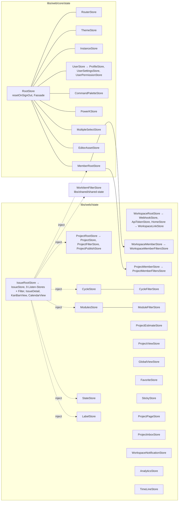

# 08 – Frontend-Architektur Angular (web, admin, space)

> **Status:** verbindlich für das Thema Frontend (Fachdokument zu `01-zielarchitektur-und-tech-stack.md`, Anhang A: „Routen-Mapping, Store-Mapping, Library-Mapping, Registries“).
> **Rangfolge:** `00-grundsatzentscheidungen.md` (ADR-000 … ADR-009) > `01-zielarchitektur-und-tech-stack.md` (ADR-010 … ADR-052) > **dieses Dokument (D08-ADR-01 ff.)** > eigene Präferenzen. Bei Widerspruch gilt 01 bis zur ADR-Änderung; Ergänzungen dieses Dokuments, die 01 präzisieren, sind in Abschnitt 2 als solche markiert.
> **Stand:** 23.10.2026. **Zielrepository:** `funk.` (ADR-009). Alle Zielpfade sind relativ zu dessen Wurzel; der Angular-Workspace liegt unter `frontend/` (01 §6.1). *Hinweis:* 01 §5.1 ist auf `funk./` angeglichen (früherer Arbeitstitel `plane-net/`, ABG-018 g); die Verzeichnisstruktur unterhalb der Wurzel bleibt unverändert.
> **Sprache:** Fließtext Deutsch, Bezeichner Englisch.
> **Kürzel für Original-Pfade** (wie 01): `WEB/` = `apps/web/`, `ADM/` = `apps/admin/`, `SPC/` = `apps/space/`, `PKG/` = `packages/`. Analyse-Dokumente: `A08` = `migration/analysis/08-frontend-web-architektur.md`, `A09` = `…/09-frontend-arbeitsobjekte-layouts.md`, `A10a`/`A10b` = Screens, `A11` = Admin/Space, `A12` = Editor/Live, `A13a` = Designsystem, `A13b` = Shared Packages/i18n. Ziel-Kürzel: `FE/` = `funk./frontend/`.

## Inhaltsverzeichnis

1. [Ziel & Scope](#1-ziel--scope)
2. [Entscheidungen (D08-ADR-01 ff.)](#2-entscheidungen-d08-adr-01-ff)
3. [Detaildesign](#3-detaildesign)
   - 3.1 Workspace, Apps, Base-Paths, Libraries, Modulgrenzen
   - 3.2 Bootstrap & Provider-Kette
   - 3.3 Routing (Reihenfolge, Trailing Slash, In-Place-Guard-States, Redirects, Titel/Meta)
   - 3.4 State-Management (MobX → Signal-Stores, Issue-Store)
   - 3.5 Datenzugriff (HttpClient, Interceptors, QueryCache als SWR-Ersatz)
   - 3.6 Formulare
   - 3.7 i18n
   - 3.8 Theming
   - 3.9 Interaktions- und Layout-Bausteine (DnD, Virtualisierung, Command-Palette, Picker, Charts, Gantt, Kanban, Spreadsheet, Kalender, Masonry, Dropzone, Overlays)
   - 3.10 Shortcuts
   - 3.11 Runtime-Config
   - 3.12 Realtime im Frontend (Hocuspocus, Live-Events)
   - 3.13 Performance
   - 3.14 Fehlerbehandlung, Status- und Fehlerseiten
   - 3.15 Browser-Storage
4. [Vollständige Mapping-Tabellen Original → Ziel](#4-vollständige-mapping-tabellen-original--ziel)
5. [Code-Skelette](#5-code-skelette)
6. [Erweiterungspunkte für Bezahl-Pakete](#6-erweiterungspunkte-für-bezahl-pakete)
7. [Akzeptanzkriterien & Tests](#7-akzeptanzkriterien--tests)
8. [Risiken & offene Punkte](#8-risiken--offene-punkte)
9. [Abhängigkeiten zu anderen Dokumenten (02–16)](#9-abhängigkeiten-zu-anderen-dokumenten-0216)

---

## 1. Ziel & Scope

### 1.1 Ziel

Die drei React-SPAs des Originals (`apps/web`, `apps/admin`, `apps/space`, Plane v1.4.2 CE) werden als **ein Angular-22-Workspace mit drei Apps** nachgebaut, sodass

1. **Routen, Layout-Verschachtelung, Guards, Redirects und Trailing-Slash-Verhalten** identisch sind (gleiche URLs, gleiche Zustände bei Direktaufruf, gleiche Weiterleitungsziele inkl. Query und abschließendem `/`),
2. **jeder MobX-Store** strukturgleich (gleicher Dateiname, Klassenname, Feld-, Computed- und Methodenname, gleiche Optimismus-/Revert-Semantik) als Signal-Store existiert und die **reinen TS-Algorithmen** (Gruppierung, Sortierung, Pagination, Sort-Order, Distribution-Updates, Rich-Filter) **unverändert** übernommen werden,
3. die **HTTP-Verträge** (Pfade, Methoden, Query-Parameter, Fehlerauswertung) mit dem Original übereinstimmen (ADR-003, ADR-047),
4. das **DOM** pixelgleich ist (ADR-005, 01 §7.17) – geprüft durch Visual- und DOM-Snapshot-Tests,
5. der Workspace **ohne Laufzeit-Node** und **ohne externe Ressourcen** (Airgap, ADR-004) ausgeliefert wird,
6. die 🧱-Erweiterungspunkte (01 §1.4, §6.4) im Frontend **ab dem genannten Inkrement** existieren, ohne Bezahl-Features fachlich vorzuplanen.

### 1.2 Scope

| Im Scope | Nicht im Scope (anderes Dokument) |
|---|---|
| Workspace-Aufbau, Apps, Base-Paths, Libraries, Sheriff-Regeln | Komponenten-Port Propel/Blocks im Detail (Variantentabellen) → `09-ui-paritaet-designsystem.md` |
| Routing aller drei Apps (vollständige Tabellen §4.1–§4.3) | Editor-Extensions, NodeViews, Schema-Freeze → `10-editor-angular.md` |
| State-Management inkl. Mapping **aller** 100 Store-Dateien aus `WEB/store`, 5 aus `ADM/store`, 16 aus `SPC/store`, `PKG/shared-state` | Suche/Power-K-**Backend**, AI-Provider → `11-suche-und-ai-basis.md` |
| Datenzugriff (HttpClient, Interceptors, QueryCache), Upload-Client | API-Endpunktkatalog → `04-api-design-und-endpunktkatalog.md` |
| Formulare, i18n, Theming, Shortcuts, Runtime-Config, Performance, Fehlerseiten | Keycloak-Realm, Login-Theme, Permission-Matrix → `05-auth-sicherheit-berechtigungen.md` |
| Interaktionsbausteine (DnD, Virtualisierung, Command-Palette, Emoji-/Date-Picker, Charts, Gantt, Kanban, Spreadsheet) – **Architektur** und Bibliothekswahl | Hocuspocus-Serverprotokoll → `07-realtime-kollaboration-dokumente.md` |
| Library-Mapping **jeder** Abhängigkeit aus `apps/*/package.json` und `packages/*/package.json` (inkl. Root) | Testpyramide/Quality-Gates gesamt → `15-teststrategie-qualitaet-paritaet.md` |
| Frontend-Erweiterungspunkte (Registries) für 🧱-Pakete | Fachdesign der Bezahl-Pakete → je Welle W1…W9, Andockstellen gesamt → `16-erweiterungspunkte-bezahl-features.md` |

### 1.3 Welcher Teil wird in welchem Inkrement gebraucht

Inkremente gemäß 01 §1.3. Ein Baustein wird **im genannten Inkrement vollständig** gebaut (mit Tests), vorher existiert er nicht (01 §7.19: keine Platzhalter-Routen).

| Baustein (Abschnitt) | I0 | I1 | I2 | I3 | I4 | I5 | I6 | I7 |
|---|---|---|---|---|---|---|---|---|
| Workspace, Sheriff, Lint, Vitest, Playwright-Gerüst (§3.1, §7) | ● | | | | | | | |
| `libs/shared/{types,constants,utils,i18n,tailwind-config,state-kit,runtime-config,cdk}` (§3.1) | ● | | | | | | | |
| `libs/shared/services` (APIService-Basis + Auth/User/Workspace/Instance/Project) | ● | ◐ | ◐ | ◐ | ◐ | ◐ | ◐ | |
| Bootstrap, Inline-Theme-Script, ThemeService, TitleStrategy, Progressbar, Stale-Chunk-Recovery (§3.2, §3.8, §3.14) | ● | | | | | | | |
| Routing-Kern: Trailing-Slash, `AppRouter`, `PathnameService`, RouterStore, Splat-Matcher (§3.3) | ● | | | | | | | |
| Wrapper `AuthenticationWrapper`, `InstanceWrapper`, `StoreWrapper`, `WorkspaceAuthWrapper` (§3.3.4) | ● | | | | | | | |
| `ProjectAuthWrapper` | ◐ (Projekt-Kern) | ● | | | | | | |
| QueryCache (SWR-Ersatz), Interceptors, Fehler-Mapping (§3.5) | ● | | | | | | | |
| Workspace-Shell (Top-Navigation, Sidebar, Header, `ContentWrapper`), Propel-Primitive Button/Input/Menu/Tooltip/Avatar | ● | | | | | | | |
| Signal Forms + Formular-Bausteine (§3.6) | ◐ (Create-Workspace/-Project) | ● | | | | | | |
| i18n Sprachwechsel, Profil-Sync (§3.7) | ◐ (Laden, `t`) | ● | | | | | | |
| Custom Theme, High Contrast, Theme-Persistenz (§3.8) | ◐ (light/dark/system) | ● | | | | | | |
| Settings-Rahmen, Settings-Registry `SETTINGS_PAGES` | | ● | | | | | | |
| Sidebar-Registry `SIDEBAR_ITEMS`, Favoriten | ◐ (statische Items) | ● | | | | | | |
| Issue-Store (IssueRootStore, 8 CE-Listen-Store-Klassen in 12 Instanzen, Detail-Store), `work-items-core` (§3.4.6) | | | ● | | | | | |
| DnD-Direktiven, `RenderIfVisible`, Sentinel-Pagination (§3.9) | | ◐ (Labels-DnD) | ● | | | | | |
| List/Kanban/Spreadsheet/Calendar/Gantt (§3.9) | | | ● | | | | | |
| Rich-Filter (`libs/shared/shared-state`), `FILTER_FIELDS`, `PROPERTY_RENDERERS`, `RELATION_TYPES` | | | ● | | | | | |
| Lite-Editor (Kommentare/Beschreibung) | | | ● | | | | | |
| Charts (D3) | | | | ● | | | | |
| Date-Picker (Propel `Calendar`) | | | ● | | | | | |
| Emoji-/Icon-Picker, Emoji-Reaktionen | | ◐ (Logo-Picker Projekt) | ● | | | | | |
| Pages, Rich/Document-Editor, Hocuspocus-Provider (§3.12) | | | | | ● | | | |
| Power-K, Shortcuts (§3.10) | ◐ (`cmd+k` öffnet leere Palette nicht – erst I5) | | | | | ● | | |
| Live-Events (SignalR, H6-Andockstelle) | ● (Service, ohne Handler) | | | | | ● (Notification-Zähler) | | |
| Masonry (Stickies) | | | | | | ● | | |
| Admin-App vollständig | ◐ (Einstieg, General) | | | | | | ● | |
| Space-App | | | | | | | ● | |
| Airgap-Prüfungen, Bundle-Budgets final, Visual-Abnahme aller Screens | | | | | | | | ● |

● = in diesem Inkrement fertig · ◐ = Teilumfang (in Klammern)

---

## 2. Entscheidungen (D08-ADR-01 ff.)

| ID | Belang | Entscheidung | Alternativen (verworfen) | Begründung | ab |
|---|---|---|---|---|---|
| **D08-ADR-01** | Workspace-Werkzeug | Angular-CLI-Multi-Project-Workspace + pnpm + Sheriff (bestätigt ADR-039). Libraries ohne eigenen Build (TS-Path-Mapping), Apps `web`, `admin`, `space`; Builder `@angular/build:application` | Nx; separate Lib-Builds mit ng-packagr | 01 verbindlich; keine Lib-Builds = schnellere Agenten-Zyklen | I0 |
| **D08-ADR-02** | Ablage der Stores und Services (Präzisierung 01 §6.2/§6.3) | Stores liegen gemäß 01 in `libs/web/<domäne>/state/`, Services in `libs/web/<domäne>/services/`. **Sheriff-Ebenen**: `layer:state` und `layer:services` bilden je einen Cluster, in dem jede Domäne jede andere über deren `state/public-api.ts` bzw. `services/public-api.ts` importieren darf (entspricht dem Objektgraphen des Original-`RootStore`); nur `layer:ui` folgt der Domänen-Matrix (§3.1.5) | alle Stores in einer Lib `libs/web/state` (bricht 01-Ablage); strenge Matrix auch für Stores (unmöglich: Issue-Root ↔ Cycle ↔ Module ↔ Project sind zyklisch verknüpft) | Store-Code wird 1:1 portiert, inklusive seiner Querbezüge; Zyklen sind nur zur Laufzeit (über `inject()`), nicht bei Modul-Auswertung vorhanden | I0 |
| **D08-ADR-03** | Signal-Store-Form | Klassen-Stores als `@Injectable({providedIn:'root'})` (Singleton wie `store-context.tsx`); Unter-Stores (z. B. die 12 Issue-Listen-Store-Instanzen aus 8 Klassen in `WEB/store/issue/root.store.ts`, Page-Instanzen, Estimate-Instanzen) als **plain classes**, die vom Eltern-Store mit `new` erzeugt werden (wie Original) | NgRx SignalStore (`signalStore()`), Store je Route | 1:1-Portierbarkeit (ADR-040); Unterinstanzen entstehen im Original ebenfalls per `new` | I0 |
| **D08-ADR-04** | MobX-Primitive → Signal-Primitive | Feste Übersetzungstabelle (§3.4.2) mit Bausteinen aus `libs/shared/state-kit`: `signal` (observable.ref), `EntityMap<T>` (observable Record/Map normalisierter Objekte, ein Signal je Schlüssel), `DeepState<T>` (tief verschachtelte observables, s. ADR-05), `memoizedComputed` (`computedFn`), `reactionEffect` (`reaction`), `effect` (`autorun`), `untilSignal` (`when`), `persisted()` (localStorage-gebundene Signale) | manuelle Neuentwicklung je Store | Mechanisch anwendbar, review-bar gegen Original-Datei | I0 |
| **D08-ADR-05** | Tiefe, pfadbasierte Mutationen (lodash `set`/`update`/`unset` auf observables) | **`DeepState<T>`**: hält ein mutables Plain-Objekt + Versions-Signal; Schreib-API `set(path, v)`, `update(path, fn)`, `unset(path)` (lodash-Semantik, ersetzt Blatt-Referenzen) inkrementiert die Version; Lese-API `get(path)` liest Version + Pfad; pro Pfad memoisierte `select(path)`-Signale mit `Object.is`-Gleichheit liefern nur bei geänderter Blatt-Referenz neue Werte | Immer/immutable Copy-on-Write (Rewrite der Store-Algorithmen, Kosten bei 10k Items); strukturiertes Klonen (zu teuer) | Original-Code (`set(this.groupedIssueIds, …)`, `update(this.issuesMap, …)`) bleibt fast wörtlich erhalten; feingranulare Updates je Gruppe bleiben erhalten | I0 (state-kit), I2 (Issue-Store) |
| **D08-ADR-06** | Zugriff zwischen Stores (`this.rootStore.x.y`) | `this.rootStore.<pfad>` wird zu einem per `inject()` gehaltenen Feld (`private readonly cycle = inject(CycleStore)`); Zyklen über `injectLazy(() => X)` (state-kit, `Injector.get` beim ersten Zugriff). Es gibt einen dünnen `RootStore` in `libs/web/core/state/root.store.ts` nur für `resetOnSignOut()` und als Kompatibilitätsfassade (Getter auf die Stores, nur für portierten Code, der den Root als Ganzes übergibt) | ein God-Object-RootStore mit allen Stores als Felder (erzwingt `core` → alle Domänen) | Hält `core` frei von Domänen-Imports (Sheriff), Laufzeitgraph identisch | I0 |
| **D08-ADR-07** | `resetOnSignOut()` | Setzt `localStorage.theme = "system"` und Sprache `en` wie Original und löst den Formular-POST `/auth/sign-out/` aus; Stores werden **nicht** neu instanziiert, weil der Sign-out eine Vollnavigation (Server-Redirect → Keycloak-Logout → Neuladen) ist | Session-Injector, der Stores verwirft | Gleiches beobachtbares Verhalten bei weniger Mechanik | I0 |
| **D08-ADR-08** | Datenabruf (SWR-Ersatz) | Eigener **`QueryCache`** in `libs/shared/state-kit` mit SWR-2.4-Semantik: globale Schlüssel (`fetch-keys.ts` + Literal-Keys unverändert), Deduplizierung 2 000 ms, `revalidateOnFocus` (Throttle 5 000 ms), `revalidateOnReconnect`, `revalidateIfStale`, `revalidateOnMount`, `refreshInterval`, `refreshWhenHidden`, `errorRetryCount` mit exponentiellem Backoff (Basis 5 000 ms), `shouldRetryOnError`, globales `mutate(key)`; Konsum per `injectQuery(keyFn, fetcher, options)` in Komponenten/Wrappern. Die Fetcher rufen **Store-Actions** wie im Original | `@tanstack/angular-query-experimental` (Status „experimental“, andere Semantik); `httpResource` (kein globaler Key-Cache, keine Fokus-Revalidierung) | Gleiche Ladezeitpunkte und Refetch-Auslöser wie Original (A08 §2.3.4/§2.3.5 inkl. Rollen im Key) | I0 |
| **D08-ADR-09** | HTTP | `APIService`-Basisklasse auf `HttpClient` mit **Promise**-API und gleichen Methoden `get/post/put/patch/delete/request` (ADR-047); Interceptor-Kette §3.5.2; Fehler werden wie im Original als `error.response.data` weitergeworfen (`HttpErrorResponse.error`) | Observable-API in Services; generierter Client | Store-Code bleibt `async/await` | I0 |
| **D08-ADR-10** | Routen-Reihenfolge | Angular „first match“ wird durch eine **feste Deklarationsreihenfolge** an das Ranking von React Router angeglichen: (1) Redirect-Routen mit statischem Präfix, (2) statische Top-Level-Routen, (3) Pfade mit statischem Segment vor dynamischem auf gleicher Ebene, (4) `:workspaceSlug`-Baum, (5) `**`. Ein Routing-Contract-Test prüft jede URL der Tabellen §4.1–§4.3 | eigener `UrlMatcher` mit React-Ranking | Explizit, testbar, kein Eigenbau eines Rankings | I0 |
| **D08-ADR-11** | Trailing Slash | `TrailingSlashPathLocationStrategy` aus `@angular/common` (stabil, in 22.x enthalten) schreibt jede Browser-URL mit `/`; die erste Navigation ersetzt eine URL ohne Slash per `replaceState` (Äquivalent zum 308 der `clientMiddleware`). Für Vergleiche wie `pathname === \`${base}/settings/\`` liefert `PathnameService.pathname()` den **Browser**-Pfad mit Slash (`Location.path()` normalisiert ohne Slash). `AppRouter.push/replace` hängen `/` an und verzögern um `setTimeout(0)` (E22, Parität) | eigener `UrlSerializer`; Server-Redirect im Gateway | Framework-Bordmittel; Original verhält sich ebenfalls rein clientseitig | I0 |
| **D08-ADR-12** | Guards als In-Place-Zustände | Die Original-Wrapper werden als **Wrapper-Komponenten** mit Content-Projection portiert (`<pl-authentication-wrapper pageType="AUTHENTICATED"><router-outlet/></…>`), die Spinner, Fehler- und Leerzustände **ohne URL-Wechsel** rendern und Redirects per `AppRouter` auslösen. Funktionale Guards nur für (a) Redirect-Routen (`redirectTo`-Funktionen), (b) Legacy-Loader-Redirects (`canActivate` mit `UrlTree`), (c) Splat-Matcher | Redirect-Guards (`canActivate`) für die Auth-Matrix | Original zeigt erst Spinner und dann Redirect bzw. Zustandsseite in derselben URL; Guard-Variante würde die URL nicht stehen lassen | I0 |
| **D08-ADR-13** | Formulare | **Angular Signal Forms** (stabil seit v22) für alle `react-hook-form`-Formulare; Validierungstexte, `dirty`-Logik und `reset`-Zeitpunkte 1:1; Adapter `[plFormField]` für Propel-Felder (implementiert `FormValueControl`). Laut angular.dev ist die Bindungsdirektive `FormField` (Template `[formField]`, Entry-Point `@angular/forms/signals`); in S0 gegen die installierte 22.x-Version bestätigen ⚠ | Reactive Forms (Fallback, falls S0 rot); Template-driven | 01 Glossar verbindlich; Signals passen zum Store-Modell | I0 (Gerüst), I1 |
| **D08-ADR-14** | i18n | i18next + i18next-icu + i18next-resources-to-backend unverändert (ADR-046); Locales als statische Assets `/{base}/i18n/{lng}/{ns}.json`; `TranslationService` (Signal `currentLocale`), Pipe `t`, Funktion `t()`; Init per `provideAppInitializer` vor dem ersten Routing | Transloco, `@angular/localize` | Gleiche Fallback-Kette (`defaultNS` → `fallbackNS` → `fallbackLng`), ICU-Plurale | I0 |
| **D08-ADR-15** | Theme | Inline-Script in `index.html` (Logik von next-themes 0.4.6, s. §5.1) + `ThemeService` (Signals `theme`, `resolvedTheme`, `systemTheme`); Attribut `data-theme`, Schlüssel `localStorage.theme`, `color-scheme` nur bei `light`/`dark` | CSS-only `prefers-color-scheme`; Angular-Material-Theming | Kein Theme-Flash, gleiche Selektoren `[data-theme*="dark"]` | I0 |
| **D08-ADR-16** | Virtualisierung | Port von `RenderIfVisible` als Struktur-Direktive `*plRenderIfVisible` (IntersectionObserver, Offsets wie Original); `@tanstack/virtual-core` nur dort, wo das Original `@tanstack/react-virtual` nutzt (`PKG/blocks` `select`, `virtual-list`) | CDK Virtual Scroll | Variable Höhen, Sticky-Header, Swimlanes, DOM-Parität (A09 §5.2) | I2 |
| **D08-ADR-17** | Command-Palette | Eigene Komponente `pl-command` (Root/Input/List/Group/Item/Empty) mit **cmdk-DOM-Attributen** (`cmdk-root`, `cmdk-input`, `cmdk-list`, `cmdk-group`, `cmdk-group-heading`, `cmdk-item`, `data-selected`, `aria-selected`, `data-disabled`) und cmdk-Filterlogik (`command-score`-Port); `power-k.css` unverändert; Power-K-Kern (`registry.ts`, `shortcut-handler.ts`, `context-detector.ts`) als TS 1:1 | Angular CDK Listbox pur; Fremd-Lib | Parität von Markup, Sortierung und Tastatur | I5 |
| **D08-ADR-18** | Charts | D3-Module + Angular-SVG-Komponenten, die recharts-2.15.4-Markup nachbilden (bestätigt ADR-044) | ECharts | Pixelparität | I3 |
| **D08-ADR-19** | DnD | `@atlaskit/pragmatic-drag-and-drop` 1.7.4 unverändert; Direktiven `plDraggable`, `plDropTarget`, `plMonitor`, `plAutoScroll` registrieren in `afterNextRender`, Cleanup in `DestroyRef` (bestätigt ADR-043) | CDK DragDrop | Gleiches Hitbox-/Instruction-Modell | I1 (Labels), I2 |
| **D08-ADR-20** | Emoji-Picker | Port der Blocks-Komponente `emoji-icon-picker` (Original: `frimousse` 0.3) als Angular-Komponente mit **identischem DOM** auf Basis gebündelter `emojibase-data` (gepinnt nach ABG-029: genau eine Version für Editor und Picker, Kandidat 15.3.2, endgültig beim ersten `capture-reference`-Lauf, Z-04), Daten aus `assets/emojibase/<version>/<locale>/` statt jsDelivr; `emoji-picker-react` entfällt (im Quelltext ungenutzt) | Fremd-Picker | Airgap (ADR-004), DOM-Parität | I2 |
| **D08-ADR-21** | Date-Picker | Eigene Komponente `pl-calendar` mit **Klassenvertrag** von Propel `calendar` (react-day-picker 10.0.1, `PROPEL/elements/calendar/variants.js`); Wochenstart Default Montag (Propel) bzw. Profil (`start_of_the_week`) wo das Original es übergibt; `date-fns` 4.1 | Angular-Material-Datepicker | DOM-Parität | I2 |
| **D08-ADR-22** | Realtime-Events (H6) | `LiveEventsService` (`@microsoft/signalr` 10.x) in `libs/web/core/live-events`, verbindet nach Login lazy mit `/live/events/`, verteilt Events an Multi-Provider `LIVE_EVENT_HANDLERS`; CE nutzt ihn ab I5 für den Notification-Zähler | Polling | 01 ADR-023 / §1.4 H6 | I0 (Gerüst), I5 |
| **D08-ADR-23** | Change Detection | Zoneless (Default v22), OnPush (Default v22); keine `zone.js`-Abhängigkeit. Drittbibliotheken mit DOM-Events (pragmatic-dnd, tippy, floating-ui) brauchen kein `runOutsideAngular`, Signalschreibungen lösen Rendering aus | Zone-basiert | Performance, v22-Defaults | I0 |
| **D08-ADR-24** | Seitentitel & Meta | `PlaneTitleStrategy` setzt `route.title` **wörtlich** (ohne Suffix); `PageHeadDirective`/`PageTitleService` für Laufzeit-Titel (Ersatz `PageHead`); Route-`data.robots` → `Meta`-Service (`noindex, nofollow` bzw. `index, nofollow`) | Titel-Suffix-Strategie | Titel exakt wie Layout-`meta` des Originals | I0 |
| **D08-ADR-25** | Lazy Loading | Jede Page- und Layout-Komponente per `loadComponent`; Domänen-Libs werden dadurch automatisch in Chunks geteilt; keine `loadChildren`-Routendateien je Domäne (Routen bleiben in `app.routes.ts`, 1:1-Review gegen `core.ts`) | Routendatei je Domäne | Routenbaum an einer Stelle prüfbar | I0 |
| **D08-ADR-26** | Space-SSR | Space wird **CSR** gebaut; Social-Meta für `/spaces/issues/:anchor` erzeugt das Gateway (01 ADR-033); im Client setzt ein Resolver nur `document.title`/`description` | Angular SSR (Node zur Laufzeit, verletzt ADR-002) | Kein Node | I6 |
| **D08-ADR-27** | Tests Frontend | Vitest (Angular-22-Builder) + `@testing-library/angular` für Unit/Komponenten; Playwright für E2E, Visual Regression (Referenz-Screenshots des Originals) und DOM-Snapshots; Original-Unit-Tests aus `PKG/blocks` (21) und `PKG/services` (`url.test.ts`) werden als Spezifikation portiert | Jest, Cypress | 01 ADR-048 | I0 |
| **D08-ADR-28** | Edge-Cases des Originals (A08 §3.10) | Funktionale Fehler werden korrigiert und in `tests/contracts/deviations.yaml` (Bereich `frontend`) dokumentiert; rein optische/textliche Eigenheiten bleiben (Entscheidungen je Fall §4.9) | alles 1:1 | 01 P1/§7.20 | I0…I6 |

---
## 3. Detaildesign

### 3.1 Workspace, Apps, Base-Paths, Libraries, Modulgrenzen

#### 3.1.1 Verzeichnisbaum (Präzisierung von 01 §6.1)

```text
frontend/
├── package.json  pnpm-workspace.yaml  angular.json  tsconfig.base.json  sheriff.config.ts
├── eslint.config.js  .prettierrc  vitest.config.ts  playwright.config.ts   # vitest.config.ts: test.projects shared-node, shared-dom, web, admin, space, browser (ABG-007)
├── apps/
│   ├── web/                               # base href "/"
│   │   ├── public/                        # ← WEB/public (favicon/*, icons/*, site.webmanifest.json, manifest.json); sw.js/workbox entfallen (E19)
│   │   └── src/
│   │       ├── index.html                 # Inline-Theme-Script (§5.1), Portale #context-menu-portal, #editor-portal
│   │       ├── main.ts                    # bootstrapApplication(AppComponent, appConfig)
│   │       ├── app.component.ts           # <router-outlet/> (entspricht root.tsx `Root`)
│   │       ├── app.config.ts              # Provider-Kette (§3.2)
│   │       ├── app.routes.ts              # Routenbaum (§4.1), Reihenfolge D08-ADR-10
│   │       ├── styles.css                 # @import tailwind-config, propel styles, globals.css, power-k.css, emoji.css, editor styles
│   │       ├── styles/                    # ← WEB/styles/{globals,power-k,emoji}.css (1:1)
│   │       └── pages/                     # ← WEB/app/** (gleiche Ordnernamen inkl. "(all)", "[workspaceSlug]")
│   │           ├── layout.component.ts    # L0 AppShellLayoutComponent
│   │           ├── not-found.page.ts
│   │           ├── (home)/{layout.component.ts,page.ts}
│   │           ├── (all)/…                # je Original-Ordner: layout.component.ts, page.ts, header.component.ts, mobile-header.component.ts
│   │           └── routes/redirects/      # Redirect-Funktionen (redirects.ts) – Ersatz für routes/redirects/core/*.tsx
│   ├── admin/                             # base href "/god-mode/", src/pages ← ADM/app/(all)/**
│   ├── space/                             # base href "/spaces/",  src/pages ← SPC/app/**
│   ├── gallery/                           # Komponenten-Galerie (D15 §3.2, <base href="/__gallery/">, nur Test-Builds, Gateway nur Profil test, Route G-17; ABG-008)
│   └── e2e/                               # Playwright: web/, admin/, space/, visual/, a11y/, routing/ (+ drivers/dom-parity.ts, D15 §3.10.4)
├── libs/
│   ├── shared/                            # scope:shared (01 §6.1, unverändert)
│   │   ├── types/ constants/ utils/ i18n/ services/ shared-state/ cdk/ state-kit/ runtime-config/
│   │   ├── theme/                         # src/{theme.service,inline-script,theme-asset-helpers}.ts – eine Implementierung für web/admin/space (ABG-028)
│   │   ├── tailwind-config/ propel/ blocks/ editor/ dnd/
│   │   └── work-items-core/               # NEU (A09 §5.1): reine TS-Logik aus WEB/components/issues/issue-layouts/utils.tsx,
│   │                                      #   WEB/components/gantt-chart/sidebar/utils.ts, WEB/store/issue/helpers/base-issues-utils.ts
│   ├── web/                               # scope:web; je Domäne: state/ services/ components/ (+ public-api.ts je Unterordner)
│   │   ├── core/ extensions/ auth/ workspace/ project/ project-settings/ work-items/ views/ cycles/ modules/ intake/
│   │   ├── pages/ analytics/ home/ stickies/ notifications/ power-k/ profile/ settings/ favorites/ archives/ project-publish/
│   │   └── extensions/testing/            # provideFakeExtensions(config?: FakeExtensionConfig) (ABG-032)
│   ├── admin/                             # scope:admin: core/ extensions/ authentication/ instance/ workspace/ common/
│   │   └── extensions/testing/            # provideFakeAdminExtensions(config?) (ABG-032)
│   └── space/                             # scope:space: core/ extensions/ issues/ views/ editor/ account/
│       └── extensions/testing/            # provideFakeSpaceExtensions(config?) (ABG-032)
└── tools/
    ├── propel-port/                       # port-icons.mjs (Icons → PlIconDef + svg[plSvgIcon]), vendor-css, port-variants, port-illustrations (09 D09-ADR-07; ersetzt icons-codegen/, ABG-027)
    ├── contract-check/  i18n-sync-check/  i18n-generate-types/
    ├── eslint-rules/                      # @plane/eslint-rules (§7.6)
    ├── store-parity-check/  route-contract-check/   # §7.3, §7.2
    ├── visual/                            # css-diff.ts, reference-css/, capture-reference.ts, report/ (09 §3.1, 01 §6.1)
    ├── reference-gallery/                 # Original-/Referenz-Galerie (React 19 + @makeplane/propel@0.7.3 + Original-packages/blocks), Vite-base '/__gallery/', nur Dev/Paritäts-CI (ABG-008)
    └── gallery-stories/                   # gemeinsame Story-Definitionen *.stories.json für gallery und reference-gallery (ABG-008)
# Golden-Fixtures aus dem Original (z. B. Issue-Store) erzeugt das Repo-weite Werkzeug funk./tools/golden/generate.mjs (D15-ADR-08)
```

**Begriffsabgleich mit dem Auftrag:** „ui/propel-Port“ = `libs/shared/propel`; „blocks“ = `libs/shared/blocks`; „editor“ = `libs/shared/editor`; „i18n“ = `libs/shared/i18n`; „types“, „constants“, „utils“ = gleichnamige `libs/shared/*`; „api-client“ = `libs/shared/services` (Paket-Services) + `libs/web/<domäne>/services` (App-Services); „state“ = `libs/shared/state-kit` (Primitive, QueryCache) + `libs/web/<domäne>/state` (Stores); „Feature-Libs je Domäne“ = `libs/web/<domäne>/components`.

#### 3.1.2 Apps, Base-Paths, Builds

| App | `angular.json`-Projekt | Base-Href (`baseHref`) | Dev-Port (Aspire `PORT`, nur `127.0.0.1`, nur Profil `dev`) | Gateway-Pfad (01 ADR-033) | Output | Themes |
|---|---|---|---|---|---|---|
| web | `web` | `/` | 4200 | `/` (SPA-Fallback auf `index.html` außer `/api/`, `/auth/`, `/live/`, `/god-mode/`, `/spaces/`, Bucket) | `dist/web/browser` | light, dark, light-contrast, dark-contrast, custom, system |
| admin | `admin` | `/god-mode/` | 4201 (`--serve-path /god-mode/`) | `/god-mode/` (301 `/god-mode` → `/god-mode/`) | `dist/admin/browser` | light, dark, system |
| space | `space` | `/spaces/` | 4202 (`--serve-path /spaces/`) | `/spaces/` (301 `/spaces` → `/spaces/`) | `dist/space/browser` | light, dark, system |

- **Aufruf immer über das Gateway `http://localhost:3000`** (ABG-015): Port 3000 gehört ausschließlich dem Gateway; die Dev-Server 4200/4201/4202 sind nur dessen Upstreams und werden nicht direkt im Browser geöffnet.
- Build-Optionen je App: `outputHashing: all`, `optimization: true`, `sourceMap: hidden` (Prod), `subresourceIntegrity: false` (Gateway setzt CSP nach 05 D05-ADR-23; Inline-Script per Hash – ABG-016: ab I0 `Content-Security-Policy-Report-Only`, ab I7 erzwungen, `Plane:Gateway:Csp:Mode`; Assets same-origin), `inlineStyleLanguage: css`, PostCSS mit `@tailwindcss/postcss` 4.1.17. **Keine** Build-Zeit-Umgebungsvariablen (§3.11).
- Assets: `@fontsource*`-Dateien werden über `styles.css`-Imports gebündelt (gleiche Woff2-Dateien wie Original); `public/` 1:1; Emoji-Daten (`emojibase-data`, genau eine gepinnte Version nach ABG-029) und Locale-JSON als statische Assets (`apps/{web,space}/src/assets/emojibase/<version>/<locale>/{data,messages}.json`, ausgeliefert unter `assets/emojibase/<version>/<locale>/`; `/{base}/i18n/{lng}/{ns}.json`).
- Dev: `ng serve web --port ${PORT}` (4200), `ng serve admin --port ${PORT} --serve-path /god-mode/` (4201), `ng serve space --port ${PORT} --serve-path /spaces/` (4202), jeweils `--host 127.0.0.1`, nur Profil `dev`, hinter dem Gateway (same-origin, Cookie-Session; ABG-015). Proxy-Config wird **nicht** genutzt (Gateway übernimmt).
- Bundle-Budgets (`angular.json`, verbindlich ab I2, Fehler bei Überschreitung): web `initial` ≤ 650 kB (gzip ≤ 210 kB), jede Lazy-Chunk-Gruppe ≤ 400 kB; admin/space `initial` ≤ 450 kB. Werte werden in I0 gegen das Original-Bundle (`build/client`) gemessen und dann ± 10 % festgeschrieben (⚠ Messung S0).

#### 3.1.3 Library-Inventar mit Tags

| Lib (`FE/libs/…`) | Import-Alias (`tsconfig.base.json`) | Herkunft | Sheriff-Tags | ab |
|---|---|---|---|---|
| `shared/types` | `@plane/types` | `PKG/types` (Kopie; React-Typen `React.ReactNode` etc. → `unknown`/Angular-Typen, Liste A13b §2.3.4) | `scope:shared`, `type:types` | I0 |
| `shared/constants` | `@plane/constants` | `PKG/constants` (ohne `subscription.ts`, `payment.ts`, `MARKETING_*`) | `scope:shared`, `type:constants` | I0 |
| `shared/utils` | `@plane/utils` | `PKG/utils` (React-Hilfen nach `cdk`) | `scope:shared`, `type:utils` | I0 |
| `shared/i18n` | `@plane/i18n` | `PKG/i18n` (Locales 1:1, Core 1:1, Provider/Hook → Service/Pipe) | `scope:shared`, `type:data` | I0 |
| `shared/services` | `@plane/services` | `PKG/services` | `scope:shared`, `type:data` | I0 |
| `shared/shared-state` | `@plane/shared-state` | `PKG/shared-state` (rich-filters, work-item-filters) | `scope:shared`, `type:data` | I2 |
| `shared/state-kit` | `@plane/state-kit` | neu | `scope:shared`, `type:data` | I0 |
| `shared/runtime-config` | `@plane/runtime-config` | neu | `scope:shared`, `type:data` | I0 |
| `shared/cdk` | `@plane/cdk`, `@plane/cdk/extensions` | `PKG/hooks` + App-Hooks ohne Store-Bezug; Unterpfad `extensions/`: app-neutrale Registry-Mechanik (`RouteExtension<K>`, `mergeRoutes`, `injectRegistry`, §6.2), die web, admin und space gemeinsam nutzen | `scope:shared`, `type:ui` | I0 |
| `shared/tailwind-config` | `@plane/tailwind-config` | `PKG/tailwind-config` (CSS 1:1) | `scope:shared`, `type:ui` | I0 |
| `shared/propel` | `@plane/propel/{components,elements,icons,…}/*` | `@makeplane/propel@0.7.3` | `scope:shared`, `type:ui` | I0…I3 |
| `shared/blocks` | `@plane/blocks/*` | `PKG/blocks` | `scope:shared`, `type:ui` | I0…I3 |
| `shared/editor` | `@plane/editor`, `@plane/editor/core` | `PKG/editor` | `scope:shared`, `type:ui` | I2/I4 |
| `shared/dnd` | `@plane/dnd` | neu (Direktiven um pragmatic-dnd) | `scope:shared`, `type:ui` | I1 |
| `shared/work-items-core` | `@plane/work-items-core` | neu (reine Funktionen, A09 §5.1) | `scope:shared`, `type:utils` | I2 |
| `web/core` | `@plane/web/core` | Wrapper, Layout-Basis, Router/Theme/Instance/User/Permission/CommandPalette-Stores, Interceptors, Modal-Hosts, Navigation, Sidebar, Breadcrumbs | `scope:web`, `domain:core` | I0 |
| `web/extensions` | `@plane/web/extensions` | Registry-Tokens (§6) | `scope:web`, `domain:extensions` | I0 |
| `web/<domäne>` (20 Domänen, Tabelle 01 §6.1: auth, workspace, project, project-settings, work-items, views, cycles, modules, intake, pages, analytics, home, stickies, notifications, power-k, profile, settings, favorites, archives, project-publish) | `@plane/web/<domäne>`, `…/state`, `…/services` | `WEB/components/*`, `WEB/store/*`, `WEB/services/*` | `scope:web`, `domain:<d>`, `layer:ui\|state\|services` | I0…I6 |
| `admin/extensions`, `space/extensions` | `@plane/admin/extensions`, `@plane/space/extensions` | Registry-Tokens der Admin-/Space-App (§6.1: `ADMIN_SETTINGS_PAGES`, `ADMIN_ROUTE_EXTENSIONS`, `ADMIN_HEADER_SEGMENT_LABELS`, `SPACE_ROUTE_EXTENSIONS`) – eigene Libs, weil `scope:admin`/`scope:space` keine `scope:web`-Lib importieren dürfen (01 §6.3) | `scope:admin`/`scope:space`, `domain:extensions` | I0 |
| `admin/*`, `space/*` | `@plane/admin/*`, `@plane/space/*` | `ADM/*`, `SPC/*` | `scope:admin`/`scope:space` | I0/I6 |

#### 3.1.4 Ablage-Regel je Original-Datei

| Original | Ziel | Regel |
|---|---|---|
| `WEB/app/**/page.tsx` | `FE/apps/web/src/pages/**/page.ts` | Klasse `<Zweck>PageComponent`, Selektor `pl-page-<zweck>`; Page enthält nur Komposition + Titel |
| `WEB/app/**/layout.tsx` | `FE/apps/web/src/pages/**/layout.component.ts` | Klasse `<Zweck>LayoutComponent`; enthält `<router-outlet/>` an der Stelle von `<Outlet/>` |
| `WEB/app/**/header.tsx`, `mobile-header.tsx` | gleicher Ordner, `header.component.ts`, `mobile-header.component.ts` | – |
| `WEB/components/<x>/<datei>.tsx` | `FE/libs/web/<domäne>/components/<x>/<datei>.component.{ts,html}` | gleicher Dateistamm, kebab-case; Domänenzuordnung Tabelle 01 §6.1 |
| `WEB/store/<pfad>.ts` | `FE/libs/web/<domäne>/state/<pfad>.ts` | Dateiname, Klasse, Felder, Methoden gleich (Tabelle §4.5) |
| `WEB/services/<pfad>.ts` | `FE/libs/web/<domäne>/services/<pfad>.ts` | Methoden/Pfade gleich |
| `WEB/hooks/store/use-*.ts` | entfällt → `inject(<Store>)` | Tabelle §4.7 |
| `WEB/hooks/*.tsx` (Fach-/UI-Hooks) | Service, Direktive oder Signal-Funktion `inject<Name>()` | Tabelle §4.7 |
| `WEB/helpers/*`, `WEB/lib/*` | `FE/libs/web/core/{helpers,lib}/*` | 1:1 |
| `WEB/layouts/auth-layout/*` | `FE/libs/web/core/wrappers/*` | Wrapper-Komponenten (§3.3.4) |
| `WEB/app/compat/next/*` | entfällt → `AppRouter`, `PathnameService`, `pl-link`-Direktive (`[plLink]`) | §3.3.2 |

#### 3.1.5 Sheriff-Regeln (`sheriff.config.ts`)

Ergänzt 01 §6.3 um die Ebenen aus D08-ADR-02 und die Domänen-Matrix.

| Von (Tag) | darf importieren |
|---|---|
| `type:types` | – |
| `type:constants` | `type:types` |
| `type:utils` | `type:types`, `type:constants` |
| `type:data` (shared) | `type:types`, `type:constants`, `type:utils`, `type:data` |
| `type:ui` (shared) | `type:types`, `type:constants`, `type:utils`, `type:data` (nur `i18n`, `state-kit`, `runtime-config`), `type:ui` in Richtung `cdk ← propel ← blocks ← editor`, `dnd` |
| `layer:services` (web) | `scope:shared` (ohne `type:ui`), `layer:services` jeder Domäne |
| `layer:state` (web) | `scope:shared` (ohne `type:ui`), `layer:services` jeder Domäne, `layer:state` jeder Domäne, `domain:extensions` |
| `domain:core`, `layer:ui` | `scope:shared`, `domain:extensions`, alle `layer:state`/`layer:services` |
| `domain:<d>`, `layer:ui` | `scope:shared`, `domain:core`, `domain:extensions`, alle `layer:state`/`layer:services`, **`layer:ui` nur der in der Matrix genannten Domänen** |
| `domain:extensions` (web/admin/space) | `scope:shared` (inkl. `@plane/cdk/extensions`), **keine** andere Lib des eigenen Scopes (Tokens bleiben zyklenfrei) |
| `type:app` | eigene Scope-Libs, `scope:shared` |

**Domänen-Matrix `layer:ui`** (Zeile darf Spalte importieren; zusätzlich immer `core`, `extensions`):

| Domäne | workspace | auth | project | project-settings | work-items | cycles | modules | views | intake | pages | stickies |
|---|---|---|---|---|---|---|---|---|---|---|---|
| workspace | – | | | | | | | | | | |
| auth | ✓ | – | | | | | | | | | |
| project | ✓ | | – | | | | | | | | |
| project-settings | ✓ | | ✓ | – | | | | | | | |
| work-items | ✓ | | ✓ | | – | | | | | | |
| cycles, modules, views, intake | ✓ | | ✓ | | ✓ | – | – | – | – | | |
| archives | ✓ | | ✓ | | ✓ | ✓ | ✓ | | | | |
| pages | ✓ | | ✓ | | ✓ | | | | | – | |
| analytics | ✓ | | ✓ | | ✓ | ✓ | ✓ | | | | |
| stickies | ✓ | | | | | | | | | | – |
| home | ✓ | | ✓ | | ✓ | | | | | ✓ | ✓ |
| notifications, profile | ✓ | | ✓ | | ✓ | | | | | | |
| settings, project-publish | ✓ | | ✓ | | | | | | | | |
| favorites | ✓ | | ✓ | | | ✓ | ✓ | ✓ | | ✓ | |
| power-k | ✓ | ✓ | ✓ | ✓ | ✓ | ✓ | ✓ | ✓ | ✓ | ✓ | ✓ |

Alle Dropdowns aus `WEB/components/dropdowns/*` (inkl. Cycle-/Module-Dropdown) liegen in `work-items` und lesen Cycle/Module-Daten über `layer:state` – damit braucht `work-items` keine UI-Abhängigkeit zu `cycles`/`modules`.

### 3.2 Bootstrap & Provider-Kette

Original (A08 §2.4): `entry.client.tsx` (Polyfills, Stale-Asset-Listener, `await initPromise`) → `root.tsx` (`Layout`, `ThemeProvider`, `HydrateFallback`, `ErrorBoundary`) → `layout.tsx` (Trailing-Slash-Middleware, `AppProvider`) → `provider.tsx` (`StoreProvider` → `AppProgressBar` → `TranslationProvider` → `PlaneToastProvider` → `StoreWrapper` → `InstanceWrapper` → `SWRConfig`).

| Reihenfolge | Ziel (web) | Datei | Ersetzt |
|---|---|---|---|
| 0 | Inline-Script setzt `data-theme`/`color-scheme` vor dem ersten Paint; statischer Spinner-Platzhalter im `<body>` (wie `HydrateFallback`, erst nach aufgelöstem Theme sichtbar) | `apps/web/src/index.html` | next-themes-Script, `HydrateFallback` |
| 1 | `provideAppInitializer(loadRuntimeConfig)` – lädt `runtime-config.json` (§3.11), bricht bei Fehler **nicht** ab (Defaults = same-origin) | `libs/shared/runtime-config` | `VITE_*` |
| 2 | `provideAppInitializer(() => inject(TranslationService).init())` – entspricht `await initPromise`; Fehler → `catch(() => {})` | `libs/shared/i18n` | `initPromise` |
| 3 | `provideRouter(routes, withComponentInputBinding(), withRouterConfig({ paramsInheritanceStrategy: 'always', onSameUrlNavigation: 'ignore' }), withInMemoryScrolling({ scrollPositionRestoration: 'disabled' }), withNavigationErrorHandler(staleChunkHandler))` + `{ provide: LocationStrategy, useClass: TrailingSlashPathLocationStrategy }` + `{ provide: TitleStrategy, useClass: PlaneTitleStrategy }` | `apps/web/src/app.config.ts` | `routes.ts`, `clientMiddleware` |
| 4 | `provideHttpClient(withFetch(), withInterceptors([trailingSlashInterceptor, credentialsInterceptor, csrfInterceptor, unauthorizedInterceptor, abortInterceptor]))` – Kette und Reihenfolge verbindlich nach §3.5.2 (Admin: ohne `unauthorizedInterceptor`, zusätzlich `adminStepUpInterceptor`; Space: ohne beide) | `libs/web/core/http` | Axios-Instanzen |
| 5 | `provideZonelessChangeDetection()` (Default v22, explizit zur Dokumentation), `provideBrowserGlobalErrorListeners()` | – | – |
| 6 | `{ provide: ErrorHandler, useClass: PlaneErrorHandler }` (Stale-Chunk-Recovery + Fehlerseite) | `libs/web/core/errors` | `ErrorBoundary`, `entry.client`-Listener |
| 7 | `provideAppInitializer(() => inject(ProgressBarService).attach())` (Router-Events → `@bprogress/core`, `minimum 0.1, speed 400, trickleSpeed 800, showSpinner false`) | `libs/web/core/lib/b-progress` | `AppProgressBar` |
| 8 | Toast-Viewport `<pl-toast-viewport>` im `AppShellLayoutComponent` (innerhalb der i18n-Bereitschaft) | `libs/shared/blocks/toast` | `PlaneToastProvider` |
| 9 | `AppShellLayoutComponent` (L0) rendert `<pl-store-wrapper><pl-instance-wrapper><router-outlet/></…></…>` | `apps/web/src/pages/layout.component.ts` | `AppProvider`, `StoreWrapper`, `InstanceWrapper` |
| 10 | `QueryCache`-Defaults `WEB_SWR_CONFIG` (`refreshWhenHidden:false, revalidateIfStale:true, revalidateOnFocus:true, revalidateOnMount:true, errorRetryCount:3`) per `provideQueryCacheConfig(WEB_SWR_CONFIG)` | `libs/shared/state-kit` | `SWRConfig` |

Admin: gleiche Kette mit `ADMIN_SWR_CONFIG` (`refreshWhenHidden:false, revalidateIfStale:false, revalidateOnFocus:false, revalidateOnMount:true, refreshInterval:600000, errorRetryCount:3`, A11 §2.14), Themes nur `light|dark|system`, Wrapper `InstanceProvider`/`UserProvider` als Komponenten. Space: gleiche Kette inklusive Progressbar (`@bprogress/core` ist in `SPC/package.json`), ohne `unauthorizedInterceptor`, Themes `light|dark|system`.

**Polyfills:** `requestIdleCallback`-Fallback (`WEB/lib/idle-task.ts`, `runIdleTask` Timeout 300 ms) als `libs/web/core/lib/idle-task.ts`, wird in `main.ts` vor `bootstrapApplication` importiert.

### 3.3 Routing

#### 3.3.1 Grundregeln

1. **Struktur 1:1:** React-`layout(file, children)` ⇒ Angular `{ path: '', component: <Layout>, children }` (pfadlose Layout-Route). React-`route(path, file)` ⇒ `{ path: <relativer Pfad>, loadComponent }`. Pfade, die im Original absolut unter einer Layout-Gruppe stehen (`:workspaceSlug/…`), werden in Angular unter **eine** Route `:workspaceSlug` gruppiert, deren Kinder relative Pfade tragen; die Layout-Kette bleibt identisch (Tabelle §4.4).
2. **Reihenfolge** nach D08-ADR-10. Pflicht-Reihenfolgen (aus A08 §5.2, ergänzt):
   - Alle statischen Top-Level-Pfade (`sign-up`, `accounts/*`, `create-workspace`, `onboarding`, `invitations`, `workspace-invitations`, `settings/profile/:profileTabId`, `sign-in`, `signin`, `login`, `register`, `profile/**`, `accounts/sign-up`) **vor** `:workspaceSlug`.
   - `:workspaceSlug/projects/:projectId/settings/**`, `:workspaceSlug/projects/:projectId/inbox`, `:workspaceSlug/analytics`, `:workspaceSlug/settings/api-tokens`, `:workspaceSlug/settings/account/**`, `:workspaceSlug/settings/billing` (neu, Redirect) **vor** dem `:workspaceSlug`-Baum.
   - Im Profil `activity` vor `:profileViewId`; `projects/archives` vor `projects/:projectId/…`; Projekt-Archive (`projects/:projectId/archives/…`) vor `projects/:projectId` (LPD); `settings/projects` vor `settings` (LWSET).
3. **`pathMatch: 'full'`** für alle leeren Index-Routen (`''` mit Page) und für Redirects ohne Splat.
4. **Parameter:** `paramsInheritanceStrategy: 'always'`, damit jede Page `workspaceSlug`, `projectId` … per `input()` erhält (`withComponentInputBinding`); der `RouterStore` liest die zusammengeführten Parameter (§3.3.3).
5. **Lazy Loading:** jede Page/Layout per `loadComponent` (D08-ADR-25).
6. **Keine Platzhalter-Routen:** Routen eines noch nicht gebauten Inkrements sind nicht registriert (01 §7.19). Die Spalte „Ink.“ in §4.1 legt fest, wann eine Route in `app.routes.ts` aufgenommen wird; bis dahin greift die 404-Seite.
7. **Query-Parameter** bleiben bei Redirects erhalten, wo das Original sie überträgt (`profile/*`, `settings/account/*`: `?` + Query, E15; bei **leerer** Query entfällt das `?` technisch bedingt, weil Angulars `UrlSerializer` ein leeres `?` nicht serialisiert – rein kosmetisch, Kennung `FE-E15`; Legacy-Issue: keine Query).

#### 3.3.2 Navigation, Links, Pfad

| Original | Ziel | Verhalten |
|---|---|---|
| `useRouter()` aus `next/navigation`-Shim (`push/replace/back/forward/refresh/prefetch`) | `AppRouter` (`libs/web/core/lib/app-router.ts`) | `push(url)`/`replace(url)` → `ensureTrailingSlash(url)` → `setTimeout(() => router.navigateByUrl(url, {replaceUrl}), 0)` (E22 Parität); `back()`/`forward()` → `history`; `refresh()` → `location.reload()`; `prefetch()` no-op |
| `next/link`-Shim `Link` (Trailing Slash, ignoriert `prefetch/scroll/shallow`) | Direktive `a[plLink]` | setzt `href` mit Slash, interne Navigation per `AppRouter.push` ohne Verzögerung bei Klick (wie Link-Komponente: sofortige Navigation), `target`/Modifier-Klicks → Browser-Standard |
| `usePathname()` | `PathnameService.pathname` (Signal, liest `window.location.pathname` nach `NavigationEnd`) | enthält Trailing Slash wie Browser-URL |
| `useSearchParams()` | `PathnameService.searchParams` (Signal `URLSearchParams`) | nur lesen |
| `useParams()` | Komponenten-`input()`s bzw. `RouterStore` | – |
| `ensureTrailingSlash` (`WEB/app/compat/next/helper.ts`) | `libs/web/core/lib/url.ts` (Kopie) | gleiche Regeln (Query/Hash erhalten, `/` unverändert) |
| Space: direkte `react-router`-`Link` **ohne** Slash-Logik | `a[plLink]` mit `[trailingSlash]="false"` | Parität (A11 §2.15) |
| `next/image`, `next/script` | `` (bzw. `NgOptimizedImage` **nicht**, DOM-Parität), Script-Injektion entfällt | – |

#### 3.3.3 RouterStore

`WEB/store/router.store.ts` → `libs/web/core/state/router.store.ts` (`RouterStore`). `query` ist ein Signal mit den **zusammengeführten Pfad- und Query-Parametern**; gesetzt von `StoreWrapperComponent` bei jedem `NavigationEnd` (Original: `router.setQuery(params)` in `StoreWrapper`). Computeds gleichnamig: `workspaceSlug, teamspaceId, projectId, cycleId, moduleId, viewId, globalViewId, profileViewId, userId, peekId, issueId, inboxId, webhookId, epicId` (alle Signale). `teamspaceId`/`epicId` bleiben (B1/Epics-Andockstelle, in CE immer `undefined`).

#### 3.3.4 Wrapper & In-Place-Guard-States

| Wrapper (Original) | Ziel-Komponente (`FE/libs/web/core/wrappers/…`) | Ladeauslöser (QueryCache-Key → Action) | In-Place-Zustände (URL bleibt) | Redirects (über `AppRouter`) |
|---|---|---|---|---|
| `AuthenticationWrapper(pageType)` (`WEB/lib/wrappers/authentication-wrapper.tsx`) | `AuthenticationWrapperComponent` `pl-authentication-wrapper` (`input pageType: EPageTypes`) | `USER_INFORMATION` → `user.fetchCurrentUser()` (`revalidateOnFocus:false, shouldRetryOnError:false`) | Vollbild-`LogoSpinner` solange User/Workspaces laden | Matrix A08 §2.3.1: `NON_AUTHENTICATED` + eingeloggt → `/onboarding` bzw. `getWorkspaceRedirectionUrl()`; `ONBOARDING`/`AUTHENTICATED` nicht eingeloggt → `/?next_path=<pathname>`; `AUTHENTICATED` nicht onboarded → `/onboarding`; `ONBOARDING` onboarded → `replace(redirect)`; `SET_PASSWORD` entfällt (ADR-008) |
| `InstanceWrapper` | `InstanceWrapperComponent` | `INSTANCE_INFORMATION` → `instance.fetchInstanceInfo()` | Spinner; Fehler → `MaintenanceView`; `is_setup_done === false` → `InstanceNotReady` (Button „Get started“ → `GOD_MODE_URL`) | – |
| `StoreWrapper` | `StoreWrapperComponent` | – | – | – (setzt `RouterStore.query`, Sidebar-Collapse aus `localStorage.app_sidebar_collapsed` falls `theme.sidebarCollapsed === undefined`, Theme-Sync einmal je User-Sitzung, Custom-Theme anwenden/entfernen) |
| `WorkspaceAuthWrapper` (`WEB/layouts/auth-layout/workspace-wrapper.tsx`) | `WorkspaceAuthWrapperComponent` | 8 Keys aus A08 §2.3.4 (`WORKSPACE_MEMBER_ME_INFORMATION_{WS}`, `WORKSPACE_PROJECTS_ROLES_INFORMATION_{WS}`, `WORKSPACE_PARTIAL_PROJECTS_{WS}`, `WORKSPACE_MEMBERS_{WS}`, `WORKSPACE_FAVORITE_{WS}` (nur Admin/Member), `WORKSPACE_STATES_{WS}`, `WORKSPACE_SIDEBAR_PREFERENCES_{WS}`, `WORKSPACE_PROJECT_NAVIGATION_PREFERENCES_{WS}`), alle `revalidateIfStale:false, revalidateOnFocus:false` | (a) Spinner; (b) „Workspace not found“; (c) „Not Authorized!“; (d) Kinder | – |
| `ProjectAuthWrapper` (`WEB/layouts/auth-layout/project-wrapper.tsx`) | `ProjectAuthWrapperComponent` | 11 Keys aus A08 §2.3.5 inkl. `{role}`-Suffix (Rollenwechsel ⇒ neuer Key ⇒ Refetch); `useTimeLineChart(MODULE).initGantt()` beim Erzeugen | `null` während Projekt-Load (E26 beibehalten); keine Projektrolle → `ProjectAccessRestriction` (409 bzw. 403+WS-Admin → „Join project“; 403 → „restricted“; sonst „invalid project“) | – |
| Settings-Rechteprüfung `LWSET` (`WORKSPACE_SETTINGS_ACCESS[pathnameToAccessKey(pathname)]`) | `WorkspaceSettingsLayoutComponent` | – | `NotAuthorizedView` | – |
| `LPSET` (ohne `projectId` → erstes joined Projekt) | `ProjectSettingsRootLayoutComponent` | – | – | `/${ws}/settings/projects/${joinedProjectIds[0]}/` falls vorhanden |
| Disabled-Feature-Zustände (Seiten 27, 29, 31, 33, 34) | jeweilige Page | – | `DetailedEmptyState` (Bild `disabled-feature/*`) | Button → `/${ws}/settings/projects/${pid}/features/<feature>/` (**E1 korrigiert**) |
| Admin Dashboard-Guard (`ADM/app/(all)/(dashboard)/layout.tsx`) | `DashboardLayoutComponent` (admin) | `CURRENT_USER` → `user.fetchCurrentUser()` (jetzt `GET /api/instances/admins/me/` auf Basis der Keycloak-Session) | Spinner bei `isUserLoggedIn === undefined` | `false` → `replace('/')` (Admin-Home zeigt „Mit Keycloak anmelden“ bzw. „keine Admin-Rolle“) |
| Space-Startseite (`SPC/app/page.tsx`) | `SpaceHomePageComponent` | `fetchCurrentUser` | Spinner, `UserLoggedIn`, Login-Einstieg | eingeloggt + gültiger `next_path` → `replace(next_path)` |

**Umsetzungsmuster:** Die Wrapper-Komponente hält ein `state`-`computed` (`'loading' | 'not-found' | 'not-authorized' | 'content' …`) und rendert per `@switch`; Redirects werden in einem `effect()` ausgelöst, der erst nach abgeschlossenem Laden feuert (gleicher Zeitpunkt wie Original-`useEffect`). Kinder (`<ng-content/>` bzw. `<router-outlet/>`) werden nur im Zustand `content` gerendert – dadurch werden Kind-Pages erst nach erfolgreichem Bootstrap instanziiert (wie React).

#### 3.3.5 Redirect-Routen

Alle Redirects aus A08 §2.2.8 werden als `redirectTo`-**Funktionen** (`RedirectFunction`, Zugriff auf `params`, `queryParams`) in `FE/apps/web/src/pages/routes/redirects/redirects.ts` implementiert. Splat-Pfade (`*` im Original) nutzen `splatMatcher(prefix)` (§5.4), das die Restsegmente als `posParams.splat` liefert. Ziel-URLs immer **mit** abschließendem `/` exakt wie Original. Die Legacy-Detail-URL `/:ws/projects/:pid/issues/:issueId` ist kein reiner Redirect (Daten-Abruf) → `legacyIssueRedirectGuard` (`canActivate`, ruft `GET …/issues/{id}/meta/`, liefert `UrlTree` auf `/${ws}/browse/${identifier}-${sequence_id}/`; Fehler → `true`, Page zeigt EmptyState). Gleiches Muster für Space `/:workspaceSlug/:projectId` (`spaceLegacyAnchorGuard`, Fehler → `UrlTree('/404')`).

**ADR-008-Folgen für Auth-Routen (CE-AUTH-002…-021 entfallen):** `/sign-up`, `/accounts/forgot-password`, `/accounts/reset-password`, `/accounts/set-password` werden **Redirects auf `/`** (Legacy-Links aus E-Mails/Bookmarks bleiben benutzbar, CE-UIX-012); `/accounts/sign-up` und `/register` zeigen ebenfalls direkt auf `/` (Original: `/sign-up/`). Die Seite `/` ist der Einstieg „Mit Keycloak anmelden“ (CE-AUTH-001 angepasst): Button → Vollnavigation `${api_base_url}/auth/oidc/login/?app=web&next_path=<next_path>`; Fehlercodes aus Query `error_code` werden weiterhin als Banner gezeigt (CE-AUTH-014 angepasst). Ob `/` automatisch weiterleitet, legt `05-auth-sicherheit-berechtigungen.md` §3.3.2 fest (`Plane:Auth:AutoRedirect`, Default `true`; ohne `error_code` → sofortige Vollnavigation, mit `error_code` → Banner + Button). Das Frontend liest den Schalter aus `GET /api/instances/` → `config.is_oidc_auto_redirect_enabled` (von 05 §4.4 bestätigt, O-D08-03 erledigt). `SignInPageComponent` (Page) komponiert die in 05 benannte `AuthLandingComponent` aus `libs/web/auth/components/auth-landing/` (Logik Auto-Redirect, Banner, `login_hint` für Einladungslinks). Weil `scope:admin`/`scope:space` keine `scope:web`-Lib importieren dürfen (01 §6.3), liegt der darstellende Teil (Original `AuthBase`-Rahmen, `AuthBanner`, Button) als `pl-auth-landing-base` in `libs/shared/blocks/auth` (Port von `PKG/blocks/src/auth`); je App gibt es eine gleichnamige, dünne `AuthLandingComponent` in den von 05 genannten Ordnern (`libs/web/auth`, `libs/admin/authentication`, `libs/space/account`) mit `app='web'|'admin'|'space'`. Verhalten je App gemäß 05 §3.3.2: **web** und **admin** leiten ohne `error_code` sofort weiter (Auto-Redirect), **space** zeigt auf `/spaces/` immer die Ansicht mit Button (kein Auto-Redirect; Boards bleiben anonym lesbar), „Sign in“ übergibt `next_path` inkl. Query (FE-AUTH-02).

#### 3.3.6 Titel, Meta, Scroll

- `title` je Layout-Route exakt wie Original-Layout-`meta` (z. B. `"Sign up - Plane"`, `"Create Workspace"`, `"Onboarding"`, `"Invitations"`, `"Workspace Invitations"`); Default-Titel `APP_TITLE = "Plane | Simple, extensible, open-source project management tool."` in `index.html`. Laufzeit-Titel (`${ws} - Home`, `${project} - Work items`, …) setzt die Page über `PageTitleService.set()` – Ersatz für `PageHead`.
- `data: { robots }` für `LALL` (`noindex, nofollow`) und `LH` (`index, nofollow`); OG-/Twitter-Meta des Original-`root.tsx` stehen statisch in `index.html` (`og:url` → konfigurierbar über Gateway-Templating, Default entfernt wegen ADR-004).
- Scroll-Wiederherstellung **aus** (Original: React Router SPA ohne `ScrollRestoration`); Scroll-Container sind innere `ContentWrapper`.

### 3.4 State-Management

#### 3.4.1 Konventionen

1. **Ein Store = eine Datei = eine Klasse**, Name und Pfad wie Original (§4.5). Interface-Typen (`ICycleStore`) bleiben erhalten und werden von der Klasse implementiert; Felder, die im Original `observable` sind, werden zu **readonly Signal-Feldern** gleichen Namens.
2. **Lesen** in Templates und `computed`: `store.cycleMap.get(id)()` bzw. Getter-Methoden; **Schreiben** ausschließlich in Store-Methoden (Lint-Regel: kein `.set(` auf Store-Signalen außerhalb der Store-Klasse → `@plane/eslint-rules/no-external-store-mutation`).
3. **Computeds** (`computed` im Original) → `readonly x = computed(() => …)`; Aufrufstellen `store.x` werden zu `store.x()`.
4. **`computedFn`** (mobx-utils, parametrisierte Computeds) → `readonly getX = memoizedComputed((a, b) => …)`: Aufruf `store.getX(a, b)` liefert den **Wert** (wie Original), intern je Argument-Schlüssel ein gecachtes `computed` (LRU 1 000 Einträge je Funktion).
5. **Actions** → `async`-Methoden gleichen Namens und gleicher Signatur; `runInAction` entfällt.
6. **Persistenz** (`localStorage`) nur über `persisted(key, initial, {raw?})` mit identischem Schlüssel und Format (§3.15).
7. **Reset:** jede Store-Klasse mit `reset()` im Original behält `reset()`.
8. **Fehler:** Stores werfen wie Original weiter (`throw error`), Komponenten zeigen Toasts.

#### 3.4.2 Übersetzungstabelle MobX → Signals (verbindlich, mechanisch)

| MobX / mobx-utils / mobx-react | Ziel (`@plane/state-kit` bzw. Angular) | Hinweis |
|---|---|---|
| `observable.ref` / primitives `observable` | `signal<T>(init)` | Gleichheit `Object.is` |
| `observable` auf Record normalisierter Entitäten (`cycleMap: Record<string, ICycle>`) | `entityMap<T>()` → `EntityMap<T>` (`get(id)` → `Signal<T \| undefined>`, `has`, `set`, `patch(id, partial)`, `delete`, `upsertMany(list, idFn)`, `keys()`, `values()`, `entries()`, `clear()`) | ein Signal je Schlüssel + Schlüsselmengen-Signal |
| `observable` auf tief verschachtelten Strukturen (`groupedIssueIds`, `issuePaginationData`, `loader{groupKey}`, `filters{ws→…}`, `workspaceUserInfo`, `kanBanToggle`, `calendarPayload`) | `deepState<T>(init)` → `DeepState<T>` (`get(path?)`, `select(path)`, `set(path, v)`, `update(path, fn)`, `unset(path)`, `replace(v)`) | D08-ADR-05 |
| `observable.shallow` (Arrays/Maps) | `signal<T[]>` mit neuer Referenz bei Änderung | – |
| `Map` observable (`workItemFilters.filters: Map`) | `signal(new Map())` + Kopie bei Änderung oder `EntityMap` | – |
| `computed` | `computed` | – |
| `computedFn(fn)` | `memoizedComputed(fn, {maxEntries?})` | – |
| `action`, `action.bound`, `runInAction` | normale Methode | Batching übernimmt Signal-Graph |
| `reaction(expr, effect, {delay, fireImmediately, equals})` | `reactionEffect(expr, effect, {delay, fireImmediately, equals, injector})` | gleiche Semantik (nur bei Wertänderung, Debounce `delay`) |
| `autorun(fn)` | `effect(fn, {injector})` | Unter-Stores ohne Injection-Context: `injector` des Eltern-Stores übergeben |
| `when(pred)` | `untilSignal(pred): Promise<void>` | – |
| `toJS(x)` | `cloneDeep(x)` (lodash) | – |
| `set(obj, key, v)` (mobx) / `lodash.set` auf observable | `entityMap.set` / `deepState.set` | – |
| `makeObservable(this, {...})` | entfällt (Felder sind Signale) | Liste dient als Checkliste beim Review |
| `enableStaticRendering` | entfällt | – |
| `observer(Component)` | Standalone-Komponente, OnPush, Signale im Template | – |
| `StoreContext` + `useXxx()` | `inject(XxxStore)` | Tabelle §4.7 |

#### 3.4.3 Store-Graph und Root



Die Original-`RootStore`-Felder (`rootStore.cycle`, `rootStore.issue.issues` …) existieren als Getter in der Fassade `RootStore` (D08-ADR-06), damit Funktionen, die im Original den Root übergeben bekommen (z. B. `new ProjectPage(store, page)`), unverändert portierbar bleiben. Neue Codezeilen nutzen direkt `inject()`.

#### 3.4.4 `MemberRootStore` und Unter-Stores

`WEB/store/member/index.ts` (`MemberRootStore` mit `memberMap`, `getMemberIds`, `getUserDetails`, Kinder `workspace`, `project`) liegt in `libs/web/core/state/member/member-root.store.ts` (Store-Cluster, D08-ADR-02). Die Kinder `workspace` (`WorkspaceMemberStore`) und `project` (`BaseProjectMemberStore`, im Original als `ProjectMemberStore` re-exportiert – Alias, keine Unterklasse, §6.3) liegen in `libs/web/workspace/state/member/…` bzw. `libs/web/project/state/member/…` und werden per `injectLazy` als Getter `workspace`/`project` angeboten (Zugriffspfad `memberRoot.workspace.xxx` bleibt).

#### 3.4.5 Unter-Instanzen

| Original-Unterinstanz | Erzeugt durch | Ziel |
|---|---|---|
| `ProjectPage` (`pages/project-page.ts` extends `BasePage`, `ExtendedBasePage`), `PageEditorInstance` | `ProjectPageStore` (`new ProjectPage(store, page)`) | plain class mit Signal-Feldern; `reaction` (Titel 2 s Debounce) → `reactionEffect` mit `injector` des Stores; `cleanup()` zerstört Effekt (`EffectRef.destroy`) |
| `InboxIssueStore` (`inbox/inbox-issue.store.ts`) | `ProjectInboxStore` | plain class |
| `Estimate`, `EstimatePoint` | `ProjectEstimateStore` | plain class |
| `Notification` (`notifications/notification.ts`) | `WorkspaceNotificationStore` | plain class |
| Issue-Listen-Stores (`project/issue.store.ts` …) + Filter-Stores, `IssueStore`, `IssueDetail` (2 Instanzen: `issueDetail`, `epicDetail`), `IssueKanBanViewStore`, `CalendarStore` | `IssueRootStore` (Konstruktor) | plain classes |
| `IssuesTimeLineStore`, `ModulesTimeLineStore`, (`projectTimeLineStore`, `groupedTimeLineStore`) | `TimeLineStore` | plain classes; `autorun`-Synchronisation → `effect` mit `injector` |
| `FilterInstance` (`PKG/shared-state/src/store/rich-filters/filter.ts`), `FilterConfigManager` | `WorkItemFilterStore` | plain classes |
| `PublishStore` (space) | `PublishListStore` | plain class |

#### 3.4.6 Issue-Store (Gruppierung, Pagination, Optimistic Updates)

Ziel: **1:1-Port** von `WEB/store/issue/**` (44 Dateien, §4.5 Nr. 57–100). Aufteilung:

| Teil | Original | Ziel | Portierung |
|---|---|---|---|
| Reine Funktionen | `issue/helpers/base-issues-utils.ts` (`getGroupKey`, `getGroupIssueKeyActions`, `getSubGroupIssueKeyActions`, `getDifference`, `getSortOrderToFilterEmptyValues`, `getIssueIds`, `checkIssueDateFilter`, `getPreviousIssuesState`, `getFilteredWorkItems`, `getOrderedWorkItems`, `getGroupedWorkItemIds`, `updateSubWorkItemFilters`) | `libs/shared/work-items-core/src/base-issues-utils.ts` | **Kopie ohne Änderung** (nur Importpfade); bestehende Semantik ist Spezifikation |
| Konstanten | `ISSUE_GROUP_BY_KEY`, `ISSUE_FILTER_DEFAULT_DATA`, `EIssueGroupedAction` (in `base-issues.store.ts`) | `libs/shared/work-items-core/src/base-issues.constants.ts` | Kopie |
| Layout-Logik | `WEB/components/issues/issue-layouts/utils.tsx` (reine Teile, A09 §5.1), `WEB/components/gantt-chart/sidebar/utils.ts` | `libs/shared/work-items-core/src/layout-utils.ts`, `gantt-utils.ts` | Kopie; React-Rückgaben (Icons als JSX) → Icon-Schlüssel |
| Abstrakter Listen-Store | `issue/helpers/base-issues.store.ts` (`BaseIssuesStore`) | `libs/web/work-items/state/issue/helpers/base-issues.store.ts` | Klasse 1:1: Felder `loader`, `groupedIssueIds`, `groupedIssueCount`, `issuePaginationData`, `paginationOptions` als `DeepState`/`signal`; Methoden `issueUpdate`, `createIssue`, `removeIssue`, `issueArchive`, `issueQuickAdd`, `removeBulkIssues`, `bulkArchiveIssues`, `bulkUpdateProperties`, `updateIssueDates`, `add/removeIssueToCycle`, `addCycleToIssue`, `removeCycleFromIssue`, `add/removeIssuesToModule`, `addModulesToIssue`, `changeModulesInIssue`, `addIssue`, `clear`, `addIssueToList`, `removeIssueFromList`, `updateIssueList`, `processIssueResponse`, `updateGroupedIssueIds`, `updateIssueGroup`, `accumulateIssueUpdates`, `updateUpdateAccumulator`, `updateIssueCount`, `getUpdateDetails`, `getOrderByUpdateDetails`, `getArrayStringArray`, `populateIssueDataForSorting`, `issuesSortWithOrderBy`, `storePreviousPaginationValues`, `getNextCursor`, `onfetchIssues`, `onfetchNexIssues` (Tippfehler im Namen bleibt) **wörtlich**, lodash-Aufrufe auf `this.groupedIssueIds` werden zu `this.groupedIssueIds.set/update/unset(path, …)` |
| Abbruch | `AbortController` in `clear()` | gleich (`HttpClient` mit `fetch`-Backend unterstützt `AbortSignal` über `HttpContext`-Token `ABORT_SIGNAL`; APIService reicht `signal` durch) | – |
| Normalisierte Map | `issue/issue.store.ts` (`issuesMap`, `issuesIdentifierMap`) | `EntityMap<TIssue>` + `EntityMap<string>` | `updateIssue(id, data)` = `patch` (setzt nur übergebene Schlüssel, wie lodash `set` je Key) |
| Filter-Helper | `issue/helpers/issue-filter-helper.store.ts` | gleicher Pfad | `computedFilteredParams`, `getPaginationParams`, `handleIssuesLocalFilters` (`localStorage.issue_local_filters`, E20 korrigiert) |
| Listen-Stores | `project/`, `cycle/`, `module/`, `project-views/`, `archived/`, `profile/`, `workspace/`, `workspace-draft/` (je `issue.store.ts`, `filter.store.ts`, `index.ts`) | gleiche Pfade | 1:1; E7 (falscher `clear`) und E8 (Draft-Key `PROFILE`) korrigiert |
| Kanban/Kalender-UI-State | `issue_kanban_view.store.ts`, `issue_calendar_view.store.ts` | gleiche Pfade | 1:1 |
| Detail-Store | `issue-details/*.ts` (12 Dateien) | gleiche Pfade | 1:1 |
| Toter Code | `issue_gantt_view.store.ts` | – | nicht portieren (E18) |

**Reaktivität der Listen:** Listen-Komponenten erhalten nur IDs (`getIssueIds(groupId, subGroupId)` = `memoizedComputed`, liefert dieselbe Array-Referenz, solange die Gruppe unverändert ist); Zeilen/Karten lesen `issuesMap.get(id)()` – Änderung eines Issues rendert nur dessen Zeile neu (A09 §5.2). `@for (id of ids(); track id)`.

**Optimistic-Update-Vertrag** (Test-Spezifikation, aus `issueUpdate` des Originals): (1) Snapshot `clone(issue)`; (2) `issues.updateIssue` + `updateIssueList(neu, alt)`; (3) wenn `shouldSync === false` Ende; (4) `updateParentStats(alt, neu)`; (5) `PATCH`; (6) `fetchParentStats`; Fehler ⇒ Map und Liste auf Snapshot zurück, Fehler weiterwerfen. Gleiches Muster für `removeIssue`, `issueQuickAdd` (temporäre Client-UUID), `updateProjectNavigationPreferences`, `updateUserTheme`, `updateUserProfile`, Favoriten-Reorder.

**Store-Typ-Kontext:** `IssuesStoreContext` → `InjectionToken<EIssuesStoreType> ISSUES_STORE_TYPE`, bereitgestellt von jeder Layout-Root-Komponente (`providers: [{provide: ISSUES_STORE_TYPE, useValue: EIssuesStoreType.CYCLE}]`); Fallback-Auflösung über Router-Parameter in der Reihenfolge aus A08 §2.6.2 (`useIssueStoreType` → `injectIssueStoreType()`). `useIssues(storeType)` → `inject(IssueRootStore).getIssuesStore(storeType)` (liefert `{issueMap, issues, issuesFilter}`). `useIssuesActions(storeType)` → `injectIssuesActions(storeType)` (gleiche Aktionsfassade).

### 3.5 Datenzugriff

#### 3.5.1 Service-Schicht

- **`APIService`** (`libs/shared/services/src/api.service.ts` und Web-Variante `libs/web/core/services/api.service.ts`): Konstruktor `(baseURL: string)`; Methoden `get<T>(url, params?, config?)`, `post(url, data?, config?)`, `put`, `patch`, `delete(url, data?, config?)`, `request(config)`; Rückgabe `Promise<{ data: T; status: number; headers }>` (Axios-Form, damit `.then(res => res?.data)` unverändert bleibt). `config` unterstützt `params`, `headers`, `signal`, `withCredentials`, `responseType`, `onUploadProgress` (→ `HttpClient` `reportProgress`/`observe:'events'`).
- **Fehlerform:** Bei HTTP-Fehler wird ein Objekt `{ response: { status, data, headers } }` geworfen (Axios-kompatibel), damit `err?.response?.data`, `err?.response`, `error.error`, `error.detail`, `error.error_code` in Stores/Komponenten unverändert funktionieren. Netzwerkfehler: `{ message, code: 'ERR_NETWORK' }`.
- Alle Service-Klassen (Tabelle A08 §2.7.2, 46 Web-Services + `PKG/services`) werden Methode für Methode übernommen; Basis-URL aus `RuntimeConfig.api_base_url` (Default `""`).
- **Uploads** (3 Schritte, A08 §2.7.1): `FileUploadService.uploadFile(url, formData, onProgress, signal)` ohne Credentials-Interceptor (`withCredentials:false`, `HttpContext SKIP_CREDENTIALS`), Fortschritt aus `HttpEventType.UploadProgress`; Proxy-Modus (01 ADR-026) ist transparent (gleiche Formularfelder, andere URL).

#### 3.5.2 Interceptor-Kette (Reihenfolge verbindlich)

| # | Interceptor | Datei | Verhalten (Original-Quelle) |
|---|---|---|---|
| 1 | `trailingSlashInterceptor` | `libs/shared/services/src/helpers/url.interceptor.ts` | `normalizeAPIRequestURL(url, baseURL)` aus `PKG/services/src/helpers/url.ts` **1:1** (relative und same-origin Pfade erhalten `/`, Query/Hash bleiben, fremde Origins (Presigned-URLs) unverändert); Tests `url.test.ts` portiert |
| 2 | `credentialsInterceptor` | `libs/web/core/http/credentials.interceptor.ts` | `withCredentials: true` außer `SKIP_CREDENTIALS` |
| 3 | `csrfInterceptor` | `libs/web/core/http/csrf.interceptor.ts` | nur für Requests mit Kontext `WITH_CSRF`: Header `X-CSRFTOKEN` aus `GET /auth/get-csrf-token/` (gecacht je Seitenaufruf) – Original nutzt CSRF nur für Formular-Flows; ADR-017 prüft Origin/Referer, daher kein globaler Header |
| 4 | `unauthorizedInterceptor` | `libs/web/core/http/unauthorized.interceptor.ts` | **nur web** (Original: nur `WEB/services/api.service.ts`): HTTP 401 und `location.pathname !== "/"` → `window.location.replace("/?next_path=" + encodeURIComponent(pathname))`; `PKG/services`-Aufrufe ohne diesen Effekt (Kontext `SKIP_401_REDIRECT`), Admin/Space ohne |
| 5 | `abortInterceptor` | `libs/shared/services/src/helpers/abort.interceptor.ts` | koppelt `AbortSignal` aus `config.signal` an die Subscription |
| 6 | `adminStepUpInterceptor` | `libs/admin/core/http/admin-step-up.interceptor.ts` | **nur admin** (05 D05-ADR-11, §3.13.8): HTTP 401 mit `error_code` 5210 → `window.location.assign(api_base_url + '/auth/oidc/login/?app=admin&max_age=0&next_path=' + encodeURIComponent(location.pathname + location.search))` (Parameter `max_age` laut 05 N-01, Ganzzahl ≥ 0, nur `app=admin`; **`max_age=0` verbindlich** (ABG-021): frische Anmeldung, die jede Schwelle erfüllt; kein Konfigurationsfeld im Frontend, die Schwelle prüft nur der Server – `AdminStepUpFilter`); tritt nur auf, wenn `Plane:Auth:AdminStepUpMaxAgeSeconds > 0` (Default `0` = aus, ADR-009/O-08) |

#### 3.5.3 QueryCache (SWR-Ersatz)

| Merkmal | SWR 2.4.2 (Original) | `QueryCache` (`libs/shared/state-kit/src/query-cache/`) |
|---|---|---|
| Schlüssel | String-Keys aus `PKG/constants/src/fetch-keys.ts` + Literal-Keys (A08 §2.11) | identische Strings; Key-Funktion darf `null` liefern (kein Abruf), wie bedingte SWR-Keys |
| API | `useSWR(key, fetcher, options)` → `{data, error, isLoading, isValidating, mutate}` | `injectQuery(() => key, fetcher, options)` im Injection-Context → `QueryRef` mit Signalen `data`, `error`, `isLoading`, `isValidating` und `mutate(data?, {revalidate?})`; `QueryCache.mutate(key \| predicate)` global |
| Deduplizierung | `dedupingInterval` 2 000 ms | gleich (laufender Promise je Key wird geteilt; Abruf innerhalb 2 s nach letztem Start wird nicht wiederholt) |
| Fokus | `revalidateOnFocus` (Throttle 5 000 ms) | `visibilitychange`/`focus`-Listener, Throttle 5 000 ms |
| Reconnect | `revalidateOnReconnect` | `online`-Event |
| Mount | `revalidateOnMount`, `revalidateIfStale` | gleich: vorhandene Daten werden sofort geliefert, Revalidierung nur wenn erlaubt |
| Polling | `refreshInterval`, `refreshWhenHidden` | gleich (Admin 600 000 ms) |
| Fehler-Retry | `errorRetryCount`, `shouldRetryOnError`, Backoff `~ (0.5 + random) · 2^min(n,8) · 5000 ms` | gleich |
| Lebensdauer | Cache global, Abos je Komponente | Cache global (`providedIn: 'root'`), Abo endet mit `DestroyRef` der Komponente |
| Konfiguration | `SWRConfig value` | `provideQueryCacheConfig(config)` + Optionen je Aufruf |

Fetcher rufen wie im Original **Store-Actions** (`() => store.fetchProjectDetails(ws, pid)`); der Store bleibt die Datenquelle für Templates, `QueryRef.data` wird nur dort gelesen, wo das Original `data` aus `useSWR` direkt verwendet (z. B. Einladungsseiten, `TIMEZONES_LIST`).

#### 3.5.4 Abwägung `httpResource`/`resource`

`httpResource` (stabil seit v22) wird **nicht** für Store-Daten verwendet (kein globaler Key-Cache, keine Fokus-Revalidierung, keine Kopplung an Store-Actions). Zulässig ist `resource()` für rein lokale, komponenteninterne Abrufe ohne SWR-Vorbild im Original (z. B. Vorschau eines Links in einem Modal), wenn kein Store betroffen ist.

### 3.6 Formulare

| `react-hook-form` (7.84) | Angular Signal Forms (⚠ API-Namen in S0 bestätigen) | Hinweis |
|---|---|---|
| `useForm({ defaultValues, mode })` | `form(signal(defaultValues), schema)` in der Komponente | `mode: 'onChange'`/`'onSubmit'` → Validierungszeitpunkt über `touched`/Submit-Flag |
| `register("name", { required, maxLength, validate })` | Schema-Funktionen `required(p.name, {message})`, `maxLength(...)`, `validate(...)` | Meldungstexte **wörtlich** (inkl. i18n-Keys) |
| `Controller` / `useController` (Propel-Felder, Dropdowns) | Direktive `[plFormField]` auf Propel-/Blocks-Komponenten (implementiert Signal-Forms-Kontrakt `FormValueControl`) | DOM unverändert |
| `formState.{isDirty, dirtyFields, isSubmitting, errors}` | `form().dirty()`, abgeleitete `dirtyFields` (Hilfsfunktion `getDirtyFields(form, defaults)`), lokales `isSubmitting`-Signal, `errors()` | `getChangedIssuefields` (A09) nutzt `dirtyFields` |
| `reset(values)` / `setValue` / `watch` | `model.set(values)` + `reset()`, `model.update`, `computed` | Reset-Zeitpunkte wie Original (z. B. Projektwechsel im Issue-Modal) |
| `handleSubmit(fn)` | `(submit)`-Handler mit `submit(form, fn)` | – |
| `getNestedError` (`WEB/helpers/react-hook-form.helper.ts`) | `libs/web/core/helpers/form.helper.ts` | gleiche Signatur gegen Signal-Forms-Errors |

Fallback (S0 rot): Reactive Forms (`FormGroup`, `ControlValueAccessor` auf denselben Komponenten) – Template-/DOM-Struktur bleibt gleich.

### 3.7 i18n

- **Dateien:** `PKG/i18n/src/locales/{22 Sprachen}/{28 Namespaces}.json` → `FE/libs/shared/i18n/src/locales/**` (1:1, gleiche Ordner `bg, cs, de, en, es, fr, id, it, ja, ka-ge, ko, nl, pl, pt-BR, ro, ru, sk, tr-TR, ua, vi-VN, zh-CN, zh-TW`). Build kopiert sie als Assets nach `/{base}/i18n/` (alle drei Apps). EE-Namespaces (`automation`, `template`, `wiki`, `work-item-type`, `workflow`, …) werden mitkopiert (Texte für spätere Pakete, A13b §2.1.8).
- **Instanz:** `PKG/i18n/src/core/instance.ts` 1:1 (Optionen A13b §2.1.2: `fallbackLng "en"`, `supportedLngs`, `ns` = 28, `defaultNS "common"`, `fallbackNS` = übrige, `keySeparator "."`, `nsSeparator false`, `interpolation.escapeValue false`, `returnNull/returnEmptyString false`, Plugin `ICU`), Backend: `resourcesToBackend((lng, ns) => fetch(\`${base}i18n/${lng}/${ns}.json\`).then(r => r.json()))`; `initReactI18next` entfällt.
- **API** (`TranslationService`, `libs/shared/i18n/src/translation.service.ts`): `t(key, params?)` inkl. `coerceToString`, Signal `currentLocale`, `changeLanguage(lng)` (fire-and-forget, `console.error` bei Fehler), `languages = SUPPORTED_LANGUAGES`, `setLanguage(lng): Promise<void>` (`localStorage.userLanguage`, `<html lang>`). Pipe `t` (`{{ 'workspace.title' | t: {name} }}`) ist `pure: false` und liest das Signal `currentLocale()`; ein Sprachwechsel markiert dadurch alle Templates mit `t` als geändert (zoneless), ohne Neuladen.
- **Typisierung:** `tools/i18n-generate-types` (Port von `PKG/i18n/scripts/generate-types.ts`) erzeugt `TTranslationKeys`; `t()` ist auf `TTranslationKeys` typisiert (Verbesserung ohne UI-Wirkung, A13b §5.2).
- **ICU/Plural:** ausschließlich i18next-icu (`intl-messageformat`, `Intl.PluralRules`); Sonderfall `ua` → en-US-Regeln wie Original (A13b §2.1.3).
- **Profil-Sync:** wie A13b §3.1 (Profil-Fetch → `setLanguage(profile.language)`; Update optimistisch; Sign-out → `en`).
- **Datumsformate** bleiben wie Original **englisch** (date-fns ohne Locale, `Intl.DateTimeFormat("en-US")`, A13b §3.1 Pkt. 7) – keine Lokalisierung, die das Original nicht hat.
- **QA:** `tools/i18n-sync-check` (Port `sync-check.ts`, `--ci`) im CI; Skill `translate` aus dem Original-Repo gilt für neue Keys.

### 3.8 Theming

| Anforderung | Umsetzung |
|---|---|
| Kein Theme-Flash | Inline-Script in `index.html` (§5.1): liest `localStorage.theme` (fehlt/leer → `system`), ungültiger Wert (nicht in Theme-Liste der App) wird **unverändert** als `data-theme` gesetzt, ohne `color-scheme` (identisch zu next-themes 0.4.6, Original-Defekt nachgebaut nach ADR-005, ABG-031), löst `system` per `matchMedia('(prefers-color-scheme: dark)')` auf, setzt `document.documentElement.dataset.theme` und `style.colorScheme` **nur** für `light`/`dark` (next-themes `enableColorScheme`) |
| `ThemeService` (`libs/shared/theme/src/theme.service.ts`; gleicher Dienst für web/admin/space, Theme-Liste per Token – ABG-028; Inline-Script-Quelle `libs/shared/theme/src/inline-script.ts`; der web-spezifische Profil-Sync bleibt in `libs/web/core`) | Signale `theme`, `resolvedTheme`, `systemTheme`; `setTheme(value)` schreibt Attribut + `localStorage`; Listener `matchMedia` (System-Wechsel) und `storage` (Tab-übergreifend) |
| Server-Sync | `StoreWrapperComponent`: einmal je User-Sitzung `setTheme(profile.theme.theme \|\| 'system')`; danach führt `localStorage` |
| Custom Theme | `applyCustomTheme(primary, background, 'dark'\|'light')`/`clearCustomTheme()` aus `@plane/utils` (unverändert, Inline-Styles am `<html>`), Effekt bei Änderung von `profile.theme` |
| Wechsel durch Nutzer | `ThemeSwitcherComponent`: `setTheme` → ggf. `applyCustomTheme` → `updateUserTheme` mit Promise-Toast → `window.location.reload()` (Parität, A13a §3.2) |
| High Contrast | rein CSS (Selektoren `[data-theme="light-contrast"]`, `[data-theme="dark-contrast"]` aus Propel-Styles) |
| Theme-abhängige Raster-Assets | Hilfsfunktionen `isLightStrict`, `isDarkStrict`, `resolveGeneralTheme` (`libs/shared/theme/src/theme-asset-helpers.ts`, ABG-028), je Fundstelle dasselbe Muster wie Original |
| Admin/Space | Themes `light`, `dark`, `system`; gleicher Storage-Schlüssel `theme` (gleiche Origin teilt den Wert wie im Original) |
| Sign-out | `localStorage.theme = "system"` (RootStore.resetOnSignOut) |
| CSP | Inline-Script per Hash in der CSP des Gateways (`script-src 'self' 'sha256-…'`; Gateway setzt die CSP zentral nach 05 D05-ADR-23: ab I0 `Content-Security-Policy-Report-Only`, ab I7 erzwungen, `Plane:Gateway:Csp:Mode` = `ReportOnly`│`Enforce`│`Off`, Verstöße an `POST /csp-report` – ABG-016); Hash wird im Build berechnet und als `theme-script.sha256` neben `index.html` abgelegt (Gateway liest ihn) |

### 3.9 Interaktions- und Layout-Bausteine

| Baustein | Original | Ziel (Bibliothek/Datei) | Architekturregel | ab |
|---|---|---|---|---|
| **Drag & Drop** | `@atlaskit/pragmatic-drag-and-drop` 1.7.4 (+ `-auto-scroll` 1.4.0, `-hitbox` 1.1.0; `combine`, `tree-item`-Instruktionen) | gleiche Pakete; `libs/shared/dnd`: `[plDraggable]` (`getInitialData`, `onDragStart`, `onDrop`, `canDrag`), `[plDropTarget]` (`getData` inkl. `attachInstruction`, `canDrop`, `onDragEnter/Leave/Drop`), `[plDndMonitor]`, `[plAutoScroll]`; `DropIndicatorComponent` 1:1 | Registrierung in `afterNextRender`, Cleanup über `DestroyRef`; Algorithmen (`handleGroupDragDrop`, Sort-Order 65535/Mittelwert, Gantt ±1000, Sidebar-Reorder ±10000) aus `work-items-core`; `highlightIssueOnDrop` + `smooth-scroll-into-view-if-needed` (`block:"center", duration:1500`) | I1/I2 |
| **Virtualisierung** | `RenderIfVisible` (`WEB/components/core/render-if-visible-HOC.tsx`), `@tanstack/react-virtual` in `PKG/blocks/{select,virtual-list}` | `*plRenderIfVisible` (Inputs `root`, `verticalOffset`, `horizontalOffset`, `defaultHeight`, `placeholder: TemplateRef`, `shouldRecordHeights`, `defaultValue`, `useIdleTime`, `as`), `@tanstack/virtual-core` 3.13 in Blocks-`select`/`virtual-list` | Platzhalterhöhe = zuletzt gemessene Höhe bzw. `getApproximateCardHeight`; neue Issues (< 30 s) sofort; `forceRender` bei Drag/Peek | I2 |
| **Pagination-Sentinel** | `useIntersectionObserver` | `[plIntersection]` (`rootMargin`, `disabled`) | Loader `pagination` verhindert Doppel-Requests | I2 |
| **Command-Palette (Power K)** | `cmdk` 1.1.1, `WEB/components/power-k/**` | `pl-command` (D08-ADR-17), `libs/web/power-k` (core 1:1, `config/*` Befehle 1:1, `menus/*`, `ui/*` als Komponenten); `PowerKStore` in core | Registry `POWER_K_COMMANDS` (§6) speist dieselbe `PowerKCommandRegistry`; Kontext-Erkennung `context-detector.ts` 1:1 | I5 |
| **Emoji-/Icon-/Logo-Picker** | `PKG/blocks/src/emoji-icon-picker` (frimousse 0.3, Lucide- und Material-Icons, `use-font-face-observer`) | `libs/shared/blocks/emoji-icon-picker` (D08-ADR-20); `FontFaceObserver` → `document.fonts.load('1em "Material Symbols Rounded"')` | Emoji-Daten gebündelt; Suche/Skin-Tone wie frimousse; DOM-Snapshot-Test gegen Original | I2 (I1 Logo-Picker im Projekt-Formular) |
| **Emoji-Reaktionen** | `PKG/blocks/src/emoji-reaction` | `libs/shared/blocks/emoji-reaction` | API-Format dezimale Codepoints mit „-“ | I2 |
| **Date-Picker** | Propel `Calendar` (react-day-picker 10.0.1), Blocks `DateSelect`/`DateRangeSelect` | `pl-calendar` (D08-ADR-21), `libs/shared/blocks/property-select/date-select*` | Format `MMM dd, yyyy`, `MERGE_TOKENS` 1:1 | I2 |
| **Charts** | `recharts` 2.15.4 (`PKG/blocks/src/charts/{area,bar,line,pie,radar,tree-map}`, Burndown, Analytics) | `libs/shared/blocks/charts/*` mit D3 (D08-ADR-18), Tooltip/Legende als Angular-Komponenten | Spike S6; RadarChart lazy wie Original | I3 |
| **Gantt/Timeline** | `WEB/components/gantt-chart/**`, `WEB/store/timeline/*`, `base-layouts/gantt` | `libs/web/work-items/components/gantt-chart/**`, `TimeLineStore` + Unter-Stores | `dayWidth` 60/20/5, Scroll-Erweiterung links/rechts, Block 44 px, Sidebar-Reorder mit `GanttDnDHOC` → Direktive; `isDependencyEnabled = false` (A9-Andockstelle §6) | I2 (Issues), I3 (Modules) |
| **Kanban** | `WEB/components/issues/issue-layouts/kanban/**` | `libs/web/work-items/components/issue-layouts/kanban/**` | zweistufige Virtualisierung (Spalten + Karten), `KanBanView`-Store, Löschzone, Swimlanes | I2 |
| **Spreadsheet** | `issue-layouts/spreadsheet/**`, `use-table-keyboard-navigation` | gleiche Ordner; Sticky-Spalten-Schatten als Direktive `[plStickyColumnShadow]`; Tastaturnavigation `[plTableKeyboardNavigation]` | `SPREADSHEET_COLUMNS`/`SPREADSHEET_PROPERTY_LIST` + Registry `SPREADSHEET_COLUMNS` (A1-Andockstelle §6) | I2 |
| **Kalender-Layout** | `issue-layouts/calendar/**`, `issue_calendar_view.store.ts` | gleiche Ordner | Wochenstart aus Profil, Keys `y-`/`m-`/`w-` | I2 |
| **Insight-Tabelle** | `@tanstack/react-table` 8.21.3 (`WEB/components/analytics/insight-table/*`) | `@tanstack/angular-table` 8.21.x | – | I5 |
| **Masonry (Stickies)** | `react-masonry-component` 6.3 (`WEB/components/stickies/layout/stickies-list.tsx`) | `masonry-layout` 4.2.2 (MIT, die von react-masonry-component gekapselte Bibliothek) in Direktive `[plMasonry]` mit gleichen Optionen | `layout()` nach Inhaltsänderung (ResizeObserver) | I5 |
| **Dropzone** | `react-dropzone` 14.2 (Attachments, Workspace-Logo-Upload) | Direktive `[plDropzone]` (`accept`, `maxSize`, `multiple`, `noClick`, `onDrop(accepted, rejected)`), MIME-Prüfung wie `attr-accept` | Fehlercodes `file-too-large`, `file-invalid-type` wie react-dropzone (Toasts lesen sie) | I2 (I1 Logo) |
| **Overlays/Portale** | Base-UI-Portale, `#full-screen-portal`, `#context-menu-portal`, `#editor-portal`, `spreadsheet-menu-portal` | Portal-Schicht `PRP/headless/portal.ts` (`libs/shared/propel/headless/portal.ts`, 09 H-01; Portale an `document.body` wie Base UI); Marker-Attribut `data-base-ui-portal` am Portal-Container aus dem Base-UI-DOM-Vertrag (Outside-Click-Logik des Peeks, A09 §5.2, S10); Angular CDK nur für a11y, `@angular/cdk/overlay` verboten (Lint-Regel `no-cdk-overlay`, ABG-026) | Positionierung `@floating-ui/dom` 1.7 | I0 |
| **Toasts** | `PKG/blocks/src/toast` (`setToast`, `setPromiseToast`) | `libs/shared/blocks/toast` (`ToastService` + Funktionen `setToast`/`setPromiseToast` als dünne Fassade) | Texte/Typen 1:1 | I0 |
| **Zwischenablage/CSV** | `copyUrlToClipboard`, `export-to-csv` | `@plane/utils` 1:1, `export-to-csv` 1.4 | – | I1/I5 |
| **Ungespeicherte Änderungen** | `use-reload-confirmation` | `ReloadConfirmationService` (`beforeunload` + Anker-Klick-Abfang, Text 1:1) + `canDeactivate`-Guard für Router-Navigationen | Parität CE-UIX-008 | I1 |

### 3.10 Shortcuts

- **Kern 1:1:** `WEB/components/power-k/core/shortcut-handler.ts` (`ShortcutHandler`, `resolveShortcutKey`, `formatModifierShortcut`, `isTypingInInput`, `loadKeyboardLayoutMap`, Sequenzen mit Timeout) und `registry.ts` werden **unverändert** übernommen (nur `computedFn` → `memoizedComputed`, React-Icon-Typen → Angular-Komponententyp).
- **Bindung:** `GlobalShortcutsService` (Ersatz `global-shortcuts.tsx`) registriert einen `document:keydown`-Listener nach dem Login im `ProjectsAppPowerKProvider`-Äquivalent (`ProjectsAppPowerKComponent`, eingebunden in `LPRJ`, `LSET`, `LPROF`), Kontext aus `context-detector.ts` + `RouterStore`.
- **Befehle** (aus `power-k/config/**`, vollständig zu übernehmen): Navigation `ow, gh, gx, gy, op, gp, ga, gj, gr, os, gs, gi, oc, gc, om, gm, ov, gv, gd, gk`; Erstellen `ni, nd, nv, nc, nm, np`; Modifier `cmd+k` (Palette), `cmd+b`, `cmd+shift+c`, `cmd+f`, `cmd+/`; Kontextbefehle je `TPowerKContextType` (`work-item`, `page`, `cycle`, `module`). Anzeige der Badges (`ShortcutBadge`, `KeySequenceBadge`) mit Mac-/Nicht-Mac-Glyphen wie Original.
- **Weitere Tastaturpfade** (A09 §3.14): Peek-Escape mit Ausnahmen, Spreadsheet-Pfeiltasten, Mehrfachauswahl (`use-multiple-select`), Editor-Shortcuts (Tiptap, Dokument 10), `use-auto-save` (Ctrl/Cmd+S, 30 s) – jeweils als Service/Direktive mit gleicher Prioritätsreihenfolge; Prüfung `isTypingInInput` bleibt die einzige Quelle für „Eingabefokus“.
- Konflikte mit Browser-Shortcuts: Original ruft `preventDefault` nur bei gefundenem Befehl – identisch.

### 3.11 Runtime-Config

| Feld (`runtime-config.json`, 01 §7.12) | Original | Nutzung |
|---|---|---|
| `api_base_url`, `api_base_path` | `VITE_API_BASE_URL`, `VITE_API_BASE_PATH` | `API_BASE_URL`/`API_URL` in `@plane/constants` (`endpoints.ts`) |
| `web_base_url`, `web_base_path` | `VITE_WEB_BASE_URL/PATH` | `WEB_URL` |
| `admin_base_url`, `admin_base_path` | `VITE_ADMIN_BASE_URL/PATH` (Default `/god-mode`) | `GOD_MODE_URL` |
| `space_base_url`, `space_base_path` | `VITE_SPACE_BASE_URL/PATH` (Default `/spaces`) | `SITES_URL` |
| `live_base_url`, `live_base_path` | `VITE_LIVE_BASE_URL/PATH` (Default `/live`) | Hocuspocus-URL, SignalR-URL |
| `app_version` | – | Hilfe-Menü „Version“ (CE-WS-014) |
| `enable_session_recorder` | – | immer `false` (ADR-004) |
| **neu (präzisiert 01 §7.12):** `website_url`, `support_email`, `external_links_enabled` | `VITE_WEBSITE_URL`, `VITE_SUPPORT_EMAIL`, hartcodierte Links (GitHub-Star, Forum, Status-Page, X) | Default `website_url: ""`, `support_email: ""`, `external_links_enabled: false` (Airgap, A08 O8) |

- **Bereitstellung:** `RUNTIME_CONFIG`-Token (`libs/shared/runtime-config`), geladen vor allen anderen Initializern; `@plane/constants/endpoints.ts` wird so angepasst, dass die Konstanten **Getter** auf das Token-Objekt sind (`export const API_BASE_URL = runtimeConfig.api_base_url` würde zur Importzeit auswerten → stattdessen `getApiBaseUrl()`; die Abweichung ist auf `endpoints.ts` und dessen ≈ 30 Verwender begrenzt und wird mechanisch per Codemod angepasst).
- Gateway liefert die Datei je App unter `/{base}runtime-config.json` mit `Cache-Control: no-cache` (D14 G-13, AK-14-07).
- **Base-Path ohne Rebuild (D14 §4.7):** Alle Asset-URLs im Build sind relativ zu `<base href>` (kein `deployUrl`, keine absoluten `/`-Pfade in `index.html`/CSS außer Fonts über relative `url()`); das Gateway ersetzt bei abweichendem `*_base_path` nur das `<base href>` in `index.html`. `PathLocationStrategy` liest `<base href>` zur Laufzeit; `APP_BASE_HREF` wird **nicht** fest provided.
- **Versionswechsel (D14 Rolling Update):** `AppVersionWatcher` (`libs/web/core/lib/app-version-watcher.ts`) lädt `runtime-config.json` bei `visibilitychange → visible` (Throttle 5 min) erneut; weicht `app_version` vom Startwert ab, wird bei der **nächsten Router-Navigation** ein Voll-Reload (`location.assign(targetUrl)`) statt der SPA-Navigation ausgeführt – kein Reload mitten in einer Eingabe. Zusätzlich greift die Stale-Chunk-Recovery (§3.14).

### 3.12 Realtime im Frontend

| Thema | Ziel | Quelle |
|---|---|---|
| Kollaboration Pages | `@hocuspocus/provider` 2.15.2 unverändert in `libs/shared/editor/collaboration`; URL `${live_base_url \|\| origin}${live_base_path}/collaboration?documentType=project_page&projectId=…&workspaceSlug=…`; Token-JSON `{id}`; Cookie über same-origin | `WEB/components/pages/editor/editor-body.tsx`, ADR-022 |
| Offline-Cache | `y-indexeddb` 9.0.12 | `PKG/editor` |
| Stateless-Seitenereignisse | `RealtimePageEventsService` (Port `use-realtime-page-events.tsx`, `use-collaborative-page-actions.tsx`) | A08 §2.8.2 |
| REST-Fallback | `PageFallbackService` (Port `use-page-fallback.ts`) + `AutoSaveService` | CE-RT-003 |
| Live-Events (H6) | `LiveEventsService` (D08-ADR-22) + Multi-Provider `LIVE_EVENT_HANDLERS`; Transport **nur WebSockets** (`HubConnectionBuilder().withUrl(url, { transport: HttpTransportType.WebSockets, skipNegotiation: true, withCredentials: true }).withAutomaticReconnect([0, 2000, 10000, 30000])`), damit keine Sticky Sessions nötig sind (D14) | 01 §1.4, D14 |

### 3.13 Performance

| Maßnahme | Ziel/Messung |
|---|---|
| Zoneless + OnPush + Signale; Zeilen/Karten lesen nur ihr Issue-Signal | Änderung eines Issues rendert ≤ 1 Zeile/Karte neu (Test über `ComponentFixture`-Render-Zähler) |
| `@for … track id` überall in Listen | Lint-Regel `@angular-eslint/template/use-track-by-function`-Äquivalent für Control Flow (`track $index` verboten in Listen von Entitäten) |
| Virtualisierung wie Original (§3.9) | Kanban 1 000 Karten/8 Spalten ≥ 55 fps beim Drag (S4) |
| Lazy Loading je Page/Layout, RadarChart, Profil-Settings-Tabs, `ProfileSettingsModal`, Editor (Rich/Document) | Initial-Bundle-Budget §3.1.2 |
| `memoizedComputed` mit LRU | kein unbegrenztes Wachstum (Test 10 000 Keys → ≤ 1 000 gecachte) |
| Request-Abbruch beim Layoutwechsel (`AbortController`) | kein veralteter Response überschreibt neuere Liste (E2E schneller Layoutwechsel) |
| Idle-Rendering (`useIdleTime`, `runIdleTask`) | wie Original |
| Fonts: Inter-Woff2-Preload (`<link rel=preload>` im `index.html`) | wie `root.tsx` |
| Keine Zone-/Polyfill-Last, `withFetch()` | – |
| Messgrößen (CI, Lighthouse lokal, Airgap) | LCP Workspace-Home ≤ Original + 10 %, TBT ≤ Original + 10 % (Referenz gemessen in I0 gegen Original-Build) |

### 3.14 Fehlerbehandlung, Status- und Fehlerseiten

| Seite/Mechanismus | Ziel | Original |
|---|---|---|
| 404 (`**`) | `NotFoundPageComponent` (Bild `404.svg`, „Go to Home“ `/`, Meta `noindex`) | `WEB/app/not-found.tsx` |
| Globale Fehlerseite | `PlaneErrorHandler` → `ErrorPageService.show(error)`; DEV-Variante (Route Error/Stack) bei `isDevMode()`, PROD-Variante mit Links nur bei `external_links_enabled` (Support-Mail aus `support_email`) | `WEB/app/error/{dev,prod,index}.tsx` |
| Layout-Fehlergrenze | Komponente `pl-layout-error-boundary` mit Fallback-Signal; Fehler aus Layout-Stores/Templates werden über `ErrorHandler` + `catchError` im Layout-Root abgefangen | `layout-error-boundary.tsx` |
| Stale-Chunk | `isStaleAssetError` (Signaturen aus `WEB/lib/stale-asset-error.ts` + Angular-Varianten „Failed to fetch dynamically imported module“, „Loading chunk“), max. 1 Reload je 30 s über `sessionStorage.__plane_chunk_reload`; Quellen: `withNavigationErrorHandler`, `ErrorHandler`, `window` `error`/`unhandledrejection` | `WEB/lib/stale-asset-error.ts`, `entry.client.tsx` |
| Maintenance / Instance not ready / Workspace not found / Not authorized / Project access / Disabled feature | Wrapper-Zustände §3.3.4 | A08 §2.12 |

### 3.15 Browser-Storage

Alle Schlüssel und Formate aus A08 §2.10 (web), A11 §2.14 (admin: `theme`, `god_mode_sidebar_collapsed`) und A11 §2.26 (space) werden **identisch** übernommen und ausschließlich über `persisted()` bzw. `@plane/cdk` `LocalStorageService` (Port `use-local-storage.tsx` inkl. Custom-Event `local-storage:${key}`) gelesen/geschrieben. Formate exakt (JSON vs. String, z. B. `module_sidebar_collapsed` als JSON-String `"true"`, E10 beibehalten). `lib/local-storage.ts` (leere Objekte/falsy werden nicht gespeichert) 1:1. Die acht nur geschriebenen `*_collapsed`-Schlüssel des Theme-Stores (E14) werden ebenfalls nur geschrieben. IndexedDB nur durch `y-indexeddb`.

---
## 4. Vollständige Mapping-Tabellen Original → Ziel

### 4.1 Routen `web` (vollständig, Reihenfolge = Deklarationsreihenfolge in `FE/apps/web/src/app.routes.ts`)

Spalten: **#** = Nummer aus A08 §2.2 (R = neu/geändert) · **React-Route** (`WEB/app/routes/core.ts`) · **Angular-Eintrag** (Pfad relativ zur Elternroute, `›` = Kind) · **Komponente/Redirect** (Pfad relativ `FE/apps/web/src/pages/`) · **Wrapper/Guard/Resolver** · **Ink.** · **CE-IDs**. Alle Pages per `loadComponent`. Layout-Kürzel und Komponenten siehe §4.4.

**Ebene L0 (`AppShellLayoutComponent`, Pfad `''`), Block A – Redirects mit statischem Präfix (vor allem anderen):**

| # | React-Route | Angular-Eintrag | Komponente / Redirect | Wrapper/Guard | Ink. | CE-IDs |
|---|---|---|---|---|---|---|
| 62 | `accounts/sign-up` | `accounts/sign-up` | `redirectTo: '/'` (Original: `/sign-up/`; ADR-008) | – | I0 | CE-UIX-012, CE-AUTH-002 (entfällt) |
| 63 | `sign-in` | `sign-in` | `redirectTo: '/'` | – | I0 | CE-UIX-012 |
| 64 | `signin` | `signin` | `redirectTo: '/'` | – | I0 | CE-UIX-012 |
| 65 | `login` | `login` | `redirectTo: '/'` | – | I0 | CE-UIX-012 |
| 66 | `register` | `register` | `redirectTo: '/'` (Original: `/sign-up/`) | – | I0 | CE-UIX-012 |
| 67 | `profile/*` | `{ matcher: splatMatcher('profile') }` | `redirectToProfileSettings`: `/settings/profile/{splat \|\| "general"}?{query}` (immer `?`, E15) | – | I1 | CE-UIX-012 |
| 2 | `sign-up` (L `(all)/sign-up/layout.tsx`) | `sign-up` | `redirectTo: '/'` (CE-AUTH-002/-005 entfallen) | – | I0 | CE-AUTH-002 (entfällt) |
| 3 | `accounts/forgot-password` | `accounts/forgot-password` | `redirectTo: '/'` | – | I0 | CE-AUTH-017 (entfällt) |
| 4 | `accounts/reset-password` | `accounts/reset-password` | `redirectTo: '/'` | – | I0 | CE-AUTH-018 (entfällt) |
| 5 | `accounts/set-password` | `accounts/set-password` | `redirectTo: '/'` | – | I0 | CE-AUTH-019 (entfällt) |

**Block B – statische Top-Level-Routen (vor `:workspaceSlug`):**

| # | React-Route | Angular-Eintrag | Komponente | Wrapper/Guard | Ink. | CE-IDs |
|---|---|---|---|---|---|---|
| 1 | index (L `(home)/layout.tsx`) | `''` (`pathMatch:'full'`, `HomeLayoutComponent`, `data.robots: 'index, nofollow'`) › `''` | `(home)/page.ts` → `SignInPageComponent` (Einstieg „Mit Keycloak anmelden“, Fehler-Banner aus `error_code`) | `AuthenticationWrapper` `NON_AUTHENTICATED` | I0 | CE-AUTH-001 (angepasst), CE-AUTH-014 (angepasst), CE-AUTH-029, CE-AUTH-015 |
| 6 | `create-workspace` | `create-workspace` (`CreateWorkspaceLayoutComponent`, `title: 'Create Workspace'`) › `''` | `(all)/create-workspace/page.ts` → `CreateWorkspacePageComponent` | `AuthenticationWrapper` `AUTHENTICATED`; Zustand `is_workspace_creation_disabled` in-place | I0 | CE-WS-001, CE-INST-028 |
| 7 | `onboarding` | `onboarding` (`OnboardingLayoutComponent`, `title: 'Onboarding'`) › `''` | `(all)/onboarding/page.ts` → `OnboardingPageComponent` | `ONBOARDING`; Query-Key `USER_WORKSPACES_LIST` | I1 | CE-AUTH-030 (angepasst: ohne Passwortschritt) |
| 8 | `invitations` | `invitations` (`InvitationsLayoutComponent`, `title: 'Invitations'`) › `''` | `(all)/invitations/page.ts` → `InvitationsPageComponent` | `AUTHENTICATED`; Keys `USER_WORKSPACE_INVITATIONS` | I1 | CE-WS-011 |
| 9 | `workspace-invitations` | `workspace-invitations` (`WorkspaceInvitationsLayoutComponent`, `title: 'Workspace Invitations'`) › `''` | `(all)/workspace-invitations/page.ts` → `WorkspaceInvitationsPageComponent` | `PUBLIC`; Key `WORKSPACE_INVITATION_${id}`; externe Links nur bei `external_links_enabled` | I1 | CE-WS-011, CE-AUTH-028 |

**Block C – Redirects mit `:workspaceSlug`-Präfix (vor dem Workspace-Baum):**

| # | React-Route | Angular-Eintrag | Redirect-Ziel | Ink. | CE-IDs |
|---|---|---|---|---|---|
| 58 | `:workspaceSlug/projects/:projectId/settings/*` | `{ matcher: splatMatcher(':workspaceSlug/projects/:projectId/settings') }` | `/:ws/settings/projects/:projectId/{splat}/` bzw. ohne Splat `/:ws/settings/projects/:projectId/` | I1 | CE-UIX-012 |
| 59 | `:workspaceSlug/analytics` | `':workspaceSlug/analytics'` (`pathMatch:'full'`) | `/:ws/analytics/overview/` | I5 | CE-UIX-012, CE-ANA-001 |
| 60 | `:workspaceSlug/settings/api-tokens` | `':workspaceSlug/settings/api-tokens'` | `/settings/profile/api-tokens/` | I6 | CE-UIX-012, CE-WH-012 |
| 61 | `:workspaceSlug/projects/:projectId/inbox` | `':workspaceSlug/projects/:projectId/inbox'` | `/:ws/projects/:projectId/intake/` | I3 | CE-UIX-012, CE-INT-002 |
| 68 | `:workspaceSlug/settings/account/*` | `{ matcher: splatMatcher(':workspaceSlug/settings/account') }` | `/settings/profile/{splat \|\| "general"}?{query}` | I1 | CE-UIX-012 |
| R1 | `:workspaceSlug/settings/billing` (Route 41, entfällt nach ADR-001) | `':workspaceSlug/settings/billing'` | `/:ws/settings/` | I1 | – (ADR-001) |
| R2 | (E1) `/:ws/settings/projects/:pid/features` (im Original ohne Route → 404) | `':workspaceSlug/settings/projects/:projectId/features'` (`pathMatch:'full'`) | `/:ws/settings/projects/:projectId/features/cycles/` (**Korrektur E1**, `deviations.yaml` FE-E1) | I1 | CE-PRJ-019, CE-PRJ-020 |

**Block D – `AllLayoutComponent` (LALL, Pfad `''`, `data.robots: 'noindex, nofollow'`):**

| # | React-Route | Angular-Eintrag | Komponente | Wrapper/Guard | Ink. | CE-IDs |
|---|---|---|---|---|---|---|
| 57 | `settings/profile/:profileTabId` | `settings/profile` (`ProfileSettingsLayoutComponent` = LPROF) › `':profileTabId'` | `(all)/settings/profile/[profileTabId]/page.ts` → `ProfileSettingsPageComponent` (Tabs `general, security, preferences, notifications, api-tokens`; `security` zeigt nur Keycloak-Verweis, Passwort ändern entfällt) | LPROF: `ProjectsAppPowerKComponent`, `AuthenticationWrapper` `AUTHENTICATED`; ungültiger Tab → Redirect `general` (**Korrektur E13**, FE-E13) | I1 (`api-tokens`-Tab I6) | CE-PROF-002, CE-PROF-003, CE-PROF-006, CE-NOTIF-009, CE-WH-012, CE-I18N-001, CE-AUTH-020 (entfällt) |
| – | `:workspaceSlug` (L `[workspaceSlug]/layout.tsx`) | `':workspaceSlug'` (`WorkspaceLayoutComponent` = LWS) | – | `AuthenticationWrapper` `AUTHENTICATED` → `WorkspaceAuthWrapper` → AppRail (aus) → `WorkspaceContentWrapper` → `GlobalModals` | I0 | CE-WS-013, CE-WS-012, CE-WS-008 |

**Block E – unter `:workspaceSlug` › `''` (`ProjectsAppLayoutComponent` = LPRJ):**

| # | React-Route | Angular-Eintrag (relativ) | Komponente (`(all)/[workspaceSlug]/(projects)/…`) | Header-Layout / Besonderheit | Ink. | CE-IDs |
|---|---|---|---|---|---|---|
| 10 | `:workspaceSlug` | `''` (`pathMatch:'full'`) | `page.ts` → `WorkspaceHomePageComponent` (rendert `AppHeader` „Home“ selbst) | Titel `${ws} - Home` | I0 (Shell, Home ohne Widgets) · I5 (Widgets) | CE-WS-013, CE-HOME-001…-006, CE-HOME-008 |
| 11 | `:workspaceSlug/active-cycles` | `active-cycles` (`ActiveCyclesLayoutComponent`) › `''` | `active-cycles/page.ts` → `WorkspaceActiveCyclesPageComponent` – **echte Ansicht statt Upsell (ADR-001)** aus CE-Bausteinen (`GET /api/workspaces/{ws}/active-cycles/`, Inline-Dashboard CE-CYC-003); `UpgradeBadge` entfällt | – | I3 | CE-CYC-004, CE-CYC-003 |
| 12 | `:workspaceSlug/analytics/:tabId` | `analytics/:tabId` (`AnalyticsTabLayoutComponent`) › `''` | `analytics/[tabId]/page.ts` → `WorkspaceAnalyticsPageComponent` | ungültige `tabId` → keine Tab-Inhalte (E13 beibehalten) | I5 | CE-ANA-001…-007 |
| 13 | `:workspaceSlug/browse/:workItem` | `browse/:workItem` (`BrowseWorkItemLayoutComponent`) › `''` | `browse/[workItem]/page.ts` → `WorkItemBrowsePageComponent` (`ProjectAuthWrapper` innen) | Intake-Item → Redirect `/${ws}/projects/${pid}/intake/?currentTab=open&inboxIssueId=${id}`; Fehler → EmptyState | I2 | CE-WI-009 |
| 14 | `:workspaceSlug/drafts` | `drafts` (`DraftsLayoutComponent`) › `''` | `drafts/page.ts` → `WorkspaceDraftsPageComponent` | Titel „Workspace Draft“ | I2 | CE-WI-049 |
| 15 | `:workspaceSlug/notifications` | `notifications` (`NotificationsLayoutComponent`) › `''` | `notifications/page.ts` → `WorkspaceNotificationsPageComponent` | Sidebar ausgeblendet (`PathnameService` enthält `/${ws}/notifications`) | I5 | CE-NOTIF-004…-007 |
| 16 | `:workspaceSlug/profile/:userId` | `profile/:userId` (`UserProfileLayoutComponent`) › `''` (`pathMatch:'full'`) | `profile/[userId]/page.ts` → `UserProfileOverviewPageComponent` | – | I5 | CE-PROF-008, CE-PROF-011 |
| 18 | `:workspaceSlug/profile/:userId/activity` | › `activity` (**vor** `:profileViewId`) | `profile/[userId]/activity/page.ts` → `UserProfileActivityPageComponent` | Cursor `100:{i}:0` | I5 | CE-PROF-010 |
| 17 | `:workspaceSlug/profile/:userId/:profileViewId` | › `':profileViewId'` | `profile/[userId]/[profileViewId]/page.ts` → `UserProfileIssuesPageComponent` | ungültig → leer (E13 beibehalten); Gast → Hinweistext | I5 | CE-PROF-009 |
| 19 | `:workspaceSlug/stickies` | `stickies` (`StickiesLayoutComponent`) › `''` | `stickies/page.ts` → `StickiesPageComponent` | Titel „Your stickies“ | I5 | CE-HOME-009, CE-HOME-010 |
| 20 | `:workspaceSlug/workspace-views` | `workspace-views` (`WorkspaceViewsLayoutComponent`) › `''` (`pathMatch:'full'`) | `workspace-views/page.ts` → `WorkspaceViewsPageComponent` | – | I3 | CE-LV-052, CE-LV-053 |
| 21 | `:workspaceSlug/workspace-views/:globalViewId` | › `':globalViewId'` | `workspace-views/[globalViewId]/page.ts` → `WorkspaceViewDetailPageComponent` | `ISSUES_STORE_TYPE = GLOBAL` | I3 | CE-LV-054, CE-LV-015 |
| 22 | `:workspaceSlug/projects/archives` | `projects/archives` (`ArchivedProjectsLayoutComponent`) › `''` | `projects/(detail)/archives/page.ts` → `ArchivedProjectsPageComponent` | liegt nicht unter LPD | I1 | CE-PRJ-008, CE-PRJ-001 |
| 23 | `:workspaceSlug/projects` | `projects` (`pathMatch` über Kind `''`, `ProjectListLayoutComponent`) › `''` | `projects/(list)/page.ts` → `ProjectListPageComponent` | – | I0 (Liste + Anlegen) · I1 (Karten, Filter, Statistiken) | CE-PRJ-001…-004 |
| 35 | `:ws/projects/:projectId/archives/issues` | `projects/:projectId/archives/issues` (`ArchivedIssuesListLayoutComponent`) › `''` | `projects/(detail)/[projectId]/archives/issues/(list)/page.ts` → `ArchivedIssuesPageComponent` | **E5 korrigiert:** `ProjectBootstrapComponent` (lädt Projekt-Stammdaten wie `ProjectAuthWrapper`, ohne Tab-Leiste) (FE-E5) | I3 | CE-WI-045, CE-LV-046 |
| 36 | `:ws/projects/:projectId/archives/issues/:archivedIssueId` | `projects/:projectId/archives/issues/:archivedIssueId` (`ArchivedIssueDetailLayoutComponent`) › `''` | `…/archives/issues/(detail)/[archivedIssueId]/page.ts` → `ArchivedIssueDetailPageComponent` | E6 (leeres Fragment bis Daten) beibehalten; Bootstrap wie 35 | I3 | CE-WI-045 |
| 37 | `:ws/projects/:projectId/archives/cycles` | `projects/:projectId/archives/cycles` (`ArchivedCyclesLayoutComponent`) › `''` | `…/archives/cycles/page.ts` → `ArchivedCyclesPageComponent` | Bootstrap wie 35 | I3 | CE-CYC-012, CE-LV-046 |
| 38 | `:ws/projects/:projectId/archives/modules` | `projects/:projectId/archives/modules` (`ArchivedModulesLayoutComponent`) › `''` | `…/archives/modules/page.ts` → `ArchivedModulesPageComponent` | Bootstrap wie 35 | I3 | CE-MOD-009, CE-LV-046 |
| – | (L `projects/(detail)/[projectId]/layout.tsx`) | `projects/:projectId` (`ProjectDetailLayoutComponent` = LPD) | – | Tab-Leiste bei `TABBED`; `ProjectAuthWrapper` | I0 (Kern) · I1 | CE-PRJ-006, CE-PRJ-007, CE-PRJ-014, CE-PRJ-015 |

**Block F – unter `projects/:projectId` (LPD):**

| # | React-Route | Angular-Eintrag (relativ) | Komponente (`…/projects/(detail)/[projectId]/…`) | Besonderheit | Ink. | CE-IDs |
|---|---|---|---|---|---|---|
| 24 | `…/issues` | `issues` (`ProjectIssuesListLayoutComponent`) › `''` (`pathMatch:'full'`) | `issues/(list)/page.ts` → `ProjectIssuesPageComponent` | Titel `${project} - Work items`; `ISSUES_STORE_TYPE = PROJECT` | I2 | CE-LV-001, CE-LV-002, CE-LV-005, CE-LV-017…, CE-WI-001 |
| 25 | `…/issues/:issueId` | `issues/:issueId` | `issues/(detail)/[issueId]/page.ts` → `LegacyIssueRedirectPageComponent` (EmptyState bei Fehler) | `canActivate: [legacyIssueRedirectGuard]` | I2 | CE-WI-009, CE-UIX-012 |
| 26 | `…/cycles/:cycleId` | `cycles/:cycleId` (`CycleDetailLayoutComponent`) › `''` | `cycles/(detail)/[cycleId]/page.ts` → `CycleDetailPageComponent` | `cycle_sidebar_collapsed` (JSON-Bool) | I3 | CE-CYC-007…-011, CE-LV-016 |
| 27 | `…/cycles` | `cycles` (`CycleListLayoutComponent`) › `''` (`pathMatch:'full'`) | `cycles/(list)/page.ts` → `CycleListPageComponent` | Disabled-Feature-Zustand (E1 korrigiert) | I3 | CE-CYC-001, CE-CYC-002, CE-CYC-005, CE-PRJ-020 |
| 28 | `…/modules/:moduleId` | `modules/:moduleId` (`ModuleDetailLayoutComponent`) › `''` | `modules/(detail)/[moduleId]/page.ts` → `ModuleDetailPageComponent` | `module_sidebar_collapsed` (JSON-String, E10) | I3 | CE-MOD-006, CE-MOD-007, CE-MOD-008 |
| 29 | `…/modules` | `modules` (`ModuleListLayoutComponent`) › `''` (`pathMatch:'full'`) | `modules/(list)/page.ts` → `ModuleListPageComponent` | Disabled-Feature | I3 | CE-MOD-001…-005, CE-PRJ-020 |
| 30 | `…/views/:viewId` | `views/:viewId` (`ProjectViewDetailLayoutComponent`) › `''` | `views/(detail)/[viewId]/page.ts` → `ProjectViewDetailPageComponent` | Key `VIEW_DETAILS_${viewId}` | I3 | CE-LV-051 |
| 31 | `…/views` | `views` (`ProjectViewListLayoutComponent`) › `''` (`pathMatch:'full'`) | `views/(list)/page.ts` → `ProjectViewListPageComponent` | Disabled-Feature | I3 | CE-LV-047…-050, CE-PRJ-020 |
| 32 | `…/pages/:pageId` | `pages/:pageId` (`PageDetailLayoutComponent`) › `''` | `pages/(detail)/[pageId]/page.ts` → `PageDetailPageComponent` | Key `PAGE_DETAILS_${pageId}` mit Fokus-/Reconnect-Revalidierung | I4 | CE-PAGE-004, CE-PAGE-013…-020, CE-RT-002…-004 |
| 33 | `…/pages?type=…` | `pages` (`PageListLayoutComponent`) › `''` (`pathMatch:'full'`) | `pages/(list)/page.ts` → `PageListPageComponent` | `type` fehlt/ungültig → `public` | I4 | CE-PAGE-001…-003, CE-PRJ-020 |
| 34 | `…/intake?currentTab&inboxIssueId` | `intake` (`IntakeLayoutComponent`) › `''` | `intake/page.ts` → `IntakePageComponent` | Disabled-Feature | I3 | CE-INT-001…-011, CE-PRJ-020 |

**Block G – unter `:workspaceSlug` › `''` (`SettingsLayoutComponent` = LSET):**

| # | React-Route | Angular-Eintrag (relativ) | Komponente (`(all)/[workspaceSlug]/(settings)/settings/…`) | Rechteprüfung | Ink. | CE-IDs |
|---|---|---|---|---|---|---|
| – | (L `settings/projects/layout.tsx`) | `settings/projects` (`ProjectSettingsRootLayoutComponent` = LPSET) | – | Redirect auf erstes joined Projekt | I1 | CE-PRJ-017 |
| 45 | `:ws/settings/projects` | › `''` (`pathMatch:'full'`) | `projects/page.ts` → `ProjectSettingsEmptyPageComponent` | – | I1 | CE-PRJ-017 |
| – | (L `settings/projects/[projectId]/layout.tsx`) | › `':projectId'` (`ProjectSettingsDetailLayoutComponent` = LPSETD) | – | `ProjectAuthWrapper`, Sidebar-Registry `SETTINGS_PAGES` (project) | I1 | CE-PRJ-017 |
| 46 | `…/:projectId` | ›› `''` (`pathMatch:'full'`) | `projects/[projectId]/page.ts` → `ProjectGeneralSettingsPageComponent` | Nicht-Admin `opacity-60` | I1 | CE-PRJ-018, CE-PRJ-008, CE-PRJ-009 |
| 47 | `…/members` | ›› `members` | `…/members/page.ts` → `ProjectMembersSettingsPageComponent` | PRJ Admin/Member oder WS-Admin | I1 | CE-PRJ-021, CE-PRJ-022 |
| 48 | `…/features/cycles` | ›› `features/cycles` | `…/features/cycles/page.ts` → `ProjectFeatureCyclesPageComponent` | PRJ Admin | I1 | CE-PRJ-019 |
| 49 | `…/features/modules` | ›› `features/modules` | `…/features/modules/page.ts` → `ProjectFeatureModulesPageComponent` | PRJ Admin | I1 | CE-PRJ-019 |
| 50 | `…/features/views` | ›› `features/views` | `…/features/views/page.ts` → `ProjectFeatureViewsPageComponent` | PRJ Admin | I1 | CE-PRJ-019 |
| 51 | `…/features/pages` | ›› `features/pages` | `…/features/pages/page.ts` → `ProjectFeaturePagesPageComponent` | PRJ Admin | I1 | CE-PRJ-019 |
| 52 | `…/features/intake` | ›› `features/intake` | `…/features/intake/page.ts` → `ProjectFeatureIntakePageComponent` | PRJ Admin | I1 | CE-PRJ-019 |
| 53 | `…/states` | ›› `states` | `…/states/page.ts` → `ProjectStatesSettingsPageComponent` | PRJ Admin/Member | I1 | CE-PRJ-023…-027 |
| 54 | `…/labels` | ›› `labels` | `…/labels/page.ts` → `ProjectLabelsSettingsPageComponent` (DnD + Auto-Scroll) | PRJ Admin/Member | I1 | CE-PRJ-028…-032 |
| 55 | `…/estimates` | ›› `estimates` | `…/estimates/page.ts` → `ProjectEstimatesSettingsPageComponent` | PRJ Admin | I1 | CE-PRJ-034…-038 |
| 56 | `…/automations` (L `automations/layout.tsx`) | ›› `automations` (`ProjectAutomationsLayoutComponent`) › `''` | `…/automations/page.ts` → `ProjectAutomationsSettingsPageComponent` | PRJ Admin | I3 | CE-PRJ-039, CE-PRJ-040 |
| – | (L `settings/(workspace)/layout.tsx`) | `settings` (`WorkspaceSettingsLayoutComponent` = LWSET) | – | `WORKSPACE_SETTINGS_ACCESS[pathnameToAccessKey]` → `NotAuthorizedView`; Sidebar-Registry `SETTINGS_PAGES` (workspace) | I1 | CE-WS-024 |
| 39 | `:ws/settings` | › `''` (`pathMatch:'full'`) | `(workspace)/page.ts` → `WorkspaceGeneralSettingsPageComponent` | Admin, Member | I1 | CE-WS-003, CE-WS-004 |
| 40 | `:ws/settings/members` | › `members` | `(workspace)/members/page.ts` → `WorkspaceMembersSettingsPageComponent` | Admin, Member | I1 | CE-WS-009, CE-WS-010 |
| 41 | `:ws/settings/billing` | **entfällt** (ADR-001; Redirect R1) | – | – | – | – |
| 42 | `:ws/settings/exports` | › `exports` | `(workspace)/exports/page.ts` → `WorkspaceExportsSettingsPageComponent` | Admin, Member | I6 | CE-EXP-001, CE-EXP-002 |
| 43 | `:ws/settings/webhooks` | › `webhooks` (`pathMatch:'full'`) | `(workspace)/webhooks/page.ts` → `WorkspaceWebhooksSettingsPageComponent` | Admin | I6 | CE-WH-002…-004, CE-WH-006 |
| 44 | `:ws/settings/webhooks/:webhookId` | › `webhooks/:webhookId` | `(workspace)/webhooks/[webhookId]/page.ts` → `WorkspaceWebhookDetailSettingsPageComponent` | Admin | I6 | CE-WH-005, CE-WH-006 |
| – | (`settings/(workspace)/integrations/page.tsx`, ohne Route, E2) | **nicht portiert** (ADR-007: GitHub/Slack entfallen; Forgejo-Einstellungen kommen mit F2/W1 über `SETTINGS_PAGES`) | – | – | – | – |

**Block H – Catch-all (letzte Route unter L0):**

| # | React-Route | Angular-Eintrag | Komponente | Ink. | CE-IDs |
|---|---|---|---|---|---|
| 69 | `*` | `**` | `not-found.page.ts` → `NotFoundPageComponent` | I0 | CE-UIX-010 |

**Reihenfolge-Regeln, die durch den Routing-Contract-Test (§7.2) abgesichert werden:** `/onboarding/` darf nie als Workspace-Slug „onboarding“ erkannt werden; `/ws/profile/u1/activity/` → Activity-Page; `/ws/projects/archives/` → Archiv-Projekte; `/ws/settings/projects/p1/` → LPSETD; `/settings/profile/general/` → LPROF; `/ws/projects/p1/archives/issues/` → Archiv-Layout ohne Tab-Leiste.

### 4.2 Routen `admin` (Base-Path `/god-mode/`)

| # (A11) | React-Route (`ADM/app/routes.ts`) | Angular-Eintrag | Komponente (`FE/apps/admin/src/pages/(all)/…`) | Guard / Zustände | Ink. | CE-IDs |
|---|---|---|---|---|---|---|
| R1 | index (L `(home)/layout.tsx`) | `''` (`HomeLayoutComponent`) › `''` (`pathMatch:'full'`) | `(home)/page.ts` → `AdminHomePageComponent`: Spinner → Instanzfehler → **Erst-Einrichtung ohne Admin-Konto** (`is_setup_done=false`, CE-INST-006 angepasst) → ohne Session und ohne `error_code` **Auto-Redirect** zu `/auth/oidc/login/?app=admin&next_path=/god-mode/general/` (05 CE-INST-007, `is_oidc_auto_redirect_enabled`), mit `error_code` (z. B. 5175, 5210) Banner + Button „Mit Keycloak anmelden“ (`AuthLandingComponent`, §3.3.5) bzw. Hinweis „keine Instanz-Admin-Rolle“ (`NO_ADMIN_ROLE`) | eingeloggt **und** Admin-Rolle → `replace('/general/')` | I0 | CE-INST-006 (angepasst), CE-INST-007 (entfällt), CE-INST-009 |
| – | (L `(dashboard)/layout.tsx`) | `''` (`DashboardLayoutComponent`: Sidebar, Header mit Breadcrumb, `NewUserPopup`) | – | `isUserLoggedIn === false` → `replace('/')`; `undefined` → Spinner | I0 | CE-INST-010…-013 |
| R2 | `general` | › `general` | `(dashboard)/general/page.ts` → `GeneralSettingsPageComponent` | – | I0 | CE-INST-017, CE-INST-015 |
| R3 | `workspace` | › `workspace` (`pathMatch:'full'`) | `(dashboard)/workspace/page.ts` → `InstanceWorkspacesPageComponent` | Key `INSTANCE_WORKSPACES` | I6 | CE-INST-027, CE-INST-028 |
| R4 | `workspace/create` | › `workspace/create` | `(dashboard)/workspace/create/page.ts` → `InstanceWorkspaceCreatePageComponent` | – | I6 | CE-INST-029, CE-INST-030 |
| R5 | `email` | › `email` | `(dashboard)/email/page.ts` → `EmailSettingsPageComponent` (+ `TestEmailModal`) | Key `INSTANCE_CONFIGURATIONS` | I6 | CE-INST-018, CE-INST-019 |
| R6 | `authentication` | › `authentication` (`pathMatch:'full'`) | `(dashboard)/authentication/page.ts` → `AuthenticationStatusPageComponent` (nur Keycloak-Status: Issuer, Clients, Admin-Rolle, Link zur Keycloak-Admin-Konsole; keine Provider-Schalter) | – | I6 | CE-INST-020 (angepasst), CE-AUTH-013 (entfällt) |
| R7–R10 | `authentication/{github,gitlab,google,gitea}` | **entfallen** (ADR-008); Angular-Eintrag `authentication/:provider` → `redirectTo: '/authentication/'` | – | – | I6 | CE-INST-021…-024 (entfallen) |
| R11 | `ai` | › `ai` | `(dashboard)/ai/page.ts` → `AiSettingsPageComponent` | – | I6 | CE-INST-025 |
| R12 | `image` | › `image` | `(dashboard)/image/page.ts` → `ImageSettingsPageComponent` | – | I6 | CE-INST-026 |
| R13 | `*` | `**` | `components/404.component.ts` → `AdminNotFoundComponent` („Go to general settings“ → `/general/`) | – | I0 | CE-INST-016 |

Admin-Abmeldung (CE-INST-008, angepasst): Formular-POST `/auth/sign-out/?app=admin` (RP-initiated Logout, ADR-017); Unsaved-Changes-Dialog (CE-INST-014) als `canDeactivate` + `beforeunload`.

### 4.3 Routen `space` (Base-Path `/spaces/`)

| # (A11) | React-Route (`SPC/app/routes.ts`) | Angular-Eintrag | Komponente (`FE/apps/space/src/pages/…`) | Guard / Resolver | Ink. | CE-IDs |
|---|---|---|---|---|---|---|
| S1 | index | `''` (`pathMatch:'full'`) | `page.ts` → `SpaceHomePageComponent` (Spinner; eingeloggt + `next_path` → `replace`; eingeloggt → `UserLoggedIn`; sonst „Mit Keycloak anmelden“ `app=space`) | Gateway setzt `X-Frame-Options: SAMEORIGIN` nur für `/spaces/` | I6 | CE-SPACE-014, CE-SPACE-015, CE-SPACE-012 (angepasst), CE-SPACE-008…-011 (entfallen) |
| S2 | `:workspaceSlug/:projectId` | `':workspaceSlug/:projectId'` | `[workspaceSlug]/[projectId]/page.ts` → `SpaceLegacyRedirectPageComponent` (Spinner `h-screen min-h-[500px]`) | `canActivate: [spaceLegacyAnchorGuard]` → `UrlTree('/issues/{anchor}[?board&peekId]')` bzw. `'/404'` | I6 | CE-SPACE-016 |
| S3 | `issues/:anchor` (L `issues/[anchor]/layout.tsx`) | `issues/:anchor` (`AnchorLayoutComponent`) › `''` | `issues/[anchor]/page.ts` → `PublishedBoardPageComponent` | `resolve: { meta: anchorMetaResolver }` (nur `document.title`/`description`; OG-Tags liefert das Gateway, D08-ADR-26); Anchor-Regex `^[a-zA-Z0-9_-]+$` | I6 | CE-SPACE-017…-030, CE-SPACE-032 |
| S4 | `*` | `**` | `not-found.page.ts` → `SpaceNotFoundPageComponent` („That didn't work“, auch Ziel von `/404`) | – | I6 | CE-SPACE-031 |

### 4.4 Layouts und Wrapper (web)

| Kürzel | Original | Ziel (`FE/apps/web/src/pages/…`) | Klasse | Inhalt |
|---|---|---|---|---|
| L0 | `WEB/app/layout.tsx` | `layout.component.ts` | `AppShellLayoutComponent` | Container `relative flex h-screen w-full flex-col overflow-hidden bg-canvas desktop-app-container`, `StoreWrapper`, `InstanceWrapper`, Toast-Viewport |
| LH | `(home)/layout.tsx` | `(home)/layout.component.ts` | `HomeLayoutComponent` | Meta `index, nofollow` |
| LALL | `(all)/layout.tsx` | `(all)/layout.component.ts` | `AllLayoutComponent` | Meta `noindex, nofollow`; `PreloadResources` entfällt (leer) |
| LWS | `(all)/[workspaceSlug]/layout.tsx` | `(all)/[workspaceSlug]/layout.component.ts` | `WorkspaceLayoutComponent` | `AuthenticationWrapper` → `WorkspaceAuthWrapper` → AppRail (`isEnabled=false`) → `WorkspaceContentWrapper` (TopNavigation) → `GlobalModals` (lazy `ProfileSettingsModal`) |
| LPRJ | `(all)/[workspaceSlug]/(projects)/layout.tsx` | `…/(projects)/layout.component.ts` | `ProjectsAppLayoutComponent` | `ProjectsAppPowerKComponent`, `#full-screen-portal`, `ProjectAppSidebar` (resizable), `ExtendedProjectSidebar`, `<main>` |
| LPD | `…/projects/(detail)/[projectId]/layout.tsx` | `…/projects/(detail)/[projectId]/layout.component.ts` | `ProjectDetailLayoutComponent` | `TabNavigationRoot` bei `TABBED`, `ProjectAuthWrapper` |
| LSET | `…/(settings)/layout.tsx` | `…/(settings)/layout.component.ts` | `SettingsLayoutComponent` | `ProjectsAppPowerKComponent`, Rahmen, `ContentWrapper` |
| LWSET | `…/(settings)/settings/(workspace)/layout.tsx` | gleich | `WorkspaceSettingsLayoutComponent` | Mobile-Nav, `WorkspaceSettingsSidebarRoot`, Rechteprüfung |
| LPSET | `…/(settings)/settings/projects/layout.tsx` | gleich | `ProjectSettingsRootLayoutComponent` | Redirect erstes Projekt |
| LPSETD | `…/(settings)/settings/projects/[projectId]/layout.tsx` | gleich | `ProjectSettingsDetailLayoutComponent` | Mobile-Nav, `ProjectSettingsSidebarRoot`, `ProjectAuthWrapper` |
| LPROF | `(all)/settings/profile/layout.tsx` | gleich | `ProfileSettingsLayoutComponent` | `ProjectsAppPowerKComponent`, `AuthenticationWrapper`, Rahmen |
| HL:* | je Feature `layout.tsx` + `header.tsx` + `mobile-header.tsx` | gleicher Ordner | `<Feature>LayoutComponent`, `<Feature>HeaderComponent`, `<Feature>MobileHeaderComponent` | `AppHeader` (`h-11 border-b border-subtle bg-surface-1 z-[18]`) + `ContentWrapper` |
| Wrapper | `WEB/lib/wrappers/*.tsx`, `WEB/layouts/auth-layout/*.tsx` | `FE/libs/web/core/wrappers/*.component.ts` | `AuthenticationWrapperComponent`, `InstanceWrapperComponent`, `StoreWrapperComponent`, `WorkspaceAuthWrapperComponent`, `ProjectAuthWrapperComponent`, `ProjectBootstrapComponent` (neu, E5) | §3.3.4 |
| Default-Layout | `WEB/layouts/default-layout/index.tsx` | `FE/libs/web/core/layouts/default-layout.component.ts` | `DefaultLayoutComponent` | `h-screen w-full overflow-hidden bg-surface-1` (+ `gradient`) |

### 4.5 Store-Mapping `apps/web/store` (alle 100 Dateien)

Regeln: Klassenname bleibt; `@Injectable({providedIn:'root'})` nur für Stores, die im Original direkt vom `CoreRootStore` per `new` erzeugt werden („Root“); alle anderen sind plain classes („Kind“, erzeugt vom genannten Eltern-Store). `Base*`-Klassen bleiben als Basisklassen erhalten (EE-Erweiterungsmuster des Originals) ; die CE-Namen sind wie im Original Aliase (`export { BaseX as X }`), DI-Token ist die Basisklasse (§6.3). Spalte „Hinweise“ nennt die Abbildung der MobX-Felder nach §3.4.2 und Abweichungen.

| # | Original (`WEB/store/…`) | Klasse(n) | Ziel (`FE/libs/web/…`) | Art | Hinweise | Ink. |
|---|---|---|---|---|---|---|
| 1 | `root.store.ts` | `CoreRootStore` (exportiert als `RootStore`) | `core/state/root.store.ts` | Root | Fassade + `resetOnSignOut()` (D08-ADR-06/07) | I0 |
| 2 | `router.store.ts` | `RouterStore` | `core/state/router.store.ts` | Root | `query` = `signal`; 14 Computeds | I0 |
| 3 | `base-command-palette.store.ts` | `BaseCommandPaletteStore`, `CommandPaletteStore` | `core/state/base-command-palette.store.ts` | Root | 13 Modal-Flags als `signal`, `projectListOpenMap` als `EntityMap<boolean>`, `isAnyModalOpen` `computed` | I0 |
| 4 | `base-power-k.store.ts` | `BasePowerKStore` (als `PowerKStore`) | `core/state/base-power-k.store.ts` | Root | `commandRegistry` = Instanz `PowerKCommandRegistry` aus `power-k/core` (über Token `POWER_K_REGISTRY` in `core`, um `core → power-k` zu vermeiden); `topNavInputRef` = `signal<HTMLElement \| null>` | I0 (Store) / I5 |
| 5 | `instance.store.ts` | `InstanceStore` | `core/state/instance.store.ts` | Root | `isLoading, instance, config, error` als `signal` | I0 |
| 6 | `theme.store.ts` | `ThemeStore` | `core/state/theme.store.ts` | Root | 11 Panel-Flags als `signal`, `toggle*` schreiben `localStorage` wie Original (E14) | I0 |
| 7 | `multiple_select.store.ts` | `MultipleSelectStore` | `core/state/multiple_select.store.ts` | Root | `selectedEntityDetails` als `signal<TEntityDetails[]>`; `memoizedComputed` für `getIsEntitySelected` | I2 |
| 8 | `editor/asset.store.ts` | `EditorAssetStore` | `core/state/editor/asset.store.ts` | Root | `assetsUploadPercentage` als `EntityMap<number>` | I2 |
| 9 | `user/index.ts` | `UserStore` | `core/state/user/index.ts` | Root | `canPerformAnyCreateAction`, `projectsWithCreatePermissions` `computed`; `handleSetPassword`, `changePassword` **entfallen** (ADR-008); `signOut` = Formular-POST + `resetOnSignOut` | I0 |
| 10 | `user/profile.store.ts` | `ProfileStore` | `core/state/user/profile.store.ts` | Kind von `UserStore` | `updateUserTheme`, `updateUserProfile` optimistisch + Rollback; `setLanguage` nach Fetch | I0 |
| 11 | `user/settings.store.ts` | `UserSettingsStore` | `core/state/user/settings.store.ts` | Kind | `fetchCurrentUserSettings(bustCache)` (`?t=`) | I0 |
| 12 | `user/base-permissions.store.ts` | `BaseUserPermissionStore` | `core/state/user/base-permissions.store.ts` | Kind | `workspaceUserInfo`, `projectUserInfo`, `workspaceProjectsPermissions` als `DeepState`; `allowPermissions` unverändert (inkl. `parseInt`, `onAllowed`), hinter `PermissionService` (§6) | I0 |
| 13 | `user/account.store.ts` | `AccountStore` | – | – | **entfällt** (verknüpfte OAuth-Konten, CE-PROF-007, ADR-008) | – |
| 14 | `member/index.ts` | `MemberRootStore` | `core/state/member/index.ts` | Root | `memberMap` `EntityMap<IUserLite>`; Kinder per `injectLazy` (§3.4.4) | I0 |
| 15 | `member/utils.ts` | – (Funktionen) | `core/state/member/utils.ts` | – | Kopie | I0 |
| 16 | `member/workspace/workspace-member.store.ts` | `WorkspaceMemberStore` | `workspace/state/member/workspace/workspace-member.store.ts` | Kind von `MemberRootStore`, als DI-Token per `injectLazy` (§3.4.4) | `workspaceMemberMap` `DeepState`, `memoizedComputed` für `getWorkspaceMemberIds` u. a. | I0 (Liste) / I1 |
| 17 | `member/workspace/workspace-member-filters.store.ts` | `WorkspaceMemberFiltersStore` | `workspace/state/member/workspace/workspace-member-filters.store.ts` | Kind | – | I1 |
| 18 | `member/project/base-project-member.store.ts` | `BaseProjectMemberStore` (Alias `ProjectMemberStore`) | `project/state/member/project/base-project-member.store.ts` | Kind von `MemberRootStore`, als DI-Token per `injectLazy` (überschreibbar, §6.3) | `projectMemberMap`, `projectUserPropertiesMap` `DeepState` | I0 (Kern) / I1 |
| 19 | `member/project/project-member-filters.store.ts` | `ProjectMemberFiltersStore` | `project/state/member/project/project-member-filters.store.ts` | Kind | – | I1 |
| 20 | `workspace/index.ts` | `BaseWorkspaceRootStore` (`WorkspaceRootStore`) | `workspace/state/workspace/index.ts` | Root | `workspaces` `EntityMap<IWorkspace>`, `currentWorkspace` `computed`; `updateProjectNavigationPreferences` optimistisch + Revert | I0 |
| 21 | `workspace/webhook.store.ts` | `WebhookStore` | `settings/state/workspace/webhook.store.ts` | Kind von `WorkspaceRootStore` (`webhook`, per `injectLazy`) | – | I6 |
| 22 | `workspace/api-token.store.ts` | `ApiTokenStore` | `settings/state/workspace/api-token.store.ts` | Kind (`apiToken`) | Service aus `@plane/services` | I6 |
| 23 | `workspace/home.ts` | `HomeStore` | `home/state/workspace/home.ts` | Kind (`home`) | `widgetsMap` `EntityMap`, `orderedWidgets` `computed`, `reorderWidget` | I5 |
| 24 | `workspace/link.store.ts` | `WorkspaceLinkStore` | `home/state/workspace/link.store.ts` | Kind von `HomeStore` (`quickLinks`) | – | I5 |
| 25 | `project/index.ts` | `ProjectRootStore` | `project/state/project/index.ts` | Root | Kinder `project`, `projectFilter`, `publish` (letzteres per `injectLazy`) | I0 |
| 26 | `project/project.store.ts` | `ProjectStore` | `project/state/project/project.store.ts` | Kind | `projectMap` `EntityMap<TProject>`; `filteredProjectIds`, `joinedProjectIds` … `computed`; `updateProjectView` optimistisch | I0 (Kern) / I1 |
| 27 | `project/project_filter.store.ts` | `ProjectFilterStore` | `project/state/project/project_filter.store.ts` | Kind | `reaction` auf Workspace-Wechsel → `reactionEffect` | I1 |
| 28 | `project/project-publish.store.ts` | `ProjectPublishStore` | `project-publish/state/project/project-publish.store.ts` | Kind | – | I6 |
| 29 | `cycle.store.ts` | `CycleStore` | `cycles/state/cycle.store.ts` | Root | Skelett 01 §6.5; `fetchActiveCycleProgressPro` bleibt (A08 §2.16) | I2 (Lesen) / I3 |
| 30 | `cycle_filter.store.ts` | `CycleFilterStore` | `cycles/state/cycle_filter.store.ts` | Root | `reaction` auf `router.projectId` | I3 |
| 31 | `module.store.ts` | `ModulesStore` | `modules/state/module.store.ts` | Root | – | I2 (Lesen) / I3 |
| 32 | `module_filter.store.ts` | `ModuleFilterStore` | `modules/state/module_filter.store.ts` | Root | `persisted('module_display_filters')`, `persisted('module_filters')` debounced | I3 |
| 33 | `project-view.store.ts` | `ProjectViewStore` | `views/state/project-view.store.ts` | Root | – | I3 |
| 34 | `global-view.store.ts` | `GlobalViewStore` | `views/state/global-view.store.ts` | Root | – | I3 |
| 35 | `state.store.ts` | `StateStore` | `project/state/state.store.ts` | Root | Zugriff künftig über `IStateCatalog`-Fassade (A17, §6) | I1 |
| 36 | `label.store.ts` | `LabelStore` | `project/state/label.store.ts` | Root | `projectLabelsTree` `computed`; Fassade `ILabelCatalog` (A17) | I1 |
| 37 | `dashboard.store.ts` | `DashboardStore` | – | – | **nicht portieren** (toter Code, E18) | – |
| 38 | `analytics.store.ts` | `BaseAnalyticsStore` (`AnalyticsStore`) | `analytics/state/analytics.store.ts` | Root | bleibt bei `resetOnSignOut` erhalten (wie Original) | I5 |
| 39 | `pages/project-page.store.ts` | `ProjectPageStore` | `pages/state/pages/project-page.store.ts` | Root | `data` `EntityMap<ProjectPage>` | I4 |
| 40 | `pages/base-page.ts` | `BasePage` | `pages/state/pages/base-page.ts` | Kind | Titel-`reaction` 2 s → `reactionEffect`; **E9 korrigiert** (`update` sendet Nachher-Daten, FE-E9) | I4 |
| 41 | `pages/project-page.ts` | `ProjectPage` | `pages/state/pages/project-page.ts` | Kind | 10 Rechte-Computeds 1:1 | I4 |
| 42 | `pages/extended-base-page.ts` | `ExtendedBasePage` | `pages/state/pages/extended-base-page.ts` | Kind | `asJSONExtended → {}` (D1/D2-Andockstelle) | I4 |
| 43 | `pages/page-editor-info.ts` | `PageEditorInstance` | `pages/state/pages/page-editor-info.ts` | Kind | – | I4 |
| 44 | `inbox/project-inbox.store.ts` | `ProjectInboxStore` | `intake/state/inbox/project-inbox.store.ts` | Root | `PER_PAGE_COUNT=10` | I3 |
| 45 | `inbox/inbox-issue.store.ts` | `InboxIssueStore` | `intake/state/inbox/inbox-issue.store.ts` | Kind | State-Wechsel über C1-Pipeline nur serverseitig (keine Frontend-Änderung) | I3 |
| 46 | `estimates/project-estimate.store.ts` | `ProjectEstimateStore` | `project/state/estimates/project-estimate.store.ts` | Root | – | I1 |
| 47 | `estimates/estimate.ts` | `Estimate` | `project/state/estimates/estimate.ts` | Kind | `creteEstimatePoint` (Tippfehler bleibt) | I1 |
| 48 | `estimates/estimate-point.ts` | `EstimatePoint` | `project/state/estimates/estimate-point.ts` | Kind | – | I1 |
| 49 | `notifications/workspace-notifications.store.ts` | `WorkspaceNotificationStore` | `notifications/state/notifications/workspace-notifications.store.ts` | Root | `setUnreadNotificationsCount` zusätzlich aus `LIVE_EVENT_HANDLERS` (I5) | I5 |
| 50 | `notifications/notification.ts` | `Notification` | `notifications/state/notifications/notification.ts` | Kind | – | I5 |
| 51 | `favorite.store.ts` | `FavoriteStore` | `favorites/state/favorite.store.ts` | Root | `reOrderFavorite` optimistisch | I1 |
| 52 | `sticky/sticky.store.ts` | `StickyStore` | `stickies/state/sticky/sticky.store.ts` | Root | `STICKIES_PER_PAGE=30` | I5 |
| 53 | `timeline/timeline.store.ts` | `TimeLineStore` | `work-items/state/timeline/timeline.store.ts` | Root | erzeugt Kinder 54–56 | I2 |
| 54 | `timeline/base-timeline.store.ts` | `BaseTimeLineStore` | `work-items/state/timeline/base-timeline.store.ts` | Basis | `isDependencyEnabled = false` (A9-Andockstelle) | I2 |
| 55 | `timeline/issues-timeline.store.ts` | `IssuesTimeLineStore` | `work-items/state/timeline/issues-timeline.store.ts` | Kind | `autorun` → `effect({injector})` | I2 |
| 56 | `timeline/modules-timeline.store.ts` | `ModulesTimeLineStore` | `work-items/state/timeline/modules-timeline.store.ts` | Kind | – | I3 |
| 57 | `issue/root.store.ts` | `IssueRootStore` | `work-items/state/issue/root.store.ts` | Root | gespiegelte Router-IDs und Maps als `computed` (statt `autorun`); erzeugt 58–96; `teamIssues`, `teamViewIssues`, `teamProjectWorkItems`, `projectEpics`, `epicDetail` bleiben als Felder (B1/Epics-Andockstelle) | I2 |
| 58 | `issue/issue.store.ts` | `IssueStore` | `work-items/state/issue/issue.store.ts` | Kind (`issues`) | `issuesMap` `EntityMap<TIssue>`, `issuesIdentifierMap` `EntityMap<string>` | I2 |
| 59 | `issue/helpers/base-issues.store.ts` | `BaseIssuesStore` | `work-items/state/issue/helpers/base-issues.store.ts` | Basis | §3.4.6 | I2 |
| 60 | `issue/helpers/base-issues-utils.ts` | – | `shared/work-items-core/src/base-issues-utils.ts` | – | Kopie | I2 |
| 61 | `issue/helpers/issue-filter-helper.store.ts` | `IssueFilterHelperStore` | `work-items/state/issue/helpers/issue-filter-helper.store.ts` | Basis | E20 korrigiert | I2 |
| 62 | `issue/project/issue.store.ts` | `ProjectIssues` | `work-items/state/issue/project/issue.store.ts` | Kind | – | I2 |
| 63 | `issue/project/filter.store.ts` | `ProjectIssuesFilter` | `work-items/state/issue/project/filter.store.ts` | Kind | Persistenz `PATCH …/user-properties/` | I2 |
| 64 | `issue/project/index.ts` | – | `work-items/state/issue/project/index.ts` | – | Barrel | I2 |
| 65 | `issue/cycle/issue.store.ts` | `CycleIssues` | `work-items/state/issue/cycle/issue.store.ts` | Kind | `fetchActiveCycleProgressPro` bei `cycle_sidebar_collapsed === false` | I3 |
| 66 | `issue/cycle/filter.store.ts` | `CycleIssuesFilter` | `work-items/state/issue/cycle/filter.store.ts` | Kind | – | I3 |
| 67 | `issue/cycle/index.ts` | – | `work-items/state/issue/cycle/index.ts` | – | Barrel | I3 |
| 68 | `issue/module/issue.store.ts` | `ModuleIssues` | `work-items/state/issue/module/issue.store.ts` | Kind | – | I3 |
| 69 | `issue/module/filter.store.ts` | `ModuleIssuesFilter` | `work-items/state/issue/module/filter.store.ts` | Kind | – | I3 |
| 70 | `issue/module/index.ts` | – | `work-items/state/issue/module/index.ts` | – | Barrel | I3 |
| 71 | `issue/project-views/issue.store.ts` | `ProjectViewIssues` | `work-items/state/issue/project-views/issue.store.ts` | Kind | – | I3 |
| 72 | `issue/project-views/filter.store.ts` | `ProjectViewIssuesFilter` | `work-items/state/issue/project-views/filter.store.ts` | Kind | **E7 korrigiert** (`projectViewIssues.clear(true)`, FE-E7) | I3 |
| 73 | `issue/project-views/index.ts` | – | `work-items/state/issue/project-views/index.ts` | – | Barrel | I3 |
| 74 | `issue/archived/issue.store.ts` | `ArchivedIssues` | `work-items/state/issue/archived/issue.store.ts` | Kind | `restoreIssue` | I3 |
| 75 | `issue/archived/filter.store.ts` | `ArchivedIssuesFilter` | `work-items/state/issue/archived/filter.store.ts` | Kind | `issue_local_filters` (`ARCHIVED`) | I3 |
| 76 | `issue/archived/index.ts` | – | `work-items/state/issue/archived/index.ts` | – | Barrel | I3 |
| 77 | `issue/profile/issue.store.ts` | `ProfileIssues` | `work-items/state/issue/profile/issue.store.ts` | Kind | – | I5 |
| 78 | `issue/profile/filter.store.ts` | `ProfileIssuesFilter` | `work-items/state/issue/profile/filter.store.ts` | Kind | – | I5 |
| 79 | `issue/profile/index.ts` | – | `work-items/state/issue/profile/index.ts` | – | Barrel | I5 |
| 80 | `issue/workspace/issue.store.ts` | `WorkspaceIssues` | `work-items/state/issue/workspace/issue.store.ts` | Kind | – | I3 |
| 81 | `issue/workspace/filter.store.ts` | `WorkspaceIssuesFilter` | `work-items/state/issue/workspace/filter.store.ts` | Kind | Static Views (A08 §2.6.3) | I3 |
| 82 | `issue/workspace/index.ts` | – | `work-items/state/issue/workspace/index.ts` | – | Barrel | I3 |
| 83 | `issue/workspace-draft/issue.store.ts` | `WorkspaceDraftIssues` | `work-items/state/issue/workspace-draft/issue.store.ts` | Kind | – | I2 |
| 84 | `issue/workspace-draft/filter.store.ts` | `WorkspaceDraftIssuesFilter` | `work-items/state/issue/workspace-draft/filter.store.ts` | Kind | **E8 korrigiert** (Key `WORKSPACE_DRAFT`, Refetch Drafts, FE-E8) | I2 |
| 85 | `issue/workspace-draft/index.ts` | – | `work-items/state/issue/workspace-draft/index.ts` | – | Barrel | I2 |
| 86 | `issue/issue_kanban_view.store.ts` | `IssueKanBanViewStore` | `work-items/state/issue/issue_kanban_view.store.ts` | Kind | `canUserDragDropVertically/Horizontally` = `false` bleibt | I2 |
| 87 | `issue/issue_calendar_view.store.ts` | `CalendarStore` | `work-items/state/issue/issue_calendar_view.store.ts` | Kind | – | I2 |
| 88 | `issue/issue_gantt_view.store.ts` | `GanttStore` | – | – | **nicht portieren** (E18) | – |
| 89 | `issue/issue-details/root.store.ts` | `IssueDetail` | `work-items/state/issue/issue-details/root.store.ts` | Kind (2 Instanzen) | `peekIssue`, Modal-Flags als `signal` | I2 |
| 90 | `issue/issue-details/issue.store.ts` | `IssueStore` (Detail) | `work-items/state/issue/issue-details/issue.store.ts` | Kind | E24 beibehalten (harmlos) | I2 |
| 91 | `issue/issue-details/activity.store.ts` | `IssueActivityStore` | `work-items/state/issue/issue-details/activity.store.ts` | Kind | Activity-Typen über `ACTIVITY_RENDERERS` erweiterbar (§6) | I2 |
| 92 | `issue/issue-details/attachment.store.ts` | `IssueAttachmentStore` | `work-items/state/issue/issue-details/attachment.store.ts` | Kind | Upload-Fortschritt `EntityMap<number>` | I2 |
| 93 | `issue/issue-details/comment.store.ts` | `IssueCommentStore` | `work-items/state/issue/issue-details/comment.store.ts` | Kind | – | I2 |
| 94 | `issue/issue-details/comment_reaction.store.ts` | `IssueCommentReactionStore` | `work-items/state/issue/issue-details/comment_reaction.store.ts` | Kind | – | I2 |
| 95 | `issue/issue-details/link.store.ts` | `IssueLinkStore` | `work-items/state/issue/issue-details/link.store.ts` | Kind | – | I2 |
| 96 | `issue/issue-details/reaction.store.ts` | `IssueReactionStore` | `work-items/state/issue/issue-details/reaction.store.ts` | Kind | – | I2 |
| 97 | `issue/issue-details/relation.store.ts` | `IssueRelationStore` | `work-items/state/issue/issue-details/relation.store.ts` | Kind | Relationstypen aus `RELATION_TYPES`-Registry (A9, §6) | I2 |
| 98 | `issue/issue-details/sub_issues.store.ts` | `IssueSubIssuesStore` | `work-items/state/issue/issue-details/sub_issues.store.ts` | Kind | – | I2 |
| 99 | `issue/issue-details/sub_issues_filter.store.ts` | `WorkItemSubIssueFiltersStore` | `work-items/state/issue/issue-details/sub_issues_filter.store.ts` | Kind | – | I2 |
| 100 | `issue/issue-details/subscription.store.ts` | `IssueSubscriptionStore` | `work-items/state/issue/issue-details/subscription.store.ts` | Kind | – | I2 |

### 4.6 Store-Mapping `apps/admin/store`, `apps/space/store`, `packages/shared-state`

| Original | Klasse | Ziel (`FE/libs/…`) | Hinweise | Ink. |
|---|---|---|---|---|
| `ADM/store/root.store.ts` | `RootStore` | `admin/core/state/root.store.ts` | `hydrate` entfällt (kein SSR); `resetOnSignOut` wie web | I0 |
| `ADM/store/instance.store.ts` | `InstanceStore` | `admin/core/state/instance.store.ts` | `config` wird **Signal** (Original nicht observable – kein sichtbarer Unterschied, da nur einmal gesetzt); Bug `updateInstanceInfo` (`instance.instance`) **korrigiert** (FE-A1); `disableEmail` mit Rethrow korrigiert (FE-A2) | I0/I6 |
| `ADM/store/theme.store.ts` | `ThemeStore` | `admin/core/state/theme.store.ts` | `god_mode_sidebar_collapsed` (String) | I0 |
| `ADM/store/user.store.ts` | `UserStore` | `admin/core/state/user.store.ts` | `fetchCurrentUser` → `GET /api/instances/admins/me/` (Session aus Keycloak-Login); 403 → `isUserLoggedIn=false` + Status `NO_ADMIN_ROLE` (neu, für Hinweis auf Home) | I0 |
| `ADM/store/workspace.store.ts` | `WorkspaceStore` | `admin/workspace/state/workspace.store.ts` | Pagination wie Original | I6 |
| `SPC/store/root.store.ts` | `RootStore` | `space/core/state/root.store.ts` | `hydrate` entfällt | I6 |
| `SPC/store/instance.store.ts` | `InstanceStore` | `space/core/state/instance.store.ts` | – | I6 |
| `SPC/store/user.store.ts` | `UserStore` | `space/core/state/user.store.ts` | `currentActor` `computed` | I6 |
| `SPC/store/profile.store.ts` | `ProfileStore` | `space/core/state/profile.store.ts` | – | I6 |
| `SPC/store/publish/publish_list.store.ts` | `PublishListStore` | `space/core/state/publish/publish_list.store.ts` | `publishMap` `EntityMap<PublishStore>` | I6 |
| `SPC/store/publish/publish.store.ts` | `PublishStore` | `space/core/state/publish/publish.store.ts` | plain class | I6 |
| `SPC/store/issue-filters.store.ts` | `IssueFilterStore` | `space/issues/state/issue-filters.store.ts` | – | I6 |
| `SPC/store/issue.store.ts` | `IssueStore` | `space/issues/state/issue.store.ts` | extends Space-`BaseIssuesStore` | I6 |
| `SPC/store/helpers/base-issues.store.ts` | `BaseIssuesStore` (Space) | `space/issues/state/helpers/base-issues.store.ts` | eigene, kleinere Variante des Originals – **nicht** mit Web-Variante zusammenführen (Parität) | I6 |
| `SPC/store/helpers/filter.helpers.ts` | – | `space/issues/state/helpers/filter.helpers.ts` | Kopie | I6 |
| `SPC/store/issue-detail.store.ts` | `IssueDetailStore` | `space/issues/state/issue-detail.store.ts` | optimistische Reaktionen/Votes 1:1; Kommentieren nur mit Keycloak-Login (ADR-008) | I6 |
| `SPC/store/state.store.ts` | `StateStore` | `space/issues/state/state.store.ts` | – | I6 |
| `SPC/store/label.store.ts` | `LabelStore` | `space/issues/state/label.store.ts` | – | I6 |
| `SPC/store/members.store.ts` | `MemberStore` | `space/issues/state/members.store.ts` | im Original nie aufgerufen – portieren (klein, API vorhanden), aber nicht aufrufen | I6 |
| `SPC/store/module.store.ts` | `ModuleStore` | `space/issues/state/module.store.ts` | wie oben | I6 |
| `SPC/store/cycle.store.ts` | `CycleStore` | `space/issues/state/cycle.store.ts` | wie oben | I6 |
| `PKG/shared-state/src/store/rich-filters/filter.ts` | `FilterInstance` | `shared/shared-state/src/store/rich-filters/filter.ts` | Ausdrucksformat `TWorkItemFilterExpression` unverändert (B6-Andockstelle) | I2 |
| `…/rich-filters/config-manager.ts` | `FilterConfigManager` | gleich | Operator-Konfig über `FILTER_OPERATORS`-Registry erweiterbar (§6) | I2 |
| `…/rich-filters/config.ts` | `FilterConfig` | gleich | – | I2 |
| `…/rich-filters/filter-helpers.ts` | `FilterInstanceHelper` | gleich | – | I2 |
| `…/rich-filters/adapter.ts` | `FilterAdapter` | gleich | – | I2 |
| `…/rich-filters/index.ts`, `store/index.ts`, `src/index.ts` | – | gleich | Barrels | I2 |
| `…/work-item-filters/filter.store.ts` | `WorkItemFilterStore` | gleich, `@Injectable` Root | `filters: Map` → `EntityMap<FilterInstance>` | I2 |
| `…/work-item-filters/adapter.ts`, `shared.ts`, `index.ts` | – | gleich | – | I2 |
| `PKG/shared-state/src/utils/{rich-filter.helper,work-item-filters.helper,index}.ts` | – | gleich | Kopie | I2 |
| `PKG/shared-state/src/store/user.store.ts`, `workspace.store.ts` | `UserStore`, `WorkspaceStore` | – | **nicht portieren** (ungenutzt) | – |

### 4.7 Hooks-Mapping (`WEB/hooks`)

| Original | Ziel | Art |
|---|---|---|
| alle Store-Hooks `hooks/store/*` (Dateien `use-analytics`, `use-app-theme`, `use-calendar-view`, `use-command-palette`, `use-cycle-filter`, `use-cycle`, `use-editor-asset`, `use-favorite`, `use-global-view`, `use-home`, `use-inbox-issues`, `use-instance`, `use-issue-detail`, `use-issues`, `use-kanban-view`, `use-label`, `use-member`, `use-module-filter`, `use-module`, `use-multiple-select-store`, `use-page-store`, `use-page`, `use-power-k`, `use-project-filter`, `use-project-inbox`, `use-project-publish`, `use-project-state`, `use-project-view`, `use-project`, `use-router-params`, `use-webhook`, `use-workspace`, `user/{user-user,user-user-profile,user-user-settings,user-permissions}`, `estimates/{use-project-estimate,use-estimate,use-estimate-point}`, `notifications/{use-workspace-notifications,use-notification}`, `work-item-filters/{use-work-item-filters,use-work-item-filter-instance}`, `workspace-draft/{use-workspace-draft-issue,use-workspace-draft-issue-filters}`) sowie `use-stickies.tsx` | `inject(<Store>)` bzw. Instanz-Getter (`inject(ProjectPageStore).getPageById(id)`) | – |
| `useDashboard` | – | entfällt (E18) |
| `use-app-router.tsx` | `AppRouter` | Service |
| `use-auto-save.tsx` | `AutoSaveService` (30 s, Ctrl/Cmd+S, 500 ms Debounce) | Service je Komponente (`providers`) |
| `use-auto-scroller.tsx` | `[plAutoScroller]` | Direktive |
| `use-bulk-operation-status.ts` | `BULK_OPERATIONS_ENABLED` Token (CE `false`) | Token (§6) |
| `use-collaborative-page-actions.tsx`, `use-realtime-page-events.tsx`, `use-page-fallback.ts` | `CollaborativePageActionsService`, `RealtimePageEventsService`, `PageFallbackService` | Services |
| `use-current-time.tsx` | `currentTime()` Signal (60 s) | Signal-Funktion |
| `use-debounce.tsx` | `debouncedSignal(src, ms)` (`state-kit`) | Signal-Funktion |
| `use-debounced-duplicate-issues.tsx` | Token `DUPLICATE_DETECTION` (CE: liefert `[]`) | Token (§6, G1) |
| `use-editor-flagging.ts` | Token `EDITOR_FLAGS` (CE: `disabled: ["ai","collaboration-cursor"]` – „collaboration-cursor“ wird in CE aktiviert, wenn S1 Awareness grün; ADR-001) | Token |
| `use-expandable-search.ts` | `[plExpandableSearch]` | Direktive |
| `use-extended-sidebar-overview-outside-click.tsx`, `use-peek-overview-outside-click.tsx` | `[plOutsideClick]` mit Ausnahme-Selektoren | Direktive (`@plane/cdk`) |
| `use-favorite-item-details.tsx`, `use-additional-favorite-item-details.tsx` | `FavoriteItemDetailsService` + Registry `FAVORITE_ENTITY_RENDERERS` | Service + Token (§6) |
| `use-file-size.ts` | `fileSizeLimit()` computed aus `InstanceStore` | Signal |
| `use-group-dragndrop.ts` | `GroupDragDropService` | Service |
| `use-integration-popup.tsx` | – | entfällt (GitHub/Slack, ADR-007); Forgejo-OAuth in F2 |
| `use-intersection-observer.ts` | `[plIntersection]` | Direktive |
| `use-issue-layout-store.ts` | `ISSUES_STORE_TYPE`, `injectIssueStoreType()`, `injectIssuesStore()` | Token + Funktionen |
| `use-issue-peek-overview-redirection.tsx` | `IssuePeekRedirectionService` | Service |
| `use-issue-properties.tsx` | Token `WORK_ITEM_PROPERTIES_LOADER` (CE no-op) | Token (§6, A1) |
| `use-issues-actions.tsx` | `injectIssuesActions(storeType)` | Funktion |
| `use-keypress.tsx` | `[plKeypress]` / `KeypressService` | Direktive |
| `use-local-storage.tsx` | `LocalStorageService`, `persisted()` | Service |
| `use-multiple-select.ts` | `MultipleSelectService` | Service |
| `use-navigation-preferences.ts` | `NavigationPreferencesService` (4 Teilfunktionen gleichen Namens) | Service |
| `use-notification-preview.tsx` | `NotificationPreviewService` | Service |
| `use-online-status.ts` | `onlineStatus()` Signal | Signal |
| `use-page-filters.ts` | `PageFiltersService` (`pages_config`) | Service |
| `use-page-flag.ts` | Token `PAGE_FLAGS` (CE: `isMovePageEnabled:false, isPageSharingEnabled:false`) | Token (§6, D2/D8) |
| `use-page-operations.ts` | `PageOperationsService` | Service |
| `use-parse-editor-content.ts` | `parseEditorContent()` (reine Funktion) | Funktion |
| `use-platform-os.tsx` | `PlatformService` (`isMobile`, `platform`) | Service |
| `use-project-issue-properties.ts`, `use-workspace-issue-properties.ts` | `ProjectIssuePropertiesService`, `WorkspaceIssuePropertiesService` (+ Token `WORKSPACE_ISSUE_PROPERTIES_EXTENDED`, CE no-op) | Services |
| `use-query-params.ts` | `updateQueryParams()` (Funktion) | Funktion |
| `use-reload-confirmation.tsx` | `ReloadConfirmationService` | Service |
| `use-table-keyboard-navigation.tsx` | `[plTableKeyboardNavigation]` | Direktive |
| `use-timeline-chart.ts` | `inject(TimeLineStore).get(type)` | – |
| `use-timer.tsx` | `countdown(seconds)` Signal | Signal |
| `use-timezone-converter.tsx`, `use-timezone.tsx` | `TimezoneConverterService`, `TimezoneService` (Key `TIMEZONES_LIST`) | Services |
| `use-window-size.tsx` | `windowSize()` Signal | Signal |
| `use-workspace-invitation.tsx` | `WorkspaceInvitationFormService` | Service |
| `use-workspace-paths.ts` | `WorkspacePathsService` (`isSettingsPath`, `isWikiPath`, `isAiPath`, `isProjectsPath`, `isNotificationsPath`) | Service |
| `context/use-issue-modal.tsx` | `ISSUE_MODAL_CONTEXT` Token + `IssueModalContext`-Klasse (Stubs aus A09 §5.4 als CE-Default) | Token (§6, A1) |
| `editor/use-editor-config.ts`, `editor/use-editor-mention.tsx`, `editor/use-extended-editor-config.ts`, `pages/use-extended-editor-extensions.ts`, `pages/use-pages-pane-extensions.ts`, `use-additional-editor-mention.tsx` | `EditorConfigService`, `EditorMentionService`, Tokens `EDITOR_EXTENSIONS`, `PAGE_PANE_EXTENSIONS`, `EDITOR_MENTION_TYPES` (CE-Defaults) | Services + Tokens (§6) |
| `oauth/core.tsx`, `oauth/extended.tsx`, `oauth/index.ts` | – | entfallen (ADR-008) |
| `rich-filters/use-filters-operator-configs.ts` | Token `FILTER_OPERATORS` (CE: `CORE_OPERATORS`, `allowNegative:false`) | Token (§6, B6) |
| `work-item-filters/use-work-item-filters-config.tsx` | `WorkItemFiltersConfigService` + `FILTER_FIELDS` | Service + Token |

### 4.8 Library-Mapping (jede Abhängigkeit aus `apps/*/package.json`, `packages/*/package.json`, Root-`package.json`)

Versionen des Originals aus `pnpm-workspace.yaml` (Catalog). „Nutzung“ = Paket(e), die es deklarieren (`W` web, `A` admin, `S` space, `L` live, `B` blocks, `E` editor, `U` utils, `SV` services, `SS` shared-state, `I` i18n, `H` hooks, `C` constants, `T` types, `TC` tailwind-config, `LG` logger, `D` decorators, `CM` codemods, `R` Root). Lizenzen der Zielpakete gemäß 01 §8.2; neue Pakete sind mit Lizenz angegeben.

#### 4.8.1 Laufzeit-Abhängigkeiten der Frontends und Pakete

| Original-Paket (Version) | Nutzung | Ziel | Art |
|---|---|---|---|
| `react`, `react-dom` (19.2.8) | W, A, S, B, E, H, I, U (peer T) | `@angular/core`, `@angular/common`, `@angular/platform-browser` 22.x | ersetzt |
| `react-router` (8.3.0) | W, A, S | `@angular/router` 22.x | ersetzt |
| `@react-router/node`, `@react-router/serve` (8.3.0) | W, A / S | – (Gateway liefert statisch aus) | entfällt |
| `isbot` (^5.1.31) | W, A, S | – (nur SSR-Entry, im Quelltext ungenutzt) | entfällt |
| `serve` (14.2.5) | W, A | – (`Plane.Gateway`) | entfällt |
| `mobx` (6.12.0), `mobx-react` (9.2.2), `mobx-utils` (6.0.8) | W, A, S, SS | Angular Signals + `@plane/state-kit` (§3.4.2) | ersetzt |
| `swr` (2.4.2) | W, A, S | `QueryCache` in `@plane/state-kit` (D08-ADR-08) | ersetzt |
| `axios` (1.20.0) | W, S, SV, L | `HttpClient` (`withFetch`) + `APIService` (D08-ADR-09) | ersetzt |
| `next-themes` (0.4.6) | W, A, S | `ThemeService` + Inline-Script (D08-ADR-15) | ersetzt |
| `react-hook-form` (^7.84.0) | W, A, S | Angular Signal Forms (`@angular/forms` 22.x) (D08-ADR-13) | ersetzt |
| `@base-ui/react` (1.6.0) | W, B | `@angular/aria` 22.x + `@angular/cdk` 22.x (nur a11y) + eigene Portal-Schicht `libs/shared/propel/headless/portal.ts` + `@floating-ui/dom` (ADR-041, ABG-026) | ersetzt |
| `@makeplane/propel` (0.7.3) | W, A, S, B, E, U, TC | `libs/shared/propel` (Port; `styles/` 1:1; Icons per `tools/propel-port/port-icons.mjs`, ABG-027) | portiert |
| Propel-interne Abhängigkeiten `react-day-picker` 10.0.1, `lucide-react` 1.34.0 (Kopie in Propel) | über Propel | `pl-calendar` (D08-ADR-21); Lucide-Icons der Propel-Kopie per Codegen | ersetzt |
| `lucide-react` (0.469.0) | W, A, S, B, E, U | `lucide` 0.469.x (statische SVG-Daten, ISC) → Codegen zu Angular-Icon-Komponenten mit identischem SVG | ersetzt |
| `@floating-ui/dom` (^1.7.1) | E | `@floating-ui/dom` 1.7.x | übernommen |
| `@floating-ui/react` (^0.27.20) | E | `@floating-ui/dom` + `FloatingService` (`computePosition`, `autoUpdate`, Middlewares wie Original) | ersetzt |
| `@atlaskit/pragmatic-drag-and-drop` (1.7.4), `…-auto-scroll` (1.4.0), `…-hitbox` (1.1.0) | W, B (ohne auto-scroll) | gleiche Pakete und Versionen + `libs/shared/dnd` | übernommen |
| `@bprogress/core` (^1.3.4) | W, A, S | gleich | übernommen |
| `@fontsource-variable/inter` (5.2.8), `@fontsource/ibm-plex-mono` (5.2.7), `@fontsource/material-symbols-rounded` (5.2.30) | W, A, S | gleich | übernommen |
| `@tanstack/react-table` (^8.21.3) | W | `@tanstack/angular-table` 8.21.x | ersetzt |
| `@tanstack/react-virtual` (^3.13.12) | B | `@tanstack/virtual-core` 3.13.x | ersetzt |
| `class-variance-authority` (0.7.1) | B | gleich | übernommen |
| `clsx` (^2.1.1) | W, S, B, U | gleich | übernommen |
| `tailwind-merge` (3.4.0) | U | gleich | übernommen |
| `recharts` (^2.15.4) | W, B | D3-Module (`d3-scale`, `d3-shape`, `d3-array`, `d3-hierarchy`, `d3-format`) + Angular-SVG-Komponenten in `libs/shared/blocks/charts/*` mit recharts-Markup (D08-ADR-18, ADR-044) | ersetzt |
| `cmdk` (^1.1.1) | W | `pl-command` (D08-ADR-17) | ersetzt |
| `comlink` (^4.4.1) | W | – (im Quelltext ungenutzt) | entfällt |
| `date-fns` (^4.1.0) | W, S, B, U | gleich | übernommen |
| `emoji-picker-react` (^4.5.16) | W | – (im Quelltext ungenutzt) | entfällt |
| `frimousse` (^0.3.0) | B | eigener Emoji-Picker + `emojibase-data` (MIT, gepinnt nach ABG-029) (D08-ADR-20) | ersetzt |
| `export-to-csv` (^1.4.0) | W | gleich | übernommen |
| `lodash-es` (4.18.1) | W, A, S, B, E, SS, U | gleich (`@types/lodash-es` dev) | übernommen |
| `react-dropzone` (^14.2.3) | W, S | Direktive `[plDropzone]` (§3.9) | ersetzt |
| `react-fast-compare` (^3.2.2) | W | – (ungenutzt) | entfällt |
| `react-is` (^19.2.8) | W | – (nur Peer/Override) | entfällt |
| `react-markdown` (^10.1.0) | W | – (`WEB/components/ui/markdown-to-component.tsx` ohne Verwender, nicht portieren) | entfällt |
| `react-masonry-component` (^6.3.0) | W | `masonry-layout` 4.2.2 (MIT) + `[plMasonry]` | ersetzt |
| `react-pdf-html` (^2.1.2), `@react-pdf/renderer` (^4.8.1) | W (und L) | – Frontend ruft serverseitigen PDF-Export `/live/pdf-export/` (01 ADR-029) | entfällt |
| `smooth-scroll-into-view-if-needed` (^2.0.2) | W | gleich | übernommen |
| `use-font-face-observer` (^1.3.0) | B | `FontFaceObserverService` (`document.fonts.load`) | ersetzt |
| `uuid` (14.0.0) | W, A, S, E, SS, U | gleich | übernommen |
| `@tiptap/core` (^2.27.3), `@tiptap/pm`, `@tiptap/starter-kit`, `@tiptap/html`, `@tiptap/suggestion`, `@tiptap/extension-{blockquote,character-count,collaboration,document,emoji,heading,image,list-item,mention,placeholder,task-item,task-list,text,text-align,text-style,underline}` (^2.22.3) | E (L: core/html) | gleiche Pakete/Versionen (Schema-Freeze, ADR-042) | übernommen |
| `@tiptap/react` (^2.22.3) | E | `libs/shared/editor/angular-binding` (vendored, ngx-tiptap-13-Muster) | ersetzt |
| `@hocuspocus/provider` (2.15.2) | E | gleich | übernommen |
| `yjs` (^13.6.20), `y-prosemirror` (^1.3.7), `y-protocols` (^1.0.6), `y-indexeddb` (^9.0.12) | E (L: yjs, y-prosemirror, y-protocols) | gleich | übernommen |
| `prosemirror-codemark` (^0.4.2), `tippy.js` (^6.3.7), `tiptap-markdown` (^0.8.10), `linkifyjs` (^4.3.2), `lowlight` (^3.0.0), `highlight.js` (^11.8.0), `emoji-regex` (^10.3.0), `is-emoji-supported` (^0.0.5) | E | gleich | übernommen |
| `jsx-dom-cjs` (^8.0.3) | E (`table-view.tsx`) | `libs/shared/editor/core/helpers/dom-builder.ts` (`h(tag, attrs, …children)` mit identischem DOM) | ersetzt |
| `buffer` (^6.0.3) | E (`yjs-utils.ts`) | gleich (Browser-Polyfill, MIT) | übernommen |
| `i18next` (25.10.9), `i18next-icu` (2.4.3), `i18next-resources-to-backend` (1.2.1) | I | gleich | übernommen |
| `react-i18next` (16.6.6) | I | `TranslationService` + Pipe `t` | ersetzt |
| `file-type` (^21.3.1) | SV | gleich (`fileTypeFromBlob`) | übernommen |
| `zod` (^3.25.76) | SS, L | – (in `PKG/shared-state` ungenutzt) | entfällt |
| `chroma-js` (^3.2.0) | U | gleich | übernommen |
| `sanitize-html` (2.17.7) | U | gleich (Browser-Bundle, MIT) | übernommen |
| `unified` (^11.0.5), `rehype-parse` (^9.0.1), `rehype-remark` (^10.0.1), `remark-gfm` (^4.0.1), `remark-stringify` (^11.0.0), `hast-util-to-mdast` (^10.1.2), `hast` (^1.0.0), `mdast` (^3.0.0) | U | gleich | übernommen |
| `@plane/blocks`, `@plane/constants`, `@plane/editor`, `@plane/hooks`, `@plane/i18n`, `@plane/services`, `@plane/shared-state`, `@plane/types`, `@plane/utils` (`workspace:*`) | W, A, S, Pakete | `libs/shared/*` (§3.1.3) | portiert |
| `@plane/tailwind-config` (`workspace:*`) | W, A, S (dev) | `libs/shared/tailwind-config` | portiert |
| `@plane/typescript-config` (`workspace:*`) | alle (dev) | `FE/tsconfig.base.json` | ersetzt |
| `@plane/logger` (`workspace:*`; `winston` ^3.17.0, `express-winston` ^4.2.0) | L | – (Backend: `ILogger`, 01 ADR-035) | entfällt |
| `@plane/decorators` (`workspace:*`; `reflect-metadata` ^0.2.2) | L | – (Live-Server-Controller → .NET) | entfällt |

#### 4.8.2 `apps/live` (Node-Laufzeit entfällt, ADR-002 – Zuordnung zu .NET nur zur Vollständigkeit)

| Original-Paket | Ziel (Details `07-realtime-kollaboration-dokumente.md`) |
|---|---|
| `@hocuspocus/server`, `@hocuspocus/extension-database`, `@hocuspocus/extension-logger`, `@hocuspocus/extension-redis`, `@hocuspocus/transformer` (2.15.2) | `Plane.Realtime`/`Plane.Collaboration` (YDotNet, eigenes Protokoll, Valkey-Fan-out), `Plane.Documents` |
| `express` (4.22.0), `express-ws` (^5.0.2), `ws` (8.21.0), `helmet` (^7.1.0), `cors` (^2.8.5), `compression` (1.8.2) | ASP.NET Core (Kestrel, WebSockets, Middleware) |
| `ioredis` (5.7.0) | StackExchange.Redis (Valkey) |
| `effect` (3.20.0), `@effect/platform` (^0.94.0), `@effect/platform-node` (^0.104.0) | .NET (`Task`, Options, Resilience) |
| `sharp` (^0.35.5) | SkiaSharp (ADR-032) |
| `@react-pdf/renderer` (^4.8.1), `@react-pdf/types` (^2.13.1), `@fontsource/inter` (5.2.8) | PDFsharp/MigraDoc `[6.2.4]` + gebündelte Inter (ADR-029) |
| `@tiptap/core`, `@tiptap/html`, `y-prosemirror`, `y-protocols`, `yjs`, `@plane/editor`, `@plane/services`, `@plane/types`, `@plane/utils`, `uuid`, `axios`, `zod`, `dotenv`, `react` | `Plane.Documents` (C#-Schema-Port, Fallback Jint), `HttpClient`, Options |
| Dev: `vitest`, `@vitest/coverage-v8`, `pdf-parse` (^2.4.5), `@types/*`, `tsdown`, `typescript` | xUnit/Verify (Golden-PDF-Tests); `pdf-parse`-Fälle als Spezifikation (21 Tests) |

#### 4.8.3 Entwicklungs- und Build-Abhängigkeiten

| Original-Paket (Version) | Nutzung | Ziel | Art |
|---|---|---|---|
| `vite` (8.0.16), `vite-tsconfig-paths` (^5.1.4), `@react-router/dev` (8.3.0) | W, A, S | `@angular/build` 22.x (esbuild + Vite-Dev-Server intern), `tsconfig.base.json`-Paths | ersetzt |
| `typescript` (5.8.3) | alle | `typescript` 6.0.x (ADR-039, O-10) | ersetzt |
| `tsdown` (0.16.0) | Pakete | – (keine Lib-Builds, D08-ADR-01) | entfällt |
| `tsx` (4.20.6) | I | `tsx` (nur `tools/i18n-*`, Node zur Build-Zeit) | übernommen (Dev) |
| `tailwindcss` (4.1.17), `@tailwindcss/postcss` (4.1.17), `@tailwindcss/typography` (0.5.19), `postcss` (8.5.25) | W, A, S, TC, E | gleich | übernommen |
| `dotenv` (16.4.7) | W, A, S, L | – (Runtime-Config) | entfällt |
| `@types/react`, `@types/react-dom`, `@types/node` | div. | – bzw. `@types/node` nur in `tools/` | entfällt |
| `@types/lodash-es`, `@types/chroma-js`, `@types/hast`, `@types/mdast`, `@types/sanitize-html` | W, A, S, U, B, E, SS | gleich | übernommen |
| `vitest` (^4.1.11), `@vitest/coverage-v8` | B, SV, CM, L | gleich (Angular-Builder `unit-test` mit Vitest) | übernommen |
| `@testing-library/react` (16.3.3) | B | `@testing-library/angular` 19.x | ersetzt |
| `@testing-library/user-event` (14.6.1) | B | gleich | übernommen |
| `jsdom` (23.2.0) | B | `jsdom` (aktuelle Major, vom Angular-Vitest-Runner unterstützt ⚠) | übernommen |
| `jscodeshift` (^17.3.0), `@hypermod/utils` (^0.7.1), `ast-types` (0.14.2), `@types/jscodeshift` | CM | – (Original-Codemods); eigener TS-6-Codemod (O-10) in `tools/` nach Bedarf mit `ts-morph` (MIT) | entfällt |
| `turbo` (2.10.11) | R | pnpm-Skripte + Angular-CLI-Cache + CI-Cache | ersetzt |
| `oxlint` (1.51.0), `oxfmt` (0.35.0) | R | `eslint` 9 + `angular-eslint` 22 + `typescript-eslint` + Sheriff-Plugin, `prettier` 3 (ADR-039) | ersetzt |
| `husky` (9.1.7), `lint-staged` (16.2.7) | R | gleich | übernommen |
| `react-doctor` (^0.4.2) | R | – | entfällt |
| Storybook-Pakete (nur Catalog, keine Deklaration in `apps/*`/`packages/*`) | – | – (Komponenten-Galerie für Visual Tests als eigene Angular-App `apps/gallery`, D15 §3.2, §7.4) | entfällt |

#### 4.8.4 Neue Frontend-Pakete (nicht im Original)

| Paket | Version | Lizenz | Zweck |
|---|---|---|---|
| `@angular/{core,common,router,forms,platform-browser,compiler,animations}`, `@angular/cdk`, `@angular/aria`, `@angular/build`, `@angular/cli` | 22.x | MIT | Framework |
| `@microsoft/signalr` | 10.0.x | MIT | Live-Events (H6) |
| `masonry-layout` | 4.2.2 | MIT | Stickies-Masonry |
| `emojibase-data` | genau eine Version, gepinnt nach ABG-029 (Kandidat 15.3.2, endgültig beim ersten `capture-reference`-Lauf, Z-04) | MIT | Emoji-Daten offline (Editor und Picker) |
| `lucide` | 0.469.x | ISC | Icon-Quelldaten (Codegen) |
| `d3-scale`, `d3-shape`, `d3-array`, `d3-hierarchy`, `d3-format` | 4.x/3.x | ISC | Charts |
| `@tanstack/angular-table`, `@tanstack/virtual-core` | 8.21.x / 3.13.x | MIT | Tabellen, Virtualisierung |
| `@softarc/sheriff-core`, `@softarc/eslint-plugin-sheriff` | 0.20.x | MIT | Modulgrenzen (Dev) |
| `@playwright/test`, `@axe-core/playwright` | 1.64.x / 4.x | Apache-2.0 / MPL-2.0 (Dev) | E2E, Visual, a11y (gleiche Minor wie `Microsoft.Playwright` 1.64.x; Browser-Container `mcr.microsoft.com/playwright:v1.64.1-noble`, per Digest gepinnt – ABG-004) |
| `@vitest/browser-playwright` | 4.1.x | MIT (Dev) | Vitest-Browser-Modus (`provider: playwright()`, Projekt `browser` in `vitest.config.ts`, ABG-007) |
| `ts-morph` (optional) | 2x | MIT | Codemods (Dev) |

### 4.9 Edge-Cases des Originals – Entscheidung (A08 §3.10, A11 §3.31 Auszug)

| # | Befund | Entscheidung | Kennung `deviations.yaml` |
|---|---|---|---|
| E1 | Disabled-Feature-Buttons → `/settings/projects/:pid/features` (keine Route) | **korrigieren**: Redirect-Route R2 auf `features/cycles/`; Buttons verlinken direkt auf das jeweilige Feature | FE-E1 |
| E2 | Integrations-Seite ohne Route | nicht portieren (ADR-007) | – |
| E3 | doppelte Redirect-Definition | nur eine Quelle (`redirects.ts`) | – (intern) |
| E4 | `login`, `register`, `signin` nicht in `RESTRICTED_URLS` | **korrigieren** in `@plane/constants` (Frontend-Prüfung) und Backend (04) | FE-E4 |
| E5 | Projekt-Archiv-Routen ohne Bootstrap | **korrigieren** (`ProjectBootstrapComponent`) | FE-E5 |
| E6 | archiviertes Detail ohne Loader | beibehalten | – |
| E7 | Project-View-Filter leert falschen Store | **korrigieren** | FE-E7 |
| E8 | Draft-Filter unter Key `PROFILE` | **korrigieren** | FE-E8 |
| E9 | `BasePage.update` sendet Vorher-Snapshot | **korrigieren** | FE-E9 |
| E10 | `module_sidebar_collapsed` String vs. Bool | beibehalten (Formate unverändert, keine Nutzerwirkung) | – |
| E11 | invertierter Name `isSmallerScreen` | beibehalten (Verhalten) | – |
| E12 | „Go home“ auf `/invitations` → `/` | beibehalten | – |
| E13 | ungültige Tabs/Views ohne 404 | `/settings/profile/:invalid` → **Redirect `general`** (Dauer-Spinner ist Fehler); übrige beibehalten | FE-E13 |
| E14 | Theme-Store schreibt, liest nicht | beibehalten | – |
| E15 | Redirect hängt `?` an | beibehalten, soweit Angular es erlaubt: mit Query identisch; bei leerer Query entfällt das `?` (Angular-`UrlSerializer`), keine Nutzerwirkung | FE-E15 |
| E16 | fehlendes Label für `/features/*` in Mobile-Nav | **korrigieren** (Label aus `PROJECT_SETTINGS`) | FE-E16 |
| E17 | WS-Admin ohne Projektmitgliedschaft → „Join“ | beibehalten (gewollt) | – |
| E18 | toter Code (`dashboard.store`, `issue_gantt_view.store`, `use-dashboard`, `dashboard.helper`) | nicht portieren | – |
| E19 | `sw.js`, abweichendes `manifest.json` | `sw.js`/Workbox nicht ausliefern; `apps/web/manifest.json` (nicht ausgeliefert) nicht portieren | – |
| E20 | wirkungslose Bedingung in `handleIssuesLocalFilters.get` | **korrigieren** (gleiches Ergebnis, lesbarer Code) | FE-E20 |
| E21 | completed Cycle ohne „Add work item“ | beibehalten (fachlich) | – |
| E22 | `router.push` verzögert | beibehalten (`AppRouter`) | – |
| E23 | Fehlerzweig Einladung praktisch unerreichbar | beibehalten | – |
| E24 | doppelte Übernahme in `fetchIssueWithIdentifier` | beibehalten | – |
| E25 | Badge zählt Mentions statt Gesamt | beibehalten (fachlich) | – |
| E26 | `ProjectAuthWrapper` rendert `null` | beibehalten | – |
| A1 | Admin `updateInstanceInfo` legt Antwort unter `instance.instance` ab | **korrigieren** | FE-A1 |
| A2 | Admin `disableEmail` ohne Rethrow (Fehler-Toast nie sichtbar) | **korrigieren** | FE-A2 |

Die Kennungen werden in `tests/contracts/deviations.yaml` (01 §7.20) unter `frontend:` geführt; Visual-/E2E-Tests der betroffenen Szenarien referenzieren die Kennung.

### 4.10 Zuordnung der Querschnitts-CE-IDs zu Frontend-Bausteinen

Die Routen-Tabellen §4.1–§4.3 ordnen die **Screen**-CE-IDs zu. Die folgende Tabelle schließt die CE-IDs, die keine eigene Route haben, aber einen Frontend-Baustein dieses Dokuments brauchen (Shell, Querschnitt, Designsystem-Infrastruktur). Fachliche In-Screen-Features der Domänen (CE-WI-*, CE-LV-* ohne Layout-Kern, CE-CYC-*, CE-MOD-*, CE-INT-*, CE-PAGE-*, CE-HOME-*, CE-NOTIF-*, CE-ANA-*, CE-SPACE-*) werden in der jeweiligen Domänen-Lib (§3.1.3, Ablage-Regel §3.1.4) nach dem referenzierten Original portiert; Spec-Besitz je CE-ID: D15 §3.9.2; Komponenten-Varianten: D09; Editor: D10.

| CE-ID(s) | Feature | Frontend-Baustein (Ort) | Ink. |
|---|---|---|---|
| CE-UIX-001 | Seiten-Header und Breadcrumbs | `AppHeader`/`ContentWrapper` (HL:*, §4.4), `libs/shared/blocks/breadcrumb`, `libs/web/core/breadcrumbs` | I0 |
| CE-UIX-002 | Leerzustände und Skeletons | `libs/web/core/empty-state` (`DetailedEmptyState`), `libs/shared/blocks/{empty-state,skeleton}` | I0 |
| CE-UIX-003 | Globale Modal-Hosts | `libs/web/core/modals` (`GlobalModals` in LWS, §4.4; Flags `CommandPaletteStore`) | I0 |
| CE-UIX-004 | Dialog- und Dropdown-Verhalten | `@plane/cdk` (`DialogDismissal`, `[plOutsideClick]`), Portal-Schicht (§3.9) | I0 |
| CE-UIX-005, -008 | Tab-Reihenfolge, ungespeicherte Änderungen | §3.6, `ReloadConfirmationService` + `canDeactivate` (§3.9) | I1 |
| CE-UIX-006 | Browser-Storage | §3.15 | I1 |
| CE-UIX-007 | Zwischenablage, CSV | `@plane/utils` 1:1, `export-to-csv` (§3.9) | I1 |
| CE-UIX-009 | Image-Picker, Uploads mit Fortschritt | `FileUploadService` (§3.5.1), `[plDropzone]`, Unsplash nur bei konfiguriertem Key (CE-AI-002) | I1 |
| CE-UIX-010, -011, -012 | 404, Stale-Chunk, Legacy-Redirects | §3.14, §3.3.5, §4.1 Block A/C | I0 |
| CE-UIX-013 | Link-Icons, URL-Erkennung | `@plane/utils` (`get-icon-for-link.ts`) 1:1 | I2 |
| CE-I18N-001…-004 | Sprache, Datumsdarstellung, Zeitzonen | §3.7, `TimezoneService` (§4.7) | I0/I1 |
| CE-I18N-005…-008 | Themes, No-Flash, Custom, High Contrast | §3.8, §5.1 | I0/I1 |
| CE-I18N-009…-011, -023, -024 | Farb-Token, Editor-Palette, Typografie, Animationen, Maßsystem | `libs/shared/tailwind-config`, `libs/shared/propel/styles`, `libs/shared/editor/styles` (CSS 1:1, D09) | I0 |
| CE-I18N-012 | Gebündelte Schriften (Airgap) | `@fontsource*` über `styles.css`, Preload §5.1 | I0 |
| CE-I18N-013…-015, -018 | Icon-System, Status-/Datei-Icons, Empty-State-Illustrationen, theme-abhängige Assets | `tools/propel-port/port-icons.mjs` (+ `port-illustrations.mjs`), `libs/shared/blocks/{icons,empty-state}`, `theme-assets.ts` (§3.8) | I0…I2 |
| CE-I18N-016, -017 | Logo-Picker (Emoji, Lucide, Material), Emoji-Reaktionen | §3.9, D08-ADR-20 | I1/I2 |
| CE-I18N-019…-021, -025 | Propel-Komponenten, Blocks-Composites, Toasts, Avatare/Farbwähler | `libs/shared/{propel,blocks}` (D09), Toast-Viewport §3.2 Nr. 8 | I0…I3 |
| CE-I18N-022 | Charts | §3.9 Charts, D08-ADR-18 | I3 |
| CE-I18N-026 | Lade-Indikatoren, Navigations-Progressbar | `LogoSpinner`, `ProgressBarService` (§3.2 Nr. 7) | I0 |
| CE-WS-005, -016, -018…-022 | Workspace-Switcher, User-Menü, resizable Sidebar, Sidebar-Kopf, Menüeinträge, „More“, Customize navigation | `libs/web/core/sidebar` + `SIDEBAR_ITEMS` (§6.1), `NavigationPreferencesService` (§4.7), `ThemeStore`-Flags | I0 (Shell) / I1 |
| CE-WS-014, -015 | Hilfe-Menü/Version, „What's new“ | `app_version` (§3.11); Changelog-Modal lädt `config.instance_changelog_url` als `<iframe>` nur wenn gesetzt (Default leer → Original-Fallback-Ansicht), externe Links der Fallback-/Footer-Ansicht nur bei `external_links_enabled` | I1 |
| CE-WS-017 | Star-us-on-GitHub-Link | nur bei `external_links_enabled` (Default `false`, ADR-004) | I1 |
| CE-WS-023 | Favoriten mit Ordnern | `FavoriteStore` (§4.5 Nr. 51), `FAVORITE_ENTITY_RENDERERS` | I1 |
| CE-PRJ-005, -011…-013, -016 | Identifier-Prüfung, Projektliste/Kontextmenü/erweiterte Projekt-Sidebar, Projekt-Präferenzen | `libs/web/project` (Komponenten), `ProjectStore`, `ProjectFilterStore`, `NavigationPreferencesService` | I0/I1 |
| CE-LV-003, -004, -006, -014, -038, -042, -043, -045 | Layout-Kontextmenü, Layout-Kontexte, Rich-Filter-Ausdrücke, Anzeige-Einstellungen, Inline-Properties, Empty-States, Skeletons, Layout-Fehlergrenze | `ISSUES_STORE_TYPE` (§3.4.6), `@plane/shared-state` (§4.6), `PROPERTY_RENDERERS`-Leser (§6.1), `pl-layout-error-boundary` (§3.14) | I2 |
| CE-PROF-001, -004, -005 | Profilmodell, E-Mail ändern, Konto deaktivieren | `ProfileStore`/`UserStore` (§4.5 Nr. 9–10); E-Mail-Änderung und Kontosperre nach ADR-008 gemäß 05 (Keycloak-Verweis, Plane-seitige Deaktivierung) | I1 |
| CE-AUTH-022…-025 | Abmelden, Session-Ablauf, Session-Status | `UserStore.signOut` (Formular-POST, D08-ADR-07), `unauthorizedInterceptor` (§3.5.2), `AuthenticationWrapper` (§3.3.4) | I0 |
| CE-INST-003, -005 | Instanz-Info, Instanz-Zustände in der Web-App | `InstanceStore`, `InstanceWrapper` (Maintenance, Not ready, §3.3.4) | I0 |
| CE-SRCH-001…-003 | Globale Suche, Entity-Suche (Mentions/Picker), Work-Item-Picker | `WorkspaceService.searchWorkspace/searchEntity`, `ProjectService.projectIssuesSearch` (1:1, §3.5.1); UI in `libs/web/power-k` (I5) bzw. Dropdowns/Editor-Mentions (I2) | I2/I5 |
| CE-WH-013, -014 | API-Token anlegen/löschen | `ApiTokenStore` (§4.5 Nr. 22), Profil-Tab `api-tokens` (§4.1 Nr. 57) | I6 |
| CE-AI-001, -002 | KI-Assistent im Modal, Unsplash | `EDITOR_FLAGS` (`ai` deaktiviert wie Original), Unsplash-Tab nur bei konfiguriertem Key; Fachdesign 11 | I6 |
| CE-SPACE-001 | Projekt veröffentlichen (Publish-Modal in web) | `libs/web/project-publish` + `ProjectPublishStore` (§4.5 Nr. 28) | I6 |
| CE-SPACE-002…-005, -007, -013 | Board-Einstellungen, öffentliche Liste/Detail, Stammdaten, Kommentarbilder, Rechtshinweis | `libs/space/*` (§4.3, §4.6) | I6 |

**Bewusst nicht frontend-relevant** (nur API/Backend oder entfallen, keine Frontend-Arbeit in diesem Dokument): CE-WS-002, -006, -007; CE-PRJ-010, -033; CE-HOME-007; CE-ANA-009; CE-NOTIF-001, -002, -003, -008; CE-AUTH-026, -027; CE-INST-001, -002, -004; CE-SPACE-006; CE-WH-001, -007 (Formular-Teile in CE-WH-002…-006 erfasst); alle CE-API-* und CE-OPS-* außer CE-OPS-007 (Runtime-Config, AK-D08-30) und CE-OPS-013 (Upload-UI, D15 `ui-crosscutting.spec.ts`).

---
## 5. Code-Skelette

Die Skelette legen Namen, Signaturen und Semantik fest; Implementierungsdetails folgen dem jeweils genannten Original.

### 5.1 `apps/web/src/index.html` – Inline-Theme-Script (Logik next-themes 0.4.6)

```html
<!doctype html>
<html lang="en">
<head>
  <meta charset="utf-8" />
  <title>Plane | Simple, extensible, open-source project management tool.</title>
  <base href="/" />
  <meta name="viewport" content="width=device-width, initial-scale=1" />
  <meta name="theme-color" content="#fff" />
  <!-- PWA-/OG-/Twitter-Meta wie WEB/app/root.tsx (og:url entfällt, ADR-004) -->
  <link rel="icon" type="image/png" sizes="32x32" href="favicon/favicon-32x32.png" />
  <link rel="manifest" href="site.webmanifest.json" /><!-- relativ zu <base href> (§3.11, Base-Path ohne Rebuild) -->
  <link rel="preload" href="media/inter-latin-wght-normal.woff2" as="font" type="font/woff2" crossorigin="anonymous" />
  <script>
    (function () {
      // Quelle: libs/shared/theme/src/inline-script.ts (ABG-028); Theme-Liste der App wird hier NICHT geprüft:
      // ein ungültiger gespeicherter Wert bleibt unverändert als data-theme stehen, ohne color-scheme (next-themes 0.4.6, ABG-031)
      var d = document.documentElement;
      var stored = null;
      try { stored = localStorage.getItem("theme"); } catch (e) {}
      var theme = stored || "system";
      var resolved = theme === "system"
        ? (window.matchMedia("(prefers-color-scheme: dark)").matches ? "dark" : "light")
        : theme;
      d.setAttribute("data-theme", resolved);
      if (resolved === "light" || resolved === "dark") d.style.colorScheme = resolved;
    })();
  </script>
</head>
<body>
  <div id="context-menu-portal"></div>
  <div id="editor-portal"></div>
  <pl-root>
    <!-- statischer HydrateFallback: LogoSpinner-Markup aus WEB/components/common/logo-spinner -->
    <div class="relative flex h-screen w-full items-center justify-center bg-canvas"><!-- spinner svg --></div>
  </pl-root>
</body>
</html>
```

### 5.2 `apps/web/src/app.config.ts`

```ts
export const appConfig: ApplicationConfig = {
  providers: [
    provideBrowserGlobalErrorListeners(),
    provideZonelessChangeDetection(),
    provideAppInitializer(() => inject(RuntimeConfigLoader).load()),       // 1
    provideAppInitializer(() => inject(TranslationService).init()),        // 2 (= await initPromise)
    provideRouter(
      routes,
      withComponentInputBinding(),
      withRouterConfig({ paramsInheritanceStrategy: 'always' }),
      withInMemoryScrolling({ scrollPositionRestoration: 'disabled' }),
      withNavigationErrorHandler(staleChunkNavigationErrorHandler),
    ),
    { provide: LocationStrategy, useClass: TrailingSlashPathLocationStrategy },
    { provide: TitleStrategy, useClass: PlaneTitleStrategy },
    provideHttpClient(
      withFetch(),
      withInterceptors([trailingSlashInterceptor, credentialsInterceptor, csrfInterceptor, unauthorizedInterceptor, abortInterceptor]),
    ),
    provideQueryCacheConfig(WEB_SWR_CONFIG),
    { provide: ErrorHandler, useClass: PlaneErrorHandler },
    provideAppInitializer(() => inject(ProgressBarService).attach()),
    provideWebStoreOverrides(),       // §6.3 – CE: Base*-Stores unter CE-Namen
    provideWebExtensions(),           // §6 – CE-Defaults aller Registries
  ],
};
```

### 5.3 `apps/web/src/app.routes.ts` – Struktur (Ausschnitt, Reihenfolge verbindlich)

```ts
const page = (l: () => Promise<Type<unknown>>) => ({ loadComponent: l });

export const routes: Routes = [
  {
    path: '',
    loadComponent: () => import('./pages/layout.component').then(m => m.AppShellLayoutComponent), // L0
    children: [
      // A – statische Redirects
      { path: 'accounts/sign-up', redirectTo: '/' },
      { path: 'sign-in', redirectTo: '/' },
      { path: 'signin', redirectTo: '/' },
      { path: 'login', redirectTo: '/' },
      { path: 'register', redirectTo: '/' },
      { matcher: splatMatcher('profile'), redirectTo: redirectToProfileSettings },
      { path: 'sign-up', redirectTo: '/' },
      { path: 'accounts/forgot-password', redirectTo: '/' },
      { path: 'accounts/reset-password', redirectTo: '/' },
      { path: 'accounts/set-password', redirectTo: '/' },
      // B – statische Top-Level-Routen
      {
        path: '', pathMatch: 'full', data: { robots: 'index, nofollow' },
        loadComponent: () => import('./pages/(home)/layout.component').then(m => m.HomeLayoutComponent),
        children: [{ path: '', ...page(() => import('./pages/(home)/page').then(m => m.SignInPageComponent)) }],
      },
      {
        path: 'create-workspace', title: 'Create Workspace',
        loadComponent: () => import('./pages/(all)/create-workspace/layout.component').then(m => m.CreateWorkspaceLayoutComponent),
        children: [{ path: '', ...page(() => import('./pages/(all)/create-workspace/page').then(m => m.CreateWorkspacePageComponent)) }],
      },
      // … onboarding, invitations, workspace-invitations (ab I1)
      // C – Redirects mit Workspace-Präfix
      { matcher: splatMatcher(':workspaceSlug/projects/:projectId/settings'), redirectTo: redirectToProjectSettings },
      { path: ':workspaceSlug/analytics', pathMatch: 'full', redirectTo: ({ params }) => `/${params['workspaceSlug']}/analytics/overview/` },
      { path: ':workspaceSlug/settings/api-tokens', redirectTo: '/settings/profile/api-tokens/' },
      { path: ':workspaceSlug/projects/:projectId/inbox', redirectTo: ({ params }) => `/${params['workspaceSlug']}/projects/${params['projectId']}/intake/` },
      { matcher: splatMatcher(':workspaceSlug/settings/account'), redirectTo: redirectToProfileSettings },
      { path: ':workspaceSlug/settings/billing', redirectTo: ({ params }) => `/${params['workspaceSlug']}/settings/` },
      { path: ':workspaceSlug/settings/projects/:projectId/features', pathMatch: 'full',
        redirectTo: ({ params }) => `/${params['workspaceSlug']}/settings/projects/${params['projectId']}/features/cycles/` },
      // D – LALL
      {
        path: '', data: { robots: 'noindex, nofollow' },
        loadComponent: () => import('./pages/(all)/layout.component').then(m => m.AllLayoutComponent),
        children: [
          { path: 'settings/profile', loadComponent: () => import('./pages/(all)/settings/profile/layout.component').then(m => m.ProfileSettingsLayoutComponent),
            children: [{ path: ':profileTabId', ...page(() => import('./pages/(all)/settings/profile/[profileTabId]/page').then(m => m.ProfileSettingsPageComponent)) }] },
          {
            path: ':workspaceSlug',
            loadComponent: () => import('./pages/(all)/[workspaceSlug]/layout.component').then(m => m.WorkspaceLayoutComponent), // LWS
            children: [
              { path: '', loadComponent: () => import('./pages/(all)/[workspaceSlug]/(projects)/layout.component').then(m => m.ProjectsAppLayoutComponent), // LPRJ
                children: [
                  { path: '', pathMatch: 'full', ...page(() => import('./pages/(all)/[workspaceSlug]/(projects)/page').then(m => m.WorkspaceHomePageComponent)) },
                  // E – profile/:userId › '' | activity | :profileViewId  (activity VOR :profileViewId)
                  // E – projects/archives, projects (''), projects/:projectId/archives/…, dann projects/:projectId (LPD) › F
                ] },
              { path: '', loadComponent: () => import('./pages/(all)/[workspaceSlug]/(settings)/layout.component').then(m => m.SettingsLayoutComponent), // LSET
                children: [ /* G – settings/projects VOR settings */ ] },
            ],
          },
        ],
      },
      // H – Catch-all
      { path: '**', ...page(() => import('./pages/not-found.page').then(m => m.NotFoundPageComponent)) },
    ],
  },
];
```

### 5.4 Splat-Matcher, Redirect-Funktionen, Legacy-Guard (`pages/routes/redirects/redirects.ts`)

```ts
/** Matcht `prefix/**`; Platzhalter `:name` im Präfix werden zu posParams, Rest als `splat`. */
export function splatMatcher(prefix: string): UrlMatcher {
  const parts = prefix.split('/');
  return (segments) => {
    if (segments.length < parts.length) return null;
    const posParams: Record<string, UrlSegment> = {};
    for (let i = 0; i < parts.length; i++) {
      const p = parts[i];
      if (p.startsWith(':')) posParams[p.slice(1)] = segments[i];
      else if (p !== segments[i].path) return null;
    }
    const rest = segments.slice(parts.length).map(s => s.path).join('/');
    posParams['splat'] = new UrlSegment(rest, {});
    return { consumed: segments, posParams };
  };
}

export const redirectToProfileSettings: RedirectFunction = ({ params, queryParams }) => {
  const splat = params['splat'] || 'general';
  const query = new URLSearchParams(queryParams as Record<string, string>).toString();
  return `/settings/profile/${splat}?${query}`; // E15: bei leerer Query verwirft der UrlSerializer das „?“ (FE-E15)
};

export const redirectToProjectSettings: RedirectFunction = ({ params }) =>
  params['splat']
    ? `/${params['workspaceSlug']}/settings/projects/${params['projectId']}/${params['splat']}/`
    : `/${params['workspaceSlug']}/settings/projects/${params['projectId']}/`;

export const legacyIssueRedirectGuard: CanActivateFn = async (route) => {
  // inject() nur synchron im Injection-Context – vor dem ersten await auflösen (sonst NG0203)
  const issueService = inject(IssueService);
  const router = inject(Router);
  const { workspaceSlug, projectId, issueId } = route.params;
  try {
    const meta = await issueService.getIssueMetaFromURL(workspaceSlug, projectId, issueId);
    return router.parseUrl(`/${workspaceSlug}/browse/${meta.project_identifier}-${meta.sequence_id}/`);
  } catch {
    return true; // Page zeigt EmptyState → /${ws}/workspace-views/all-issues/
  }
};
```

### 5.5 `AppRouter` und `PathnameService` (`libs/web/core/lib/`)

```ts
@Injectable({ providedIn: 'root' })
export class PathnameService {
  private readonly router = inject(Router);
  readonly pathname = signal(window.location.pathname);
  readonly searchParams = signal(new URLSearchParams(window.location.search));
  constructor() {
    this.router.events.pipe(filter(e => e instanceof NavigationEnd), takeUntilDestroyed()).subscribe(() => {
      // nach replaceState durch TrailingSlashPathLocationStrategy: Browser-Pfad inkl. "/"
      this.pathname.set(window.location.pathname);
      this.searchParams.set(new URLSearchParams(window.location.search));
    });
  }
}

@Injectable({ providedIn: 'root' })
export class AppRouter {
  private readonly router = inject(Router);
  push(href: string): void { setTimeout(() => void this.router.navigateByUrl(ensureTrailingSlash(href)), 0); }
  replace(href: string): void { setTimeout(() => void this.router.navigateByUrl(ensureTrailingSlash(href), { replaceUrl: true }), 0); }
  back(): void { history.back(); }
  forward(): void { history.forward(); }
  refresh(): void { location.reload(); }
  prefetch(): void { /* no-op wie Shim */ }
}
```

### 5.6 Wrapper-Komponente (`libs/web/core/wrappers/authentication-wrapper.component.ts`)

```ts
@Component({
  selector: 'pl-authentication-wrapper',
  template: `
    @switch (state()) {
      @case ('loading') { <div class="relative flex h-screen w-full items-center justify-center"><pl-logo-spinner /></div> }
      @case ('content') { <ng-content /> }
    }`,
})
export class AuthenticationWrapperComponent {
  readonly pageType = input<EPageTypes>(EPageTypes.AUTHENTICATED);
  private readonly user = inject(UserStore);
  private readonly workspaceRoot = inject(WorkspaceRootStore);
  private readonly appRouter = inject(AppRouter);
  private readonly pathname = inject(PathnameService).pathname;

  private readonly query = injectQuery(() => 'USER_INFORMATION', () => this.user.fetchCurrentUser(),
    { revalidateOnFocus: false, shouldRetryOnError: false });

  readonly state = computed<'loading' | 'redirect' | 'content'>(() => {
    if (this.user.isLoading() || (this.user.data() && this.workspaceRoot.loader())) return 'loading';
    return this.redirectTarget() ? 'redirect' : 'content';
  });

  /** Matrix A08 §2.3.1 – 1:1 aus authentication-wrapper.tsx */
  private readonly redirectTarget = computed<string | null>(() => { /* … */ return null; });

  constructor() {
    effect(() => {
      const target = this.redirectTarget();
      if (this.state() === 'redirect' && target) untracked(() => this.appRouter.push(target));
    });
  }
}
```

### 5.7 `@plane/state-kit` – Primitive (Signaturen)

```ts
// entity-map.ts
export interface EntityMap<T> {
  get(id: string): Signal<T | undefined>;
  peek(id: string): T | undefined;                // ohne Tracking
  has(id: string): boolean;
  set(id: string, value: T): void;
  patch(id: string, partial: Partial<T>): void;   // wie lodash set je Schlüssel
  delete(id: string): void;
  upsertMany(values: T[], idOf: (v: T) => string): void;
  keys: Signal<string[]>;
  values: Signal<T[]>;
  entries: Signal<[string, T][]>;
  clear(): void;
}
export function entityMap<T>(init?: Record<string, T>): EntityMap<T>;

// deep-state.ts (D08-ADR-05)
export interface DeepState<T extends object> {
  get<V = unknown>(path?: PropertyPath): V;       // trackt Version
  select<V = unknown>(path: PropertyPath): Signal<V>; // memoisiert je Pfad, Object.is
  set(path: PropertyPath, value: unknown): void;  // lodash.set + version++
  update(path: PropertyPath, fn: (v: any) => unknown): void;
  unset(path: PropertyPath): void;
  replace(next: T): void;
  raw(): T;                                        // nur für portierte Algorithmen innerhalb des Stores
}
export function deepState<T extends object>(init: T): DeepState<T>;

// memoized-computed.ts (computedFn)
export function memoizedComputed<A extends unknown[], R>(fn: (...args: A) => R, opts?: { maxEntries?: number; key?: (...args: A) => string }): (...args: A) => R;

// reaction-effect.ts (mobx reaction)
export function reactionEffect<T>(expr: () => T, effectFn: (value: T, prev: T | undefined) => void,
  opts?: { delay?: number; fireImmediately?: boolean; equals?: (a: T, b: T) => boolean; injector?: Injector }): EffectRef;

export function untilSignal(predicate: () => boolean, injector?: Injector): Promise<void>;          // mobx when
export function persisted<T>(key: string, initial: T, opts?: { raw?: boolean }): WritableSignal<T>; // localStorage, try/catch
export function injectLazy<T>(token: ProviderToken<T>): () => T;                                    // Zyklen zwischen Stores
export function debouncedSignal<T>(source: Signal<T>, ms: number): Signal<T>;
```

### 5.8 QueryCache (`@plane/state-kit/query-cache`)

```ts
export interface QueryOptions {
  dedupingInterval?: number;     // 2000
  revalidateOnFocus?: boolean;   // Throttle focusThrottleInterval 5000
  revalidateOnReconnect?: boolean;
  revalidateIfStale?: boolean;
  revalidateOnMount?: boolean;
  refreshInterval?: number;
  refreshWhenHidden?: boolean;
  errorRetryCount?: number;
  errorRetryInterval?: number;   // 5000
  shouldRetryOnError?: boolean;
}
export interface QueryRef<T> {
  data: Signal<T | undefined>;
  error: Signal<unknown>;
  isLoading: Signal<boolean>;
  isValidating: Signal<boolean>;
  mutate(data?: T | ((cur: T | undefined) => T), opts?: { revalidate?: boolean }): Promise<T | undefined>;
}
/** Im Injection-Context aufrufen; key() === null ⇒ kein Abruf (bedingter SWR-Key). */
export function injectQuery<T>(key: () => string | null, fetcher: (key: string) => Promise<T>, options?: QueryOptions): QueryRef<T>;

@Injectable({ providedIn: 'root' })
export class QueryCache {
  mutate(keyOrPredicate: string | ((key: string) => boolean), data?: unknown, opts?: { revalidate?: boolean }): Promise<void>;
}
export function provideQueryCacheConfig(config: QueryOptions): EnvironmentProviders;
```

### 5.9 `APIService` und 401-Interceptor

```ts
export type ApiResponse<T> = { data: T; status: number; headers: HttpHeaders };
export type ApiRequestConfig = { params?: Record<string, unknown>; headers?: Record<string, string>; signal?: AbortSignal;
  withCredentials?: boolean; responseType?: 'json' | 'blob' | 'text'; onUploadProgress?: (e: { loaded: number; total?: number }) => void };

export abstract class APIService {
  protected readonly http = inject(HttpClient);
  protected constructor(protected readonly baseURL: string) {}
  get<T = any>(url: string, params: Record<string, unknown> = {}, config: ApiRequestConfig = {}): Promise<ApiResponse<T>> {
    return this.request<T>('GET', url, undefined, { ...config, params: { ...params, ...(config.params ?? {}) } });
  }
  post<T = any>(url: string, data: unknown = {}, config: ApiRequestConfig = {}) { return this.request<T>('POST', url, data, config); }
  put<T = any>(url: string, data: unknown = {}, config: ApiRequestConfig = {}) { return this.request<T>('PUT', url, data, config); }
  patch<T = any>(url: string, data: unknown = {}, config: ApiRequestConfig = {}) { return this.request<T>('PATCH', url, data, config); }
  delete<T = any>(url: string, data?: unknown, config: ApiRequestConfig = {}) { return this.request<T>('DELETE', url, data, config); }
  request<T>(method: string, url: string, body: unknown, config: ApiRequestConfig): Promise<ApiResponse<T>> {
    /* HttpClient.request(...) → firstValueFrom; Fehler → throw { response: { status, data: err.error, headers } } */
    throw new Error('skeleton');
  }
}

export const unauthorizedInterceptor: HttpInterceptorFn = (req, next) =>
  next(req).pipe(catchError((err: HttpErrorResponse) => {
    if (err.status === 401 && !req.context.get(SKIP_401_REDIRECT) && window.location.pathname !== '/') {
      window.location.replace(`/?next_path=${encodeURIComponent(window.location.pathname)}`);
    }
    return throwError(() => err);
  }));
```

### 5.10 `BaseIssuesStore.issueUpdate` (Ausschnitt, 1:1-Port)

```ts
export abstract class BaseIssuesStore implements IBaseIssuesStore {
  readonly loader = deepState<Record<string, TLoader>>({});
  readonly groupedIssueIds = deepState<{ value: TGroupedIssues | TSubGroupedIssues | string[] | undefined }>({ value: undefined });
  readonly groupedIssueCount = deepState<Record<string, number>>({});
  readonly issuePaginationData = deepState<Record<string, TPaginationData>>({});
  readonly paginationOptions = signal<IssuePaginationOptions | undefined>(undefined);

  constructor(protected readonly rootIssueStore: IIssueRootStore, protected readonly issueFilterStore: IBaseIssueFilterStore,
              protected readonly issueService: IssueService, protected readonly injector: Injector) {}

  async issueUpdate(workspaceSlug: string, projectId: string, issueId: string, data: Partial<TIssue>, shouldSync = true) {
    const issueBeforeUpdate = clone(this.rootIssueStore.issues.getIssueById(issueId));
    try {
      this.rootIssueStore.issues.updateIssue(issueId, data);
      this.updateIssueList({ ...issueBeforeUpdate, ...data } as TIssue, issueBeforeUpdate);
      if (!shouldSync) return;
      this.updateParentStats(issueBeforeUpdate, { ...issueBeforeUpdate, ...data } as TIssue);
      await this.issueService.patchIssue(workspaceSlug, projectId, issueId, data);
      this.fetchParentStats(workspaceSlug, projectId);
    } catch (error) {
      this.rootIssueStore.issues.updateIssue(issueId, issueBeforeUpdate ?? {});
      this.updateIssueList(issueBeforeUpdate, { ...issueBeforeUpdate, ...data } as TIssue);
      throw error;
    }
  }

  /** memoisiert je (groupId, subGroupId): gleiche Array-Referenz solange Gruppe unverändert */
  readonly getIssueIds = memoizedComputed((groupId?: string, subGroupId?: string) => { /* 1:1 aus Original */ return undefined as string[] | undefined; });
}
```

### 5.11 `*plRenderIfVisible` (`libs/web/core/components/render-if-visible.directive.ts`)

```ts
@Directive({ selector: '[plRenderIfVisible]' })
export class RenderIfVisibleDirective implements OnDestroy {
  readonly root = input<HTMLElement | null>(null, { alias: 'plRenderIfVisibleRoot' });
  readonly verticalOffset = input(50, { alias: 'plRenderIfVisibleVerticalOffset' });      // Prozent wie Original
  readonly horizontalOffset = input(0, { alias: 'plRenderIfVisibleHorizontalOffset' });
  readonly defaultHeight = input<string | number>('300px', { alias: 'plRenderIfVisibleDefaultHeight' });
  readonly defaultValue = input(false, { alias: 'plRenderIfVisibleDefaultValue' });       // z. B. isIssueNew
  readonly shouldRecordHeights = input(true, { alias: 'plRenderIfVisibleShouldRecordHeights' });
  readonly placeholder = input<TemplateRef<unknown> | null>(null, { alias: 'plRenderIfVisiblePlaceholder' });
  readonly forceRender = input(false, { alias: 'plRenderIfVisibleForceRender' });
  // IntersectionObserver mit rootMargin `${v}% ${h}% ${v}% ${h}%`; bei Austritt: gemessene Höhe merken,
  // Platzhalter mit dieser Höhe rendern (Original render-if-visible-HOC.tsx), idle-Callback bei useIdleTime
  ngOnDestroy(): void { /* observer.disconnect() */ }
}
```

### 5.12 DnD-Direktive (`libs/shared/dnd/draggable.directive.ts`)

```ts
@Directive({ selector: '[plDraggable]' })
export class DraggableDirective {
  readonly getInitialData = input<() => Record<string, unknown>>(() => ({}), { alias: 'plDraggable' });
  readonly canDrag = input<boolean>(true);
  readonly dragHandle = input<HTMLElement | null>(null);
  readonly dragStart = output<BaseEventPayload<ElementDragType>>();
  readonly dropped = output<BaseEventPayload<ElementDragType>>();
  private readonly host = inject(ElementRef<HTMLElement>);
  private readonly destroyRef = inject(DestroyRef);
  constructor() {
    afterNextRender(() => {
      const cleanup = combine(draggable({
        element: this.host.nativeElement,
        dragHandle: this.dragHandle() ?? undefined,
        canDrag: () => this.canDrag(),
        getInitialData: () => this.getInitialData()(),
        onDragStart: (p) => this.dragStart.emit(p),
        onDrop: (p) => this.dropped.emit(p),
      }));
      this.destroyRef.onDestroy(cleanup);
    });
  }
}
```

### 5.13 `TranslationService` und Pipe `t`

```ts
@Injectable({ providedIn: 'root' })
export class TranslationService {
  readonly currentLocale = signal<TLanguage>(FALLBACK_LANGUAGE);
  readonly languages = SUPPORTED_LANGUAGES;
  init(): Promise<void> {
    return initPromise.then(() => this.currentLocale.set(i18nInstance.language as TLanguage)).catch(() => {});
  }
  t(key: TTranslationKeys, params?: Record<string, unknown>): string {
    this.currentLocale(); // Abhängigkeit für computed/Templates
    return coerceToString(key, i18nInstance.t(key, params));
  }
  changeLanguage(lng: TLanguage): void {
    void setLanguage(lng).then(() => this.currentLocale.set(lng)).catch(err => console.error('Failed to change language:', err));
  }
}

@Pipe({ name: 't', pure: false })   // liest Signal; Neuberechnung nur bei CD-Lauf (zoneless: bei Signaländerung)
export class TranslatePipe implements PipeTransform {
  private readonly i18n = inject(TranslationService);
  transform(key: TTranslationKeys, params?: Record<string, unknown>): string { return this.i18n.t(key, params); }
}
```

---
## 6. Erweiterungspunkte für Bezahl-Pakete

**Grundsatz (01 P7, §1.4, §6.4):** Hier werden ausschließlich **Andockstellen** festgelegt – Token, Schnittstelle, CE-Default, Test. Kein Fachdesign der Pakete. Alle Tokens liegen in `FE/libs/web/extensions/src/` (Tag `domain:extensions`, importiert nur `scope:shared`), die CE-Defaults stellt `provideWebExtensions()` bereit. Ein Paket dockt an, indem es in seiner eigenen Lib (`FE/libs/web/<paket>/`) einen `provide<Paket>Extensions()`-Provider liefert, der in `app.config.ts` **hinter** `provideWebExtensions()` registriert wird – CE-Code wird dafür nicht geändert. Admin und Space haben eigene Token-Libs `FE/libs/admin/extensions` bzw. `FE/libs/space/extensions` (Sheriff: `scope:admin`/`scope:space` dürfen `libs/web/*` nicht importieren) mit `provideAdminExtensions()`/`provideSpaceExtensions()`; die app-neutrale Mechanik (`RouteExtension<K>`, `mergeRoutes`, `injectRegistry`) liegt in `@plane/cdk/extensions`. **Einzige Ausnahme vom Änderungsverbot** sind die Original-`extended.ts`-Dateien, die D16-ADR-15 abschließend auflistet (Typ-Unions und Konstanten-Maps, z. B. `PKG/types/src/rich-filters/**/extended.ts`, `WEB/store/pages/extended-base-page.ts`, `ADM/components/common/header/extended.ts`): Sie werden 1:1 mit gleichem Pfad portiert und dürfen von Paketen **nur additiv** ergänzt werden (`tools/ci/extended-files-check`).

### 6.1 Übersicht Registry → 🧱-Paket → Ort im CE-Code

| Registry / Token | Art | CE-Default | Gelesen von (CE-Komponente) | 🧱-Pakete (weitere) | ab |
|---|---|---|---|---|---|
| `ROUTE_EXTENSIONS` | Multi `RouteExtension` | keine | Router-Konfiguration (`ROUTES`-Factory, §6.2) | B1, D1, F1, F2, H1 (A3…A7, B4 u. a.) | I0 |
| `SIDEBAR_ITEMS` | Multi `SidebarItemDefinition` | Einträge aus `WORKSPACE_SIDEBAR_STATIC_NAVIGATION_ITEMS`, `WORKSPACE_SIDEBAR_DYNAMIC_NAVIGATION_ITEMS`, Projekt-Navigation (Einträge aus `WEB/components/navigation/use-navigation-items.ts`: Work items, Cycles, Modules, Views, Pages, Intake) | `ProjectAppSidebar`, `ExtendedSidebar`, `TabNavigationRoot`, Customize-Navigation | B1, D1 (A4) | I0 (statisch) / I1 |
| `APP_RAIL_ENABLED` | Token `boolean` | `false` (wie `AppRailVisibilityProvider`) | `WorkspaceLayoutComponent` | D1 (Wiki-App), G1 (nicht gewählt) | I0 |
| `SETTINGS_PAGES` | Multi `SettingsPageDefinition` | Einträge aus `WORKSPACE_SETTINGS` (ohne `billing-and-plans`), `PROJECT_SETTINGS`, `PROFILE_SETTINGS` | Settings-Sidebars, `WORKSPACE_SETTINGS_ACCESS`-Prüfung in LWSET, Mobile-Nav, Power-K „open settings“ | E5, F1, F2, H1, A1 | I1 |
| `ADMIN_SETTINGS_PAGES` (`libs/admin/extensions`) | Multi `SettingsPageDefinition` (`scope: 'admin'`) | Admin-Sidebar-Einträge (A11 §2.4: General, Workspaces, Email, Authentication, AI, Image) | Admin-Sidebar, Breadcrumbs | E3 (Group-Sync-Status), E5 (E7) | I0 |
| `ADMIN_ROUTE_EXTENSIONS` (`libs/admin/extensions`) | Multi `RouteExtension<'ADM_HOME' \| 'ADM_DASHBOARD'>` | keine | Admin-`ROUTES`-Factory (§6.2) | E3 (`FE/libs/admin/group-sync`, D16), E5 | I0 |
| `ADMIN_HEADER_SEGMENT_LABELS` (`libs/admin/extensions`) | Token `Record<string,string>` | Inhalt von `ADM/components/common/header/extended.ts` (CE: leer) | Admin-Header-Breadcrumb | E7 (D16 S41) | I0 |
| `SPACE_ROUTE_EXTENSIONS` (`libs/space/extensions`) | Multi `RouteExtension<'SPC_ROOT' \| 'SPC_ANCHOR'>` | keine | Space-`ROUTES`-Factory (§6.2) | B5 (Publish Views, D16) | I6 |
| `WORK_ITEM_IDENTIFIER_DECORATORS` | Multi `WorkItemIdentifierDecoratorDefinition` (`key`, `component`, `visible(workItem)`); Rendering per `NgComponentOutlet` ohne Wrapper (ABG-030) | `[]` (kein DOM-Element) | Identifier-Bereich der Work-Item-Zeilen/-Karten: Registry-Ausgang im Original-`div.flex.shrink-0.items-center.space-x-2` vor `IdentifierText` | A1 | I2 |
| `PROPERTY_RENDERERS` | Multi `PropertyRendererDefinition` | keine (Standard-Properties bleiben eingebaut) | List-/Kanban-Properties (`IssueProperties`), Spreadsheet-Zellen, Peek-/Detail-Sidebar, Issue-Modal, Rich-Filter-Wertauswahl | A1, A2 | I2 |
| `SPREADSHEET_COLUMNS` | Multi `SpreadsheetColumnDefinition` | keine (Spalten aus `SPREADSHEET_PROPERTY_LIST` eingebaut) | `SpreadsheetHeader`, `SpreadsheetIssueRow`, Display-Properties-Menü | A1 | I2 |
| `GROUP_BY_OPTIONS` | Multi `GroupByOptionDefinition` (`key`, `serverKey`, `issueField`, `columns(ctx)`, `dragAllowed`) | keine (CE-Optionen aus `ISSUE_GROUP_BY_KEY`/`EIssueGroupByToServerOptions`) | `getGroupByColumns`, Display-Dropdown, `ISSUE_GROUP_BY_KEY`-Lookup (Fallback auf Registry) | A1, B1 (`team_project`) | I2 |
| `FILTER_FIELDS` | Multi `FilterFieldDefinition` | keine (CE-Felder aus `PKG/utils/src/work-item-filters/configs`) | `WorkItemFiltersConfigService` | A1, B6 | I2 |
| `FILTER_OPERATORS` | Token `FilterOperatorConfig` | `{ operators: CORE_OPERATORS, allowNegative: false }` | `FilterConfigManager`, Operator-Select | B6 | I2 |
| `RELATION_TYPES` | Multi `RelationTypeDefinition` (`key`, `reverseKey`, `i18nLabel`, `icon`, `className`) | Werte aus `ISSUE_RELATION_OPTIONS` (`WEB/components/relations/index.tsx`): `relates_to`, `duplicate`, `blocked_by`, `blocking` | Relations-Widget, Activity-Text, Relation-Modal | A9 | I2 |
| `TIMELINE_FLAGS` | Token `{ isDependencyEnabled: boolean }` | `false` (`ENABLE_ISSUE_DEPENDENCIES`) | `BaseTimeLineStore`, Gantt-Fetch (`expand=issue_relation,issue_related`) | A9 | I2 |
| `ISSUE_MODAL_CONTEXT` | Token `IssueModalContext`-Fabrik | CE-Stubs aus A09 §5.4 (`getIssueTypeIdOnProjectChange`, `getActiveAdditionalPropertiesLength → 0`, `handlePropertyValuesValidation → true`, `handleCreateUpdatePropertyValues → noop`, `handleProjectEntitiesFetch → noop`, `handleTemplateChange → noop`, `handleConvert → noop`, `handleCreateSubWorkItem → noop`, `workItemTemplateId → undefined`, `isApplyingTemplate → false`, `issuePropertyValues → {}`) | Issue-Modal | A1 (C2 nicht gewählt) | I2 |
| `WORK_ITEM_PROPERTIES_LOADER`, `WORKSPACE_ISSUE_PROPERTIES_EXTENDED` | Token Funktion | no-op | `useWorkItemProperties`-/`useWorkspaceIssuePropertiesExtended`-Ersatz in Layout-Roots | A1, A2 | I2 |
| `WORK_ITEM_DETAIL_WIDGETS` | Multi `DetailWidgetDefinition` (`key`, `order`, `component`, `visible(ctx)`) | CE-Widgets Sub-Work-Items, Relations, Links, Attachments | Detail-Seite, Peek | F1, F2 (A10, A14) | I2 |
| `WORK_ITEM_ACTIONS` | Multi `WorkItemActionDefinition` (Quick-Action-/Kontextmenü-Einträge) | CE-Einträge aus `quick-action-dropdowns/*` | „…“-Menü, Rechtsklick-Menü, Peek-Header | F2 („Branch-Namen kopieren“, „PR öffnen“) | I2 |
| `ACTIVITY_RENDERERS` | Multi `ActivityRendererDefinition` (`field`/`verb` → Komponente) | CE-Abbildung aller `field`-Werte (A09 §2.15) | Activity-Feed | F2 (Branch/Commit/PR), A1, C1 | I2 |
| `WORKFLOW_GUARD` | Token (`workflowDisabledSource`, `isWorkflowDropDisabled`, `getIsWorkflowWorkItemCreationDisabled`, `handleWorkFlowState`, `allowedStateIds(ctx)`) | Stub aus `WEB/components/workflow/use-workflow-drag-n-drop.ts` (alles erlaubt) | `list-group`, `kanban/default`, `kanban-group`, `swimlanes`, `StateSelect` | C1 (nicht gewählt) | I2 |
| `BULK_OPERATIONS_ENABLED` | Token `boolean` | `false` | Multiple-Select-Leiste | (A-Paket Bulk Ops) | I2 |
| `PERMISSION_EVALUATOR` | Token `PermissionEvaluatorFn` (kein Multi, Name wie 05 §3.13.8; deklariert in `frontend/libs/web/core/permissions/` mit `factory: () => roleBasedEvaluator`, Kontexttyp `PermissionCheck` inkl. `teamspaceId?` – ABG-055) | `roleBasedEvaluator` (Logik `BaseUserPermissionStore.allowPermissions`/`getProjectRole`/`hasPageAccess`, Zahlenvergleich wie Original) | `PermissionService.allowPermissions(...)` (einzige Prüf-API in Komponenten) | E5, B1 | I0 |
| `SCOPE_LEVELS` | Token `readonly ScopeLevel[]` | `['workspace','project']` | `PermissionService`, `RouterStore`-Scope-Ableitung | B1 (`teamspace`), A2 | I0 |
| `ROLE_OPTIONS` | Token `RoleOptionDefinition[]` | Admin 20 / Member 15 / Guest 5 aus `ROLE`/`ROLE_DETAILS` (`PKG/constants/src/workspace.ts`) | Rollen-Dropdowns in Mitglieder-/Einladungs-Formularen (Workspace, Projekt) | E5 | I1 |
| `MEMBER_ROW_DECORATORS` | Multi `MemberRowDecoratorDefinition` (`key`, `component`, `visible(member)`); Rendering per `NgComponentOutlet` ohne Wrapper (ABG-030) | `[]` (kein DOM-Element) | Mitgliederzeilen Workspace-/Projekt-Settings, hinter der Rollen-Spalte | E3 | I1 |
| `LIVE_EVENT_HANDLERS` | Multi `LiveEventHandler` (`eventType`, `handle(evt)`) | CE ab I5: Notification-Zähler | `LiveEventsService` | H6, F2 | I0 / I5 |
| `POWER_K_COMMANDS` | Multi `TPowerKCommandConfig[]` | CE-Befehle aus `power-k/config/**` | `PowerKCommandRegistry` | alle | I5 |
| `SEARCH_RESULT_RENDERERS` | Multi (`entityType` → Komponente) | CE-Typen der globalen Suche | Power-K-Suchseite | B6, G1 | I5 |
| `EDITOR_EXTENSIONS`, `EDITOR_BLOCKS`, `EDITOR_MENTION_TYPES`, `EDITOR_FLAGS`, `PAGE_PANE_EXTENSIONS` | Multi/Token | `{}` bzw. `["user_mention"]`, Flags je Variante `disabled:["ai","collaboration-cursor"]`, `flagged:[]` (wie `WEB/hooks/use-editor-flagging.ts`; `collaboration-cursor` wird in CE aktiviert, sobald S1-Awareness grün ist, §4.7) | Editor-Komponenten, Pages-Navigationspane | D1, D2, H1 (D9) | I2 / I4 |
| `PAGE_FLAGS` | Token `{ isMovePageEnabled, isPageSharingEnabled }` | `false`, `false` | Page-Aktionen, Page-Header | D2, (D8) | I4 |
| `PAGE_STORES` | Multi (`EPageStoreType` → Store-Token) | `PROJECT → ProjectPageStore` | `usePageStore`-Ersatz `injectPageStore(type)` | D1 (Workspace-/Wiki-Pages), B1 (Teamspace-Pages) | I4 |
| `PAGE_TREE` | Token `PageHierarchyClient` (`getChildren`, `getAncestors`) | flach (`parent_id` immer `null`) | Page-Liste, Breadcrumb | D2 | I4 |
| `FAVORITE_ENTITY_RENDERERS` | Multi (`entity_type` → Icon/Titel/Link) | CE-Typen (`project`, `cycle`, `module`, `view`, `page`, `folder`) | Favoriten-Sidebar | D1, B1 | I1 |
| `DUPLICATE_DETECTION` | Token `DuplicateDetectionFn` = `(input: { workspaceSlug?: string; workspaceId?: string; projectId?: string; formData: { name?: string; description_html?: string; issueId?: string } }) => Signal<TDeDupeIssue[]>` (ABG-057) | liefert `signal([])` | Issue-Modal | G1 (nicht gewählt) | I2 |
| `INTEGRATION_LINK_PREVIEWS` | Multi (`urlPattern` → Vorschau-Komponente) | keine | Link-Widget, Editor-Link-Hover | F1, F2 | I2 |

### 6.2 `ROUTE_EXTENSIONS` – Mechanik (Ersatz `routes/extended.ts` + `mergeRoutes`)

```ts
// libs/web/extensions/src/routes.ts
// libs/shared/cdk/src/extensions/route-extension.ts  (@plane/cdk/extensions, app-neutral)
export interface RouteExtension<K extends string = string> {
  parentKey: K;                              // Layout-Route, unter der eingehängt wird (data.routeKey)
  routes: Routes;
  /** 'before-dynamic' (Default): vor dem ersten Kind mit ':param'/'**' einfügen; 'end': ans Ende */
  position?: 'before-dynamic' | 'end';
  /** gleicher routeKey eines Kindes ⇒ Kinder werden rekursiv gemergt, Erweiterung gewinnt (wie helper.ts) */
}
export function mergeRoutes<K extends string>(core: Routes, ext: RouteExtension<K>[]): Routes;   // Port WEB/app/routes/helper.ts über data.routeKey

// libs/web/extensions/src/routes.ts
export type WebRouteKey = 'L0' | 'LALL' | 'LWS' | 'LPRJ' | 'LPD' | 'LSET' | 'LWSET' | 'LPSET' | 'LPSETD' | 'LPROF';
export const ROUTE_EXTENSIONS = new InjectionToken<RouteExtension<WebRouteKey>[][]>('ROUTE_EXTENSIONS');
// libs/admin/extensions: ADMIN_ROUTE_EXTENSIONS (Schlüssel 'ADM_HOME' | 'ADM_DASHBOARD'); libs/space/extensions: SPACE_ROUTE_EXTENSIONS ('SPC_ROOT' | 'SPC_ANCHOR')

// apps/web/src/app.config.ts – statt provideRouter(routes):
provideRouter([] /* Root leer */, withComponentInputBinding() /* … */),
{ provide: ROUTES, multi: true, useFactory: () => mergeRoutes(coreRoutes, (inject(ROUTE_EXTENSIONS, { optional: true }) ?? []).flat()) },
```

- Jede Layout-Route in `coreRoutes` trägt `data.routeKey` (Tabelle §4.4-Kürzel). `mergeRoutes` (Port von `WEB/app/routes/helper.ts`) arbeitet über `routeKey` statt `file`.
- Erweiterungsrouten unterliegen denselben Regeln (Lazy `loadComponent`, Reihenfolge, Trailing Slash, Titel). Der Routing-Contract-Test (§7.2) läuft mit allen registrierten Erweiterungen.
- Redirect-Erweiterungen (`extendedRedirectRoutes`) nutzen `parentKey: 'L0'`, `position: 'before-dynamic'`.

### 6.3 Store-Erweiterung per DI (Muster `Base*`-Klassen des Originals)

Das Original hält für EE-fähige Stores Basisklassen (`BaseCommandPaletteStore`, `BasePowerKStore`, `BaseAnalyticsStore`, `BaseUserPermissionStore`, `BaseWorkspaceRootStore`, `BaseProjectMemberStore`, `BaseTimeLineStore`, `ExtendedBasePage`). Die CE-Namen sind dort **Aliase derselben Klasse**, keine Unterklassen (`export { BaseCommandPaletteStore as CommandPaletteStore }` in `WEB/store/base-command-palette.store.ts`; ebenso `WorkspaceRootStore`, `ProjectMemberStore`, `UserPermissionStore`; `CoreRootStore` importiert `BaseAnalyticsStore as AnalyticsStore`, `BasePowerKStore as PowerKStore`). Ziel: Die Re-Exporte bleiben wörtlich erhalten; **DI-Token ist die Basisklasse** (`@Injectable({ providedIn: 'root' })` an `Base*`), Konsumenten injizieren über den Alias (identische Referenz). `BaseTimeLineStore` ist echte Basisklasse von `IssuesTimeLineStore`/`ModulesTimeLineStore` (plain classes, kein Token). `provideWebStoreOverrides()` ist in der CE leer und dokumentiert die überschreibbaren Tokens:

```ts
// libs/web/extensions/src/store-overrides.ts
/** Überschreibbare Store-Tokens (CE: Default = providedIn:'root' der Basisklasse). */
export type OverridableStoreToken =
  | typeof BaseCommandPaletteStore | typeof BasePowerKStore | typeof BaseAnalyticsStore
  | typeof BaseUserPermissionStore | typeof BaseWorkspaceRootStore | typeof BaseProjectMemberStore;
export function provideWebStoreOverrides(): Provider[] {
  return []; // CE: keine Overrides
}
// Paket (Beispiel B1, erst in W5): { provide: BaseWorkspaceRootStore, useClass: TeamspaceAwareWorkspaceRootStore }
// BaseProjectMemberStore ist Kind von MemberRootStore (per injectLazy, §3.4.4) und wird deshalb ebenfalls als Token aufgelöst, nicht mit new erzeugt.
```

Ein Paket ersetzt einen Store, indem es eine Unterklasse mit **zusätzlichen** Feldern/Methoden registriert. Bestehende Methoden dürfen nur erweitert, nicht in ihrer Semantik geändert werden (Store-Unit-Tests der CE laufen gegen die Unterklasse weiter). `BaseUserPermissionStore` wird für E5 **nicht** ersetzt – E5 tauscht nur `PERMISSION_EVALUATOR` (05 D05-ADR-21).

### 6.4 Paketbezogene Andockstellen im Frontend (vollständig für die 17 🧱-Pakete)

| Paket | Andockstelle im Angular-Fundament (CE-Pflicht) | ab |
|---|---|---|
| **A1** Work-Item-Types & Custom Properties | `PROPERTY_RENDERERS`, `SPREADSHEET_COLUMNS`, `GROUP_BY_OPTIONS`, `FILTER_FIELDS`, `ISSUE_MODAL_CONTEXT`, `WORK_ITEM_PROPERTIES_LOADER`, `ACTIVITY_RENDERERS`, `SETTINGS_PAGES` (Projekt), `WORK_ITEM_IDENTIFIER_DECORATORS` (Identifier, ABG-030); Typ-Feld `type_id` ist in `TIssue` (`PKG/types/src/issues/issue.ts`) bereits vorhanden und wird in allen Formularen/Payloads durchgereicht (nie entfernt); `IssueTypeSwitcher` zeigt in CE nur den Identifier | I2 |
| **A2** Workspace-Types, Hierarchie, Roll-ups | wie A1; `PropertyRendererDefinition.scope?: ScopeLevel` (Feld vorhanden, CE ignoriert); `SCOPE_LEVELS` | I2 |
| **A9** Relationen & Abhängigkeiten | `RELATION_TYPES` (Relationstypen nie als Literal-Union im UI-Code vergleichen, nur über Registry), `TIMELINE_FLAGS`, Gantt-Dependency-Layer als leerer `<ng-container>`-Slot `ganttDependencyLayer` im Chart-Template | I2 |
| **A17** Governance States/Labels | Komponenten lesen States/Labels **nur** über `StateStore`-/`LabelStore`-Getter (`getStateById`, `getProjectStates`, `getProjectStateIds`, `getProjectLabels`, `getLabelById`, `workspaceStates`, `workspaceLabels`) – Lint-Regel verbietet Zugriff auf `stateMap`/`labelMap` außerhalb der Stores; Settings-Seiten über `SETTINGS_PAGES` (Workspace-Kategorie) | I1 |
| **B1** Teamspaces | `ROUTE_EXTENSIONS` (`LWS`, `LPRJ`), `SIDEBAR_ITEMS`, `RouterStore.teamspaceId`, Issue-Store-Typen `TEAM`, `TEAM_VIEW`, `TEAM_PROJECT_WORK_ITEMS` als Felder im `IssueRootStore`, Store-Typ-Auflösung (A08 §2.6.2) inkl. Teamspace-Zweigen, `GROUP_BY_OPTIONS` (`team_project`), `PERMISSION_EVALUATOR` + `SCOPE_LEVELS`, `PAGE_STORES`, `FAVORITE_ENTITY_RENDERERS` | I0 (Router) / I2 |
| **B6** Erweiterte Filter, PQL | Filter-Ausdrucksformat `TWorkItemFilterExpression` unverändert (einzige Wire-Form), `FILTER_OPERATORS`, `FILTER_FIELDS`, Slot `filterInputMode` in `WorkItemFiltersRow` (CE: nur Chip-Editor; PQL-Editor dockt als alternative Eingabe an), `SEARCH_RESULT_RENDERERS` | I2 |
| **C1** Workflows (nicht gewählt) | `WORKFLOW_GUARD` (alle Drop-/Create-/State-Select-Stellen fragen ihn), Fehlertoast für `invalid_state_transition` aus Backend wird generisch angezeigt | I2 |
| **C3** Automation-Engine (nicht gewählt) | Frontend: nur `SETTINGS_PAGES` und `ACTIVITY_RENDERERS` (Automation-Aktor in Activity); keine weitere Andockstelle nötig (Event-Katalog serverseitig) | I1 / I2 |
| **D1** Wiki & Collections | `ROUTE_EXTENSIONS` (`LWS`), `APP_RAIL_ENABLED`, `SIDEBAR_ITEMS`, `PAGE_STORES` (Workspace-Pages), `WorkspacePathsService.isWikiPath`, Editor-Tokens; Page-Komponenten erhalten den Store über `injectPageStore(type)` statt fest `ProjectPageStore` | I4 |
| **D2** Nested Pages | `PAGE_TREE`, `PAGE_FLAGS.isMovePageEnabled`, `ExtendedBasePage.asJSONExtended`, Realtime-Event `affectedPages` wird im `RealtimePageEventsService` durchgereicht (CE ignoriert) | I4 |
| **E3** IdP Group Sync | Frontend: `ADMIN_SETTINGS_PAGES`; Mitglieder-Listen zeigen Rollen aus API unverändert (Badge „synced“ dockt über `MEMBER_ROW_DECORATORS` an – Multi-Token hinter der Rollen-Spalte, CE-Default `[]`, ABG-030) | I1 |
| **E5** Rollenmodell | `PERMISSION_EVALUATOR`, `PermissionService` als **einzige** Rechteprüfung (Lint-Regel: keine Vergleiche mit `EUserPermissions`/Rollenzahlen außerhalb `libs/web/core/permissions`), Rollen-Dropdowns lesen Rollenliste aus `ROLE_OPTIONS`-Token (CE: Admin/Member/Guest aus `ROLE`-Konstanten), `SETTINGS_PAGES` | I0 |
| **F1** Integrations-Framework | `SETTINGS_PAGES` (Workspace „Integrations“), `WORK_ITEM_DETAIL_WIDGETS`, `INTEGRATION_LINK_PREVIEWS`, `ACTIVITY_RENDERERS`, `ROUTE_EXTENSIONS` (OAuth-Callback-Seiten unter `LWSET`) | I2 |
| **F2** Forgejo | wie F1 + `WORK_ITEM_ACTIONS`, `LIVE_EVENT_HANDLERS` (PR-/Check-Status), Profil-Tab „Verbundene Konten“ über `SETTINGS_PAGES` (Scope `profile`) | I2 |
| **G1** AI-Basis (nicht gewählt) | `DUPLICATE_DETECTION`, `EDITOR_FLAGS` (`ai`), `SEARCH_RESULT_RENDERERS`, `APP_RAIL_ENABLED` | I2 / I5 |
| **H1** OAuth-App-Plattform | `SETTINGS_PAGES` (Workspace „Apps“, Profil), `EDITOR_MENTION_TYPES` (App-Mentions), Anzeige von Bot-Nutzern (`is_bot`) im Member-/Avatar-Baustein als CE-Funktion (Feld existiert im Original) | I1 / I4 |
| **H6** Realtime-Event-Server | `LiveEventsService` + `LIVE_EVENT_HANDLERS`; Stores bieten für Fremd-Updates Methoden mit `shouldSync=false` (existieren im Original, z. B. `issueUpdate(…, shouldSync)`), Handler nutzen ausschließlich diese | I0 / I5 |

### 6.5 Skelett der Registry-Typen (`libs/web/extensions/src/`)

```ts
export interface SidebarItemDefinition extends IWorkspaceSidebarNavigationItem {  // key, labelTranslationKey, href, access, highlight
  scope: 'workspace-static' | 'workspace-dynamic' | 'project';
  icon: Type<unknown>;
  sortOrder: number;
  isVisible?: (ctx: ExtensionContext) => boolean;        // z. B. Projekt-Feature-Toggle
}
export interface SettingsPageDefinition {
  key: string; scope: 'workspace' | 'project' | 'profile';
  category: string;                                     // WORKSPACE_SETTINGS_CATEGORY | PROJECT_SETTINGS_CATEGORY | PROFILE_SETTINGS_CATEGORY
  i18nLabel: string; href: string;                      // relativ, mit "/" am Ende
  access: EUserPermissions[];                            // Prüfung über PermissionService
  highlight: (pathname: string, url: string) => boolean;
}
export interface PropertyRendererDefinition {
  propertyType: string;                                 // z. B. "TEXT", "OPTION" – vom Paket definiert
  contexts: ReadonlyArray<'list' | 'kanban' | 'spreadsheet' | 'peek' | 'detail' | 'modal' | 'filter-value'>;
  component: Type<PropertyRenderer>;
  scope?: ScopeLevel;
}
export interface PropertyRenderer {                     // Input-Vertrag jeder Renderer-Komponente
  workItemId: InputSignal<string>;
  propertyId: InputSignal<string>;
  value: InputSignal<unknown>;
  disabled: InputSignal<boolean>;
  valueChange: OutputEmitterRef<unknown>;
}
export interface ExtensionContext { workspaceSlug?: string; projectId?: string; teamspaceId?: string; pathname: string; }

export const SIDEBAR_ITEMS = new InjectionToken<SidebarItemDefinition[][]>('SIDEBAR_ITEMS');
export const SETTINGS_PAGES = new InjectionToken<SettingsPageDefinition[][]>('SETTINGS_PAGES');
export const PROPERTY_RENDERERS = new InjectionToken<PropertyRendererDefinition[][]>('PROPERTY_RENDERERS');
export const ROLE_OPTIONS = new InjectionToken<RoleOptionDefinition[]>('ROLE_OPTIONS');           // { value: number; i18nLabel: string; scope: 'workspace' | 'project' }

// Decorator-Slots (ABG-030): Rendering per NgComponentOutlet ohne Wrapper; CE-Default [] → kein DOM-Element
export interface MemberRowDecoratorDefinition { key: string; component: Type<unknown>; visible?: (member: IWorkspaceMember | IProjectMember) => boolean; }
export interface WorkItemIdentifierDecoratorDefinition { key: string; component: Type<unknown>; visible?: (workItem: TIssue) => boolean; }
export const MEMBER_ROW_DECORATORS = new InjectionToken<MemberRowDecoratorDefinition[][]>('MEMBER_ROW_DECORATORS');                    // E3, ab I1, hinter der Rollen-Spalte
export const WORK_ITEM_IDENTIFIER_DECORATORS = new InjectionToken<WorkItemIdentifierDecoratorDefinition[][]>('WORK_ITEM_IDENTIFIER_DECORATORS'); // A1, ab I2, vor IdentifierText

// Duplikaterkennung (ABG-057); CE-Default: () => signal([])
export type DuplicateDetectionFn = (input: {
  workspaceSlug?: string; workspaceId?: string; projectId?: string;
  formData: { name?: string; description_html?: string; issueId?: string };
}) => Signal<TDeDupeIssue[]>;
export const DUPLICATE_DETECTION = new InjectionToken<DuplicateDetectionFn>('DUPLICATE_DETECTION');
// … alle weiteren Tokens aus §6.1 analog; je Token ein Lese-Helfer injectRegistry(TOKEN) → flach + sortiert
```

```ts
// libs/web/core/permissions/ (ABG-055) – Rechteprüfung, von E5/B1 austauschbar
export interface PermissionCheck {
  allowed: EUserPermissions[];
  level: EUserPermissionsLevel;
  workspaceRole?: EUserPermissions;
  projectRole?: EUserPermissions;
  workspaceSlug?: string;
  projectId?: string;
  teamspaceId?: string;
}
export type PermissionEvaluatorFn = (ctx: PermissionCheck) => boolean;
export const PERMISSION_EVALUATOR = new InjectionToken<PermissionEvaluatorFn>('PERMISSION_EVALUATOR', { factory: () => roleBasedEvaluator });
```

**Tests der Andockstellen (Pflicht, 01 P7):** je Token ein Test „CE-Default liefert Original-Verhalten“ (z. B. Sidebar mit CE-Registry = DOM-Snapshot des Originals) und ein Test „Fake-Erweiterung erscheint an der richtigen Stelle“ (z. B. Fake-Route unter `LPRJ` vor `:param`-Kindern, Fake-Settings-Seite mit Rechteprüfung, Fake-Property-Renderer in Spreadsheet-Spalte).

---
## 7. Akzeptanzkriterien & Tests

Die Teststrategie insgesamt (Ebenen L0–L8, Gates G0–G6, Dual-Target-E2E, Visual-Referenzen, Ledger) legt `15-teststrategie-qualitaet-paritaet.md` fest. Dieser Abschnitt nennt die **frontend-spezifischen** Akzeptanzkriterien dieses Dokuments, die Prüfwerkzeuge, die nur das Frontend braucht (Routing-Contract, Store-Parität), und die Zuordnung der Bausteine aus §3 zu Testebenen und Inkrementen. Namens- und Tag-Konventionen (`describe('CE-… …')`, Playwright-Tags `@CE-…`, `@I<n>`, `@web|@admin|@space`) gelten wie D15 §3.2. Jede CE-ID gehört genau einer Spec aus D15 §3.9.2; die hier genannten Abschnitte werden **in** diesen Specs ergänzt. Specs unter `FE/apps/e2e/routing/` (`route-contract`, `trailing-slash`, `request-sequence`, `runtime-config`) sind technische Querschnitts-Specs ohne eigenen CE-ID-Besitz (Tag `@tech`, CE-Bezug nur als `@also:CE-…`).

### 7.1 Akzeptanzkriterien (messbar)

| Nr. | Kriterium | Messung (Test / Werkzeug) | Ink. |
|---|---|---|---|
| AK-D08-01 | `pnpm install --frozen-lockfile` und `pnpm ng build web`, `admin`, `space` laufen ohne Fehler und ohne Compiler-Warnungen; das Lockfile enthält **keine** Laufzeitabhängigkeit auf `react`, `react-dom`, `mobx`, `mobx-react`, `mobx-utils`, `swr`, `axios`, `next-themes`, `react-router`, `zone.js`, `recharts`, `cmdk`, `frimousse`, `react-day-picker` (Ausnahme: `mobx` als `devDependency` ausschließlich im Testprojekt `state-kit`, AK-D08-11) | `tools/ci/frontend-forbidden-deps.mjs` (liest `pnpm-lock.yaml`, Allow-List je Importer) | I0 |
| AK-D08-02 | Sheriff-Regeln §3.1.5 inkl. Domänen-Matrix und Ebenen `layer:state`/`layer:services`: 0 Verstöße; eine Negativ-Fixture mit verbotenem Import (`libs/web/cycles/components` → `libs/web/pages/components`) wird erkannt | `pnpm lint` (`@softarc/eslint-plugin-sheriff`), `tools/sheriff-fixtures/forbidden-import.ts` in CI mit erwartetem Fehler | I0 |
| AK-D08-03 | Airgap: `dist/{web,admin,space}/browser/**` enthält keine ladbaren Fremd-URLs (`<script src>`, `<link href>`, `url()`, `fetch`-Literale, `import()` auf `http(s)://`); Marketing-/Hilfe-Links existieren nur als `href` und nur bei `external_links_enabled`; jede E2E-Ausführung gegen `funk.` hat 0 Requests außerhalb der Base-URL | `tools/ci/airgap-scan.mjs` über die Dist-Ordner; Netzwerkwächter der E2E (D15 §3.9.1) | I0 (Scan), I7 (Airgap-Umgebung) |
| AK-D08-04 | Bundle-Budgets §3.1.2 (in I0 gegen Original-Build gemessen, ± 10 % festgeschrieben) werden eingehalten; Überschreitung bricht den Build | `angular.json` `budgets` (`type: initial`, `anyComponentStyle`, `bundle` je Lazy-Gruppe) | I0 (Messung), I2 (Gate) |
| AK-D08-05 | **Routing-Contract:** jede Zeile der Tabellen §4.1–§4.3, deren Spalte „Ink.“ ≤ aktuelles Inkrement ist, hat ≥ 1 Fall im Katalog §7.2; jeder Fall liefert die erwartete Komponente, Layout-Kette, Parameter, Titel bzw. das Redirect-Ziel **inkl.** Query und abschließendem `/`; die Reihenfolge-Fälle aus §4.1 (Block H) sind enthalten | `route-contract.spec.ts` (L2, je App) + `apps/e2e/routing/route-contract.spec.ts` (L7, Dual-Target) | I0 ff. |
| AK-D08-06 | Trailing Slash: Direktaufruf ohne `/` ergibt die URL mit `/` per `replaceState` (kein zusätzlicher History-Eintrag, `history.length` unverändert); Query und Hash bleiben erhalten; `AppRouter.push/replace` verzögern um einen Makrotask (E22); `a[plLink]` navigiert sofort | `routing/trailing-slash.spec.ts` (L7), `app-router.spec.ts` (L2, Fake-Timer) | I0 |
| AK-D08-07 | In-Place-Guard-States: für jeden Wrapper aus §3.3.4 und jeden seiner Zustände (Loading-Spinner, „Workspace not found“, „Not Authorized!“, Maintenance, Instance not ready, `ProjectAccessRestriction` in drei Varianten, Disabled-Feature-EmptyState, `NotAuthorizedView` in LWSET) bleibt die URL unverändert; DOM-Region `main` = Original; Kind-Pages werden vor Zustand `content` nicht instanziiert | `libs/web/core/wrappers/*.spec.ts` (L2, Konstruktor-Spy der Kind-Page), `visual/web/guard-states.visual.ts` (L8) | I0 / I1 |
| AK-D08-08 | Redirect-Routen: alle Redirects aus §4.1 Block A, §3.3.5 (Legacy-Issue `legacyIssueRedirectGuard`, ADR-008-Auth-Routen), §4.2 (`authentication/:provider`), §4.3 (`spaceLegacyAnchorGuard`) liefern das Ziel exakt; der Legacy-Guard sendet genau einen `GET …/issues/{id}/meta/` | `pages/routes/redirects/redirects.spec.ts`, `legacy-issue-redirect.guard.spec.ts` (L2) | I0 … I6 |
| AK-D08-09 | Seitentitel: `document.title` nach Abschluss des Ladens ist je Katalogfall identisch zum Original (Layout-`title` §3.3.6 und Laufzeit-Titel über `PageTitleService`) | Feld `title` im Routing-Katalog, Dual-Target-Lauf | I0 ff. |
| AK-D08-10 | **Store-Struktur:** für jede der 121 Store-Dateien (§4.5: 100, §4.6: 5 admin + 16 space) sind Klassenname, öffentliche Felder, Computeds, parametrisierte Computeds und Methoden namensgleich zum Original; Abweichungen nur mit Eintrag in `store-parity.allow.yaml`, der auf eine Zeile in §4.5/§4.6 verweist | `tools/store-parity-check` (§7.3), Gate G1 | I0 ff. (je Store ab „Ink.“) |
| AK-D08-11 | `@plane/state-kit`: `EntityMap`, `DeepState` (lodash-Semantik von `set`/`update`/`unset` für ≥ 40 Pfadfälle inkl. Array-Indizes und fehlender Zwischenknoten), `memoizedComputed` (LRU 1 000; 10 000 Keys → ≤ 1 000 Einträge), `reactionEffect` (`delay`, `fireImmediately`, `equals`), `untilSignal`, `persisted` verhalten sich wie die MobX-Referenz | `libs/shared/state-kit/**/*.spec.ts` inkl. `mobx-equivalence.spec.ts` (gleiche Szenarien gegen MobX 6 und state-kit, Ergebnisse verglichen) | I0 |
| AK-D08-12 | Issue-Store-Algorithmen: für die Golden-Fixtures (aus dem Original erzeugt: alle 11 `group_by`-Werte, 25 Sub-Gruppen-Kombinationen, 14 `order_by`-Werte ±, erste und Folgeseiten, `issueUpdate` mit Gruppenwechsel) sind `groupedIssueIds`, `groupedIssueCount` und `issuePaginationData` nach jeder Aktion identisch zum Original-MobX-Store | `libs/shared/work-items-core/**/*.spec.ts`, `libs/web/work-items/state/issue/**/*.spec.ts`; Fixtures `__golden__/issue-store/*.json` aus `tools/golden/generate.mjs issue-store` (D15-ADR-08; importiert die Original-Stores per Node, nur Dev) | I2 |
| AK-D08-13 | Optimistic-Update-Vertrag §3.4.6 (Snapshot → lokale Änderung → ggf. Ende bei `shouldSync=false` → Parent-Stats → Request → Refetch; Fehler ⇒ vollständiger Rollback + Rethrow) gilt für `issueUpdate`, `removeIssue`, `issueQuickAdd`, `updateProjectNavigationPreferences`, `updateUserTheme`, `updateUserProfile`, Favoriten-Reorder | `optimistic-contract.spec.ts` je Store (`HttpTestingController` mit 200 und 500) | I1 / I2 |
| AK-D08-14 | Render-Granularität: Änderung eines Issues rendert in List, Kanban, Spreadsheet, Calendar und Gantt **höchstens eine** Zeile/Karte neu; Änderung einer Gruppenzugehörigkeit rendert nur Quell- und Zielgruppe neu | `render-granularity.spec.ts` (Render-Zähler über `afterRenderEffect` in Testkomponenten) | I2 |
| AK-D08-15 | QueryCache: je Merkmal der Tabelle §3.5.3 ein Test mit Fake-Timern (Dedupe 2 000 ms, Fokus-Throttle 5 000 ms, Reconnect, `revalidateIfStale`, `revalidateOnMount`, `refreshInterval`/`refreshWhenHidden`, Retry-Backoff, globales `mutate`, `null`-Key); beim Direktaufruf von 10 Leitseiten (Home, Projektliste, Work-Items-Liste, Kanban, Cycle-Detail, Module-Liste, Pages-Liste, Projekt-Settings, Profil-Settings, God-Mode General) sind **Menge und Reihenfolge** der API-Requests identisch zum Original (Abweichungen nur in `deviations.yaml`) | `query-cache.spec.ts` (L2); `apps/e2e/routing/request-sequence.spec.ts` (L7, Dual-Target, Request-Log normalisiert auf Methode + Pfadschablone) | I0 (L2), Leitseite je Inkrement |
| AK-D08-16 | HTTP-Verträge: jede Service-Methode der 46 Web-Services (A08 §2.7.2), der Admin-/Space-Services und von `PKG/services` sendet dieselbe Methode, denselben Pfad (mit `/`), dieselben Query-Parameter und denselben Body wie das Original; Fehler werden als `{ response: { status, data, headers } }` geworfen | `*.service.spec.ts` (`HttpTestingController`); Erwartungswerte aus `tools/contract-check` (extrahiert Methode/Pfad je Service-Methode per ts-morph aus dem Original) | I0 ff. |
| AK-D08-17 | Interceptor-Kette §3.5.2: Reihenfolge fest; 401-Redirect nur in web und nicht auf `/`; Upload-Requests ohne Credentials; `AbortSignal` bricht laufende Requests ab (kein veralteter Response überschreibt Store-Daten); Admin-Step-up nur bei 401 + 5210; die 5 Fälle aus `PKG/services/src/helpers/url.test.ts` bestehen unverändert | `libs/web/core/http/*.spec.ts`, `libs/shared/services/src/helpers/url.interceptor.spec.ts`, `libs/admin/core/http/admin-step-up.interceptor.spec.ts` | I0 |
| AK-D08-18 | Formulare: Validierungsmeldungen wörtlich (inkl. i18n-Keys), `dirtyFields` → `getChangedIssuefields` liefert dieselben Payloads wie das Original, Reset-Zeitpunkte gleich (Projektwechsel im Issue-Modal); Tab-Reihenfolge der Formulare gleich Original (CE-UIX-005) | Komponenten-Tests je Formular (L2); `web/uix/ui-crosscutting.spec.ts` (Abschnitt Tab-Reihenfolge) (L7) | I0 / I1 |
| AK-D08-19 | i18n: Schlüsselmenge je Locale identisch zum Original (G-I18N); Sprachwechsel aktualisiert alle sichtbaren Texte ohne Neuladen; ICU-Plural-Ausgaben für `en`, `de`, `ru`, `pl`, `ja`, `ua` (Sonderregel en-US) identisch zur Original-i18next-Ausgabe für 50 Schlüssel × 5 Zahlenwerte; fehlender Schlüssel → Fallback `en` | `tools/i18n-sync-check --ci`, `translation.service.spec.ts` (Golden aus Original), `web/i18n/language-timezone.spec.ts` | I0 / I1 (CE-I18N-001, CE-I18N-002) |
| AK-D08-20 | Kein Theme-Flash: für `light`, `dark`, `light-contrast`, `dark-contrast`, `custom`, `system` (hell/dunkel emuliert) trägt `<html>` beim ersten Paint bereits das korrekte `data-theme` (und `color-scheme` nur bei `light`/`dark`); bei ungültigem Wert trägt `<html>` `data-theme` = gespeicherter Wert unverändert, ohne `color-scheme` (wie next-themes 0.4.6, ABG-031); der CSP-Hash in `theme-script.sha256` entspricht dem ausgelieferten Script | `web/i18n/themes.spec.ts` (Abschnitt No-Flash) (Prüfung per `MutationObserver` im Init-Script + `PerformanceObserver('paint')`), `tools/ci/csp-hash-check.mjs` | I0 (CE-I18N-005) |
| AK-D08-21 | Theme-Persistenz, Custom Theme und High Contrast: Server-Sync einmal je Sitzung, Wechsel lädt neu (Parität), Visual-Diff ≤ 0,5 % für 5 Leitseiten je Theme | `theme.service.spec.ts`, `visual/web/themes.visual.ts` | I1 (CE-I18N-006, -007, -008) |
| AK-D08-22 | DnD (S4): Kanban 1 000 Karten in 8 Spalten ≥ 55 fps beim Drag; Sort-Order-Ergebnisse (oben/unten/zwischen, 65535/Mittelwert), Gantt-Verschiebung (±1000) und Sidebar-Reorder (±10000) identisch zum Original; State- und Label-DnD (CE-PRJ-025, CE-PRJ-030) | `libs/shared/dnd/**/*.spec.ts`, `work-items-core` Sort-Order-Tests, `web/layouts/kanban.spec.ts`, Perf-Trace LT-15 (D15 §3.12) | I1 / I2 |
| AK-D08-23 | Virtualisierung: List-Layout mit 10 000 Items – erste Gruppenzeilen < 1,5 s nach API-Antwort, Scrollen ≥ 55 fps (Median), JS-Heap < 300 MB (LT-14); kein Layout-Sprung beim Ersetzen von Platzhaltern (CLS beim Scrollen < 0,05) | Perf-Trace-Helfer (D15 §3.16 I2) | I2 (CE-LV-044) |
| AK-D08-24 | Layouts: List, Kanban (Swimlanes, Löschzone), Spreadsheet (Sortierung über Spaltenkopf, Tastaturnavigation, Mehrfachauswahl, Sprung zu Sub-Items), Calendar (Drag auf Tag), Gantt (Verschieben, Dauer, Datum setzen, Sidebar-Reorder) – Dual-Target-E2E grün, Visual-Diff ≤ 0,5 % | `web/layouts/*.spec.ts`, `visual/web/layouts/*.visual.ts` | I2 (CE-LV-020 … CE-LV-037) |
| AK-D08-25 | Command-Palette: DOM-Attribute (`cmdk-root`, `cmdk-input`, `cmdk-list`, `cmdk-group`, `cmdk-group-heading`, `cmdk-item`, `data-selected`, `aria-selected`, `data-disabled`) identisch zum Original; das Ranking des `command-score`-Ports liefert für 50 Suchbegriffe × Befehlsliste die gleiche Reihenfolge wie cmdk 1.1.1 | `command-score.spec.ts` (Golden aus cmdk), Galerie-DOM-Snapshot `pl-command` | I5 (CE-SRCH-004 … CE-SRCH-008) |
| AK-D08-26 | Shortcuts: jede Sequenz und jeder Modifier aus §3.10 löst denselben Befehl aus wie im Original; in Eingabefeldern (`isTypingInInput`) keine Auslösung; Badges mit Mac-/Nicht-Mac-Glyphen | `shortcut-handler.spec.ts` (Port, unveränderte Erwartungen), `web/search/power-k.spec.ts` (Abschnitt Shortcuts) | I5 (CE-SRCH-009) |
| AK-D08-27 | Emoji-/Icon-/Logo-Picker: DOM-Snapshot = Referenz-Galerie (`tools/reference-gallery`, ABG-008); Suche liefert für 30 Begriffe dieselben Treffer in derselben Reihenfolge wie frimousse 0.3; 0 Requests an CDNs | `emoji-icon-picker.spec.ts` (inkl. Port der Original-Tests §7.5), Galerie | I2 (CE-I18N-016, CE-I18N-017, CE-WI-038) |
| AK-D08-28 | Date-Picker: Klassenvertrag Propel-`calendar` (D08-ADR-21), Wochenstart aus Profil, Format `MMM dd, yyyy`; die 20 Fälle aus `date-select.test.tsx` bestehen | `date-select.spec.ts` | I2 |
| AK-D08-29 | Charts (S6): Visual-Diff ≤ 0,5 % hell/dunkel, SVG-Struktur gleich (Pfaddaten auf 1 Dezimalstelle), Tooltip-/Legenden-Hover wie Original | `visual/gallery/charts.visual.ts`, `visual/web/analytics.visual.ts` | I3 (CE-I18N-022), I5 (CE-ANA-001, -002, -008) |
| AK-D08-30 | Runtime-Config: Änderung von `*_base_url`/`*_base_path`, `website_url`, `support_email`, `external_links_enabled` wirkt nach Gateway-Neustart **ohne Rebuild**; mit `admin_base_path=/admin/` ist der God Mode vollständig bedienbar (Assets, Routing, Login-Rücksprung) | `Plane.AppHost.Tests` (Profil `test` mit Variante) + `apps/e2e/routing/runtime-config.spec.ts` | I0 (CE-OPS-007) |
| AK-D08-31 | Versions- und Chunk-Wechsel: geänderte `app_version` → nächste Router-Navigation erfolgt als Vollnavigation; fehlender Lazy-Chunk (404) → genau ein Reload je 30 s, danach Fehlerseite | `app-version-watcher.spec.ts`, `web/uix/ui-crosscutting.spec.ts` (Abschnitt Stale-Chunk, Chunk-404 per `page.route` simuliert) | I0 (CE-UIX-011) |
| AK-D08-32 | Fehlerseiten: 404 (web, admin, space), globale Fehlerseite (DEV/PROD), Layout-Fehlergrenze – Texte und Visual-Diff ≤ 0,5 % | `visual/{web,admin,space}/error-pages.visual.ts` | I0 (CE-UIX-010, CE-INST-016), I6 (CE-SPACE-031) |
| AK-D08-33 | Browser-Storage: nach dem Referenz-Szenario (Login, Sidebar zuklappen, Filter setzen, Layout wechseln, Theme wechseln, Sprache wechseln) sind Schlüsselmenge und Werteformate in `localStorage` identisch zum Original | `web/uix/ui-crosscutting.spec.ts` (Abschnitt LocalStorage, Dual-Target, Dump-Diff) | I1 / I2 (CE-UIX-006) |
| AK-D08-34 | Realtime Pages: der unveränderte `@hocuspocus/provider` 2.15.2 verbindet sich mit `Plane.Realtime`; zwei Browser-Kontexte konvergieren; bei Verbindungsverlust greift der REST-Fallback (`PageFallbackService`) | `web/realtime/collaboration.spec.ts` (D15 §3.9.2) | I4 (CE-RT-001 … CE-RT-009) |
| AK-D08-35 | Live-Events: Notification-Zähler aktualisiert sich ohne Reload < 2 s nach dem Ereignis; nach Neustart des Hubs verbindet der Client automatisch neu; Transport ausschließlich WebSockets | `web/notifications/inbox.spec.ts` (Abschnitt Live-Zähler), `live-events.service.spec.ts` | I5 |
| AK-D08-36 | Erweiterungspunkte: je Token aus §6.1 ein Test „CE-Default = Original-Verhalten“ und ein Test „Fake-Erweiterung erscheint an der richtigen Stelle“; CE-Code (`apps/*`, `libs/web/*` außer Paket-Libs) importiert keine Paket-Lib | `libs/web/extensions/**/*.spec.ts`, Test-Provider (ABG-032, ein Provider je Registry-Satz): `provideFakeExtensions(config?: FakeExtensionConfig)` (`libs/web/extensions/testing/`), `provideFakeAdminExtensions(config?)` (`libs/admin/extensions/testing/`), `provideFakeSpaceExtensions(config?)` (`libs/space/extensions/testing/`); `config` erlaubt gezielte Einträge (z. B. `{ propertyRenderers: [TEST_PROPERTY_RENDERER] }`) und `{ mode: 'empty' }` (Neutralitätstest), ohne `config` je Token ein Standard-Fake; Sheriff | I0 ff. (je Token ab „ab“) |
| AK-D08-37 | Keine Plan-/Upsell-Bezeichner (01 §7.18, ADR-001): Templates, Stores und Konstanten enthalten keine Upgrade-/Billing-Elemente; `WORKSPACE_SETTINGS` ohne `billing-and-plans` | L0-Scan `tools/ci/no-plan-identifiers.mjs` (gemeinsam mit Backend, D15 L0) | I0 |
| AK-D08-38 | Library-Mapping: jede Zeile §4.8 hat einen Status (`übernommen`/`ersetzt`/`entfällt`); Lizenz-Gate grün (Laufzeit: MIT, Apache-2.0, BSD, ISC; Dev zusätzlich MPL-2.0); `NOTICE` listet alle Laufzeitpakete | Lizenz-Gate (D15 L0), `tools/ci/notice-check.mjs` | I0 |
| AK-D08-39 | Abdeckung: ≥ 80 % Zeilen je Frontend-Lib, Diff-Coverage ≥ 90 % je PR | `@vitest/coverage-v8` (D15-ADR-19) | I0 ff. |
| AK-D08-40 | Accessibility: axe-Ergebnis von `funk.` ⊆ Ergebnis des Originals je Prüfpunkt; Fokus-Management der Overlays (öffnen → hinein, schließen → zurück zum Auslöser) | `a11y/*.spec.ts` (D15 AX1), Vitest-Browser-Tests (D15 AX4) | I0 ff. |
| AK-D08-41 | Visual/DOM: Schwellwerte D15 §3.10.3 für alle Seiten und Galerie-Einträge des Inkrements; Host-Elemente mit `display` ≠ `contents` sind ein Gate-Fehler | `visual/**`, `drivers/dom-parity.ts` | je Inkrement; I7 alle Screens |
| AK-D08-42 | Performance: LCP und TBT der Workspace-Home ≤ Original + 10 % (Referenzmessung I0) | Lighthouse lokal im Paritäts-Setup, Skript `tools/ci/lighthouse-compare.mjs` | I5 (Messung), I7 (Gate) |
| AK-D08-43 | Abweichungen: jede Kennung aus §4.9 und §7.7 steht in `tests/contracts/deviations.yaml` (Bereich `frontend:`) und wird von ≥ 1 Test referenziert (`// @deviation FE-E1`) | `tools/ci/deviations-ref-check.mjs` | I0 ff. |
| AK-D08-44 | Space: CSR ohne Node zur Laufzeit; `/spaces/issues/:anchor/` setzt Titel/Description per Resolver; Links ohne Trailing-Slash-Logik (A11 §2.15); Kommentieren/Reagieren/Voten nur nach Keycloak-Login, Lesen anonym | `space/*.spec.ts` | I6 (CE-SPACE-014 … CE-SPACE-032) |
| AK-D08-45 | Admin-Step-up: Default aus (keine Re-Authentisierung); mit `Plane:Auth:AdminStepUpMaxAgeSeconds=60` führt eine Admin-Aktion nach > 60 s Sitzungsalter zum Keycloak-Login und danach zurück auf dieselbe Admin-Seite | `admin/step-up.spec.ts` (`@funk-only`) | I6 |

### 7.2 Routing-Contract-Test (Katalog und Läufer)

**Zweck:** sichert D08-ADR-10 (Reihenfolge), D08-ADR-11 (Trailing Slash), D08-ADR-12 (In-Place-Zustände), §3.3.5 (Redirects) und §6.2 (`ROUTE_EXTENSIONS`) gegen Regressionen ab. Der Katalog ist die maschinenlesbare Form der Tabellen §4.1–§4.3.

**Ablage:**

| Datei (`FE/apps/e2e/routing/`) | Inhalt |
|---|---|
| `route-table.web.json`, `route-table.admin.json`, `route-table.space.json` | einmalig in I0 aus §4.1–§4.3 übertragen: je Zeile `{ row, angularPath, component, ink, ceIds }`; Änderungen nur zusammen mit diesem Dokument |
| `route-contract.web.yaml`, `route-contract.admin.yaml`, `route-contract.space.yaml` | Testfälle (Schema unten) |
| `route-contract.schema.json` | JSON-Schema des Katalogs |
| `route-contract.spec.ts` | L7-Läufer (Dual-Target) |
| `FE/apps/{web,admin,space}/src/app.routes.contract.spec.ts` | L2-Läufer (Vitest, ohne Backend) |
| `FE/tools/route-contract-check/` | Vollständigkeitsprüfung: jede Zeile aus `route-table.*.json` mit `ink ≤ CURRENT_INCREMENT` hat ≥ 1 Fall; jede Angular-Route in `coreRoutes` (rekursiv ausgewertet) erscheint in `route-table.*.json` (keine undokumentierten Routen, 01 §7.19) |

**Fallschema (Beispiel):**

```yaml
# FE/apps/e2e/routing/route-contract.web.yaml
- id: web-062-accounts-sign-up
  row: 62
  url: /accounts/sign-up            # ohne Slash: prüft zugleich D08-ADR-11
  actor: anonymous
  expect:
    kind: redirect
    finalUrl: /
- id: web-067-profile-splat
  row: 67
  url: /profile/notifications?foo=1
  actor: member
  expect:
    kind: redirect
    finalUrl: /settings/profile/notifications/?foo=1  # E15: "?" + Query (leere Query: ohne "?", FE-E15)
- id: web-057-invalid-profile-tab
  row: 57
  url: /settings/profile/activity/
  actor: member
  expect:
    kind: redirect
    finalUrl: /settings/profile/general/              # FE-E13
- id: web-order-onboarding-not-slug
  row: 7
  url: /onboarding/
  actor: member-not-onboarded
  expect:
    kind: page
    component: OnboardingPageComponent
    layouts: [AppShellLayoutComponent, AllLayoutComponent, OnboardingLayoutComponent]
    title: Onboarding
- id: web-024-not-project-member
  row: 24
  url: /acme/projects/{project.secret}/issues/
  actor: workspace-member
  expect:
    kind: in-place-state
    finalUrl: /acme/projects/{project.secret}/issues/
    state: project-access-restricted          # Zustandsschlüssel des Wrappers (§3.3.4)
    region: main                               # DOM-Region für L7-Vergleich
```

Platzhalter in `{…}` werden aus dem Parity-Seed (`tests/seed/parity-seed.yaml`, D15 §3.14.1) aufgelöst; `actor` verweist auf Seed-Benutzer mit `storageState` (D15 §3.9.1).

**L2-Läufer (Vitest):** lädt den Katalog, baut den Router mit den echten `coreRoutes` und `mergeRoutes` (§6.2), ersetzt die Wrapper-Komponenten durch Test-Doubles, die den im Fall genannten Zustand sofort liefern, und prüft `router.url`, aktivierte Komponentenkette (`ActivatedRoute.snapshot`-Pfad), zusammengeführte Parameter und `Title`. Ein zweiter Durchlauf registriert `provideFakeExtensions()` (je eine Fake-Route unter `LWS`, `LPRJ`, `LWSET`, `LPROF`, `L0` mit `position: 'before-dynamic'` und `'end'`) und verlangt, dass **alle** CE-Fälle unverändert bestehen und die Fake-Routen erreichbar sind.

```ts
// FE/apps/web/src/app.routes.contract.spec.ts (Ausschnitt)
describe('CE-UIX-012 route contract web', () => {
  for (const c of loadRouteContract('web')) {
    it(`${c.id}`, async () => {
      TestBed.configureTestingModule({
        providers: [
          provideRouter([]),
          { provide: ROUTES, multi: true, useFactory: () => mergeRoutes(coreRoutes, []) },
          { provide: LocationStrategy, useClass: TrailingSlashPathLocationStrategy },
          provideWrapperDoubles(c.expect.state ?? 'content'),   // libs/web/core/wrappers/testing
          provideSeedParams(c),                                  // löst {…}-Platzhalter auf
        ],
      });
      const harness = await RouterTestingHarness.create();
      await harness.navigateByUrl(c.url);
      await flushAppRouterTimers();                              // E22: setTimeout(0)
      expectRouteOutcome(TestBed.inject(Router), TestBed.inject(Location), c.expect);
    });
  }
});
```

**L7-Läufer (Playwright, Dual-Target):** ruft jeden Fall per `page.goto` gegen Original und `funk.` auf, wartet auf den App-Idle-Indikator (D15 §3.10.1) und vergleicht `page.url()`, `document.title` und – bei `in-place-state` – den DOM-Paritäts-Snapshot der Region. Fälle mit `@funk-only` (Keycloak-Einstieg) laufen nur gegen `funk.`.

### 7.3 Store-Paritätsprüfung (`FE/tools/store-parity-check`)

| Schritt | Verhalten |
|---|---|
| Eingabe | Original-Repo am gepinnten Commit (`ORIGINAL_SHA` aus `tools/parity/original.env`, D15 §3.2), Dateiliste aus §4.5/§4.6 als `store-map.json` (`{ original, target, classes[] }`, 121 Einträge) |
| Extraktion Original (ts-morph) | je Klasse: Schlüssel und Annotationsart aus `makeObservable(this, {...})` (`observable`, `observable.ref`, `observable.shallow`, `computed`, `action`, `action.bound`), öffentliche Methoden, Getter, Felder mit `computedFn(...)`-Initialisierer; geerbte Mitglieder über die `extends`-Kette |
| Extraktion Ziel | je Klasse: `readonly`-Felder mit `signal`/`entityMap`/`deepState`/`persisted`-Initialisierer, `computed`-Felder, `memoizedComputed`-Felder, Methoden, Getter |
| Regeln | `observable*` → Signal-Feld gleichen Namens; `computed` → `computed`-Feld **oder** Getter gleichen Namens; `computedFn` → `memoizedComputed`-Feld; `action*` → Methode gleichen Namens mit gleicher Parameteranzahl; Klassenname gleich; Interface (`I…Store`) implementiert |
| Ausnahmen | `FE/tools/store-parity-check/store-parity.allow.yaml` (`{ class, member, reason, ref: "§4.5 #<nr>" }`), z. B. `ADM InstanceStore.config` (wird Signal), entfallene Dateien (E18) |
| Ausgabe | `store-parity-report.json` + Markdown-Zusammenfassung im CI-Log; Exit-Code ≠ 0 bei fehlenden oder zusätzlichen öffentlichen Mitgliedern |
| Gate | G1 für alle geänderten Stores, G5 (Inkrement-Abnahme) für alle Stores mit `Ink.` ≤ Inkrement |

### 7.4 Testgegenstände je Baustein (Zuordnung zu den Ebenen aus D15)

| Baustein (Abschnitt) | L0 Statik | L2 Vitest (Dateien) | L7 E2E (`FE/apps/e2e/…`) | L8 Visual/DOM/a11y | ab |
|---|---|---|---|---|---|
| Workspace, Sheriff, Budgets (§3.1) | Sheriff, Forbidden-Deps, Airgap-Scan | – | – | – | I0 |
| Bootstrap/Provider-Kette (§3.2) | – | `app.config.spec.ts` (Reihenfolge der Initializer: Runtime-Config vor i18n vor Router) | `web/uix/ui-crosscutting.spec.ts` (Abschnitt Bootstrap: Spinner-Platzhalter, keine Konsolenfehler) | Shell-Visual | I0 |
| Routing (§3.3, §4.1–§4.4) | `route-contract-check` | `app.routes.contract.spec.ts`, `app-router.spec.ts`, `pathname.service.spec.ts`, `splat-matcher.spec.ts`, `redirects.spec.ts` | `routing/route-contract.spec.ts`, `routing/trailing-slash.spec.ts` | `visual/web/guard-states.visual.ts` | I0 |
| Wrapper (§3.3.4) | – | `authentication-wrapper.component.spec.ts`, `instance-wrapper…`, `store-wrapper…`, `workspace-auth-wrapper…`, `project-auth-wrapper…` | `web/auth/keycloak-login.spec.ts`, `web/workspace/workspace-shell.spec.ts` | Zustände | I0 / I1 |
| State-Kit (§3.4.2) | `no-external-store-mutation` | `entity-map.spec.ts`, `deep-state.spec.ts`, `memoized-computed.spec.ts`, `reaction-effect.spec.ts`, `persisted.spec.ts`, `mobx-equivalence.spec.ts` | – | – | I0 |
| Stores (§4.5/§4.6) | `store-parity-check` | `<store>.spec.ts` je Store (Actions, Computeds, Optimismus) | Domänen-Specs D15 §3.9.2 | – | je Store |
| Issue-Store (§3.4.6) | – | `base-issues-utils.spec.ts`, `base-issues.store.spec.ts`, `issue-filter-helper.store.spec.ts`, `render-granularity.spec.ts`, `optimistic-contract.spec.ts` | `web/layouts/*.spec.ts`, `web/work-items/*.spec.ts` | Layout-Visuals | I2 |
| Datenzugriff (§3.5) | Regel `no-http-in-components` | `api.service.spec.ts`, `*.interceptor.spec.ts`, `query-cache.spec.ts`, `file-upload.service.spec.ts`, `*.service.spec.ts` | `routing/request-sequence.spec.ts` | – | I0 |
| Formulare (§3.6) | – | `form.helper.spec.ts`, `pl-form-field.directive.spec.ts`, Formular-Komponententests | `web/uix/ui-crosscutting.spec.ts` (Abschnitt Tab-Reihenfolge), Domänen-Specs | – | I0 / I1 |
| i18n (§3.7) | `i18n-sync-check` | `translation.service.spec.ts`, `t.pipe.spec.ts` | `web/i18n/language-timezone.spec.ts` | – | I0 / I1 |
| Theming (§3.8) | `csp-hash-check` | `theme.service.spec.ts`, `theme-script.spec.ts` (Script-Logik in jsdom mit allen Eingaben) | `web/i18n/themes.spec.ts` (Abschnitt No-Flash), `web/i18n/themes.spec.ts` | `visual/web/themes.visual.ts` | I0 / I1 |
| DnD (§3.9) | – | `draggable.directive.spec.ts`, `drop-target.directive.spec.ts`, Sort-Order-Tests | `web/layouts/kanban.spec.ts`, `web/layouts/gantt.spec.ts`, `web/projects/states.spec.ts`, `web/projects/labels.spec.ts` | Drop-Indikator | I1 / I2 |
| Virtualisierung (§3.9) | Regel `no-track-index` | `render-if-visible.directive.spec.ts`, `intersection.directive.spec.ts` | Perf-Traces LT-14/LT-15 | – | I2 |
| Command-Palette, Shortcuts (§3.9, §3.10) | – | `command-score.spec.ts`, `pl-command.component.spec.ts`, `shortcut-handler.spec.ts`, `registry.spec.ts`, `context-detector.spec.ts` | `web/search/power-k.spec.ts` | Galerie `pl-command` | I5 |
| Picker, Charts (§3.9) | – | `emoji-icon-picker.spec.ts`, `date-select.spec.ts`, `charts/*.spec.ts` (Skalen/Pfade) | Domänen-Specs | Galerie, Charts | I2 / I3 |
| Runtime-Config (§3.11) | – | `runtime-config.spec.ts`, `endpoints.spec.ts` (Getter-Auswertung nach Init), `app-version-watcher.spec.ts` | `routing/runtime-config.spec.ts` | – | I0 |
| Realtime (§3.12) | – | `live-events.service.spec.ts`, `realtime-page-events.service.spec.ts`, `page-fallback.service.spec.ts` | `web/realtime/collaboration.spec.ts`, `web/notifications/inbox.spec.ts` (Abschnitt Live-Zähler) | Editor-Visual | I4 / I5 |
| Fehlerbehandlung (§3.14) | – | `plane-error-handler.spec.ts`, `stale-asset-error.spec.ts` | `web/uix/ui-crosscutting.spec.ts` (Abschnitt Stale-Chunk) | Fehlerseiten | I0 |
| Browser-Storage (§3.15) | Regel `no-direct-storage` | `persisted.spec.ts`, `local-storage.service.spec.ts` | `web/uix/ui-crosscutting.spec.ts` (Abschnitt LocalStorage) | – | I1 |
| Erweiterungspunkte (§6) | Sheriff (`domain:extensions`) | `*.registry.spec.ts` je Token, `merge-routes.spec.ts` (Port `helper.ts`) | Routing-Contract mit Fakes | Sidebar/Settings mit CE-Registry | I0 ff. |

### 7.5 Port der Original-Frontend-Tests (Spezifikation)

Die Original-Tests werden als Vitest-Specs mit Titelpräfix `orig:` portiert (Ledger-Konvention D15 §3.5); Erwartungswerte bleiben unverändert, nur Render-API (`@testing-library/react` → `@testing-library/angular`) und Selektoren auf identisches DOM werden angepasst. Komponenten-Port selbst: `09-ui-paritaet-designsystem.md`.

| Original (`PKG/…`) | Fälle | Ziel-Spec (`FE/libs/shared/…`) | ab |
|---|---|---|---|
| `blocks/src/__tests__/dom-scrolling.test.tsx` | 1 | `blocks/src/__tests__/dom-scrolling.spec.ts` | I0 |
| `blocks/src/breadcrumb/breadcrumb-navigation-select.test.tsx` | 20 | `blocks/src/breadcrumb/breadcrumb-navigation-select.spec.ts` | I0 |
| `blocks/src/breadcrumb/breadcrumbs.test.tsx` | 20 | `blocks/src/breadcrumb/breadcrumbs.spec.ts` | I0 |
| `blocks/src/common/color-swatch-picker/color-swatch-picker.test.tsx` | 7 | `blocks/src/common/color-swatch-picker/color-swatch-picker.spec.ts` | I1 |
| `blocks/src/common/color-swatch-picker/hex.test.ts` | 4 | `blocks/src/common/color-swatch-picker/hex.spec.ts` | I1 |
| `blocks/src/common/common-a11y.test.tsx` | 6 | `blocks/src/common/common-a11y.spec.ts` | I0 |
| `blocks/src/common/sortable/sortable.test.tsx` | 5 | `blocks/src/common/sortable/sortable.spec.ts` | I1 |
| `blocks/src/context-menu/context-menu.test.tsx` | 19 | `blocks/src/context-menu/context-menu.spec.ts` | I1 |
| `blocks/src/context-menu/helpers.test.ts` | 9 | `blocks/src/context-menu/helpers.spec.ts` | I1 |
| `blocks/src/dialog/confirm-dialog.test.tsx` | 17 | `blocks/src/dialog/confirm-dialog.spec.ts` | I1 |
| `blocks/src/emoji-icon-picker/emoji-picker.test.tsx` | 2 | `blocks/src/emoji-icon-picker/emoji-picker.spec.ts` | I1 |
| `blocks/src/emoji-icon-picker/search-a11y.test.tsx` | 3 | `blocks/src/emoji-icon-picker/search-a11y.spec.ts` | I1 |
| `blocks/src/emoji-reaction/emoji-reaction-picker.test.tsx` | 2 | `blocks/src/emoji-reaction/emoji-reaction-picker.spec.ts` | I2 |
| `blocks/src/property-select/date-select.test.tsx` | 20 | `blocks/src/property-select/date-select.spec.ts` | I2 |
| `blocks/src/property-select/member-select.test.tsx` | 4 | `blocks/src/property-select/member-select.spec.ts` | I1 |
| `blocks/src/property-select/outside-click.test.tsx` | 3 | `blocks/src/property-select/outside-click.spec.ts` | I1 |
| `blocks/src/property-select/tab-index.test.tsx` | 2 | `blocks/src/property-select/tab-index.spec.ts` | I1 |
| `blocks/src/select/menu-search-input.test.tsx` | 2 | `blocks/src/select/menu-search-input.spec.ts` | I0 |
| `blocks/src/select/nested-submenu/nested-submenu.dismissal.test.tsx` | 6 | `blocks/src/select/nested-submenu/nested-submenu.dismissal.spec.ts` | I1 |
| `blocks/src/select/select.test.tsx` | 77 | `blocks/src/select/select.spec.ts` | I0 |
| `blocks/src/toast/toast-manager.test.ts` | 22 | `blocks/src/toast/toast-manager.spec.ts` | I0 |
| `services/src/helpers/url.test.ts` | 5 | `services/src/helpers/url.spec.ts` | I0 |

Die Fallzahlen sind per `it(`/`test(`-Zählung ermittelt; maßgeblich ist die Ledger-Extraktion (`extract_vitest.mjs`, D15 §3.5.1). `apps/live/tests/**` (PDF) gehört zu D07, `packages/codemods/tests/**` entfällt (Codemods nicht portiert, §4.8.3).

### 7.6 Statische Regeln des Frontends (L0, `FE/tools/eslint-rules/`, Paketname `@plane/eslint-rules`)

| Regel | Inhalt | Begründung | ab |
|---|---|---|---|
| `no-external-store-mutation` | kein `.set(`/`.update(`/`.patch(`/`.delete(` auf Signalen, `EntityMap`, `DeepState` eines Stores außerhalb der Store-Klasse (und ihrer Unterklassen) | §3.4.1 Nr. 2 | I0 |
| `no-direct-entity-map-access` | kein Zugriff auf `stateMap`, `labelMap`, `issuesMap`, `projectMap` außerhalb `libs/web/*/state/**`; Komponenten nutzen Getter (`getStateById`, `getProjectStates`, `getLabelById` …) | A17-Andockstelle (§6.4) | I1 |
| `no-role-literal-compare` | keine Vergleiche mit `EUserPermissions.*`, `EUserWorkspaceRoles.*` oder Zahlen 20/15/5 außerhalb `libs/web/core/permissions/**` und `ROLE_OPTIONS`-Provider | E5-Andockstelle; Spiegel von `PLANE0001` (05 §3.13) | I0 |
| `no-relation-literal-union` | keine String-Vergleiche mit Relationstypen (`'blocked_by'`, `'relates_to'` …) außerhalb der `RELATION_TYPES`-Registry | A9-Andockstelle | I2 |
| `no-track-index` | `@for` über Entitätslisten mit `track $index` verboten | §3.13 | I0 |
| `no-http-in-components` | Import von `HttpClient`/`httpResource` nur in `**/services/**`, `libs/shared/services/**`, `libs/shared/runtime-config/**`; `resource()` nur mit Kommentar-Begründung (§3.5.4) | §3.5.1, §3.5.4 | I0 |
| `no-direct-storage` | `localStorage`/`sessionStorage` nur in `state-kit` (`persisted`), `@plane/cdk` (`LocalStorageService`), `lib/local-storage.ts`, Theme-Inline-Script und Stale-Chunk-Recovery | §3.15 | I0 |
| `no-test-ids` | keine neuen `data-testid`-Attribute in Templates | D15 §3.9.1 (DOM-Parität) | I0 |
| `no-component-styles` | keine `styles`/`styleUrl(s)` in `@Component`, `encapsulation: ViewEncapsulation.None` Pflicht in `libs/shared/{propel,blocks}` | D09-ADR-03 | I0 |
| `no-zone-apis` | kein Import von `NgZone`, `zone.js`, `ApplicationRef.tick` | D08-ADR-23 | I0 |
| `no-cdk-overlay` | Import von `@angular/cdk/overlay` verboten; Angular CDK nur für a11y (FocusTrap, LiveAnnouncer, InteractivityChecker); Overlays über die Portal-Schicht `libs/shared/propel/headless/portal.ts` + `@floating-ui/dom` | ABG-026, 09 D09-ADR-10/-11, H-01 | I0 |
| `no-external-urls` | keine `http(s)://`-Literale in Code und Templates außer Allow-List (`external-links.allow.json`, nur `href`) | ADR-004 | I0 |
| `no-plan-identifiers` | Bezeichner/i18n-Keys mit `upgrade`, `billing`, `plan`, `subscription`, `is_paid`, `trial` in neuen Dateien verboten (Allow-List für kopierte Locales) | ADR-001, 01 §7.18 | I0 |
| Sheriff (`@softarc/eslint-plugin-sheriff`) | Tags und Matrix §3.1.5 | D08-ADR-02 | I0 |
| `@angular-eslint` (Recommended + Template-Accessibility) | Standard | – | I0 |

### 7.7 Abweichungskatalog `frontend:` (Einträge für `tests/contracts/deviations.yaml`)

| Kennung | Kurzbeschreibung | Grundlage |
|---|---|---|
| `FE-E1` | Disabled-Feature-Buttons verlinken direkt auf `features/<feature>/`; Redirect `features` → `features/cycles/` | §4.9 |
| `FE-E4` | `login`, `register`, `signin` in `RESTRICTED_URLS` | §4.9 |
| `FE-E5` | Projekt-Archiv-Routen mit `ProjectBootstrapComponent` | §4.9 |
| `FE-E7` | Project-View-Filter leert den richtigen Store | §4.9 |
| `FE-E8` | Draft-Filter unter eigenem Key statt `PROFILE` | §4.9 |
| `FE-E9` | `BasePage.update` sendet den Nachher-Zustand | §4.9 |
| `FE-E13` | ungültiger Profil-Tab → Redirect `general` | §4.9 |
| `FE-E15` | Profil-/Account-Redirect ohne Query endet ohne `?` (Angular-`UrlSerializer`) | §4.9, §3.3.1 |
| `FE-E16` | Label für `/features/*` in der Mobile-Navigation | §4.9 |
| `FE-E20` | `handleIssuesLocalFilters.get` ohne wirkungslose Bedingung | §4.9 |
| `FE-A1` | Admin `updateInstanceInfo` speichert Antwort korrekt | §4.9 |
| `FE-A2` | Admin `disableEmail` wirft Fehler weiter (Toast sichtbar) | §4.9 |
| `FE-AUTH-01` | Auth-Seiten `sign-up`, `accounts/*`, `sign-in`, `signin`, `login`, `register` sind Redirects auf `/`; `/` ist Keycloak-Einstieg (Auto-Redirect gemäß 05) | ADR-008, §3.3.5 |
| `FE-AUTH-02` | Space-„Sign in“ übergibt `next_path` **inkl.** Query (Peek/Board-Parameter bleiben erhalten) | 05 §3.3.2 (Korrektur A11 3.27) |
| `FE-AUTH-03` | Admin-Home: Zustand „keine Instanz-Admin-Rolle“ (`NO_ADMIN_ROLE`) statt Admin-Login-Formular | ADR-008, §4.6 |
| `FE-RC-01` | Konfiguration über `runtime-config.json` statt `VITE_*`; Marketing-/Community-Links nur bei `external_links_enabled` (Default `false`) | ADR-004, §3.11 |
| `FE-ED-01` | Editor-Flag `collaboration-cursor` in CE aktiv (sofern O-D08-07 so entschieden) | ADR-001, §4.7 |
| `FE-INT-01` | Integrations-Seite (GitHub/Slack) entfällt; Forgejo-Einstellungen erst mit W1 | ADR-007, §4.1 |

### 7.8 Definition of Done für Frontend-Arbeitspakete (Ergänzung zu D15 §3.15.3)

Ein Arbeitspaket mit Frontend-Anteil (Schnitttyp „V“ oder „F“ aus D15) ist fertig, wenn zusätzlich zu D15 gilt:

1. Jede neue/geänderte Route steht in `route-table.<app>.json` **und** hat ≥ 1 Fall in `route-contract.<app>.yaml`; `route-contract-check` grün (AK-D08-05).
2. Jeder portierte Store besteht `store-parity-check` ohne neue Allow-Einträge, oder der Allow-Eintrag verweist auf eine Zeile in §4.5/§4.6 (AK-D08-10).
3. Jede portierte Service-Methode hat einen `HttpTestingController`-Test mit Original-Pfad (AK-D08-16).
4. Jede Komponente mit Original-Gegenstück hat einen DOM-Paritäts-Snapshot (Galerie oder Seitenregion) und – bei sichtbaren Zuständen – einen Visual-Prüfpunkt (D15 §3.10.2).
5. Alle Texte kommen aus `@plane/i18n` (keine Literale in Templates außer Original-Literalen, die auch im Original nicht übersetzt sind; Liste in `i18n-literals.allow.json`).
6. Neue `localStorage`-Schlüssel existieren nur, wenn das Original sie hat (Dump-Diff AK-D08-33).
7. Berührte Registries (§6.1) haben ihre zwei Pflichttests (AK-D08-36).
8. Keine Regel aus §7.6 ist per `eslint-disable` abgeschaltet, außer mit Kommentar `// D08-exception: <Grund> <Kennung>` und Eintrag in `deviations.yaml`.
9. Abweichungen vom Original sind als `FE-*`-Kennung in `deviations.yaml` erfasst und im Test referenziert (AK-D08-43).

### 7.9 Frontend-Testinfrastruktur je Inkrement

| Inkrement | Muss fertig sein (Frontend) |
|---|---|
| I0 | Vitest-Projekte (`shared-node`, `shared-dom`, `web`, `admin`, `space`, `browser`), `setup.dom.ts`, `determinism.ts`, Routing-Katalog + beide Läufer + `route-contract-check`, `store-parity-check`, `tools/contract-check`, `tools/ci/verbatim-copy-check.mjs` (R-D08-01), `@plane/eslint-rules` (alle Regeln §7.6 mit `ab I0`), Forbidden-Deps-, Airgap-, CSP-Hash-, NOTICE-Prüfung, Galerie-Gerüst `apps/gallery` (`/__gallery/`) + `tools/reference-gallery` (Referenz-Screenshots aus dem Original, Vite-`base: '/__gallery/'`, gemeinsame Stories `tools/gallery-stories/*.stories.json`, ABG-008), Unterbefehl `issue-store` in `tools/golden/generate.mjs`, `provideFakeExtensions()` (+ `provideFakeAdminExtensions()`, `provideFakeSpaceExtensions()`, ABG-032), Wrapper-Doubles (`libs/web/core/wrappers/testing`) |
| I1 | `local-storage-parity`-Treiber, Formular-Testhelfer (`fillPlForm`), Theme-Visuals, Regeln `no-direct-entity-map-access` |
| I2 | Golden-Fixtures `issue-store`, Render-Zähler-Helfer, DnD-Helfer (Pointer-Sequenzen für pragmatic-dnd in Playwright), Perf-Trace-Helfer, Regel `no-relation-literal-union` |
| I3 | Chart-Galerie-Einträge mit festen Datensätzen |
| I4 | Zwei-Kontext-Helfer für Kollaboration, Offline-Simulation (`context.setOffline`) |
| I5 | SignalR-Testendpunkt im Profil `test` (Ereignis auslösen), cmdk-Golden-Ranking |
| I6 | Space-Anonym-Kontexte, Admin-Step-up-Variante im Profil `test` |
| I7 | Lighthouse-Vergleich, Firefox/WebKit-Visual-Gates (D09-ADR-17), Airgap-Umgebung |

---
## 8. Risiken & offene Punkte

### 8.1 Risiken

| Nr. | Risiko | Wahrscheinlichkeit / Auswirkung | Gegenmaßnahme |
|---|---|---|---|
| R-D08-01 | **Umfang des 1:1-Ports** (121 Store-Dateien, 46 Web-Services, ≈ 70 Routen, mehrere tausend Komponenten-Dateien) führt bei KI-Agenten zu schleichenden Abweichungen (umbenannte Methoden, „verbesserte“ Algorithmen, zusammengelegte Komponenten) | hoch / hoch | mechanische Prüfwerkzeuge statt Review: `store-parity-check` (§7.3), Routing-Contract (§7.2), `tools/contract-check` (AK-D08-16), DOM-Paritäts-Snapshots; Regel „Kopie ohne Änderung“ für reine TS-Dateien (§3.4.6) mit Diff-Prüfung gegen Original (`tools/ci/verbatim-copy-check.mjs`: Dateien mit Marker `// @verbatim <original-pfad>` dürfen sich nur in Importzeilen unterscheiden) |
| R-D08-02 | `DeepState` (Versions-Signal) rendert zu grob oder verfehlt Änderungen bei Mutation von Blättern außerhalb der Schreib-API | mittel / hoch | Schreiben nur über `set/update/unset` (Regel `no-external-store-mutation`), `select(path)`-Memoisierung mit `Object.is`, Render-Granularitäts-Test AK-D08-14, LT-14; Fallback: `DeepState` je Gruppe in `EntityMap` aufteilen (Store-API bleibt) |
| R-D08-03 | Zoneless: Drittbibliotheken (pragmatic-dnd, floating-ui, Tiptap/ProseMirror, `@hocuspocus/provider`, SignalR) melden Änderungen über Callbacks, die keine Signale schreiben → fehlendes Rendering | mittel / mittel | Callback-Werte ausschließlich in Signale schreiben (Direktiven-Muster §5.12), Komponenten-Felder ohne Signal sind in OnPush-Komponenten per Lint-Regel `prefer-signals` (angular-eslint) markiert; Browser-Tests (Vitest-Browser-Modus) für DnD und Overlays |
| R-D08-04 | Impure Pipe `t` in großen Listen (Spreadsheet 100 Zeilen × 20 Spalten) kostet Renderzeit | mittel / mittel | Pipe cached je `(key, JSON(params), locale)`; Messung in LT-14; Fallback: pure Pipe mit Locale-Argument (`{{ key \| t: params : locale() }}`) per Codemod |
| R-D08-05 | DOM-Parität durch Angular-Host-Elemente gefährdet (zusätzliche Elemente, CSS-Selektoren wie `>`/`:first-child` greifen nicht) | hoch / mittel | D09-ADR-03 (Attribut-Selektoren, `display: contents`), DOM-Paritäts-Treiber packt `contents`-Hosts aus, Gate „Host-Element sichtbar“ (AK-D08-41); CSS-Paritäts-Diff (`tools/visual/css-diff.ts`, 09 §3.2.5) |
| R-D08-06 | Nachbauten von cmdk, frimousse, react-day-picker, recharts und react-dropzone weichen in Randfällen ab (Ranking, Tastatur, Fehlercodes) | mittel / mittel | Golden-Tests gegen die Original-Bibliotheken (Ranking AK-D08-25, Emoji-Suche AK-D08-27, `date-select` 20 Fälle, Dropzone-Fehlercodes), Galerie-DOM-Snapshots |
| R-D08-07 | `QueryCache` weicht in Zeitverhalten von SWR 2.4.2 ab (Fokus-Revalidierung, Dedupe) → andere Request-Folgen, Flackern | mittel / mittel | Request-Sequenz-Vergleich mit dem Original (AK-D08-15); Fake-Timer-Tests je Merkmal; Implementierung folgt SWR-Quelltext 2.4.2 (MIT) Funktion für Funktion |
| R-D08-08 | Kopierte Original-Quellen (`types`, `constants`, `utils`, Store-Code) kompilieren unter TypeScript 6.0/Angular-22-Strict nicht ohne Änderungen (O-10) | mittel / niedrig | S0: mechanische Korrekturliste; `verbatim-copy-check` erlaubt nur gelistete Abweichungen |
| R-D08-09 | `TrailingSlashPathLocationStrategy` ist jung (seit Januar 2026 in `@angular/common`, Doku angular.dev) – Fehler in Randfällen (Hash, leere Query) | niedrig / mittel | Trailing-Slash-Tests AK-D08-06; Fallback: eigene Unterklasse von `PathLocationStrategy` mit überschriebenem `prepareExternalUrl` (≈ 15 Zeilen, gleiche Semantik) |
| R-D08-10 | Signal Forms sind erst seit v22 stabil; Ökosystem-Erfahrung gering (Adapter `[plFormField]`, Fehlerdarstellung) | mittel / mittel | S0 bestätigt Entry-Point `@angular/forms/signals` und `FormValueControl` (angular.dev: stabil seit 22.0); Fallback Reactive Forms (§3.6) ohne DOM-Änderung |
| R-D08-11 | Reihenfolge-Fehler beim Einhängen von Erweiterungsrouten (`mergeRoutes`) brechen CE-URLs erst, wenn ein Paket andockt | niedrig / hoch | Routing-Contract läuft immer zusätzlich mit `provideFakeExtensions()` (§7.2) |
| R-D08-12 | Bundle-Größe wächst durch 1:1-Ports (lodash, date-fns, Locales, Emoji-Daten) über das Original hinaus | mittel / niedrig | `lodash-es` mit Einzelimporten, Emoji-Daten und Locales als Assets statt Bundle, Budgets AK-D08-04, `source-map-explorer` im CI-Artefakt |
| R-D08-13 | S1-Fallback (y-websocket statt Hocuspocus) erzwingt Provider-Wechsel im Frontend | niedrig / mittel | Provider gekapselt in `libs/shared/editor/collaboration` (einziger Import von `@hocuspocus/provider`), Schnittstelle `CollaborationProviderFactory`; Wechsel betrifft eine Datei |
| R-D08-14 | Visual-Referenzen instabil (Font-Rendering, Emoji, Animationen, Skeleton-Zufallsbreiten) | mittel / mittel | gepinntes Playwright-Container-Image, Mulberry32-Determinismus, Animations-Freeze (D15 §3.10.1), `visual:drift`-Nachtlauf |
| R-D08-15 | Space als CSR verliert gegenüber dem Original-SSR die vorgerenderten Inhalte für Crawler | niedrig / niedrig | OG-/Twitter-Meta liefert das Gateway (D08-ADR-26, 01 ADR-033); Inhalt selbst war im Original ebenfalls clientseitig geladen |
| R-D08-16 | `@atlaskit/pragmatic-drag-and-drop` (Apache-2.0) und `@tanstack/*` (MIT) bleiben im Projekt; ein künftiger Lizenz- oder Wartungswechsel trifft zentrale Interaktionen | niedrig / mittel | Direktiven in `libs/shared/dnd` kapseln die Bibliothek (kein direkter Import in Feature-Libs, Sheriff); Versionen gepinnt; Lizenz-Gate meldet Änderungen |

### 8.2 Offene Punkte

| Nr. | Offener Punkt | Empfehlung | Entscheidung bis |
|---|---|---|---|
| O-D08-01 | Signal Forms: Name der Template-Direktive und Kompatibilität mit `FormValueControl` an Propel-Komponenten (D08-ADR-13 ⚠) | angular.dev (stabile API) nennt `FormField` mit Template-Bindung `[formField]` (in frühen v21-Ständen `[field]`/`[control]`) und `FormValueControl` „stable since 22.0“; S0 baut ein Formular (Create-Workspace) mit `[plFormField]` gegen die installierte 22.x-Version und bestätigt Namen/Verhalten; bei Rot Fallback Reactive Forms | Ende S0 |
| O-D08-02 | **entschieden (ABG-029, Restpunkt Z-04 in 17):** Version von `emojibase-data` (D08-ADR-20): frimousse 0.3.0 deklariert keine Abhängigkeit, lädt die Daten zur Laufzeit vom CDN | `emojibase-data` **15.3.2** pinnen (im Original-Lockfile bereits über `@tiptap/extension-emoji` vorhanden → Editor und Picker nutzen dieselben Daten); in S0 per frimousse-Quelltext prüfen, welche Version/Locale-Datei der Picker abruft, und bei Abweichung diese pinnen. Verbindlich nach ABG-029: genau eine gepinnte Version für Editor und Picker unter `assets/emojibase/<version>/<locale>/`, Kandidat 15.3.2, endgültige Festlegung beim ersten `capture-reference`-Lauf (17 Z-04); die Referenzaufnahme liefert dieselbe Version per `page.route` aus | Ende S0 / erster `capture-reference`-Lauf (Z-04) |
| O-D08-03 | ~~Feldname des Auto-Redirect-Schalters in `GET /api/instances/` (§3.3.5)~~ **erledigt** | 05 §4.4 führt `config.is_oidc_auto_redirect_enabled` (aus `Plane:Auth:AutoRedirect`, Default `true`) | – |
| O-D08-04 | **erledigt (ABG-020):** 05 §3.13.8 benannte Frontend-„Guards“ `authGuard`, `workspaceAccessGuard`, `projectAccessGuard`; dieses Dokument legt Wrapper-Komponenten mit In-Place-Zuständen fest (D08-ADR-12) | 05 an D08-ADR-12 angleichen (Wrapper-Komponenten `AuthenticationWrapperComponent`, `WorkspaceAuthWrapperComponent`, `ProjectAuthWrapperComponent`); funktionale Guards nur für Redirect-/Legacy-Fälle (§3.3.5). Verbindlich nach ABG-020: Wrapper-Komponenten in `frontend/libs/web/core/wrappers/` (`pl-authentication-wrapper`, `input pageType`); funktionale Guards nur für Redirect-Routen, Legacy-Loader-Redirects (`canActivate` mit `UrlTree`) und Splat-Matcher; 05 wird angeglichen | erledigt |
| O-D08-05 | Bundle-Budget-Zahlen (§3.1.2) sind Schätzwerte | in S0 gegen den Original-Build (`build/client` von web/admin/space) messen und ± 10 % festschreiben | Ende S0 |
| O-D08-06 | `jsdom`-Major für den Angular-Vitest-Runner (§4.8.3 ⚠) | die vom `@angular/build:unit-test` 22.x getestete Major pinnen; abweichende Original-Version 23.2.0 nicht erzwingen | Ende S0 |
| O-D08-07 | Editor-Flag `collaboration-cursor`: im Original-CE abgeschaltet (`use-editor-flagging.ts`), nach ADR-001 („alles aktiv“) einschaltbar | aktivieren, sobald S1 Awareness grün ist; sichtbare Abweichung als `FE-ED-01` dokumentieren und vom Auftraggeber abnehmen lassen | Ende I4 |
| O-D08-08 | Datumsdarstellung bleibt englisch (Original, §3.7) – CE-I18N-003 erwartet „Datums- und Zeitdarstellung“ ohne Lokalisierung? | wie Original (englisch, `en-US`); Lokalisierung wäre neue Funktion und gehört nicht in die CE-Parität | Ende I1 (Abnahme Fachseite) |
| O-D08-09 | Nachladeverhalten bei `app_version`-Wechsel (§3.11): Vollnavigation bei nächster Router-Navigation vs. Hinweis-Toast | Vollnavigation ohne Toast (kein Original-Vorbild für einen Toast, keine neuen Texte); D14 bestätigt Rolling-Update-Verhalten | Start I0 |
| O-D08-10 | Galerie (`apps/gallery`) nur in Test-Builds – wird sie im Release-Image ausgeliefert? | nein; eigenes Build-Target `gallery`, nur im CI-Profil `test` vom Gateway unter `/__gallery/` ausgeliefert (D15 §3.2, Route G-17, `<base href="/__gallery/">`; bestätigt durch ABG-008) | Start I0 |
| O-D08-11 | Firefox/WebKit: D09-ADR-17 gated Visuals erst ab I7, D15 nennt Galerie-Projekte für alle drei Browser | Galerie in allen drei Browsern ab I0 **ausführen**, aber nur Chromium gaten; Firefox/WebKit-Gate ab I7 | Start I0 |
| O-D08-12 | Ablage der Lint-Regeln (`@plane/eslint-rules`) und Abgrenzung zu den gemeinsamen L0-Prüfungen (Plan-Bezeichner, externe URLs) aus D15 | Frontend-Regeln in `FE/tools/eslint-rules/`, Repo-weite Scans in `tools/ci/` (D15 §3.2); Regeln `no-plan-identifiers`/`no-external-urls` sind ESLint-Varianten derselben Allow-Lists | Start I0 |
| O-D08-13 | Space-Login für Kommentare/Reaktionen/Votes: Rücksprung auf Board inkl. Peek-Query (FE-AUTH-02) erfordert, dass `next_path`-Validierung im Backend Query erlaubt | 05 bestätigt Query-Erhalt in `next_path`-Validierung (Same-Origin-Pfad + Query, kein Schema/Host) | Ende S7 |
| O-D08-14 | **entschieden (ABG-021):** Wert `n` für `max_age` beim Admin-Step-up (§3.5.2): 05 D05-ADR-11 nennt `max_age=<n>`, legt aber keine Quelle im Frontend fest (der 401-Körper enthält nur `error_code`/`error_message`) | `max_age=0` senden (OIDC: frische Authentisierung, erfüllt jede Schwelle, kein neues Konfigurationsfeld); Verbindlich nach ABG-021: immer `max_age=0`, kein neues Konfigurationsfeld; N-01 akzeptiert `max_age` ≥ 0 und reicht `0` an Keycloak durch; die Alternative `config.admin_step_up_max_age_seconds` entfällt | entschieden |
| O-D08-15 | **entschieden (ABG-024):** Admin-App in I0: D08 §1.3/§4.2 baut Einstieg, Dashboard-Layout und `general` (CE-INST-010…-013, -015, -017) in I0, D15 ordnet `admin/admin-shell.spec.ts` (CE-INST-008…-016) und `admin/admin-settings.spec.ts` (CE-INST-017) erst I6 zu | I0 liefert nur den Einstieg (Login/Auto-Redirect, `NO_ADMIN_ROLE`, Erst-Einrichtung) und eine lauffähige `general`-Seite als Walking-Skeleton-Schnitt; die Abnahme-Specs bleiben I6 (D15). D15 ergänzt einen I0-Abschnitt `@I0` in `frontend/apps/e2e/admin/instance-setup.spec.ts` für Einstieg + `general`; `admin/admin-shell.spec.ts` (CE-INST-008…-016) und `admin/admin-settings.spec.ts` (CE-INST-017…) bleiben Abnahme in I6 (ABG-024) | entschieden |

---

## 9. Abhängigkeiten zu anderen Dokumenten (02–16)

| Dokument | Beziehung | Was 08 liefert | Was 08 erwartet |
|---|---|---|---|
| `00-grundsatzentscheidungen.md` | bindend | – | ADR-001 (keine Plan-Stufen, Upsell entfällt), ADR-002 (kein Node zur Laufzeit → Space CSR, Hocuspocus-Server in .NET), ADR-003 (API-JSON-Verträge am Original), ADR-004 (Airgap → gebündelte Fonts/Emoji, keine CDN-Requests), ADR-005 (UI 1:1), ADR-007 (Forgejo einzige Code-Hosting-Integration → Integrations-Seite entfällt), ADR-008 (Keycloak-only → Auth-Routen §3.3.5), ADR-009 (`funk.`, Step-up Default aus) |
| `01-zielarchitektur-und-tech-stack.md` | bindend | Präzisierungen (markiert in §2: D08-ADR-02, §3.1.1, §3.11 neue Runtime-Config-Felder), Routen-/Store-/Library-Mapping (Anhang A) | Frontend-Workspace §6, Registries §6.4, Store-Skelett §6.5, ADR-039 … ADR-047, Querschnitt §7 (§7.12 Runtime-Config, §7.17 DOM-Parität, §7.19 keine Platzhalter-Routen, §7.20 Abweichungen), Spikes S0, S1, S4, S5, S6, S10, S11 (§9) |
| `02-backend-solution-und-konventionen.md` | Vertragspartner | Erwartung: Trailing-Slash-normalisierte Requests (`trailingSlashInterceptor`), Auswertung von `error`/`detail`/`error_code` wie Original | JSON-/Fehler-/Pagination-Formen (02 §7 AK-02 … AK-11), Toleranz für Pfade mit und ohne `/`, Rich-Filter-Ausdruck `TWorkItemFilterExpression` als Wire-Form (B6) |
| `03-datenmodell-efcore.md` | indirekt | – | Feldnamen der DTOs unverändert gegenüber `PKG/types` (z. B. `type_id`, `is_bot`, `parent_id` an Pages), damit `libs/shared/types` Kopie bleibt |
| `04-api-design-und-endpunktkatalog.md` | nutzt | Liste der vom Frontend tatsächlich aufgerufenen Endpunkte (Ergebnis von `tools/contract-check`, AK-D08-16) als Abgleich für tote Routen | vollständiger Endpunktkatalog mit Original-Pfaden; Korrektur `RESTRICTED_URLS` (FE-E4) auch serverseitig; Endpunkt `GET …/issues/{id}/meta/` für den Legacy-Redirect |
| `05-auth-sicherheit-berechtigungen.md` | Vertragspartner | Frontend-Seite des Logins (`SignInPageComponent` + `AuthLandingComponent`, Banner, `next_path`), Sign-out-Formular-POST, 401-Interceptor, Admin-Step-up-Interceptor, `PermissionService`-Fassade + `PERMISSION_EVALUATOR`-Token (Name wie 05 §3.13.8) | Instanzfeld für Auto-Redirect (O-D08-03), Fehlercodes für Banner (§4.3 in 05), `GET /api/instances/admins/me/` mit 403 bei fehlender Rolle, Angleichung „Guards“ → Wrapper (O-D08-04), Query-Erhalt in `next_path` (O-D08-13), Keycloak-Login-Theme (D09-ADR-14) |
| `06-hintergrundjobs-events-benachrichtigungen.md` | nutzt | Konsum der Live-Events über `LIVE_EVENT_HANDLERS` (ab I5 Notification-Zähler) | Ereignisnamen und Nutzlast der an den Hub gepushten Notification-Ereignisse; Activity-`field`/`verb`-Katalog für `ACTIVITY_RENDERERS` |
| `07-realtime-kollaboration-dokumente.md` | Vertragspartner | unveränderter `@hocuspocus/provider` 2.15.2, URL-/Query-Schema `…/collaboration?documentType=…`, Token-JSON `{id}`, Stateless-Ereignisse (`RealtimePageEventsService`), SignalR-Client nur WebSockets mit `skipNegotiation` | Hocuspocus-Protokoll-Server (S1), Hub `/live/events/` mit Gruppen `ws:`, `project:`, `user:`; Fallback-Entscheidung y-websocket (R-D08-13) |
| `09-ui-paritaet-designsystem.md` | Vertragspartner | Ablage der Libs `propel`/`blocks`/`tailwind-config`, Bootstrap/Theme-Service-Einbindung, Overlay-Container, Interaktionsbausteine (§3.9) als Konsumenten der Primitive | Komponenten-Port Propel/Blocks inkl. Variantentabellen, D09-ADR-03 (Attribut-Selektoren, keine Komponenten-Styles), Icons-Codegen, Galerie-Referenzen, Visual-/DOM-Verfahren; Port der Original-Tests §7.5 als Teil der Komponenten-Abnahme |
| `10-editor-angular.md` | nutzt | Andockstellen `EDITOR_EXTENSIONS`, `EDITOR_BLOCKS`, `EDITOR_MENTION_TYPES`, `EDITOR_FLAGS` (CE-Default §6.1), `PAGE_PANE_EXTENSIONS`; Einbindung Lite-Editor (I2) und Rich/Document-Editor (I4) | Editor-Lib `libs/shared/editor` mit Schema-Freeze, NodeViews (S5), Kapselung des Collaboration-Providers |
| `11-suche-und-ai-basis.md` | nutzt | Power-K-Frontend (`libs/web/power-k`, `POWER_K_COMMANDS`, `SEARCH_RESULT_RENDERERS`), `DUPLICATE_DETECTION`-Token (CE `[]`) | Such-Endpunkte und Ergebnisformate der globalen Suche/Power-K; AI-Endpunkte des Editors (CE-AI, I6) |
| `12-…`, `13-…` | – (in 01 Anhang A nicht vergeben) | – | – |
| `14-infrastruktur-deployment-betrieb.md` | Vertragspartner | Dev-Server-Skripte (`ng serve <app> --port ${PORT}`, Ports 4200/4201/4202, Gateway :3000 – ABG-015), Base-Pfade und Output-Ordner (§3.1.2), Runtime-Config-Felder (§3.11), Cache-Erwartungen, `<base href>`-Ersatzfähigkeit (keine absoluten Asset-URLs), Reload bei `app_version`-Wechsel, `theme-script.sha256` für die CSP; **kein** `sw.js` (E19) – die Header-Regel für `sw.js` in D14 AK-14-07 ist damit gegenstandslos | Gateway liefert `runtime-config.json` (`no-cache`) und SPA-Fallback je App, ersetzt `<base href>` bei geänderten Pfaden, setzt CSP mit Script-Hash, liefert OG-Meta für Space (I6), übernimmt Dist-Ordner in `wwwroot` (D14-ADR-07) |
| `15-teststrategie-qualitaet-paritaet.md` | nutzt/liefert | Akzeptanzkriterien §7.1, Routing-Katalog §7.2, Store-Paritätsprüfung §7.3, Lint-Regeln §7.6, `FE-*`-Abweichungen §7.7, DoD-Ergänzung §7.8 | Testebenen, Vitest-Konfiguration (§3.8), Dual-Target-E2E (§3.9), Visual-Schwellen und DOM-Paritäts-Treiber (§3.10), Parity-Seed, Ledger, Gates G0–G6 |
| `16-erweiterungspunkte-bezahl-features.md` | liefert | Frontend-Andockstellen §6 (Tokens in `libs/web/extensions`, `libs/admin/extensions`, `libs/space/extensions`, CE-Defaults, Pflichttests, Paketzuordnung §6.4); Port der in D16-ADR-15 gelisteten `extended.ts`-Dateien 1:1 mit gleichem Pfad | Paket-Skizzen je Welle W1 … W9 auf Basis dieser Tokens; keine Rückwirkung auf CE-Komponenten (neue Andockstellen nur per Änderung dieses Dokuments) |
| `migration/plan/01-roadmap-ce.md`, `migration/plan/_data/wp-ce.json` | nutzt | Inkrement-Zuordnung §1.3, Spalte „Ink.“ in §4.1–§4.6, Testinfrastruktur §7.9 | Arbeitspakete je vertikalem Schnitt (I0: Shell + Login, Workspace anlegen, Projekt anlegen) mit Referenz auf die Routen-/Store-Zeilen dieses Dokuments |
| `migration/analysis/08`, `09`, `10a`, `10b`, `11`, `12`, `13a`, `13b` | Quelle | – | IST-Fakten (Routen A08 §2.2, Wrapper A08 §2.3, Stores, Edge-Cases A08 §3.10/A11 §3.31, Locales A13b) – bei Widerspruch zwischen Analyse und Original-Code gilt der Original-Code am gepinnten Commit |

---

## Review-Protokoll

**Review vom 23.10.2026 (adversarial, gegen 00, 01, 05, 15, 16, A08 und Original-Code v1.4.2).**

### Prüfmethode

- Routen: `WEB/app/routes/core.ts`, `routes.ts`, `helper.ts`, `redirects/core/*`, `ADM/app/routes.ts`, `SPC/app/routes.ts` gegen §4.1–§4.3 abgeglichen (alle 69 Nummern aus A08 §2.2 vorhanden; Layout-Verschachtelung der Projekt-Archive als Geschwister von LPD bestätigt; 11 Projekt-Settings- und 6 Workspace-Settings-Routen vollständig).
- Stores: Dateiliste `WEB/store` (100) maschinell gegen §4.5 gediffed – deckungsgleich; Klassennamen per `grep "export class"` geprüft; `ADM/store` (5) und `SPC/store` (16) gegen §4.6.
- Libraries: alle 177 Abhängigkeiten aus Root-, `apps/*`- und `packages/*`-`package.json` maschinell gegen §4.8 geprüft.
- CE-Katalog (`features/_data/ce-features.json`, 507 IDs) gegen alle im Dokument genannten IDs (inkl. Bereichsangaben) abgeglichen.
- Original-Tests (`PKG/**/*.test.ts(x)`): 21 Blocks-Dateien + `services/url.test.ts` = 22, Locales 22 Sprachen × 28 Namespaces bestätigt.
- Versions-/API-Behauptungen per Websuche (2 Suchen): `TrailingSlashPathLocationStrategy` ist stabile öffentliche API in `@angular/common` (überschreibt `prepareExternalUrl`, `Location.path()` liefert weiter ohne Slash – deckt sich mit D08-ADR-11/§5.5); Signal Forms: `FormValueControl` „stable since 22.0“, Bindungsdirektive heißt `FormField`/`[formField]` (angular.dev).

### Korrekturen im Dokument

| # | Stelle | Befund | Korrektur |
|---|---|---|---|
| 1 | §1.3, D08-ADR-03 | „9 CE-Listen-Stores“ bzw. „13 Issue-Listen-Stores“ widersprachen sich und dem Original (`issue/root.store.ts`: 12 Instanzen aus 8 Klassen) | auf „8 Klassen / 12 Instanzen“ vereinheitlicht |
| 2 | §3.4.6 | „59 Dateien“ in `WEB/store/issue/**` | 44 (§4.5 Nr. 57–100) |
| 3 | §3.1.3 | „19 Domänen“ | 20, namentlich aufgezählt |
| 4 | §3.2 Nr. 4 | Interceptor-Kette mit 4 Einträgen widersprach §3.5.2 (6) und §5.2 (5) | auf §3.5.2 verwiesen, `abortInterceptor` ergänzt, Admin/Space-Varianten genannt |
| 5 | D08-ADR-13, O-D08-01 | Adaptername `plFormControl` vs. `[plFormField]`; Direktivname `[field]` veraltet | `[plFormField]`/`FormValueControl`, Bindung `FormField`/`[formField]` laut angular.dev |
| 6 | §3.3.5 | `AuthLandingComponent` aus `libs/web/auth` sollte von Admin/Space genutzt werden – verletzt Sheriff (`scope:admin`/`scope:space` ≠ `scope:web`); Space-Verhalten widersprach 05 §3.3.2 (kein Auto-Redirect auf `/spaces/`) | Darstellung in `libs/shared/blocks/auth`, je App eine dünne `AuthLandingComponent` in den von 05 genannten Ordnern; web/admin Auto-Redirect, space Button; O-D08-03 als erledigt markiert (05 §4.4) |
| 7 | §3.5.2 Nr. 6 | Step-up-URL `step_up=1` widersprach 05 D05-ADR-11/N-01 (`max_age`) | `max_age=<n>` mit `n=0` bis zur Klärung (neu O-D08-14), `next_path` inkl. Query |
| 8 | §3.4.3, §3.4.4 | Store-Namen `UserProfileStore`, `ModuleStore`, `ProjectMemberStore` (als Klasse) | `ProfileStore`, `ModulesStore`, `BaseProjectMemberStore` (Alias `ProjectMemberStore`) |
| 9 | §6.3, §4.5 Regeln | `CommandPaletteStore extends BaseCommandPaletteStore` und `{provide: X, useClass: X}` falsch: im Original sind die CE-Namen **Aliase** (`export { BaseX as X }`) | Muster neu: DI-Token = Basisklasse, Alias bleibt, CE-Overrides leer, Override-Beispiel; Tabellenzeilen 16/18 als DI-Token |
| 10 | §5.4 | `legacyIssueRedirectGuard` rief `inject(Router)` nach `await` auf → Laufzeitfehler NG0203 | Injektionen vor dem `await` |
| 11 | §5.1 | `<link rel="manifest" href="/site.webmanifest.json">` absolut – widerspricht §3.11 (Base-Path ohne Rebuild) | relativ |
| 12 | §3.3.1, §4.9 E15, §5.4, §7.2, §7.7 | „`?` immer“ bei Profil-Redirects ist mit Angular nicht erreichbar (UrlSerializer verwirft leeres `?`) | als kosmetische Abweichung `FE-E15` dokumentiert |
| 13 | §7.2 | Beispielfall `/profile/activity` erwartete `/settings/profile/activity/` – `activity` ist kein gültiger Tab, nach FE-E13 wäre `general` korrekt | Beispiel auf `notifications` umgestellt, eigener Fall für FE-E13 ergänzt |
| 14 | §4.8.1 | `recharts` (W, B) fehlte im Library-Mapping (einzige fehlende Laufzeitabhängigkeit) | Zeile ergänzt |
| 15 | §6, §6.1, §6.2, §3.1.1/§3.1.3/§3.1.5 | `ADMIN_SETTINGS_PAGES` und Admin-/Space-Routenschlüssel lagen in `libs/web/extensions` – für Admin/Space nicht importierbar (01 §6.3); D16 dockt E3 in `FE/libs/admin/group-sync` an | `libs/admin/extensions`, `libs/space/extensions` (+ Tokens `ADMIN_ROUTE_EXTENSIONS`, `ADMIN_HEADER_SEGMENT_LABELS`, `SPACE_ROUTE_EXTENSIONS`), Mechanik generisch in `@plane/cdk/extensions`, Sheriff-Regel für `domain:extensions` |
| 16 | §6 Einleitung | „CE-Code wird nicht geändert“ widersprach D16-ADR-15 (Original-`extended.ts`-Dateien sind additiv änderbar) | Ausnahme mit Verweis aufgenommen |
| 17 | §3.1.1, §7.3, AK-D08-12, §7.9 | Werkzeugpfade `FE/tools/golden-ui`, `tools/ci/parity/pin.env` existieren in D15 nicht | `tools/golden/generate.mjs issue-store` (D15-ADR-08), `tools/parity/original.env` (`ORIGINAL_SHA`), `FE/tools/{reference-gallery,css-parity,eslint-rules,store-parity-check,route-contract-check}` im Baum (Name `original-gallery` → `reference-gallery` nach ABG-008) |
| 18 | §4.2 R1 | Admin-Home zeigte immer Button; 05 verlangt Auto-Redirect ohne `error_code` | angeglichen |
| 19 | neu §4.10 | Querschnitts-CE-IDs ohne eigene Route (CE-UIX-001…-013, CE-I18N-*, Shell-IDs CE-WS-005/-014…-023, CE-PRJ-011…-013, CE-AUTH-022…-025 u. a.) waren nicht zugeordnet | Zuordnungstabelle + Liste der bewusst nicht frontend-relevanten IDs |
| 20 | §8.2 | – | neu O-D08-14 (Step-up `n`), O-D08-15 (Admin-Umfang I0 vs. D15) |

### Bewertung

- **Vollständigkeit:** Routen (web 69 + R1/R2, admin 13, space 4), Stores (121), Hooks, Libraries (177 Pakete) und Original-Tests (22) vollständig; CE-IDs jetzt über §4.1–§4.3 + §4.10 zugeordnet oder bewusst ausgeschlossen.
- **Konsistenz mit 00/01:** ADR-001/-004/-007/-008/-009 eingehalten; Libraries, Lib-Namen und Sheriff-Tags wie 01 §6/§8.2 (Ergänzung `libs/admin/extensions`, `libs/space/extensions` als Präzisierung von 01 §6.4 markiert).
- **Strategie:** Bezahl-Pakete nur als Andockstellen (§6), kein Fachdesign; alle 17 🧱-Pakete in §6.4 abgedeckt.
- **Machbarkeit:** Kernentscheidungen (Signal-Stores mit `DeepState`, `QueryCache`, Wrapper-Komponenten, `TrailingSlashPathLocationStrategy`, `ROUTES`-Multi-Provider für Erweiterungen) technisch tragfähig; Restrisiken in §8.1 benannt.

### Verbleibende Punkte (nicht im Dokument lösbar)

- ~~05 §3.13.8 benennt weiterhin funktionale Guards statt Wrapper-Komponenten (O-D08-04)~~ – entschieden durch ABG-020 (Wrapper-Komponenten), Angleichung in 05.
- ~~05 legt die Quelle des Step-up-Werts `n` im Frontend nicht fest (O-D08-14)~~ – entschieden durch ABG-021 (`n = 0` verbindlich).
- ~~D15 ordnet die Admin-Shell/General-Specs I6 zu, D08 baut den Admin-Einstieg in I0 (O-D08-15)~~ – entschieden durch ABG-024 (`@I0`-Abschnitt in `admin/instance-setup.spec.ts`, Abnahme-Specs I6).
- 01 §6.4 kennt nur `libs/web/extensions`; die Admin-/Space-Token-Libs müssen in 01 nachgetragen werden.
- Bundle-Budgets und `jsdom`-Major bleiben S0-Messpunkte (O-D08-05, -06); die `emojibase-data`-Version ist nach ABG-029 geregelt, endgültig beim ersten `capture-reference`-Lauf (17 Z-04, O-D08-02).


## Abgleich-Protokoll (Dokument 17)

Umgesetzt sind die verbindlichen Entscheidungen aus `17-abgleich-dokumentuebergreifend.md` / `_data/17-abgleich.json`, deren `targets` dieses Dokument nennen (Stand 23.10.2026):

| ABG-ID | Umgesetzt in | Änderung |
|---|---|---|
| ABG-004 | §4.8.4 | `@playwright/test` 1.5x → **1.64.x** (gleiche Minor wie `Microsoft.Playwright`, Image `mcr.microsoft.com/playwright:v1.64.1-noble`) |
| ABG-007 | §3.1.1-Baum, §4.8.4 | `vitest.workspace.ts` → `vitest.config.ts` (`test.projects`); `@vitest/browser-playwright` 4.1.x (MIT, Dev) ergänzt |
| ABG-008 | §3.1.1-Baum, §7.1 AK-D08-27, §7.9 I0, §8.2 O-D08-10, Review Nr. 17 | `tools/original-gallery` → `tools/reference-gallery` (Vite-`base: '/__gallery/'`), `tools/gallery-stories/*.stories.json` ergänzt, Angular-Galerie `<base href="/__gallery/">` nur Profil `test` |
| ABG-015 | §3.1.2, §9 (D14-Zeile) | Dev-Ports 3000/3001/3002 → 4200/4201/4202 (`--serve-path`, `127.0.0.1`, nur `dev`); Hinweis „Aufruf immer über Gateway `http://localhost:3000`“ |
| ABG-016 | §3.1.2, §3.8 (CSP-Zeile) | „Gateway setzt CSP nach 05 D05-ADR-23; Inline-Script per Hash“, Report-Only ab I0 / Enforce ab I7, `Plane:Gateway:Csp:Mode`; `subresourceIntegrity: false` bleibt |
| ABG-020 | §8.2 O-D08-04, Verbleibende Punkte | O-D08-04 als erledigt markiert (Wrapper-Komponenten in `libs/web/core/wrappers/`) |
| ABG-021 | §3.5.2 Nr. 6, §8.2 O-D08-14, Verbleibende Punkte | Interimshinweis entfernt, `max_age=0` verbindlich; O-D08-14 entschieden |
| ABG-024 | §8.2 O-D08-15, Verbleibende Punkte | O-D08-15 entschieden (`@I0`-Abschnitt in `frontend/apps/e2e/admin/instance-setup.spec.ts`) |
| ABG-026 | §3.9 Overlays, §4.8.1 (`@base-ui/react`), §4.10 CE-UIX-004, §7.6 | CDK Overlay → Portal-Schicht `PRP/headless/portal.ts` (09 H-01); Lint-Regel `no-cdk-overlay` ergänzt |
| ABG-028 | §3.1.1-Baum, §3.8, §5.1 | `ThemeService`/Inline-Script/Asset-Helfer in `libs/shared/theme/src/`; „Admin/Space eigene Instanz“ → „gleicher Dienst, Theme-Liste per Token“ |
| ABG-029 | D08-ADR-20, §3.1.2, §4.8.1, §4.8.4, §8.2 O-D08-02, Verbleibende Punkte | Pfad `assets/emojibase/<version>/<locale>/`; „Version wie frimousse 0.3 ⚠“ → „gepinnt nach ABG-029“; O-D08-02 verweist auf ABG-029/Z-04 |
| ABG-030 | §6.1, §6.4 (A1, E3), §6.5 | `WORK_ITEM_IDENTIFIER_DECORATORS` (A1, I2) neu, `MEMBER_ROW_DECORATORS` (E3, I1) präzisiert; CE-Default `[]`, `NgComponentOutlet` ohne Wrapper |
| ABG-031 | §3.8, §5.1, §7.1 AK-D08-20 | ungültiger `localStorage.theme`-Wert bleibt unverändert als `data-theme`, ohne `color-scheme` (wie next-themes 0.4.6) |
| ABG-032 | §3.1.1-Baum, §7.1 AK-D08-36, §7.9 I0 | `provideFakeExtensions(config?: FakeExtensionConfig)` + `provideFakeAdminExtensions`/`provideFakeSpaceExtensions`; `libs/admin/extensions/testing`, `libs/space/extensions/testing` im Baum |
| ABG-055 | §6.1, §6.5 | `PermissionCheck` mit `teamspaceId?`; `PERMISSION_EVALUATOR` mit `factory: () => roleBasedEvaluator` in `libs/web/core/permissions/` |
| ABG-057 | §6.1, §6.5 | `DUPLICATE_DETECTION`-Signatur → `DuplicateDetectionFn` (CE-Default `signal([])`) |
