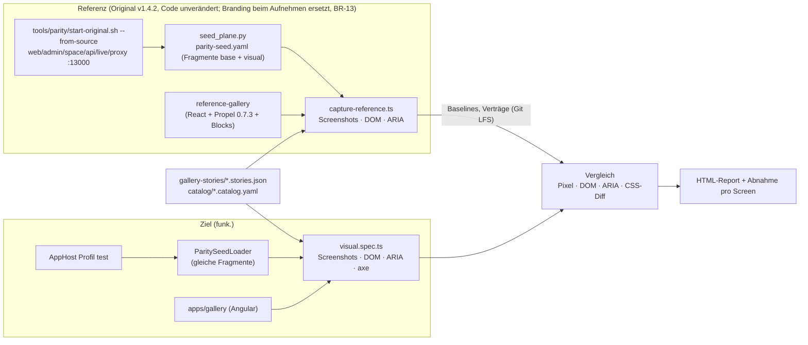

# 09 – UI-Parität 1:1 & Designsystem-Port (Tailwind/Propel/Blocks → Angular)

> **Status:** verbindlich für das Thema „Designsystem, UI-Parität, visuelle Verifikation“ (Dokument D09 aus Anhang A von `01-zielarchitektur-und-tech-stack.md`).
> **Rangfolge:** `00-grundsatzentscheidungen.md` (ADR-000 … ADR-009) > `01-zielarchitektur-und-tech-stack.md` (ADR-010 … ADR-052, insbesondere ADR-041, ADR-044, §7.17, Spike S10/S11) > **dieses Dokument (D09-ADR-01 ff.)** > eigene Präferenzen. Widerspricht etwas hier dem Rahmen, gilt der Rahmen.
> **Stand:** 23.10.2026. Original: Plane v1.4.2 CE, `@makeplane/propel` **0.7.3**, `@base-ui/react` 1.6.0, Tailwind CSS 4.1.17.
> **Zielrepository:** `funk.` (ADR-009). Alle Zielpfade sind relativ zur Wurzel von `funk.`. `01` §5.1 ist auf `funk./` angeglichen (früherer Arbeitstitel `plane-net/`, ABG-018 g); die Baumstruktur aus `01` §5.1/§6.1 gilt unverändert darunter (`funk./frontend/…`, `funk./tools/…`, `funk./deploy/…`).
> **Sprache:** Fließtext Deutsch, Bezeichner Englisch.

**Abkürzungen** (wie in `01` und `A13a`): `PROPEL/` = `node_modules/@makeplane/propel/dist/` des npm-Tarballs `@makeplane/propel@0.7.3` (beziehbar per `npm pack @makeplane/propel@0.7.3`, Lizenz AGPL-3.0-only), `TWC/` = `packages/tailwind-config/`, `BLK/` = `packages/blocks/src/`, `UTL/` = `packages/utils/src/`, `WEB/` = `apps/web/`, `ADM/` = `apps/admin/`, `SPC/` = `apps/space/`. Zielkürzel: `FE/` = `funk./frontend/`, `PRP/` = `FE/libs/shared/propel/src/`, `BLKT/` = `FE/libs/shared/blocks/src/`, `TWT/` = `FE/libs/shared/tailwind-config/`. Analyse-Dokumente: `A13a` = `migration/analysis/13a-designsystem-ui-tokens.md`, `A08`, `A09`, `A10a`, `A10b`, `A11`, `A12`, `A13b` analog; `F20` = `migration/features/20-paid-spuren-im-repo.md`, `F30` = `migration/features/30-paid-auswahlliste.md`.

## Inhaltsverzeichnis

1. [Ziel & Scope](#1-ziel--scope)
2. [Entscheidungen (D09-ADR-01 ff.)](#2-entscheidungen-d09-adr-01-ff)
3. [Detaildesign](#3-detaildesign)
4. [Vollständige Mapping-Tabellen Original → Ziel](#4-vollständige-mapping-tabellen-original--ziel)
5. [Code-Skelette](#5-code-skelette)
6. [Erweiterungspunkte für Bezahl-Pakete](#6-erweiterungspunkte-für-bezahl-pakete)
7. [Akzeptanzkriterien & Tests](#7-akzeptanzkriterien--tests)
8. [Risiken & offene Punkte](#8-risiken--offene-punkte)
9. [Abhängigkeiten zu anderen Dokumenten (02–16)](#9-abhängigkeiten-zu-anderen-dokumenten-0216)

---

## 1. Ziel & Scope

### 1.1 Ziel

Die drei Angular-Apps `web`, `admin` und `space` sollen **pixel- und verhaltensgleich** zum Original aussehen (ADR-005). Erreicht wird das nicht über „Nachbauen nach Augenmaß“, sondern über drei harte Gleichheiten:

1. **Gleiches CSS:** Dieselben Quell-CSS-Dateien (Propel-Tokens, `packages/tailwind-config`, App-Globals) werden mit **demselben Compiler** (Tailwind 4.1.17) übersetzt. Das kompilierte CSS von Original und Ziel muss gleich sein (CSS-Diff-Test, §3.2.5).
2. **Gleiches DOM:** Jede Komponente rendert dieselben Elemente, Klassen, `data-*`- und ARIA-Attribute und CSS-Variablen wie Propel/Base UI bzw. Blocks (DOM-Vertrag, §3.4). Gemessen wird das über normalisierte DOM-Snapshots (§3.14.6).
3. **Gleiches Verhalten:** Tastatur, Fokus, Positionierung, Öffnen und Schließen, Animationen und Timings folgen dem Original (Zustandsvertrag aus `A13a` §2.20, Verhaltenstabellen aus `A13a` §3.8/§3.9).

Gleiches CSS und gleiches DOM ergeben gleiche Pixel. Der Pixelvergleich (§3.14.5) bestätigt das nur noch.

### 1.2 Scope

| Im Scope (dieses Dokument) | Quelle (IST) | Nicht im Scope (zuständig) |
|---|---|---|
| Tailwind-v4-Pipeline, Übernahme von `TWC/index.css`, `PROPEL/styles/{propel,variables,animations}.css`, `WEB/styles/{globals,emoji,power-k}.css`, `ADM/styles/globals.css`, `SPC/styles/globals.css` | `A13a` §2.1–§2.15 | Editor-CSS `packages/editor/src/styles/*` (nur als Import-Position hier; Inhalt → `10-editor-angular.md`) |
| Port **aller 68** Propel-Komponenten, **aller 57** Elemente, `base/`, `hooks/`, `internal/` (Rezepte), `state-icons/`, `icons` (919) | `A13a` §2.20–§2.25 | – |
| Port **aller** `packages/blocks`-Module (28 Subpath-Exporte laut `packages/blocks/package.json`, davon `auth` nur als Keycloak-Vorlage; 139 TSX-Dateien + 59 Illustrations-TSX + 56 TS-Dateien, ohne die 21 Testdateien) | `A13a` §2.26–§2.27, `BLK/**` | Fachkomponenten in `apps/web/components/**` (→ `08-frontend-angular-architektur.md`, Domänen-Libs) |
| Icons (Propel, Blocks, Web-Icons, lucide 0.469.0 und 1.34.0, Material Symbols), Schriften, Illustrationen, Raster-Assets aus `apps/*/public` und `apps/*/app/assets` | `A13a` §2.16, §2.25–§2.31; Dateisystem | PDF-Schriften (`WEB/app/assets/fonts/inter/*.ttf`) → `07-realtime-kollaboration-dokumente.md` (ADR-029) |
| Theme-Laufzeit (Light, Dark, HC, Custom, System), `cn()`, Theme-Generator | `A13a` §2.17–§2.18, §3.1–§3.7 | Persistenz `Profile.theme` (Endpunkt) → `03`/`04` |
| Ersatz der Upsell-Elemente (ADR-001) | `F20` §5 (U1–U22) | fachliche Umsetzung der Bezahl-Features (W1–W9) |
| Optik des Keycloak-Login-Themes (CSS-Herkunft, DOM-Vorlage) | ADR-008, S7 | Realm, Clients, FreeMarker-Logik → `05-auth-sicherheit-berechtigungen.md` |
| Verifikationsverfahren: Referenzumgebung, Screenshot-Katalog, Pixel-Diff, DOM-/A11y-Snapshots, Komponenten-Katalog (Galerie), Abnahme pro Screen | ADR-005, ADR-048, S10, S11 | Gesamt-Teststrategie, Contract-Harness für JSON → `15-teststrategie-qualitaet-paritaet.md` |
| Chart-Bausteine (DOM-Vertrag der sechs Blocks-Charts) | `A13a` §2.26, ADR-044 | Fachdiagramme (Burndown, Analytics) → `08`, Spike S6 |
| Gestaltungsregeln für spätere Bezahl-Screens ohne Original-Referenz (§6) | `F30`, `A13a` §1.3 | Fachdesign der Pakete (→ `16-erweiterungspunkte-bezahl-features.md`, später je Welle) |

### 1.3 Abgedeckte CE-Features

| CE-ID | Name (Katalog) | Hier geregelt durch |
|---|---|---|
| CE-I18N-005 | Theme-System und Theme-Varianten | D09-ADR-09, §3.9 |
| CE-I18N-006 | Theme-Auswahl und Server-Persistenz | §3.9 (Laufzeit), Persistenz → `03` |
| CE-I18N-007 | Custom Theme | §3.9.1 (Zeile „Custom-Theme“), §3.9.2 |
| CE-I18N-008 | High-Contrast-Themes | §3.9, Token-CSS 1:1 |
| CE-I18N-009 | Farb-Token-System | D09-ADR-01, §3.2 |
| CE-I18N-010 | Editor-Farbpalette | nur CSS-Import-Reihenfolge (§3.2.2); Inhalt → `10` |
| CE-I18N-011 | Typografie | D09-ADR-01, §3.8 |
| CE-I18N-012 | Gebündelte Schriften (Airgap) | D09-ADR-08, §3.8.1 |
| CE-I18N-013 | Icon-System | D09-ADR-07, §3.7, §4.6 |
| CE-I18N-014 | Status-, Zyklus-, Modul- und Prioritäts-Icons | §4.5, §4.8 |
| CE-I18N-015 | Datei-Typ-Icons und Locked-Pill | §4.9 |
| CE-I18N-016 | Logo-Picker (Emoji, Lucide, Material) | §4.7 (`emoji-icon-picker`), D09-ADR-08 |
| CE-I18N-017 | Emoji-Reaktions-Komponenten | §4.7 (`emoji-reaction`) |
| CE-I18N-018 | Empty-State-Illustrationen und theme-abhängige Assets | §3.8.3, §4.7, §4.11 |
| CE-I18N-019 | Propel-Komponentenbibliothek und Varianten | §4.2–§4.5 |
| CE-I18N-020 | Blocks-Composites | §4.7 |
| CE-I18N-021 | Toast-Benachrichtigungen | §3.10 |
| CE-I18N-022 | Diagramm-Bausteine und Farbpaletten | §3.12, §4.7 (`charts/*`) |
| CE-I18N-023 | Animationen | §3.4.3 |
| CE-I18N-024 | Maßsystem, Elevation und Scrollbars | Token-CSS 1:1, `scroll-area` §4.2 |
| CE-I18N-025 | Avatare und Farbwähler | §4.2 (`avatar`, `avatar-group`), §4.7 (`common/color-*`) |
| CE-I18N-026 | Lade-Indikatoren und Navigations-Progressbar | §4.11 (GIFs der App-eigenen LogoSpinner in Web/Admin/Space; Komponente → `08`), §4.7 (`spinner`, `skeleton`), §4.2 (`circular-progress`, `linear-progress`), §3.2 (bprogress-CSS); Propel-`logo-spinner` nur Galerie (I7) |
| CE-UIX-001 | Seiten-Header und Breadcrumbs | §4.7 (`layout`, `breadcrumb`) |
| CE-UIX-002 | Leerzustände und Skeletons | §4.7 (`empty-state`, `skeleton`) |
| CE-UIX-003 | Globale Modal-Hosts | §3.5 (Portal-Schicht), Hosts selbst → `08` |
| CE-UIX-004 | Dialog- und Dropdown-Verhalten | §3.5, §4.2 (`dialog`, `menu`, `popover`, `combobox`) |
| CE-UIX-005 | Tab-Reihenfolge in Formularen | §3.6, Test `property-select/tab-index` |
| CE-UIX-008 | Warnung bei ungespeicherten Änderungen | §4.2 (`dialog` mit `discard`, Discard-AlertDialog), §3.5.2 (Escape-Regel) |
| CE-UIX-009 | Image-Picker und Uploads mit Fortschritt | Assets `cover-images` §4.11, `linear-progress` |
| CE-UIX-010 | 404-, Fehler- und Zugriffsseiten (Web) | Assets §4.11, Screenshot-Katalog §3.14 |
| CE-UIX-013 | Link-Icons und URL-Erkennung | Icons §4.6 |
| CE-LV-042 | Empty-States der Layouts | §4.7, §4.11 |
| CE-WI-006 | Toast-Aktionen nach dem Erstellen | §3.10 |
| CE-INST-012 | Konto-Menü mit Theme-Umschaltung (God Mode) | §3.9 (Admin: nur light/dark/system) |
| CE-SPACE-032 | „Powered by Plane Publish“-Badge (Ziel: „Powered by funk. Publish“, ADR-009B, `BRAND-UI-05`) | §4.11 (Logos, §4.11.1), Katalog Space |
| CE-AUTH-001 (angepasst) | Sign-in-Seite → Keycloak-Login-Theme | D09-ADR-14, §3.13 |

**Bewusst nicht hier** (Zuständigkeit `08`): CE-I18N-001…-004 (Sprache, Übersetzung, Datum/Zeit, Zeitzonen – D09 liefert nur Calendar-Klassen und Locale-Daten für `PlCalendar`), CE-UIX-006 (synchronisierte LocalStorage-Präferenzen), CE-UIX-007 (Zwischenablage/CSV – Toast-Optik über §3.10), CE-UIX-011 (Stale-Chunk-Reload), CE-UIX-012 (Legacy-Redirects, Routing-Tests §4.14).

Alle übrigen CE-Screens (CE-WS, CE-PRJ, CE-WI, CE-LV, CE-CYC, CE-MOD, CE-INT, CE-PAGE, CE-HOME, CE-NOTIF, CE-ANA, CE-SRCH, CE-PROF, CE-INST, CE-SPACE) konsumieren das Designsystem. Für sie liefert dieses Dokument das **Verifikationsverfahren** (Screenshot-Katalog, §3.14, Katalog-Einträge §4.14).

### 1.4 Inkrement-Zuordnung (welcher Teil wird wann gebraucht)

Grundsatz: Ein Baustein wird in dem Inkrement **fertig** (Code + Galerie-Story + DOM-/Visual-Test grün), in dem der erste abnahmerelevante Screen ihn braucht. Komponenten, die das Original in keiner App direkt importiert (`A13a` §2.30), werden spätestens in I7 nachgezogen, damit der Komponenten-Katalog vollständig ist; ein Bezahl-Paket darf sie vorziehen.

| Inkrement | Was aus D09 fertig sein muss (abnahmerelevant) | Gate |
|---|---|---|
| **I0 Walking Skeleton** | Tailwind-Pipeline + CSS 1:1 + CSS-Diff-Test (§3.2); Schriften, Favicons, Manifeste; `ThemeService` + Inline-Script (Light/Dark/System); `cn()`; Icon-Codegen (Propel 919, lucide ×2, Blocks-Icons); Präsenz-/Portal-/Positionierungs-Schicht (§3.4, §3.5); Propel: `button`, `icon-button`, `icon`, `tooltip`, `menu`, `input`, `input-field`, `field`, `text-area`, `avatar`, `workspace-avatar`, `scroll-area`, `collapsible`, `breadcrumb`, `dialog`, `combobox`, `popover`, `tabs`, `toast`, `shortcut` (von `tooltip` intern genutzt); Blocks: `layout`, `breadcrumb`, `select` (Engine-Kern), `toast`, `skeleton`, `spinner`, `portal`, `utils`, `types`, `icons`; Keycloak-Login-Theme-CSS (§3.13); Galerie Original + Angular (Gerüst, Leit-Komponenten); Referenzumgebung + Screenshot-Katalog für 5 Seiten (S11) | **S10** (10 Leit-Komponenten + Workspace-Shell, DOM gleich, Visual-Diff ≤ 0,1 %), **S11** |
| **I1 Workspace, Projekte, Konto** | Propel: `alert-dialog`, `switch`, `checkbox`, `checkbox-field`, `badge`, `banner`, `anchor-button`, `avatar-group`, `table`, `select`, `pill`, `context-menu`, `text-area-field`; Blocks: `dialog` (ConfirmDialog), `empty-state` (+ 59 Illustrationen), `emoji-icon-picker` (inkl. offline Emojibase), `common` (ColorPicker, ColorSwatchPicker, FavoriteStar, DragHandle, DropIndicator, Sortable), `context-menu`, `card`, `pill-button`, `property-select/member-select`, `virtual-list`; Theme: HC-Varianten, Custom-Theme, Theme-Wechsel mit Reload; Raster-Assets (Empty-States, Onboarding, Cover-Images) | Katalog-Einträge I1 grün (§7) |
| **I2 Work Items & Layouts** | Propel: `calendar`, `circular-progress`, `linear-progress`, `preview-card`; Blocks: alle `property-select/*`, `emoji-reaction`, Select-Varianten `pill-*`, `icon-*`, `table-cell`, `search-input`, `avatar-group-*`; State-/Priority-/Cycle-/Module-Icons; Web-Icons (Attachment) | Katalog I2 |
| **I3 Planung** | Blocks `charts/*` (6) nach S6, Burndown-Bausteine (→ `08`) | **S6** |
| **I4 Pages & Realtime** | Propel `toolbar` (einzige Nutzer im Original: `WEB/components/pages/editor/toolbar/*`); Editor-Hüllen nutzen außerdem `menu`, `popover`, `preview-card` (bereits fertig); Page-Lock-Animationen aus `WEB/styles/globals.css` | **S5** (Editor-Visual ≤ 0,5 %) |
| **I5 Überblick** | `power-k.css` + `cmdk`-Attribut-DOM (Komponente → `08`), `animate-notification-bell-ring`, Stickies-Optik | Katalog I5 |
| **I6 Außenwirkung & Administration** | Admin- und Space-Kataloge vollständig (Admin: light/dark; Space: light/dark), OG-Bilder | Katalog I6 |
| **I7 Härtung** | Restliche, im Original nicht importierte Propel-Komponenten (`A13a` §2.30, per Quelltext von Propel 0.7.3 nachgeprüft: auch nicht von anderen Propel-Komponenten genutzt, außer `radio` durch `radio-group-field`) – `logo-spinner` (die Apps nutzen eigene LogoSpinner, §4.11), `radio`, `separator`, `suggestion-menu`, `toggle`, `accordion`, `autocomplete`, `autocomplete-field`, `button-group`, `checkbox-group`, `checkbox-group-field`, `combobox-field`, `csp-provider`, `direction-provider`, `drawer`, `expandable-search`, `fieldset`, `form`, `icon-split-button`, `list`, `navigation-menu`, `number-field`, `otp-field`, `pagination`, `radio-group-field`, `select-field`, `skeleton`, `slider`, `split-button`, `switch-field`); Browser-Matrix Firefox/WebKit; Abnahme **aller** Katalog-Einträge | Gesamtabnahme ADR-005 |
| **W1…W9** | Gestaltungsregeln §6.2, Erweiterungspunkte §6.1; neue Screens ohne Original-Referenz werden gegen die Screen-Schablonen (§6.3) abgenommen | je Welle |

---

## 2. Entscheidungen (D09-ADR-01 ff.)

| ADR | Belang | Entscheidung | Alternativen (verworfen) | Begründung | ab |
|---|---|---|---|---|---|
| **D09-ADR-01** | CSS-Quelle | **Original-CSS wird byte-identisch vendored** (Dateiliste §4.1) und nur über `@import`/`@source`-Pfade angepasst. Compiler exakt `tailwindcss@4.1.17` + `@tailwindcss/postcss@4.1.17` + `@tailwindcss/typography@0.5.19` über Angular-Application-Builder (`.postcssrc.json`). Jede Änderung an vendored CSS ist verboten; Abweichungen nur als zusätzliche Datei `FE/libs/shared/tailwind-config/overrides.css` mit Eintrag in `ui-deviations.yaml` | Tokens neu als SCSS/CSS-Custom-Properties schreiben; neuere Tailwind-4.x | Einzige verlässliche Quelle aller Tokens; die Tailwind-Version bestimmt die erzeugten Utilities (inkl. der Lücken aus `A13a` E-21) | I0 |
| **D09-ADR-02** | Klassenquelle (`@source`) | Tailwind scannt (a) die Angular-Quellen **getrennt je App** analog zum Original (geteilte Libs `FE/libs/shared/**` ≙ `packages/**`; App-Quellen und App-Scope-Libs ≙ automatische Quellenerkennung der jeweiligen Original-App, §3.2.3), (b) eine **generierte, eingecheckte Klassenliste** `TWT/propel-dist-classes.txt`, die `FE/tools/propel-port/extract-classes.mjs` mit dem Tailwind-eigenen Scanner (`@tailwindcss/oxide` `Scanner`, gleiche Version wie der Compiler) aus **allen** Dateien von `PROPEL/` erzeugt (entspricht `@source "../"` in `propel.css`, inkl. `.d.ts`/`.map`), und (c) je App eine **Kandidatenliste des Referenz-CSS** `TWT/reference-candidates/<app>.txt` (aus `FE/tools/visual/reference-css/<app>.css` extrahiert). Der Tarball wird nur im Werkzeug (Dev, offline gespiegelt, SHA-512 gepinnt) gelesen, nicht ausgeliefert | `@makeplane/propel` als Laufzeit-/Build-Abhängigkeit behalten; nur Angular-Quellen scannen | Das Original erzeugt Utilities auch aus Kandidaten in Dateien, die nicht 1:1 portiert werden (React-TSX, entfallene Upsell-Komponenten, Konstanten-Strings, automatische Quellenerkennung über alle Dateien der App). Ohne (c) fehlen diese Utilities im Ziel; mit (c) ist „keine fehlende Utility“ (§3.2.5) konstruktiv erfüllt, und die Gleichheit der Klassen am Element prüft der DOM-Vertrag (§3.14.6). Keine React-Abhängigkeit im Build | I0 |
| **D09-ADR-03** | Komponentenmodell Angular | **Standalone-Komponenten, `ChangeDetectionStrategy.OnPush`, `ViewEncapsulation.None`, keine Komponenten-Styles** (keine `styles`/`styleUrl`). Primitive mit eigenem Wurzel-Element des Originals = **Attribut-Selektor** auf dem nativen Element (`button[plButton]`, `div[plMenuItem]`); Komposita ohne eigenes Wurzel-Element = Element-Selektor mit `:host { display: contents }` **und** Attribut `data-pl-host` (für die DOM-Normalisierung); Selektor-Präfix `pl` (Rahmen §7.1/§7.17) | Element-Selektoren mit Host-Box; `ViewEncapsulation.Emulated`; Angular Material | Attribut-Selektoren erhalten DOM-Tiefe, `:first-child`, `space-x-*`, `divide-*`, Flex/Grid-Kinder exakt (`A13a` F-02/F-03). `display: contents` neutralisiert nur die **Box** des Host-Elements, nicht seine Stellung im DOM-Baum: Kind-/Geschwister-Selektoren (`space-x-*`, `divide-*`, `*:`, `first:`/`last:`/`odd:`/`even:`, `[&>…]`, `peer-*`) sehen weiterhin den Host, und Abstände per `margin` auf einem `contents`-Element wirken nicht. Deshalb gilt zusätzlich die Host-Kontext-Regel §3.3.4 (Trigger-Komposita als Attribut-Direktive, Prüfung T-HOST-01) | I0 |
| **D09-ADR-04** | Zwei Schichten wie Propel | **`elements` → Attribut-Direktiven** (nur Klassen aus `cva` + statische `data-*`), **`components` → Komponenten**, die das Verhalten (Headless-Schicht, §3.4/§3.5) mit der Element-Direktive komponieren. Apps dürfen beide Schichten nutzen (Original: 25 Importe aus `elements/button`, `elements/combobox` 4 usw.) | Nur eine Schicht | Gleiche Wiederverwendbarkeit wie im Original (Blocks nutzt Elemente direkt, z. B. Combobox-Elemente in der Select-Engine) | I0 |
| **D09-ADR-05** | Varianten | **`class-variance-authority` 0.7.1** (framework-frei) mit **maschinell übertragenen** `variants.ts` (57 Elemente) und `internal/*.ts` (Rezepte): `FE/tools/propel-port/port-variants.mjs` liest `PROPEL/elements/*/variants.js` und `PROPEL/internal/*.js` und erzeugt TS-Dateien mit wortgleichen Klassenstrings; Hand-Edits sind verboten (Header `// GENERATED – do not edit`), Unit-Test vergleicht die Ausgabe aller Varianten-Kombinationen mit dem Original (Node, `import()` des Original-JS) | Klassen von Hand abschreiben; Tailwind-`@apply`-Komponentenklassen | Klassenstrings sind Daten; maschinelle Übertragung ist fehlerfrei und wiederholbar bei Propel-Updates | I0 |
| **D09-ADR-06** | `cn()` | `UTL/common.ts` (`cn` = `twMerge(clsx(…))` mit identischer `extendTailwindMerge`-Konfiguration) wird **1:1 kopiert** nach `FE/libs/shared/utils/src/common.ts` (Teil der 1:1-Kopie von `packages/utils`, `01` §6.2); `tailwind-merge` **3.4.0** exakt, `clsx` 2.1.x. Propel-Port nutzt wie das Original `cx` (kein Merge), Blocks-Port `cn()` | Eigener Merger; neuere tailwind-merge-Version | Ein anderer Merger lässt andere Klassen überleben (`A13a` §3.7, F-05) | I0 |
| **D09-ADR-07** | Icons | **Codegen** aus den Original-Paketen in **tree-shakable Konstanten** (`PlIconDef` = SVG-Knotenbaum als JSON-AST) + **eine** Render-Komponente `svg[plSvgIcon]` (Ablage `PRP/components/svg-icon/`, Einstieg `@plane/propel/components/svg-icon`; `@plane/propel/icons` und `@plane/blocks/icons` bleiben datenreine Einstiege ohne `@angular/*`, ABG-116), die die Knoten per `Renderer2` im SVG-Namespace erzeugt (kein `innerHTML`, Trusted-Types-/CSP-fest). Quellen: `PROPEL/icons/**` (919), `PROPEL/internal/solid-icons/*`, `lucide@1.34.0` (Propel-intern), `lucide@0.469.0` (Apps/Blocks + 157 persistierte Namen), `BLK/icons/**`, `WEB/components/icons/**` (SVG-Teil). Namen 1:1 (`PaletteOutline`) | 919 einzelne Angular-Komponenten mit Template; SVG-Sprite mit `<use>`; `lucide-angular` | DOM bleibt `<svg …>` wie im Original (kein Host-Element), Bundle enthält nur genutzte Icons, ein Generator für alle Quellen | I0 |
| **D09-ADR-08** | Schriften, Emoji-Daten, Assets | Alles **gebündelt** (ADR-004): `@fontsource-variable/inter` 5.2.8, `@fontsource/ibm-plex-mono` 5.2.7, `@fontsource/material-symbols-rounded` 5.2.30 über `angular.json`-`styles`; Inter-Latin-woff2 als Asset mit festem Namen + `<link rel="preload">`; **Emojibase-Daten** lokal als Asset (Korrektur von `A13a` E-22); Raster-/SVG-Assets aus `apps/*/app/assets` und `apps/*/public` **unverändert** (Liste §4.11) | CDN-Laden; Neuzeichnen | Airgapped-Pflicht, Pixelgleichheit | I0 (Fonts), I1 (Emoji, Illustrationen) |
| **D09-ADR-09** | Theme-Laufzeit | `ThemeService` (Signals `theme`, `resolvedTheme`, `systemTheme`) + **Inline-Script** in jeder `index.html` mit der Logik von `next-themes` 0.4.6 (Schlüssel `localStorage["theme"]`, Attribut `data-theme` an `<html>`, `style.color-scheme` für `light`/`dark`, `matchMedia`-Listener, `storage`-Event); Theme-Listen je App wie Original (Web 5 + system, Admin/Space `light`/`dark` + system); Custom-Theme über 1:1 kopiertes `UTL/theme/*` | `prefers-color-scheme`-Media-Queries; Angular-Material-Theming | `A13a` §3.1–§3.5, F-06; Edge-Cases E-01…E-05, E-14, E-29…E-33 werden **nachgebaut** | I0 (L/D/System), I1 (HC, Custom) |
| **D09-ADR-10** | Headless-Unterbau | **Angular Aria 22.x** für Muster mit passender Semantik (Tabs, Toolbar, Listbox/Combobox-Tastaturmodell, Menu-Tastaturmodell, Accordion), **Angular CDK** nur für a11y (`FocusTrap`, `FocusKeyManager`, `ActiveDescendantKeyManager`, `LiveAnnouncer`, `Directionality`, `InteractivityChecker`), **eigene Schicht** `PRP/headless/` für alles, was Base UI zusätzlich festlegt: Zustandsattribute, Präsenz/Transitions, Portal, Dismissal, Hover-Intent, Delay-Gruppen, Scroll-Lock. **Kein** CDK-Overlay-Container, **keine** CDK-Positionierung | Angular Material; reines CDK; Spartan/ng-primitives; vollständiger Eigenbau | Base UI legt DOM/Attribute fest, die keine Angular-Bibliothek 1:1 erzeugt; Aria/CDK liefern geprüfte Tastatur- und Fokuslogik, die Schicht ergänzt den Vertrag. Fallback bei Lücken (S10, `A13a` O-09): Eigenbau auf CDK a11y | I0 |
| **D09-ADR-11** | Positionierung | **`@floating-ui/dom` 1.7.x** mit Middleware-Kette wie Base UI 1.6.0 (`offset` → `flip` → `shift` → `size` (setzt `--available-width/-height`, `--anchor-width/-height`) → `arrow` → `hide`), `autoUpdate`, Strategie `absolute` (Default `positionMethod`) bzw. `fixed`; CSS-Variable `--transform-origin` und Attribute `data-side`, `data-align`, `data-anchor-hidden` wie Base UI | CDK `FlexibleConnectedPositionStrategy` | Base UI nutzt Floating UI; nur gleiche Logik ergibt gleiche Flip-/Shift-/Size-Ergebnisse (`A13a` §5.3) | I0 |
| **D09-ADR-12** | Präsenz & Animationen | Eigener `PresenceController` (Äquivalent zu Base UIs `useTransitionStatus`/`useOpenChangeComplete`): setzt beim Öffnen einen Frame lang `data-starting-style`, beim Schließen `data-ending-style` und entfernt das Element nach `animationend`/`transitionend` aller laufenden Animationen (`element.getAnimations()`), Fallback-Timeout wie Original (Spinner 250 ms); **keine** `@angular/animations` | `@angular/animations`; `animate.enter/leave` (Angular 20+) | Propel stylt Übergänge ausschließlich per CSS über diese Attribute (`data-starting-style` 22×, `data-ending-style` 38×) | I0 |
| **D09-ADR-13** | Originalfehler in der Optik | **1:1 nachbauen**, nicht reparieren: tote Klassen bleiben im Markup (`A13a` §2.32), Edge-Cases E-01…E-34 gemäß Spalte „Empfehlung“ von `A13a` §3.10. Einzige Korrekturen: E-22 (Emoji-CDN → lokal, ADR-004), Upsell-Ersatz (ADR-001, D09-ADR-15), Login-Varianten (ADR-008). Jede Abweichung steht in `FE/apps/e2e/visual/ui-deviations.yaml` | Fehler korrigieren | ADR-005; reparierte Klassen erzeugen sichtbare Abweichungen; Korrekturen später als eigene Change-Requests | I0 |
| **D09-ADR-14** | Keycloak-Login-Theme | Das Login-Theme `deploy/keycloak/themes/plane/` (Struktur und Templates laut `05` §3.16) bekommt sein CSS aus **denselben Tailwind-Eingaben mit demselben Compiler** (`TWT/index.css` + `TWT/propel-styles/*`, `@tailwindcss/cli` 4.1.17; Werkzeug `tools/keycloak-theme/build-css.mjs` laut `05` §3.16.3, Ausgabe `deploy/keycloak/themes/plane/login/resources/css/plane-login.css`); FreeMarker-Templates bilden das DOM der Original-Sign-in-Seite (`WEB/app/(home)/page.tsx` + `BLK/auth/*`) nach; Fonts aus demselben Paket | Keycloakify (React, Build-Zeit-Node, Fallback laut S7); eigenes CSS | Ein Token-System für App und Login; Visual-Diff ≤ 1 % (S7) | I0 |
| **D09-ADR-15** | Upsell-Elemente (ADR-001) | Upgrade-Badges, Upgrade-Modals, Billing-Seite, „Talk to Sales“, Pro-Icons **entfallen ersatzlos**; wo ein Upsell-Screen eine Funktion bewirbt, erscheint die echte Funktion **erst mit ihrem Paket** (bis dahin ist die Route nicht registriert, Rahmen §7.19); das Sidebar-Editions-Badge wird zu einem nicht interaktiven Versions-Badge. Vollständige Tabelle §4.12 | Upsell-Screens als Platzhalter behalten | ADR-001; keine Platzhalter in abgenommenen Inkrementen (`01` §7.19) | I0 |
| **D09-ADR-16** | Referenz für Pixel und DOM | **Das laufende Original** ist die Referenz: (a) Seiten-Screenshots aus einer per Docker Compose gestarteten Original-Instanz mit deterministischem Seed (Seed-Spezifikation `tests/seed/parity-seed.yaml`, Fragmente `base` + `visual`, D15-ADR-16; Start `tools/parity/start-original.sh --from-source`; S11), (b) Komponenten-Screenshots und DOM-Verträge aus einer **Referenz-Galerie** (`funk./frontend/tools/reference-gallery/`, React 19 + `@makeplane/propel@0.7.3` + `packages/blocks` aus dem Original-Repo, nur Dev). Beide Galerien lesen **dieselben Story-Definitionen** (`funk./frontend/tools/gallery-stories/*.stories.json`) | Figma; handgemachte Referenzbilder; Storybook | Objektiv, wiederholbar, deckt alle Varianten-Kombinationen ab | I0 |
| **D09-ADR-17** | Visueller Vergleich | **Playwright** (`@playwright/test` 1.64.x = `Microsoft.Playwright` 1.64.x, ABG-004; ein gepinntes Container-Image `mcr.microsoft.com/playwright:v1.64.1-noble` für Referenz- **und** Ziel-Aufnahmen, Chromium als Gate, Firefox/WebKit ab I7) mit `toHaveScreenshot` gegen importierte Original-Baselines; zusätzlich normalisierter **DOM-Snapshot-Vergleich** und **ARIA-Snapshot-Vergleich** (`locator.ariaSnapshot()`), axe-core als Ratchet. Schwellwerte §3.14.5 | Percy/Chromatic (SaaS, ADR-004); BackstopJS; reine Pixel-Diffs | Lokal/airgapped, Standard-Tooling aus ADR-048; DOM-/ARIA-Vergleich findet Ursachen statt Symptome | I0 |
| **D09-ADR-18** | Charts | Gemäß ADR-044: D3-Module + Angular-SVG; DOM-Vertrag = SVG-Markup und Klassen von `recharts` 2.15.4 in den sechs Blocks-Charts (`recharts-*`-Klassen, Gruppenstruktur), Referenzbilder aus der Referenz-Galerie (Stories mit festen Datensätzen) | ECharts | Parität; S6 entscheidet | I3 |
| **D09-ADR-19** | Gestaltung neuer Bezahl-Screens ohne Original-Referenz | Neue Screens werden **ausschließlich** aus vorhandenen Propel-/Blocks-Bausteinen, vorhandenen Tokens, vorhandenen Icons und Illustrationen und den vorhandenen EE-i18n-Schlüsseln komponiert und gegen **Screen-Schablonen** (§6.3) abgenommen. Neue Tokens, neue Farben und neue Basiskomponenten nur per ADR-Änderung | Freies Design je Paket | Konsistenz mit dem 1:1-Rest, kein Designsystem-Drift (§6.2) | W1 |

---
## 3. Detaildesign

### 3.1 Bibliotheken und Werkzeuge in `funk.`

Die Ablage folgt `01` §6.1 (Frontend-Werkzeuge unter `frontend/tools/`, wie dort `propel-port/`, `visual/`, `contract-check/`; ABG-027). Ergänzt werden nur die Unterordner, die dieses Dokument festlegt. Repo-weite Werkzeuge anderer Dokumente bleiben an der Repo-Wurzel: `tools/keycloak-theme/` (`05` §3.16.3, `14` D14-ADR-04), `tools/parity/` (`15` D15-ADR-20), `tools/ci/` (`15` §3.2).

```text
funk./
├── frontend/
│   ├── .postcssrc.json                         # { "plugins": { "@tailwindcss/postcss": {} } }  (wie TWC/postcss.config.js)
│   ├── apps/
│   │   ├── web/src/
│   │   │   ├── index.html                      # Theme-Inline-Script (§5.8), Font-Preload, Favicons, Manifeste, div#context-menu-portal, div#editor-portal, <app-root data-pl-host>
│   │   │   ├── styles.css                      # Einstieg = Kopie von WEB/styles/globals.css (nur Import-/Source-Zeilen umgeschrieben, §5.1)
│   │   │   ├── styles/emoji.css                # 1:1 WEB/styles/emoji.css
│   │   │   ├── styles/power-k.css              # 1:1 WEB/styles/power-k.css
│   │   │   └── assets/                         # 1:1 WEB/app/assets/** (ohne fonts/inter → D07), public/** (§4.11)
│   │   ├── admin/src/{index.html,styles.css,assets/}   # styles.css = Kopie ADM/styles/globals.css
│   │   ├── space/src/{index.html,styles.css,assets/}   # styles.css = Kopie SPC/styles/globals.css
│   │   ├── gallery/                            # Angular-Komponenten-Katalog (nur Test-Builds; Gateway liefert ihn nur im Profil test aus, Route G-17), base href "/__gallery/" (ABG-008, H-08)
│   │   └── e2e/
│   │       ├── visual/                         # Screenshot-Katalog, Baselines, Diff-Reports (§3.14)
│   │       │   ├── catalog/{web,admin,space,gallery,keycloak}.catalog.yaml
│   │       │   ├── catalog/acceptance/<app>.acceptance.yaml            # Abnahme-Register (§3.14.8)
│   │       │   ├── baselines/<app>/<entry-id>/<state-id>/<theme>-<viewport>.png   # aus dem Original importiert (Git LFS)
│   │       │   ├── baselines-new/<app>/<entry-id>/<state-id>/<theme>-<viewport>.png  # Selbst-Baselines neuer Screens (§6.4)
│   │       │   ├── dom-contracts/<app>/<entry-id>/<state-id>.dom.html  # normalisiertes Original-DOM
│   │       │   ├── aria-contracts/<app>/<entry-id>/<state-id>.aria.yml # Original-ARIA-Snapshot
│   │       │   ├── templates/<T-id>.template.yaml                      # Rahmen-Selektoren der Screen-Schablonen (§6.3)
│   │       │   ├── ui-deviations.yaml                                  # alle genehmigten Abweichungen (D09-ADR-13)
│   │       │   └── specs/*.visual.spec.ts
│   │       └── a11y/                           # axe-Ratchet (§3.14.7)
│   ├── libs/shared/
│   │   ├── tailwind-config/                    # TWT/
│   │   │   ├── index.css                       # 1:1 TWC/index.css (Import-/Source-Zeilen umgeschrieben)
│   │   │   ├── propel-styles/{propel,variables,animations}.css   # 1:1 PROPEL/styles/*.css
│   │   │   ├── propel-dist-classes.txt         # generiert (D09-ADR-02 b)
│   │   │   ├── reference-candidates/{web,admin,space}.txt        # generiert aus dem Referenz-CSS (D09-ADR-02 c, §3.2.3)
│   │   │   ├── overrides.css                   # nur [data-pl-host]{display:contents} (UI-DEV-000); weitere Regeln nur mit ui-deviations.yaml
│   │   │   └── VENDORED.md                     # Herkunft, SHA-256 je Datei, umgeschriebene/ergänzte Zeilen
│   │   ├── propel/src/                         # PRP/
│   │   │   ├── internal/                       # generierte Rezepte (*.ts aus PROPEL/internal/*.js) + handgeschriebene Logik (fit-side, avatar-shared …)
│   │   │   ├── elements/<name>/                # 57 Ordner: variants.ts (generiert) + *.directive.ts
│   │   │   ├── components/<name>/              # 68 Ordner: *.component.ts/.html bzw. *.directive.ts, public-api.ts
│   │   │   ├── components/svg-icon/            # svg-icon.component.ts (`svg[plSvgIcon]`), Einstieg `@plane/propel/components/svg-icon` (ABG-116)
│   │   │   ├── base/composite/                 # PlComposite, PlCompositeItem
│   │   │   ├── hooks/                          # controllable-state.ts (model()-Hilfen)
│   │   │   ├── headless/                       # §3.4/§3.5: state-attrs, presence, portal, floating, dismiss, focus, delay-group, scroll-lock, ids
│   │   │   ├── state-icons/                    # PlStateGroupIcon, PlStartedGroupIcon, PlUnstartedGroupIcon
│   │   │   ├── icons/                          # generiert: <kategorie>/<kebab-name>.ts (PlIconDef-Konstanten), index.ts, types.ts – datenreiner Einstieg `@plane/propel/icons` (kein `@angular/*`-Import, ABG-116)
│   │   │   └── styles/ → ../../tailwind-config/propel-styles (nur Verweis, keine Kopie)
│   │   ├── blocks/src/                         # BLKT/ – Ordner 1:1 wie BLK/ (auth entfällt, §4.7)
│   │   ├── icons-lucide/src/{v0469,v134}/      # generierte PlIconDef-Konstanten (lucide@0.469.0 / lucide@1.34.0)
│   │   └── theme/src/                          # ThemeService, THEME_INLINE_SCRIPT, theme-asset-helpers.ts
│   └── tools/                                  # FE/tools/ (01 §6.1)
│       ├── propel-port/                        # Node-Werkzeuge (nur Dev, offline-fähig über gespiegelte npm-Registry)
│       │   ├── fetch-propel.mjs                # npm pack @makeplane/propel@0.7.3, SHA-512-Prüfung, Entpacken nach FE/tools/propel-port/.cache/
│       │   ├── vendor-css.mjs                  # kopiert CSS, schreibt nur Import-/Source-Zeilen um, schreibt VENDORED.md
│       │   ├── extract-classes.mjs             # PROPEL/** → propel-dist-classes.txt (Kandidaten wie Tailwind-Scanner, §3.2.3)
│       │   ├── port-variants.mjs               # PROPEL/elements/*/variants.js + internal/*.js → *.ts
│       │   ├── port-icons.mjs                  # Propel-, Solid-, lucide-, Blocks-, Web-Icons → PlIconDef (ersetzt 01 §6.1 icons-codegen/, H-11)
│       │   └── port-illustrations.mjs          # BLK/empty-state/assets/**/*.tsx → PlIllustrationDef (59)
│       ├── reference-gallery/                  # React-19-App (Vite, `base: '/__gallery/'`) gegen Original-Propel/Blocks (D09-ADR-16; nur Dev/Paritäts-CI; Name `original-gallery` entfällt – ABG-008, H-08)
│       ├── gallery-stories/*.stories.json      # gemeinsame Story-Definitionen (Original- und Angular-Galerie)
│       └── visual/
│           ├── css-diff.ts                     # §3.2.5
│           ├── extract-reference-candidates.mjs  # Referenz-CSS → reference-candidates/<app>.txt (§3.2.3)
│           ├── reference-css/<app>.css         # kompiliertes Original-CSS (Artefakt, eingecheckt)
│           ├── capture-reference.ts            # Playwright: Baselines aus Original-Instanz + Referenz-Galerie
│           ├── template-frame-check.ts         # Rahmen-DOM-Vergleich neuer Screens (§6.4)
│           └── report/                         # HTML-Diff-Report + Abnahme-Export (§3.14.8)
└── tools/
    └── keycloak-theme/                         # Eigentümer `05` §3.16.3; build-css.mjs: TWT-Eingaben → deploy/keycloak/themes/plane/login/resources/css/plane-login.css
```

Sheriff-Tags (`01` §6.3): `tailwind-config`, `propel`, `blocks`, `icons-lucide`, `theme` tragen `type:ui`; Richtung `propel ← blocks ← editor`; der framework-freie Editor-Kern (`editor:core`, 10 §3.1) darf aus `propel`/`blocks` **nur** die datenreinen Einstiege `@plane/propel/icons` und `@plane/blocks/icons` importieren (kein `@angular/*` dahinter, Lint-Regel `icons-data-only`, ABG-116); `theme` darf `utils` importieren (Custom-Theme-Generator in `libs/shared/utils/src/theme/*`, 1:1-Kopie von `UTL/theme/*`).

### 3.2 CSS-Pipeline

#### 3.2.1 Vendoring-Regel

`FE/tools/propel-port/vendor-css.mjs` kopiert jede Datei aus §4.1 und ändert **nur** Zeilen, die mit `@import`, `@source`, `@plugin` oder `@reference` beginnen. Zusätzlich dürfen in den App-Einstiegen (`FE/apps/<app>/src/styles.css`) genau die in §3.2.3/§5.1 genannten `@import`-/`@source`-Zeilen **ergänzt** werden. Jede Änderung und Ergänzung steht mit Original- und Zielzeile in `TWT/VENDORED.md`. Ein Unit-Test (`vendor-css.spec.ts`) prüft: Datei ohne Zeilen, die mit `@import`, `@source`, `@plugin` oder `@reference` beginnen, ist byte-gleich zum Original (SHA-256 aus `VENDORED.md`).

#### 3.2.2 Import-Reihenfolge je App (identisch zum Original)

| App | Reihenfolge (Ziel) | Original |
|---|---|---|
| web | `styles.css` (= `WEB/styles/globals.css`): `@import "tailwindcss" source(none)` (über `TWT/index.css`) → `TWT/propel-styles/propel.css` → `TWT/index.css`-Regeln → `FE/libs/shared/editor/styles/index.css` → `./styles/power-k.css` → `./styles/emoji.css` → `@plugin "@tailwindcss/typography"` → restliche Regeln aus `globals.css` → `FE/libs/shared/editor/styles/tiptap-core.css` (letzter Import, ungeschichtet, 10 D10-ADR-13; ABG-115) | `WEB/styles/globals.css` Z. 1–5 |
| admin | `styles.css` (= `ADM/styles/globals.css`): `TWT/index.css` → (doppelt, wie Original) `TWT/propel-styles/propel.css` → Admin-Regeln (`.shadow-custom`, `.backdrop-blur-custom`, `.progress-bar`, bprogress) | `ADM/styles/globals.css` Z. 1–6 |
| space | `styles.css` (= `SPC/styles/globals.css`): `TWT/index.css` → Editor-Styles → `@plugin "@tailwindcss/typography"` → Space-Regeln → `FE/libs/shared/editor/styles/tiptap-core.css` (letzter Import, ungeschichtet, 10 D10-ADR-13; ABG-115) | `SPC/styles/globals.css` Z. 1–3 |
| Schriften | `angular.json` → `projects.<app>.architect.build.options.styles`: `@fontsource-variable/inter/index.css`, `@fontsource/ibm-plex-mono/index.css`, `@fontsource/material-symbols-rounded/index.css`, danach `src/styles.css` | `WEB/app/root.tsx` Z. 30–33 (Import vor `globals.css`) |

#### 3.2.3 Quellen-Scan (`@source`)

**Befund im Original:** `TWC/index.css` beginnt mit `@import "tailwindcss";` **ohne** `source(none)`. Damit scannt Tailwind (a) per automatischer Quellenerkennung alle nicht ignorierten Dateien der bauenden App (`apps/web/**`, `apps/admin/**` bzw. `apps/space/**`, `.gitignore` beachtet), (b) über `@source "../**/*.{ts,tsx}"` alle `packages/**/*.{ts,tsx}` und (c) über `@source "../"` in `propel.css` das gesamte `PROPEL/`-Verzeichnis. Jede App hat daher einen **eigenen** Utility-Satz.

**Ziel:** `TWT/index.css`: `@import "tailwindcss";` → `@import "tailwindcss" source(none);` (keine automatische Erkennung, damit Werkzeuge, Specs und Story-Dateien keine fremden Utilities erzeugen). `@source "../**/*.{ts,tsx}";` → (geteilte Libs ≙ `packages/**`):

```css
@source "../**/src/**/*.{html,ts}";        /* FE/libs/shared/** */
@source not "../**/*.spec.ts";
```

Je App ergänzt `styles.css` direkt nach der Importzeile von `TWT/index.css` (zusätzliche Zeilen, in `VENDORED.md` als „ergänzt“ geführt):

```css
/* apps/web/src/styles.css – analog für admin (libs/admin) und space (libs/space) */
@source "./**/*.{html,ts}";                                        /* ≙ automatische Erkennung der Original-App */
@source "../../../libs/web/**/*.{html,ts}";                        /* App-Scope-Libs (01 §6.1) */
@source not "../../../{apps,libs}/**/*.spec.ts";
@source "../../../libs/shared/tailwind-config/reference-candidates/web.txt";   /* D09-ADR-02 c */
```

Umschreibung in `TWT/propel-styles/propel.css`: `@source "../";` → `@source "../propel-dist-classes.txt";`.

**Kandidatenliste des Referenz-CSS** (`FE/tools/visual/extract-reference-candidates.mjs`): liest `reference-css/<app>.css` (Vereinigung **aller** CSS-Assets des Original-Builds), nimmt aus jeder Regel in `@layer utilities` den **ersten Klassenselektor**, hebt das CSS-Escaping auf (`.hover\:bg-layer-1:hover` → `hover:bg-layer-1`, `.\[--node-size\:var\(--control-glyph-sm\)\]` → `[--node-size:var(--control-glyph-sm)]`) und schreibt die sortierte Menge nach `TWT/reference-candidates/<app>.txt` (eingecheckt, `// GENERATED`-Regel gilt sinngemäß). Prüfung im Generator: Jeder extrahierte Kandidat erzeugt mit Tailwind 4.1.17 genau die Regel des Referenz-CSS (Round-Trip), sonst Abbruch mit Liste.

`source(none)`, `@source not` und Dateien als `@source` sind Tailwind-4.1-Funktionen; `@source inline(…)` wäre die Alternative zur Kandidatendatei ⚠ (in S10 mit 4.1.17 bestätigen; Fallback ohne `not`: Spec-Dateien in eigenen Ordner `__tests__/` außerhalb der Globs; Fallback ohne Datei-`@source`: Kandidaten als `@source inline("…")`-Zeilen generieren).

#### 3.2.4 Laufzeit-CSS-Regeln, die mitgezogen werden müssen

- **Keine** Komponenten-Styles (D09-ADR-03). Einzige Ausnahme: `:host{display:contents}` wird **nicht** per Komponenten-CSS gesetzt, sondern global in `TWT/overrides.css` als `[data-pl-host]{display:contents}` (eine Regel, Eintrag `UI-DEV-000` in `ui-deviations.yaml`, weil die Regel im Original-CSS nicht existiert).
- `body` erhält `bg-canvas` über `TWC/index.css`; Web-Root-Container zusätzlich `bg-canvas` (`WEB/app/layout.tsx` Z. 31), Admin `min-h-screen bg-canvas` (`ADM/app/root.tsx` Z. 77) – im Angular-Root-Template wortgleich.
- Progressbar (`@bprogress/core` 1.3.x) mit den CSS-Variablen aus App-Globals (unverändert).

#### 3.2.5 CSS-Diff-Test (Pflicht ab I0)

`FE/tools/visual/css-diff.ts` baut Original (`pnpm --filter web build`, `--filter admin`, `--filter space` im Original-Repo am `ORIGINAL_SHA`, einmalig; Ergebnis = Vereinigung aller CSS-Assets des Builds als Artefakt `FE/tools/visual/reference-css/<app>.css` eingecheckt) und Ziel (`ng build <app>`), parst beide mit `postcss` und vergleicht:

| Teil | Regel |
|---|---|
| `@layer theme`, `@layer base`, `@layer components`, unlayered Regeln, `@keyframes`, `@property`, `@font-face` | **identisch** (Menge aus Selektor + Deklarationen, Reihenfolge innerhalb gleicher Spezifität identisch) |
| `@layer utilities` | jede Utility des Originals existiert im Ziel mit identischen Deklarationen (**keine fehlenden** – durch D09-ADR-02 c konstruktiv gesichert, der Test bleibt als Absicherung); zusätzliche Utilities im Ziel werden **berichtet** (Liste mit Herkunfts-Datei aus einem zweiten Scanner-Lauf je Lib, `--attribute-extras`), sind in der CE aber kein Gate-Fehler, weil eine zusätzliche Utility nur auf Elemente wirkt, die sie tragen – und deren Klassen prüft der DOM-Vertrag. **Gate** sind zusätzliche Utilities nur, wenn sie ausschließlich aus Paket-Libs `FE/libs/web/<paket>/**` stammen und nicht in `ui-deviations.yaml` (`kind: extra-utility`) stehen (G-02) |
| Reihenfolge | Tailwind sortiert Utilities nach Eigenschafts-/Variantenordnung, nicht nach Quellreihenfolge; bei gleicher Kandidatenmenge ist die Ausgabe reihenfolgegleich. Geprüft wird die relative Reihenfolge aller Original-Utilities im Ziel |
| Ergebnis | Report `css-diff.<app>.md`; CI-Gate rot bei jeder fehlenden oder abweichenden Regel in `theme`/`base`/`components`/unlayered/`@keyframes`/`@property`/`@font-face`, jeder fehlenden Original-Utility und jeder Gate-relevanten Zusatz-Utility |

Damit sind die offenen Punkte `A13a` O-01/O-02 (welche Utilities 4.1.17 tatsächlich erzeugt) automatisch beantwortet: Das Referenz-CSS ist das Inventar.

### 3.3 Angular-Komponentenkonventionen

#### 3.3.1 Abbildung von React-Mustern

| React/Propel-Muster | Angular-Ziel (verbindlich) | Beispiel |
|---|---|---|
| Komponente rendert ein eigenes Element (`useRender` mit `defaultTagName`) | Attribut-Selektor auf dem Default-Tag, zusätzlich auf allen per `render` im Original genutzten Tags | `button[plButton], a[plButton]` |
| `render={<a href/>}` / `nativeButton={false}` | Konsument setzt den Selektor direkt auf das gewünschte Element; Komponente erkennt `nativeButton` über `host.tagName` | `<a plButton href="…">` |
| Kompositum ohne eigenes Element, dessen sichtbarer Teil **nur der Trigger** ist (Original: `render={children}`/`render={<Trigger/>}`; Tooltip, PreviewCard, Popover-/Menu-Trigger am Konsumenten-Element) | **Attribut-Direktive am Trigger-Element** (kein Wrapper), Popup über Portal (§3.5) | `<button plIconButton [plTooltip]="…">` |
| Kompositum ohne eigenes Element und ohne Trigger am Ort (kontrolliert geöffnete Dialoge/Drawer/AlertDialogs, Toast-Viewport-Inhalte) | **Direktive auf `<ng-container>`** (erzeugt nur einen Kommentarknoten, der für Selektoren unsichtbar ist); Popup-Struktur wird beim Öffnen per `ViewContainerRef.createComponent` in den Portal-Container gerendert, der Konsumenten-Inhalt per `<ng-template>` | `<ng-container plDialog [(open)]="open">` + `<ng-template plDialogContent>` |
| Kompositum ohne eigenes Element mit In-Place-Kindern und ohne Trigger-Funktion (Provider, Kontext-Gruppen) | Element-Selektor `pl-<name>` mit Host-Attribut `data-pl-host` (→ `display: contents`), **nur** zulässig, wenn die Host-Kontext-Regel §3.3.4 (H2/H3) am Einsatzort erfüllt ist; sonst Variante „Direktive am Trigger“ | `<pl-tooltip-provider>`, `<pl-blk-plane-toast-provider>` im App-Root |
| Inhalt, der erst bei Öffnen existiert (Popup, Portal) | `<ng-template pl<Name>Content>` + Portal (§3.5) | `<ng-template plMenuContent>` |
| Props (`variant`, `size`, …) | `input()` mit gleichem Namen; Achsen ohne `defaultVariants` → `input.required()` (Propel `StrictVariantProps`) | `variant = input.required<ButtonVariant>()` |
| kontrolliert/unkontrolliert (`value`/`defaultValue`/`onValueChange`, `useControllableState`) | `model()` + `defaultValue = input()`; Helfer `controllableState()` in `PRP/hooks/` | `open = model<boolean>()`, `[(open)]` |
| Callback `onXxx` (nicht Wert) | `output()` mit Namen ohne `on` | `openChangeComplete = output<boolean>()` |
| `icon` als Komponente oder Node | `input<PlIconSource>()` (`PlIconDef \| TemplateRef<unknown>`) | `[icon]="PaletteOutline"` |
| `label`, `title`, `description` als String **oder** ReactNode | String-Input; für Nodes zusätzlich Template-Input `labelTemplate` | – |
| `children` | `<ng-content>` (Reihenfolge der Slots wie Original-JSX) | – |
| `className` (nur Blocks) | Input `className`, verarbeitet mit `cn()` am Wurzel-Element (tailwind-merge-Semantik) | `<div plBlkCard className="p-2">` |
| `className` per `render` an Propel (Base UI `mergeProps` = Verkettung) | `class`-Attribut am Host des Attribut-Selektors (Angular verkettet, keine Merge-Semantik – identisch zu `mergeProps`) | `<button plButton class="w-full">` |
| `createXxxHandle()` (imperative Handles) | Klasse `PlXxxHandle` (`open()`, `close()`, `isOpen` Signal), per `[handle]` verbunden | `PlMenuHandle` |
| React-Context (`FieldOptionSizeProvider`, `MenuRadioMarkerContext`, Dialog-Kontext) | `InjectionToken` + `providers` auf Komposita, gelesen per `inject(…, { optional: true })` | `PL_FIELD_OPTION_SIZE` |
| `useId` | `PlIdService.next('menu')` → `pl-menu-<n>` (Normalisierung §3.14.6) | – |
| `aria-*`, `id`, `data-*` des Konsumenten | landen direkt am Host-Element (Attribut-Selektor) bzw. werden bei Komposita per Input `attrs` an das Wurzel-Element des Templates weitergereicht | – |

#### 3.3.2 Selektor- und Klassennamen

Regel: Exportierter React-Teil `X` → Angular-Klasse `PlX`, Selektor `[plX]` bzw. `pl-x` (kebab-case). Element-Direktiven erhalten das Suffix `El` (`PlButtonEl`, `[plButtonEl]`), wenn eine gleichnamige Komponente existiert; sonst ohne Suffix. Dateinamen kebab-case wie Original (`menu-item.component.ts`). Jede Lib exportiert nur über `public-api.ts`; Unterpfad-Importe wie im Original (`@plane/propel/components/menu`, `@plane/blocks/toast`) werden über `tsconfig.base.json`-Pfade abgebildet.

#### 3.3.3 Lint-Regeln (Paket `@plane/eslint-rules`, `FE/tools/eslint-rules/`, `08` §7.6)

Die Regeln sind Teil des in `08` §7.6 festgelegten Pakets (gleiche Ablage, gleiche L0-Einbindung, Präfix `@plane/eslint-rules/`). Bereits in `08` definierte Regeln werden **nicht** doppelt angelegt; D09 ergänzt nur die mit „neu“ markierten.

| Regel | Inhalt | Herkunft |
|---|---|---|
| `no-component-styles` | `styles`/`styleUrl(s)` in `@Component` verboten in `libs/shared/{propel,blocks}`, `libs/shared/editor/**`, `libs/space/editor/**` und `libs/web/**` (damit auch `libs/web/core/editor/**`); `encapsulation: ViewEncapsulation.None` Pflicht in `libs/shared/{propel,blocks}`, `libs/shared/editor/**` und `libs/space/editor/**` (ABG-116) | `08` §7.6 (D09-ADR-03), ABG-116 |
| `icons-data-only` (neu) | keine `@angular/*`-Importe in `PRP/icons/**` und `BLKT/icons/**` (ESLint-Pfadregel): `@plane/propel/icons` und `@plane/blocks/icons` sind datenreine Einstiege (nur `PlIconDef`-Konstanten und Typen); Render-Komponenten liegen in `PRP/components/svg-icon/` bzw. – für die Blocks-Hand-Ports – in `BLKT/icon-components/**` (Einstieg `@plane/blocks/icon-components`, §4.8) | ABG-116, D09-ADR-07 |
| `no-plan-identifiers` | Plan-/Upsell-Bezeichner und i18n-Schlüssel (`upgrade`, `billing`, `plan`, `subscription`, `is_paid`, `trial`, `isPro`, `UpgradeBadge`, `ProIcon`) verboten; D09 ergänzt die Allow-List-freien Präfixe `plans-` (Tokens `text-plans-*`, `bg-plans-*`) und die Upsell-Schlüssel aus G-13 | `08` §7.6, Rahmen §7.18, ADR-001 |
| `no-test-ids` | keine neuen `data-testid` (DOM-Parität) | `08` §7.6, `15` §3.9.1 |
| `no-generated-edit` (neu) | Dateien mit Header `// GENERATED` dürfen nur vom Generator geändert werden (CI vergleicht Neu-Generierung mit Repo-Stand, T-GEN-01) | D09-ADR-05/-07 |
| `icon-source` (neu) | `<svg>` mit Inline-Pfaden in Templates verboten außer in generierten Dateien, `state-icons/` und `BLKT/icon-components/**` (Hand-Ports §4.8, ABG-116); Icons nur über `svg[plSvgIcon]` bzw. `span[plIcon]` | D09-ADR-07 |
| `no-cdk-overlay` (neu) | Import von `@angular/cdk/overlay` verboten | D09-ADR-10/-11, H-01 |
| `no-trigger-wrapper` (neu) | Komponenten-Selektoren `pl-tooltip`, `pl-preview-card`, `pl-popover`, `pl-menu-trigger`, `pl-dialog-trigger` … verboten; Trigger-Komposita nur als Attribut-Direktive (§3.3.4 H1) | D09-ADR-03 |
| `ee-no-arbitrary-values` (neu) | in `libs/web/<paket>/**` keine Arbitrary Values für Farben, Abstände, Radien, Schatten, Schriftgrößen (G-02) | D09-ADR-19 |
| `ee-no-removed-brand-icons` (neu) | Importe `Github*`, `Gitlab*`, `Bitbucket*`, `Slack*`, `Jira*` außerhalb der Galerie verboten (G-05) | ADR-007 |

#### 3.3.4 Host-Kontext-Regel (`data-pl-host`-Elemente)

Ein Element mit `data-pl-host` ist im DOM vorhanden, auch wenn es keine Box erzeugt. Es darf deshalb **nicht** an einer Stelle stehen, an der im Original-DOM ein Element von einem Kind- oder Geschwister-Selektor des Elternteils erfasst wird. Verbindlich:

| Regel | Inhalt |
|---|---|
| H1 | Trigger-Komposita (Tooltip, PreviewCard, Popover-, Menu-, ContextMenu-, Select-/Combobox-Trigger, Dialog-/AlertDialog-/Drawer-Trigger) sind **Attribut-Direktiven am Trigger** (`[plTooltip]`, `[plPreviewCardTrigger]`, `[plPopoverTrigger]`, `[plMenuTrigger]` …) mit Verweis auf ein `<ng-template>` für den Popup-Inhalt; ihr Root-Zustand liegt in einem Service, den die Direktive bereitstellt (`providers`). Ein `pl-<name>`-Wrapper um den Trigger ist verboten. Komposita ohne Trigger am Ort nutzen eine Direktive auf `<ng-container>` (§3.3.1). Die Teilnamen aus §4.2 bleiben gültig (`PlMenuTrigger` = Direktive, `PlMenuContent` = `<ng-template plMenuContent>`, `PlMenu` = Zustands-Service + optionaler `pl-menu`-Host nur nach H2/H3). |
| H2 | Ein `data-pl-host`-Element darf nicht direktes Kind eines Elements sein, dessen Klassenliste Kind-Selektor-Utilities trägt: `space-x-*`, `space-y-*`, `divide-*`, `*:…`, `**:…`, `[&>…]`, `has-[>…]`; und es darf nicht selbst Geschwister eines Elements mit `peer`-Klasse sein, dessen `peer-*`-Gegenstück es umhüllt. |
| H3 | Kinder eines `data-pl-host`-Elements, die `first:`/`last:`/`only:`/`odd:`/`even:`/`nth-*`-Varianten tragen, müssen im Original dieselbe Geschwisterposition haben (der Host darf keine Geschwister „verstecken“). |
| Prüfung | `normalizeDom` (`FE/apps/e2e/drivers/dom-parity.ts`, §3.14.6) meldet vor dem Auspacken (N3) jede Verletzung von H2/H3 als Befund `host-context` (Selektor-Pfad + verletzende Klasse); Test **T-HOST-01** läuft auf allen Galerie-Stories und Katalog-Einträgen und ist ab I0 Gate (G2). Gleichzeitig verlangt `15` §3.10.4, dass jedes nicht ausgepackte Custom-Element als Fehler „Host-Element sichtbar“ zählt. |

### 3.4 Zustandsvertrag (`data-*`, ARIA, CSS-Variablen) und Präsenz

#### 3.4.1 Attribute und Variablen

Die Headless-Schicht `PRP/headless/state-attrs.ts` setzt die von Base UI 1.6.0 gesetzten Attribute **mit identischer Wertform**: Boolesche Zustände als leeres Attribut (`data-disabled=""`), Aufzählungen als Wert (`data-side="bottom"`, `data-orientation="vertical"`, `data-swipe-direction="right"`), fehlender Zustand = Attribut entfernt. Pflichtumfang:

| Gruppe | Attribute / Variablen (vollständig laut `A13a` §2.20) | gesetzt von |
|---|---|---|
| Interaktion | `data-disabled`, `data-highlighted`, `data-pressed`, `data-active`, `data-hovering`, `data-scrolling`, `data-readonly` | Button, Menu/Listbox-Items, Toggle, Tabs, ScrollArea, Field-Controls |
| Auswahl | `data-checked`, `data-unchecked`, `data-indeterminate`, `data-selected` | Checkbox, Radio, Switch, Menu-Checkbox/Radio, Listbox, Tabs |
| Validierung | `data-invalid` (+ von Base UI Field zusätzlich `data-valid`, `data-touched`, `data-dirty`, `data-filled`, `data-focused`) | Field, alle Controls |
| Öffnen/Präsenz | `data-popup-open`, `data-panel-open`, `data-expanded`, `data-closed`, `data-starting-style`, `data-ending-style`, `data-visible`, `data-placeholder` | Trigger, Collapsible, Accordion, Popups, Toast, Select-Value |
| Positionierung | `data-side`, `data-align`, `data-anchor-hidden`, `--transform-origin`, `--available-height`, `--available-width`, `--anchor-width` (+ `--anchor-height`) | Positioner (§3.5.3) |
| Panels | `--accordion-panel-height`, `--collapsible-panel-height` | Accordion, Collapsible (Messung `scrollHeight`) |
| Navigation-Menu | `--popup-width`, `--popup-height` | NavigationMenu-Viewport |
| Tabs | `--active-tab-left`, `--active-tab-top`, `--active-tab-width` | TabsIndicator |
| Toast | `--toast-index`, `--toast-offset-y`, `--toast-height`, `--toast-frontmost-height`, `--toast-swipe-movement-x`, `--toast-swipe-movement-y`, `data-behind`, `data-limited`, `data-expanded`, `data-swipe-direction` | Toast-Viewport/-Root |
| Scroll-Area | `data-overflow-x-start`, `data-overflow-x-end` (+ y-Varianten), `data-orientation`, `data-hovering`, `data-scrolling` | ScrollArea |
| Propel-eigen | `data-slot`, `data-section`, `data-variant`, `data-size`, `data-theme` (LogoSpinner), `data-list-item-primary`, `data-disclosure-trigger`, `data-auto-resize`; Variablen `--node-size`, `--popup-held-width`, `--skeleton-block-size`, `--skeleton-inline-size`, `--switch-thumb-size`, `--switch-thumb-travel`, `--swatch-fill`, `--gap`, `--peek`, `--scale`, `--shrink`, `--height`, `--offset-y` | jeweilige Propel-Teile |
| ARIA | `role`, `aria-expanded`, `aria-haspopup`, `aria-controls`, `aria-labelledby`, `aria-describedby`, `aria-activedescendant`, `aria-selected`, `aria-checked` (inkl. `mixed`), `aria-disabled`, `aria-busy`, `aria-current="page"`, `aria-orientation`, `aria-valuenow/min/max/text`, `aria-live`, `aria-modal`, `aria-required` | je Muster wie Base UI (DOM-Vertrag) |

Die **exakte** Liste je Komponente (welches Element welches Attribut in welchem Zustand trägt) wird nicht von Hand gepflegt, sondern in S10 aus der Referenz-Galerie als **DOM-Vertrag** aufgezeichnet (`FE/apps/e2e/visual/dom-contracts/gallery/<component>/<story>.dom.html`, je Story und Interaktionsschritt). Der DOM-Vertrag ist für den Implementierungs-Agenten die Spezifikation; der DOM-Vergleichstest (§3.14.6) prüft ihn.

#### 3.4.2 Präsenz (`PresenceController`)

| Phase | Verhalten (wie Base UI 1.6.0) |
|---|---|
| Öffnen | Element wird gemountet mit `data-starting-style`; nach dem nächsten Frame (`requestAnimationFrame` ×1) entfernt → CSS-Transition läuft (`data-starting-style:opacity-0 scale-95`) |
| Offen | `data-open`-äquivalente Zustände am Popup (`data-side` …); Trigger erhält `data-popup-open` |
| Schließen | `data-ending-style` setzen, `data-closed` wo Base UI es setzt; warten bis alle `element.getAnimations()` beendet sind; dann unmounten; `keepMounted` → nicht unmounten, `hidden` setzen |
| Reduzierte Bewegung | Keine eigene Logik: CSS (`motion-reduce:transition-none`, `motion-reduce:animate-none`) macht die Animation leer, `getAnimations()` ist leer → sofort unmounten |
| Fallback | Spinner: Unmount spätestens nach 250 ms (`SPINNER_CONCEAL_TIMEOUT_MS`, `PROPEL/internal/spinner.js`); andere Popups: kein Timeout (wie Base UI) |

#### 3.4.3 Animationen (unverändert über CSS)

Alle 17 Propel-Animationen (`A13a` §2.14: `slide-up`, `slide-in-from-bottom`, `slide-in-from-top`, `slide-out`, `slide-out-down`, `fade-out`, `fade-in`, `spinner-reveal`, `spinner-conceal`, `tour-carousel-slide-in-right/-in-left/-out-right/-out-left`, `tour-carousel-fade-in`, `tour-popover-enter`, `tour-popover-exit`, `progress-indeterminate`, `notification-bell-ring`), die Tailwind-Defaults `spin`, `pulse`, `ping`, `bounce` und die Web-Klassen `.animate-text-slide-in`, `.animate-text-fade-out`, `.animate-lock-icon`, `.animate-unlock-icon`, `.animate-fade-out` (500 ms, Web-Override) und `@keyframes highlight` kommen ausschließlich aus dem vendored CSS. Angular-Code setzt nur Klassen und Präsenz-Attribute. Zeitkonstanten, die im Original **JS** steuert, werden als benannte Konstanten übernommen:

| Konstante (Ziel) | Wert | Original |
|---|---|---|
| `SPINNER_CONCEAL_TIMEOUT_MS` | 250 | `PROPEL/internal/spinner.js` |
| `TOOLTIP_DEFAULT_DELAY_MS` | 600 (Fokus: sofort) | Base-UI-Default, `A13a` §3.8 |
| `NESTED_SUBMENU_OPEN_DELAY_MS` / `…_CLOSE_DELAY_MS` | 100 / 600 | `BLK/select/nested-submenu/nested-submenu.constants.ts` |
| `SELECT_SEARCH_DEBOUNCE_MS` | 300 | `BLK/select/select.constants.ts` |
| `TOAST_HIGH_PRIORITY_TIMEOUT_MS` | 8000 | `PROPEL/components/toast/toast.js` |
| `CUSTOM_THEME_RELOAD_DELAY_MS` | 1500 | `WEB/components/core/theme/custom-theme-selector.tsx` |
| `BREADCRUMB_COLLAPSE_BREAKPOINT_PX` | 640 | `BLK/breadcrumb/breadcrumbs.tsx` |
| `MENU_FIT_FLOOR_PX` | 178 | `PROPEL/components/menu/menu-content.d.ts`, `internal/fit-side.js` |
| `ANIMATED_COUNTER_MS` | 250 | `BLK/emoji-reaction/animated-counter.tsx` |

### 3.5 Overlay-Schicht: Portal, Positionierung, Dismissal, Fokus

#### 3.5.1 Portal (`PRP/headless/portal.ts`)

`PlPortalService.attach(templateRef, ctx)` erzeugt das Portal-Element **so, wie Base UI 1.6.0 es erzeugt** (Container am Ende von `document.body`; Struktur, Attribute und Reihenfolge gemäß DOM-Vertrag aus S10) und rendert das Template per `ViewContainerRef.createEmbeddedView` hinein (Change-Detection bleibt beim Aufrufer). Blocks-`ModalPortal`/`PortalWrapper` nutzen weiterhin den eigenen Container `#full-screen-portal` (`data-portal="true"`, Anlage/Entfernung wie `BLK/portal/*`). z-Index ausschließlich über die Klassen des Originals (`z-50` Positioner/Backdrop/Viewport, `z-70` NestedSubmenu, `MODAL_Z_INDEX` 25/26). Kein `.cdk-overlay-container` (`A13a` F-12).

#### 3.5.2 Dismissal und Popup-Baum

| Regel | Umsetzung |
|---|---|
| Escape | globaler `keydown`-Stack (`PlDismissStack`): nur das oberste offene Popup reagiert; AlertDialog: Escape = Abbruch; Dialog mit `discard.when` → öffnet Discard-AlertDialog |
| Klick außerhalb | `pointerdown` (Capture) auf `document`; ignoriert Ziele innerhalb des Popup-Baums (verschachtelte Popups registrieren sich beim Eltern-Popup, `PlFloatingTree`) und innerhalb `[data-prevent-outside-click]` (Blocks `isDismissalFromPreventedRegion`); AlertDialog schließt **nicht**; `disablePointerDismissal` am Dialog |
| Veto | `openChange`-Ereignis trägt `details.cancel()` (wie Base UI `onOpenChange(open, eventDetails)`) |
| Fokus | Modal: `cdkTrapFocus`-Logik (`FocusTrap` aus CDK) + `initialFocus`/`finalFocus` wie Propel; nicht-modal: Fokus bleibt beim Trigger (Tooltip, PreviewCard) bzw. wandert ins Popup (Menu, Popover) wie Base UI |
| Scroll-Lock (modal) | wie Base UI 1.6.0 (Styles an `<html>`/`<body>` laut DOM-Vertrag, inkl. Scrollbar-Kompensation); einmal je Stapel |
| Außenbereich (modal) | `aria-hidden`/`inert` an Geschwistern des Portals genau wie Base UI (DOM-Vertrag) |
| Hover-Intent | `PlDelayGroup` (TooltipProvider: geteilte Öffnungs-/Schließ-Delays), Menü-Submenüs per Hover nach Base-UI-Defaults, Blocks-`NestedSubmenu` 100/600 ms |

#### 3.5.3 Positionierung (`PRP/headless/floating.ts`)

`computePlPosition(anchor, floating, opts)` kapselt `@floating-ui/dom`: `offset({mainAxis: sideOffset, crossAxis: alignOffset})`, `flip({padding: collisionPadding, fallbackAxisSideDirection: 'end'})`, `shift({padding: collisionPadding, limiter: limitShift()})` (nur wenn `collisionAvoidance` es vorsieht), `size({apply})` (schreibt `--available-width`, `--available-height`, `--anchor-width`, `--anchor-height`), `arrow({element, padding: arrowPadding})`, `hide()` (→ `data-anchor-hidden`); `autoUpdate` solange offen; `sticky=false` → bei verdecktem Anker Popup verbergen (Tooltip). Seitenwerte `top|bottom|left|right|inline-start|inline-end` mit RTL-Auflösung über CDK `Directionality`. Die genaue Middleware-Parametrisierung wird in S10 gegen Base UI 1.6.0 (Quelle `@base-ui/react/esm/utils/useAnchorPositioning.js` im Original-`node_modules`) abgeglichen und als Test `floating.spec.ts` mit 24 Kollisionsfällen (4 Seiten × 3 Ausrichtungen × mit/ohne Kollision) gegen die Referenz-Galerie gemessen (Abweichung Position ≤ 0,5 px). Propel-Spezialfälle: `MenuContent heightBehavior="fit"` (`resolveFitSide`, Floor 178 px, einmal je Öffnen), `OverlayPanel`-Hold-Width (`ResizeObserver` → `--popup-held-width`), Select-`alignItemWithTrigger`.

### 3.6 Formulare

| Thema | Regel |
|---|---|
| Formular-API | **Angular Signal Forms** (Rahmen §10 Glossar: `react-hook-form` → Signal Forms); Propel-Controls implementieren zusätzlich `ControlValueAccessor` (Interop mit Reactive Forms in portierten Altformularen) |
| `PlField` | stellt Kontext-Signal `{ invalid, valid, disabled, touched, dirty, filled, focused }` bereit; Label, Control, Description, Error setzen daraus `data-*` (§3.4.1); `invalid` kommt aus dem Field-Status **oder** Input `invalid` wie Propel `Field invalid` |
| `required` | `InputField`/`TextAreaField`: Sternchen (`FieldLabelRequiredMarker`) + `aria-required`, **kein** natives `required` (`A13a` §3.8) |
| Fehlertexte | `FieldError` zeigt Texte des aufrufenden Formulars; Validatoren und i18n-Schlüssel 1:1 aus den Original-Formularen (`react-hook-form`-Regeln → Signal-Forms-Validatoren, Tabelle je Formular in `08`) |
| Tab-Reihenfolge (CE-UIX-005) | `tabIndex`-Werte aus dem Original-Markup übernehmen; Test-Spezifikation `BLK/property-select/tab-index.test.tsx` wird nach `BLKT/property-select/tab-index.spec.ts` portiert |

### 3.7 Icon-Pipeline

| Schritt | Werkzeug | Ergebnis |
|---|---|---|
| 1 | `fetch-propel.mjs` | `FE/tools/propel-port/.cache/propel/package/dist/**` |
| 2 | `port-icons.mjs --source propel` | liest jede `PROPEL/icons/<kategorie>/<name>.js`, rendert die React-Komponente einmal mit `react-dom/server` (`renderToStaticMarkup`, Props leer) und parst das SVG zu `PlIconDef { name, attrs, children: PlSvgNode[] }`; schreibt `PRP/icons/<kategorie>/<kebab-name>.ts` mit `export const PaletteOutline: PlIconDef = {…}` |
| 3 | `port-icons.mjs --source solid` | `PROPEL/internal/solid-icons/*` → `PRP/internal/solid-icons/*.ts` |
| 4 | `port-icons.mjs --source lucide@1.34.0` / `lucide@0.469.0` | aus dem framework-freien npm-Paket `lucide` (Icon-Knoten-Arrays) → `FE/libs/shared/icons-lucide/src/v134/*.ts` (17 Propel-interne Namen, `A13a` §2.29) bzw. `v0469/*.ts` (alle 181 in Apps/Blocks genutzten Namen + 157 Namen aus `LUCIDE_ICONS_LIST`) |
| 5 | `port-icons.mjs --source blocks` | `BLK/icons/**/*.tsx` (über `@babel/parser` + `renderToStaticMarkup` mit Default-Props) → `BLKT/icons/**/*.ts`; Komponenten mit Logik (`StateGroupIcon`, `PriorityIcon`, `CycleGroupIcon`, `ModuleStatusIcon`, `IntakeStateGroupIcon`, `ProgressCircle`, `DashedCircle`, Fortschritts-Icons) werden **von Hand** als Angular-Komponenten mit identischem SVG portiert (Tabelle §4.8) |
| 6 | `port-icons.mjs --source web` | `WEB/components/icons/attachment/{document,setting,tune}-icon.tsx` → Konstanten; PNG-Icons bleiben `` (§4.9) |
| 7 | Barrel | `PRP/icons/index.ts` exportiert alle 919 Konstanten + `StateGroupIcon`, `StartedGroupIcon`, `UnstartedGroupIcon` und Typen wie `PROPEL/icons/index.d.ts` Z. 922 |
| 8 | Test | `icons.spec.ts`: für jedes Icon ist das von `svg[plSvgIcon]` gerenderte `outerHTML` (normalisiert) gleich dem `renderToStaticMarkup`-Ergebnis des Originals (Golden-Datei `icons.golden.json`, generiert aus dem Original) |

Rendering: `<svg plSvgIcon [icon]="PaletteOutline" class="…">` erzeugt dieselben Attribute wie das Original (`xmlns`, `fill="none"`, `viewBox="0 0 16 16"`, `width="1em"`, `height="1em"`, `aria-hidden="true"` + Konsumenten-Attribute). 63 Icons mit festen Hex-Füllungen bleiben unverändert (Marken). Material Symbols bleiben Font-Ligaturen (`<span class="material-symbols-rounded">name</span>`).

### 3.8 Schriften, Assets, Illustrationen

#### 3.8.1 Schriften

| Schrift | Ziel | Laden | Lizenz |
|---|---|---|---|
| Inter Variable (`@fontsource-variable/inter` 5.2.8) | `angular.json` `styles`; zusätzlich `assets`-Kopie `node_modules/@fontsource-variable/inter/files/inter-latin-wght-normal.woff2` → `/{base}fonts/inter-latin-wght-normal.woff2` | `index.html`: `<link rel="preload" href="fonts/inter-latin-wght-normal.woff2" as="font" type="font/woff2" crossorigin="anonymous">` (wie `WEB/app/root.tsx` Z. 47–53) | OFL-1.1 |
| IBM Plex Mono (`@fontsource/ibm-plex-mono` 5.2.7, Default-Index = 400) | `styles` | – | OFL-1.1 |
| Material Symbols Rounded (`@fontsource/material-symbols-rounded` 5.2.30) | `styles` | Ladeerkennung wie `BLK/emoji-icon-picker/logo.tsx` über `document.fonts.check('normal normal condensed 1em "Material Symbols Rounded"')` + `document.fonts.load` (Äquivalent zu `use-font-face-observer`, Edge-Case E-28 nachbauen) | Apache-2.0 |
| Emoji-Glyphen | **System-Emoji-Font** wie Original (frimousse rendert native Emojis); Test-Container mit gepinnter `Noto Color Emoji` (§3.14.3) | – | OFL-1.1 (nur Test) |
| Inter statisch (PDF) | nicht hier → `07` | – | – |

Subset-Abdeckung für die 22 Locales (`A13a` O-05) wird automatisch geprüft: E2E-Test lädt je Locale die Startseite und prüft per `document.fonts`, dass alle geladenen `@font-face`-Ranges aus dem gebündelten Paket stammen (keine externe URL, Netzwerk-Allowlist = Gateway-Origin).

#### 3.8.2 Emoji-Daten (Korrektur E-22)

**Befund (Quelltext `frimousse@0.3.0`, `dist/index.js`):** Ohne `emojibaseUrl`/`emojiVersion` lädt frimousse `https://cdn.jsdelivr.net/npm/emojibase-data@latest/<locale>/{data,messages}.json`, prüft bei vorhandenem Cache per ETag-Anfrage auf Aktualität und speichert die Daten in `localStorage`/`sessionStorage`. Die Datenversion des Originals ist damit **nicht gepinnt** („latest“ zum Zeitpunkt des Aufrufs), und eine airgapped Referenzumgebung erhält gar keine Daten.

**Festlegung:**

1. `emojibase-data` wird auf **eine** Version gepinnt (Vorschlag: die bei der ersten `capture-reference`-Aufnahme aktuelle Version; Festhalten in `FE/apps/{web,space}/src/assets/emojibase/VERSION` und im pnpm-Catalog, `01` §8.2) und nach `FE/apps/{web,space}/src/assets/emojibase/<version>/<locale>/{data,messages}.json` kopiert (alle Locales, die frimousse für die 22 Sprachen des Originals anfordert; Fallback `en`).
2. **Referenzumgebung:** `capture-reference.ts` beantwortet jede Anfrage an `https://cdn.jsdelivr.net/npm/emojibase-data@*/**` per `page.route(...)` aus genau diesen gepinnten Dateien (ETag fest). So sehen Original und Ziel dieselben Emoji-Daten; ohne diese Umleitung ist ein Emoji-Picker-Eintrag nicht deterministisch (R-D09-16).
3. Der Angular-Emoji-Picker (`BLKT/emoji-icon-picker/emoji/`) lädt nur von dort. Das Zwischenspeichern in `localStorage`/`sessionStorage` wird **nicht** nachgebaut (keine sichtbare Wirkung; Netzwerk-Abweichung `UI-DEV-015`).
4. Emoji-Speicherformat (Dezimal-Codepoints mit `-`, `emojiToString`/`stringToEmoji`) wird 1:1 kopiert.

#### 3.8.3 Illustrationen und Raster-Assets

- **59 Blocks-Illustrationen** (`HORIZONTAL_STACK_ASSETS` 32, `VERTICAL_STACK_ASSETS` 25, `ILLUSTRATION_ASSETS` 2; `A13a` §2.31) werden von `port-illustrations.mjs` in `PlIllustrationDef`-Konstanten übersetzt (gleiche AST-Form wie Icons, Farben bleiben `var(--illustration-*)`), lazy per `import()` geladen (Original `React.lazy`, Fallback = nichts rendern) und über `svg[plIllustration]` gerendert. Registry-Schlüssel 1:1 (`asset-registry.tsx`).
- **Raster-/SVG-Dateien** aus `apps/*/app/assets/**` und `apps/*/public/**` werden byte-identisch kopiert (vollständige Tabelle §4.11) – **ausgenommen** die Brand-Assets nach ADR-009B/BR-06 (Favicons, App-Icons, Manifeste, `logo-spinner-*`, Logos, Illustrationen mit Plane-Logo oder -Schriftzug): sie erzeugt `frontend/tools/brand/render-brand-assets.mjs` aus `assets/funk_logo.svg` in Pixelgröße, Format und Dateiname der Original-Datei (Inventar §4.11.1, Einträge `BRAND-UI-*`). Referenzen im Code bleiben pfadgleich relativ zum `assets/`-Ordner (`assets/empty-state/cycle/…`).
- **Theme-abhängige Assets:** `FE/libs/shared/theme/src/theme-asset-helpers.ts` exportiert `isLightStrict(resolvedTheme)` (`=== "light"`), `isDarkStrict(resolvedTheme)` (`=== "dark"`) und `resolveGeneralTheme(resolvedTheme)` (`includes("light")`/`includes("dark")`/`"system"`). Jede der 46 Fundstellen aus `A13a` §3.5 verwendet **dasselbe** Muster wie im Original (E-03 nachbauen). Der Port-Agent übernimmt die Fundstellen-Liste als Checkliste in die jeweilige Domänen-Lib.

### 3.9 Theme-Laufzeit

#### 3.9.1 Bausteine

| Baustein | Ort | Inhalt |
|---|---|---|
| `THEME_INLINE_SCRIPT` | `FE/libs/shared/theme/src/inline-script.ts` → per Build-Schritt als `<script>` in `index.html` jeder App (vor allen Bundles; CSP über SHA-256-Hash des Script-Inhalts, im Build berechnet und als `theme-script.sha256` neben `index.html` abgelegt, vom Gateway in `script-src` übernommen – `08` §3.8, D05-ADR-23) | Logik von `next-themes` 0.4.6 (Quelltext `dist/index.mjs`, Funktion `M`): `localStorage["theme"]` lesen (fehlt/leer → `defaultTheme="system"`; Ausnahme beim Zugriff → nichts tun), `system` per `matchMedia("(prefers-color-scheme: dark)")` auflösen, `document.documentElement.setAttribute("data-theme", resolved)`, nur bei `light`/`dark` `style.colorScheme` setzen. **Kein** Abgleich mit der Theme-Liste: ein gespeicherter Wert außerhalb der App-Themes (z. B. `dark-contrast` in Admin/Space, beliebiger Altwert) wird **unverändert** als `data-theme` gesetzt – wie im Original |
| `ThemeService` | `FE/libs/shared/theme/src/theme.service.ts` | Signals `theme()`, `resolvedTheme()`, `systemTheme()`, `themes()`; `setTheme(value)` schreibt `localStorage` und Signal, ein `effect` setzt Attribut + `colorScheme` (Laufzeitregel next-themes: `colorScheme` = aufgelöster Wert bei `light`/`dark`, sonst `defaultTheme` falls `light`/`dark`, sonst leer – beim Wechsel auf `custom`/HC wird `color-scheme` also **entfernt**); `matchMedia`-Listener; `storage`-Event (tabübergreifend; `newValue` leer → `setTheme(defaultTheme)` inkl. Schreiben) |
| `PROVIDE_THEME_CONFIG` | `app.config.ts` je App | Web: `themes: ['light','dark','light-contrast','dark-contrast','custom']`, `defaultTheme: 'system'`, `enableSystem: true`; Admin/Space: `themes: ['light','dark']`, sonst gleich |
| Custom-Theme | `FE/libs/shared/utils/src/theme/*` (1:1 `UTL/theme/*`, `chroma-js` 3.2.x) | `applyCustomTheme(brand, neutral, mode)`, `clearCustomTheme()`, Paletten-Generator, Inversion (E-01, E-02, E-14 nachbauen) |
| Profil-Sync (Web) | `libs/web/core` `StoreWrapper`-Äquivalent (→ `08`) | einmal je Benutzer-Sitzung `setTheme(profile.theme.theme \|\| 'system')`; `effect()` wendet Custom-Theme an bzw. entfernt es (E-05) |
| Theme-Wechsel | Profil-Preferences, Power-K, Admin-Menü, Space-Navbar | Abläufe 1:1 aus `A13a` §3.2 inkl. Toast-Folge und `location.reload()` (E-04), Admin-Umschalter (E-33), Space-Umschalter mit `theme` statt `resolvedTheme` (E-29), Admin-Store schreibt denselben Schlüssel (E-32) |

#### 3.9.2 Zustände für die Verifikation

| Theme-ID im Katalog | Einrichtung im Test (vor Navigation per `addInitScript`) |
|---|---|
| `light` | `localStorage.theme = "light"` |
| `dark` | `localStorage.theme = "dark"` |
| `light-contrast` | `localStorage.theme = "light-contrast"` (nur Web) |
| `dark-contrast` | `localStorage.theme = "dark-contrast"` (nur Web) |
| `custom-light` | Profil `theme = { theme: "custom", primary: "#3f76ff", background: "#1a1a1a", darkPalette: false }` per Seed + `localStorage.theme = "custom"` (nur Web) |
| `custom-dark` | wie oben mit `darkPalette: true` (nur Web) |
| `system-light` / `system-dark` | `localStorage.theme = "system"` + Playwright `colorScheme: 'light' \| 'dark'` (nur Shell-Einträge) |

### 3.10 Toast-System

| Ebene | Ziel | Regel |
|---|---|---|
| Propel `toast` | `PRP/components/toast/` | `PlToastManager` (Äquivalent `createToastManager`): `add/update/close/promise`; `data.variant` Pflicht (sonst Fehler); danger/warning → `priority: 'high'`, `timeout: 8000`; Stapel-Variablen (`--toast-index`, `--toast-offset-y`, `--toast-height`, `--toast-frontmost-height`), Attribute (`data-behind`, `data-limited`, `data-expanded`, `data-swipe-direction`, `data-visible`), Expand bei Hover, Swipe-to-dismiss, `aria-live`-Region wie Base UI; max. 2 linke Aktionen + 1 `primaryAction`; `progress` → `PlLinearProgress size="sm" variant="brand"` |
| Blocks-Fassade | `BLKT/toast/toast-manager.ts` (+ `PlBlkPlaneToastProvider` als `<pl-blk-plane-toast-provider data-pl-host>` im App-Root an derselben Stelle wie im Original-Provider-Baum) | API **identisch**: `setToast`, `updateToast`, `setPromiseToast`, `dismissToast`, `toastManager`, Typen `ToastType`, `SetToastProps`, `ToastActionItem`, `PromiseToastOptions`; Typ-Mapping `success→success`, `error→danger`, `warning→warning`, `info→info`, `loading`/`loading-toast`→`neutral` mit `timeout: 0`, Titel-Default „Loading...“ |
| Test | `toast-manager.spec.ts` | 1:1 Port von `BLK/toast/toast-manager.test.ts`; Visual-Stories je Variante × mit/ohne Aktionen × Stapel 1/3/5 |

### 3.11 Blocks-Select-Engine

Die Select-Engine (`BLK/select/**`) ist der größte Einzelbaustein (Basis aller Property-Felder in Listen, Kanban, Spreadsheet, Peek; `A13a` §3.9). Port-Regeln:

1. **Struktur 1:1:** gleiche Dateien (§4.7), gleiche Konstanten (`MENU_LIST_CLASSNAME`, `MENU_ROW_HEIGHT` 32, `SELECT_OPTION_ROW_HEIGHT` 28, `SELECT_SEARCH_DEBOUNCE_MS` 300), gleiche Typen aus `BLK/select/types.ts` (als TS-Datei kopiert, React-Typen durch `TemplateRef`/`PlIconSource` ersetzt).
2. **Lazy-Mount:** bis zur ersten Aktivierung nur `<button aria-haspopup="listbox" aria-expanded="false">` mit identischer Optik; Aktivierung mountet die Combobox und öffnet in einem Schritt. `variant="search-input"`, `defaultOpen` und kontrolliertes `open` mounten sofort.
3. **Unterbau:** Propel-`PlCombobox*` (Komponenten + Elemente) statt Base-UI-`Combobox`; Virtualisierung mit `@tanstack/virtual-core` (`overscan: 8`, Zeilenhöhen wie oben); Infinite-Loading mit Generation-Zähler und IntersectionObserver-Sentinel; Skip-Disabled-Replay (`use-skip-disabled-rows.ts` → `skip-disabled-rows.ts`).
4. **Trigger-Chrome-Varianten** (`pill-{sm,md,lg}`, `icon-{sm,md,lg}`, `select-{md,lg,xl,2xl}`, `select-ghost-{md,lg,xl,2xl}`, `table-cell`, `breadcrumb`, `search-input`, `avatar-group-{sm,md,lg}`, Fallback `pill-sm`) mit wortgleichen Klassen aus `BLK/select/utils.ts` / `trigger-chrome.tsx` (Tabelle `A13a` §2.26).
5. **Host-Form (§3.3.4):** Die Select-Familie (`PlBlkSelect`, alle `property-select/*`) rendert im Original am Einsatzort genau den Trigger (Lazy-Mount-Button bzw. nach Aktivierung den Combobox-Trigger; Popup im Portal). Zielform ist daher ein **Attribut-Selektor am Trigger-Element** (`button[plBlkStateSelect]`, `button[plBlkMemberSelect]` …), solange der DOM-Vertrag für alle Trigger-Chrome-Varianten genau ein In-Place-Element zeigt; Varianten mit anderem Wurzel-Tag (`search-input` → `input`/`div`) bekommen je Tag einen eigenen Selektor (`input[plBlkSelect]`). Ein `pl-blk-…`-Host ist nur Übergangslösung, wenn T-HOST-01 am Einsatzort grün ist; Entscheidung je Variante im S10-Ergebnisbericht (O-D09-16).
6. **Tests als Spezifikation:** `select.test.tsx`, `menu-search-input.test.tsx`, `nested-submenu.dismissal.test.tsx`, `property-select/{tab-index,member-select,outside-click,date-select}.test.tsx` werden als `*.spec.ts` mit `@testing-library/angular` portiert; alle müssen grün sein, bevor I2 abgenommen wird.

### 3.12 Charts

Die sechs Blocks-Charts (`bar`, `area`, `line`, `pie`, `radar`, `tree-map`) werden nach ADR-044 als Angular-SVG-Komponenten auf `d3-scale`/`d3-shape`/`d3-array`/`d3-hierarchy` gebaut. DOM-Vertrag: das von `recharts` 2.15.4 erzeugte SVG (Wrapper `div.recharts-responsive-container` › `div.recharts-wrapper` › `svg.recharts-surface` mit Gruppen `g.recharts-cartesian-grid`, `g.recharts-xAxis`, `g.recharts-yAxis`, `g.recharts-bar`/`recharts-area`/`recharts-line`/`recharts-pie`/`recharts-radar`/`recharts-treemap…`, Legenden- und Tooltip-Wrapper), aufgezeichnet aus der Referenz-Galerie mit festen Datensätzen (`FE/tools/gallery-stories/charts.stories.json`). Gemeinsame Bausteine (`charts/components/{legend,tick,tooltip}`) und Konstanten (`packages/constants/src/chart.ts`, 1:1 in `libs/shared/constants`) unverändert. Schwellwert 0,5 % (S6).

### 3.13 Keycloak-Login-Theme (Optik)

| Thema | Regel |
|---|---|
| CSS | `tools/keycloak-theme/build-css.mjs` (Eigentümer `05` §3.16.3) übersetzt mit `@tailwindcss/cli` **4.1.17** eine Einstiegsdatei `tools/keycloak-theme/plane-login.css` = `@import` von `TWT/index.css` (dort `source(none)`) + `TWT/propel-styles/propel.css` + `@source "../../deploy/keycloak/themes/**/*.ftl"`; Ausgabe `deploy/keycloak/themes/plane/login/resources/css/plane-login.css` (eingecheckt, CI prüft Aktualität). Pflichttest `css-diff --subset keycloak`: `@layer theme`/`base` identisch zum Web-Referenz-CSS, jede Utility im Theme-CSS existiert mit identischen Deklarationen im Web-Referenz-CSS (§3.2.5) |
| Fonts, Bilder | `deploy/keycloak/themes/plane/login/resources/fonts/inter/*.woff2` (Inter Variable aus `@fontsource-variable/inter` 5.2.8, dieselben Dateien wie die Apps) und `resources/img/{plane-lockup.svg,logos/*.svg,bg/*.svg}` (`bg/` = `background-pattern{,-dark}.svg` aus `WEB/app/assets/auth/`) – Struktur laut `05` §3.16.1; `plane-lockup.svg` und das Theme-Favicon enthalten die funk.-Wortmarke aus `assets/funk_logo.svg` (BR-06; Dateiname bleibt interner Bezeichner, BR-02; `05` `BRAND-KC-*`, hier `BRAND-UI-04`); IBM Plex Mono nur, falls ein Template Mono-Text enthält (Original-Sign-in: nein) |
| DOM-Vorlage | Web/Admin: `WEB/app/(home)/page.tsx`, `WEB/components/auth-screens/**` (Layout, Header mit `PlaneLockup` – im Ziel mit funk.-Pfaddaten, `BRAND-UI-04` –, Footer mit Kundenlogos `AccentureLogo`, `DolbyLogo`, `SonyLogo`, `ZerodhaLogo` und `dark:text-on-color`), `BLK/auth/password/password-input.tsx` (Passwortfeld mit Show/Hide-Toggle), `BLK/auth/password/indicator.tsx` (nur für `login-update-password.ftl`); Space: `SPC/app/page.tsx` + `SPC/components/account/**`; Hintergrund `assets/auth/background-pattern{,-dark}.svg` |
| Theme-Umschaltung | Keycloak-Seiten lesen `localStorage["theme"]` der App-Origin nicht (Keycloak läuft unter `/idp` bzw. eigener Origin, andere Speicherpartition) → Login folgt `prefers-color-scheme` (light/dark). Weil die Propel-Dark-Variante am Selektor `[data-theme*="dark"]` hängt (nicht an der Media-Query), setzt `resources/js/plane-login.js` (Build `05` §3.16.3 `build-js.mjs`) **synchron im `<head>`** `data-theme` an `<html>` mit der Auflösungslogik von §5.8 (Eingabe nur `system`) und hört auf `matchMedia`-Wechsel; kein Inline-Script nötig (Keycloak-CSP bleibt unberührt). Dokumentierte Abweichung `UI-DEV-010` |
| Varianten | wie `05` §3.16.1/§3.16.2: Theme `plane` für Web, darin Admin-Variante per `client.clientId == "plane-admin"`; Theme `plane-space` (`parent=plane`, eigenes `template.ftl`) für Space; Zuordnung je Client über das Client-Attribut `login_theme` (`14` D14-ADR-04) |
| Verifikation | Katalog-Einträge `K-001`…`K-004` (§4.14) gegen Original-Sign-in (`/`, `/god-mode/`, `/spaces/`), Schwellwert 1 % (S7); Referenz mit vorab ersetztem Branding (BR-13, §3.14.2 Zeile „Branding der Referenz“); Textunterschiede (Keycloak-Felder statt E-Mail-Check-Schritt) als Masken mit Eintrag `UI-DEV-011` |

### 3.14 Verifikationsverfahren

#### 3.14.1 Überblick



#### 3.14.2 Referenzumgebung (Original)

Eigentümer von Umgebung, Start und Seed ist `15` (D15-ADR-16, D15-ADR-20, §3.4.3, §3.14.1); D09 legt nur fest, was die **visuelle** Aufnahme zusätzlich braucht.

| Punkt | Festlegung |
|---|---|
| Quelle | Original-Repo am `ORIGINAL_SHA` (Tag `v1.4.2`), festgehalten in `tools/parity/original.env` (Image-Digests **und** `ORIGINAL_SHA`, `15` §3.2); Pfad des Checkouts über `PLANE_ORIGINAL_DIR` |
| Start | einziger Einstieg `tools/parity/start-original.sh` (Umgebung `parity`, Proxy `http://localhost:13000`, `15` D15-ADR-20). Für Visual-Aufnahmen **immer** mit `--from-source` (baut `apps/web`, `apps/admin`, `apps/space`, `apps/api`, `apps/live` und Proxy aus den Original-Dockerfiles am `ORIGINAL_SHA`, `15` §9.2), damit Seiten-Baselines, `reference-css/<app>.css` und Referenz-Galerie nachweislich aus **demselben** Commit stammen; gebaute Images per Digest in die interne Registry gespiegelt (Airgap-CI, R-D09-07) (Pins in `tools/parity/original.env`; `docker-compose-local.yml` und `tools/ci/parity/` werden nicht verwendet – ABG-006) |
| Umgebung | `TZ=UTC`, Telemetrie aus, Instanz-Konfiguration aus dem Seed (`15` §3.14.1: SMTP auf Mailpit, Unsplash leer, KI-Schlüssel leer) |
| Seed | kanonische Seed-Spezifikation `tests/seed/parity-seed.yaml` (D15-ADR-16, Schlüssel-basiert, UUIDv5, feste Zeitstempel) mit den Fragmenten `base` **und** `visual` (`15` EP-T03; Pflichtumfang des Fragments `visual` §3.14.4); Original-Lader `seed_plane.py` (Django-ORM im Original-Container, setzt Zeitstempel per `QuerySet.update`), Ziel-Lader `ParitySeedLoader` (EF Core), Manifest-Abgleich `tools/ci/seed-manifest-diff`; Avatare/Cover aus `tests/seed/files/` |
| Zeitanker | **T0 = `2026-02-01T10:00:00Z`** (`15` §3.14.1, O-D15-11 verbindlich); alle Zeitstempel relativ zu T0; Server-Uhr = T0 (`Plane__Testing__FixedUtcNow` im AppHost-Profil `test`), Browser-Uhr = T0 (§3.14.3). Felder, die das Original **während** der Aufnahme selbst fortschreibt (z. B. `last_active`, `last_workspace_id`, `updated_at` nach Login), setzt `FE/tools/visual/seed/normalize-original.sql` bzw. `normalize-funk.sql` nach dem Login je Rolle auf den Seed-Wert zurück, damit relative Zeitangaben („2 days ago“) stabil sind |
| ID-Abbildung | `manifest.original.json`/`manifest.funk.json` (`15` §3.14.1: semantischer Schlüssel → UUID/Slug/Anchor); `capture-reference.ts` leitet daraus `seed-map.<target>.json` für die DOM-Normalisierung (N7) ab; Katalog-Routen verwenden nur semantische Schlüssel (`{ws:acme}`, `{project:WEB}`, `{issue:WEB-1}`) |
| Branding der Referenz (ADR-009B, BR-13) | Die Original-Instanz bleibt unverändert; `capture-reference.ts` erzeugt **Referenzaufnahmen mit vorab ersetztem Branding**: (1) Text – vor jeder Aufnahme ersetzt ein Init-Script im Browser-Kontext sichtbare Textknoten, `title`, `alt`, `aria-label`, `placeholder` und `<title>`/Meta-Inhalte nach BR-10/BR-03 (ganzes Wort „Plane“ → „funk.“, Ausnahmetabellen je Locale, `FE/tools/brand/`-Generatoren als einzige Regelquelle); (2) Assets – `page.route` liefert für alle Pfade aus §4.11.1 die von `render-brand-assets.mjs` erzeugten funk.-Dateien aus, die Referenz-Galerie bindet für `PlaneLogo`/`PlaneLockup` die funk.-Pfaddaten ein; (3) nur wo das nicht möglich ist (Raster in Illustrationen/`webp`, deren Logo nicht separat ausgeliefert wird), werden die betroffenen Flächen maskiert (`kind: mask`, Eintrag `BRAND-UI-06`). Die Ersetzungsliste je Aufnahme wird im Report protokolliert; DOM-Verträge enthalten die ersetzten Texte |
| Ziel | dieselben Fragmente gegen `funk.` (`ParitySeedLoader`, AppHost-Profil `test`), Keycloak-Benutzer aus `tests/seed/keycloak/parity-users.json` im generierten Test-Realm `deploy/keycloak/realms/plane-realm.test.json` (`15` §3.14.2; erzeugt von `Plane.Tools.ParityHarness keycloak-test-realm`, Import per `WithRealmImport`; kein Partial Import, keine Ressource `keycloak-test-users` – ABG-001) |

#### 3.14.3 Determinismus der Aufnahmen

Gemeinsame Implementierung mit `15` §3.10.1 (`FE/apps/e2e/drivers/determinism.ts`); die folgenden Punkte sind die Vereinigung beider Listen (H-10).

| Maßnahme | Wert |
|---|---|
| Browser-Container | **ein** Image für Referenz und Ziel: `mcr.microsoft.com/playwright:v1.64.1-noble` (ABG-004; Digest gepinnt, Digest-Wert zum I0-Start, O-D09-08; dasselbe Image für .NET-Browser-Tests) + `fonts-noto-color-emoji` (gepinnte Version) + feste Monospace-Systemschrift (E-23); Hardware-Beschleunigung aus (`--disable-gpu`), `--font-render-hinting=none` |
| Kontext | `locale: 'en-US'`, `timezoneId: 'UTC'`, `deviceScaleFactor: 1` (Gate; Stichprobe `2` im Nightly), `reducedMotion: 'reduce'`, `colorScheme` passend zum Theme |
| Uhr | `page.clock.install({ time: new Date('2026-02-01T10:00:00Z') })` (= T0, `15` §3.10.1) vor jeder Navigation |
| Zufall | `Math.random` per `addInitScript` durch Mulberry32 (Seed `0x504c414e`) ersetzt – übernommen aus `15` §3.10.1 |
| Externe Daten | Anfragen an `cdn.jsdelivr.net/npm/emojibase-data@*` (nur Original) per `page.route` aus den gepinnten Dateien (§3.8.2); jede andere Anfrage an fremde Origins lässt die Aufnahme fehlschlagen (Netzwerk-Allowlist = Original-Proxy bzw. Gateway); externe URLs in Editor-Knotenattributen (Callout-Default `EMOJI_URL` auf jsDelivr, `packages/editor/src/extensions/callout/utils.ts` Z. 20) behandelt `10`, Umleitung nach demselben Muster |
| Animationen | `toHaveScreenshot({ animations: 'disabled', caret: 'hide' })`; zusätzlich CSS-Override aus `15` §3.10.1 (`animation-duration`/`-delay`, `transition-duration` = 0 s, `caret-color: transparent`) und `*{scroll-behavior:auto!important}`; Ausnahme: Motion-Stories (R-D09-06) ohne Override |
| Warten | `document.fonts.ready`; kein Element mit `[aria-busy="true"]` außer im Zustand gewollt; `networkidle`; zwei `requestAnimationFrame`; zustandsspezifische `wait`-Anker aus dem Katalog – nur Anker, die im Original-DOM existieren (Rolle, Text, Original-`id`/`data-*`; **keine** neuen `data-testid`, `15` §3.9.1, `08` `no-test-ids`) |
| Masken | nur explizit im Katalog (`mask:`) und nur für Inhalte, die zwischen Original und Ziel fachlich verschieden sein **müssen** (z. B. Versionsnummer, Keycloak-Texte); jede Maske braucht einen Eintrag in `ui-deviations.yaml` |
| Anmeldung | wie `15` §3.6.6: Original per Passwort-Login des Seed-Benutzers (`PLANE_DEV_USER_PASSWORD`) → `storageState` je Rolle; Ziel per Keycloak-UI-Login (`KeycloakHeadlessLogin`) je Rolle einmal pro Worker → `storageState` |

#### 3.14.4 Screenshot-Katalog

Ein Katalog-Eintrag beschreibt **eine Route in einem fachlichen Zustand**. Jeder Eintrag wird in allen für ihn gültigen Themes × Viewports aufgenommen.

| Achse | Werte | Regel |
|---|---|---|
| Themes | Web: `light`, `dark`; zusätzlich `light-contrast`, `dark-contrast`, `custom-light`, `custom-dark` für Einträge mit Tag `theme-full`; Admin/Space: `light`, `dark` | `theme-full` tragen: Workspace-Shell, Home, Projektliste, Work-Item-Liste, Kanban, Spreadsheet, Work-Item-Detail, Cycle-Liste, Page-Editor, Profil-Preferences, Workspace-Settings General (11 Einträge) |
| Viewports | `mobile-390` (390×844), `tablet-768` (768×1024), `laptop-1024` (1024×768), `desktop-1440` (1440×900), `wide-1920` (1920×1080) | Grundzustand jeder Route (`state: base`) in `mobile-390`, `tablet-768`, `laptop-1024`, `desktop-1440`; interaktive Zustände nur `desktop-1440`; `wide-1920` zusätzlich für Kanban, Spreadsheet, Gantt, Kalender |
| Rollen (Seed-Benutzer `15` §3.14.1) | `admin` = `owner@acme` (WS-Admin 20 + Instanz-Admin), `member` = `member@acme` (15), `guest` = `guest@acme` (5), `anonymous` (Space ohne Login), `instance-admin` = `owner@acme` im God Mode | Standard `admin`; Rollen-Varianten nur, wo sich die Oberfläche unterscheidet (Tag `role-variant`) |

Pflichtumfang für die Visual-Aufnahmen = Fragment `base` (`15` §3.14.1: u. a. `acme/WEB` mit 120 Work Items über alle State-Gruppen × Prioritäten, 3-stufige Sub-Items, je Relationstyp ein Paar, Kommentare mit Reaktionen, Links, Anhänge; Cycles abgeschlossen/laufend/kommend/Entwurf; Module in allen 6 Status; Intake pending/accepted/declined/snoozed/duplicate; Pages öffentlich/privat/gesperrt/archiviert/„alle Nodes“/mit Versionen; Views; Stickies; Notifications; Webhook; API-Tokens; Export; veröffentlichtes Board `acme/WEB`) **plus** Fragment `visual` (D09-Pflicht, in `15` §9.2 als Fragment übernommen): Workspace-Logo „Acme Corp“; Projekte `acme/MOB` (Material-Icon-Logo, 12 Work Items), `acme/EMPTY` (keine Inhalte, für Empty-States), `acme/OFF` (alle Projekt-Features aus); Emoji-Logo für `acme/WEB`; Labels in 5 Hierarchien (zusammen 20); 3 Projekt-Views, 2 Workspace-Views; 3 archivierte Work Items/Cycles/Modules; 10 Benachrichtigungen (gelesen/ungelesen/archiviert/gesnoozed); 2 Drafts; 2 Webhooks; Board-Einstellungen Kommentare/Reaktionen/Votes an mit festem Anchor; Benutzer `deactivated@acme` (Member, deaktiviert) und `invited@acme` (ausstehende Einladung) sind Teil von `base`; Work Item `acme/WEB-1` mit einer Beschreibung „alle Nodes“ (jede CE-Editor-Node einschließlich Tabelle, Bild, Callout, Code-Block, Mention und Emoji – Voraussetzung der `description-*`-Zustände von W-031, ABG-117; Inhalt wie die Page `{page:all-nodes}`). Katalog-Platzhalter `{user:…}` nutzen diese Namen (`{user:owner}`, `{user:guest}`).

Vollständige Liste der Katalog-Einträge: §4.14.

#### 3.14.5 Pixel-Diff und Schwellwerte

Vergleich mit Playwright `toHaveScreenshot` (Pixelmatch, `threshold` = Farbabstand je Pixel 0…1) gegen die importierten Original-Baselines; zusätzlich wertet `FE/tools/visual/report/blob-check.ts` das Diff-Bild aus (zusammenhängende Diff-Regionen, 8er-Nachbarschaft).

| Klasse | `threshold` | `maxDiffPixelRatio` | größte zusammenhängende Diff-Region | Quelle |
|---|---|---|---|---|
| Komponenten-Galerie (Chromium) | 0,1 | **0,001** (0,1 %) | ≤ 16 px | S10 |
| Seiten-Screens (Chromium) | 0,1 | **0,002** (0,2 %) | ≤ 64 px | dieses Dokument |
| Editor-Seiten (Page-Detail, Work-Item-Beschreibung) | 0,1 | 0,005 (0,5 %) | ≤ 256 px | S5 |
| Charts | 0,1 | 0,005 (0,5 %) | ≤ 256 px | S6 |
| Keycloak-Login vs. Original-Sign-in | 0,1 | 0,01 (1 %) | – (Masken laut UI-DEV-011) | S7 |
| Firefox/WebKit (ab I7, informativ bis I7, dann Gate) | 0,2 | 0,005 | ≤ 256 px | – |

Ein Eintrag ist **pixel-grün**, wenn alle Theme×Viewport-Bilder die Schwellwerte einhalten. Baselines werden **nie** aus dem Ziel erzeugt (`--update-snapshots` ist im Ziel-Job gesperrt; Baselines entstehen nur durch `capture-reference`).

#### 3.14.6 DOM-Snapshot-Vergleich

`FE/apps/e2e/drivers/dom-parity.ts` (Funktion `normalizeDom`; Ort laut `15` §3.2/§3.10.4, der die Regeln N1–N9 dieses Abschnitts verbindlich übernimmt; gemeinsam für Referenz und Ziel, im Browser per `page.evaluate` ausgeführt):

| Nr. | Normalisierung |
|---|---|
| N1 | Wurzel ist `<body>` mit allen Kindern in DOM-Reihenfolge (Original-`Layout` in `WEB/app/root.tsx` rendert direkt in `<body>`: `div#context-menu-portal`, `div#editor-portal`, App-Inhalt, danach Portal-Container); im Ziel trägt `<app-root data-pl-host>` (statisch in `index.html`) das Host-Attribut und wird nach N3 ausgepackt; `index.html` enthält `div#context-menu-portal` und `div#editor-portal` als statische Elemente **vor** `<app-root>` (Admin/Space analog zu deren `root.tsx`) |
| N2 | Entfernen: Kommentar-Knoten, `<script>`, `<style>`, `<link>`, Attribute `ng-version`, `_ngcontent-*`, `_nghost-*`, `ng-reflect-*`, `data-pl-host` |
| N3 | Auspacken (Kinder an die Stelle des Elements): Elemente mit `data-pl-host`, `router-outlet` + Geschwister-Kommentar, `<ng-container>`-Reste |
| N4 | IDs: Werte von `id`, `for`, `aria-controls`, `aria-labelledby`, `aria-describedby`, `aria-activedescendant`, `aria-owns`, `aria-errormessage`, `headers`, `list` → `id-1…n` in Reihenfolge des ersten Auftretens (Referenzen konsistent) |
| N5 | `class`: Tokens dedupliziert und sortiert |
| N6 | `style`: Deklarationen sortiert; px-Werte auf 0,5 px gerundet; Variablen `--available-*`, `--anchor-*`, `--transform-origin`, `--popup-held-width`, `--toast-*` mit Toleranz ±1 px |
| N7 | URLs (`href`, `src`, `srcset`, `xlink:href`): Origin entfernt; Seed-IDs → semantische Schlüssel aus `seed-map.*.json`; Bundler-Hashes in Asset-Dateinamen entfernt (`empty-state/cycle/light-AbC12.webp` → `empty-state/cycle/light.webp`) |
| N8 | Text: Whitespace zusammengefasst; Inhalte unverändert (Texte sind Vertrag, i18n 1:1) |
| N9 | Attribute alphabetisch sortiert |

Vergleich: exakte Gleichheit der normalisierten Serialisierung (`*.dom.html`); Unterschiede als Unified-Diff im Report. Ausnahmen nur über `ui-deviations.yaml` (`kind: dom`, `selector`, `ignore: attr:<name> \| subtree`).

#### 3.14.7 ARIA-Snapshot und Accessibility

- `await page.locator('body').ariaSnapshot()` je Zustand; Vergleich Original ↔ Ziel auf **Gleichheit** (YAML, IDs nicht enthalten). Ausnahmen wie bei DOM.
- `@axe-core/playwright` (Regeln `wcag2a`, `wcag2aa`, `wcag21aa`) auf Original und Ziel: Menge der Verstöße im Ziel ⊆ Menge im Original (Regel-ID + normalisierter Selektor) – **Ratchet**: das Ziel darf nicht schlechter sein; neue `critical`/`serious` sind immer rot.
- Tastatur-Szenarien je Komponente (Galerie-Stories mit `steps`: Tab, Pfeiltasten, Home/End, Escape, Enter/Space, Typeahead) vergleichen nach jedem Schritt `document.activeElement` (normalisierter Pfad) und den ARIA-Snapshot.

#### 3.14.8 Abnahme pro Screen

| Status | Bedeutung | Übergang |
|---|---|---|
| `open` | Eintrag existiert, Ziel-Screen noch nicht implementiert oder rot | – |
| `auto-green` | Pixel (§3.14.5), DOM (§3.14.6), ARIA/axe (§3.14.7) grün in allen Themes × Viewports | automatisch durch CI |
| `accepted` | fachliche Sichtprüfung durch den Auftraggeber im HTML-Report (Seite-an-Seite, Überblend-Regler, Diff-Ansicht, Interaktionsschritte) | Eintrag in `FE/apps/e2e/visual/catalog/acceptance/<app>.acceptance.yaml` (`id`, `accepted_by`, `accepted_at`, `report_sha`) per PR |
| `deviation` | Abweichung begründet (ADR-001/-004/-007/-008 oder D09-ADR-13-Korrektur) und genehmigt | Eintrag `UI-DEV-<nnn>` in `ui-deviations.yaml` mit `adr`, `entries`, `kind`, `selector`/`mask`, `approved_by` |

Ein **Screen** (Route) gilt als abgenommen, wenn alle seine Einträge `accepted` oder `deviation`+`accepted` sind. Ein **Inkrement** gilt UI-seitig als abgenommen, wenn alle Katalog-Einträge mit seinem `increment`-Wert abgenommen sind. Regression: Ein einmal abgenommener Eintrag, der rot wird, blockiert jeden PR (CI-Gate).

#### 3.14.9 Komponenten-Katalog (Galerien)

| Punkt | Festlegung |
|---|---|
| Story-Format | `FE/tools/gallery-stories/<component>.stories.json`: `{ "component": "menu", "stories": [ { "id": "neutral-items-open", "props": {…}, "slots": {…}, "steps": [ {"click": "[data-story-trigger]"}, {"press": "ArrowDown"} ], "themes": "all" } ] }` |
| Matrix | `FE/tools/gallery-stories/generate-matrix.mjs` erzeugt aus den `cva`-Achsen jedes Elements automatisch Stories: jede Achsen-Ausprägung mindestens einmal; vollständiges Kreuzprodukt, wenn ≤ 64 Kombinationen (z. B. Button: 6 Varianten × 4 Größen × 2 Stretch = 48); zusätzlich Zustände `default`, `hover`, `focus-visible`, `active`, `disabled`, `loading` (wo vorhanden), `invalid` (Field-Controls), `open` (Popups) |
| Referenz-Galerie | `FE/tools/reference-gallery/` (React 19, Vite, `@makeplane/propel@0.7.3`, `@plane/blocks` per Pfad aus `PLANE_ORIGINAL_DIR/packages/blocks`, CSS = `WEB/styles/globals.css`); Route `/__gallery/<component>/<story>` (Vite-`base: '/__gallery/'`, ABG-008); Theme per `?theme=` |
| Angular-Galerie | `FE/apps/gallery/` (`<base href="/__gallery/">`, nur Test-Builds, vom Gateway ausschließlich im Profil `test` unter `/__gallery/` ausgeliefert, Route G-17) mit identischen relativen Routen `<component>/<story>?theme=<theme>` (ABG-008); rendert Stories über eine Story-Map `<component> → Angular-Template` (`FE/apps/gallery/src/stories/<component>.stories.ts`), Props/Slots aus derselben JSON |
| Umfang (Pflicht) | 68 Komponenten, 57 Elemente, `base/composite`, `state-icons`, Icon-Übersicht (919 + lucide + Blocks, als Raster-Seiten à 120 Icons), alle Blocks-Module (§4.7), 59 Illustrationen, Typografie-Presets (57), Farb-Token-Tafeln je Theme |
| Themes | alle sechs Web-Themes für jede Story |
| Ergebnis | DOM-Verträge (`dom-contracts/gallery/**`), ARIA-Verträge, Baselines; Pflichtquelle für §3.4.1 |

#### 3.14.10 CI-Jobs

| Job | Auslöser | Inhalt | Zeitbudget |
|---|---|---|---|
| `css-diff` | jeder PR mit Änderungen unter `FE/` | §3.2.5 | ≤ 3 min |
| `gallery-visual` | PR mit Änderungen in `libs/shared/{propel,blocks,tailwind-config,theme}` | Galerie-Stories der betroffenen Komponenten (Sheriff-Abhängigkeitsgraph) | ≤ 10 min (4 Shards) |
| `screens-visual` | jeder PR | Katalog-Einträge mit Tag der geänderten Domänen-Libs + alle `accepted`-Einträge mit Tag `smoke` (Shell, 1 Eintrag je Domäne) | ≤ 15 min (4 Shards) |
| `screens-visual-full` | nightly + vor jeder Inkrement-Abnahme | gesamter Katalog, alle Themes/Viewports, `deviceScaleFactor` 1 und 2 | ≤ 120 min |
| `capture-reference` | manuell (Workflow-Dispatch) bei Katalog-/Seed-Änderung | Referenzumgebung starten, seeden, Baselines/Verträge aufnehmen, als PR einchecken | ≤ 90 min |
| `visual-report` | nach jedem Visual-Job | HTML-Report als CI-Artefakt, Statusübersicht je Inkrement | – |

---

## 4. Vollständige Mapping-Tabellen Original → Ziel

Spaltenlegende: **Inkr.** = Inkrement, in dem der Baustein fertig sein muss (§1.4). **CE** = CE-Feature-IDs. Für jede Zeile gilt zusätzlich CE-I18N-019 (Propel) bzw. CE-I18N-020 (Blocks), auch wenn nicht wiederholt.

### 4.1 Style-Dateien

| Original | Ziel (`funk.`) | Übernahme | Inkr. | CE |
|---|---|---|---|---|
| `PROPEL/styles/propel.css` (24 Z.) | `TWT/propel-styles/propel.css` | 1:1, `@source "../"` → `@source "../propel-dist-classes.txt"` | I0 | CE-I18N-009 |
| `PROPEL/styles/variables.css` (1 876 Z.) | `TWT/propel-styles/variables.css` | 1:1 | I0 | CE-I18N-005, -008, -009, -011, -024 |
| `PROPEL/styles/animations.css` (266 Z.) | `TWT/propel-styles/animations.css` | 1:1 | I0 | CE-I18N-023 |
| `TWC/index.css` (241 Z.) | `TWT/index.css` | 1:1, Importe/Source umgeschrieben (§3.2.3) | I0 | CE-I18N-009, -024 |
| `TWC/postcss.config.js` | `FE/.postcssrc.json` | inhaltsgleich als JSON | I0 | – |
| `TWC/AGENTS.md` (Flächenhierarchie) | `FE/libs/shared/tailwind-config/DESIGN-RULES.md` | 1:1 kopiert, Review-Checkliste (§6.2) | I0 | – |
| `WEB/styles/globals.css` (169 Z.) | `FE/apps/web/src/styles.css` | 1:1, Importe umgeschrieben | I0 | CE-I18N-023, -026 |
| `WEB/styles/emoji.css` (53 Z.) | `FE/apps/web/src/styles/emoji.css` | 1:1 (wirkungslos, solange kein `.EmojiPickerReact` gerendert wird – wie Original) | I0 | – |
| `WEB/styles/power-k.css` (27 Z.) | `FE/apps/web/src/styles/power-k.css` | 1:1; Power-K-Komponente rendert `cmdk`-Attribute (`[cmdk-group]`, `[cmdk-group-heading]`, `[cmdk-item]`, `aria-selected`, `aria-disabled`, `data-disabled`) | I0 (CSS), I5 (Komponente) | CE-SRCH (Power-K) |
| `ADM/styles/globals.css` (47 Z.) | `FE/apps/admin/src/styles.css` | 1:1 inkl. doppeltem Propel-Import und Admin-`.progress-bar` (E-27) | I0 | CE-INST |
| `SPC/styles/globals.css` (47 Z.) | `FE/apps/space/src/styles.css` | 1:1 | I0 | CE-SPACE |
| `packages/editor/src/styles/{index,variables,editor,table,drag-drop,title-editor,github-dark}.css` | `FE/libs/shared/editor/styles/*` | 1:1 (Inhalt → `10`) | I2 | CE-I18N-010 |
| `apps/api/plane/static/css/style.css` (leer) | – | entfällt | – | – |
| `@fontsource-variable/inter`, `@fontsource/ibm-plex-mono`, `@fontsource/material-symbols-rounded` (CSS der Pakete) | `angular.json` `styles` | unverändert aus `node_modules` | I0 | CE-I18N-012 |

### 4.2 Propel-Komponenten (68) → Angular

Ziel jeweils `PRP/components/<name>/`; Klassen-/Selektor-Regel §3.3.2 (Teil `X` → `PlX` / `[plX]`); Komposita ohne eigenes Element nach §3.3.1/§3.3.4: Trigger-Teile als Attribut-Direktive am Trigger, Popup-Inhalte als `<ng-template pl<Name>Content>`, Roots ohne Trigger als Direktive auf `<ng-container>`, `pl-<name>` + `data-pl-host` nur für Provider; Tag je Teil laut DOM-Vertrag (§3.4.1). „Unterbau“ nennt die Headless-Basis (§3.5, D09-ADR-10).

| # | Propel (`PROPEL/components/…`) | Angular-Teile | Unterbau | Inkr. | CE |
|---|---|---|---|---|---|
| 1 | `accordion` | `PlAccordion`, `PlAccordionHeader`, `PlAccordionItem`, `PlAccordionPanel`, `PlAccordionPanelContent`, `PlAccordionTrigger`, `PlAccordionTriggerTitle` | Angular-Aria-Accordion-Tastaturmodell, Höhe `--accordion-panel-height`, `PresenceController` | I7 | – |
| 2 | `alert-dialog` | `PlAlertDialog` (Host), `PlAlertDialogActionGroup`, `PlAlertDialogActions` (`layout`), `PlAlertDialogBody`, `PlAlertDialogClose`, `PlAlertDialogCloseGroup`, `PlAlertDialogContent` (`initialFocus`, `finalFocus`), `PlAlertDialogDescription`, `PlAlertDialogHeader`, `PlAlertDialogIcon` (`variant`), `PlAlertDialogIntro`, `PlAlertDialogTitle`, `PlAlertDialogTrigger`, `PlAlertDialogHandle` (= `createAlertDialogHandle`) | Portal, Backdrop, `FocusTrap`, Dismiss-Stack (kein Outside-Close), Scroll-Lock | I1 | CE-UIX-004, -008 |
| 3 | `anchor-button` | `PlAnchorButton` (`a[plAnchorButton]`; `disabled` entfernt `href`) | – | I1 | CE-UIX-013 |
| 4 | `autocomplete-field` | `PlAutocompleteField` | wie 5 + Field | I7 | – |
| 5 | `autocomplete` | `PlAutocomplete`, `PlAutocompleteCollection`, `PlAutocompleteContent`, `PlAutocompleteEmpty`, `PlAutocompleteGroup`, `PlAutocompleteGroupLabel`, `PlAutocompleteInput`, `PlAutocompleteInputGroup`, `PlAutocompleteItem`, `PlAutocompleteList`, `PlAutocompleteRow`, `PlAutocompleteStatus`; Funktionen `useFilter` → `createPlFilter()`, `useFilteredItems` → `filteredItems()` (Signal) | Angular-Aria-Combobox (Autocomplete-Modus), `ActiveDescendantKeyManager`, Floating | I7 | – |
| 6 | `avatar-group` | `PlAvatarGroup` (`size`, `max`=2, `total`, `label`, `overflowLabel`, `overflowTooltip`; Zähler ≤ +9) | `PlTooltipProvider` | I1 | CE-I18N-025 |
| 7 | `avatar` | `PlAvatar` (`size` Default md bzw. Gruppe; Initialen/Farbe aus `internal/avatar-shared`) | Bild-Ladezustand + `delay` | I0 | CE-I18N-025 |
| 8 | `badge` | `PlBadge`, `PlBadgeLabel` | – | I1 | – |
| 9 | `banner` | `PlBanner`, `PlBannerActions`, `PlBannerBody`, `PlBannerDescription`, `PlBannerIcon`, `PlBannerTitle` | – | I1 | – |
| 10 | `breadcrumb` | `PlBreadcrumb`, `PlBreadcrumbEllipsisTrigger`, `PlBreadcrumbItem`, `PlBreadcrumbLink`, `PlBreadcrumbList`, `PlBreadcrumbMenuTrigger`, `PlBreadcrumbPage`, `PlBreadcrumbSeparator` | Menu (für Trigger-Crumbs) | I0 | CE-UIX-001 |
| 11 | `button-group` | `PlButtonGroup` (`role="group"`, `size`-Kontext), `PlButtonGroupButton` | – | I7 | – |
| 12 | `button` | `PlButton` (`button[plButton], a[plButton]`; `variant`, `size`, `stretch`, `label` Pflicht; `icon`, `iconPosition`, `loading` → Spinner-Slot, `aria-busy`, `focusableWhenDisabled`; `type` Default `button`), `PlButtonLabel` | – | I0 | – |
| 13 | `calendar` | `PlCalendar` (`mode` single\|range, `weekStartsOn` 1, Klassenvertrag `calendarClassNames` aus `elements/calendar`) | Eigenbau mit DOM/Klassen von `react-day-picker` 10.0.1, `date-fns` 4.1 + Locale-Daten | I2 | CE-I18N-003 |
| 14 | `checkbox-field` | `PlCheckboxField` | Field | I1 | – |
| 15 | `checkbox-group-field` | `PlCheckboxGroupField`, `PlCheckboxGroupFieldOption` | Fieldset | I7 | – |
| 16 | `checkbox-group` | `PlCheckboxGroup` (`density`) | – | I7 | – |
| 17 | `checkbox` | `PlCheckbox` (`role="checkbox"`, `aria-checked` inkl. `mixed`), `PlCheckboxIndicator`, `PlCheckboxIndeterminateIndicator`, `PlCheckboxLabel` | CVA/Signal Forms | I1 | – |
| 18 | `circular-progress` | `PlCircularProgress` (`role="progressbar"`, `indeterminate`) | – | I2 | CE-I18N-026 |
| 19 | `collapsible` | `PlCollapsible`, `PlCollapsibleHeader`, `PlCollapsiblePanel` (`keepMounted`, `hiddenUntilFound`), `PlCollapsiblePanelContent`, `PlCollapsibleTrigger`, `PlCollapsibleTriggerTitle`, `PlCollapsibleTriggerTrailing` | `--collapsible-panel-height`, Presence | I0 | – |
| 20 | `combobox-field` | `PlComboboxField` (`selectAllLabel` wirkt auf **alle** `items`) | wie 21 | I7 | – |
| 21 | `combobox` | `PlCombobox`, `PlComboboxChip`, `PlComboboxChips`, `PlComboboxCollection`, `PlComboboxContent` (`side` bottom, `sideOffset` 4, `align` start, `sizing` anchor), `PlComboboxEmpty`, `PlComboboxGroup`, `PlComboboxGroupLabel`, `PlComboboxInputGroup`, `PlComboboxItem` (`selection` check\|checkbox), `PlComboboxItemIndicator`, `PlComboboxList`, `PlComboboxRow`, `PlComboboxSearch` (macht Overlay zum Dialog), `PlComboboxSelectAll`, `PlComboboxSeparator`, `PlComboboxStatus`, `PlComboboxStickyList`, `PlComboboxSubmenu`, `PlComboboxSubmenuContent`, `PlComboboxSubmenuTrigger`, `PlComboboxTrigger`; `createPlFilter()`, `filteredItems()` | Angular-Aria-Combobox/Listbox-Tastaturmodell, `ActiveDescendantKeyManager` (Fokus bleibt im Input), Floating, Portal, `@tanstack/virtual-core` | I0 | CE-UIX-004 |
| 22 | `context-menu` | `PlContextMenu`, `PlContextMenuCheckboxItem`, `PlContextMenuCheckboxItemIndicator`, `PlContextMenuContent`, `PlContextMenuGroup`, `PlContextMenuItem`, `PlContextMenuItemIndicator`, `PlContextMenuItemLabel`, `PlContextMenuLinkItem`, `PlContextMenuPopup`, `PlContextMenuRadioGroup`, `PlContextMenuRadioItem`, `PlContextMenuRadioItemIndicator`, `PlContextMenuSeparator`, `PlContextMenuSubmenu`, `PlContextMenuSubmenuContent`, `PlContextMenuSubmenuTrigger`, `PlContextMenuTrigger`; Typ `MenuRadioMarker` | wie Menu, virtueller Anker an Mausposition | I1 | CE-UIX-004 |
| 23 | `csp-provider` | `PlCspProvider` → Angular `CSP_NONCE`-Token (Provider-Funktion `provideCspNonce()`) | – | I7 | – |
| 24 | `dialog` | `PlDialog` (`discard`), `PlDialogActions`, `PlDialogAside`, `PlDialogBody`, `PlDialogClose`, `PlDialogCloseGroup`, `PlDialogContent` (`size` xs…full, `height`, `density`), `PlDialogDescription`, `PlDialogHeader`, `PlDialogHeading`, `PlDialogInfo`, `PlDialogInfoIcon`, `PlDialogMain`, `PlDialogPanes`, `PlDialogProgression`, `PlDialogTitle`, `PlDialogToolbar`, `PlDialogTrigger`, `PlDialogHandle`; Typen `DialogDiscard`, `DialogImperativeActions` | Portal, Backdrop, `FocusTrap`, Dismiss-Stack, Discard-Guard (AlertDialog, Default-Texte aus `A13a` §2.22) | I0 | CE-UIX-003, -004, -008 |
| 25 | `direction-provider` | `PlDirectionProvider` → CDK `Directionality` (`provideDirection('rtl'\|'ltr')`) | CDK bidi | I7 | – |
| 26 | `drawer` | `PlDrawer` (`modal` false), `PlDrawerBackdrop`, `PlDrawerBody`, `PlDrawerClose`, `PlDrawerContent`, `PlDrawerDescription`, `PlDrawerFooter`, `PlDrawerHandle`, `PlDrawerHeader`, `PlDrawerHeaderActions`, `PlDrawerHeaderContent`, `PlDrawerHeaderIcon`, `PlDrawerHeaderStart`, `PlDrawerIndent`, `PlDrawerIndentBackground`, `PlDrawerInlineHost`, `PlDrawerInlinePortal`, `PlDrawerPanel` (`variant`, `side`, `size`), `PlDrawerPopup`, `PlDrawerProvider`, `PlDrawerSwipeArea`, `PlDrawerTitle`, `PlDrawerTrigger`, `PlDrawerViewport`, `PlDrawerHandle` (= `createDrawerHandle`) | Portal/Inline-Portal, Swipe (Pointer-Events, `data-swipe-direction`), `FocusTrap` (modal) | I7 | – |
| 27 | `expandable-search` | `PlExpandableSearch` (`inert`, Grid-Spaltenanimation) | wie Autocomplete | I7 | – |
| 28 | `field` | `PlField` (`size`, `invalid`), `PlFieldControl`, `PlFieldDescription`, `PlFieldError`, `PlFieldHelperText`, `PlFieldItem`, `PlFieldItemContent`, `PlFieldLabel`, `PlFieldLabelGroup`, `PlFieldValidity` | Signal Forms/CVA, Kontext-Signal (§3.6) | I0 | CE-UIX-005 |
| 29 | `fieldset` | `PlFieldset`, `PlFieldsetBody`, `PlFieldsetDescription`, `PlFieldsetLegend` | – | I7 | – |
| 30 | `form` | `PlForm`, `PlFormActions`, `PlFormBody` | Signal Forms | I7 | – |
| 31 | `icon-button` | `PlIconButton` (`button[plIconButton], a[plIconButton]`; `aria-label` Pflicht, `loading` ersetzt Icon) | – | I0 | – |
| 32 | `icon-split-button` | `PlIconSplitButton` (innerhalb `pl-menu`) | Button + MenuTrigger | I7 | – |
| 33 | `icon` | `PlIcon` (`span[plIcon]`, `aria-hidden`; `tint`, `size`; Input `icon: PlIconSource`) – **eine** Klasse für `components/icon` und `internal/icon.js` (die öffentliche Komponente ist im Original nur eine Hülle um die interne, ohne zusätzliches Element); rendert ein `PlIconDef` als `<svg plSvgIcon aria-hidden="true" focusable="false">` (wie `components/icon/icon.js`: `createElement(Glyph, {"aria-hidden": true, focusable: false})`), ein `TemplateRef` unverändert; Typen `IconGlyph`/`IconSource` → `PlIconSource` | – | I0 | CE-I18N-013 |
| 34 | `input-field` | `PlInputField` (`size`, `orientation` Pflicht; `required` ohne natives `required`) | Field | I0 | CE-UIX-005 |
| 35 | `input` | `PlInput` (`input[plInput]`), `PlInputGroup` | CVA/Signal Forms | I0 | – |
| 36 | `linear-progress` | `PlLinearProgress` (`role="progressbar"`) | – | I2 | CE-UIX-009, CE-I18N-026 |
| 37 | `list` | `PlList`, `PlListItem` (`level` 1–5, `density`), `PlListItemButton`, `PlListItemCounter`, `PlListItemDisclosureTrigger`, `PlListItemLabel`, `PlListItemLink`, `PlListSection`, `PlListSectionHeading`, `PlListSectionPanelContent`, `PlListSectionTrigger` | `PlComposite` (Roving-Tabindex), Collapsible | I7 (vorgezogen durch D2, §6.1) | – |
| 38 | `logo-spinner` | `PlLogoSpinner` (`size` sm\|md\|fluid, 4 Bilder, CSS wählt Theme × Motion; GIF/PNG aus `PROPEL/components/logo-spinner/*.{gif,png}` als Assets) | – | I7 (vorziehbar) | CE-I18N-026 |
| 39 | `menu` | `PlMenu`, `PlMenuCheckboxItem`, `PlMenuCheckboxItemIndicator`, `PlMenuContent` (`side` bottom, `sideOffset` 6, `collisionPadding` 8, `sizing` auto, `heightBehavior` fit), `PlMenuFooter`, `PlMenuGroup`, `PlMenuHandle`, `PlMenuItem` (`variant`, `icon`, `label`, `description`, `secondaryText`, `trailing`, `selected` → `menuitemradio`), `PlMenuItemContent`, `PlMenuItemControl`, `PlMenuItemDescription`, `PlMenuItemIndicator`, `PlMenuItemSecondaryText`, `PlMenuItemTitle`, `PlMenuItemTitleRow`, `PlMenuItemTrailing`, `PlMenuLabel`, `PlMenuLabelMeta`, `PlMenuLabelTitle`, `PlMenuLinkItem`, `PlMenuPopup`, `PlMenuRadioGroup`, `PlMenuRadioItem`, `PlMenuRadioItemIndicator`, `PlMenuSearch`, `PlMenuSearchInput`, `PlMenuSeparator`, `PlMenuSubmenu`, `PlMenuSubmenuContent`, `PlMenuSubmenuTrigger`, `PlMenuTrigger`, `PlMenuViewport`; Typ `MenuRadioMarker` | Angular-Aria-Menu-Tastaturmodell (Typeahead, Pfeiltasten, Submenü →/←), Floating (`fit`-Seitenwahl), Portal, Hover-Intent, Hold-Width | I0 | CE-UIX-004 |
| 40 | `navigation-menu` | `PlNavigationMenu`, `PlNavigationMenuContent`, `PlNavigationMenuContentList`, `PlNavigationMenuIcon`, `PlNavigationMenuItem`, `PlNavigationMenuLink` (`appearance`), `PlNavigationMenuLinkDescription`, `PlNavigationMenuLinkTitle`, `PlNavigationMenuList`, `PlNavigationMenuPanel`, `PlNavigationMenuTrigger`, `PlNavigationMenuTriggerLabel`, `PlNavigationMenuViewport` | Eigenbau (Viewport `--popup-width/height`), Floating | I7 | – |
| 41 | `number-field` | `PlNumberField`, `PlNumberFieldGroup`, `PlNumberFieldInput`, `PlNumberFieldScrubArea`, `PlNumberFieldScrubAreaCursor`; Konstante `numberFieldStepperSize` | Eigenbau (`Intl.NumberFormat`, Pointer-Lock für Scrub) | I7 (vorgezogen durch A1) | – |
| 42 | `otp-field` | `PlOTPField`, `PlOTPFieldInput`, `PlOTPFieldLabel`, `PlOTPFieldSeparator` | Eigenbau | I7 | – |
| 43 | `pagination` | `PlPagination` (Fenster-Algorithmus `A13a` §3.8, Labels-Defaults), Typ `PaginationLabels` | Menu (Per-Page) | I7 (vorgezogen durch E7) | – |
| 44 | `pill` | `PlPill`, `PlIconPill`, `PlPillGroup`, `PlPillLabel` | – | I1 | – |
| 45 | `popover` | `PlPopover` (`modal` false), `PlPopoverBody`, `PlPopoverClose`, `PlPopoverContent` (`variant` rich\|text, `side` bottom, `align` start, `sideOffset` 4, `collisionPadding` 5), `PlPopoverDescription`, `PlPopoverHandle`, `PlPopoverTitle`, `PlPopoverTrigger` | Floating, Portal, Dismiss, optional `FocusTrap` | I0 | CE-UIX-004 |
| 46 | `preview-card` | `PlPreviewCard`, `PlPreviewCardBody`, `PlPreviewCardContent`, `PlPreviewCardDescription`, `PlPreviewCardEyebrow`, `PlPreviewCardEyebrowLabel`, `PlPreviewCardHandle`, `PlPreviewCardImage`, `PlPreviewCardMeta`, `PlPreviewCardPropertyGroup`, `PlPreviewCardTitle`, `PlPreviewCardTrigger` (Attribut-Direktive am Trigger, §3.3.4 H1; Inhalt per `<ng-template plPreviewCardContent>`) | Floating, Hover-Delays | I2 | CE-UIX-013 |
| 47 | `radio-group-field` | `PlRadioGroupField`, `PlRadioGroupFieldOption` | Fieldset | I7 | – |
| 48 | `radio` | `PlRadio`, `PlRadioGroup` (`density`), `PlRadioIndicator`, `PlRadioRing` | `FocusKeyManager` (Roving) | I7 (vorziehbar) | – |
| 49 | `scroll-area` | `PlScrollArea` (`orientation` Pflicht, `visibility`, `size`) | Eigenbau nach Base-UI-Logik (Thumb-Größe, `data-scrolling`, `data-hovering`, `data-overflow-*`) | I0 | CE-I18N-024 |
| 50 | `select-field` | `PlSelectField`, Typ `SelectFieldOption` | wie 51 + Field | I7 | – |
| 51 | `select` | `PlSelect`, `PlSelectContent`, `PlSelectField`, `PlSelectGroup`, `PlSelectGroupLabel`, `PlSelectItem`, `PlSelectItemIndicator`, `PlSelectLabel`, `PlSelectList`, `PlSelectTrigger` (`variant`, `size`; `min-w-72`) | Angular-Aria-Select/Listbox, Floating mit `alignItemWithTrigger` | I1 | – |
| 52 | `separator` | `PlSeparator` (`orientation`, `decorative` Pflicht) | – | I7 (vorziehbar) | – |
| 53 | `shortcut` | `PlShortcut` (`keys`, `size`; `aria-hidden`) | – | I0 | – |
| 54 | `skeleton` | `PlSkeleton` (`aria-label` Pflicht, `role="status"`), `PlSkeletonItem` | – | I7 | CE-UIX-002 |
| 55 | `slider` | `PlSlider`, `PlSliderControl`, `PlSliderHeader`, `PlSliderIndicator`, `PlSliderLabel`, `PlSliderThumb`, `PlSliderTrack`, `PlSliderValue` | Eigenbau (Pointer-Capture, Tastatur-Schritte) | I7 | – |
| 56 | `split-button` | `PlSplitButton` | Button + MenuTrigger | I7 | – |
| 57 | `suggestion-menu` | `PlSuggestionMenu`, `PlSuggestionMenuGroup`, `PlSuggestionMenuItem`; Typ `SuggestionMenuActions` (`handleKeyDown`) | Eigenbau (Fokus bleibt im Eingabefeld, `loopFocus`) | I7 (vorziehbar) | – |
| 58 | `switch-field` | `PlSwitchField` | Field | I7 | – |
| 59 | `switch` | `PlSwitch` (`role="switch"`, `size` Pflicht), `PlSwitchThumb`, `PlSwitchTrack` | CVA/Signal Forms | I1 | – |
| 60 | `table` | `PlTable` (`variant` Pflicht), `PlTableActionCell`, `PlTableBody`, `PlTableCell`, `PlTableEditableCell`, `PlTableHead`, `PlTableHeadSort`, `PlTableHeader`, `PlTableRow`, `PlTableSelectCell`, `PlTableSelectHead`, `PlTableSkeletonBody`, `PlTableSkeletonCell` | ScrollArea, Sticky/Pinned-Schatten | I1 | – |
| 61 | `tabs` | `PlTabs` (`variant` Pflicht, `stretch`, `layout`), `PlTab`, `PlTabsIndicator` (`--active-tab-*`), `PlTabsList`, `PlTabsListScrollArea`, `PlTabsPanel` | Angular-Aria-Tabs, ScrollArea | I0 | – |
| 62 | `text-area-field` | `PlTextAreaField` | Field | I1 | CE-UIX-005 |
| 63 | `text-area` | `PlTextArea` (`textarea[plTextArea]`; `autoResize`, `maxRows`), `PlTextAreaGroup` | – | I0 | – |
| 64 | `toast` | `PlToast`, `PlToastActionPart`, `PlToastActionButton`, `PlToastActionGroup`, `PlToastActions`, `PlToastCloseGroup`, `PlToastContent`, `PlToastDescription`, `PlToastElement`, `PlToastList`, `PlToastProvider` (`close`), `PlToastStatusIcon`, `PlToastTextGroup`, `PlToastTitle`, `PlToastViewport`; `PlToastManager` (= `createToastManager`), `injectToast()` (= `useToast`), `injectToastManager()` (= `useToastManager`); Typen `ToastAction`, `ToastData` | §3.10 | I0 | CE-I18N-021, CE-WI-006 |
| 65 | `toggle` | `PlToggle`, `PlIconToggle`, `PlToggleLabel` (`data-pressed`) | – | I7 (vorziehbar) | – |
| 66 | `toolbar` | `PlToolbar` (`size`, `elevation` Pflicht), `PlToolbarButton`, `PlToolbarGroup`, `PlToolbarInput`, `PlToolbarItemLabel`, `PlToolbarLink`, `PlToolbarMenuTrigger`, `PlToolbarMenuTriggerButton`, `PlToolbarMenuTriggerLabel`, `PlToolbarSeparator`, `PlToolbarToggle`, `PlToolbarToggleGroup` | Angular-Aria-Toolbar (Roving Focus) | I4 | – |
| 67 | `tooltip` | `PlTooltip` (**Attribut-Direktive** `[plTooltip]` am Trigger, §3.3.4 H1; Inputs `plTooltip` (= `label`), `plTooltipDisabled`, `plTooltipShortcut`, `plTooltipLayout`, `plTooltipSide` (Default top), `plTooltipSideOffset` (8), `plTooltipAlign`, `plTooltipShowArrow`, `plTooltipDelay`, `plTooltipSticky`; Präfix vermeidet Kollision mit Inputs der Trigger-Komponente, z. B. `disabled` von `PlButton`), `PlTooltipArrow`, `PlTooltipHandle`, `PlTooltipPopup` (`role="tooltip"`, intern per Portal), `PlTooltipProvider` (`pl-tooltip-provider`, App-Root) | Floating (`hide` → `data-anchor-hidden:invisible`), Delay-Gruppe, `aria-describedby` am Trigger nur solange Popup gemountet | I0 | – |
| 68 | `workspace-avatar` | `PlWorkspaceAvatar` (Fallback-Icon lucide 1.34 `Building2`) | wie Avatar | I0 | – |

### 4.3 Propel-Elemente (57) → Angular-Direktiven

Ziel `PRP/elements/<name>/`: `variants.ts` (**generiert**, D09-ADR-05) + je Teil eine Attribut-Direktive (`PlXEl`, Selektor `[plXEl]`, wenn eine gleichnamige Komponente existiert, sonst `PlX`/`[plX]`). Die Direktive setzt nur `class` (aus `cva`), statische `data-*` und `role`, keine Logik.

| Element | Angular-Direktiven | Achsen (aus `variants.ts`) | Inkr. |
|---|---|---|---|
| `accordion` | `PlAccordionEl`, `PlAccordionHeaderEl`, `PlAccordionItemEl`, `PlAccordionPanelEl`, `PlAccordionPanelContentEl`, `PlAccordionTriggerEl`, `PlAccordionTriggerTitleEl` | – | I7 |
| `alert-dialog` | `PlAlertDialogActionGroupEl`, `…ActionsEl`, `…BackdropEl`, `…BodyEl`, `…CloseEl`, `…CloseGroupEl`, `…DescriptionEl`, `…HeaderEl`, `…IconEl`, `…IntroEl`, `…PopupEl`, `…TitleEl`, `…ViewportEl` | Icon `variant`; Actions `layout` | I1 |
| `anchor-button` | `PlAnchorButtonEl`, `PlAnchorButtonLabelEl` | `variant`, `size` | I1 |
| `autocomplete` | `PlAutocompleteEmptyEl`, `PlAutocompleteInputEl`, `PlAutocompleteInputGroupEl`, `PlAutocompleteInputGroupClearEl` | InputGroup `size` | I7 |
| `avatar-group` | `PlAvatarGroupEl`, `PlAvatarGroupCounterEl`, `PlAvatarGroupOverflowEl` | Counter `size` | I1 |
| `avatar` | `PlAvatarEl`, `PlAvatarFallbackEl`, `PlAvatarImageEl`; Konstanten `AVATAR_VARIANTS`, `getAvatarVariantSeed`, `getAvatarVariant` | `size`, Fallback `variant` | I0 |
| `badge` | `PlBadgeEl`, `PlBadgeLabelEl` | `size`, `variant` | I1 |
| `banner` | `PlBannerEl`, `PlBannerActionsEl`, `PlBannerBodyEl`, `PlBannerDescriptionEl`, `PlBannerIconEl`, `PlBannerTitleEl` | `placement`, `size`, `variant` | I1 |
| `breadcrumb` | `PlBreadcrumbEl`, `PlBreadcrumbItemEl`, `PlBreadcrumbLinkEl`, `PlBreadcrumbListEl`, `PlBreadcrumbPageEl`, `PlBreadcrumbSeparatorEl`, `PlBreadcrumbTrigger`, `PlBreadcrumbTriggerIndicator` | Trigger `group` | I0 |
| `button-group` | `PlButtonGroupEl`, `PlButtonGroupButtonEl` | `size` | I7 |
| `button` | `PlButtonEl`, `PlButtonLabelEl` | `variant` (6), `size` (4), `stretch` (2) | I0 |
| `calendar` | Konstante `calendarClassNames` (Klassenvertrag für `PlCalendar`) | – | I2 |
| `checkbox-group` | `PlCheckboxGroupEl` | `density` | I7 |
| `checkbox` | `PlCheckboxEl`, `PlCheckboxIndeterminateIndicatorEl`, `PlCheckboxIndicatorEl`, `PlCheckboxLabelEl` | Label `stretch` | I1 |
| `circular-progress` | `PlCircularProgressEl`, `PlCircularProgressIndicator`, `PlCircularProgressSvg`, `PlCircularProgressTrack` | `size`, `variant` | I2 |
| `collapsible` | `PlCollapsibleEl`, `PlCollapsibleHeaderEl`, `PlCollapsiblePanelEl`, `PlCollapsiblePanelContentEl`, `PlCollapsibleTriggerEl`, `PlCollapsibleTriggerTitleEl`, `PlCollapsibleTriggerTrailingEl` | `placement` | I0 |
| `combobox` | `PlComboboxCheckboxItemIndicator`, `PlComboboxChipEl`, `PlComboboxChipOverflow`, `PlComboboxChipsEl`, `PlComboboxEmptyEl`, `PlComboboxInput`, `PlComboboxInputGroupEl`, `PlComboboxInputGroupClear`, `PlComboboxItemEl`, `PlComboboxItemContent`, `PlComboboxItemControl`, `PlComboboxItemIndicatorEl`, `PlComboboxItemTitle`, `PlComboboxItemTrailing`, `PlComboboxPopup`, `PlComboboxSearchEl`, `PlComboboxSearchInput`, `PlComboboxSeparatorEl`, `PlComboboxStickyListEl`, `PlComboboxSubmenuTriggerEl`, `PlComboboxTriggerEl`, `PlComboboxValue` | Frames `variant` u. a. | I0 |
| `context-menu` | `PlContextMenuCheckboxItemEl`, `…CheckboxItemIndicatorEl`, `…ItemEl`, `…ItemContent`, `…ItemDescription`, `…ItemIndicatorEl`, `…ItemLabelEl`, `…ItemTrailing`, `…LinkItemEl`, `…PopupEl`, `…RadioItemEl`, `…RadioItemCheck`, `…RadioItemIndicatorEl`, `…SeparatorEl`, `…SubmenuTriggerEl` | Item `layout`, `variant` | I1 |
| `dialog` | `PlDialogActionsEl`, `PlDialogAsideEl`, `PlDialogBodyEl`, `PlDialogCloseGroupEl`, `PlDialogDescriptionEl`, `PlDialogHeaderEl`, `PlDialogHeadingEl`, `PlDialogInfoEl`, `PlDialogInfoIconEl`, `PlDialogMainEl`, `PlDialogPanesEl`, `PlDialogPopup`, `PlDialogProgressionEl`, `PlDialogTitleEl`, `PlDialogToolbarEl`, `PlDialogViewport` | Popup `size`, `height`, `density` | I0 |
| `drawer` | `PlDrawerBodyEl`, `PlDrawerCloseEl`, `PlDrawerContentEl`, `PlDrawerFooterEl`, `PlDrawerHeaderEl`, `PlDrawerHeaderActionsEl`, `PlDrawerHeaderContentEl`, `PlDrawerHeaderIconEl`, `PlDrawerHeaderStartEl`, `PlDrawerInlineHostEl`, `PlDrawerInlinePortalEl`, `PlDrawerPopupEl`, `PlDrawerViewportEl` | Viewport/Popup `variant`, `side`, `size` | I7 |
| `expandable-search` | `PlExpandableSearchRow`, `PlExpandableSearchTrack`, `PlExpandableSearchTrigger` | Trigger `size` | I7 |
| `field` | `PlFieldEl`, `PlFieldControlContent`, `PlFieldDescriptionEl`, `PlFieldErrorEl`, `PlFieldItemEl`, `PlFieldItemContentEl`, `PlFieldItemControlGroup`, `PlFieldLabelEl`, `PlFieldLabelGroupEl`, `PlFieldLabelRequiredMarker` | `size` | I0 |
| `fieldset` | `PlFieldsetEl`, `PlFieldsetBodyEl`, `PlFieldsetDescriptionEl`, `PlFieldsetLegendEl` | `bordered`, Legend-`size` | I7 |
| `form` | `PlFormEl`, `PlFormActionsEl`, `PlFormBodyEl` | Body `layout`, Actions `layout` | I7 |
| `icon-button` | `PlIconButtonEl` | `variant` (6), `size` (4) | I0 |
| `input-field` | `PlInputFieldEl` | `orientation` | I0 |
| `input` | `PlInputEl`, `PlInputGroupEl` | `size` | I0 |
| `linear-progress` | `PlLinearProgressEl`, `PlLinearProgressIndicator`, `PlLinearProgressLabel`, `PlLinearProgressTrack`, `PlLinearProgressValue` | Track `size`, `variant` | I2 |
| `list` | `PlListEl`, `PlListItemEl`, `PlListItemButtonEl`, `PlListItemCounterEl`, `PlListItemDisclosureTriggerEl`, `PlListItemLabelEl`, `PlListItemLinkEl`, `PlListSectionHeadingEl`, `PlListSectionPanelContentEl`, `PlListSectionTriggerEl` | Item `level`, `density` | I7 |
| `logo-spinner` | `PlLogoSpinnerEl`, `PlLogoSpinnerImage` | Image `size` | I7 (vorziehbar) |
| `menu` | `PlMenuCheckboxItemEl`, `…CheckboxItemIndicatorEl`, `PlMenuFooterEl`, `PlMenuItemEl`, `PlMenuItemContentEl`, `PlMenuItemControlEl`, `PlMenuItemDescriptionEl`, `PlMenuItemIndicatorEl`, `PlMenuItemSecondaryTextEl`, `PlMenuItemTitleEl`, `PlMenuItemTitleRowEl`, `PlMenuItemTrailingEl`, `PlMenuLabelEl`, `PlMenuLabelMetaEl`, `PlMenuLabelTitleEl`, `PlMenuLinkItemEl`, `PlMenuPopupEl`, `PlMenuRadioItemEl`, `PlMenuRadioItemCheck`, `PlMenuRadioItemIndicatorEl`, `PlMenuSearchEl`, `PlMenuSearchInputEl`, `PlMenuSeparatorEl`, `PlMenuSubmenuTriggerEl` | Item `layout`, `variant`; Popup `elevation` | I0 |
| `navigation-menu` | `PlNavigationMenuContentListEl`, `…IconEl`, `…LinkEl`, `…LinkDescriptionEl`, `…LinkTitleEl`, `…ListEl`, `…Popup`, `…TriggerEl`, `…TriggerLabelEl`, `…ViewportEl` | Link `appearance` | I7 |
| `number-field` | `PlNumberFieldEl`, `PlNumberFieldGroupEl`, `PlNumberFieldInputEl`; `numberFieldStepperSize` | `size` | I7 |
| `otp-field` | `PlOTPFieldEl`, `PlOTPFieldInputEl`, `PlOTPFieldLabelEl`, `PlOTPFieldSeparatorEl` | Input `size` | I7 |
| `pagination` | `PlPaginationEl`, `PlPaginationArrowButton`, `PlPaginationEllipsis`, `PlPaginationItem`, `PlPaginationList`, `PlPaginationPageButton`, `PlPaginationPerPage`, `PlPaginationPerPageLabel`, `PlPaginationPerPageTrigger`, `PlPaginationRange`, `PlPaginationRangeCurrent`, `PlPaginationSpinner` | – | I7 |
| `pill` | `PlIconPillEl`, `PlPillEl`, `PlPillGroupEl`, `PlPillLabelEl` | Pill `size`, `variant` | I1 |
| `popover` | `PlPopoverBodyEl`, `PlPopoverPopup`, `PlPopoverTitleEl` | Popup `variant` | I0 |
| `preview-card` | `PlPreviewCardBodyEl`, `…EyebrowEl`, `…EyebrowLabelEl`, `…ImageEl`, `…MetaEl`, `…Popup`, `…PropertyGroupEl`, `…TitleEl` | – | I2 |
| `radio` | `PlRadioEl`, `PlRadioGroupEl`, `PlRadioIndicatorEl` | Group `density` | I7 (vorziehbar) |
| `scroll-area` | `PlScrollAreaEl`, `PlScrollAreaCorner`, `PlScrollAreaScrollbar`, `PlScrollAreaThumb`, `PlScrollAreaViewport` | Scrollbar `visibility`, `size` | I0 |
| `select` | `PlSelectFieldEl`, `PlSelectItemIndicatorEl`, `PlSelectLabelEl`, `PlSelectTriggerEl`, `PlSelectValue` | Trigger `variant`, `size` | I1 |
| `separator` | `PlSeparatorEl` | – | I7 (vorziehbar) |
| `skeleton` | `PlSkeletonEl`, `PlSkeletonItemEl`; `skeletonFrameProps`, `skeletonItemFrameProps` | Frame `layout`, `stretch`; Item `variant` | I7 |
| `slider` | `PlSliderEl`, `PlSliderControlEl`, `PlSliderHeaderEl`, `PlSliderIndicatorEl`, `PlSliderLabelEl`, `PlSliderThumbEl`, `PlSliderTrackEl`, `PlSliderValueEl` | Control/Thumb `size` | I7 |
| `split-button` | `PlSplitButtonEl` | `variant`, `size` | I7 |
| `suggestion-menu` | `PlSuggestionMenuEl`, `PlSuggestionMenuGroupEl`, `PlSuggestionMenuItemEl`, `PlSuggestionMenuItemIcon`, `PlSuggestionMenuItemTitle`, `PlSuggestionMenuItemTrailing`, `PlSuggestionMenuLabel` | – | I7 (vorziehbar) |
| `swatch` | `PlSwatch` (nur Element, `--swatch-fill`) | – | I1 |
| `switch` | `PlSwitchEl`, `PlSwitchThumbEl` | `size` | I1 |
| `table` | `PlTableEl`, `PlTableBodyEl`, `PlTableCellEl`, `PlTableCellContent`, `PlTableCellLayout`, `PlTableCellTrigger`, `PlTableCellTriggerIndicator`, `PlTableCellTriggerLabel`, `PlTableHeadEl`, `PlTableHeadSortIndicator`, `PlTableHeadSortTrigger`, `PlTableHeadTitle`, `PlTableHeaderEl`, `PlTableRowEl`, `PlTableScrollArea`, `PlTableScrollAreaViewport`, `PlTableSelectLayout`, `PlTableSkeletonBodyEl` | Row `selected`, `interactive`, `section`; Head `variant` | I1 |
| `tabs` | `PlTabEl`, `PlTabUnderlineBar`, `PlTabUnderlineBarTrack`, `PlTabUnderlineLabel`, `PlTabsEl`, `PlTabsIndicatorEl`, `PlTabsListEl`, `PlTabsListScrollAreaEl`, `PlTabsPanelEl` | `variant`, `stretch`, `layout` | I0 |
| `text-area-field` | `PlTextAreaFieldEl` | – | I1 |
| `text-area` | `PlTextAreaEl`, `PlTextAreaGroupEl` | Group `resize`; `size`, `surface` | I0 |
| `toast` | `PlToastEl`, `PlToastActionEl`, `PlToastActionButtonEl`, `PlToastActionGroupEl`, `PlToastActionsEl`, `PlToastCloseGroupEl`, `PlToastContentEl`, `PlToastDescriptionEl`, `PlToastStatusIconEl`, `PlToastTextGroupEl`, `PlToastTitleEl`, `PlToastViewportEl` | StatusIcon `variant` | I0 |
| `toggle` | `PlIconToggleEl`, `PlToggleEl`, `PlToggleLabelEl` | IconToggle `variant`, `size` | I7 (vorziehbar) |
| `toolbar` | `PlToolbarEl`, `PlToolbarButtonEl`, `PlToolbarGroupEl`, `PlToolbarInputEl`, `PlToolbarItemLabelEl`, `PlToolbarLinkEl`, `PlToolbarMenuTriggerButtonEl`, `PlToolbarMenuTriggerLabelEl`, `PlToolbarSeparatorEl`, `PlToolbarToggleGroupEl` | `elevation`, `size` | I4 |
| `tooltip` | `PlTooltipArrowEl`, `PlTooltipPopupEl` | Popup `layout` | I0 |
| `workspace-avatar` | `PlWorkspaceAvatarEl`, `PlWorkspaceAvatarFallbackEl`, `PlWorkspaceAvatarImageEl` | `size`, Fallback `variant` | I0 |

### 4.4 Propel `internal/` → `PRP/internal/`

„gen“ = von `port-variants.mjs` erzeugt (nur `cva`/Klassen), „Hand“ = handportierte Logik mit Unit-Test gegen das Original-JS.

| Original (`PROPEL/internal/…`) | Ziel | Art | Inhalt |
|---|---|---|---|
| `control-chrome.js` | `control-chrome.ts` | gen | `controlChromeVariants` (6 Varianten) |
| `button-geometry.js` | `button-geometry.ts` | gen | `buttonGeometryVariants` (`size`, `stretch`) |
| `compose-variants.js` | `compose-variants.ts` | Hand (3 Zeilen) | `composeVariants(shared, local)` |
| `variant-props.d.ts` | `variant-props.ts` | Hand | Typ `StrictVariantProps` |
| `control-group.js` | `control-group.ts` | gen | `controlGroupClass`, `controlSize` |
| `control-input.js` | `control-input.ts` | gen | `controlInputClass` |
| `field-control-surface.js` | `field-control-surface.ts` | gen | `fieldControlSurfaceVariants` |
| `surface.js` | `surface.ts` | gen | `surfaceVariants` |
| `popup-surface.js` | `popup-surface.ts` | gen | `popupSurfaceClass` |
| `overlay-panel.js` | `overlay-panel.component.ts` + `held-width.ts` | Hand | `PlOverlayPanel` (Header + ScrollArea + Footer), `useHeldWidth` → `heldWidth()` (ResizeObserver → `--popup-held-width`) |
| `backdrop.js` | `backdrop.directive.ts` | Hand | `PlBackdrop` (Klassen gen) |
| `positioner.js` | `positioner.directive.ts` | Hand | `PlPositioner` (`hideWhenAnchorHidden`) |
| `popup-viewport.js` | `popup-viewport.directive.ts` | gen | `relative` |
| `listbox-popup.js` | `listbox-popup.ts` | gen | `ListboxPopup`-Klassen |
| `listbox-item.js` | `listbox-item.ts` | gen | `layout`, `size` |
| `listbox-empty.js`, `listbox-status.js` | `listbox-empty.ts`, `listbox-status.ts` | gen | `listboxEmptyClass`, `ListboxStatus` |
| `listbox-group-label.js` | `listbox-group-label.ts` | gen | – |
| `menu-row-parts.js` | `menu-row-parts.ts` | gen | `menuListPopupVariants`, `menuRowBaseClass` u. a. |
| `checkbox-box.js` | `checkbox-box.ts` | gen | `checkboxBoxVariants` |
| `radio-circle.js`, `radio-dot.js` | `radio-circle.ts`, `radio-dot.component.ts` | gen / Hand | `radioCircleVariants`, `PlRadioDot` |
| `disclosure-indicator.js` | `disclosure-indicator.ts` | gen | `motion`, `tint` |
| `disclosure-trigger.js` | `disclosure-trigger.ts` | gen | `disclosureTriggerClass`, `…TitleClass` |
| `icon.js` | `icon.component.ts` | Hand | `PlIcon` (`tint`, `size`) – dieselbe Klasse, die `PRP/components/icon/public-api.ts` re-exportiert (§4.2 #33) |
| `node-slot.js` | `node-slot.ts` + `node-slot.directive.ts` | gen + Hand | `nodeSlotClass`, `PlNodeSlot` |
| `item-indicator.js` | `item-indicator.ts` | gen | – |
| `link-chrome.js` | `link-chrome.ts` | gen | `variant`, `size` |
| `list-item-primary.js` | `list-item-primary.ts` | gen | `data-list-item-primary` |
| `option-group.js` | `option-group.ts` | gen | `density` |
| `overlay-frame.js` | `overlay-frame.ts` | gen | `overlayActionsClass`, `overlayCloseClass` |
| `overlay-title.js`, `overlay-description.js` | `overlay-title.directive.ts`, `overlay-description.directive.ts` | gen + Hand | Tag `h2`/`p` |
| `shortcut.js` | `shortcut.component.ts` | Hand | `PlShortcutInternal` |
| `spinner.js` | `spinner.component.ts` | Hand | `PlSpinner` (`active`, Reveal/Conceal, 250-ms-Fallback) |
| `avatar-shared.js` | `avatar-shared.ts` | Hand | `getAvatarInitials` (`Intl.Segmenter`), `getFirstAvatarInitial`, Farbvarianten, Hash-Funktion (`A13a` §3.8) |
| `fit-side.js` | `fit-side.ts` | Hand | `resolveFitSide`, `usableSpace` |
| `external-link.js` | `external-link.ts` | Hand | `resolveExternalLinkProps` |
| `field-option-size.js` | `field-option-size.ts` | Hand | `PL_FIELD_OPTION_SIZE` (InjectionToken; Fehler wenn weder `size` noch Eltern-Feld) |
| `menu-radio-marker.js` | `menu-radio-marker.ts` | Hand | `PL_MENU_RADIO_MARKER` (Default `check`) |
| `solid-icons/*` | `solid-icons/*.ts` | gen (Icons) | `SolidCircleCheck`, `SolidCircleX`, `SolidInfo`, `SolidTriangleAlert`, `SolidCircleAlert` |

### 4.5 Propel `base/`, `hooks/`, `state-icons/`

| Original | Ziel | Angular | Inkr. | CE |
|---|---|---|---|---|
| `PROPEL/base/composite` (`Composite`, `CompositeItem`) | `PRP/base/composite/` | `PlComposite` (`[plComposite]`, `orientation` Default vertical), `PlCompositeItem` (`[plCompositeItem]`) auf CDK `FocusKeyManager` (Roving-Tabindex) | I0 | – |
| `PROPEL/hooks/use-controllable-state` | `PRP/hooks/controllable-state.ts` | `controllableState({ value, defaultValue, onChange })` für Komponenten ohne `model()` | I0 | – |
| `PROPEL/state-icons` (`StateGroupIcon`, `StartedGroupIcon`, `UnstartedGroupIcon`, Typen) | `PRP/state-icons/` | `PlStateGroupIcon` (`svg[plStateGroupIcon]`; `stateGroup`, `size` xs 10 · sm 12 · md 14 · lg 16 · xl 18, `percentage`), `PlStartedGroupIcon`, `PlUnstartedGroupIcon`; Progress-Glyph-Geometrie 1:1 (`A13a` §2.24) | I2 | CE-I18N-014 |

### 4.6 Propel-Icons (919) → generierte Konstanten

| Kategorie (`PROPEL/icons/<kat>/`) | Dateien | Ziel (`PRP/icons/<kat>/`) | Inkr. |
|---|---|---|---|
| `actions` | 166 | `actions/*.ts` | I0 |
| `arrows` | 77 | `arrows/*.ts` | I0 |
| `charts` | 10 | `charts/*.ts` | I0 |
| `cycle-states` | 3 | `cycle-states/*.ts` | I0 |
| `formatting-and-editors` | 86 | `formatting-and-editors/*.ts` | I0 |
| `initiative-states` | 5 | `initiative-states/*.ts` | I0 (für W5/W6 vorhanden) |
| `layouts` | 30 | `layouts/*.ts` | I0 |
| `milestone-states` | 3 | `milestone-states/*.ts` | I0 |
| `miscellaneous` | 342 | `miscellaneous/*.ts` | I0 |
| `module-states` | 6 | `module-states/*.ts` | I0 |
| `other-products` | 41 | `other-products/*.ts` | I0 |
| `placeholder` | 1 | `placeholder/*.ts` | I0 |
| `project-features` | 20 | `project-features/*.ts` | I0 |
| `properties` | 74 | `properties/*.ts` | I0 |
| `sub-brands` | 8 | `sub-brands/*.ts` | I0 |
| `work-item-states` | 3 | `work-item-states/*.ts` | I0 |
| `workspace-features` | 44 | `workspace-features/*.ts` | I0 |
| **Summe** | **919** | Barrel `PRP/icons/index.ts` (+ State-Icons, Typen) | – |

Die vollständige Namensliste je Kategorie steht in `A13a` §2.25 und wird vom Generator aus den Dateinamen erzeugt; `icons.golden.json` ist das maschinenlesbare Inventar (Prüfsumme: 919 Einträge). Alle Icons werden generiert, auch solche, die nur Bezahl-Features nutzen (`A13a` §1.4).

### 4.7 `@plane/blocks` → `libs/shared/blocks` (alle Dateien)

Ziel `BLKT/<gleicher Pfad>`; `*.tsx` → `*.component.ts` (+ `.html`, wenn Template > 15 Zeilen), reine Logik `*.ts` → `*.ts` (1:1 kopiert, React-Typen ersetzt), `use-*.ts`-Hooks → Funktionen/Services ohne `use`-Präfix. Klassenpräfix `PlBlk`, Selektor `pl-blk-…` bzw. `[plBlk…]` (vermeidet Namenskollisionen mit Propel: `ContextMenu`, `Breadcrumb*`, `Select`, `Skeleton`, `Spinner`, `MenuSearchInput`). Blocks-Komponenten nehmen `className` als Input und verarbeiten ihn mit `cn()`. Subpath-Importe bleiben (`@plane/blocks/<modul>`).

| Original (`BLK/…`) | Ziel-Datei (`BLKT/…`) | Angular-Baustein(e) | Inkr. | CE |
|---|---|---|---|---|
| `auth/oauth/oauth-button.tsx`, `auth/oauth/oauth-options.tsx`, `auth/password/helper.tsx`, `auth/password/indicator.tsx`, `auth/password/password-input.tsx`, `auth/index.ts` | – (kein Angular-Port) | **DOM-/Klassen-Vorlage** für das Keycloak-Login-Theme (`deploy/keycloak/themes/plane/login/*.ftl`, D09-ADR-14); OAuth-Buttons entfallen (ADR-008); Passwortfeld/-Stärke nur in Keycloak-Seiten | I0 | CE-AUTH-001 |
| `breadcrumb/breadcrumbs.tsx` | `breadcrumb/breadcrumbs.component.ts` | `PlBlkBreadcrumbs` (Kollaps ≤ 640 px), `PlBlkBreadcrumbItem`, `PlBlkBreadcrumbIcon`, `PlBlkBreadcrumbLabel`, `PlBlkBreadcrumbSeparator`, `PlBlkBreadcrumbItemWrapper` (E-25), `PlBlkBreadcrumbItemLoader` | I0 | CE-UIX-001 |
| `breadcrumb/breadcrumb-navigation-select.tsx` | `breadcrumb/breadcrumb-navigation-select.component.ts` | `PlBlkBreadcrumbNavigationSelect` | I0 | CE-UIX-001 |
| `breadcrumb/helpers.tsx`, `breadcrumb/breadcrumb-context.ts`, `breadcrumb/index.ts` | `breadcrumb/helpers.ts`, `breadcrumb-context.ts`, `public-api.ts` | `getCollapsedCrumb`; Label-Ermittlung aus projiziertem Inhalt (Textinhalt, Tiefe ≤ 4); `PL_BLK_BREADCRUMB_CONTEXT` | I0 | CE-UIX-001 |
| `card/card.tsx`, `card/helper.tsx`, `card/index.ts` | `card/card.component.ts`, `helper.ts` | `PlBlkCard` (`div[plBlkCard]`; `variant`, `spacing`, `direction`) | I1 | – |
| `charts/area-chart/root.tsx` | `charts/area-chart/area-chart.component.ts` | `PlBlkAreaChart` | I3 | CE-I18N-022 |
| `charts/bar-chart/root.tsx`, `charts/bar-chart/bar.tsx` | `charts/bar-chart/bar-chart.component.ts`, `bar-shape.component.ts` | `PlBlkBarChart`, `PlBlkBarShape` (`bar`, `lollipop`, `lollipop-dotted`) | I3 | CE-I18N-022 |
| `charts/line-chart/root.tsx` | `charts/line-chart/line-chart.component.ts` | `PlBlkLineChart` | I3 | CE-I18N-022 |
| `charts/pie-chart/root.tsx`, `active-shape.tsx`, `tooltip.tsx` | `charts/pie-chart/{pie-chart,active-shape,pie-tooltip}.component.ts` | `PlBlkPieChart`, `PlBlkPieActiveShape`, `PlBlkPieTooltip` | I3 | CE-I18N-022 |
| `charts/radar-chart/root.tsx` | `charts/radar-chart/radar-chart.component.ts` | `PlBlkRadarChart` | I3 | CE-I18N-022 |
| `charts/tree-map/root.tsx`, `map-content.tsx`, `tooltip.tsx` | `charts/tree-map/{tree-map,map-content,tree-map-tooltip}.component.ts` | `PlBlkTreeMapChart`, `PlBlkTreeMapContent`, `PlBlkTreeMapTooltip` | I3 | CE-I18N-022 |
| `charts/components/legend.tsx`, `tick.tsx`, `tooltip.tsx` | `charts/components/{legend,tick,tooltip}.component.ts` | `PlBlkChartLegend`, `PlBlkChartTick`, `PlBlkChartTooltip` | I3 | CE-I18N-022 |
| `charts/*/index.ts` (6) | `charts/*/public-api.ts` | Subpaths `@plane/blocks/charts/{area-chart,bar-chart,line-chart,pie-chart,radar-chart,tree-map}` | I3 | – |
| `common/color-picker/color-picker.tsx` | `common/color-picker/color-picker.component.ts` | `PlBlkColorPicker` (nativer `<input type="color">` hinter `conical-gradient`-Button) | I1 | CE-I18N-025 |
| `common/color-swatch-picker/color-swatch-picker.tsx`, `hex.ts`, `default-swatches.ts` | `common/color-swatch-picker/*` | `PlBlkColorSwatchPicker`, `parseHexColor`, `DEFAULT_SWATCH_COLORS` | I1 | CE-I18N-025 |
| `common/drag-handle.tsx` | `common/drag-handle.component.ts` | `PlBlkDragHandle` | I1 | – |
| `common/drop-indicator.tsx` | `common/drop-indicator.component.ts` | `PlBlkDropIndicator` | I1 | – |
| `common/favorite-star.tsx` | `common/favorite-star.component.ts` | `PlBlkFavoriteStar` | I1 | – |
| `common/sortable/sortable.tsx`, `draggable.tsx` | `common/sortable/{sortable.component,draggable.directive}.ts` | `PlBlkSortable`, `PlBlkDraggable` (auf `libs/shared/dnd`, pragmatic-dnd) | I1 | – |
| `common/popover-menu/helpers.ts`, `common/index.ts` | `common/popover-menu/helpers.ts` (`toSideAndAlign`), `public-api.ts` | – | I1 | – |
| `context-menu/context-menu.tsx`, `context-menu-item.tsx`, `helpers.ts`, `types.ts`, `index.ts` | `context-menu/*` | `PlBlkContextMenu` (`parent`-Input statt `parentRef`, mobil inaktiv), `PlBlkContextMenuItem` (E-26); Typen `TContextMenuItem`, `TContextMenuItemVariant` | I1 | CE-UIX-004 |
| `dialog/confirm-dialog.tsx`, `dialog/index.ts` | `dialog/confirm-dialog.component.ts` | `PlBlkConfirmDialog` (`variant` danger\|primary\|warning) | I1 | CE-UIX-004 |
| `emoji-icon-picker/emoji-picker.tsx` | `emoji-icon-picker/emoji-picker.component.ts` | `PlBlkEmojiPicker` (Popover `rich`, Tabs „Emoji“/„Icon“) | I1 | CE-I18N-016 |
| `emoji-icon-picker/emoji/emoji.tsx` | `emoji-icon-picker/emoji/emoji-panel.component.ts` | `PlBlkEmojiPanel` – Nachbau des `frimousse`-0.3.0-DOM (Suche, Kategorien, Skin-Tone, virtualisiertes Raster) auf lokalen Emojibase-Daten (§3.8.2); tote Klassen `hover:bg-accent`, `data-active:bg-accent` bleiben | I1 | CE-I18N-016 |
| `emoji-icon-picker/icon/icon-root.tsx`, `lucide-root.tsx`, `material-root.tsx` | `emoji-icon-picker/icon/{icon-panel,lucide-grid,material-grid}.component.ts` | `PlBlkIconPanel`, `PlBlkLucideIconGrid`, `PlBlkMaterialIconGrid` | I1 | CE-I18N-016 |
| `emoji-icon-picker/logo.tsx` | `emoji-icon-picker/logo.component.ts` | `PlBlkLogo` (`logo`, `size` 16, `type` material; Skelett bis Font geladen) | I1 | CE-I18N-016 |
| `emoji-icon-picker/lucide-icons.tsx`, `material-icons.tsx` | `emoji-icon-picker/{lucide-icons,material-icons}.ts` | `LUCIDE_ICONS_LIST` (157 `{name, icon: PlIconDef}` aus `icons-lucide/v0469`), `MATERIAL_ICONS_LIST` (200 Namen) – **Datenvertrag** (persistierte Namen) | I1 | CE-I18N-016 |
| `emoji-icon-picker/helper.tsx`, `data.ts`, `random-icon.ts`, `index.ts` | `emoji-icon-picker/{helper,data,random-icon}.ts` | `stringToEmoji`, `emojiToString`, `adjustColorForContrast`, `DEFAULT_COLORS`, `getRandomIconName`; Subpath `@plane/blocks/emoji-icon-picker/data` | I1 | CE-I18N-016 |
| `emoji-reaction/emoji-reaction.tsx` | `emoji-reaction/emoji-reaction.component.ts` | `PlBlkEmojiReaction`, `PlBlkEmojiReactionButton`, `PlBlkEmojiReactionGroup` | I2 | CE-I18N-017 |
| `emoji-reaction/emoji-reaction-picker.tsx` | `emoji-reaction/emoji-reaction-picker.component.ts` | `PlBlkEmojiReactionPicker` | I2 | CE-I18N-017 |
| `emoji-reaction/animated-counter.tsx`, `index.ts` | `emoji-reaction/animated-counter.component.ts` | `PlBlkAnimatedCounter` (250 ms, `slide-*`-Animationen) | I2 | CE-I18N-017, -023 |
| `empty-state/empty-state.tsx`, `compact-empty-state.tsx`, `detailed-empty-state.tsx`, `action-button.tsx`, `types.ts`, `index.ts` | `empty-state/*` | `PlBlkEmptyState` (`type` detailed\|simple), `PlBlkEmptyStateCompact`, `PlBlkEmptyStateDetailed`, `PlBlkEmptyStateActionButton` (Varianten-Mapping auf Propel) | I1 | CE-UIX-002, CE-LV-042, CE-I18N-018 |
| `empty-state/assets/asset-registry.tsx`, `asset-types.ts`, `helper.tsx` | `empty-state/assets/{asset-registry,asset-types,helper}.ts` | Registries `HORIZONTAL_STACK_ASSETS` (32), `VERTICAL_STACK_ASSETS` (25), `ILLUSTRATION_ASSETS` (2), `ILLUSTRATION_COLOR_TOKEN_MAP`; lazy `import()` | I1 | CE-I18N-018 |
| `empty-state/assets/{horizontal-stack,vertical-stack,illustration}/*.tsx` (59) | `empty-state/assets/**/*.ts` (generiert, §3.8.3) | `PlIllustrationDef`-Konstanten, gerendert über `svg[plIllustration]` | I1 | CE-I18N-018 |
| `icons/**` (42 Dateien) | `icons/**` | siehe §4.8 | I0/I2 | CE-I18N-014 |
| `layout/header/header.tsx`, `helper.tsx` | `layout/header/{header.component,helper}.ts` | `PlBlkHeader` (`variant` primary\|secondary\|ternary, `setHeight`, `showOnMobile`), `PlBlkHeaderLeftItem`, `PlBlkHeaderRightItem`; `EHeaderVariant` | I0 | CE-UIX-001 |
| `layout/row/row.tsx`, `helper.tsx` | `layout/row/{row.component,helper}.ts` | `PlBlkRow` (`variant` regular\|hugging); `ERowVariant` | I0 | – |
| `layout/content-wrapper/content-wrapper.tsx` | `layout/content-wrapper/content-wrapper.component.ts` | `PlBlkContentWrapper` | I0 | – |
| `layout/control-link/control-link.tsx`, `layout/index.ts` | `layout/control-link/control-link.directive.ts` | `PlBlkControlLink` (`a[plBlkControlLink]`; Cmd/Ctrl-Klick → neuer Tab, sonst `onClick`, `draggable` false) | I0 | – |
| `pill-button/pill-button.tsx`, `helper.tsx`, `index.ts` | `pill-button/{pill-button.component,helper}.ts` | `PlBlkPillButton` (`button[plBlkPillButton]`), `PlBlkPillButtonContent`; `getPillButtonClassName`, `getPillButtonSizeClassName`, `getPillButtonIconClassName`, `getPillButtonIconSize`, `getPillIconPadding` | I1 | – |
| `portal/modal-portal.tsx`, `portal-wrapper.tsx`, `constants.ts`, `types.ts`, `index.ts` | `portal/*` | `PlBlkModalPortal`, `PlBlkPortalWrapper`; `PORTAL_WIDTH_CLASSES`, `PORTAL_POSITION_CLASSES`, `DEFAULT_PORTAL_ID`, `MODAL_Z_INDEX` (tote `shadow-lg`, `bg-white` bleiben) | I0 | CE-UIX-003 |
| `property-select/cycle-select.tsx` | `property-select/cycle-select.component.ts` | `PlBlkCycleSelect` | I2 | CE-WI, CE-CYC |
| `property-select/date-select.tsx`, `date-select-shell.tsx`, `date-select.utils.ts` | `property-select/{date-select,date-select-shell}.component.ts`, `date-select.utils.ts` | `PlBlkDateSelect`, `PlBlkDateSelectShell` (Popover + `PlCalendar`, Format `MMM dd, yyyy`) | I2 | CE-WI |
| `property-select/date-range-select.tsx` | `property-select/date-range-select.component.ts` | `PlBlkDateRangeSelect` (`MERGE_TOKENS`) | I2 | CE-CYC |
| `property-select/estimate-select.tsx` | `property-select/estimate-select.component.ts` | `PlBlkEstimateSelect` | I2 | CE-WI |
| `property-select/intake-state-select.tsx` | `property-select/intake-state-select.component.ts` | `PlBlkIntakeStateSelect` | I3 | CE-INT |
| `property-select/label-select/label-select.tsx`, `create-label-empty-state.tsx` | `property-select/label-select/*` | `PlBlkLabelSelect`, `PlBlkCreateLabelEmptyState` | I2 | CE-WI |
| `property-select/member-select.tsx` | `property-select/member-select.component.ts` | `PlBlkMemberSelect` (`MAX_TRIGGER_AVATARS` 3, Badge „Suspended“) | I1 | CE-WS, CE-WI |
| `property-select/module-select.tsx` | `property-select/module-select.component.ts` | `PlBlkModuleSelect` | I2 | CE-MOD |
| `property-select/priority-select.tsx` | `property-select/priority-select.component.ts` | `PlBlkPrioritySelect` | I2 | CE-WI |
| `property-select/project-select.tsx`, `shared/project-identifier-element.tsx` | `property-select/project-select.component.ts`, `shared/project-identifier-element.component.ts` | `PlBlkProjectSelect`, `PlBlkProjectIdentifierElement` | I2 | CE-PRJ |
| `property-select/state-select.tsx`, `index.ts` | `property-select/state-select.component.ts` | `PlBlkStateSelect` (`allowedStateIds` – C1-Andockstelle, §6.1) | I2 | CE-WI |
| `select/select.tsx`, `root.tsx` | `select/{select,select-root}.component.ts` | `PlBlkSelect` (Root, Lazy-Mount), Namespaces `Select.Trigger`/`Select.Value` → `PlBlkSelectTrigger`/`PlBlkSelectValue` | I0 | CE-UIX-004 |
| `select/trigger.tsx`, `trigger-chrome.tsx` | `select/{select-trigger,select-trigger-chrome}.component.ts` | `PlBlkSelectTrigger`, `PlBlkSelectTriggerChrome` | I0 | CE-UIX-004 |
| `select/value.tsx` | `select/select-value.component.ts` | `PlBlkSelectValue` | I0 | – |
| `select/select-content.tsx` | `select/select-content.component.ts` | `PlBlkSelectContent` | I0 | – |
| `select/select-list-body.tsx`, `virtual-list-body.tsx` | `select/{select-list-body,virtual-list-body}.component.ts` | `PlBlkSelectListBody`, `PlBlkVirtualListBody` (`overscan` 8) | I0 | – |
| `select/menu-parts.tsx` | `select/menu-parts.component.ts` | `PlBlkMenuPanel` (E-24), `PlBlkMenuRow` | I0 | – |
| `select/menu-search-input.tsx` | `select/menu-search-input.component.ts` | `PlBlkMenuSearchInput` | I0 | – |
| `select/dropdown-placement.tsx` | `select/dropdown-placement.ts` | `PL_BLK_SELECT_DROPDOWN_PLACEMENT` (Token), `injectSelectDropdownPlacement()` | I0 | – |
| `select/skeleton.tsx` | `select/select-skeleton.component.ts` | `PlBlkSelectSkeleton` | I0 | – |
| `select/nested-submenu/nested-submenu-root.tsx`, `nested-submenu-group.tsx` | `select/nested-submenu/*.component.ts` | `PlBlkNestedSubmenu`, `PlBlkNestedSubmenuGroup` | I1 | – |
| `select/nested-submenu/nested-submenu.ts`, `.constants.ts`, `.dismissal.ts`, `.context.ts` | `select/nested-submenu/*.ts` | `submenuLevel()`, `isDismissalFromPreventedRegion`, `preservePanelPointerDefaults`, Delays 100/600 | I1 | – |
| `select/context.ts`, `engine-context.ts` | `select/{select-context,select-engine}.ts` | `PlBlkSelectContext` (Token), `PlBlkSelectEngine` (Service je Instanz) | I0 | – |
| `select/use-infinite-options.ts`, `use-skip-disabled-rows.ts` | `select/{infinite-options,skip-disabled-rows}.ts` | `infiniteOptions()` (Signals, Generation, Debounce 300 ms), `skipDisabledRows()` | I0 | – |
| `select/utils.ts`, `select.constants.ts`, `types.ts`, `index.ts` | `select/{utils,select.constants,types}.ts`, `public-api.ts` | `getSelectClassName`, `splitSelectVariant`, `triggerVariants`, `pinSelected`, `MENU_LIST_CLASSNAME`, `MENU_ROW_HEIGHT`, `SELECT_OPTION_ROW_HEIGHT`, `SELECT_SEARCH_DEBOUNCE_MS` | I0 | – |
| `skeleton/root.tsx`, `loader.tsx`, `index.ts` | `skeleton/{skeleton,loader}.component.ts` | `PlBlkSkeleton` (+ `PlBlkSkeletonItem`), `PlBlkSkeletonRoot`, `PlBlkLoader` (+ `PlBlkLoaderItem`) | I0 | CE-UIX-002 |
| `spinner/circular-spinner.tsx`, `circular-bar-spinner.tsx`, `index.ts` | `spinner/*.component.ts` | `PlBlkSpinner`, `PlBlkCircularBarSpinner` | I0 | CE-I18N-026 |
| `toast/plane-toast-provider.tsx`, `toast-manager.ts`, `index.ts` | `toast/*` | `PlBlkPlaneToastProvider`, `setToast`, `updateToast`, `setPromiseToast`, `dismissToast`, `toastManager` | I0 | CE-I18N-021 |
| `types/index.ts`, `logo.ts`, `icon.ts` | `types/*.ts` | `IconElement` → `PlIconSource`, `TLogoProps` (unverändert) | I0 | – |
| `utils/dot-separator.tsx`, `placement.ts`, `index.ts` | `utils/{dot-separator.component,placement}.ts` | `PlBlkDotSeparator`, `convertPlacementToSideAndAlign` | I0 | – |
| `virtual-list/virtual-list.tsx`, `infinite-virtual-list.tsx`, `list-skeleton.tsx`, `index.ts` | `virtual-list/*` | `PlBlkVirtualList`, `PlBlkInfiniteVirtualList`, `PlBlkVirtualListSkeleton` (`@tanstack/virtual-core`) | I1 | – |
| Tests: `__tests__/dom-scrolling.test.tsx`, `breadcrumb/{breadcrumbs,breadcrumb-navigation-select}.test.tsx`, `common/{common-a11y,sortable/sortable,color-swatch-picker/color-swatch-picker}.test.tsx`, `common/color-swatch-picker/hex.test.ts`, `context-menu/context-menu.test.tsx`, `context-menu/helpers.test.ts`, `dialog/confirm-dialog.test.tsx`, `emoji-icon-picker/{search-a11y,emoji-picker}.test.tsx`, `emoji-reaction/emoji-reaction-picker.test.tsx`, `property-select/{tab-index,member-select,outside-click,date-select}.test.tsx`, `select/{select,menu-search-input}.test.tsx`, `select/nested-submenu/nested-submenu.dismissal.test.tsx`, `toast/toast-manager.test.ts` (21) | gleiche Pfade, `*.spec.ts` | Portierte Verhaltensspezifikation (`@testing-library/angular`, Vitest) | mit Modul | – |

### 4.8 Blocks-Icons (`BLK/icons/**`)

Ablage nach ABG-116: generierte Konstanten (Art „gen“), Farbkonstanten und Typen liegen in `BLKT/icons/…` (datenreiner Einstieg `@plane/blocks/icons`, kein `@angular/*`); die Hand-Ports (Art „Hand“, Angular-Komponenten) liegen mit derselben Unterordnerstruktur in `BLKT/icon-components/…` (Einstieg `@plane/blocks/icon-components`). In der Spalte „Ziel“ steht der Pfad relativ zum jeweiligen Ordner.

| Original | Ziel (`BLKT/icons/…` bzw. Hand: `BLKT/icon-components/…`) | Art | Angular | Inkr. |
|---|---|---|---|---|
| `state/state-group-icon.tsx`, `state/helper.tsx` | `state/state-group-icon.component.ts`, `helper.ts` | Hand | `PlBlkStateGroupIcon` (`svg`-Attribut-Komponente; `stateGroup`, `color` Default `STATE_GROUP_COLORS`, `percentage`, `size`); `STATE_GROUP_COLORS` | I2 |
| `state/backlog-group-icon.tsx`, `unstarted-group-icon.tsx` (E-16), `started-group-icon.tsx`, `completed-group-icon.tsx`, `cancelled-group-icon.tsx`, `triage-group-icon.tsx` | `state/*.component.ts` | Hand | `PlBlkBacklogGroupIcon`, `PlBlkUnstartedGroupIcon`, `PlBlkStartedGroupIcon`, `PlBlkCompletedGroupIcon`, `PlBlkCancelledGroupIcon`, `PlBlkTriageGroupIcon` | I2 |
| `state/dashed-circle.tsx`, `progress-circle.tsx` | `state/{dashed-circle,progress-circle}.component.ts` | Hand | interne SVG-Teile (`g[plBlkDashedCircle]`, `g[plBlkProgressCircle]`) | I2 |
| `state/intake-state-group-icon.tsx` | `state/intake-state-group-icon.component.ts` | Hand | `PlBlkIntakeStateGroupIcon`, `INTAKE_STATE_GROUP_COLORS` | I3 |
| `cycle/cycle-group-icon.tsx`, `cycle/helper.tsx`, `cycle/circle-dot-full-icon.tsx`, `project/cycle-icon.tsx` | `cycle/*`, `project/cycle-icon.ts` | Hand / gen | `PlBlkCycleGroupIcon`, `CYCLE_GROUP_COLORS`, `CYCLE_GROUP_I18N_LABELS`; `CircleDotFullIcon`, `CycleIcon` (gen) | I2 |
| `module/module-status-icon.tsx`, `module/{backlog,cancelled,completed,in-progress,paused,planned}.tsx` | `module/*` | Hand / gen | `PlBlkModuleStatusIcon` (Fallback planned); 6 Glyphen gen | I3 |
| `priority-icon.tsx` | `priority-icon.component.ts` | Hand | `PlBlkPriorityIcon` (Propel `PriorityUrgent/High/Medium/Low/None`, `text-priority-*`, `size-3.5`) | I2 |
| `blocked-icon.tsx`, `blocker-icon.tsx`, `calendar-after-icon.tsx`, `calendar-before-icon.tsx`, `favorite-folder-icon.tsx`, `layer-stack.tsx`, `monospace-icon.tsx`, `sans-serif-icon.tsx`, `serif-icon.tsx`, `properties/label-icon.tsx` | gleiche Namen `.ts` | gen | `BlockedIcon`, `BlockerIcon`, `CalendarAfterIcon`, `CalendarBeforeIcon`, `FavoriteFolderIcon`, `LayerStackIcon`, `MonospaceIcon`, `SansSerifIcon`, `SerifIcon`, `LabelPropertyIcon` | I0 |
| `brand/plane-logo.tsx`, `brand/plane-lockup.tsx`, `brand/accenture-logo.tsx`, `brand/dolby-logo.tsx`, `brand/sony-logo.tsx`, `brand/zerodha-logo.tsx`, `sub-brand/pi-chat.tsx` | `brand/*.ts`, `sub-brand/pi-chat.ts` | gen (`PlaneLogo`/`PlaneLockup`: Pfaddaten aus `assets/funk_logo.svg`, Konstantennamen bleiben – BR-06/BR-02, `BRAND-UI-04`) | `PlaneLogo`, `PlaneLockup`, `AccentureLogo`, `DolbyLogo`, `SonyLogo`, `ZerodhaLogo`, `PiChatLogo` | I0 |
| `icons/index.ts`, `icons/type.ts` | `icons/public-api.ts`, `type.ts` | – | Barrel `@plane/blocks/icons`, `SvgIconProps` | I0 |

### 4.9 Web-eigene Icons (`WEB/components/icons/**`)

| Original | Ziel (`FE/libs/web/core/icons/…`) | Angular | Inkr. | CE |
|---|---|---|---|---|
| `attachment/attachment-icon.tsx` (`getFileIcon`) | `attachment/attachment-icon.ts` | `getFileIcon(fileType, size = 28)` mit identischer Zuordnung (E-18) | I2 | CE-I18N-015 |
| `attachment/{audio,css,csv,default,doc,figma,html,img,jpg,js,pdf,png,rar,sheet,svg,txt,video,zip}-file-icon.tsx` (18) | `attachment/file-icons.component.ts` | `PlFileIcon` (`img` mit `src` aus `assets/attachment/*-icon.png`, `width`/`height`/`alt` wie Original) | I2 | CE-I18N-015 |
| `attachment/document-icon.tsx`, `setting-icon.tsx`, `tune-icon.tsx` | `attachment/{document,setting,tune}-icon.ts` | gen (`PlIconDef`; feste Farben bleiben) | I2 | – |
| `locked-component.tsx` | `locked-component.component.ts` | `PlLockedComponent` (Pill „Locked“ + optional Tooltip `stacked`) | I4 | CE-I18N-015 |
| `types.d.ts` | `types.ts` | – | – | – |

### 4.10 lucide und Material Symbols

| Quelle | Ziel | Umfang | Inkr. |
|---|---|---|---|
| `lucide-react` 1.34.0 (Propel-intern) | `FE/libs/shared/icons-lucide/src/v134/` aus npm `lucide@1.34.0` | `LoaderCircle`, `ChevronDown`, `ChevronRight`, `ChevronLeft`, `ChevronUp`, `ChevronsUpDown`, `Check`, `Minus`, `Search`, `X`, `Ellipsis`, `MoreHorizontal`, `ArrowLeft`, `ArrowRight`, `ArrowUpRight`, `User`, `Building2` (17) | I0 |
| `lucide-react` 0.469.0 (Apps, Blocks) | `FE/libs/shared/icons-lucide/src/v0469/` aus npm `lucide@0.469.0` | alle 181 im Code genutzten Namen + 157 Einträge `LUCIDE_ICONS_LIST` (Vereinigung; Generator liest die Namen per `grep` aus dem Original) | I0 |
| Material Symbols Rounded (Font) | `@fontsource/material-symbols-rounded` 5.2.30 | 200 Ligatur-Namen `MATERIAL_ICONS_LIST` + alle im Code genutzten | I1 |

### 4.11 Schriften, Bilder, Illustrationen, statische Dateien (`apps/*/public`, `apps/*/app/assets`)

Kopie byte-identisch; Ziel-Unterordner gleichnamig unter `FE/apps/<app>/src/assets/` bzw. `FE/apps/<app>/public/` (Angular-`public`-Ordner wird unverändert an die Basis der App ausgeliefert). **Ausnahme Branding (ADR-009B):** Dateien mit Plane-Logo, -Wortmarke oder -Produktname werden nicht kopiert, sondern nach BR-06 aus `assets/funk_logo.svg` in Pixelgröße, Format und Dateiname des Originals erzeugt bzw. textlich ersetzt; die betroffenen Zeilen verweisen auf das Inventar §4.11.1.

| Original | Dateien | Ziel | Hinweis | Inkr. | CE |
|---|---|---|---|---|---|
| `apps/web/public/favicon/*` (2 PNG), `icons/*` (3), `manifest.json`, `site.webmanifest.json`, `favicon/site.webmanifest` | 8 | `FE/apps/web/public/` | Manifeste: `start_url` je Base-Pfad unverändert `/`; `name`/`short_name` = „funk.“ (ADR-009B, `BRAND-UI-01`); Favicons/App-Icons aus `assets/funk_logo.svg` (`BRAND-UI-02`) | I0 | – |
| `apps/web/public/sw.js`, `sw.js.map`, `workbox-9f2f79cf.js`, `workbox-9f2f79cf.js.map` | 4 | – | **entfallen**: im Original nirgends registriert (kein `serviceWorker.register`), Build-Reste | – | – |
| `apps/admin/public/favicon/*` (2), `site.webmanifest.json` | 3 | `FE/apps/admin/public/` | funk.-Branding wie Web (`BRAND-UI-01`, `BRAND-UI-02`) | I0 | – |
| `apps/admin/public/.well-known/appspecific/com.chrome.devtools.json` | 1 | – | entfällt (Dev-Hilfe) | – | – |
| `apps/space/public/favicon/*` (2), `site.webmanifest.json` | 3 | `FE/apps/space/public/` | funk.-Branding wie Web (`BRAND-UI-01`, `BRAND-UI-02`) | I0 | – |
| `apps/web/app/assets/favicon/*` | 4 | `FE/apps/web/src/assets/favicon/` | `<link rel="icon">` wie `WEB/app/root.tsx`; funk.-Varianten (`BRAND-UI-02`) | I0 | – |
| `apps/web/app/assets/icons/*` | 2 | `…/web/src/assets/icons/` | Apple-Touch-Icon; funk.-Varianten (`BRAND-UI-02`) | I0 | – |
| `apps/web/app/assets/images/logo-spinner-{light,dark}.gif` | 2 | `…/web/src/assets/images/` | Web-`LogoSpinner` (`resolvedTheme === "dark"`-Muster); funk.-Variante gleicher Größe und Bildfolge-Länge (`BRAND-UI-03`) | I0 | CE-I18N-026 |
| `apps/web/app/assets/auth/*` | 8 | `…/web/src/assets/auth/` | `background-pattern{,-dark}.svg` auch im Keycloak-Theme (`deploy/keycloak/themes/plane/login/resources/img/bg/`, `05` §3.16.1); `gradient-*.webp` nur, falls ein Theme-Template sie nutzt; `*-not-authorized.svg`, `access-denied.svg`, `unauthorized.svg` für Zugriffsseiten | I0 | CE-AUTH-001, CE-UIX-010 |
| `apps/web/app/assets/logos/*` (gitea, github ×4, gitlab, google) | 7 | – | **entfallen** (OAuth-Login und GitHub/GitLab-Integration entfallen, ADR-007/-008) | – | – |
| `apps/web/app/assets/services/*` (csv, excel, json, github, jira, slack) | 6 | `…/web/src/assets/services/` nur `csv.svg`, `excel.svg`, `json.svg` | Export-Formate (CE-EXP); `github.png`, `jira.svg`, `slack.png` entfallen (Importer/Integrationen nicht CE, F7–F11 nicht gewählt) | I6 | CE-EXP |
| `apps/web/app/assets/attachment/*-icon.png` | 18 | `…/web/src/assets/attachment/` | `getFileIcon` | I2 | CE-I18N-015 |
| `apps/web/app/assets/cover-images/image_*.jpg` | 29 | `…/web/src/assets/cover-images/` | Image-Picker (Projekt-/Profil-Cover) | I1 | CE-UIX-009 |
| `apps/web/app/assets/empty-state/` (26 Dateien direkt + 24 Unterordner: `active-cycle` 12, `all-issues` 12, `analytics` 10, `archived` 6, `cycle` 12, `cycle-issues` 20, `dashboard` 20, `disabled-feature` 10, `draft` 2, `empty-filters` 10, `epics` 4, `estimates` 2, `intake` 10, `module` 2, `module-issues` 20, `onboarding` 34, `profile` 14, `project` 5, `project-settings` 18, `search` 20, `stickies` 4, `wiki` 16, `workspace-draft` 2, `workspace-settings` 20) | 311 | `…/web/src/assets/empty-state/` (vollständig, inkl. `epics`, `wiki`, `dashboard` für spätere Pakete) | Light/Dark-Paare per `resolvedTheme` (§3.8.3) | I1 | CE-I18N-018, CE-LV-042 |
| `apps/web/app/assets/onboarding/*.webp` | 6 | `…/web/src/assets/onboarding/` | – | I1 | CE-WS |
| `apps/web/app/assets/workspace/*.png` | 2 | `…/web/src/assets/workspace/` | `workspace-creation-disabled.png`, `workspace-not-available.png` | I0 | CE-WS-001 |
| `apps/web/app/assets/workspace-active-cycles/cta-*.webp` | 6 | – | entfällt mit Upsell U12 (B4 bringt die echte Seite ohne CTA-Bilder) | – | – |
| `apps/web/app/assets/instance/maintenance-mode-{light,dark}.svg`, `instance-setup-done.webp`, `instance-not-ready.webp`, `plane-takeoff.png` | 5 | `…/web/src/assets/instance/` bzw. Wurzel | Instanzzustände; Dateien mit Plane-Logo/-Schriftzug nach §4.11.1 (`BRAND-UI-06`) | I0 | CE-INST-006 |
| `apps/web/app/assets/users/*` | 3 | `…/web/src/assets/users/` | Default-Avatare/Profil-Cover | I1 | CE-PROF |
| `apps/web/app/assets/scribble/*`, `emoji/project-emoji.svg`, `user.png`, `mac-command.svg`, `404.svg`, `og-image.png` | 7 | `…/web/src/assets/` | `og-image.png` auch als OG-Fallback im Gateway – als funk.-Variante gleicher Größe (`BRAND-UI-06`, `14` §3.7) | I0 | CE-UIX-010 |
| `apps/web/app/assets/fonts/inter/*.ttf` | 18 | `src/documents/Plane.Documents.Pdf/Fonts/` | nur für PDF (→ `07`, ADR-029) | I4 | CE-PAGE-011 |
| `apps/admin/app/assets/favicon/*` | 4 | `FE/apps/admin/src/assets/favicon/` | funk.-Varianten (`BRAND-UI-02`) | I0 | – |
| `apps/admin/app/assets/images/*` (404.svg, logo-spinner ×2, plane-takeoff.png) | 4 | `…/admin/src/assets/images/` | Admin-`LogoSpinner` mit **inverser** Benennung (`A13a` §3.5); `logo-spinner-*` als funk.-Variante (`BRAND-UI-03`), `plane-takeoff.png` nach §4.11.1 (`BRAND-UI-06`) | I0 | CE-INST |
| `apps/admin/app/assets/instance/instance-failure{,-dark}.svg` | 2 | `…/admin/src/assets/instance/` | – | I0 | CE-INST |
| `apps/admin/app/assets/logos/*` (gitea, github ×2, gitlab, google, takeoff-icon ×2) | 7 | nur `takeoff-icon-{light,dark}.svg` | Provider-Logos entfallen (CE-INST-020…-024); `takeoff-icon-*` nach §4.11.1 (`BRAND-UI-06`) | I6 | CE-INST |
| `apps/space/app/assets/favicon/*` | 5 | `FE/apps/space/src/assets/favicon/` | funk.-Varianten (`BRAND-UI-02`) | I0 | – |
| `apps/space/app/assets/{404,project-not-published,something-went-wrong,user-logged-in}.svg` | 4 | `…/space/src/assets/` | – | I6 | CE-SPACE-014, -031 |
| `apps/space/app/assets/robots.txt` | 1 | `FE/apps/space/public/robots.txt` | – | I6 | – |
| `apps/space/app/assets/auth/background-pattern{,-dark}.svg` | 2 | `…/space/src/assets/auth/` + Keycloak-Theme | – | I0 | CE-AUTH-001 |
| `apps/space/app/assets/instance/*` (failure ×2, intake-sent ×2, instance-not-ready, takeoff) | 6 | `…/space/src/assets/instance/` | Dateien mit Plane-Logo/-Schriftzug nach §4.11.1 (`BRAND-UI-06`) | I6 | CE-SPACE-015 |
| `apps/space/app/assets/images/logo-spinner-{light,dark}.gif` | 2 | `…/space/src/assets/images/` | funk.-Variante (`BRAND-UI-03`) | I0 | – |
| `apps/space/app/assets/logos/*` (gitea, github ×4, gitlab, google) | 7 | – | entfallen (CE-SPACE-011) | – | – |
| `PROPEL/components/logo-spinner/logo-spinner-{light,dark}.gif`, `…-still.png` | 4 | `PRP/components/logo-spinner/assets/` (über `angular.json`-Assets der Galerie; in die Apps erst, wenn ein Screen Propel-`LogoSpinner` nutzt) | Propel-`LogoSpinner` (im Original von keiner App importiert); GIFs und `…-still.png` als funk.-Varianten (`BRAND-UI-03`) | I7 | – |
| `BLK/empty-state/assets/**` (59 SVG-Komponenten) | 59 | §4.7 | Illustrationen mit Plane-Logo/-Schriftzug nach §4.11.1 (`BRAND-UI-06`) | I1 | CE-I18N-018 |

#### 4.11.1 Brand-Inventar (ADR-009B, BR-06) – Abweichungen `BRAND-UI-*`

Einzige Quelle ist `assets/funk_logo.svg` im Repository `funk.`; `frontend/tools/brand/render-brand-assets.mjs` (Eigentümer `08`/`01` §6.1) erzeugt jede Rastervariante **in Pixelgröße, Format und Dateiname der Original-Datei** und schreibt die Zuordnung Original-Datei → erzeugte Datei (Maße, Prüfsumme) nach `frontend/tools/brand/brand-assets.json`; daraus speist `capture-reference.ts` die `page.route`-Ersetzung der Referenz (§3.14.2, BR-13). Dateinamen, Konstantennamen (`PlaneLogo`, `PlaneLockup`) und Theme-Ordner bleiben interne Bezeichner (BR-02). Jede Ersetzung ist ein Eintrag in `ui-deviations.yaml` mit `kind: brand` (zusätzlich zu den Arten aus ABG-033) und erscheint im Gate G-BRAND (`15`, BR-14) nicht als Treffer.

| ID | Gegenstand (Original) | Ziel | Verfahren | Katalog |
|---|---|---|---|---|
| `BRAND-UI-01` | Web-Manifeste `manifest.json`, `site.webmanifest.json`, `favicon/site.webmanifest` sowie Admin-/Space-`site.webmanifest.json`: `name`/`short_name` „Plane“, `description` „Plane helps you plan your issues, cycles, and product modules.“ | `name`/`short_name` = „funk.“, `description` = „funk. helps you plan your issues, cycles, and product modules.“; `start_url`, `icons`, Farben unverändert (BR-05) | Text, generiert aus `BRAND.productName` | – (Manifest-Test T-BRAND-01) |
| `BRAND-UI-02` | Favicons (`favicon.ico`, `favicon-16x16.png`, `favicon-32x32.png`), `apple-touch-icon.png`, `android-chrome-{192,512}.png`, `icons/icon-{180,192,348,512}x….png` in Web/Admin/Space | funk.-Wortmarke/-Bildmarke in gleicher Pixelgröße und gleichem Format | `render-brand-assets.mjs` | alle (Tab-Icon nicht im Screenshot) |
| `BRAND-UI-03` | `logo-spinner-{light,dark}.gif` (Web, Admin mit inverser Benennung, Space) und Propel `logo-spinner-{light,dark}.gif`, `…-still.png` | funk.-Variante gleicher Größe, gleicher Bildfolge-Länge und Bildrate; Benennung (auch die inverse im Admin) unverändert | `render-brand-assets.mjs` | A-001 `logo-spinner`, S-001 `logo-spinner`, Galerie `logo-spinner/*` |
| `BRAND-UI-04` | Brand-Icons `BLK/icons/brand/plane-logo.tsx`, `plane-lockup.tsx` (Verwendung u. a. Auth-Header, Onboarding, Instanz-„not ready“, Space-Header, `powered-by.tsx`, Admin `components/common/plane-lockup.tsx`) und Keycloak-Theme `img/plane-lockup.svg` | `PlaneLogo`/`PlaneLockup` erhalten die Pfaddaten aus `assets/funk_logo.svg` (gleiche `viewBox`-Fläche, Farben über `currentColor` wie im Original); Golden der beiden Konstanten aus der funk.-Quelle statt aus `renderToStaticMarkup` | `port-icons.mjs --brand assets/funk_logo.svg` | Galerie `icons/brand`, W-Onboarding, K-001…K-004, S-002 |
| `BRAND-UI-05` | Space-Badge CE-SPACE-032 „Powered by Plane Publish“ (`SPC/components/common/powered-by.tsx`) | „Powered by funk. Publish“ (BR-04) mit `PlaneLogo` nach `BRAND-UI-04`; Link-Ziel nach BR-12 (konfigurierbar oder entfällt) | Text + Icon | S-005 |
| `BRAND-UI-06` | Raster und Illustrationen mit Plane-Logo oder -Schriftzug: Prüfliste I0 `og-image.png`, `plane-takeoff.png` (Web/Admin), `takeoff-icon-{light,dark}.svg`, `instance-setup-done.webp`, `instance-not-ready.webp` (Web/Space), `onboarding/*.webp`, `empty-state/**` und `BLK/empty-state/assets/**` (Treffer der Bildprüfung) | jede Datei mit Logo/Schriftzug wird mit derselben Fläche neu gerendert (Logo ersetzt) oder das Logo entfernt; Dateien ohne Branding bleiben byte-identisch; Ergebnis der Prüfung (Datei, Befund, Verfahren) in `brand-assets.json` | `render-brand-assets.mjs` bzw. Maske, wo die Referenz das Logo nicht separat ausliefert (§3.14.2) | betroffene Einträge §4.14 |
| `BRAND-UI-07` | God-Mode-AI-Kontakt-Hinweis mit Link `plane.so/contact` (U23) | entfällt (BR-12) – geführt als `UI-DEV-017` | – | A-007 |

Sichtbare UI-Texte und i18n-Strings mit „Plane“ (Seitentitel, Literale, 22 Locales) sind Eintragsbereich von `08` (`BRAND-WEB-*`, `BRAND-I18N-*`, BR-10/BR-11); D09 vergleicht sie über die Referenz mit ersetztem Branding (§3.14.2).

### 4.12 Upsell-Elemente (ADR-001) → Ersatz

Vollständig nach `F20` §5 (U1–U22), ergänzt um U23 aus `11` §3.17 (ABG-134).

| # | Original | Ersatz in `funk.` | Abweichung |
|---|---|---|---|
| U1 | `WEB/components/workspace/upgrade-badge.tsx` (`UpgradeBadge`) | entfällt (Lint `no-plan-identifiers`) | – |
| U2 | `WEB/components/common/pro-icon.tsx` (`ProIcon`) | entfällt | – |
| U3 | `WEB/components/workspace/edition-badge.tsx` (Button „Community“ → Upgrade-Modal) in der Sidebar-Fußzeile (`sidebar-wrapper.tsx` Z. 85) | Fußzeile `flex h-12 items-center justify-between border-t border-subtle bg-surface-1 p-3` bleibt; statt Button ein **nicht interaktives** `PlBadge size="md" variant="neutral"` mit Label `v{app_version}` (Runtime-Config), umhüllt von `PlTooltip` „Version: v{app_version}“ (Tooltip deaktiviert auf Mobil wie Original) | `UI-DEV-001` (Pixel + DOM in `sidebar-footer`) |
| U4–U10 | `WEB/components/license/modal/**` (`PaidPlanUpgradeModal`, `FreePlanCard`, `PlanUpgradeCard`, `TalkToSalesCard`, `BasePaidPlanCard`, `PlanCheckoutButton`, `DiscountInfo`) | entfallen ersatzlos | – |
| U11 | Billing-Seite `:workspaceSlug/settings/billing` + `WEB/components/workspace/billing/**`, Settings-Eintrag `billing-and-plans` | Route nicht registriert; Settings-Navigation ohne Eintrag (Reihenfolge der übrigen Einträge unverändert); Direktaufruf → 404-Seite wie jede unbekannte Route | `UI-DEV-002` (Settings-Sidebar) |
| U12 | `WEB/components/active-cycles/workspace-active-cycles-upgrade.tsx` (Seite `:workspaceSlug/active-cycles`) | in der CE Route nicht registriert; echte Seite mit Paket **B4** (W5, §6) | `UI-DEV-003` |
| U13 | `UpgradeBadge` im Header `active-cycles/header.tsx` | entfällt (mit B4 ohne Badge) | – |
| U14 | `UpgradeBadge` in `extended-sidebar-item.tsx` (`active_cycles`) | entfällt | – |
| U15 | `UpgradeBadge` in `workspace-menu-item.tsx` (nie gerendert) | entfällt | – |
| U16 | `UpgradeBadge` + Tooltip „Pro feature“ in `project/settings/features-list.tsx` (`isPro`) | entfällt; Bezahl-Projekt-Features erscheinen später als normale Toggles über `SETTINGS_PAGES`/Feature-Liste (§6.1) | – |
| U17 | `UpgradeBadge` + „coming soon“ bei Estimate-System `time` (`estimates/create/stage-one.tsx`) | CE: System `time` bleibt ausgeblendet wie im Original (Filter), **ohne** Badge; mit **A11** sichtbar | `UI-DEV-004` |
| U18 | Bulk-Ops-Banner „Upgrade to One“ (`issues/bulk-operations/root.tsx`) | CE: Banner entfällt, Auswahl bleibt deaktiviert wie Original; echte Leiste mit **A8** | `UI-DEV-005` |
| U19 | `DISPLAY_WORKFLOW_PRO_CTA` (`packages/constants/src/state.ts`) | Konstante entfernt | – |
| U20 | `MARKETING_PRICING_PAGE_LINK`, `MARKETING_CONTACT_US_PAGE_LINK`, `MARKETING_PLANE_ONE_PAGE_LINK` | entfernt | – |
| U21 | `packages/constants/src/{subscription,payment}.ts`, `packages/utils/src/subscription.ts`, `packages/types/src/payment.ts` | nicht kopiert (`01` §6.2) | – |
| U22 | Feature-Flag-Filter-Kommentare in `customize-navigation-dialog.tsx` | Filter auf fachliche Workspace-Feature-Toggles + `SIDEBAR_ITEMS`-Registry (§6.1) | – |
| U23 | Hinweis-Kasten „If you have a preferred AI models vendor, please get in touch with us.“ mit Link `https://plane.so/contact` im God-Mode-AI-Formular (`ADM/app/(all)/(dashboard)/ai/form.tsx`) | entfällt ersatzlos (ADR-001 Kontakt-CTA, ADR-009B externe Plane-Links; ABG-134, Quelle `11` §3.17); das zusätzliche Feld „Base URL“ (`LLM_BASE_URL`, `11` D11-ADR-15) ist kein Upsell, steht aber als `UI-DEV-016` im Register | `UI-DEV-017` (A-007) |
| – | Plan-Tokens `--txt-plans-*`, `--bg-plans-*` (`A13a` §1.4) | **bleiben** im vendored CSS (Kosten null, CSS-Diff-Gleichheit) | – |
| – | i18n-Upsell-Schlüssel (`common.upgrade`, `sidebar.upgrade*`, `…empty_state.upgrade.*` u. a., `F20` §5) | bleiben in den Locale-Dateien (1:1-Kopie), werden aber nicht referenziert | – |

### 4.13 Base-UI-Module (38) → Angular-Basis

| Base-UI-Modul (`@base-ui/react/…`) | Angular-Basis in `PRP/headless/` bzw. Komponente | Aufwand |
|---|---|---|
| `accordion` | Angular-Aria-Accordion-Muster + Presence + Panel-Höhe | M |
| `alert-dialog` | `PlDialogCore` (modal, kein Outside-Close) | M |
| `autocomplete` | `PlComboboxCore` (Autocomplete-Modus) | XL |
| `avatar` | `PlAvatarCore` (Bild-Ladestatus, `delay`) | S |
| `button` | `PlButtonCore` (`focusableWhenDisabled`, `aria-disabled`, `data-disabled`) | S |
| `checkbox`, `checkbox-group` | `PlCheckboxCore`, `PlCheckboxGroupCore` | S |
| `collapsible` | `PlCollapsibleCore` (Panel-Höhe, `hiddenUntilFound`) | M |
| `combobox` | `PlComboboxCore` (`ActiveDescendantKeyManager`, Chips, Gruppen, Status) | XL |
| `context-menu` | `PlMenuCore` + virtueller Anker | L |
| `csp-provider`, `direction-provider` | Angular `CSP_NONCE`, CDK `Directionality` | S |
| `dialog` | `PlDialogCore` (FocusTrap, Scroll-Lock, Dismiss) | M |
| `drawer` | `PlDialogCore` + Swipe + Inline-Portal | L |
| `field`, `fieldset`, `form` | `PlFieldCore` (Kontext-Signal), Signal Forms | M |
| `input` | `PlInputCore` (CVA) | S |
| `menu` | `PlMenuCore` (Angular-Aria-Menu-Modell, Submenüs, Checkbox/Radio-Items, Hover-Intent) | L |
| `navigation-menu` | `PlNavigationMenuCore` | L |
| `number-field` | `PlNumberFieldCore` | M |
| `otp-field` | `PlOtpFieldCore` | M |
| `popover` | `PlPopoverCore` | M |
| `preview-card` | `PlPreviewCardCore` | M |
| `progress` | `PlProgressCore` | S |
| `radio`, `radio-group` | `PlRadioGroupCore` (Roving) | S |
| `scroll-area` | `PlScrollAreaCore` | M |
| `select` | `PlSelectCore` (`alignItemWithTrigger`) | L |
| `separator` | `PlSeparator` (Direktive) | S |
| `slider` | `PlSliderCore` | M |
| `switch` | `PlSwitchCore` | S |
| `tabs` | Angular-Aria-Tabs + Indikator-Messung | M |
| `toast` | `PlToastManager` + Viewport | L |
| `toggle`, `toggle-group` | `PlToggleCore`, `PlToggleGroupCore` | S |
| `toolbar` | Angular-Aria-Toolbar | S |
| `tooltip` | `PlTooltipCore` + `PlDelayGroup` | M |
| Hilfsmodule `merge-props`, `use-render`, `internals/composite` | Host-Bindings/Attribut-Selektoren, `PlComposite` | – |

### 4.14 Screenshot-Katalog: Einträge (vollständig für alle CE-Routen)

Routen-Quelle: `WEB/app/routes/core.ts` (67 `route()`-Einträge + Index), `ADM/app/routes.ts`, `SPC/app/routes.ts`. Parameter in `{…}` sind semantische Seed-Schlüssel (§3.14.2). Jeder Zustand wird in den Themes/Viewports nach §3.14.4 aufgenommen; `base` immer in vier Viewports. Tags: `tf` = `theme-full`, `rv` = `role-variant` (zusätzlich `member`/`guest`), `wide` = zusätzlich `wide-1920`. Redirect-Routen (`:ws/projects/:projectId/settings/*`, `:ws/analytics`, `:ws/settings/api-tokens`, `:ws/projects/:projectId/inbox`, `accounts/sign-up`, `sign-in`, `signin`, `login`, `register`, `profile/*`, `:ws/settings/account/*`) werden **nicht** fotografiert, sondern als Routing-Tests (Ziel-URL) geprüft (→ `08`).

**Web**

| ID | Route | Zustände | Tags | Inkr. | CE |
|---|---|---|---|---|---|
| W-001 | `/{ws:acme}` (Shell) | `base`, `sidebar-collapsed`, `mobile-sidebar-open`, `user-menu-open`, `workspace-switcher-open`, `customize-navigation-dialog`, `favorites-expanded`, `projects-section-collapsed`, `sidebar-footer` (U3) | tf | I0 | CE-WS, CE-UIX-001 |
| W-002 | `/create-workspace` | `base`, `validation-errors`, `slug-taken`, `creation-disabled` | – | I0 | CE-WS-001 |
| W-003 | `/{ws:acme}/projects` | `base`, `list-view`, `filters-open`, `display-open`, `empty` (Workspace ohne Projekte), `create-project-modal`, `create-project-modal-errors`, `join-project` (Guest-Sicht) | tf, rv | I0 (Kern) / I1 | CE-PRJ-004, CE-PRJ |
| W-004 | Zugriffs- und Fehlerseiten: Workspace nicht autorisiert, Projekt nicht autorisiert, `access-denied`, `unauthorized`, `/{unbekannt}` (404, `WEB/app/not-found.tsx`), Fehlerseite (`WEB/app/error/prod.tsx`), Wartungsansicht (`components/instance/maintenance-view.tsx`), Instanz nicht bereit | je ein Zustand `base` | – | I0/I1 | CE-UIX-010, CE-INST-006 |
| W-005 | `/onboarding` | `profile-step`, `role-step`, `workspace-create-step`, `workspace-join-step`, `invite-members-step`, `switch-account-modal` | – | I1 | CE-AUTH (angepasst), CE-WS |
| W-006 | `/invitations` | `base` (2 Einladungen), `empty` | – | I1 | CE-WS |
| W-007 | `/workspace-invitations?…` | `valid`, `expired`, `already-member` | – | I1 | CE-WS |
| W-008 | `/{ws:acme}/settings` | `base`, `logo-picker-open`, `delete-workspace-dialog` | tf | I1 | CE-WS |
| W-009 | `/{ws:acme}/settings/members` | `base`, `invite-dialog`, `role-menu-open`, `remove-confirm`, `search-empty` | rv | I1 | CE-WS |
| W-010 | `/{ws:acme}/settings/exports` | `base` (1 Export), `empty`, `export-running` | – | I6 | CE-EXP |
| W-011 | `/{ws:acme}/settings/webhooks` | `base`, `empty`, `create-dialog`, `secret-shown` | – | I6 | CE-WH |
| W-012 | `/{ws:acme}/settings/webhooks/{webhook:1}` | `base`, `delete-confirm` | – | I6 | CE-WH |
| W-013 | `/{ws:acme}/settings/projects` | `base`, `empty` | – | I1 | CE-PRJ |
| W-014 | `/{ws:acme}/settings/projects/{project:WEB}` | `base`, `cover-picker-open`, `identifier-error`, `archive-confirm`, `delete-confirm` | – | I1 | CE-PRJ |
| W-015 | `…/settings/projects/{project:WEB}/members` | `base`, `add-member-dialog`, `role-menu-open` | rv | I1 | CE-PRJ |
| W-016 | `…/features/cycles`, `…/features/modules`, `…/features/views`, `…/features/pages`, `…/features/intake` | je `on`, `off` | – | I1 | CE-PRJ |
| W-017 | `…/settings/projects/{project:WEB}/states` | `base`, `create-inline`, `edit-inline`, `delete-confirm`, `drag-reorder` | – | I1 | CE-PRJ |
| W-018 | `…/settings/projects/{project:WEB}/labels` | `base`, `create-inline`, `nested-labels`, `color-picker-open`, `empty` (`{project:EMPTY}`) | – | I1 | CE-PRJ |
| W-019 | `…/settings/projects/{project:WEB}/estimates` | `base`, `empty`, `create-stage-one` (U17), `create-stage-two`, `disable-confirm` | – | I1 | CE-PRJ |
| W-020 | `…/settings/projects/{project:WEB}/automations` | `base`, `auto-archive-menu-open`, `auto-close-state-select-open` | – | I3 | CE-PRJ |
| W-021 | `/settings/profile/general` | `base`, `avatar-upload-dialog`, `email-change-dialog`, `deactivate-confirm` | – | I1 | CE-PROF-002…-005 |
| W-022 | `/settings/profile/preferences` | `base`, `theme-select-open`, `custom-theme-form`, `language-select-open`, `timezone-select-open` | tf | I1 | CE-I18N-001, -005…-008, CE-PROF-006 |
| W-023 | `/settings/profile/notifications` | `base` | – | I5 | CE-NOTIF |
| W-024 | `/settings/profile/api-tokens` | `base`, `empty`, `create-dialog`, `token-shown` | – | I6 | CE-API |
| W-025 | `/settings/profile/security` | – (Tab entfällt: Passwortänderung liegt in Keycloak, ADR-008) | – | – | CE-AUTH (entfällt) |
| W-026 | `/{ws:acme}/projects/{project:WEB}/issues` – Layout **List** | `base` (Gruppe State), `group-priority`, `sub-group-none`, `display-props-popover`, `filters-dropdown`, `rich-filter-bar`, `quick-add`, `context-menu-open`, `peek-side`, `peek-modal`, `peek-full`, `empty-filters`, `empty` (`{project:EMPTY}`), `loading-skeleton` | tf, wide | I2 | CE-LV, CE-WI |
| W-027 | dto. Layout **Kanban** | `base`, `sub-grouped`, `collapsed-column`, `drag-over`, `quick-add`, `card-properties-full`, `empty-column-hidden` | tf, wide | I2 | CE-LV |
| W-028 | dto. Layout **Spreadsheet** | `base`, `column-menu-open`, `cell-select-open` (State/Priority/Assignee/Labels/Dates), `row-selected`, `sticky-scroll` | tf, wide | I2 | CE-LV |
| W-029 | dto. Layout **Calendar** | `month`, `week`, `quick-add`, `overflow-more` | wide | I2 | CE-LV |
| W-030 | dto. Layout **Gantt** | `base`, `bar-hover`, `sidebar-collapsed`, `drag-resize` | wide | I2 | CE-LV |
| W-031 | `…/issues/{issue:WEB-1}` (Detail) | `base`, `sub-items-expanded`, `relations`, `activity-all`, `comments-only`, `comment-edit`, `attachments`, `links`, `description-edit`, `description-slash-menu`, `description-bubble-menu`, `description-block-menu`, `description-table-column-dropdown`, `description-image-toolbar`, `description-callout-picker`, `description-code-hover`, `description-mention-suggestion`, `description-emoji-suggestion` (Seed: Beschreibung von `WEB-1` mit „alle Nodes“, ABG-117), `property-menus` (je Property), `delete-confirm` | tf | I2 | CE-WI |
| W-032 | `/{ws:acme}/browse/{issue:WEB-1}` | `base` | – | I2 | CE-WI |
| W-033 | Globale Modals (auf `/{ws:acme}/projects/{project:WEB}/issues`): Work Item anlegen, Work Item anlegen mit Fehlern, Bulk-Delete, Work-Item-Suche, Tastenkürzel-Übersicht, Toasts (success/error/warning/info/loading, mit Aktion „View“) | je `base` | – | I2 | CE-UIX-003, CE-WI-006, CE-I18N-021 |
| W-034 | `/{ws:acme}/drafts` | `base`, `empty` | – | I2 | CE-WI |
| W-035 | `…/projects/{project:WEB}/cycles` | `base` (current + upcoming + completed), `active-cycle-expanded`, `draft-section`, `create-dialog`, `date-range-open`, `empty` (`{project:EMPTY}`), `feature-off` (`{project:OFF}`) | tf | I3 | CE-CYC |
| W-036 | `…/cycles/{cycle:current}` | `list-layout`, `kanban-layout`, `analytics-sidebar`, `transfer-dialog` | – | I3 | CE-CYC |
| W-037 | `…/projects/{project:WEB}/modules` | `grid`, `list`, `gantt`, `create-dialog`, `status-menu-open`, `empty` | – | I3 | CE-MOD |
| W-038 | `…/modules/{module:in-progress}` | `base`, `analytics-sidebar`, `links` | – | I3 | CE-MOD |
| W-039 | `…/projects/{project:WEB}/views` | `base`, `create-dialog`, `empty` | – | I3 | CE-LV |
| W-040 | `…/views/{view:1}` | `base`, `filters-changed` | – | I3 | CE-LV |
| W-041 | `/{ws:acme}/workspace-views` | `base` | – | I3 | CE-LV |
| W-042 | `/{ws:acme}/workspace-views/{global-view:all-issues}` (+ `assigned`, `created`, `subscribed`, Custom) | je `base`, `filters-open` | wide | I3 | CE-LV |
| W-043 | `…/projects/{project:WEB}/intake` | `base` (pending), `item-detail`, `filters-open`, `accept-dialog`, `decline-confirm`, `snooze-open`, `duplicate-select`, `create-dialog`, `empty` | – | I3 | CE-INT |
| W-044 | `…/archives/issues`, `…/archives/issues/{archived-issue:1}`, `…/archives/cycles`, `…/archives/modules`, `/{ws:acme}/projects/archives` | je `base`, `empty`; Detail `restore-confirm` | – | I3 (Projekte I1) | CE-WI, CE-CYC, CE-MOD, CE-PRJ |
| W-045 | `…/projects/{project:WEB}/pages` | `public-tab`, `private-tab`, `archived-tab`, `create-dialog`, `quick-actions-open`, `empty`, `feature-off` | – | I4 | CE-PAGE |
| W-046 | `…/pages/{page:all-nodes}` | `read`, `edit-focused`, `slash-menu`, `bubble-menu`, `block-menu`, `outline-pane`, `info-pane`, `version-history`, `locked`, `archived`, `lock-animation` (Endzustand), `mention-suggestion`, `emoji-suggestion`, `table-column-dropdown`, `image-toolbar`, `callout-picker`, `code-hover` (ABG-117) | tf | I4 | CE-PAGE, CE-RT |
| W-047 | `/{ws:acme}` (Home-Inhalt) | `base` (Widgets), `new-user` (leerer Workspace), `quick-link-dialog`, `widget-manage`, `stickies-widget` | tf | I5 | CE-HOME |
| W-048 | `/{ws:acme}/notifications` | `base`, `unread-only`, `archived`, `snoozed`, `peek-open`, `snooze-menu`, `empty` | – | I5 | CE-NOTIF |
| W-049 | `/{ws:acme}/analytics/overview`, `/{ws:acme}/analytics/work-items` | je `base`, `empty`, `filters-open` | – | I5 | CE-ANA |
| W-050 | `/{ws:acme}/profile/{user:owner}` (Summary), `…/{user:owner}/assigned`, `/created`, `/subscribed`, `/activity` | je `base`, `empty` (`{user:guest}`) | – | I5 | CE-PROF-008…-011 |
| W-051 | `/{ws:acme}/stickies` | `base`, `empty`, `editing`, `color-palette-open` | – | I5 | CE-HOME |
| W-052 | Power-K (`Cmd+K` auf `/{ws:acme}`) | `root`, `search-results`, `theme-page`, `no-results` | – | I5 | CE-SRCH |
| W-053 | Projekt veröffentlichen (Modal auf `…/projects/{project:WEB}/issues`) | `unpublished`, `published`, `settings-open` | – | I6 | CE-SPACE-001, -002 |
| – | `/{ws:acme}/settings/billing` | **nicht registriert** (U11) | – | – | – |
| – | `/{ws:acme}/active-cycles` | **nicht registriert** in CE (U12, kommt mit B4) | – | – | – |
| – | `/`, `/sign-up`, `/accounts/forgot-password`, `/accounts/reset-password`, `/accounts/set-password` | Weiterleitung auf Keycloak bzw. entfallen (ADR-008); Optik über K-001…K-004 | – | I0 | CE-AUTH-001 (angepasst) |

**Admin (God Mode, `/god-mode/`)**

| ID | Route | Zustände | Inkr. | CE |
|---|---|---|---|---|
| A-001 | `/god-mode/` (Home) | `redirect-to-keycloak` (nicht fotografiert), `instance-not-ready`, `instance-failure`, `logo-spinner` | I0 | CE-INST-006 |
| A-002 | `/god-mode/general` | `base`, `sidebar-collapsed`, `mobile-overlay`, `help-popover`, `account-dropdown` (Theme-Umschalter E-33), `cross-app-theme-hc`, `cross-app-theme-custom` (O-D09-11) | I6 | CE-INST, CE-INST-012 |
| A-003 | `/god-mode/workspace` | `base`, `skeleton`, `load-more`, `empty` | I6 | CE-INST |
| A-004 | `/god-mode/workspace/create` | `base`, `validation-errors`, `slug-taken` | I6 | CE-INST |
| A-005 | `/god-mode/email` | `smtp-off`, `smtp-on-form`, `skeleton`, `test-dialog-step-1`, `…-2`, `…-3` | I6 | CE-INST |
| A-006 | `/god-mode/authentication` | `keycloak-status` (angepasst: nur Anzeige des Keycloak-Anschlusses, ADR-008), `skeleton` | I6 | CE-INST (angepasst) |
| A-007 | `/god-mode/ai` | `base`, `filled`, `discard-dialog` | I6 | CE-INST, CE-AI |
| A-008 | `/god-mode/image` | `base`, `filled` | I6 | CE-INST |
| A-009 | `/god-mode/{unbekannt}` (404) | `base` | I6 | CE-INST |
| – | `/god-mode/authentication/{github,gitlab,google,gitea}` | entfallen (CE-INST-020…-024) | – | – |

**Space (`/spaces/`)**

| ID | Route | Zustände | Inkr. | CE |
|---|---|---|---|---|
| S-001 | `/spaces/` | `logged-in-view` (CE-SPACE-014), `instance-failure`, `logo-spinner` | I6 | CE-SPACE-014, -015 |
| S-002 | `/spaces/{ws:acme}/{project:WEB}` | `list` (Gruppen offen/zu), `kanban`, `navbar-anonymous`, `navbar-logged-in`, `navbar-menu-open`, `filters-popover`, `active-filters-bar`, `load-more`, `peek-side`, `peek-modal`, `peek-full`, `comments-empty`, `comments-full`, `composer`, `sign-in-hint`, `reaction-picker`, `votes-active`, `iframe` (CE-SPACE-029), `not-published`, `cross-app-theme-hc`, `cross-app-theme-custom` (O-D09-11) | I6 | CE-SPACE-017…-030 |
| S-003 | `/spaces/issues/{anchor:WEB}` | `base` (Board mit Social-Meta) | I6 | CE-SPACE-017 |
| S-004 | `/spaces/{unbekannt}` (404), Board-Fehler, Fehlerseite | je `base` | I6 | CE-SPACE-031 |
| S-005 | „Powered by funk. Publish“-Badge (auf S-002; Original „Powered by Plane Publish“, `BRAND-UI-05`) | `base` | I6 | CE-SPACE-032 |

**Keycloak-Login-Theme**

| ID | Seite (`.ftl`) | Vergleich gegen | Inkr. | CE |
|---|---|---|---|---|
| K-001 | `login-username.ftl` + `login-password.ftl` (Theme `plane`, Client `plane-web`; `05` §3.16.2) | Original `/` (Sign-in, E-Mail-Schritt + Passwort-Schritt) | I0 | CE-AUTH-001 |
| K-002 | `login-username.ftl` + `login-password.ftl` (Theme `plane`, Admin-Variante, Client `plane-admin`) | Original `/god-mode/` (Admin-Sign-in) | I0 | CE-AUTH-001 |
| K-003 | `login-username.ftl` + `login-password.ftl` (Theme `plane-space`, Client `plane-space`) | Original `/spaces/` (Space-Sign-in) | I0 | CE-AUTH-001 |
| K-004 | `login-username.ftl` mit Fehlermeldung, `error.ftl`, `login-update-password.ftl` (mit Stärkeanzeige) | Original Auth-Banner und Set-Password-Seite | I0 | CE-AUTH-001 |

**Komponenten-Galerie**: je Propel-Komponente, Propel-Element, Blocks-Modul ein Eintrag `G-<name>` mit allen Stories (§3.14.9); Inkrement = Spalte „Inkr.“ aus §4.2/§4.3/§4.7.

---

## 5. Code-Skelette

Die Skelette legen Konventionen fest; sie sind nicht vollständig. Namen, Pfade und Signaturen sind verbindlich.

### 5.1 CSS-Einstieg und PostCSS

```jsonc
// funk./frontend/.postcssrc.json  (inhaltsgleich zu packages/tailwind-config/postcss.config.js)
{ "plugins": { "@tailwindcss/postcss": {} } }
```

```css
/* funk./frontend/libs/shared/tailwind-config/index.css
 * VENDORED from packages/tailwind-config/index.css (Plane v1.4.2) – SPDX-License-Identifier: AGPL-3.0-only
 * Only @import/@source lines are rewritten (see VENDORED.md). Do not edit anything else. */
@import "tailwindcss" source(none);                      /* orig: @import "tailwindcss"; */
@import "./propel-styles/propel.css";                     /* orig: @import "@makeplane/propel/styles"; */
@source "../**/src/**/*.{html,ts}";                      /* orig: @source "../**/*.{ts,tsx}";  (FE/libs/shared/** ≙ packages/**) */
@source not "../**/*.spec.ts";

* {
  -webkit-text-size-adjust: 100%;
  /* … ab hier byte-identisch zum Original … */
}
```

```css
/* funk./frontend/apps/web/src/styles.css – VENDORED from apps/web/styles/globals.css */
@import "../../../libs/shared/tailwind-config/index.css";  /* orig: @import "@plane/tailwind-config/index.css"; */
@import "../../../libs/shared/editor/styles/index.css";    /* orig: @import "@plane/editor/styles"; */
@import "./styles/power-k.css";
@import "./styles/emoji.css";
@import "../../../libs/shared/tailwind-config/overrides.css"; /* ergänzt: [data-pl-host]{display:contents} (UI-DEV-000); vor @plugin, weil @import vor allen anderen Regeln stehen muss */
@import "../../../libs/shared/editor/styles/tiptap-core.css"; /* ergänzt: letzter Import, ohne layer(…) – außerhalb jeder @layer (ABG-115, 10 D10-ADR-13; injectCSS: false) */
@source "./**/*.{html,ts}";                                  /* ergänzt (§3.2.3) */
@source "../../../libs/web/**/*.{html,ts}";                  /* ergänzt */
@source not "../../../{apps,libs}/**/*.spec.ts";             /* ergänzt */
@source "../../../libs/shared/tailwind-config/reference-candidates/web.txt";   /* ergänzt (D09-ADR-02 c) */
@plugin "@tailwindcss/typography";
/* … Rest byte-identisch … ; space analog (eigene Scope-Lib, eigene Kandidatendatei, overrides.css und tiptap-core.css als letzter Import ebenfalls); admin analog, aber ohne Editor-Styles (kein tiptap-core.css, ABG-115) */
```

### 5.2 Generierte Varianten (`port-variants.mjs` → `variants.ts`)

```ts
// GENERATED – do not edit. Source: @makeplane/propel@0.7.3 dist/elements/button/variants.js (sha256: …)
// SPDX-License-Identifier: AGPL-3.0-only
import { cva } from 'class-variance-authority';
import { buttonGeometryVariants } from '../../internal/button-geometry';
import { composeVariants } from '../../internal/compose-variants';
import { controlChromeVariants } from '../../internal/control-chrome';

/** The full Button className: the shared control chrome composed with the label-button geometry. */
export const buttonVariants = composeVariants(controlChromeVariants, buttonGeometryVariants);
export const buttonLabelVariants = cva('');

export type ButtonVariant = 'primary' | 'secondary' | 'tertiary' | 'ghost' | 'danger' | 'danger-outline';
export type ButtonSize = 'xs' | 'sm' | 'md' | 'lg';
export type ButtonStretch = 'auto' | 'full';
```

```ts
// funk./frontend/tools/propel-port/port-variants.spec.mjs (Node) – Paritätstest der generierten Varianten
import * as orig from '../propel-port/.cache/propel/package/dist/elements/button/variants.js';
import * as port from '../../frontend/libs/shared/propel/src/elements/button/variants.ts'; // via tsx-Loader
for (const variant of ['primary','secondary','tertiary','ghost','danger','danger-outline'])
  for (const size of ['xs','sm','md','lg'])
    for (const stretch of ['auto','full'])
      assert.equal(port.buttonVariants({ variant, size, stretch }), orig.buttonVariants({ variant, size, stretch }));
```

### 5.3 Element-Direktive und Komponente (`button`)

```ts
// PRP/elements/button/button.directive.ts
import { Directive, input } from '@angular/core';
import { buttonVariants, ButtonSize, ButtonStretch, ButtonVariant } from './variants';

/** Styled element only (Propel `elements/button`): classes, no behavior. */
@Directive({
  selector: '[plButtonEl]',
  host: { '[class]': 'classes()' },
})
export class PlButtonEl {
  readonly variant = input.required<ButtonVariant>();
  readonly size = input.required<ButtonSize>();
  readonly stretch = input.required<ButtonStretch>();
  protected readonly classes = () =>
    buttonVariants({ variant: this.variant(), size: this.size(), stretch: this.stretch() });
}
```

```ts
// PRP/components/button/button.component.ts
import { ChangeDetectionStrategy, Component, ElementRef, ViewEncapsulation, booleanAttribute, computed, inject, input } from '@angular/core';
import { NgTemplateOutlet } from '@angular/common';
import { PlButtonEl } from '../../elements/button/button.directive';
import { PlButtonLabelEl } from '../../elements/button/button-label.directive';
import { PlSpinnerSlot } from '../../internal/spinner.component';
import { PlIcon, PlIconSource } from '../../internal/icon.component';
import { LoaderCircle } from '@plane/icons-lucide/v134';

@Component({
  selector: 'button[plButton], a[plButton]',
  changeDetection: ChangeDetectionStrategy.OnPush,
  encapsulation: ViewEncapsulation.None,
  imports: [NgTemplateOutlet, PlButtonLabelEl, PlSpinnerSlot, PlIcon],
  hostDirectives: [{ directive: PlButtonEl, inputs: ['variant', 'size', 'stretch'] }],
  host: {
    '[attr.type]': 'isNative ? type() : null',
    '[attr.disabled]': 'isNative && isDisabled() && !loading() ? "" : null',
    '[attr.aria-disabled]': 'isDisabled() && (loading() || !isNative) ? "true" : null',
    '[attr.data-disabled]': 'isDisabled() ? "" : null',
    '[attr.aria-busy]': 'loading() ? "true" : null',
    '[attr.tabindex]': '!isNative && !isDisabled() ? 0 : null',
  },
  template: `
    @if (iconPosition() === 'start') { <ng-container [ngTemplateOutlet]="slot" /> }
    <span plButtonLabelEl>{{ label() }}</span>
    @if (iconPosition() === 'end') { <ng-container [ngTemplateOutlet]="slot" /> }
    <ng-template #slot>
      @if (icon() && loading()) { <pl-spinner-slot [active]="true" [glyph]="LoaderCircle" /> }
      @else if (icon()) { <span plIcon [icon]="icon()!"></span> }
      @else { <pl-spinner-slot [active]="loading()" [glyph]="LoaderCircle" /> }
    </ng-template>`,
})
export class PlButton {
  protected readonly LoaderCircle = LoaderCircle;
  protected readonly isNative = inject(ElementRef<HTMLElement>).nativeElement.tagName === 'BUTTON';
  readonly label = input.required<string>();
  readonly icon = input<PlIconSource | null>(null);
  readonly iconPosition = input<'start' | 'end'>('start');
  readonly loading = input(false, { transform: booleanAttribute });
  readonly disabled = input(false, { transform: booleanAttribute });
  readonly type = input<'button' | 'submit' | 'reset'>('button');
  /** Propel: `disabled || loading`; while loading the button stays focusable (`focusableWhenDisabled`). */
  protected readonly isDisabled = computed(() => this.disabled() || this.loading());
}
```

Hinweis: Die exakte Attribut-Belegung (`disabled` vs. `aria-disabled`, `tabindex`) wird gegen den DOM-Vertrag `dom-contracts/gallery/button/*.dom.html` geprüft; der Code oben bildet das Base-UI-1.6.0-Verhalten nach (natives `disabled`, außer bei `focusableWhenDisabled`).

### 5.4 Präsenz und Spinner

```ts
// PRP/headless/presence.ts
import { signal } from '@angular/core';

export type PresenceStatus = 'unmounted' | 'starting' | 'open' | 'ending';

/** Base-UI-compatible enter/exit lifecycle: data-starting-style for one frame, data-ending-style until all animations finish. */
export class PresenceController {
  readonly status = signal<PresenceStatus>('unmounted');
  readonly mounted = () => this.status() !== 'unmounted';

  open(): void {
    if (this.status() === 'open' || this.status() === 'starting') return;
    this.status.set('starting');
    requestAnimationFrame(() => this.status.set('open'));
  }

  close(el: HTMLElement | null, fallbackMs?: number): void {
    if (!this.mounted()) return;
    this.status.set('ending');
    const finish = () => { if (this.status() === 'ending') this.status.set('unmounted'); };
    if (!el) return finish();
    requestAnimationFrame(() => {
      const running = el.getAnimations({ subtree: true });
      if (running.length === 0) return finish();
      Promise.allSettled(running.map(a => a.finished)).then(finish);
      if (fallbackMs !== undefined) setTimeout(finish, fallbackMs);
    });
  }

  /** Host-attribute helpers used by every popup part. */
  startingAttr = () => (this.status() === 'starting' ? '' : null);
  endingAttr = () => (this.status() === 'ending' ? '' : null);
}
```

```ts
// PRP/internal/spinner.component.ts  (Propel internal/spinner.js)
@Component({
  selector: 'pl-spinner-slot',
  encapsulation: ViewEncapsulation.None,
  changeDetection: ChangeDetectionStrategy.OnPush,
  imports: [PlSvgIcon],
  host: { 'data-pl-host': '' },
  template: `
    @if (mounted()) {
      <span aria-hidden="true" [class]="classes()" [attr.data-ending-style]="active() ? null : ''"
            (animationend)="onAnimationEnd($event)">
        <svg plSvgIcon [icon]="glyph()"></svg>
      </span>
    }`,
})
export class PlSpinnerSlot {
  static readonly CONCEAL_TIMEOUT_MS = 250; // SPINNER_CONCEAL_TIMEOUT_MS
  readonly active = input(true);
  readonly glyph = input.required<PlIconDef>();
  protected readonly mounted = signal(false);
  protected readonly classes = computed(() => cx(spinnerVariants(),
    this.active() ? 'animate-spinner-reveal motion-reduce:animate-none'
                  : 'animate-spinner-conceal motion-reduce:animate-none'));
  constructor() {
    effect((onCleanup) => {
      if (this.active()) { this.mounted.set(true); return; }
      if (!untracked(this.mounted)) return;
      const id = setTimeout(() => this.mounted.set(false), PlSpinnerSlot.CONCEAL_TIMEOUT_MS);
      onCleanup(() => clearTimeout(id));
    });
  }
  protected onAnimationEnd(e: AnimationEvent): void {
    if (!this.active() && e.target === e.currentTarget) this.mounted.set(false);
  }
}
```

### 5.5 Positionierung (`@floating-ui/dom`)

```ts
// PRP/headless/floating.ts
import { arrow, autoUpdate, computePosition, flip, hide, limitShift, offset, shift, size, type Placement } from '@floating-ui/dom';

export interface PlPositionOptions {
  side: 'top' | 'bottom' | 'left' | 'right' | 'inline-start' | 'inline-end';
  align: 'start' | 'center' | 'end';
  sideOffset: number;            // Propel-Defaults: Tooltip 8, Menu 6, Popover/Combobox 4
  alignOffset: number;
  collisionPadding: number;      // Tooltip/Popover 5, Menu 8
  arrowPadding?: number;         // Tooltip 5
  sticky: boolean;
  positionMethod: 'absolute' | 'fixed';
  dir: 'ltr' | 'rtl';
  arrowEl?: HTMLElement | null;
}

export function startPlPositioning(anchor: Element, positioner: HTMLElement, popup: HTMLElement, o: PlPositionOptions): () => void {
  const update = async () => {
    const placement = toPlacement(o.side, o.align, o.dir);
    const { x, y, placement: final, middlewareData } = await computePosition(anchor, positioner, {
      strategy: o.positionMethod,
      placement,
      middleware: [
        offset({ mainAxis: o.sideOffset, crossAxis: o.alignOffset }),
        flip({ padding: o.collisionPadding }),
        shift({ padding: o.collisionPadding, limiter: o.sticky ? undefined : limitShift() }),
        size({
          padding: o.collisionPadding,
          apply({ availableWidth, availableHeight, rects }) {
            positioner.style.setProperty('--available-width', `${availableWidth}px`);
            positioner.style.setProperty('--available-height', `${availableHeight}px`);
            positioner.style.setProperty('--anchor-width', `${rects.reference.width}px`);
            positioner.style.setProperty('--anchor-height', `${rects.reference.height}px`);
          },
        }),
        ...(o.arrowEl ? [arrow({ element: o.arrowEl, padding: o.arrowPadding ?? 0 })] : []),
        hide(),
      ],
    });
    Object.assign(positioner.style, { position: o.positionMethod, left: `${x}px`, top: `${y}px` });
    const [side, align = 'center'] = final.split('-') as [string, string?];
    for (const el of [positioner, popup]) { el.dataset['side'] = fromPhysical(side, o); el.dataset['align'] = align; }
    popup.style.setProperty('--transform-origin', transformOrigin(side, align));
    toggleAttr(positioner, 'data-anchor-hidden', !!middlewareData.hide?.referenceHidden);
  };
  return autoUpdate(anchor, positioner, update);
}
// toPlacement, fromPhysical, transformOrigin, toggleAttr: siehe floating.spec.ts (24 Kollisionsfälle gegen Referenz-Galerie)
declare function toPlacement(side: PlPositionOptions['side'], align: PlPositionOptions['align'], dir: 'ltr' | 'rtl'): Placement;
declare function fromPhysical(side: string, o: PlPositionOptions): string;
declare function transformOrigin(side: string, align: string): string;
declare function toggleAttr(el: HTMLElement, name: string, on: boolean): void;
```

### 5.6 Trigger-Kompositum mit Portal (`tooltip`, §3.3.4 H1)

```html
<!-- Verwendung (entspricht <Tooltip label="…" side="bottom"><IconButton … /></Tooltip>) – kein Wrapper-Element am Ort -->
<button plIconButton variant="ghost" size="sm" [icon]="PreferencesOutline"
        [attr.aria-label]="t('customize_navigation')"
        [plTooltip]="t('customize_navigation')" plTooltipSide="bottom"></button>
```

```ts
// PRP/components/tooltip/tooltip.directive.ts
@Directive({
  selector: '[plTooltip]',
  providers: [PlTooltipState],                       // Delay-Gruppe, Presence, Portal, Floating (Root-Zustand von Base UI Tooltip.Root)
  host: {
    '[attr.aria-describedby]': 'state.popupMounted() ? state.popupId : null',   // nur solange das Popup gemountet ist
    '[attr.data-popup-open]': 'state.open() ? "" : null',
    '(pointerenter)': 'state.hoverIntent(true)', '(pointerleave)': 'state.hoverIntent(false)',
    '(focus)': 'state.focusOpen()', '(blur)': 'state.close("blur")',
  },
})
export class PlTooltip {
  protected readonly state = inject(PlTooltipState);
  readonly label = input<string | null>(null, { alias: 'plTooltip' });
  readonly disabled = input(false, { alias: 'plTooltipDisabled', transform: booleanAttribute });
  readonly shortcut = input<string | string[] | null>(null, { alias: 'plTooltipShortcut' });
  readonly layout = input<'single' | 'stacked'>('single', { alias: 'plTooltipLayout' });
  readonly side = input<PlPositionOptions['side']>('top', { alias: 'plTooltipSide' });
  readonly sideOffset = input(8, { alias: 'plTooltipSideOffset' });
  readonly align = input<PlPositionOptions['align']>('center', { alias: 'plTooltipAlign' });
  readonly showArrow = input(false, { alias: 'plTooltipShowArrow', transform: booleanAttribute });
  readonly sticky = input(false, { alias: 'plTooltipSticky', transform: booleanAttribute });
  readonly delay = input<number | undefined>(undefined, { alias: 'plTooltipDelay' });   // Default 600 ms über PlTooltipProvider
  /** Propel: no popup markup when label is empty/whitespace or disabled. */
  protected readonly mountable = computed(() => !this.disabled() && !!this.label()?.trim());
  constructor() {
    // Popup-Struktur (Positioner › Popup › Text/Shortcut/Arrow) als interne Komponente im Portal-Container,
    // gerendert per ViewContainerRef.createComponent(PlTooltipPopupHost) beim Öffnen (§3.5.1), entfernt nach Presence-Ende.
    effect(() => this.state.configure({ mountable: this.mountable(), side: this.side(), align: this.align(),
      sideOffset: this.sideOffset(), sticky: this.sticky(), delay: this.delay(), label: this.label(),
      shortcut: this.shortcut(), layout: this.layout(), showArrow: this.showArrow() }));
  }
}
```

```html
<!-- PRP/components/tooltip/tooltip-popup-host.component.html (intern; Struktur laut DOM-Vertrag S10) -->
<div plPositioner [hideWhenAnchorHidden]="!cfg().sticky">
  <div plTooltipPopupEl [layout]="cfg().layout" role="tooltip" [id]="state.popupId"
       [attr.data-starting-style]="state.presence.startingAttr()"
       [attr.data-ending-style]="state.presence.endingAttr()">
    {{ cfg().label }}
    @if (cfg().shortcut) { <kbd plShortcut [keys]="cfg().shortcut!" size="sm"></kbd> }
    @if (cfg().showArrow) { <div plTooltipArrowEl></div> }
  </div>
</div>
```

### 5.7 Icons

```ts
// PRP/icons/types.ts
export type PlSvgNode = [tag: string, attrs: Record<string, string>, children?: PlSvgNode[]];
export interface PlIconDef { readonly name: string; readonly attrs: Record<string, string>; readonly children: readonly PlSvgNode[]; }

// PRP/icons/miscellaneous/palette-outline.ts  (GENERATED by FE/tools/propel-port/port-icons.mjs)
export const PaletteOutline: PlIconDef = {
  name: 'PaletteOutline',
  attrs: { xmlns: 'http://www.w3.org/2000/svg', fill: 'none', viewBox: '0 0 16 16', width: '1em', height: '1em', 'aria-hidden': 'true' },
  children: [['path', { fill: 'currentColor', d: 'M…' }]],
};
```

```ts
// PRP/components/svg-icon/svg-icon.component.ts – entry @plane/propel/components/svg-icon (ABG-116; icons/ stays data-only)
// renders PlIconDef without innerHTML (Trusted Types safe)
const SVG_NS = 'http://www.w3.org/2000/svg';
@Component({ selector: 'svg[plSvgIcon]', template: '', encapsulation: ViewEncapsulation.None, changeDetection: ChangeDetectionStrategy.OnPush })
export class PlSvgIcon {
  readonly icon = input.required<PlIconDef>();
  private readonly host = inject(ElementRef<SVGSVGElement>).nativeElement;
  private readonly r = inject(Renderer2);
  /** Attribute, die der Konsument im Template setzt, werden beim ersten Lauf gemerkt und nie überschrieben
   *  (Original: {...props} folgt nach den Default-Attributen → Konsumenten-Attribute gewinnen). */
  private consumerAttrs: ReadonlySet<string> | null = null;
  private ownAttrs = new Set<string>();
  constructor() {
    effect(() => {
      const def = this.icon();
      this.consumerAttrs ??= new Set(Array.from(this.host.attributes, a => a.name));
      for (const k of this.ownAttrs) if (!(k in def.attrs)) this.r.removeAttribute(this.host, k);   // Icon-Wechsel: alte Default-Attribute entfernen
      this.ownAttrs = new Set();
      for (const [k, v] of Object.entries(def.attrs)) {
        if (this.consumerAttrs.has(k)) continue;
        this.r.setAttribute(this.host, k, v); this.ownAttrs.add(k);
      }
      while (this.host.firstChild) this.r.removeChild(this.host, this.host.firstChild);
      const build = ([tag, attrs, kids]: PlSvgNode, parent: Element) => {
        const el = this.r.createElement(tag, SVG_NS);
        for (const [k, v] of Object.entries(attrs)) this.r.setAttribute(el, k, v);
        kids?.forEach(k => build(k, el));
        this.r.appendChild(parent, el);
      };
      def.children.forEach(n => build(n, this.host));
    });
  }
}
// Hinweis: `class`/`[class]`-Bindungen des Konsumenten bleiben unberührt (Angular verwaltet sie); die Attribut-Reihenfolge
// ist für den DOM-Vertrag irrelevant (N9). Propel `components/icon` setzt am Glyph zusätzlich `aria-hidden="true"` und
// `focusable="false"` – das übernimmt `PlIcon` (span[plIcon]) über `<svg plSvgIcon [icon]="…" aria-hidden="true" focusable="false">`.
```

### 5.8 Theme-Inline-Script und `ThemeService`

```ts
// FE/libs/shared/theme/src/inline-script.ts – wird beim Build als <script> in index.html eingesetzt; SHA-256 → theme-script.sha256 (CSP, 08 §3.8)
export const themeInlineScript = (defaultTheme = 'system', enableSystem = true) => `(() => {
  var d = document.documentElement;
  try {
    var t = localStorage.getItem('theme') || '${defaultTheme}';          // next-themes: getItem(storageKey) || defaultTheme
    var r = ${enableSystem} && t === 'system'
      ? (matchMedia('(prefers-color-scheme: dark)').matches ? 'dark' : 'light') : t;
    d.setAttribute('data-theme', r);                                     // kein Abgleich mit der Theme-Liste (wie Original)
    if (r === 'light' || r === 'dark') d.style.colorScheme = r;          // enableColorScheme
  } catch (e) {}
})();`;
// Test theme-script.spec.ts (08 §7): jsdom-Tabelle aller Eingaben inkl. ungültigem Wert gegen die Original-Funktion M aus next-themes 0.4.6
```

```ts
// FE/libs/shared/theme/src/theme.service.ts
@Injectable({ providedIn: 'root' })
export class ThemeService {
  private readonly cfg = inject(THEME_CONFIG);      // { themes, defaultTheme: 'system', enableSystem: true }
  private readonly mql = matchMedia('(prefers-color-scheme: dark)');
  readonly systemTheme = signal<'light' | 'dark'>(this.mql.matches ? 'dark' : 'light');
  readonly theme = signal<string>(readStoredTheme(this.cfg));
  readonly resolvedTheme = computed(() => (this.theme() === 'system' ? this.systemTheme() : this.theme()));
  readonly themes = computed(() => (this.cfg.enableSystem ? [...this.cfg.themes, 'system'] : this.cfg.themes));

  constructor() {
    this.mql.addEventListener('change', e => this.systemTheme.set(e.matches ? 'dark' : 'light'));
    addEventListener('storage', e => { if (e.key === 'theme') e.newValue ? this.theme.set(e.newValue) : this.setTheme(this.cfg.defaultTheme); });
    effect(() => applyToDocument(this.resolvedTheme(), this.cfg.defaultTheme));   // data-theme + color-scheme-Regel wie next-themes (s. §3.9.1)
  }
  setTheme(value: string): void {
    try { localStorage.setItem('theme', value); } catch { /* private mode: ignore like next-themes */ }
    this.theme.set(value);
  }
}
declare function readStoredTheme(cfg: { themes: readonly string[]; defaultTheme: string }): string;
declare function applyToDocument(resolved: string, defaultTheme: string): void;
```

### 5.9 Blocks-Komponente mit `className` und `cn()`

```ts
// BLKT/card/card.component.ts  (BLK/card/card.tsx)
import { cn } from '@plane/utils';
import { getCardDirectionClassName, getCardSpacingClassName, getCardVariantClassName, CardDirection, CardSpacing, CardVariant } from './helper';

@Component({
  selector: 'div[plBlkCard]',
  encapsulation: ViewEncapsulation.None,
  changeDetection: ChangeDetectionStrategy.OnPush,
  host: { '[class]': 'classes()' },
  template: '<ng-content />',
})
export class PlBlkCard {
  readonly variant = input<CardVariant>('with-shadow');
  readonly spacing = input<CardSpacing>('lg');
  readonly direction = input<CardDirection>('column');
  readonly className = input<string>('');
  protected readonly classes = computed(() => cn(
    'bg-surface-1 rounded-lg border-[0.5px] border-subtle w-full flex flex-col',
    getCardDirectionClassName(this.direction()), getCardVariantClassName(this.variant()),
    getCardSpacingClassName(this.spacing()), this.className()));
}
```

### 5.10 Katalog, Abweichungen, Stories

```yaml
# FE/apps/e2e/visual/catalog/web.catalog.yaml
- id: W-026
  app: web
  route: "/{ws:acme}/projects/{project:WEB}/issues"
  role: admin
  increment: I2
  ce: [CE-LV-001, CE-LV-002, CE-WI-001]
  tags: [theme-full, wide, layouts]
  setup:
    displayFilters: { layout: list, group_by: state }       # Benutzer-Display-Filter des Seed-Benutzers (Fragment visual, serverseitig)
  states:
    - id: base
      wait: [{ text: "WEB-1" }, "[id^='issue-']"]          # nur Anker aus dem Original-DOM (kein data-testid, 15 §3.9.1)
    - id: display-props-popover
      steps: [{ click: { role: button, name: "Display" } }]
      wait: ["[role='dialog'][data-side]"]
    - id: peek-side
      steps: [{ click: { text: "WEB-1" } }]
      wait: [{ text: "WEB-1", nth: 1 }]                     # zweites Vorkommen = Identifier im Peek-Kopf; Anker je Zustand bei der Referenzaufnahme prüfen
  compare: { pixel: page, dom: true, aria: true, axe: true }
```

```yaml
# FE/apps/e2e/visual/ui-deviations.yaml
- id: UI-DEV-000
  kind: extra-css
  reason: "[data-pl-host]{display:contents} – Angular-Host-Elemente ohne Box (D09-ADR-03)"
  adr: D09-ADR-03
  entries: ["*"]
  approved_by: architecture
- id: UI-DEV-001
  kind: [pixel, dom]            # Liste zulässiger Werte (ABG-033): extra-css, extra-utility, pixel, dom, mask, route, behavior, asset; zusätzlich brand (ADR-009B, BR-13)
  reason: "Editions-Badge 'Community' → nicht interaktives Versions-Badge (ADR-001, U3)"
  adr: ADR-001
  entries: [W-001]
  selector: "aside [class~='h-12'][class~='border-t']"
  approved_by: null            # wird bei Abnahme gesetzt
- id: BRAND-UI-05
  kind: brand                   # ADR-009B; Referenz mit vorab ersetztem Branding (BR-13), daher kein Pixel-/DOM-Ausnahmebereich nötig
  reason: "Space-Badge 'Powered by Plane Publish' → 'Powered by funk. Publish' (BR-04), PlaneLogo mit funk.-Pfaddaten (BRAND-UI-04)"
  adr: ADR-009B
  entries: [S-005]
  approved_by: null
```

```jsonc
// funk./frontend/tools/gallery-stories/button.stories.json
{
  "component": "button",
  "matrix": { "source": "elements/button/variants", "axes": ["variant", "size", "stretch"], "fixed": { "label": "Button" } },
  "stories": [
    { "id": "loading", "props": { "variant": "primary", "size": "md", "stretch": "auto", "label": "Saving", "loading": true } },
    { "id": "icon-end", "props": { "variant": "secondary", "size": "sm", "stretch": "auto", "label": "Next", "icon": "ArrowNarrowRightOutline", "iconPosition": "end" } },
    { "id": "focus-visible", "props": { "variant": "primary", "size": "md", "stretch": "auto", "label": "Focus" }, "steps": [{ "press": "Tab" }] }
  ]
}
```

### 5.11 Playwright-Konfiguration und Vergleichsspezifikation

```ts
// FE/apps/e2e/visual/playwright.visual.config.ts
import { defineConfig } from '@playwright/test';
export default defineConfig({
  testDir: './specs',
  snapshotPathTemplate: '{testDir}/../baselines/{arg}{ext}',   // Baselines kommen ausschließlich aus capture-reference
  updateSnapshots: 'none',
  workers: 4,
  use: {
    baseURL: process.env.FUNK_BASE_URL ?? 'http://localhost:3000',   // Gateway (fester Port, 01 §3.3/14 §3.5); Original: 13000 (15 drivers/target.ts)
    locale: 'en-US', timezoneId: 'UTC', reducedMotion: 'reduce', deviceScaleFactor: 1,
    launchOptions: { args: ['--disable-gpu', '--font-render-hinting=none'] },
  },
  expect: { toHaveScreenshot: { threshold: 0.1, maxDiffPixelRatio: 0.002, animations: 'disabled', caret: 'hide' } },
  projects: [{ name: 'chromium', use: { browserName: 'chromium' } }],
});
```

```ts
// FE/apps/e2e/visual/specs/catalog.visual.spec.ts
import { expect, test } from '@playwright/test';
import { loadCatalog, resolveRoute, applyTheme, runSteps, waitStable } from '../support/catalog';
import { applyDeterminism } from '../../drivers/determinism';
import { normalizeDom } from '../../drivers/dom-parity';
import { readContract } from '../support/contracts';

for (const entry of loadCatalog(process.env.CATALOG ?? 'web')) {
  for (const state of entry.states) {
    for (const { theme, viewport } of entry.matrix(state)) {
      test(`${entry.id} ${state.id} ${theme} ${viewport.name}`, async ({ page }) => {
        await page.setViewportSize(viewport);
        await applyDeterminism(page);   // page.clock.install(T0 = 2026-02-01T10:00:00Z), Mulberry32, CSS-Override, page.route für emojibase (§3.14.3, 15 §3.10.1)
        await applyTheme(page, theme);
        await page.goto(resolveRoute(entry.route, 'funk'));
        await runSteps(page, state.steps);
        await waitStable(page, state.wait);

        const key = `${entry.app}/${entry.id}/${state.id}/${theme}-${viewport.name}`;
        await expect(page).toHaveScreenshot(`${key}.png`, entry.pixelOptions(state));
        if (entry.compare.dom && viewport.name === 'desktop-1440' && theme === 'light') {
          expect(await page.evaluate(normalizeDom, { seedMap: 'funk' })).toBe(readContract('dom', key));
          expect(await page.locator('body').ariaSnapshot()).toBe(readContract('aria', key));
        }
      });
    }
  }
}
```

### 5.12 DOM-Normalisierung (Auszug)

```ts
// funk./frontend/apps/e2e/drivers/dom-parity.ts – läuft identisch gegen Original und Ziel (page.evaluate)
export function normalizeDom(opts: { seedMap: 'original' | 'funk' }): string {
  const roots = Array.from(document.body.children);   // N1: ganzer <body>; app-root trägt data-pl-host und wird in walk() ausgepackt
  const ids = new Map<string, string>();
  const ID_ATTRS = ['id', 'for', 'aria-controls', 'aria-labelledby', 'aria-describedby', 'aria-activedescendant', 'aria-owns', 'aria-errormessage', 'headers', 'list'];
  const out: string[] = [];
  const walk = (n: Node): void => {
    if (n.nodeType === Node.COMMENT_NODE) return;                                  // N2
    if (n.nodeType === Node.TEXT_NODE) { const t = n.textContent!.replace(/\s+/g, ' ').trim(); if (t) out.push(t); return; } // N8
    const el = n as Element;
    if (['SCRIPT', 'STYLE', 'LINK'].includes(el.tagName)) return;                    // N2
    if (el.hasAttribute('data-pl-host') || el.tagName === 'ROUTER-OUTLET') { el.childNodes.forEach(walk); return; } // N3
    const attrs = Array.from(el.attributes)
      .filter(a => !/^(ng-version|_ngcontent-|_nghost-|ng-reflect-|data-pl-host)/.test(a.name))
      .map(a => [a.name, normalizeValue(a.name, a.value, ids, ID_ATTRS, opts)] as const)
      .sort(([a], [b]) => a.localeCompare(b));                                      // N9
    out.push(`<${el.tagName.toLowerCase()}${attrs.map(([k, v]) => ` ${k}="${v}"`).join('')}>`);
    el.childNodes.forEach(walk);
    out.push(`</${el.tagName.toLowerCase()}>`);
  };
  roots.forEach(walk);
  return out.join('\n');
}
// normalizeValue: N4 (IDs → id-n), N5 (class sortiert), N6 (style sortiert/gerundet), N7 (URLs/Seed-IDs/Hashes)
declare function normalizeValue(name: string, value: string, ids: Map<string, string>, idAttrs: string[], o: { seedMap: string }): string;
```

---


## 6. Erweiterungspunkte für Bezahl-Pakete

**Grundsatz.** Hier steht **kein Fachdesign** der Bezahl-Pakete (Strategie: Detailplanung erst kurz vor der jeweiligen Welle). Festgelegt wird nur, was das CE-Designsystem **schon jetzt** bereitstellen muss, damit die gewählten Pakete (W1–W9, `F30`) ohne Umbau der CE andocken können:

1. **UI-Andockstellen** in Propel-, Blocks- und Theme-Bausteinen für die 17 🧱-Pakete (§6.1). Die fachlichen Registries (Tokens, Multi-Provider) legt `08` §6 fest; dieses Kapitel legt fest, **mit welchen Bausteinen** eine Registry-Erweiterung rendert und welche Bausteine dafür generisch bleiben müssen.
2. **Gestaltungsregeln** für Screens, die es im Original-CE-Repo nicht gibt (§6.2), und **Screen-Schablonen** als Ersatz für die fehlende Original-Referenz (§6.3).
3. Ein **Abnahmeverfahren** für solche Screens (§6.4) und das **Inventar** der Assets, die für Bezahl-Features bereits mit der CE gebündelt werden (§6.5).

**DOM-Neutralitäts-Regel (verbindlich, CE-Pflicht).** Eine Andockstelle darf das DOM der CE **nicht** verändern: Erweiterungen hängen sich über Registry-Ausgänge (`@for` über ein Token aus `08` §6 + `NgComponentOutlet`, **ohne** Wrapper-Element), `@if`-Blöcke ohne Wrapper und Inputs mit CE-Default (`null`/leer) an Positionen ein, die im CE-Fall **kein** Element erzeugen. `<ng-content select>`-Slots sind nur zulässig, wo das Paket den Aufrufer selbst stellt (eigene Paket-Seite), weil Pakete CE-Templates nicht ändern dürfen (`08` §6). Eingefügte Paket-Elemente unterliegen der Host-Kontext-Regel §3.3.4. Nachweis: die DOM-Verträge der CE (§3.14.6) bleiben byte-gleich, wenn eine leere Erweiterung registriert ist (Test `extension-dom-neutrality.spec.ts`, je Andockstelle ein Fall).

### 6.1 UI-Andockstellen für die 🧱-Pakete (vollständig)

Spalten: **Andockstelle** = was in der CE gebaut wird (Baustein, Input, Slot); **Bausteine für spätere Paket-Screens** = Port-Bausteine aus §4, die das Paket voraussichtlich nutzt (schon Teil des CE-Ports, keine neuen Basiskomponenten); **Assets** = bereits gebündelte Icons/Illustrationen (§6.5); **Nachweis** = Test in der CE; **ab** = Inkrement, in dem die Andockstelle fertig ist.

| Paket (Welle) | Andockstelle im Designsystem (CE-Pflicht) | Bausteine für spätere Paket-Screens | Assets (bereits gebündelt) | Nachweis in der CE | ab |
|---|---|---|---|---|---|
| **A1** Work-Item-Types & Custom Properties (W2) | (a) Blocks-Select-Engine (`PlBlkSelect`, §3.11) bleibt **generisch** über `SelectOption<T>` (keine fest verdrahteten Property-Typen in `select/*`); alle Trigger-Chrome-Varianten (`pill-*`, `icon-*`, `select-*`, `select-ghost-*`, `table-cell`) sind öffentlich exportiert, damit `PROPERTY_RENDERERS`/`SPREADSHEET_COLUMNS` (`08` §6.1) dieselbe Optik wie eingebaute Properties erzeugen; (b) Identifier-Baustein der Work Items (`WEB/components/issues/issue-detail/issue-identifier.tsx` → `FE/libs/web/work-items/components/issues/issue-detail/issue-identifier.component.ts`, Mapping-Regel `01` §6.2) erhält innerhalb seines `div.flex.shrink-0.items-center.space-x-2` vor `IdentifierText` einen Registry-Ausgang für ein Typ-Icon: `@for` über das Multi-Token `WORK_ITEM_IDENTIFIER_DECORATORS` (Vorschlag an `08` §6, O-D09-15) mit `NgComponentOutlet` **ohne** Wrapper (CE: leere Liste ⇒ kein Element; ein Paket-Element steht dann korrekt im `space-x-2`-Kontext). Ein `<ng-content>`-Slot reicht nicht, weil Pakete die CE-Templates der Aufrufer nicht ändern dürfen; (c) `PlBlkLogo` (`emoji-icon-picker/logo`) rendert beliebige `TLogoProps` – Typ-Icons nutzen ihn unverändert | `PlNumberField` (#41), `PlCheckbox`, `PlInput`, `PlTextArea`, `PlBlkDateSelect`, `PlBlkMemberSelect`, `PlTable` (Property-Verwaltung), `PlDialog`, `PlSwitch` | Icons `Properties{Outline,Filled}`, `Dropdown{Outline,Filled}`, `BooleanOutline`, `Hash{Outline,Filled}`, `MultiTag{Outline,Filled}`; Illustrationen `custom-properties` (horizontal), `property` (vertikal) | `property-renderer-host.spec.ts`: Fake-Renderer mit `table-cell`-Chrome ergibt dieselben Klassen wie die eingebaute Priority-Zelle (DOM-Vergleich der Zelle); Slot-Neutralität | I2 |
| **A2** Workspace-Types, Hierarchie, Roll-ups (W6) | wie A1; zusätzlich zeigen Options-Zeilen der Select-Engine einen optionalen Scope-Hinweis über das vorhandene Menüzeilen-Feld `secondaryText`/`trailing` (`PlMenuItem`, Propel #39) – CE: leer | `PlCircularProgress`, `PlLinearProgress` (Roll-up-Anzeige), `PlBadge` | Icons `Hierarchy{Outline,Filled}`, `Parent{Outline,Filled}`, `SubWorkItems{Outline,Filled}` | Story `select/option-with-trailing` in beiden Galerien (Original nutzt `trailing` bereits) | I2 |
| **A9** Relationen & Abhängigkeiten (W2) | (a) Relationstyp-Darstellung nur über `RELATION_TYPES` (`08`): `icon` ist `PlIconSource`, Klassen aus der Registry; kein Literal-Vergleich in Templates; (b) Gantt-Chart enthält die leere SVG-Ebene `<g plGanttDependencyLayer>` **nur**, wenn `TIMELINE_FLAGS.isDependencyEnabled` gesetzt ist (CE: Element fehlt, DOM wie Original); Linienfarben später ausschließlich aus vorhandenen Rahmen-/Text-Tokens (§6.2 G-02) | `PlBlkProjectSelect` (projektübergreifende Relationen), `PlCombobox`, `PlTooltip` | Icons `Dependency{Outline,Filled}`, `Relations{Outline,Filled}`, `RelatesTo{Outline,Filled}`, `DuplicateOf{Outline,Filled}`, `Implements{Outline,Filled}`, `ImplementedBy{Outline,Filled}`; Blocks `BlockedIcon`, `BlockerIcon`, `CalendarAfterIcon`, `CalendarBeforeIcon` | Relations-Widget mit CE-Registry = DOM-Vertrag W-031 `relations`; Gantt W-030 ohne Dependency-Ebene | I2 |
| **A17** Governance States/Labels (W6) | `PlBlkStateSelect`/`PlBlkLabelSelect` beziehen Optionen **nur** über Inputs bzw. die Paginations-Callbacks (`SelectPaginationParams`), nie über eigene Store-Zugriffe; State-/Label-Listen der Projekt-Settings (W-017/W-018) sind als Komponenten mit Input `scope: ScopeLevel` gebaut (CE: immer `project`, keine sichtbare Wirkung) | `PlBlkColorSwatchPicker`, `PlBlkSortable`, `PlBlkStateGroupIcon` | – (vorhandene State-/Label-Icons) | Settings-Listen mit `scope='project'` = DOM-Vertrag W-017/W-018 | I1 |
| **B1** Teamspaces (W5) | (a) Sidebar-Abschnitte rendern Registry-Einträge (`SIDEBAR_ITEMS`, `08`) mit **derselben** Item-Komponente wie eingebaute Einträge (kein zweiter Item-Baustein); (b) `PlBlkBreadcrumbs` verarbeitet beliebig viele Ebenen (Kollaps ≤ 640 px, `getCollapsedCrumb`) – Teamspace-Ebene braucht keine Änderung; (c) `PlAvatarGroup`/`PlBlkMemberSelect` generisch über Member-Listen | `PlList` (#37), `PlBlkCard`, `PlAvatarGroup`, `PlTabs`, `PlBlkEmptyState` | Icons `Teamspaces{Outline,Filled}`, `Group{Outline,Filled}`; Illustration `teamspace` (vertikal) | Fake-Sidebar-Eintrag aus Registry: DOM gleich zu eingebautem Eintrag (bis auf Text/Icon) | I0 (Sidebar) / I2 |
| **B6** Erweiterte Filter, PQL (W5) | Filterzeile (`WorkItemFiltersRow`, `08`) hat den Slot `filterInputMode`; die Chip-Darstellung der Rich-Filter nutzt ausschließlich `PlPill`/`PlBlkPillButton` + Select-Engine, damit ein PQL-Eingabemodus dieselben Chips wiederverwenden kann | `PlAutocomplete` (#5), `PlSuggestionMenu` (#57), `PlInputGroup`, `PlShortcut` | Icons `AddFilter{Outline,Filled}` (vorhanden); `AiFilter*` nur mit G1 (nicht gewählt, nicht verwenden) | Filterzeile mit leerem Slot = DOM-Vertrag W-026 `rich-filter-bar` | I2 |
| **C1** Workflows (nicht gewählt) | `PlBlkStateSelect.allowedStateIds` (Original-Prop, `BLK/property-select/state-select.tsx` Z. 43) 1:1 portiert, CE-Default `null`; Kanban-/Listen-Gruppen behalten den Original-Zweig für „Drop nicht erlaubt“ (gesteuert über `WORKFLOW_GUARD`, `08`) | – | Icons `Workflows{Outline,Filled}`, `Approver{Outline,Filled}`; Illustrationen `workflow` (horizontal + vertikal) | `state-select.spec.ts`: `allowedStateIds = {a}` filtert Optionen (Port-Test), `null` = alle | I2 |
| **C3** Automation-Engine (nicht gewählt) | keine eigene UI-Andockstelle; Activity-Zeilen zusätzlicher Aktoren rendern über `ACTIVITY_RENDERERS` (`08`) mit der vorhandenen Activity-Zeilen-Komponente | – | Icons `Automations{Outline,Filled}`, `AutoArchive{Outline,Filled}`, `AutoClose{Outline,Filled}` | – (über `08` abgedeckt) | – |
| **D1** Wiki & Collections (W3) | (a) Workspace-Layout enthält den App-Rail-Container **nur**, wenn `APP_RAIL_ENABLED` (`08`) `true` ist (CE: kein Element); (b) Page-Listen-Komponenten nehmen den Store per `injectPageStore(type)` (`08`) – Optik der Liste (W-045) bleibt für Workspace-Pages gleich | `PlList` (#37, vorgezogen), `PlCollapsible`, `PlBlkEmptyState` | Icon `Wiki` (sub-brands), `Pages{Outline,Filled}`; Illustration `page`; Raster `assets/empty-state/wiki/*` (16 Dateien, §4.11) | Workspace-Shell W-001 ohne App-Rail-Element | I4 |
| **D2** Nested Pages (W3) | Page-Baum später mit Propel `list` (`PlListItem` `level` 1–5, `PlListItemDisclosureTrigger`) + `PlBlkDragHandle`/`PlBlkDropIndicator` (pragmatic-dnd) – deshalb ist `list` als einzige I7-Komponente mit **Pflicht-Story „5 Ebenen + Disclosure + Drop-Indikator“** in der Galerie; Breadcrumb-Kollaps (s. B1) trägt tiefe Pfade | `PlList`, `PlDialog` + `PlCombobox` (Verschiebe-Dialog), `PlBlkBreadcrumbs` | Icons `FolderOpen{Outline,Filled}`, `LinkPage{Outline,Filled}`, `AddPage{Outline,Filled}` | Galerie-Story `list/nested-5-levels` DOM gleich zur Referenz-Galerie | I4 (Story ab I4 vorgezogen) |
| **E3** IdP Group Sync (W4) | Mitglieder-Zeilen (W-009, W-015) haben hinter der Rollen-Spalte einen Registry-Ausgang für `MEMBER_ROW_DECORATORS` (`08` §6, Multi-Token, CE leer; `NgComponentOutlet` ohne Wrapper); God-Mode-Settings-Seiten werden über `ADMIN_SETTINGS_PAGES` mit derselben Admin-Seitenhülle gerendert (Schablone T-08) | `PlBadge`, `PlTooltip`, `PlTable`, `PlSwitch` | Icons `GroupSync{Outline,Filled}`, `Sync{Outline,Filled}`; Illustration `group-syncing` (horizontal); Marken `Oidc`, `Saml` (nur Anzeige in Keycloak-Status-Seite) | Mitglieder-Liste mit leerem Decorator = DOM-Vertrag W-009 | I1 |
| **E5** Rollenmodell (W4) | Rollen-Auswahlen (Workspace-/Projekt-Mitglieder, Einladungen) rendern Optionen aus `ROLE_OPTIONS` (`08`) generisch mit `PlMenuRadioItem`/Select-Engine; **keine** fest drei Zeilen im Template; Disabled-Zustand und Tooltip-Begründung kommen aus dem `PermissionService` | `PlTable` + `PlCheckbox`/`PlCheckboxGroup` (Rechte-Matrix), `PlAlertDialog`, `PlSelect` | Icons `AccessAndRoles{Outline,Filled}`, `Shield{Outline,Filled}`, `UserCogOutline`, `Key{Outline,Filled}` | Rollenmenü mit CE-Rollenliste = DOM-Vertrag W-009 `role-menu-open` | I1 |
| **F1** Integrations-Framework (W1) | (a) Settings-Seiten über `SETTINGS_PAGES` erhalten automatisch die Settings-Hülle (Header, Sidebar-Eintrag, Mobile-Navigation) wie W-008; (b) Link-Vorschauen (`INTEGRATION_LINK_PREVIEWS`) rendern **ausschließlich** über `PlPreviewCard` (#46) mit dessen Teilen (`Eyebrow`, `Title`, `Meta`, `PropertyGroup`); (c) Detail-Widgets (`WORK_ITEM_DETAIL_WIDGETS`) nutzen die Widget-Hülle der CE-Widgets (Collapsible-Header + Zähler wie Links/Attachments) | `PlBlkCard`, `PlBanner`, `PlSwitch`, `PlBadge`, `PlDialog`, `PlTable`, `PlAnchorButton` | Icons `Integrations{Outline,Filled}`, `Connections{Outline,Filled}`, `Webhooks{Outline,Filled}`; Illustrationen `webhook`, `link`, `token` (horizontal) | Fake-Widget erscheint mit identischer Hülle wie CE-Widget „Links“ (DOM-Vergleich Kopfzeile); Fake-Link-Preview = Story `preview-card/basic` | I2 |
| **F2** Forgejo (W1) | wie F1; zusätzlich (a) Quick-Actions (`WORK_ITEM_ACTIONS`, `08`) rendern als `PlMenuItem` mit `icon` + optional `PlShortcut`; (b) „In Zwischenablage kopiert“ ausschließlich über Blocks-Toast (`setToast`, Typ `success`) wie `copyUrlToClipboard` im Original; (c) Forgejo-Markenlogo wird als **einzige** neue Marken-Grafik über den Icon-Generator (`port-icons.mjs --source extra-brands`, §6.2 G-05) aufgenommen | `PlCollapsible`, `PlBadge` (Zustände Draft/Open/Review/Merged/Closed → vorhandene `variant`-Werte, Zuordnung legt die W1-Planung fest), `PlIconButton`, `PlTooltip`, `PlBlkMemberSelect` (Nutzer-Mapping) | Icons `GitBranch{Outline,Filled}`, `GitCommit{Outline,Filled}`, `GitMerge{Outline,Filled}`, `GitPullRequest{Outline,Filled}`, `Merge{Outline,Filled}`, `Copy{Outline,Filled}`; Forgejo-Logo **fehlt** (W1, Lizenz prüfen, O-D09-10) | Fake-Quick-Action erscheint im „…“-Menü (DOM gleich zu CE-Eintrag) | I2 |
| **G1** AI-Basis (nicht gewählt) | keine UI-Andockstelle im Designsystem über `08` hinaus (`DUPLICATE_DETECTION`, `EDITOR_FLAGS`); AI-Icons werden generiert, aber nicht verwendet (§6.2 G-13) | – | Icons `PlaneAi`, `PlaneAiAlt`, `PlaneAiTwo`, `AiStar*`, `AiSummary*`, `AiFilter*`; Illustrationen `ai-skills`, `ai-agents`, `memory` | – | – |
| **H1** OAuth-App-Plattform (W1) | (a) Avatar-Bausteine (`PlAvatar`, `PlAvatarGroup`, `PlBlkMemberSelect`) zeigen Bot-Nutzer (`is_bot`, Original-Feld) mit dem im Original vorhandenen Verhalten (keine neue Optik in der CE); (b) Editor-Mention-Liste (`EDITOR_MENTION_TYPES`, `08`/`10`) rendert zusätzliche Typen mit derselben Zeilen-Komponente wie die CE-Typen (Editor-eigene Mention-Liste, `10`; Propel `suggestion-menu` wird im Original nicht genutzt) | `PlTable`, `PlDialog`, `PlCheckbox` (Scopes), `PlBanner` (Secret einmalig anzeigen, wie W-024 `token-shown`) | Icons `Agent{Outline,Filled}`, `AgentAlt{Outline,Filled}`, `Key{Outline,Filled}`; Illustration `token` | Mention-Liste mit CE-Typen = DOM-Vertrag W-046 `mention-suggestion` | I2 / I4 |
| **H6** Realtime-Event-Server (W1) | keine sichtbare Andockstelle; Live-Aktualisierungen ändern nur Store-Zustände (`LIVE_EVENT_HANDLERS`, `08`). Präsenz-/Übergangs-Animationen beim Einfügen fremder Objekte nutzen **nur** vorhandene Animationen (§3.4.3), z. B. `@keyframes highlight` aus `WEB/styles/globals.css` | – | – | – | I0 / I5 |

#### 6.1.1 Vorziehliste (I7-Komponenten, die Pakete früher brauchen können)

Wellen dürfen beginnen, sobald die nötigen CE-Teile stehen (`F30` „Priorisierung“), also ggf. parallel zu I5–I7. Dann wird eine in §1.4 erst für I7 vorgesehene Komponente **vorgezogen** – mit vollem CE-Abnahmeumfang (Galerie-Stories, DOM-Vertrag, Visual, Tastatur), nicht als Paket-Sonderbau.

| Komponente (§4.2) | Pakete (voraussichtlicher Bedarf) | spätestens fertig |
|---|---|---|
| `list` (#37) | D1, D2, B1 | Start W3 bzw. W5; Story `list/nested-5-levels` schon ab I4 |
| `number-field` (#41) | A1 (Zahl-Properties), A10 (Worklogs), A11 (Zeit-Schätzungen) | Start W2 |
| `pagination` (#43) | E6 (Audit-/Activity-Logs), E7 (User-Management) | Start W4 |
| `autocomplete`, `autocomplete-field` (#4, #5), `suggestion-menu` (#57) | B6 (PQL-Eingabe) | Start W5 |
| `checkbox-group`, `checkbox-group-field` (#15, #16) | E5 (Rechte-Matrix), H1 (Scopes) | Start W1 (H1) |
| `split-button`, `icon-split-button` (#56, #32) | F2 (Branch-/PR-Aktionen, falls die W1-Planung sie wählt) | Start W1 |
| `drawer` (#26) | A3/A4/A7 (Detail-Panels, falls die Paketplanung sie wählt) | Start der jeweiligen Welle |
| `navigation-menu` (#40), `accordion` (#1), `slider` (#55), `otp-field` (#42), `fieldset` (#29), `form` (#30), `select-field` (#50), `radio-group-field` (#47), `switch-field` (#58), `combobox-field` (#20), `expandable-search` (#27), `button-group` (#11), `logo-spinner` (#38), `radio` (#48), `separator` (#52), `toggle` (#65) | kein konkreter Bedarf bekannt | I7 (wie §1.4) |

### 6.2 Gestaltungsregeln für Bezahl-Screens ohne Original-Referenz

Gilt für jeden Screen, jedes Panel und jeden Dialog eines Pakets, für den es im Original-CE-Repo (`apps/*`) **kein** Vorbild gibt (D09-ADR-19). Gibt es ein Vorbild in der Commercial-Dokumentation (`/home/user/makeplane/developer-docs`), wird es als **fachliche** Orientierung genutzt, nicht als visuelle Referenz. Prüfungen: **auto** = automatisiert in CI, **Review** = Checkliste im PR (Vorlage `FE/libs/shared/tailwind-config/DESIGN-RULES.md`, 1:1-Kopie von `TWC/AGENTS.md` + Abschnitt „Paket-Screens“ mit diesen Regeln).

| ID | Regel | Prüfung |
|---|---|---|
| G-01 | **Nur vorhandene Bausteine:** Komposition ausschließlich aus Propel (§4.2/§4.3), Blocks (§4.7), den Domänen-Komponenten der CE (`08`) und den Registries (`08` §6). Eine neue **Basis**komponente (Propel-/Blocks-Ebene) braucht eine Änderung von D09-ADR-19 (Begründung: kein vorhandener Baustein deckt das Muster ab) und dieselbe Abnahme wie ein Port (Galerie, DOM-Vertrag gegen Selbst-Baseline §6.4) | Review + Sheriff (Paket-Libs `FE/libs/web/<paket>/` dürfen `libs/shared/{propel,blocks}` nur über `public-api.ts` importieren) |
| G-02 | **Nur vorhandene Tokens und Utilities:** keine Arbitrary Values für Farben, Abstände, Radien, Schatten, Schriftgrößen (`bg-[#…]`, `p-[13px]`, `shadow-[…]`); keine neuen CSS-Variablen; keine Komponenten-Styles (D09-ADR-03 gilt weiter) | **auto:** `@plane/eslint-rules/ee-no-arbitrary-values` in `libs/web/<paket>/**`; **auto:** `css-diff --attribute-extras` meldet jede Utility, die nicht im Referenz-CSS des Originals vorkommt und ausschließlich aus `libs/web/<paket>/**` stammt, als `extra-utility` → nur mit Eintrag `kind: extra-utility` in `ui-deviations.yaml` (Begründung: Utility ist eine Tailwind-Standard-Utility auf vorhandenem Token) |
| G-03 | **Flächenhierarchie** nach `DESIGN-RULES.md` (`A13a` §1.3): `bg-canvas` nie in Paket-Screens; Seiten-Inhalt auf `bg-surface-1`; Stapelung `layer-1…3` mit passendem `-hover`/`-active`/`-selected`; Formularelemente in Dialogen eine Ebene höher (`bg-layer-2`); Rahmen nur `border-subtle`, `border-subtle-1`, `border-strong`, `border-strong-1` | Review; Galerie-Story des Screens in allen Themes |
| G-04 | **Typografie:** nur die Typografie-Presets aus `variables.css` (`A13a` §2.12) und die im Original für gleichartige Elemente genutzten Klassen (Seitentitel, Abschnittstitel, Labels, Metadaten); Textfarben `text-primary` (Inhalt), `text-secondary`, `text-tertiary` (Labels/Metadaten), `text-placeholder`; Schreibweise der Texte wie Original (Sentence case in Buttons/Menüs) | Review |
| G-05 | **Icons:** Reihenfolge (1) vorhandene Propel-Icons inkl. der bereits gebündelten Bezahl-Icons (§6.5), (2) lucide 0.469.0 (App-Version), (3) Material Symbols **nur** für benutzerwählbare Logos. Neue SVGs nur für **Marken Dritter** (einziger bekannter Fall: Forgejo, W1) über `port-icons.mjs --source extra-brands` aus `FE/tools/propel-port/extra-brands/*.svg` (Lizenz in `VENDORED.md`); Icons von entfallenen Integrationen (`Github`, `Gitlab`, `Bitbucket`, `Slack`, `Jira`, …, ADR-007) werden generiert, aber **nicht** verwendet | **auto:** `icon-source` (§3.3.3); **auto:** `ee-no-removed-brand-icons` (verbietet Importe `Github*`, `Gitlab*`, `Bitbucket*`, `Slack*`, `Jira*` außerhalb der Galerie) |
| G-06 | **Illustrationen:** vorhandene Registry-Schlüssel (§6.5) und Raster-Empty-States aus `assets/empty-state/**`; neue Illustrationen nur als Registry-Eintrag mit ausschließlich `var(--illustration-*)`-Farben (theme-fähig wie die 59 vorhandenen) | Review; Story in allen Themes |
| G-07 | **Seitenaufbau = Schablone:** jeder neue Screen wählt genau eine Schablone aus §6.3 und übernimmt deren Rahmen (Header mit `PlBlkHeader`/`PlBlkBreadcrumbs`, `PlBlkContentWrapper`, Settings-Hülle, Peek-Hülle …) unverändert; nur die Inhaltsregion ist frei komponiert | **auto:** Rahmen-DOM-Vergleich (§6.4 Schritt 2) |
| G-08 | **Interaktionsmuster wie Original:** destruktive Aktionen über `PlBlkConfirmDialog` (`variant="danger"`) bzw. `PlAlertDialog`; Ergebnisse über Blocks-Toast (`setToast`/`setPromiseToast`, Typen wie Original); Überlauf-Aktionen über `PlMenu` („…“-Trigger mit `PlIconButton`); Property-Auswahl über die Select-Engine; Tooltips über `PlTooltip` mit Default-Delays; ungespeicherte Änderungen über `PlDialog` `discard`; **keine** eigenen Popups, Overlays oder Positionierungen | Review; `no-cdk-overlay` |
| G-09 | **Texte & i18n:** zuerst vorhandene EE-Schlüssel der 1:1 kopierten Locale-Dateien nutzen (1 875 Schlüssel in 22 Sprachen, Namespaces `automation`, `editor`, `integration`, `template`, `tour`, `update`, `wiki`, `work-item-type`, `workflow` u. a., `F20` §7/Anhang A); neue Schlüssel nur mit allen 22 Locales (Skill `translate`, Fallback `en`) und unter dem Namespace des Pakets | **auto:** i18n-Sync-Check (L0, `15`); Review |
| G-10 | **Themes:** jeder neue Screen funktioniert in allen Web-Themes (`light`, `dark`, `light-contrast`, `dark-contrast`, `custom-light`, `custom-dark`), Admin/Space in `light`/`dark`; theme-abhängige Raster-Assets nur über `isLightStrict`/`isDarkStrict`/`resolveGeneralTheme` (§3.8.3) | **auto:** Visual in allen Themes (§6.4) |
| G-11 | **Responsiveness:** gleiche Breakpoints und gleiches Mobilverhalten wie der Schablonen-Screen (Settings-Mobile-Navigation, Sidebar-Overlay, Peek → Vollbild); Viewports wie §3.14.4 | **auto:** Viewport-Matrix |
| G-12 | **Barrierefreiheit:** Tastaturmodell der verwendeten Propel-Bausteine nicht überschreiben; jedes Icon-only-Element mit `aria-label`; Formulare mit `PlField`/`PlFieldLabel`; axe ohne `critical`/`serious` | **auto:** axe (§3.14.7) – für neue Screens absolut (kein Original-Ratchet) |
| G-13 | **Kein Upsell, kein Plan-Look:** keine Plan-Badges, „Pro“-Kennzeichen, Upgrade-Texte; Plan-Tokens (`text-plans-*`, `bg-plans-*`) und Upsell-i18n-Schlüssel (`common.upgrade`, `sidebar.upgrade*`, `*.empty_state.upgrade.*`) sind in Paket-Code verboten; AI-Icons/-Texte nicht verwenden, solange G1–G3 nicht gewählt sind | **auto:** `no-plan-identifiers` (`08` §7.6, §3.3.3) erweitert um `plans-` und die genannten Schlüssel-Präfixe |
| G-14 | **Settings-Seiten:** Aufbau wie vorhandene Workspace-/Projekt-Settings (Seitentitel, Abschnitte mit Titel + Beschreibung, Zeilen mit `PlSwitch`/Feld rechts, Speichern-Verhalten wie die Vorbildseite); Registrierung nur über `SETTINGS_PAGES`/`ADMIN_SETTINGS_PAGES` | Rahmen-DOM-Vergleich |
| G-15 | **Listen & Tabellen:** administrative Tabellen mit `PlTable` (inkl. `PlTableSkeletonBody` beim Laden, `PlTableHeadSort` für Sortierung); Work-Item-artige Objektlisten (Epics, Initiatives, Customers) wiederverwenden die Layout-Komponenten der CE (`08`), nicht neue Listen | Review |
| G-16 | **Lade- und Leerzustände:** Skeletons mit `PlBlkLoader`/`PlBlkSkeleton` in der Form des späteren Inhalts (wie die Schablone); `PlLogoSpinner` nur auf App-Ebene; Leerzustände mit `PlBlkEmptyState` (`detailed` für Seiten, `simple`/compact für Abschnitte) und Registry-Illustration | Visual-Zustände `loading`, `empty` Pflicht (§6.4) |
| G-17 | **Statusfarben:** fachliche Zustände werden auf die vorhandenen `PlBadge`-Varianten (`neutral`, `grey`, `brand`, `info`, `purple`, `indigo`, `success`, `emerald`, `warning`, `yellow`, `danger`, `crimson`, `orange`) bzw. vorhandene State-/Priority-Farben abgebildet; die Zuordnungstabelle gehört in die Paketplanung und wird als Konstante im Paket gepflegt (`<PAKET>_STATUS_BADGE_VARIANTS`) | Review |
| G-18 | **Bewegung:** nur vorhandene Animationen und Präsenz-Attribute (§3.4.3); keine neuen `@keyframes` | **auto:** `css-diff` (neue `@keyframes` = Abweichung) |
| G-19 | **Dichte & Abstände:** Abstände, Zeilenhöhen (`MENU_ROW_HEIGHT` 32, `SELECT_OPTION_ROW_HEIGHT` 28) und Dialoggrößen (`PlDialogContent size`) wie im Schablonen-Screen; keine eigenen Größenstufen | Review |
| G-20 | **Externe Inhalte:** Inhalte aus Fremdsystemen (Forgejo-PR-Titel, Commit-Nachrichten) werden als Text gerendert (keine HTML-Übernahme), Links mit `PlAnchorButton`/`a` + `target="_blank" rel="noopener noreferrer"` wie Original-Links | Review; Sicherheitsregeln `05` |

### 6.3 Screen-Schablonen (Ersatz für die fehlende Original-Referenz)

Eine Schablone ist ein **abgenommener CE-Screen**, dessen Rahmen (alles außer der markierten Inhaltsregion) ein neuer Paket-Screen unverändert übernimmt. Die Rahmen-Selektoren werden je Schablone in `FE/apps/e2e/visual/templates/<id>.template.yaml` gepflegt (Selektor der Inhaltsregion, Selektoren des Rahmens, Katalog-Eintrag der Vorlage).

| ID | Schablone | Vorlage (Katalog §4.14) | Inhaltsregion (frei) | Pflicht-Rahmen | Typische Anwendung (Beispiele, kein Fachdesign) |
|---|---|---|---|---|---|
| T-01 | Workspace-Settings-Seite | W-008, W-011 | Seiteninhalt rechts der Settings-Sidebar | Settings-Sidebar (Eintrag über `SETTINGS_PAGES`), Settings-Header, Mobile-Navigation | F1/F2 Verbindungen, H1 Apps, E5 Rollen, A17 Workspace-States/-Labels, E3 Gruppen-Mapping |
| T-02 | Projekt-Settings-Liste mit Inline-Bearbeitung | W-017, W-018 | Listenbereich | Projekt-Settings-Hülle, Abschnittskopf mit Aktion „Add …“ | A1 Typen/Properties, A9 eigene Relationstypen, F2 Repository-Mapping |
| T-03 | Objekt-Liste mit Layout-Umschalter | W-026 … W-030 | Layout-Wurzel | Projekt-/Workspace-Header mit Breadcrumbs, Filter-/Display-Leiste | A3 Epics, A4 Initiatives, B1 Teamspace-Work-Items |
| T-04 | Detailseite mit Eigenschaften-Sidebar | W-031 | Hauptspalte und Widget-Bereich | Header, Eigenschaften-Sidebar-Raster, Activity-Bereich | A3, A4, A7 Customers, F2-Widget |
| T-05 | Übersicht als Karten/Liste | W-003, W-037 | Raster bzw. Liste | Header, Filter, Anlegen-Dialog-Muster (W-003 `create-project-modal`) | A4, A6 Releases, B1 Teamspaces, D1 Collections |
| T-06 | Analyse-/Dashboard-Seite | W-049, W-047 | Widget-/Chart-Bereich | Header, Tabs/Filter, Chart-Bausteine §3.12 | B2 Dashboards, B3 Reports, D11 Page-Analytics |
| T-07 | Pages-Liste und Editor | W-045, W-046 | Liste bzw. Editor-Inhalt | Page-Header, Navigations-/Info-Pane | D1 Wiki, D2 Baum, D3 Versionen, D7 Kommentare |
| T-08 | God-Mode-Seite | A-002, A-003, A-005 | Inhaltsspalte | Admin-Sidebar (Eintrag über `ADMIN_SETTINGS_PAGES`), Admin-Header | E3 Sync-Status, E6 Audit-Logs, E7 User-Management, H7 Betrieb |
| T-09 | Modal-Formular | W-033 (Work Item anlegen), W-011 `create-dialog` | Dialog-Body | `PlDialogContent` (Größe wie Vorlage), Header, Footer-Aktionen | F2 Instanz verbinden, H1 App registrieren |
| T-10 | Peek-Overview | W-026 `peek-side`/`peek-modal`/`peek-full` | Peek-Inhalt | Peek-Hülle inkl. Modus-Umschalter | A7 Customer-Peek, A4 Initiative-Peek |
| T-11 | Profil-Settings-Seite | W-021, W-024 | Seiteninhalt | Profil-Settings-Hülle | F2 persönliche Forgejo-Verknüpfung, H1 autorisierte Apps |
| T-12 | Öffentliche Space-Seite | S-002 | Board-Inhalt | Space-Navbar, „Powered by“-Badge | B5 veröffentlichte Views, D5 veröffentlichte Pages |

### 6.4 Abnahme neuer Screens ohne Original-Referenz

| Schritt | Prüfung | Werkzeug / Ort |
|---|---|---|
| 1 | Katalog-Eintrag mit `kind: new`, `template: T-xx`, `increment: W<n>`, `ce: []`, `ee: [EE-…]` | `FE/apps/e2e/visual/catalog/<app>.catalog.yaml` |
| 2 | **Rahmen-DOM-Vergleich:** normalisiertes DOM (§3.14.6) des neuen Screens **ohne** Inhaltsregion = DOM-Vertrag der Vorlage ohne Inhaltsregion (Texte der Breadcrumbs/Titel als Platzhalter normalisiert) | `FE/tools/visual/template-frame-check.ts` |
| 3 | **CSS-Gate:** `css-diff` ohne neue `extra-utility`-/`@keyframes`-Abweichungen (G-02, G-18) | §3.2.5 |
| 4 | **Selbst-Baseline:** erste Aufnahme des Ziel-Screens in allen Themes × Viewports (§3.14.4) mit Zuständen mindestens `base`, `loading`, `empty`, `error` (falls vorhanden), alle Dialog-/Menü-Zustände; Ablage `FE/apps/e2e/visual/baselines-new/<app>/<entry-id>/…` (Git LFS) | `capture-new-baseline` (manuell ausgelöst, nicht im PR-Job) |
| 5 | **Sichtabnahme** durch den Auftraggeber im HTML-Report (Seite an Seite mit der Schablonen-Vorlage, Regelcheckliste G-01…G-20) | Eintrag `kind: new-baseline` in `catalog/acceptance/<app>.acceptance.yaml` (`accepted_by`, `accepted_at`, `report_sha`) |
| 6 | Ab Abnahme gilt die Selbst-Baseline als Regressions-Referenz mit den Schwellwerten „Seiten-Screens“ (§3.14.5); axe absolut ohne `critical`/`serious` | `screens-visual`, `screens-visual-full` |

Dasselbe Verfahren gilt **bereits in der CE** für die durch ADR-008 entstandenen Screens ohne Original-Vorbild: Keycloak-Status-Seite im God Mode (A-006 `keycloak-status`, Schablone T-08) und die Keycloak-Seiten ohne Original-Vorbild (`login-otp.ftl`, `webauthn-*.ftl`, `select-authenticator.ftl`, `info.ftl`; `05` §3.16.2, Schablone = K-001-Layout).

### 6.5 Für Bezahl-Pakete bereits gebündelte Assets (Inventar)

| Art | Elemente (vollständig) | Quelle | Behandlung |
|---|---|---|---|
| Propel-Icons mit Bezahl-Bezug (`A13a` §1.4) | `Initiative{Outline,Filled}`, `InitiativeCancelled`, `InitiativeCompleted`, `InitiativeDraft`, `InitiativeInProgress`, `InitiativePlanned`, `Teamspaces{Outline,Filled}`, `Customers{Outline,Filled}`, `TimeTracking{Outline,Filled}`, `AddTimeTracking{Outline,Filled}`, `Workflows{Outline,Filled}`, `Automations{Outline,Filled}`, `Epic{Outline,Filled}`, `ConvertToEpic{Outline,Filled}`, `MilestoneDone`, `MilestoneInProgress`, `MilestoneNotStarted`, `MilestoneOutline`, `MilestonesFilled`, `Dashboards{Outline,Filled}`, `Templates{Outline,Filled}`, `Releases{Outline,Filled}`, `ReleaseTag{Outline,Filled}`, `PlaneAi`, `PlaneAiAlt`, `PlaneAiTwo`, `AiFilter{Outline,Filled}`, `AiSummary{Outline,Filled}`, `Wiki` | `PROPEL/icons/**` | generiert ab I0 (§4.6), Nutzung gemäß G-05/G-13 |
| Propel-Icons für Integrations-, Rechte- und Plattform-Pakete (Kategorie `miscellaneous`, `A13a` §2.25) | `GitBranch{Outline,Filled}`, `GitCommit{Outline,Filled}`, `GitMerge{Outline,Filled}`, `GitPullRequest{Outline,Filled}`, `Merge{Outline,Filled}`, `Integrations{Outline,Filled}`, `Connections{Outline,Filled}`, `Webhooks{Outline,Filled}`, `Sync{Outline,Filled}`, `GroupSync{Outline,Filled}`, `Group{Outline,Filled}`, `AccessAndRoles{Outline,Filled}`, `AuditLogs{Outline,Filled}`, `Approver{Outline,Filled}`, `Dependency{Outline,Filled}`, `Hierarchy{Outline,Filled}`, `Key{Outline,Filled}`, `Shield{Outline,Filled}`, `Agent{Outline,Filled}`, `AgentAlt{Outline,Filled}` | `PROPEL/icons/miscellaneous/*` | generiert ab I0 |
| Marken-Icons (`other-products`) | nutzbar: `Sentry` (F6), `Oidc`, `Saml`, `Docker`, `Kubernetes` (H7-Anzeigen); **nicht verwenden:** `Github`, `Gitlab`, `Bitbucket`, `Slack`, `Jira`, `Linear`, `Asana`, `Clickup`, `Monday`, `Intercom` (entfallene/nicht gewählte Integrationen) | `PROPEL/icons/other-products/*` | generiert; Lint G-05 |
| Illustrationen horizontal (Compact) | `customer`, `epic`, `script`, `template`, `worklog`, `workflow`, `group-syncing`, `runner-scripts`, `runner-functions`, `custom-properties`, `ai-skills`, `ai-agents`, `memory`, `update` | `BLK/empty-state/assets/horizontal-stack/*` | generiert ab I1 (§4.7) |
| Illustrationen vertikal (Detailed) | `changelog`, `customer`, `dashboard`, `epic`, `initiative`, `milestone`, `property`, `teamspace`, `workflow` | `BLK/empty-state/assets/vertical-stack/*` | generiert ab I1 |
| Raster-Empty-States | `assets/empty-state/epics/*` (4), `assets/empty-state/wiki/*` (16), `assets/empty-state/dashboard/*` (20) | `WEB/app/assets/empty-state/**` | kopiert ab I1 (§4.11) |
| Tokens | Plan-Tokens `--txt-plans-*`, `--bg-plans-*` | `PROPEL/styles/variables.css` | bleiben im vendored CSS, Nutzung verboten (G-13) |
| i18n | 1 875 EE-relevante Schlüssel in 22 Sprachen | `packages/i18n/src/locales/**` (1:1-Kopie) | bleiben, Nutzung gemäß G-09 |
| **fehlt** | Forgejo-Markenlogo | – | Aufnahme in W1 über `extra-brands` (G-05), Lizenzprüfung O-D09-10 |

### 6.6 Code-Skelette der Andockstellen (Konvention)

```ts
// BLKT/property-select/state-select.component.ts (Auszug) – C1-Andockstelle, 1:1 zum Original-Prop
// Host-Form nach §3.11 Punkt 5: Attribut-Selektor am Trigger (kein Wrapper-Element am Einsatzort)
@Component({
  selector: 'button[plBlkStateSelect]',
  changeDetection: ChangeDetectionStrategy.OnPush,
  encapsulation: ViewEncapsulation.None,
  templateUrl: './state-select.component.html',
})
export class PlBlkStateSelect {
  readonly options = input.required<readonly StateOption[]>();
  /** null = alle States erlaubt (CE-Default, wie Original `allowedStateIds = null`) */
  readonly allowedStateIds = input<ReadonlySet<string> | null>(null);
  protected readonly filterOption = computed(() => {
    const allowed = this.allowedStateIds();
    return allowed === null ? undefined : (s: StateOption) => allowed.has(s.id);
  });
}
```

```html
<!-- FE/libs/web/work-items/components/issues/issue-detail/issue-identifier.component.html (Auszug) – A1-Andockstelle -->
<!-- Original: <div className="flex shrink-0 items-center space-x-2"><IdentifierText … /></div> -->
@if (shouldRenderIssueId()) {
  <div class="flex shrink-0 items-center space-x-2">
    @for (d of identifierDecorators; track d.key) {               <!-- inject(WORK_ITEM_IDENTIFIER_DECORATORS, { optional: true }) ?? [] -->
      @if (d.visible(issue())) { <ng-container *ngComponentOutlet="d.component; inputs: { issue: issue() }" /> }
    }                                                                <!-- CE: leere Liste ⇒ kein Element ⇒ DOM-Vertrag unverändert -->
    <span plIdentifierText [identifier]="identifier()" [variant]="variant()" [size]="size()"
          [enableClickToCopyIdentifier]="enableClickToCopyIdentifier()"></span>
  </div>
}
```

```ts
// FE/apps/e2e/visual/specs/extension-dom-neutrality.spec.ts – Pflichttest je Andockstelle (§6 Grundsatz)
// Läuft gegen den Build `ng build web --configuration=extension-neutrality`: app.config registriert dort zusätzlich
// provideFakeExtensions({ mode: 'empty' }) aus FE/libs/web/extensions/testing (08 AK-D08-36) – leere Fake-Einträge in jeder Registry.
for (const point of EXTENSION_POINTS) {                      // Liste aus §6.1, Spalte „Nachweis in der CE“ (Datei extension-points.ts)
  test(`neutral: ${point.id}`, async ({ page }) => {
    await applyDeterminism(page);
    await page.goto(resolveRoute(point.route, 'funk'));
    await waitStable(page, point.wait);
    expect(await page.evaluate(normalizeDom, { seedMap: 'funk' })).toBe(readContract('dom', point.contractKey));
  });
}
```

```yaml
# FE/apps/e2e/visual/catalog/web.catalog.yaml – Eintrag für einen Paket-Screen ohne Original (§6.4)
- id: W-F2-001
  app: web
  kind: new
  template: T-01
  route: "/{ws:acme}/settings/integrations/forgejo"
  role: admin
  increment: W1
  ce: []
  ee: [EE-…]                       # IDs aus 29-paid-feature-matrix.md, Festlegung in der W1-Planung
  states: [{ id: base }, { id: loading }, { id: empty }, { id: connect-dialog }]
  compare: { pixel: new-baseline, dom: frame, aria: new-baseline, axe: absolute }
```

---

## 7. Akzeptanzkriterien & Tests

Ebenen und Gates nach `15` (L0–L9, G0–G6). Alle Kriterien sind maschinell prüfbar, außer denen mit „Sichtabnahme“; diese laufen über §3.14.8.

### 7.1 Akzeptanzkriterien je Inkrement

| ID | Kriterium (messbar) | Nachweis | Inkr. |
|---|---|---|---|
| AK-I0-01 | Kompiliertes CSS von `web`, `admin`, `space`: Layer `theme`/`base`/`components`, unlayered Regeln, `@keyframes`, `@property`, `@font-face` **identisch** zum Referenz-CSS; jede Utility des Originals vorhanden und in gleicher relativer Reihenfolge; zusätzliche Utilities im Report mit Herkunftsdatei (Gate nur für Paket-Libs, §3.2.5) | `css-diff` (T-CSS-01) | I0 |
| AK-I0-02 | Vendored CSS ohne `@import`/`@source`/`@plugin`/`@reference`-Zeilen byte-gleich zum Original (SHA-256 aus `VENDORED.md`) | `vendor-css.spec.ts` (T-CSS-02) | I0 |
| AK-I0-03 | `variants.ts` aller 57 Elemente und `internal/*.ts`: für **jede** Achsenkombination identischer Klassenstring zu `PROPEL/elements/*/variants.js` | `port-variants.spec.ts` (T-VAR-01) | I0 |
| AK-I0-04 | 919 Propel-Icons, 17 lucide-1.34-Icons, alle lucide-0.469-Namen (181 genutzt + 157 Liste), Blocks-Icons: normalisiertes `outerHTML` = Golden aus `renderToStaticMarkup` (Ausnahme `PlaneLogo`/`PlaneLockup`: Golden aus `assets/funk_logo.svg`, `BRAND-UI-04`) | `icons.spec.ts` (T-ICON-01), Prüfsumme 919 | I0 |
| AK-I0-05 | **S10:** 10 Leit-Komponenten (Button, Input, Menu, Combobox/Select, Tooltip, Dialog, Tabs, Popover, Avatar, Toast) – DOM-Vertrag gleich, Visual ≤ 0,1 % in `light`, `dark`, `light-contrast`, `dark-contrast`; Tastatur-Szenarien gleich (`activeElement` + ARIA je Schritt) | `gallery-visual` (T-DOM-G, T-VIS-G, T-KBD) | I0 |
| AK-I0-06 | Workspace-Shell W-001 alle Zustände `auto-green` und `accepted`, inkl. `UI-DEV-001` (Versions-Badge) | `screens-visual` (T-VIS-S) + Sichtabnahme | I0 |
| AK-I0-07 | K-001…K-004 ≤ 1 % gegen Original-Sign-in (Masken nur laut `UI-DEV-011`); `css-diff --subset keycloak` grün | `keycloak`-Suite (T-KC-01) | I0 |
| AK-I0-08 | Kein Netzwerkzugriff außerhalb des Gateway-Origins beim Laden von Shell, Login-Theme und Galerie (Fonts, Icons, Bilder) | Airgap-E2E (T-FONT-01) | I0 |
| AK-I0-09 | Kein Theme-Flash: beim ersten `DOMContentLoaded` trägt `<html>` bereits `data-theme` (und `style.color-scheme` für `light`/`dark`); Theme-Wechsel über `storage`-Event in zweitem Tab < 100 ms | `theme-runtime.spec.ts` (T-THEME-01) | I0 |
| AK-I0-10 | Referenzumgebung startet, seedet (Fragmente `base` + `visual`) und nimmt den I0-Katalog in ≤ 90 min auf; drei aufeinanderfolgende Aufnahmen ohne Pixeldifferenz (Determinismus) | `capture-reference` + `visual:drift` (T-DRIFT-01) | I0 |
| AK-I0-11 | Lint-Regeln §3.3.3 und §6.2 aktiv, 0 Verstöße; Generatoren reproduzierbar (Neu-Generierung = Repo-Stand) | L0 (T-LINT-01, T-GEN-01) | I0 |
| AK-I0-12 | Positionierung: 24 Kollisionsfälle Abweichung ≤ 0,5 px gegen Referenz-Galerie; Präsenz: `data-starting-style`/`data-ending-style`-Folge und Unmount-Zeitpunkt wie Base UI (mit und ohne `reducedMotion`) | `floating.spec.ts` (T-FLOAT-01), `presence.spec.ts` (T-PRES-01) | I0 |
| AK-I0-13 | Alle Andockstellen aus §6.1 mit Spalte „ab“ ≤ aktuelles Inkrement bestehen den Neutralitätstest (§6.6) | `extension-dom-neutrality.spec.ts` (T-EXT-01) | I0 … I4 |
| AK-I0-14 | Host-Kontext-Regel §3.3.4: 0 Befunde `host-context` in allen Galerie-Stories und Katalog-Einträgen des Inkrements; kein Element mit `data-pl-host` als direktes Kind eines Containers mit `space-*`/`divide-*`/`*:`/`[&>…]`-Klassen; kein Trigger-Wrapper (`no-trigger-wrapper`) | T-HOST-01, T-LINT-01 | I0 ff. |
| AK-I0-15 | `reference-candidates/<app>.txt` reproduzierbar aus `reference-css/<app>.css` erzeugt; Round-Trip-Prüfung (jeder Kandidat ergibt mit Tailwind 4.1.17 die Referenzregel) ohne Befund; Inline-Script = Funktion `M` aus next-themes 0.4.6 für alle Eingaben (inkl. ungültiger Wert, fehlender Wert, `localStorage`-Ausnahme) | T-CSS-03, T-THEME-01 | I0 |
| AK-I0-16 | Brand-Inventar §4.11.1 (`BRAND-UI-01` … `-07`) umgesetzt: T-BRAND-01 grün, Referenzaufnahmen mit vorab ersetztem Branding (§3.14.2), keine G-BRAND-Treffer in den gebauten Apps außerhalb der Allowlist | T-BRAND-01, G-BRAND (`15`) | I0 |
| AK-I1-01 | Alle I1-Komponenten (§1.4) mit Galerie-Stories, DOM-Vertrag gleich, Visual ≤ 0,1 % in allen sechs Web-Themes | `gallery-visual` | I1 |
| AK-I1-02 | Theme-Laufzeit: HC- und Custom-Themes, Profil-Sync, Reload-Ablauf, Edge-Cases E-01…E-05, E-14, E-29…E-33 nachgebaut (je Edge-Case ein Test) | `theme-runtime.spec.ts` (T-THEME-02) | I1 |
| AK-I1-03 | 59 Illustrationen: SVG-Golden gleich; Lazy-Load ohne Layout-Sprung (Fallback rendert nichts, wie Original) | `illustrations.spec.ts` (T-ILL-01) | I1 |
| AK-I1-04 | Emoji-/Icon-Picker offline: Suche, Kategorien, Skin-Tone, Material-/Lucide-Raster; Daten nur aus `assets/emojibase/…`; DOM-Vertrag gleich | Galerie + Airgap-E2E (T-EMOJI-01) | I1 |
| AK-I1-05 | Portierte Blocks-Tests der I1-Module grün (`breadcrumbs`, `breadcrumb-navigation-select`, `common-a11y`, `sortable`, `color-swatch-picker`, `hex`, `context-menu`, `helpers`, `confirm-dialog`, `search-a11y`, `emoji-picker`, `member-select`, `dom-scrolling`) | Vitest L2 (T-BLK-01) | I1 |
| AK-I1-06 | Katalog-Einträge mit `increment: I1` (§4.14) `accepted` bzw. `deviation`+`accepted` | `screens-visual-full` + Sichtabnahme | I1 |
| AK-I2-01 | Select-Engine: portierte Tests `select`, `menu-search-input`, `nested-submenu.dismissal`, `tab-index`, `outside-click`, `date-select` grün; Lazy-Mount-DOM (`<button aria-haspopup="listbox" aria-expanded="false">`) gleich | Vitest L2 (T-BLK-02) + Galerie | I2 |
| AK-I2-02 | Alle Trigger-Chrome-Varianten (§3.11 Punkt 4) und Property-Selects mit DOM-Vertrag gleich, Visual ≤ 0,1 % | `gallery-visual` | I2 |
| AK-I2-03 | Katalog W-026…W-034 `accepted`; Layouts auch in `wide-1920` | `screens-visual-full` + Sichtabnahme | I2 |
| AK-I2-04 | Toasts: alle Typen × mit/ohne Aktionen × Stapel 1/3/5 gleich; `toast-manager.spec.ts` grün | T-TOAST-01 | I2 |
| AK-I3-01 | **S6:** sechs Charts + Burndown ≤ 0,5 % (hell/dunkel), SVG-Struktur gleich (`recharts-*`-Gruppen), Tooltip/Legende-Hover gleich | `gallery-visual` (Charts), W-035…W-038 | I3 |
| AK-I3-02 | Katalog-Einträge mit `increment: I3` (W-020, W-035…W-044) `accepted` bzw. `deviation`+`accepted`; Blocks-Selects `intake-state-select`, Module-/Cycle-Icons mit DOM-Vertrag gleich | `screens-visual-full` + Sichtabnahme, `gallery-visual` | I3 |
| AK-I4-01 | **S5:** Editor-Seiten W-046 ≤ 0,5 %; Lock-/Unlock-Animationen im Endzustand gleich | `screens-visual` (Editor) | I4 |
| AK-I4-02 | Andockstellen D1/D2: Story `list/nested-5-levels` gleich; Shell ohne App-Rail-Element | T-EXT-01 | I4 |
| AK-I4-03 | Katalog-Einträge mit `increment: I4` (W-045, W-046) `accepted`; Propel `toolbar` mit DOM-Vertrag gleich, Visual ≤ 0,1 % | `screens-visual-full`, `gallery-visual` | I4 |
| AK-I5-01 | Power-K: `cmdk`-Attribut-DOM gleich (W-052), `power-k.css` unverändert wirksam | `screens-visual` | I5 |
| AK-I5-02 | Katalog-Einträge mit `increment: I5` (W-023, W-047…W-052) `accepted` | `screens-visual-full` + Sichtabnahme | I5 |
| AK-I6-01 | Admin- und Space-Kataloge (A-001…A-009, S-001…S-005) `accepted`; A-006 per Selbst-Baseline (§6.4) | `screens-visual-full` + Sichtabnahme | I6 |
| AK-I6-02 | Theme-Teilung über Apps (O-D09-11): Katalog-Zustände `cross-app-theme-hc`/`cross-app-theme-custom` in A-002 und S-002 pixel- und DOM-gleich zum Original | `screens-visual-full` | I6 |
| AK-I7-01 | Alle 68 Komponenten, 57 Elemente, alle Blocks-Module mit Galerie-Stories und gleichem DOM-Vertrag; Komponenten-Katalog vollständig (Prüfsumme gegen §4.2/§4.3/§4.7) | `gallery-visual` + `catalog-completeness.spec.ts` (T-CAT-01) | I7 |
| AK-I7-02 | Firefox und WebKit als Gate: Schwellwerte §3.14.5 Zeile „Firefox/WebKit“ | `screens-visual-full` (Browser-Matrix) | I7 |
| AK-I7-03 | **Gesamtabnahme ADR-005:** alle Katalog-Einträge `accepted`; jede Abweichung in `ui-deviations.yaml` mit `adr` und `approved_by`; axe-Ratchet ohne Verschlechterung | `visual-report` + Sichtabnahme | I7 |
| AK-I7-04 | Volllauf `screens-visual-full` ≤ 120 min; LFS-Volumen der Baselines ≤ 2 GB (Budget `15` G0) | CI-Metrik | I7 |
| AK-W-01 | Je Welle: jeder neue Screen nach §6.4 abgenommen; keine Verletzung von G-01…G-20 | §6.4 + Review | W1 … W9 |

### 7.2 Testkatalog (Zuordnung zu Ebenen, Orten und Gates)

| Test-ID | Inhalt | Ebene (`15`) | Ort in `funk.` | Gate |
|---|---|---|---|---|
| T-CSS-01 | CSS-Diff Original ↔ Ziel je App (+ Subset `keycloak`) | L4 | `FE/tools/visual/css-diff.ts`, Referenz `FE/tools/visual/reference-css/<app>.css` | G1 |
| T-CSS-02 | Vendoring byte-gleich | L1 | `FE/libs/shared/tailwind-config/vendor-css.spec.ts` | G1 |
| T-CSS-03 | Kandidatenliste aus Referenz-CSS: Reproduzierbarkeit + Round-Trip (§3.2.3) | L1 | `FE/tools/visual/extract-reference-candidates.spec.ts` | G1 |
| T-VAR-01 | Varianten-Gleichheit aller `cva`-Achsen | L1 | `FE/tools/propel-port/port-variants.spec.ts` | G1 |
| T-GEN-01 | Generatoren reproduzierbar (`variants`, `icons`, `illustrations`, `propel-dist-classes.txt`) | L0 | CI-Schritt `propel-port:verify` | G1 |
| T-ICON-01 | Icon-Golden (Propel, Solid, lucide ×2, Blocks, Web) | L4 | `PRP/icons/icons.spec.ts`, Golden `icons.golden.json` | G1 |
| T-ILL-01 | Illustrations-Golden (59) | L4 | `BLKT/empty-state/assets/illustrations.spec.ts` | G1 |
| T-LINT-01 | `@plane/eslint-rules` (Regeln §3.3.3, §6.2) | L0 | `FE/tools/eslint-rules/`, eingebunden in `FE/eslint.config.js` | G0/G1 |
| T-FLOAT-01 | 24 Kollisionsfälle Positionierung | L2 + L8 | `PRP/headless/floating.spec.ts`, Galerie-Story `floating/collisions` | G1/G2 |
| T-PRES-01 | Präsenz/Transitions | L2 | `PRP/headless/presence.spec.ts` | G1 |
| T-THEME-01/-02 | Inline-Script, `ThemeService`, Custom-Theme, Edge-Cases | L1 + L7 | `FE/libs/shared/theme/src/*.spec.ts`, `FE/apps/e2e/web/theme.e2e.ts` | G1/G2 |
| T-BLK-01/-02 | 21 portierte Blocks-Tests (§4.7 letzte Zeile) | L2 | `BLKT/**/*.spec.ts` | G1 |
| T-TOAST-01 | Toast-Manager + Visual-Stories | L2 + L8 | `BLKT/toast/toast-manager.spec.ts`, Galerie `toast/*` | G1/G2 |
| T-EMOJI-01 | Emoji-Picker offline | L7 | `FE/apps/e2e/web/emoji-picker.e2e.ts` (Netzwerk-Allowlist) | G2 |
| T-FONT-01 | Airgap-Assets (Fonts, Icons, Bilder) | L7 | `FE/apps/e2e/web/airgap-assets.e2e.ts` | G2, G6 (`airgap`) |
| T-DOM-G | DOM-Verträge Galerie | L8 | `FE/apps/e2e/visual/specs/gallery.visual.spec.ts` | G2 |
| T-VIS-G | Visual Galerie (alle Themes) | L8 | dto. | G2 |
| T-KBD | Tastatur-Szenarien (`activeElement` + ARIA je Schritt) | L8 | `FE/apps/e2e/visual/specs/gallery.keyboard.spec.ts` | G2 |
| T-VIS-S | Seiten-Katalog Pixel + DOM + ARIA + axe | L8 | `FE/apps/e2e/visual/specs/catalog.visual.spec.ts` (§5.11) | G2 (betroffene + `smoke`), G4/G5 (voll) |
| T-KC-01 | Keycloak-Login-Theme gegen Original-Sign-in (Einträge K-001…K-004 aus `FE/apps/e2e/visual/catalog/keycloak.catalog.yaml`, Schwellwerte §3.14.5, Normalisierung §3.14.6) | L8 | **eine** Spec: `tools/keycloak-theme/visual.spec.ts` (Ort laut `05` §3.16.3/`14` §3.3.4); D09 liefert Katalog, Schwellwerte, Masken | G2 |
| T-EXT-01 | DOM-Neutralität der Andockstellen | L8 | `FE/apps/e2e/visual/specs/extension-dom-neutrality.spec.ts` | G2 |
| T-HOST-01 | Host-Kontext-Regel (§3.3.4 H2/H3) auf Galerie und Katalog | L8 | Befund `host-context` aus `normalizeDom` in `gallery.visual.spec.ts`/`catalog.visual.spec.ts` | G2 |
| T-CAT-01 | Vollständigkeit Komponenten-Katalog | L0 | `FE/tools/gallery-stories/catalog-completeness.spec.ts` | G1 |
| T-DRIFT-01 | Determinismus der Referenz (3 Aufnahmen, Toleranz 0) | L8 | Job `visual:drift` | G3, G4 |
| T-BRAND-01 | Brand-Assets und Manifeste (§4.11.1): jede Datei aus `brand-assets.json` vorhanden, Pixelgröße/Format/Dateiname = Original, Manifeste `name`/`short_name` = „funk.“; Restvorkommen prüft G-BRAND (`15`, BR-14) | L1 | `frontend/tools/brand/brand-assets.spec.ts` | G1 |

**CI-Jobs aus §3.14.10 ↔ Gates:** `css-diff` → G1; `gallery-visual` → G1 (betroffene Komponenten) und G2; `screens-visual` → G2; `screens-visual-full` → G4 und G5; `capture-reference` → G3 (Golden-Änderung, Label `golden-update`); `visual-report` → Artefakt aller Gates.

### 7.3 Definition of Done je portiertem Baustein (Agent-Checkliste)

1. Ziel-Ordner, Selektor und Klassenname nach §3.3.2; `OnPush`, `ViewEncapsulation.None`, keine Komponenten-Styles.
2. Klassen ausschließlich aus generierten `variants.ts`/`internal/*.ts` bzw. wortgleich aus dem Blocks-Original; `cn()` nur in Blocks.
3. Zustandsattribute, ARIA, CSS-Variablen laut DOM-Vertrag der Referenz-Galerie (§3.4.1); Präsenz über `PresenceController`; Overlays über `PRP/headless/portal.ts` + `floating.ts`.
4. Galerie-Stories: Matrix aus `generate-matrix.mjs` + Zustände `default`, `hover`, `focus-visible`, `active`, `disabled`, `loading`, `invalid`, `open` (soweit vorhanden) + Tastatur-Story; identische Story-JSON in beiden Galerien.
5. T-DOM-G, T-VIS-G (alle sechs Web-Themes), T-KBD grün; portierte Original-Tests grün.
6. Abweichungen nur mit `UI-DEV-<nnn>`-Eintrag (Begründung + ADR); Spalte „Inkr.“ in §4 stimmt mit dem Arbeitspaket überein (`01` §7.19).

### 7.4 Abweichungsregister (Stand dieses Dokuments)

| ID | Art | Inhalt | ADR | Katalog |
|---|---|---|---|---|
| UI-DEV-000 | `extra-css` | `[data-pl-host]{display:contents}` | D09-ADR-03 | alle |
| UI-DEV-001 | `pixel`, `dom` | Editions-Badge → Versions-Badge (U3) | ADR-001 | W-001 |
| UI-DEV-002 | `dom` | Settings-Sidebar ohne „Billing and plans“ (U11) | ADR-001 | W-008 … W-020 |
| UI-DEV-003 | `route` | `/{ws}/active-cycles` in der CE nicht registriert (U12) | ADR-001 | – |
| UI-DEV-004 | `pixel`, `dom` | Estimate-System `time` ohne Upgrade-Badge (U17) | ADR-001 | W-019 `create-stage-one` |
| UI-DEV-005 | `pixel`, `dom` | Bulk-Ops-Upgrade-Banner entfällt (U18); laut `F20` §5 im CE „praktisch nie sichtbar“ (Auswahl deaktiviert) – Eintrag wird nur wirksam, falls die Referenzaufnahme den Banner tatsächlich zeigt, sonst bei der I2-Abnahme gestrichen | ADR-001 | W-026 |
| UI-DEV-010 | `behavior` | Keycloak-Login folgt `prefers-color-scheme` statt `localStorage.theme` | ADR-008 | K-001 … K-004 |
| UI-DEV-011 | `mask` | Keycloak-Felder/-Texte statt E-Mail-Check-Schritt | ADR-008 | K-001 … K-004 |
| UI-DEV-012 | `route` | Auth-Seiten `/sign-up`, `/accounts/*` entfallen bzw. leiten zu Keycloak (ADR-008) | ADR-008 | – |
| UI-DEV-013 | `dom` | Profil-Settings ohne Tab „Security“ (W-025) | ADR-008 | W-021 … W-024 |
| UI-DEV-014 | `dom` | God-Mode-Authentifizierung zeigt nur Keycloak-Status (A-006), Provider-Seiten entfallen | ADR-008 | A-002, A-006 |
| UI-DEV-015 | `asset` | Emoji-Daten lokal statt jsDelivr (E-22) – kein sichtbarer Unterschied, nur Netzwerk | ADR-004 | – |
| UI-DEV-016 | `pixel`, `dom` | God-Mode AI: zusätzliches drittes Feld „Base URL“ (`LLM_BASE_URL`) im 3-Spalten-Raster; eigene Baseline statt Maske (Quelle `11` §3.17, D11-ADR-15; vormals `UI-DEV-D11-01`, ABG-134) | ADR-004 | A-007 |
| UI-DEV-017 | `pixel`, `dom` | God-Mode AI: Kontakt-Hinweis mit Link `plane.so/contact` entfällt (U23; Quelle `11` §3.17; vormals `UI-DEV-D11-02`, ABG-134) | ADR-001, ADR-009B | A-007 |

Weitere Einträge entstehen nur über PR mit Begründung; `UI-DEV-006` … `UI-DEV-009` sind für weitere ADR-001-Fundstellen reserviert, die bei der I1/I2-Abnahme auffallen.

**Branding (ADR-009B, Art `brand`):** `BRAND-UI-01` … `BRAND-UI-07` laut §4.11.1 (Manifeste, Favicons/App-Icons, `logo-spinner-*`, `PlaneLogo`/`PlaneLockup`, Space-Badge „Powered by funk. Publish“, Illustrationen/Raster mit Plane-Logo, Kontakt-Hinweis U23); sie stehen in `ui-deviations.yaml` mit `kind: brand`. Text-Ersetzungen in Templates und Locales führt `08` (`BRAND-WEB-*`, `BRAND-I18N-*`).

---

## 8. Risiken & offene Punkte

### 8.1 Risiken

| ID | Risiko | Wahrsch. / Auswirkung | Frühindikator | Maßnahme / Fallback | Spike |
|---|---|---|---|---|---|
| R-D09-01 | Angular Aria 22 deckt einzelne Muster (Combobox mit Chips/Sticky-List, Menu mit Submenüs und Hover-Intent, Autocomplete) nicht oder mit abweichender Attributsetzung ab (`A13a` O-09) | mittel / hoch | DOM-Vertrag der Leit-Komponenten in S10 rot trotz korrekter Klassen | D09-ADR-10-Fallback: Muster als Eigenbau in `PRP/headless/` auf CDK a11y (`ActiveDescendantKeyManager`, `FocusKeyManager`); Entscheidung je Muster im S10-Ergebnisbericht. Zusätzlich prüfen: Die offiziellen Angular-Aria-Beispiele (angular.dev/guide/aria: select, autocomplete, multiselect) positionieren Popups mit `cdkConnectedOverlay`; D09 verbietet CDK-Overlay – S10 weist nach, dass die Aria-Popup-Direktiven (`ngComboboxPopup` u. a.) auch in einem über `PlPortalService` gerenderten Template funktionieren (Fokus, `aria-activedescendant`, Schließen bei Commit) | S10 |
| R-D09-02 | Base-UI-Interna (Fokus-Wächter-Elemente, Portal-Wrapper, Scroll-Lock-Styles, `inert`/`aria-hidden`-Setzung) sind nicht dokumentiert und ändern sich zwischen Patch-Versionen | mittel / mittel | DOM-Diff nur in Portal-/Body-Bereich | Vertrag ausschließlich aus der Referenz-Galerie gegen `@base-ui/react` 1.6.0 (exakt gepinnt in `FE/tools/reference-gallery`); Quelle `@base-ui/react/esm/**` als Lesereferenz; keine Updates der Referenz ohne Neuaufnahme | S10 |
| R-D09-03 | Tailwind-4.1.17-Funktionen (`source(none)`, `@source not`, Datei als `@source`) verhalten sich anders als angenommen (⚠ §3.2.3) | niedrig / hoch | `css-diff` meldet fehlende oder zusätzliche Utilities | Fallback §3.2.3 (Glob-Liste, Specs in `__tests__/`); Referenz-CSS bleibt Inventar | S10 |
| R-D09-04 | Nicht-deterministisches Rendering (Font-Hinting, Subpixel, Emoji-Font, GPU) zwischen Referenz- und Ziel-Aufnahme | mittel / hoch | `visual:drift` meldet Differenzen bei unverändertem Original | ein gepinntes Playwright-Image für beide Seiten (§3.14.3), `--disable-gpu`, `--font-render-hinting=none`, Noto Color Emoji gepinnt; instabile Einträge in Quarantäne nach `15` D15-ADR-18 (max. 10 Arbeitstage) | S11 |
| R-D09-05 | Umfang: 68 Komponenten, 57 Elemente, 198 Blocks-TSX-Dateien (davon 59 Illustrationen), 919 Icons; XL-Bausteine (`combobox`, `autocomplete`, `menu`, Select-Engine) binden viel Kapazität | hoch / mittel | Burn-down der Katalog-Einträge je Inkrement | Generatoren für Klassen, Icons, Illustrationen (D09-ADR-05/-07); Reihenfolge nach Nutzung (`A13a` §2.30, §1.4); nicht importierte Komponenten erst in I7 (§1.4) bzw. per Vorziehliste (§6.1.1) | – |
| R-D09-06 | Präsenz-/Animationsfehler bleiben unentdeckt, weil Visual-Tests mit `reducedMotion: 'reduce'` und `animations: 'disabled'` laufen | mittel / mittel | Nutzer-Feedback „Popup flackert“, `presence.spec.ts` grün trotz Fehler | zusätzliche Galerie-Stories mit `motion: true`: Animationen per `document.getAnimations()` pausieren, `currentTime` auf 0 %, 50 %, 100 % setzen und je Zeitpunkt vergleichen (Original ↔ Ziel); Pflicht für Dialog, Menu, Popover, Toast, Tooltip, Collapsible | S10 |
| R-D09-07 | Referenzumgebung: Bauen der Original-Images braucht npm/pip-Registries; ohne Netz in Airgap-CI nicht baubar | mittel / mittel | `capture-reference` scheitert im Airgap-Runner | Original-Images einmalig bauen, per Digest in die interne Registry spiegeln (`14`); Referenzaufnahme nur in der Umgebung `parity` (`15`), Baselines als LFS-Artefakte versioniert | S11 |
| R-D09-08 | LFS-Volumen der Baselines (Schätzung: ~9 000 Galerie-Ausschnitte à ~15 KB ≈ 135 MB, ~1 500 Seiten-Bilder à ~250 KB ≈ 375 MB, DPR-2-Stichprobe ~20 %) überschreitet das Budget von 2 GB bei Katalog-Wachstum (W1–W9) | niedrig / niedrig | G0-Größenbudget-Warnung | Galerie als Element-Ausschnitt (`locator.screenshot`), Seiten als PNG mit `zopfli`-Nachkompression; Baselines je Welle getrennt prunebar | – |
| R-D09-09 | Keycloak-FreeMarker-Templates erreichen die 1-%-Schwelle nicht (S7) | niedrig / mittel | K-001 > 1 % | Fallback S7: Keycloakify (Node nur im Build) mit demselben CSS (D09-ADR-14) | S7 |
| R-D09-10 | recharts-SVG lässt sich mit D3 nicht pixelgleich nachbauen (Achsen-Ticks, Label-Kollision) | mittel / mittel | Chart-Stories > 0,5 % | Fallback S6 (ECharts + Abnahme durch Auftraggeber) | S6 |
| R-D09-11 | Design-Drift in Bezahl-Screens ohne Referenz | mittel / mittel | `extra-utility`-Einträge in `css-diff`, Review-Funde G-01…G-20 | Regeln §6.2, Schablonen §6.3, Abnahme §6.4; Architektur-Review je Welle | – |
| R-D09-12 | Lizenz: Propel und Plane-CSS sind AGPL-3.0-only und werden wörtlich übernommen (`A13a` O-11); schränkt die Lizenzwahl „or later“ für `funk.` ein | sicher / niedrig | – | `funk.` unter AGPL-3.0-only kennzeichnen (konsistent mit `01` O-09); Herkunft je Datei in `VENDORED.md`, `NOTICE`; rechtliche Bestätigung O-D09-06 | – |
| R-D09-13 | Propel-Updates im Original (nach 0.7.3) werden nicht nachgezogen; späterer Abgleich wird teuer | mittel / niedrig | neue Propel-Version im Original-Repo | Port ist an 0.7.3 gepinnt (Rahmen); Update-Pfad: `fetch-propel.mjs` mit neuer Version → Generatoren → `css-diff`/Golden-Diffs zeigen den Änderungsumfang; nur per ADR | – |
| R-D09-14 | Parallel entstandene Dokumente legen dieselben Artefakte unterschiedlich fest (Overlay, Theme-Ort, CSP, Seed, Visual-Pfade, Keycloak-Theme) | sicher / mittel | Widersprüche bei der Umsetzung | verbindliche Auflösung §9.2; Folgeänderungen in `08`, `14`, `15` als offene Punkte O-D09-03…-05 | – |
| R-D09-15 | Angular-Host-Elemente (`data-pl-host`) stehen trotz `display: contents` in Kind-/Geschwister-Selektor-Kontexten (`space-x-*`, `divide-*`, `first:`/`last:`, `*:`) – DOM-Vergleich ist nach dem Auspacken grün, Pixel aber nicht | hoch / mittel | Pixel-Diff an Abständen bei grünem DOM-Vertrag | Host-Kontext-Regel §3.3.4 (Trigger-Komposita als Direktive, Portal-Komposita auf `<ng-container>`), Befund `host-context` (T-HOST-01) ab I0 als Gate, Lint `no-trigger-wrapper` | S10 |
| R-D09-16 | `frimousse` 0.3.0 lädt Emoji-Daten als `emojibase-data@latest` – Original-Baselines des Emoji-Pickers hängen vom Aufnahmetag ab, in airgapped CI fehlen sie ganz | sicher / mittel | Drift in `visual:drift` bei Emoji-Picker-Stories, leere Picker in der Referenz | Version pinnen, `page.route`-Umleitung in der Referenzaufnahme (§3.8.2, §3.14.3) | S11 |
| R-D09-17 | Kandidatenliste aus dem Referenz-CSS (D09-ADR-02 c) verdeckt fehlende Klassen in Angular-Templates im CSS-Diff | mittel / niedrig | – | Klassen am Element prüft der DOM-Vertrag (§3.14.6) für jeden Katalog-Eintrag und jede Story; CSS-Diff prüft nur noch Tokens/Basis/Keyframes und meldet Zusatz-Utilities | – |

### 8.2 Offene Punkte

| Nr. | Offener Punkt | Empfehlung | Entscheidung durch / bis |
|---|---|---|---|
| O-D09-01 | **entschieden (ABG-026):** `01` ADR-041 nannte „Angular CDK (a11y, **Overlay-Basis**)“; D09-ADR-10/-11 schließen CDK-Overlay und CDK-Positionierung aus (DOM-Parität, `A13a` F-12: `.cdk-overlay-container`/`.cdk-overlay-pane` erzeugen zusätzliche Wrapper) | ADR-041 präzisieren: „CDK für a11y; Overlays über eigene Portal-Schicht + `@floating-ui/dom`“. Bis dahin gilt der Rahmen-Vorrang nur insoweit, als **kein** CDK-Overlay-DOM entstehen darf (01 §7.17 „Portale an `document.body` wie Original“ verlangt dasselbe). Verbindlich nach ABG-026: Angular CDK nur für a11y (FocusTrap, LiveAnnouncer, InteractivityChecker u. ä.); Overlays über `frontend/libs/shared/propel/headless/portal.ts` + `@floating-ui/dom`; `@angular/cdk/overlay` verboten (Lint `no-cdk-overlay`); Peek-Outside-Click-Marker aus dem Base-UI-DOM-Vertrag (S10); 01 ADR-041 und 08 §3.9 werden angeglichen | entschieden |
| O-D09-02 | **erledigt (ABG-027):** `01` §6.1 nannte `tools/icons-codegen/` mit „→ Angular-Komponenten“; D09-ADR-07 erzeugt Konstanten + eine Render-Komponente in `FE/tools/propel-port/port-icons.mjs` | `01`-Baumkommentar an D09-ADR-07 anpassen (ADR-041 verlangt nur „Icons per Codegen“) | erledigt |
| O-D09-03 | **erledigt (ABG-026, ABG-028, ABG-029):** `08` §3.8/§3.9 legte `ThemeService` in `libs/web/core/theme`, Overlays per CDK Overlay und Emoji-Daten unter `assets/emoji/` fest | `08` gemäß §9.2 (H-01, H-02, H-04) anpassen | erledigt |
| O-D09-04 | **entschieden (ABG-033):** `15` §3.10 wich ab bei: Ablage `visual/__reference__/…png` + `.dom.json` + `.axe.json`, Register `visual/deviations.yaml` + `masks.ts`, Viewports `sm` 640 … `3xl` 1920 statt der fünf Viewports §3.14.4, Galerie `tools/original-gallery` und `/__gallery/`, Z2 auch für Galerie-Verträge. **Bereits angeglichen:** Schwellwerte (`15` §3.10.3 = §3.14.5), Klassen sortiert (N5), N1–N9, T0/Uhr, Seed-Fragment `visual` | `15` gemäß §9.2 (H-06, H-08, H-13, H-14) anpassen; Gates/Ebenen von `15` bleiben unberührt. Verbindlich nach ABG-033 (Galerie-Namen nach ABG-008): Ablage unter `frontend/apps/e2e/visual/` (`catalog/{web,admin,space,gallery,keycloak}.catalog.yaml`, `catalog/acceptance/<app>.acceptance.yaml`, `baselines/<app>/<entry-id>/<state-id>/<theme>-<viewport>.png`, `baselines-new/…`, `dom-contracts/<app>/<entry-id>/<state-id>.dom.html`, `aria-contracts/<app>/<entry-id>/<state-id>.aria.yml`), Masken nur im Katalog, ein Register `ui-deviations.yaml`, fünf Viewports §3.14.4, N1–N9 + Z1 für alle Verträge, Z2 nur für Seiten-Verträge | entschieden |
| O-D09-05 | ~~`14` §3.3.4 weicht von `05` §3.16 ab~~ | **erledigt:** `14` §3.3.4/D14-ADR-04 folgt inzwischen `05` (`plane`, `plane-space`, `tools/keycloak-theme/`, `plane-login.css`) | – |
| O-D09-06 | Rechtliche Bestätigung der wörtlichen Übernahme von AGPL-3.0-only-Code (Propel, CSS) in `funk.` (`A13a` O-11) | AGPL-3.0-only für das Gesamtwerk; Herkunftsnachweis `VENDORED.md` | Auftraggeber / vor Start I0 |
| O-D09-07 | Produktentscheidungen „1:1 nachbauen“ für Originalfehler: tote Klassen, E-08 (Passwortstärke), E-13, E-03 (Asset-Vergleiche), Admin/Space ohne HC/Custom (`A13a` O-03, O-07, O-13) | Default 1:1 (D09-ADR-13); Korrekturen später als Change-Requests | Auftraggeber / I0-Abnahme |
| O-D09-08 | Playwright-Image-Digest (Version nach ABG-004 festgelegt: `mcr.microsoft.com/playwright:v1.64.1-noble`, `@playwright/test` 1.64.x = `Microsoft.Playwright` 1.64.x), Version von `fonts-noto-color-emoji` | zum I0-Start pinnen, Wechsel nur mit Neuaufnahme aller Baselines (`capture-reference`) | Architektur / Start I0 |
| O-D09-09 | Genaue `emojibase-data`-Version (`A13a` O-08) | **Quelltext geklärt:** frimousse 0.3.0 lädt `emojibase-data@latest` (§3.8.2); im Original-Lockfile steht nur `emojibase-data@15.3.2` (Abhängigkeit von `@tiptap/extension-emoji`), `01` §8.2 nennt 18.x als aktuell. Empfehlung: die zum Zeitpunkt der ersten `capture-reference` aktuelle Version pinnen und per `page.route` auch dem Original liefern; Eintrag in `FE/apps/{web,space}/src/assets/emojibase/VERSION` und im pnpm-Catalog | Architektur / Start I1 |
| O-D09-10 | Lizenz und Nutzungsbedingungen des Forgejo-Logos für die Integrationsseiten (W1) ⚠ | vor W1 prüfen; Datei in `FE/tools/propel-port/extra-brands/forgejo.svg` mit Lizenzangabe in `VENDORED.md` | Auftraggeber / vor W1 |
| O-D09-11 | Verhalten des gemeinsamen `localStorage["theme"]` über Web/Admin/Space bei HC-/Custom-Werten (`A13a` O-14, §3.1 Punkt 5 „zu verifizieren“) | **Quelltext geklärt:** next-themes 0.4.6 gleicht den gespeicherten Wert weder im Inline-Script noch zur Laufzeit mit `themes` ab; Admin/Space setzen bei gleichem Origin also `data-theme="dark-contrast"` bzw. `"custom"` und zeigen die HC-Tokens (Custom-Theme-Variablen fehlen dort, weil nur Web sie setzt). Ziel baut das nach (§3.9.1, §5.8). Rest: im Original messen (Katalog-Zustand A-002/S-002 nach Web-`dark-contrast` und nach Web-`custom`) und als Katalog-Zustände `cross-app-theme-hc`, `cross-app-theme-custom` aufnehmen | Architektur / I6 |
| O-D09-12 | Firefox/WebKit bis I7 nur informativ – reicht das für Nutzer mit Firefox (Scrollbar-Block `@-moz-document`, E-10, `A13a` O-06)? | nightly ab I2 berichten, Abweichungen sammeln; Gate erst I7 | Architektur / I2 |
| O-D09-13 | **entschieden (ABG-033):** Ablage der Selbst-Baselines neuer Screens: `baselines-new/` (D09 §6.4) vs. `__reference__/admin/_approved-new.yaml` (`15` §3.10.2) | D09 §6.4 übernehmen (gleiches Abnahme-Register wie alle Einträge). Verbindlich nach ABG-033: `frontend/apps/e2e/visual/baselines-new/…`, Abnahme in `catalog/acceptance/<app>.acceptance.yaml`; `_approved-new.yaml` entfällt | entschieden |
| O-D09-14 | **erledigt (ABG-006):** Start des Paritäts-Originals: `15` (D15-ADR-20, §3.2, §9.2) nennt `tools/parity/start-original.sh` + `compose.original.yml` (Proxy `:13000`, `original.env`, Option `--from-source`); `14` §3.20 nennt `tools/ci/parity/start-original.sh` + `docker-compose-local.yml` und verweist dafür auf `15` | D09 folgt `15` (Eigentümer der Testumgebungen); `14` §3.20 an `15` angleichen. Verbindlich nach ABG-006: einziger Einstieg `tools/parity/start-original.sh` (`tools/parity/compose.original.yml`, Proxy `http://localhost:13000`, Pins in `tools/parity/original.env`, `--from-source` Pflicht für Visual-Aufnahmen) | erledigt |
| O-D09-15 | **erledigt (ABG-027: a, b; ABG-030: c):** Ergänzungen in `01`/`08`, die D09 voraussetzt: (a) `01` §6.1 um `libs/shared/{icons-lucide,theme}` und `FE/tools/{propel-port,reference-gallery,gallery-stories,visual}` ergänzen; (b) `01` §8.2 um `lucide` **1.34.0** (Propel-intern, 17 Icons) und `@tailwindcss/oxide` (Scanner, Dev) ergänzen; (c) `08` §6 um das Multi-Token `WORK_ITEM_IDENTIFIER_DECORATORS` (A1-Andockstelle, §6.1) ergänzen | übernommen | erledigt |
| O-D09-16 | Host-Form der Blocks-Select-Familie und weiterer Komposita, deren In-Place-DOM je Variante wechselt (§3.11 Punkt 5, §3.3.4) | Attribut-Selektor je Wurzel-Tag; Liste der Varianten mit Wurzel-Tag aus den S10-DOM-Verträgen ableiten | Architektur / Ende S10 |

---

## 9. Abhängigkeiten zu anderen Dokumenten (02–16)

### 9.1 Schnittstellen je Dokument

Die Nummern 12 und 13 sind in `01` Anhang A nicht vergeben. Spalte **Status** = Stand der Abstimmung zum Zeitpunkt dieses Dokuments (vorhanden sind `02`, `05`, `08`, `14`, `15`, `16`; `03`, `04`, `06`, `07`, `10`, `11` noch nicht).

| Dokument | D09 liefert an das Dokument | D09 benötigt vom Dokument | Gemeinsames Artefakt | Status |
|---|---|---|---|---|
| `02-backend-solution-und-konventionen.md` | – (nur indirekt: Toast-/Fehlertexte zeigen Backend-Meldungen) | Fehlerformat `PlaneErrors` (`01` §7.4) unverändert, damit Fehler-Toasts dieselben Texte zeigen | – | abgestimmt (`02` führt D09 als „indirekt“) |
| `03-datenmodell-efcore.md` | Semantik von `profiles.theme` (`theme`, `primary`, `background`, `darkPalette` u. a., `A13a` §3.3), Logo-Format `logo_props` (Emoji als Dezimal-Codepoints mit `-`, Icon `{name, color}`), `users.is_bot` für Avatar-Darstellung | Felder unverändert und tolerant gegen unbekannte Theme-Werte (E-34, `A13a` O-15) | Seed-Fragment `visual` (§3.14.4) | offen (03 noch nicht vorhanden) |
| `04-api-design-und-endpunktkatalog.md` | – | `PATCH /api/users/me/profile/` (Theme), `GET /api/instances/` (Instanz-Konfiguration inkl. Unsplash/Bild-Einstellungen), Asset-URLs für Avatar/Cover/Logo wie Original | Contract-Goldens der Theme-Persistenz | offen |
| `05-auth-sicherheit-berechtigungen.md` | Tailwind-Eingaben, Fonts, Auth-Bilder (`background-pattern*.svg`), DOM-Vorlagen (§3.13), Katalog/Schwellwerte/Masken K-001…K-004 | Theme-Struktur, Templates, Build-Werkzeug `tools/keycloak-theme/` inkl. `visual.spec.ts` (`05` §3.16), CSP im Gateway (D05-ADR-23), Sicherheitsregeln für externe Inhalte (G-20) | `deploy/keycloak/themes/{plane,plane-space}/`, `tools/keycloak-theme/` | abgestimmt (H-03, H-05) |
| `06-hintergrundjobs-events-benachrichtigungen.md` | – (E-Mail-Optik gehört zu `06`; In-App-Glocke nutzt `animate-notification-bell-ring` aus dem vendored CSS) | – | – | keine Kopplung |
| `07-realtime-kollaboration-dokumente.md` | Inter-TTF-Dateien für PDF (§4.11, `src/documents/Plane.Documents.Pdf/Fonts/`, Ort laut `01` §5.1) | – | – | offen (07 noch nicht vorhanden; Vorgabe `01` ADR-029) |
| `08-frontend-angular-architektur.md` | `libs/shared/{tailwind-config,propel,blocks,icons-lucide,theme}`, `cn()`, Galerie, Lint-Regeln (Ergänzungen zu `@plane/eslint-rules`, §3.3.3), Host-Kontext-Regel §3.3.4, DOM-Neutralitäts-Regel und UI-Andockstellen (§6.1) | Workspace-/Lib-Struktur, Sheriff-Tags, Registries (`08` §6) inkl. `provideFakeExtensions()`, Profil-Sync des Themes, Power-K-Komponente `pl-command`, Domänen-Komponenten, Lint-Paket `FE/tools/eslint-rules/` | `FE/libs/web/extensions/src/*`, `index.html` je App | Abweichungen H-01, H-02, H-04, H-17 (O-D09-03, O-D09-15 c) |
| `10-editor-angular.md` | Propel `menu`, `popover`, `preview-card` (ab I0/I2 fertig), `toolbar` (I4); `suggestion-menu` nutzt das Original-Editor-Paket nicht (Slash-/Mention-Menüs sind Editor-eigen), Import-Position der Editor-CSS (§3.2.2), Schwellwert Editor 0,5 % | Editor-CSS `FE/libs/shared/editor/styles/*` (1:1), NodeView-DOM | Katalog W-046, Galerie-Stories der Editor-Menüs | offen (10 noch nicht vorhanden) |
| `11-suche-und-ai-basis.md` | – (Power-K-Optik über `power-k.css` + `08`) | – | – | keine Kopplung (G1–G3 nicht gewählt) |
| `14-infrastruktur-deployment-betrieb.md` | Liste gebündelter Assets für den Airgap-Test (§3.8, §4.11; Emoji-Daten `assets/emojibase/…`), CSP-Hash-Datei `theme-script.sha256`, Anforderungen an Git LFS (§8.1 R-D09-08) | Gateway-Auslieferung von `public/`/`assets/` je Base-Path, gespiegelte npm-Registry (Propel-Tarball, Tailwind, `@tailwindcss/oxide`, Fontsource, `lucide`), gespiegeltes Playwright-Image, Spiegel der aus Quellen gebauten Original-Images (R-D09-07), Keycloak-Image `funk-keycloak` mit Themes (Name nach 17 ABG-149) | `deploy/keycloak/Dockerfile`, CI-Runner `parity` | Theme-Packaging abgestimmt (D14-ADR-04 folgt `05`); offen: Paritäts-Start §3.20 (O-D09-14) |
| `15-teststrategie-qualitaet-paritaet.md` | Katalog (§4.14), DOM-Normalisierung N1–N9 (§3.14.6, §5.12; von `15` §3.10.4 übernommen), Host-Kontext-Befund (§3.3.4), Schwellwerte (§3.14.5; `15` §3.10.3 übernimmt sie), Story-Format (§3.14.9), Abweichungsregister (§7.4), Testkatalog (§7.2), Pflichtumfang Seed-Fragment `visual` | Ebenen L0–L9, Gates G0–G6, Seed-Spezifikation und Lader (D15-ADR-16), Umgebung `parity` und `tools/parity/start-original.sh --from-source` (D15-ADR-20), Determinismus-Treiber `FE/apps/e2e/drivers/determinism.ts`, Quarantäne-Regel (D15-ADR-18), Anmeldung im Harness (§3.6.6) | `FE/apps/e2e/{visual,drivers}/**`, `tests/seed/parity-seed.yaml` | weitgehend abgestimmt (H-07, H-09, H-10, H-14 umgesetzt); offen H-06, H-08, H-13 (O-D09-04, O-D09-13) |
| `16-erweiterungspunkte-bezahl-features.md` | §6 vollständig (UI-Andockstellen, Vorziehliste, Gestaltungsregeln G-01…G-20, Schablonen T-01…T-12, Abnahme neuer Screens, Asset-Inventar) | Paket-Liste und Wellen (`F30`), fachliche Andockstellen; `16` verweist auf D09 für `PlBlkStateSelect.allowedStateIds` (C1), Chart-Bausteine (B2) und den Paritätstest zu Stub S57 (`context-menu-item.tsx`, CE-Verhalten 1:1, E-26) | – | vorhanden, konsistent mit §6.1 |

### 9.2 Verbindliche Auflösung von Abweichungen zu parallel entstandenen Dokumenten

Maßgeblich ist die Zuständigkeit aus `01` Anhang A: `09` = Propel-/Blocks-Port und **Verifikationsverfahren**, `05` = Login-Theme-Inhalt, `08` = Frontend-Struktur und Registries, `14` = Packaging/Betrieb, `15` = Testpyramide, Gates, Seed/Harness. Bis die betroffenen Dokumente angepasst sind, gilt die Spalte „Maßgeblich“.

| Nr. | Thema | D09 | Abweichende Stelle | Maßgeblich | Begründung | Folgeänderung |
|---|---|---|---|---|---|---|
| H-01 | Overlay-Unterbau | eigene Portal-Schicht `PRP/headless/portal.ts`, **kein** CDK Overlay (D09-ADR-10/-11, Lint `no-cdk-overlay`) | frühere `08`-Fassung §3.9 „CDK Overlay mit eigenem Container“ | **D09**, bestätigt durch ABG-026 | `01` §7.17 (Portale an `document.body` wie Original); CDK-Overlay erzeugt Wrapper-DOM (`A13a` F-12). Marker, auf die die Peek-Outside-Click-Logik prüft (`08`: `data-base-ui-portal`), kommen aus dem Base-UI-DOM-Vertrag (S10) | `08` §3.9; `01` ADR-041 (O-D09-01) |
| H-02 | Ort von `ThemeService` und Theme-Asset-Helfern | `FE/libs/shared/theme/src/{theme.service,inline-script,theme-asset-helpers}.ts` | `08` §3.8: `libs/web/core/theme/*` | **D09** | Admin und Space nutzen denselben Dienst (Sheriff `scope:shared`); web-spezifischer Profil-Sync bleibt in `libs/web/core` (§3.9.1) | `08` §3.8 |
| H-03 | CSP für das Theme-Inline-Script | Hash (`theme-script.sha256`) | frühere D09-Fassung: Nonce-Platzhalter | **`08` §3.8 / D05-ADR-23** | statische `index.html`, keine Server-Templating-Stufe im Gateway nötig | in diesem Dokument umgesetzt (§3.9.1, §5.8) |
| H-04 | Ablage der Emoji-Daten | `FE/apps/{web,space}/src/assets/emojibase/<version>/<locale>/{data,messages}.json` | `08` D08-ADR-20: `/{base}/assets/emoji/` | **D09** | Version im Pfad (Cache, Upgrade); Airgap-Test (`14`) prüft diesen Pfad | `08` D08-ADR-20 |
| H-05 | Keycloak-Login-Theme | CSS-Regel (gleicher Compiler, gleiche Eingaben, `css-diff --subset keycloak`), Katalog K-001…K-004 | `05` §3.16 (`plane`, `plane-space`, Admin-Variante per `clientId`, `tools/keycloak-theme/` inkl. `visual.spec.ts`, `plane-login.css`); `14` D14-ADR-04/§3.3.4 folgt `05` | **`05`** für Struktur/Templates/Build-Werkzeug/Spec-Ort, **`14`** für Image/Packaging, **D09** für CSS-Gleichheit, Katalog, Schwellwerte, Masken | Zuständigkeit `01` Anhang A | in diesem Dokument umgesetzt (D09-ADR-14, §3.1, §3.13, §4.14, T-KC-01); `14` bereits angeglichen |
| H-06 | Visual-Artefakte und Viewports | `baselines/`, `dom-contracts/`, `aria-contracts/`, `ui-deviations.yaml`, Masken nur im Katalog; fünf Viewports (§3.14.4) | `15` §3.10: `__reference__/…png` + `.dom.json` + `.axe.json`, `visual/deviations.yaml`, `masks.ts`, Viewports 640…1920 (Schwellwerte inzwischen gleich) | **D09**, bestätigt durch ABG-033 | Verifikationsverfahren ist D09-Thema (`01` Anhang A) | `15` §3.10 nach ABG-033 (O-D09-04 entschieden) |
| H-07 | Start der Referenzumgebung | `tools/parity/start-original.sh --from-source` (Proxy `:13000`, `original.env`) | frühere D09-Fassung `compose.reference.yml`/`:8091`; frühere `14`-Fassung §3.20: `tools/ci/parity/start-original.sh` + `docker-compose-local.yml` | **`15`** (D15-ADR-20, §9.2), bestätigt durch ABG-006 | ein Paritäts-Setup für Contract- und Visual-Aufnahmen; Visual braucht die Option `--from-source` (gleicher Commit für Baselines, Referenz-CSS, Referenz-Galerie) | in diesem Dokument umgesetzt (§3.14.2); `14` §3.20 nach ABG-006 (O-D09-14 erledigt) |
| H-08 | Galerie-Namen und -Pfad | `FE/tools/reference-gallery/` (Referenz-Galerie) und `FE/apps/gallery/` (Angular-Galerie), beide unter der Basis **`/__gallery/`** (Angular: `<base href="/__gallery/">`, Referenz: Vite-`base`) | frühere D09-Fassung: Angular-Galerie unter `/gallery/`; `15`: `tools/original-gallery/` | **ABG-008**: Name aus **D09** (`reference-gallery`, `original-gallery` entfällt), Pfad aus **D14** (`/__gallery/`, nur Profil `test`, Route G-17) | D09-ADR-16; ein Name je Artefakt, ein Pfad für beide Galerien | in diesem Dokument umgesetzt (§3.1-Baum, §3.14.9); `15` §3.2/§3.10 nach ABG-008 |
| H-09 | Seed und Uhr | Fragment `visual` (Pflichtumfang §3.14.4) auf Fragment `base` | frühere D09-Fassung: eigene Benutzer `ada/bob/cyd/dee/eve@acme.test`, T0 = 2026-01-31T11:00Z, Browser-Uhr T0 + 23 h, `setFixedTime` | **`15`** (Mechanismus, Benutzer, T0 = `2026-02-01T10:00:00Z` = Server- und Browser-Uhr, `page.clock.install`); **D09** (Pflichtumfang des Fragments `visual`) | eine kanonische Seed-Spezifikation für Contract-, E2E- und Visual-Tests | in diesem Dokument umgesetzt (§3.14.2–§3.14.4, §4.14 W-050, §5.11) |
| H-10 | Determinismus-Maßnahmen | §3.14.3 | `15` §3.10.1 (Mulberry32 für `Math.random`, CSS-Override für Animations-/Transitionsdauern) | **Vereinigung** beider Listen; Ausnahme: Motion-Stories (R-D09-06) laufen ohne CSS-Override | beide Maßnahmen sind verträglich | `Math.random` in §3.14.3 umgesetzt |
| H-11 | Icon-Codegen | `FE/tools/propel-port/port-icons.mjs` → `PlIconDef`-Konstanten + `svg[plSvgIcon]` | `01` §6.1: `tools/icons-codegen/` „→ Angular-Komponenten“ | **D09-ADR-07** (ADR-041 verlangt nur Codegen) | DOM ohne Host-Element, Tree-Shaking | `01` §6.1 (O-D09-02) |
| H-12 | CDK als „Overlay-Basis“ | CDK nur a11y | `01` ADR-041 | **Rahmen**, präzisiert: kein CDK-Overlay-DOM (ABG-026) | siehe O-D09-01 (entschieden) | `01` ADR-041 nach ABG-026 |
| H-13 | Abweichungsregister | ein Register `ui-deviations.yaml` mit `kind` (`extra-css`, `extra-utility`, `pixel`, `dom`, `mask`, `route`, `behavior`, `asset`) | `15`: `visual/deviations.yaml` + `css-deviations.yaml` | **D09** für UI/CSS; Contract-Abweichungen bleiben in `tests/contracts/deviations.yaml` (`01` §7.20) | ein Register je Prüfgegenstand | `15` §3.15 DoD-Checkliste nach ABG-033 |
| H-14 | DOM-Normalisierung | §3.14.6 N1–N9 (Klassen sortiert, ganzes Dokument + Portale) | `15` §3.10.4 übernimmt N1–N9 und ergänzt Z1 (sichtbares Custom-Element = Fehler) und Z2 (SVG nur bis Tiefe 1) | **Vereinigung**: N1–N9 + Z1 für alle Verträge; Z2 nur für **Seiten**-Verträge – Galerie-Verträge von Icons, State-Icons, Illustrationen und Charts vergleichen SVG vollständig (sonst wären T-ICON-01/T-ILL-01 die einzige Absicherung für Hand-Ports wie `PlBlkStateGroupIcon`) | Implementierung `FE/apps/e2e/drivers/dom-parity.ts` (`15`) | in diesem Dokument umgesetzt (§3.14.6, §5.12); `15` §3.10.4 um die Galerie-Ausnahme zu Z2 ergänzen (ABG-033, O-D09-04 entschieden) |
| H-15 | Lint-Regeln | Ergänzungen im Paket `@plane/eslint-rules` (`FE/tools/eslint-rules/`), ohne eigenes Präfix | frühere D09-Fassung: eigenes Präfix `pl/*` mit Dubletten zu `08` (`no-component-styles`, `no-plan-identifiers`) | **`08`** §7.6 (Paket, Ablage, Namen) | eine Regel je Inhalt | in diesem Dokument umgesetzt (§3.3.3) |
| H-16 | Ablage der Frontend-Werkzeuge | `FE/tools/{propel-port,reference-gallery,gallery-stories,visual}` | frühere D09-Fassung: Repo-Wurzel `funk./tools/…` | **`01`** §6.1 (`frontend/tools/`) | Rahmen-Vorrang | in diesem Dokument umgesetzt (§3.1); `01` §6.1 ergänzen (O-D09-15 a) |
| H-17 | Leere Fake-Erweiterungen im Neutralitätstest | Build-Konfiguration `extension-neutrality` mit `provideFakeExtensions({ mode: 'empty' })` | `08` AK-D08-36: `provideFakeExtensions()` in `FE/libs/web/extensions/testing/`; `15` EP-T08: `provideTestExtensions({...})` in `frontend/libs/shared/testing/extensions/` | **`08`** (Eigentümer der Registries) | ein Test-Provider je Registry-Satz | `15` EP-T08 an `08` angleichen |

### 9.3 Übergaben im Zeitverlauf

| Zeitpunkt | Empfänger | Übergabe aus D09 | Voraussetzung aus dem Empfänger-Dokument |
|---|---|---|---|
| I0, Tag 1–3 (S0) | `14` | Liste der zu spiegelnden Pakete/Images (Propel-Tarball 0.7.3, `tailwindcss`/`@tailwindcss/postcss`/`@tailwindcss/cli`/`@tailwindcss/oxide` 4.1.17, Fontsource, `lucide` 0.469.0 und 1.34.0, gepinnte `emojibase-data`, Playwright-Image, aus Quellen gebaute Original-Images) | gespiegelte Registries |
| I0 (S10, S11) | `08`, `15` | CSS-Pipeline, Theme-Runtime, Icons, Headless-Schicht, Leit-Komponenten, Katalog I0, DOM-Normalisierung | Angular-Workspace + Sheriff (`08`), Umgebung `parity` + Seed (`15`) |
| I0 (S7) | `05`, `14` | Tailwind-Eingaben, Fonts, Auth-Bilder, Visual K-001…K-004 | Theme-Templates (`05`), Keycloak-Image (`14`) |
| I1 | `03`, `04`, `08` | Theme-Werte und Logo-Format (Semantik), Picker, Empty-States, Illustrationen | Profil-/Theme-Endpunkte, Profil-Sync |
| I2 | `08`, `10` | Select-Engine, Property-Selects, Calendar, Menu/Popover/PreviewCard für den Lite-Editor (Toolbar folgt in I4) | Layout-Komponenten, Lite-Editor |
| I3 | `08` | Chart-Bausteine (nach S6) | Burndown/Analytics-Fachkomponenten |
| I4 | `07`, `10` | PDF-Schriften, Editor-Visual-Verfahren | PDF-Renderer, Document-Editor |
| I6 | `14` | OG-Bild, `robots.txt`, Admin-/Space-Assets | Gateway-OG-Meta |
| vor W1 | `16` | §6 als Eingabe für die Andockstellen-Detaillierung | Paket-Detailplanung W1 |

---

## Review-Protokoll

**Review vom 23.10.2026 (adversarial, gegen Quellen, Rahmen und Parallel-Dokumente).**

### Prüfmethode

- **Quellen nachgezählt bzw. nachgelesen:** `npm pack @makeplane/propel@0.7.3` entpackt (68 Komponenten-, 57 Element-Ordner, 919 Icons in 17 Kategorien, alle `internal/*`-Dateien, Exporte jeder `components/*/index.d.ts` und `elements/*/index.d.ts` maschinell gegen §4.2/§4.3 abgeglichen – vollständig); `packages/blocks/src` (254 Quell-Dateien, 28 Subpath-Exporte, 21 Tests, 42 Icon-Dateien, 59 Illustrationen) gegen §4.7/§4.8 abgeglichen; Assets in `apps/*/public` und `apps/*/app/assets` gezählt; 67 `route()`-Einträge in `WEB/app/routes/core.ts` sowie Admin-/Space-Routen gegen §4.14; CE-Katalog (`ce-features.json`) für CE-I18N/CE-UIX gegen §1.3; Importhäufigkeit der Propel-Komponenten in `apps/**`/`packages/**` neu gezählt; lucide-Nutzung (181 Namen + Typ `LucideIcon`, 157 Listeneinträge, 17 Propel-interne Namen) bestätigt.
- **Library-Quelltext gelesen:** `next-themes@0.4.6` (`dist/index.mjs`), `frimousse@0.3.0` (`dist/index.js`), `@tailwindcss/oxide@4.1.17` (`index.d.ts`, Scanner-API), Propel `components/icon`, `components/tooltip`, `components/menu/menu-content`, `components/toast`; Angular-Aria-Dokumentation (angular.dev/guide/aria, Context7).
- **Abgleich** mit `00`, `01` (§1.3, §1.4, §6.1–§6.4, §7.17–§7.19, §8.2, ADR-041/-044/-048, S10), `05` §3.16, `08` §3.8/§3.9/§6/§7.6, `14` §3.3.4/§3.20/D14-ADR-04, `15` §3.2/§3.6.6/§3.10/§3.14/§9.2, `16`, `F20` §5, `F30` Wellen.

### Korrekturen im Dokument

| Nr. | Befund | Korrektur |
|---|---|---|
| K-01 | **CSS-Gate nicht erfüllbar:** Das Original scannt per automatischer Quellenerkennung alle Dateien der App plus `packages/**` – Utilities aus nicht portierten Dateien (React-TSX, Upsell-Komponenten, Konstanten-Strings) hätten im Ziel gefehlt; zugleich hätte jede zusätzliche Kandidaten-Zeichenkette aus Angular-TS das Gate rot gemacht | D09-ADR-02 (c) Kandidatenliste je App aus dem Referenz-CSS (Round-Trip-geprüft), Quellen-Scan je App analog zum Original (§3.2.3, §5.1), `extract-classes.mjs` über den Tailwind-Scanner; Zusatz-Utilities nur noch für Paket-Libs Gate (§3.2.5, G-02, AK-I0-01/-15, T-CSS-03, R-D09-17) |
| K-02 | **Host-Elemente mit `display: contents` brechen Kind-Selektoren:** Begründung in D09-ADR-03 war falsch (`space-x-*`, `divide-*`, `first:`/`last:` sehen den Host; Margins auf `contents`-Boxen wirken nicht); DOM-Vertrag nach dem Auspacken grün, Pixel nicht | Host-Kontext-Regel §3.3.4 (Trigger-Komposita als Attribut-Direktive, Portal-Komposita auf `<ng-container>`, Provider als Host nur nach H2/H3), §3.3.1, §4.2 (#33, #46, #67), Skelett §5.6 neu (`[plTooltip]`), §3.11 Punkt 5, §6.6, Lint `no-trigger-wrapper`, T-HOST-01, AK-I0-14, R-D09-15, O-D09-16 |
| K-03 | Theme-Inline-Script verwarf ungültige Werte – **next-themes 0.4.6 tut das nicht** (Wert wird unverändert als `data-theme` gesetzt); `color-scheme` wird zur Laufzeit beim Wechsel auf HC/Custom entfernt; `storage`-Event ohne Wert schreibt den Default | §3.9.1, §5.8 korrigiert; O-D09-11 per Quelltext beantwortet (HC-Werte wirken in Admin/Space), neue Katalog-Zustände `cross-app-theme-*`, AK-I6-02 |
| K-04 | Emoji-Daten: `frimousse` 0.3.0 lädt `emojibase-data@latest` (nicht gepinnt) – Original-Baselines wären vom Aufnahmetag abhängig, in Airgap-CI leer | §3.8.2 (Version pinnen, `page.route` in der Referenzaufnahme), §3.14.3, O-D09-09, R-D09-16 |
| K-05 | Seed/Uhr widersprachen `15` (T0 2026-01-31T11:00Z, Browser-Uhr T0 + 23 h, eigene Benutzer `ada…eve@acme.test`, 60 statt 120 Work Items, `setFixedTime` statt `clock.install`) | auf `15` umgestellt: T0 = `2026-02-01T10:00:00Z` (Server- = Browser-Uhr), Benutzer `owner/member/guest/deactivated/invited@acme`, Fragmente `base` + `visual`, gemeinsamer Treiber `drivers/determinism.ts` (§3.14.1–§3.14.4, §4.14 W-050, §5.11, H-09) |
| K-06 | Referenzumgebung widersprach `15`: Pfad `tools/ci/parity/…`, eigenes `compose.reference.yml`, Proxy `:8091` | `tools/parity/start-original.sh --from-source`, Proxy `:13000`, `original.env` (§3.14.2, Mermaid §3.14.1, D09-ADR-16, H-07); verbleibender `14`/`15`-Widerspruch als O-D09-14 (inzwischen erledigt durch ABG-006) |
| K-07 | DOM-Normalisierung: Original rendert ohne `#root` direkt in `<body>` (mit `#context-menu-portal`, `#editor-portal`); Ort der Funktion doppelt zu `15` | N1 neu (ganzer `<body>`, `app-root data-pl-host`, statische Portal-Divs in `index.html`), Implementierung in `FE/apps/e2e/drivers/dom-parity.ts` (`15`), H-14 als Vereinigung mit `15` Z1/Z2 |
| K-08 | Keycloak-Varianten per erfundenem Attribut `login_theme_variant`; Font-/Bildpfade abweichend von `05` | §3.13 auf `05` §3.16 (Themes `plane`/`plane-space`, Admin per `clientId`, `login_theme`, `resources/fonts/inter`, `img/bg`) und Theme-Umschaltung über `plane-login.js` statt Inline-Script; T-KC-01 = eine Spec in `tools/keycloak-theme/` |
| K-09 | Lint-Regeln mit eigenem Präfix `pl/*` und Dubletten zu `08` §7.6 | in `@plane/eslint-rules` integriert, Dubletten entfernt, neue Regeln markiert (§3.3.3, H-15) |
| K-10 | Werkzeuge an der Repo-Wurzel entgegen `01` §6.1 (`frontend/tools/`) | nach `FE/tools/` verschoben, Baum §3.1 neu (inkl. fehlender Artefakte `css-diff.ts`, `reference-css/`, `template-frame-check.ts`, `templates/`, `baselines-new/`, `acceptance/`), Pfade mit Zustands-Ebene, H-16 |
| K-11 | Icons: zwei Komponenten mit Attribut `plIcon` (`span`/`svg`), Effekt aktualisierte Default-Attribute beim Icon-Wechsel nicht, `focusable="false"` aus Propel `components/icon` fehlte; `PlIcon` doppelt (components/internal) | `svg[plSvgIcon]`, korrigierter Effekt (§5.7), eine `PlIcon`-Klasse (§4.2 #33, §4.4) |
| K-12 | Inkrement-Zuordnung widersprach der eigenen Regel: `logo-spinner`, `separator`, `radio`, `toggle`, `suggestion-menu` werden im Original nirgends importiert (auch nicht von anderen Propel-Komponenten, außer `radio` durch `radio-group-field`); `toolbar` nutzt nur der Page-Editor (I4) | nach I7 (vorziehbar) bzw. I4 verschoben (§1.4, §4.2, §4.3, §4.11, §6.1.1, §9.3); CE-I18N-026 korrekt den App-eigenen LogoSpinnern zugeordnet; H1-Andockstelle ohne `PlSuggestionMenuItem` |
| K-13 | Katalog-Skelett nutzte nicht existente Anker (`data-testid='issue-list-root'`, `#issue-peek-overview`) und `localStorage` für das serverseitige Layout | Anker aus dem Original-DOM (Text/Rolle/`id^=issue-`), Display-Filter im Seed (§5.10, §3.14.3) |
| K-14 | A1-Andockstelle als `<ng-content>`-Slot – Pakete können CE-Aufrufer-Templates nicht ändern; Pfad/Struktur des Identifiers erfunden | Registry-Ausgang `WORK_ITEM_IDENTIFIER_DECORATORS` im Original-`div.space-x-2` (`issue-identifier.tsx`), DOM-Neutralitäts-Regel präzisiert, E3 analog über `MEMBER_ROW_DECORATORS`; Neutralitätstest über `provideFakeExtensions()` (`08`) statt Query-Parameter (§6, §6.6, H-17, O-D09-15 c) |
| K-15 | Zahlen: Blocks 24 Subpath-Exporte/137 TSX → 28/139 (+ 59 Illustrationen, 56 TS); Blocks-Icons 46 → 42 Dateien; `apps/web/public` 7 → 8 Dateien | §1.2, §4.7, §4.11, R-D09-05 |
| K-16 | CE-Abdeckung: CE-UIX-008 fehlte in §1.3; CE-I18N-001…-004, CE-UIX-006/-007/-011/-012 ohne Ausschlussvermerk | §1.3 ergänzt |
| K-17 | Akzeptanzkriterien für I3, I4, I5 deckten nur Spikes/Einzelseiten ab | AK-I3-02, AK-I4-03, AK-I5-02 ergänzt |
| K-18 | Abhängigkeiten veraltet (16 „nicht vorhanden“, 07 „abgestimmt“ obwohl nicht vorhanden, `14`-Theme-Konflikt inzwischen gelöst, `15` hat Schwellwerte/N1–N9 übernommen) | §9.1, H-05, H-06, O-D09-04, O-D09-05 aktualisiert |
| K-19 | Angular-Aria-Beispiele setzen `cdkConnectedOverlay` voraus, D09 verbietet CDK-Overlay | als Prüfpunkt in R-D09-01/S10 aufgenommen |
| K-20 | Kleinere Inkonsistenzen: `PlPlaneToastProvider` statt Blocks-Präfix, `<pl-card>` statt `div[plBlkCard]`, Overrides-Import nach `@plugin`, fehlende Overrides in Admin/Space, UI-DEV-005 für praktisch unsichtbaren Banner | korrigiert (§3.10, §3.3.1, §5.1, §7.4) |

### Bewertung

Gliederung 1–9 vollständig; Inventare (Propel, Blocks, Assets, Routen, Upsell U1–U22) gegen die Quellen vollständig; Bezahl-Pakete nur als Erweiterungspunkte (§6, alle 17 🧱-Pakete, C1/C3/G1 als nicht gewählt gekennzeichnet). Lizenzlage unverändert sauber (MIT/Apache/ISC/OFL; Propel/CSS AGPL-3.0-only, R-D09-12). Größte Restrisiken: Host-Form der Komposita (S10, O-D09-16), Angular-Aria-Abdeckung ohne CDK-Overlay (R-D09-01) und Determinismus der Referenzaufnahme (S11).

### Verbleibende Punkte (außerhalb dieses Dokuments)

O-D09-02/-15 (`01` §6.1/§8.2: Libs `icons-lucide`/`theme`, Werkzeuge, `lucide@1.34.0`, `@tailwindcss/oxide`), O-D09-03 (`08` §3.8/§3.9/D08-ADR-20), H-17 (`15` EP-T08 vs. `08` `provideFakeExtensions`).

Durch Dokument 17 entschieden bzw. erledigt (Umsetzung in den Zieldokumenten): O-D09-01 (ABG-026), O-D09-04 und O-D09-13 (ABG-033, Galerie-Namen ABG-008), O-D09-14 (ABG-006).

## Abgleich-Protokoll (Dokument 17)

Umgesetzt sind die verbindlichen Entscheidungen aus `17-abgleich-dokumentuebergreifend.md` / `_data/17-abgleich.json`, deren `targets` dieses Dokument nennen (Stand 23.10.2026):

| ABG-ID | Umgesetzt in | Änderung |
|---|---|---|
| ABG-001 | §3.14.2 (Zeile „Ziel“) | `deploy/keycloak/realms/parity-users.partial.json` und „Partial Import über die Ressource `keycloak-test-users`“ → Benutzer aus `tests/seed/keycloak/parity-users.json` im generierten Test-Realm `plane-realm.test.json` (`15` §3.14.2) |
| ABG-004 | D09-ADR-17, §3.14.3 (Browser-Container), §8.2 O-D09-08 | `@playwright/test` 1.5x → 1.64.x (= `Microsoft.Playwright` 1.64.x); Image `mcr.microsoft.com/playwright:v1.5x.y-noble` → `mcr.microsoft.com/playwright:v1.64.1-noble` (Digest zum I0-Start) |
| ABG-006 | §3.14.2 (Zeile „Start“), §8.2 O-D09-14, H-07, K-06, Verbleibende Punkte | ⚠-Hinweis auf `14` §3.20 entfernt; O-D09-14 als erledigt markiert |
| ABG-008 | §3.1-Baum (`apps/gallery`, `tools/reference-gallery`), §3.14.9, H-08 | base href `"/gallery/"` → `"/__gallery/"`; Route `/gallery/<component>/<story>` → `/__gallery/<component>/<story>` (Vite-`base`); H-08 auf ABG-008 umgestellt (Name D09, Pfad D14) |
| ABG-026 | §8.2 O-D09-01, H-01, H-12, Verbleibende Punkte | O-D09-01 als entschieden markiert (CDK nur a11y, Portal-Schicht + `@floating-ui/dom`, `no-cdk-overlay`) |
| ABG-033 | §8.2 O-D09-04 und O-D09-13, H-06, H-13, H-14, §5-Skelett `ui-deviations.yaml`, §7.4 | O-D09-04 und O-D09-13 als entschieden markiert; `kind`-Werte auf die zulässige Liste (`pixel+dom` → `[pixel, dom]`) vereinheitlicht |
| ABG-115 | §3.2.2 (Zeilen web, space), §5.1-Snippet | `FE/libs/shared/editor/styles/tiptap-core.css` als letzter Import von `styles.css` in Web und Space, außerhalb jeder `@layer` (10 D10-ADR-13, `injectCSS: false`); Admin ohne Editor-Styles |
| ABG-116 | §3.1-Baum (`PRP/icons/` datenrein, neu `PRP/components/svg-icon/`), Sheriff-Absatz, D09-ADR-07, §3.3.3 (`no-component-styles` um `libs/shared/editor/**`, `libs/space/editor/**` erweitert; neue Regel `icons-data-only`; `icon-source`), §4.8 (Hand-Ports nach `BLKT/icon-components/`), §5.7 (Skelett-Pfad `PRP/components/svg-icon/svg-icon.component.ts`) | `@plane/propel/icons` und `@plane/blocks/icons` sind datenreine Einstiege ohne `@angular/*`; Render-Komponente `svg[plSvgIcon]` unter `@plane/propel/components/svg-icon` |
| ABG-117 | §4.14 W-031, W-046; §3.14.4 (Pflichtumfang Seed) | W-031 um die neun `description-*`-Zustände, W-046 um `table-column-dropdown`, `image-toolbar`, `callout-picker`, `code-hover` ergänzt; Seed-Bedarf „Beschreibung alle Nodes“ für `WEB-1` vermerkt |
| ABG-134 | §4.12 (U23), §7.4 (`UI-DEV-016`, `UI-DEV-017`) | Kontakt-Hinweis im God-Mode-AI-Formular entfällt (U23); `UI-DEV-D11-01/-02` aus `11` §3.17 als `UI-DEV-016`/`UI-DEV-017` übernommen |
| ABG-148 | §1.3 (CE-SPACE-032), §3.8.3, §3.13, §3.14.1 (Diagramm), §3.14.2 (neue Zeile „Branding der Referenz“), §4.8 (Brand-Icons), §4.11 (Zeilen + neues §4.11.1 Brand-Inventar), §4.14 S-005, §5.10 (`ui-deviations.yaml`, `kind: brand`), §7.1 AK-I0-04/AK-I0-16, §7.2 T-BRAND-01, §7.4 | §4.11 „Name „Plane“ bleibt (Produktname, ADR-005)“ → `name`/`short_name` = „funk.“ (`BRAND-UI-01`); Favicons/App-Icons, `logo-spinner-{light,dark}.gif`, `PlaneLogo`/`PlaneLockup` (Daten aus `assets/funk_logo.svg`, Bezeichner bleiben), Space-Badge „Powered by funk. Publish“, Illustrationen mit Plane-Logo nach BR-06 (`BRAND-UI-02` … `-07`); Visual-/DOM-Verfahren nach BR-13 (Referenz mit vorab ersetztem Branding, Masken nur für Raster) |

**Teil 2 (`_data/17-abgleich-teil2.json`, Stand 23.10.2026):** ABG-115, ABG-116, ABG-117, ABG-134 und ABG-148 umgesetzt (Zeilen oben). **Branding-Durchgang (ADR-009B, BR-01 … BR-14):** Alle Stellen, an denen dieses Dokument nach außen sichtbare Namen, Texte, Manifeste, Icons, Logos, Lade-Animationen, Illustrationen oder das Space-Badge der Zielplattform festlegt, zeigen jetzt „funk.“ (Inventar §4.11.1, `BRAND-UI-01` … `-07`); Verweise auf das Original (Pfade, Dateinamen, „Plane v1.4.2“, Lizenzherkunft) und interne Bezeichner (`@plane/*`, `PlaneLogo`/`PlaneLockup`, Theme-Ordner `themes/plane*`, `plane-login.css`) bleiben unverändert (BR-02).
