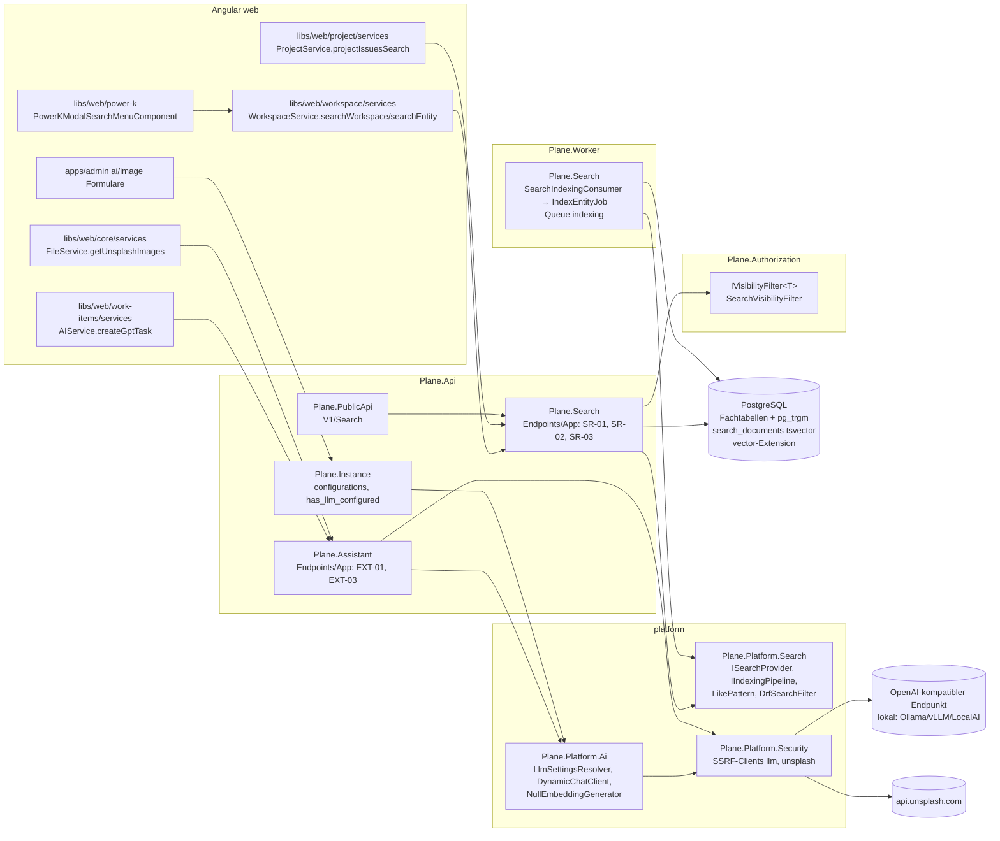
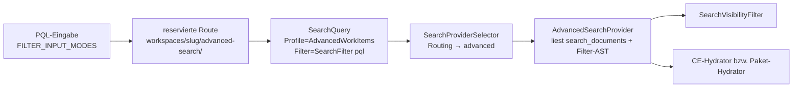

# 11 – Suche und AI-Basis (CE)

> **Status:** Entwurf zur Abnahme (Fachdokument D11). Verbindlich innerhalb seines Themas; nachrangig zu `00-grundsatzentscheidungen.md` (ADR-000 … ADR-009), `01-zielarchitektur-und-tech-stack.md` (ADR-010 … ADR-052) und `17-abgleich-dokumentuebergreifend.md`. Bei Widerspruch gilt 00 > 01 > 17 > dieses Dokument. Namen und Schnittstellen der fertigen Nachbardokumente 02, 05, 08, 09, 14, 15, 16 sind übernommen; die parallel entstandenen Dokumente 03 (Datenmodell), 06 (Jobs/Events), 07 (Dokumente) und 10 (Editor) sind im Review (siehe „Review-Protokoll“) abgeglichen; wo dieses Dokument sie präzisiert oder ihnen widerspricht, steht ein Änderungsauftrag in §9.2.
> **Stand:** 23.10.2026. Versionsangaben mit „⚠“ werden in Spike S0 per NuGet-/npm-Metadaten bestätigt (Regel 01 §8).
> **Zielrepository:** Alle Pfade für Zielcode sind relativ zur Wurzel des neuen Repositorys **`funk.`** (ADR-009). `BE/` = `funk./src/`, `FE/` = `funk./frontend/`, `T/` = `funk./tests/`. Pfade des Originals: `API/` = `apps/api/plane/`, `WEB/` = `apps/web/`, `ADM/` = `apps/admin/`, `PKG/` = `packages/` (Referenz `/home/user/plane`, ADR-006).
> **Quellen (gelesen):** A03 §2.11, §3.14, §3.17, §3.19 (Q-27, Q-28, Q-35, Q-36); A06 §2.13 (`issue_search`); A05 (v1-Suche); CE-Katalog `features/_data/ce-features.json` (CE-SRCH-001…009, CE-AI-001/-002, CE-API-019, CE-INST-025/-026, CE-UIX-009, CE-PAGE-034, CE-WI-008/-031/-044/-048); Originalcode `API/app/views/search/{base,issue}.py`, `API/utils/issue_search.py`, `API/app/views/external/base.py`, `API/api/views/issue.py` (`IssueSearchEndpoint`), `API/utils/instance_config_variables/core.py`, `API/license/api/views/instance.py`, `WEB/components/power-k/**`, `WEB/services/{workspace,ai,file}.service.ts`, `WEB/services/project/project.service.ts`, `WEB/components/core/modals/{gpt-assistant-popover,existing-issues-list-modal,bulk-delete-issues-modal}.tsx`, `WEB/components/issues/issue-modal/components/description-editor.tsx`, `WEB/hooks/{use-editor-flagging.ts,editor/use-editor-mention.tsx}`, `ADM/app/(all)/(dashboard)/{ai,image}/*`; Commercial-API-Referenz `developer-docs/docs/api-reference/issue/advanced-search-work-items.md`; DRF 3.17.2 `rest_framework/filters.py` (`search_smart_split`, `get_search_terms`, `must_call_distinct`); `API/settings/common.py` (`EXCEPTION_HANDLER`).
> **Sprache:** Fließtext Deutsch, Bezeichner Englisch.

## Inhaltsverzeichnis

1. [Ziel & Scope](#1-ziel--scope)
2. [Entscheidungen (D11-ADR-01 ff.)](#2-entscheidungen-d11-adr-01-ff)
3. [Detaildesign](#3-detaildesign)
   - 3.1 Bausteine und Projektschnitt
   - 3.2 Textabgleich-Semantik (Port `icontains`, Sequenz-IDs, DRF-`SearchFilter`)
   - 3.3 Such-Abstraktion (`ISearchProvider`, Profile, Routing, Hydrierung)
   - 3.4 Globale Suche SR-01 (CE-SRCH-001)
   - 3.5 Entity-Suche SR-03 (CE-SRCH-002)
   - 3.6 Work-Item-Picker-Suche SR-02 (CE-SRCH-003)
   - 3.7 Public-API-Suche v1 (CE-API-019)
   - 3.8 Sichtbarkeit und Berechtigungen
   - 3.9 Trigramm-Indizes und SQL-Pläne
   - 3.10 Indexierungs-Pipeline (`search_documents`)
   - 3.11 Frontend: Power-K-Suche
   - 3.12 Frontend: Mentions und Picker
   - 3.13 AI-Konfiguration (Instanz-Keys, Provider-Auflösung)
   - 3.14 AI-Client-Aufbau (`Microsoft.Extensions.AI`, SSRF-Client, Laufzeitwechsel)
   - 3.15 KI-Assistent EXT-03/EXT-02 (CE-AI-001)
   - 3.16 Unsplash EXT-01 (CE-AI-002)
   - 3.17 Frontend: KI-Assistent, Bild-Picker, God-Mode-Formulare
   - 3.18 Options-Klassen
   - 3.19 Observability, Datenschutz, Betrieb
4. [Vollständige Mapping-Tabellen Original → Ziel](#4-vollständige-mapping-tabellen-original--ziel)
5. [Code-Skelette](#5-code-skelette)
6. [Erweiterungspunkte für Bezahl-Pakete](#6-erweiterungspunkte-für-bezahl-pakete)
7. [Akzeptanzkriterien & Tests](#7-akzeptanzkriterien--tests)
8. [Risiken & offene Punkte](#8-risiken--offene-punkte)
9. [Abhängigkeiten zu anderen Dokumenten (02–16)](#9-abhängigkeiten-zu-anderen-dokumenten-0216)

---

## 1. Ziel & Scope

### 1.1 Ziel

Dieses Dokument legt fest, wie die Suche und die KI-Funktionen der Community Edition in `funk.` gebaut werden, sodass ein Implementierungs-Agent ohne weitere Recherche Endpunkte, Abfragen, Indizes, Frontend-Bausteine und Tests erzeugen kann. Es liefert drei Dinge:

1. **Parität der CE-Suche:** globale Suche (Command-Palette „Power K“), Entity-Suche (Mentions, Entity-Picker), Work-Item-Picker-Suche und Public-API-Suche liefern dieselben Treffer und Antwortformen wie das Original. Die Trefferlogik ist die des Originals (`icontains` = Teilstring, groß-/kleinschreibungsunabhängig, plus exakte Sequenznummern), umgesetzt mit PostgreSQL `ILIKE` und `pg_trgm`-GIN-Indizes (ADR-024).
2. **Parität der CE-KI:** KI-Assistent („I'm feeling lucky“, GPT-Popover) über `Microsoft.Extensions.AI` mit konfigurierbarem OpenAI-kompatiblem Endpunkt (`LLM_BASE_URL`, lokal z. B. Ollama/vLLM/LocalAI, Airgapped-fähig, ADR-004/ADR-025) und Unsplash-Proxy für den Bild-Picker.
3. **Andockstellen für B6/G1 (🧱):** eine Such-Abstraktion, die später PQL/Advanced Search aufnimmt, eine in der CE bereits laufende Indexierungs-Pipeline über Integration-Events in `search_documents` (`tsvector`) und ein festgelegtes, reserviertes Embedding-Schema mit pgvector (Dimension konfigurierbar, HNSW). Fachdesign der Bezahl-Pakete erfolgt **nicht** (01 P7).

### 1.2 Im Scope

| Bereich | CE-IDs | Original-Endpunkte (A03/A05) |
|---|---|---|
| Globale Suche | CE-SRCH-001 | SR-01 `GET /api/workspaces/{slug}/search/` |
| Entity-Suche (Mentions, Entity-Picker) | CE-SRCH-002, Nutzer: CE-PAGE-034, CE-WI-044, CE-WI-001, CE-WI-005, CE-INT (Intake-Beschreibung) | SR-03 `GET /api/workspaces/{slug}/entity-search/` |
| Work-Item-Picker-Suche | CE-SRCH-003, Nutzer: CE-WI-008, CE-WI-031, CE-WI-048, Intake-Duplikatauswahl (`WEB/components/inbox/modals/select-duplicate.tsx`, CE-INT), „Existing work items“-Dialoge in Cycle-/Modul-Leerzuständen und Gruppenköpfen (CE-WI-008) | SR-02 `GET /api/workspaces/{slug}/projects/{project_id}/search-issues/` |
| Power-K-Suchseite (Frontend) | CE-SRCH-004 (Suchanteil); CE-SRCH-005…009 nur als Rahmen (Eigentümer 08 §3.10) | nutzt SR-01 |
| Public-API-Suche | CE-API-019 | `GET /api/v1/workspaces/{slug}/issues/search/`, `GET /api/v1/workspaces/{slug}/work-items/search/` |
| Querschnitt Textsuche in Listen (`?search=`, `query=`) | Helfer für CE-WS-005, CE-WS-009, CE-PRJ-021, CE-PAGE-002 (Backend-Anteil), CE-WI (IssueViewSet-Liste), CE-HOME-009, CE-API-014, CE-INST-027 | DRF-`SearchFilter` (`search_fields`), `description_stripped__icontains`, `name__icontains` |
| KI-Assistent | CE-AI-001 | EXT-03 `POST /api/workspaces/{slug}/ai-assistant/` (EXT-02 Projektvariante: D11-ADR-16) |
| Unsplash-Bildsuche | CE-AI-002, CE-UIX-009 (Unsplash-Tab) | EXT-01 `GET /api/unsplash/` |
| God-Mode-Einstellungen AI/Bilder | CE-INST-025, CE-INST-026 (Formulare; Speicherung über `Plane.Instance`) | `PATCH /api/instances/configurations/` (Eigentümer `Plane.Instance`) |
| Instanz-Flags | CE-INST-003 (Felder `has_llm_configured`, `has_unsplash_configured`) | `GET /api/instances/` (Eigentümer `Plane.Instance`) |
| Andockstellen | B6, G1 (🧱) sowie berührte 🧱-Pakete A1, A2, B1, D1, D2, E5, F1/F2, H1 | – |

### 1.3 Nicht im Scope

- Power-K-Befehle, Shortcuts, Kontext-Erkennung und `pl-command` (Eigentümer 08 §3.10, D08-ADR-17); hier nur die Suchseite der Palette.
- Filter-AST, Rich-Filter, Legacy-Filter `name` (Eigentümer 02 §3.11); dieses Dokument nutzt nur `LikePattern` dort.
- Seiten-Editor-KI-Menü (`rephrase-grammar`, Pi) und alle Pakete G1–G3 fachlich (nicht gewählt); nur Andockstellen §6.
- Speicherung der Instanz-Konfiguration, Verschlüsselung, Maskierung (Eigentümer 02 §3.16, 05 §3.17.5); dieses Dokument legt nur die AI-Schlüssel fest (Auftrag aus 05 §4.4 und 02 §4.10).
- Mitglieder-/Projekt-/Page-Listen selbst (Eigentümer jeweils Modul); dieses Dokument liefert nur den Such-Helfer.

### 1.4 Was wird in welchem Inkrement gebraucht

| Inkrement | Bausteine aus diesem Dokument | CE-IDs | Abnahme-Nachweis |
|---|---|---|---|
| **I0 Walking Skeleton** | Extensions `pg_trgm`, `unaccent`, `vector` im Postgres-Image und `ExtensionCheck` (14 §3.15); Spike-S0-Teil `PgvectorSmokeTests` (EF 10 + `Pgvector.EntityFrameworkCore`, HNSW, `CosineDistance`); Projekte `Plane.Platform.Search` und `Plane.Platform.Ai` als leere Gerüste mit Architekturtest; Instanz-Key `LLM_BASE_URL` im Seed-Katalog; Routen-Reservierungen §6.4 in `Reservations.cs` | – | `PgvectorSmokeTests`, `ExtensionCheckTests`, `RouteReservationTests` grün |
| **I1 Workspace/Projekte/Konto** | `LikePattern`, `DrfSearchFilter` (Port DRF-`SearchFilter`), Trigramm-Indizes `workspaces.name`, `projects.name`, `projects.identifier`, `users.{display_name,first_name,last_name}` (Wunschtermin dieses Dokuments; 03 §3.10.1 plant sie erst ab I2/I5 – Änderungsauftrag §9.2, rein performance-relevant, kein Abnahmekriterium vor I5) | CE-WS-005, CE-WS-009, CE-PRJ-021 (je Suchparameter) | `DrfSearchFilterTests` (Golden aus DRF 3.17.2), Contract-Szenarien der Mitgliederlisten mit `?search=` |
| **I2 Work Items & Layouts** | Modul `Plane.Search` (Gerüst), SR-03 mit Typen `user_mention`, `project`, `issue`; SR-02 mit Ausschlussparametern `parent`, `issue_relation`, `sub_issue`, `target_date`; `ParitySearchProvider` mit Quellen `UserMention`, `Project`, `WorkItem`; `SearchVisibilityFilter` für Work Items; Trigramm-Index `work_items.name`; Frontend `searchEntity`/`projectIssuesSearch` 1:1, Mentions im Lite- und Rich-Editor (einziger CE-Mention-Typ `user_mention`), Parent-/Relation-/Sub-Issue-Picker, Bulk-Delete-Dialog | CE-SRCH-002 (Teil), CE-SRCH-003 (Teil), CE-WI-008, CE-WI-031, CE-WI-044, CE-WI-048 | `SearchContractTests` (Szenarien `search.entity-*`, `search.picker-*`), `SearchGuestScopeAppTests` (A-051, Teil Work Items) |
| **I3 Planung** | SR-02-Parameter `cycle`, `module`; SR-03-Typen `cycle`, `module`; Quellen `Cycle`, `Module`, `View`, `Intake`; Indizes `cycles.name`, `modules.name`, `views.name`; Intake-Duplikat-Picker | CE-SRCH-002 (Teil), CE-SRCH-003 (Rest), Picker in Cycle/Module-Leerzuständen und Gruppenköpfen | Contract-Szenarien SR-02/SR-03 je Parameter |
| **I4 Pages & Realtime** | SR-03-Typ `page` (Vertragsparität; **kein CE-Aufrufer**, weil `EDITOR_MENTION_TYPES` in der CE nur `user_mention` enthält – Nutzer erst D6/H1); Quelle `Page`; Index `pages.name`; Mentions im Document-Editor (Typ `user_mention`, Endpunkt aus I2) | CE-PAGE-034, CE-SRCH-002 (Rest) | `SearchContractTests` (Szenario `search.entity-page`) |
| **I5 Überblick** | SR-01 vollständig; Power-K-Suchseite; `SEARCH_RESULT_RENDERERS`; Indexierungs-Pipeline (`search_documents`, Consumer `search.indexing`, Queue `indexing`, Jobs `indexing.*`, CLI `plane-cli search reindex`); `IIndexDocumentEnricher`; `NullEmbeddingGenerator` registriert; Index `stickies.description_stripped` (Home-Modul nutzt `LikePattern`); Lasttest LT-09 | CE-SRCH-001, CE-SRCH-004 (Suchanteil), CE-HOME-009 (Suchparameter) | `SearchContractTests` (Szenarien `search.global-*`), `IndexingPipelineTests`, `web/search/search.spec.ts`, `web/search/power-k.spec.ts` (Suchteil), LT-09 p95 < 300 ms |
| **I6 Außenwirkung & Administration** | Public-API-Suche (Adapter in `Plane.PublicApi`), `Plane.Assistant` (EXT-03, EXT-01), `Plane.Platform.Ai` vollständig (`LlmSettingsResolver`, `DynamicChatClient`, SSRF-Client `llm`), God-Mode-Formular AI mit Feld „Base URL“, Bild-Formular, `has_llm_configured`/`has_unsplash_configured` | CE-API-019, CE-API-014 (Suchparameter), CE-AI-001, CE-AI-002, CE-INST-025, CE-INST-026, CE-INST-027 (Suchparameter) | `PublicApiContractTests` (Szenario `public-api.work-item-search`), `AssistantEndpointTests` (WireMock „OpenAI-kompatibel“), `UnsplashEndpointTests`, `web/ai/ai-unsplash.spec.ts`, `admin/admin-settings.spec.ts` |
| **I7 Härtung** | Airgap-E2E mit lokalem LLM-Stub (WireMock im Profil `test`) und gesperrtem Egress; Index-Reconcile im Lasttest LT-08 | – | Airgap-Lauf grün, kein Egress außer Allowlist |
| **W5 (B6)** | dockt an §6.1 an | – | – |

> **Präzisierung zu 01 §5.4:** Das Modul `Plane.Search` entsteht bereits in **I2** (Work-Item-Picker und Mentions sind Teil der vertikalen Schnitte von I2), nicht erst in I5; die Spalte „ab“ in 01 §5.4 lautet damit „I2/I5“ (Änderungsauftrag §9.2). Dasselbe gilt für 15 Anhang (CE-SRCH-002/-003 dort „I5“): Backend-Contract-Szenarien für SR-02/SR-03 laufen ab I2, die E2E-Spec `web/search/search.spec.ts` bleibt I5 (Änderungsauftrag §9.2).

---

## 2. Entscheidungen (D11-ADR-01 ff.)

| ADR | Belang | Entscheidung | Alternativen (verworfen) | Begründung | ab |
|---|---|---|---|---|---|
| **D11-ADR-01** | Projektschnitt | Abstraktionen und datenbankunabhängige Helfer in `Plane.Platform.Search` (`ISearchProvider`, `SearchQuery`, `SearchResult`, `IIndexingPipeline`, `IndexDocument`, `IIndexDocumentEnricher`, `LikePattern`, `SequenceIdExtractor`, `DrfSearchFilter`, `SearchText`); **Implementierungen mit Fachdatenbezug** (`ParitySearchProvider`, Such-Quellen, `IndexingPipeline`, `search_documents`-Schreiber) im Modul `Plane.Search`. `Plane.Platform.Ai` enthält Provider-Auflösung, `DynamicChatClient`, `NullEmbeddingGenerator`; `Plane.Assistant` die Endpunkte EXT-01/EXT-03. Der in 01 §5.1 unter `Plane.Platform.Search` genannte `PostgresSearchProvider` heißt `ParitySearchProvider` und liegt in `Plane.Search` (Präzisierung) | Provider in `Plane.Platform.Search` mit Roh-SQL auf Fachtabellen; eigener Such-Dienst | Regel R7 (01 §5.2): `platform/*` kennt keine Fachmodule und kein `Plane.Data`; die Suche braucht aber Joins über Work Items, Projekte, Mitgliedschaften und die Sichtbarkeitsfilter aus `Plane.Authorization` | I0/I2 |
| **D11-ADR-02** | Trefferlogik der CE-Endpunkte | **Original-Semantik**: `icontains` → `ILIKE '%' || escape(q) || '%'` (Escape `\`, `%`, `_` wie Django), Sequenznummern als exakte Ganzzahlvergleiche; Abfrage direkt auf den Fachtabellen mit **`pg_trgm`-GIN-Indizes** (`gin_trgm_ops`); die CE-Endpunkte lesen **nicht** aus `search_documents` | Volltextsuche (`tsvector @@ tsquery`) für die CE-Endpunkte; Lesen aus `search_documents` | `tsquery` findet Wortpräfixe, aber keine Teilstrings mitten im Wort („plan“ in „Replanning“) – Paritätsbruch; Sichtbarkeit hängt am aktuellen Mitgliedschaftsstand und wird ohnehin über Fachtabellen geprüft | I1/I2 |
| **D11-ADR-03** | Reihenfolge und Ranking | Wo das Original sortiert (`-created_at`), wird identisch sortiert (+ Tiebreaker `id DESC`, D02-ADR-13). Wo das Original **keine** Reihenfolge festlegt (SR-01 `issue`, SR-02, v1-Suche), gilt eine **deterministische Relevanzreihenfolge**: (1) exakter Sequenztreffer, (2) `similarity(name, q)` absteigend (`pg_trgm`), (3) `created_at DESC`, (4) `id DESC`; ohne Suchtext nur (3), (4). Präzisierung von ADR-024: das dort genannte `tsvector`-Ranking gilt für Index-basierte Provider (B6/G1), in der CE ersetzt Trigramm-Ähnlichkeit das Ranking, weil die Treffermenge Teilstring-basiert ist | `ts_rank` über `search_documents`; DB-Reihenfolge wie Original | Undefinierte Reihenfolge + `LIMIT 100` macht schon die Treffermenge nicht reproduzierbar (Contract-Tests, Nutzer sieht wechselnde Ergebnisse); `ts_rank` wäre für Teilstring-Treffer häufig 0 | I2 |
| **D11-ADR-04** | Such-Abstraktion | `ISearchProvider` bleibt **unverändert** (01 §5.5: `SearchAsync(SearchQuery)`); Auswahl je **Suchprofil** (`SearchProfile`: `Global`, `Entity`, `WorkItemPicker`, `PublicApiWorkItems`) über Keyed Services und Option `Plane:Search:Routing` (Default für alle Profile `parity`). Zwei Phasen: der Provider liefert nur `(entityType, id, score)`-Treffer; die Antwortform erzeugt der profilabhängige **Hydrator** im Modul `Plane.Search` (Original-Projektionen). B6 registriert einen weiteren Provider (`advanced`) und ein neues Profil, ohne CE-Code zu ändern | Ein Provider-Interface je Endpunkt; Provider liefert fertige DTOs | Provider-Tausch (Postgres-FTS, OpenSearch-ähnlich, Hybrid mit Embeddings) darf die Antwortverträge nicht berühren; Hydrator wendet die Sichtbarkeit ein zweites Mal an (Defense in Depth) | I2 |
| **D11-ADR-05** | Sichtbarkeit | Jede Kandidatenabfrage **und** jede Hydrierung wendet die `IVisibilityFilter<T>` aus `Plane.Authorization/Visibility/` an (05 §3.14 `SearchVisibilityFilter`: Work Items, Intake, Pages, Views); Mitgliedschaften immer `is_active = true` **und** `deleted_at IS NULL` (02 `DEV-PERM-001`); Korrekturen SEC-56 (Q-35, Q-36) und Gastregel auch in der v1-Suche | Sichtbarkeit nur im Provider | Ein getauschter Provider (B6/G1) könnte sonst unsichtbare Inhalte liefern (05 §6, G1-Zeile) | I2 |
| **D11-ADR-06** | Indexierungs-Pipeline | **In der CE aktiv** (16 X14): `SearchIndexingConsumer` (Consumer-Name `search.indexing`, Queue `indexing`, 06 §3.8; `IEventConsumer` für die Work-Item-, Kommentar-, Page-, Projekt-, Cycle-, Modul-, View-, Intake- und Workspace-Events aus 06 §3.8 / 16 §3.2.4) plant `IndexEntityJob` in Queue `indexing` mit Dedupe-Schlüssel und Entprellung; der Job lädt den **aktuellen** Zustand, baut ein `IndexDocument`, ruft die `IIndexDocumentEnricher` und schreibt per Upsert in `search_documents` (`tsvector` als generierte Spalte, Konfiguration `simple` über `plane_unaccent`). Nachtjob `indexing.reconcile`, CLI `plane-cli search reindex`. Die CE-Endpunkte lesen den Index nicht (D11-ADR-02) | Index erst mit B6/G1 bauen; Trigger in PostgreSQL | Pakete B6/G1 starten ohne Backfill-Projekt und ohne CE-Umbau; Events sind ohnehin Pflicht (C3/H6); Trigger würden Modulgrenzen und Text-Extraktion (HTML) in SQL verlagern | I5 |
| **D11-ADR-07** | Embeddings | In der CE: `CREATE EXTENSION vector` (I0), `IEmbeddingGenerator<string, Embedding<float>>` = `NullEmbeddingGenerator`, **keine** Embedding-Tabelle (16 G1-Zeile). Das Schema für G1 ist hier **reserviert und festgelegt** (§6.2): Tabelle `search_embeddings` (Fremdschlüssel auf den zusammengesetzten Schlüssel `(entity_type, entity_id)` von `search_documents`, 03 §3.4.18.8) mit **dimensionsloser** Spalte `embedding vector`, Spalten `model_key`, `dimensions`; je aktivem Modell ein **partieller Ausdrucks-HNSW-Index** `((embedding::vector(n)) vector_cosine_ops) WHERE model_key = '<key>'` – Dimension damit zur Laufzeit konfigurierbar (`Plane:Ai:EmbeddingDimensions`, Default 1536) | `vector(1536)` fest in einer CE-Migration; separate Vektor-DB | Modellwechsel (andere Dimension) ohne Tabellenmigration; HNSW verlangt feste Dimension je Index, was der partielle Ausdrucksindex erfüllt (pgvector-Doku „Can I store vectors with different dimensions in the same column?“) | I0 (Extension), G1 |
| **D11-ADR-08** | Querschnitt `?search=` | Port des DRF-`SearchFilter` (DRF 3.17.2) als `DrfSearchFilter.Apply(query, search, fields…)`: Begriffe per `search_smart_split` (Leerzeichen/Komma, Anführungszeichen-Phrasen), **jeder** Begriff muss in **irgendeinem** Feld per `icontains` treffen, NUL-Zeichen entfernt, `DISTINCT` bei Mehrfach-Joins; Pflicht für alle Original-Views mit `search_fields` | Eigene Ad-hoc-Implementierungen je Modul | Gleiche Semantik an sechs Stellen, ein Golden-Test | I1 |
| **D11-ADR-09** | AI-Abstraktion und Transport | **`Microsoft.Extensions.AI`** (`IChatClient`, `IEmbeddingGenerator`) mit **`Microsoft.Extensions.AI.OpenAI`** über das offizielle OpenAI-.NET-SDK; **ein** Transport für alle Provider: Chat-Completions-Protokoll gegen eine konfigurierbare Basis-URL (OpenAI, OpenAI-kompatibel lokal, Anthropic- und Gemini-Kompatibilitätsendpunkte) | Semantic Kernel; `Microsoft.Extensions.AI.Ollama` (Preview, eingestellt); eigene HTTP-Clients je Provider | Provider-neutral (ADR-025), lokal betreibbar (ADR-004), ein Codepfad, MIT-lizenziert | I6 |
| **D11-ADR-10** | AI-Konfiguration | Instanz-Keys `LLM_API_KEY` (verschlüsselt), `LLM_PROVIDER` (`openai` Default, `openai-compatible`, `anthropic`, `gemini`), `LLM_MODEL`, **neu `LLM_BASE_URL`** (Kategorie `AI`, unverschlüsselt, Seed `""`, ENV `LLM_BASE_URL`); Modell-Whitelist des Originals entfällt; API-Key optional, wenn `LLM_BASE_URL` gesetzt ist; für `anthropic`/`gemini` gibt es **keinen** Default-Modellnamen mehr (die Original-Defaults `claude-3-sonnet-20240229`/`gemini-pro` sind beim Anbieter abgeschaltet – funktionaler Fehler, 17 Z-12), `LLM_MODEL` ist dort Pflicht; `GPT_ENGINE` entfällt (02 §4.10). `has_llm_configured` = Auflösung ergibt eine nutzbare Konfiguration | Provider-Konfiguration nur per ENV; Whitelist beibehalten | Q-28 (A03): Anthropic/Gemini funktionierten im Original nie, Whitelist ist veraltet; lokale Server brauchen keinen Key | I0 (Seed), I6 |
| **D11-ADR-11** | Ausgehende LLM-/Unsplash-Aufrufe | Das OpenAI-SDK läuft über den **SSRF-geschützten Named Client `llm`** (05 §3.17.2: 120 s, 0 Redirects, 8 MiB, Allowlist `Plane:Ai:AllowedInternalHosts`) via `HttpClientPipelineTransport`; SDK-eigene Wiederholungen aus (`ClientRetryPolicy(maxRetries: 0)`), Netzwerk-Timeout 120 s. Unsplash über Named Client `unsplash` (10 s, 5 Redirects, 2 MiB) | SDK-Standard-HttpClient; Standard-Resilience | Kein Aufruf an Nutzer-/Betreiber-URLs ohne SSRF-Schutz (D05-ADR-24, ABG-040); keine automatischen Wiederholungen | I6 |
| **D11-ADR-12** | Laufzeitwechsel der Konfiguration | `DynamicChatClient : IChatClient` liest bei jedem Aufruf die aufgelösten Einstellungen (`ILlmSettingsSource`, gecacht über den Instanz-Konfigurations-Cache `plane:instance:config`) und verwendet einen pro Einstellungs-Fingerabdruck gecachten inneren Client; Änderungen im God Mode wirken ohne Neustart | Singleton-Client beim Start | God-Mode-Änderung soll sofort greifen (Original liest je Request) | I6 |
| **D11-ADR-13** | KI-Assistent-Vertrag | Prompt = `task + "\n" + prompt` als **eine** `user`-Nachricht (1:1), keine weiteren Chat-Optionen; Antworten `{"response", "response_html"}` 1:1; Korrekturen: fehlender/falsy `prompt` → `""` (Original 500), `null`-Inhalt der LLM-Antwort → `""` (Original 500; ein leerer String lieferte schon im Original 200 mit `""`), `response_html` = HTML-kodierter Text mit `\n` → `<br/>` (Original ohne Kodierung) | Systemprompt ergänzen; Markdown-Rendering | Parität des Verhaltens; Kodierung verhindert, dass Modellausgaben als HTML in den Editor gelangen (Sicherheitskorrektur ohne sichtbare Änderung bei Klartext-Antworten) | I6 |
| **D11-ADR-14** | Unsplash-Proxy | Durchreichen von Status und JSON (1:1); Korrekturen Q-27: `page` ohne `$`, Query URL-kodiert, Access-Key im Header `Authorization: Client-ID <key>` statt in der URL, Timeout 10 s, 2 MiB | 1:1 inklusive Fehler | Funktionale Fehler korrigieren (Auftraggeber, 17 Z-12); Key nicht in URLs/Logs | I6 |
| **D11-ADR-15** | God-Mode-Formular AI | Formular `/god-mode/ai` 1:1 plus **ein** zusätzliches Feld „Base URL“ (`LLM_BASE_URL`) als drittes Feld im bestehenden 3-Spalten-Raster; der Hinweis-Kasten „If you have a preferred AI models vendor, please get in touch with us.“ (Link `https://plane.so/contact`) entfällt (ADR-001 Kontakt-CTA, ADR-009B externe Plane-Links). `LLM_PROVIDER` bleibt wie im Original nur per ENV/API setzbar | Provider-Auswahlfeld zusätzlich; Formular unverändert | Minimale sichtbare Abweichung, die ADR-004 erzwingt (`UI-DEV-D11-01`, `UI-DEV-D11-02`; ID-Schema `UI-DEV-*` aus 09 §4.12, endgültige Nummer vergibt 09) | I6 |
| **D11-ADR-16** | Nicht registrierte Original-Routen | `POST {P}/ai-assistant/` (EXT-02) hat keinen Client-Aufrufer → nach 02 §3.3.1 Regel 6 **nicht registriert** (405, `DEV-AI-008`); Permission `project.ai_assistant.use` bleibt im Katalog (generiert, 05), ohne Endpunkt. `POST {W}/rephrase-grammar/` existiert in der CE nicht (404 wie Original); das Editor-KI-Menü bleibt über `EDITOR_FLAGS` (`ai` deaktiviert) unsichtbar | Beide Routen bauen | Parität und Regel 6; Editor-KI gehört zu G3 (nicht gewählt) | I6 |
| **D11-ADR-17** | Frontend-Port Suche | Power-K-Suchseite, Ergebnisgruppen und Services **1:1** (Debounce 500 ms, Gruppen-Map → Registry `SEARCH_RESULT_RENDERERS`, Client-Filter der Palette `includes` auf dem Item-`value`); Korrektur: veraltete Antworten werden verworfen (laufende Anfrage wird bei neuem Suchbegriff abgebrochen), Original-Darstellungsfehler (Page-Identifier) bleibt optisch 1:1 | eigene Ergebnisdarstellung | ADR-005; Race-Condition ist funktionaler Fehler ohne optische Wirkung | I5 |
| **D11-ADR-18** | Unbegrenzte Ergebnislisten | SR-01 liefert für `workspace`, `project`, `cycle`, `module`, `issue_view`, `page` im Original **alle** Treffer; Ziel: Obergrenze `Plane:Search:MaxUnboundedResults` = 1000 je Entitätstyp (0 = unbegrenzt) | 1:1 unbegrenzt | Schutz vor Antworten mit Zehntausenden Einträgen bei Ein-Zeichen-Suchen; UI zeigt ohnehin Listen dieser Größe nicht sinnvoll (`DEV-SRCH-002`) | I5 |

---

## 3. Detaildesign

### 3.1 Bausteine und Projektschnitt



#### 3.1.1 Backend-Projekte und Ordner (verbindlich)

| Projekt / Ordner | Inhalt | Abhängigkeiten (Regeln 01 §5.2) | ab |
|---|---|---|---|
| `BE/platform/Plane.Platform.Search/` | `Abstractions/ISearchProvider.cs`, `Abstractions/SearchQuery.cs`, `Abstractions/SearchResult.cs`, `Abstractions/SearchProfile.cs`, `Abstractions/SearchProviderKeys.cs`, `Indexing/IIndexingPipeline.cs`, `Indexing/IndexDocument.cs`, `Indexing/IIndexDocumentEnricher.cs`, `Indexing/IndexEntityTypes.cs`, `Text/LikePattern.cs`, `Text/SequenceIdExtractor.cs`, `Text/SearchText.cs`, `Text/DrfSearchFilter.cs`, `Text/DrfSearchTerms.cs`, `Sql/TrigramFunctions.cs`, `PlaneSearchOptions.cs`, `SearchServiceCollectionExtensions.cs` | `Plane.BuildingBlocks`, `Microsoft.EntityFrameworkCore` (nur `EF.Functions`/`IQueryable`-Erweiterungen), `Npgsql.EntityFrameworkCore.PostgreSQL` (+ `.Trigrams`) – **kein** `Plane.Data`, kein Fachmodul (R7) | I0 (Gerüst), I1 (Text), I2 (Abstractions), I5 (Indexing) |
| `BE/platform/Plane.Platform.Ai/` | `Configuration/LlmProviderKind.cs`, `Configuration/LlmRawSettings.cs`, `Configuration/LlmSettings.cs`, `Configuration/LlmSettingsResolver.cs`, `Configuration/ILlmSettingsSource.cs`, `Chat/DynamicChatClient.cs`, `Chat/OpenAiCompatibleChatClientFactory.cs`, `Chat/IChatClientFactory.cs`, `Embeddings/NullEmbeddingGenerator.cs`, `PlaneAiOptions.cs`, `AiServiceCollectionExtensions.cs` (`AddPlaneAi`) | `Plane.BuildingBlocks`, `Plane.Platform.Security` (Named-Client-Registrierung `llm`), `Microsoft.Extensions.AI` 10.x, `Microsoft.Extensions.AI.OpenAI` 10.x, `OpenAI` (transitiv) | I0 (Gerüst), I5 (`NullEmbeddingGenerator`), I6 |
| `BE/modules/Search/Plane.Search.Contracts/` | `Permissions/SearchPermissions.cs` (generiert, 05: `WorkspaceSearchRead`), `Services/IWorkItemSearchService.cs` (für `Plane.PublicApi`, R6), `Dtos/*` (Antwortformen §3.4–§3.7) | `Plane.BuildingBlocks` (R2) | I2 |
| `BE/modules/Search/Plane.Search/` | `SearchModule.cs`; `Endpoints/App/GlobalSearchEndpoints.cs` (SR-01), `Endpoints/App/EntitySearchEndpoints.cs` (SR-03), `Endpoints/App/WorkItemPickerSearchEndpoints.cs` (SR-02); `Application/Queries/GlobalSearch/GlobalSearchQuery.cs`, `…/EntitySearch/EntitySearchQuery.cs`, `…/WorkItemPickerSearch/WorkItemPickerSearchQuery.cs`, `…/PublicApiWorkItemSearch/PublicApiWorkItemSearchQuery.cs`; `Application/Services/ParitySearchProvider.cs`, `Application/Services/SearchProviderSelector.cs`, `Application/Services/WorkItemSearchService.cs` (implementiert `IWorkItemSearchService`); `Application/Sources/{WorkspaceSearchSource,ProjectSearchSource,WorkItemSearchSource,IntakeSearchSource,CycleSearchSource,ModuleSearchSource,ViewSearchSource,PageSearchSource,UserMentionSearchSource}.cs` (je `ISearchEntitySource`); `Application/Hydration/{GlobalSearchHydrator,EntitySearchHydrator,WorkItemPickerHydrator,PublicApiWorkItemHydrator}.cs`; `Application/Consumers/SearchIndexingConsumer.cs`; `Application/Jobs/{IndexEntityJob,RemoveIndexEntryJob,RemoveIndexEntriesByScopeJob,SearchIndexReconcileJob,SearchIndexRebuildJob}.cs`; `Indexing/IndexingPipeline.cs` (implementiert `IIndexingPipeline`), `Indexing/IndexFacets.cs` (Aufteilung `identifier`/JSON-Facetten), `Application/Sources/WorkItemBaseSetQuery.cs` (wendet `WorkItemBaseSetPredicates` **und** alle registrierten `IWorkItemBaseSetFilter` (16 E-04) an), `Indexing/IIndexDocumentBuilder.cs` (`string EntityType { get; }`, `ValueTask<IndexDocument?> BuildAsync(Guid entityId, CancellationToken ct)` – `null` = Quelle fehlt oder ist soft-gelöscht –, `ValueTask<DateTimeOffset?> GetSourceUpdatedAtAsync(Guid entityId, CancellationToken ct)` für den Nachlauf §3.10.4), `Indexing/Builders/{WorkItem,WorkItemComment,Page,Project,Cycle,Module,View}IndexDocumentBuilder.cs`; `Domain/CycleSearchStatus.cs`, `Domain/WorkItemPickerExclusions.cs` | `Plane.Search.Contracts`, `Plane.Data`, `Plane.Platform.Search`, `Plane.Documents` (Text-Extraktion `HtmlTextExtractor`, 07), `Plane.Authorization.Contracts`, `Plane.BuildingBlocks` (Messaging-Contracts, 06 §5.1), Contracts von WorkItems (Events, `IWorkItemBaseSetFilter`), Projects, Cycles, ProjectModules, Views, Pages, Intake, Workspaces (Events) | I2 (SR-02/-03), I5 (SR-01, Indexing) |
| `BE/modules/Assistant/Plane.Assistant.Contracts/` | `Permissions/AssistantPermissions.cs` (generiert: `WorkspaceAiAssistantUse`, `ProjectAiAssistantUse`, `UserUnsplashRead`), `Dtos/AiAssistantResponseDto.cs`, `Requests/AiAssistantRequest.cs` | `Plane.BuildingBlocks` | I6 |
| `BE/modules/Assistant/Plane.Assistant/` | `AssistantModule.cs`; `Endpoints/App/AiAssistantEndpoints.cs` (EXT-03), `Endpoints/App/UnsplashEndpoints.cs` (EXT-01); `Application/Queries/GenerateAiAssistantResponse/GenerateAiAssistantResponseQuery.cs` (bewusst **Query**, nicht Command: kein DB-Schreibzugriff, daher keine `TransactionBehavior`-Transaktion und keine Wiederholung durch die Npgsql-Execution-Strategy während eines bis zu 120 s langen LLM-Aufrufs, 02 D02-ADR-24); `Application/Queries/SearchUnsplash/SearchUnsplashQuery.cs`; `Application/Services/InstanceLlmSettingsSource.cs` (implementiert `ILlmSettingsSource`), `Application/Services/UnsplashClient.cs`, `Domain/AiResponseFormatter.cs`, `Domain/PythonTruthiness.cs` (`IsTruthy(JsonNode?)`: `null`, `false`, `0`, `""`, `[]`, `{}` → falsch; `AsText(JsonNode)`: String unverändert, sonst invariante JSON-Textdarstellung) | `Plane.Assistant.Contracts`, `Plane.Platform.Ai`, `Plane.Platform.Security`, `Plane.Instance.Contracts` (`IInstanceConfigurationStore`) | I6 |
| `BE/modules/PublicApi/Plane.PublicApi/V1/Search/WorkItemSearchV1Endpoints.cs` | Adapter v1 (`issues/search`, `work-items/search`) → `IWorkItemSearchService` | `Plane.Search.Contracts` (R6) | I6 |
| `BE/data/Plane.Data/Entities/Search/SearchDocument.cs`, `Configurations/Search/SearchDocumentConfiguration.cs` | Entität `[OwnedBy("Search")]`, Tabelle `search_documents` | – | I5 |
| `BE/data/Plane.Data/Querying/WorkItems/WorkItemBaseSetPredicates.cs` | gemeinsame Ausdrucks-Prädikate der Basismengen `IssueObjects`, `AllObjects` (Definition 02 §3.11.4) als `Expression<Func<WorkItem,bool>>`; `WorkItemBaseSets` in `Plane.WorkItems` und die Such-Quellen nutzen **dieselben** Ausdrücke (Ort `Plane.Data/Querying/WorkItems/` wie die EF-gebundenen Übersetzer aus 02 §3.11, 16 X7) | – (Änderungsauftrag an 02 §3.11.4: Prädikate dort ablegen, damit `Plane.Search` sie ohne R1-Verstoß nutzt) | I2 |
| `BE/modules/Authorization/Plane.Authorization/Visibility/SearchVisibilityFilter.cs` | Eigentum 05; Implementierungen `IVisibilityFilter<WorkItem>`, `<IntakeWorkItem>`, `<Page>`, `<View>`, `<SearchDocument>` (§3.8; Entitätsnamen nach 03) | 05 | I2/I5 |
| `BE/tools/Plane.Cli/Commands/SearchReindexCommand.cs`, `…/SearchStatusCommand.cs` | `plane-cli search reindex [--workspace <slug>] [--project <id>] [--entity <type>] [--wait]`, `plane-cli search status` (§3.10.4; Ergänzung der CLI-Tabelle 14 §3.22) | `System.CommandLine` (14 §3.22) | I5 |

#### 3.1.2 Registrierung im Host

| Host | Registrierung |
|---|---|
| `Plane.Api` | `services.AddPlaneSearch(configuration)` (Optionen, `DrfSearchFilter`-Abhängigkeiten, Keyed-Provider `parity`), `SearchModule`, `AssistantModule`, `services.AddPlaneAi(configuration)` |
| `Plane.Worker` | `SearchModule` (nur `RegisterMessaging`: Consumer, Jobs, Cron), `services.AddPlaneSearch(configuration)` |
| `Plane.Realtime`, `Plane.Gateway`, `Plane.Migrator` | – (Migrator führt nur Migrationen/Extensions aus) |

### 3.2 Textabgleich-Semantik

#### 3.2.1 `icontains` → `ILIKE`

| Aspekt | Original (Django 5.2, PostgreSQL-Backend) | Ziel (`LikePattern`, `EF.Functions.ILike`) |
|---|---|---|
| Operator | `UPPER("col"::text) LIKE UPPER('%q%')` | `col ILIKE @pattern` (`EF.Functions.ILike(x.Name, LikePattern.Contains(q))`) |
| Escaping | `%`, `_`, `\` werden mit `\` maskiert | `LikePattern.Escape`: `\` → `\\`, `%` → `\%`, `_` → `\_`; PostgreSQL-Standard-Escape `\` |
| Groß-/Kleinschreibung | `UPPER` beider Seiten | `ILIKE` (Fallfaltung der Datenbank-Locale); Abweichung nur bei Sonderfällen wie `ß`/`ẞ` → `DEV-SRCH-014` |
| NUL-Zeichen | PostgreSQL lehnt `\x00` in Textparametern ab → 500 | `SearchText.Normalize` entfernt `\0` vor jeder Verwendung (`DEV-SRCH-004`) |
| Leerer Suchtext | `query or None` → **kein** Textfilter | `SearchText.Normalize("") == null` → kein Textfilter |
| Trim | kein Trim | kein Trim (Leerzeichen sind Teil des Teilstrings, 1:1) |
| Indexnutzung | keine (Django-Ausdruck `UPPER(...)`) | `pg_trgm`-GIN `gin_trgm_ops` auf der Spalte; Muster ≥ 3 Zeichen nutzen den Index, kürzere fallen auf den Scan der bereits mitgliedschaftsgefilterten Menge zurück (§3.9) |

#### 3.2.2 Sequenznummern

| Stelle | Original | Ziel (`SequenceIdExtractor`) |
|---|---|---|
| SR-01 `issue`/`intake`, SR-03 `issue`, v1-Suche | jede ganze Zahl `\b\d+\b` aus dem Suchtext → `OR sequence_id = <n>`; **keine** Längenbegrenzung | `SequenceIdExtractor.Extract(q, maxQueryLength: null)` → Liste `int`; Treffer per `sequence_id = ANY(@ids)` |
| SR-02 (`search_issues`) | nur bei `len(query) <= 20`; sonst `sequence_id ILIKE '%q%'` (Text-Cast) | `SequenceIdExtractor.Extract(q, maxQueryLength: 20)`; bei Länge > 20: `EF.Functions.ILike(x.SequenceId.ToString(), LikePattern.Contains(q))` (Npgsql übersetzt `int.ToString()` nach `::text`) |
| Ziffern | Python-`\d` erkennt Unicode-Ziffern (z. B. Arabisch-Indisch) | **nur ASCII-Ziffern** `[0-9]`, Regex `(?<![0-9A-Za-z_])[0-9]+(?![0-9A-Za-z_])` (Wortgrenze wie `\b` für ASCII) (`DEV-SRCH-003`) |
| Überlauf | Zahl > 2³¹−1 → PostgreSQL `integer out of range` → 500 | Zahlen außerhalb `int` werden ignoriert (`DEV-SRCH-003`) |
| Dezimalzahlen | `12.5` → `\b12\b` und `\b5\b` treffen | identisch (Punkt ist Wortgrenze) |
| Duplikate | doppelte `OR`-Glieder | `Distinct()` (ohne Wirkung auf das Ergebnis) |

#### 3.2.3 DRF-`SearchFilter` (Query-Parameter `search` an Listen-Views)

`DrfSearchFilter.Apply<T>(IQueryable<T> source, string? search, params Expression<Func<T, string?>>[] fields)` bildet `rest_framework.filters.SearchFilter.filter_queryset` (DRF 3.17.2) nach:

1. Parameter `search` fehlt oder ist leer → Quelle unverändert.
2. **NUL-Prüfung 1:1:** DRF validiert den Wert mit `CharField(trim_whitespace=False, allow_blank=True).run_validation` (`ProhibitNullCharactersValidator`); enthält `search` ein `\0`, antwortet das Original **400** mit dem DRF-Listenkörper `["Null characters are not allowed."]` (über `auth_exception_handler` → DRF-`exception_handler`). `DrfSearchTerms.TrySplit` liefert dann `false`; der aufrufende Handler gibt `PlaneErrors.DrfList(400, DrfMessages.NullCharacters)` zurück (Mechanik 02 §3.8; Text als Konstante in `DrfMessages` ergänzen, Änderungsauftrag §9.2). Kein Entfernen der NUL-Zeichen (anders als bei den SR-Endpunkten, §3.2.1).
3. `DrfSearchTerms.TrySplit(search, out terms)` = Port von `search_smart_split` (DRF 3.17.2, `rest_framework/filters.py` Z. 20–34) auf Basis von Djangos `smart_split`: (a) Zerlegung an Leerraum, wobei in `"…"` **oder** `'…'` eingeschlossene Teile (mit `\`-Escapes) zusammenbleiben – auch mitten in einem Token (`a"b c"d` ist **ein** Token); (b) je Token führende/abschließende Kommas entfernen; (c) beginnt das Token mit `"` oder `'` und endet es mit demselben Zeichen → **ein** Begriff, Anführungszeichen entfernt und `\"`/`\'`/`\\` entkommen (`unescape_string_literal`) – auch eine leere Phrase `""` ergibt einen (leeren) Begriff, der alles trifft (1:1); (d) sonst Zerlegung an Kommas, leere Teile verworfen, Teile getrimmt; Anführungszeichen innerhalb solcher Tokens bleiben erhalten.
4. Für **jeden** Begriff: `OR` über alle Felder mit `ILIKE '%term%'` (`LikePattern.Contains`); Begriffe untereinander `AND`.
5. Mehrfach-Beziehungen: DRF dedupliziert nur bei m:n-Pfaden (`must_call_distinct`) über `EXISTS`; keiner der CE-Verwender (§4.6) hat einen m:n-Pfad (`member__*` ist n:1), daher `requiresDistinct: false` an allen CE-Stellen; der Parameter bleibt für Pakete.
6. Golden-Datei `T/Plane.Platform.Tests/Search/drf-search-terms.golden.json` wird mit `tools/golden/generate.mjs drf-search` aus der Original-Umgebung (Python, `rest_framework.filters.search_smart_split` aus DRF 3.17.2) erzeugt: 40 Eingaben (Leerzeichen, Kommas, `"`- und `'`-Phrasen, Escapes, leere Phrase, Anführungszeichen mitten im Token, Unicode) → Begriffslisten; zusätzlich ein Fall mit NUL → erwarteter Fehler.

Verwender (vollständig, Original → Zielmodul): Tabelle §4.6.

### 3.3 Such-Abstraktion

#### 3.3.1 Typen (`Plane.Platform.Search/Abstractions/`)

| Typ | Definition |
|---|---|
| `SearchProfile` | `enum SearchProfile { Global = 1, Entity = 2, WorkItemPicker = 3, PublicApiWorkItems = 4 }`; Werte ≥ 100 reserviert für Pakete (B6: `AdvancedWorkItems = 100`, G1: `Semantic = 110`) |
| `SearchEntityTypes` | Konstanten `workspace`, `project`, `issue`, `cycle`, `module`, `issue_view`, `page`, `intake`, `user_mention` (Wire-Namen des Originals); Reihenfolge `GlobalOrder` = `workspace, project, issue, cycle, module, issue_view, page, intake` (Reihenfolge der `MODELS_MAPPER`-Einträge, bestimmt die Gruppenreihenfolge in Power-K, §3.11) |
| `SearchQuery` | `record SearchQuery(SearchProfile Profile, PlanePrincipal Principal, Guid WorkspaceId, string? Text, IReadOnlyList<string> EntityTypes, Guid? ProjectId, bool WorkspaceWide, int? Limit, IReadOnlyDictionary<string, string> Options, SearchFilter? Filter = null)` – `Options` trägt profilabhängige Parameter (SR-02: `parent`, `issue_relation`, `sub_issue`, `cycle`, `module`, `target_date`, `issue_id`); `Filter` ist in der CE immer `null` |
| `SearchFilter` | `record SearchFilter(string ParserName, string Expression)` – Andockstelle B6 (`IFilterParser.Name` aus 16 §5.5, z. B. `pql`) |
| `SearchHit` | `readonly record struct SearchHit(string EntityType, Guid Id, double Score, Guid? RowKey = null)` – `RowKey` unterscheidet mehrere Ergebniszeilen desselben Objekts (einziger CE-Fall: SR-03 `page` ohne `project_id`, `RowKey` = `projects__id`); sonst `null` |
| `SearchResult` | `sealed record SearchResult(IReadOnlyDictionary<string, IReadOnlyList<SearchHit>> Hits, IReadOnlySet<string> Truncated)` – `Hits` in der Reihenfolge von `EntityTypes`; `Truncated` nennt Typen, deren Liste durch `Limit`/`MaxUnboundedResults` gekappt wurde (nur Telemetrie, nicht im Vertrag) |
| `ISearchProvider` | `ValueTask<SearchResult> SearchAsync(SearchQuery query, CancellationToken ct)` (01 §5.5, unverändert) |
| `SearchProviderKeys` | `Parity = "parity"`; reserviert `Advanced = "advanced"` (B6), `Semantic = "semantic"` (G1), `Hybrid = "hybrid"` (B6+G1) |

#### 3.3.2 Ablauf einer Suche


Regeln:

1. **Ein DbContext je Request**, Quellen laufen **sequenziell** (EF Core erlaubt keine parallelen Abfragen auf demselben Kontext); Leseabfragen mit `AsNoTracking()` und – wo das Original `use_read_replica = True` setzt (v1-Suche) – `.UseReadReplica()` (02 D02-ADR-22).
2. `ISearchEntitySource` (intern in `Plane.Search`): `string EntityType { get; }`, `bool Supports(SearchProfile profile)`, `ValueTask<IReadOnlyList<SearchHit>> SelectAsync(SearchQuery q, int? limit, CancellationToken ct)`, `ValueTask<IReadOnlyList<JsonObject>> HydrateAsync(SearchProfile profile, IReadOnlyList<SearchHit> hits, SearchQuery q, CancellationToken ct)` (Hits statt IDs, damit `RowKey` die Zeile bestimmt). Eine Quelle kapselt Kandidatenprädikat, Sichtbarkeit, Ordnung und die Projektionen je Profil.
3. **Kappung:** Profil `Global`: `issue`/`intake` 100 (Original), übrige `MaxUnboundedResults` (D11-ADR-18); `Entity`: `count`; `WorkItemPicker`: 100; `PublicApiWorkItems`: `limit`.
4. **Hydrierung erhält die Reihenfolge** der Treffer (`ORDER BY array_position(@ids, id)` bzw. Sortierung im Speicher nach Index).
5. **Mehrfachzeilen:** Wo das Original durch `.values()` über eine m:n-Beziehung **mehrere Zeilen pro Objekt** liefert (SR-03 `page` ohne `project_id`: eine Zeile je verknüpftem Projekt, das die Mitgliedschaftsbedingung erfüllt – Django verwendet für `values("projects__id")` nach `filter()` dieselbe Join-Instanz), wählt die Quelle **Paare** `(page.id, project.id)` aus und liefert je Paar einen `SearchHit` mit `RowKey = project.id`; die Kappung zählt damit Zeilen (wie `[:count]` auf `.values()`), der Hydrator projiziert je Paar genau eine Zeile.
6. **Fehlerfreiheit:** Kein Suchpfad wirft bei syntaktisch ungewöhnlichen Eingaben (sehr lange Texte, Sonderzeichen); Suchtexte > 1 000 Zeichen werden auf 1 000 Zeichen gekürzt (Schutz vor teuren `ILIKE`-Mustern, `DEV-SRCH-015`).

#### 3.3.3 Provider-Auswahl

`SearchProviderSelector.Resolve(SearchProfile profile)` liest `PlaneSearchOptions.Routing` (Dictionary `Profil → Provider-Key`, Default leer = alle `parity`) und löst `[FromKeyedServices(key)] ISearchProvider` auf. Unbekannter Key → Startfehler (`ValidateOnStart`, `PlaneSearchOptionsValidator`). B6 registriert `services.AddKeyedScoped<ISearchProvider, AdvancedSearchProvider>(SearchProviderKeys.Advanced)` und setzt in seiner Modul-Registrierung `Routing[AdvancedWorkItems] = advanced`; die CE-Profile bleiben auf `parity`, bis ein Betreiber sie umstellt (z. B. `Plane__Search__Routing__Global=hybrid` mit G1).

### 3.4 Globale Suche SR-01 (CE-SRCH-001)

**Endpunkt:** `GET /api/workspaces/{slug}/search/` – `e.App("workspaces/{slug}/search")`, `.RequirePermission(SearchPermissions.WorkspaceSearchRead)` (05 Anhang B: `WS(A,M,G)+VIS`), `.WithOriginalContract("SR-01")`. Handler `GlobalSearchQuery` (Profil `Global`).

**Parameter (String-Vergleiche wie Original, A03 Fallstrick 13):**

| Parameter | Auswertung (1:1) |
|---|---|
| `search` | fehlt/leer → kein Textfilter (alle sichtbaren Objekte, gekappt nach D11-ADR-18) |
| `entities` | fehlt/leer → `GlobalOrder`; sonst `split(",")`, `Trim`, leere verworfen, nur bekannte Typen; Reihenfolge der Antwortschlüssel = Reihenfolge des ersten Auftretens |
| `workspace_search` | Default `"false"` nur bei **fehlendem** Parameter (`?workspace_search=` ergibt `""` → keine Beschränkung, 1:1); Projektbeschränkung nur wenn Wert **exakt** `"false"` **und** `project_id` gesetzt; bei Mehrfachangabe zählt der letzte Wert (Django `QueryDict.get`) – gilt für alle Parameter aller Such-Endpunkte |
| `project_id` | optional (leerer String = nicht gesetzt); ungültige UUID → 400 `{"error": "Please provide valid detail"}` (Original: Django-`ValidationError` beim Aufbau von `filter(project_id=…)`) – **nur** wenn die Projektbeschränkung greift (`workspace_search == "false"`) **und** mindestens ein angefragter Typ aus `issue`, `cycle`, `module`, `issue_view`, `page`, `intake` stammt; sonst wird der Wert wie im Original ignoriert (200) |

**Antwort:** 200 `{"results": {"<typ>": [...]}}` – nur angefragte Typen, Schlüssel in der oben bestimmten Reihenfolge (System.Text.Json schreibt `Dictionary`-Einträge in Einfügereihenfolge; `GlobalSearchResponse` nutzt `OrderedDictionary<string, JsonArray>`).

| Typ | Kandidaten (Ziel; Abweichungen fett) | Textfelder | Projekt­beschränkung | Kappung | Reihenfolge | Felder (exakt, Reihenfolge wie `.values()`) |
|---|---|---|---|---|---|---|
| `workspace` | Workspaces (nicht gelöscht) mit eigener Mitgliedschaft **`is_active` und `deleted_at IS NULL`** (Q-36, `DEV-SRCH-007`); **workspaceübergreifend** (nicht auf `{slug}` beschränkt, 1:1) | `name` | nein | 1000 | `created_at DESC, id DESC` | `name`, `id`, `slug` |
| `project` | Projekte im Workspace, `archived_at IS NULL`, eigene aktive, **nicht gelöschte** Mitgliedschaft | `name`, `identifier` | nein (1:1: Projekte werden auch bei `project_id` nicht beschränkt) | 1000 | `created_at DESC, id DESC` | `name`, `id`, `identifier`, `workspace__slug` |
| `issue` | Basismenge `IssueObjects` im Workspace (ohne Triage, Archiv, Draft, archivierte Projekte) + `WorkItemVisibilityFilter` | `name`, `project.identifier` (beide `ILIKE`), `sequence_id = ANY(extract(q))` | ja | 100 | **D11-ADR-03** (Original undefiniert, `DEV-SRCH-001`) | `name`, `id`, `sequence_id`, `project__identifier`, `project_id`, `workspace__slug` |
| `cycle` | Cycles (nicht gelöscht, **inkl. archivierter** wie Original) in Projekten mit aktiver, **nicht gelöschter** Mitgliedschaft, Projekt nicht archiviert | `name` | ja | 1000 | `created_at DESC, id DESC` | `name`, `id`, `project_id`, `project__identifier`, `workspace__slug` |
| `module` | wie `cycle` für Module | `name` | ja | 1000 | `created_at DESC, id DESC` | wie `cycle` |
| `issue_view` | Projekt-Views (nur mit Projekt; Workspace-Views ohne Projekt fallen wie im Original heraus) + `ViewVisibilityFilter` (Gast: nur eigene, außer `guest_view_all_features`) + `owned_by = user OR access = 1` (Views: `1` = öffentlich), Projekt nicht archiviert | `name` | ja | 1000 | `created_at DESC, id DESC` | wie `cycle` |
| `page` | Pages mit mindestens einem verknüpften Projekt (`project_pages`), in dem der Nutzer aktives, nicht gelöschtes Mitglied ist und das nicht archiviert ist + `PageVisibilityFilter` (Gast-Regel) + `owned_by = user OR access = 0` (Pages: `0` = öffentlich); **archivierte Pages werden wie im Original nicht ausgeschlossen** | `name` | ja: nur Pages mit Verknüpfung zu `project_id` | 1000 | `created_at DESC, id DESC` | `name`, `id`, `project_ids`, `project_identifiers`, `workspace__slug` |
| `intake` | Basismenge `AllObjects` (inkl. Triage) mit Intake-Zuordnung `status IN (0, -2)` + `WorkItemVisibilityFilter`, Projekt nicht archiviert | wie `issue` | ja | 100 | `created_at DESC, id DESC` | wie `issue` |

**Page-Aggregate:** `project_ids` = `array_agg(DISTINCT p.id ORDER BY p.id)` und `project_identifiers` = `array_agg(DISTINCT p.identifier ORDER BY p.identifier)` **nur über die verknüpften Projekte, die die Mitgliedschaftsbedingung erfüllen** (Django verwendet für `annotate` nach `filter` dieselbe Join-Instanz); leere Menge → `[]`. Die Reihenfolgen beider Arrays sind unabhängig voneinander (1:1). Die im Original wirkungslosen Filter `~Q(projects__id=True)` entfallen.

**Abweichung Berechtigung:** Ein Nicht-Mitglied des Workspaces erhält 403 (Original: 200 mit leeren Listen außer `workspace`), siehe 05 Anhang B `WS(A,M,G)` (`DEV-SRCH-011`).

### 3.5 Entity-Suche SR-03 (CE-SRCH-002)

**Endpunkt:** `GET /api/workspaces/{slug}/entity-search/` – `.RequirePermission(SearchPermissions.WorkspaceSearchRead)` (Original `WorkspaceUserPermission` = aktives WS-Mitglied A/M/G). Handler `EntitySearchQuery` (Profil `Entity`).

| Parameter | Auswertung |
|---|---|
| `query` | fehlt/leer → kein Textfilter |
| `query_type` | Default `user_mention`; `split(",")` + `Trim`; unbekannte Werte werden ignoriert (kein Schlüssel in der Antwort); doppelte Werte überschreiben sich (1:1) |
| `count` | Default 5; `0` → leere Listen je Typ (1:1, Original `[:0]`); **nicht-ganzzahlig oder < 0 → 5, > 100 → 100** (Original: `int()`-Fehler bzw. negativer Slice → 500, > 100 unbegrenzt; `DEV-SRCH-005`) |
| `project_id` | optional; ungültige UUID → 400 `{"error": "Please provide valid detail"}`; gesetzt → **Mitgliedschaftsprüfung** des Anfragenden (`IPermissionEvaluator.HasAsync(principal, WorkItemsPermissions.ProjectWorkItemSearch, ScopeRef(Project))`, inkl. WS-Admin-Override HARM-00), sonst 403 im DenyStyle des Deskriptors (Q-35, SEC-56, `DEV-SRCH-008`) |
| `team_id`, `issue_id` | vom Frontend gesendet, ignoriert (1:1); `team_id` ist B1-Andockstelle (§6.1) |

**Antwort:** 200 `{"<query_type>": [...]}` nur für angefragte, bekannte Typen; Kappung je Typ `count`; Reihenfolge der Schlüssel = Reihenfolge in `query_type`.

**CE-Aufrufer:** ausschließlich die Editor-Mentions mit `query_type=user_mention` (`EDITOR_MENTION_TYPES`, CE `["user_mention"]`, `WEB/hooks/use-additional-editor-mention.tsx` Z. 50). Die Typen `project`, `issue`, `cycle`, `module`, `page` werden trotzdem vollständig portiert (Vertragsparität, Contract-Szenarien), weil Pakete (D6 Work-Item-/Page-Mentions, H1 App-Mentions) sie über `EDITOR_MENTION_TYPES` freischalten; die Route selbst hat einen CE-Aufrufer und fällt daher nicht unter 02 §3.3.1 Regel 6.

| `query_type` | mit `project_id` | ohne `project_id` | Textfelder | Reihenfolge | Felder |
|---|---|---|---|---|---|
| `user_mention` | aktive Projektmitglieder (nicht gelöscht) des Projekts, `users.is_bot = false` | aktive Workspace-Mitglieder (nicht gelöscht), `is_bot = false` | `first_name`, `last_name`, `display_name` (je `ILIKE`) | Mitgliedschaft `created_at DESC, id DESC` | `member__avatar_url` (`/api/assets/v2/static/{avatar_asset_id}/` wenn Asset gesetzt, sonst Legacy-`avatar`, sonst `null`; Projektion `UserAvatarUrl` wie A-025), `member__display_name`, `member__id` |
| `project` | wie ohne (1:1) | Projekte im Workspace mit eigener **aktiver, nicht gelöschter** Mitgliedschaft (`DEV-SRCH-009`; Original: auch inaktive/gelöschte) **oder** `network = 2` (öffentlich); **inkl. archivierter** | `name`, `identifier` | `created_at DESC, id DESC` | `name`, `id`, `identifier`, `logo_props`, `workspace__slug` |
| `issue` | `IssueObjects` des Projekts + Sichtbarkeit | `IssueObjects` des Workspaces + Sichtbarkeit | `name`, `project.identifier`, Sequenznummern | `created_at DESC, id DESC` | `name`, `id`, `sequence_id`, `project__identifier`, `project_id`, `priority`, `state_id`, `type_id` (CE immer `null`, A1) |
| `cycle` | Cycles des Projekts (aktive, nicht gelöschte Mitgliedschaft) | Cycles aller Mitgliedsprojekte | `name` | `created_at DESC, id DESC` | `name`, `id`, `project_id`, `project__identifier`, `status`, `workspace__slug` |
| `module` | Module des Projekts | Module aller Mitgliedsprojekte | `name` | `created_at DESC, id DESC` | `name`, `id`, `project_id`, `project__identifier`, `status` (Modul-Status: `backlog`, `planned`, `in-progress`, `paused`, `completed`, `cancelled`), `workspace__slug` |
| `page` | Pages mit Verknüpfung zu `project_id`, Mitgliedschaft in diesem Projekt, `access = 0`, Gast-Regel | `is_global = true`, `access = 0`, Mitgliedschaft in einem verknüpften Projekt, Gast-Regel; **eine Zeile je verknüpftem Projekt, das die Bedingung erfüllt** | `name` | `created_at DESC, id DESC` | `name`, `id`, `logo_props`, `projects__id`, `workspace__slug` |

**Cycle-Status** (`Domain/CycleSearchStatus.cs`, Port der `Case`-Annotation; `now` = `IClock.UtcNow`): `start_date <= now AND end_date >= now` → `CURRENT`; `start_date > now` → `UPCOMING`; `end_date < now` → `COMPLETED`; sonst (inkl. beide `NULL`) → `DRAFT`. Reihenfolge der Prüfungen exakt so (ein Cycle mit `start_date > now` und `end_date < now` ist `UPCOMING`).

### 3.6 Work-Item-Picker-Suche SR-02 (CE-SRCH-003)

**Endpunkt:** `GET /api/workspaces/{slug}/projects/{project_id}/search-issues/` – `.RequirePermission(WorkItemsPermissions.ProjectWorkItemSearch)` (05 Anhang B: `PRJ(A,M,G)+VIS`; Original nur `IsAuthenticated`, `DEV-SRCH-011`). Handler `WorkItemPickerSearchQuery` (Profil `WorkItemPicker`).

**Basismenge:** `IssueObjects` im Workspace + `WorkItemVisibilityFilter` (aktive, nicht gelöschte Mitgliedschaft; Gast-Regel) + Projekt nicht archiviert. Danach die Filter in **dieser Reihenfolge** (`Domain/WorkItemPickerExclusions.cs`):

| # | Bedingung (String-Vergleich) | Wirkung |
|---|---|---|
| 1 | `workspace_search == "false"` (Default `"false"`) | nur Work Items des URL-Projekts; jeder andere Wert → workspaceweit (1:1, `== "false"`-Vergleich) |
| 2 | `search` nicht leer | `name ILIKE` ODER `project.identifier ILIKE` ODER (Länge ≤ 20: `sequence_id = ANY(extract(q))`; Länge > 20: `sequence_id::text ILIKE`) |
| 3 | `parent == "true"` und `issue_id` | nur wenn `issue_id` in `IssueObjects` gefunden wird: Ausschluss des Work Items selbst, seines Parents (falls vorhanden; `~Q(pk=None)` wirkt im Original nicht) und seiner direkten Kinder (`parent_id = issue_id`, Work Items ohne Parent bleiben – Django-Negation über nullable Spalte); `issue_id` unbekannt/außerhalb `IssueObjects` → **kein** Ausschluss (1:1) |
| 4 | `issue_relation == "true"` und `issue_id` | Ausschluss: `issue_id` und alle Work Items, die mit ihm in irgendeiner Relation stehen (beide Richtungen, `work_item_relations` nicht gelöscht); `issue_id` unbekannt → **kein** Ausschluss (1:1: Original schließt nur bei gefundenem Issue aus) |
| 5 | `sub_issue == "true"` und `issue_id` | nur Root-Items (`parent_id IS NULL`) ohne `issue_id`; zusätzlich ohne dessen Parent; `issue_id` unbekannt → **keine Filterung** (Original: 500 `AttributeError`, `DEV-SRCH-006`) |
| 6 | `cycle == "true"` | Ausschluss aller Work Items mit **aktiver** Cycle-Zuordnung (`cycle_work_items.deleted_at IS NULL`) |
| 7 | `module` nicht leer | Ausschluss aller Work Items mit aktiver Zuordnung zu diesem Modul; ungültige UUID → 400 `{"error": "Please provide valid detail"}` |
| 8 | `target_date == "none"` | nur `target_date IS NULL` |

Ungültige UUID in `issue_id` (bei gesetztem Schalter) → 400 `{"error": "Please provide valid detail"}` (1:1). **Antwort:** 200 Array (max. 100), Reihenfolge D11-ADR-03 (`DEV-SRCH-001`), Felder exakt: `name`, `id`, `start_date`, `sequence_id`, `project__name`, `project__identifier`, `project_id`, `workspace__slug`, `state__name`, `state__group`, `state__color` (State `NULL` → drei `null`-Felder).

**Frontend-Aufrufer (alle 1:1 portiert, §3.12; vollständige Liste per `grep` über `apps/web`):** `ExistingIssuesListModal` aus `WEB/components/issues/issue-detail-widgets/issue-detail-widget-modals.tsx` (Sub-Items `sub_issue`, Relationen `issue_relation` mit `workspaceLevelToggle`), `WEB/components/issues/issue-detail/relation-select.tsx`, `WEB/components/issues/issue-layouts/calendar/quick-add-issue-actions.tsx`, `WEB/components/issues/issue-layouts/empty-states/{cycle,module}.tsx` (`cycle: true` bzw. `module`), `WEB/components/issues/issue-layouts/{kanban,list}/headers/group-by-card.tsx`; `ParentIssuesListModal` aus `WEB/components/issues/issue-detail/parent-select.tsx`, `WEB/components/issues/issue-modal/components/default-properties.tsx`, `WEB/components/inbox/modals/create-modal/issue-properties.tsx`; `BulkDeleteIssuesModal` (+ `bulk-delete-issues-modal-item.tsx`) aus `WEB/components/modals/work-item-level.tsx`; Intake `SelectDuplicateInboxIssueModal` (`WEB/components/inbox/modals/select-duplicate.tsx`, Aufruf aus `WEB/components/inbox/content/inbox-issue-header.tsx`).

### 3.7 Public-API-Suche v1 (CE-API-019)

**Endpunkte:** `GET /api/v1/workspaces/{slug}/issues/search/` und `GET /api/v1/workspaces/{slug}/work-items/search/` (gleicher Handler), Adapter `Plane.PublicApi/V1/Search/WorkItemSearchV1Endpoints.cs` → `IWorkItemSearchService.SearchAsync(...)` (Profil `PublicApiWorkItems`), `.RequirePermission(SearchPermissions.WorkspaceSearchRead)` (05 Anhang B), `.UseReadReplica()` (Original `use_read_replica = True`), OpenAPI `operationId: search_work_items`, Tag `Work Items`.

| Parameter | Auswertung |
|---|---|
| `search` | fehlt/leer → 200 `{"issues": []}` (1:1) |
| `limit` | Default 10; `0` → `{"issues": []}` (1:1, Original `[:0]`); **nicht-ganzzahlig oder < 0 → 10, > 100 → 100** (Original: `int()`-Fehler bzw. negativer Slice → 500, > 100 unbegrenzt; `DEV-SRCH-013`) |
| `workspace_search` | Projektbeschränkung nur bei exakt `"false"` **und** `project_id` |
| `project_id` | optional; ungültige UUID bei greifender Projektbeschränkung → 400 `{"error": "Please provide valid detail"}` (v1-`BaseAPIView.handle_exception`, 1:1) |

**Kandidaten:** `IssueObjects` im Workspace, aktive **nicht gelöschte** Mitgliedschaft (Original prüft nur `is_active`, `DEV-SRCH-012`), Projekt nicht archiviert, **plus Gast-Regel** (`WorkItemVisibilityFilter`; Original ohne Gast-Regel – Sicherheitskorrektur `DEV-SRCH-010`); Textfelder wie SR-01 `issue` (ohne Längenbegrenzung der Sequenznummern). **Antwort:** 200 `{"issues": [{"name", "id", "sequence_id", "project__identifier", "project_id", "workspace__slug"}]}`, Reihenfolge D11-ADR-03. API-Key-Prinzipal (`PrincipalKind.ApiKey`) wird wie der Nutzer des Keys behandelt (05); H1-Bearer-Prinzipale (`App`/`Bot`) laufen später durch dieselbe Sichtbarkeit (§6.1).

### 3.8 Sichtbarkeit und Berechtigungen

#### 3.8.1 Permission-Keys (aus 05, generiert)

| Endpunkt | Permission-Konstante | Key | Rollen CE | Zusatz |
|---|---|---|---|---|
| SR-01 | `SearchPermissions.WorkspaceSearchRead` | `workspace.search.read` | WS A, M, G | `VIS`×4 (Issues, Intake, Views, Pages) |
| SR-03 | `SearchPermissions.WorkspaceSearchRead` | `workspace.search.read` | WS A, M, G | `VIS`; bei `project_id` zusätzlich `project.work_item.search` am Projekt |
| SR-02 | `WorkItemsPermissions.ProjectWorkItemSearch` | `project.work_item.search` | PRJ A, M, G (+ HARM-00) | `VIS`×1 |
| v1 `issues/search`, `work-items/search` | `SearchPermissions.WorkspaceSearchRead` | `workspace.search.read` | WS A, M, G | `VIS` |
| EXT-03 | `AssistantPermissions.WorkspaceAiAssistantUse` | `workspace.ai_assistant.use` | WS A, M | – |
| EXT-02 (nicht registriert) | `AssistantPermissions.ProjectAiAssistantUse` | `project.ai_assistant.use` | PRJ A, M | Katalogeintrag ohne Endpunkt (D11-ADR-16) |
| EXT-01 | `AssistantPermissions.UserUnsplashRead` | `user.unsplash.read` | jeder Angemeldete | `SELF` |

#### 3.8.2 Prädikate (Eigentum 05 §3.14, hier die von der Suche verlangten Implementierungen)

| Filter (`Plane.Authorization/Visibility/`) | Entität | Prädikat (Pseudo-SQL, `u` = Anfragender) |
|---|---|---|
| `WorkItemVisibilityFilter` | `WorkItem` (auch Intake-Basis) | `EXISTS(pm: pm.project_id = wi.project_id AND pm.member_id = u AND pm.is_active AND pm.deleted_at IS NULL AND (pm.role > 5 OR p.guest_view_all_features OR wi.created_by_id = u))` |
| `ViewVisibilityFilter` | `View` (Projekt-View, Tabelle `views`) | `EXISTS(pm …) AND (pm.role > 5 OR p.guest_view_all_features OR v.owned_by_id = u)`; die Suche ergänzt `(v.owned_by_id = u OR v.access = 1)` |
| `PageVisibilityFilter` | `Page` | `EXISTS(pp ∈ project_pages(page), pm ∈ project_members(pp.project_id, u) aktiv, nicht gelöscht, Projekt nicht archiviert, (pm.role > 5 OR p.guest_view_all_features OR page.owned_by_id = u))`; die Suche ergänzt `(page.owned_by_id = u OR page.access = 0)` |
| `SearchVisibilityFilter` | Fassade, die je Entitätstyp den passenden Filter liefert (`IVisibilityFilter<T> For<T>()`), plus Implementierung für `SearchDocument` (B6/G1, §3.10.5) | für `SearchDocument`: Typ `work_item`/`page`/`issue_view` → Prädikate oben über `entity_id`; `project`/`cycle`/`module` → aktive Mitgliedschaft; `work_item_comment` → Sichtbarkeit des Work Items |

Signatur (von diesem Dokument angenommen, Eigentum 05 – dort bisher ohne Skelett, Änderungsauftrag §9.2): `IQueryable<T> Apply(IQueryable<T> source, PlanePrincipal principal, ScopeRef scope)` in `Plane.Authorization.Contracts` (nur BCL-`IQueryable`, R2-konform).

Regeln: (1) Der Vergleich `pm.role > 5` steht ausschließlich in `Plane.Authorization/Visibility/*` (Analyzer `PLANE0001`, 02 §3.6.5). (2) Alle Mitgliedschafts-Existenzprüfungen nutzen **ein** `Any(...)` je Projekt (gleiche Join-Instanz wie Django innerhalb eines `filter()`-Aufrufs). (3) Architekturtest `SearchSourcesApplyVisibility` (Plane.ArchitectureTests): jede `ISearchEntitySource`-Implementierung für `issue`, `intake`, `issue_view`, `page` ruft in `SelectAsync` und `HydrateAsync` `IVisibilityFilter<T>.Apply` auf (Prüfung über einen Roslyn-Analyzer-Test oder Laufzeittest mit `RecordingVisibilityFilter`).

### 3.9 Trigramm-Indizes und SQL-Pläne

Alle Indizes werden in der EF-Konfiguration des **Eigentümer-Moduls** der Tabelle angelegt (R3), aber von diesem Dokument verlangt. Konvention: Helfer `TrigramIndexExtensions.HasTrigramIndex(...)` aus 03 (`Plane.Data/Conventions/`) = `HasIndex(x => x.Name).HasMethod("gin").HasOperators("gin_trgm_ops").HasDatabaseName("ix_<tabelle>_<spalte>_trgm")`. Extension `pg_trgm` wird in der I0-Migration `…_Platform_Extensions` angelegt und im Modell per `HasPostgresExtension("pg_trgm")` deklariert (03 §3.10.2, `ExtensionCheck` 14 §3.15). Für `EF.Functions.TrigramsSimilarity` (Ranking, D11-ADR-03) registriert `Plane.Data` beim Npgsql-Provider `o.UseTrigrams()` (Paket `Npgsql.EntityFrameworkCore.PostgreSQL.Trigrams`, PostgreSQL License; Aufnahme in 01 §8.1, Änderungsauftrag §9.2). Tabellen- und Konfigurationsnamen nach 03 §3.4. Spalte „ab“ = spätester Termin aus Sicht dieses Dokuments (03 §3.10.1 plant einzelne Indizes später, siehe §9.2).

| Tabelle.Spalte (Arbeitsname) | Eigentümer-Modul / EF-Konfiguration | genutzt von | ab |
|---|---|---|---|
| `workspaces.name` | Workspaces / `WorkspaceConfiguration` | SR-01 `workspace`, `GET users/me/workspaces/?search=`, God-Mode-Workspace-Liste (CE-INST-027) | I1 (03: I2) |
| `projects.name`, `projects.identifier` | Projects / `ProjectConfiguration` | SR-01/SR-03 `project`, Work-Item-Identifier-Treffer (Join) | I1 (03: I2) |
| `users.display_name`, `users.first_name`, `users.last_name` | Identity / `UserConfiguration` | SR-03 `user_mention`, Mitgliederlisten `?search=` | I2 (Mentions; 03: I5) |
| `work_items.name` | WorkItems / `WorkItemConfiguration` | SR-01 `issue`/`intake`, SR-02, SR-03 `issue`, v1-Suche, Legacy-Filter `name` (02 §3.11.3) | I2 |
| `cycles.name` | Cycles / `CycleConfiguration` | SR-01/SR-03 `cycle` | I3 (03: I5) |
| `modules.name` | ProjectModules / `ModuleConfiguration` | SR-01/SR-03 `module` | I3 (03: I5) |
| `views.name` | Views / `ViewConfiguration` | SR-01 `issue_view` | I3 (03: I5) |
| `pages.name` | Pages / `PageConfiguration` | SR-01/SR-03 `page`, Page-Liste `?search=` (CE-PAGE-002) | I4 (03: I5) |
| `stickies.description_stripped` | Home / `StickyConfiguration` | Stickies-Suche App (CE-HOME-009) und v1 (CE-API-014) | I5 |
| `search_documents.title` | Search / `SearchDocumentConfiguration` | nur B6/G1 (CE liest nicht) | I5 |

**Ergänzende B-Tree-Indizes** (für die Mitgliedschafts-Joins, Eigentümer Projects/Workspaces, verlangt hier): `project_members (member_id, project_id) WHERE deleted_at IS NULL AND is_active`, `workspace_members (member_id, workspace_id) WHERE deleted_at IS NULL AND is_active`, `work_items (project_id, sequence_id)` (existiert als `ux_work_items_project_sequence_id`, 03 §3.4), `project_pages (page_id, project_id)`.

**Plan-Assertions** (`T/modules/Plane.Search.Tests/Performance/SearchPlanTests.cs`, Volumenprofil L aus 15 §3.14.3, `EXPLAIN (ANALYZE, BUFFERS)`): (1) SR-01 `issue` mit `search` ≥ 3 Zeichen nutzt `ix_work_items_name_trgm` (Bitmap Index Scan) oder einen Index-Scan über die Mitgliedschaft – kein Seq-Scan auf `work_items`; (2) SR-02 mit `workspace_search=false` nutzt den Projekt-Index; (3) SR-03 `user_mention` ohne Projekt nutzt `workspace_members`-Index. Lasttest LT-09 (15): Profil XL, 30 VU, p95 < 300 ms.

### 3.10 Indexierungs-Pipeline (`search_documents`)

#### 3.10.1 Schema (Migration `…_Search_Documents`, I5; Eigentümer `Search`; Basis 03 §3.4.18.8)

Grundlage ist die Tabellendefinition aus 03 §3.4.18.8 (zusammengesetzter Primärschlüssel, `project_id` ohne FK, Indexnamen). Dieses Dokument ergänzt als Fach-Eigentümer der Befüllung **drei Spalten** (`identifier`, `content_hash`, Gewicht des Identifiers im `search_vector`) und **zwei Indizes** (`project`, `facets`) – Änderungsauftrag an 03 (§9.2). Die Funktion `plane_unaccent` entsteht bereits in der I0-Migration `…_Platform_Extensions` (03 §3.10.2) und wird hier nur genutzt.

```sql
-- Voraussetzung (03 §3.10.2, Migration …_Platform_Extensions, I0):
--   CREATE EXTENSION pg_trgm; CREATE EXTENSION unaccent; CREATE EXTENSION vector;
--   CREATE FUNCTION plane_unaccent(text) … IMMUTABLE … AS $$ SELECT public.unaccent('public.unaccent'::regdictionary, $1) $$;

CREATE TABLE search_documents (
  entity_type        varchar(30)  NOT NULL,                          -- IndexEntityTypes (§5.1)
  entity_id          uuid         NOT NULL,                          -- polymorph, ohne FK
  workspace_id       uuid         NOT NULL REFERENCES workspaces(id) ON DELETE CASCADE,
  project_id         uuid         NULL,                              -- ohne FK (03): Pages mit mehreren Projekten → facets.project_ids
  title              text         NOT NULL DEFAULT '',
  body               text         NULL,                              -- Klartext, gekürzt auf Plane:Search:BodyMaxChars
  identifier         varchar(64)  NULL,                              -- D11-Ergänzung: "WEB-123" bzw. Projekt-Identifier
  facets             jsonb        NOT NULL DEFAULT '{}'::jsonb,
  content_hash       bytea        NOT NULL,                          -- D11-Ergänzung: SHA-256 über title|body|identifier|facets
  updated_at         timestamptz  NOT NULL,                          -- updated_at der QUELLE (03), nicht der Index-Zeile
  indexed_at         timestamptz  NOT NULL,
  search_vector      tsvector GENERATED ALWAYS AS (
                       setweight(to_tsvector('simple', plane_unaccent(coalesce(identifier, '') || ' ' || coalesce(title, ''))), 'A') ||
                       setweight(to_tsvector('simple', plane_unaccent(coalesce(body, ''))), 'B')) STORED,
  CONSTRAINT pk_search_documents PRIMARY KEY (entity_type, entity_id)
);
CREATE INDEX ix_search_documents_vector         ON search_documents USING gin (search_vector);
CREATE INDEX ix_search_documents_title_trgm     ON search_documents USING gin (title gin_trgm_ops);
CREATE INDEX ix_search_documents_workspace_type ON search_documents (workspace_id, entity_type);
CREATE INDEX ix_search_documents_project        ON search_documents (project_id) WHERE project_id IS NOT NULL;   -- D11-Ergänzung
CREATE INDEX ix_search_documents_facets         ON search_documents USING gin (facets jsonb_path_ops);         -- D11-Ergänzung
```

EF-Abbildung: `SearchDocumentConfiguration` mit `HasKey(x => new { x.EntityType, x.EntityId })`, `HasComputedColumnSql("<Ausdruck>", stored: true)` für `search_vector` (Typ `NpgsqlTsVector`), `Facets` als `JsonObject` mit `JsonNodeValueConverter` (03 D03-ADR-13). Kein Soft-Delete, kein Audit (technische Tabelle; 03 §3.5 führt `search_documents` in der Liste der Tabellen ohne Soft-Delete; Entität erbt **nicht** von `AuditableEntity`, Architekturtest-Ausnahme über die Liste aus 03). Zugriffe laufen nur über `Plane.Search` bzw. Paket-Provider (§3.10.5). Größengrenze: ein `tsvector` darf 1 MB nicht überschreiten – deshalb `BodyMaxChars` = 100 000 Zeichen (03 nennt „max. 1 MiB“ für `body`; der kleinere Wert gilt, Änderungsauftrag §9.2).

#### 3.10.2 Indexierte Entitätstypen und Inhalte (CE)

| `entity_type` | Quelle | `title` | `body` | `identifier` | `project_id` | `facets` (Schlüssel, Strings/Zahlen/Booleans) |
|---|---|---|---|---|---|---|
| `work_item` | `work_items` (Basismenge `AllObjects`, also inkl. Triage/Archiv/Draft) | `name` | `description_stripped` | `"{project.identifier}-{sequence_id}"` | `project_id` | `sequence_id`, `state_id`, `state_group`, `priority`, `type_id`, `parent_id`, `created_by_id`, `is_archived`, `is_draft`, `intake_status` (oder `null`), `start_date`, `target_date` |
| `work_item_comment` | Kommentare | Name des Work Items | `comment_stripped` | Identifier des Work Items | `project_id` | `work_item_id`, `actor_id`, `access` (`INTERNAL`/`EXTERNAL`) |
| `page` | `pages` | `name` | `description_stripped` | – | genau ein verknüpftes Projekt → dessen ID, sonst `null` | `project_ids` (Array), `owned_by_id`, `access`, `is_global`, `is_archived`, `is_locked`, `parent_id` (D2, CE `null`) |
| `project` | `projects` | `name` | `description` | `identifier` | `id` | `network`, `is_archived` |
| `cycle` | `cycles` | `name` | `description` | Projekt-Identifier | `project_id` | `start_date`, `end_date`, `owned_by_id`, `is_archived` |
| `module` | `modules` | `name` | `description` | Projekt-Identifier | `project_id` | `status`, `lead_id`, `is_archived` |
| `issue_view` | `views` | `name` | `description` | Projekt-Identifier | `project_id` (Workspace-Views `null`) | `access`, `owned_by_id`, `is_workspace_view` |

`body` wird auf `Plane:Search:BodyMaxChars` (Default 100 000) gekürzt; leere Beschreibungen (`<p></p>`) ergeben `null`. Fehlt `description_stripped` (Altbestand ohne serverseitige Berechnung), extrahiert der Builder den Text mit `HtmlTextExtractor.Strip(description_html)` (`Plane.Documents/Text/`, 07 §3.13; dieselbe Funktion, die `description_stripped` beim Speichern erzeugt, 03 D03-ADR-17). `updated_at` der Index-Zeile = `updated_at` der Quelle; für `work_item_comment` zusätzlich `max(comment.updated_at, work_item.updated_at)`, weil Titel und Identifier vom Work Item stammen. Die Typnamen `work_item_comment` und `issue_view` folgen den Event-Namen (`plane.work_item_comment.*`) bzw. dem Wire-Namen der Suche (`issue_view`); 03 §3.4.18.8 nennt `comment`/`view` – maßgeblich sind die Konstanten `IndexEntityTypes` (§5.1), Änderungsauftrag an 03 (§9.2).

#### 3.10.3 Ereignisse → Aktionen (`SearchIndexingConsumer`)

Event-Namen, Klassen und Payload-Felder exakt nach dem Katalog 06 §3.8 (`_data/06-event-catalog.json`). Die Consumer-Zeile `search.indexing` in 06 §3.8 („CE-Consumer (vollständig)“) nennt bisher nur Work-Item-, Kommentar- und Page-Events; sie wird um die hier zusätzlich abonnierten Events erweitert (Änderungsauftrag §9.2).

| Integration-Event (alle `.v1`) | Klasse (06) | Aktion |
|---|---|---|
| `plane.work_item.created`, `.updated`, `.state_changed`, `.archived`, `.unarchived`, `.parent_changed` | `WorkItemCreatedV1`, `WorkItemUpdatedV1`, `WorkItemStateChangedV1`, `WorkItemArchivedV1`, `WorkItemUnarchivedV1`, `WorkItemParentChangedV1` | `IndexEntityJob(work_item, WorkItemId)` |
| `plane.work_item.restored`, `.moved` | `WorkItemRestoredV1`, `WorkItemMovedV1` | abonniert, obwohl in der CE ohne Auslöser (06: „reserviert“); `.moved` zusätzlich Rebuild der Kommentar-Einträge des Work Items (Projekt-Identifier ändert sich, A8) |
| `plane.work_item.assignees_changed`, `.labels_changed`, `.cycle_changed`, `.module_changed`, `.relation_added`, `.relation_removed` | – | keine Aktion in der CE (keine indexierten Facetten); Enricher-Pakete abonnieren selbst |
| `plane.work_item.deleted` | `WorkItemDeletedV1` | `RemoveIndexEntryJob(work_item, WorkItemId)` + `RemoveIndexEntriesByScopeJob(entityType: work_item_comment, facet: work_item_id = WorkItemId)` |
| `plane.work_item_comment.created`, `.updated` | `WorkItemCommentCreatedV1`, `WorkItemCommentUpdatedV1` | `IndexEntityJob(work_item_comment, CommentId)` |
| `plane.work_item_comment.deleted` | `WorkItemCommentDeletedV1` | `RemoveIndexEntryJob(work_item_comment, CommentId)` |
| `plane.intake_work_item.created`, `.status_changed` | `IntakeWorkItemCreatedV1`, `IntakeWorkItemStatusChangedV1` | `IndexEntityJob(work_item, WorkItemId)` (Facette `intake_status`) |
| `plane.page.created`, `.updated`, `.description_updated`, `.archived`, `.unarchived`, `.moved` (reserviert D2) | `PageCreatedV1`, `PageUpdatedV1`, `PageDescriptionUpdatedV1`, `PageArchivedV1`, `PageUnarchivedV1`, `PageMovedV1` | `IndexEntityJob(page, PageId)` |
| `plane.page.deleted` | `PageDeletedV1` | `RemoveIndexEntryJob(page, PageId)` |
| `plane.project.created`, `.updated`, `.archived`, `.unarchived` | `ProjectCreatedV1`, `ProjectUpdatedV1`, `ProjectArchivedV1`, `ProjectUnarchivedV1` | `IndexEntityJob(project, ProjectId)`; bei `ProjectUpdatedV1` mit `Changes.Any(c => c.Field == "identifier")` zusätzlich `SearchIndexRebuildJob(projectId: ProjectId, entityType: null)` (alle Typen mit Identifier-Spalte: `work_item`, `work_item_comment`, `cycle`, `module`, `issue_view`) |
| `plane.project.deleted` | `ProjectDeletedV1` | `RemoveIndexEntriesByScopeJob(projectId: ProjectId)` (entfernt die Projekt-Zeile und alle Zeilen mit `project_id = ProjectId`; Pages mit mehreren Projekten werden über `IndexEntityJob(page, …)` des Reconcile korrigiert) |
| `plane.cycle.created`, `.updated`, `.completed`, `.archived`, `.unarchived` | `CycleCreatedV1`, `CycleUpdatedV1`, `CycleCompletedV1`, `CycleArchivedV1`, `CycleUnarchivedV1` | `IndexEntityJob(cycle, CycleId)` |
| `plane.cycle.deleted` | `CycleDeletedV1` | `RemoveIndexEntryJob(cycle, CycleId)` |
| `plane.module.created`, `.updated`, `.archived`, `.unarchived` | `ModuleCreatedV1`, `ModuleUpdatedV1`, `ModuleArchivedV1`, `ModuleUnarchivedV1` | `IndexEntityJob(module, ModuleId)` |
| `plane.module.deleted` | `ModuleDeletedV1` | `RemoveIndexEntryJob(module, ModuleId)` |
| `plane.view.created`, `.updated` | `ViewCreatedV1`, `ViewUpdatedV1` | `IndexEntityJob(issue_view, ViewId)` |
| `plane.view.deleted` | `ViewDeletedV1` | `RemoveIndexEntryJob(issue_view, ViewId)` |
| `plane.workspace.deleted` | `WorkspaceDeletedV1` (06, Konsument bisher nur `home.recent_visit_cleanup`) | `RemoveIndexEntriesByScopeJob(workspaceId: WorkspaceId)` (der FK `ON DELETE CASCADE` greift erst beim Hard-Delete) |

**Voraussetzungen an andere Module:** Archivieren/Entarchivieren von Projekten, Cycles, Modulen und Pages hat in 06 bereits eigene Events (`*.archived.v1`/`*.unarchived.v1`). Offen ist nur eine Änderung der Page-Projektverknüpfung (`project_pages`) ohne `PageUpdatedV1` – Änderungsauftrag an 06 (§9.2); bis dahin korrigiert der Nachtjob (§3.10.4). Ein Work Item, dessen State-Änderung nicht über `UpdateWorkItemCommand` läuft (z. B. Intake-Annahme), löst `WorkItemStateChangedV1` aus und ist damit abgedeckt.

#### 3.10.4 Jobs, Queue, Cron, CLI

Alle Jobs folgen dem Job-Vertrag aus 06 §3.5.1/§5.1 (`IJob` mit statischem `JobType`/`Queue`, `IJobHandler<TJob>.HandleAsync(job, JobContext, ct) → JobResult`); Registrierung in `SearchModule.RegisterMessaging(IMessagingRegistry m)`.

| Element | Definition |
|---|---|
| Consumer-Registrierung | je abonniertem Event `m.AddConsumer<TEvent, SearchIndexingConsumer>("search.indexing", PlaneQueues.Indexing)` (Inbox-Schlüssel `search.indexing`, 06 §3.4); der Consumer schreibt **nur** Jobs (keine Index-Zeilen), damit die Entprellung greift |
| Queue | `indexing` (06 D06-ADR-05, Concurrency 4; 16 §3.2.5); eigener Worker-Pool möglich (`Plane__Worker__Queues`) |
| `IndexEntityJob(string EntityType, Guid EntityId)` | `JobType = "indexing.index_entity"`, `Queue = indexing`, `RetryPolicy = Default`. Planung durch den Consumer mit `runAt = now + Plane:Search:IndexingDebounceMilliseconds` (Default 2 000) und `dedupeKey = "indexing:{type}:{id}"`. Dedupe-Semantik 06 §3.2: der Schlüssel ist eindeutig, solange ein Job `pending` **oder** `running` ist → mehrere Änderungen in kurzer Folge ergeben einen Job. Ausführung: Builder lädt den **aktuellen** Zustand (`AsNoTracking`); Quelle fehlt oder ist soft-gelöscht → Eintrag entfernen; sonst `IndexDocument` bauen → alle `IIndexDocumentEnricher` mit passendem `EntityType` in Registrierungsreihenfolge → `IIndexingPipeline.IndexAsync`. **Nachlauf gegen verlorene Änderungen:** Weil ein Event, das während der Ausführung (`running`) eintrifft, am Dedupe-Index scheitert, liest der Handler nach dem Schreiben `updated_at` der Quelle erneut; ist es neuer als `IndexDocument.UpdatedAt`, endet der Job mit `JobResult.Retry("source changed", after: Debounce)` (zählt als Versuch; nach `MaxAttempts` greift der Nachtjob) |
| `RemoveIndexEntryJob(string EntityType, Guid EntityId)` | `JobType = "indexing.remove_entry"`; sofort (`runAt = null`), `dedupeKey = "indexing-remove:{type}:{id}"` (eigener Präfix, damit ein noch offener `IndexEntityJob` das Entfernen nicht schluckt); `IIndexingPipeline.RemoveAsync` |
| `RemoveIndexEntriesByScopeJob(Guid? WorkspaceId, Guid? ProjectId, string? EntityType, string? FacetKey, string? FacetValue)` | `JobType = "indexing.remove_scope"`; ein `DELETE … WHERE` mit den gesetzten Bedingungen (Workspace, Projekt inkl. Projekt-Zeile selbst, Facette `facets->>key = value`); Dedupe `indexing-remove-scope:{ws}:{project}:{type}:{facetKey}:{facetValue}` (deterministisch, prozessunabhängig) |
| `IndexingPipeline.IndexAsync` | `content_hash` berechnen; `INSERT … ON CONFLICT (entity_type, entity_id) DO UPDATE SET … WHERE search_documents.content_hash <> EXCLUDED.content_hash OR search_documents.updated_at < EXCLUDED.updated_at`; Metriken `plane.search.index.writes`, `plane.search.index.unchanged` |
| `SearchIndexReconcileJob` (parameterlos, `new()`-Pflicht von `IRecurringJobRegistry.Register`) | `JobType = "indexing.reconcile"`, `RetryPolicy = Maintenance`; Cron `m.Recurring.Register<SearchIndexReconcileJob>("indexing.reconcile", options.ReconcileCron)` mit Default `23 3 * * *` UTC (Eintrag im Cron-Plan 06 §4.2, Änderungsauftrag §9.2): je Entitätstyp Keyset-Durchlauf (`Plane:Search:ReconcileBatchSize` = 1 000) über Quelle ⟗ Index: fehlend oder `source.updated_at > search_documents.updated_at` → `IndexEntityJob` (ohne Debounce); Index-Zeile ohne lebende Quelle → entfernen; `JobContext.Heartbeat()` je Batch |
| `SearchIndexRebuildJob(Guid? WorkspaceId, Guid? ProjectId, string? EntityType)` | `JobType = "indexing.rebuild"`; plant `IndexEntityJob` in Batches (`RebuildBatchSize` = 500, ohne Debounce); Dedupe `indexing:rebuild:{ws}:{project}:{type}`; Auslöser: CLI, Identifier-Änderung, Erstbefüllung (der erste `SearchIndexReconcileJob` nach dem Einspielen von `…_Search_Documents` befüllt ohnehin alles; zusätzlich plant der Migrator **einen** Rebuild-Job, wenn `search_documents` leer ist und Fachdaten existieren – Migrator-Schritt in 14 §3.15 ergänzen, Änderungsauftrag §9.2) |
| CLI | `plane-cli search reindex [--workspace <slug>] [--project <id>] [--entity <type>] [--wait]` → `SearchIndexRebuildJob` (Enqueue über `IJobScheduler` außerhalb einer Transaktion); `--wait` pollt die offenen Jobs der Queue `indexing` bis 0 oder Timeout 30 min (Exit-Code 0/1); `plane-cli search status` → Anzahl je Typ, ältester `indexed_at`, offene/tote Jobs der Queue |
| Schalter | `Plane:Search:IndexingEnabled` = `true`; `false` → Consumer plant nichts, Reconcile läuft nicht (für Kleinstinstallationen); beim Wiedereinschalten holt der nächste Reconcile nach |
| Fehler | Retry-Policy `Default` (06 §3.5.3: 5 Versuche, volle Jitter), danach Dead-Letter; ein fehlerhafter Datensatz blockiert keine anderen (ein Job je Entität) |

#### 3.10.5 Lesen aus dem Index (nur für Pakete)

Die CE stellt `IIndexReader` **nicht** bereit; B6/G1 bauen ihren Provider (`advanced`/`semantic`) in eigenen Projekten und lesen `search_documents` über den `PlaneDbContext` (Entität `SearchDocument` ist öffentlich in `Plane.Data`). Pflicht für jeden Leser: `SearchVisibilityFilter.For<SearchDocument>()` (§3.8.2) anwenden und anschließend über den CE-Hydrator des Profils hydrieren (D11-ADR-04).

### 3.11 Frontend: Power-K-Suche

**Ablage** (Regel 08 §3.1.4): `FE/libs/web/power-k/components/ui/modal/` (Komponenten), `FE/libs/web/power-k/core/` (Kern 1:1, Eigentum 08), Services in `FE/libs/web/workspace/services/workspace.service.ts`.

| Verhalten (Original `search-menu.tsx`) | Ziel `PowerKModalSearchMenuComponent` (`pl-power-k-modal-search-menu`) |
|---|---|
| Eingaben `activePage`, `context`, `isWorkspaceLevel`, `searchTerm`, `updateSearchTerm`, `handleSearchMenuClose` | gleichnamige Signal-Inputs/Outputs (`input()`, `output()`) |
| `useDebounce(searchTerm, 500)` | `debouncedSignal(searchTerm, 500)` (`libs/shared/state-kit`, Hook-Abbildung 08 §4.7 Zeile `use-debounce.tsx`) |
| Effekt: `activePage` gesetzt oder kein `workspaceSlug` → nichts; sonst `isSearching = true`; Debounce-Wert nicht leer → `searchWorkspace(slug, { project_id?, search, workspace_search: !projectId ? true : isWorkspaceLevel })` → `results`, `resultsCount` = Summe aller Listenlängen; Fehler → Default-Ergebnis + `0`; immer `isSearching = false`; leerer Debounce-Wert → Default-Ergebnis, `isSearching = false` | `effect()` mit identischer Logik; **Korrektur (D11-ADR-17):** vorherige Anfrage per `AbortController` abbrechen, Abbruch zählt nicht als Fehler (Ergebnis bleibt), nur die letzte Antwort wird übernommen |
| Kopfzeile bei `searchTerm.trim() !== ""`: `<h5 class="text-11 text-primary" [animate-pulse wenn isSearching]>Search results for <span class="font-medium">"term"</span> in workspace\|project:</h5>` | identisches Markup/Klassen (Texte wie Original hart codiert, nicht i18n) |
| Leerzustand: `!isSearching && resultsCount === 0 && searchTerm.trim() !== "" && debounced.trim() !== ""` → `PowerKModalNoSearchResultsCommand` (`t("power_k.search_menu.no_results")` + `t("power_k.search_menu.clear_search")`, Auswahl leert den Suchbegriff) | `PowerKModalNoSearchResultsCommandComponent`, gleiche Keys |
| Ergebnisse bei `searchTerm.trim() !== ""`: `PowerKModalSearchResults`; leerer Debounce-Wert setzt nur `results` zurück, **nicht** `resultsCount` (1:1) | `PowerKModalSearchResultsComponent` |

**Ergebnisdarstellung** (`search-results.tsx`): Iteration über `Object.keys(results.results)` – **Reihenfolge der Antwortschlüssel** (SR-01 `GlobalOrder`) bestimmt die Gruppenreihenfolge; Typen ohne Renderer (CE: `intake`) und leere Listen entfallen; je Gruppe `pl-command-group` mit `heading` = Titel; je Eintrag `PowerKModalCommandItem` mit `value = "${key}-${id}-${name}"` + `"-${project__identifier}"`, **wenn das Feld im Objekt vorhanden ist** (`"project__identifier" in item`), + `"-${sequence_id}"` entsprechend; Auswahl schließt die Palette und navigiert zu `path(item, routerProjectId)`. Der Palettenfilter (Wrapper, Eigentum 08) ist bei nicht leerem Suchbegriff `value.toLowerCase().includes(search.toLowerCase())` (bzw. `1` für `no-results`), **nicht** `command-score` – dadurch blendet das Frontend Server-Treffer aus, deren `value` den Suchtext nicht enthält (1:1).

**Registry `SEARCH_RESULT_RENDERERS`** (08 §6, Multi, `FE/libs/web/extensions/src/search.ts`): CE-Einträge entsprechen exakt `POWER_K_SEARCH_RESULTS_GROUPS_MAP`:

| `entityType` | Titel | Icon (`@makeplane/propel/icons`-Port) | Label | Pfad |
|---|---|---|---|---|
| `workspace` | `Workspaces` | `GridOutline` | `name` | `/${slug}/` |
| `project` | `Projects` | `ProjectsOutline` | `name` | `/${workspace__slug}/projects/${id}/issues/` |
| `issue` | `Work items` | – | `IssueIdentifier` (xs, `projectIdentifier`, `issueSequenceId`, `issueTypeId = type_id`) + `name` | `generateWorkItemLink({ workspaceSlug, projectId, issueId, projectIdentifier, sequenceId })` |
| `cycle` | `Cycles` | `CyclesOutline` | `<span class="text-11 text-tertiary">{project__identifier}</span> {name}` | `/${workspace__slug}/projects/${project_id}/cycles/${id}` |
| `module` | `Modules` | `ModuleOutline` | wie `cycle` | `…/modules/${id}` |
| `issue_view` | `Views` | `WorkItemsOutline` | wie `cycle` | `…/views/${id}` |
| `page` | `Pages` | `DocumentationOutline` | `<span …>{project__identifiers?.[0]}</span> {name}` – **Original liest das nicht existierende Feld `project__identifiers`** (Antwort hat `project_identifiers`), die Spanne bleibt daher leer; optisch 1:1 übernommen (O-D11-04) | `project_ids` enthält Router-Projekt → dieses, sonst `project_ids[0]` → `/${ws}/projects/${pid}/pages/${id}`; ohne Projekt `/${ws}/wiki/${id}` (D1-Pfad, CE nicht erreichbar) |

Pakete ergänzen weitere `entityType` (B6: z. B. `work_item_comment`; G1: semantische Treffer) ohne CE-Änderung; die Gruppenreihenfolge folgt weiterhin der Serverantwort.

### 3.12 Frontend: Mentions und Picker

| Baustein | Original | Ziel | Hinweis |
|---|---|---|---|
| `WorkspaceService.searchWorkspace(slug, { project_id?, search, workspace_search })` | `WEB/services/workspace.service.ts` Z. 208 | `FE/libs/web/workspace/services/workspace.service.ts` | Boolean → `"true"`/`"false"` über `HttpParams` (String-Vergleich im Backend) |
| `WorkspaceService.searchEntity(slug, TSearchEntityRequestPayload)` | dto. Z. 330 (`query_type.join(",")`) | dto. | Fehler → `throw error.response.data` 1:1 |
| `ProjectService.projectIssuesSearch(slug, projectId, TProjectIssuesSearchParams)` | `WEB/services/project/project.service.ts` Z. 187 | `FE/libs/web/project/services/project/project.service.ts` | – |
| `packages/services` `WorkspaceService.searchWorkspace` | `PKG/services/src/workspace/workspace.service.ts` Z. 139 | `FE/libs/shared/services/src/workspace/workspace.service.ts` | 1:1 |
| Mention-Abfrage (`useEditorMention.fetchMentions`: `count: 5`, `query_type: editorMentionTypes`, Sektionen je Typ) | `WEB/hooks/editor/use-editor-mention.tsx` | `EditorMentionService` (`FE/libs/web/core/editor/editor-mention.service.ts`, Hook-Abbildung 08 §4.7) | `editorMentionTypes` aus `EDITOR_MENTION_TYPES` (CE `["user_mention"]`, 08 §6) |
| Aufrufer der Mention-Suche | `WEB/components/editor/lite-text/editor.tsx`, `WEB/components/editor/rich-text/editor.tsx` und `WEB/components/editor/document/editor.tsx` (reichen `searchMentionCallback` nur durch), `…/rich-text/description-input/root.tsx`, `…/issues/issue-modal/components/description-editor.tsx`, `…/inbox/modals/create-modal/issue-description.tsx`, `WEB/app/(all)/[workspaceSlug]/(projects)/projects/(detail)/[projectId]/pages/(detail)/[pageId]/page.tsx`, `WEB/components/pages/editor/editor-body.tsx` | jeweilige Komponenten (Dokument 10 / 08) | Endpunkt SR-03 aus diesem Dokument |
| Picker-Dialoge | `WEB/components/core/modals/existing-issues-list-modal.tsx` (Debounce, `workspace_search`-Umschalter, `searchParams`), `WEB/components/issues/parent-issues-list-modal.tsx`, `WEB/components/core/modals/bulk-delete-issues-modal.tsx` (+ `bulk-delete-issues-modal-item.tsx`), `WEB/components/inbox/modals/select-duplicate.tsx`; Einbindungen vollständig in §3.6 | `FE/libs/web/work-items/components/…` bzw. `FE/libs/web/intake/components/…` (08) | Endpunkt SR-02; Leerzustandsbilder `WEB/app/assets/empty-state/search/*` gebündelt |

### 3.13 AI-Konfiguration (Instanz-Keys, Provider-Auflösung)

#### 3.13.1 Instanz-Keys (Ergänzung zu 05 §4.4 / 02 §4.10, Eigentum dieses Dokuments für die AI-Schlüssel)

| Key | Kategorie | verschlüsselt | Seed-Default (ENV gleichen Namens) | Lese-Default | Status | Leser |
|---|---|---|---|---|---|---|
| `LLM_API_KEY` | `AI` | ja | – | `""` | übernommen | `InstanceLlmSettingsSource`, `has_llm_configured` |
| `LLM_PROVIDER` | `AI` | nein | `openai` | `openai` | übernommen, Werte erweitert (§3.13.2) | dto. |
| `LLM_MODEL` | `AI` | nein | `gpt-4o-mini` | `""` (→ Provider-Default) | übernommen | dto. |
| **`LLM_BASE_URL`** | `AI` | nein | `""` | `""` | **neu** (D11-ADR-10) – Basis-URL eines OpenAI-kompatiblen Endpunkts inkl. Versionspfad, z. B. `http://ollama:11434/v1`, `http://vllm:8000/v1`, `http://localai:8080/v1` | dto. |
| `GPT_ENGINE` | `AI` | nein | – | – | **entfällt** (kein Leser im Original; 02 §4.10) | – |
| `UNSPLASH_ACCESS_KEY` | `UNSPLASH` | ja | `""` | `""` | übernommen | `UnsplashClient`, `has_unsplash_configured` |
| `LLM_EMBEDDING_MODEL` | `AI` | nein | – | – | **reserviert** (Klasse R, G1), in der CE weder geseedet noch akzeptiert | – |

Damit umfasst der Instanz-Katalog der CE **15 Schlüssel** (14 aus 05 §4.4 + `LLM_BASE_URL`). `PATCH /api/instances/configurations/` nimmt `LLM_BASE_URL` an; der Wert wird – wie alle Original-Keys – ohne Formatprüfung gespeichert, eine ungültige URL macht die Konfiguration nur „nicht nutzbar“ (kein neuer Fehlervertrag).

#### 3.13.2 Auflösung (`LlmSettingsResolver.Resolve(LlmRawSettings raw) → LlmSettings`)

Reine Funktion in `Plane.Platform.Ai` (ohne I/O), genutzt von `Plane.Assistant` (Aufruf) **und** `Plane.Instance` (`has_llm_configured`). Eingabe: getrimmte Rohwerte; Provider leer → `openai`, Vergleich case-insensitiv.

| `LLM_PROVIDER` | `LLM_BASE_URL` leer | `LLM_BASE_URL` gesetzt | Default-Modell (wenn `LLM_MODEL` leer) | Key erforderlich |
|---|---|---|---|---|
| `openai` | Endpunkt `https://api.openai.com/v1` | Endpunkt = `LLM_BASE_URL` | `gpt-4o-mini` | nur ohne `LLM_BASE_URL` |
| `openai-compatible` | **nicht nutzbar** (`MissingBaseUrl`) | Endpunkt = `LLM_BASE_URL` | – (Modell Pflicht, sonst `MissingModel`) | nein |
| `anthropic` | Endpunkt `https://api.anthropic.com/v1` (OpenAI-SDK-Kompatibilitätsschicht des Anbieters; ⚠ beim ersten Einsatz gegen die Anbieterdoku prüfen) | Endpunkt = `LLM_BASE_URL` | **keins** – `LLM_MODEL` Pflicht, sonst `MissingModel` (Original-Default `claude-3-sonnet-20240229` ist abgeschaltet; `DEV-AI-001`) | nur ohne `LLM_BASE_URL` |
| `gemini` | Endpunkt `https://generativelanguage.googleapis.com/v1beta/openai` (⚠ wie oben) | Endpunkt = `LLM_BASE_URL` | **keins** – `LLM_MODEL` Pflicht (Original-Default `gemini-pro` abgeschaltet; `DEV-AI-001`) | nur ohne `LLM_BASE_URL` |
| anderer Wert | **nicht nutzbar** (`UnsupportedProvider`, wie Original) | **nicht nutzbar** | – | – |

Weitere Regeln: (1) Modell-Whitelist des Originals entfällt (`DEV-AI-001`); das Präfix `gemini/` (LiteLLM-Stil) entfällt. Hinweis: Weil der Instanz-Seed `LLM_MODEL = gpt-4o-mini` setzt (§3.13.1), ist das Modell bei frischer Instanz nie leer; der Default greift nur, wenn ein Admin das Feld leert. (2) `LLM_BASE_URL` muss eine absolute `http`/`https`-URL ohne Benutzerinfo, Query und Fragment sein, sonst `InvalidBaseUrl`; abschließender `/` wird entfernt. (3) Ergebnis `LlmSettings(bool IsUsable, LlmUnusableReason? Reason, Uri? Endpoint, string? Model, string? ApiKey, LlmProviderKind Provider, string Fingerprint)`; `Fingerprint` = SHA-256 über Endpunkt, Modell und `SHA-256(ApiKey)` (für den Client-Cache, enthält den Key nicht). (4) Nicht nutzbar → Log `Warning` Kategorie `plane.external`: `"LLM configuration unusable: {Reason}"` (ohne Werte), Antwort der Endpunkte 400 `{"error": "LLM provider API key and model are required"}` (Text 1:1).

**`has_llm_configured`** (`GET /api/instances/`, Eigentümer `Plane.Instance`) = `LlmSettingsResolver.Resolve(raw).IsUsable` (Original: `bool(LLM_API_KEY)`, `DEV-AI-002`). **`has_unsplash_configured`** = `UNSPLASH_ACCESS_KEY` nicht leer (1:1).

### 3.14 AI-Client-Aufbau

| Baustein | Festlegung |
|---|---|
| Registrierung (`AddPlaneAi`) | `services.AddSsrfSafeHttpClient("llm", policy => { policy.MaxRedirects = 0; policy.MaxResponseBytes = 8 MiB; })` (Signatur 05 §5.9: `Action<SsrfPolicy>` ohne `IServiceProvider`) **plus** `services.AddOptions<SsrfPolicy>("llm").Configure<IOptions<PlaneAiOptions>>((policy, ai) => { policy.Timeout = ai.RequestTimeoutSeconds s; foreach (var h in ai.AllowedInternalHosts) policy.AllowedHosts.Add(h); })` (benannte Options werden vom Handler per `IOptionsMonitor<SsrfPolicy>.Get("llm")` gelesen; `AllowedHosts` ist eine get-only-Menge); Werte laut 05 §3.17.2: Timeout 120 s, 0 Redirects, 8 MiB, Allowlist `Plane:Ai:AllowedInternalHosts` – **Voraussetzung in 05:** `SsrfGuard` überspringt die Blockregeln für Hosts in `SsrfPolicy.AllowedHosts` (Algorithmus 05 §3.17.2 Schritt 3 nennt bisher nur `AllowedNetworks`, Änderungsauftrag §9.2); IP-Literale im `LLM_BASE_URL` werden als Zeichenkette gegen `AllowedHosts` verglichen bzw. über `AllowedNetworks` erlaubt; `services.AddSingleton<IChatClientFactory, OpenAiCompatibleChatClientFactory>()`; `services.AddScoped<IChatClient, DynamicChatClient>()`; `services.AddSingleton<IEmbeddingGenerator<string, Embedding<float>>, NullEmbeddingGenerator>()`; Optionen `PlaneAiOptions` mit `ValidateOnStart` |
| `ILlmSettingsSource` | Platform-Interface `ValueTask<LlmSettings> GetAsync(CancellationToken)`; CE-Implementierung `InstanceLlmSettingsSource` in `Plane.Assistant` liest `LLM_*` über `IInstanceConfigurationStore.GetManyAsync` (Cache `plane:instance:config`, 02 §3.12.2) und ruft den Resolver |
| `OpenAiCompatibleChatClientFactory.GetOrCreate(LlmSettings s)` | LRU-Cache je `Fingerprint` (`lock` + `Dictionary` + `LinkedList`, damit bei Nebenläufigkeit genau **ein** Client je Fingerprint entsteht), höchstens `Plane:Ai:ClientCacheSize` = 4 Einträge; verdrängte Clients werden **nicht** entsorgt (sie können noch von laufenden Requests genutzt werden; sie halten keine nicht verwalteten Ressourcen, der `HttpClient` stammt aus der `IHttpClientFactory`); Aufbau: `OpenAIClientOptions { Endpoint = s.Endpoint, Transport = new HttpClientPipelineTransport(httpClientFactory.CreateClient("llm")), RetryPolicy = new ClientRetryPolicy(maxRetries: 0), NetworkTimeout = 120 s }` → `new OpenAIClient(new ApiKeyCredential(s.ApiKey ?? "unused"), options).GetChatClient(s.Model).AsIChatClient()` → `new ChatClientBuilder(inner).UseLogging(loggerFactory).UseOpenTelemetry(loggerFactory, sourceName: "Plane.Ai", configure: c => c.EnableSensitiveData = false).Build()` (⚠ API-Namen des OpenAI-SDK 2.x/System.ClientModel in S0 gegen die gepinnte Version prüfen) |
| `DynamicChatClient` | implementiert `IChatClient`; jeder Aufruf: Einstellungen holen → nicht nutzbar → `LlmNotConfiguredException` → innerer Client per Factory → Aufruf weiterreichen; `GetService` liefert nur sich selbst (`typeof(DynamicChatClient)`), sonst `null` – Metadaten (`ChatClientMetadata`) kommen vom inneren Client, weil `GetService` synchron ist und die Einstellungen asynchron geladen werden |
| Ohne Konfiguration | kein ausgehender Aufruf; Endpunkte antworten 400 (s. o.) |
| Airgapped | Standard ist kein Egress (ADR-004): Betreiber setzt `LLM_BASE_URL` auf den internen Dienst **und** dessen Host in `Plane:Ai:AllowedInternalHosts` (ENV `Plane__Ai__AllowedInternalHosts__0=ollama`), weil der SSRF-Handler private Adressen sonst blockiert; Block-Fehler werden mit Hinweis geloggt: `"LLM endpoint host {Host} blocked by SSRF policy; add it to Plane:Ai:AllowedInternalHosts"` – Erkennung über die Ausnahmekette (`SsrfBlockedException` steckt als `InnerException` in `HttpRequestException`, die das OpenAI-SDK/System.ClientModel in eine `ClientResultException` einpackt) |
| Lokale Provider (getestet) | Ollama (`/v1`-Kompatibilitätsschicht), vLLM (OpenAI-Server), LocalAI; Vertrag nur `POST {endpoint}/chat/completions` mit `model` und `messages` |
| Lizenz | `Microsoft.Extensions.AI` / `.OpenAI` MIT, `OpenAI` (.NET-SDK) MIT, `System.ClientModel` MIT |

### 3.15 KI-Assistent EXT-03 (CE-AI-001)

**Endpunkt:** `POST /api/workspaces/{slug}/ai-assistant/` – `e.App("workspaces/{slug}/ai-assistant")`, `.RequirePermission(AssistantPermissions.WorkspaceAiAssistantUse)` (WS A, M), `.WithOriginalContract("EXT-03")`. Körper wird als `JsonObject` gelesen (keine DTO-Validierung, weil das Original Python-Wahrheitswerte auswertet); Handler `GenerateAiAssistantResponseQuery` (Query ohne Transaktion, §3.1.1).

| Schritt | Verhalten |
|---|---|
| 1 | Einstellungen auflösen; nicht nutzbar → 400 `{"error": "LLM provider API key and model are required"}` (**vor** der Task-Prüfung, 1:1) |
| 2 | `task`: fehlt, `null`, `false`, `""`, `0`, `[]`, `{}` → 400 `{"error": "Task is required"}`; String → unverändert; Zahl/`true` → invariante Textdarstellung (Original 500 `TypeError`, `DEV-AI-003`) |
| 3 | `prompt`: Python-falsy (`fehlt`, `null`, `false`, `""`, `0`, `[]`, `{}`) → `""` (Original: alles außer String → 500 `TypeError` bei `task + "\n" + prompt`, `DEV-AI-003`); String → unverändert; Zahl/`true`/nicht leeres Array/Objekt → invariante Textdarstellung |
| 4 | Nachricht: genau eine `ChatMessage(ChatRole.User, task + "\n" + prompt)`, `ChatOptions` = `null` (keine Temperatur, keine Token-Grenze, kein Systemprompt – 1:1) |
| 5 | Fehler des Aufrufs (`ClientResultException`, `HttpRequestException`, `SsrfBlockedException`, Timeout) → Log `Error` Kategorie `plane.external` mit Fehlerklasse und HTTP-Status (ohne Prompt/Antwort) → 500 `{"error": "An internal error has occurred."}` (1:1); Abbruch durch den Client (`RequestAborted`) → kein Antwortkörper |
| 6 | `text = response.Text` (Microsoft.Extensions.AI liefert für `content: null` einen leeren String; Original: `null` → 500 `AttributeError`, leerer String → 200 mit `""`; `DEV-AI-004`) |
| 7 | 200 `{"response": text, "response_html": AiResponseFormatter.ToHtml(text)}`; `ToHtml` ersetzt `&`, `<`, `>`, `"` durch Entitäten und danach `\n` durch `<br/>` (`DEV-AI-005`) |
| Rate-Limit | Original keins; optional `Plane:RateLimits:AiAssistant` (Format `n/period`, Default leer = aus); bei Überschreitung Standard-429 aus 02 §3.13. Hinweis 1:1-UI: Das Frontend zeigt bei 429 ohne `error`-Feld den Original-Text „You have reached the maximum number of requests of 50 requests per month per user.“ – der Text bleibt unverändert, auch wenn das konfigurierte Limit abweicht (Betreiberdoku `docs/operations/ai.md`) |

**EXT-02** `POST /api/workspaces/{slug}/projects/{project_id}/ai-assistant/`: nicht registriert (D11-ADR-16, `DEV-AI-008`); falls ein Client sie später braucht, liefert sie dieselbe Logik plus `project_detail` (`ProjectLiteDto`) und `workspace_detail` (`WorkspaceLiteDto`) aus den Lookups der Contracts.

### 3.16 Unsplash EXT-01 (CE-AI-002)

**Endpunkt:** `GET /api/unsplash/` – `e.App("unsplash")`, `.RequirePermission(AssistantPermissions.UserUnsplashRead)`, `.WithOriginalContract("EXT-01")`.

| Schritt | Verhalten |
|---|---|
| 1 | `UNSPLASH_ACCESS_KEY` leer → 200 `[]` (1:1) |
| 2 | Parameter `query` (Default leer), `page` (Default `1`), `per_page` (Default `20`) als Strings übernommen, **URL-kodiert** (`DEV-AI-007`) |
| 3 | `query` nicht leer → `GET {ApiBaseUrl}search/photos/?query={q}&page={page}&per_page={per_page}` (ohne das fehlerhafte `$`, Q-27); sonst `GET {ApiBaseUrl}photos/?page={page}&per_page={per_page}`; `ApiBaseUrl` = `Plane:Unsplash:ApiBaseUrl` (Default `https://api.unsplash.com/`, Tests: WireMock) |
| 4 | Header `Authorization: Client-ID {key}` statt `client_id`-Query (Key erscheint nicht in URLs/Logs, `DEV-AI-007`); Named Client `unsplash` (05: 10 s, 5 Redirects, 2 MiB) |
| 5 | Antwort: Statuscode **und** JSON-Körper der Unsplash-API unverändert (1:1, auch 4xx); `Content-Type: application/json` |
| 6 | Netzwerkfehler, Timeout, Nicht-JSON, > 2 MiB → 500 `{"error": "Something went wrong please try again later"}` (entspricht dem Original-Ausnahmepfad) |

Bilder lädt der Browser direkt von `images.unsplash.com`; die CSP erlaubt das nur bei gesetztem Key (05 §3.17.7). Airgapped bleibt der Key leer, der Tab ist unsichtbar.

### 3.17 Frontend: KI-Assistent, Bild-Picker, God-Mode-Formulare

| Original | Ziel | Verhalten (1:1, Texte wörtlich) |
|---|---|---|
| `WEB/services/ai.service.ts` (`createGptTask`, `performEditorTask`) | `FE/libs/web/work-items/services/ai.service.ts` | `createGptTask` → `POST /api/workspaces/{slug}/ai-assistant/`, Fehler `throw error.response`; `performEditorTask` (`rephrase-grammar`) wird mitportiert, ist aber in der CE nicht erreichbar |
| `PKG/services/src/ai/ai.service.ts` (`prompt`, `rephraseGrammar`) | `FE/libs/shared/services/src/ai/ai.service.ts` | 1:1 |
| `PKG/constants/src/ai.ts` (`AI_EDITOR_TASKS`, `LOADING_TEXTS`) | `FE/libs/shared/constants/src/ai.ts` | 1:1 |
| `WEB/components/issues/issue-modal/components/description-editor.tsx` (AI-Teil) | `FE/libs/web/work-items/components/issues/issue-modal/components/description-editor.component.{ts,html}` | „I'm feeling lucky“ nur bei nicht leerem Titel **und** `config.has_llm_configured`; Task `"Generate a proper description for this work item."`, Prompt = Titel; `response === ""` → Toast „Work item title isn't informative enough to generate the description. Please try with a different title.“; sonst `response_html` an der Cursorposition einfügen; 429 → `error` oder „You have reached the maximum number of requests of 50 requests per month per user.“; sonst `error` oder „Some error occurred. Please try again.“; während der Anfrage „Generating response“ und `cursor-wait` |
| `WEB/components/core/modals/gpt-assistant-popover.tsx` | `FE/libs/web/work-items/components/core/modals/gpt-assistant-popover.component.{ts,html}` (Domäne nach 01 §5.4 „AI-Modal“) | Popover `variant="rich"`, Breite `w-200`; Enter (ohne Shift) sendet; leerer Task → Toast „Please enter some task to get AI assistance.“; Buttons „Generating response...“ / „Generate response“ / „Generate again“, „Use this response“; ungültige Antwort → „No response could be generated. This may be due to insufficient content or task information. Please try again.“; Antwortanzeige im schreibgeschützten Rich-Editor `<p>${response_html}</p>` |
| `WEB/hooks/use-editor-flagging.ts` | Token `EDITOR_FLAGS` (08 §6) | `disabled: ["ai", "collaboration-cursor"]` für document/liteText/richText (1:1) → Editor-KI-Menü (`WEB/components/pages/editor/ai/menu.tsx`) bleibt unsichtbar |
| `WEB/services/file.service.ts` `getUnsplashImages(query?)` | `FE/libs/web/core/services/file.service.ts` | `GET /api/unsplash/?query=…` → `res.data.results ?? res.data` |
| `WEB/components/core/image-picker-popover.tsx` | `FE/libs/web/core/components/core/image-picker-popover.component.{ts,html}` (Ablage nach 08 §3.1.4; 01 §5.4 nennt `libs/shared/blocks`, die Komponente nutzt aber den Web-`FileService` → Sheriff verbietet `shared → web`, Änderungsauftrag §9.2) | Tab „Unsplash“ nur bei `has_unsplash_configured`; Query-Cache-Schlüssel `UNSPLASH_IMAGES_${searchParams}` |
| `ADM/app/(all)/(dashboard)/ai/form.tsx` | `FE/apps/admin/src/pages/(all)/(dashboard)/ai/form.component.{ts,html}` | Felder 1:1 (`LLM_MODEL` „LLM Model“, Beschreibung „Choose an OpenAI engine. Learn more“, Platzhalter `gpt-4o-mini`; `LLM_API_KEY` „API key“, Typ `password`, Beschreibung „You will find your API key here.“ mit Link `https://platform.openai.com/api-keys`, Platzhalter `sk-asddassdfasdefqsdfasd23das3dasdcasd`; Links auf platform.openai.com bleiben – sie sind keine Plane-Links, ADR-009B) **plus** drittes Feld `LLM_BASE_URL`: Label „Base URL“, Typ `text`, Platzhalter `http://localhost:11434/v1`, Beschreibung „Optional. Leave empty to use OpenAI. Enter the base URL of an OpenAI-compatible server such as Ollama, vLLM or LocalAI to use a self-hosted model.“, nicht Pflicht (`UI-DEV-D11-01`); Hinweis-Kasten „If you have a preferred AI models vendor, please get in touch with us.“ entfällt (`UI-DEV-D11-02`); Toast „AI Settings updated successfully“ (Titel „Success“); Button „Save changes“/„Saving“; Überschrift „OpenAI“ / „If you use ChatGPT, this is for you.“ bleibt; Initialwerte des Formulars zusätzlich `LLM_BASE_URL: config["LLM_BASE_URL"]` |
| `ADM/app/(all)/(dashboard)/ai/page.tsx` | `…/ai/page.ts` | Titel „AI features for all your workspaces“, Beschreibung, Skeleton, Meta „Artificial Intelligence Settings - God Mode“ (1:1) |
| `ADM/app/(all)/(dashboard)/image/{page,form}.tsx` | `…/image/{page.ts,form.component.ts}` | `UNSPLASH_ACCESS_KEY` Pflichtfeld (1:1, CE-INST-026) |
| `PKG/types/src/instance/ai.ts` `TInstanceAIConfigurationKeys = "LLM_API_KEY" \| "LLM_MODEL"` | `FE/libs/shared/types/src/instance/ai.ts` | **additiv** `\| "LLM_BASE_URL"` (dokumentierte Abweichung der übernommenen Typquelle) |

### 3.18 Options-Klassen

| Klasse | Sektion | Felder (Default) | Eigentümer | ab |
|---|---|---|---|---|
| `PlaneSearchOptions` (neu) | `Plane:Search` | `Routing` (`Dictionary<SearchProfile, string>`, leer → `parity`), `MaxUnboundedResults` = 1000 (0 = unbegrenzt), `MaxQueryLength` = 1000, `IndexingEnabled` = true, `IndexingDebounceMilliseconds` = 2000, `BodyMaxChars` = 100000, `ReconcileCron` = `23 3 * * *`, `ReconcileBatchSize` = 1000, `RebuildBatchSize` = 500 | `Plane.Platform.Search` | I2/I5 |
| `PlaneAiOptions` (02, erweitert) | `Plane:Ai` | `EmbeddingDimensions` = 1536 (G1), `Enabled` = false (G1-Hauptschalter für Embeddings; CE-AI hängt nur an den Instanz-Keys), **neu:** `AllowedInternalHosts` (string[] = [], 05 §3.17.2), `RequestTimeoutSeconds` = 120, `ClientCacheSize` = 4 | `Plane.Platform.Ai` | I5/I6 |
| `PlaneUnsplashOptions` (neu) | `Plane:Unsplash` | `ApiBaseUrl` = `https://api.unsplash.com/` | `Plane.Assistant` | I6 |
| `PlaneRateLimitOptions` (02, erweitert) | `Plane:RateLimits` | **neu** `AiAssistant` = `""` (aus) | `Plane.BuildingBlocks.Web` | I6 |

ENV: `OPENAI_API_BASE`, `OPENAI_API_KEY` werden **nicht** gelesen (14 §4.7 Klasse E bestätigt); der Betreiber nutzt `LLM_BASE_URL`/`LLM_API_KEY` (Seed beim ersten Start) oder den God Mode.

### 3.19 Observability, Datenschutz, Betrieb

| Thema | Festlegung |
|---|---|
| Traces | Suche: Activity `plane.search` mit Tags `search.profile`, `search.entity_types`, `search.text_length` (nie der Text), `search.result_count`; AI: GenAI-Spans aus `UseOpenTelemetry` (`gen_ai.request.model`, `gen_ai.usage.*`), `EnableSensitiveData = false` |
| Metriken | `plane.search.duration` (Histogramm, Tags `profile`, `entity_type`), `plane.search.index.writes`, `plane.search.index.unchanged`, `plane.search.index.lag` (Sekunden zwischen `updated_at` der Quelle und Schreibzeitpunkt), `gen_ai.client.operation.duration`, `gen_ai.client.token.usage`, `plane.unsplash.requests` (Tag `status`) |
| Logs | Kategorie `plane.external` für LLM/Unsplash; **niemals** Prompt, Antwort, API-Key, Unsplash-Key, Suchtexte loggen (Log-Redaktion AK-25 in 05 deckt die Testwerte ab) |
| Datenschutz | Prompts (Titel, Task) verlassen die Instanz nur zum konfigurierten Endpunkt; die Betreiberdoku (`funk./docs/operations/ai.md`) beschreibt lokale Provider als Airgap-Variante |
| Ressourcen | Index: ca. 1–2 KB je Work Item (ohne Body) plus Body-Text; Indexierungslast ≈ Schreiblast der Work Items (entprellt); Reconcile nachts. Lokales LLM ist Betreiber-Sache (nicht Teil des Plane-Stacks) |
| Dev/Test | Test-Profil: WireMock-Vorlagen `T/fixtures/wiremock/llm-openai-compatible/` (`POST /v1/chat/completions` → feste Antwort, Variante leerer Inhalt, Variante 500) und `T/fixtures/wiremock/unsplash/` (`/photos/`, `/search/photos/`); optional im Dev-Profil ein `ollama/ollama`-Container (MIT) über AppHost-Parameter `Plane:Dev:LocalLlm=true` (Änderungsauftrag 14) |

---

## 4. Vollständige Mapping-Tabellen Original → Ziel

### 4.1 Endpunkte

| ID (A03/A05) | Original (Methode, Pfad, View) | Ziel (Datei, Handler) | Permission (05) | CE-IDs | Status | ab |
|---|---|---|---|---|---|---|
| SR-01 | `GET /api/workspaces/{slug}/search/` – `GlobalSearchEndpoint.get` (`API/app/views/search/base.py`, URL `API/app/urls/search.py` Name `global-search`) | `Plane.Search/Endpoints/App/GlobalSearchEndpoints.cs` → `GlobalSearchQuery` | `workspace.search.read` | CE-SRCH-001, CE-SRCH-004 | übernommen + `DEV-SRCH-001/-002/-004/-007/-011/-014/-015` | I5 |
| SR-02 | `GET /api/workspaces/{slug}/projects/{project_id}/search-issues/` – `IssueSearchEndpoint.get` (`API/app/views/search/issue.py`, Name `project-issue-search`) | `Plane.Search/Endpoints/App/WorkItemPickerSearchEndpoints.cs` → `WorkItemPickerSearchQuery` | `project.work_item.search` | CE-SRCH-003, CE-WI-008, CE-WI-031, CE-WI-048 | übernommen + `DEV-SRCH-001/-003/-004/-006/-011/-014/-015` | I2 (Parameter `cycle`, `module`: I3) |
| SR-03 | `GET /api/workspaces/{slug}/entity-search/` – `SearchEndpoint.get` (`API/app/views/search/base.py`, Name `entity-search`) | `Plane.Search/Endpoints/App/EntitySearchEndpoints.cs` → `EntitySearchQuery` | `workspace.search.read` (+ `project.work_item.search` bei `project_id`) | CE-SRCH-002, CE-PAGE-034, CE-WI-044 | übernommen + `DEV-SRCH-003/-004/-005/-008/-009/-014/-015` | I2 (`cycle`, `module`: I3; `page`: I4) |
| v1-S1 | `GET /api/v1/workspaces/{slug}/issues/search/` – `IssueSearchEndpoint.get` (`API/api/views/issue.py` Z. 2246, URL `API/api/urls/work_item.py` Z. 26, Name `issue-search`) | `Plane.PublicApi/V1/Search/WorkItemSearchV1Endpoints.cs` → `IWorkItemSearchService` → `PublicApiWorkItemSearchQuery` | `workspace.search.read` | CE-API-019 | übernommen + `DEV-SRCH-001/-010/-013` | I6 |
| v1-S2 | `GET /api/v1/workspaces/{slug}/work-items/search/` – dieselbe View (`API/api/urls/work_item.py` Z. 90, Name `work-item-search`) | dto. (zweite Route, gleicher Handler) | dto. | CE-API-019 | dto. | I6 |
| EXT-01 | `GET /api/unsplash/` – `UnsplashEndpoint.get` (`API/app/views/external/base.py`, `API/app/urls/external.py` Name `unsplash`) | `Plane.Assistant/Endpoints/App/UnsplashEndpoints.cs` → `SearchUnsplashQuery` → `UnsplashClient` | `user.unsplash.read` | CE-AI-002, CE-UIX-009 | übernommen + `DEV-AI-007` | I6 |
| EXT-02 | `POST /api/workspaces/{slug}/projects/{project_id}/ai-assistant/` – `GPTIntegrationEndpoint.post` | **nicht registriert** (405 nach 02 §3.3.1 Regel 6) | (`project.ai_assistant.use` ohne Endpunkt) | – | `DEV-AI-008` | – |
| EXT-03 | `POST /api/workspaces/{slug}/ai-assistant/` – `WorkspaceGPTIntegrationEndpoint.post` | `Plane.Assistant/Endpoints/App/AiAssistantEndpoints.cs` → `GenerateAiAssistantResponseQuery` | `workspace.ai_assistant.use` | CE-AI-001 | übernommen + `DEV-AI-001…-006` | I6 |
| – | `POST /api/workspaces/{slug}/rephrase-grammar/` (nur Frontend-Aufruf, im CE-Backend nicht vorhanden → 404) | nicht vorhanden (404 `{"error": "Page not found."}` wie Original); Route reserviert (§6.4) | – | – | 1:1 | – |
| INST | `GET/PATCH /api/instances/configurations/` (Keys `LLM_*`, `UNSPLASH_ACCESS_KEY`) | Eigentümer `Plane.Instance`; Katalog um `LLM_BASE_URL` ergänzt | Instanz-Admin (05) | CE-INST-025, CE-INST-026, CE-INST-002 | angepasst | I0 (Seed), I6 (Formular) |
| INST | `GET /api/instances/` Felder `has_llm_configured`, `has_unsplash_configured` | Eigentümer `Plane.Instance`, Berechnung über `LlmSettingsResolver` | anonym (05) | CE-INST-003 | angepasst (`DEV-AI-002`) | I0 (Feld), I6 (Semantik) |

### 4.2 Backend-Code (Funktion für Funktion)

| Original | Ziel | Status |
|---|---|---|
| `API/app/views/search/base.py` `GlobalSearchEndpoint.filter_workspaces` | `Application/Sources/WorkspaceSearchSource.cs` (Profil `Global`) | angepasst (Q-36) |
| `…GlobalSearchEndpoint.filter_projects` | `ProjectSearchSource.cs` (`Global`) | angepasst (`deleted_at`) |
| `…GlobalSearchEndpoint.filter_issues` | `WorkItemSearchSource.cs` (`Global`) | angepasst (Ordnung) |
| `…GlobalSearchEndpoint.filter_cycles` | `CycleSearchSource.cs` (`Global`) | angepasst (`deleted_at`) |
| `…GlobalSearchEndpoint.filter_modules` | `ModuleSearchSource.cs` (`Global`) | angepasst (`deleted_at`) |
| `…GlobalSearchEndpoint.filter_pages` | `PageSearchSource.cs` (`Global`, Aggregate §3.4) | 1:1 |
| `…GlobalSearchEndpoint.filter_views` | `ViewSearchSource.cs` (`Global`) | 1:1 |
| `…GlobalSearchEndpoint.filter_intakes` | `IntakeSearchSource.cs` (`Global`) | 1:1 |
| `…GlobalSearchEndpoint.get` (`MODELS_MAPPER`, `entities`-Parsing) | `Application/Queries/GlobalSearch/GlobalSearchQuery.cs` + `SearchEntityTypes.GlobalOrder` | 1:1 |
| `…SearchEndpoint.get` Zweig `project_id` / ohne, je `query_type` (`user_mention`, `project`, `issue`, `cycle`, `module`, `page`) | `EntitySearchQuery.cs` + `UserMentionSearchSource`, `ProjectSearchSource`, `WorkItemSearchSource`, `CycleSearchSource`, `ModuleSearchSource`, `PageSearchSource` (Profil `Entity`) | angepasst (Q-35, `count`) |
| `…SearchEndpoint` Cycle-`status`-`Case` | `Domain/CycleSearchStatus.cs` | 1:1 |
| `…SearchEndpoint` `member__avatar_url`-`Case` | Projektion `UserAvatarUrl` (Eigentum Identity, A-025) | 1:1 |
| `API/app/views/search/issue.py` `IssueSearchEndpoint.filter_issues_by_project` | `WorkItemSearchSource.ProjectRestricted` (Regel #1) | 1:1 |
| `…search_issues_by_query` | `WorkItemSearchSource` + `SequenceIdExtractor(maxQueryLength: 20)` | 1:1 |
| `…search_issues_and_excluding_parent` | `WorkItemPickerExclusions.ApplyAsync` Regel #3 | 1:1 |
| `…filter_issues_excluding_related_issues` | `WorkItemPickerExclusions.ApplyAsync` Regel #4 | 1:1 |
| `…filter_root_issues_only` | `WorkItemPickerExclusions.ApplyAsync` Regel #5 | angepasst (`DEV-SRCH-006`) |
| `…exclude_issues_in_cycles` | `WorkItemPickerExclusions.ApplyAsync` Regel #6 | 1:1 |
| `…exclude_issues_in_module` | `WorkItemPickerExclusions.ApplyAsync` Regel #7 | 1:1 |
| `…filter_issues_without_target_date` | `WorkItemPickerExclusions.ApplyAsync` Regel #8 | 1:1 |
| `…IssueSearchEndpoint.get` (Parameter, Reihenfolge, `.values()[:100]`) | `WorkItemPickerSearchQuery.cs` (UUID-Prüfung, `WorkItemPickerOptions`) + `WorkItemPickerHydrator.cs` | angepasst (Ordnung) |
| `API/utils/issue_search.py` `search_issues` | `Plane.Platform.Search/Text/SequenceIdExtractor.cs` + `LikePattern` (in `WorkItemSearchSource`) | 1:1 (ASCII-Ziffern) |
| `API/api/views/issue.py` `IssueSearchEndpoint` (v1) | `Plane.PublicApi/V1/Search/WorkItemSearchV1Endpoints.cs`, `Plane.Search/Application/Services/WorkItemSearchService.cs`, `PublicApiWorkItemSearchQuery.cs`, `PublicApiWorkItemHydrator.cs` | angepasst (Gast-Regel, `limit`) |
| `API/app/views/external/base.py` `LLMProvider`, `OpenAIProvider`, `AnthropicProvider`, `GeminiProvider`, `SUPPORTED_PROVIDERS` | `Plane.Platform.Ai/Configuration/LlmProviderKind.cs` (`OpenAi`, `OpenAiCompatible`, `Anthropic`, `Gemini`) + Default-Tabelle im `LlmSettingsResolver` | angepasst (keine Whitelist) |
| `…get_llm_config` | `Plane.Assistant/Application/Services/InstanceLlmSettingsSource.cs` + `LlmSettingsResolver.Resolve` | angepasst (`LLM_BASE_URL`) |
| `…get_llm_response` | `GenerateAiAssistantResponseQuery` (Handler) + `IChatClient` (`DynamicChatClient`) | angepasst (`DEV-AI-003/-004`) |
| `…GPTIntegrationEndpoint` | – | entfällt (Regel 6) |
| `…WorkspaceGPTIntegrationEndpoint` | `AiAssistantEndpoints.cs` | 1:1 + Korrekturen |
| `…text.replace("\n", "<br/>")` | `Domain/AiResponseFormatter.ToHtml` | angepasst (`DEV-AI-005`) |
| `…UnsplashEndpoint` | `UnsplashEndpoints.cs`, `SearchUnsplashQuery.cs`, `Application/Services/UnsplashClient.cs` | angepasst (Q-27) |
| `API/utils/instance_config_variables/core.py` `llm_config_variables`, `unsplash_config_variables` | `InstanceConfigurationKeys` (02 §4.10) + `LLM_BASE_URL` | angepasst |
| `API/license/api/views/instance.py` Z. 135–139 (`has_unsplash_configured`, `has_llm_configured`) | `Plane.Instance` (Instanz-Info-Projektion) mit `LlmSettingsResolver` | angepasst |
| `API/app/urls/search.py`, `API/app/urls/external.py` | Endpunkt-Registrierungen in `SearchModule.MapEndpoints`, `AssistantModule.MapEndpoints` | 1:1 (Pfade, Trailing Slash) |
| DRF `rest_framework.filters.SearchFilter` (über `filter_backends` in `API/app/views/base.py`; `get_search_terms` mit NUL-Prüfung, `search_smart_split`, `must_call_distinct`) | `Plane.Platform.Search/Text/DrfSearchFilter.cs`, `DrfSearchTerms.cs` | 1:1 (inkl. 400 bei NUL) |
| `openai==1.63.2` (Python-SDK) | `OpenAI` .NET-SDK über `Microsoft.Extensions.AI.OpenAI` | ersetzt |
| `requests` (Unsplash) | Named Client `unsplash` (`Plane.Platform.Security`) | ersetzt |

### 4.3 Frontend-Dateien

| Original | Ziel | Status | ab |
|---|---|---|---|
| `WEB/components/power-k/ui/modal/search-menu.tsx` | `FE/libs/web/power-k/components/ui/modal/search-menu.component.{ts,html}` (`PowerKModalSearchMenuComponent`) | 1:1 + Abbruch alter Anfragen | I5 |
| `WEB/components/power-k/ui/modal/search-results.tsx` | `…/search-results.component.{ts,html}` (`PowerKModalSearchResultsComponent`) | 1:1 | I5 |
| `WEB/components/power-k/ui/modal/search-results-map.tsx` | `…/search-results-map.ts` (`POWER_K_SEARCH_RESULTS_GROUPS_MAP`) + CE-Einträge `SEARCH_RESULT_RENDERERS` in `FE/libs/web/extensions/src/search.ts` | 1:1 | I5 |
| `WEB/components/power-k/ui/modal/no-results-command.tsx` | `…/no-results-command.component.{ts,html}` | 1:1 | I5 |
| `WEB/components/power-k/core/types.ts` (`TPowerKSearchResultsKeys`) | `FE/libs/web/power-k/core/types.ts` | 1:1 (Eigentum 08) | I5 |
| `WEB/components/power-k/ui/modal/wrapper.tsx` (Filterfunktion, `shouldFilter`) | `…/wrapper.component.ts` (Eigentum 08; Filter 1:1 laut §3.11) | 1:1 | I5 |
| `WEB/services/workspace.service.ts` (`searchWorkspace`, `searchEntity`) | `FE/libs/web/workspace/services/workspace.service.ts` | 1:1 | I2/I5 |
| `WEB/services/project/project.service.ts` (`projectIssuesSearch`) | `FE/libs/web/project/services/project/project.service.ts` | 1:1 | I2 |
| `PKG/services/src/workspace/workspace.service.ts` (`searchWorkspace`) | `FE/libs/shared/services/src/workspace/workspace.service.ts` | 1:1 | I5 |
| `PKG/types/src/workspace.ts` (`IWorkspaceSearchResults`, `IWorkspaceSearchResult`, `IWorkspaceProjectSearchResult`, `IWorkspaceIssueSearchResult`, `IWorkspaceDefaultSearchResult`, `IWorkspacePageSearchResult`) | `FE/libs/shared/types/src/workspace.ts` | 1:1 | I5 |
| `PKG/types` (`TSearchEntityRequestPayload`, `TSearchResponse`, `TSearchEntities`, `TUserSearchResponse`, `TProjectIssuesSearchParams`, `ISearchIssueResponse`) | `FE/libs/shared/types/src/**` (gleiche Dateien) | 1:1 | I2 |
| `PKG/constants/src/workspace.ts` (`WORKSPACE_DEFAULT_SEARCH_RESULT`) | `FE/libs/shared/constants/src/workspace.ts` | 1:1 | I5 |
| `WEB/hooks/use-debounce.tsx` | `debouncedSignal()` (`libs/shared/state-kit`, 08 §4.7) | ersetzt | I2 |
| `WEB/hooks/editor/use-editor-mention.tsx`, `WEB/hooks/use-additional-editor-mention.tsx` | `EditorMentionService` + Token `EDITOR_MENTION_TYPES` (08 §6) | ersetzt | I2 |
| `WEB/components/core/modals/existing-issues-list-modal.tsx`, `issue-search-modal-empty-state.tsx`, `bulk-delete-issues-modal.tsx` | `FE/libs/web/work-items/components/core/modals/*.component.{ts,html}` | 1:1 | I2 |
| `WEB/components/issues/parent-issues-list-modal.tsx` | `FE/libs/web/work-items/components/issues/parent-issues-list-modal.component.{ts,html}` | 1:1 | I2 |
| `WEB/components/inbox/modals/select-duplicate.tsx` | `FE/libs/web/intake/components/inbox/modals/select-duplicate.component.{ts,html}` | 1:1 | I3 |
| `WEB/services/ai.service.ts` | `FE/libs/web/work-items/services/ai.service.ts` | 1:1 | I6 |
| `PKG/services/src/ai/ai.service.ts`, `PKG/services/src/ai/index.ts` | `FE/libs/shared/services/src/ai/*` | 1:1 | I6 |
| `PKG/constants/src/ai.ts` | `FE/libs/shared/constants/src/ai.ts` | 1:1 | I6 |
| `WEB/components/core/modals/gpt-assistant-popover.tsx` | `FE/libs/web/work-items/components/core/modals/gpt-assistant-popover.component.{ts,html}` | 1:1 | I6 |
| `WEB/components/issues/issue-modal/components/description-editor.tsx` (AI-Buttons) | `FE/libs/web/work-items/components/issues/issue-modal/components/description-editor.component.{ts,html}` | 1:1 | I2 (Editor), I6 (AI-Buttons) |
| `WEB/hooks/use-editor-flagging.ts` | Token `EDITOR_FLAGS` (08 §6) | ersetzt | I2 |
| `WEB/components/pages/editor/ai/menu.tsx` | `FE/libs/web/pages/components/pages/editor/ai/menu.component.{ts,html}` (portiert, über `EDITOR_FLAGS` deaktiviert) | 1:1 | I4 |
| `WEB/services/file.service.ts` (`getUnsplashImages`) | `FE/libs/web/core/services/file.service.ts` | 1:1 | I1 |
| `WEB/components/core/image-picker-popover.tsx` | `FE/libs/web/core/components/core/image-picker-popover.component.{ts,html}` | 1:1 | I1 (Tab sichtbar ab I6) |
| `ADM/app/(all)/(dashboard)/ai/{page,form}.tsx` | `FE/apps/admin/src/pages/(all)/(dashboard)/ai/{page.ts,form.component.ts,form.component.html}` | angepasst (`UI-DEV-D11-01/-02`) | I6 |
| `ADM/app/(all)/(dashboard)/image/{page,form}.tsx` | `FE/apps/admin/src/pages/(all)/(dashboard)/image/{page.ts,form.component.*}` | 1:1 | I6 |
| `PKG/types/src/instance/ai.ts`, `PKG/types/src/instance/image.ts` | `FE/libs/shared/types/src/instance/{ai,image}.ts` | `ai.ts` additiv `LLM_BASE_URL` | I6 |
| `PKG/i18n/src/locales/*/power-k.json` (`power_k.search_menu.*`) | `FE/libs/shared/i18n/locales/*/power-k.json` | 1:1 | I5 |

### 4.4 CE-IDs → Bausteine

| CE-ID | Bausteine dieses Dokuments | Inkrement | Tests |
|---|---|---|---|
| CE-SRCH-001 | SR-01, `ParitySearchProvider`, alle Quellen (Profil `Global`), `GlobalSearchHydrator`, Power-K-Suchseite | I5 | `SearchContractTests` (Szenarien `search.global-*`), `SearchGuestScopeAppTests` (A-051), `web/search/search.spec.ts`, LT-09 |
| CE-SRCH-002 | SR-03, Quellen (Profil `Entity`), `EntitySearchHydrator`, `EditorMentionService` | I2–I4 | `SearchContractTests` (Szenarien `search.entity-*`), A-051 |
| CE-SRCH-003 | SR-02, `WorkItemPickerExclusions`, `WorkItemPickerHydrator` | I2/I3 | `SearchContractTests` (Szenarien `search.picker-*`) |
| CE-SRCH-004 | Power-K-Suchseite (§3.11), `SEARCH_RESULT_RENDERERS` | I5 | `web/search/power-k.spec.ts`, Galerie `pl-command` |
| CE-SRCH-005 … CE-SRCH-009 | – (Eigentum 08 §3.10) | I5 | 08 |
| CE-API-019 | v1-Suche (§3.7) | I6 | `PublicApiContractTests` (Szenario `public-api.work-item-search`) |
| CE-API-014 | `LikePattern` für `query` (Stickies v1, Eigentum Home/PublicApi) | I6 | Contract-Golden Stickies v1 |
| CE-HOME-009 | `LikePattern` für `query` (Stickies App) | I5 | Contract-Golden Stickies |
| CE-WS-005, CE-WS-009, CE-PRJ-021, CE-PAGE-002 | `DrfSearchFilter` | I1/I4 | `DrfSearchFilterTests` + Contract-Goldens mit `?search=` |
| CE-INST-027 | `LikePattern` für `search` (God-Mode-Workspaces) | I6 | Contract-Golden |
| CE-AI-001 | EXT-03, `Plane.Platform.Ai`, Frontend §3.17 | I6 | `AssistantEndpointTests`, `LlmSettingsResolverTests`, `web/ai/ai-unsplash.spec.ts` |
| CE-AI-002, CE-UIX-009 (Unsplash-Tab) | EXT-01, `UnsplashClient`, Bild-Picker | I6 | `UnsplashEndpointTests`, `web/ai/ai-unsplash.spec.ts` |
| CE-INST-025 | Key `LLM_BASE_URL`, God-Mode-Formular AI | I6 | `admin/admin-settings.spec.ts`, Visual A-007 |
| CE-INST-026 | Key `UNSPLASH_ACCESS_KEY`, Formular Bilder | I6 | `admin/admin-settings.spec.ts` |
| CE-INST-003 | `has_llm_configured`, `has_unsplash_configured` | I0/I6 | `InstanceEndpointContractTests` (05) |
| CE-PAGE-034, CE-WI-044 | SR-03 `user_mention` | I2/I4 | `SearchContractTests` (Szenario `search.entity-user-mention`) |
| CE-WI-008, CE-WI-031, CE-WI-048 | SR-02 | I2 | `SearchContractTests` (Szenarien `search.picker-*`) |

### 4.5 ENV und Instanz-Keys

| ENV / Key | Ziel | Hinweis |
|---|---|---|
| `LLM_API_KEY`, `LLM_PROVIDER`, `LLM_MODEL` | Instanz-Keys (Seed beim ersten Start aus ENV) | §3.13.1 |
| `LLM_BASE_URL` | Instanz-Key (neu, Seed aus ENV) | §3.13.1 |
| `GPT_ENGINE` | entfällt | 02 §4.10 (14 §4.7.2 Zeile „Seed nur als Fallback“ wird angepasst, §9.2) |
| `UNSPLASH_ACCESS_KEY` | Instanz-Key | – |
| `OPENAI_API_BASE`, `OPENAI_API_KEY` | entfällt | 14 §4.7 Klasse E |
| – | `Plane:Search:*`, `Plane:Ai:*`, `Plane:Unsplash:*`, `Plane:RateLimits:AiAssistant` | §3.18 |

### 4.6 Textsuche in anderen Modulen (Querschnitt, vollständige Liste aus dem Original)

| Original-Stelle | Mechanik | Zielmodul / Datei | Baustein | Bemerkung |
|---|---|---|---|---|
| `API/app/views/workspace/member.py` Z. 50 `WorkSpaceMemberViewSet.search_fields = ["member__display_name", "member__first_name"]` | DRF-`SearchFilter` über `get_queryset` → `filter_queryset` | `Plane.Workspaces` (Liste der Mitglieder, W-17) | `DrfSearchFilter` | CE-WS-009 |
| `API/app/views/workspace/base.py` Z. 59 `WorkSpaceViewSet.search_fields = ["name"]` | DRF-`SearchFilter` | – | – | W-02 tot (Q-01), nicht registriert |
| `API/app/views/workspace/base.py` Z. 177/207 `UserWorkSpacesEndpoint.search_fields = ["name"]` | `self.filter_queryset(workspace)` | `Plane.Workspaces` (U-17 `GET users/me/workspaces/`) | `DrfSearchFilter` | CE-WS-005 |
| `API/app/views/project/member.py` Z. 31 `ProjectMemberViewSet.search_fields = ["member__display_name", "member__first_name"]` | DRF-`SearchFilter` (wo `get_queryset` genutzt wird) | `Plane.Projects` | `DrfSearchFilter` | CE-PRJ-021; Wirkung je Methode per Contract-Golden bestätigen |
| `API/app/views/page/base.py` Z. 81 `PageViewSet.search_fields = ["name"]` | DRF-`SearchFilter` in `get_queryset` | `Plane.Pages` | `DrfSearchFilter` | CE-PAGE-002 (Frontend filtert zusätzlich clientseitig) |
| `API/app/views/issue/base.py` Z. 212 `IssueViewSet.search_fields = ["name"]` | `self.filter_queryset(issue_queryset)` in `list` | `Plane.WorkItems` | `DrfSearchFilter` | Work-Item-Liste `?search=` |
| `API/app/views/workspace/sticky.py` Z. 45 `description_stripped__icontains=query` | `icontains` | `Plane.Home` | `LikePattern` | CE-HOME-009 |
| `API/api/views/sticky.py` Z. 70 `description_stripped__icontains=query` | `icontains` | `Plane.PublicApi` → `Plane.Home` | `LikePattern` | CE-API-014 |
| `API/license/api/views/workspace.py` Z. 61 `name__icontains=search` | `icontains` | `Plane.Instance` | `LikePattern` | CE-INST-027 |
| `API/utils/issue_filters.py` Z. 205 `name__icontains` | Legacy-Filter `name` | `Plane.WorkItems` (`LegacyFilterParser`, 02 §3.11.3) | `LikePattern` | – |
| `API/app/views/notification/base.py` Z. 71, 102, 104, 215, 225 `sender__icontains="mentioned"` | konstanter Teilstring | `Plane.Notifications` | `LikePattern.Contains("mentioned")` | CE-NOTIF-004 |
| `API/app/views/base.py` Z. 59/158, `API/app/views/project/invite.py` Z. 43, `API/license/api/views/base.py` Z. 51, `API/space/views/base.py` Z. 73/157 (`search_fields = []`) | DRF-`SearchFilter` ohne Felder | – | – | wirkungslos, nicht portiert |

### 4.7 Abweichungskatalog (Einträge für `T/contracts/deviations.yaml`)

| ID | Kurzbeschreibung | Wirkung auf Contract-Vergleich | Abschnitt |
|---|---|---|---|
| `DEV-SRCH-001` | Deterministische Relevanzreihenfolge, wo das Original keine festlegt (SR-01 `issue`, SR-02, v1) | `compare: unordered` für diese Listen; Seed hält Treffermengen ≤ Limit | D11-ADR-03 |
| `DEV-SRCH-002` | Kappung unbegrenzter SR-01-Listen bei 1000 | keine (Seed < 1000) | D11-ADR-18 |
| `DEV-SRCH-003` | Sequenznummern nur ASCII-Ziffern; Werte außerhalb `int` ignoriert statt 500 | Fehlerfall-Golden | §3.2.2 |
| `DEV-SRCH-004` | NUL-Zeichen im Suchtext entfernt statt 500 | Fehlerfall-Golden | §3.2.1 |
| `DEV-SRCH-005` | SR-03 `count` nicht-ganzzahlig/negativ → 5, > 100 → 100 statt 500/unbegrenzt (`0` bleibt 1:1 leere Liste) | Fehlerfall-Golden | §3.5 |
| `DEV-SRCH-006` | SR-02 `sub_issue=true` mit unbekanntem `issue_id` → keine Filterung statt 500 | Fehlerfall-Golden | §3.6 |
| `DEV-SRCH-007` | SR-01 `workspace`: nur aktive, nicht gelöschte Mitgliedschaften (Q-36, SEC-56) | Golden mit inaktivem Mitglied | §3.4 |
| `DEV-SRCH-008` | SR-03 mit `project_id`: Mitgliedschaft des Anfragenden Pflicht (Q-35, SEC-56) | 403-Golden | §3.5 |
| `DEV-SRCH-009` | SR-03 `project`: nur aktive, nicht gelöschte Mitgliedschaft (Original: auch inaktive/gelöschte) | Golden | §3.5 |
| `DEV-SRCH-010` | v1-Suche wendet die Gast-Regel an (Sicherheitskorrektur) | Gast-Golden | §3.7 |
| `DEV-SRCH-011` | SR-01/SR-02 für Nicht-Mitglieder 403 statt 200 mit leeren Listen (05 Anhang B) | 403-Golden | §3.4, §3.6 |
| `DEV-SRCH-012` | Mitgliedschafts-Joins der Suche prüfen immer `deleted_at IS NULL` (SR-01 `project`/`cycle`/`module`, SR-03 `cycle`/`module`, v1-Suche; Original dort nur `is_active`) – Unterfall von `DEV-PERM-001` (02) | Golden mit soft-gelöschter Mitgliedschaft | §3.4, §3.5, §3.7 |
| `DEV-SRCH-013` | v1 `limit` nicht-ganzzahlig/negativ → 10, > 100 → 100 statt 500/unbegrenzt (`0` bleibt 1:1 leere Liste) | Fehlerfall-Golden | §3.7 |
| `DEV-SRCH-014` | Fallfaltung `ILIKE` statt `UPPER(..) LIKE UPPER(..)` (Sonderfälle wie `ß`) | Ausnahme-Liste der Testwörter | §3.2.1 |
| `DEV-SRCH-015` | Suchtexte > 1000 Zeichen werden gekürzt | keine | §3.3.2 |
| `DEV-AI-001` | Keine Modell-Whitelist; `anthropic`/`gemini` über deren OpenAI-kompatible Endpunkte statt Fehlaufruf an OpenAI; für beide kein (abgeschalteter) Default-Modellname mehr | Konfigurations-Golden | §3.13.2 |
| `DEV-AI-002` | `LLM_BASE_URL` neu; Key optional mit Basis-URL; `has_llm_configured` = nutzbare Konfiguration statt `bool(LLM_API_KEY)` | Instanz-Golden | §3.13 |
| `DEV-AI-003` | fehlender `prompt` → `""`; nicht-String-`task` → Textdarstellung (statt 500) | Fehlerfall-Golden | §3.15 |
| `DEV-AI-004` | `null`-Inhalt der LLM-Antwort → `""` (200) statt 500 (leerer String war schon im Original 200) | WireMock-Golden | §3.15 |
| `DEV-AI-005` | `response_html` HTML-kodiert vor `\n` → `<br/>` | Golden mit `<`/`&` in der Antwort | §3.15 |
| `DEV-AI-006` | `GPT_ENGINE` entfällt | – | §3.13.1 |
| `DEV-AI-007` | Unsplash: `page` ohne `$`, URL-Kodierung, Key im Header, Timeout | WireMock-Golden (Request-Match) | §3.16 |
| `DEV-AI-008` | `POST {P}/ai-assistant/` nicht registriert (405) | 405-Golden | D11-ADR-16 |
| `UI-DEV-D11-01` | God-Mode AI: zusätzliches Feld „Base URL“ | Visual-Baseline A-007 neu aufgenommen (Maske über drittes Feld nicht nötig, eigene Baseline) | §3.17 |
| `UI-DEV-D11-02` | God-Mode AI: Kontakt-Hinweis mit Link `plane.so/contact` entfällt (ADR-001, ADR-009B; Ergänzung der Upsell-Liste 09 §4.12 als U23) | dto. | §3.17 |

---

## 5. Code-Skelette

> Skelette legen Namen, Signaturen und Kernlogik fest. Typen aus anderen Dokumenten (`Result<T>`, `PlaneErrors`, `IRequestScope`, `ICurrentActor`, `IVisibilityFilter<T>`, `IJobScheduler`, `IEventConsumer<T>`, `EventContext`, `IJob`, `IJobHandler<TJob>`, `JobContext`, `JobResult`, `PlaneQueues`, `FieldChange`) sind dort definiert (02, 05, 06 §5.1, 16); Entitäts- und Tabellennamen nach 03 §3.4 (`WorkItem`, `View`, `Module`, `CycleWorkItem`, `ModuleWorkItem`, `WorkItemRelation`, `SearchDocument`); Navigations-Properties (`CycleLinks`, `ModuleLinks`, `Project`, `Workspace`) sind Arbeitsnamen, maßgeblich sind die Konfigurationen aus 03.

### 5.1 `Plane.Platform.Search` – Abstraktionen

```csharp
// BE/platform/Plane.Platform.Search/Abstractions/SearchProfile.cs
namespace Plane.Platform.Search;

public enum SearchProfile
{
    Global = 1,              // SR-01
    Entity = 2,              // SR-03
    WorkItemPicker = 3,      // SR-02
    PublicApiWorkItems = 4,  // v1 issues/search, work-items/search
    // >= 100 reserviert für Pakete: AdvancedWorkItems = 100 (B6), Semantic = 110 (G1)
}

public static class SearchEntityTypes
{
    public const string Workspace = "workspace", Project = "project", Issue = "issue", Cycle = "cycle",
                        Module = "module", IssueView = "issue_view", Page = "page", Intake = "intake",
                        UserMention = "user_mention";
    public static readonly IReadOnlyList<string> GlobalOrder = [Workspace, Project, Issue, Cycle, Module, IssueView, Page, Intake];
    public static readonly IReadOnlyList<string> EntityTypes = [UserMention, Project, Issue, Cycle, Module, Page];
}

public static class SearchProviderKeys
{
    public const string Parity = "parity";
    public const string Advanced = "advanced";   // reserviert B6
    public const string Semantic = "semantic";   // reserviert G1
    public const string Hybrid = "hybrid";       // reserviert B6 + G1
}

public sealed record SearchFilter(string ParserName, string Expression);   // B6: IFilterParser.Name + Text (z. B. PQL)

public sealed record SearchQuery(
    SearchProfile Profile,
    PlanePrincipal Principal,
    Guid WorkspaceId,
    string? Text,                                         // bereits normalisiert (SearchText.Normalize)
    IReadOnlyList<string> EntityTypes,
    Guid? ProjectId,
    bool WorkspaceWide,
    int? Limit,
    IReadOnlyDictionary<string, string> Options,          // profilabhängige Rohparameter (String-Vergleiche wie Original)
    SearchFilter? Filter = null);

public readonly record struct SearchHit(string EntityType, Guid Id, double Score, Guid? RowKey = null);   // RowKey: SR-03 page ohne project_id = projects__id

public sealed record SearchResult(
    IReadOnlyDictionary<string, IReadOnlyList<SearchHit>> Hits,   // Einfügereihenfolge = EntityTypes
    IReadOnlySet<string> Truncated);

// 01 §5.5 – unverändert
public interface ISearchProvider { ValueTask<SearchResult> SearchAsync(SearchQuery query, CancellationToken ct); }
```

```csharp
// BE/platform/Plane.Platform.Search/Indexing/IIndexingPipeline.cs – 01 §5.5 / 16 §5.14, unverändert
public interface IIndexingPipeline
{
    ValueTask IndexAsync(IndexDocument doc, CancellationToken ct);
    ValueTask RemoveAsync(string entityType, Guid id, CancellationToken ct);
}
public sealed record IndexDocument(string EntityType, Guid Id, Guid WorkspaceId, Guid? ProjectId, string Title, string? Body,
                                   IReadOnlyDictionary<string, string> Facets, DateTimeOffset UpdatedAt);
// E-24 (16): Pakete hängen Daten an (A1-Properties als Facetten, G1-Embeddings über eigene Tabelle)
public interface IIndexDocumentEnricher { string EntityType { get; } ValueTask EnrichAsync(IndexDocument doc, CancellationToken ct); }

public static class IndexEntityTypes
{
    public const string WorkItem = "work_item", WorkItemComment = "work_item_comment", Page = "page", Project = "project",
                        Cycle = "cycle", Module = "module", IssueView = "issue_view";
    public static readonly IReadOnlyList<string> All = [WorkItem, WorkItemComment, Page, Project, Cycle, Module, IssueView];
    public const string FacetIdentifier = "identifier";      // Identifier wird als Facette transportiert (IndexDocument unverändert)
}
```

> Hinweis zu `IndexDocument.Facets` (`IReadOnlyDictionary<string, string>`, 16 unverändert): Arrays (z. B. `project_ids`) werden als JSON-Text-Wert übergeben (`"[\"…\",\"…\"]"`) und vom `IndexingPipeline` als JSON in `facets` geschrieben; der Schlüssel `identifier` wird in die Spalte `identifier` übernommen und nicht in `facets` gespeichert.

### 5.2 Text-Helfer

```csharp
// BE/platform/Plane.Platform.Search/Text/SearchText.cs
public static class SearchText
{
    /// Port von `query or None`: leer → null; NUL entfernt (DEV-SRCH-004); > maxLength gekürzt (DEV-SRCH-015). Kein Trim (1:1).
    public static string? Normalize(string? raw, int maxLength)
    {
        if (string.IsNullOrEmpty(raw)) return null;
        var s = raw.Contains('\0') ? raw.Replace("\0", string.Empty, StringComparison.Ordinal) : raw;
        if (s.Length == 0) return null;
        return s.Length > maxLength ? s[..maxLength] : s;
    }
}

// BE/platform/Plane.Platform.Search/Text/LikePattern.cs
public static class LikePattern
{
    public static string Escape(string value) => value.Replace(@"\", @"\\").Replace("%", @"\%").Replace("_", @"\_");
    public static string Contains(string value) => "%" + Escape(value) + "%";   // Django icontains
}

// BE/platform/Plane.Platform.Search/Text/SequenceIdExtractor.cs
public static partial class SequenceIdExtractor
{
    [GeneratedRegex("(?<![0-9A-Za-z_])[0-9]+(?![0-9A-Za-z_])", RegexOptions.CultureInvariant)]
    private static partial Regex WholeNumber();

    /// Port von re.findall(r"\b\d+\b", q); maxQueryLength = 20 für SR-02 (search_issues), sonst null.
    /// Liefert null, wenn die Sequenzsuche für diese Eingabe nicht greift (SR-02: Länge > 20 → Text-ILIKE auf sequence_id).
    public static IReadOnlyList<int>? Extract(string text, int? maxQueryLength = null)
    {
        if (maxQueryLength is { } max && text.Length > max) return null;
        var result = new List<int>();
        foreach (var m in WholeNumber().EnumerateMatches(text))
            if (int.TryParse(text.AsSpan(m.Index, m.Length), NumberStyles.None, CultureInfo.InvariantCulture, out var n))
                result.Add(n);                                                   // Überlauf → ignoriert (DEV-SRCH-003)
        return result.Distinct().ToArray();
    }
}
```

```csharp
// BE/platform/Plane.Platform.Search/Text/DrfSearchFilter.cs – Port rest_framework.filters.SearchFilter (DRF 3.17.2)
public static class DrfSearchFilter
{
    /// false = Suchtext enthält NUL → Aufrufer antwortet 400 ["Null characters are not allowed."] (1:1, §3.2.3)
    public static bool TryApply<T>(IQueryable<T> source, string? search, bool requiresDistinct, out IQueryable<T> result,
                                   params Expression<Func<T, string?>>[] fields)
    {
        result = source;
        if (!DrfSearchTerms.TrySplit(search, out var terms)) return false;
        if (terms.Count == 0 || fields.Length == 0) return true;
        var p = Expression.Parameter(typeof(T), "x");
        Expression? all = null;
        foreach (var term in terms)
        {
            var pattern = Expression.Constant(LikePattern.Contains(term));
            Expression? any = null;
            foreach (var f in fields)
            {
                var member = new ReplaceParameter(f.Parameters[0], p).Visit(f.Body)!;
                var ilike = Expression.Call(typeof(NpgsqlDbFunctionsExtensions), nameof(NpgsqlDbFunctionsExtensions.ILike),
                                            Type.EmptyTypes, Expression.Constant(EF.Functions), member, pattern);
                any = any is null ? ilike : Expression.OrElse(any, ilike);
            }
            all = all is null ? any : Expression.AndAlso(all, any!);
        }
        var filtered = source.Where(Expression.Lambda<Func<T, bool>>(all!, p));
        result = requiresDistinct ? filtered.Distinct() : filtered;      // CE: überall false (§3.2.3 Nr. 5)
        return true;
    }
}

// BE/platform/Plane.Platform.Search/Text/DrfSearchTerms.cs – Port search_smart_split (DRF 3.17.2 filters.py Z. 20–34)
public static class DrfSearchTerms
{
    public static bool TrySplit(string? search, out IReadOnlyList<string> terms)
    {
        terms = [];
        if (string.IsNullOrEmpty(search)) return true;
        if (search.Contains('\0')) return false;                          // ProhibitNullCharactersValidator
        var result = new List<string>();
        foreach (var raw in DjangoSmartSplit.Split(search))               // Port django.utils.text.smart_split ("…"/'…' mit \-Escapes)
        {
            var term = raw.Trim(',');
            if (term.Length > 0 && term[0] is '"' or '\'' && term[^1] == term[0])
                result.Add(DjangoText.UnescapeStringLiteral(term));      // Phrase, auch leer ("" → "")
            else
                result.AddRange(term.Split(',').Where(t => t.Length > 0).Select(t => t.Trim()));
        }
        terms = result;
        return true;
    }
}
```

Verwendung (Beispiel `Plane.Workspaces`, W-17):

```csharp
if (!DrfSearchFilter.TryApply(db.WorkspaceMembers.Where(m => m.WorkspaceId == scope.Workspace.WorkspaceId),
                              search, requiresDistinct: false, out var members,
                              m => m.Member.DisplayName, m => m.Member.FirstName))
    return PlaneErrors.DrfList(400, DrfMessages.NullCharacters);           // 02 §3.8 (Änderungsauftrag §9.2)
```

### 5.3 Such-Quellen und Provider (`Plane.Search`)

```csharp
// BE/modules/Search/Plane.Search/Application/Sources/ISearchEntitySource.cs
internal interface ISearchEntitySource
{
    string EntityType { get; }
    bool Supports(SearchProfile profile);
    ValueTask<IReadOnlyList<SearchHit>> SelectAsync(SearchQuery query, int? limit, CancellationToken ct);
    ValueTask<IReadOnlyList<JsonObject>> HydrateAsync(SearchProfile profile, IReadOnlyList<SearchHit> hits, SearchQuery query, CancellationToken ct);
}

// BE/modules/Search/Plane.Search/Application/Services/ParitySearchProvider.cs
internal sealed class ParitySearchProvider(IEnumerable<ISearchEntitySource> sources, IOptions<PlaneSearchOptions> options)
    : ISearchProvider
{
    private readonly Dictionary<(string, SearchProfile), ISearchEntitySource> _map =
        sources.SelectMany(s => Enum.GetValues<SearchProfile>().Where(s.Supports).Select(p => (s, p)))
               .ToDictionary(x => (x.s.EntityType, x.p), x => x.s);

    public async ValueTask<SearchResult> SearchAsync(SearchQuery q, CancellationToken ct)
    {
        var hits = new Dictionary<string, IReadOnlyList<SearchHit>>();   // Einfügereihenfolge bleibt erhalten
        var truncated = new HashSet<string>();
        foreach (var type in q.EntityTypes)                               // sequenziell: ein DbContext je Request
        {
            if (hits.ContainsKey(type) || !_map.TryGetValue((type, q.Profile), out var source)) continue;
            var limit = LimitFor(q, type);
            var list = await source.SelectAsync(q, limit is null ? null : limit + 1, ct);   // +1 erkennt Kappung
            if (limit is { } l && list.Count > l) { truncated.Add(type); list = list.Take(l).ToArray(); }
            hits[type] = list;
        }
        return new SearchResult(hits, truncated);
    }

    private int? LimitFor(SearchQuery q, string type) => q.Profile switch
    {
        SearchProfile.Global when type is SearchEntityTypes.Issue or SearchEntityTypes.Intake => 100,
        SearchProfile.Global => options.Value.MaxUnboundedResults is 0 ? null : options.Value.MaxUnboundedResults,
        SearchProfile.WorkItemPicker => 100,
        _ => q.Limit,                                                      // Entity: count, PublicApi: limit
    };
}

// BE/modules/Search/Plane.Search/Application/Services/SearchProviderSelector.cs
internal sealed class SearchProviderSelector(IServiceProvider sp, IOptions<PlaneSearchOptions> options)
{
    public ISearchProvider Resolve(SearchProfile profile)
        => sp.GetRequiredKeyedService<ISearchProvider>(
               options.Value.Routing.TryGetValue(profile, out var key) ? key : SearchProviderKeys.Parity);
}
```

```csharp
// BE/modules/Search/Plane.Search/Application/Sources/WorkItemSearchSource.cs (Ausschnitt: Profil Global)
internal sealed class WorkItemSearchSource(PlaneDbContext db, WorkItemBaseSetQuery baseSet, IVisibilityFilter<WorkItem> visibility)
    : ISearchEntitySource
{
    public string EntityType => SearchEntityTypes.Issue;
    public bool Supports(SearchProfile p) => p is SearchProfile.Global or SearchProfile.Entity
                                                 or SearchProfile.WorkItemPicker or SearchProfile.PublicApiWorkItems;

    public async ValueTask<IReadOnlyList<SearchHit>> SelectAsync(SearchQuery q, int? limit, CancellationToken ct)
    {
        var scope = ScopeRef.ForWorkspace(q.WorkspaceId);
        IQueryable<WorkItem> items = baseSet.IssueObjects(db.WorkItems.AsNoTracking(), scope)   // WorkItemBaseSetPredicates.IssueObjects + IWorkItemBaseSetFilter (E-04)
            .Where(w => w.WorkspaceId == q.WorkspaceId);
        items = visibility.Apply(items, q.Principal, scope);              // aktive, nicht gelöschte Mitgliedschaft + Gast-Regel

        if (q.ProjectId is { } pid && ProjectRestricted(q)) items = items.Where(w => w.ProjectId == pid);
        if (q.Profile is SearchProfile.WorkItemPicker)
            items = await WorkItemPickerExclusions.ApplyAsync(items, WorkItemPickerOptions.From(q.Options), db, baseSet, scope, ct);

        IReadOnlyList<int>? seq = null;
        if (q.Text is { } text)
        {
            var pattern = LikePattern.Contains(text);
            seq = SequenceIdExtractor.Extract(text, q.Profile is SearchProfile.WorkItemPicker ? 20 : null);
            items = seq is null                                                     // SR-02 mit > 20 Zeichen
                ? items.Where(w => EF.Functions.ILike(w.Name, pattern) || EF.Functions.ILike(w.Project.Identifier, pattern)
                                   || EF.Functions.ILike(w.SequenceId.ToString(), pattern))
                : items.Where(w => EF.Functions.ILike(w.Name, pattern) || EF.Functions.ILike(w.Project.Identifier, pattern)
                                   || seq.Contains(w.SequenceId));
        }

        var ordered = RelevanceOrdered(q, items, seq);                    // D11-ADR-03 bzw. -created_at (Entity-Profil)
        var page = limit is { } l ? ordered.Take(l) : ordered;
        return await page.Select(x => new SearchHit(EntityType, x.Id, x.Score)).ToListAsync(ct);
    }

    private static bool ProjectRestricted(SearchQuery q) => q.Profile switch
    {
        SearchProfile.Entity => true,                                     // SR-03: project_id beschränkt immer
        _ => !q.WorkspaceWide,                                            // SR-01/SR-02/v1: workspace_search == "false"
    };

    private sealed record Ranked(Guid Id, double Score);

    private static IQueryable<Ranked> RelevanceOrdered(SearchQuery q, IQueryable<WorkItem> items, IReadOnlyList<int>? seq)
        => q.Profile is SearchProfile.Entity
            ? items.OrderByDescending(w => w.CreatedAt).ThenByDescending(w => w.Id).Select(w => new Ranked(w.Id, 0d))
            : q.Text is null
                ? items.OrderByDescending(w => w.CreatedAt).ThenByDescending(w => w.Id).Select(w => new Ranked(w.Id, 0d))
                : items.Select(w => new { w.Id, w.CreatedAt,
                                          Exact = seq != null && seq.Contains(w.SequenceId),
                                          Sim = EF.Functions.TrigramsSimilarity(w.Name, q.Text) })   // Npgsql-Trigrams-Plugin ⚠ S0
                       .OrderByDescending(x => x.Exact).ThenByDescending(x => x.Sim)
                       .ThenByDescending(x => x.CreatedAt).ThenByDescending(x => x.Id)
                       .Select(x => new Ranked(x.Id, (double)x.Sim));

    public async ValueTask<IReadOnlyList<JsonObject>> HydrateAsync(SearchProfile profile, IReadOnlyList<SearchHit> hits,
                                                                   SearchQuery q, CancellationToken ct)
    {
        var ids = hits.Select(h => h.Id).ToArray();
        var visible = visibility.Apply(db.WorkItems.AsNoTracking().Where(w => ids.Contains(w.Id)), q.Principal,
                                       ScopeRef.ForWorkspace(q.WorkspaceId));                            // zweite Prüfung (Basismenge bewusst nicht erneut: Treffer stammen aus ihr)
        var rows = profile switch
        {
            SearchProfile.Global or SearchProfile.PublicApiWorkItems => await visible.Select(w => new JsonObject
            {
                ["name"] = w.Name, ["id"] = w.Id.ToString(), ["sequence_id"] = w.SequenceId,
                ["project__identifier"] = w.Project.Identifier, ["project_id"] = w.ProjectId.ToString(),
                ["workspace__slug"] = w.Workspace.Slug,
            }).ToListAsync(ct),
            // Entity: + priority, state_id, type_id; WorkItemPicker: start_date, project__name, state__* (§3.5, §3.6)
            _ => throw new UnreachableException(),
        };
        return OrderBy(rows, ids);                                       // Hit-Reihenfolge erhalten
    }
}
```

> Hinweis: Die Projektion in `JsonObject` ist hier zur Kürze gezeigt; in der Umsetzung projiziert EF auf ein anonymes Objekt bzw. einen Record und der Hydrator baut daraus die `JsonObject`-Zeilen mit **genau** der Feldreihenfolge des Originals (`.values(...)`-Reihenfolge; Golden-Vergleich ist reihenfolgeunabhängig, die Serialisierung trotzdem stabil).

```csharp
// BE/data/Plane.Data/Querying/WorkItems/WorkItemBaseSetPredicates.cs – gemeinsame Quelle für WorkItemBaseSets (Plane.WorkItems) und Plane.Search
public static class WorkItemBaseSetPredicates
{
    // 02 §3.11.4: soft_delete (globaler Filter), state IS NULL OR state.group <> 'triage', archived_at IS NULL,
    // project.archived_at IS NULL, is_draft = false
    public static readonly Expression<Func<WorkItem, bool>> IssueObjects =
        w => (w.State == null || w.State.Group != StateGroup.Triage) && w.ArchivedAt == null
             && w.Project.ArchivedAt == null && !w.IsDraft;
    public static readonly Expression<Func<WorkItem, bool>> AllObjects = w => true;   // nur Soft-Delete-Filter
}

// BE/modules/Search/Plane.Search/Application/Sources/WorkItemBaseSetQuery.cs
internal sealed class WorkItemBaseSetQuery(IEnumerable<IWorkItemBaseSetFilter> filters)       // 16 E-04, CE: keine Registrierung
{
    public IQueryable<WorkItem> IssueObjects(IQueryable<WorkItem> source, ScopeRef scope)
    {
        var q = source.Where(WorkItemBaseSetPredicates.IssueObjects);
        foreach (var f in filters.Where(f => f.AppliesTo == WorkItemBaseSet.IssueObjects))   // Enum WorkItemBaseSet aus Plane.WorkItems.Contracts
            if (f.Predicate(scope) is Expression<Func<WorkItem, bool>> p) q = q.Where(p);
        return q;
    }
    public IQueryable<WorkItem> AllObjects(IQueryable<WorkItem> source, ScopeRef scope) => source;   // E-04-Filter für AllObjects analog
}
```

> `WorkItemBaseSet` (ohne Suffix) ist die Enum aus 16 E-04 (`Plane.WorkItems.Contracts/Query`); die Such-Hilfsklasse heißt deshalb `WorkItemBaseSetQuery`. Architekturtest `SearchUsesSharedBaseSets`: keine Such-Quelle formuliert die Basismengen-Bedingungen selbst.

### 5.4 Endpunkt und Query SR-01

```csharp
// BE/modules/Search/Plane.Search/Endpoints/App/GlobalSearchEndpoints.cs
internal static class GlobalSearchEndpoints
{
    public static void Map(PlaneEndpointRouteBuilder e)
    {
        e.App("workspaces/{slug}/search").WithTags("Search")
         .MapGet("", Search)
         .RequirePermission(SearchPermissions.WorkspaceSearchRead)
         .WithOriginalContract("SR-01");
    }

    private static async Task<IResult> Search(IRequestScope scope, HttpRequest request, ISender sender, CancellationToken ct)
    {
        var q = request.Query;   // Rohwerte: String-Vergleiche wie Original; Django QueryDict.get liefert den LETZTEN Wert
        static string? Last(IQueryCollection q, string k) => q.TryGetValue(k, out var v) && v.Count > 0 ? v[^1] : null;
        return (await sender.Send(new GlobalSearchQuery(scope.Workspace, Last(q, "search"), Last(q, "entities"),
                                                        Last(q, "workspace_search") ?? "false",   // nur FEHLEND → "false"; "" bleibt "" (keine Beschränkung, 1:1)
                                                        Last(q, "project_id")), ct)).ToOk();
    }
}

// BE/modules/Search/Plane.Search/Application/Queries/GlobalSearch/GlobalSearchQuery.cs
internal sealed record GlobalSearchQuery(WorkspaceScope Scope, string? Search, string? Entities, string WorkspaceSearch, string? ProjectId)
    : IQuery<Result<GlobalSearchResponse>>;

internal sealed class GlobalSearchHandler(SearchProviderSelector selector, GlobalSearchHydrator hydrator,
                                          ICurrentActor actor, IOptions<PlaneSearchOptions> options)
    : IQueryHandler<GlobalSearchQuery, Result<GlobalSearchResponse>>
{
    public async ValueTask<Result<GlobalSearchResponse>> Handle(GlobalSearchQuery c, CancellationToken ct)
    {
        var types = string.IsNullOrEmpty(c.Entities)
            ? SearchEntityTypes.GlobalOrder
            : c.Entities.Split(',').Select(t => t.Trim()).Where(t => t.Length > 0 && SearchEntityTypes.GlobalOrder.Contains(t))
                        .Distinct().ToArray();
        Guid? projectId = null;
        var restricts = c.WorkspaceSearch == "false" && !string.IsNullOrEmpty(c.ProjectId);
        if (restricts)
        {
            // Original: ValidationError nur dort, wo filter(project_id=…) gebaut wird (alle Typen außer workspace/project)
            if (Guid.TryParse(c.ProjectId, out var pid)) projectId = pid;
            else if (types.Any(t => t is not (SearchEntityTypes.Workspace or SearchEntityTypes.Project)))
                return PlaneErrors.Plain(400, "Please provide valid detail");
            // ungültige UUID, aber nur workspace/project angefragt → wie Original ignoriert (projectId bleibt null)
        }
        var query = new SearchQuery(SearchProfile.Global, actor.Principal, c.Scope.WorkspaceId,
                                    SearchText.Normalize(c.Search, options.Value.MaxQueryLength), types, projectId,
                                    WorkspaceWide: projectId is null,                 // Beschränkung nur bei "false" + gültiger project_id
                                    Limit: null, Options: ImmutableDictionary<string, string>.Empty);
        var result = await selector.Resolve(SearchProfile.Global).SearchAsync(query, ct);
        return await hydrator.HydrateAsync(query, result, ct);       // GlobalSearchResponse { Results: OrderedDictionary<string, JsonArray> }
    }
}
```

### 5.5 Picker-Ausschlüsse SR-02

Die UUID-Prüfung der Rohparameter (`issue_id` bei gesetztem Schalter, `module`) erfolgt **im Handler** `WorkItemPickerSearchHandler` vor dem Provider-Aufruf und liefert `PlaneErrors.Plain(400, "Please provide valid detail")` (erwarteter Fehler → `Result`, nicht `PlaneValidationException`, die laut 02 §3.8 nur Bibliotheksfehlern vorbehalten ist). Die Ausschlüsse arbeiten danach mit typisierten Werten; das Ziel-Work-Item wird – wie im Original (`.first()`) – **einmal** geladen, damit keine `NOT IN`-Subquery über eine nullable Spalte entsteht.

```csharp
// BE/modules/Search/Plane.Search/Domain/WorkItemPickerOptions.cs
internal sealed record WorkItemPickerOptions(bool Parent, bool IssueRelation, bool SubIssue, bool Cycle, Guid? ModuleId,
                                             bool WithoutTargetDate, Guid? IssueId)
{
    // Rohwerte bereits im Handler validiert; String-Vergleiche 1:1 (== "true", == "none", module nicht leer)
    public static WorkItemPickerOptions From(IReadOnlyDictionary<string, string> o) => new(
        Is(o, "parent"), Is(o, "issue_relation"), Is(o, "sub_issue"), Is(o, "cycle"),
        o.TryGetValue("module", out var m) && m.Length > 0 ? Guid.Parse(m) : null,
        o.TryGetValue("target_date", out var td) && td == "none",
        o.TryGetValue("issue_id", out var i) && i.Length > 0 ? Guid.Parse(i) : null);
    private static bool Is(IReadOnlyDictionary<string, string> o, string key) => o.TryGetValue(key, out var v) && v == "true";
}

// BE/modules/Search/Plane.Search/Domain/WorkItemPickerExclusions.cs
internal static class WorkItemPickerExclusions
{
    public static async ValueTask<IQueryable<WorkItem>> ApplyAsync(IQueryable<WorkItem> items, WorkItemPickerOptions o, PlaneDbContext db,
                                                                   WorkItemBaseSetQuery baseSet, ScopeRef scope, CancellationToken ct)
    {
        // Ziel einmal laden (Original: Issue.issue_objects.filter(pk=issue_id).first())
        var target = o.IssueId is { } id && (o.Parent || o.IssueRelation || o.SubIssue)
            ? await baseSet.IssueObjects(db.WorkItems.AsNoTracking(), scope).Where(w => w.Id == id)
                           .Select(w => new { w.Id, w.ParentId }).FirstOrDefaultAsync(ct)
            : null;

        if (o.Parent && target is not null)                                   // #3: nur bei gefundenem Ziel
        {
            items = items.Where(w => w.Id != target.Id && w.ParentId != target.Id);   // EF/C#-Nullsemantik: parent_id IS NULL bleibt erhalten
            if (target.ParentId is { } p) items = items.Where(w => w.Id != p);
        }
        if (o.IssueRelation && target is not null)                            // #4: nur bei gefundenem Ziel (1:1)
        {
            var related = await db.WorkItemRelations.AsNoTracking()           // Soft-Delete-Filter global (03 §3.5)
                .Where(r => r.WorkItemId == target.Id || r.RelatedWorkItemId == target.Id)
                .Select(r => new[] { r.WorkItemId, r.RelatedWorkItemId }).ToListAsync(ct);
            var excluded = related.SelectMany(x => x).Append(target.Id).Distinct().ToArray();
            items = items.Where(w => !excluded.Contains(w.Id));               // → NOT (id = ANY(@excluded))
        }
        if (o.SubIssue && target is not null)                                 // #5: unbekannt → keine Filterung (DEV-SRCH-006)
        {
            items = items.Where(w => w.Id != target.Id && w.ParentId == null);
            if (target.ParentId is { } p) items = items.Where(w => w.Id != p);
        }
        if (o.Cycle) items = items.Where(w => !w.CycleLinks.Any(c => c.DeletedAt == null));                  // #6
        if (o.ModuleId is { } mid) items = items.Where(w => !w.ModuleLinks.Any(m => m.ModuleId == mid && m.DeletedAt == null));   // #7
        if (o.WithoutTargetDate) items = items.Where(w => w.TargetDate == null);                              // #8
        return items;
    }
}
```

> Hinweis: `CycleLinks`/`ModuleLinks` sind die Navigationen auf `cycle_work_items`/`module_work_items` (03); weil diese Zuordnungen soft-gelöscht werden, wird `DeletedAt` hier **explizit** geprüft (für Navigationen in `Any()` greift der globale Soft-Delete-Filter nur, wenn 03 ihn für die Zuordnungsentität registriert – die explizite Bedingung ist in beiden Fällen korrekt).

### 5.6 `search_documents` – Entität, Konfiguration, Pipeline

```csharp
// BE/data/Plane.Data/Entities/Search/SearchDocument.cs – technische Tabelle (03 §3.4.18.8), kein AuditableEntity, kein Soft-Delete
[OwnedBy("Search")]
public sealed class SearchDocument
{
    public string EntityType { get; set; } = "";          // PK-Teil
    public Guid EntityId { get; set; }                     // PK-Teil
    public Guid WorkspaceId { get; set; }
    public Guid? ProjectId { get; set; }
    public string Title { get; set; } = "";
    public string? Body { get; set; }
    public string? Identifier { get; set; }
    public JsonObject Facets { get; set; } = new();       // 03 D03-ADR-13 (JsonNodeValueConverter)
    public byte[] ContentHash { get; set; } = [];
    public DateTimeOffset UpdatedAt { get; set; }          // updated_at der Quelle
    public DateTimeOffset IndexedAt { get; set; }
    public NpgsqlTsVector SearchVector { get; private set; } = null!;     // generiert
}

// BE/data/Plane.Data/Configurations/Search/SearchDocumentConfiguration.cs
internal sealed class SearchDocumentConfiguration : IEntityTypeConfiguration<SearchDocument>
{
    public const string VectorSql =
        "setweight(to_tsvector('simple', plane_unaccent(coalesce(identifier, '') || ' ' || coalesce(title, ''))), 'A') || " +
        "setweight(to_tsvector('simple', plane_unaccent(coalesce(body, ''))), 'B')";

    public void Configure(EntityTypeBuilder<SearchDocument> b)
    {
        b.ToTable("search_documents");
        b.HasKey(x => new { x.EntityType, x.EntityId }).HasName("pk_search_documents");
        b.Property(x => x.EntityType).HasMaxLength(30);
        b.Property(x => x.Identifier).HasMaxLength(64);
        b.Property(x => x.Title).HasDefaultValue("");
        b.Property(x => x.Facets).HasColumnType("jsonb").HasDefaultValueSql("'{}'::jsonb");   // Converter/Comparer per Konvention (03)
        b.Property(x => x.SearchVector).HasComputedColumnSql(VectorSql, stored: true);
        b.HasIndex(x => x.SearchVector).HasMethod("gin").HasDatabaseName("ix_search_documents_vector");
        b.HasIndex(x => x.Title).HasMethod("gin").HasOperators("gin_trgm_ops").HasDatabaseName("ix_search_documents_title_trgm");
        b.HasIndex(x => new { x.WorkspaceId, x.EntityType }).HasDatabaseName("ix_search_documents_workspace_type");
        b.HasIndex(x => x.ProjectId).HasFilter("project_id IS NOT NULL").HasDatabaseName("ix_search_documents_project");
        b.HasIndex(x => x.Facets).HasMethod("gin").HasOperators("jsonb_path_ops").HasDatabaseName("ix_search_documents_facets");
        b.HasOne<Workspace>().WithMany().HasForeignKey(x => x.WorkspaceId).OnDelete(DeleteBehavior.Cascade);
        // project_id bewusst ohne FK (03)
    }
}
```

```csharp
// BE/modules/Search/Plane.Search/SearchModule.cs (Ausschnitt RegisterMessaging, 06 §5.1 IMessagingRegistry)
public void RegisterMessaging(IMessagingRegistry m, IConfiguration configuration)
{
    const string consumer = "search.indexing";
    m.AddConsumer<WorkItemCreatedV1, SearchIndexingConsumer>(consumer, PlaneQueues.Indexing);
    m.AddConsumer<WorkItemUpdatedV1, SearchIndexingConsumer>(consumer, PlaneQueues.Indexing);
    // … je Event aus Tabelle §3.10.3 genau eine Zeile (Architekturtest SearchConsumerCoversIndexEvents vergleicht mit IndexEventCatalog)
    m.AddJob<IndexEntityJob, IndexEntityJobHandler>();
    m.AddJob<RemoveIndexEntryJob, RemoveIndexEntryJobHandler>();
    m.AddJob<RemoveIndexEntriesByScopeJob, RemoveIndexEntriesByScopeJobHandler>();
    m.AddJob<SearchIndexRebuildJob, SearchIndexRebuildJobHandler>();
    m.AddJob<SearchIndexReconcileJob, SearchIndexReconcileJobHandler>();
    var cron = configuration.GetValue<string>("Plane:Search:ReconcileCron") ?? "23 3 * * *";
    m.Recurring.Register<SearchIndexReconcileJob>("indexing.reconcile", cron);
}

// BE/modules/Search/Plane.Search/Application/Consumers/SearchIndexingConsumer.cs
internal sealed class SearchIndexingConsumer(IJobScheduler jobs, IClock clock, IOptions<PlaneSearchOptions> options)
    : IEventConsumer<WorkItemCreatedV1>, IEventConsumer<WorkItemUpdatedV1>, IEventConsumer<WorkItemStateChangedV1>,
      IEventConsumer<WorkItemArchivedV1>, IEventConsumer<WorkItemUnarchivedV1>, IEventConsumer<WorkItemRestoredV1>,
      IEventConsumer<WorkItemParentChangedV1>, IEventConsumer<WorkItemMovedV1>, IEventConsumer<WorkItemDeletedV1>,
      IEventConsumer<WorkItemCommentCreatedV1>, IEventConsumer<WorkItemCommentUpdatedV1>, IEventConsumer<WorkItemCommentDeletedV1>,
      IEventConsumer<IntakeWorkItemCreatedV1>, IEventConsumer<IntakeWorkItemStatusChangedV1>,
      IEventConsumer<PageCreatedV1>, IEventConsumer<PageUpdatedV1>, IEventConsumer<PageDescriptionUpdatedV1>,
      IEventConsumer<PageArchivedV1>, IEventConsumer<PageUnarchivedV1>, IEventConsumer<PageMovedV1>, IEventConsumer<PageDeletedV1>,
      IEventConsumer<ProjectCreatedV1>, IEventConsumer<ProjectUpdatedV1>, IEventConsumer<ProjectArchivedV1>,
      IEventConsumer<ProjectUnarchivedV1>, IEventConsumer<ProjectDeletedV1>,
      IEventConsumer<CycleCreatedV1>, IEventConsumer<CycleUpdatedV1>, IEventConsumer<CycleCompletedV1>,
      IEventConsumer<CycleArchivedV1>, IEventConsumer<CycleUnarchivedV1>, IEventConsumer<CycleDeletedV1>,
      IEventConsumer<ModuleCreatedV1>, IEventConsumer<ModuleUpdatedV1>, IEventConsumer<ModuleArchivedV1>,
      IEventConsumer<ModuleUnarchivedV1>, IEventConsumer<ModuleDeletedV1>,
      IEventConsumer<ViewCreatedV1>, IEventConsumer<ViewUpdatedV1>, IEventConsumer<ViewDeletedV1>,
      IEventConsumer<WorkspaceDeletedV1>
{
    public ValueTask HandleAsync(WorkItemUpdatedV1 e, EventContext ctx, CancellationToken ct) => Index(IndexEntityTypes.WorkItem, e.WorkItemId, ct);
    public async ValueTask HandleAsync(WorkItemDeletedV1 e, EventContext ctx, CancellationToken ct)
    {
        await Remove(IndexEntityTypes.WorkItem, e.WorkItemId, ct);
        await Scope(new RemoveIndexEntriesByScopeJob(null, null, IndexEntityTypes.WorkItemComment, "work_item_id", e.WorkItemId.ToString()), ct);
    }
    public async ValueTask HandleAsync(ProjectUpdatedV1 e, EventContext ctx, CancellationToken ct)
    {
        await Index(IndexEntityTypes.Project, e.ProjectId, ct);
        if (options.Value.IndexingEnabled && e.Changes.Any(c => c.Field == "identifier"))           // FieldChange[] (06 §5.1)
            await jobs.EnqueueAsync(new SearchIndexRebuildJob(null, e.ProjectId, null),
                                    dedupeKey: $"indexing:rebuild::{e.ProjectId}:", ct: ct);
    }
    public ValueTask HandleAsync(WorkspaceDeletedV1 e, EventContext ctx, CancellationToken ct)
        => Scope(new RemoveIndexEntriesByScopeJob(e.WorkspaceId, null, null, null, null), ct);
    // … übrige Handler analog Tabelle §3.10.3

    private ValueTask Index(string type, Guid id, CancellationToken ct)
        => options.Value.IndexingEnabled
            ? jobs.EnqueueAsync(new IndexEntityJob(type, id),
                                runAt: clock.UtcNow.AddMilliseconds(options.Value.IndexingDebounceMilliseconds),
                                dedupeKey: $"indexing:{type}:{id}", ct: ct)
            : ValueTask.CompletedTask;
    private ValueTask Remove(string type, Guid id, CancellationToken ct)                              // auch bei IndexingEnabled=false (keine Waisen)
        => jobs.EnqueueAsync(new RemoveIndexEntryJob(type, id), dedupeKey: $"indexing-remove:{type}:{id}", ct: ct);
    private ValueTask Scope(RemoveIndexEntriesByScopeJob job, CancellationToken ct)
        => jobs.EnqueueAsync(job, dedupeKey: $"indexing-remove-scope:{job.WorkspaceId}:{job.ProjectId}:{job.EntityType}:{job.FacetKey}:{job.FacetValue}", ct: ct);
}

// BE/modules/Search/Plane.Search/Application/Jobs/IndexEntityJob.cs – Job-Vertrag 06 §5.1
internal sealed record IndexEntityJob(string EntityType, Guid EntityId) : IJob
{
    public static string JobType => "indexing.index_entity";
    public static string Queue => PlaneQueues.Indexing;
}

internal sealed class IndexEntityJobHandler(IEnumerable<IIndexDocumentBuilder> builders, IEnumerable<IIndexDocumentEnricher> enrichers,
                                            IIndexingPipeline pipeline, IOptions<PlaneSearchOptions> options) : IJobHandler<IndexEntityJob>
{
    public async ValueTask<JobResult> HandleAsync(IndexEntityJob job, JobContext ctx, CancellationToken ct)
    {
        var builder = builders.Single(b => b.EntityType == job.EntityType);
        var doc = await builder.BuildAsync(job.EntityId, ct);                 // null = Quelle fehlt/soft-gelöscht
        if (doc is null) { await pipeline.RemoveAsync(job.EntityType, job.EntityId, ct); return JobResult.Success; }
        foreach (var e in enrichers.Where(x => x.EntityType == job.EntityType)) await e.EnrichAsync(doc, ct);
        await pipeline.IndexAsync(doc, ct);
        // Nachlauf (§3.10.4): Änderung während der Ausführung wäre am Dedupe-Index gescheitert
        var current = await builder.GetSourceUpdatedAtAsync(job.EntityId, ct);   // null = inzwischen gelöscht
        return current is null || current > doc.UpdatedAt
            ? JobResult.Retry("source changed during indexing", TimeSpan.FromMilliseconds(options.Value.IndexingDebounceMilliseconds))
            : JobResult.Success;
    }
}

// BE/modules/Search/Plane.Search/Indexing/IndexingPipeline.cs
internal sealed class IndexingPipeline(PlaneDbContext db, IClock clock) : IIndexingPipeline
{
    public async ValueTask IndexAsync(IndexDocument d, CancellationToken ct)
    {
        var (identifier, facetsJson) = IndexFacets.Split(d.Facets);           // "identifier" → Spalte, Rest → jsonb
        var hash = SHA256.HashData(Encoding.UTF8.GetBytes($"{d.Title}\u001f{d.Body}\u001f{identifier}\u001f{facetsJson}"));
        await db.Database.ExecuteSqlInterpolatedAsync($"""
            INSERT INTO search_documents (entity_type, entity_id, workspace_id, project_id, title, body, identifier,
                                          facets, content_hash, updated_at, indexed_at)
            VALUES ({d.EntityType}, {d.Id}, {d.WorkspaceId}, {d.ProjectId}, {d.Title}, {d.Body}, {identifier},
                    {facetsJson}::jsonb, {hash}, {d.UpdatedAt}, {clock.UtcNow})
            ON CONFLICT (entity_type, entity_id) DO UPDATE SET
                workspace_id = EXCLUDED.workspace_id, project_id = EXCLUDED.project_id, title = EXCLUDED.title,
                body = EXCLUDED.body, identifier = EXCLUDED.identifier, facets = EXCLUDED.facets,
                content_hash = EXCLUDED.content_hash, updated_at = EXCLUDED.updated_at, indexed_at = EXCLUDED.indexed_at
            WHERE search_documents.content_hash <> EXCLUDED.content_hash
               OR search_documents.updated_at < EXCLUDED.updated_at
            """, ct);
    }

    public async ValueTask RemoveAsync(string entityType, Guid id, CancellationToken ct)
        => await db.SearchDocuments.Where(x => x.EntityType == entityType && x.EntityId == id).ExecuteDeleteAsync(ct);
}
```

`IIndexDocumentBuilder` erhält dafür zusätzlich `ValueTask<DateTimeOffset?> GetSourceUpdatedAtAsync(Guid entityId, CancellationToken ct)` (ein `SELECT updated_at` ohne Soft-Delete-Treffer → `null`).

### 5.7 `Plane.Platform.Ai`

```csharp
// BE/platform/Plane.Platform.Ai/Configuration/LlmSettingsResolver.cs
public enum LlmProviderKind { OpenAi, OpenAiCompatible, Anthropic, Gemini }
public enum LlmUnusableReason { UnsupportedProvider, MissingApiKey, MissingModel, MissingBaseUrl, InvalidBaseUrl }

public sealed record LlmRawSettings(string? ApiKey, string? Provider, string? Model, string? BaseUrl);
public sealed record LlmSettings(bool IsUsable, LlmUnusableReason? Reason, LlmProviderKind? Provider,
                                 Uri? Endpoint, string? Model, string? ApiKey, string Fingerprint)
{
    public static LlmSettings Unusable(LlmUnusableReason r) => new(false, r, null, null, null, null, "");
}

public static class LlmSettingsResolver
{
    private static readonly Dictionary<string, (LlmProviderKind Kind, string? Endpoint, string? DefaultModel)> Providers =
        new(StringComparer.OrdinalIgnoreCase)
        {
            ["openai"]            = (LlmProviderKind.OpenAi, "https://api.openai.com/v1", "gpt-4o-mini"),
            ["openai-compatible"] = (LlmProviderKind.OpenAiCompatible, null, null),
            ["anthropic"]         = (LlmProviderKind.Anthropic, "https://api.anthropic.com/v1", null),          // DEV-AI-001: kein abgeschalteter Default
            ["gemini"]            = (LlmProviderKind.Gemini, "https://generativelanguage.googleapis.com/v1beta/openai", null),
        };

    public static LlmSettings Resolve(LlmRawSettings raw)
    {
        var providerKey = string.IsNullOrWhiteSpace(raw.Provider) ? "openai" : raw.Provider.Trim();
        if (!Providers.TryGetValue(providerKey, out var p)) return LlmSettings.Unusable(LlmUnusableReason.UnsupportedProvider);

        var baseUrl = raw.BaseUrl?.Trim();
        Uri? endpoint;
        if (!string.IsNullOrEmpty(baseUrl))
        {
            if (!Uri.TryCreate(baseUrl.TrimEnd('/'), UriKind.Absolute, out endpoint)
                || endpoint.Scheme is not ("http" or "https") || endpoint.UserInfo.Length > 0
                || endpoint.Query.Length > 0 || endpoint.Fragment.Length > 0)
                return LlmSettings.Unusable(LlmUnusableReason.InvalidBaseUrl);
        }
        else if (p.Endpoint is null) return LlmSettings.Unusable(LlmUnusableReason.MissingBaseUrl);
        else endpoint = new Uri(p.Endpoint);

        var key = string.IsNullOrWhiteSpace(raw.ApiKey) ? null : raw.ApiKey.Trim();
        if (key is null && string.IsNullOrEmpty(baseUrl) && p.Kind is not LlmProviderKind.OpenAiCompatible)
            return LlmSettings.Unusable(LlmUnusableReason.MissingApiKey);

        var model = string.IsNullOrWhiteSpace(raw.Model) ? p.DefaultModel : raw.Model.Trim();
        if (model is null) return LlmSettings.Unusable(LlmUnusableReason.MissingModel);

        var keyHash = key is null ? "" : Convert.ToHexString(SHA256.HashData(Encoding.UTF8.GetBytes(key)));
        var fingerprint = Convert.ToHexString(SHA256.HashData(Encoding.UTF8.GetBytes($"{endpoint}|{model}|{keyHash}")));
        return new LlmSettings(true, null, p.Kind, endpoint, model, key, fingerprint);
    }
}

public interface ILlmSettingsSource { ValueTask<LlmSettings> GetAsync(CancellationToken ct); }
public sealed class LlmNotConfiguredException(LlmUnusableReason reason) : Exception($"LLM configuration unusable: {reason}")
{ public LlmUnusableReason Reason { get; } = reason; }
```

```csharp
// BE/platform/Plane.Platform.Ai/Chat/OpenAiCompatibleChatClientFactory.cs
public interface IChatClientFactory { IChatClient GetOrCreate(LlmSettings settings); }

internal sealed class OpenAiCompatibleChatClientFactory(IHttpClientFactory http, ILoggerFactory loggers, IOptions<PlaneAiOptions> options)
    : IChatClientFactory
{
    private readonly object _gate = new();
    private readonly Dictionary<string, LinkedListNode<(string Key, IChatClient Client)>> _map = new(StringComparer.Ordinal);
    private readonly LinkedList<(string Key, IChatClient Client)> _lru = new();     // vorn = zuletzt benutzt

    public IChatClient GetOrCreate(LlmSettings s)
    {
        lock (_gate)                                                                  // genau ein Client je Fingerprint
        {
            if (_map.TryGetValue(s.Fingerprint, out var hit)) { _lru.Remove(hit); _lru.AddFirst(hit); return hit.Value.Client; }
            var client = Create(s);
            _map[s.Fingerprint] = _lru.AddFirst((s.Fingerprint, client));
            while (_lru.Count > options.Value.ClientCacheSize)                        // verdrängen, nicht entsorgen (laufende Requests)
            { var last = _lru.Last!; _lru.RemoveLast(); _map.Remove(last.Value.Key); }
            return client;
        }
    }

    private IChatClient Create(LlmSettings s)
    {
        var clientOptions = new OpenAIClientOptions                                  // System.ClientModel.Primitives.ClientPipelineOptions
        {
            Endpoint = s.Endpoint,
            Transport = new HttpClientPipelineTransport(http.CreateClient("llm")),   // SSRF-geschützt (05 §3.17.2)
            RetryPolicy = new ClientRetryPolicy(maxRetries: 0),                      // keine automatischen Wiederholungen
            NetworkTimeout = TimeSpan.FromSeconds(options.Value.RequestTimeoutSeconds),
        };
        IChatClient inner = new OpenAIClient(new ApiKeyCredential(s.ApiKey ?? "unused"), clientOptions)
            .GetChatClient(s.Model!)
            .AsIChatClient();                                                         // Microsoft.Extensions.AI.OpenAI
        return new ChatClientBuilder(inner)
            .UseLogging(loggers)
            .UseOpenTelemetry(loggers, sourceName: "Plane.Ai", configure: c => c.EnableSensitiveData = false)
            .Build();
    }
}

// BE/platform/Plane.Platform.Ai/Chat/DynamicChatClient.cs
internal sealed class DynamicChatClient(ILlmSettingsSource source, IChatClientFactory factory) : IChatClient
{
    public async Task<ChatResponse> GetResponseAsync(IEnumerable<ChatMessage> messages, ChatOptions? options = null,
                                                     CancellationToken cancellationToken = default)
        => await (await InnerAsync(cancellationToken)).GetResponseAsync(messages, options, cancellationToken);

    public async IAsyncEnumerable<ChatResponseUpdate> GetStreamingResponseAsync(IEnumerable<ChatMessage> messages, ChatOptions? options = null,
                                                     [EnumeratorCancellation] CancellationToken cancellationToken = default)
    {
        var inner = await InnerAsync(cancellationToken);
        await foreach (var u in inner.GetStreamingResponseAsync(messages, options, cancellationToken)) yield return u;
    }

    public object? GetService(Type serviceType, object? serviceKey = null) => serviceType == typeof(DynamicChatClient) ? this : null;
    public void Dispose() { }   // innere Clients gehören der Factory

    private async ValueTask<IChatClient> InnerAsync(CancellationToken ct)
    {
        var s = await source.GetAsync(ct);
        return s.IsUsable ? factory.GetOrCreate(s) : throw new LlmNotConfiguredException(s.Reason!.Value);
    }
}

// BE/platform/Plane.Platform.Ai/Embeddings/NullEmbeddingGenerator.cs – 16 §5.14, unverändert
internal sealed class NullEmbeddingGenerator : IEmbeddingGenerator<string, Embedding<float>>
{
    public Task<GeneratedEmbeddings<Embedding<float>>> GenerateAsync(IEnumerable<string> values, EmbeddingGenerationOptions? options = null,
                                                                     CancellationToken ct = default)
        => Task.FromResult(new GeneratedEmbeddings<Embedding<float>>());
    public object? GetService(Type serviceType, object? serviceKey = null) => null;
    public void Dispose() { }
}

// BE/platform/Plane.Platform.Ai/AiServiceCollectionExtensions.cs
public static class AiServiceCollectionExtensions
{
    public static IServiceCollection AddPlaneAi(this IServiceCollection services, IConfiguration configuration)
    {
        services.AddOptions<PlaneAiOptions>().Bind(configuration.GetSection("Plane:Ai")).ValidateDataAnnotations().ValidateOnStart();
        services.AddSsrfSafeHttpClient("llm", policy =>                           // Signatur 05 §5.9: Action<SsrfPolicy>
        {
            policy.MaxRedirects = 0;
            policy.MaxResponseBytes = 8 * 1024 * 1024;
        });
        services.AddOptions<SsrfPolicy>("llm")                                      // benannte Options, vom Handler per IOptionsMonitor gelesen
            .Configure<IOptions<PlaneAiOptions>>((policy, ai) =>
            {
                policy.Timeout = TimeSpan.FromSeconds(ai.Value.RequestTimeoutSeconds);
                foreach (var host in ai.Value.AllowedInternalHosts) policy.AllowedHosts.Add(host);   // AllowedHosts ist get-only
            });
        services.AddSingleton<IChatClientFactory, OpenAiCompatibleChatClientFactory>();
        services.AddScoped<IChatClient, DynamicChatClient>();
        services.TryAddSingleton<IEmbeddingGenerator<string, Embedding<float>>, NullEmbeddingGenerator>();   // G1 ersetzt per Replace
        return services;
    }
}
```

### 5.8 `Plane.Assistant` – KI-Assistent und Unsplash

```csharp
// BE/modules/Assistant/Plane.Assistant/Endpoints/App/AiAssistantEndpoints.cs
internal static class AiAssistantEndpoints
{
    public static void Map(PlaneEndpointRouteBuilder e)
    {
        e.App("workspaces/{slug}/ai-assistant").WithTags("Assistant")
         .MapPost("", Run)
         .RequirePermission(AssistantPermissions.WorkspaceAiAssistantUse)
         .WithOriginalContract("EXT-03");
    }
    private static async Task<IResult> Run(IRequestScope scope, JsonObject? body, ISender sender, CancellationToken ct)
        => (await sender.Send(new GenerateAiAssistantResponseQuery(scope.Workspace, body?["task"], body?["prompt"]), ct)).ToOk();
}

// BE/modules/Assistant/Plane.Assistant/Application/Queries/GenerateAiAssistantResponse/GenerateAiAssistantResponseQuery.cs
internal sealed record GenerateAiAssistantResponseQuery(WorkspaceScope Scope, JsonNode? Task, JsonNode? Prompt)
    : IQuery<Result<AiAssistantResponseDto>>;     // Query: keine Transaktion/Execution-Strategy um den bis zu 120 s langen LLM-Aufruf (02 D02-ADR-24)

internal sealed class GenerateAiAssistantResponseHandler(ILlmSettingsSource settings, IChatClient chat, ILogger<GenerateAiAssistantResponseHandler> log)
    : IQueryHandler<GenerateAiAssistantResponseQuery, Result<AiAssistantResponseDto>>
{
    public async ValueTask<Result<AiAssistantResponseDto>> Handle(GenerateAiAssistantResponseQuery c, CancellationToken ct)
    {
        var s = await settings.GetAsync(ct);
        if (!s.IsUsable)
        {
            log.LogWarning("LLM configuration unusable: {Reason}", s.Reason);
            return PlaneErrors.Plain(400, "LLM provider API key and model are required");
        }
        if (!PythonTruthiness.IsTruthy(c.Task)) return PlaneErrors.Plain(400, "Task is required");
        var task = PythonTruthiness.AsText(c.Task!);
        var prompt = PythonTruthiness.IsTruthy(c.Prompt) ? PythonTruthiness.AsText(c.Prompt!) : "";   // DEV-AI-003

        try
        {
            var response = await chat.GetResponseAsync([new ChatMessage(ChatRole.User, task + "\n" + prompt)], options: null, ct);
            var text = response.Text ?? "";                     // ME.AI: content null → "" (DEV-AI-004); "" war schon im Original 200
            return new AiAssistantResponseDto(text, AiResponseFormatter.ToHtml(text));
        }
        catch (Exception ex) when (ex is not OperationCanceledException || !ct.IsCancellationRequested)
        {
            if (ex.FindInner<SsrfBlockedException>() is not null)              // Hinweis für Betreiber (§3.14); FindInner: Schleife über InnerException
                log.LogError("LLM endpoint host {Host} blocked by SSRF policy; add it to Plane:Ai:AllowedInternalHosts", s.Endpoint!.Host);
            else
                log.LogError("LLM request failed: {ErrorType} {Status}", ex.GetType().Name, (ex as ClientResultException)?.Status);
            return PlaneErrors.Plain(500, "An internal error has occurred.");
        }
    }
}

// BE/modules/Assistant/Plane.Assistant/Domain/AiResponseFormatter.cs
internal static class AiResponseFormatter
{
    public static string ToHtml(string text)
        => text.Replace("&", "&amp;").Replace("<", "&lt;").Replace(">", "&gt;").Replace("\"", "&quot;").Replace("\n", "<br/>");   // DEV-AI-005
}
```

```csharp
// BE/modules/Assistant/Plane.Assistant/Application/Services/UnsplashClient.cs
internal sealed class UnsplashClient(IHttpClientFactory http, IOptions<PlaneUnsplashOptions> options)
{
    public async ValueTask<(int Status, JsonNode? Body)> GetAsync(string accessKey, string? query, string page, string perPage, CancellationToken ct)
    {
        var baseUrl = options.Value.ApiBaseUrl;                                           // https://api.unsplash.com/
        var path = string.IsNullOrEmpty(query)
            ? $"photos/?page={Uri.EscapeDataString(page)}&per_page={Uri.EscapeDataString(perPage)}"
            : $"search/photos/?query={Uri.EscapeDataString(query)}&page={Uri.EscapeDataString(page)}&per_page={Uri.EscapeDataString(perPage)}";
        using var request = new HttpRequestMessage(HttpMethod.Get, new Uri(new Uri(baseUrl), path));
        request.Headers.Authorization = new AuthenticationHeaderValue("Client-ID", accessKey);  // DEV-AI-007
        using var response = await http.CreateClient("unsplash").SendAsync(request, HttpCompletionOption.ResponseHeadersRead, ct);
        await using var stream = await response.Content.ReadAsStreamAsync(ct);                // MaxResponseBytes erzwingt der SSRF-Handler
        return ((int)response.StatusCode, await JsonNode.ParseAsync(stream, cancellationToken: ct));   // Nicht-JSON → Ausnahme → 500
    }
}
```

### 5.9 Frontend (TypeScript)

```ts
// FE/libs/web/power-k/components/ui/modal/search-menu.component.ts
@Component({
  selector: 'pl-power-k-modal-search-menu',
  templateUrl: './search-menu.component.html',   // Markup 1:1 aus search-menu.tsx (h5, Klassen, Texte)
  imports: [PowerKModalNoSearchResultsCommandComponent, PowerKModalSearchResultsComponent],
})
export class PowerKModalSearchMenuComponent {
  readonly activePage = input<TPowerKPageType | null>(null);
  readonly context = input.required<TPowerKContext>();
  readonly isWorkspaceLevel = input(false);
  readonly searchTerm = input('');
  readonly updateSearchTerm = output<string>();
  readonly searchMenuClose = output<void>();

  private readonly router = inject(RouterStore);
  private readonly powerK = inject(PowerKStore);
  private readonly workspaceService = inject(WorkspaceService);

  protected readonly results = signal<IWorkspaceSearchResults>(WORKSPACE_DEFAULT_SEARCH_RESULT);
  protected readonly resultsCount = signal(0);
  protected readonly isSearching = signal(false);
  protected readonly debouncedSearchTerm = debouncedSignal(this.searchTerm, 500);   // libs/shared/state-kit

  constructor() {
    effect((onCleanup) => {
      const activePage = this.activePage();
      const workspaceSlug = this.router.workspaceSlug();
      const projectId = this.router.projectId();
      const term = this.debouncedSearchTerm();
      const isWorkspaceLevel = this.isWorkspaceLevel();
      if (activePage || !workspaceSlug) return;
      this.isSearching.set(true);
      if (!term) { this.results.set(WORKSPACE_DEFAULT_SEARCH_RESULT); this.isSearching.set(false); return; }

      const abort = new AbortController();                                    // D11-ADR-17: veraltete Antworten verwerfen
      onCleanup(() => abort.abort());
      this.workspaceService
        .searchWorkspace(workspaceSlug, {
          ...(projectId ? { project_id: projectId } : {}),
          search: term,
          workspace_search: !projectId ? true : isWorkspaceLevel,
        }, { signal: abort.signal })
        .then((res) => {
          this.results.set(res);
          this.resultsCount.set(Object.keys(res.results).reduce(
            (acc, key) => res.results[key as keyof typeof res.results]?.length + acc, 0));
        })
        .catch((err) => {
          if (abort.signal.aborted) return;                                   // Abbruch ist kein Fehler
          this.results.set(WORKSPACE_DEFAULT_SEARCH_RESULT);
          this.resultsCount.set(0);
        })
        .finally(() => { if (!abort.signal.aborted) this.isSearching.set(false); });
    });
  }

  protected closePalette(): void {
    this.searchMenuClose.emit();
    this.powerK.togglePowerKModal(false);
  }
}
```

```ts
// FE/libs/web/extensions/src/search.ts (Registry-Typ, 08 §6)
export interface SearchResultRendererDefinition<TItem = any> {
  entityType: TPowerKSearchResultsKeys | (string & {});
  title: string;                                             // Gruppenüberschrift (Original hart codiert, englisch)
  icon?: Type<unknown>;                                      // Propel-Icon-Komponente
  label: Type<{ item: InputSignal<TItem> }>;                 // rendert itemName(item)
  path: (item: TItem, projectId: string | undefined) => string;
}
export const SEARCH_RESULT_RENDERERS = new InjectionToken<SearchResultRendererDefinition[]>('SEARCH_RESULT_RENDERERS');

// FE/libs/web/power-k/components/ui/modal/search-results-map.ts – CE-Defaults (provideWebExtensions registriert sie)
export const CE_SEARCH_RESULT_RENDERERS: SearchResultRendererDefinition[] = [
  { entityType: 'cycle', title: 'Cycles', icon: CyclesOutlineIcon, label: ProjectPrefixedNameLabel,
    path: (c: IWorkspaceDefaultSearchResult) => `/${c?.workspace__slug}/projects/${c?.project_id}/cycles/${c?.id}` },
  { entityType: 'issue', title: 'Work items', label: WorkItemSearchLabel,
    path: (w: IWorkspaceIssueSearchResult) => generateWorkItemLink({ workspaceSlug: w?.workspace__slug, projectId: w?.project_id,
      issueId: w?.id, projectIdentifier: w.project__identifier, sequenceId: w?.sequence_id }) },
  // issue_view, module, page, project, workspace analog Tabelle §3.11
];
```

```ts
// FE/apps/admin/src/pages/(all)/(dashboard)/ai/form.component.ts (Feldliste)
protected readonly aiFormFields: TControllerInputFormField<AIFormValues>[] = [
  { key: 'LLM_MODEL', type: 'text', label: 'LLM Model', description: LLM_MODEL_DESCRIPTION, placeholder: 'gpt-4o-mini', required: false },
  { key: 'LLM_API_KEY', type: 'password', label: 'API key', description: LLM_API_KEY_DESCRIPTION,
    placeholder: 'sk-asddassdfasdefqsdfasd23das3dasdcasd', required: false },
  { key: 'LLM_BASE_URL', type: 'text', label: 'Base URL',                                      // UI-DEV-D11-01
    description: 'Optional. Leave empty to use OpenAI. Enter the base URL of an OpenAI-compatible server such as Ollama, vLLM or LocalAI to use a self-hosted model.',
    placeholder: 'http://localhost:11434/v1', required: false },
];
```

### 5.10 Test-Skelette

Contract-Parität läuft ausschließlich über Szenario-Dateien des Parity-Harness (15 §3.3.3, §3.6.2); `SearchContractTests` enthält keine eigenen Goldens.

```yaml
# T/contracts/scenarios/search/global-member.yaml  (Goldens: T/contracts/golden/search/global-member/<nn>-<schritt>.golden.json)
id: search.global-member
ce: [CE-SRCH-001]
inc: I5
seed: parity
steps:
  - name: login-term
    as: member@acme
    request: { method: GET, path: "/api/workspaces/{ws:acme}/search/?search=Login" }
    expect: { status: 200 }
  - name: sequence-and-types
    as: member@acme
    request: { method: GET, path: "/api/workspaces/{ws:acme}/search/?search=12&entities=issue,page" }
    expect: { status: 200 }
  - name: project-restricted
    as: member@acme
    request: { method: GET, path: "/api/workspaces/{ws:acme}/search/?search=Web&workspace_search=false&project_id={prj:acme/WEB}" }
    expect: { status: 200 }
  - name: guest-scope                       # A-051: Gast sieht in API nur Eigenes, in WEB alles (guest_view_all_features)
    as: guest@acme
    request: { method: GET, path: "/api/workspaces/{ws:acme}/search/?search=a" }
    expect: { status: 200 }
  - name: outsider                          # DEV-SRCH-011: Nicht-Mitglied 403 (Original 200)
    as: outsider@globex
    request: { method: GET, path: "/api/workspaces/{ws:acme}/search/?search=a" }
    expect: { status: 403 }
compare:
  unordered: ["$.results.issue", "$.results.intake"]   # DEV-SRCH-001 (Original ohne ORDER BY)
```

```csharp
// T/modules/Plane.Assistant.Tests/Integration/AssistantEndpointTests.cs
public sealed class AssistantEndpointTests(PlaneApiFactory api, WireMockLlmFixture llm)
    : IClassFixture<PlaneApiFactory>, IClassFixture<WireMockLlmFixture>
{
    [Fact]
    public async Task Sends_single_user_message_and_formats_html()
    {
        llm.Server.Given(Request.Create().WithPath("/v1/chat/completions").UsingPost()
                  .WithBody(new JsonPartialMatcher("""{"model":"llama3.1","messages":[{"role":"user","content":"Summarize\nHello"}]}""")))
           .RespondWith(Response.Create().WithBodyFromFile("wiremock/llm-openai-compatible/ok-multiline.json"));   // content "a <b>\nc"
        await api.SetInstanceConfigurationAsync(new() { ["LLM_PROVIDER"] = "openai-compatible", ["LLM_BASE_URL"] = $"{llm.Server.Url}/v1",
                                                         ["LLM_MODEL"] = "llama3.1", ["LLM_API_KEY"] = "" },
                                                allowedInternalHosts: [new Uri(llm.Server.Url!).Host]);
        using var client = api.CreateClientAs("member@acme");                 // Seed-Benutzer 15 §3.14.1
        var res = await client.PostAsJsonAsync("/api/workspaces/acme/ai-assistant/", new { task = "Summarize", prompt = "Hello" });
        res.StatusCode.ShouldBe(HttpStatusCode.OK);
        (await res.Content.ReadFromJsonAsync<JsonObject>())!["response_html"]!.GetValue<string>().ShouldBe("a &lt;b&gt;<br/>c");
        llm.Server.LogEntries.Count(e => e.RequestMessage.Path == "/v1/chat/completions").ShouldBe(1);   // keine SDK-Wiederholung
    }
}
```

> `WireMockLlmFixture`, `SetInstanceConfigurationAsync` und `CreateClientAs` sind Test-Hilfen, die dieses Dokument für `Plane.BuildingBlocks.Testing` anfordert (Änderungsauftrag an 15 §9.2); Login der Seed-Benutzer nach 15 (`KeycloakHeadlessLogin` bzw. Test-Authentifizierung des `PlaneApiFactory`).

## 6. Erweiterungspunkte für Bezahl-Pakete

Grundsatz (01 P7, 16): Hier stehen nur **Andockstellen** – Contract, CE-Default, Ort, Test. Fachdesign erfolgt kurz vor der jeweiligen Welle (16 §6). Strukturrelevant für dieses Dokument sind **B6** (W5) und **G1** (nicht gewählt, trotzdem Pflicht); weitere 🧱-Pakete berühren die Suche über bereits bestehende Andockstellen.

### 6.1 Übersicht

| Paket | Andockstelle (CE baut) | CE-Default | Ort | ab | Test (CE) |
|---|---|---|---|---|---|
| **B6** Erweiterte Filter, PQL, Advanced Search | `ISearchProvider` (unverändert) + `SearchProfile` ≥ 100 + Keyed-Provider-Routing `Plane:Search:Routing` | nur `parity`, alle CE-Profile → `parity` | `Plane.Platform.Search`, `Plane.Search` (`SearchProviderSelector`) | I2 | `SearchProviderRoutingTests` |
| B6 | `SearchQuery.Filter` (`SearchFilter(ParserName, Expression)`) → `IFilterParser` (16 §5.5) | immer `null` | `Plane.Platform.Search` | I2 | `SearchQueryContractTests` (Feld vorhanden, CE ignoriert) |
| B6 | Zwei-Phasen-Vertrag Provider → Hydrator (Antwortformen bleiben CE-Eigentum) | CE-Hydratoren je Profil | `Plane.Search/Application/Hydration` | I2 | `HydratorAppliesVisibilityTests` |
| B6 | Indexierungs-Pipeline (`search_documents`, `tsvector` `simple`+`unaccent`, Trigramm auf `title`, `facets` jsonb GIN) | befüllt, von CE nicht gelesen | `Plane.Search`, `Plane.Data` | I5 | `IndexingPipelineTests`, `IndexReconcileTests` |
| B6 | Frontend `SEARCH_RESULT_RENDERERS`, `FILTER_INPUT_MODES`, `FILTER_OPERATORS` (08/16) | CE-Gruppen der globalen Suche; nur Chips | `FE/libs/web/extensions` | I2/I5 | Galerie + `provideFakeExtensions` |
| B6 | Routen-Reservierungen §6.4 | 404 | `Reservations.cs` | I0 | `RouteReservationTests` |
| **G1** AI-Basis | `IEmbeddingGenerator<string, Embedding<float>>` | `NullEmbeddingGenerator` (`TryAddSingleton`, G1 ersetzt per `Replace`) | `Plane.Platform.Ai` | I5 | `NullEmbeddingGeneratorTests` |
| G1 | `IIndexDocumentEnricher` (E-24) als Einhängepunkt für Embeddings | keine Registrierung | `Plane.Platform.Search` | I5 | `IndexEnricherTests` (Test-Enricher ergänzt Facette) |
| G1 | `vector`-Extension, reserviertes Schema `search_embeddings` (§6.2), Option `Plane:Ai:EmbeddingDimensions` (1536), `Plane:Ai:Enabled` (false) | Extension aktiv, Tabelle **nicht** angelegt | Migrator/14, `PlaneAiOptions` | I0/I5 | `PgvectorSmokeTests` (S0), `EmbeddingSchemaTemplateTests` |
| G1 | `IChatClient` = `DynamicChatClient` mit Provider-Auflösung `LLM_*` (lokal betreibbar) | CE-AI nutzt ihn | `Plane.Platform.Ai` | I6 | `LlmSettingsResolverTests`, `AssistantEndpointTests` |
| G1 | Reservierter Instanz-Key `LLM_EMBEDDING_MODEL`, Provider-Keys `semantic`/`hybrid`, Profil `Semantic = 110` | nicht akzeptiert / nicht registriert | `InstanceConfigurationKeys` (Reservierung), `SearchProviderKeys` | I0 | `ReservationCollisionTests` |
| G1 | Frontend `DUPLICATE_DETECTION` (CE `[]`), `EDITOR_FLAGS` (`ai` deaktiviert), `WORKSPACE_FEATURES` (`pi`) | wie Original | `FE/libs/web/extensions` (08/16) | I2/I5 | 08 |
| **A1** Work-Item-Types & Custom Properties | SR-03 `issue` liefert `type_id` (CE `null`); alle Such-Quellen bilden `IssueObjects` über `WorkItemBaseSetQuery` und wenden damit registrierte `IWorkItemBaseSetFilter` (16 E-04, z. B. „ohne Epics“) an; Facetten-Erweiterung über `IIndexDocumentEnricher` (Property-Werte als Facetten) | `type_id = null`, kein Basismengen-Filter, kein Enricher | `WorkItemSearchSource`, `WorkItemBaseSetQuery`, E-04, E-24 | I2/I5 | Szenario-Golden `type_id: null`; `SearchAppliesBaseSetFiltersTests` (Test-Filter schließt ein Work Item aus SR-01/SR-02/SR-03/v1 aus) |
| **A2** Hierarchie/Scope | `SearchQuery` trägt `WorkspaceId`/`ProjectId`; Sichtbarkeitsfilter erhalten `ScopeRef` | Workspace/Projekt | §3.8 | I2 | – |
| **B1** Teamspaces | SR-03-Parameter `team_id` (vom Original-Frontend gesendet, CE ignoriert) wird als `SearchQuery.Options["team_id"]` durchgereicht; Sichtbarkeit über `IVisibilityFilter<T>` mit `ScopeRef(Teamspace)` | ignoriert | `EntitySearchQuery`, 05 | I2 | `SearchContractTests` (Szenario `search.entity-team-id-ignored`) |
| **D1** Wiki | Page-Sichtbarkeit **nur** über `PageVisibilityFilter` (keine eigene Mitgliedschaftslogik in `PageSearchSource`), Page-Index mit `project_id = null` möglich, Power-K-Pfad `/${ws}/wiki/${id}` bereits im Renderer | CE: Pages immer mit Projekt | `PageSearchSource`, `SEARCH_RESULT_RENDERERS` | I4/I5 | `PageSearchUsesVisibilityFilterTests` |
| **D2** Nested Pages | Facette `parent_id` im Page-Index, Ereignis `plane.page.moved` abonniert | `parent_id = null` | `PageIndexDocumentBuilder` | I5 | – |
| **E5** Rollenmodell | Suche prüft nur Permission-Keys (`workspace.search.read`, `project.work_item.search`) und Sichtbarkeitsfilter; keine Rollenzahlen außerhalb `Plane.Authorization/Visibility` | Systemrollen | §3.8 | I2 | Analyzer `PLANE0001` |
| **H1** OAuth-Apps | v1-Suche akzeptiert jeden `PlanePrincipal` (API-Key heute, Bearer/App/Bot später); API-Scope `workspaces.searchs:read` (05 Generator) | API-Key | `Plane.PublicApi` | I6 | – |
| **F1/F2** Integrationen/Forgejo | reservierter Index-Typ-Präfix `integration_` (z. B. `integration_pull_request` für verknüpfte Forgejo-PRs) | keiner | `IndexEntityTypes` (Reservierung) | I5 | `ReservationCollisionTests` |
| **A9** Relationen | SR-02 `issue_relation=true` schließt über die Relationstabelle **alle** Relationstypen aus (Katalog `work_item_relation_types`) | 1:1 | `WorkItemPickerExclusions` | I2 | Golden mit jeder Relationsart |

### 6.2 Reserviertes Embedding-Schema (G1, Klasse R – in der CE **nicht** angelegt)

```sql
-- Migration des Pakets G1 (Eigentümer Search); Voraussetzung: CREATE EXTENSION vector (CE, I0)
CREATE TABLE search_embeddings (
  id                  uuid         PRIMARY KEY,
  entity_type         varchar(30)  NOT NULL,
  entity_id           uuid         NOT NULL,
  workspace_id        uuid         NOT NULL,
  chunk_index         int          NOT NULL,
  chunk_hash          bytea        NOT NULL,                       -- SHA-256 des Chunk-Texts (Re-Embedding nur bei Änderung)
  model_key           varchar(150) NOT NULL,                       -- "<provider>:<model>:<dimensions>"
  dimensions          int          NOT NULL CHECK (dimensions BETWEEN 1 AND 16000),
  embedding           vector       NOT NULL,                       -- dimensionslos: Modellwechsel ohne Tabellenmigration
  created_at          timestamptz  NOT NULL,
  CONSTRAINT fk_search_embeddings_document FOREIGN KEY (entity_type, entity_id)
    REFERENCES search_documents (entity_type, entity_id) ON DELETE CASCADE,   -- zusammengesetzter PK aus 03
  CONSTRAINT uq_search_embeddings UNIQUE (entity_type, entity_id, model_key, chunk_index),
  CONSTRAINT ck_search_embeddings_dimensions CHECK (vector_dims(embedding) = dimensions)
);
CREATE INDEX ix_search_embeddings_workspace ON search_embeddings (workspace_id, model_key);

-- Je aktivem Modell legt ein EmbeddingIndexManager (G1) außerhalb einer Transaktion an:
-- dimensions <= 2000 (HNSW-Grenze für vector):
CREATE INDEX CONCURRENTLY IF NOT EXISTS ix_search_embeddings_hnsw_<modelhash>
  ON search_embeddings USING hnsw ((embedding::vector(<n>)) vector_cosine_ops)
  WITH (m = 16, ef_construction = 64)
  WHERE model_key = '<model_key>';
-- dimensions 2001…4000: Ausdruck (embedding::halfvec(<n>)) halfvec_cosine_ops
```

Regeln für G1 (verbindlich, damit die CE nicht umgebaut werden muss): (1) Abfragen nutzen exakt den Index-Ausdruck **und** das Prädikat des partiellen Index als **SQL-Literal**: `… WHERE model_key = '<model_key>' ORDER BY embedding::vector(<n>) <=> @q LIMIT @k` – der Planer verwendet einen partiellen Index nur, wenn das Prädikat zur Planungszeit bekannt ist; ein Parameter `@m` würde bei einem generischen Plan (Npgsql-Auto-Prepare, `plan_cache_mode = auto`) den Index verfehlen. Der `model_key` stammt aus der Konfiguration (nie aus Nutzereingaben) und wird beim Start gegen `^[a-z0-9:._-]{1,150}$` geprüft; mit Workspace-/Sichtbarkeitsfilter `SET LOCAL hnsw.iterative_scan = relaxed_order` (pgvector ≥ 0.8; Image 0.8.x laut 14 §3.2) und `hnsw.ef_search` aus der Paket-Option. (2) `Plane:Ai:EmbeddingDimensions` bestimmt `<n>` des aktiven Modells; ein Wechsel erzeugt einen neuen `model_key`, einen neuen partiellen Index und einen Rebuild über `SearchIndexRebuildJob` – alte Zeilen werden nach Umschaltung gelöscht. (3) Embeddings entstehen ausschließlich im Job der Queue `indexing` über einen `IIndexDocumentEnricher` bzw. Folgejob; nie im Request. (4) Treffer laufen durch `SearchVisibilityFilter.For<SearchDocument>()` und den CE-Hydrator. (5) EF-Mapping der Spalte mit `Pgvector.EntityFrameworkCore` als `HasColumnType("vector")`; KNN-Abfragen per `FromSql`, weil EF den Cast-Ausdruck nicht bildet.

### 6.3 B6 – Andockfolge (Skizze, kein Fachdesign)



### 6.4 Reservierungen aus diesem Dokument (Ergänzung zu 16 §3.2, Klasse R)

| Art | Reservierung | Paket | Status |
|---|---|---|---|
| Route App | `workspaces/{slug}/pql/`, `workspaces/{slug}/advanced-search/` | B6 | bereits 16 §3.2.2 |
| Route App | `workspaces/{slug}/ai/` | G1 | bereits 16 §3.2.2 |
| Route V1 | `workspaces/{slug}/work-items/advanced-search/` (`POST`, Commercial-API-Pfad) | B6 | **neu** (Änderungsauftrag 16) |
| Route App | `workspaces/{slug}/rephrase-grammar/` (bleibt 404 wie Original-CE) | G3 (nicht gewählt) | **neu** (Änderungsauftrag 16) |
| Tabelle | `search_embeddings` | G1 | **neu** |
| Index-Typen | Präfix `integration_`, `semantic_` | F1/F2, G1 | **neu** |
| Suchprofile | Werte ≥ 100 (`AdvancedWorkItems = 100`, `Semantic = 110`) | B6, G1 | **neu** |
| Provider-Keys | `advanced`, `semantic`, `hybrid` | B6, G1 | **neu** |
| Instanz-Key | `LLM_EMBEDDING_MODEL` | G1 | **neu** |
| Queue / Cron | `indexing` / Präfix `indexing.` (CE nutzt `indexing.reconcile`) | G1, B6 | bereits 16 §3.2.5 |

---

## 7. Akzeptanzkriterien & Tests

### 7.1 Akzeptanzkriterien (messbar)

| ID | Kriterium | Nachweis | ab |
|---|---|---|---|
| AK-D11-01 | SR-01: Für alle Golden-Fälle (Seed `parity`, Workspace `acme`, je Akteur `admin@acme`, `member@acme`, `guest@acme` – Projekte `WEB` mit und `API` ohne `guest_view_all_features` –, `nonmember@acme` (WS-Mitglied ohne Projekt), `outsider@globex` (Nicht-Mitglied → 403, `DEV-SRCH-011`); 15 §3.14.1) stimmt die Antwort mit der Original-Aufzeichnung überein – Schlüsselreihenfolge, Felder, Werte; `issue` als ungeordnete Menge (`DEV-SRCH-001`); Abweichungen nur laut §4.7 | `SearchContractTests`, Szenarien `tests/contracts/scenarios/search/global-*.yaml` (≥ 24 Schritte) | I5 |
| AK-D11-02 | SR-03: alle sechs `query_type` mit/ohne `project_id`, `count` 0/1/5/Default, unbekannter Typ, leere `query`: Golden-Gleichheit (inkl. Mehrfachzeilen bei `page` ohne `project_id`) | `SearchContractTests`, Szenarien `search/entity-*.yaml` (≥ 30 Schritte) | I2–I4 |
| AK-D11-03 | SR-02: jede Ausschlussregel einzeln und in Kombination (`parent`+`search`, `sub_issue`+`cycle`, `module`, `target_date=none`, `workspace_search=true`) liefert die Original-Treffermenge | `SearchContractTests`, Szenarien `search/picker-*.yaml` (≥ 20 Schritte) | I2/I3 |
| AK-D11-04 | v1-Suche: `issues/search` und `work-items/search` identisch; `limit` wirkt; leere Suche → `{"issues": []}` | `PublicApiContractTests`, Szenario `public-api/work-item-search.yaml` | I6 |
| AK-D11-05 | Gast-Sichtbarkeit: Gast ohne `guest_view_all_features` findet über SR-01, SR-02, SR-03 und v1 nur eigene Work Items/Intake, eigene Views und eigene Pages; mit Flag alles; portierter Test `test_search_guest_scope_app.py` (A-051, 5 Fälle) grün | `SearchGuestScopeAppTests` | I2/I5/I6 |
| AK-D11-06 | Korrekturen SEC-56: inaktive/gelöschte Mitgliedschaften liefern keine Treffer (alle Typen); SR-03 mit fremdem `project_id` → 403 | `SearchScopeTests` (05) | I2/I5 |
| AK-D11-07 | Teilstring-Semantik: `"plan"` findet „Replanning“; `%`, `_`, `\` im Suchtext werden wörtlich gesucht; NUL-Zeichen erzeugen in SR-01/SR-02/SR-03/v1 keinen Fehler (`DEV-SRCH-004`), am DRF-`?search=` dagegen 400 `["Null characters are not allowed."]` wie Original | `LikePatternTests`, `SearchTextTests`, `DrfSearchFilterTests`, Szenario `search/global-wildcards.yaml` | I1/I2 |
| AK-D11-08 | Sequenznummern: `"WEB-12"`, `"12"`, `"#12 fix"`, `"12.5"` treffen wie Original; Zahlen > 2³¹−1 ignoriert; SR-02 mit 21 Zeichen nutzt Text-Abgleich | `SequenceIdExtractorTests` (Golden aus Python `re.findall`), Contract-Fälle | I2 |
| AK-D11-09 | `DrfSearchFilter`: 40 Golden-Eingaben ergeben dieselben Begriffslisten wie DRF 3.17.2 `search_smart_split`; Mitgliederliste `?search=` = Original | `DrfSearchFilterTests`, Contract-Goldens W-17/U-17 | I1 |
| AK-D11-10 | Indexnutzung: SR-01 `issue` mit Suchtext ≥ 3 Zeichen auf Profil L ohne Seq-Scan auf `work_items`; LT-09 (XL, 30 VU) p95 < 300 ms, Fehler < 0,1 % | `SearchPlanTests`, k6 `search.js` | I5 |
| AK-D11-11 | Power-K: Gruppenreihenfolge = Antwortreihenfolge, `intake` wird nicht angezeigt, Debounce 500 ms (genau eine Anfrage bei schnellem Tippen von 8 Zeichen), veraltete Antworten überschreiben nicht (künstlich verzögerte erste Antwort), Leerzustand und Kopfzeile pixelgleich (Visual-Baseline „Power-K Suche“) | `web/search/power-k.spec.ts`, Vitest `search-menu.component.spec.ts`, Galerie | I5 |
| AK-D11-12 | Palettenfilter: Server-Treffer, deren `value` den Suchtext nicht enthält, werden wie im Original ausgeblendet (Testfall Page-Identifier) | Vitest `search-results.component.spec.ts` | I5 |
| AK-D11-13 | Indexierung: nach Anlegen/Ändern/Archivieren/Löschen eines Work Items, Kommentars, einer Page, eines Projekts, Cycles, Moduls, einer View ist `search_documents` innerhalb von 10 s (Debounce 2 s + Dispatcher) konsistent; 20 Änderungen in 1 s erzeugen genau **einen** Index-Job | `IndexingPipelineTests` (Worker-Integration, `FixedClock` (06 §6) für Debounce) | I5 |
| AK-D11-14 | Projekt-Identifier-Änderung aktualisiert `identifier` aller Work-Item-, Kommentar-, Cycle-, Modul-, View-Einträge des Projekts | `IndexingPipelineTests.Identifier_change_reindexes_project` | I5 |
| AK-D11-15 | Reconcile repariert absichtlich gelöschte/veraltete Index-Zeilen und entfernt Waisen; `plane-cli search reindex --workspace parity --wait` baut den Index vollständig neu (Anzahl je Typ = Quelle) | `IndexReconcileTests`, `SearchReindexCliTests` | I5 |
| AK-D11-16 | `search_vector` findet „Übersicht“ mit Suchwort „ubersicht“ (unaccent) und Identifier `WEB-12` über Gewicht A | `SearchDocumentVectorTests` | I5 |
| AK-D11-17 | `LlmSettingsResolver`: Tabelle §3.13.2 vollständig (≥ 20 Fälle inkl. ungültiger URLs, fehlendem Key, `openai-compatible` ohne Modell); `has_llm_configured` folgt `IsUsable` | `LlmSettingsResolverTests`, `InstanceEndpointContractTests` | I6 |
| AK-D11-18 | KI-Assistent gegen WireMock „OpenAI-kompatibel“: genau ein `POST /v1/chat/completions` mit `model` und **einer** `user`-Nachricht `task\nprompt`; Antwort `response`/`response_html` korrekt kodiert; Upstream-500 → 500 `{"error": "An internal error has occurred."}`; leerer Inhalt → `""`; nicht konfiguriert → 400 mit Original-Text; Guest → 403 | `AssistantEndpointTests` | I6 |
| AK-D11-19 | Kein Egress: Mit `DenyExternalNetworkHandler` laufen alle Such- und AI-Tests ohne Internet; ein LLM-Endpunkt auf privater IP ohne Eintrag in `Plane:Ai:AllowedInternalHosts` wird blockiert (500 + Log-Hinweis), mit Eintrag erlaubt | `LlmSsrfPolicyTests` | I6 |
| AK-D11-20 | Konfigurationswechsel im God Mode (Modell/Basis-URL) wirkt beim nächsten Aufruf ohne Neustart; höchstens `ClientCacheSize` innere Clients | `DynamicChatClientTests` | I6 |
| AK-D11-21 | Unsplash gegen WireMock: ohne Key `[]`; mit `query` Pfad `search/photos/` mit URL-kodiertem Query, `page=1` ohne `$`, Header `Authorization: Client-ID …`, Key nicht in der URL; Status und Körper werden durchgereicht (200, 401, 403) | `UnsplashEndpointTests` | I6 |
| AK-D11-22 | Logs enthalten nie Prompt, Antwort, API-Key, Unsplash-Key oder Suchtexte (Testwerte durchsucht) | `LogRedactionTests` (05 AK-25) | I6 |
| AK-D11-23 | God-Mode AI: Formular zeigt drei Felder, speichert `LLM_BASE_URL`, Toast „AI Settings updated successfully“; Visual-Baseline A-007 mit `UI-DEV-D11-01/-02` abgenommen | `admin/admin-settings.spec.ts`, Visual A-007 | I6 |
| AK-D11-24 | E2E KI: „I'm feeling lucky“ fügt die (WireMock-)Antwort in die Beschreibung ein; GPT-Popover „Use this response“; ohne Konfiguration sind beide Schaltflächen unsichtbar; Unsplash-Tab nur mit Key | `web/ai/ai-unsplash.spec.ts` (Chromium-Gate, 17 Z-10) | I6 |
| AK-D11-25 | Andockstellen: Test-Provider `test` per `Plane__Search__Routing__Global=test` wird genutzt **und** die Hydrierung filtert einen unsichtbaren Treffer heraus; Test-Enricher-Facette erscheint in `search_documents.facets`; reserviertes Embedding-Schema lässt sich mit Dimension 8 und 1536 anlegen, der KNN-Plan nutzt den partiellen HNSW-Index | `SearchProviderRoutingTests`, `IndexEnricherTests`, `EmbeddingSchemaTemplateTests`, `VectorSearchExtensionTests` (15) | I5 |
| AK-D11-26 | Architektur: `Plane.Platform.Search`/`Plane.Platform.Ai` referenzieren weder `Plane.Data` noch Fachmodule; jede Such-Quelle für `issue`, `intake`, `issue_view`, `page` ruft `IVisibilityFilter<T>.Apply` in Auswahl **und** Hydrierung | `Plane.ArchitectureTests` (`PlatformSearchHasNoModuleDependencies`, `SearchSourcesApplyVisibility`) | I2 |
| AK-D11-27 | Kein Verlust von Änderungen während der Indexierung: Ein Work-Item-Update, dessen Event eintrifft, während der `IndexEntityJob` desselben Items läuft (Test hält den Handler per `ControllableJobRunner` nach dem Laden an), ist spätestens nach dem automatisch eingeplanten Wiederholungslauf im Index sichtbar | `IndexingPipelineTests.Change_during_running_job_is_not_lost` | I5 |
| AK-D11-28 | Konsumierte Events = Tabelle §3.10.3: Architekturtest vergleicht die per `IMessagingRegistry` registrierten Events des Consumers `search.indexing` mit der Tabelle (als `IndexEventCatalog` im Code) und mit `_data/06-event-catalog.json`; `plane.workspace.deleted.v1` und `plane.project.deleted.v1` entfernen alle Zeilen des Scopes | `SearchConsumerCoversIndexEvents`, `IndexingPipelineTests.Workspace_delete_purges_index` | I5 |
| AK-D11-29 | Basismengen-Andockstelle (A1/E-04): ein registrierter Test-`IWorkItemBaseSetFilter` für `IssueObjects` entfernt das betroffene Work Item aus SR-01, SR-02, SR-03 `issue` und der v1-Suche; ohne Registrierung sind die Treffer identisch zu den Goldens | `SearchAppliesBaseSetFiltersTests` | I2 |

### 7.2 Testinventar

| Testprojekt / Datei | Ebene (15) | Inhalt | ab |
|---|---|---|---|
| `T/Plane.Platform.Tests/Search/PgvectorSmokeTests.cs` | L3 (S0) | `CREATE EXTENSION vector`, HNSW-Index, `CosineDistance`-Abfrage mit EF 10 + `Pgvector.EntityFrameworkCore` | I0 |
| `T/Plane.Platform.Tests/Search/{LikePatternTests,SearchTextTests,SequenceIdExtractorTests,DrfSearchFilterTests}.cs` | L1 | Text-Helfer, Goldens `drf-search-terms.golden.json`, `sequence-ids.golden.json` | I1/I2 |
| `T/Plane.Platform.Tests/Ai/{LlmSettingsResolverTests,DynamicChatClientTests,OpenAiCompatibleChatClientFactoryTests,NullEmbeddingGeneratorTests,LlmSsrfPolicyTests}.cs` | L1/L3 | Auflösung, Cache, SDK-Transport gegen WireMock, SSRF | I5/I6 |
| `T/modules/Plane.Search.Tests/Contract/SearchContractTests.cs` (`ContractScenarioRunner`, 15 §3.3.3) + Szenarien `T/contracts/scenarios/search/{global,entity,picker}-*.yaml` + Goldens `T/contracts/golden/search/**` | L5 | Paritäts-Szenarien (Parity-Harness-Aufzeichnung gegen Original v1.4.2, 15 §3.6) | I2–I5 |
| `T/modules/Plane.Search.Tests/Acceptance/Original/SearchGuestScopeAppTests.cs` | L3 | Port A-051 | I2/I5 |
| `T/modules/Plane.Search.Tests/Integration/{SearchScopeTests,HydratorAppliesVisibilityTests,SearchProviderRoutingTests,PageSearchUsesVisibilityFilterTests}.cs` | L3 | Sichtbarkeit, Routing | I2/I5 |
| `T/modules/Plane.Search.Tests/Integration/{IndexingPipelineTests,IndexReconcileTests,IndexEnricherTests,SearchDocumentVectorTests,EmbeddingSchemaTemplateTests}.cs` | L3 | Pipeline, Reconcile, Enricher, `tsvector`, reserviertes Schema | I5 |
| `T/modules/Plane.Search.Tests/Performance/SearchPlanTests.cs` | L3 | `EXPLAIN`-Assertions (§3.9) | I5 |
| `T/modules/Plane.PublicApi.Tests/Contract/PublicApiContractTests.cs` + Szenario `T/contracts/scenarios/public-api/work-item-search.yaml` | L5 | v1-Suche | I6 |
| `T/modules/Plane.Assistant.Tests/Integration/{AssistantEndpointTests,UnsplashEndpointTests}.cs`, `T/modules/Plane.Assistant.Tests/Unit/{PythonTruthinessTests,AiResponseFormatterTests}.cs` | L3/L1 | WireMock LLM/Unsplash, Wahrheitswerte, HTML-Kodierung | I6 |
| `T/Plane.Cli.Tests/SearchReindexCliTests.cs` (Projekt laut 15 §3.2) | L3 | CLI | I5 |
| `T/load/k6/search.js` | L9 | LT-09 | I5 |
| `FE/libs/web/power-k/components/ui/modal/{search-menu,search-results,no-results-command}.component.spec.ts` | L2 | Vitest | I5 |
| `FE/libs/shared/services/src/workspace/workspace.service.spec.ts` (Suche) | L2 | Parameter-Serialisierung (`"true"`/`"false"`, `query_type`-Join) | I2 |
| `FE/apps/e2e/web/search/{search,power-k}.spec.ts`, `FE/apps/e2e/web/ai/ai-unsplash.spec.ts`, `FE/apps/e2e/admin/admin-settings.spec.ts` | L7/L8 | E2E + Visual (Chromium) | I5/I6 |

---

## 8. Risiken & offene Punkte

### 8.1 Risiken

| ID | Risiko | Eintritt / Wirkung | Gegenmaßnahme |
|---|---|---|---|
| R-D11-01 | `Pgvector.EntityFrameworkCore` 0.3.0 deklariert nur EF/Npgsql ≥ 9 (01 ADR-025) | mittel / gering (CE nutzt nur die Extension) | S0-Smoke; Fallback `HasColumnType("vector")` + `FromSql` (G1 nutzt ohnehin `FromSql`) |
| R-D11-02 | `Npgsql.EntityFrameworkCore.PostgreSQL.Trigrams` für Npgsql 10 nicht verfügbar oder API-Name geändert | gering / gering | S0 prüfen; Fallback `[DbFunction("similarity")]`-Mapping in `TrigramFunctions` |
| R-D11-03 | `ILIKE` mit kurzen Mustern (1–2 Zeichen) auf großen Workspaces langsam (kein Trigramm) | mittel / mittel | Mitgliedschaftsfilter zuerst (B-Tree), Kappung `MaxUnboundedResults`, LT-09 mit 1-Zeichen-Anteil; bei Bedarf B6-Provider |
| R-D11-04 | Index-Schreiblast verdoppelt Work-Item-Schreibvorgänge | mittel / gering | Entprellung + Dedupe + `content_hash`-Bedingung; eigener Worker-Pool `indexing`; Schalter `IndexingEnabled` |
| R-D11-05 | Fehlende Events (Archiv/Entarchiv, Page-Verknüpfung) lassen Index veralten | mittel / gering (CE liest den Index nicht) | Änderungsaufträge §9.2, nächtliches Reconcile |
| R-D11-06 | API-Unterschiede des OpenAI-.NET-SDK (`ClientRetryPolicy`, `NetworkTimeout`, `HttpClientPipelineTransport`) zwischen Versionen | gering / mittel | Pin in `Directory.Packages.props`, `OpenAiCompatibleChatClientFactoryTests` gegen WireMock |
| R-D11-07 | Lokale Server weichen vom Chat-Completions-Format ab (z. B. fehlendes `choices[0].message.content`) | mittel / gering | `response.Text ?? ""` (→ Toast „not informative“), WireMock-Varianten, Betreiberdoku mit getesteten Servern |
| R-D11-08 | SSRF-Allowlist verhindert die Nutzung eines internen LLM, Admin versteht die Ursache nicht | mittel / mittel | klarer Log-Hinweis, Betreiberdoku, Compose-Vorlage setzt `Plane__Ai__AllowedInternalHosts` mit `LLM_BASE_URL` zusammen; O-D11-02 |
| R-D11-09 | Abweichende Fallfaltung `ILIKE` vs. `UPPER LIKE` erzeugt Golden-Diffs bei Sonderzeichen | gering / gering | Seed ohne betroffene Zeichen, `DEV-SRCH-014` |
| R-D11-10 | Python-Wahrheitswert-Emulation (`task`, `prompt`) unvollständig | gering / gering | `PythonTruthinessTests` mit allen JSON-Typen |
| R-D11-11 | Dedupe-Index der Job-Queue (06: eindeutig für `pending` **und** `running`) verwirft Events, die während eines laufenden `IndexEntityJob` eintreffen → veralteter Index | mittel / gering (CE liest den Index nicht; B6/G1 schon) | Nachlauf-Prüfung `GetSourceUpdatedAtAsync` + `JobResult.Retry` (§3.10.4), AK-D11-27, nächtliches Reconcile |
| R-D11-12 | Widersprüchliche Schema-Angaben zu `search_documents` zwischen 03 und diesem Dokument (Spalten `identifier`/`content_hash`, Typnamen, Indizes) führen zu zwei Migrationen | mittel / mittel | Änderungsauftrag an 03 (§9.2); bis zur Übernahme gilt §3.10.1 für die ergänzten Spalten, 03 für alles andere |
| R-D11-13 | Partieller HNSW-Index wird bei parametrisiertem `model_key` nicht genutzt (generischer Plan) | mittel / hoch (nur G1) | Regel §6.2 (1): `model_key` als geprüftes SQL-Literal; `EmbeddingSchemaTemplateTests` prüft den Plan mit Auto-Prepare |

### 8.2 Offene Punkte (mit Empfehlung)

| ID | Punkt | Empfehlung | Entscheidung durch |
|---|---|---|---|
| O-D11-01 | Sollen SR-01/SR-02 für Nicht-Mitglieder wirklich 403 statt leerer Listen liefern (05 Anhang B)? Das Frontend ruft beide nur in Mitglieds-Kontexten auf | 403 beibehalten (Sicherheitsnetz), Golden-Ausnahme `DEV-SRCH-011` | 05 (bestätigt die Matrix) |
| O-D11-02 | Soll der Host aus `LLM_BASE_URL` automatisch in die SSRF-Allowlist aufgenommen werden (Instanz-Admin ist vertrauenswürdig)? | Nein in der CE (05 D05-ADR-24 bleibt streng); Compose/Helm-Vorlagen setzen die Allowlist; Neubewertung mit G1 | 05 + Auftraggeber |
| O-D11-03 | Default-Modelle `anthropic`/`gemini` sind beim Anbieter abgeschaltet | **entschieden im Review:** kein Default mehr, `LLM_MODEL` Pflicht (`MissingModel`), `DEV-AI-001` – funktionaler Fehler wird korrigiert (17 Z-12) | erledigt |
| O-D11-04 | Power-K zeigt bei Pages den Projekt-Identifier nicht an (Frontend liest `project__identifiers`, Antwort hat `project_identifiers`) – Korrektur wäre optisch sichtbar | optisch 1:1 belassen (Auftraggeber: „optisch 1:1“); Eintrag in die Abweichungsliste als „bekannt, nicht korrigiert“ | Auftraggeber (bei Bedarf) |
| O-D11-05 | Soll das Editor-KI-Menü (`rephrase-grammar`) in der CE aktiviert werden, da der LLM-Client vorhanden ist? | Nein (G3 nicht gewählt, Original-CE ohne Backend); Route reserviert | Auftraggeber |
| O-D11-06 | Optionaler Ollama-Container im Dev-AppHost | als Opt-in-Parameter `Plane:Dev:LocalLlm` aufnehmen (Image MIT, nicht in Prod-Compose) | 14 |
| O-D11-07 | Exakte Signatur `IJob`/Job-Handler und Ausnahmetyp für `{"error": "Please provide valid detail"}` | **erledigt im Review:** Job-Vertrag aus 06 §5.1 übernommen (§3.10.4, §5.6); UUID-Fehler als `PlaneErrors.Plain(400, …)` im Handler (§5.5) | erledigt |
| O-D11-08 | Fehlerkörper für 400 `["Null characters are not allowed."]` (DRF-Liste) existiert in 02 noch nicht | `PlaneErrors.DrfList(int status, params string[] messages)` + `DrfMessages.NullCharacters` in 02 §3.8 ergänzen | 02 |

---

## 9. Abhängigkeiten zu anderen Dokumenten (02–16)

### 9.1 Abhängigkeitstabelle

| Dokument | Richtung | Was dieses Dokument nutzt | Was dieses Dokument liefert |
|---|---|---|---|
| `00`/`01` | nutzt | ADR-004 (Airgap, lokaler Provider), ADR-024 (PostgreSQL-Suche, `pg_trgm`, `unaccent`), ADR-025 (Microsoft.Extensions.AI, pgvector), 01 §1.4 (B6/G1-Andockstellen), §5.1/§5.4/§5.5 (Module, Interfaces) | Präzisierungen §9.2 (Projektschnitt, `ParitySearchProvider`, `Plane.Search` ab I2, Ranking-Präzisierung ADR-024) |
| `02-backend-solution-und-konventionen.md` | nutzt | Oberflächen/Endpunkt-Metadaten (§3.3), `IRequestScope`, Fehlerfabrik (§3.8), Filter-AST/Basismengen (§3.11), Options-Muster (§3.15), Instanz-Konfiguration (§3.16), Events/Consumer (§3.19), Abweichungskatalog (§7.3), `PlaneAiOptions` | `PlaneSearchOptions`, Erweiterung `PlaneAiOptions`, `PlaneUnsplashOptions`, `Plane:RateLimits:AiAssistant`, Key `LLM_BASE_URL`, `DrfSearchFilter`/`LikePattern`, Abweichungen `DEV-SRCH-*`, `DEV-AI-*` |
| `03-datenmodell-efcore.md` | nutzt / liefert an | Tabellen- und Entitätsnamen (§3.4), `search_documents` (§3.4.18.8), `plane_unaccent` + Extensions in `…_Platform_Extensions` (§3.10.2), `TrigramIndexExtensions`, JSONB-Konvention D03-ADR-13 | Ergänzungen an `search_documents` (§3.10.1), Typnamen `IndexEntityTypes`, Index-Termine §3.9, reserviertes `search_embeddings` (§6.2) |
| `04-api-design-und-endpunktkatalog.md` | liefert an | – | Verträge SR-01/-02/-03, v1-Suche, EXT-01/-03, nicht registrierte EXT-02, Abweichungen §4.7 |
| `05-auth-sicherheit-berechtigungen.md` | nutzt | Permission-Keys (Anhang A/B), `SearchVisibilityFilter` und Gast-Prädikat (§3.14), SEC-56, SSRF-Clients `llm`/`unsplash` (§3.17.2), CSP für Unsplash (§3.17.7), Log-Redaktion (AK-25), Instanz-Keys (§4.4) | AI-Schlüssel (`LLM_BASE_URL`, Auftrag aus §4.4), Anforderung `IVisibilityFilter<SearchDocument>`, `Plane:Ai:AllowedInternalHosts` in `PlaneAiOptions` |
| `06-hintergrundjobs-events-benachrichtigungen.md` | nutzt / liefert an | Job-Vertrag (§3.5.1, §5.1), Dedupe-Semantik (§3.2), Queue `indexing` (D06-ADR-05), Cron-Registrierung (§3.6), Event-Katalog inkl. `*.archived/unarchived.v1`, `WorkspaceDeletedV1`, `FieldChange` (§3.8, §5.1), Test-Hilfen `FixedClock`, `ControllableJobRunner` | Consumer `search.indexing` mit vollständiger Event-Liste §3.10.3, Jobs `indexing.index_entity`, `indexing.remove_entry`, `indexing.remove_scope`, `indexing.rebuild`, Cron `indexing.reconcile` |
| `07-realtime-kollaboration-dokumente.md` | nutzt | `HtmlTextExtractor.Strip` (`Plane.Documents/Text/`, §3.13) für Pages/Work Items ohne `description_stripped`; `PageDescriptionUpdatedV1` aus `IPageDocumentStore.SaveAsync` | – |
| `08-frontend-angular-architektur.md` | nutzt | Ablage-Regeln (§3.1.4), `pl-command` (D08-ADR-17), Power-K-Kern (§3.10), Tokens `SEARCH_RESULT_RENDERERS`, `POWER_K_COMMANDS`, `EDITOR_MENTION_TYPES`, `EDITOR_FLAGS`, `DUPLICATE_DETECTION` (§6) | Inhalt der Suchseite §3.11, CE-Einträge `SEARCH_RESULT_RENDERERS`, Such-/AI-Services §3.12/§3.17 |
| `09-ui-paritaet-designsystem.md` | nutzt | Visual-Verfahren, Galerie A-007 `/god-mode/ai` | UI-Abweichungen `UI-DEV-D11-01`, `UI-DEV-D11-02` |
| `10-editor-angular.md` | liefert an | – | Mention-Endpunkt SR-03, `EditorMentionService`-Vertrag (10 §3.11 verweist auf „D11 §3.5“; der Vertrag steht in §3.5 und §3.12) |
| `14-infrastruktur-deployment-betrieb.md` | nutzt | pgvector-Image, `ExtensionCheck` (§3.15), Egress-Allowlist, ENV-Mapping (§4.7) | Seed `LLM_BASE_URL`, Ressourcenbedarf Indexierung (§3.19), optional Dev-Ollama, Allowlist-Vorlage |
| `15-teststrategie-qualitaet-paritaet.md` | nutzt | Ebenen L1–L9, WireMock, `DenyExternalNetworkHandler`, Seed `parity`, LT-09, A-051, G1-Testzeile | Testinventar §7.2, WireMock-Vorlagen §3.19, `TestEmbeddingGenerator`-Nutzung in `VectorSearchExtensionTests` |
| `16-erweiterungspunkte-bezahl-features.md` | nutzt / liefert an | X14, E-24, Reservierungen §3.2, Event-Mindestmenge §3.2.4, Queue `indexing`, Skelette §5.5/§5.14 | Detail der Andockstellen B6/G1 (§6), neue Reservierungen §6.4 |

### 9.2 Änderungsaufträge an andere Dokumente

| Dokument | Änderung |
|---|---|
| `01` §5.1 | `Plane.Platform.Search`: „`ISearchProvider`, `IIndexingPipeline`, Text-Helfer (`LikePattern`, `DrfSearchFilter`)“; `PostgresSearchProvider` → `ParitySearchProvider` in `Plane.Search` (D11-ADR-01) |
| `01` §5.4 | Zeile `Plane.Search`: „ab I2/I5“; Frontend-Libs „`libs/web/power-k`, `libs/web/workspace`/`project` (Services), `libs/web/work-items` (Picker)“ – `libs/web/search` existiert in 08 nicht und entfällt; Zeile `Plane.Assistant`: Image-Picker `libs/web/core` statt `libs/shared/blocks` (Sheriff) |
| `01` §8.1 | Paket `Npgsql.EntityFrameworkCore.PostgreSQL.Trigrams` 10.x (PostgreSQL License, `UseTrigrams()`, Ranking `similarity`) ergänzen ⚠ S0 |
| `01` ADR-024 | Präzisierung: Ranking der CE-Endpunkte per Trigramm-Ähnlichkeit, `tsvector`-Ranking für Index-Provider (D11-ADR-03) |
| `02` §3.8 | Fehlerform `PlaneErrors.DrfList(int status, params string[] messages)` (JSON-Array-Körper) und `DrfMessages.NullCharacters = "Null characters are not allowed."` (§3.2.3, O-D11-08) |
| `02` §3.11.4 | Basismengen-Prädikate `IssueObjects`/`AllObjects` als `Plane.Data/Querying/WorkItems/WorkItemBaseSetPredicates.cs`; `WorkItemBaseSets` nutzt dieselben Ausdrücke (für lesende Nutzung durch `Plane.Search`, R1) |
| `02` §3.15 | `PlaneSearchOptions`, `PlaneUnsplashOptions` aufnehmen; `PlaneAiOptions` um `AllowedInternalHosts`, `RequestTimeoutSeconds`, `ClientCacheSize` ergänzen; `PlaneRateLimitOptions.AiAssistant` |
| `02` §4.10 / `05` §4.4 | Key `LLM_BASE_URL` ist festgelegt (15 Schlüssel in der CE); Provider-Wert `openai-compatible`; `anthropic`/`gemini` ohne Default-Modell |
| `02` §7.3 | Abweichungen `DEV-SRCH-001…015`, `DEV-AI-001…008` übernehmen |
| `03` §3.4.18.8 | `search_documents`: Spalten `identifier varchar(64) NULL`, `content_hash bytea NOT NULL` ergänzen; `search_vector` gewichtet `identifier || ' ' || title` mit `A`; `entity_type`-Werte nach `IndexEntityTypes` (`work_item`, `work_item_comment`, `page`, `project`, `cycle`, `module`, `issue_view`) statt `comment`/`view`; Indizes `ix_search_documents_project` (partiell) und `ix_search_documents_facets` (`jsonb_path_ops`); `body`-Grenze 100 000 Zeichen statt „1 MiB“ (tsvector-Limit 1 MB) |
| `03` §3.10.1 | Trigramm-Indizes früher anlegen: `workspaces.name`, `projects.name/identifier` I1, `users.*` I2, `cycles.name`, `modules.name`, `views.name` I3, `pages.name` I4 (jeweils mit der Erst-Migration der Tabelle; reine Performance, vermeidet Nach-Migrationen) |
| `05` §3.14 | `SearchVisibilityFilter` um `IVisibilityFilter<SearchDocument>` ergänzen; Page-Sichtbarkeit vollständig im `PageVisibilityFilter` (D1); Signatur `IQueryable<T> Apply(IQueryable<T>, PlanePrincipal, ScopeRef)` als Skelett festhalten |
| `05` §3.17.2 / §5.9 | Client `llm`: Optionen aus `PlaneAiOptions` (`RequestTimeoutSeconds`, `AllowedInternalHosts`) über benannte `SsrfPolicy`-Options; **Algorithmus Schritt 3:** Hosts in `SsrfPolicy.AllowedHosts` sind von den Blockregeln ausgenommen (sonst wirkt `Plane:Ai:AllowedInternalHosts` nicht) |
| `06` §3.8 | Consumer-Zeile `search.indexing` um die Events aus §3.10.3 erweitern (`state_changed`, `archived`, `unarchived`, `parent_changed`, `restored`, `moved` für Work Items; Intake; Page `archived/unarchived/moved`; Projekt-, Cycle-, Modul-, View-Events; `plane.workspace.deleted.v1`); Spalte „CE-Konsument“ der betroffenen Events nachziehen; Änderung der Page-Projektverknüpfung löst `PageUpdatedV1` (`ChangedFields ∋ projects`) aus |
| `06` §3.18 / §4.2 | Jobs `indexing.index_entity`, `indexing.remove_entry`, `indexing.remove_scope`, `indexing.rebuild` in die Job-Tabelle; Cron `indexing.reconcile` (`23 3 * * *`) in den Cron-Plan |
| `09` §4.12 / Abweichungsliste | `UI-DEV-D11-01` (Feld „Base URL“), `UI-DEV-D11-02` (Kontakt-Hinweis entfällt, als Upsell-Eintrag U23); Baseline A-007 neu aufnehmen; endgültige `UI-DEV-nnn`-Nummern vergibt 09 |
| `14` §4.7.2 | Zeile `GPT_ENGINE`: „entfällt (kein Leser; 02 §4.10)“ statt „Seed nur als Fallback“; §4.7.9: `LLM_BASE_URL` (Seed-Key); `OPENAI_API_BASE`/`OPENAI_API_KEY` Klasse E bestätigt; optionaler AppHost-Parameter `Plane:Dev:LocalLlm` |
| `14` §3.15 / §3.22 | Migrator-Schritt „Erstbefüllung Such-Index“ (Rebuild-Job einplanen, wenn `search_documents` leer und Fachdaten vorhanden); CLI-Tabelle um `search reindex` und `search status` ergänzen |
| `15` §3.2 / §9.2 / Anhang | Testdateien §7.2 (`SearchContractTests` + Szenarien `search/*.yaml`, `SearchProviderRoutingTests`, `SearchAppliesBaseSetFiltersTests`, `EmbeddingSchemaTemplateTests`, `IndexReconcileTests`, `LlmSettingsResolverTests`, `UnsplashEndpointTests`); Test-Hilfen `WireMockLlmFixture`, `SetInstanceConfigurationAsync`, `CreateClientAs`; WireMock-Vorlagen-Pfade §3.19; Anhang CE-SRCH-002/-003: Contract-Ebene ab I2 |
| `16` §3.2.2 | Reservierungen V1 `workspaces/{slug}/work-items/advanced-search/` (B6) und App `workspaces/{slug}/rephrase-grammar/` (G3); Tabelle `search_embeddings`; Index-Typ-Präfixe; Profile ≥ 100; Provider-Keys (§6.4) |

---

## Prüfprotokoll (Erstellung 23.10.2026)

| Prüfpunkt | Ergebnis |
|---|---|
| Originalverhalten SR-01/SR-02/SR-03, v1-Suche, EXT-01/-02/-03 gegen Quellcode (`API/app/views/search/{base,issue}.py`, `API/utils/issue_search.py`, `API/api/views/issue.py` Z. 2246–2320, `API/app/views/external/base.py`) | Felder, Filter, Kappungen, Sortierungen, Fehlerpfade übernommen; Abweichung A03 §3.14.3 („`workspace_search != "true"`“) korrigiert: maßgeblich ist der Vergleich `== "false"` |
| Frontend-Aufrufer (`grep` über `apps/web`, `packages`) | alle Aufrufer von `searchWorkspace`, `searchEntity`, `projectIssuesSearch`, `createGptTask`, `getUnsplashImages` in §3.11/§3.12/§3.17 erfasst; Palettenfilter (`wrapper.tsx` Z. 135–141) und Feldfehler `project__identifiers` gefunden |
| Querschnitt `search_fields`/`icontains` (`grep` über `apps/api/plane`) | vollständige Liste §4.6 |
| Namen aus 01, 02, 05, 08, 14, 15, 16 | `ISearchProvider`, `IIndexingPipeline`, `IndexDocument`, `IIndexDocumentEnricher`, `NullEmbeddingGenerator`, `PlaneAiOptions`, Permission-Konstanten, SSRF-Clients `llm`/`unsplash`, Queue `indexing`, Tokens `SEARCH_RESULT_RENDERERS`/`EDITOR_FLAGS`/`DUPLICATE_DETECTION`, Test-IDs A-051/LT-09 unverändert übernommen |
| Technik (Microsoft Learn) | `AsIChatClient(this OpenAI.Chat.ChatClient)` in `Microsoft.Extensions.AI.OpenAI` 10.10.1 belegt; `Microsoft.Extensions.AI.Ollama` nur Preview 9.7 → nicht verwendet; übrige SDK-Namen mit ⚠ für S0 markiert |
| pgvector | dimensionslose `vector`-Spalte + partieller Ausdrucks-HNSW-Index und HNSW-Dimensionsgrenzen (2000 `vector`, 4000 `halfvec`) sowie `hnsw.iterative_scan` (≥ 0.8) nach pgvector-Dokumentation; in `EmbeddingSchemaTemplateTests` zu bestätigen |

---

## Review-Protokoll

> **Adversarialer Review vom 23.10.2026.** Geprüft gegen den Originalcode (`apps/api/plane/app/views/search/{base,issue}.py`, `utils/issue_search.py`, `api/views/issue.py` Z. 2246–2320, `app/views/external/base.py`, `app/views/base.py` `handle_exception`, `authentication/adapter/exception.py`, `db/models/{issue,page}.py`, `utils/instance_config_variables/core.py`, `license/api/views/instance.py`; Frontend `apps/web/components/power-k/ui/modal/{search-menu,search-results,search-results-map,wrapper}.tsx`, `components/issues/issue-modal/components/description-editor.tsx`, `hooks/use-additional-editor-mention.tsx`, alle Picker-Einbindungen per `grep`; `apps/admin/app/(all)/(dashboard)/ai/form.tsx`), gegen DRF 3.17.2 `rest_framework/filters.py` (Quelltext am Tag `3.17.2` gelesen), gegen 00, 01, 17 und die Nachbarn 02, 03, 05, 06, 07, 08, 09, 10, 14, 15, 16 sowie gegen Microsoft Learn (`ClientRetryPolicy(int maxRetries = 3)`, `ClientPipelineOptions.NetworkTimeout`/`RetryPolicy` in System.ClientModel). Alle Korrekturen sind direkt im Text umgesetzt.

### Befunde und Korrekturen

| Nr. | Abschnitt | Befund | Korrektur |
|---|---|---|---|
| R-01 | §3.10.1, §5.6, §6.2 | Schema `search_documents` widersprach 03 §3.4.18.8 (Surrogat-`id` statt PK `(entity_type, entity_id)`, FK auf `projects`, Spalte `source_updated_at` statt `updated_at`, Indexnamen, `plane_unaccent` in falscher Migration, `Facets` als `JsonDocument` statt `JsonObject`/D03-ADR-13) | Schema auf 03 umgestellt; nur `identifier`, `content_hash`, Identifier-Gewicht und zwei Indizes als begründete Ergänzungen mit Änderungsauftrag an 03; `search_embeddings` referenziert den zusammengesetzten Schlüssel; Upsert ohne `IIdGenerator` |
| R-02 | §3.10.3, §5.6, §9.2 | Event-Tabelle nicht am Katalog 06 ausgerichtet: `ProjectUpdatedV1` hat `Changes: FieldChange[]`, kein `ChangedFields`; die als „fehlend“ gemeldeten Events `plane.page.unarchived`/`plane.project.unarchived` existieren in 06 bereits, ebenso `cycle/module.archived/unarchived` und `workspace.deleted` (nicht abonniert → Waisen bei gelöschtem Workspace) | Tabelle mit Klassen- und Feldnamen aus 06 neu; zusätzliche Abos (Archiv/Entarchiv, `moved`, `workspace.deleted`); Scope-Lösch-Job `RemoveIndexEntriesByScopeJob`; Änderungsauftrag an 06 (Consumer-Zeile `search.indexing` nennt bisher nur 10 Events) |
| R-03 | §3.10.4, §5.6 | Job-Skelett passte nicht zum Job-Vertrag 06 §5.1 (`[JobQueue]`-Attribut und `ExecuteAsync` statt statischer `JobType`/`Queue` und `HandleAsync → JobResult`); Cron-Job ohne `new()`-fähige Signatur; Registrierung über `IMessagingRegistry` fehlte | Vertrag 06 übernommen, `JobType`-Namen `indexing.*` festgelegt, Registrierung `AddConsumer`/`AddJob`/`Recurring.Register` gezeigt; O-D11-07 geschlossen |
| R-04 | §3.10.4, §8.1 | Race: Dedupe-Index 06 gilt für `pending` **und** `running` → ein Event während eines laufenden `IndexEntityJob` wird verworfen, Index bleibt veraltet; außerdem teilten Index- und Lösch-Job denselben Dedupe-Schlüssel | Nachlauf-Prüfung `GetSourceUpdatedAtAsync` + `JobResult.Retry`, eigener Dedupe-Präfix `indexing-remove:`; AK-D11-27, R-D11-11 |
| R-05 | §3.2.3, §5.2 | DRF-`SearchFilter` falsch portiert: NUL führt im Original zu 400 `["Null characters are not allowed."]` (`CharField.run_validation`), nicht zum Entfernen; `smart_split` kennt `"…"` **und** `'…'`, leere Phrase `""` ist ein Begriff, Anführungszeichen mitten im Token bleiben | Regeln präzise nach DRF-Quelltext; `TryApply`/`TrySplit` mit 1:1-400; neue Fehlerform `PlaneErrors.DrfList` als Änderungsauftrag an 02 (O-D11-08) |
| R-06 | §3.5, §3.7, §4.7 | `count=0` (SR-03) bzw. `limit=0` (v1) liefern im Original leere Listen, nicht 500 – die Abweichung „≤ 0 → Default“ war unnötig | `0` 1:1; nur nicht-ganzzahlig/negativ/> 100 abweichend (`DEV-SRCH-005`, `-013` angepasst) |
| R-07 | §3.4, §5.4 | SR-01: ungültige `project_id` erzeugt im Original nur dann 400, wenn die Projektbeschränkung greift und ein betroffener Typ angefragt ist; `?workspace_search=` (leer) ist im Original **keine** Beschränkung; Django liest den letzten Wert eines Mehrfachparameters | Handler-Skelett und Parametertabelle korrigiert |
| R-08 | §3.6, §5.5 | SR-02: Parent-Ausschluss im Skelett auch bei unbekanntem `issue_id` (Original: nur bei gefundenem Ziel); `NOT IN`-Subquery über nullable `parent_id` hätte bei Root-Zielen alle Treffer entfernt; Validierung per `PlaneValidationException` widerspricht 02 §3.8 („nur Bibliotheksfehler“) | Ziel einmal laden, typisierte `WorkItemPickerOptions`, UUID-Prüfung im Handler mit `PlaneErrors.Plain(400, …)`; Aufruferliste der Picker vollständig (12 einbindende Dateien per `grep`, §3.6) |
| R-09 | §3.3.1, §3.3.2, §5.1 | Mehrfachzeilen bei SR-03 `page` ohne `project_id` waren mit `SearchHit(EntityType, Id, Score)` nicht abbildbar („eindeutig über Score-Gleichstand“) | `SearchHit.RowKey`; Quelle wählt `(page, project)`-Paare; `HydrateAsync` erhält Hits statt IDs |
| R-10 | §3.1.1, §5.3, §6.1 | Basismengen als statische Prädikate in `Plane.Data/Queries` umgingen die 🧱-Andockstelle E-04 `IWorkItemBaseSetFilter` (A1: z. B. „ohne Epics“) | Ort `Plane.Data/Querying/WorkItems/WorkItemBaseSetPredicates.cs` (wie 02/16 X7), `WorkItemBaseSetQuery` wendet E-04-Filter an; A1-Zeile §6.1, AK-D11-29 |
| R-11 | §3.14, §5.7 | `AddSsrfSafeHttpClient` hat laut 05 §5.9 die Signatur `Action<SsrfPolicy>` (ohne `IServiceProvider`), `SsrfPolicy.AllowedHosts` ist get-only → Skelett nicht kompilierbar; 05-Algorithmus nimmt `AllowedHosts` nicht von den Blockregeln aus | Registrierung über benannte `SsrfPolicy`-Options mit `Configure<IOptions<PlaneAiOptions>>`; Änderungsauftrag an 05 (Schritt 3) |
| R-12 | §3.14, §5.7 | Client-Cache: `ConcurrentDictionary.GetOrAdd` mit mutierender Fabrik erzeugt bei Nebenläufigkeit doppelte Clients, „älteste“ war nicht bestimmbar, Dispose verdrängter Clients konnte laufende Requests treffen; `GetService` versprach Metadaten, die das Skelett nicht lieferte | LRU mit `lock`, kein Dispose verdrängter Clients; `GetService`-Beschreibung angeglichen; SSRF-Hinweis über Ausnahmekette |
| R-13 | §3.1.1, §3.15, §5.8 | KI-Aufruf als **Command** modelliert → läuft nach 02 D02-ADR-24 in einer DB-Transaktion mit Npgsql-Execution-Strategy (Verbindung bis 120 s belegt, Wiederholung des LLM-Aufrufs bei transientem DB-Fehler) | `GenerateAiAssistantResponseQuery` (Query, keine Transaktion) |
| R-14 | §3.13, §3.15, §4.7 | `DEV-AI-004` überzeichnet: Original liefert bei leerem String 200 mit `""`, nur `null` → 500; `prompt`-Regel und Skelett (Python-falsy) widersprachen sich; abgeschaltete Default-Modelle `claude-3-sonnet-20240229`/`gemini-pro` hätten `has_llm_configured = true` mit garantiert fehlschlagendem Aufruf ergeben | Texte präzisiert; Default-Modelle für `anthropic`/`gemini` entfernt (`MissingModel`, `DEV-AI-001`, O-D11-03 entschieden – Auftraggeber-Regel „funktionale Fehler korrigieren“, 17 Z-12) |
| R-15 | §3.9 | Tabellen-/Konfigurationsnamen nicht nach 03 (`issue_views`/`WorkItemViewConfiguration`, `ProjectModuleConfiguration`, `WorkItemView`); `UseTrigrams()` und das Paket `…PostgreSQL.Trigrams` fehlten in 01 §8.1; Index-Termine weichen von 03 ab | Namen nach 03 (`views`/`View`/`ViewConfiguration`, `ModuleConfiguration`); Paket + `UseTrigrams()`; Termine als „spätestens“ mit 03-Wert in Klammern, Änderungsauftrag |
| R-16 | §1.4, §3.5, §3.12 | SR-03-Typ `page` als „Mentions im Rich/Document-Editor (I4)“ geführt – in der CE nutzt jeder Editor nur `user_mention` (`use-additional-editor-mention.tsx` Z. 50); Mention-Aufrufer `rich-text/editor.tsx`, `document/editor.tsx` fehlten | Inkrement-Tabelle korrigiert, CE-Aufrufer dokumentiert, Typen als Vertragsparität für D6/H1 begründet |
| R-17 | §5.10, §7.1, §7.2 | Contract-Tests im eigenen Stil (`ContractAssert.MatchesGolden`, Goldens unter `T/contracts/search/`, Workspace `parity`, Akteure `guest-view-all`/`non-member`) statt Parity-Harness-Szenarien aus 15 §3.3.3/§3.6.2 mit Seed-Workspace `acme` und Seed-Benutzern | Szenario-YAML-Skelett, `SearchContractTests`/`PublicApiContractTests`, Seed-Akteure aus 15 §3.14.1; `FixedClock` statt `FakeClock` |
| R-18 | §3.11, §4.3, §5.9 | Hilfsfunktion `debounceSignal` existiert nicht; 08 §4.7 nennt `debouncedSignal(src, ms)` aus `libs/shared/state-kit`; Kopfzeilen-/Ergebnis-Bedingung des Originals nutzt `searchTerm.trim()` | Namen und Bedingungen korrigiert |
| R-19 | §2, §3.17, §4.7 | UI-Abweichungs-IDs `DEV-UI-D11-*` folgen nicht dem Schema `UI-DEV-*` aus 09 §4.12; Formularbeschreibung `LLM_API_KEY` und Button-Texte fehlten; Kontakt-Hinweis ist auch ein externer plane.so-Link (ADR-009B) | IDs auf `UI-DEV-D11-01/-02`; Formulartexte ergänzt; U23-Auftrag an 09 |
| R-20 | §6.2 | Partieller HNSW-Index mit parametrisiertem `model_key` wird bei generischen Plänen (Auto-Prepare) nicht genutzt | Regel: `model_key` als geprüftes SQL-Literal; R-D11-13 |
| R-21 | §4.5, §9.1, §9.2 | Verweise veraltet: 03/04/06/07/10 als „noch nicht erstellt“; `GPT_ENGINE` steht in 14 §4.7.2 (nicht §4.7.1); Migrator-Schritte in 14 §3.15; `libs/web/search` aus 01 §5.4 gibt es in 08 nicht; CLI-Pfad `src/tools` statt `BE/tools` | Tabellen aktualisiert, Änderungsaufträge an 01, 02, 03, 05, 06, 09, 14, 15, 16 vollständig neu gefasst |

### Bestätigt (ohne Änderung)

- Trefferlogik SR-01/SR-02/SR-03/v1 (Felder, `.values()`-Reihenfolgen, Kappungen 100/`count`/`limit`, Gast-Regel, `access`-Werte Pages `0`/Views `1`, `is_global` bei SR-03 `page`, `IssueObjects`-Definition, Intake-Status `0`/`-2`, Cycle-`status`-`Case`) gegen den Originalcode.
- Vollständigkeit der Querschnittsliste §4.6 (`grep` nach `search_fields`, `__icontains` über `apps/api/plane` ohne Tests/Migrationen: identische 14 Fundstellen).
- Instanz-Keys: 14 CE-Basisschlüssel aus 05 §4.4 + `LLM_BASE_URL` = 15; unbekannte Keys → 400 (05), daher ist `LLM_EMBEDDING_MODEL` korrekt „nicht akzeptiert“.
- Permission-Keys und Rollen (05 Anhang A/B: `workspace.search.read` 239, `project.work_item.search` 116, `workspace.ai_assistant.use` 183, `project.ai_assistant.use` 11, `user.unsplash.read` 170), SSRF-Client-Werte `llm`/`unsplash` (05 §3.17.2, ABG-040 ohne Standard-Resilience).
- System.ClientModel-APIs (`ClientRetryPolicy(maxRetries)`, `NetworkTimeout`, `RetryPolicy`, `Transport`), `AsIChatClient`, Lizenzen MIT; pgvector-Aussagen (dimensionslose Spalte + partieller Ausdrucksindex, HNSW-Grenzen 2 000/4 000, `hnsw.iterative_scan` ab 0.8; Image `pgvector/pgvector:<pin>-pg17`, 14).
- Unsplash: `Authorization: Client-ID <key>` ist eine von Unsplash dokumentierte Authentisierungsform; Original-Fehler `page=$…` (Q-27).
- Strategie: Bezahl-Pakete nur als Andockstellen (§6), kein Fachdesign für B6/G1; G1 trotz Nicht-Auswahl strukturrelevant behandelt (00/16).

### Verbleibende Punkte

- ⚠-Versionen (Trigrams-Plugin für Npgsql 10, `Pgvector.EntityFrameworkCore` 0.3.x mit EF 10, OpenAI-SDK-API-Namen) sind erst im Spike S0 bestätigbar.
- Anthropic-/Gemini-Kompatibilitätsendpunkte sind ohne Zugang nicht testbar (nur WireMock); Betreiberdoku muss das kennzeichnen.
- Die Änderungsaufträge §9.2 an 03, 05 und 06 sind Voraussetzung für die Umsetzung von I2/I5 ohne Widerspruch.
