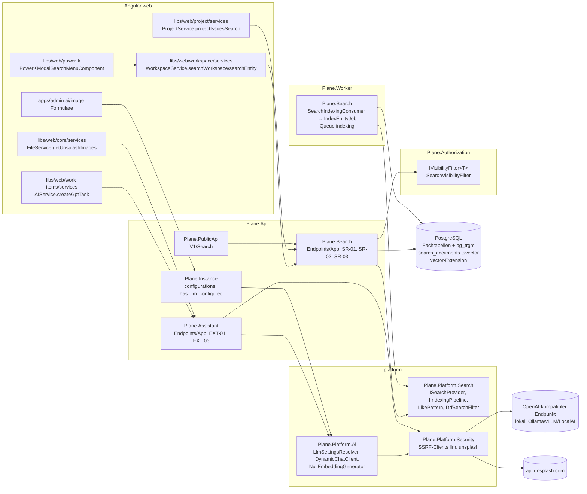
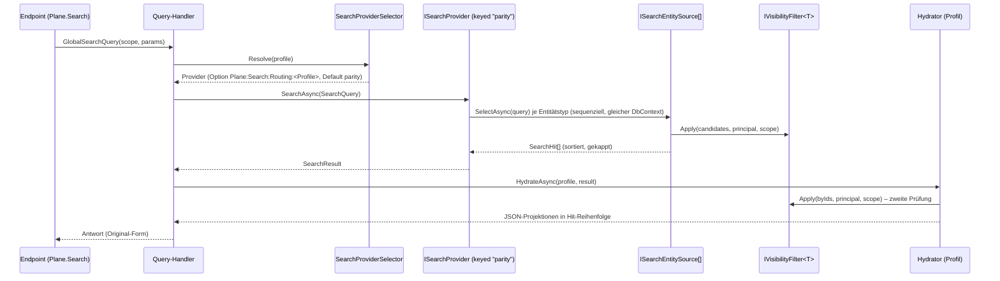

# 11 – Suche und AI-Basis (CE)

> **Status:** Entwurf zur Abnahme (Fachdokument D11). Verbindlich innerhalb seines Themas; nachrangig zu `00-grundsatzentscheidungen.md` (ADR-000 … ADR-009), `01-zielarchitektur-und-tech-stack.md` (ADR-010 … ADR-052) und `17-abgleich-dokumentuebergreifend.md`. Bei Widerspruch gilt 00 > 01 > 17 > dieses Dokument. Namen und Schnittstellen der fertigen Nachbardokumente 02, 05, 08, 09, 14, 15, 16 sind übernommen; wo dieses Dokument sie präzisiert, steht ein Änderungsauftrag in §9.2.
> **Stand:** 23.10.2026. Versionsangaben mit „⚠“ werden in Spike S0 per NuGet-/npm-Metadaten bestätigt (Regel 01 §8).
> **Zielrepository:** Alle Pfade für Zielcode sind relativ zur Wurzel des neuen Repositorys **`funk.`** (ADR-009). `BE/` = `funk./src/`, `FE/` = `funk./frontend/`, `T/` = `funk./tests/`. Pfade des Originals: `API/` = `apps/api/plane/`, `WEB/` = `apps/web/`, `ADM/` = `apps/admin/`, `PKG/` = `packages/` (Referenz `/home/user/plane`, ADR-006).
> **Quellen (gelesen):** A03 §2.11, §3.14, §3.17, §3.19 (Q-27, Q-28, Q-35, Q-36); A06 §2.13 (`issue_search`); A05 (v1-Suche); CE-Katalog `features/_data/ce-features.json` (CE-SRCH-001…009, CE-AI-001/-002, CE-API-019, CE-INST-025/-026, CE-UIX-009, CE-PAGE-034, CE-WI-008/-031/-044/-048); Originalcode `API/app/views/search/{base,issue}.py`, `API/utils/issue_search.py`, `API/app/views/external/base.py`, `API/api/views/issue.py` (`IssueSearchEndpoint`), `API/utils/instance_config_variables/core.py`, `API/license/api/views/instance.py`, `WEB/components/power-k/**`, `WEB/services/{workspace,ai,file}.service.ts`, `WEB/services/project/project.service.ts`, `WEB/components/core/modals/{gpt-assistant-popover,existing-issues-list-modal,bulk-delete-issues-modal}.tsx`, `WEB/components/issues/issue-modal/components/description-editor.tsx`, `WEB/hooks/{use-editor-flagging.ts,editor/use-editor-mention.tsx}`, `ADM/app/(all)/(dashboard)/{ai,image}/*`; Commercial-API-Referenz `developer-docs/docs/api-reference/issue/advanced-search-work-items.md`.
> **Sprache:** Fließtext Deutsch, Bezeichner Englisch.

## Inhaltsverzeichnis

1. [Ziel & Scope](#1-ziel--scope)
2. [Entscheidungen (D11-ADR-01 ff.)](#2-entscheidungen-d11-adr-01-ff)
3. [Detaildesign](#3-detaildesign)
   - 3.1 Bausteine und Projektschnitt
   - 3.2 Textabgleich-Semantik (Port `icontains`, Sequenz-IDs, DRF-`SearchFilter`)
   - 3.3 Such-Abstraktion (`ISearchProvider`, Profile, Routing, Hydrierung)
   - 3.4 Globale Suche SR-01 (CE-SRCH-001)
   - 3.5 Entity-Suche SR-03 (CE-SRCH-002)
   - 3.6 Work-Item-Picker-Suche SR-02 (CE-SRCH-003)
   - 3.7 Public-API-Suche v1 (CE-API-019)
   - 3.8 Sichtbarkeit und Berechtigungen
   - 3.9 Trigramm-Indizes und SQL-Pläne
   - 3.10 Indexierungs-Pipeline (`search_documents`)
   - 3.11 Frontend: Power-K-Suche
   - 3.12 Frontend: Mentions und Picker
   - 3.13 AI-Konfiguration (Instanz-Keys, Provider-Auflösung)
   - 3.14 AI-Client-Aufbau (`Microsoft.Extensions.AI`, SSRF-Client, Laufzeitwechsel)
   - 3.15 KI-Assistent EXT-03/EXT-02 (CE-AI-001)
   - 3.16 Unsplash EXT-01 (CE-AI-002)
   - 3.17 Frontend: KI-Assistent, Bild-Picker, God-Mode-Formulare
   - 3.18 Options-Klassen
   - 3.19 Observability, Datenschutz, Betrieb
4. [Vollständige Mapping-Tabellen Original → Ziel](#4-vollständige-mapping-tabellen-original--ziel)
5. [Code-Skelette](#5-code-skelette)
6. [Erweiterungspunkte für Bezahl-Pakete](#6-erweiterungspunkte-für-bezahl-pakete)
7. [Akzeptanzkriterien & Tests](#7-akzeptanzkriterien--tests)
8. [Risiken & offene Punkte](#8-risiken--offene-punkte)
9. [Abhängigkeiten zu anderen Dokumenten (02–16)](#9-abhängigkeiten-zu-anderen-dokumenten-0216)

---

## 1. Ziel & Scope

### 1.1 Ziel

Dieses Dokument legt fest, wie die Suche und die KI-Funktionen der Community Edition in `funk.` gebaut werden, sodass ein Implementierungs-Agent ohne weitere Recherche Endpunkte, Abfragen, Indizes, Frontend-Bausteine und Tests erzeugen kann. Es liefert drei Dinge:

1. **Parität der CE-Suche:** globale Suche (Command-Palette „Power K“), Entity-Suche (Mentions, Entity-Picker), Work-Item-Picker-Suche und Public-API-Suche liefern dieselben Treffer und Antwortformen wie das Original. Die Trefferlogik ist die des Originals (`icontains` = Teilstring, groß-/kleinschreibungsunabhängig, plus exakte Sequenznummern), umgesetzt mit PostgreSQL `ILIKE` und `pg_trgm`-GIN-Indizes (ADR-024).
2. **Parität der CE-KI:** KI-Assistent („I'm feeling lucky“, GPT-Popover) über `Microsoft.Extensions.AI` mit konfigurierbarem OpenAI-kompatiblem Endpunkt (`LLM_BASE_URL`, lokal z. B. Ollama/vLLM/LocalAI, Airgapped-fähig, ADR-004/ADR-025) und Unsplash-Proxy für den Bild-Picker.
3. **Andockstellen für B6/G1 (🧱):** eine Such-Abstraktion, die später PQL/Advanced Search aufnimmt, eine in der CE bereits laufende Indexierungs-Pipeline über Integration-Events in `search_documents` (`tsvector`) und ein festgelegtes, reserviertes Embedding-Schema mit pgvector (Dimension konfigurierbar, HNSW). Fachdesign der Bezahl-Pakete erfolgt **nicht** (01 P7).

### 1.2 Im Scope

| Bereich | CE-IDs | Original-Endpunkte (A03/A05) |
|---|---|---|
| Globale Suche | CE-SRCH-001 | SR-01 `GET /api/workspaces/{slug}/search/` |
| Entity-Suche (Mentions, Entity-Picker) | CE-SRCH-002, Nutzer: CE-PAGE-034, CE-WI-044, CE-WI-001, CE-WI-005, CE-INT (Intake-Beschreibung) | SR-03 `GET /api/workspaces/{slug}/entity-search/` |
| Work-Item-Picker-Suche | CE-SRCH-003, Nutzer: CE-WI-008, CE-WI-031, CE-WI-048, Intake-Duplikatauswahl (`WEB/components/inbox/modals/select-duplicate.tsx`, CE-INT), „Existing work items“-Dialoge in Cycle-/Modul-Leerzuständen und Gruppenköpfen (CE-WI-008) | SR-02 `GET /api/workspaces/{slug}/projects/{project_id}/search-issues/` |
| Power-K-Suchseite (Frontend) | CE-SRCH-004 (Suchanteil); CE-SRCH-005…009 nur als Rahmen (Eigentümer 08 §3.10) | nutzt SR-01 |
| Public-API-Suche | CE-API-019 | `GET /api/v1/workspaces/{slug}/issues/search/`, `GET /api/v1/workspaces/{slug}/work-items/search/` |
| Querschnitt Textsuche in Listen (`?search=`, `query=`) | Helfer für CE-WS-005, CE-WS-009, CE-PRJ-021, CE-PAGE-002 (Backend-Anteil), CE-WI (IssueViewSet-Liste), CE-HOME-009, CE-API-014, CE-INST-027 | DRF-`SearchFilter` (`search_fields`), `description_stripped__icontains`, `name__icontains` |
| KI-Assistent | CE-AI-001 | EXT-03 `POST /api/workspaces/{slug}/ai-assistant/` (EXT-02 Projektvariante: D11-ADR-16) |
| Unsplash-Bildsuche | CE-AI-002, CE-UIX-009 (Unsplash-Tab) | EXT-01 `GET /api/unsplash/` |
| God-Mode-Einstellungen AI/Bilder | CE-INST-025, CE-INST-026 (Formulare; Speicherung über `Plane.Instance`) | `PATCH /api/instances/configurations/` (Eigentümer `Plane.Instance`) |
| Instanz-Flags | CE-INST-003 (Felder `has_llm_configured`, `has_unsplash_configured`) | `GET /api/instances/` (Eigentümer `Plane.Instance`) |
| Andockstellen | B6, G1 (🧱) sowie berührte 🧱-Pakete A1, A2, B1, D1, D2, E5, F1/F2, H1 | – |

### 1.3 Nicht im Scope

- Power-K-Befehle, Shortcuts, Kontext-Erkennung und `pl-command` (Eigentümer 08 §3.10, D08-ADR-17); hier nur die Suchseite der Palette.
- Filter-AST, Rich-Filter, Legacy-Filter `name` (Eigentümer 02 §3.11); dieses Dokument nutzt nur `LikePattern` dort.
- Seiten-Editor-KI-Menü (`rephrase-grammar`, Pi) und alle Pakete G1–G3 fachlich (nicht gewählt); nur Andockstellen §6.
- Speicherung der Instanz-Konfiguration, Verschlüsselung, Maskierung (Eigentümer 02 §3.16, 05 §3.17.5); dieses Dokument legt nur die AI-Schlüssel fest (Auftrag aus 05 §4.4 und 02 §4.10).
- Mitglieder-/Projekt-/Page-Listen selbst (Eigentümer jeweils Modul); dieses Dokument liefert nur den Such-Helfer.

### 1.4 Was wird in welchem Inkrement gebraucht

| Inkrement | Bausteine aus diesem Dokument | CE-IDs | Abnahme-Nachweis |
|---|---|---|---|
| **I0 Walking Skeleton** | Extensions `pg_trgm`, `unaccent`, `vector` im Postgres-Image und `ExtensionCheck` (14 §3.15); Spike-S0-Teil `PgvectorSmokeTests` (EF 10 + `Pgvector.EntityFrameworkCore`, HNSW, `CosineDistance`); Projekte `Plane.Platform.Search` und `Plane.Platform.Ai` als leere Gerüste mit Architekturtest; Instanz-Key `LLM_BASE_URL` im Seed-Katalog; Routen-Reservierungen §6.4 in `Reservations.cs` | – | `PgvectorSmokeTests`, `ExtensionCheckTests`, `RouteReservationTests` grün |
| **I1 Workspace/Projekte/Konto** | `LikePattern`, `DrfSearchFilter` (Port DRF-`SearchFilter`), Trigramm-Indizes `workspaces.name`, `projects.name`, `projects.identifier`, `users.{display_name,first_name,last_name}` | CE-WS-005, CE-WS-009, CE-PRJ-021 (je Suchparameter) | `DrfSearchFilterTests` (Golden aus DRF 3.17.2), Contract-Goldens der Mitgliederlisten mit `?search=` |
| **I2 Work Items & Layouts** | Modul `Plane.Search` (Gerüst), SR-03 mit Typen `user_mention`, `project`, `issue`; SR-02 mit Ausschlussparametern `parent`, `issue_relation`, `sub_issue`, `target_date`; `ParitySearchProvider` mit Quellen `UserMention`, `Project`, `WorkItem`; `SearchVisibilityFilter` für Work Items; Trigramm-Index `work_items.name`; Frontend `searchEntity`/`projectIssuesSearch` 1:1, Mentions im Lite-Editor, Parent-/Relation-/Sub-Issue-Picker, Bulk-Delete-Dialog | CE-SRCH-002 (Teil), CE-SRCH-003 (Teil), CE-WI-008, CE-WI-031, CE-WI-044, CE-WI-048 | `EntitySearchContractTests`, `WorkItemPickerSearchContractTests`, `SearchGuestScopeAppTests` (A-051, Teil Work Items) |
| **I3 Planung** | SR-02-Parameter `cycle`, `module`; SR-03-Typen `cycle`, `module`; Quellen `Cycle`, `Module`, `View`, `Intake`; Indizes `cycles.name`, `modules.name`, `issue_views.name` | CE-SRCH-002 (Teil), CE-SRCH-003 (Rest), Picker in Cycle/Module-Leerzuständen | Contract-Goldens SR-02/SR-03 je Parameter |
| **I4 Pages & Realtime** | SR-03-Typ `page`; Quelle `Page`; Index `pages.name`; Mentions im Rich/Document-Editor | CE-PAGE-034, CE-SRCH-002 (Rest) | `EntitySearchContractTests.Page_*` |
| **I5 Überblick** | SR-01 vollständig; Power-K-Suchseite; `SEARCH_RESULT_RENDERERS`; Indexierungs-Pipeline (`search_documents`, Consumer, Queue `indexing`, Jobs `indexing.*`, CLI `plane-cli search reindex`); `IIndexDocumentEnricher`; `NullEmbeddingGenerator` registriert; Index `stickies.description_stripped` (Home-Modul nutzt `LikePattern`); Lasttest LT-09 | CE-SRCH-001, CE-SRCH-004 (Suchanteil), CE-HOME-009 (Suchparameter) | `GlobalSearchContractTests`, `IndexingPipelineTests`, `web/search/search.spec.ts`, `web/search/power-k.spec.ts` (Suchteil), LT-09 p95 < 300 ms |
| **I6 Außenwirkung & Administration** | Public-API-Suche (Adapter in `Plane.PublicApi`), `Plane.Assistant` (EXT-03, EXT-01), `Plane.Platform.Ai` vollständig (`ILlmSettingsResolver`, `DynamicChatClient`, SSRF-Client `llm`), God-Mode-Formular AI mit Feld „Base URL“, Bild-Formular, `has_llm_configured`/`has_unsplash_configured` | CE-API-019, CE-API-014 (Suchparameter), CE-AI-001, CE-AI-002, CE-INST-025, CE-INST-026, CE-INST-027 (Suchparameter) | `PublicApiWorkItemSearchContractTests`, `AssistantEndpointTests` (WireMock „OpenAI-kompatibel“), `UnsplashEndpointTests`, `web/ai/ai-unsplash.spec.ts`, `admin/admin-settings.spec.ts` |
| **I7 Härtung** | Airgap-E2E mit lokalem LLM-Stub (WireMock im Profil `test`) und gesperrtem Egress; Index-Reconcile im Lasttest LT-08 | – | Airgap-Lauf grün, kein Egress außer Allowlist |
| **W5 (B6)** | dockt an §6.1 an | – | – |

> **Präzisierung zu 01 §5.4:** Das Modul `Plane.Search` entsteht bereits in **I2** (Work-Item-Picker und Mentions sind Teil der vertikalen Schnitte von I2), nicht erst in I5; die Spalte „ab“ in 01 §5.4 lautet damit „I2/I5“ (Änderungsauftrag §9.2).

---

## 2. Entscheidungen (D11-ADR-01 ff.)

| ADR | Belang | Entscheidung | Alternativen (verworfen) | Begründung | ab |
|---|---|---|---|---|---|
| **D11-ADR-01** | Projektschnitt | Abstraktionen und datenbankunabhängige Helfer in `Plane.Platform.Search` (`ISearchProvider`, `SearchQuery`, `SearchResult`, `IIndexingPipeline`, `IndexDocument`, `IIndexDocumentEnricher`, `LikePattern`, `SequenceIdExtractor`, `DrfSearchFilter`, `SearchText`); **Implementierungen mit Fachdatenbezug** (`ParitySearchProvider`, Such-Quellen, `IndexingPipeline`, `search_documents`-Schreiber) im Modul `Plane.Search`. `Plane.Platform.Ai` enthält Provider-Auflösung, `DynamicChatClient`, `NullEmbeddingGenerator`; `Plane.Assistant` die Endpunkte EXT-01/EXT-03. Der in 01 §5.1 unter `Plane.Platform.Search` genannte `PostgresSearchProvider` heißt `ParitySearchProvider` und liegt in `Plane.Search` (Präzisierung) | Provider in `Plane.Platform.Search` mit Roh-SQL auf Fachtabellen; eigener Such-Dienst | Regel R7 (01 §5.2): `platform/*` kennt keine Fachmodule und kein `Plane.Data`; die Suche braucht aber Joins über Work Items, Projekte, Mitgliedschaften und die Sichtbarkeitsfilter aus `Plane.Authorization` | I0/I2 |
| **D11-ADR-02** | Trefferlogik der CE-Endpunkte | **Original-Semantik**: `icontains` → `ILIKE '%' || escape(q) || '%'` (Escape `\`, `%`, `_` wie Django), Sequenznummern als exakte Ganzzahlvergleiche; Abfrage direkt auf den Fachtabellen mit **`pg_trgm`-GIN-Indizes** (`gin_trgm_ops`); die CE-Endpunkte lesen **nicht** aus `search_documents` | Volltextsuche (`tsvector @@ tsquery`) für die CE-Endpunkte; Lesen aus `search_documents` | `tsquery` findet Wortpräfixe, aber keine Teilstrings mitten im Wort („plan“ in „Replanning“) – Paritätsbruch; Sichtbarkeit hängt am aktuellen Mitgliedschaftsstand und wird ohnehin über Fachtabellen geprüft | I1/I2 |
| **D11-ADR-03** | Reihenfolge und Ranking | Wo das Original sortiert (`-created_at`), wird identisch sortiert (+ Tiebreaker `id DESC`, D02-ADR-13). Wo das Original **keine** Reihenfolge festlegt (SR-01 `issue`, SR-02, v1-Suche), gilt eine **deterministische Relevanzreihenfolge**: (1) exakter Sequenztreffer, (2) `similarity(name, q)` absteigend (`pg_trgm`), (3) `created_at DESC`, (4) `id DESC`; ohne Suchtext nur (3), (4). Präzisierung von ADR-024: das dort genannte `tsvector`-Ranking gilt für Index-basierte Provider (B6/G1), in der CE ersetzt Trigramm-Ähnlichkeit das Ranking, weil die Treffermenge Teilstring-basiert ist | `ts_rank` über `search_documents`; DB-Reihenfolge wie Original | Undefinierte Reihenfolge + `LIMIT 100` macht schon die Treffermenge nicht reproduzierbar (Contract-Tests, Nutzer sieht wechselnde Ergebnisse); `ts_rank` wäre für Teilstring-Treffer häufig 0 | I2 |
| **D11-ADR-04** | Such-Abstraktion | `ISearchProvider` bleibt **unverändert** (01 §5.5: `SearchAsync(SearchQuery)`); Auswahl je **Suchprofil** (`SearchProfile`: `Global`, `Entity`, `WorkItemPicker`, `PublicApiWorkItems`) über Keyed Services und Option `Plane:Search:Routing` (Default für alle Profile `parity`). Zwei Phasen: der Provider liefert nur `(entityType, id, score)`-Treffer; die Antwortform erzeugt der profilabhängige **Hydrator** im Modul `Plane.Search` (Original-Projektionen). B6 registriert einen weiteren Provider (`advanced`) und ein neues Profil, ohne CE-Code zu ändern | Ein Provider-Interface je Endpunkt; Provider liefert fertige DTOs | Provider-Tausch (Postgres-FTS, OpenSearch-ähnlich, Hybrid mit Embeddings) darf die Antwortverträge nicht berühren; Hydrator wendet die Sichtbarkeit ein zweites Mal an (Defense in Depth) | I2 |
| **D11-ADR-05** | Sichtbarkeit | Jede Kandidatenabfrage **und** jede Hydrierung wendet die `IVisibilityFilter<T>` aus `Plane.Authorization/Visibility/` an (05 §3.14 `SearchVisibilityFilter`: Work Items, Intake, Pages, Views); Mitgliedschaften immer `is_active = true` **und** `deleted_at IS NULL` (02 `DEV-PERM-001`); Korrekturen SEC-56 (Q-35, Q-36) und Gastregel auch in der v1-Suche | Sichtbarkeit nur im Provider | Ein getauschter Provider (B6/G1) könnte sonst unsichtbare Inhalte liefern (05 §6, G1-Zeile) | I2 |
| **D11-ADR-06** | Indexierungs-Pipeline | **In der CE aktiv** (16 X14): `SearchIndexingConsumer` (`IEventConsumer` für die Work-Item-, Kommentar-, Page-, Projekt-, Cycle-, Modul-, View- und Intake-Events aus 16 §3.2.4) plant `IndexEntityJob` in Queue `indexing` mit Dedupe-Schlüssel und Entprellung; der Job lädt den **aktuellen** Zustand, baut ein `IndexDocument`, ruft die `IIndexDocumentEnricher` und schreibt per Upsert in `search_documents` (`tsvector` als generierte Spalte, Konfiguration `simple` über `plane_unaccent`). Nachtjob `indexing.reconcile`, CLI `plane-cli search reindex`. Die CE-Endpunkte lesen den Index nicht (D11-ADR-02) | Index erst mit B6/G1 bauen; Trigger in PostgreSQL | Pakete B6/G1 starten ohne Backfill-Projekt und ohne CE-Umbau; Events sind ohnehin Pflicht (C3/H6); Trigger würden Modulgrenzen und Text-Extraktion (HTML) in SQL verlagern | I5 |
| **D11-ADR-07** | Embeddings | In der CE: `CREATE EXTENSION vector` (I0), `IEmbeddingGenerator<string, Embedding<float>>` = `NullEmbeddingGenerator`, **keine** Embedding-Tabelle (16 G1-Zeile). Das Schema für G1 ist hier **reserviert und festgelegt** (§6.2): Tabelle `search_embeddings` mit **dimensionsloser** Spalte `embedding vector`, Spalten `model_key`, `dimensions`; je aktivem Modell ein **partieller Ausdrucks-HNSW-Index** `((embedding::vector(n)) vector_cosine_ops) WHERE model_key = '<key>'` – Dimension damit zur Laufzeit konfigurierbar (`Plane:Ai:EmbeddingDimensions`, Default 1536) | `vector(1536)` fest in einer CE-Migration; separate Vektor-DB | Modellwechsel (andere Dimension) ohne Tabellenmigration; HNSW verlangt feste Dimension je Index, was der partielle Ausdrucksindex erfüllt (pgvector-Doku „Can I store vectors with different dimensions in the same column?“) | I0 (Extension), G1 |
| **D11-ADR-08** | Querschnitt `?search=` | Port des DRF-`SearchFilter` (DRF 3.17.2) als `DrfSearchFilter.Apply(query, search, fields…)`: Begriffe per `search_smart_split` (Leerzeichen/Komma, Anführungszeichen-Phrasen), **jeder** Begriff muss in **irgendeinem** Feld per `icontains` treffen, NUL-Zeichen entfernt, `DISTINCT` bei Mehrfach-Joins; Pflicht für alle Original-Views mit `search_fields` | Eigene Ad-hoc-Implementierungen je Modul | Gleiche Semantik an sechs Stellen, ein Golden-Test | I1 |
| **D11-ADR-09** | AI-Abstraktion und Transport | **`Microsoft.Extensions.AI`** (`IChatClient`, `IEmbeddingGenerator`) mit **`Microsoft.Extensions.AI.OpenAI`** über das offizielle OpenAI-.NET-SDK; **ein** Transport für alle Provider: Chat-Completions-Protokoll gegen eine konfigurierbare Basis-URL (OpenAI, OpenAI-kompatibel lokal, Anthropic- und Gemini-Kompatibilitätsendpunkte) | Semantic Kernel; `Microsoft.Extensions.AI.Ollama` (Preview, eingestellt); eigene HTTP-Clients je Provider | Provider-neutral (ADR-025), lokal betreibbar (ADR-004), ein Codepfad, MIT-lizenziert | I6 |
| **D11-ADR-10** | AI-Konfiguration | Instanz-Keys `LLM_API_KEY` (verschlüsselt), `LLM_PROVIDER` (`openai` Default, `openai-compatible`, `anthropic`, `gemini`), `LLM_MODEL`, **neu `LLM_BASE_URL`** (Kategorie `AI`, unverschlüsselt, Seed `""`, ENV `LLM_BASE_URL`); Modell-Whitelist des Originals entfällt; API-Key optional, wenn `LLM_BASE_URL` gesetzt ist; `GPT_ENGINE` entfällt (02 §4.10). `has_llm_configured` = Auflösung ergibt eine nutzbare Konfiguration | Provider-Konfiguration nur per ENV; Whitelist beibehalten | Q-28 (A03): Anthropic/Gemini funktionierten im Original nie, Whitelist ist veraltet; lokale Server brauchen keinen Key | I0 (Seed), I6 |
| **D11-ADR-11** | Ausgehende LLM-/Unsplash-Aufrufe | Das OpenAI-SDK läuft über den **SSRF-geschützten Named Client `llm`** (05 §3.17.2: 120 s, 0 Redirects, 8 MiB, Allowlist `Plane:Ai:AllowedInternalHosts`) via `HttpClientPipelineTransport`; SDK-eigene Wiederholungen aus (`ClientRetryPolicy(maxRetries: 0)`), Netzwerk-Timeout 120 s. Unsplash über Named Client `unsplash` (10 s, 5 Redirects, 2 MiB) | SDK-Standard-HttpClient; Standard-Resilience | Kein Aufruf an Nutzer-/Betreiber-URLs ohne SSRF-Schutz (D05-ADR-24, ABG-040); keine automatischen Wiederholungen | I6 |
| **D11-ADR-12** | Laufzeitwechsel der Konfiguration | `DynamicChatClient : IChatClient` liest bei jedem Aufruf die aufgelösten Einstellungen (`ILlmSettingsSource`, gecacht über den Instanz-Konfigurations-Cache `plane:instance:config`) und verwendet einen pro Einstellungs-Fingerabdruck gecachten inneren Client; Änderungen im God Mode wirken ohne Neustart | Singleton-Client beim Start | God-Mode-Änderung soll sofort greifen (Original liest je Request) | I6 |
| **D11-ADR-13** | KI-Assistent-Vertrag | Prompt = `task + "\n" + prompt` als **eine** `user`-Nachricht (1:1), keine weiteren Chat-Optionen; Antworten `{"response", "response_html"}` 1:1; Korrekturen: fehlender `prompt` → `""` (Original 500), leere/`null`-Antwort → `""` (Original 500), `response_html` = HTML-kodierter Text mit `\n` → `<br/>` (Original ohne Kodierung) | Systemprompt ergänzen; Markdown-Rendering | Parität des Verhaltens; Kodierung verhindert, dass Modellausgaben als HTML in den Editor gelangen (Sicherheitskorrektur ohne sichtbare Änderung bei Klartext-Antworten) | I6 |
| **D11-ADR-14** | Unsplash-Proxy | Durchreichen von Status und JSON (1:1); Korrekturen Q-27: `page` ohne `$`, Query URL-kodiert, Access-Key im Header `Authorization: Client-ID <key>` statt in der URL, Timeout 10 s, 2 MiB | 1:1 inklusive Fehler | Funktionale Fehler korrigieren (Auftraggeber, 17 Z-12); Key nicht in URLs/Logs | I6 |
| **D11-ADR-15** | God-Mode-Formular AI | Formular `/god-mode/ai` 1:1 plus **ein** zusätzliches Feld „Base URL“ (`LLM_BASE_URL`) als drittes Feld im bestehenden 3-Spalten-Raster; der Hinweis-Kasten „If you have a preferred AI models vendor, please get in touch with us.“ entfällt (ADR-001, Kontakt-CTA). `LLM_PROVIDER` bleibt wie im Original nur per ENV/API setzbar | Provider-Auswahlfeld zusätzlich; Formular unverändert | Minimale sichtbare Abweichung, die ADR-004 erzwingt (`DEV-UI-D11-01`, `DEV-UI-D11-02`) | I6 |
| **D11-ADR-16** | Nicht registrierte Original-Routen | `POST {P}/ai-assistant/` (EXT-02) hat keinen Client-Aufrufer → nach 02 §3.3.1 Regel 6 **nicht registriert** (405, `DEV-AI-008`); Permission `project.ai_assistant.use` bleibt im Katalog (generiert, 05), ohne Endpunkt. `POST {W}/rephrase-grammar/` existiert in der CE nicht (404 wie Original); das Editor-KI-Menü bleibt über `EDITOR_FLAGS` (`ai` deaktiviert) unsichtbar | Beide Routen bauen | Parität und Regel 6; Editor-KI gehört zu G3 (nicht gewählt) | I6 |
| **D11-ADR-17** | Frontend-Port Suche | Power-K-Suchseite, Ergebnisgruppen und Services **1:1** (Debounce 500 ms, Gruppen-Map → Registry `SEARCH_RESULT_RENDERERS`, Client-Filter der Palette `includes` auf dem Item-`value`); Korrektur: veraltete Antworten werden verworfen (laufende Anfrage wird bei neuem Suchbegriff abgebrochen), Original-Darstellungsfehler (Page-Identifier) bleibt optisch 1:1 | eigene Ergebnisdarstellung | ADR-005; Race-Condition ist funktionaler Fehler ohne optische Wirkung | I5 |
| **D11-ADR-18** | Unbegrenzte Ergebnislisten | SR-01 liefert für `workspace`, `project`, `cycle`, `module`, `issue_view`, `page` im Original **alle** Treffer; Ziel: Obergrenze `Plane:Search:MaxUnboundedResults` = 1000 je Entitätstyp (0 = unbegrenzt) | 1:1 unbegrenzt | Schutz vor Antworten mit Zehntausenden Einträgen bei Ein-Zeichen-Suchen; UI zeigt ohnehin Listen dieser Größe nicht sinnvoll (`DEV-SRCH-002`) | I5 |

---

## 3. Detaildesign

### 3.1 Bausteine und Projektschnitt



#### 3.1.1 Backend-Projekte und Ordner (verbindlich)

| Projekt / Ordner | Inhalt | Abhängigkeiten (Regeln 01 §5.2) | ab |
|---|---|---|---|
| `BE/platform/Plane.Platform.Search/` | `Abstractions/ISearchProvider.cs`, `Abstractions/SearchQuery.cs`, `Abstractions/SearchResult.cs`, `Abstractions/SearchProfile.cs`, `Abstractions/SearchProviderKeys.cs`, `Indexing/IIndexingPipeline.cs`, `Indexing/IndexDocument.cs`, `Indexing/IIndexDocumentEnricher.cs`, `Indexing/IndexEntityTypes.cs`, `Text/LikePattern.cs`, `Text/SequenceIdExtractor.cs`, `Text/SearchText.cs`, `Text/DrfSearchFilter.cs`, `Text/DrfSearchTerms.cs`, `Sql/TrigramFunctions.cs`, `PlaneSearchOptions.cs`, `SearchServiceCollectionExtensions.cs` | `Plane.BuildingBlocks`, `Microsoft.EntityFrameworkCore` (nur `EF.Functions`/`IQueryable`-Erweiterungen), `Npgsql.EntityFrameworkCore.PostgreSQL` (+ `.Trigrams`) – **kein** `Plane.Data`, kein Fachmodul (R7) | I0 (Gerüst), I1 (Text), I2 (Abstractions), I5 (Indexing) |
| `BE/platform/Plane.Platform.Ai/` | `Configuration/LlmProviderKind.cs`, `Configuration/LlmRawSettings.cs`, `Configuration/LlmSettings.cs`, `Configuration/LlmSettingsResolver.cs`, `Configuration/ILlmSettingsSource.cs`, `Chat/DynamicChatClient.cs`, `Chat/OpenAiCompatibleChatClientFactory.cs`, `Chat/IChatClientFactory.cs`, `Embeddings/NullEmbeddingGenerator.cs`, `PlaneAiOptions.cs`, `AiServiceCollectionExtensions.cs` (`AddPlaneAi`) | `Plane.BuildingBlocks`, `Plane.Platform.Security` (Named-Client-Registrierung `llm`), `Microsoft.Extensions.AI` 10.x, `Microsoft.Extensions.AI.OpenAI` 10.x, `OpenAI` (transitiv) | I0 (Gerüst), I5 (`NullEmbeddingGenerator`), I6 |
| `BE/modules/Search/Plane.Search.Contracts/` | `Permissions/SearchPermissions.cs` (generiert, 05: `WorkspaceSearchRead`), `Services/IWorkItemSearchService.cs` (für `Plane.PublicApi`, R6), `Dtos/*` (Antwortformen §3.4–§3.7) | `Plane.BuildingBlocks` (R2) | I2 |
| `BE/modules/Search/Plane.Search/` | `SearchModule.cs`; `Endpoints/App/GlobalSearchEndpoints.cs` (SR-01), `Endpoints/App/EntitySearchEndpoints.cs` (SR-03), `Endpoints/App/WorkItemPickerSearchEndpoints.cs` (SR-02); `Application/Queries/GlobalSearch/GlobalSearchQuery.cs`, `…/EntitySearch/EntitySearchQuery.cs`, `…/WorkItemPickerSearch/WorkItemPickerSearchQuery.cs`, `…/PublicApiWorkItemSearch/PublicApiWorkItemSearchQuery.cs`; `Application/Services/ParitySearchProvider.cs`, `Application/Services/SearchProviderSelector.cs`, `Application/Services/WorkItemSearchService.cs` (implementiert `IWorkItemSearchService`); `Application/Sources/{WorkspaceSearchSource,ProjectSearchSource,WorkItemSearchSource,IntakeSearchSource,CycleSearchSource,ModuleSearchSource,ViewSearchSource,PageSearchSource,UserMentionSearchSource}.cs` (je `ISearchEntitySource`); `Application/Hydration/{GlobalSearchHydrator,EntitySearchHydrator,WorkItemPickerHydrator,PublicApiWorkItemHydrator}.cs`; `Application/Consumers/SearchIndexingConsumer.cs`; `Application/Jobs/{IndexEntityJob,RemoveIndexEntryJob,SearchIndexReconcileJob,SearchIndexRebuildJob}.cs`; `Indexing/IndexingPipeline.cs` (implementiert `IIndexingPipeline`), `Indexing/Builders/{WorkItem,WorkItemComment,Page,Project,Cycle,Module,View}IndexDocumentBuilder.cs`; `Domain/CycleSearchStatus.cs`, `Domain/WorkItemPickerExclusions.cs` | `Plane.Search.Contracts`, `Plane.Data`, `Plane.Platform.Search`, `Plane.Documents` (Text-Extraktion), `Plane.Authorization.Contracts`, Contracts von WorkItems, Projects, Cycles, ProjectModules, Views, Pages, Intake (Events) | I2 (SR-02/-03), I5 (SR-01, Indexing) |
| `BE/modules/Assistant/Plane.Assistant.Contracts/` | `Permissions/AssistantPermissions.cs` (generiert: `WorkspaceAiAssistantUse`, `ProjectAiAssistantUse`, `UserUnsplashRead`), `Dtos/AiAssistantResponseDto.cs`, `Requests/AiAssistantRequest.cs` | `Plane.BuildingBlocks` | I6 |
| `BE/modules/Assistant/Plane.Assistant/` | `AssistantModule.cs`; `Endpoints/App/AiAssistantEndpoints.cs` (EXT-03), `Endpoints/App/UnsplashEndpoints.cs` (EXT-01); `Application/Commands/RunAiAssistantTask/RunAiAssistantTaskCommand.cs`; `Application/Queries/SearchUnsplash/SearchUnsplashQuery.cs`; `Application/Services/InstanceLlmSettingsSource.cs` (implementiert `ILlmSettingsSource`), `Application/Services/UnsplashClient.cs`, `Domain/AiResponseFormatter.cs` | `Plane.Assistant.Contracts`, `Plane.Platform.Ai`, `Plane.Platform.Security`, `Plane.Instance.Contracts` (`IInstanceConfigurationStore`) | I6 |
| `BE/modules/PublicApi/Plane.PublicApi/V1/Search/WorkItemSearchV1Endpoints.cs` | Adapter v1 (`issues/search`, `work-items/search`) → `IWorkItemSearchService` | `Plane.Search.Contracts` (R6) | I6 |
| `BE/data/Plane.Data/Entities/Search/SearchDocument.cs`, `Configurations/Search/SearchDocumentConfiguration.cs` | Entität `[OwnedBy("Search")]`, Tabelle `search_documents` | – | I5 |
| `BE/data/Plane.Data/Queries/WorkItemPredicates.cs` | gemeinsame Ausdrucks-Prädikate der Basismengen (`IssueObjects`, `AllObjects`) für Lesezugriffe aus anderen Modulen (Search, Analytics) | – (Änderungsauftrag an 02/03: Basismengen-Prädikate liegen in `Plane.Data`, damit `Plane.Search` sie ohne R1-Verstoß nutzt) | I2 |
| `BE/modules/Authorization/Plane.Authorization/Visibility/SearchVisibilityFilter.cs` | Eigentum 05; Implementierungen `IVisibilityFilter<WorkItem>`, `<IntakeWorkItem>`, `<Page>`, `<WorkItemView>`, `<SearchDocument>` (§3.8) | 05 | I2/I5 |
| `src/tools/Plane.Cli/Commands/SearchReindexCommand.cs` | `plane-cli search reindex [--workspace <slug>] [--entity <type>]` | – | I5 |

#### 3.1.2 Registrierung im Host

| Host | Registrierung |
|---|---|
| `Plane.Api` | `services.AddPlaneSearch(configuration)` (Optionen, `DrfSearchFilter`-Abhängigkeiten, Keyed-Provider `parity`), `SearchModule`, `AssistantModule`, `services.AddPlaneAi(configuration)` |
| `Plane.Worker` | `SearchModule` (nur `RegisterMessaging`: Consumer, Jobs, Cron), `services.AddPlaneSearch(configuration)` |
| `Plane.Realtime`, `Plane.Gateway`, `Plane.Migrator` | – (Migrator führt nur Migrationen/Extensions aus) |

### 3.2 Textabgleich-Semantik

#### 3.2.1 `icontains` → `ILIKE`

| Aspekt | Original (Django 5.2, PostgreSQL-Backend) | Ziel (`LikePattern`, `EF.Functions.ILike`) |
|---|---|---|
| Operator | `UPPER("col"::text) LIKE UPPER('%q%')` | `col ILIKE @pattern` (`EF.Functions.ILike(x.Name, LikePattern.Contains(q))`) |
| Escaping | `%`, `_`, `\` werden mit `\` maskiert | `LikePattern.Escape`: `\` → `\\`, `%` → `\%`, `_` → `\_`; PostgreSQL-Standard-Escape `\` |
| Groß-/Kleinschreibung | `UPPER` beider Seiten | `ILIKE` (Fallfaltung der Datenbank-Locale); Abweichung nur bei Sonderfällen wie `ß`/`ẞ` → `DEV-SRCH-014` |
| NUL-Zeichen | PostgreSQL lehnt `\x00` in Textparametern ab → 500 | `SearchText.Normalize` entfernt `\0` vor jeder Verwendung (`DEV-SRCH-004`) |
| Leerer Suchtext | `query or None` → **kein** Textfilter | `SearchText.Normalize("") == null` → kein Textfilter |
| Trim | kein Trim | kein Trim (Leerzeichen sind Teil des Teilstrings, 1:1) |
| Indexnutzung | keine (Django-Ausdruck `UPPER(...)`) | `pg_trgm`-GIN `gin_trgm_ops` auf der Spalte; Muster ≥ 3 Zeichen nutzen den Index, kürzere fallen auf den Scan der bereits mitgliedschaftsgefilterten Menge zurück (§3.9) |

#### 3.2.2 Sequenznummern

| Stelle | Original | Ziel (`SequenceIdExtractor`) |
|---|---|---|
| SR-01 `issue`/`intake`, SR-03 `issue`, v1-Suche | jede ganze Zahl `\b\d+\b` aus dem Suchtext → `OR sequence_id = <n>`; **keine** Längenbegrenzung | `SequenceIdExtractor.Extract(q, maxQueryLength: null)` → Liste `int`; Treffer per `sequence_id = ANY(@ids)` |
| SR-02 (`search_issues`) | nur bei `len(query) <= 20`; sonst `sequence_id ILIKE '%q%'` (Text-Cast) | `SequenceIdExtractor.Extract(q, maxQueryLength: 20)`; bei Länge > 20: `EF.Functions.ILike(x.SequenceId.ToString(), LikePattern.Contains(q))` (Npgsql übersetzt `int.ToString()` nach `::text`) |
| Ziffern | Python-`\d` erkennt Unicode-Ziffern (z. B. Arabisch-Indisch) | **nur ASCII-Ziffern** `[0-9]`, Regex `(?<![0-9A-Za-z_])[0-9]+(?![0-9A-Za-z_])` (Wortgrenze wie `\b` für ASCII) (`DEV-SRCH-003`) |
| Überlauf | Zahl > 2³¹−1 → PostgreSQL `integer out of range` → 500 | Zahlen außerhalb `int` werden ignoriert (`DEV-SRCH-003`) |
| Dezimalzahlen | `12.5` → `\b12\b` und `\b5\b` treffen | identisch (Punkt ist Wortgrenze) |
| Duplikate | doppelte `OR`-Glieder | `Distinct()` (ohne Wirkung auf das Ergebnis) |

#### 3.2.3 DRF-`SearchFilter` (Query-Parameter `search` an Listen-Views)

`DrfSearchFilter.Apply<T>(IQueryable<T> source, string? search, params Expression<Func<T, string?>>[] fields)` bildet `rest_framework.filters.SearchFilter.filter_queryset` (DRF 3.17.2) nach:

1. Parameter `search` fehlt oder ist leer → Quelle unverändert.
2. `DrfSearchTerms.Split(search)`: NUL-Zeichen entfernen; Aufteilung wie `search_smart_split` (Trennzeichen Leerraum und Komma; in doppelte Anführungszeichen gesetzte Phrasen bleiben ein Begriff, Anführungszeichen werden entfernt); leere Begriffe verworfen.
3. Für **jeden** Begriff: `OR` über alle Felder mit `ILIKE '%term%'`; Begriffe untereinander `AND`.
4. Felder über Mehrfach-Beziehungen (z. B. `member__display_name` ist 1:1, aber Projekt-Lookups über Mitgliedschaften sind 1:n) → `Distinct()`; der Aufrufer gibt `requiresDistinct` an.
5. Golden-Datei `T/Plane.Platform.Tests/Search/drf-search-terms.golden.json` wird mit `tools/golden/generate.mjs drf-search` aus der Original-Umgebung (Python, `rest_framework.filters.search_smart_split`) erzeugt: 40 Eingaben (Leerzeichen, Kommas, Anführungszeichen, Unicode, NUL) → Begriffslisten. ⚠ Aufteilungsregeln gegen DRF-Quelle 3.17.2 im Generatorlauf bestätigen.

Verwender (vollständig, Original → Zielmodul): Tabelle §4.6.

### 3.3 Such-Abstraktion

#### 3.3.1 Typen (`Plane.Platform.Search/Abstractions/`)

| Typ | Definition |
|---|---|
| `SearchProfile` | `enum SearchProfile { Global = 1, Entity = 2, WorkItemPicker = 3, PublicApiWorkItems = 4 }`; Werte ≥ 100 reserviert für Pakete (B6: `AdvancedWorkItems = 100`, G1: `Semantic = 110`) |
| `SearchEntityTypes` | Konstanten `workspace`, `project`, `issue`, `cycle`, `module`, `issue_view`, `page`, `intake`, `user_mention` (Wire-Namen des Originals); Reihenfolge `GlobalOrder` = `workspace, project, issue, cycle, module, issue_view, page, intake` (Reihenfolge der `MODELS_MAPPER`-Einträge, bestimmt die Gruppenreihenfolge in Power-K, §3.11) |
| `SearchQuery` | `record SearchQuery(SearchProfile Profile, PlanePrincipal Principal, Guid WorkspaceId, string? Text, IReadOnlyList<string> EntityTypes, Guid? ProjectId, bool WorkspaceWide, int? Limit, IReadOnlyDictionary<string, string> Options, SearchFilter? Filter = null)` – `Options` trägt profilabhängige Parameter (SR-02: `parent`, `issue_relation`, `sub_issue`, `cycle`, `module`, `target_date`, `issue_id`); `Filter` ist in der CE immer `null` |
| `SearchFilter` | `record SearchFilter(string ParserName, string Expression)` – Andockstelle B6 (`IFilterParser.Name` aus 16 §5.5, z. B. `pql`) |
| `SearchHit` | `readonly record struct SearchHit(string EntityType, Guid Id, double Score)` |
| `SearchResult` | `sealed record SearchResult(IReadOnlyDictionary<string, IReadOnlyList<SearchHit>> Hits, IReadOnlySet<string> Truncated)` – `Hits` in der Reihenfolge von `EntityTypes`; `Truncated` nennt Typen, deren Liste durch `Limit`/`MaxUnboundedResults` gekappt wurde (nur Telemetrie, nicht im Vertrag) |
| `ISearchProvider` | `ValueTask<SearchResult> SearchAsync(SearchQuery query, CancellationToken ct)` (01 §5.5, unverändert) |
| `SearchProviderKeys` | `Parity = "parity"`; reserviert `Advanced = "advanced"` (B6), `Semantic = "semantic"` (G1), `Hybrid = "hybrid"` (B6+G1) |

#### 3.3.2 Ablauf einer Suche



Regeln:

1. **Ein DbContext je Request**, Quellen laufen **sequenziell** (EF Core erlaubt keine parallelen Abfragen auf demselben Kontext); Leseabfragen mit `AsNoTracking()` und – wo das Original `use_read_replica = True` setzt (v1-Suche) – `.UseReadReplica()` (02 D02-ADR-22).
2. `ISearchEntitySource` (intern in `Plane.Search`): `string EntityType { get; }`, `bool Supports(SearchProfile profile)`, `ValueTask<IReadOnlyList<SearchHit>> SelectAsync(SearchQuery q, int? limit, CancellationToken ct)`, `ValueTask<IReadOnlyList<JsonObject>> HydrateAsync(SearchProfile profile, IReadOnlyList<Guid> ids, SearchQuery q, CancellationToken ct)`. Eine Quelle kapselt Kandidatenprädikat, Sichtbarkeit, Ordnung und die Projektionen je Profil.
3. **Kappung:** Profil `Global`: `issue`/`intake` 100 (Original), übrige `MaxUnboundedResults` (D11-ADR-18); `Entity`: `count`; `WorkItemPicker`: 100; `PublicApiWorkItems`: `limit`.
4. **Hydrierung erhält die Reihenfolge** der Treffer (`ORDER BY array_position(@ids, id)` bzw. Sortierung im Speicher nach Index).
5. **Mehrfachzeilen:** Wo das Original durch `.values()` über eine m:n-Beziehung **mehrere Zeilen pro Objekt** liefert (SR-03 `page` ohne `project_id`: eine Zeile je verknüpftem Projekt), liefert der Hydrator ebenfalls mehrere Zeilen; `SearchHit` ist dann je `(id, projects__id)` eindeutig über `Score`-Gleichstand, die Kappung zählt Zeilen (wie `[:count]` auf `.values()`).
6. **Fehlerfreiheit:** Kein Suchpfad wirft bei syntaktisch ungewöhnlichen Eingaben (sehr lange Texte, Sonderzeichen); Suchtexte > 1 000 Zeichen werden auf 1 000 Zeichen gekürzt (Schutz vor teuren `ILIKE`-Mustern, `DEV-SRCH-015`).

#### 3.3.3 Provider-Auswahl

`SearchProviderSelector.Resolve(SearchProfile profile)` liest `PlaneSearchOptions.Routing` (Dictionary `Profil → Provider-Key`, Default leer = alle `parity`) und löst `[FromKeyedServices(key)] ISearchProvider` auf. Unbekannter Key → Startfehler (`ValidateOnStart`, `PlaneSearchOptionsValidator`). B6 registriert `services.AddKeyedScoped<ISearchProvider, AdvancedSearchProvider>(SearchProviderKeys.Advanced)` und setzt in seiner Modul-Registrierung `Routing[AdvancedWorkItems] = advanced`; die CE-Profile bleiben auf `parity`, bis ein Betreiber sie umstellt (z. B. `Plane__Search__Routing__Global=hybrid` mit G1).

### 3.4 Globale Suche SR-01 (CE-SRCH-001)

**Endpunkt:** `GET /api/workspaces/{slug}/search/` – `e.App("workspaces/{slug}/search")`, `.RequirePermission(SearchPermissions.WorkspaceSearchRead)` (05 Anhang B: `WS(A,M,G)+VIS`), `.WithOriginalContract("SR-01")`. Handler `GlobalSearchQuery` (Profil `Global`).

**Parameter (String-Vergleiche wie Original, A03 Fallstrick 13):**

| Parameter | Auswertung (1:1) |
|---|---|
| `search` | fehlt/leer → kein Textfilter (alle sichtbaren Objekte, gekappt nach D11-ADR-18) |
| `entities` | fehlt/leer → `GlobalOrder`; sonst `split(",")`, `Trim`, leere verworfen, nur bekannte Typen; Reihenfolge der Antwortschlüssel = Reihenfolge des ersten Auftretens |
| `workspace_search` | Default `"false"`; Projektbeschränkung nur wenn Wert **exakt** `"false"` **und** `project_id` gesetzt |
| `project_id` | optional; ungültige UUID → 400 `{"error": "Please provide valid detail"}` (Original `ValidationError`) |

**Antwort:** 200 `{"results": {"<typ>": [...]}}` – nur angefragte Typen, Schlüssel in der oben bestimmten Reihenfolge (System.Text.Json schreibt `Dictionary`-Einträge in Einfügereihenfolge; `GlobalSearchResponse` nutzt `OrderedDictionary<string, JsonArray>`).

| Typ | Kandidaten (Ziel; Abweichungen fett) | Textfelder | Projekt­beschränkung | Kappung | Reihenfolge | Felder (exakt, Reihenfolge wie `.values()`) |
|---|---|---|---|---|---|---|
| `workspace` | Workspaces (nicht gelöscht) mit eigener Mitgliedschaft **`is_active` und `deleted_at IS NULL`** (Q-36, `DEV-SRCH-007`); **workspaceübergreifend** (nicht auf `{slug}` beschränkt, 1:1) | `name` | nein | 1000 | `created_at DESC, id DESC` | `name`, `id`, `slug` |
| `project` | Projekte im Workspace, `archived_at IS NULL`, eigene aktive, **nicht gelöschte** Mitgliedschaft | `name`, `identifier` | nein (1:1: Projekte werden auch bei `project_id` nicht beschränkt) | 1000 | `created_at DESC, id DESC` | `name`, `id`, `identifier`, `workspace__slug` |
| `issue` | Basismenge `IssueObjects` im Workspace (ohne Triage, Archiv, Draft, archivierte Projekte) + `WorkItemVisibilityFilter` | `name`, `project.identifier` (beide `ILIKE`), `sequence_id = ANY(extract(q))` | ja | 100 | **D11-ADR-03** (Original undefiniert, `DEV-SRCH-001`) | `name`, `id`, `sequence_id`, `project__identifier`, `project_id`, `workspace__slug` |
| `cycle` | Cycles (nicht gelöscht, **inkl. archivierter** wie Original) in Projekten mit aktiver, **nicht gelöschter** Mitgliedschaft, Projekt nicht archiviert | `name` | ja | 1000 | `created_at DESC, id DESC` | `name`, `id`, `project_id`, `project__identifier`, `workspace__slug` |
| `module` | wie `cycle` für Module | `name` | ja | 1000 | `created_at DESC, id DESC` | wie `cycle` |
| `issue_view` | Projekt-Views (nur mit Projekt; Workspace-Views ohne Projekt fallen wie im Original heraus) + `ViewVisibilityFilter` (Gast: nur eigene, außer `guest_view_all_features`) + `owned_by = user OR access = 1` (Views: `1` = öffentlich), Projekt nicht archiviert | `name` | ja | 1000 | `created_at DESC, id DESC` | wie `cycle` |
| `page` | Pages mit mindestens einem verknüpften Projekt (`project_pages`), in dem der Nutzer aktives, nicht gelöschtes Mitglied ist und das nicht archiviert ist + `PageVisibilityFilter` (Gast-Regel) + `owned_by = user OR access = 0` (Pages: `0` = öffentlich); **archivierte Pages werden wie im Original nicht ausgeschlossen** | `name` | ja: nur Pages mit Verknüpfung zu `project_id` | 1000 | `created_at DESC, id DESC` | `name`, `id`, `project_ids`, `project_identifiers`, `workspace__slug` |
| `intake` | Basismenge `AllObjects` (inkl. Triage) mit Intake-Zuordnung `status IN (0, -2)` + `WorkItemVisibilityFilter`, Projekt nicht archiviert | wie `issue` | ja | 100 | `created_at DESC, id DESC` | wie `issue` |

**Page-Aggregate:** `project_ids` = `array_agg(DISTINCT p.id ORDER BY p.id)` und `project_identifiers` = `array_agg(DISTINCT p.identifier ORDER BY p.identifier)` **nur über die verknüpften Projekte, die die Mitgliedschaftsbedingung erfüllen** (Django verwendet für `annotate` nach `filter` dieselbe Join-Instanz); leere Menge → `[]`. Die Reihenfolgen beider Arrays sind unabhängig voneinander (1:1). Die im Original wirkungslosen Filter `~Q(projects__id=True)` entfallen.

**Abweichung Berechtigung:** Ein Nicht-Mitglied des Workspaces erhält 403 (Original: 200 mit leeren Listen außer `workspace`), siehe 05 Anhang B `WS(A,M,G)` (`DEV-SRCH-011`).

### 3.5 Entity-Suche SR-03 (CE-SRCH-002)

**Endpunkt:** `GET /api/workspaces/{slug}/entity-search/` – `.RequirePermission(SearchPermissions.WorkspaceSearchRead)` (Original `WorkspaceUserPermission` = aktives WS-Mitglied A/M/G). Handler `EntitySearchQuery` (Profil `Entity`).

| Parameter | Auswertung |
|---|---|
| `query` | fehlt/leer → kein Textfilter |
| `query_type` | Default `user_mention`; `split(",")` + `Trim`; unbekannte Werte werden ignoriert (kein Schlüssel in der Antwort); doppelte Werte überschreiben sich (1:1) |
| `count` | Default 5; **nicht-ganzzahlig oder ≤ 0 → 5, > 100 → 100** (Original: 500 bzw. negative Slices → 500; `DEV-SRCH-005`) |
| `project_id` | optional; ungültige UUID → 400 `{"error": "Please provide valid detail"}`; gesetzt → **Mitgliedschaftsprüfung** des Anfragenden (`IPermissionEvaluator.HasAsync(principal, WorkItemsPermissions.ProjectWorkItemSearch, ScopeRef(Project))`, inkl. WS-Admin-Override HARM-00), sonst 403 im DenyStyle des Deskriptors (Q-35, SEC-56, `DEV-SRCH-008`) |
| `team_id`, `issue_id` | vom Frontend gesendet, ignoriert (1:1); `team_id` ist B1-Andockstelle (§6.1) |

**Antwort:** 200 `{"<query_type>": [...]}` nur für angefragte, bekannte Typen; Kappung je Typ `count`; Reihenfolge der Schlüssel = Reihenfolge in `query_type`.

| `query_type` | mit `project_id` | ohne `project_id` | Textfelder | Reihenfolge | Felder |
|---|---|---|---|---|---|
| `user_mention` | aktive Projektmitglieder (nicht gelöscht) des Projekts, `users.is_bot = false` | aktive Workspace-Mitglieder (nicht gelöscht), `is_bot = false` | `first_name`, `last_name`, `display_name` (je `ILIKE`) | Mitgliedschaft `created_at DESC, id DESC` | `member__avatar_url` (`/api/assets/v2/static/{avatar_asset_id}/` wenn Asset gesetzt, sonst Legacy-`avatar`, sonst `null`; Projektion `UserAvatarUrl` wie A-025), `member__display_name`, `member__id` |
| `project` | wie ohne (1:1) | Projekte im Workspace mit eigener **aktiver, nicht gelöschter** Mitgliedschaft (`DEV-SRCH-009`; Original: auch inaktive/gelöschte) **oder** `network = 2` (öffentlich); **inkl. archivierter** | `name`, `identifier` | `created_at DESC, id DESC` | `name`, `id`, `identifier`, `logo_props`, `workspace__slug` |
| `issue` | `IssueObjects` des Projekts + Sichtbarkeit | `IssueObjects` des Workspaces + Sichtbarkeit | `name`, `project.identifier`, Sequenznummern | `created_at DESC, id DESC` | `name`, `id`, `sequence_id`, `project__identifier`, `project_id`, `priority`, `state_id`, `type_id` (CE immer `null`, A1) |
| `cycle` | Cycles des Projekts (aktive, nicht gelöschte Mitgliedschaft) | Cycles aller Mitgliedsprojekte | `name` | `created_at DESC, id DESC` | `name`, `id`, `project_id`, `project__identifier`, `status`, `workspace__slug` |
| `module` | Module des Projekts | Module aller Mitgliedsprojekte | `name` | `created_at DESC, id DESC` | `name`, `id`, `project_id`, `project__identifier`, `status` (Modul-Status: `backlog`, `planned`, `in-progress`, `paused`, `completed`, `cancelled`), `workspace__slug` |
| `page` | Pages mit Verknüpfung zu `project_id`, Mitgliedschaft in diesem Projekt, `access = 0`, Gast-Regel | `is_global = true`, `access = 0`, Mitgliedschaft in einem verknüpften Projekt, Gast-Regel; **eine Zeile je verknüpftem Projekt, das die Bedingung erfüllt** | `name` | `created_at DESC, id DESC` | `name`, `id`, `logo_props`, `projects__id`, `workspace__slug` |

**Cycle-Status** (`Domain/CycleSearchStatus.cs`, Port der `Case`-Annotation; `now` = `IClock.UtcNow`): `start_date <= now AND end_date >= now` → `CURRENT`; `start_date > now` → `UPCOMING`; `end_date < now` → `COMPLETED`; sonst (inkl. beide `NULL`) → `DRAFT`. Reihenfolge der Prüfungen exakt so (ein Cycle mit `start_date > now` und `end_date < now` ist `UPCOMING`).

### 3.6 Work-Item-Picker-Suche SR-02 (CE-SRCH-003)

**Endpunkt:** `GET /api/workspaces/{slug}/projects/{project_id}/search-issues/` – `.RequirePermission(WorkItemsPermissions.ProjectWorkItemSearch)` (05 Anhang B: `PRJ(A,M,G)+VIS`; Original nur `IsAuthenticated`, `DEV-SRCH-011`). Handler `WorkItemPickerSearchQuery` (Profil `WorkItemPicker`).

**Basismenge:** `IssueObjects` im Workspace + `WorkItemVisibilityFilter` (aktive, nicht gelöschte Mitgliedschaft; Gast-Regel) + Projekt nicht archiviert. Danach die Filter in **dieser Reihenfolge** (`Domain/WorkItemPickerExclusions.cs`):

| # | Bedingung (String-Vergleich) | Wirkung |
|---|---|---|
| 1 | `workspace_search == "false"` (Default `"false"`) | nur Work Items des URL-Projekts; jeder andere Wert → workspaceweit (1:1, `== "false"`-Vergleich) |
| 2 | `search` nicht leer | `name ILIKE` ODER `project.identifier ILIKE` ODER (Länge ≤ 20: `sequence_id = ANY(extract(q))`; Länge > 20: `sequence_id::text ILIKE`) |
| 3 | `parent == "true"` und `issue_id` | Ausschluss: das Work Item selbst, sein Parent, seine direkten Kinder (`parent_id = issue_id`); `issue_id` unbekannt/außerhalb `IssueObjects` → kein Ausschluss (1:1) |
| 4 | `issue_relation == "true"` und `issue_id` | Ausschluss: `issue_id` und alle Work Items, die mit ihm in irgendeiner Relation stehen (beide Richtungen, `work_item_relations` nicht gelöscht); `issue_id` unbekannt → **kein** Ausschluss (1:1: Original schließt nur bei gefundenem Issue aus) |
| 5 | `sub_issue == "true"` und `issue_id` | nur Root-Items (`parent_id IS NULL`) ohne `issue_id`; zusätzlich ohne dessen Parent; `issue_id` unbekannt → **keine Filterung** (Original: 500 `AttributeError`, `DEV-SRCH-006`) |
| 6 | `cycle == "true"` | Ausschluss aller Work Items mit **aktiver** Cycle-Zuordnung (`cycle_work_items.deleted_at IS NULL`) |
| 7 | `module` nicht leer | Ausschluss aller Work Items mit aktiver Zuordnung zu diesem Modul; ungültige UUID → 400 `{"error": "Please provide valid detail"}` |
| 8 | `target_date == "none"` | nur `target_date IS NULL` |

Ungültige UUID in `issue_id` (bei gesetztem Schalter) → 400 `{"error": "Please provide valid detail"}` (1:1). **Antwort:** 200 Array (max. 100), Reihenfolge D11-ADR-03 (`DEV-SRCH-001`), Felder exakt: `name`, `id`, `start_date`, `sequence_id`, `project__name`, `project__identifier`, `project_id`, `workspace__slug`, `state__name`, `state__group`, `state__color` (State `NULL` → drei `null`-Felder).

**Frontend-Aufrufer (alle 1:1 portiert, §3.12):** `ExistingIssuesListModal` (Relationen, Sub-Items, Cycle/Modul, Kalender, Kanban/List-Gruppenköpfe), `ParentIssuesListModal`, `BulkDeleteIssuesModal`, Intake `SelectDuplicateInboxIssueModal`.

### 3.7 Public-API-Suche v1 (CE-API-019)

**Endpunkte:** `GET /api/v1/workspaces/{slug}/issues/search/` und `GET /api/v1/workspaces/{slug}/work-items/search/` (gleicher Handler), Adapter `Plane.PublicApi/V1/Search/WorkItemSearchV1Endpoints.cs` → `IWorkItemSearchService.SearchAsync(...)` (Profil `PublicApiWorkItems`), `.RequirePermission(SearchPermissions.WorkspaceSearchRead)` (05 Anhang B), `.UseReadReplica()` (Original `use_read_replica = True`), OpenAPI `operationId: search_work_items`, Tag `Work Items`.

| Parameter | Auswertung |
|---|---|
| `search` | fehlt/leer → 200 `{"issues": []}` (1:1) |
| `limit` | Default 10; **nicht-ganzzahlig oder ≤ 0 → 10, > 100 → 100** (Original: 500 bzw. unbegrenzt; `DEV-SRCH-013`) |
| `workspace_search` | Projektbeschränkung nur bei exakt `"false"` **und** `project_id` |
| `project_id` | optional |

**Kandidaten:** `IssueObjects` im Workspace, aktive **nicht gelöschte** Mitgliedschaft, Projekt nicht archiviert, **plus Gast-Regel** (`WorkItemVisibilityFilter`; Original ohne Gast-Regel – Sicherheitskorrektur `DEV-SRCH-010`); Textfelder wie SR-01 `issue` (ohne Längenbegrenzung der Sequenznummern). **Antwort:** 200 `{"issues": [{"name", "id", "sequence_id", "project__identifier", "project_id", "workspace__slug"}]}`, Reihenfolge D11-ADR-03. API-Key-Prinzipal (`PrincipalKind.ApiKey`) wird wie der Nutzer des Keys behandelt (05); H1-Bearer-Prinzipale (`App`/`Bot`) laufen später durch dieselbe Sichtbarkeit (§6.1).

### 3.8 Sichtbarkeit und Berechtigungen

#### 3.8.1 Permission-Keys (aus 05, generiert)

| Endpunkt | Permission-Konstante | Key | Rollen CE | Zusatz |
|---|---|---|---|---|
| SR-01 | `SearchPermissions.WorkspaceSearchRead` | `workspace.search.read` | WS A, M, G | `VIS`×4 (Issues, Intake, Views, Pages) |
| SR-03 | `SearchPermissions.WorkspaceSearchRead` | `workspace.search.read` | WS A, M, G | `VIS`; bei `project_id` zusätzlich `project.work_item.search` am Projekt |
| SR-02 | `WorkItemsPermissions.ProjectWorkItemSearch` | `project.work_item.search` | PRJ A, M, G (+ HARM-00) | `VIS`×1 |
| v1 `issues/search`, `work-items/search` | `SearchPermissions.WorkspaceSearchRead` | `workspace.search.read` | WS A, M, G | `VIS` |
| EXT-03 | `AssistantPermissions.WorkspaceAiAssistantUse` | `workspace.ai_assistant.use` | WS A, M | – |
| EXT-02 (nicht registriert) | `AssistantPermissions.ProjectAiAssistantUse` | `project.ai_assistant.use` | PRJ A, M | Katalogeintrag ohne Endpunkt (D11-ADR-16) |
| EXT-01 | `AssistantPermissions.UserUnsplashRead` | `user.unsplash.read` | jeder Angemeldete | `SELF` |

#### 3.8.2 Prädikate (Eigentum 05 §3.14, hier die von der Suche verlangten Implementierungen)

| Filter (`Plane.Authorization/Visibility/`) | Entität | Prädikat (Pseudo-SQL, `u` = Anfragender) |
|---|---|---|
| `WorkItemVisibilityFilter` | `WorkItem` (auch Intake-Basis) | `EXISTS(pm: pm.project_id = wi.project_id AND pm.member_id = u AND pm.is_active AND pm.deleted_at IS NULL AND (pm.role > 5 OR p.guest_view_all_features OR wi.created_by_id = u))` |
| `ViewVisibilityFilter` | `WorkItemView` (Projekt-View) | `EXISTS(pm …) AND (pm.role > 5 OR p.guest_view_all_features OR v.owned_by_id = u)`; die Suche ergänzt `(v.owned_by_id = u OR v.access = 1)` |
| `PageVisibilityFilter` | `Page` | `EXISTS(pp ∈ project_pages(page), pm ∈ project_members(pp.project_id, u) aktiv, nicht gelöscht, Projekt nicht archiviert, (pm.role > 5 OR p.guest_view_all_features OR page.owned_by_id = u))`; die Suche ergänzt `(page.owned_by_id = u OR page.access = 0)` |
| `SearchVisibilityFilter` | Fassade, die je Entitätstyp den passenden Filter liefert (`IVisibilityFilter<T> For<T>()`), plus Implementierung für `SearchDocument` (B6/G1, §3.10.5) | für `SearchDocument`: Typ `work_item`/`page`/`issue_view` → Prädikate oben über `entity_id`; `project`/`cycle`/`module` → aktive Mitgliedschaft; `work_item_comment` → Sichtbarkeit des Work Items |

Regeln: (1) Der Vergleich `pm.role > 5` steht ausschließlich in `Plane.Authorization/Visibility/*` (Analyzer `PLANE0001`, 02 §3.6.5). (2) Alle Mitgliedschafts-Existenzprüfungen nutzen **ein** `Any(...)` je Projekt (gleiche Join-Instanz wie Django innerhalb eines `filter()`-Aufrufs). (3) Architekturtest `SearchSourcesApplyVisibility` (Plane.ArchitectureTests): jede `ISearchEntitySource`-Implementierung für `issue`, `intake`, `issue_view`, `page` ruft in `SelectAsync` und `HydrateAsync` `IVisibilityFilter<T>.Apply` auf (Prüfung über einen Roslyn-Analyzer-Test oder Laufzeittest mit `RecordingVisibilityFilter`).

### 3.9 Trigramm-Indizes und SQL-Pläne

Alle Indizes werden in der EF-Konfiguration des **Eigentümer-Moduls** der Tabelle angelegt (R3), aber von diesem Dokument verlangt. Konvention: `builder.HasIndex(x => x.Name).HasMethod("gin").HasOperators("gin_trgm_ops").HasDatabaseName("ix_<tabelle>_<spalte>_trgm")`. Extension `pg_trgm` wird im `PlaneDbContext` per `modelBuilder.HasPostgresExtension("pg_trgm")` deklariert (zusätzlich `ExtensionCheck` im Migrator, 14 §3.15). Tabellennamen sind Arbeitsnamen; maßgeblich ist `03-datenmodell-efcore.md`.

| Tabelle.Spalte (Arbeitsname) | Eigentümer-Modul / EF-Konfiguration | genutzt von | ab |
|---|---|---|---|
| `workspaces.name` | Workspaces / `WorkspaceConfiguration` | SR-01 `workspace`, `GET users/me/workspaces/?search=`, God-Mode-Workspace-Liste (CE-INST-027) | I1 |
| `projects.name`, `projects.identifier` | Projects / `ProjectConfiguration` | SR-01/SR-03 `project`, Work-Item-Identifier-Treffer (Join) | I1 |
| `users.display_name`, `users.first_name`, `users.last_name` | Identity / `UserConfiguration` | SR-03 `user_mention`, Mitgliederlisten `?search=` | I1 |
| `work_items.name` | WorkItems / `WorkItemConfiguration` | SR-01 `issue`/`intake`, SR-02, SR-03 `issue`, v1-Suche, Legacy-Filter `name` (02 §3.11.3) | I2 |
| `cycles.name` | Cycles / `CycleConfiguration` | SR-01/SR-03 `cycle` | I3 |
| `modules.name` | ProjectModules / `ProjectModuleConfiguration` | SR-01/SR-03 `module` | I3 |
| `issue_views.name` | Views / `WorkItemViewConfiguration` | SR-01 `issue_view` | I3 |
| `pages.name` | Pages / `PageConfiguration` | SR-01/SR-03 `page`, Page-Liste `?search=` (CE-PAGE-002) | I4 |
| `stickies.description_stripped` | Home / `StickyConfiguration` | Stickies-Suche App (CE-HOME-009) und v1 (CE-API-014) | I5 |
| `search_documents.title` | Search / `SearchDocumentConfiguration` | nur B6/G1 (CE liest nicht) | I5 |

**Ergänzende B-Tree-Indizes** (für die Mitgliedschafts-Joins, Eigentümer Projects/Workspaces, verlangt hier): `project_members (member_id, project_id) WHERE deleted_at IS NULL AND is_active`, `workspace_members (member_id, workspace_id) WHERE deleted_at IS NULL AND is_active`, `work_items (project_id, sequence_id)` (existiert für Identifier-Auflösung bereits, A04), `project_pages (page_id, project_id)`.

**Plan-Assertions** (`T/modules/Plane.Search.Tests/Performance/SearchPlanTests.cs`, Volumenprofil L aus 15 §3.10, `EXPLAIN (ANALYZE, BUFFERS)`): (1) SR-01 `issue` mit `search` ≥ 3 Zeichen nutzt `ix_work_items_name_trgm` (Bitmap Index Scan) oder einen Index-Scan über die Mitgliedschaft – kein Seq-Scan auf `work_items`; (2) SR-02 mit `workspace_search=false` nutzt den Projekt-Index; (3) SR-03 `user_mention` ohne Projekt nutzt `workspace_members`-Index. Lasttest LT-09 (15): Profil XL, 30 VU, p95 < 300 ms.

### 3.10 Indexierungs-Pipeline (`search_documents`)

#### 3.10.1 Schema (Migration `AddSearchDocuments`, I5; Eigentümer `Search`)

```sql
-- Hilfsfunktion: unaccent ist STABLE; mit explizitem Wörterbuch als IMMUTABLE-Wrapper nutzbar in generierten Spalten
CREATE OR REPLACE FUNCTION plane_unaccent(text) RETURNS text
  LANGUAGE sql IMMUTABLE PARALLEL SAFE STRICT
  AS $$ SELECT public.unaccent('public.unaccent'::regdictionary, $1) $$;

CREATE TABLE search_documents (
  id                 uuid         PRIMARY KEY,                       -- UUIDv7 (IIdGenerator)
  workspace_id       uuid         NOT NULL REFERENCES workspaces(id) ON DELETE CASCADE,
  project_id         uuid         NULL     REFERENCES projects(id)   ON DELETE CASCADE,
  entity_type        varchar(32)  NOT NULL,                          -- IndexEntityTypes
  entity_id          uuid         NOT NULL,
  title              text         NOT NULL,
  body               text         NULL,                              -- Klartext, max. Plane:Search:BodyMaxChars
  identifier         varchar(64)  NULL,                              -- z. B. "WEB-123", Projekt-Identifier
  facets             jsonb        NOT NULL DEFAULT '{}'::jsonb,
  content_hash       bytea        NOT NULL,                          -- SHA-256 über title|body|identifier|facets
  source_updated_at  timestamptz  NOT NULL,
  indexed_at         timestamptz  NOT NULL,
  search_vector      tsvector GENERATED ALWAYS AS (
                       setweight(to_tsvector('simple', plane_unaccent(coalesce(identifier, '') || ' ' || title)), 'A') ||
                       setweight(to_tsvector('simple', plane_unaccent(coalesce(body, ''))), 'B')) STORED,
  CONSTRAINT uq_search_documents_entity UNIQUE (entity_type, entity_id)
);
CREATE INDEX ix_search_documents_search_vector ON search_documents USING gin (search_vector);
CREATE INDEX ix_search_documents_title_trgm    ON search_documents USING gin (title gin_trgm_ops);
CREATE INDEX ix_search_documents_workspace     ON search_documents (workspace_id, entity_type);
CREATE INDEX ix_search_documents_project       ON search_documents (project_id) WHERE project_id IS NOT NULL;
CREATE INDEX ix_search_documents_facets        ON search_documents USING gin (facets jsonb_path_ops);
```

EF-Abbildung: `SearchDocumentConfiguration` mit `HasComputedColumnSql("<Ausdruck>", stored: true)` für `search_vector` (Typ `NpgsqlTsVector`), die Funktion `plane_unaccent` per `migrationBuilder.Sql(...)` in derselben Migration (vor der Tabelle). Kein Soft-Delete, kein Audit-Mixin (technische Tabelle, Ausnahme von 02 §3.2 per `[TechnicalTable]`-Marker, Architekturtest-Ausnahme). Kein `workspace_tenant`-Query-Filter-Bypass nötig: Zugriffe laufen nur über `Plane.Search`.

#### 3.10.2 Indexierte Entitätstypen und Inhalte (CE)

| `entity_type` | Quelle | `title` | `body` | `identifier` | `project_id` | `facets` (Schlüssel, Strings/Zahlen/Booleans) |
|---|---|---|---|---|---|---|
| `work_item` | `work_items` (Basismenge `AllObjects`, also inkl. Triage/Archiv/Draft) | `name` | `description_stripped` | `"{project.identifier}-{sequence_id}"` | `project_id` | `sequence_id`, `state_id`, `state_group`, `priority`, `type_id`, `parent_id`, `created_by_id`, `is_archived`, `is_draft`, `intake_status` (oder `null`), `start_date`, `target_date` |
| `work_item_comment` | Kommentare | Name des Work Items | `comment_stripped` | Identifier des Work Items | `project_id` | `work_item_id`, `actor_id`, `access` (`INTERNAL`/`EXTERNAL`) |
| `page` | `pages` | `name` | `description_stripped` | – | genau ein verknüpftes Projekt → dessen ID, sonst `null` | `project_ids` (Array), `owned_by_id`, `access`, `is_global`, `is_archived`, `is_locked`, `parent_id` (D2, CE `null`) |
| `project` | `projects` | `name` | `description` | `identifier` | `id` | `network`, `is_archived` |
| `cycle` | `cycles` | `name` | `description` | Projekt-Identifier | `project_id` | `start_date`, `end_date`, `owned_by_id`, `is_archived` |
| `module` | `modules` | `name` | `description` | Projekt-Identifier | `project_id` | `status`, `lead_id`, `is_archived` |
| `issue_view` | `issue_views` | `name` | `description` | Projekt-Identifier | `project_id` (Workspace-Views `null`) | `access`, `owned_by_id`, `is_workspace_view` |

`body` wird auf `Plane:Search:BodyMaxChars` (Default 100 000) gekürzt; leere Beschreibungen (`<p></p>`) ergeben `null`. Fehlt `description_stripped` (Page ohne REST-Beschreibung, nur Yjs), extrahiert der Builder den Text über `Plane.Documents/Text/HtmlTextExtractor` aus `description_html`.

#### 3.10.3 Ereignisse → Aktionen (`SearchIndexingConsumer`)

| Integration-Event (16 §3.2.4, alle `.v1`) | Aktion |
|---|---|
| `plane.work_item.created`, `.updated`, `.state_changed`, `.archived`, `.unarchived`, `.restored`, `.parent_changed`, `.moved` (CE nicht ausgelöst) | `IndexEntityJob(work_item, id)` |
| `plane.work_item.assignees_changed`, `.labels_changed`, `.cycle_changed`, `.module_changed`, `.relation_added`, `.relation_removed` | keine Aktion in der CE (keine indexierten Facetten); Enricher-Pakete abonnieren selbst |
| `plane.work_item.deleted` | `RemoveIndexEntryJob(work_item, id)` + Entfernen aller `work_item_comment`-Einträge mit `facets->>'work_item_id' = id` |
| `plane.work_item_comment.created`, `.updated` | `IndexEntityJob(work_item_comment, id)` |
| `plane.work_item_comment.deleted` | `RemoveIndexEntryJob(work_item_comment, id)` |
| `plane.intake_work_item.created`, `.status_changed` | `IndexEntityJob(work_item, work_item_id)` (Facette `intake_status`) |
| `plane.page.created`, `.updated`, `.description_updated`, `.archived`, `.moved` (reserviert D2) | `IndexEntityJob(page, id)` |
| `plane.page.deleted` | `RemoveIndexEntryJob(page, id)` |
| `plane.project.created`, `.updated`, `.archived` | `IndexEntityJob(project, id)`; bei `.updated` mit `changed_fields ∋ identifier` zusätzlich `SearchIndexRebuildJob(projectId: id, entityType: work_item)` und `(…, work_item_comment)`, `(…, cycle)`, `(…, module)`, `(…, issue_view)` (Identifier-Spalte) |
| `plane.project.deleted` | `RemoveIndexEntryJob(project, id)` + `DELETE FROM search_documents WHERE project_id = id` |
| `plane.cycle.created`, `.updated`, `.completed` | `IndexEntityJob(cycle, id)` |
| `plane.cycle.deleted` | `RemoveIndexEntryJob(cycle, id)` |
| `plane.module.created`, `.updated` | `IndexEntityJob(module, id)` |
| `plane.module.deleted` | `RemoveIndexEntryJob(module, id)` |
| `plane.view.created`, `.updated` | `IndexEntityJob(issue_view, id)` |
| `plane.view.deleted` | `RemoveIndexEntryJob(issue_view, id)` |

**Voraussetzungen an andere Module (Änderungsaufträge §9.2):** Archivieren/Entarchivieren von Pages, Cycles und Modulen sowie Änderungen der Page-Projektverknüpfung lösen mindestens das jeweilige `.updated`-Event aus (`plane.page.unarchived`, `plane.project.unarchived` werden in D06 additiv ergänzt); fehlende Ereignisse fängt der Nachtjob (§3.10.4) auf.

#### 3.10.4 Jobs, Queue, Cron, CLI

| Element | Definition |
|---|---|
| Queue | `indexing` (16 §3.2.5, Klasse R; CE nutzt sie ab I5); eigener Worker-Pool möglich (`Plane__Worker__Queues`) |
| `IndexEntityJob(string EntityType, Guid EntityId)` | Planung durch den Consumer mit `runAt = now + Plane:Search:IndexingDebounceMilliseconds` (Default 2 000) und `dedupeKey = "indexing:{type}:{id}"` (mehrere Änderungen in kurzer Folge → ein Job). Ausführung: Builder lädt den **aktuellen** Zustand (`AsNoTracking`); Quelle fehlt oder ist soft-gelöscht → Eintrag entfernen; sonst `IndexDocument` bauen → alle `IIndexDocumentEnricher` mit passendem `EntityType` in Registrierungsreihenfolge → `IIndexingPipeline.IndexAsync` |
| `RemoveIndexEntryJob(string EntityType, Guid EntityId)` | `IIndexingPipeline.RemoveAsync`; Dedupe-Schlüssel wie oben (ein späteres Re-Create indexiert erneut) |
| `IndexingPipeline.IndexAsync` | `content_hash` berechnen; `INSERT … ON CONFLICT (entity_type, entity_id) DO UPDATE SET … WHERE search_documents.content_hash <> EXCLUDED.content_hash OR search_documents.source_updated_at < EXCLUDED.source_updated_at`; Metriken `plane.search.index.writes`, `plane.search.index.unchanged` |
| `SearchIndexReconcileJob` | Cron `indexing.reconcile`, `23 3 * * *` UTC: je Entitätstyp Keyset-Durchlauf (`Plane:Search:ReconcileBatchSize` = 1 000) über Quelle ⟗ Index: fehlend oder `source.updated_at > source_updated_at` → `IndexEntityJob`; Index-Eintrag ohne lebende Quelle → entfernen |
| `SearchIndexRebuildJob(Guid? WorkspaceId, Guid? ProjectId, string? EntityType)` | plant `IndexEntityJob` in Batches; Auslöser: CLI, Identifier-Änderung, Erstbefüllung nach Migration (Migrator plant **einen** Rebuild-Job, wenn `search_documents` leer ist und Fachdaten existieren) |
| CLI | `plane-cli search reindex [--workspace <slug>] [--project <id>] [--entity <type>] [--wait]` → `SearchIndexRebuildJob`; `plane-cli search status` → Anzahl je Typ, ältester `indexed_at`, offene Jobs der Queue |
| Schalter | `Plane:Search:IndexingEnabled` = `true`; `false` → Consumer plant nichts (für Kleinstinstallationen); Reconcile holt beim Wiedereinschalten nach |
| Fehler | Job-Wiederholung nach 02/06-Standard (Backoff mit Jitter, Dead-Letter); ein fehlerhafter Datensatz blockiert keine anderen (ein Job je Entität) |

#### 3.10.5 Lesen aus dem Index (nur für Pakete)

Die CE stellt `IIndexReader` **nicht** bereit; B6/G1 bauen ihren Provider (`advanced`/`semantic`) in eigenen Projekten und lesen `search_documents` über den `PlaneDbContext` (Entität `SearchDocument` ist öffentlich in `Plane.Data`). Pflicht für jeden Leser: `SearchVisibilityFilter.For<SearchDocument>()` (§3.8.2) anwenden und anschließend über den CE-Hydrator des Profils hydrieren (D11-ADR-04).

### 3.11 Frontend: Power-K-Suche

**Ablage** (Regel 08 §3.1.4): `FE/libs/web/power-k/components/ui/modal/` (Komponenten), `FE/libs/web/power-k/core/` (Kern 1:1, Eigentum 08), Services in `FE/libs/web/workspace/services/workspace.service.ts`.

| Verhalten (Original `search-menu.tsx`) | Ziel `PowerKModalSearchMenuComponent` (`pl-power-k-modal-search-menu`) |
|---|---|
| Eingaben `activePage`, `context`, `isWorkspaceLevel`, `searchTerm`, `updateSearchTerm`, `handleSearchMenuClose` | gleichnamige Signal-Inputs/Outputs (`input()`, `output()`) |
| `useDebounce(searchTerm, 500)` | `debounceSignal(searchTerm, 500)` (Hilfsfunktion aus der Hook-Abbildung 08 §4.7) |
| Effekt: `activePage` gesetzt oder kein `workspaceSlug` → nichts; sonst `isSearching = true`; Debounce-Wert nicht leer → `searchWorkspace(slug, { project_id?, search, workspace_search: !projectId ? true : isWorkspaceLevel })` → `results`, `resultsCount` = Summe aller Listenlängen; Fehler → Default-Ergebnis + `0`; immer `isSearching = false`; leerer Debounce-Wert → Default-Ergebnis, `isSearching = false` | `effect()` mit identischer Logik; **Korrektur (D11-ADR-17):** vorherige Anfrage per `AbortController` abbrechen, Abbruch zählt nicht als Fehler (Ergebnis bleibt), nur die letzte Antwort wird übernommen |
| Kopfzeile bei nicht leerem `searchTerm`: `<h5 class="text-11 text-primary" [animate-pulse wenn isSearching]>Search results for <span class="font-medium">"term"</span> in workspace\|project:</h5>` | identisches Markup/Klassen (Texte wie Original hart codiert, nicht i18n) |
| Leerzustand: `!isSearching && resultsCount === 0 && searchTerm.trim() !== "" && debounced.trim() !== ""` → `PowerKModalNoSearchResultsCommand` (`t("power_k.search_menu.no_results")` + `t("power_k.search_menu.clear_search")`, Auswahl leert den Suchbegriff) | `PowerKModalNoSearchResultsCommandComponent`, gleiche Keys |
| Ergebnisse bei nicht leerem `searchTerm`: `PowerKModalSearchResults` | `PowerKModalSearchResultsComponent` |

**Ergebnisdarstellung** (`search-results.tsx`): Iteration über `Object.keys(results.results)` – **Reihenfolge der Antwortschlüssel** (SR-01 `GlobalOrder`) bestimmt die Gruppenreihenfolge; Typen ohne Renderer (CE: `intake`) und leere Listen entfallen; je Gruppe `pl-command-group` mit `heading` = Titel; je Eintrag `PowerKModalCommandItem` mit `value = "${key}-${id}-${name}"` + `"-${project__identifier}"`, **wenn das Feld im Objekt vorhanden ist** (`"project__identifier" in item`), + `"-${sequence_id}"` entsprechend; Auswahl schließt die Palette und navigiert zu `path(item, routerProjectId)`. Der Palettenfilter (Wrapper, Eigentum 08) ist bei nicht leerem Suchbegriff `value.toLowerCase().includes(search.toLowerCase())` (bzw. `1` für `no-results`), **nicht** `command-score` – dadurch blendet das Frontend Server-Treffer aus, deren `value` den Suchtext nicht enthält (1:1).

**Registry `SEARCH_RESULT_RENDERERS`** (08 §6, Multi, `FE/libs/web/extensions/src/search.ts`): CE-Einträge entsprechen exakt `POWER_K_SEARCH_RESULTS_GROUPS_MAP`:

| `entityType` | Titel | Icon (`@makeplane/propel/icons`-Port) | Label | Pfad |
|---|---|---|---|---|
| `workspace` | `Workspaces` | `GridOutline` | `name` | `/${slug}/` |
| `project` | `Projects` | `ProjectsOutline` | `name` | `/${workspace__slug}/projects/${id}/issues/` |
| `issue` | `Work items` | – | `IssueIdentifier` (xs, `projectIdentifier`, `issueSequenceId`, `issueTypeId = type_id`) + `name` | `generateWorkItemLink({ workspaceSlug, projectId, issueId, projectIdentifier, sequenceId })` |
| `cycle` | `Cycles` | `CyclesOutline` | `<span class="text-11 text-tertiary">{project__identifier}</span> {name}` | `/${workspace__slug}/projects/${project_id}/cycles/${id}` |
| `module` | `Modules` | `ModuleOutline` | wie `cycle` | `…/modules/${id}` |
| `issue_view` | `Views` | `WorkItemsOutline` | wie `cycle` | `…/views/${id}` |
| `page` | `Pages` | `DocumentationOutline` | `<span …>{project__identifiers?.[0]}</span> {name}` – **Original liest das nicht existierende Feld `project__identifiers`** (Antwort hat `project_identifiers`), die Spanne bleibt daher leer; optisch 1:1 übernommen (O-D11-04) | `project_ids` enthält Router-Projekt → dieses, sonst `project_ids[0]` → `/${ws}/projects/${pid}/pages/${id}`; ohne Projekt `/${ws}/wiki/${id}` (D1-Pfad, CE nicht erreichbar) |

Pakete ergänzen weitere `entityType` (B6: z. B. `work_item_comment`; G1: semantische Treffer) ohne CE-Änderung; die Gruppenreihenfolge folgt weiterhin der Serverantwort.

### 3.12 Frontend: Mentions und Picker

| Baustein | Original | Ziel | Hinweis |
|---|---|---|---|
| `WorkspaceService.searchWorkspace(slug, { project_id?, search, workspace_search })` | `WEB/services/workspace.service.ts` Z. 208 | `FE/libs/web/workspace/services/workspace.service.ts` | Boolean → `"true"`/`"false"` über `HttpParams` (String-Vergleich im Backend) |
| `WorkspaceService.searchEntity(slug, TSearchEntityRequestPayload)` | dto. Z. 330 (`query_type.join(",")`) | dto. | Fehler → `throw error.response.data` 1:1 |
| `ProjectService.projectIssuesSearch(slug, projectId, TProjectIssuesSearchParams)` | `WEB/services/project/project.service.ts` Z. 187 | `FE/libs/web/project/services/project/project.service.ts` | – |
| `packages/services` `WorkspaceService.searchWorkspace` | `PKG/services/src/workspace/workspace.service.ts` Z. 139 | `FE/libs/shared/services/src/workspace/workspace.service.ts` | 1:1 |
| Mention-Abfrage (`useEditorMention.fetchMentions`: `count: 5`, `query_type: editorMentionTypes`, Sektionen je Typ) | `WEB/hooks/editor/use-editor-mention.tsx` | `EditorMentionService` (`FE/libs/web/core/editor/editor-mention.service.ts`, Hook-Abbildung 08 §4.7) | `editorMentionTypes` aus `EDITOR_MENTION_TYPES` (CE `["user_mention"]`, 08 §6) |
| Aufrufer der Mention-Suche | `WEB/components/editor/lite-text/editor.tsx`, `…/rich-text/description-input/root.tsx`, `…/issues/issue-modal/components/description-editor.tsx`, `…/inbox/modals/create-modal/issue-description.tsx`, `WEB/app/(all)/[workspaceSlug]/(projects)/projects/(detail)/[projectId]/pages/(detail)/[pageId]/page.tsx`, `WEB/components/pages/editor/editor-body.tsx` | jeweilige Komponenten (Dokument 10 / 08) | Endpunkt SR-03 aus diesem Dokument |
| Picker-Dialoge | `WEB/components/core/modals/existing-issues-list-modal.tsx` (Debounce, `workspace_search`-Umschalter, `searchParams`), `WEB/components/issues/parent-issues-list-modal.tsx`, `WEB/components/core/modals/bulk-delete-issues-modal.tsx`, `WEB/components/inbox/modals/select-duplicate.tsx` | `FE/libs/web/work-items/components/…` bzw. `FE/libs/web/intake/components/…` (08) | Endpunkt SR-02; Leerzustandsbilder `WEB/app/assets/empty-state/search/*` gebündelt |

