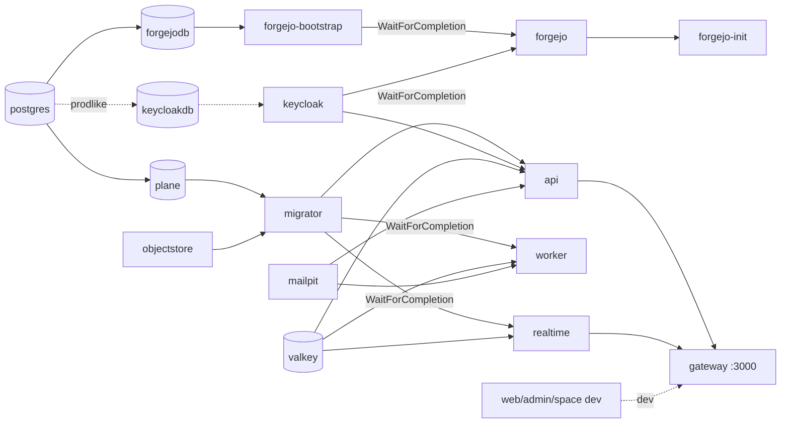

# 14 – Infrastruktur, Deployment & Betrieb

> **Status:** Entwurf zur Abnahme (D14). Detailliert ADR-033, ADR-035, ADR-036, ADR-052 und §3 aus `01-zielarchitektur-und-tech-stack.md`.
> **Rangfolge:** `00-grundsatzentscheidungen.md` (ADR-000 … ADR-009) > `01-zielarchitektur-und-tech-stack.md` (ADR-010 … ADR-052) > **dieses Dokument (D14-ADR-01 ff.)** > eigene Präferenzen. Bei Widerspruch gilt 01; die bewussten Präzisierungen gegenüber 01 sind in §2 mit „Präzisiert 01 …“ gekennzeichnet.
> **Stand:** 23.10.2026. Angaben mit „⚠“ werden in Spike S0 (Toolchain) bzw. S7 (Keycloak) gegen Paket-Metadaten und laufende Container verifiziert und dann gepinnt.
> **Zielrepository:** `funk.` (ADR-009). Alle Pfade für Zielcode sind **relativ zur Wurzel von `funk.`** (z. B. `src/hosts/Plane.AppHost/Program.cs`). Der Verzeichnisbaum in 01 §5.1 trägt noch den Arbeitstitel `plane-net/`; gemeint ist dieselbe Struktur unter `funk.`. Pfade des Originals sind relativ zu `/home/user/plane` (Kürzel `API/` = `apps/api/plane/`, `DEP/` = `deployments/`, `A01` = `migration/analysis/01-gesamtarchitektur-infrastruktur.md`).
> **Sprache:** Fließtext Deutsch, Bezeichner Englisch.

## Inhaltsverzeichnis

1. [Ziel & Scope](#1-ziel--scope)
2. [Entscheidungen (D14-ADR-01 ff.)](#2-entscheidungen-d14-adr-01-ff)
3. [Detaildesign](#3-detaildesign)
   - 3.1 Profile, Laufzeitumgebungen und Inkrement-Zuordnung
   - 3.2 Aspire-AppHost vollständig (Ressourcen, Parameter, Secrets, Referenzen, Volumes, Health)
   - 3.3 Keycloak (ADR-008): Container, Realm-Import, Clients, Testbenutzer, Login-Theme
   - 3.4 Forgejo (ADR-007): Container, SSO, OAuth2-App, Test-Repositories
   - 3.5 Angular-Apps: Dev-Server über Aspire.Hosting.JavaScript, Produktion als statische Assets im Gateway
   - 3.6 ServiceDefaults (OpenTelemetry, Resilience, Health, Service Discovery, Probe-Modus)
   - 3.7 Reverse Proxy `Plane.Gateway` (Routing, Uploads, Host-Header, Limits, Header, Runtime-Config)
   - 3.8 TLS und Zertifikate
   - 3.9 Konfiguration, ENV-Aliasse und Secrets
   - 3.10 Container-Images
   - 3.11 Deployment-Ziel Docker Compose (Aspire-Publisher) inkl. Swarm
   - 3.12 Deployment-Ziel Kubernetes/Helm
   - 3.13 AIO-Variante
   - 3.14 Airgapped-Bundle
   - 3.15 Migrationen beim Deployment und Instanz-Initialisierung
   - 3.16 Backup/Restore
   - 3.17 Upgrades
   - 3.18 Skalierung und Kapazität
   - 3.19 Observability
   - 3.20 Lokale Entwicklung
   - 3.21 CI/CD (GitHub Actions)
   - 3.22 Betriebs-CLI `plane-cli`
4. [Vollständige Mapping-Tabellen Original → Ziel](#4-vollständige-mapping-tabellen-original--ziel)
5. [Code-Skelette](#5-code-skelette)
6. [Erweiterungspunkte für Bezahl-Pakete](#6-erweiterungspunkte-für-bezahl-pakete)
7. [Akzeptanzkriterien & Tests](#7-akzeptanzkriterien--tests)
8. [Risiken & offene Punkte](#8-risiken--offene-punkte)
9. [Abhängigkeiten zu anderen Dokumenten (02–16)](#9-abhängigkeiten-zu-anderen-dokumenten-0216)

---

## 1. Ziel & Scope

### 1.1 Ziel

Dieses Dokument legt fest, **wie die Zielplattform gebaut, gestartet, ausgeliefert, betrieben, gesichert, aktualisiert und beobachtet wird** – von `aspire run` auf dem Entwicklerrechner bis zum Airgapped-Kubernetes-Cluster. Es ist für Implementierungs-Agenten direkt umsetzbar: Jede Ressource, jede Route, jede Umgebungsvariable des Originals und jede Pipeline hat hier ein benanntes Ziel (Datei, Klasse, Konfigurationsschlüssel) und ein messbares Akzeptanzkriterium (§7).

### 1.2 Im Scope

| Bereich | Inhalt | CE-IDs (Feature-Katalog `features/10-ce-feature-katalog.md`) | ab Inkrement |
|---|---|---|---|
| Aspire-AppHost | alle Ressourcen, Profile `dev`/`test`/`prodlike`, Publish-Modus, Parameter/Secrets, `WithReference`/`WaitFor`-Kette, Volumes, Health-Checks | CE-OPS-021 (lokale Entwicklung), CE-OPS-022 (Test-Stack) | I0 |
| Keycloak-Infrastruktur | Container, Realm-Import (Clients `plane-web`, `plane-admin`, `plane-space`, `plane-forgejo`, `plane-api`), Testbenutzer, Login-Theme-Packaging, Pfad `/idp/` in Produktion | CE-AUTH-001/-022/-024/-025 (infrastruktureller Teil, fachlich D05), CE-INST-006 (angepasst) | I0 |
| Forgejo-Infrastruktur | Container, DB, SSO über Keycloak, Bootstrap (Admin, Auth-Source), Init (OAuth2-App, Test-Org/-Repos) | – (W1-Vorleistung, ADR-007, 01 §1.4 F2 „ab I0“) | I0 |
| ServiceDefaults | OpenTelemetry, Resilience, Health, Service Discovery, Probe-Modus | CE-OPS-008, CE-OPS-019 | I0 |
| Gateway | Pfadregeln 1:1 zum Caddy-Proxy, Uploads, Host-Header für Presigned URLs, Body-Limit/413, Security-Header, statische Auslieferung, SPA-Fallback, Runtime-Config, `robots.txt`, Static-Rate-Limit | CE-OPS-005, CE-OPS-006, CE-OPS-007, CE-OPS-008, CE-OPS-009, CE-OPS-012 (Proxy-Route), CE-SPACE-017 (OG-Meta-Auslieferung) | I0 (Kern), I1 (Uploads), I6 (OG-Meta) |
| TLS | Betreiberzertifikat (Kestrel), externer Terminator, optionales ACME-Profil | CE-OPS-005 | I0 (HTTP), I7 (TLS-Modi vollständig) |
| Konfiguration | Options-Klassen, **vollständiges** ENV-Mapping aller Original-Variablen (A01 §2.11), Legacy-Aliasse, Secrets | CE-INST-002 (Seed aus ENV), CE-OPS-007, CE-OPS-010, CE-OPS-011 | I0 (Gerüst), I1 (alle Aliasse) |
| Images | ein Image je Host, Basis-Images, Multi-Arch, kein Node | CE-OPS-023 | I0 |
| Deployment | Docker Compose (Aspire-Publisher), Swarm, Kubernetes/Helm, AIO, Airgapped-Bundle | CE-OPS-001, CE-OPS-003, CE-OPS-004, H7-Überschneidung nur als Merkposten (§6.3) | I0 (Compose), I7 (Rest) |
| Migrationen | Migrator als Einmal-Job, Advisory-Lock, Schema-Gate für API/Worker/Realtime, Instanz-Initialisierung, Bucket | CE-INST-001 (angepasst: ohne GitHub-Versionsprüfung), CE-INST-002, CE-OPS-012 (Bucket-Anlage) | I0 |
| Backup/Restore, Upgrades | `plane-cli backup/restore/upgrade`, Konsistenzregeln, Upgrade-Regeln (Expand/Contract) | CE-OPS-001, CE-OPS-002 | I7 |
| Skalierung | horizontale Skalierung je Host, Valkey-Pflicht ab 2 Replikaten, Verbindungsbudget | CE-RT-007, CE-OPS-010 | I4 (Realtime), I7 (Nachweis) |
| Observability | Logs, Traces, Metriken, Dashboards, keine Telemetrie nach außen | CE-OPS-019, CE-RT-009 | I0 |
| CI/CD | GitHub Actions: Build, Tests, Images, SBOM, Trivy, Signatur, Release-Bundles | CE-OPS-022, CE-OPS-023 | I0 (CI + Images), I7 (Release/Airgap) |
| Betriebs-CLI | `plane-cli` (ersetzt `install.sh` und Management-Commands mit Betriebsbezug) | CE-OPS-001, CE-OPS-002, CE-OPS-020, CE-OPS-024 | I1 (Kern), I7 (Backup/Upgrade) |

### 1.3 Nicht im Scope (Verweis)

| Thema | zuständig |
|---|---|
| Fachliche Auth-Logik (BFF-Flow, JIT, Back-Channel-Logout-Verarbeitung, Login-Theme-**Inhalt**) | `05-auth-sicherheit-berechtigungen.md` (D05) |
| Job-/Task-Inventar, Cron-Zeiten je Job, Retention-Logik | `06-hintergrundjobs-events-benachrichtigungen.md` (D06) |
| Hocuspocus-Protokoll, Konvertierung, PDF | `07-realtime-kollaboration-dokumente.md` (D07) |
| Entitäten, Migrationsinhalte, Seeds im Detail | `03-datenmodell-efcore.md` (D03) |
| Teststrategie, Quality-Gates im Detail | `15-teststrategie-qualitaet-paritaet.md` (D15) |
| Fachdesign aller Bezahl-Pakete | später je Welle; hier nur §6 |

### 1.4 Wegfall gegenüber dem Original (mit Begründung)

| Original | Wegfall-Grund | Ersatz |
|---|---|---|
| RabbitMQ (`plane-mq`), `AMQP_URL`, `RABBITMQ_*` | ADR-020 (PostgreSQL-Queue) | – (Variablen werden mit Warnung ignoriert) |
| MinIO/silo (`plane-minio`) als Pflichtdienst | 01 §2.3 (MinIO-Distribution eingeschränkt) | SeaweedFS (Dev/Test, optional Prod), Betreiber-S3, Dateisystem |
| Telemetrie-Push an `telemetry.plane.so`, GitHub-Release-Check, Changelog-iframe-Default | ADR-004 | lokale Versionsanzeige; OTLP nur an Betreiber-Collector |
| Caddy als Pflicht-Proxy, Caddy-Container in web/admin, Node-SSR für space | ADR-002, ADR-033 | `Plane.Gateway` (YARP) |
| supervisord-AIO | ADR-052 | `Plane.AllInOne` (ein .NET-Prozess, §3.13) |
| `SECRET_KEY`-basierte Fernet-Verschlüsselung | ADR-036 | Data-Protection-Key-Ring + Schlüsselverschlüsselung per Zertifikat (D14-ADR-09) |
| Passwort-/OAuth-Provider-Variablen (`GOOGLE_*`, `GITHUB_*`, `GITLAB_*`, `GITEA_*`, `ENABLE_*_SYNC`, `IS_*_ENABLED`, `ENABLE_SIGNUP`, `ENABLE_EMAIL_PASSWORD`, `ENABLE_MAGIC_LINK_LOGIN`, `ADMIN_SESSION_COOKIE_AGE`) | ADR-008 | Keycloak-Konfiguration (Realm) |
| GitHub-App-/Slack-Variablen (`GITHUB_APP_NAME`, `SLACK_CLIENT_ID`) | ADR-007, F5 nicht gewählt | Forgejo-Konfiguration (W1) |
| Scout APM | ADR-004 | OpenTelemetry |

---

## 2. Entscheidungen (D14-ADR-01 ff.)

| ADR | Belang | Entscheidung | Alternativen (verworfen) | Begründung | ab |
|---|---|---|---|---|---|
| **D14-ADR-01** | Laufzeitprofile | Ein AppHost mit **vier Betriebsarten**: `dev` (Default, Angular-Dev-Server, Mailpit, SeaweedFS, Forgejo), `test` (wie dev, aber Gateway liefert gebaute Assets, ephemere Volumes, feste Seeds; für `Aspire.Hosting.Testing` und E2E), `prodlike` (lokaler Nachbau der Produktion: Keycloak auf PostgreSQL, Images wie in Prod, Forgejo nur per `Plane:Forgejo:Bundled=true`) und **Publish-Modus** (`aspire publish`, erzeugt Compose-Artefakte; Stellvertreter-Container nur über Compose-Profile). Auswahl über `Plane:Profile` bzw. `ExecutionContext.IsPublishMode`. | getrennte AppHosts je Umgebung; Compose-Dateien von Hand | Ein Abhängigkeitsgraph für alle Umgebungen verhindert Drift (Original-Edge-Cases E-01 bis E-03); Profile entsprechen 01 §3.3 | I0 |
| **D14-ADR-02** | Erreichbarkeit von Keycloak | **Dev/Test:** Keycloak direkt auf festem Port `8180` (Issuer `http://localhost:8180/realms/plane`, wie 01 §3.3). **Produktion:** Keycloak **hinter dem Gateway unter `/idp/`** (`KC_HTTP_RELATIVE_PATH=/idp`, Issuer `https://<host>/idp/realms/plane`), damit eine Domain und ein Zertifikat genügen; Admin-Konsole (`/idp/admin/`) ist am Gateway standardmäßig **gesperrt** (Freigabe per IP-Allowlist). Alternative „eigene Subdomain“ ist per `Plane__Urls__Idp` konfigurierbar. | `/auth/` (kollidiert mit Plane-`/auth/*` aus dem Original-Routing); immer eigene Subdomain | Airgapped-Installationen haben oft nur einen DNS-Namen und ein Zertifikat; `/idp/` kollidiert mit keiner Original-Route (A01 §2.8.1) | I0 (Dev), I7 (Prod-Pfad) |
| **D14-ADR-03** | Realm-Verwaltung | **Realm als Code** in `deploy/keycloak/realms/`: `plane-realm.dev.json` (Dev/Test: Testbenutzer mit festen IDs, Dev-Secrets) und `plane-realm.json` (Produktions-Template ohne Benutzer, Werte über Keycloak-Platzhalter `${PLANE_…}` aus Umgebungsvariablen). Erstimport per `--import-realm` (Keycloak überspringt vorhandene Realms). **Änderungen an bestehenden Realms** (Upgrade) per idempotentem Abgleich `plane-cli idp sync` über die Keycloak-Admin-REST-API – nur für den Plane-verwalteten Teil (Clients, Client-Scopes, Mapper, Realm-Rolle `plane-instance-admin`, Gruppe `plane-instance-admins`, Theme-Zuordnung), **nie** Benutzer oder Betreiber-Einstellungen (LDAP, IdP-Brokering, 2FA). Dev/Test-Keycloak läuft **ohne** Datenvolume (jeder Start importiert frisch). | `keycloak-config-cli` (zusätzliches Java-Image); Terraform-Provider; nur Import ohne Abgleich | Import ist der native, airgap-taugliche Weg; Abgleich in .NET hält die Werkzeugkette klein und ist testbar; ephemeres Dev-Keycloak macht Realm-Änderungen sofort wirksam (präzisiert 01 §3.4: `WithDataVolume` entfällt in dev/test) | I0 (Import), I7 (Sync) |
| **D14-ADR-04** | Login-Theme-Packaging | FreeMarker-Login-Themes `plane-base` (gemeinsam), `plane` (web), `plane-admin`, `plane-space` unter `deploy/keycloak/themes/`; CSS wird zur **Build-Zeit** aus `frontend/libs/shared/tailwind-config` erzeugt (`pnpm build:keycloak-theme`, Node nur im Build), Schriften (Inter) gebündelt. Zuordnung je Client über das Client-Attribut `login_theme`. **Produktion:** eigenes Image `plane-keycloak` (`FROM quay.io/keycloak/keycloak:<pin>`, Themes kopiert, `kc.sh build --db=postgres --health-enabled=true --metrics-enabled=true`, Start `start --optimized`). **Dev:** Bind-Mount mit abgeschaltetem Theme-Cache. | Theme als JAR-Provider; Keycloakify als Standard (S7-Fallback) | Ein Image mit eingebautem Theme ist airgap- und startzeitfreundlich; Bind-Mount erlaubt Live-Bearbeitung; Inhalt/Optik bestimmt D05 (Visual-Diff S7) | I0 |
| **D14-ADR-05** | Forgejo-Einrichtung | Drei Schritte: (1) Container `forgejo-bootstrap` (gleiches Image, eigener Entrypoint-Skript `deploy/forgejo/bootstrap/forgejo-bootstrap.sh`) führt **vor** dem Serverstart `forgejo migrate`, Admin-Anlage und Auth-Source `keycloak` (OIDC-Discovery) per Forgejo-CLI idempotent aus; (2) Container `forgejo` startet erst nach erfolgreichem Bootstrap (`WaitForCompletion`); (3) .NET-Werkzeug `Plane.Tools.ForgejoInit` legt per REST-API (`/api/v1`) Benutzer-Verknüpfungen, OAuth2-App für Plane, Test-Org/-Repos/-Issues/-PRs an und schreibt `artifacts/dev/forgejo.json`. | Alles per REST (Forgejo hat keine API für Auth-Sources); `docker exec` aus der Init-App (nicht portabel); Forgejo-Helm-Chart lokal | CLI-Schritte vor dem Serverstart vermeiden das Nachladen-Problem von Auth-Sources; REST-Schritte sind typisiert und testbar; alles idempotent | I0 |
| **D14-ADR-06** | Same-Origin in allen Profilen | **Ein Einstiegspunkt** `Plane.Gateway` (Dev: `http://localhost:3000`, Prod: `https://<host>`), auch in Dev vor den Angular-Dev-Servern. Hosts lauschen **in Containern** auf **8080** (App) und **8081** (Management: Health, keine Weiterleitung durch das Gateway); in `dev`/`test` (Hosts als Prozesse auf dem Entwicklerrechner) vergibt Aspire beide Ports dynamisch und übergibt sie über `HTTP_PORTS` bzw. `Plane__Management__Port`. | Angular-Dev-Server mit Proxy-Konfiguration; Health unter App-Pfaden | Cookie-Vertrag (`session-id`, SameSite=Lax), WebSocket-Auth (ADR-022) und Presigned-URLs funktionieren nur same-origin identisch; getrennter Management-Port verhindert Kollision von `/health/*` mit SPA-Routen | I0 |
| **D14-ADR-07** | Statische Frontend-Auslieferung | Angular-Builds (`frontend/dist/{web,admin,space}/browser`) werden beim `dotnet publish` von `Plane.Gateway` in `wwwroot/{web,admin,space}` übernommen (MSBuild-Target `IncludeFrontendDist`, bricht ohne Dist ab). Auslieferung per `MapStaticAssets` (Fingerprinting, vorkomprimiert br/gzip, ETag) ⚠ S0, Fallback `UseStaticFiles` mit vorkomprimierten Dateien aus dem Angular-Build. Cache-Regeln: gehashte Dateien `public, max-age=31536000, immutable`; `index.html`, `runtime-config.json`, `sw.js`, `manifest.json`, `site.webmanifest.json` `no-cache`. | eigener nginx-Container; Assets im API-Image | ein Image weniger, gleiche Regeln wie Original-Caddy (`try_files`), Node nur im Build | I0 |
| **D14-ADR-08** | ENV-Kompatibilität | **Alle Original-Variablen** (A01 §2.11) sind klassifiziert (§4.7): (a) **Alias** – wird über `LegacyEnvironmentConfigurationSource` auf `Plane__…` abgebildet (inkl. Konverter für `DATABASE_URL`, `REDIS_URL`, `n/period`-Raten); (b) **Seed** – initialer Wert einer Instanz-Konfiguration (Migrator, nur bei Neuanlage, E-06 wie Original); (c) **entfällt** – beim Start einmalig als Warnung `plane.config` mit Grund geloggt. Native Schlüssel `Plane__…` haben Vorrang vor Aliassen. | nur neue Namen; vollständige 1:1-Übernahme inkl. toter Variablen | Betreiber können ihre `plane.env` weiterverwenden (01 ADR-036); tote Variablen erzeugen keine stille Fehlkonfiguration | I0 (Gerüst), I1 |
| **D14-ADR-09** | Secrets & Schlüssel | Geheimnisse **nie** im Image oder in `appsettings*.json` (außer ausdrücklich dev-only in `src/hosts/Plane.AppHost/appsettings.Development.json`). Quellen: Aspire-Parameter (Dev: User-Secrets/Defaults), Compose `.env` (von `plane-cli init` mit Zufallswerten erzeugt), Kubernetes-Secrets (kompatibel zu External-Secrets-Operator), optional Datei-Secrets (`/run/secrets/*` über `KeyPerFile`). Der **Data-Protection-Key-Ring** liegt in PostgreSQL (01 ADR-036) und wird in Produktion **mit einem X.509-Zertifikat verschlüsselt** (`ProtectKeysWithCertificate`, Datei-Secret `dataprotection.pfx`); ohne Zertifikat startet ein Production-Host nur mit `Plane__DataProtection__AllowUnencryptedKeys=true` (Warnung). Zusätzlich ein gemeinsamer **`Plane__Security__SigningKey`** (≥ 32 Byte, Base64) für HMAC-Zwecke (API-Key-Identifier im Activity-Log, Upload-Tokens, signierte Dateisystem-URLs); Alias `SECRET_KEY` (Bekannt-Default-Werte aus A01 §2.11.7 → Start-Abbruch in Production). | Key-Ring unverschlüsselt (DB-Dump enthielte entschlüsselbare SMTP-/LLM-Secrets); eigenes AES-Schema (Eigenbau-Krypto) | Framework-Mechanismus statt Eigenbau; Backup trennt Daten (DB) und Schlüssel (Zertifikat) | I0 (Dev), I7 (Prod-Pflicht) |
| **D14-ADR-10** | Image-Bau | Alle .NET-Hosts per **SDK-Container-Build** (`dotnet publish -t:PublishContainer`, keine Dockerfiles); Basis `mcr.microsoft.com/dotnet/aspnet:10.0-noble-chiseled-extra` (ICU + tzdata nötig für Zeitzonen/Kulturen), Nutzer `app` (UID 1654), schreibgeschütztes Root-FS-tauglich. `Plane.Realtime` nutzt dieselbe Basis, falls S1/S3 (YDotNet-`libyrs`, SkiaSharp-`NoDependencies`) darauf grün sind, sonst `10.0-noble` (präzisiert 01 ADR-052). Dockerfiles nur für Fremd-Images mit Zusatzinhalt: `deploy/keycloak/Dockerfile` (`plane-keycloak`) und `deploy/cli/Dockerfile` (`plane-cli` mit `postgresql-client-17`). Multi-Arch `linux/amd64` + `linux/arm64`. | Dockerfile je Host; Alpine-Basis (musl-Risiken für native Libs) | Aspire-nativ, reproduzierbar, kleinste Angriffsfläche; Chiseled hat keine Shell → Health per Probe-Modus (D14-ADR-12) | I0 |
| **D14-ADR-11** | Compose als Standard-Deployment | `aspire publish` erzeugt `deploy/compose/docker-compose.yaml` + `.env`; Anpassungen (Image-Namen, Healthchecks, `restart`, `depends_on`-Bedingungen, Profile, Ports) **ausschließlich im AppHost** über `PublishAsDockerComposeService(...)`/`ConfigureComposeFile(...)` ⚠ S0. Die generierte Datei wird **eingecheckt**; CI vergleicht sie mit einer frischen Publikation (Drift-Gate). Optionale Dienste über Compose-`profiles`: `bundled-s3`, `forgejo`, `valkey`, `acme`, `observability`, `tools`. | handgepflegte Compose-Datei; Kompose | Ein Graph (D14-ADR-01), überprüfbare Ausgabe; Profile ersetzen die Kommentar-Anleitung des Originals („Comment this if …“, A01 §2.6.3) | I0 |
| **D14-ADR-12** | Health-Checks ohne Shell | Jeder Host unterstützt den **Probe-Modus** `--probe live|ready|startup` (prüft `http://127.0.0.1:8081/health/<kind>` und beendet sich mit 0/1, ohne den Host zu starten). Compose-`healthcheck` und Kubernetes-`exec`-Proben sind nicht nötig; Kubernetes nutzt `httpGet` auf Port 8081, Compose `CMD ["/app/Plane.Api","--probe","ready"]`. | `curl` ins Image; Sidecar | Chiseled-Images bleiben shell-frei | I0 |
| **D14-ADR-13** | Helm-Chart | **Handgepflegtes Chart `deploy/helm/plane`** (Aspire-Kubernetes-Publisher nur als Vorlage, da Preview, 01 ADR-052); Abhängigkeiten **nicht** als Fremd-Charts eingebettet; PostgreSQL extern (Empfehlung CloudNativePG, Apache-2.0) oder eingebautes Minimal-StatefulSet (`postgresql.bundled=true`, Einzelknoten); Keycloak als eigenes Deployment mit `plane-keycloak`-Image (Empfehlung für HA: Keycloak-Operator); Migrator als Helm-Hook-Job (`pre-install,pre-upgrade`). Keine Bitnami-Charts/-Images. | Bitnami-Abhängigkeiten (Image-Katalog seit 2025 eingeschränkt); generiertes Chart unverändert | volle Kontrolle über Airgap-Images, Sicherheitskontexte und Upgrade-Reihenfolge | I7 |
| **D14-ADR-14** | AIO | **`Plane.AllInOne`**: ein .NET-Prozess, der Gateway-, Api-, Realtime- und Worker-Komposition in **einer** Kestrel-Instanz vereint (gleiche Routen, kein internes Proxying) und Migrationen beim Start ausführt; Image `plane-aio`; benötigt extern PostgreSQL und Keycloak; Valkey entfällt (Einzelinstanz), Speicher per Dateisystem oder S3. Kompositionslogik je Host liegt in der Bibliothek `src/hosts/Plane.Hosting/` (`ApiComposition`, `RealtimeComposition`, `WorkerComposition`, `GatewayComposition`), die auch die Einzel-Hosts verwenden. | supervisord mit fünf Prozessen (wie Original); kein AIO | Kein Prozessmanager, ein Healthcheck, identisches Verhalten durch gemeinsame Kompositionsbibliothek; erfüllt CE-OPS-004 | I7 |
| **D14-ADR-15** | Airgapped-Bundle | Release-Artefakt `plane-airgap-<version>-<arch>.tar.zst` mit allen Images als **OCI-Archive** (Digest-gepinnt, `skopeo copy`), Compose-Dateien, Helm-Chart (`.tgz`), SBOMs, `SHA256SUMS`, Cosign-Signaturen und öffentlichem Schlüssel, Installationsskript `install-airgapped.sh` (lädt in lokale Docker-Engine **oder** spiegelt in eine private Registry). Optional enthaltene Offline-Registry (`registry:3`, CNCF Distribution, Apache-2.0). | `docker save` eines Gesamt-Tarballs; Pull-Through-Cache | Prüfbar (Checksummen, Signaturen ohne Internet), registry-agnostisch | I7 |
| **D14-ADR-16** | Migrationen beim Deployment | `Plane.Migrator` ist der **einzige** Schreiber des Schemas: `pg_advisory_lock(7356001)` → `MigrateAsync()` → Extensions-Check → Seeds → Instanz-Init → Bucket → Ende mit Exit-Code 0. Api/Worker/Realtime prüfen beim Start (**Schema-Gate**), ob alle im Assembly bekannten Migrationen angewandt sind, und melden sonst `ready=false` (kein Selbst-Migrieren). Migrationen folgen **Expand/Contract** über mindestens eine Minor-Version, damit Rolling-Updates gegen das neue Schema mit alten Replikaten laufen. | Migrieren beim API-Start (Race bei mehreren Replikaten); EF-Bundle-Datei | Ersetzt `wait_for_db`/`wait_for_migrations` (E-04) deterministisch; ein Ort für Seeds | I0 |
| **D14-ADR-17** | Backup | Logisches Backup: `pg_dump -Fc` je Datenbank (`plane`, `keycloak`, `forgejo` falls gebündelt) **zuerst**, danach Objekt-Speicher (S3-Bucket bzw. Dateisystem) als Tar, dann Forgejo-Repositories (`/data`-Volume, falls gebündelt), Manifest mit Versionen/Checksummen; **Valkey wird nicht gesichert** (nur flüchtige Daten). Schlüsselmaterial (`dataprotection.pfx`, `.env`-Secrets) wird **separat** exportiert (`plane-cli backup --include-secrets` explizit). PITR (WAL-Archivierung) ist Betreiberaufgabe (dokumentiert, z. B. CloudNativePG/pgBackRest). | Volume-Tarballs laufender Container (Original, inkonsistent); Snapshots | Versionsunabhängig, konsistent je DB, restore-fähig über Hosts hinweg | I7 |
| **D14-ADR-18** | Observability | OpenTelemetry über `Plane.ServiceDefaults`; Export **nur** wenn `OTEL_EXPORTER_OTLP_ENDPOINT` gesetzt (Dev: Aspire-Dashboard automatisch). Optionales Compose-Profil `observability` mit Aspire-Dashboard-Container (MIT). Kein Prometheus-Scrape-Endpunkt in der CE (Exporter-Paket nicht stabil ⚠); Betreiber nutzen einen OTel-Collector. JSON-Console-Logs (`Microsoft.Extensions.Logging.Console` JSON-Formatter). | Serilog; Prometheus-Exporter als Pflicht | ADR-004/-035; keine Abhängigkeit von Vorabversionen | I0 |
| **D14-ADR-19** | CI/CD-Plattform | **GitHub Actions** im Repository `funk.`; alle Actions per **Commit-SHA gepinnt**, minimale `permissions`; Images nach GHCR (`${PLANE_REGISTRY}`, konfigurierbar); SBOM (SPDX-JSON + CycloneDX) mit Syft, Schwachstellen-Scan mit Trivy (Gate: `CRITICAL`/`HIGH` mit verfügbarem Fix), Signatur mit Cosign **Schlüsselpaar** (offline prüfbar); Dependabot für Actions/NuGet/npm/Docker (Lizenz-Gate prüft jede Änderung). | Renovate (AGPL-Werkzeug, Self-Hosting nötig); keyless-only Signatur (Verifikation braucht Online-Transparenzlog) | Airgap-Kunden können Signaturen ohne Internet prüfen; SHA-Pinning gegen Lieferketten-Angriffe | I0 (CI, Images, SBOM, Trivy), I7 (Signatur, Release) |
| **D14-ADR-20** | Betriebs-CLI | **`plane-cli`** = Image `plane-cli` (.NET-Konsolen-App `Plane.Cli` + `pg_dump`/`pg_restore` 17) plus dünner Wrapper `deploy/compose/plane.sh` (ersetzt `install.sh`-Menü: `install`, `start`, `stop`, `restart`, `upgrade`, `logs`, `backup`, `restore`, `status`). Fachliche Wartungsbefehle (ehem. `manage.py`-Commands) sind Unterbefehle von `Plane.Cli`. | Bash-Skripte wie Original; CLI im API-Image | Chiseled-Images ohne Werkzeuge; ein versioniertes Werkzeug für Compose und Kubernetes (`kubectl run`/Job) | I1 (Kern), I7 (Backup/Upgrade) |
| **D14-ADR-21** | Valkey | Optional bei **genau einer** Replika je Host (In-Memory-Backplane/-Cache/-Rate-Limit), **Pflicht** sobald `api`, `realtime` oder `worker` > 1 Replika (Helm-Template schlägt fehl, Hosts melden `ready=false` bei `Plane__Scale__ExpectMultipleInstances=true` ohne Valkey). Valkey ohne Persistenz (`--save "" --appendonly no`). | immer Pflicht (wie Original-Live) | Kleinstinstallationen sparen einen Dienst (01 O-05); Daten sind flüchtig | I1 |
| **D14-ADR-22** | Forwarded Headers | Gateway vertraut vorgelagerten Proxys **nur** aus `Plane__ForwardedHeaders__KnownNetworks` (Default leer = direkte Clients); Hosts hinter dem Gateway vertrauen nur dem Gateway-Netz (Default: private Bereiche RFC 1918/4193 im Container-Netz). Gateway setzt `X-Forwarded-For`, `-Proto`, `-Host`, `-Prefix` neu (überschreibt Client-Werte). | Original `trusted_proxies 0.0.0.0/0` (E-11, Rate-Limit-Umgehung) | Sicherheitskorrektur nach 01 §7.20; Rate-Limits/Client-IP korrekt | I0 |

---
## 3. Detaildesign

### 3.1 Profile, Laufzeitumgebungen und Inkrement-Zuordnung

#### 3.1.1 Profil-Matrix (welche Ressource läuft wo)

Legende: ● = immer, ○ = optional (Schalter/Compose-Profil), – = nicht vorhanden. „Publish“ = Inhalt der von `aspire publish` erzeugten Compose-Datei (Standardprofil) bzw. des Helm-Charts.

| Ressource | `dev` | `test` | `prodlike` | Publish (Compose) | Helm | AIO | Schalter |
|---|---|---|---|---|---|---|---|
| `postgres` (pgvector-Image) | ● | ● (ohne Volume) | ● | ● | ○ (`postgresql.bundled`) | extern | – |
| DB `plane` | ● | ● | ● | ● | ● | ● | – |
| DB `keycloak` | – (Keycloak `start-dev` mit H2) | – | ● | ● | ● | ● (extern) | – |
| DB `forgejo` | ● | ● | ○ | ○ (Profil `forgejo`) | ○ | – | `Plane:Forgejo:Bundled` |
| `valkey` | ● | ● | ● | ○ (Profil `valkey`) | ○ (Pflicht bei Replikas > 1) | – | `Plane:Valkey:Enabled` |
| `objectstore` (SeaweedFS) | ● | ● | ● | ○ (Profil `bundled-s3`) | ○ | – | `Plane:Storage:Bundled` |
| `mailpit` | ● | ● | ● | – | – | – | – |
| `keycloak` | ● (Aspire-Keycloak, Port 8180) | ● | ● (`plane-keycloak`-Image) | ● | ● | extern | – |
| `forgejo-bootstrap`, `forgejo` | ● | ● | ○ | ○ (Profil `forgejo`) | ○ | – | `Plane:Forgejo:Bundled` |
| `forgejo-init` | ● | ● | – | – | – | – | – |
| `migrator` | ● | ● | ● | ● | ● (Hook-Job) | im Prozess | – |
| `api`, `worker`, `realtime` | ● (Projekte) | ● | ● | ● | ● | im Prozess | – |
| `gateway` | ● (Port 3000) | ● (Port 3000) | ● (Port 3000) | ● (80/443 → 8080/8443) | ● (Service + Ingress optional) | im Prozess | – |
| `web`, `admin`, `space` (Angular-Dev-Server) | ● | – | – | – | – | – | – |
| `caddy` (ACME-Front) | – | – | – | ○ (Profil `acme`) | – (Ingress/cert-manager) | ○ | – |
| `dashboard` (Aspire-Dashboard) | ● (eingebaut) | ● (eingebaut) | ● (eingebaut) | ○ (Profil `observability`) | ○ | ○ | – |
| `plane-cli` | – | – | – | ○ (Profil `tools`, `docker compose run`) | Job-Vorlage | – | – |

#### 3.1.2 Welcher Teil dieses Dokuments wird in welchem Inkrement gebraucht

| Inkrement | aus D14 fertig | Abnahme über |
|---|---|---|
| **I0 Walking Skeleton** | §3.2 AppHost (dev/test/prodlike), §3.3 Keycloak dev-Realm + Theme-Gerüst (Visual-Diff ab S7), §3.4 Forgejo-Container + Bootstrap + Init (SSO-Smoke), §3.5 Dev-Server + statische Auslieferung, §3.6 ServiceDefaults, §3.7 Gateway-Routen (ohne OG-Meta, ohne Uploads), §3.9 Options-Gerüst + Aliasse der I0-Variablen, §3.10 Images amd64/arm64, §3.11 Compose-Publikation (HTTP), §3.15 Migrator + Schema-Gate, §3.19 Logs/Traces/Health, §3.20 lokale Entwicklung, §3.21 CI (Build, Tests, Lizenz-Gate, Images, SBOM, Trivy, AppHost-Smoke, Compose-Drift) | AK-14-01 … AK-14-12, AK-14-25 |
| **I1 Workspace/Projekte/Konto** | §3.7 Uploads (`/uploads`, Proxy-Upload-Route), §3.9 alle Aliasse (Storage, Mail, Retention, Rate-Limits), Valkey-Nutzung (L2-Cache, Rate-Limit), §3.22 `plane-cli` Kern (`init`, `config check`, `test-email`, `clear-cache`) | AK-14-13 … AK-14-16 |
| **I2/I3** | keine neuen Infrastrukturbausteine; Lasttest-Daten über `plane-cli dummy-data` | – |
| **I4 Pages & Realtime** | Valkey-Backplane für `realtime` (≥ 2 Replikas), WebSocket-Timeouts im Gateway, Skalierungstest | AK-14-17 |
| **I5 Überblick** | SignalR-Pfad `/live/events/` (Route besteht ab I0) mit 2 Replikas | AK-14-18 |
| **I6 Außenwirkung** | OG-Meta-Middleware `/spaces/issues/{anchor}`, OpenAPI-Schalter, Egress-Allowlists Webhooks/LLM/Unsplash | AK-14-19 … AK-14-20 |
| **I7 Härtung & Betrieb** | §3.8 TLS-Modi, §3.12 Helm, §3.13 AIO, §3.14 Airgap-Bundle, §3.16 Backup/Restore, §3.17 Upgrades, `plane-cli idp sync`, Zertifikatspflicht Data Protection, Release-Pipeline mit Signatur, Swarm-Nachweis, Airgap-E2E | AK-14-21 … AK-14-24, AK-14-26 … AK-14-33 |

#### 3.1.3 Ports

| Komponente | Dev/Test (Host) | Container intern | Publish (Host) | Bemerkung |
|---|---|---|---|---|
| Gateway | `3000` (fest) | `8080` HTTP, `8443` HTTPS, `8081` Mgmt | `${LISTEN_HTTP_PORT:-80}`→8080, `${LISTEN_HTTPS_PORT:-443}`→8443 | einziger externer Einstieg |
| Api / Worker / Realtime | dynamisch (Aspire) | `8080` App, `8081` Mgmt | nicht publiziert | Worker hat nur `8081` |
| Migrator | – | – | – | Einmal-Job |
| Keycloak | `8180` (fest) | `8080` HTTP, `9000` Mgmt | nicht publiziert (über Gateway `/idp/`) | Issuer-Stabilität |
| Forgejo | `3300` (fest) HTTP; SSH aus | `3000` HTTP, `22` SSH | Profil `forgejo`: über Gateway (Host-Route) bzw. eigener Port `${FORGEJO_SSH_PORT:-2222}`→22 | SSH nie durch YARP |
| PostgreSQL | dynamisch | `5432` | nicht publiziert | Betreiber-Zugriff über `plane-cli` |
| Valkey | dynamisch | `6379` | nicht publiziert | – |
| SeaweedFS S3 | `8333` | `8333` | nicht publiziert (über Gateway `/uploads`) | – |
| Mailpit | `8025` UI, `1025` SMTP | dto. | – | nur Dev/Test |
| Angular-Dev-Server | `4200` web, `4201` admin, `4202` space | – | – | nur `dev`, `127.0.0.1` |
| Aspire-Dashboard | von Aspire vergeben | `18888` UI, `18889` OTLP gRPC | Profil `observability`: `127.0.0.1:18888` | nie öffentlich |

### 3.2 Aspire-AppHost vollständig

**Ort:** `src/hosts/Plane.AppHost/` mit `Program.cs` (Graph), `PlaneProfile.cs` (Profilauflösung), `Resources/KeycloakResources.cs`, `Resources/ForgejoResources.cs`, `Resources/StorageResources.cs`, `Resources/FrontendResources.cs`, `Resources/ComposePublishing.cs`, `appsettings.json` (keine Secrets), `appsettings.Development.json` (nur Dev-Defaults, Kommentar `DEV ONLY` in jedem Wert). Vollständiges Skelett in §5.1.

#### 3.2.1 Parameter (Aspire `AddParameter`)

| Parameter | secret | Dev-Quelle | Publish (`.env`-Variable) | verwendet von |
|---|---|---|---|---|
| `postgres-password` | ja | automatisch generiert (Aspire) | `POSTGRES_PASSWORD` | postgres, alle Hosts (Connection-String) |
| `keycloak-db-password` | ja | – (dev nutzt H2) | `KEYCLOAK_DB_PASSWORD` | keycloak (prodlike/Publish) |
| `forgejo-db-password` | ja | automatisch | `FORGEJO_DB_PASSWORD` | forgejo, forgejo-bootstrap |
| `keycloak-admin-password` | ja | `appsettings.Development.json` (`dev-admin`) | `KEYCLOAK_ADMIN_PASSWORD` | keycloak (Bootstrap-Admin `KC_BOOTSTRAP_ADMIN_PASSWORD`), `plane-cli idp sync` |
| `oidc-web-client-secret` | ja | Dev-Default (`dev-web-secret`) | `PLANE_OIDC_WEB_CLIENT_SECRET` | keycloak (Realm-Platzhalter), api |
| `oidc-admin-client-secret` | ja | Dev-Default | `PLANE_OIDC_ADMIN_CLIENT_SECRET` | keycloak, api |
| `oidc-space-client-secret` | ja | Dev-Default | `PLANE_OIDC_SPACE_CLIENT_SECRET` | keycloak, api |
| `forgejo-oidc-client-secret` | ja | Dev-Default | `FORGEJO_OIDC_CLIENT_SECRET` | keycloak, forgejo-bootstrap |
| `forgejo-admin-password` | ja | Dev-Default | `FORGEJO_ADMIN_PASSWORD` | forgejo-bootstrap, forgejo-init |
| `s3-access-key` / `s3-secret-key` | ja | Dev-Default | `AWS_ACCESS_KEY_ID` / `AWS_SECRET_ACCESS_KEY` (Original-Namen) | objectstore, migrator, api, worker, realtime |
| `signing-key` | ja | automatisch (32 Byte) | `PLANE_SIGNING_KEY` | alle Plane-Hosts |
| `test-user-password` | ja | Dev-Default (`Plane-Dev-123!`) | – | keycloak (nur `plane-realm.dev.json`) |
| `public-url` | nein | `http://localhost:3000` | `WEB_URL` (Original-Name) | Hosts, Keycloak-Realm (Redirect-URIs), Gateway |
| `plane-registry` / `plane-version` | nein | – | `PLANE_REGISTRY`, `PLANE_VERSION` | Image-Referenzen im Publish |

#### 3.2.2 Ressourcen, Referenzen und Startreihenfolge

| Ressource | Aspire-API | Referenzen (`WithReference`) | Wartet auf | Volumes / Bind-Mounts | Health-Check |
|---|---|---|---|---|---|
| `postgres` | `AddPostgres("postgres", password: pgPassword).WithImage("pgvector/pgvector").WithImageTag("<pin>-pg17")` | – | – | Volume `plane-pgdata` (dev/prodlike), keines in test; Bind-Mount `deploy/postgres/init/` → `/docker-entrypoint-initdb.d/` (Rollen, Extensions) | Aspire-Standard (Npgsql-Connect) |
| `plane` | `postgres.AddDatabase("plane")` | – | `postgres` | – | DB erreichbar |
| `keycloakdb` | `postgres.AddDatabase("keycloakdb", "keycloak")` (nur prodlike) | – | `postgres` | – | – |
| `forgejodb` | `postgres.AddDatabase("forgejodb", "forgejo")` | – | `postgres` | – | – |
| `valkey` | `AddValkey("valkey").WithArgs("--save","","--appendonly","no")` | – | – | keines (flüchtig) | Aspire-Standard (PING) |
| `objectstore` | `AddContainer("objectstore","chrislusf/seaweedfs","<pin>")` + `WithArgs("server","-s3","-dir=/data","-s3.config=/etc/seaweedfs/s3.json")` | – | – | Volume `plane-objects` → `/data`; Bind-Mount `deploy/seaweedfs/s3.json` | `WithHttpHealthCheck("/status", endpointName: "s3")` ⚠ |
| `mailpit` | `AddContainer("mailpit","axllent/mailpit","<pin>")` | – | – | – | `WithHttpHealthCheck("/livez", endpointName: "ui")` |
| `keycloak` | dev/test: `AddKeycloak("keycloak", 8180, adminUser, adminPw).WithRealmImport(...)`; prodlike: `AddContainer("keycloak", "plane-keycloak")` (lokal gebaut via `AddDockerfile`) | – | prodlike: `keycloakdb` | dev: Bind-Mount Themes; prodlike: – | Management-Port 9000 `/health/ready` |
| `forgejo-bootstrap` | `AddContainer(..., forgejo image).WithEntrypoint("/bin/sh").WithArgs("/bootstrap/forgejo-bootstrap.sh")` | – | `forgejodb` | Volume `plane-forgejo` → `/data`; Bind-Mount `deploy/forgejo/bootstrap/` → `/bootstrap` | Exit-Code 0 |
| `forgejo` | `AddContainer("forgejo","codeberg.org/forgejo/forgejo","15")` ⚠ Patch-Pin | – | `WaitForCompletion(forgejo-bootstrap)`, `keycloak` | Volume `plane-forgejo` → `/data` | `WithHttpHealthCheck("/api/healthz")` |
| `forgejo-init` | `AddProject<Projects.Plane_Tools_ForgejoInit>` | `forgejo` (Endpoint) | `forgejo` | schreibt `artifacts/dev/forgejo.json` | Exit-Code 0 |
| `migrator` | `AddProject<Projects.Plane_Migrator>` | `plane` | `plane`, `objectstore` (falls gebündelt) | – | Exit-Code 0 |
| `api` | `AddProject<Projects.Plane_Api>` | `plane`, `valkey` | `WaitForCompletion(migrator)`, `keycloak`, `mailpit` (dev/test) | – | `WithHttpHealthCheck("/health/ready", endpointName: "management")` |
| `worker` | `AddProject<Projects.Plane_Worker>` | `plane`, `valkey` | `WaitForCompletion(migrator)`, `mailpit` (dev/test) | – | dto. |
| `realtime` | `AddProject<Projects.Plane_Realtime>` | `plane`, `valkey` | `WaitForCompletion(migrator)` | – | dto. |
| `web`/`admin`/`space` | `AddJavaScriptApp(name, "../../../frontend", "start:<app>").WithPnpm().WithHttpEndpoint(port: 420x, env: "PORT")` | – | – | – | HTTP 200 auf `/` bzw. Base-Pfad |
| `gateway` | `AddProject<Projects.Plane_Gateway>` | `api`, `realtime`, dev: `web`/`admin`/`space` | `api`, `realtime` | – | `WithHttpHealthCheck("/health/ready", endpointName: "management")` |



#### 3.2.3 Umgebungsvariablen, die der AppHost setzt (alle Plane-Hosts)

| Schlüssel | Wert (Dev) | Quelle |
|---|---|---|
| `ConnectionStrings__plane` | von Aspire | `WithReference(planeDb)` |
| `ConnectionStrings__valkey` | von Aspire | `WithReference(valkey)` |
| `Plane__Urls__Web` | `http://localhost:3000` | Parameter `public-url` |
| `Plane__Urls__AdminPath`, `Plane__Urls__SpacePath`, `Plane__Urls__LivePath` | `/god-mode/`, `/spaces/`, `/live/` | Konstanten |
| `Plane__Auth__Oidc__Authority` | `http://localhost:8180/realms/plane` | Keycloak-Endpoint |
| `Plane__Auth__Oidc__MetadataAddress` | `http://localhost:8180/realms/plane/.well-known/openid-configuration` (Prod: interne Adresse `http://keycloak:8080/idp/realms/plane/...`) | Keycloak-Endpoint |
| `Plane__Auth__Oidc__Clients__web__ClientSecret` (analog `admin`, `space`) | Parameter | Parameter |
| `Plane__Storage__Provider` | `S3` | Konstante |
| `Plane__Storage__InternalEndpoint` | SeaweedFS-Endpoint `s3` | `objectStore.GetEndpoint("s3")` |
| `Plane__Storage__PublicEndpoint` | `http://localhost:3000` | Parameter `public-url` (Pfad-Stil über Gateway `/uploads`) |
| `Plane__Storage__Bucket` | `uploads` | Konstante (Original-Default) |
| `Plane__Storage__AccessKey`/`SecretKey` | Parameter | Parameter |
| `Plane__Storage__UploadMode` | `Direct` (S8 entscheidet, sonst `Proxy`) | Konstante |
| `Plane__Mail__DevSmtp__Host`/`Port` | Mailpit `smtp` | nur dev/test: überschreibt Instanz-SMTP (Seed `EMAIL_HOST`, `EMAIL_PORT`, `ENABLE_SMTP=1`) |
| `Plane__Security__SigningKey` | Parameter | Parameter |
| `Plane__DataProtection__ApplicationName` | `plane` | Konstante (gleich in allen Hosts → geteilter Key-Ring) |
| `OTEL_EXPORTER_OTLP_ENDPOINT` | Aspire-Dashboard | Aspire automatisch |
| `ASPNETCORE_ENVIRONMENT` | `Development` (dev/test), `Production` (prodlike/Publish) | Profil |

### 3.3 Keycloak (ADR-008)

#### 3.3.1 Container-Konfiguration

| Einstellung | Dev/Test | Produktion (`plane-keycloak`) | Zweck |
|---|---|---|---|
| Start | `start-dev --import-realm` (Aspire-Default) | `start --optimized --import-realm` | Import nur, wenn Realm fehlt |
| Image | Aspire-Default-Keycloak-Image der Integration (Tag ⚠ gleich Prod-Major) | `${PLANE_REGISTRY}/plane-keycloak:${PLANE_VERSION}` (Basis `quay.io/keycloak/keycloak:26.x` ⚠) | – |
| DB | H2 im Container (ephemer) | `KC_DB=postgres`, `KC_DB_URL=jdbc:postgresql://postgres:5432/keycloak`, `KC_DB_USERNAME=keycloak`, `KC_DB_PASSWORD` | – |
| Hostname | `KC_HOSTNAME=http://localhost:8180` | `KC_HOSTNAME=${WEB_URL}/idp` | stabiler Issuer |
| Backchannel | `KC_HOSTNAME_BACKCHANNEL_DYNAMIC=true` | `KC_HOSTNAME_BACKCHANNEL_DYNAMIC=true` | Container (Forgejo, Api in Prod) sprechen Keycloak intern an, Issuer bleibt öffentlich |
| Pfad | `/` | `KC_HTTP_RELATIVE_PATH=/idp` | D14-ADR-02 |
| HTTP/TLS | HTTP | `KC_HTTP_ENABLED=true`, `KC_PROXY_HEADERS=xforwarded` (TLS am Gateway) | – |
| Health/Metrics | `KC_HEALTH_ENABLED=true` | in `kc.sh build` aktiviert, Port 9000 | Readiness |
| Bootstrap-Admin | `KC_BOOTSTRAP_ADMIN_USERNAME=admin`, `KC_BOOTSTRAP_ADMIN_PASSWORD` (Aspire setzt) | dto. aus `.env`; nach Ersteinrichtung soll der Betreiber einen persönlichen Admin anlegen (Runbook) | – |
| Theme-Cache | aus (`KC_SPI_THEME_CACHE_THEMES=false`, `KC_SPI_THEME_CACHE_TEMPLATES=false`, `KC_SPI_THEME_STATIC_MAX_AGE=-1`) ⚠ Optionsnamen (Keycloak 26 SPI-Syntax) in S7 prüfen | an | Live-Bearbeitung |
| Realm-Platzhalter | `PLANE_PUBLIC_URL`, `PLANE_BACKCHANNEL_LOGOUT_URL`, `PLANE_OIDC_*_CLIENT_SECRET`, `FORGEJO_ROOT_URL`, `FORGEJO_OIDC_CLIENT_SECRET`, `PLANE_TEST_USER_PASSWORD` | dto. ohne Testbenutzer | Werte im Realm-JSON als `${NAME}` |
| Speicher | – | `JAVA_OPTS_KC_HEAP=-XX:MaxRAMPercentage=70` ⚠, Container-Limit 1 GiB | – |

Back-Channel-Logout-Ziel: Keycloak muss die Plane-API erreichen. Dev: `PLANE_BACKCHANNEL_LOGOUT_URL=http://host.docker.internal:3000/auth/oidc/backchannel-logout/` (Gateway auf dem Host; Aspire stellt `host.docker.internal` für Container bereit ⚠ S7, unter Linux ggf. `--add-host`). Produktion: `http://api:8080/auth/oidc/backchannel-logout/` (intern, nicht über das öffentliche Gateway).

#### 3.3.2 Realm-Inhalt (Plane-verwalteter Teil, Template `deploy/keycloak/realms/plane-realm.json`)

| Element | Wert | Begründung / Bezug |
|---|---|---|
| Realm | `plane`, `enabled: true`, `sslRequired: external`, `loginTheme: plane`, `emailTheme: plane` ⚠ (optional, D05), `internationalizationEnabled: true`, `supportedLocales` = alle 23 Plane-Locales soweit Keycloak sie anbietet (`bg`, `cs`, `de`, `en`, `es`, `fr`, `id`, `it`, `ja`, `ka`, `ko`, `nl`, `pl`, `pt-BR`, `ro`, `ru`, `sk`, `tr`, `uk`, `vi`, `zh-CN`, `zh-TW`), `defaultLocale: en` | Login-Seite in Nutzersprache (D05 legt Mapping fest) |
| Registrierung | `registrationAllowed: false` (Prod-Default), `loginWithEmailAllowed: true`, `duplicateEmailsAllowed: false`, `verifyEmail: true` | Konten entstehen in Keycloak (Betreiber/LDAP); nur verifizierte E-Mails werden in Plane angelegt (ADR-008) |
| Schutz | `bruteForceProtected: true`, `failureFactor: 10`, `permanentLockout: false` | entspricht `AUTHENTICATION_RATE_LIMIT`-Schutzziel (CE-AUTH-026); Plane-Rate-Limit bleibt zusätzlich |
| Realm-Rolle | `plane-instance-admin` | Instanz-Admin (01 ADR-017, konfigurierbar `Plane__Auth__InstanceAdminRole`) |
| Gruppe | `plane-instance-admins` (Rollen-Mapping `plane-instance-admin`) | Pflege durch Betreiber |
| Client-Scope `plane-profile` | Mapper `email`, `email_verified`, `given_name`, `family_name`, `preferred_username`, `picture` (User-Attribut `picture`), `locale` | JIT-Profil (CE-AUTH-012 angepasst) |
| Client-Scope `plane-roles` | Mapper „realm roles“ → Claim `roles` in **ID-Token und Userinfo** | God-Mode-Rolle ohne Token-Introspektion |
| Client-Scope `plane-groups` | Mapper „Group Membership“ → Claim `groups` (`full.path: false`), Default-Scope der Plane-Clients | Andockstelle E3 (§6) |
| Client `plane-web` | confidential, `standardFlowEnabled: true`, alle anderen Flows aus, `attributes.pkce.code.challenge.method: S256`, `redirectUris: ["${PLANE_PUBLIC_URL}/auth/oidc/callback/"]`, `post.logout.redirect.uris: "${PLANE_PUBLIC_URL}/"`, `webOrigins: ["+"]`, `frontchannelLogout: false`, `attributes.backchannel.logout.url: "${PLANE_BACKCHANNEL_LOGOUT_URL}"`, `backchannel.logout.session.required: true`, `login_theme: plane`, `secret: "${PLANE_OIDC_WEB_CLIENT_SECRET}"`, Default-Scopes `openid`, `plane-profile`, `plane-roles`, `plane-groups` | 01 ADR-017, O-06 |
| Client `plane-admin` | wie `plane-web`, `post.logout.redirect.uris: "${PLANE_PUBLIC_URL}/god-mode/"`, `login_theme: plane-admin`, Secret `${PLANE_OIDC_ADMIN_CLIENT_SECRET}` | God Mode ohne separates Login (ADR-009: Step-up Default aus) |
| Client `plane-space` | wie `plane-web`, `post.logout.redirect.uris: "${PLANE_PUBLIC_URL}/spaces/"`, `login_theme: plane-space`, Secret `${PLANE_OIDC_SPACE_CLIENT_SECRET}` | CE-SPACE-Kommentare/Votes mit Login |
| Client `plane-forgejo` | confidential, Standard-Flow, PKCE S256, `redirectUris: ["${FORGEJO_ROOT_URL}user/oauth2/keycloak/callback"]`, Secret `${FORGEJO_OIDC_CLIENT_SECRET}`, Default-Scopes `openid`, `plane-profile`, `plane-groups` | Forgejo-SSO, gleiche Identität (ADR-007) |
| Client `plane-api` | `bearerOnly`-Äquivalent (`publicClient: false`, alle Flows aus), dient als **Audience** | Andockstelle H1 (§6), Bearer-Schema in CE deaktiviert |
| Sitzungen | `ssoSessionIdleTimeout: 604800`, `ssoSessionMaxLifespan: 604800` (7 Tage, wie `SESSION_COOKIE_AGE`), `accessTokenLifespan: 300` | Plane-Session-Lebensdauer bleibt maßgeblich (D05) |

#### 3.3.3 Testbenutzer (`plane-realm.dev.json`, nur Dev/Test)

Alle Testbenutzer haben **feste `id`-Werte** (damit `sub` deterministisch ist und `forgejo-init` sie vorab verknüpfen kann) und das Passwort `${PLANE_TEST_USER_PASSWORD}`.

| Benutzername / E-Mail | `id` (sub) | emailVerified | enabled | Gruppen | Zweck |
|---|---|---|---|---|---|
| `admin@plane.local` | `00000000-0000-7000-8000-000000000001` | true | true | `plane-instance-admins` | God Mode, Workspace-Owner in Seeds |
| `member@plane.local` | `00000000-0000-7000-8000-000000000002` | true | true | – | Rolle Member (15) |
| `guest@plane.local` | `00000000-0000-7000-8000-000000000003` | true | true | – | Rolle Guest (5) |
| `member2@plane.local` | `00000000-0000-7000-8000-000000000004` | true | true | – | Mehrbenutzer-/Realtime-Tests |
| `invitee@plane.local` | `00000000-0000-7000-8000-000000000005` | true | true | – | Einladungszuordnung beim ersten Login (CE-AUTH-028) |
| `unverified@plane.local` | `00000000-0000-7000-8000-000000000006` | **false** | true | – | JIT-Verweigerung (ADR-008) |
| `disabled@plane.local` | `00000000-0000-7000-8000-000000000007` | true | **false** | – | Sperre (CE-AUTH-027 angepasst) |
| `forgejo-only@plane.local` | `00000000-0000-7000-8000-000000000008` | true | true | – | SSO-Test Forgejo ohne Plane-Mitgliedschaft |

Zusätzlich setzt der Dev-Realm `registrationAllowed: true` **nicht** – Dev-Konten werden ausschließlich über den Realm-Import erzeugt (deterministische Tests).

#### 3.3.4 Login-Theme (Packaging)

```text
deploy/keycloak/
├── Dockerfile                         # plane-keycloak (D14-ADR-04)
├── realms/
│   ├── plane-realm.json               # Produktions-Template (ohne Benutzer)
│   └── plane-realm.dev.json           # Dev/Test (inkl. Testbenutzer, feste IDs)
├── theme-src/                         # Build-Quellen (Node nur im Build)
│   ├── package.json                   # "build:keycloak-theme": tailwindcss → ../themes/plane-base/login/resources/css/plane.css
│   ├── plane-login.css                # @import "@plane/tailwind-config" + Komponentenstile der Original-Sign-in-Seite
│   └── tailwind.config.ts
└── themes/
    ├── plane-base/login/              # theme.properties (parent=base), template.ftl, login.ftl, login-reset-password.ftl,
    │                                  # login-update-password.ftl, login-otp.ftl, webauthn-authenticate.ftl, error.ftl, info.ftl,
    │                                  # logout-confirm.ftl, messages/messages_<locale>.properties, resources/{css,fonts,img}
    ├── plane/login/theme.properties   # parent=plane-base, Variante web
    ├── plane-admin/login/theme.properties   # parent=plane-base, Variante God Mode
    └── plane-space/login/theme.properties   # parent=plane-base, Variante Space
```

Welche Templates nachgebaut und wie sie optisch der Original-Sign-in-Seite (`apps/web/app/(all)/sign-in`, `apps/space`) entsprechen, legt **D05** fest (Visual-Diff ≤ 1 %, S7). D14 garantiert: Fonts/Bilder liegen im Theme (keine externen URLs), CSS wird reproduzierbar gebaut, Theme ist im Image enthalten.

### 3.4 Forgejo (ADR-007)

#### 3.4.1 Container-Konfiguration (Umgebungsvariablen im Format `FORGEJO__<section>__<KEY>`)

| Variable | Dev/Test | Produktion (Profil `forgejo`) | Zweck |
|---|---|---|---|
| `FORGEJO__database__DB_TYPE` / `HOST` / `NAME` / `USER` / `PASSWD` | `postgres` / `postgres:5432` / `forgejo` / `forgejo` / Parameter | dto. | eigene DB auf gemeinsamem Server |
| `FORGEJO__server__ROOT_URL` | `http://localhost:3300/` | `https://${FORGEJO_HOST}/` | Links, OAuth-Callback |
| `FORGEJO__server__HTTP_PORT` | `3000` | `3000` | – |
| `FORGEJO__server__DISABLE_SSH` | `true` | `false` (`SSH_PORT=${FORGEJO_SSH_PORT}`) | – |
| `FORGEJO__server__OFFLINE_MODE` | `true` | `true` | keine CDN-/Gravatar-Ressourcen (ADR-004) |
| `FORGEJO__picture__DISABLE_GRAVATAR` | `true` | `true` | ADR-004 |
| `FORGEJO__cron.update_checker__ENABLED` | `false` | `false` | kein Update-Check nach außen |
| `FORGEJO__security__INSTALL_LOCK` | `true` | `true` | kein Installationsassistent |
| `FORGEJO__service__DISABLE_REGISTRATION` | `false` | `false` | nötig für Auto-Registrierung über OIDC … |
| `FORGEJO__service__ALLOW_ONLY_EXTERNAL_REGISTRATION` | `true` | `true` | … aber nur über Keycloak |
| `FORGEJO__oauth2_client__ENABLE_AUTO_REGISTRATION` | `true` | `true` | Konto bei erstem SSO-Login |
| `FORGEJO__oauth2_client__ACCOUNT_LINKING` | `auto` | `login` | Dev: automatische Verknüpfung; Prod: bestätigen |
| `FORGEJO__oauth2_client__USERNAME` | `preferred_username` ⚠ (unterstützte Werte der Forgejo-15-Doku prüfen; Fallback `nickname`) | dto. | gleiche Nutzernamen wie Keycloak |
| `FORGEJO__oauth2_client__UPDATE_AVATAR` | `true` | `true` | – |
| `FORGEJO__webhook__ALLOWED_HOST_LIST` | `*` (Dev: Ziel `host.docker.internal`) | Host des Plane-Gateways bzw. `private` | Forgejo-Webhooks an Plane (F1/F2) |
| `FORGEJO__actions__ENABLED` | `true` | `true` | Commit-Status/Checks (W1) |
| `FORGEJO__mailer__ENABLED` | `false` | Betreiberwahl | – |
| `FORGEJO__log__LEVEL` | `Warn` | `Info` | – |

#### 3.4.2 Bootstrap (`deploy/forgejo/bootstrap/forgejo-bootstrap.sh`, Skelett §5.6)

Reihenfolge (idempotent, läuft als Benutzer `git`):
1. `environment-to-ini` aus den `FORGEJO__*`-Variablen nach `/data/gitea/conf/app.ini` (Pfad und Werkzeugname im Forgejo-15-Image ⚠ S0).
2. `forgejo migrate` (legt Schema an bzw. migriert).
3. Admin `plane-admin` anlegen, falls `forgejo admin user list --admin` ihn nicht enthält (`--must-change-password=false`, E-Mail `forgejo-admin@plane.local`).
4. Auth-Source `keycloak`: existiert sie (`forgejo admin auth list`), dann `update-oauth --id <id> …`, sonst `add-oauth --name keycloak --provider openidConnect --key plane-forgejo --secret "$FORGEJO_OIDC_CLIENT_SECRET" --auto-discover-url "$KEYCLOAK_DISCOVERY_URL" --scopes "openid email profile groups"`; `KEYCLOAK_DISCOVERY_URL` zeigt intern auf `http://keycloak:8080/realms/plane/.well-known/openid-configuration` (Prod: `…/idp/realms/plane/…`).
5. Exit 0.

#### 3.4.3 Init (`src/tools/Plane.Tools.ForgejoInit/`, Dev/Test)

| Schritt | REST-Aufruf (`/api/v1`, Basic-Auth `plane-admin`) | Ergebnis |
|---|---|---|
| 1 | `POST /users/plane-admin/tokens` (Name `plane-dev-<timestamp>`, Scopes `all`) | Admin-Token (nur in `artifacts/dev/forgejo.json`) |
| 2 | `POST /admin/users` je Testbenutzer aus §3.3.3 mit `source_id` = Auth-Source `keycloak`, `login_name` = Keycloak-`sub`, `username` = Teil vor `@` | vorab verknüpfte Konten (gleiche Identität) |
| 3 | `POST /orgs` `plane-dev` (Owner `plane-admin`, Mitglieder `admin`, `member`) | Test-Organisation |
| 4 | `POST /orgs/plane-dev/repos` `alpha` (`auto_init: true`, `default_branch: main`), `beta` (leer), `importer-fixture` | Test-Repositories |
| 5 | Labels (`bug`, `feature`, `docs`), Milestones (`v1.0`, `v1.1`), 3 Issues in `alpha` (eines mit Sub-Issue-Referenz), 20 Issues mit Kommentaren/Labels/Milestones in `importer-fixture` | Daten für Sync-/Importer-Tests (W1) |
| 6 | Branch `feature/PLANE-1-sample` + Commit „Fixes PLANE-1“ + PR „PLANE-1: sample“ in `alpha`; Commit-Status `success` (Kontext `ci/forgejo-actions`) | PR-Automation-/Status-Tests (W1) |
| 7 | `POST /user/repos` als `member` (per Sudo-Header) `personal` | persönliches Repo |
| 8 | `POST /user/applications/oauth2` (als `plane-admin`): Name `Plane (dev)`, `redirect_uris: ["http://localhost:3000/api/integrations/forgejo/oauth/callback/"]` ⚠ Pfad legt F1/W1 fest, `confidential_client: true` | `client_id`, `client_secret` |
| 9 | Datei `artifacts/dev/forgejo.json` (`.gitignore`) schreiben: `base_url`, `admin_token`, `oauth_client_id`, `oauth_client_secret`, `org`, `repos[]`, `users[]` | Eingabe für W1-Tests (`ForgejoDevFixture`) |

Idempotenz: Jeder Schritt prüft per `GET` die Existenz. Für Schritt 8 wird die App gelöscht und neu angelegt, wenn `forgejo.json` fehlt (Secret ist nicht erneut lesbar). Laufzeit < 30 s (AK-14-08).

### 3.5 Angular-Apps

**Dev (`dev`-Profil):** drei `AddJavaScriptApp`-Ressourcen starten `pnpm run start:web|start:admin|start:space` im Ordner `frontend/`. Die Skripte in `frontend/package.json` lauten verbindlich:

```json
{
  "scripts": {
    "start:web":   "ng serve web   --host 127.0.0.1 --port ${PORT:-4200} --serve-path /",
    "start:admin": "ng serve admin --host 127.0.0.1 --port ${PORT:-4201} --serve-path /god-mode/",
    "start:space": "ng serve space --host 127.0.0.1 --port ${PORT:-4202} --serve-path /spaces/",
    "build":       "ng build web && ng build admin && ng build space",
    "build:keycloak-theme": "pnpm --dir ../deploy/keycloak/theme-src build"
  }
}
```

Das Gateway leitet im Modus `Plane__Gateway__FrontendMode=DevServer` `/` → `web`, `/god-mode/` → `admin`, `/spaces/` → `space` weiter, **inklusive** der HMR-WebSockets der Dev-Server (YARP leitet WebSockets transparent). Die Runtime-Config (`/runtime-config.json` usw.) beantwortet das Gateway in beiden Modi selbst, damit Dev und Prod dieselbe Konfiguration sehen.

**Test/Prodlike/Publish:** `Plane__Gateway__FrontendMode=Static`; Auslieferung aus `wwwroot/{web,admin,space}` (D14-ADR-07). Build-Ausgabe: `frontend/dist/web/browser`, `frontend/dist/admin/browser`, `frontend/dist/space/browser` (Angular-Standard `@angular/build:application`). Im `test`-Profil baut der AppHost die Frontends **nicht** selbst; das Testskript (`tools/ci/build-frontend.sh`) baut vorher, der Gateway-Start bricht mit klarer Meldung ab, wenn `wwwroot/web/index.html` fehlt.

### 3.6 ServiceDefaults (`src/hosts/Plane.ServiceDefaults/`)

Jeder Host ruft als erstes `PlaneProbe.RunIfRequested(args)` und dann `builder.AddPlaneServiceDefaults()` auf; Web-Hosts zusätzlich `app.MapPlaneDefaultEndpoints()`. Skelett in §5.2.

| Baustein | Festlegung | Datei |
|---|---|---|
| OpenTelemetry Traces | Quellen: ASP.NET Core, HttpClient, Npgsql (`Npgsql.OpenTelemetry`), StackExchange.Redis (Instrumentation ⚠ Paketreife S0), eigene `ActivitySource`s `Plane.Api`, `Plane.Worker`, `Plane.Realtime`, `Plane.Messaging`, `Plane.Gateway`; Sampling `ParentBased(TraceIdRatio)` mit `Plane__Telemetry__TraceSampleRatio` (Default 1.0 in Dev, 0.1 in Prod); Health-Requests und statische Dateien werden **nicht** getract | `Telemetry/TracingSetup.cs` |
| OpenTelemetry Metriken | Runtime, ASP.NET Core, HttpClient, Npgsql + eigene Meter (§3.19.2) | `Telemetry/MetricsSetup.cs` |
| OpenTelemetry Logs | `ILogger` → OTLP, zusätzlich JSON-Console; Kategorien 01 §7.16 | `Telemetry/LoggingSetup.cs` |
| Exporter | OTLP nur, wenn `OTEL_EXPORTER_OTLP_ENDPOINT` gesetzt; sonst **kein** Exporter (Test AK-14-11 prüft: keine ausgehende Verbindung) | `Telemetry/ExporterSetup.cs` |
| Resource-Attribute | `service.name` = Host-Name (`plane-api`, …), `service.version` = `PLANE_VERSION`, `service.instance.id` = Hostname, `deployment.environment` = Profil | `Telemetry/ResourceSetup.cs` |
| Resilience | `ConfigureHttpClientDefaults(b => b.AddStandardResilienceHandler())` für alle **internen/Infrastruktur**-Clients (Keycloak-Metadaten, Forgejo-API, LLM); **ausgenommen** die Named Clients `webhooks`, `link-crawler`, `avatar-download` (SSRF-sicherer Handler aus `Plane.Platform.Security`, Retries nur über Job-Queue wie Original, 01 ADR-020) – diese entfernen den Standard-Handler (`RemoveAllResilienceHandlers()` ⚠ Paketversion) | `Http/ResilienceSetup.cs` |
| Service Discovery | `Microsoft.Extensions.ServiceDiscovery` (+ `.Yarp` im Gateway); Namen `api`, `realtime`, `keycloak` lösen in Aspire über `services__*`-Variablen, in Compose/Kubernetes über DNS auf | `Discovery/DiscoverySetup.cs` |
| Health | Endpunkte **nur auf dem Management-Port 8081**: `/health/live` (Prozess lebt, keine Abhängigkeiten), `/health/ready` (Tags `ready`: PostgreSQL erreichbar, **Schema-Gate** (D14-ADR-16), Data-Protection-Key-Ring ladbar, Valkey erreichbar falls konfiguriert, Keycloak-Metadaten geladen (nur Api), Objektspeicher erreichbar (Warnung, nicht blockierend)), `/health/startup` (Tag `startup`: Migrationen/Initialisierung abgeschlossen). Antwortformat `application/json` mit Status je Check, ohne interne Details (keine Connection-Strings). | `Health/HealthSetup.cs`, `Health/SchemaGateHealthCheck.cs` |
| Original-Health | `GET /` auf dem App-Port der Api → `{"status":"OK"}` (CE-OPS-008, nicht geloggt); `GET /live/health/` auf Realtime → `{"status":"OK","timestamp":…,"version":…}` (CE-RT-009) – beide in der jeweiligen Host-Komposition, nicht in ServiceDefaults | `Plane.Hosting/ApiComposition.cs`, `RealtimeComposition.cs` |
| Probe-Modus | `--probe live|ready|startup` → HTTP-GET gegen `127.0.0.1:${Plane__Management__Port:-8081}`, Timeout 3 s, Exit 0/1 (D14-ADR-12) | `Probe/PlaneProbe.cs` |
| Kestrel | App-Port aus `HTTP_PORTS` (Container-Default 8080), Management-Port aus `Plane__Management__Port` (Default 8081), optional HTTPS-Port aus `Plane__Tls__HttpsPort` (Default 8443, nur Gateway/AIO); in Dev setzt Aspire die Werte (dynamische Ports, nur Gateway fest 3000); `AddServerHeader=false`; Limits aus Optionen (`MaxRequestBodySize` je Endpunkt, Gateway global) | `Hosting/KestrelSetup.cs` |
| Forwarded Headers | `ForwardedHeadersOptions` mit `KnownNetworks` aus `Plane__ForwardedHeaders__KnownNetworks` (D14-ADR-22), `ForwardLimit` aus `Plane__ForwardedHeaders__ForwardLimit` (Alias `NUM_PROXIES`) | `Hosting/ForwardedHeadersSetup.cs` |
| Konfiguration | `AddPlaneConfiguration()` registriert Reihenfolge: `appsettings.json` → `appsettings.{Env}.json` → **Legacy-ENV-Aliasse** → ENV (`Plane__…`) → Datei-Secrets `/run/secrets` (KeyPerFile) → Kommandozeile; `ValidateOnStart` für alle `Plane*Options` | `Configuration/PlaneConfigurationSetup.cs`, `Configuration/LegacyEnvMap.cs` |
| Data Protection | `AddDataProtection().SetApplicationName("plane").PersistKeysToDbContext<PlaneDataProtectionDbContext>()` + `ProtectKeysWithCertificate(...)` (D14-ADR-09); Key-Lebensdauer 90 Tage | `Security/DataProtectionSetup.cs` |

### 3.7 Reverse Proxy `Plane.Gateway`

#### 3.7.1 Routing-Tabelle (verbindlich, Reihenfolge = Priorität)

YARP-Routen werden **im Code** definiert (`src/hosts/Plane.Gateway/Routing/PlaneRouteTable.cs`, kein JSON), damit `Plane.Gateway.Tests` sie direkt prüfen können. Spalte „Original“ verweist auf die Zeile in A01 §2.8.1.

| # | Match | Methode | Ziel | Transformationen / Besonderheiten | Original | ab |
|---|---|---|---|---|---|---|
| G-01 | alle | alle | – | Body-Limit `FILE_SIZE_LIMIT + 1 MiB` (E-24, O-14) → 413 `{"error":"REQUEST_BODY_TOO_LARGE","detail":"The size of the request body exceeds the maximum allowed size."}`; Ausnahme: G-09/G-10 (Upload-Routen) exakt `FILE_SIZE_LIMIT + 1 MiB`, G-07 (WebSocket) ohne Body | #1 | I0 |
| G-02 | exakt `/spaces` | GET/HEAD | – | 301 → `/spaces/` (Query bleibt) | #2 | I0 |
| G-03 | `/spaces/{**}` | GET/HEAD | Static `wwwroot/space` bzw. Dev-Server `space` | SPA-Fallback `/spaces/index.html`; `/spaces/issues/{anchor}` (Regex `^[a-zA-Z0-9_-]+$`) über `OgMetaMiddleware` (I6, §3.7.5) | #3 | I0 |
| G-04 | exakt `/god-mode` | GET/HEAD | – | 301 → `/god-mode/` | #4 | I0 |
| G-05 | `/god-mode/{**}` | GET/HEAD | Static `wwwroot/admin` bzw. Dev-Server `admin` | SPA-Fallback `/god-mode/index.html` | #5 | I0 |
| G-06 | `/live/{**}` (ohne `collaboration`, `events`) | alle | Cluster `realtime` | `X-Forwarded-*` neu | #6 | I0 |
| G-07 | `/live/collaboration{**}`, `/live/events/{**}` | WebSocket-Upgrade (+ SignalR-Negotiate `POST`) | Cluster `realtime` | `ActivityTimeout` 120 s (Server-Ping alle 30 s, D07), kein Body-Limit, Cookie wird durchgereicht | #6 | I0 (Route), I4/I5 (Nutzung) |
| G-08 | `/api/{**}`, `/auth/{**}` | alle | Cluster `api` | `X-Forwarded-*` neu; `/auth/oidc/backchannel-logout/` von außen **gesperrt** (403) – Keycloak ruft intern (§3.3.1) | #7, #8 | I0 |
| G-09 | `/{bucket}/{**}` (Default `/uploads/{**}`) | GET/HEAD/PUT | Cluster `objectstore` (nur `Plane__Gateway__ObjectStore__Mode=Proxy`) | **`RequestHeaderOriginalHost: true`** (SigV4-Signatur enthält den öffentlichen Host, A01 F-01), Pfad unverändert, keine Cookie-Weitergabe (`RequestHeaderRemove: Cookie`), Antwort-Header unverändert (`Content-Disposition`/`Content-Type` gepinnt durch Presign) | #10 | I1 |
| G-10 | exakt `/{bucket}` | POST | Cluster `objectstore` | wie G-09 (Presigned-POST an Bucket-Root) | #11 | I1 |
| G-11 | `/static/{**}` | GET/HEAD | Static `wwwroot/static` | Inhalt = `apps/api/plane/static/**` (u. a. `logos/*.png` für E-Mail-Templates, `humans.txt`); `Cache-Control: public, max-age=86400` | #9 | I1 |
| G-12 | exakt `/robots.txt` | GET | Gateway-intern | `text/plain`, Inhalt `User-agent: *\nDisallow: /` (Inhalt der API-View `API/web/views.py`; im Original landete der Pfad durch das Caddy-Routing bei web → bewusste Korrektur zu E-15, CE-OPS-008) | – (E-15) | I0 |
| G-13 | `/runtime-config.json`, `/god-mode/runtime-config.json`, `/spaces/runtime-config.json` | GET | Gateway-intern | 01 §7.12; `Cache-Control: no-cache` | neu | I0 |
| G-14 | `/idp/{**}` | alle | Cluster `keycloak` (nur wenn `Plane__Gateway__Idp__Enabled=true`, Prod-Default) | `X-Forwarded-*` neu; **`/idp/admin/{**}`** nur für `Plane__Gateway__Idp__AdminAllowedNetworks` (Default leer = gesperrt, 403) | neu (D14-ADR-02) | I7 (I0 in prodlike) |
| G-15 | Host = `Plane__Gateway__Forgejo__Host` | alle | Cluster `forgejo` (nur Profil `forgejo`) | Host-Route, eigene Body-Limits (`Plane__Gateway__Forgejo__MaxBodyBytes`, Default 512 MiB für Git-HTTP-Push) | neu (ADR-007) | I7 |
| G-16 | `/{**}` (Rest) | GET/HEAD | Static `wwwroot/web` bzw. Dev-Server `web` | SPA-Fallback `/index.html`; andere Methoden → 405 | #12 | I0 |

Weitere Regeln: (a) Mit und ohne abschließenden Slash wird **nicht** umgeleitet (außer G-02/G-04, 01 §7.11). (b) `X-Forwarded-Prefix` wird nicht gesetzt (Pfade bleiben absolut). (c) `max_header_size 25MB` des Originals → Kestrel `MaxRequestHeadersTotalSize = 32 KiB`, `MaxRequestHeaderCount = 100` (bewusste Abweichung, 25 MB Header sind ein DoS-Risiko; Cookies und Presigned-URLs passen deutlich unter 32 KiB – AK-14-05 prüft mit größtem Original-Cookie).

#### 3.7.2 Cluster

| Cluster | Ziel (Service Discovery) | Health (aktiv) | Load-Balancing |
|---|---|---|---|
| `api` | `http://api` (Endpoint `http`; Container-Port 8080) | passiv (Fehlerquote) + aktiv über den Endpoint `management` (`http://_management.api/health/ready`, Service-Discovery-Syntax ⚠ S0) alle 10 s | `PowerOfTwoChoices` |
| `realtime` | `http://realtime` | aktiv `http://_management.realtime/health/ready` | `PowerOfTwoChoices` (keine Sticky-Session nötig, D14-ADR-21 + Valkey-Fan-out) |
| `objectstore` | `Plane__Storage__InternalEndpoint` | – | – |
| `keycloak` | `http://keycloak:8080` | aktiv `http://keycloak:9000/idp/health/ready` ⚠ Pfad mit `KC_HTTP_RELATIVE_PATH` | `PowerOfTwoChoices` (Keycloak-Cluster teilt Sessions via Infinispan) |
| `forgejo` | `http://forgejo:3000` | aktiv `/api/healthz` | – |
| `web`/`admin`/`space` (nur Dev) | Angular-Dev-Server | – | – |

#### 3.7.3 Response-Header (Gateway setzt; gleiche Werte wie Original-Caddy, A01 §2.8.3)

| Header | Wert | gilt für |
|---|---|---|
| `X-Frame-Options` | `DENY` | alle Antworten (Original: Caddy web/admin + Django) |
| `X-Content-Type-Options` | `nosniff` | alle |
| `X-XSS-Protection` | `1; mode=block` | statische Frontends (Parität) |
| `Strict-Transport-Security` | `max-age=31536000` (ohne `includeSubDomains`, konfigurierbar) | nur bei HTTPS (TLS-Modus `Certificate` oder `X-Forwarded-Proto=https` vom vertrauten Proxy) |
| `Referrer-Policy` | `same-origin` | alle (A06-Empfehlung; Abweichung gering) |
| `Content-Security-Policy` | **nicht gesetzt** (Original setzt keine; optional `Plane__Gateway__ContentSecurityPolicy`) | – |
| `Cache-Control` | siehe D14-ADR-07 | statische Dateien |
| `Server` | entfernt | alle |

#### 3.7.4 Rate-Limit für statische Auslieferung

`300` Anfragen pro Minute und Client-IP (`FixedWindow`, Schlüssel = `RemoteIpAddress` nach Forwarded-Headers) für G-03, G-05, G-11, G-16 (CE-OPS-006). Antwort 429 mit leerem Body (Caddy-Verhalten). API-Rate-Limits (01 ADR-034) bleiben in `Plane.Api`, nicht im Gateway.

#### 3.7.5 OG-Meta für Space (I6, CE-SPACE-017)

`OgMetaMiddleware` greift für `GET /spaces/issues/{anchor}` (und Varianten mit Query): ruft intern `GET http://api/api/public/anchor/{anchor}/meta/` (Timeout 2 s, Ergebnis-Cache 5 min je Anchor in HybridCache), ersetzt in `wwwroot/space/index.html` die Platzhalter `<!--plane:og-->` durch `<title>`, `og:title`, `og:description`, `og:image`, `og:url` (HTML-encodiert); bei Fehler/Timeout Standard-Metadaten wie Original. Dies ist die **einzige** HTTP-Kopplung Gateway → Api außerhalb des Proxyings (bewusste Ausnahme zu 01 §3.2-Kommunikationsregel, die sich auf Live → API bezieht).

#### 3.7.6 Upload-Pfade und Host-Header für Presigned URLs

| Speicher-Setup | `Plane__Storage__PublicEndpoint` | Gateway-Modus `Plane__Gateway__ObjectStore__Mode` | Browser lädt an | Signatur-Host |
|---|---|---|---|---|
| gebündeltes SeaweedFS (Dev, Profil `bundled-s3`) | `${WEB_URL}` (Pfad-Stil `/{bucket}/{key}`) | `Proxy` | `https://<host>/uploads` (G-09/G-10) | `<host>` (Gateway reicht Original-Host durch) |
| Betreiber-S3 öffentlich erreichbar (z. B. Ceph-RGW unter `s3.intern`) | `https://s3.intern` | `None` | direkt S3 | `s3.intern` |
| Betreiber-S3 nur intern erreichbar | `${WEB_URL}` | `Proxy` | über Gateway | `<host>`; **Voraussetzung:** S3-Dienst akzeptiert beliebigen Host-Header bzw. ist auf `<host>` als virtuellen Host konfiguriert (S8-Matrix) |
| Dateisystem (`Plane__Storage__Provider=FileSystem`) | `${WEB_URL}` | `None` (Api bedient `/api/assets/v2/upload/{token}/` und `/api/assets/v2/files/{token}`, ADR-026 Proxy-Modus) | über G-08 | HMAC mit `Plane__Security__SigningKey` |

Regel: Der Presign-Endpunkt wird **immer** mit `PublicEndpoint` berechnet (nie mit dem Request-Host wie `USE_MINIO`), serverseitige Aufrufe (Head/Copy/Delete im Worker) **immer** mit `InternalEndpoint` (behebt E-02/E-03).

### 3.8 TLS und Zertifikate

| Modus (`Plane__Tls__Mode`) | Verhalten | Zielgruppe |
|---|---|---|
| `None` (Default) | Gateway spricht nur HTTP auf 8080; HSTS nur, wenn ein vertrauter vorgelagerter Proxy `X-Forwarded-Proto=https` setzt; Cookies `Secure` nach Original-Regel (A01 §2.16: `WEB_URL` beginnt mit `https://` bzw. alle CORS-Origins ohne `http:`) | Betrieb hinter Ingress/Load-Balancer, lokale Tests |
| `Certificate` | Kestrel bedient 8443 mit PEM-Zertifikat `Plane__Tls__CertificatePath` + `Plane__Tls__KeyPath` (oder PFX + Passwort); 8080 leitet mit 308 auf HTTPS um (außer `/.well-known/acme-challenge/`); **Zertifikats-Reload** bei Dateiänderung (`FileSystemWatcher` + `ServerCertificateSelector`) ohne Neustart; TLS 1.2+1.3, Cipher-Suites = .NET-Defaults | Airgapped mit Betreiber-PKI |
| `Acme` (Compose-Profil `acme`) | vorgeschalteter `caddy`-Container (`caddy:2-alpine` gepinnt, Apache-2.0) mit `deploy/compose/acme/Caddyfile` (`{$SITE_ADDRESS} { reverse_proxy gateway:8080 }`, Globals `email {$CERT_EMAIL}`, `acme_ca {$CERT_ACME_CA}`), Gateway im Modus `None` mit `KnownNetworks` = Compose-Netz | Internet-Installationen (CE-OPS-005) |

Interne TLS-Verbindungen (optional, Default aus im Container-Netz): PostgreSQL `sslmode=verify-full` über Connection-String, Valkey `rediss://` (CE-OPS-011), externes S3 `https`. **Eigene CA:** Dateien unter `/etc/plane/ca/*.crt` (Volume/Secret) werden über `SSL_CERT_DIR=/etc/ssl/certs:/etc/plane/ca` von OpenSSL/.NET gelesen ⚠ (Chiseled-Image hat kein `update-ca-certificates`; Test AK-14-26); Keycloak und Forgejo erhalten dieselbe CA per Mount (`/opt/keycloak/conf/truststores/`, `KC_TRUSTSTORE_PATHS`; Forgejo `SSL_CERT_DIR`).

### 3.9 Konfiguration, ENV-Aliasse und Secrets

#### 3.9.1 Options-Klassen (Infrastrukturteil; fachliche Optionen definiert D02)

| Klasse | Sektion | Wichtigste Felder (Default) | Validierung |
|---|---|---|---|
| `PlaneUrlsOptions` | `Plane:Urls` | `Web` (Pflicht), `Admin` (= `Web`), `AdminPath` (`/god-mode/`), `Space` (= `Web`), `SpacePath` (`/spaces/`), `Live` (= `Web`), `LivePath` (`/live/`), `Api` (= `Web`), `ApiPath` (`""`), `Idp` (= `Web` + `/idp`) | absolute URL; Pfade normalisiert mit führendem/abschließendem `/` (E-35) |
| `PlaneStorageOptions` | `Plane:Storage` | `Provider` (`S3`/`FileSystem`), `InternalEndpoint`, `PublicEndpoint`, `Bucket` (`uploads`), `Region` (`""`), `AccessKey`, `SecretKey`, `ForcePathStyle` (`true`), `PresignExpirySeconds` (`3600`), `UploadMode` (`Direct`/`Proxy`), `FileSystemRoot` (`/var/lib/plane/files`) | S3: Endpoints Pflicht; Production: `SecretKey != "secret-key"` |
| `PlaneUploadsOptions` | `Plane:Uploads` | `MaxFileSizeBytes` (`5242880`) | > 0 |
| `PlaneGatewayOptions` | `Plane:Gateway` | `FrontendMode` (`Static`/`DevServer`), `ObjectStore:Mode` (`Proxy`/`None`), `Idp:Enabled`, `Idp:AdminAllowedNetworks`, `Forgejo:Host`, `Forgejo:MaxBodyBytes`, `StaticRateLimitPerMinute` (`300`), `ContentSecurityPolicy`, `BodyLimitBufferBytes` (`1048576`) | – |
| `PlaneTlsOptions` | `Plane:Tls` | `Mode`, `CertificatePath`, `KeyPath`, `PfxPath`, `PfxPassword`, `HstsMaxAgeSeconds` | Dateien existieren |
| `PlaneForwardedHeadersOptions` | `Plane:ForwardedHeaders` | `KnownNetworks` (Liste CIDR), `ForwardLimit` (`1`) | CIDR gültig, `ForwardLimit` 1–999 (wie `NUM_PROXIES`-Regel) |
| `PlaneDatabaseOptions` | `Plane:Database` | `MaxPoolSize` je Host (Api 50, Worker 20, Realtime 30, Migrator 5), `ReadReplica:Enabled` (`false`), `CommandTimeoutSeconds` (`30`) | – |
| `PlaneValkeyOptions` | `Plane:Valkey` | `Enabled` (abgeleitet aus `ConnectionStrings:valkey`), `CaCertificatePath`, `SkipCertificateValidation` (`false`), `KeyPrefix` (`plane:`) | – |
| `PlaneScaleOptions` | `Plane:Scale` | `ExpectMultipleInstances` (`false`) | mit `true` ist Valkey Pflicht (D14-ADR-21) |
| `PlaneSecurityOptions` | `Plane:Security` | `SigningKey` (Pflicht, Base64 ≥ 32 Byte) | Production: kein Bekannt-Default |
| `PlaneDataProtectionOptions` | `Plane:DataProtection` | `CertificatePath`, `CertificatePassword`, `PreviousCertificatePaths` (Rotation), `AllowUnencryptedKeys` (`false`) | Production ohne Zertifikat und ohne Erlaubnis → Abbruch |
| `PlaneTelemetryOptions` | `Plane:Telemetry` | `TraceSampleRatio`, `LogFormat` (`json`/`simple`) | 0–1 |
| `PlaneInstanceBootstrapOptions` | `Plane:InstanceConfig` | `Source` (`Database`/`Environment`, Alias `SKIP_ENV_VAR`) | – |
| `PlaneCorsOptions` | `Plane:Cors` | `AllowedOrigins` (Default: nur eigene Origins aus `Plane:Urls`, E-10) | – |

#### 3.9.2 Legacy-Aliasse (Mechanik)

`LegacyEnvironmentConfigurationSource` (Datei `src/hosts/Plane.ServiceDefaults/Configuration/LegacyEnvMap.cs`) liest beim Start **nur** die in §4.7 als „Alias“ markierten Original-Variablen und erzeugt daraus `Plane:*`-Schlüssel. Regeln:
1. Ist der native Schlüssel (`Plane__…` bzw. `ConnectionStrings__…`) gesetzt, wird der Alias ignoriert (Log `Debug`).
2. Konverter: `DATABASE_URL`/`POSTGRES_*` → Npgsql-Connection-String (`postgresql://u:p@h:port/db?sslmode=…`), `DATABASE_READ_REPLICA_URL`/`POSTGRES_READ_REPLICA_*` → `ConnectionStrings:plane-replica`, `REDIS_URL` → StackExchange.Redis-Konfiguration (`rediss://` → `ssl=true`, `ssl_cert_reqs=none` → `SkipCertificateValidation`), Raten `n/period` (`second|minute|hour|day`) → `PermitLimit` + `Window`, Kommalisten → Arrays, `0/1` → bool, `*_BASE_URL` + `*_BASE_PATH` → `Plane:Urls:*`.
3. Variablen der Klasse „entfällt“ werden geprüft: ist eine gesetzt, schreibt der Host **einmal** `Warning` in Kategorie `plane.config` („`AMQP_URL` is ignored: RabbitMQ is not used (ADR-020)“).
4. Unbekannte, nicht klassifizierte Variablen werden nicht betrachtet.
5. Der Migrator wertet zusätzlich die Klasse „Seed“ aus (Instanz-Konfiguration, §3.15).

Test: `LegacyEnvMapTests` ist **tabellengetrieben aus derselben Map** (jede Zeile → erwarteter Schlüssel/Wert), plus Vollständigkeitstest gegen die Liste aller Original-Variablen (`tests/Plane.ServiceDefaults.Tests/Data/original-env-vars.txt`, aus A01 §2.11 extrahiert, 100 % klassifiziert – AK-14-13).

#### 3.9.3 Secrets je Deployment-Ziel

| Secret | Compose (`deploy/compose/.env`, Rechte `0600`) | Kubernetes (Secret `plane-secrets`) | erzeugt von |
|---|---|---|---|
| `POSTGRES_PASSWORD`, `PLANE_DB_PASSWORD`, `KEYCLOAK_DB_PASSWORD`, `FORGEJO_DB_PASSWORD` | ja | `postgres-*`-Keys | `plane-cli init` (32 Zeichen, Alphabet `[A-Za-z0-9]`) |
| `KEYCLOAK_ADMIN_PASSWORD` | ja | `keycloak-admin-password` | dto. |
| `PLANE_OIDC_WEB_CLIENT_SECRET`, `PLANE_OIDC_ADMIN_CLIENT_SECRET`, `PLANE_OIDC_SPACE_CLIENT_SECRET`, `FORGEJO_OIDC_CLIENT_SECRET` | ja | `oidc-*` | dto. |
| `AWS_ACCESS_KEY_ID`, `AWS_SECRET_ACCESS_KEY` | ja | `s3-*` | dto. (gebündeltes S3) bzw. Betreiber |
| `PLANE_SIGNING_KEY` | ja | `signing-key` | dto. (32 Byte Base64) |
| Data-Protection-Zertifikat | Datei `deploy/compose/secrets/dataprotection.pfx` (Mount `/run/secrets/dataprotection.pfx`), Passwort `PLANE_DATAPROTECTION_CERT_PASSWORD` | Secret `plane-dataprotection` (Datei) | `plane-cli init` (RSA 3072, selbstsigniert, 10 Jahre) |
| TLS-Zertifikat/Schlüssel | Dateien `deploy/compose/secrets/tls.crt`, `tls.key` | Secret `plane-tls` (Typ `kubernetes.io/tls`) | Betreiber |

`plane-cli init` verweigert das Überschreiben vorhandener Werte (Option `--rotate <name>` für gezielte Rotation; OIDC-Rotation erfordert anschließend `plane-cli idp sync`).

### 3.10 Container-Images

| Image | Inhalt | Basis | Entrypoint | Ports | Größe (Ziel) | Bau |
|---|---|---|---|---|---|---|
| `plane-gateway` | `Plane.Gateway` + `wwwroot/{web,admin,space,static}` | `aspnet:10.0-noble-chiseled-extra` | `/app/Plane.Gateway` | 8080, 8443, 8081 | < 180 MB | `dotnet publish src/hosts/Plane.Gateway -t:PublishContainer` (nach Frontend-Build) |
| `plane-api` | `Plane.Api` | dto. | `/app/Plane.Api` | 8080, 8081 | < 160 MB | dto. |
| `plane-worker` | `Plane.Worker` | dto. | `/app/Plane.Worker` | 8081 | < 160 MB | dto. |
| `plane-realtime` | `Plane.Realtime` (+ `libyrs`, SkiaSharp-Native) | dto. bzw. `aspnet:10.0-noble` (S1/S3) | `/app/Plane.Realtime` | 8080, 8081 | < 220 MB | dto. |
| `plane-migrator` | `Plane.Migrator` | `runtime:10.0-noble-chiseled-extra` | `/app/Plane.Migrator` | – | < 120 MB | dto. |
| `plane-aio` | `Plane.AllInOne` + `wwwroot` | `aspnet:10.0-noble-chiseled-extra` (bzw. `noble`) | `/app/Plane.AllInOne` | 8080, 8443, 8081 | < 260 MB | dto. (I7) |
| `plane-cli` | `Plane.Cli` + `postgresql-client-17` + `tar`/`zstd` | `runtime:10.0-noble` | `/app/Plane.Cli` | – | < 250 MB | `deploy/cli/Dockerfile` |
| `plane-keycloak` | Keycloak + Plane-Themes, optimierter Build | `quay.io/keycloak/keycloak:26.x` ⚠ | `/opt/keycloak/bin/kc.sh start --optimized --import-realm` | 8080, 9000 | ~ 500 MB | `deploy/keycloak/Dockerfile` |

Gemeinsame Regeln: OCI-Labels `org.opencontainers.image.{source,version,revision,licenses=<SPDX-Ausdruck aus LICENSE von funk.>,title}` (AGPL-3.0, Variante „-only“/„-or-later“ siehe 01 O-09); Benutzer non-root (`app`/1654; Keycloak 1000); keine Paketmanager/Shell in Chiseled-Images; `DOTNET_gcServer=1` für Api/Realtime, `DOTNET_GCHeapHardLimitPercent=75`; Zeitzone UTC; `tools/ci/assert-no-node.sh` prüft jedes Plane-Image (keine Datei `*/node`, keine `node_modules`, P5).

### 3.11 Deployment-Ziel Docker Compose (Aspire-Publisher)

#### 3.11.1 Erzeugung und Ablage

```text
deploy/compose/
├── docker-compose.yaml          # GENERIERT von `aspire publish` (eingecheckt, CI-Drift-Gate), nicht von Hand ändern
├── .env.example                 # GENERIERT (Variablenliste) + Kommentare aus src/hosts/Plane.AppHost/Publishing/env-comments.yaml
├── docker-compose.aio.yaml      # GENERIERT aus Publish-Variante `--Plane:Publish:Variant=aio` (§3.13)
├── acme/Caddyfile               # Profil acme
├── plane.sh                     # Wrapper (D14-ADR-20)
├── secrets/.gitkeep             # Ziel von plane-cli init (dataprotection.pfx, tls.*)
└── README.md                    # Betreiber-Kurzanleitung (Installation, Profile, Upgrade, Backup)
```

Befehl (CI und lokal): `aspire publish --project src/hosts/Plane.AppHost -o deploy/compose` (Publish-Modus; der AppHost fügt `AddDockerComposeEnvironment("compose")` hinzu, Dashboard-Container in der Ausgabe deaktiviert ⚠ Property-Name S0).

#### 3.11.2 Dienste der generierten Compose-Datei

| Service | Image | `profiles` | `depends_on` (Bedingung) | `restart` | Healthcheck | Volumes | Ports |
|---|---|---|---|---|---|---|---|
| `postgres` | `pgvector/pgvector:<pin>-pg17@sha256:…` | – | – | `unless-stopped` | `pg_isready -U postgres` | `pgdata:/var/lib/postgresql/data`, `./postgres/init:/docker-entrypoint-initdb.d:ro` | – |
| `valkey` | `valkey/valkey:8.<pin>-alpine@sha256:…` | `valkey` | – | `unless-stopped` | `valkey-cli ping` | – | – |
| `objectstore` | `chrislusf/seaweedfs:<pin>@sha256:…` | `bundled-s3` | – | `unless-stopped` | `wget -qO- http://127.0.0.1:8333/status` ⚠ | `objects:/data`, `./seaweedfs/s3.json:/etc/seaweedfs/s3.json:ro` | – |
| `keycloak` | `${PLANE_REGISTRY}/plane-keycloak:${PLANE_VERSION}` | – | `postgres` (healthy) | `unless-stopped` | Bash-`/dev/tcp`-Probe auf `:9000/idp/health/ready` | `./keycloak/realms:/opt/keycloak/data/import:ro` | – |
| `migrator` | `${PLANE_REGISTRY}/plane-migrator:${PLANE_VERSION}` | – | `postgres` (healthy) | `on-failure` (max. 5) | – | `./secrets:/run/secrets:ro` | – |
| `api` | `…/plane-api:${PLANE_VERSION}` | – | `migrator` (completed_successfully), `keycloak` (healthy) | `unless-stopped` | `["CMD","/app/Plane.Api","--probe","ready"]` | `./secrets:/run/secrets:ro`, `files:/var/lib/plane/files` (nur Provider FileSystem) | – |
| `worker` | `…/plane-worker:${PLANE_VERSION}` | – | `migrator` (completed_successfully) | `unless-stopped` | Probe `ready` | dto. | – |
| `realtime` | `…/plane-realtime:${PLANE_VERSION}` | – | `migrator` (completed_successfully) | `unless-stopped` | Probe `ready` | `./secrets:/run/secrets:ro` | – |
| `gateway` | `…/plane-gateway:${PLANE_VERSION}` | – | `api` (healthy), `realtime` (healthy) | `unless-stopped` | Probe `ready` | `./secrets:/run/secrets:ro` | `${LISTEN_HTTP_PORT:-80}:8080`, `${LISTEN_HTTPS_PORT:-443}:8443` |
| `forgejo-bootstrap` | `codeberg.org/forgejo/forgejo:15.<pin>@sha256:…` | `forgejo` | `postgres` (healthy) | `on-failure` | – | `forgejo-data:/data`, `./forgejo/bootstrap:/bootstrap:ro` | – |
| `forgejo` | dto. | `forgejo` | `forgejo-bootstrap` (completed_successfully), `keycloak` (healthy) | `unless-stopped` | `curl -fsS http://127.0.0.1:3000/api/healthz` | `forgejo-data:/data` | `${FORGEJO_SSH_PORT:-2222}:22` |
| `caddy` | `caddy:2.<pin>-alpine@sha256:…` | `acme` | `gateway` (healthy) | `unless-stopped` | – | `caddy-data:/data`, `caddy-config:/config`, `./acme/Caddyfile:/etc/caddy/Caddyfile:ro` | `80:80`, `443:443` (Gateway-Ports dann nicht publiziert) |
| `dashboard` | `mcr.microsoft.com/dotnet/aspire-dashboard:13.<pin>` | `observability` | – | `unless-stopped` | – | – | `127.0.0.1:18888:18888` |
| `plane-cli` | `…/plane-cli:${PLANE_VERSION}` | `tools` | – | `no` | – | `./backup:/backup`, `./secrets:/run/secrets:ro`, `objects`, `forgejo-data` (ro), `files` | – |

Netz: ein Bridge-Netz `plane`; für den Airgap-Test zusätzlich Override `internal: true` (§7). Volumes: `pgdata`, `objects`, `files`, `forgejo-data`, `caddy-data`, `caddy-config` (Präfix = Compose-Projektname, Default `plane`).

Die Compose-Datei ist **Swarm-kompatibel** (CE-OPS-003): keine `container_name`, `deploy.replicas` aus `${API_REPLICAS:-1}`, `${WORKER_REPLICAS:-1}`, `${REALTIME_REPLICAS:-1}`, `${GATEWAY_REPLICAS:-1}` (Original-Variablennamen, `LIVE_REPLICAS` als Alias für `REALTIME_REPLICAS`), `depends_on`-Bedingungen werden von Swarm ignoriert → Schema-Gate (D14-ADR-16) sorgt für korrekte Reihenfolge; Start per `docker stack deploy -c docker-compose.yaml plane` (Anleitung `deploy/swarm/README.md`, Nachweis AK-14-29).

#### 3.11.3 Ablauf `plane.sh install` (ersetzt `install.sh` → CE-OPS-001)

1. Prüfen: Docker ≥ 26 mit Compose v2, Architektur (amd64/arm64), freie Ports 80/443.
2. `docker compose run --rm plane-cli init --domain <fqdn> [--https|--acme <email>|--behind-proxy]` → erzeugt `.env` aus `.env.example` (Zufalls-Secrets, `WEB_URL`, Profile), `secrets/dataprotection.pfx`.
3. Bei Airgap-Bundle: `install-airgapped.sh` hat die Images vorher geladen; sonst `docker compose pull`.
4. `docker compose --profile <aktive Profile> up -d`; warten bis `migrator` mit 0 beendet (Abbruch mit Logauszug sonst) und `gateway` `healthy` (max. 300 s).
5. Ausgabe: URL, Keycloak-Admin-URL (`/idp/admin/` nur über Allowlist), Hinweis „ersten Instanz-Admin in Keycloak der Gruppe `plane-instance-admins` zuordnen“ (CE-INST-006 angepasst).

### 3.12 Deployment-Ziel Kubernetes/Helm (`deploy/helm/plane/`, I7)

```text
deploy/helm/plane/
├── Chart.yaml                    # apiVersion v2, version = appVersion = PLANE_VERSION, keine dependencies
├── values.yaml                   # Skelett §5.8
├── values.schema.json            # JSON-Schema (helm lint prüft)
├── templates/
│   ├── _helpers.tpl
│   ├── configmap-plane.yaml      # nicht geheime Plane__*-Werte
│   ├── secret-plane.yaml         # nur wenn secrets.create=true (sonst existingSecret / External Secrets)
│   ├── deployment-{gateway,api,worker,realtime}.yaml
│   ├── job-migrator.yaml         # helm.sh/hook: pre-install,pre-upgrade; hook-weight -5; backoffLimit 3
│   ├── deployment-keycloak.yaml  # plane-keycloak; keycloak.bundled=true (Default)
│   ├── job-idp-sync.yaml         # plane-cli idp sync; hook post-install,post-upgrade
│   ├── statefulset-postgresql.yaml   # nur postgresql.bundled=true (Einzelknoten)
│   ├── deployment-valkey.yaml    # nur valkey.enabled=true
│   ├── statefulset-seaweedfs.yaml    # nur objectstore.bundled=true
│   ├── statefulset-forgejo.yaml  # nur forgejo.bundled=true (+ Bootstrap als initContainer)
│   ├── service-*.yaml
│   ├── ingress.yaml              # optional (ingress.enabled), Pfad / → gateway; TLS über cert-manager-Annotation
│   ├── hpa-{api,realtime,worker,gateway}.yaml
│   ├── pdb-{api,realtime,gateway,keycloak}.yaml
│   ├── networkpolicy.yaml        # Default deny; erlaubt gateway→api/realtime/keycloak/objectstore, Hosts→postgres/valkey/objectstore, egress nach values.egress.allow
│   ├── serviceaccount.yaml
│   └── tests/test-health.yaml    # helm test: Probe gegen gateway /runtime-config.json und api /health/ready
└── README.md
```

Verbindliche Inhalte: `securityContext` (`runAsNonRoot: true`, `readOnlyRootFilesystem: true`, `allowPrivilegeEscalation: false`, `capabilities.drop: [ALL]`, `seccompProfile: RuntimeDefault`) für alle Plane-Pods; `emptyDir` für `/tmp`; Probes `httpGet` Port `management` (8081): `startupProbe` `/health/startup` (failureThreshold 30, period 5 s), `readinessProbe` `/health/ready`, `livenessProbe` `/health/live`; `terminationGracePeriodSeconds` 60 (Realtime 120: Dokumente persistieren, Verbindungen mit Close-Code schließen, D07); `topologySpreadConstraints` je Deployment. Template-Validierungen (`fail`): `api.replicas>1 || realtime.replicas>1 || worker.replicas>1` ohne `valkey.enabled` bzw. `externalValkey.url`; `keycloak.bundled=false` ohne `externalKeycloak.issuer`; `postgresql.bundled=false` ohne `externalDatabase.*`. Keine Bitnami-Abhängigkeiten (D14-ADR-13). Für HA-Keycloak wird der Keycloak-Operator (Apache-2.0) mit eigenem CR empfohlen (`keycloak.bundled=false`, README-Abschnitt).

### 3.13 AIO-Variante (`Plane.AllInOne`, I7, CE-OPS-004)

| Aspekt | Festlegung |
|---|---|
| Projekt | `src/hosts/Plane.AllInOne/` referenziert `src/hosts/Plane.Hosting/` (Kompositionsbibliothek) |
| Prozess | ein Kestrel (8080/8443/8081): `GatewayComposition` mit **In-Process-Endpunkten** statt YARP-Clustern für `api` und `realtime` (gleiche Pfadtabelle §3.7.1, G-06/G-07/G-08 werden zu `MapGroup`-Mounts der Api-/Realtime-Komposition), Worker als `IHostedService`s im selben Prozess |
| Migration | beim Start `MigratorComposition.RunAsync()` (gleiche Schritte wie `Plane.Migrator`, Advisory-Lock), danach erst Ready |
| Abhängigkeiten | extern: PostgreSQL (Pflicht), Keycloak (Pflicht), SMTP; Speicher: Dateisystem-Volume `/var/lib/plane/files` (Default) oder S3; **kein** Valkey (Einzelinstanz, `Plane__Scale__ExpectMultipleInstances=false` erzwungen) |
| Compose | `deploy/compose/docker-compose.aio.yaml` mit `postgres`, `keycloak`, `plane-aio` (+ Profile `acme`, `forgejo`) |
| Pflicht-Prüfungen beim Start (wie `start.sh`, A01 §2.11.7) | `WEB_URL`/`DOMAIN_NAME` gesetzt und gültig (FQDN ≤ 253 Zeichen oder IPv4), Signing-Key und Secrets kein Bekannt-Default, DB erreichbar |
| Nicht unterstützt | horizontale Skalierung (Start-Abbruch bei `ExpectMultipleInstances=true`) |

### 3.14 Airgapped-Bundle (I7, ADR-004, D14-ADR-15)

#### 3.14.1 Inhalt `plane-airgap-<version>-<arch>.tar.zst`

```text
plane-airgap-v1.0.0-amd64/
├── images/                         # OCI-Archive je Image (skopeo copy docker://… oci-archive:…)
├── images.lock                     # Name, Tag, Digest, Größe, Lizenz je Image (Quelle: deploy/airgap/images.yaml)
├── compose/                        # docker-compose.yaml, docker-compose.aio.yaml, .env.example, plane.sh, acme/, keycloak/realms/, postgres/init/, seaweedfs/, forgejo/bootstrap/
├── helm/plane-<version>.tgz
├── sbom/<image>.spdx.json, <image>.cdx.json
├── signatures/<image>.sig, cosign.pub, SHA256SUMS, SHA256SUMS.sig
├── registry/                       # optional: registry:3-Image + config.yml für eine lokale Offline-Registry
├── install-airgapped.sh            # --load (docker load) | --push <registry> (skopeo/oras-freie Variante: docker load + tag + push)
├── verify.sh                       # sha256sum -c + cosign verify-blob --key cosign.pub (cosign-Binary liegt bei: tools/cosign-<arch>)
└── LICENSES/                       # Lizenztexte aller Images/Abhängigkeiten (aus SBOM erzeugt), NOTICE
```

#### 3.14.2 Vollständige Image-Liste (`deploy/airgap/images.yaml`)

| Image | Pflicht | Lizenz | Profil/Zweck |
|---|---|---|---|
| `plane-gateway`, `plane-api`, `plane-worker`, `plane-realtime`, `plane-migrator` | ja | AGPL-3.0 | Kern |
| `plane-keycloak` | ja | Apache-2.0 (+ Plane-Theme AGPL-3.0) | Identität |
| `plane-cli` | ja | AGPL-3.0 (+ PostgreSQL-Client: PostgreSQL License) | Betrieb |
| `pgvector/pgvector:<pin>-pg17` | ja (außer externe DB) | PostgreSQL License | Datenbank |
| `valkey/valkey:8.<pin>-alpine` | optional | BSD-3-Clause | Profil `valkey` |
| `chrislusf/seaweedfs:<pin>` | optional | Apache-2.0 | Profil `bundled-s3` |
| `codeberg.org/forgejo/forgejo:15.<pin>` | optional | GPL-3.0-or-later (eigenständiger Dienst) | Profil `forgejo` |
| `caddy:2.<pin>-alpine` | optional | Apache-2.0 | Profil `acme` (im Airgap nur mit interner ACME-CA sinnvoll) |
| `mcr.microsoft.com/dotnet/aspire-dashboard:13.<pin>` | optional | MIT | Profil `observability` |
| `plane-aio` | optional | AGPL-3.0 | AIO |
| `registry:3` | optional | Apache-2.0 | Offline-Registry |

Nicht enthalten: Mailpit (nur Dev/Test).

#### 3.14.3 „Keine externen Calls“ – Prüfliste (aus A01 §2.28)

| Original-Ziel | Ziel-Verhalten | Nachweis |
|---|---|---|
| `api.github.com/repos/makeplane/plane/releases/latest` (Versionsprüfung) | entfällt; `latest_version` = `current_version` (CE-INST-001 angepasst) | Airgap-E2E (DNS-Sink zählt 0 Anfragen) |
| `telemetry.plane.so` | entfällt | dto. |
| `sites.plane.so` (Changelog-iframe) | `Plane__Instance__ChangelogUrl` Default leer → Fallback-Ansicht | Visual-Test |
| Let's Encrypt | nur im Profil `acme` | Profil inaktiv im Airgap |
| jsDelivr (Callout-Emoji-URL, `frimousse`-Emoji-Daten) | gebündelt (D09/D10) | Airgap-E2E öffnet Emoji-Picker |
| OAuth-Provider | entfällt (ADR-008) | – |
| LLM-Provider, Unsplash | nur wenn konfiguriert; Egress-Allowlist (Helm `egress.allow`) | Konfigurationstest |
| SMTP, Webhook-Ziele, Link-Crawling | Betreiberziele, SSRF-Schutz (CE-OPS-018) | D06-Tests |
| Docker Hub/GitHub (Installation) | Bundle | `install-airgapped.sh` ohne Netz |
| Keycloak (Themes/Fonts), Forgejo (`OFFLINE_MODE`, Gravatar, Update-Checker) | gebündelt bzw. abgeschaltet | DNS-Sink |
| Aspire-Dashboard | keine externen Ressourcen | DNS-Sink |
| Fonts/Icons/i18n der Angular-Apps | gebündelt (ADR-004) | DNS-Sink + Playwright `route.abort` für Fremd-Hosts |

### 3.15 Migrationen beim Deployment und Instanz-Initialisierung (`src/hosts/Plane.Migrator/`)

| Schritt | Klasse | Verhalten | ersetzt (Original) |
|---|---|---|---|
| 1 | `DatabaseReadiness` | Verbindung mit Retry (max. 60 s, exponentiell), danach Abbruch Exit 2 | `wait_for_db` (E-04) |
| 2 | `MigrationLock` | `SELECT pg_advisory_lock(7356001)` (Konstante `PlaneLocks.Migrator`); paralleler Zweitstart wartet | – |
| 3 | `ExtensionCheck` | `vector`, `pg_trgm`, `unaccent` vorhanden? sonst `CREATE EXTENSION IF NOT EXISTS` (benötigt Rechte; gebündelte DB: per `deploy/postgres/init/20-extensions.sql` vorab angelegt) – Fehler mit klarer Meldung für externe DBs | – |
| 4 | `SchemaMigrator` | `PlaneDbContext.Database.MigrateAsync()`; prüft vorher: enthält `__EFMigrationsHistory` Migrationen, die das Assembly **nicht** kennt → Abbruch Exit 3 („Datenbank ist neuer als diese Version – Downgrade nicht unterstützt“) | `manage.py migrate` |
| 5 | `DataProtectionKeyRingInit` | legt Key-Ring-Tabelle an (Teil der Migration) und erzeugt den ersten Schlüssel, falls keiner existiert (verhindert Race mehrerer Hosts) | `SECRET_KEY` (E-07/E-08) |
| 6 | `InstanceBootstrapper` | Instanz-Datensatz anlegen/aktualisieren: `instance_name` („Plane Community Edition“ → Produktname D03), `instance_id` (24 Hex), `current_version` = `PLANE_VERSION`, `latest_version` = `current_version`, `is_test` (`IS_TEST`), **kein Netzaufruf** | `register_instance` (CE-INST-001 angepasst) |
| 7 | `InstanceConfigurationSeeder` | Schlüssel der Klasse „Seed“ (§4.7.2) nur bei **Neuanlage** aus ENV übernehmen, Geheimwerte mit Data Protection verschlüsselt; Modus `Plane__InstanceConfig__Source=Environment` liest stattdessen zur Laufzeit aus ENV | `configure_instance` (CE-INST-002, E-06) |
| 8 | `SeedRunner` | idempotente Stammdaten-Seeds (D03), z. B. System-Rollen 20/15/5 (E5-Andockstelle), Relationstyp-Katalog (A9) | Django-Datenmigrationen |
| 9 | `BucketInitializer` | S3: `HeadBucket` → 404 → `PutBucket` (privat, keine Policy, E-22); 403 → Abbruch Exit 4; Dateisystem: Verzeichnis + Schreibtest | `create_bucket` |
| 10 | `CacheInvalidator` | löscht **nur** Schlüssel mit Präfix `plane:cfg:` und `plane:instance:` (kein `FLUSHDB`, F-10) | `clear_cache` |
| 11 | Ende | Lock freigeben, Exit 0, Log `plane.migrations` „completed in N ms“ | – |

Schema-Gate in Api/Worker/Realtime/Gateway-AIO: `SchemaGateHealthCheck` vergleicht `context.Database.GetAppliedMigrationsAsync()` mit `GetMigrations()`; fehlende → `ready=false` mit Grund, Prüfung alle 10 s bis grün (danach gecacht). Exit-Codes des Migrators sind in `MigratorExitCodes` dokumentiert (0 ok, 2 DB nicht erreichbar, 3 Downgrade, 4 Speicher, 5 Konfiguration ungültig, 1 sonstiges).

### 3.16 Backup/Restore (I7, CE-OPS-001 „Backup Data“, CE-OPS-002)

#### 3.16.1 `plane-cli backup`

| Schritt | Aktion | Ausgabe in `/backup/<YYYYMMDD-HHMMSS>/` |
|---|---|---|
| 1 | Manifest beginnen (Plane-Version, Migrations-ID, Keycloak-/Forgejo-Version, Zeit, Profile) | `manifest.json` |
| 2 | `pg_dump -Fc --no-owner --dbname=<plane>` | `plane.dump` |
| 3 | `pg_dump -Fc` Keycloak-DB (falls gebündelt bzw. `--keycloak-db` angegeben) | `keycloak.dump` |
| 4 | `pg_dump -Fc` Forgejo-DB (Profil `forgejo`) | `forgejo.dump` |
| 5 | Objekte: S3 `ListObjectsV2` + Stream in `objects.tar.zst` (Pfad = Key); Dateisystem: `files.tar.zst` | `objects.tar.zst` |
| 6 | Forgejo-Daten (`/data/git`, `/data/gitea` ohne `queues`/`sessions`) aus Volume (ro gemountet) | `forgejo-data.tar.zst` |
| 7 | optional `--include-secrets`: `.env` (gefiltert auf Secrets), `dataprotection.pfx` – **verschlüsselt** mit Passphrase (AES-256-GCM aus `System.Security.Cryptography`, Schlüssel per PBKDF2-SHA256 mit 600 000 Iterationen; Format `PLANEBK1` + Salt + Nonce + Tag dokumentiert in `src/tools/Plane.Cli/Backup/SecretsArchive.cs`) | `secrets.enc` |
| 8 | Checksummen | `SHA256SUMS` |

Konsistenzregel: DB-Dumps **vor** Objekten (Objekte sind dann Obermenge; verwaiste Objekte schadet nicht, fehlende Objekte schon). Laufender Betrieb ist zulässig (pg_dump ist je DB transaktionskonsistent). Aufbewahrung: `--keep <n>` (Default 7).

#### 3.16.2 `plane-cli restore --from <ordner> [--include-secrets]`

1. Prüft `SHA256SUMS`, Manifest-Version ≤ installierte Version (älteres Backup → nach Restore läuft der Migrator vorwärts).
2. Stoppt `gateway`, `api`, `worker`, `realtime`, `keycloak`, `forgejo` (Compose: `docker compose stop`; Kubernetes: Skalierung auf 0 über Anleitung).
3. `DROP DATABASE … WITH (FORCE)` + `CREATE DATABASE` + `pg_restore --no-owner --role=<owner>` je Dump.
4. Bucket leeren und Objekte zurückschreiben (bzw. Dateisystem), Forgejo-Daten zurück.
5. Secrets (falls angegeben) zurückschreiben; **ohne** passendes Data-Protection-Zertifikat sind verschlüsselte Instanz-Werte (SMTP-Passwort, LLM-Key, Unsplash) unlesbar → Restore warnt und listet betroffene Schlüssel.
6. Start in Reihenfolge `migrator` → Rest; Abschluss erst bei `ready`.

Ersetzt `restore.sh` und `restore-airgapped.sh` (beide Volume-basiert; das Datenlayout der Commercial-Air-Gapped-Edition entfällt).

### 3.17 Upgrades (I7)

| Regel | Festlegung |
|---|---|
| Versionierung | SemVer `vMAJOR.MINOR.PATCH` (Git-Tag in `funk.`), identisch für alle Plane-Images, Helm-Chart (`version` = `appVersion`) und Bundle |
| Unterstützter Pfad | jede Version → jede neuere Version derselben Major-Linie direkt; Major-Sprung nur von der letzten Minor der Vorgänger-Major |
| Ablauf Compose (`plane.sh upgrade --to vX.Y.Z`) | (1) Pre-Upgrade-Backup (Default an, `--skip-backup` explizit), (2) Images ziehen bzw. Bundle laden, (3) `.env.example` der neuen Version mit `.env` zusammenführen (neue Variablen mit Default, Liste ausgeben), (4) `docker compose up -d migrator` und auf Exit 0 warten, (5) `plane-cli idp sync`, (6) restliche Dienste `up -d` (Rolling durch Compose-Neuerzeugung), (7) Health prüfen |
| Ablauf Helm | `helm upgrade` → Hook-Job Migrator (pre-upgrade) → Rolling-Update der Deployments (`maxUnavailable: 0`, `maxSurge: 1`) → Hook-Job `idp-sync` (post-upgrade) |
| Schema-Regel | **Expand/Contract**: Spalten/Tabellen werden in Version N hinzugefügt (nullable/mit Default), Code liest/schreibt beide Formen; Entfernen erst in N+1-Minor. Ein Architekturtest prüft Migrationen auf `DropColumn`/`DropTable`/`RenameColumn` ohne Annotation `[ContractPhase("vX.Y")]` (D03/D15) |
| Downgrade | nicht unterstützt; Weg zurück = Restore des Pre-Upgrade-Backups (Migrator verweigert ältere Version, §3.15 Schritt 4) |
| Drittkomponenten | Keycloak, Forgejo, PostgreSQL, Valkey, SeaweedFS sind je Plane-Release gepinnt (Digest); Release-Notes nennen Upgrades; PostgreSQL-Major-Upgrade (z. B. 17→18) nur per Dump/Restore (`plane-cli backup` + neue Version + `restore`), Anleitung im README |
| Realm-Änderungen | über `plane-cli idp sync` (D14-ADR-03), nie über erneuten Import |
| Kompatibilitätsfenster Frontend ↔ API | Gateway-Image enthält die zur API passenden Frontends; während des Rollings kann ein Browser mit altem Frontend die neue API treffen → API-Verträge bleiben innerhalb einer Minor rückwärtskompatibel (ADR-003-Verträge), Frontend lädt bei `app_version`-Wechsel (Runtime-Config) neu (D08) |

### 3.18 Skalierung und Kapazität

| Host | skalierbar | Zustand | Voraussetzung > 1 Replika | Default-Ressourcen (Helm requests / limits) |
|---|---|---|---|---|
| `gateway` | horizontal | zustandslos | – (Rate-Limit für Static je Replika, dokumentiert) | 100m/128Mi – 500m/256Mi |
| `api` | horizontal | zustandslos (Session in PG, Cache L1+L2) | Valkey (HybridCache-L2-Invalidierung, verteiltes Rate-Limit, ADR-034) | 250m/512Mi – 2/1Gi |
| `worker` | horizontal | zustandslos (`SKIP LOCKED`, Cron-Leader per Advisory-Lock) | Valkey (Notification-Locks bzw. PG-Locks, D06) | 250m/512Mi – 1/1Gi |
| `realtime` | horizontal | Dokumente im Speicher, Fan-out über Valkey | Valkey (Pflicht; CE-RT-007); keine Sticky-Session nötig, SignalR-Client nur WebSockets (`skipNegotiation`, D08) | 250m/512Mi – 2/2Gi |
| `migrator` | nein (Job, Lock) | – | – | 100m/256Mi – 1/512Mi |
| `keycloak` | horizontal (Infinispan-Cluster, Keycloak-Doku) | Sessions | Cache-Stack `kubernetes` (JGroups DNS-Ping) | 500m/1Gi – 2/2Gi |
| `postgres` | vertikal; Read-Replica optional (CE-OPS-010, `ConnectionStrings__plane-replica`) | Daten | – | 500m/1Gi – Betreiber |
| `valkey` | eine Instanz (ohne Persistenz) | flüchtig | – | 50m/128Mi – 500m/512Mi |

**Verbindungsbudget PostgreSQL:** `max_connections = 400` (01 §3.3). Summe = `api.replicas × 50 + worker.replicas × 20 + realtime.replicas × 30 + 5 (migrator) + Keycloak (≈ 20 je Replika) + Forgejo (≈ 20)`; das Helm-Chart berechnet die Summe und warnt (`NOTES.txt`) ab 80 % von `postgresql.maxConnections`. Mindestgrößen (Ziel, Nachweis AK-14-31): Einzelknoten ohne Forgejo **2 vCPU / 4 GB RAM** (wie Original-Doku), mit Forgejo **4 vCPU / 8 GB**.

### 3.19 Observability

#### 3.19.1 Logs

JSON-Console (`{"Timestamp","EventId","LogLevel","Category","Message","State":{…},"Scopes":[…]}`), Zeitstempel UTC; Kategorien `plane.api.request` (Request-Log je Anfrage mit `path`, `method`, `status_code`, `duration_ms`, `remote_addr`, `user_agent`, `user_id`; **nicht** für `GET /` und Health, CE-OPS-019), `plane.worker`, `plane.realtime`, `plane.exception`, `plane.config`, `plane.migrations`, `plane.gateway`. Log-Level per `Logging__LogLevel__*` (Alias `LOG_LEVEL` für alle Kategorien `Plane.*`). Keine Datei-Logs in Containern (Original-Rotation entfällt; Betreiber sammelt stdout).

#### 3.19.2 Metriken (eigene Meter, Namen verbindlich)

| Meter | Instrument | Typ | Attribute |
|---|---|---|---|
| `Plane.Messaging` | `plane.outbox.pending` | ObservableGauge | – |
| | `plane.outbox.dispatch.duration` | Histogram (ms) | `event_type` |
| | `plane.jobs.executed` | Counter | `queue`, `job`, `outcome` (`success`/`retry`/`dead_letter`) |
| | `plane.jobs.duration` | Histogram (ms) | `queue`, `job` |
| | `plane.jobs.queue_depth` | ObservableGauge | `queue` |
| | `plane.scheduler.leader` | ObservableGauge (0/1) | `instance` |
| `Plane.Realtime` | `plane.realtime.connections` | UpDownCounter | `channel` (`collaboration`/`events`) |
| | `plane.realtime.documents.loaded` | UpDownCounter | – |
| | `plane.realtime.persist.duration` | Histogram (ms) | – |
| | `plane.realtime.message.size` | Histogram (Byte) | `type` |
| `Plane.Api` | `plane.auth.logins` | Counter | `app` (`web`/`admin`/`space`), `outcome` |
| | `plane.ratelimit.rejected` | Counter | `policy` |
| `Plane.Gateway` | `plane.gateway.upstream.errors` | Counter | `cluster` |
| | `plane.tls.certificate.expiry_days` | ObservableGauge | `subject` |
| `Plane.Storage` | `plane.storage.operations` | Counter | `operation`, `outcome` |

#### 3.19.3 Traces und Korrelation

Trace-Kontext wird über die Outbox (`traceparent`-Spalte, 01 §7.16) an Consumer/Jobs weitergereicht; Realtime-Persistenz-Spans verlinken auf die WebSocket-Session. Das Gateway reicht `traceparent` durch und setzt `X-Request-Id` (falls fehlend) = Trace-ID.

#### 3.19.4 Dashboards und Alarme (Betreiberbeispiele, `deploy/observability/`)

`deploy/observability/otel-collector.yaml` (Beispielkonfiguration OTLP → Prometheus/Loki/Tempo des Betreibers), `deploy/observability/alerts.md` mit Schwellwerten: `/health/ready` rot > 2 min; `plane.outbox.pending` > 1 000 für 10 min; `plane.jobs.executed{outcome=dead_letter}` > 0/h; Valkey nicht erreichbar bei Replikas > 1; PostgreSQL-Verbindungen > 80 % von `max_connections`; Zertifikat läuft in < 14 Tagen ab (Gateway-Metrik `plane.tls.certificate.expiry_days`).

### 3.20 Lokale Entwicklung (CE-OPS-021)

| Voraussetzung | Version | Prüfung |
|---|---|---|
| .NET SDK | `global.json` (10.0.1xx, `rollForward: latestFeature`) | `dotnet --version` |
| Aspire CLI | 13.6.x (`dotnet tool install -g Aspire.Cli` bzw. Installationsskript aspire.dev) ⚠ | `aspire --version` |
| Node.js | 24 LTS (Mindestversion laut `@angular/cli` 22 ⚠ S0; nur Build/Dev) | `.node-version` |
| pnpm | über Corepack, Version aus `frontend/package.json` `packageManager` (wie Original: pnpm 11) | `corepack enable` |
| Container-Runtime | Docker Desktop/Engine ≥ 26 oder Podman ≥ 5 | `docker info` |
| RAM | ≥ 16 GB empfohlen (Keycloak + Forgejo + Angular-Dev-Server); 8 GB mit `--Plane:Forgejo:Bundled=false` | – |

| Aufgabe | Befehl |
|---|---|
| Ersteinrichtung | `tools/dev/setup.sh` → `corepack enable`, `pnpm -C frontend install --frozen-lockfile`, `pnpm -C deploy/keycloak/theme-src install`, `dotnet restore`, `dotnet dev-certs https --trust` (optional) |
| Alles starten | `aspire run` (im Repo-Wurzelverzeichnis; findet `src/hosts/Plane.AppHost`) → Dashboard-URL in der Konsole; App unter `http://localhost:3000`, Login `admin@plane.local` / `Plane-Dev-123!` |
| Ohne Forgejo | `aspire run -- --Plane:Forgejo:Bundled=false` (nur im `dev`-Profil wirksam) |
| Test-Profil | `aspire run -- --Plane:Profile=test` (setzt gebaute Frontends voraus: `pnpm -C frontend build`) |
| Prodlike | `aspire run -- --Plane:Profile=prodlike` (baut `plane-keycloak` lokal per `AddDockerfile`) |
| Theme bearbeiten | `pnpm -C deploy/keycloak/theme-src watch` – Keycloak lädt Templates/CSS ohne Neustart (Cache aus) |
| Volumes zurücksetzen | `tools/dev/reset-volumes.sh` (entfernt `plane-pgdata`, `plane-objects`, `plane-forgejo` nach Rückfrage) |
| Datenbank-Shell | Aspire-Dashboard → `postgres` → Connection-String; oder `tools/dev/psql.sh` |
| E-Mails ansehen | Mailpit-UI `http://localhost:8025` |
| Forgejo | `http://localhost:3300` (SSO über Keycloak; Admin `plane-admin`, Passwort aus Parameter) |
| Compose lokal prüfen | `aspire publish -o artifacts/compose && docker compose -f artifacts/compose/docker-compose.yaml --profile bundled-s3 --profile valkey up` |

Original-Vergleich (Paritäts-Harness, S11): Das Original belegt im Entwicklungsmodus dieselben Ports wie das Ziel (3000 web, 8000 api). `tools/parity/start-original.sh` startet das Original deshalb per Compose mit den Produktions-Images `makeplane/*` (Version gepinnt in `tools/parity/original.env`) hinter einem eigenen Proxy auf **`http://localhost:13000`**; Ziel und Original laufen so parallel. Details D15.

### 3.21 CI/CD (GitHub Actions, Repository `funk.`)

#### 3.21.1 Workflows

| Datei | Trigger | Jobs (Reihenfolge) | Gate | ab |
|---|---|---|---|---|
| `.github/workflows/ci.yml` | `pull_request`, `push` auf `main` | `backend` (restore, `dotnet build -warnaserror`, Unit-Tests, Architekturtests, Integrationstests mit Testcontainers, `dotnet ef migrations has-pending-model-changes`, Coverage-Upload), `frontend` (pnpm install `--frozen-lockfile`, `ng lint`, Sheriff, Vitest, `pnpm build`, i18n-Sync-Check, Contract-Check `frontend/tools/contract-check`, Artefakt `frontend-dist`), `keycloak-theme` (Build + Lint), `license-gate` (`tools/ci/license-gate` für NuGet + npm), `license-header` (AGPL-Header-Check wie Original-`copyright-check.yml`), `apphost-smoke` (`Plane.AppHost.Tests`, Profil `test`, braucht `frontend-dist`), `compose-drift` (`aspire publish` → `git diff --exit-code deploy/compose`), `helm-lint` (ab I7: `helm lint`, `helm template | kubeconform`) | alle Pflicht für Merge (Branch-Protection) | I0 |
| `.github/workflows/images.yml` | `push` auf `main`, Tags `v*`, `workflow_dispatch` | Matrix Image × Arch (`ubuntu-24.04` amd64, `ubuntu-24.04-arm` arm64): `dotnet publish -t:PublishContainer -p:ContainerRegistry=$REG -p:ContainerImageTags=sha-<sha>-<arch>` bzw. `docker buildx build` (plane-keycloak, plane-cli); `assert-no-node`; **Trivy** (`image`, `--severity CRITICAL,HIGH --ignore-unfixed --exit-code 1`, `.trivyignore` mit Ablaufdatum je Eintrag); **Syft** SBOM SPDX-JSON + CycloneDX; Push per Digest; Job `manifest` (`docker buildx imagetools create` → Tag `sha-<sha>`, auf `main` zusätzlich `edge`) ; ab I7 `cosign sign --key env://COSIGN_PRIVATE_KEY` + `cosign attest --type spdxjson` | Trivy-Gate, assert-no-node | I0 (ohne Signatur), I7 (Signatur) |
| `.github/workflows/e2e.yml` | `pull_request` mit Label `e2e`, nightly, vor Release | Compose-Stack aus `edge`-Images (`--profile bundled-s3 --profile valkey`), Playwright E2E (`frontend/apps/e2e`), Visual-Regression gegen Referenz-Screenshots, axe; **Airgap-Variante**: Compose-Override `networks.plane.internal: true` + DNS-Sink-Container (`tools/ci/dns-sink`, protokolliert alle Anfragen) → Gate: 0 Anfragen an nicht erlaubte Domains | E2E grün, 0 externe Anfragen | I0 (Smoke-Login), I7 (voll) |
| `.github/workflows/parity.yml` | nightly, `workflow_dispatch` | Original-Stack (Internet erlaubt, Images `makeplane/*` gepinnt) + Ziel-Stack, `Plane.Tools.ParityHarness replay`, JSON-Diff-Report als Artefakt | Diff ohne neue Abweichungen ggü. `tests/contracts/deviations.yaml` | I0 |
| `.github/workflows/release.yml` | Tag `v*.*.*` | wartet auf `images.yml` (gleicher SHA), Re-Tag `vX.Y.Z` + `latest`/`stable`, Compose-Bundle (`deploy/compose/**` mit festen Versionen), `helm package` + Push OCI (`oci://$REG/charts/plane`), **Airgap-Bundles** je Arch (`deploy/airgap/build-bundle.sh`: `skopeo copy` aller `images.yaml`-Einträge per Digest, SBOMs, `SHA256SUMS`, `cosign sign-blob`), Release-Notes, GitHub-Release mit Assets `plane-compose-<v>.tar.gz`, `plane-<v>.tgz`, `plane-airgap-<v>-{amd64,arm64}.tar.zst`, `SHA256SUMS`, `cosign.pub` | alle vorherigen grün; Upgrade-Test vN-1 → vN (AK-14-28) | I7 |
| `.github/workflows/codeql.yml` | `pull_request`, `push`, wöchentlich | CodeQL `csharp`, `javascript-typescript` | Befunde `high` blockieren | I0 |
| `.github/workflows/check-version.yml` | `pull_request` auf `main` | `Directory.Build.props` `<Version>` = `frontend/package.json` `version` (Original-Gate „Version Change Before Release“) | – | I0 |
| `.github/dependabot.yml` | wöchentlich | `github-actions`, `nuget`, `npm` (`/frontend`, `/deploy/keycloak/theme-src`), `docker` (`deploy/**/Dockerfile`), Gruppierung je Ökosystem; Version-Range-Pins aus `Directory.Packages.props` (z. B. PDFsharp `[6.2.4]`) werden respektiert | Lizenz-Gate läuft auf jedem Dependabot-PR | I0 |

Querschnittsregeln: (1) Jede `uses:`-Zeile mit vollständigem Commit-SHA + Kommentar mit Tag; (2) `permissions: {}` auf Workflow-Ebene, je Job minimal (`contents: read`, `packages: write` nur im Image-Push, `id-token: write` nur falls keyless zusätzlich genutzt); (3) `concurrency: ${{ github.workflow }}-${{ github.ref }}` mit `cancel-in-progress` für PRs; (4) keine Secrets in PRs aus Forks (`pull_request`, nicht `pull_request_target`); (5) NuGet-/npm-Caches über `actions/cache` mit Lockfile-Hash; (6) Tests laufen **immer** (Behebung E-20).

#### 3.21.2 Secrets/Variablen der Pipeline

| Name | Art | Zweck |
|---|---|---|
| `PLANE_REGISTRY` | Variable | Ziel-Registry (Default `ghcr.io/<owner>`) |
| `GITHUB_TOKEN` | automatisch | GHCR-Push (`packages: write`) |
| `COSIGN_PRIVATE_KEY`, `COSIGN_PASSWORD` | Secret (Environment `release`, geschützt) | Signatur Images/Blobs |
| `PARITY_ORIGINAL_REF` | Variable | Commit des Original-Repos für den Paritätslauf |

### 3.22 Betriebs-CLI `plane-cli` (`src/tools/Plane.Cli/`)

Implementierung mit `System.CommandLine` (MIT); jeder Befehl ist eine Klasse `<Name>Command` unter `src/tools/Plane.Cli/Commands/`. Aufruf Compose: `./plane.sh cli <befehl>` (= `docker compose run --rm plane-cli <befehl>`); Kubernetes: `kubectl -n plane run plane-cli --rm -it --image=… -- <befehl>` bzw. Job-Vorlage im Chart.

| Befehl | Zweck | ersetzt (Original) | ab |
|---|---|---|---|
| `init --domain <fqdn> [--https|--acme <mail>|--behind-proxy] [--profiles …]` | `.env` + Secrets + Data-Protection-Zertifikat erzeugen | `install.sh` (Install-Teil), `setup.sh` | I1 |
| `config check` | Optionen validieren (gleiche Validatoren wie Hosts), Legacy-Variablen auflisten (Alias/Seed/entfällt) | – | I1 |
| `migrate` | Migrator-Schritte ausführen (gleicher Code wie `Plane.Migrator`) | `manage.py migrate`, `wait_for_db`, `wait_for_migrations` | I1 |
| `seed demo` | Demo-Workspace (Original `plane/seeds/data/*.json`) | `workspace_seed` (Dev) | I1 |
| `dummy-data --workspace <slug> --projects n --items m` | Testdaten (Bogus) | `create_dummy_data` (CE-OPS-024) | I2 |
| `test-email --to <addr>` | SMTP-Test mit Instanz-Konfiguration | `test_email` | I1 |
| `clear-cache [--key <präfix>]` | nur `plane:`-Präfix | `clear_cache` | I1 |
| `storage ensure-bucket` / `storage check` | Bucket anlegen / Presign-Roundtrip prüfen | `create_bucket`, `update_bucket` | I1 |
| `user activate <email>` / `user deactivate <email>` | Plane-Konto (de)aktivieren (Keycloak-Sperre bleibt in Keycloak) | `activate_user` | I1 |
| `workspace reactivate-member <slug> <email>` | Mitgliedschaft reaktivieren | `reactivate_workspace_member` | I1 |
| `project add-member <slug> <project-id> <email> --role 20|15|5` | Projektmitglied | `create_project_member` | I1 |
| `maintenance fix-sequences` | doppelte `sequence_id` korrigieren | `fix_duplicate_sequences` | I2 |
| `maintenance fix-deleted-workspace-slugs` | Slugs gelöschter Workspaces freigeben | `update_deleted_workspace_slug` | I1 |
| `maintenance sync-description-versions` / `sync-item-versions` | Versionshistorie nachziehen | `sync_issue_description_version`, `sync_issue_version` | I2 |
| `maintenance copy-comment-to-description` | Datenhilfe des Originals | `copy_issue_comment_to_description` | I2 (nur falls D03 sie braucht, sonst entfällt) |
| `idp sync` | Keycloak-Abgleich (D14-ADR-03) | – | I7 |
| `idp admins` | Mitglieder der Gruppe `plane-instance-admins` anzeigen | `create_instance_admin` (entfällt → Keycloak) | I1 |
| `backup [--include-secrets] [--keep n]` / `restore --from <dir>` | §3.16 | `install.sh backup`, `restore.sh`, `restore-airgapped.sh` | I7 |
| `upgrade --to <version>` | §3.17 (Compose-Teil führt `plane.sh` aus) | `install.sh upgrade` | I7 |
| `status` | Versionen, Health aller Dienste, Migrationsstand, Valkey/Speicher | `install.sh` „View Logs“/Status-Teil | I1 |
| `secrets rotate <name>` | gezielte Rotation (OIDC, S3, Signing-Key mit Übergangsliste) | – | I7 |

Entfallen (ADR-008): `reset_password`, `create_instance_admin` (als Schreibbefehl), Magic-Code-/Passwort-Hilfen.

---
## 4. Vollständige Mapping-Tabellen Original → Ziel

### 4.1 Dienste und Container (A01 §2.6.1/§2.6.3)

| Original-Service | Original-Image / Start | Ziel-Ressource (AppHost / Compose-Service) | Ziel-Image | Volumes Original → Ziel | Health Original → Ziel | CE-IDs | ab |
|---|---|---|---|---|---|---|---|
| `web` | `makeplane/plane-frontend` (Caddy :3000) | `gateway` (Static `wwwroot/web`), Dev: `web` (Angular-Dev-Server) | `plane-gateway` | – | `curl /` → Probe `ready` des Gateways | CE-OPS-006 | I0 |
| `admin` | `makeplane/plane-admin` (Caddy, `/god-mode`) | `gateway` (`wwwroot/admin`), Dev: `admin` | `plane-gateway` | – | `curl /god-mode` → dto. | CE-OPS-006 | I0 |
| `space` | `makeplane/plane-space` (`react-router-serve`) | `gateway` (`wwwroot/space` + OG-Meta), Dev: `space` | `plane-gateway` | – | `curl /spaces/` → dto. | CE-SPACE-017 | I0/I6 |
| `api` | `makeplane/plane-backend` `docker-entrypoint-api.sh` (gunicorn) | `api` | `plane-api` | `logs_api` → entfällt (stdout) | `GET /` → `GET /` (App-Port) + `/health/ready` (8081) | CE-OPS-008 | I0 |
| `worker` | dto. `celery worker` | `worker` | `plane-worker` | `logs_worker` → entfällt | – → `/health/ready` | CE-OPS-016 | I0 (Gerüst) |
| `beat-worker` | dto. `celery beat` | `worker` (Scheduler-Leader) | `plane-worker` | `logs_beat-worker` → entfällt | – → dto. | CE-OPS-016 | I1 |
| `migrator` | dto. `docker-entrypoint-migrator.sh` | `migrator` | `plane-migrator` | `logs_migrator` → entfällt | Exit-Code → Exit-Code (§3.15) | CE-INST-001/-002 | I0 |
| `live` | `makeplane/plane-live` (`node apps/live`) | `realtime` | `plane-realtime` | – | `/live/health/` → `/live/health/` + `/health/ready` | CE-RT-001…009 | I0 (Gerüst), I4 |
| `plane-db` | `postgres:15.7-alpine`, `max_connections=1000` | `postgres` | `pgvector/pgvector:<pin>-pg17` | `pgdata` → `pgdata` | – → `pg_isready` | – | I0 |
| `plane-redis` | `valkey/valkey:7.2.11-alpine` | `valkey` (Profil `valkey`) | `valkey/valkey:8.<pin>-alpine` | `redisdata` → keines (flüchtig) | – → `valkey-cli ping` | CE-OPS-011 | I1 |
| `plane-mq` | `rabbitmq:3.13.6-management-alpine` | **entfällt** | – | `rabbitmq_data` → entfällt | – | – | – |
| `plane-minio` | `pgsty/silo` | `objectstore` (Profil `bundled-s3`) oder Betreiber-S3 / Dateisystem | `chrislusf/seaweedfs:<pin>` | `uploads` → `objects` bzw. `files` | – → `/status` | CE-OPS-012 | I1 |
| `proxy` | `makeplane/plane-proxy` (Caddy, ACME) | `gateway` (+ optional `caddy` im Profil `acme`) | `plane-gateway` (+ `caddy`) | `proxy_config`, `proxy_data` → `caddy-config`, `caddy-data` (nur Profil `acme`) | – → Probe | CE-OPS-005 | I0 |
| *(neu)* | – | `keycloak` | `plane-keycloak` | – → (DB `keycloak`) | – → `/health/ready` (9000) | CE-AUTH-001 (angepasst) | I0 |
| *(neu)* | – | `forgejo-bootstrap`, `forgejo` (Profil `forgejo`), Dev: + `forgejo-init` | `codeberg.org/forgejo/forgejo:15.<pin>` | – → `forgejo-data` | – → `/api/healthz` | – (W1-Vorleistung) | I0 |
| *(neu, Dev/Test)* | – | `mailpit` | `axllent/mailpit:<pin>` | – | `/livez` | – | I0 |
| *(neu, optional)* | – | `dashboard` (Profil `observability`) | `aspire-dashboard` | – | – | CE-OPS-019 | I7 |
| *(neu, optional)* | – | `plane-cli` (Profil `tools`) | `plane-cli` | – → `./backup` | – | CE-OPS-001/-002/-020 | I1 |
| AIO-Container (`plane-aio-community`, supervisord) | `deployments/aio/community/Dockerfile` | `plane-aio` (Compose `docker-compose.aio.yaml`) | `plane-aio` | `/app/data`, `/app/logs` → `files` | – → Probe | CE-OPS-004 | I7 |

### 4.2 Dateien und Artefakte des Originals → Ziel in `funk.`

| Original (Pfad in `/home/user/plane`) | Ziel (Pfad in `funk.`) | Art | ab |
|---|---|---|---|
| `docker-compose.yml` (Build aus Quellcode) | `deploy/compose/docker-compose.yaml` (generiert) + `aspire run -- --Plane:Profile=prodlike` | ersetzt | I0 |
| `docker-compose-local.yml` | `src/hosts/Plane.AppHost` Profil `dev` | ersetzt | I0 |
| `docker-compose-test.yml` | Profil `test` + `tests/Plane.AppHost.Tests`, Testcontainers in Modul-Integrationstests | ersetzt | I0 |
| `setup.sh` (Env-Dateien, `SECRET_KEY`, MinIO-Keys, `pnpm install`) | `tools/dev/setup.sh` (Dev), `plane-cli init` (Betrieb) | ersetzt | I0/I1 |
| `.env.example`, `apps/api/.env.example`, `apps/live/.env.example`, `apps/{web,admin,space}/.env.example` | `deploy/compose/.env.example` (eine Datei), Dev braucht keine Env-Dateien (AppHost) | ersetzt | I0 |
| `deployments/cli/community/docker-compose.yml` | `deploy/compose/docker-compose.yaml` | ersetzt | I0 |
| `deployments/cli/community/variables.env` | `deploy/compose/.env.example` | ersetzt | I0 |
| `deployments/cli/community/install.sh` (`setup.sh`-Asset) | `deploy/compose/plane.sh` + `plane-cli` | ersetzt | I1/I7 |
| `deployments/cli/community/build.yml` | `.github/workflows/images.yml` + `tools/build/build-images.sh` (lokal) | ersetzt | I0 |
| `deployments/cli/community/restore.sh` | `plane-cli restore` | ersetzt | I7 |
| `deployments/cli/community/restore-airgapped.sh` | `plane-cli restore` (gleiches Format für Airgap) | ersetzt | I7 |
| `deployments/cli/community/migration-0.13-0.14.sh` | – | entfällt (Greenfield, ADR-003) | – |
| `deployments/cli/community/README.md` | `deploy/compose/README.md` | neu geschrieben | I0 |
| `deployments/swarm/community/swarm.sh` | `deploy/swarm/README.md` (`docker stack deploy`), keine Skript-Portierung (E-17) | ersetzt | I7 |
| `deployments/aio/community/Dockerfile`, `start.sh`, `build.sh`, `supervisor.conf`, `variables.env`, `README.md` | `src/hosts/Plane.AllInOne/`, `deploy/compose/docker-compose.aio.yaml`, Startprüfungen in `AllInOneStartupValidator` | ersetzt | I7 |
| `deployments/kubernetes/community/README.md` (Verweis auf externes `plane-ce`-Chart) | `deploy/helm/plane/` | neu | I7 |
| `apps/proxy/Caddyfile.ce`, `apps/proxy/Dockerfile.ce` | `src/hosts/Plane.Gateway/Routing/PlaneRouteTable.cs`, Profil `acme` (`deploy/compose/acme/Caddyfile`) | ersetzt | I0 |
| `apps/proxy/Caddyfile.aio.ce` | `Plane.AllInOne` (gleiche Routentabelle, E-16 behoben) | ersetzt | I7 |
| `apps/web/caddy/Caddyfile`, `apps/admin/caddy/Caddyfile` | `src/hosts/Plane.Gateway/Static/StaticFrontendMiddleware.cs`, `Static/StaticRateLimitPolicy.cs`, `Security/SecurityHeadersMiddleware.cs` | ersetzt | I0 |
| `apps/space/nginx/nginx.conf` | – | entfällt (ungenutzt, E-26) | – |
| `apps/api/Dockerfile.api`, `apps/api/Dockerfile.dev` | SDK-Container-Build `src/hosts/Plane.Api/Plane.Api.csproj` (`ContainerBaseImage`, `ContainerUser`) | ersetzt | I0 |
| `apps/web/Dockerfile.web`, `apps/admin/Dockerfile.admin`, `apps/space/Dockerfile.space` (+ `Dockerfile.dev`) | `src/hosts/Plane.Gateway/Plane.Gateway.csproj` (Target `IncludeFrontendDist`) | ersetzt | I0 |
| `apps/live/Dockerfile.live`, `apps/live/Dockerfile.dev` | `src/hosts/Plane.Realtime/Plane.Realtime.csproj` | ersetzt | I0 |
| `apps/api/bin/docker-entrypoint-api.sh` | `Plane.Migrator` (Instanz/Config/Bucket/Cache) + `Plane.Api` (Start) | ersetzt | I0 |
| `apps/api/bin/docker-entrypoint-api-local.sh` | AppHost `dev` | ersetzt | I0 |
| `apps/api/bin/docker-entrypoint-worker.sh`, `docker-entrypoint-beat.sh` | `Plane.Worker` (Schema-Gate statt `wait_for_migrations`) | ersetzt | I0 |
| `apps/api/bin/docker-entrypoint-migrator.sh` | `Plane.Migrator` | ersetzt | I0 |
| `apps/api/plane/static/**` | `src/hosts/Plane.Gateway/wwwroot/static/**` (kopiert, G-11) | übernommen | I1 |
| `apps/api/plane/web/views.py` (`robots_txt`, `health_check`) | Gateway G-12, Api `GET /` | übernommen | I0 |
| `apps/api/plane/settings/*.py` (ENV-Lesestellen) | `Plane*Options` + `LegacyEnvMap` (§3.9, §4.7) | ersetzt | I0/I1 |
| `apps/api/plane/utils/otlp_endpoints.py`, `apps/api/plane/license/bgtasks/telemetry_metrics.py` | – | entfällt (ADR-004) | – |
| `.github/workflows/*.yml` | §4.6 | ersetzt | I0 |
| `turbo.json`, `pnpm-workspace.yaml` (Build-Orchestrierung) | `frontend/pnpm-workspace.yaml`, `frontend/angular.json`, `Plane.slnx` | ersetzt (Detail D08) | I0 |
| `.node-version`, `.mise.toml` | `frontend/.node-version`, `global.json` | ersetzt | I0 |
| `COPYRIGHT.txt` + `addlicense`-Check | `tools/ci/license-header/HEADER.txt` + Check-Job | übernommen | I0 |

### 4.3 Proxy-Direktiven → Gateway-Regeln

| Original-Direktive (Datei) | Ziel-Regel (§3.7.1) | Abweichung |
|---|---|---|
| `request_body { max_size {$FILE_SIZE_LIMIT} }` (`Caddyfile.ce`, `Caddyfile.aio.ce`) | G-01 | +1 MiB Puffer (E-24), JSON-413-Körper aus Django-Middleware |
| `redir /spaces /spaces/ permanent` | G-02 | – |
| `reverse_proxy /spaces/* space:3000` | G-03 | statisch statt Node-SSR |
| `redir /god-mode /god-mode/ permanent` | G-04 | – |
| `reverse_proxy /god-mode/* admin:3000` | G-05 | – |
| `reverse_proxy /live/* live:3000` | G-06, G-07 | Timeouts explizit |
| `reverse_proxy /api/* api:8000`, `reverse_proxy /auth/* api:8000` | G-08 | Back-Channel-Logout extern gesperrt |
| `reverse_proxy /static/* api:8000` | G-11 | Gateway liefert selbst |
| `reverse_proxy /{$BUCKET_NAME}/* plane-minio:9000`, `reverse_proxy /{$BUCKET_NAME} plane-minio:9000` | G-09, G-10 | Host-Header ausdrücklich durchgereicht, nur Modus `Proxy` |
| `reverse_proxy /* web:3000` | G-16 | – |
| Global `{$CERT_EMAIL}`, `acme_ca`, `{$CERT_ACME_DNS}` | Profil `acme` (`caddy`) | DNS-Challenge-Module (Cloudflare/DigitalOcean) nicht mitgeliefert; Betreiber kann eigenes Caddy-Image nutzen |
| Global `servers { max_header_size 25MB }` | Kestrel-Limits (§3.7.1 c) | 32 KiB (Sicherheitskorrektur) |
| Global `client_ip_headers X-Forwarded-For X-Real-IP`, `trusted_proxies static {$TRUSTED_PROXIES:0.0.0.0/0}` | D14-ADR-22 (`Plane__ForwardedHeaders__KnownNetworks`) | Default kein Vertrauen statt `0.0.0.0/0` (E-11) |
| `{$SITE_ADDRESS} { import plane_proxy }` | `Plane__Tls__Mode` + Ports | – |
| AIO `handle /spaces/*` → `localhost:3002` usw. (`Caddyfile.aio.ce`) | `Plane.AllInOne` In-Process-Mounts | Redirects und `/static` vorhanden (E-16 behoben) |
| AIO `handle_path /god-mode*` + `try_files … /index.html` | G-05 | Fallback auf `/god-mode/index.html` |
| web/admin-Caddy `rate_limit … 300 events / 1m` | §3.7.4 | – |
| web/admin-Caddy Header `X-Frame-Options DENY`, `nosniff`, `X-XSS-Protection` | §3.7.3 | + `Referrer-Policy`, HSTS bei HTTPS |
| web-Caddy `try_files {path} /index.html` | G-16 | – |
| admin-Caddy `try_files {path} /god-mode/index.html` | G-05 | – |
| `nginx.conf` (space, ungenutzt) | – | entfällt |

### 4.4 Startsequenz (A01 §3.1) → Ziel

| # | Original | Ziel | Ort |
|---|---|---|---|
| 1 | Migrator: `wait_for_db` → `migrate` | Migrator Schritte 1–4 | `Plane.Migrator` |
| 2 | `wait_for_db` (prüft faktisch nichts, E-04) | `DatabaseReadiness` mit echtem Connect + Aspire `WaitFor` / Compose `service_healthy` | Migrator |
| 3 | `wait_for_migrations` (API/Worker/Beat, 10-s-Schleife) | Schema-Gate `/health/ready` | ServiceDefaults |
| 4 | `register_instance` (+ GitHub-Check, `push_instance_metrics.delay()`) | `InstanceBootstrapper` ohne Netz/Telemetrie (E-27 entfällt) | Migrator |
| 5 | `configure_instance` (Abbruch ohne `SECRET_KEY`) | `InstanceConfigurationSeeder`; Abbruch bei ungültigen Optionen (`ValidateOnStart`) | Migrator |
| 6 | `create_bucket` | `BucketInitializer` | Migrator |
| 7 | `clear_cache` (`cache.clear()`) | `CacheInvalidator` (nur eigene Präfixe) | Migrator |
| 8 | `collectstatic` | entfällt (Gateway liefert `/static/`) | – |
| 9 | gunicorn mit `GUNICORN_WORKERS`, Recycling 1 200 ± 1 000 Requests | Kestrel (kein Worker-Konzept, kein Recycling) | Api |

### 4.5 Celery/Beat-Infrastruktur → Ziel (Job-Inventar selbst: D06)

| Original | Ziel | Bemerkung |
|---|---|---|
| Celery-App, Broker RabbitMQ, Queue `celery` | `Plane.Worker` + Tabellen `jobs`, `outbox_messages`, `inbox_messages` | 01 ADR-020 |
| `django_celery_beat.DatabaseScheduler` (13 Einträge) | `IRecurringJobRegistry` + Cronos, Leader per `pg_try_advisory_lock(PlaneLocks.Scheduler)` | `delete_old_s3_link` nur einmal (E-14), Telemetrie-Eintrag entfällt |
| `CELERY_TIMEZONE=UTC` | Cron-Ausdrücke in UTC (`IRecurringJobRegistry.Register(name, cronUtc)`) | – |
| Retry `webhook_send_task` (5×, Backoff 600 s, Jitter) | Job-Retry-Policy (D06) | – |
| Logging-Fixup (JSON-Handler, E-31) | Kategorie `plane.worker` | – |

### 4.6 CI-Workflows des Originals → Ziel

| Original (`.github/workflows/`) | Ziel (`funk./.github/workflows/`) | Bemerkung |
|---|---|---|
| `build-branch.yml` (6 Images + AIO, Multi-Arch, Release-Assets) | `images.yml` + `release.yml` | 5 Plane-Images + `plane-keycloak`, `plane-cli`, `plane-aio`; Assets Compose/Helm/Airgap |
| `check-version.yml` | `check-version.yml` | `Directory.Build.props` ↔ `frontend/package.json` |
| `codeql.yml` (python, javascript) | `codeql.yml` (csharp, javascript-typescript) | – |
| `copyright-check.yml` (`addlicense`) | `ci.yml` Job `license-header` | gleiche Header-Pflicht; zusätzlich `license-gate` (Abhängigkeiten) |
| `feature-deployment.yml` (Plane-intern, E-19) | – | entfällt |
| `i18n-sync-check.yml` | `ci.yml` Job `frontend` (Schritt i18n-Sync) | – |
| `migration-check.yml` (`makemigrations --check`, Schutz gemergter Migrationen) | `ci.yml` Job `backend` (`has-pending-model-changes`) + Job `migration-guard` (`git diff --diff-filter=MDR` auf `src/data/Plane.Data/Migrations/*.cs`, Override-Label `migration-history-override`; bis zum ersten CE-Release erlaubt 01 §7.14 Squash je Inkrement → Guard ab I7 scharf) | – |
| `pull-request-build-lint-api.yml` (ruff) | `ci.yml` Job `backend` (`dotnet build -warnaserror`, Analyzer, `dotnet format --verify-no-changes`) | – |
| `pull-request-build-lint-web-apps.yml` (format/build/lint/types, Turbo `--affected`) | `ci.yml` Job `frontend` | Affected-Optimierung über Pfadfilter statt Turbo |
| `react-doctor.yml` | – | entfällt (React); Ersatz: angular-eslint + Sheriff |
| *(fehlt im Original: Tests, E-20)* | `ci.yml` (Unit/Integration), `e2e.yml`, `parity.yml` | Tests sind Pflicht |

### 4.7 ENV-Mapping aller Original-Variablen (A01 §2.11)

Klassen: **A** = Alias (wird auf den Ziel-Schlüssel abgebildet), **S** = Seed (Initialwert der Instanz-Konfiguration beim ersten Migrator-Lauf; bei `Plane__InstanceConfig__Source=Environment` Laufzeitwert), **C** = Compose-/Deployment-Variable (nur in `.env`/`plane.sh`/Helm), **E** = entfällt (Warnung bei gesetztem Wert). Alle Ziel-Schlüssel sind in ENV-Schreibweise (`__`) angegeben.

#### 4.7.1 API-Server (A01 §2.11.1)

| Original | Kl. | Ziel-Schlüssel | Ziel-Default | Bemerkung |
|---|---|---|---|---|
| `DJANGO_SETTINGS_MODULE` | E | – (`ASPNETCORE_ENVIRONMENT`) | `Production` | Django-spezifisch |
| `SECRET_KEY` | A | `Plane__Security__SigningKey` | Pflicht | UTF-8-Bytes ≥ 32; Bekannt-Defaults (`60gp0byfz2…`, `htbqvBJAgpm9…`, `change-this-key-on-deployment`) → Abbruch in Production; **nicht** mehr für Verschlüsselung (D14-ADR-09) |
| `DEBUG` | A | `ASPNETCORE_ENVIRONMENT=Development` + `Logging__LogLevel__Default=Debug` | `0` | `1` nur zulässig, wenn `Plane__AllowDebugInProduction=true` (Warnung) |
| `ALLOWED_HOSTS` | A | `AllowedHosts` | `*` | ASP.NET-Host-Filter |
| `WEBHOOK_ALLOWED_IPS` | A | `Plane__Webhooks__AllowedNetworks` | leer | CE-WH-011 |
| `WEBHOOK_ALLOWED_HOSTS` | A | `Plane__Webhooks__AllowedHosts` | leer | CE-WH-011 |
| `WEBHOOK_DISALLOWED_DOMAINS` | A | `Plane__Webhooks__DisallowedDomains` | leer | CE-WH-011 |
| `NUM_PROXIES` | A | `Plane__ForwardedHeaders__ForwardLimit` | `1` | ungültig → Warnung, ignoriert (wie Original) |
| `API_KEY_RATE_LIMIT` | A | `Plane__RateLimits__ApiKey` | `60/minute` | CE-API-002 |
| `AUTHENTICATION_RATE_LIMIT` | A | `Plane__RateLimits__Authentication` | `10/minute` | CE-AUTH-026 |
| `CORS_ALLOWED_ORIGINS` | A | `Plane__Cors__AllowedOrigins` | eigene Origins | E-10 korrigiert; zusätzlich Quelle der Secure-Cookie-Regel (A01 §2.16) |
| `DATABASE_URL` | A | `ConnectionStrings__plane` | Pflicht | URL-Konverter |
| `POSTGRES_DB` / `POSTGRES_USER` / `POSTGRES_PASSWORD` / `POSTGRES_HOST` | A | `ConnectionStrings__plane` (zusammengesetzt) | – | nur wenn `DATABASE_URL` fehlt |
| `POSTGRES_PORT` | A | dto. | `5432` | – |
| `ENABLE_READ_REPLICA` | A | `Plane__Database__ReadReplica__Enabled` | `false` | CE-OPS-010 |
| `DATABASE_READ_REPLICA_URL` | A | `ConnectionStrings__plane-replica` | – | – |
| `POSTGRES_READ_REPLICA_DB` / `_USER` / `_PASSWORD` / `_HOST` | A | `ConnectionStrings__plane-replica` | – | – |
| `POSTGRES_READ_REPLICA_PORT` | A | dto. | `5432` | – |
| `REDIS_URL` | A | `ConnectionStrings__valkey` | – (optional) | `rediss://` → TLS (CE-OPS-011) |
| `REDIS_HOST` / `REDIS_PORT` | A | `ConnectionStrings__valkey` (nur wenn `REDIS_URL` fehlt) | – / `6379` | Original-API las sie nicht; Ziel akzeptiert sie als Komfort |
| `REDIS_SSL_CERT_REQS` | A | `Plane__Valkey__SkipCertificateValidation` (`none` → `true`) | `false` | Warnung bei `true` |
| `REDIS_SSL_CA_CERTS` | A | `Plane__Valkey__CaCertificatePath` | – | – |
| `USE_MINIO` | E | – (ersetzt durch `Plane__Storage__PublicEndpoint` + `Plane__Gateway__ObjectStore__Mode`) | – | Warnung mit Migrationshinweis (§3.7.6) |
| `AWS_ACCESS_KEY_ID` / `AWS_SECRET_ACCESS_KEY` | A | `Plane__Storage__AccessKey` / `Plane__Storage__SecretKey` | Pflicht bei S3 | `secret-key` → Abbruch in Production (Original: kritischer Log) |
| `AWS_S3_BUCKET_NAME` | A | `Plane__Storage__Bucket` | `uploads` | gleichzeitig Gateway-Routen G-09/G-10 |
| `AWS_REGION` | A | `Plane__Storage__Region` | `""` | – |
| `AWS_S3_ENDPOINT_URL` | A | `Plane__Storage__InternalEndpoint` | – | E-02 behoben |
| `MINIO_ENDPOINT_URL` | A | `Plane__Storage__InternalEndpoint` (Fallback) | – | – |
| `MINIO_ENDPOINT_SSL` | E | – | – | `PublicEndpoint` enthält Schema |
| `SIGNED_URL_EXPIRATION` | A | `Plane__Storage__PresignExpirySeconds` | `3600` | CE-OPS-012 |
| `FILE_SIZE_LIMIT` | A | `Plane__Uploads__MaxFileSizeBytes` | `5242880` | Gateway-Limit + Presign-Policy + `file_size_limit` in `/api/instances/` (CE-OPS-009) |
| `WEB_URL` | A | `Plane__Urls__Web` | Pflicht | Redirects, E-Mails, Secure-Cookie-Regel |
| `APP_BASE_URL` | A | `Plane__Urls__Web` (Fallback) | – | – |
| `APP_BASE_PATH` | E | – | – | im Original ungenutzt |
| `ADMIN_BASE_URL` / `ADMIN_BASE_PATH` | A | `Plane__Urls__Admin` / `Plane__Urls__AdminPath` | `= Web` / `/god-mode/` | Pfadänderung erfordert **keinen** Rebuild (Runtime-Config + `<base href>`-Ersetzung durch Gateway, D08) |
| `SPACE_BASE_URL` / `SPACE_BASE_PATH` | A | `Plane__Urls__Space` / `Plane__Urls__SpacePath` | `= Web` / `/spaces/` | dto. |
| `LIVE_BASE_URL` / `LIVE_BASE_PATH` | A | `Plane__Urls__Live` / `Plane__Urls__LivePath` | `= Web` / `/live/` | Original: leer → Konvertierung übersprungen; Ziel: In-Process (D07) |
| `LIVE_SERVER_SECRET_KEY` | E | – | – | keine HTTP-Kopplung Live ↔ API (E-28) |
| `RABBITMQ_HOST` / `RABBITMQ_PORT` / `RABBITMQ_USER` / `RABBITMQ_PASSWORD` / `RABBITMQ_VHOST` / `AMQP_URL` | E | – | – | ADR-020 |
| `SESSION_COOKIE_AGE` | A | `Plane__Session__LifetimeSeconds` | `604800` | CE-AUTH-024 |
| `SESSION_COOKIE_NAME` | A | `Plane__Session__CookieName` | `session-id` | – |
| `COOKIE_DOMAIN` | A | `Plane__Session__CookieDomain` | – | – |
| `SESSION_SAVE_EVERY_REQUEST` | A | `Plane__Session__Sliding` | `false` | – |
| `ADMIN_SESSION_COOKIE_AGE` | E | – | – | kein Admin-Cookie (ADR-008); Step-up über `Plane__Auth__AdminStepUpMaxAgeSeconds` (Default 0) |
| `HARD_DELETE_AFTER_DAYS` | A | `Plane__Retention__HardDeleteDays` | `60` | CE-OPS-014 |
| `API_ACTIVITY_LOG_RETENTION_DAYS` | A | `Plane__Retention__ApiActivityLogDays` | `14` | ungültig/negativ → Default |
| `WEBHOOK_LOG_RETENTION_DAYS` | A | `Plane__Retention__WebhookLogDays` | `14` | – |
| `EMAIL_LOG_RETENTION_DAYS` | A | `Plane__Retention__EmailLogDays` | `7` | – |
| `UNUPLOADED_ASSET_DELETE_DAYS` | A | `Plane__Retention__UnuploadedAssetDays` | `7` | – |
| `INSTANCE_CHANGELOG_URL` | A | `Plane__Instance__ChangelogUrl` | leer | Image-Default des Originals (`sites.plane.so`) entfällt (ADR-004) |
| `ENABLE_DRF_SPECTACULAR` | A | `Plane__OpenApi__Enabled` | `false` | CE-API-004 |
| `SKIP_ENV_VAR` | A | `Plane__InstanceConfig__Source` (`1` → `Database`, `0` → `Environment`) | `Database` | E-06 |
| `UNSPLASH_ACCESS_KEY` | S | Instanz-Key `UNSPLASH_ACCESS_KEY` | `""` | verschlüsselt (CE-AI-002) |
| `GITHUB_ACCESS_TOKEN` | E | – | – | ungenutzt |
| `ANALYTICS_SECRET_KEY` / `ANALYTICS_BASE_API` | E | – | – | ungenutzt |
| `EMAIL_BACKEND` | E | – | – | Dev: Mailpit (AppHost) |
| `SCOUT_MONITOR` / `SCOUT_KEY` | E | – | – | ADR-004 |
| `GUNICORN_WORKERS` | E | – | – | E-05 |
| `PORT` | E | – (Ports fest 8080/8081, `ASPNETCORE_HTTP_PORTS` nur für Sonderfälle) | – | – |
| `MACHINE_SIGNATURE` | E | – | – | – |
| `APP_VERSION` | A | `PLANE_VERSION` (Image-Label/Assembly-Version hat Vorrang) | Build-Version | `current_version` |
| `IS_TEST` | A | `Plane__Instance__IsTest` | `false` | – |
| `METRICS_PUSH_INTERVAL_MINUTES`, `OTLP_ENDPOINT`, `OTLP_METRICS_PROTOCOL`, `OTEL_EXPORTER_OTLP_METRICS_INSECURE` | E | – | – | Telemetrie-Push entfällt; Betreiber-OTLP über Standard-`OTEL_EXPORTER_OTLP_*` |
| `SERVICE_NAME` | E | – (`OTEL_SERVICE_NAME` Standard) | – | – |
| `LLM_API_KEY` / `LLM_PROVIDER` / `LLM_MODEL` | S | Instanz-Keys gleichen Namens | – / `openai` / `gpt-4o-mini` | Provider-Werte und `base_url` legt D11 fest (lokale Provider, ADR-025) |
| `DISABLE_WORKSPACE_CREATION` | S | Instanz-Key `DISABLE_WORKSPACE_CREATION` | `0` | CE-INST-028 |
| `ENABLE_SIGNUP` | E | – | – | CE-AUTH-013 entfällt; Registrierung steuert Keycloak (`registrationAllowed`). Ob uneingeladene Keycloak-Nutzer per JIT angelegt werden, regelt D05 (O-14-05) |
| `ENABLE_EMAIL_PASSWORD`, `ENABLE_MAGIC_LINK_LOGIN` | E | – | – | ADR-008 |
| `EMAIL_HOST` | S | Instanz-Key `EMAIL_HOST` | `""` | CE-INST-018 |
| `EMAIL_HOST_USER` / `EMAIL_HOST_PASSWORD` | S | Instanz-Keys | `""` | Passwort verschlüsselt |
| `EMAIL_PORT` | S | Instanz-Key | `587` | – |
| `EMAIL_USE_TLS` / `EMAIL_USE_SSL` | S | Instanz-Keys | `1` / `0` | – |
| `EMAIL_FROM` | S | Instanz-Key | `""` (Laufzeit-Fallback wie Original `Team Plane <team@mailer.plane.so>` ⚠ D06: Produktname) | – |
| `GOOGLE_CLIENT_ID` / `GOOGLE_CLIENT_SECRET` | E | – | – | ADR-008 (CE-AUTH-008, CE-INST-021) |
| `GITHUB_CLIENT_ID` / `GITHUB_CLIENT_SECRET` / `GITHUB_ORGANIZATION_ID` | E | – | – | ADR-008/-007 |
| `GITLAB_CLIENT_ID` / `GITLAB_CLIENT_SECRET` / `GITLAB_HOST` | E | – | – | ADR-008 |
| `GITEA_CLIENT_ID` / `GITEA_CLIENT_SECRET` / `GITEA_HOST` | E | – | – | ADR-008 |
| `IS_GOOGLE_ENABLED` / `IS_GITHUB_ENABLED` / `IS_GITLAB_ENABLED` / `IS_GITEA_ENABLED` | E | – | – | ADR-008 |
| `ENABLE_GOOGLE_SYNC` / `ENABLE_GITHUB_SYNC` / `ENABLE_GITLAB_SYNC` / `ENABLE_GITEA_SYNC` | E | – | – | Profil-Sync aus Keycloak-Claims (D05) |
| `GITHUB_APP_NAME` | E | – | – | ADR-007 |
| `SLACK_CLIENT_ID` | E | – | – | F5 nicht gewählt |

#### 4.7.2 Instanz-Konfiguration (A01 §2.11.2, 36 Schlüssel)

| Schlüssel | Ziel | Kategorie | verschlüsselt (Data Protection) |
|---|---|---|---|
| `ENABLE_SIGNUP`, `ENABLE_EMAIL_PASSWORD`, `ENABLE_MAGIC_LINK_LOGIN` | entfällt (ADR-008) | AUTHENTICATION | – |
| `DISABLE_WORKSPACE_CREATION` | Seed | WORKSPACE_MANAGEMENT | nein |
| `IS_GOOGLE_ENABLED`, `GOOGLE_CLIENT_ID`, `GOOGLE_CLIENT_SECRET`, `ENABLE_GOOGLE_SYNC` | entfällt | GOOGLE | – |
| `IS_GITHUB_ENABLED`, `GITHUB_CLIENT_ID`, `GITHUB_CLIENT_SECRET`, `GITHUB_ORGANIZATION_ID`, `ENABLE_GITHUB_SYNC` | entfällt | GITHUB | – |
| `IS_GITLAB_ENABLED`, `GITLAB_HOST`, `GITLAB_CLIENT_ID`, `GITLAB_CLIENT_SECRET`, `ENABLE_GITLAB_SYNC` | entfällt | GITLAB | – |
| `IS_GITEA_ENABLED`, `GITEA_HOST`, `GITEA_CLIENT_ID`, `GITEA_CLIENT_SECRET`, `ENABLE_GITEA_SYNC` | entfällt | GITEA | – |
| `ENABLE_SMTP`, `EMAIL_HOST`, `EMAIL_HOST_USER`, `EMAIL_PORT`, `EMAIL_FROM`, `EMAIL_USE_TLS`, `EMAIL_USE_SSL` | Seed | SMTP | nein |
| `EMAIL_HOST_PASSWORD` | Seed | SMTP | ja |
| `LLM_PROVIDER`, `LLM_MODEL` | Seed | AI | nein |
| `LLM_API_KEY` | Seed | AI | ja |
| `GPT_ENGINE` | Seed nur als Fallback für `LLM_MODEL` (deprecated, wie Original) | AI | nein |
| `UNSPLASH_ACCESS_KEY` | Seed | UNSPLASH | ja |

Zählung: 36 Schlüssel = 3 (AUTH) + 1 (WS) + 4 + 5 + 5 + 5 (OAuth, zusammen 19) + 8 (SMTP) + 4 (AI) + 1 (Unsplash); davon 22 entfallen, 14 werden geseedet.

#### 4.7.3 Live-Server (A01 §2.11.3)

| Original | Kl. | Ziel | Bemerkung |
|---|---|---|---|
| `APP_VERSION` | A | `PLANE_VERSION` | Health-Antwort `version` |
| `HOSTNAME` | E | – (`service.instance.id` = Container-Hostname automatisch) | – |
| `PORT` | E | – (8080) | – |
| `API_BASE_URL` | E | – | In-Process (01 §3.2) |
| `CORS_ALLOWED_ORIGINS` | A | `Plane__Cors__AllowedOrigins` (gemeinsam) | same-origin |
| `LIVE_BASE_PATH` | A | `Plane__Urls__LivePath` | – |
| `COMPRESSION_LEVEL` / `COMPRESSION_THRESHOLD` | A | `Plane__Realtime__Compression__Level` / `__ThresholdBytes` | HTTP-Antworten von `/live/*` (nicht WebSocket) |
| `LIVE_SERVER_SECRET_KEY` | E | – | E-28 |
| `REDIS_HOST` / `REDIS_PORT` / `REDIS_URL` | A | `ConnectionStrings__valkey` | Realtime-Fan-out |
| `LOG_LEVEL` | A | `Logging__LogLevel__Plane` | gilt für alle Hosts |
| `WEB_BASE_URL`, `LIVE_BASE_URL` (Live-Template) | E | – | im Original ungenutzt |

#### 4.7.4 Frontends (A01 §2.11.4, Build-Zeit → Runtime-Config)

| Original | Kl. | Ziel (Runtime-Config-Feld, 01 §7.12) | Quelle im Backend |
|---|---|---|---|
| `VITE_API_BASE_URL` | A | `api_base_url` | `Plane__Urls__Api` |
| `VITE_API_BASE_PATH` | A | `api_base_path` | `Plane__Urls__ApiPath` (im Original ungenutzt, Feld bleibt) |
| `VITE_ADMIN_BASE_URL` / `VITE_ADMIN_BASE_PATH` | A | `admin_base_url` / `admin_base_path` | `Plane__Urls__Admin` / `AdminPath` |
| `VITE_SPACE_BASE_URL` / `VITE_SPACE_BASE_PATH` | A | `space_base_url` / `space_base_path` | `Plane__Urls__Space` / `SpacePath` |
| `VITE_LIVE_BASE_URL` / `VITE_LIVE_BASE_PATH` | A | `live_base_url` / `live_base_path` | `Plane__Urls__Live` / `LivePath` |
| `VITE_WEB_BASE_URL` / `VITE_WEB_BASE_PATH` | A | `web_base_url` (Pfad ungenutzt) | `Plane__Urls__Web` |
| `VITE_WEBSITE_URL` | E | – | Marketing-Links → Konstante in `libs/shared/constants` (D08), Airgap: nur `href` |
| `VITE_SUPPORT_EMAIL` | E | – | dto. |
| `NODE_ENV` | E | – (Angular-Build-Konfiguration `production`) | – |
| `LOG_LEVEL` | E | – | – |
| `NEXT_TELEMETRY_DISABLED`, `TURBO_TELEMETRY_DISABLED`, `CI` | E | – (CI setzt `NG_CLI_ANALYTICS=false`) | Build-Telemetrie aus |

#### 4.7.5 Proxy (A01 §2.11.5)

| Original | Kl. | Ziel |
|---|---|---|
| `SITE_ADDRESS` | C | Profil `acme`: `SITE_ADDRESS` im `caddy`-Container; sonst `Plane__Tls__Mode` |
| `FILE_SIZE_LIMIT` | A | `Plane__Uploads__MaxFileSizeBytes` (s. o.) |
| `BUCKET_NAME` | A | `Plane__Storage__Bucket` |
| `CERT_EMAIL`, `CERT_ACME_CA`, `CERT_ACME_DNS` | C | Profil `acme` (`CERT_ACME_DNS` nur mit eigenem Caddy-Build mit DNS-Modul) |
| `TRUSTED_PROXIES` | A | `Plane__ForwardedHeaders__KnownNetworks` (`private_ranges` → RFC-1918/4193-Liste; `0.0.0.0/0` → Warnung) |
| `LISTEN_HTTP_PORT`, `LISTEN_HTTPS_PORT` | C | Compose-Portmapping des `gateway` |
| `APP_DOMAIN` | C | `plane-cli init --domain` → `WEB_URL` |

#### 4.7.6 Infrastruktur-Container (A01 §2.11.6)

| Original | Kl. | Ziel |
|---|---|---|
| `POSTGRES_USER` / `POSTGRES_PASSWORD` / `POSTGRES_DB` | C | `postgres`-Container (Superuser `postgres`, Passwort `POSTGRES_PASSWORD`); App-Rolle `plane` mit `PLANE_DB_PASSWORD` (Init-Skript) |
| `PGDATA` | C | Image-Default |
| `PGHOST` / `PGDATABASE` | E | – (Connection-String) |
| `RABBITMQ_DEFAULT_USER` / `_PASS` / `_VHOST` | E | – |
| `MINIO_ROOT_USER` / `MINIO_ROOT_PASSWORD` | C | SeaweedFS `deploy/seaweedfs/s3.json` aus `AWS_ACCESS_KEY_ID`/`AWS_SECRET_ACCESS_KEY` (Template, `plane-cli init`) |

#### 4.7.7 Deployment-Skripte (A01 §2.11.7)

| Original | Kl. | Ziel |
|---|---|---|
| `APP_RELEASE` | C | `PLANE_VERSION` |
| `WEB_REPLICAS`, `SPACE_REPLICAS`, `ADMIN_REPLICAS` | C | `GATEWAY_REPLICAS` (alle drei Frontends im Gateway; Aliasse: Maximum der drei) |
| `API_REPLICAS`, `WORKER_REPLICAS` | C | gleichnamig |
| `BEAT_WORKER_REPLICAS` | E | – (Scheduler im Worker, Leader-Wahl) |
| `LIVE_REPLICAS` | C | `REALTIME_REPLICAS` (Alias) |
| `DOCKERHUB_USER` | C | `PLANE_REGISTRY` |
| `PULL_POLICY` | C | `PLANE_PULL_POLICY` (`missing` Default, Airgap: `never`) |
| `CUSTOM_BUILD` | E | – (`tools/build/build-images.sh` für lokale Images) |
| `DOCKER_PLATFORM` | E | – (Multi-Arch-Images) |
| `BRANCH`, `GH_REPO`, `RELEASE_DOWNLOAD_URL`, `FALLBACK_DOWNLOAD_URL` | E | – (Bundle/Release-Assets) |
| `DOMAIN_NAME` | A | `Plane__Urls__Web` (AIO, zusammen mit `APP_PROTOCOL`) |
| `APP_PROTOCOL` | A | dto. |
| AIO-Pflicht (`DATABASE_URL`, `REDIS_URL`, `AMQP_URL`, `AWS_*`, Secrets) | A/E | wie oben; `REDIS_URL`/`AMQP_URL` im AIO nicht nötig |
| `APP_RELEASE_VERSION`, `IMAGE_NAME`, `DIST_DIR` | E | – (CI) |

#### 4.7.8 Veraltete/ungenutzte Variablen (A01 §2.11.8)

| Original | Kl. | Ziel |
|---|---|---|
| `OPENAI_API_BASE`, `OPENAI_API_KEY` | E | – (D11 entscheidet über `LLM_BASE_URL`) |
| `GPT_ENGINE` | S | siehe §4.7.2 |
| `DOCKERIZED` | E | – |
| `SENTRY_*`, `VITE_SENTRY_*`, `VITE_APP_VERSION`, `DEV`, `PROD` | E | – (F6 Sentry ist W9) |

#### 4.7.9 Neue Variablen (ohne Original-Gegenstück)

| Variable | Zweck | Default |
|---|---|---|
| `PLANE_VERSION`, `PLANE_REGISTRY`, `PLANE_PULL_POLICY` | Images | – |
| `PLANE_SIGNING_KEY` | HMAC (D14-ADR-09) | generiert |
| `PLANE_DATAPROTECTION_CERT_PASSWORD` (+ Datei) | Key-Ring-Schutz | generiert |
| `PLANE_DB_PASSWORD`, `KEYCLOAK_DB_PASSWORD`, `FORGEJO_DB_PASSWORD`, `KEYCLOAK_ADMIN_PASSWORD` | Dienst-Konten | generiert |
| `PLANE_OIDC_WEB_CLIENT_SECRET`, `PLANE_OIDC_ADMIN_CLIENT_SECRET`, `PLANE_OIDC_SPACE_CLIENT_SECRET`, `FORGEJO_OIDC_CLIENT_SECRET` | Keycloak-Clients | generiert |
| `Plane__Auth__Oidc__Authority`, `__MetadataAddress`, `__Clients__{web,admin,space}__ClientId` | OIDC (D05) | aus `WEB_URL` + `/idp/realms/plane` |
| `Plane__Auth__InstanceAdminRole` | God-Mode-Rolle | `plane-instance-admin` |
| `Plane__Auth__AdminStepUpMaxAgeSeconds` | Step-up (ADR-009) | `0` |
| `Plane__Tls__*`, `Plane__Gateway__*`, `Plane__Scale__ExpectMultipleInstances`, `Plane__DataProtection__*`, `Plane__Telemetry__*` | §3.9.1 | – |
| `FORGEJO_HOST`, `FORGEJO_SSH_PORT` | Profil `forgejo` | – / `2222` |
| `GATEWAY_REPLICAS`, `REALTIME_REPLICAS` | Replikas | `1` |
| `OTEL_EXPORTER_OTLP_ENDPOINT`, `OTEL_EXPORTER_OTLP_PROTOCOL`, `OTEL_EXPORTER_OTLP_HEADERS` | OTel-Standard | leer |
| `SSL_CERT_DIR` | eigene CA | `/etc/ssl/certs:/etc/plane/ca` |

### 4.8 CE-IDs dieses Dokuments → Ziel

| CE-ID | Titel (Katalog) | Ziel | Status | Inkrement |
|---|---|---|---|---|
| CE-OPS-001 | Self-Hosting-CLI | `deploy/compose/plane.sh` + `plane-cli` (§3.11.3, §3.22) | angepasst (keine Downloads von GitHub zur Laufzeit; Airgap-Bundle) | I1 (Install/Start/Stop/Logs), I7 (Upgrade/Backup) |
| CE-OPS-002 | Daten-Restore | `plane-cli restore` (§3.16.2) | angepasst (logische Dumps statt Volume-Tarballs) | I7 |
| CE-OPS-003 | Docker-Swarm-Deployment | Swarm-kompatible Compose-Datei + `deploy/swarm/README.md` | angepasst | I7 |
| CE-OPS-004 | All-in-One-Container | `Plane.AllInOne` / `plane-aio` (§3.13) | angepasst (ein Prozess) | I7 |
| CE-OPS-005 | Reverse-Proxy mit automatischem HTTPS | `Plane.Gateway` + TLS-Modi + Profil `acme` (§3.7, §3.8) | angepasst | I0 (HTTP), I7 |
| CE-OPS-006 | Statische Frontend-Auslieferung | Gateway Static + Header + Rate-Limit (§3.7.3/§3.7.4) | übernommen | I0 |
| CE-OPS-007 | Konfigurierbare Base-URLs und -Paths | `Plane__Urls__*` + Runtime-Config (kein Rebuild) | verbessert | I0 |
| CE-OPS-008 | Health-Checks und robots.txt | `GET /` (Api), `/live/health/`, `/health/*` (8081), G-12 | übernommen (+ Management-Port) | I0 |
| CE-OPS-009 | Upload-Größenlimit mit 413-Fehler | G-01 + `Plane__Uploads__MaxFileSizeBytes` | übernommen (+ Puffer) | I0/I1 |
| CE-OPS-010 | Read-Replica-Unterstützung | `ConnectionStrings__plane-replica` + `Plane__Database__ReadReplica__Enabled` (Routing-Regel D02) | übernommen | I7 |
| CE-OPS-011 | Redis mit TLS | `ConnectionStrings__valkey` mit `rediss://`, CA-Pfad, Skip-Validation | übernommen | I1 |
| CE-OPS-012 | Objektspeicher mit Presigned Upload/Download | Storage-Optionen, G-09/G-10, `BucketInitializer` (Fachlogik D02/Assets) | übernommen | I1 |
| CE-OPS-013 | Datei-Assets (FileAsset) | fachlich D03/D04; Infrastruktur: Speicher-Setups §3.7.6 | – | I1 |
| CE-OPS-014 | Soft-Delete und endgültige Löschung | fachlich D03/D06; Infrastruktur: `Plane__Retention__HardDeleteDays` | – | I1 |
| CE-OPS-015 | Aufbewahrung und Bereinigung | fachlich D06; Infrastruktur: `Plane__Retention__*` | – | I1 |
| CE-OPS-016 | Zeitgesteuerte Jobs (Beat-Plan) | Scheduler im Worker (§4.5); Inventar D06 | angepasst (Telemetrie entfällt) | I1 |
| CE-OPS-017 | Rich-Text-Sanitizing und Binary-Prüfung | D02/D07 (keine Infrastruktur) | – | I2 |
| CE-OPS-018 | SSRF-sichere ausgehende Requests | D05/D06; Infrastruktur: Named Clients ohne Standard-Resilience (§3.6), `Plane__Webhooks__*`, Helm-Egress | – | I6 |
| CE-OPS-019 | Strukturiertes Request-Logging | §3.19.1 (`plane.api.request`, ohne Health) | übernommen (ohne Datei-Rotation) | I0 |
| CE-OPS-020 | Betriebs-CLI (Management-Commands) | `plane-cli` (§3.22) | angepasst (Passwort-/Admin-Befehle entfallen) | I1/I2/I7 |
| CE-OPS-021 | Lokale Entwicklungsumgebung | Aspire-AppHost `dev` (§3.20) | ersetzt | I0 |
| CE-OPS-022 | Isolierter Test-Stack und Testsuites | Profil `test`, Testcontainers, `Plane.AppHost.Tests` (Detail D15) | ersetzt | I0 |
| CE-OPS-023 | CI/CD-Pipelines | §3.21 | ersetzt (mit Test-Pflicht, SBOM, Trivy, Signatur) | I0/I7 |
| CE-OPS-024 | Dummy-Daten-Generator | `plane-cli dummy-data` | übernommen | I2 |
| CE-INST-001 | Instanz-Registrierung und Versionsprüfung | `InstanceBootstrapper` (§3.15) | angepasst (keine GitHub-Abfrage) | I0 |
| CE-INST-002 | Instanz-Konfiguration aus ENV und DB | `InstanceConfigurationSeeder` + §4.7.2 | angepasst (22 Schlüssel entfallen, Data Protection) | I0/I1 |
| CE-INST-003 | Instanz-Info und öffentliche Konfiguration | fachlich D04; Infrastruktur: `file_size_limit`, URL-Felder aus `Plane__Urls__*` | – | I0 |
| CE-INST-006 | Erst-Einrichtung der Instanz | Infrastruktur: kein Admin-Konto im Setup, Instanz-Admin per Keycloak-Gruppe; Hinweis in `plane.sh install` | angepasst (ADR-008) | I0 |
| CE-RT-007 | Horizontale Skalierung | Valkey-Pflicht ab 2 Replikas (D14-ADR-21), Helm-Validierung | übernommen | I4 |
| CE-RT-009 | Health-Endpunkt des Live-Servers | `/live/health/` + `/health/*` | übernommen | I0 |
| CE-API-004 | OpenAPI-Dokumentation | Schalter `Plane__OpenApi__Enabled`, offline gebündelte UI (01 ADR-051) | übernommen | I6 |
| CE-AUTH-024 | Sessions und Cookies | Infrastrukturteil: Secure-Regel aus `Plane__Urls__Web`/CORS, Forwarded-Headers; Fachlogik D05 | angepasst | I0 |
| CE-AUTH-026 | Rate-Limits gegen Brute-Force | Infrastrukturteil: Client-IP-Ermittlung (D14-ADR-22), Keycloak-Brute-Force-Schutz im Realm | angepasst | I1 |
| CE-SPACE-017 | Öffentliches Projekt-Board mit Social-Meta | `OgMetaMiddleware` (§3.7.5) | angepasst (kein Node-SSR; anders als im Original-Docker-Image, E-29, tatsächlich wirksam) | I6 |
| CE-WH-011 | SSRF-Schutz und Ziel-Allowlists | Konfiguration `Plane__Webhooks__*` (§4.7.1); Logik D06 | übernommen | I6 |

### 4.9 Logging/Telemetrie (A01 §2.23) → Ziel

| Original | Ziel |
|---|---|
| Logger `plane.api.request`, `plane.api`, `plane.worker`, `plane.exception`, `plane.external`, `plane.authentication`, `plane.migrations` | gleichnamige Kategorien (Logger-Namen in `PlaneLogCategories`) |
| JSON-Formatter (python-json-logger) | `JsonConsoleFormatter` |
| Datei-Handler `plane-error.log` (Rotation 1 MiB × 5) | entfällt (stdout); optional Betreiber-Collector |
| gunicorn Access-Log | `plane.api.request` (ohne Health) |
| winston (Live) | Kategorie `plane.realtime` |
| Caddy-Logs (`format console`) | `plane.gateway` (Zugriffslog per `Plane__Gateway__AccessLog=true`, Default aus; YARP-Fehler immer) |
| Instanz-Telemetrie (OTel-Metriken an `telemetry.plane.so`, Flag `is_telemetry_enabled`) | entfällt; Flag im Datenmodell nur, wenn D03 es für API-Parität braucht (immer `false`) |
| Scout APM | entfällt |

---
## 5. Code-Skelette

Die Skelette legen **Struktur, Namen und Reihenfolge** verbindlich fest. Exakte Signaturen von Preview-/neuen APIs (markiert ⚠) bestätigt Spike S0 und passt sie ohne Strukturänderung an.

### 5.1 `src/hosts/Plane.AppHost/Program.cs`

```csharp
// src/hosts/Plane.AppHost/Program.cs
using Plane.AppHost;
using Plane.AppHost.Resources;

var builder = DistributedApplication.CreateBuilder(args);
var profile = PlaneProfile.Resolve(builder);          // Dev | Test | ProdLike | Publish
var forgejoBundled = profile.IsDevOrTest || builder.Configuration.GetValue<bool>("Plane:Forgejo:Bundled");
var storageBundled = !profile.IsPublish || builder.Configuration.GetValue("Plane:Storage:Bundled", true);

// ---------- Parameter (§3.2.1) ----------
var p = PlaneParameters.Add(builder);   // PostgresPassword, KeycloakAdminPassword, OidcWeb/Admin/SpaceSecret,
                                        // ForgejoOidcSecret, ForgejoAdminPassword, S3AccessKey, S3SecretKey,
                                        // SigningKey, TestUserPassword, PublicUrl, Registry, Version

if (profile.IsPublish)
{
    builder.AddDockerComposeEnvironment("compose")
           .WithProperties(c => c.DashboardEnabled = false);           // ⚠ Property-Name S0
}

// ---------- PostgreSQL (+ pgvector) ----------
var postgres = builder.AddPostgres("postgres", password: p.PostgresPassword)
    .WithImage("pgvector/pgvector").WithImageTag(Versions.PgVectorTag)   // z. B. "0.8.1-pg17" ⚠ Pin
    .WithBindMount("../../../deploy/postgres/init", "/docker-entrypoint-initdb.d", isReadOnly: true)
    .WithArgs("-c", "max_connections=400");
if (!profile.IsTest) postgres.WithDataVolume("plane-pgdata");

var planeDb = postgres.AddDatabase("plane");

// ---------- Valkey ----------
var valkey = builder.AddValkey("valkey").WithArgs("--save", "", "--appendonly", "no");

// ---------- Objektspeicher (SeaweedFS) ----------
IResourceBuilder<ContainerResource>? objectStore = storageBundled
    ? StorageResources.AddSeaweedFs(builder, p, profile)              // Volume plane-objects, Endpoint "s3" 8333
    : null;

// ---------- Mailpit (nur Dev/Test/ProdLike) ----------
IResourceBuilder<ContainerResource>? mailpit = profile.IsPublish ? null
    : builder.AddContainer("mailpit", "axllent/mailpit", Versions.MailpitTag)
        .WithHttpEndpoint(port: 8025, targetPort: 8025, name: "ui")
        .WithEndpoint(port: 1025, targetPort: 1025, name: "smtp", scheme: "tcp")
        .WithHttpHealthCheck("/livez", endpointName: "ui");

// ---------- Keycloak (§3.3) ----------
var keycloak = KeycloakResources.Add(builder, profile, p, postgres);  // Dev/Test: AddKeycloak(..., 8180).WithRealmImport(plane-realm.dev.json)
                                                                      // ProdLike/Publish: plane-keycloak + DB keycloak + /idp

// ---------- Forgejo (§3.4) ----------
ForgejoResources? forgejo = forgejoBundled
    ? ForgejoResources.Add(builder, profile, p, postgres, keycloak)   // forgejodb, forgejo-bootstrap, forgejo, (dev/test) forgejo-init
    : null;

// ---------- Migrator ----------
var migrator = builder.AddProject<Projects.Plane_Migrator>("migrator")
    .WithReference(planeDb).WaitFor(planeDb)
    .WithPlaneCommonEnvironment(p, profile, objectStore);             // Plane__Storage__*, Plane__Security__SigningKey, PLANE_VERSION …
if (objectStore is not null) migrator.WaitFor(objectStore);

// ---------- Plane-Hosts ----------
IResourceBuilder<ProjectResource> PlaneHost(IResourceBuilder<ProjectResource> r) => r
    .WithReference(planeDb)
    .WithReference(valkey)
    .WithPlaneCommonEnvironment(p, profile, objectStore)
    .WithPlaneOidcEnvironment(p, keycloak, profile)                   // Authority, MetadataAddress, Client-Secrets
    .WithHttpEndpoint(name: "management", env: "Plane__Management__Port")   // §3.6: Dev dynamisch, Container 8081 ⚠
    .WithHttpHealthCheck("/health/ready", endpointName: "management")
    .WaitForCompletion(migrator);

var api      = PlaneHost(builder.AddProject<Projects.Plane_Api>("api")).WaitFor(keycloak.Resource);
var worker   = PlaneHost(builder.AddProject<Projects.Plane_Worker>("worker"));
var realtime = PlaneHost(builder.AddProject<Projects.Plane_Realtime>("realtime"));

if (mailpit is not null)
{
    api.WithDevSmtp(mailpit).WaitFor(mailpit);                        // Plane__Mail__DevSmtp__Host/Port
    worker.WithDevSmtp(mailpit).WaitFor(mailpit);
}
if (forgejo is not null)
{
    worker.WithEnvironment("Plane__Forgejo__DevInstanceUrl", forgejo.Server.GetEndpoint("http"));
}

// ---------- Gateway (einziger externer Einstieg) ----------
var gateway = builder.AddProject<Projects.Plane_Gateway>("gateway", launchProfileName: null)   // Endpunkte nur aus dem AppHost
    .WithReference(api).WithReference(realtime)
    .WithPlaneCommonEnvironment(p, profile, objectStore)
    .WithEnvironment("Plane__Gateway__ObjectStore__Mode", objectStore is null ? "None" : "Proxy")
    .WithEnvironment("Plane__Gateway__Idp__Enabled", profile.IsPublish || profile.IsProdLike ? "true" : "false")
    .WithHttpEndpoint(port: profile.IsPublish ? null : 3000, name: "public", env: "HTTP_PORTS")   // Dev: fester Einstieg 3000
    .WithHttpEndpoint(name: "management", env: "Plane__Management__Port")
    .WithHttpHealthCheck("/health/ready", endpointName: "management")
    .WithExternalHttpEndpoints()
    .WaitFor(api).WaitFor(realtime);
if (objectStore is not null) gateway.WithEnvironment("Plane__Storage__InternalEndpoint", objectStore.GetEndpoint("s3"));
if (profile.IsProdLike || profile.IsPublish) gateway.WithReference(keycloak.Endpoint);   // Cluster "keycloak" für /idp/

// ---------- Angular-Dev-Server (nur dev) ----------
if (profile.IsDev)
{
    var fe = FrontendResources.AddDevServers(builder);               // web:4200, admin:4201, space:4202 (AddJavaScriptApp + WithPnpm)
    gateway.WithReference(fe.Web).WithReference(fe.Admin).WithReference(fe.Space)
           .WithEnvironment("Plane__Gateway__FrontendMode", "DevServer");
}
else
{
    gateway.WithEnvironment("Plane__Gateway__FrontendMode", "Static");
}

// ---------- Publish-Anpassungen (Compose) ----------
if (profile.IsPublish)
{
    ComposePublishing.Apply(builder, p, new()
    {
        Migrator = migrator, Api = api, Worker = worker, Realtime = realtime, Gateway = gateway,
        Keycloak = keycloak.Resource, Postgres = postgres, Valkey = valkey, ObjectStore = objectStore, Forgejo = forgejo,
    });   // Image-Namen ${PLANE_REGISTRY}/plane-*:${PLANE_VERSION}, Healthchecks (Probe), restart, depends_on-Bedingungen,
          // Profile (valkey, bundled-s3, forgejo, acme, observability, tools), Ports 80/443, Volumes, Secrets-Mount
}

builder.Build().Run();
```

```csharp
// src/hosts/Plane.AppHost/PlaneProfile.cs
public sealed record PlaneProfile(string Name, bool IsPublish)
{
    public bool IsDev => Name == "dev" && !IsPublish;
    public bool IsTest => Name == "test" && !IsPublish;
    public bool IsProdLike => Name == "prodlike" && !IsPublish;
    public bool IsDevOrTest => IsDev || IsTest;

    public static PlaneProfile Resolve(IDistributedApplicationBuilder b)
    {
        var name = b.Configuration["Plane:Profile"] ?? "dev";
        if (name is not ("dev" or "test" or "prodlike"))
            throw new InvalidOperationException($"Unknown Plane:Profile '{name}' (allowed: dev, test, prodlike).");
        return new PlaneProfile(name, b.ExecutionContext.IsPublishMode);
    }
}
```

```csharp
// src/hosts/Plane.AppHost/Resources/KeycloakResources.cs (Auszug)
public sealed record KeycloakHandle(IResourceBuilder<IResourceWithEndpoints> Resource, EndpointReference Endpoint, string IssuerForHosts);

public static class KeycloakResources
{
    public static KeycloakHandle Add(IDistributedApplicationBuilder b, PlaneProfile profile, PlaneParameters p,
                                     IResourceBuilder<PostgresServerResource> postgres)
    {
        if (profile.IsDevOrTest)
        {
            var kc = b.AddKeycloak("keycloak", port: 8180, adminPassword: p.KeycloakAdminPassword)       // ⚠ Preview-API
                .WithRealmImport("../../../deploy/keycloak/realms/plane-realm.dev.json")
                .WithBindMount("../../../deploy/keycloak/themes", "/opt/keycloak/themes", isReadOnly: true)
                .WithEnvironment("KC_HOSTNAME", "http://localhost:8180")
                .WithEnvironment("KC_HOSTNAME_BACKCHANNEL_DYNAMIC", "true")
                .WithEnvironment("KC_SPI_THEME_CACHE_THEMES", "false")                                  // ⚠ S7
                .WithEnvironment("KC_SPI_THEME_CACHE_TEMPLATES", "false")
                .WithEnvironment("PLANE_PUBLIC_URL", p.PublicUrl)
                .WithEnvironment("PLANE_BACKCHANNEL_LOGOUT_URL", "http://host.docker.internal:3000/auth/oidc/backchannel-logout/")
                .WithEnvironment("PLANE_OIDC_WEB_CLIENT_SECRET", p.OidcWebSecret)
                .WithEnvironment("PLANE_OIDC_ADMIN_CLIENT_SECRET", p.OidcAdminSecret)
                .WithEnvironment("PLANE_OIDC_SPACE_CLIENT_SECRET", p.OidcSpaceSecret)
                .WithEnvironment("FORGEJO_ROOT_URL", "http://localhost:3300/")
                .WithEnvironment("FORGEJO_OIDC_CLIENT_SECRET", p.ForgejoOidcSecret)
                .WithEnvironment("PLANE_TEST_USER_PASSWORD", p.TestUserPassword);
            return new(kc, kc.GetEndpoint("http"), "http://localhost:8180/realms/plane");
        }

        var kcDb = postgres.AddDatabase("keycloakdb", databaseName: "keycloak");
        var image = profile.IsPublish
            ? b.AddContainer("keycloak", "plane-keycloak").WithImageRegistry(p.RegistryValue).WithImageTag(p.VersionValue)
            : b.AddDockerfile("keycloak", "../../../deploy/keycloak");                                  // prodlike: lokal bauen
        image
            .WithArgs("start", "--optimized", "--import-realm")
            .WithHttpEndpoint(targetPort: 8080, name: "http")
            .WithHttpEndpoint(targetPort: 9000, name: "management")
            .WithHttpHealthCheck("/idp/health/ready", endpointName: "management")                      // ⚠ Pfad mit relative path
            .WithBindMount("../../../deploy/keycloak/realms/plane-realm.json", "/opt/keycloak/data/import/plane-realm.json", isReadOnly: true)
            .WithEnvironment("KC_DB", "postgres")
            .WithEnvironment("KC_DB_URL", ReferenceExpression.Create(
                $"jdbc:postgresql://{postgres.Resource.PrimaryEndpoint.Property(EndpointProperty.HostAndPort)}/keycloak"))
            .WithEnvironment("KC_DB_USERNAME", "keycloak")
            .WithEnvironment("KC_DB_PASSWORD", p.KeycloakDbPassword)
            .WithEnvironment("KC_HTTP_ENABLED", "true")
            .WithEnvironment("KC_HTTP_RELATIVE_PATH", "/idp")
            .WithEnvironment("KC_PROXY_HEADERS", "xforwarded")
            .WithEnvironment("KC_HOSTNAME", ReferenceExpression.Create($"{p.PublicUrl}/idp"))
            .WithEnvironment("KC_HOSTNAME_BACKCHANNEL_DYNAMIC", "true")
            .WithEnvironment("KC_BOOTSTRAP_ADMIN_USERNAME", "admin")
            .WithEnvironment("KC_BOOTSTRAP_ADMIN_PASSWORD", p.KeycloakAdminPassword)
            .WithEnvironment("PLANE_PUBLIC_URL", p.PublicUrl)
            .WithEnvironment("PLANE_BACKCHANNEL_LOGOUT_URL", "http://api:8080/auth/oidc/backchannel-logout/")
            .WithEnvironment("PLANE_OIDC_WEB_CLIENT_SECRET", p.OidcWebSecret)
            .WithEnvironment("PLANE_OIDC_ADMIN_CLIENT_SECRET", p.OidcAdminSecret)
            .WithEnvironment("PLANE_OIDC_SPACE_CLIENT_SECRET", p.OidcSpaceSecret)
            .WithEnvironment("FORGEJO_ROOT_URL", p.ForgejoRootUrl)
            .WithEnvironment("FORGEJO_OIDC_CLIENT_SECRET", p.ForgejoOidcSecret)
            .WaitFor(kcDb);
        return new(image, image.GetEndpoint("http"), "${WEB_URL}/idp/realms/plane");
    }
}
```

### 5.2 `src/hosts/Plane.ServiceDefaults/PlaneServiceDefaults.cs`

```csharp
namespace Microsoft.Extensions.Hosting;

public static class PlaneServiceDefaults
{
    public const int DefaultAppPort = 8080;
    public const int DefaultManagementPort = 8081;
    public static int ManagementPort =>
        int.TryParse(Environment.GetEnvironmentVariable("Plane__Management__Port"), out var p) ? p : DefaultManagementPort;

    public static TBuilder AddPlaneServiceDefaults<TBuilder>(this TBuilder builder, PlaneHostKind kind)
        where TBuilder : IHostApplicationBuilder
    {
        builder.AddPlaneConfiguration();                       // Legacy-ENV-Aliasse, KeyPerFile (/run/secrets), ValidateOnStart
        builder.AddPlaneTelemetry(kind);                       // Traces/Metriken/Logs, Exporter nur mit OTEL_EXPORTER_OTLP_ENDPOINT
        builder.AddPlaneHealthChecks(kind);                    // live/ready/startup + SchemaGate (nicht für Gateway/Migrator)
        builder.Services.AddServiceDiscovery();
        builder.Services.ConfigureHttpClientDefaults(http =>
        {
            http.AddStandardResilienceHandler();
            http.AddServiceDiscovery();
        });
        builder.AddPlaneDataProtection();                      // Key-Ring in PG, Zertifikat (D14-ADR-09)
        if (builder is WebApplicationBuilder web)
        {
            web.WebHost.ConfigurePlaneKestrel(kind);           // HTTP_PORTS (8080) / Management (8081) / HTTPS (8443 Gateway, AIO)
            web.Services.AddPlaneForwardedHeaders();           // D14-ADR-22
        }
        return builder;
    }

    public static WebApplication MapPlaneDefaultEndpoints(this WebApplication app)
    {
        var mgmt = $"*:{ManagementPort}";
        app.MapHealthChecks("/health/live",    new() { Predicate = _ => false }).RequireHost(mgmt);
        app.MapHealthChecks("/health/ready",   new() { Predicate = r => r.Tags.Contains("ready"),   ResponseWriter = PlaneHealthWriter.WriteAsync }).RequireHost(mgmt);
        app.MapHealthChecks("/health/startup", new() { Predicate = r => r.Tags.Contains("startup"), ResponseWriter = PlaneHealthWriter.WriteAsync }).RequireHost(mgmt);
        return app;
    }
}

public enum PlaneHostKind { Api, Worker, Realtime, Gateway, Migrator, AllInOne, Cli }
```

```csharp
// src/hosts/Plane.ServiceDefaults/Probe/PlaneProbe.cs  (D14-ADR-12)
public static class PlaneProbe
{
    /// <summary>Aufruf als erste Zeile in jedem Program.cs: `if (PlaneProbe.RunIfRequested(args, out var code)) return code;`</summary>
    public static bool RunIfRequested(string[] args, out int exitCode)
    {
        exitCode = 0;
        if (args.Length < 2 || args[0] != "--probe") return false;
        var kind = args[1] is "live" or "ready" or "startup" ? args[1] : "ready";
        using var http = new HttpClient { Timeout = TimeSpan.FromSeconds(3) };
        try
        {
            var res = http.GetAsync($"http://127.0.0.1:{PlaneServiceDefaults.ManagementPort}/health/{kind}").GetAwaiter().GetResult();
            exitCode = res.IsSuccessStatusCode ? 0 : 1;
        }
        catch { exitCode = 1; }
        return true;
    }
}
```

### 5.3 `src/hosts/Plane.Gateway/` (Program und Routentabelle)

```csharp
// src/hosts/Plane.Gateway/Program.cs
if (PlaneProbe.RunIfRequested(args, out var probeExit)) return probeExit;

var builder = WebApplication.CreateBuilder(args);
builder.AddPlaneServiceDefaults(PlaneHostKind.Gateway);
GatewayComposition.AddServices(builder);   // aus Plane.Hosting: Options, YARP (LoadFromMemory(PlaneRouteTable…)),
                                           // StaticFrontend, RuntimeConfig, OgMeta, SecurityHeaders, Static-RateLimit, TLS
var app = builder.Build();
GatewayComposition.MapPipeline(app);       // Reihenfolge s. u.
app.MapPlaneDefaultEndpoints();
await app.RunAsync();
return 0;
```

```csharp
// src/hosts/Plane.Hosting/GatewayComposition.cs (Pipeline-Reihenfolge verbindlich)
public static void MapPipeline(WebApplication app)
{
    app.UseForwardedHeaders();                       // D14-ADR-22
    app.UsePlaneTlsRedirect();                       // nur Tls:Mode=Certificate
    app.UseMiddleware<SecurityHeadersMiddleware>();  // §3.7.3
    app.UseMiddleware<RequestBodyLimitMiddleware>(); // G-01 → 413 JSON
    app.MapPlaneRedirects();                         // G-02, G-04
    app.MapRobotsTxt();                              // G-12
    app.MapRuntimeConfig();                          // G-13
    app.UseRateLimiter();                            // Policy "static" (300/min/IP) nur an Static-Endpunkten
    app.MapReverseProxy(proxy =>                     // G-06…G-10, G-14, G-15, Dev-Server
    {
        proxy.UseMiddleware<BlockedPathsMiddleware>();   // /auth/oidc/backchannel-logout/, /idp/admin/ (Allowlist)
    });
    app.UseMiddleware<OgMetaMiddleware>();           // G-03 Spezialfall /spaces/issues/{anchor} (I6)
    app.MapStaticFrontends();                        // G-03, G-05, G-11, G-16 inkl. SPA-Fallback und Cache-Regeln
}
```

```csharp
// src/hosts/Plane.Gateway/Routing/PlaneRouteTable.cs (Auszug)
public static class PlaneRouteTable
{
    public static IReadOnlyList<RouteConfig> Routes(PlaneGatewayOptions o, PlaneStorageOptions s) =>
    [
        Route("live-ws",   "/live/{**rest}",  "realtime", order: 10, ws: true),     // G-06/G-07 (gleicher Cluster; Timeouts per Metadata)
        Route("api",       "/api/{**rest}",   "api",      order: 20),               // G-08
        Route("auth",      "/auth/{**rest}",  "api",      order: 21),               // G-08
        .. (o.ObjectStore.Mode == ObjectStoreMode.Proxy
            ? new[]
              {
                  Route("bucket-objects", $"/{s.Bucket}/{{**key}}", "objectstore", order: 30, preserveHost: true), // G-09
                  Route("bucket-root",    $"/{s.Bucket}",          "objectstore", order: 31, preserveHost: true), // G-10
              }
            : []),
        .. (o.Idp.Enabled ? new[] { Route("idp", "/idp/{**rest}", "keycloak", order: 40) } : []),                // G-14
        .. (o.Forgejo.Host is { Length: > 0 } h ? new[] { HostRoute("forgejo", h, "forgejo", order: 5) } : []),   // G-15
        .. (o.FrontendMode == FrontendMode.DevServer
            ? new[]
              {
                  Route("dev-space", "/spaces/{**rest}",   "space", order: 90),
                  Route("dev-admin", "/god-mode/{**rest}", "admin", order: 91),
                  Route("dev-web",   "/{**rest}",          "web",   order: 99),
              }
            : []),
    ];

    private static RouteConfig Route(string id, string path, string cluster, int order, bool ws = false, bool preserveHost = false)
    {
        var r = new RouteConfig { RouteId = id, ClusterId = cluster, Order = order, Match = new RouteMatch { Path = path } };
        r = r.WithTransformXForwarded(xDefault: ForwardedTransformActions.Set);            // Client-Werte überschreiben
        if (preserveHost) r = r.WithTransformUseOriginalHostHeader(true).WithTransformRequestHeaderRemove("Cookie");
        if (ws) r = r with { Metadata = new Dictionary<string, string> { ["plane:activity-timeout"] = "00:02:00" } };
        return r;
    }
    // HostRoute(...) analog mit Match.Hosts
}
```

### 5.4 `src/hosts/Plane.Gateway/Plane.Gateway.csproj` (Container und Frontend-Dist)

```xml
<Project Sdk="Microsoft.NET.Sdk.Web">
  <PropertyGroup>
    <TargetFramework>net10.0</TargetFramework>
    <ContainerRepository>plane-gateway</ContainerRepository>
    <ContainerFamily>noble-chiseled-extra</ContainerFamily>
    <ContainerUser>app</ContainerUser>
    <ContainerRuntimeIdentifiers>linux-x64;linux-arm64</ContainerRuntimeIdentifiers>
    <FrontendDist>$(MSBuildThisFileDirectory)../../../frontend/dist</FrontendDist>
  </PropertyGroup>
  <ItemGroup>
    <ContainerPort Include="8080" Type="tcp" />
    <ContainerPort Include="8443" Type="tcp" />
    <ContainerPort Include="8081" Type="tcp" />
    <ContainerLabel Include="org.opencontainers.image.source" Value="$(RepositoryUrl)" />
  </ItemGroup>

  <!-- D14-ADR-07: Angular-Builds in wwwroot übernehmen; Publish ohne Dist bricht ab -->
  <Target Name="IncludeFrontendDist" BeforeTargets="AssignTargetPaths;ResolveStaticWebAssetsInputs">
    <Error Condition="'$(_IsPublishing)' == 'true' And !Exists('$(FrontendDist)/web/browser/index.html')"
           Text="frontend/dist fehlt – vorher 'pnpm -C frontend build' ausführen." />
    <ItemGroup Condition="Exists('$(FrontendDist)/web/browser/index.html')">
      <Content Include="$(FrontendDist)/web/browser/**"   Link="wwwroot/web/%(RecursiveDir)%(Filename)%(Extension)"   CopyToPublishDirectory="PreserveNewest" />
      <Content Include="$(FrontendDist)/admin/browser/**" Link="wwwroot/admin/%(RecursiveDir)%(Filename)%(Extension)" CopyToPublishDirectory="PreserveNewest" />
      <Content Include="$(FrontendDist)/space/browser/**" Link="wwwroot/space/%(RecursiveDir)%(Filename)%(Extension)" CopyToPublishDirectory="PreserveNewest" />
    </ItemGroup>
  </Target>
</Project>
```

### 5.5 `src/hosts/Plane.ServiceDefaults/Configuration/LegacyEnvMap.cs` (Auszug)

```csharp
public enum LegacyKind { Alias, Seed, Compose, Dropped }

public sealed record LegacyEnvEntry(string Name, LegacyKind Kind, string? TargetKey, Func<string, IEnumerable<KeyValuePair<string, string?>>>? Convert = null, string? Reason = null);

public static class LegacyEnvMap
{
    public static readonly IReadOnlyList<LegacyEnvEntry> Entries =
    [
        new("DATABASE_URL",            LegacyKind.Alias,   "ConnectionStrings:plane", Converters.PostgresUrl("ConnectionStrings:plane")),
        new("REDIS_URL",               LegacyKind.Alias,   "ConnectionStrings:valkey", Converters.RedisUrl),
        new("FILE_SIZE_LIMIT",         LegacyKind.Alias,   "Plane:Uploads:MaxFileSizeBytes"),
        new("API_KEY_RATE_LIMIT",      LegacyKind.Alias,   "Plane:RateLimits:ApiKey", Converters.Rate("Plane:RateLimits:ApiKey")),
        new("TRUSTED_PROXIES",         LegacyKind.Alias,   "Plane:ForwardedHeaders:KnownNetworks", Converters.TrustedProxies),
        new("SKIP_ENV_VAR",            LegacyKind.Alias,   "Plane:InstanceConfig:Source", v => [new("Plane:InstanceConfig:Source", v == "0" ? "Environment" : "Database")]),
        new("EMAIL_HOST",              LegacyKind.Seed,    "EMAIL_HOST"),
        new("LLM_API_KEY",             LegacyKind.Seed,    "LLM_API_KEY"),
        new("AMQP_URL",                LegacyKind.Dropped, null, Reason: "RabbitMQ is not used (ADR-020)."),
        new("USE_MINIO",               LegacyKind.Dropped, null, Reason: "Use Plane__Storage__PublicEndpoint and Plane__Gateway__ObjectStore__Mode (see D14 §3.7.6)."),
        new("GOOGLE_CLIENT_ID",        LegacyKind.Dropped, null, Reason: "Login is handled exclusively by Keycloak (ADR-008)."),
        // … vollständige Liste = Tabelle §4.7 (Test LegacyEnvMapCompletenessTests erzwingt 1:1-Abdeckung)
    ];
}
```

### 5.6 `deploy/forgejo/bootstrap/forgejo-bootstrap.sh`

```sh
#!/bin/sh
# Forgejo-Bootstrap (D14-ADR-05). Idempotent. Läuft im Forgejo-Image VOR dem Serverstart.
set -eu
: "${FORGEJO_ADMIN_PASSWORD:?}" "${FORGEJO_OIDC_CLIENT_SECRET:?}" "${KEYCLOAK_DISCOVERY_URL:?}"
CONF=/data/gitea/conf/app.ini                                  # ⚠ Pfad im Forgejo-15-Image (S0)
run() { su-exec git forgejo --config "$CONF" "$@"; }           # ⚠ su-exec vorhanden? sonst Container mit user 1000 starten

mkdir -p "$(dirname "$CONF")" && chown -R git:git /data
su-exec git environment-to-ini --config "$CONF"               # ⚠ Werkzeugname/Pfad (S0)
run migrate

if ! run admin user list --admin | awk '{print $2}' | grep -qx plane-admin; then
  run admin user create --admin --username plane-admin --email forgejo-admin@plane.local \
      --password "$FORGEJO_ADMIN_PASSWORD" --must-change-password=false
fi

ID="$(run admin auth list | awk '$2=="keycloak"{print $1}')"
set -- --name keycloak --provider openidConnect --key plane-forgejo --secret "$FORGEJO_OIDC_CLIENT_SECRET" \
       --auto-discover-url "$KEYCLOAK_DISCOVERY_URL" --scopes "openid email profile groups"
if [ -n "$ID" ]; then run admin auth update-oauth --id "$ID" "$@"; else run admin auth add-oauth "$@"; fi
echo "forgejo-bootstrap: done"
```

### 5.7 `src/tools/Plane.Tools.ForgejoInit/Program.cs` (Auszug)

```csharp
var cfg = ForgejoInitOptions.FromEnvironment();          // Forgejo__BaseUrl, Forgejo__AdminUser, Forgejo__AdminPassword, Keycloak test users (sub/email)
using var http = ForgejoAdminClient.Create(cfg);         // Basic-Auth, Resilience (Retry bis Forgejo bereit, max. 60 s)

var token   = await Steps.EnsureAdminTokenAsync(http, cfg);                 // Schritt 1
var users   = await Steps.EnsureLinkedUsersAsync(http, cfg.TestUsers);      // Schritt 2 (source_id = keycloak, login_name = sub)
var org     = await Steps.EnsureOrgAsync(http, "plane-dev", users);         // Schritt 3
var repos   = await Steps.EnsureReposAsync(http, org, ["alpha", "beta", "importer-fixture"]);   // Schritt 4
await Steps.EnsureFixturesAsync(http, repos);                               // Schritte 5–7 (Labels, Milestones, Issues, Branch, PR, Status)
var oauth   = await Steps.EnsureOAuthAppAsync(http, cfg, "artifacts/dev/forgejo.json");         // Schritt 8
await DevArtifact.WriteAsync("artifacts/dev/forgejo.json", new(cfg.BaseUrl, token, oauth, org, repos, users)); // Schritt 9
return 0;
```

### 5.8 `deploy/helm/plane/values.yaml` (Skelett)

```yaml
global:
  registry: ghcr.io/OWNER            # PLANE_REGISTRY
  version: ""                         # Default .Chart.AppVersion
  imagePullPolicy: IfNotPresent
  imagePullSecrets: []
publicUrl: https://plane.example.com  # WEB_URL
secrets:
  create: true                        # false → existingSecret (z. B. External Secrets Operator)
  existingSecret: ""
tls:
  mode: ingress                       # ingress | certificate | none
  existingSecret: plane-tls
ingress:
  enabled: true
  className: nginx
  annotations: {}                     # z. B. cert-manager.io/cluster-issuer
gateway:   { replicas: 2, resources: {}, staticRateLimitPerMinute: 300 }
api:       { replicas: 2, resources: {}, maxPoolSize: 50 }
worker:    { replicas: 1, resources: {}, maxPoolSize: 20 }
realtime:  { replicas: 2, resources: {}, maxPoolSize: 30 }
migrator:  { backoffLimit: 3, activeDeadlineSeconds: 900 }
uploads:   { maxFileSizeBytes: 5242880 }
storage:
  provider: s3                        # s3 | filesystem
  bucket: uploads
  internalEndpoint: http://plane-objectstore:8333
  publicEndpoint: ""                  # Default publicUrl (Proxy über Gateway)
  gatewayMode: proxy                  # proxy | none
  filesystem: { size: 50Gi, storageClass: "" }
objectstore: { bundled: true, size: 50Gi }
postgresql:
  bundled: true
  image: pgvector/pgvector:PIN-pg17
  maxConnections: 400
  size: 20Gi
externalDatabase: { host: "", port: 5432, database: plane, user: plane, existingSecret: "" }
valkey: { enabled: true }
externalValkey: { url: "" }
keycloak:
  bundled: true
  replicas: 1
  relativePath: /idp
  adminAllowedNetworks: []            # Gateway-Allowlist für /idp/admin/
externalKeycloak: { issuer: "", metadataAddress: "" }
forgejo: { bundled: false, host: "", sshPort: 2222, size: 20Gi }
observability:
  otlpEndpoint: ""
  traceSampleRatio: 0.1
egress:
  allow: []                           # CIDRs/Hosts für SMTP, LLM, Webhook-Ziele (NetworkPolicy)
dataProtection: { existingSecret: plane-dataprotection }
forwardedHeaders: { knownNetworks: [] }
podSecurityContext: { runAsNonRoot: true, seccompProfile: { type: RuntimeDefault } }
```

### 5.9 `deploy/keycloak/realms/plane-realm.json` (Auszug)

```json
{
  "realm": "plane",
  "enabled": true,
  "sslRequired": "external",
  "registrationAllowed": false,
  "loginWithEmailAllowed": true,
  "duplicateEmailsAllowed": false,
  "verifyEmail": true,
  "bruteForceProtected": true,
  "loginTheme": "plane",
  "internationalizationEnabled": true,
  "defaultLocale": "en",
  "ssoSessionIdleTimeout": 604800,
  "ssoSessionMaxLifespan": 604800,
  "roles": { "realm": [ { "name": "plane-instance-admin", "description": "Plane God Mode" } ] },
  "groups": [ { "name": "plane-instance-admins", "realmRoles": ["plane-instance-admin"] } ],
  "clientScopes": [
    { "name": "plane-groups", "protocol": "openid-connect",
      "protocolMappers": [ { "name": "groups", "protocol": "openid-connect", "protocolMapper": "oidc-group-membership-mapper",
        "config": { "claim.name": "groups", "full.path": "false", "id.token.claim": "true", "userinfo.token.claim": "true", "access.token.claim": "true" } } ] }
  ],
  "clients": [
    {
      "clientId": "plane-web",
      "protocol": "openid-connect",
      "publicClient": false,
      "secret": "${PLANE_OIDC_WEB_CLIENT_SECRET}",
      "standardFlowEnabled": true, "implicitFlowEnabled": false, "directAccessGrantsEnabled": false, "serviceAccountsEnabled": false,
      "redirectUris": [ "${PLANE_PUBLIC_URL}/auth/oidc/callback/" ],
      "webOrigins": [ "+" ],
      "frontchannelLogout": false,
      "attributes": {
        "pkce.code.challenge.method": "S256",
        "post.logout.redirect.uris": "${PLANE_PUBLIC_URL}/",
        "backchannel.logout.url": "${PLANE_BACKCHANNEL_LOGOUT_URL}",
        "backchannel.logout.session.required": "true",
        "login_theme": "plane"
      },
      "defaultClientScopes": [ "openid", "plane-profile", "plane-roles", "plane-groups" ]
    }
  ]
}
```

### 5.10 `deploy/keycloak/Dockerfile`

```dockerfile
# plane-keycloak (D14-ADR-04)
ARG KEYCLOAK_VERSION=26.PIN
FROM quay.io/keycloak/keycloak:${KEYCLOAK_VERSION} AS builder
ENV KC_DB=postgres KC_HEALTH_ENABLED=true KC_METRICS_ENABLED=true KC_HTTP_RELATIVE_PATH=/idp
COPY --chown=keycloak:keycloak themes/ /opt/keycloak/themes/
RUN /opt/keycloak/bin/kc.sh build

FROM quay.io/keycloak/keycloak:${KEYCLOAK_VERSION}
COPY --from=builder /opt/keycloak/ /opt/keycloak/
LABEL org.opencontainers.image.title="plane-keycloak"
ENTRYPOINT ["/opt/keycloak/bin/kc.sh"]
CMD ["start", "--optimized", "--import-realm"]
```

### 5.11 `src/hosts/Plane.Migrator/Program.cs`

```csharp
if (PlaneProbe.RunIfRequested(args, out var probeExit)) return probeExit;

var builder = Host.CreateApplicationBuilder(args);
builder.AddPlaneServiceDefaults(PlaneHostKind.Migrator);
MigratorComposition.AddServices(builder);   // PlaneDbContext (Pool 5), Storage, HybridCache-Invalidator, Steps
using var host = builder.Build();

var steps = host.Services.GetRequiredService<MigratorPipeline>();
return await steps.RunAsync(
[
    typeof(DatabaseReadiness), typeof(MigrationLock), typeof(ExtensionCheck), typeof(SchemaMigrator),
    typeof(DataProtectionKeyRingInit), typeof(InstanceBootstrapper), typeof(InstanceConfigurationSeeder),
    typeof(SeedRunner), typeof(BucketInitializer), typeof(CacheInvalidator),
], CancellationToken.None);                  // gibt MigratorExitCodes zurück (§3.15)
```

### 5.12 `.github/workflows/images.yml` (Auszug)

```yaml
name: images
on:
  push: { branches: [main], tags: ["v*.*.*"] }
  workflow_dispatch: {}
permissions: {}
concurrency: { group: images-${{ github.ref }}, cancel-in-progress: false }
jobs:
  frontend:
    runs-on: ubuntu-24.04
    permissions: { contents: read }
    steps:
      - uses: actions/checkout@<sha> # v5
      - uses: actions/setup-node@<sha> # v5
        with: { node-version-file: frontend/.node-version }
      - run: corepack enable && pnpm -C frontend install --frozen-lockfile && pnpm -C frontend build
      - uses: actions/upload-artifact@<sha> # v4
        with: { name: frontend-dist, path: frontend/dist }
  build:
    needs: frontend
    strategy:
      matrix:
        image: [plane-gateway, plane-api, plane-worker, plane-realtime, plane-migrator, plane-cli, plane-keycloak]
        arch: [amd64, arm64]
    runs-on: ${{ matrix.arch == 'arm64' && 'ubuntu-24.04-arm' || 'ubuntu-24.04' }}
    permissions: { contents: read, packages: write }
    steps:
      - uses: actions/checkout@<sha> # v5
      - uses: actions/download-artifact@<sha> # v4
        with: { name: frontend-dist, path: frontend/dist }
      - uses: actions/setup-dotnet@<sha> # v5
        with: { global-json-file: global.json }
      - run: tools/ci/build-image.sh "${{ matrix.image }}" "${{ matrix.arch }}" "${{ vars.PLANE_REGISTRY }}" "sha-${{ github.sha }}-${{ matrix.arch }}"
      - run: tools/ci/assert-no-node.sh "${{ vars.PLANE_REGISTRY }}/${{ matrix.image }}:sha-${{ github.sha }}-${{ matrix.arch }}"
      - uses: aquasecurity/trivy-action@<sha> # pinned
        with: { image-ref: "${{ vars.PLANE_REGISTRY }}/${{ matrix.image }}:sha-${{ github.sha }}-${{ matrix.arch }}", severity: "CRITICAL,HIGH", ignore-unfixed: true, exit-code: "1", trivyignores: .trivyignore }
      - uses: anchore/sbom-action@<sha> # pinned (Syft)
        with: { image: "${{ vars.PLANE_REGISTRY }}/${{ matrix.image }}:sha-${{ github.sha }}-${{ matrix.arch }}", format: spdx-json, output-file: "sbom-${{ matrix.image }}-${{ matrix.arch }}.spdx.json" }
  manifest:
    needs: build
    runs-on: ubuntu-24.04
    permissions: { contents: read, packages: write }
    steps:
      - run: tools/ci/merge-manifests.sh "${{ vars.PLANE_REGISTRY }}" "sha-${{ github.sha }}"   # docker buildx imagetools create
```

---
## 6. Erweiterungspunkte für Bezahl-Pakete

Kein Fachdesign. Die Tabelle nennt nur, **welche Infrastruktur-Stelle** ein strukturrelevantes Paket (🧱, `features/30-paid-auswahlliste.md`) später braucht und was die CE dafür bereits liefert. Die fachlichen Andockstellen stehen in 01 §1.4/§5.5 und werden in `16-erweiterungspunkte-bezahl-features.md` detailliert.

### 6.1 Strukturrelevante Pakete (🧱)

| Paket (Welle) | Infrastruktur-Bedarf später | CE liefert bereits (Stelle in D14) | Test in der CE |
|---|---|---|---|
| **A1** Work-Item-Types & Custom Properties (W2) | keiner über das Schema hinaus | Expand/Contract-Regel und Migrations-Guard (§3.17) für die W2-Migration der fachlichen `work_item_types`-Spalten | Migrations-Guard-Test |
| **A2** Workspace-Types/Hierarchie (W6) | keiner | – | – |
| **A9** Relationen & Abhängigkeiten (W2) | keiner | Seed-Mechanik `SeedRunner` (§3.15 Schritt 8) für den Relationstyp-Katalog, idempotent erweiterbar | Seed-Idempotenz-Test |
| **A17** Workspace-Governance States/Labels (W6) | keiner | – | – |
| **B1** Teamspaces (W5) | keiner | – | – |
| **B6** Erweiterte Filter/PQL (W5) | ggf. Lastprofil der Suche | Extensions `pg_trgm`/`unaccent` im Postgres-Init und `ExtensionCheck` (§3.15 Schritt 3); Metriken-Gerüst | Extension-Check-Test |
| **C1** Workflows (nicht gewählt) | keiner | – | – |
| **C3** Automation-Engine (nicht gewählt) | zusätzliche Worker-Last, eigene Queue(s), ggf. eigener Worker-Pool | Worker horizontal skalierbar (§3.18), Queue-Metriken `plane.jobs.*` mit Attribut `queue` (§3.19.2), Helm `worker.replicas`; Option für **benannte Worker-Pools** (`Plane__Worker__Queues=[…]` – jede Worker-Replika verarbeitet nur die gelisteten Queues; CE-Default: alle) | Worker-Queue-Filter-Test (2 Pools, keine Fremdverarbeitung) |
| **D1** Wiki & Collections (W3) | keiner | – | – |
| **D2** Nested Pages (W3) | keiner | – | – |
| **E3** IdP Group Sync (W4) | Keycloak liefert Gruppen; optional SCIM-Endpunkt unter `/api/` | Client-Scope `plane-groups` mit Claim `groups` in allen Plane-Clients (§3.3.2), Realm-Abgleich `plane-cli idp sync` für spätere Mapper (D14-ADR-03) | Realm-Test: ID-Token des Testbenutzers `admin@plane.local` enthält `groups: ["plane-instance-admins"]` |
| **E5** Rollenmodell (W4) | keiner | System-Rollen-Seed (§3.15 Schritt 8) | Seed-Test |
| **F1** Integrations-Framework (W1) | öffentliche Webhook-Empfangsroute, Body-Limit, Rate-Limit, Egress zu Integrationszielen, Secrets für Verbindungen | Route `/api/integrations/{provider}/webhooks/{connection_id}/` liegt in G-08 (kein Gateway-Umbau), Body-Limit G-01, Egress-Allowlist (Helm `egress.allow`), Data-Protection für Verbindungs-Secrets (D14-ADR-09), Named-Client-Muster ohne Standard-Resilience für ausgehende Integrationsaufrufe mit eigener Retry-Policy (§3.6) | Gateway-Test: POST auf die Route erreicht `api` ohne Session-Cookie; 413 bei Überschreitung |
| **F2** Forgejo (W1) | Forgejo als Dienst (Dev/Test immer, Prod optional), SSO, OAuth2-App, Webhooks Forgejo → Plane, Test-Repos, Host-Route, SSH-Port | Container `forgejo`/`forgejo-bootstrap`/`forgejo-init` (§3.4), Keycloak-Client `plane-forgejo`, `artifacts/dev/forgejo.json` für Tests, Compose-Profil `forgejo`, Helm `forgejo.bundled`, G-15, `FORGEJO__webhook__ALLOWED_HOST_LIST`, Backup der Forgejo-DB/-Daten (§3.16) | AK-14-08/-09 (SSO-Smoke, Init-Idempotenz) |
| **G1** AI-Basis (nicht gewählt) | Vektor-Extension, optional lokaler LLM-Dienst (z. B. Ollama/vLLM) | `pgvector`-Image + `CREATE EXTENSION vector` (§3.15), Egress-Allowlist für LLM-Endpunkte, Seed `LLM_*` | Extension-Check-Test |
| **H1** OAuth-App-Plattform (W1) | Keycloak als Autorisierungsserver für App-Tokens (Client-Credentials, Consent), Bearer-Validierung in Api | Client `plane-api` als Audience im Realm (§3.3.2), interne `MetadataAddress` für JWKS-Abruf ohne Umweg über das öffentliche Gateway (§3.2.3), `/idp/` erreichbar für externe App-Clients (G-14), `plane-cli idp sync` für spätere App-Clients | Realm-Test: Client `plane-api` existiert; Api erreicht JWKS intern |
| **H6** Realtime-Event-Server (W1) | WebSocket-Route, horizontale Skalierung mit Backplane | G-07 `/live/events/` mit WebSocket-Timeouts, Valkey-Pflicht ab 2 Replikas (D14-ADR-21), Metrik `plane.realtime.connections{channel="events"}` | AK-14-18 |

### 6.2 Infrastruktur-Konventionen, die alle späteren Pakete einhalten

1. Neue Hosts (z. B. `Plane.Mcp` für H4) folgen dem Schema „Projekt in `src/hosts/`, Komposition in `Plane.Hosting`, Ports 8080/8081, Probe-Modus, eigenes Image, Eintrag in `deploy/airgap/images.yaml`, Route in `PlaneRouteTable`“.
2. Neue optionale Fremddienste kommen als **Compose-Profil** + Helm-Schalter + AppHost-Schalter (`Plane:<Dienst>:Bundled`) und werden in §3.14.2 nachgetragen; Lizenz-Gate prüft Image-Lizenz manuell (Eintrag in `images.yaml` mit SPDX).
3. Neue ausgehende Ziele werden ausschließlich über konfigurierbare Endpunkte angebunden und im Airgap-Test (DNS-Sink) als erlaubte Ausnahme oder „nur wenn konfiguriert“ geführt.
4. Neue Konfiguration folgt `Plane__<Bereich>__…`; Original-Variablen der EE (z. B. aus dem Commercial-Helm-Chart) werden nur bei Bedarf als Alias in `LegacyEnvMap` aufgenommen.

### 6.3 Merkposten (gewählte, nicht strukturrelevante Pakete mit Infrastrukturbezug – kein Design)

| Paket | Merkposten |
|---|---|
| A15 E-Mail-Intake (W7) | eingehende E-Mail (IMAP-Abruf oder SMTP-Listener) → ggf. neuer Port/Host |
| D5 Exporte (W3) | Export-Queue im Worker, Speicherbedarf |
| D9 Editor-Blöcke (W8) | optionaler Draw.io-Container hinter `/drawio/` (01 §4.2) |
| E8 PII-Scanner (W9) | Worker-Last, ggf. Modell-Dateien im Image |
| F6 Sentry (W9) | Egress zu Sentry/Self-hosted-Sentry |
| H3/H4/H7 (W9) | H4: Host `Plane.Mcp`; H7: FIPS-Images, External Secrets, separater API-Pool (Gateway-Route `/api/v1/` auf eigenen Cluster), HA-Anleitungen – baut auf §3.12/§3.18 auf |

---

## 7. Akzeptanzkriterien & Tests

### 7.1 Akzeptanzkriterien (messbar)

| ID | Kriterium | Messung / Test | Inkrement |
|---|---|---|---|
| AK-14-01 | `aspire run` startet auf einem frischen Rechner (Images vorgeladen) alle Ressourcen des `dev`-Profils grün in **< 5 min**; ohne Netzwerkzugang identisch | `tests/Plane.AppHost.Tests/DevProfileStartupTests` (Timer), manueller Offline-Lauf im Abnahmeprotokoll | I0 |
| AK-14-02 | `Plane.AppHost.Tests` startet Profil `test`, alle Ressourcen `Healthy` < 180 s in CI; Gateway liefert `200` für `/`, `/god-mode/`, `/spaces/`, `/runtime-config.json` | `AppHostSmokeTests` | I0 |
| AK-14-03 | Login über Keycloak als `admin@plane.local` (web, admin, space) endet eingeloggt mit Cookie `session-id` (HttpOnly) auf `localhost:3000`; `unverified@plane.local` wird abgewiesen; `disabled@plane.local` kann sich nicht anmelden | Playwright `e2e/auth/keycloak-login.spec.ts` | I0 |
| AK-14-04 | Routing-Tabelle: jede Regel G-01…G-16 hat einen Test (Ziel-Cluster/Static, Redirect 301 für `/spaces` und `/god-mode`, 413-Körper exakt, `robots.txt`-Inhalt, Back-Channel-Logout extern 403, `/idp/admin/` ohne Allowlist 403) | `tests/Plane.Gateway.Tests/RouteTableTests` (YARP-In-Memory + Test-Backends) | I0 (I1/I6/I7 für ihre Regeln) |
| AK-14-05 | Header-Grenzen: Anfrage mit 30 KiB Cookies wird verarbeitet; > 32 KiB → 431 | `Plane.Gateway.Tests/HeaderLimitTests` | I0 |
| AK-14-06 | Security-Header aus §3.7.3 auf allen Static-Antworten; HSTS nur bei HTTPS; kein `Server`-Header | `SecurityHeadersTests` | I0 |
| AK-14-07 | Cache-Header: gehashte Assets `immutable`, `index.html`/`runtime-config.json`/`sw.js` `no-cache`; SPA-Fallback für tiefe Links aller drei Apps | `StaticFrontendTests` | I0 |
| AK-14-08 | `forgejo-init` läuft **zweimal hintereinander** fehlerfrei (Idempotenz), Laufzeit je < 30 s, `artifacts/dev/forgejo.json` enthält `client_id`/`client_secret` einer OAuth-App, die `GET /api/v1/user/applications/oauth2` listet | `tests/Plane.Tools.ForgejoInit.Tests` (gegen Container) | I0 |
| AK-14-09 | Forgejo-SSO: Login in Forgejo über „keycloak“ mit `member@plane.local` landet im vorab verknüpften Konto `member` (gleiche Identität) | Playwright `e2e/forgejo/sso.spec.ts` | I0 |
| AK-14-10 | `aspire publish` erzeugt `deploy/compose/docker-compose.yaml` **ohne Diff** zur eingecheckten Datei; `docker compose config` ist gültig; alle Profile aus §3.11.2 vorhanden | CI-Job `compose-drift` | I0 |
| AK-14-11 | Ohne `OTEL_EXPORTER_OTLP_ENDPOINT` baut kein Host ausgehende Verbindungen für Telemetrie auf | Test mit `HttpClient`-Interception + Airgap-E2E (DNS-Sink) | I0 |
| AK-14-12 | Migrator: leere DB → Exit 0; zweiter Lauf Exit 0 ohne Änderung; DB mit unbekannter Migration → Exit 3; zwei parallele Migrator-Prozesse → genau einer migriert (Lock) | `tests/Plane.Migrator.Tests` | I0 |
| AK-14-13 | 100 % der Original-Variablen aus A01 §2.11 (Liste `original-env-vars.txt`) sind in `LegacyEnvMap` klassifiziert; jeder Alias liefert den erwarteten Ziel-Wert; jede „entfällt“-Variable erzeugt genau eine Warnung | `LegacyEnvMapTests`, `LegacyEnvMapCompletenessTests` | I1 |
| AK-14-14 | Presigned-Upload über Gateway (`/uploads`, Modus Proxy) mit SeaweedFS: POST mit gültiger Policy → 204/201, Überschreitung `content-length-range` → 400 von S3, Download mit gepinntem `Content-Disposition` | `Plane.Platform.Tests/Storage/GatewayPresignTests` (S8-Matrix) | I1 |
| AK-14-15 | Dateisystem-Provider + Proxy-Upload besteht dieselben Contract-Tests wie S3 | `Plane.Platform.Tests/Storage/*` | I1 |
| AK-14-16 | `plane-cli init` erzeugt `.env` mit allen Pflicht-Secrets (Zufall ≥ 32 Zeichen), verweigert Überschreiben; `plane-cli config check` meldet ungültige Konfiguration mit Exit ≠ 0 | `tests/Plane.Cli.Tests` | I1 |
| AK-14-17 | Zwei `realtime`-Replikas mit Valkey: zwei Browser auf unterschiedlichen Replikas editieren dasselbe Dokument und konvergieren (< 1 s) | `e2e/realtime/multi-instance.spec.ts` (Compose, `REALTIME_REPLICAS=2`) | I4 |
| AK-14-18 | SignalR `/live/events/` über Gateway mit 2 Replikas: Ereignis aus der Outbox erreicht Client unabhängig von der Replika | `e2e/live-events/fan-out.spec.ts` | I5 |
| AK-14-19 | OG-Meta: Crawler-Anfrage (`User-Agent: facebookexternalhit`) auf `/spaces/issues/{anchor}` liefert `og:title` des Work Items; API-Ausfall → Default-Meta in < 2,5 s | `Plane.Gateway.Tests/OgMetaTests` | I6 |
| AK-14-20 | `Plane__OpenApi__Enabled=false` → `/api/schema/` 404; `true` → Scalar-UI ohne externe Ressourcen | `Plane.Api.Tests` + DNS-Sink | I6 |
| AK-14-21 | TLS-Modus `Certificate`: HTTPS mit Betreiberzertifikat, HTTP → 308, Zertifikatstausch ohne Neustart wirksam < 30 s | `Plane.Gateway.Tests/TlsReloadTests` | I7 |
| AK-14-22 | Helm: `helm lint`, `kubeconform` grün; Installation in `kind` (Airgap-Simulation: nur lokale Registry) → `helm test` grün < 10 min; Validierungsfehler bei `api.replicas=2` ohne Valkey | CI-Job `helm-e2e` (I7) | I7 |
| AK-14-23 | AIO: `docker-compose.aio.yaml` (postgres, keycloak, plane-aio) startet, Login + Workspace anlegen funktioniert; `ExpectMultipleInstances=true` → Startabbruch | `e2e/aio/smoke.spec.ts` | I7 |
| AK-14-24 | Airgap-Bundle: `verify.sh` prüft Checksummen und Signaturen offline; `install-airgapped.sh --load` auf Host ohne Netz → Stack läuft; DNS-Sink zählt **0** Anfragen an nicht konfigurierte Ziele während eines vollständigen E2E-Laufs | `e2e.yml` Airgap-Variante + Release-Abnahme | I7 |
| AK-14-25 | Image-Hygiene: keine Plane-Image enthält Node (`assert-no-node`), alle laufen non-root, Trivy ohne `CRITICAL`/`HIGH` mit Fix, SBOM je Image (SPDX + CycloneDX) vorhanden | `images.yml` | I0 |
| AK-14-26 | Eigene CA: mit CA aus `/etc/plane/ca` erreicht Api einen S3-Endpunkt mit von dieser CA signiertem Zertifikat; ohne CA → Fehler | `Plane.Platform.Tests/CustomCaTests` (Testcontainers + selbstsignierte CA) | I7 |
| AK-14-27 | Backup/Restore-Roundtrip: Seed-Daten (Workspace, 100 Work Items, 20 Anhänge, Page mit Yjs-Binary, Forgejo-Repo) → `backup` → Volumes löschen → `restore` → Contract-Vergleich aller Seed-Endpunkte identisch, Anhänge byte-gleich | `tests/deploy/backup-restore.sh` (CI nightly) | I7 |
| AK-14-28 | Upgrade vN-1 → vN (Compose und Helm) ohne Datenverlust; Rolling-Update ohne 5xx während des Updates (Lastgenerator 20 req/s) | `tests/deploy/upgrade.sh` (ab zweitem Release) | I7 |
| AK-14-29 | Swarm: `docker stack deploy` mit der publizierten Compose-Datei startet alle Kern-Dienste healthy | manueller Nachweis + Skript `tests/deploy/swarm-smoke.sh` | I7 |
| AK-14-30 | Observability: mit `observability`-Profil erscheinen Traces einer Work-Item-Erstellung durchgängig Gateway → Api → Outbox → Worker (ein Trace) im Dashboard | `tests/deploy/trace-propagation.sh` | I7 |
| AK-14-31 | Kapazität: Einzelknoten 2 vCPU/4 GB ohne Forgejo bewältigt 50 gleichzeitige Nutzer (Lastskript D15) mit p95 < 500 ms für Listen-Endpunkte; Speicher stabil 1 h | Lasttest D15 | I7 |
| AK-14-32 | `plane-cli idp sync` auf einem Realm mit Betreiber-Änderungen (zusätzlicher LDAP-Provider, zusätzlicher Client) ändert nur Plane-verwaltete Objekte; zweiter Lauf ohne Änderungen | `tests/Plane.Cli.Tests/IdpSyncTests` (Testcontainers.Keycloak) | I7 |
| AK-14-33 | Production-Start ohne Data-Protection-Zertifikat bricht ab (außer `AllowUnencryptedKeys=true` mit Warnung); Signing-Key/S3-Secret mit Bekannt-Default bricht ab | `Plane.ServiceDefaults.Tests/ProductionGuardTests` | I7 |

### 7.2 Testprojekte (Zuordnung)

| Projekt | Inhalt | Laufzeit-Abhängigkeiten |
|---|---|---|
| `tests/Plane.AppHost.Tests` | Profil-Starts, Health aller Ressourcen, Abhängigkeitsreihenfolge (Migrator vor Hosts), Keycloak-Login-Roundtrip per HTTP (ohne Browser) | `Aspire.Hosting.Testing`, Container-Runtime |
| `tests/Plane.Gateway.Tests` | AK-14-04 … -07, -19, -21 | In-Memory-Backends (`WebApplicationFactory` + YARP), keine Container |
| `tests/Plane.Migrator.Tests` | AK-14-12, Seed-Idempotenz, Extension-Check | Testcontainers.PostgreSql (pgvector-Image) |
| `tests/Plane.ServiceDefaults.Tests` | Legacy-ENV, Options-Validierung, Probe-Modus, Telemetrie ohne Exporter, Production-Guards | – |
| `tests/Plane.Platform.Tests` | Storage-Matrix, Custom-CA | Testcontainers (SeaweedFS, Garage optional) |
| `tests/Plane.Tools.ForgejoInit.Tests` | AK-14-08 | Forgejo- + Keycloak-Container |
| `tests/Plane.Cli.Tests` | init, config check, idp sync, backup-Format | Testcontainers (PostgreSQL, Keycloak) |
| `tests/deploy/*.sh` | Compose-/Swarm-/Upgrade-/Backup-Szenarien | Docker im CI-Runner |
| `frontend/apps/e2e/{auth,forgejo,realtime,live-events,aio}` | Browser-Szenarien | Compose-Stack |

---

## 8. Risiken & offene Punkte

### 8.1 Risiken

| Nr. | Risiko | Wahrscheinlichkeit / Wirkung | Gegenmaßnahme |
|---|---|---|---|
| R-14-01 | `Aspire.Hosting.Keycloak` bleibt Preview, API-Brüche zwischen Aspire-Minors | mittel / mittel | Kapselung in `KeycloakResources.cs`; Fallback `AddContainer` (01 O-01) |
| R-14-02 | Aspire-Compose-Publisher deckt Healthchecks, `depends_on`-Bedingungen oder `profiles` nicht vollständig ab | mittel / mittel | `ConfigureComposeFile`-Nachbearbeitung im AppHost; im Notfall Overlay-Datei `deploy/compose/docker-compose.override.yaml`, ebenfalls generiert (Drift-Gate bleibt) |
| R-14-03 | Issuer-/Hostname-Konsistenz Keycloak (Browser `localhost:8180` vs. Container `keycloak:8080`; Prod `/idp/` hinter Gateway) | mittel / hoch (Login bricht) | `KC_HOSTNAME_BACKCHANNEL_DYNAMIC`, getrennte `Authority`/`MetadataAddress`; S7 testet alle drei Profile |
| R-14-04 | Forgejo-Bootstrap hängt an Image-Interna (`environment-to-ini`, Pfad `/data/gitea/conf`, `su-exec`) | mittel / niedrig (nur Dev/Test + Prod-Profil) | S0-Verifikation; alternativ Bootstrap als Forgejo-`rootless`-Image mit Benutzer 1000 |
| R-14-05 | Native Bibliotheken (YDotNet `libyrs`, SkiaSharp) laufen nicht auf Chiseled-Images bzw. arm64 | mittel / mittel | D14-ADR-10-Fallback `aspnet:10.0-noble`; Multi-Arch-Smoke in `images.yml` |
| R-14-06 | Keycloak-Ressourcenbedarf (≥ 1 GiB) erhöht die Mindestgröße gegenüber dem Original | hoch / niedrig | dokumentierte Mindestgrößen (§3.18), `optimized`-Build, Heap-Grenze |
| R-14-07 | SeaweedFS unterstützt Presigned POST mit `content-length-range` nicht vollständig | mittel / mittel | S8; Fallback `UploadMode=Proxy` ohne Frontend-Änderung |
| R-14-08 | Airgap-Bundle-Größe (geschätzt 2–3 GB je Architektur) | hoch / niedrig | zstd-Kompression, optionale Images separat (`plane-airgap-optional-*.tar.zst`) |
| R-14-09 | Lieferkette CI (kompromittierte Actions/Images) | niedrig / hoch | SHA-Pinning, Digest-Pins, Cosign, Trivy, minimale Permissions |
| R-14-10 | Lizenzänderungen von Fremd-Images (Präzedenz: Bitnami 2025, MinIO 2025) | mittel / mittel | `images.yaml` mit SPDX und Quelle; Release-Checkliste prüft Lizenz je Digest; nur Upstream-Images |
| R-14-11 | Expand/Contract wird von Agenten nicht eingehalten → Rolling-Update bricht | mittel / hoch | Migrations-Architekturtest (§3.17), Upgrade-Test AK-14-28 |
| R-14-12 | `MapStaticAssets` mit extern erzeugten Angular-Dateien (Fingerprints, Kompression) verhält sich anders als erwartet | niedrig / niedrig | Fallback `UseStaticFiles` + vorkomprimierte Dateien aus dem Angular-Build |

### 8.2 Offene Punkte (mit Empfehlung)

| Nr. | Offener Punkt | Empfehlung | Entscheidung bis |
|---|---|---|---|
| O-14-01 | Keycloak in Produktion unter `/idp/` (D14-ADR-02) oder eigene Subdomain als Default | `/idp/` als Default, Subdomain als Option | Ende S7 |
| O-14-02 | Forgejo in Produktion: eigene Subdomain (Host-Route G-15) oder Pfad `/git/` | eigene Subdomain (Forgejo empfiehlt Wurzelpfad; Git-HTTP/SSH einfacher) | Start W1 |
| O-14-03 | Ziel-Registry/Namensraum der Images (`ghcr.io/<owner>`) | GHCR der Organisation von `funk.`; Name festlegen | Start I0 |
| O-14-04 | Node-Version für den Frontend-Build (Original 22.22; Angular 22 Mindestanforderung) | Node 24 LTS, falls von `@angular/cli` 22 unterstützt, sonst 22 LTS | Ende S0 |
| O-14-05 | Verhalten von `ENABLE_SIGNUP` unter Keycloak: dürfen Keycloak-Nutzer ohne Einladung per JIT ein Plane-Konto erhalten? | Default ja (Keycloak steuert Zugang); optionaler Instanz-Schalter „nur eingeladene Nutzer“ → Entscheidung D05 | Ende S7 |
| O-14-06 | PostgreSQL 17 (01) oder 18 als Start-Major | 17 (01 verbindlich); 18 nach I7 per Dump/Restore-Pfad prüfen | I7 |
| O-14-07 | 01 §5.1 nennt das Repository noch `plane-net/` | in 01 auf `funk.` angleichen (redaktionell) | Start I0 |
| O-14-08 | Keycloak-HA in Kubernetes: eigenes Deployment (Chart) oder Keycloak-Operator als Empfehlung | Chart-Deployment für Einzelknoten, Operator für HA (README) | I7 |
| O-14-09 | Prometheus-Endpunkt zusätzlich zu OTLP | nicht in der CE (Collector-Beispiel genügt); bei stabilem Exporter-Paket erneut prüfen | I7 |
| O-14-10 | Optionsnamen für Keycloak-Theme-Cache (SPI-Syntax Keycloak 26) und Health-Pfad mit `KC_HTTP_RELATIVE_PATH` | in S7 gegen das gepinnte Image verifizieren | Ende S7 |
| O-14-11 | Webhook-Ziel Forgejo → Plane in Dev (`host.docker.internal` unter Linux) | Aspire-Verhalten in S0 prüfen; sonst `extra_hosts`/`--add-host=host.docker.internal:host-gateway` | Ende S0 |

---

## 9. Abhängigkeiten zu anderen Dokumenten (02–16)

| Dokument | D14 liefert an | D14 braucht von |
|---|---|---|
| `02-backend-solution-und-konventionen.md` | `Plane.ServiceDefaults`, `Plane.Hosting`-Kompositionsmuster, Options-Klassen der Infrastruktur, Ports, Probe-Modus | Request-Pipeline der Api (Reihenfolge nach Forwarded-Headers), Read-Replica-Routing-Regel, Options-Konvention fachlicher Module |
| `03-datenmodell-efcore.md` | Migrator-Schritte, Schema-Gate, Expand/Contract-Regel, Extensions, Seeds-Ausführung | Migrationsnamen, Seed-Inhalte, Tabelle des Data-Protection-Key-Rings, Instanz-Tabellen |
| `04-api-design-und-endpunktkatalog.md` | Gateway-Routen (`/api`, `/auth`), Body-Limits, 413-Format, OpenAPI-Schalter | Liste öffentlicher Endpunkte, die das Gateway speziell behandeln muss (OG-Meta-Endpunkt, Webhook-Empfang) |
| `05-auth-sicherheit-berechtigungen.md` | Keycloak-Container, Realm-Packaging, Clients/Scopes/Mapper-Inventar, Testbenutzer, Theme-Build, `idp sync`, Back-Channel-URL, Forwarded-Headers | Login-Theme-Inhalt (Templates, Visual-Diff), BFF-Endpunkte, Session-Lebensdauer, Entscheidung O-14-05, Step-up |
| `06-hintergrundjobs-events-benachrichtigungen.md` | Worker-Skalierung, Scheduler-Leader, Queue-Metriken, Retention-Optionen, Mailpit, SSRF-Named-Clients | Job-Inventar und Cron-Zeiten, Queue-Namen, E-Mail-Absender-Default |
| `07-realtime-kollaboration-dokumente.md` | Route `/live/*`, WebSocket-Timeouts, Valkey-Backplane, Graceful-Shutdown-Zeit, Realtime-Image-Basis | Ping-Intervall, Shutdown-Verhalten (Close-Codes), Speicherbedarf je Dokument, Absicherung `/live/convert-document/` |
| `08-frontend-angular-architektur.md` | Runtime-Config-Endpunkte, Dev-Server-Skripte, Base-Pfade, Cache-Regeln, Service-Worker-Header | `<base href>`-Ersetzung bei geänderten Pfaden, Reload bei `app_version`-Wechsel, SignalR-Client-Transport |
| `09-ui-paritaet-designsystem.md` | Bündelung von Fonts/Icons im Gateway-Image | Liste gebündelter Assets (Emoji-Daten) für den Airgap-Test |
| `10-editor-angular.md` | – | gebündelte Editor-Assets (Callout-Emoji, Highlight-Daten) für den Airgap-Test |
| `11-suche-und-ai-basis.md` | Extensions, Egress-Allowlist für LLM, Seed `LLM_*` | LLM-Konfigurationsschlüssel (`base_url`), Ressourcenbedarf Indexierung |
| `12-…`, `13-…` | – | in 01 Anhang A nicht belegt; keine Abhängigkeit bekannt |
| `15-teststrategie-qualitaet-paritaet.md` | Test-Profile, CI-Workflows, Airgap-/Backup-/Upgrade-Tests, Paritäts-Harness-Start des Originals | Quality-Gates, Lastprofil (AK-14-31), Golden-File-Ablage, Visual-Regression-Laufumgebung |
| `16-erweiterungspunkte-bezahl-features.md` | §6 (Infrastruktur-Andockstellen) | fachliche Andockstellen, die Infrastruktur nach sich ziehen (z. B. neue Hosts) |
| `00-grundsatzentscheidungen.md` / `01-zielarchitektur-und-tech-stack.md` | Präzisierungen (D14-ADR-02, -03, -06, -10) und O-14-07 als Rückmeldung | verbindlicher Rahmen |
