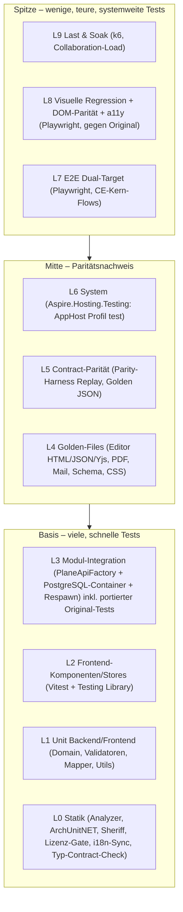
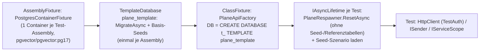
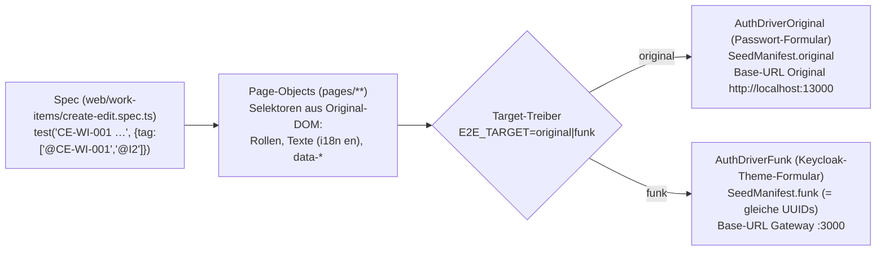
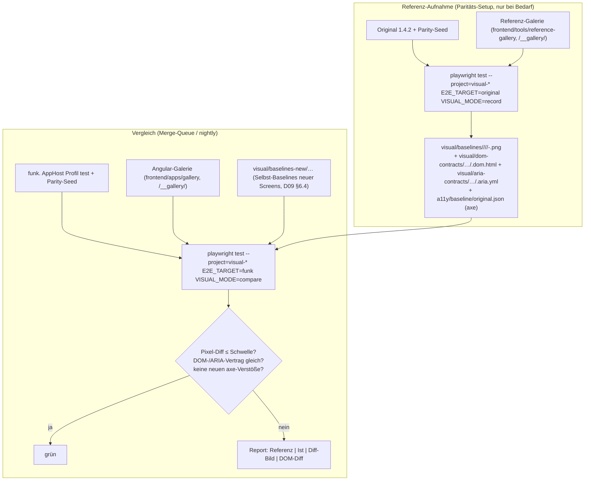

# 15 – Teststrategie, Qualitätssicherung und Paritätsnachweis

> **Status:** Entwurf zur Abnahme (Fachdokument D15). Verbindlich innerhalb seines Themas; nachrangig zu `00-grundsatzentscheidungen.md` (ADR-000 … ADR-009) und `01-zielarchitektur-und-tech-stack.md` (ADR-010 … ADR-052). Bei Widerspruch gilt 00 > 01 > dieses Dokument.
> **Stand:** 23.10.2026. Versionsangaben mit „⚠“ werden in Spike S0 per NuGet-/npm-Metadaten bestätigt und in `Directory.Packages.props` bzw. im pnpm-Catalog gepinnt (Regel aus 01 §8).
> **Zielrepository:** Alle Pfade für Zielcode sind relativ zur Wurzel des neuen Repositorys **`funk.`** (ADR-009, O-07 in 01). 01 §5.1 ist auf `funk./` angeglichen (früherer Arbeitstitel `plane-net/`, ABG-018 g). Pfade des Originals beginnen mit `apps/…` bzw. `packages/…` und beziehen sich auf `/home/user/plane` (Referenz, ADR-006).
> **Sprache:** Fließtext Deutsch, Bezeichner Englisch.
> **Kürzel:** `API/` = `apps/api/plane/`, `T/` = `apps/api/plane/tests/`, `LIVE/` = `apps/live/` (abweichend von 01, wo `LIVE/` = `apps/live/src/`; hier nötig, weil die Tests unter `apps/live/tests/` liegen), `WEB/` = `apps/web/`, `PKG/` = `packages/`, `PROPEL/` = Inhalt des npm-Tarballs `@makeplane/propel@0.7.3` (liegt **nicht** im Original-Repo, Bezug per `npm pack @makeplane/propel@0.7.3`, wie `A13a`/D09); `A01` … `A13b` = Analyse-Dokumente unter `migration/analysis/`; `F10` = `migration/features/10-ce-feature-katalog.md`, `F30` = `migration/features/30-paid-auswahlliste.md`.

## Inhaltsverzeichnis

1. [Ziel & Scope](#1-ziel--scope)
2. [Entscheidungen (D15-ADR-01 ff.)](#2-entscheidungen-d15-adr-01-ff)
3. [Detaildesign](#3-detaildesign)
   - 3.1 Testebenen und Testpyramide
   - 3.2 Test-Projekte und Ordnerstruktur in `funk.`
   - 3.3 Backend-Unit- und Integrationstests (xUnit v3, Testcontainers, Respawn)
   - 3.4 Systemtests mit `Aspire.Hosting.Testing` und Testumgebungen
   - 3.5 Port der 771 Original-Tests als Akzeptanztests (Ledger)
   - 3.6 API-Contract-Paritätstests gegen das laufende Original (Parity-Harness)
   - 3.7 Golden-File-Tests (Editor/HTML/JSON/Yjs, PDF, E-Mail, Schema)
   - 3.8 Frontend-Unit- und Komponententests (Vitest)
   - 3.9 E2E-Tests (Playwright) für alle CE-Kern-Flows
   - 3.10 Visuelle Regression gegen das Original
   - 3.11 Accessibility
   - 3.12 Last- und Performancetests
   - 3.13 Sicherheitstests
   - 3.14 Testdaten
   - 3.15 Quality-Gates, CI-Stufen und Definition of Done für KI-Agenten
   - 3.16 Zuordnung zu Inkrementen (was wird wann gebraucht)
4. [Vollständige Mapping-Tabellen Original → Ziel](#4-vollständige-mapping-tabellen-original--ziel)
5. [Code-Skelette](#5-code-skelette)
6. [Erweiterungspunkte für Bezahl-Pakete](#6-erweiterungspunkte-für-bezahl-pakete)
7. [Akzeptanzkriterien & Tests dieses Dokuments](#7-akzeptanzkriterien--tests-dieses-dokuments)
8. [Risiken & offene Punkte](#8-risiken--offene-punkte)
9. [Abhängigkeiten zu anderen Dokumenten (02–16)](#9-abhängigkeiten-zu-anderen-dokumenten-0216)
- [Anhang A – Ledger der Original-Tests (Datei-Ebene, 113 + 26 Dateien)](#anhang-a--ledger-der-original-tests-datei-ebene)
- [Anhang B – Testmatrix aller 507 CE-Features](#anhang-b--testmatrix-aller-507-ce-features)

---

## 1. Ziel & Scope

### 1.1 Ziel

Dieses Dokument legt fest, **wie** die Portierung von Plane CE 1.4.2 nach .NET 10 / Angular 22 nachweisbar korrekt, paritätisch und sicher wird – und zwar so, dass KI-Implementierungs-Agenten jedes Arbeitspaket ohne Rückfrage testen, selbst prüfen und abschließen können. Es konkretisiert ADR-048 (Test-Stack), Spike S11 (Paritäts-Harness), Prinzip P1 (Parität vor Eleganz), P2 (Contracts first) und P7 (Erweiterbar ohne Umbau) aus 01.

Messbare Ziele:

| Nr. | Ziel | Messgröße | Nachweis |
|---|---|---|---|
| Z1 | **Funktionale Parität** zu CE 1.4.2 | 100 % der nicht entfallenen CE-IDs (480 von 507; 27 entfallen nach ADR-008) haben mindestens die in Anhang B geforderten Testebenen grün | `tools/ci/ce-coverage-check` (§3.15.4) |
| Z2 | **Vertragsparität** der HTTP-API | Jeder Endpunkt des Endpunktkatalogs (Dokument 04) hat ≥ 1 aufgezeichnetes Golden-Szenario vom Original; Replay gegen `funk.` ohne nicht genehmigte Abweichung | Parity-Harness-Report (§3.6) |
| Z3 | **Übernahme des Original-Testwissens** | Alle 771 pytest-Funktionen und 288 relevanten Vitest-Fälle des Originals sind im Ledger einem Status zugeordnet (portiert / angepasst / entfällt mit Ersatz); 0 Einträge „offen“ bei Abnahme des zugehörigen Inkrements | `tools/ci/original-test-ledger` (§3.5) |
| Z4 | **Visuelle Parität** (ADR-005) | Pixelabweichung je Prüfpunkt unter Schwellwert (§3.10.5), DOM-Parität 100 % für Komponenten-Galerie | Visual-Report |
| Z5 | **Qualität des Neucodes** | Zeilenabdeckung ≥ 85 % in `Domain/` + `Application/` je Modul, ≥ 80 % je Frontend-Lib; 0 Analyzer-Warnungen; Architekturtests grün | Coverage-Gate |
| Z6 | **Last-Fähigkeit** | Kennzahlen aus §3.12 (Listen mit 10 000+ Work Items, 50 parallele Editoren) erfüllt | Lastbericht je Inkrement I2/I4/I7 |
| Z7 | **Sicherheit** | Alle Mechanismen S-01 … S-26 aus `A06` §2.14 haben Tests; Berechtigungsmatrix Rolle × Endpunkt 100 % grün; ZAP-Baseline ohne High/Medium | Security-Report |
| Z8 | **Zugänglichkeit** | Keine *neuen* axe-Verstöße gegenüber dem Original (Baseline-Diff) und 0 `critical`-Verstöße in Neucode | a11y-Report |

### 1.2 Im Scope

- Teststrategie aller Ebenen für Backend (`src/**`), Frontend (`frontend/**`), Realtime, Gateway, Migrator, Deployment-Artefakte.
- Paritätsverfahren gegen das **laufende Original** (API-Verträge, Screens, Editor-Konvertierung, PDF, E-Mails).
- Port des Original-Testbestands (`T/**`, `LIVE/tests/**`, `PKG/blocks/src/**/*.test.*`, `PKG/services/src/helpers/url.test.ts`).
- Testdaten (deterministische Seeds, Volumendaten), Testumgebungen (Aspire-Profil `test`, CI), Quality-Gates und Definition of Done (DoD) je Arbeitspaket-Typ.
- **Erweiterungspunkte** der Test-Infrastruktur für die 🧱-Pakete A1, A2, A9, A17, B1, B6, C1, C3, D1, D2, E3, E5, F1, F2, G1, H1, H6 (§6) – ohne Fachdesign der Bezahl-Features.

### 1.3 Nicht im Scope

- Fachliche Testfälle der Bezahl-Pakete (EE-*) – entstehen kurz vor der jeweiligen Welle W1 … W9.
- Konkrete CI-Workflow-Syntax (GitHub Actions vs. Forgejo Actions) und Runner-Infrastruktur → Dokument 14. Dieses Dokument definiert die **Stufen, Kommandos und Gates** plattformneutral als Skripte unter `tools/ci/`.
- Entscheidungen zu einzelnen Abweichungen vom Original (Bugfix ja/nein) → Entscheidungstabelle in Dokument 04; hier nur der Mechanismus (`tests/contracts/deviations.yaml`).

### 1.4 Ausgangslage im Original (Fakten)

| Bereich | Bestand im Original | Quelle |
|---|---|---|
| Backend-Tests | 113 Dateien, **771** `def test_*`: `contract/app` 50/381, `contract/api` 21/98, `unit/utils` 14/98, `unit/bg_tasks` 8/87, `unit/middleware` 3/31, `unit/settings` 5/29, `unit/serializers` 5/24, `unit/views` 4/12, `unit/models` 2/9, `smoke` 1/2 (per AST nachgezählt am 23.10.2026) | `A01` §2.25.1, `T/**` |
| Test-Infrastruktur Backend | pytest + pytest-django, Marker `unit/contract/smoke/slow`, factory-boy (5 Factories), Fixtures `api_client`, `session_client` (`force_authenticate`), `api_key_client`, `workspace`; Docker-Stack `docker-compose-test.yml` (Postgres 15.7, Valkey, RabbitMQ, silo) | `apps/api/pytest.ini`, `T/conftest.py`, `T/factories.py` |
| TS-Tests | `LIVE/tests` 32 (PDF 21, Effect-Utils 11), `PKG/blocks` 21 Dateien/251 Fälle, `PKG/services` 5, `PKG/codemods` 33 | `A01` §2.25.2 (Fallzahlen per `it(`/`test(` nachgezählt) |
| Frontend-App-Tests | **keine** (web, admin, space haben keine Test-Skripte) | `A01` §2.25.2 |
| E2E / Visual / Last | **keine** | – |
| CI | kein Workflow führt Tests aus | `A01` §2.24 |
| Editor | `packages/editor` ohne Unit-Tests | `A12` O14 |

Konsequenz: Das Original liefert wertvolle **Regressions- und Sicherheitsfälle** (viele Tests sind GHSA-/SECUR-Regressionen), aber keinen Paritätsnachweis für UI, Editor und Gesamtverhalten. Diesen Nachweis liefern Parity-Harness, Golden-Files, Dual-Target-E2E und visuelle Regression **gegen das laufende Original**.

---

## 2. Entscheidungen (D15-ADR-01 ff.)

| ADR | Belang | Entscheidung | Alternativen (verworfen) | Begründung | Lizenz / Paket | ab |
|---|---|---|---|---|---|---|
| D15-ADR-01 | Testpyramide | **Zehn Ebenen L0–L9** (§3.1) mit festen Zuständigkeiten; Breite unten (Unit, Komponenten), Paritätsnachweis in der Mitte (Contract, Golden), schmale Spitze (E2E, Visual). Jede Ebene hat ein eigenes Test-Projekt-Muster und eigenen CI-Job | „Testing Trophy“ ohne Unit-Ebene; nur E2E | Agenten brauchen schnelles, lokales Feedback (L0/L1 < 2 min je Modul); Parität ist nur mit Contract/Golden objektiv messbar | – | I0 |
| D15-ADR-02 | Backend-Testframework | **xUnit v3** auf **Microsoft.Testing.Platform** (`dotnet test` .NET 10), **Shouldly**, **NSubstitute**, **Verify.XunitV3**, **Bogus**, **FsCheck** (Property-Tests S-19, D15-SEC-03, B6; nur Testprojekte); Assembly-Fixtures (`[assembly: AssemblyFixture]`) für Container | NUnit/MSTest; FluentAssertions ≥ 8 (kommerziell) | Bindend aus ADR-048; v3 hat native Assembly-Fixtures, `TestContext.Current.CancellationToken`, `ValueTask`-Lifetime | Apache-2.0, BSD-3, MIT; FsCheck BSD-3-Clause; `xunit.v3` 4.x (NuGet-Stand 23.10.2026: 4.0.2; `Verify.XunitV3` 33.3.x, `TngTech.ArchUnitNET.xUnitV3` 0.13.4 – Kopplung in S0 bestätigen, 01 §8.1); `FsCheck` 3.x ⚠ fehlt in 01 §8.1 (Nachtrag §9.3) | I0 |
| D15-ADR-03 | Integrationstests Backend | **In-Process** `PlaneApiFactory : WebApplicationFactory<Program>` gegen **echtes PostgreSQL** (Testcontainers, Image identisch zum AppHost `pgvector/pgvector:pg17`) – **ein Container je Test-Assembly**, **eine Datenbank je Testklasse** (Klon per `CREATE DATABASE … TEMPLATE plane_template`), **Respawn** setzt vor jedem Test zurück; Valkey/Objektspeicher/Mailpit nur dort, wo das Modul sie braucht | SQLite/InMemory-Provider; ein DB-Reset nach jedem Test über alle Klassen; Datenbank je Test | Nur echtes PostgreSQL deckt `pg_trgm`, `jsonb`, partielle Indizes, `FOR UPDATE SKIP LOCKED`, Advisory Locks ab; Template-Klon erlaubt parallele Testklassen ohne Migrationskosten | Testcontainers MIT, Respawn Apache-2.0 | I0 |
| D15-ADR-04 | Authentisierung in Modul-Integrationstests | **Test-Authentisierungsschema** `TestAuth` (Header `X-Test-Principal: <seed-user-key>`), registriert **ausschließlich** von `PlaneApiFactory` in Test-Assemblies; echte Keycloak-Flows nur in `Plane.Identity.Tests` (Testcontainers.Keycloak), `Plane.AppHost.Tests` und E2E | Keycloak in jedem Modultest; Mock-JWT | Modultests bleiben schnell (kein IdP-Roundtrip), Auth-Pipeline (Permission-Filter, Scope-Binding) läuft trotzdem vollständig; Architekturtest verhindert, dass `TestAuth` in Hosts gelangt (§3.3.5) | – | I0 |
| D15-ADR-05 | Systemtests | **`Aspire.Hosting.Testing`** startet den echten AppHost im Profil `test` (alle Container inkl. Keycloak, Forgejo, Mailpit, SeaweedFS, gebaute Angular-Assets im Gateway) für `Plane.AppHost.Tests`, Parity-Replay, E2E, Visual, Last | Eigenes Docker-Compose für Tests; Testcontainers für alles | Eine Topologie für Dev, Test, CI (gleiche Ressourcen, Health-Checks, `WaitFor`-Kette); ersetzt `docker-compose-test.yml` des Originals (01 §10) | MIT; `Aspire.Hosting.Testing` 13.x | I0 |
| D15-ADR-06 | Port der Original-Tests | **Ledger-gestützter Port**: Jede der 771 pytest-Funktionen (und 288 TS-Fälle) ist eine Zeile in `tests/original-tests/ledger.yaml` mit Status `ported` \| `adapted` \| `obsolete` und Ziel-Test (`Trait("origin", "<pfad>::<klasse>::<funktion>")`); CI-Gate erzwingt Vollständigkeit und Existenz | Freie Neuschreibung ohne Rückverfolgung; automatische Übersetzung Python→C# | Rückverfolgbarkeit für Abnahme; Sicherheits-Regressionen (GHSA) gehen nicht verloren; Agent erkennt sofort, welche Fälle sein Arbeitspaket portieren muss | – | I0 (Ledger), je Inkrement (Fälle) |
| D15-ADR-07 | Contract-Parität | **Parity-Harness `Plane.Tools.ParityHarness`** mit **Record (gegen Original) → Golden-Files im Repo → Replay (gegen `funk.`) → normalisierter JSON-Diff** mit Ausnahmekatalog `tests/contracts/deviations.yaml`; **identische deterministische IDs** in beiden Systemen (UUIDv5 aus Seed-Schlüsseln) | Nur Schema-Vergleich (OpenAPI); Proxy-Mitschnitt manueller Klicks; Vergleich gegen Doku | Inhaltliche Gleichheit (Werte, Reihenfolge, Fehlercodes, `null` vs. fehlend) ist nur mit identischen Daten prüfbar; gleiche UUIDs machen IDs vergleichbar statt nur maskierbar | – | I0 (S11) |
| D15-ADR-08 | Golden-Files | **Verify.XunitV3** für alle .NET-Snapshots; Golden-Erzeugung aus dem Original ausschließlich mit Dev-Werkzeugen (`tools/golden/generate.mjs` für Editor; `tools/golden/original-render.py` im Original-API-Container für E-Mail-Templates); Goldens sind eingecheckt, nie zur Testlaufzeit erzeugt | Snapshots ohne Original-Bezug („first run wins“); Laufzeit-Node | Erfüllt P5 (kein Node zur Laufzeit) und P2 (Contracts first); „first run wins“ würde Fehler des Ports zementieren | MIT | I0 (Mechanik), I1/I2/I4 (Korpora) |
| D15-ADR-09 | Frontend-Unit/Komponenten | **Vitest** über `@angular/build:unit-test` (Angular-22-Default), Umgebung **jsdom** (wie `PKG/blocks`), `@testing-library/angular` + `user-event`; **Vitest-Browser-Modus** (Playwright-Provider, Chromium) nur für Tests, die echte Layout-Berechnung brauchen (floating-ui-Positionierung, Virtualisierung, DnD-Hitbox) | Jest; Karma; happy-dom | Bindend aus ADR-048; jsdom entspricht dem Original (`PKG/blocks/vitest.config.ts`), damit portierte Fälle unverändert gelten | MIT | I0 |
| D15-ADR-10 | E2E | **Playwright Test (TypeScript)** in `frontend/apps/e2e`, **Dual-Target**: dieselben Specs laufen gegen das Original (Referenz) und gegen `funk.`; Ziel-spezifische Unterschiede nur in Treibern (`AuthDriver`, `SeedManifest`); jeder Test trägt CE-ID-Tags (`@CE-WI-001`) | Cypress; Selenium; getrennte Specs je System | Gleiches DOM (ADR-005, 01 §7.17) erlaubt gleiche Selektoren; Dual-Target beweist Verhaltensgleichheit statt sie zu behaupten | Apache-2.0; `@playwright/test` **1.64.x** (npm-Stand 23.10.2026: 1.64.1) – **muss** dieselbe Minor-Version wie `Microsoft.Playwright` (1.64.x, 01 §8.1) und das Container-Image `mcr.microsoft.com/playwright:v1.64.1-noble` haben, weil .NET-Browser-Tests (S1, L6) und Specs dieselben Browser-Builds im selben Image nutzen (01 §8.2 nennt noch „1.5x“, §9.3) | I0 |
| D15-ADR-11 | Visuelle Regression | **Referenz = Screenshots des laufenden Originals**, aufgenommen von denselben Playwright-Specs (`--target=original`), versioniert unter `frontend/apps/e2e/visual/baselines/` (Ablage nach D09 §3.1, ABG-033); Vergleich mit `toHaveScreenshot` (pixelmatch) **plus DOM-Vertrag** (`dom-contracts/`) und ARIA-Vertrag (`aria-contracts/`); feste Uhrzeit, deterministischer Zufall, eingefrorene Animationen, Playwright-Container mit gebündelten Fonts für Aufnahme **und** Vergleich | Applitools/Percy (SaaS, verletzt ADR-004); Storybook-Chromatic; manuelle Sichtprüfung | Verfahren aus `A13a` §5.7 und `A09` §5.5/§5.6; objektiv, airgapped, reproduzierbar | Apache-2.0 | I0 (Shell, S10) |
| D15-ADR-12 | Accessibility | **`@axe-core/playwright`** in jedem E2E-Zustand mit Prüfpunkt (Tags `wcag2a`, `wcag2aa`, `wcag21aa`, `wcag22aa`), **Baseline-Diff gegen das Original**: Ziel darf keine Regel-Verletzung haben, die das Original an derselben Stelle nicht hat; Tastatur-Szenarien aus `PKG/blocks`-Tests als Pflicht | Absolute WCAG-Konformität (würde ADR-005 an Stellen brechen, an denen das Original abweicht); nur manuelles Audit | Vereinbar mit 1:1-UI; verhindert Regressionen; bekannte Original-Verstöße werden als Abweichungsentscheidung sichtbar | MPL-2.0 (nur Dev, 01 §2.3 zulässig) | I0 |
| D15-ADR-13 | Lasttests HTTP | **k6** (eigenständiges Werkzeug, Container `grafana/k6`) mit Skripten unter `tests/load/k6/`, Daten aus dem Volumen-Seed (§3.14.3) | NBomber (Gratis-Lizenz nur privat, Organisationen brauchen Kauflizenz – [NBomber-Lizenz](https://nbomber.com/docs/getting-started/license)); Gatling (Apache-2.0, JVM-Toolchain); Locust (MIT, Python) | De-facto-Standard (Docker Hub `grafana/k6` 2.3.0 am 23.10.2026 verfügbar, Pin per Digest), Schwellwerte als Code (`thresholds`), läuft airgapped als Container; AGPL-3.0 ist als **eigenständiges Werkzeug ohne Linking** unbedenklich (wie Forgejo/Garage in 01 §2.3) | AGPL-3.0 (Werkzeug, kein Paket im Build; [k6](https://en.wikipedia.org/wiki/K6_(software))); Version 2.x ⚠ | I2 |
| D15-ADR-14 | Lasttests Kollaboration | **`Plane.LoadTests.Collaboration`** (C#-Konsole): synthetische Editor-Clients mit YDotNet + Client-Seite des Hocuspocus-Codecs aus `Plane.Collaboration` (gleiche Wire-Implementierung, eigene Testdoppel-Schicht), plus **2 echte Browser-Zeugen** (Playwright mit unverändertem `@hocuspocus/provider` 2.15.2), die Konvergenz und End-zu-End-Latenz messen | 50 Playwright-Browser (zu teuer pro Lauf); k6-WebSocket mit gebündeltem `yjs` (Goja/Sobek-Kompatibilität unsicher) | Skaliert auf 50+ Clients pro Runner; Browser-Zeugen sichern, dass das Messobjekt der echte Client ist (Kriterium aus S1) | MIT | I4 (S1 bereits I0-Spike-Track) |
| D15-ADR-15 | Sicherheitstests | Vier Säulen: (1) **generierte Berechtigungsmatrix** Rolle × Endpunkt aus Permission-Katalog + Endpunkt-Metadaten; (2) **Mechanismus-Tests** S-01 … S-26 (`A06` §2.14) + Ported-GHSA-Fälle; (3) **DAST**: OWASP **ZAP** Baseline + API-Scan (OpenAPI) gegen das Test-System; (4) **Supply Chain**: Trivy (Images, SBOM), gitleaks (Secrets), Lizenz-Gate (ADR-050) | Nur Pen-Test vor Go-Live; kommerzielle SAST/DAST | Matrix deckt die Masse der IDOR-/Scope-Fehler ab, die im Original die meisten GHSA-Meldungen verursacht haben; alle Werkzeuge Open Source und airgapped betreibbar | ZAP Apache-2.0, Trivy Apache-2.0, gitleaks MIT | I0 (Matrix-Gerüst), I6/I7 (DAST voll) |
| D15-ADR-16 | Testdaten | **Eine kanonische Seed-Spezifikation** `tests/seed/parity-seed.yaml` (Schlüssel-basiert, UUIDv5, feste Zeitstempel) mit zwei Ladern: `seed_plane.py` (Django-ORM im Original-Container, ohne Änderung am Original-Repo) und `ParitySeedLoader` (EF Core im Ziel); Volumendaten per **Bogus mit festem Seed**; Keycloak-Testbenutzer mit festen IDs im Realm-Import | Getrennte Seeds je System; Seeds über die öffentliche API; Datenbank-Dump | Nur identische Daten machen Contract-Diffs und Screenshots vergleichbar; API-Seeding wäre langsam und würde Zeitstempel nicht fixieren (Fallback laut S11) | MIT (Bogus) | I0 |
| D15-ADR-17 | Quality-Gates | **Stufenmodell G0–G6** (§3.15) mit harten Schwellwerten; Gates sind Skripte unter `tools/ci/` und lokal identisch ausführbar (`./tools/ci/gate.sh <stufe>`); DoD je Arbeitspaket-Typ als Checkliste in der PR-Vorlage | Nur Review-basierte Abnahme | KI-Agenten brauchen maschinelles, eindeutiges „fertig“; lokale Ausführbarkeit verhindert CI-Ping-Pong | – | I0 |
| D15-ADR-18 | Flaky-Tests | **Null-Toleranz mit Quarantäne**: ein als flaky erkannter Test (Retry nötig) wird mit `[Trait("quarantine","<ticket>")]` bzw. `test.fixme` + Ablaufdatum (max. 10 Arbeitstage) markiert; Quarantäne zählt **nicht** zur CE-Abdeckung; Retries nur in E2E/Visual (max. 1) und nur mit Report | Pauschale Retries; Ignorieren | Retries verdecken Nebenläufigkeitsfehler (Outbox, Realtime); Quarantäne macht Schuld sichtbar | – | I0 |
| D15-ADR-19 | Abdeckungsmessung | **`coverlet.MTP`** (Coverlet-Erweiterung für Microsoft.Testing.Platform, MIT, Cobertura-Ausgabe) für .NET, `@vitest/coverage-v8` für Frontend; Gate auf **geänderte Zeilen** (Diff-Coverage ≥ 90 %) und Modul-Untergrenzen (Z5); Mutationstests (**Stryker.NET**, Apache-2.0) nur nightly für `Domain/`-Ordner, informativ | Globale Gesamtquote; keine Messung | Diff-Coverage ist für parallel arbeitende Agenten fair und wirksam; Original verlangte `--fail-under=90` (`apps/api/run_tests.py`) | MIT (`coverlet.MTP` 10.x), Stryker.NET Apache-2.0; **nicht** `Microsoft.Testing.Extensions.CodeCoverage` (proprietäre Microsoft-Lizenzdatei `License.txt` statt SPDX-Ausdruck, laut nuspec 18.12.0 – widerspricht der Lizenz-Hygiene, O-D15-02 entschieden) | I0 |
| D15-ADR-20 | Testumgebungen | **Vier Umgebungen**: `local` (Agent/Entwickler, `aspire run` Profil `dev`), `ci-fast` (Testcontainers, kein AppHost), `ci-system` (AppHost Profil `test`, Images gebaut), `parity` (Original 1.4.2 per `tools/parity/start-original.sh` mit gepinnten `makeplane/*`-Images hinter Proxy `http://localhost:13000` (D14 §3.20) + `funk.` Profil `test` nebeneinander); dazu `airgap` ab I7 (Egress gesperrt) | Gemeinsame, langlebige Test-Instanz | Reproduzierbar, parallelisierbar, keine geteilten Zustände; Original-Umgebung nur, wo sie gebraucht wird | – | I0 |

---
## 3. Detaildesign

### 3.1 Testebenen und Testpyramide



| Ebene | Prüfgegenstand | Werkzeuge | Ort in `funk.` | Laufzeitbudget (CI) | Wer schreibt | Auslöser |
|---|---|---|---|---|---|---|
| **L0 Statik** | Abhängigkeitsregeln R1–R10 (01 §5.2), Banned APIs (R8), Sheriff-Grenzen, Lizenzen, AGPL-Header, i18n-Schlüssel-Sync, OpenAPI↔`libs/shared/types`-Kompatibilität (ADR-047), keine Plan-/Upsell-Bezeichner (01 §7.18), kein Node in Images (P5) | Roslyn-Analyzer, `Meziantou.Analyzer`, `BannedApiAnalyzers`, ArchUnitNET, Sheriff/ESLint, `tools/ci/license-gate`, `tools/ci/license-header-check`, `frontend/tools/i18n-sync-check`, `frontend/tools/contract-check`, `tools/ci/assert-no-node.sh` | `tests/Plane.ArchitectureTests/`, `tools/ci/`, `frontend/tools/` | < 4 min | Infrastruktur-Agent (I0), danach automatisch | jeder Push |
| **L1 Unit** | reine Logik ohne I/O: `Domain/`-Regeln, FluentValidation-Validatoren, Mapperly-Mapper, JSON-Converter (01 §7.2/7.3), Fehlerfabrik, Cursor-Codec, Filter-AST-Parser, TS-Utils/Helpers aus `libs/shared/utils` | xUnit v3 + Shouldly; Vitest (node) | `tests/modules/Plane.<M>.Tests/Unit/`, `tests/Plane.BuildingBlocks.Tests/`, `frontend/libs/**/src/**/*.spec.ts` | < 2 min je Modul | Fach-Agent je WP | jeder Push |
| **L2 Frontend-Komponenten & Stores** | Signal-Stores (strukturgleich zu MobX-Stores, 01 ADR-040), Services (HttpClient-Mock), Komponenten-Verhalten (Öffnen/Schließen, Tastatur, ARIA, Outside-Click), Pipes/Direktiven | Vitest (jsdom), `@testing-library/angular`, `@testing-library/user-event`, `HttpTestingController`; Browser-Modus für Layout-Fälle | `frontend/libs/**/*.spec.ts` | < 5 min gesamt (sharded) | Fach-Agent je WP | jeder Push |
| **L3 Modul-Integration** | Handler + Endpunkte + DB je Modul: Validierung, Berechtigung (401/403/404 exakt wie Original), Tenant-Isolation, Soft-Delete-Kaskaden, Activity-Einträge, Outbox-Einträge, OwnershipGuard (R3); **portierte Original-Tests** (`Acceptance/Original/`) | xUnit v3, `PlaneApiFactory`, Testcontainers PostgreSQL (+Valkey/SeaweedFS/Mailpit nach Bedarf), Respawn, Verify, WireMock.Net | `tests/modules/Plane.<M>.Tests/Integration/`, `…/Acceptance/Original/` | < 6 min je Modul (parallel je Modul) | Fach-Agent je WP | jeder Push |
| **L4 Golden-Files** | Byte-/Strukturgleichheit mit Original-Ausgaben: Tiptap-Schema-Snapshot, PM-JSON↔HTML↔Yjs (≥ 200 Dokumente, S2), PDF-Text + Raster (S3), E-Mail-HTML/Text je Template, Export CSV/XLSX-Spalten, kompiliertes CSS (Selektor-/Deklarationsmenge, `A13a` §5.7 Punkt 5) | Verify.XunitV3, AngleSharp-Normalisierer, PdfPig (Text), SkiaSharp (Raster-Diff), Vitest-Snapshots (Schema im Browser-Build) | `tests/Plane.Documents.Tests/Golden/`, `tests/Plane.Documents.Pdf.Tests/`, `tests/Plane.Platform.Tests/Mail/`, `tests/modules/Plane.Exports.Tests/Golden/`, `frontend/tools/visual/` (CSS-Diff) | < 5 min | Fach-Agent (Editor/Docs/Mail) | Push in betroffenen Pfaden |
| **L5 Contract-Parität** | Request/Response-Verträge aller Endpunkte gegen aufgezeichnete Original-Goldens (Status, Header-Auswahl, Body normalisiert) | `Plane.Tools.ParityHarness replay` gegen `PlaneApiFactory` (schnell) **und** gegen AppHost (voll, nightly) | `tests/contracts/scenarios/**`, `tests/contracts/golden/**`, Runner `tests/Plane.Contracts.Tests/` | < 8 min (In-Process) | Fach-Agent je Endpunkt (P2: zuerst Golden, dann Code) | jeder Push (betroffene Module), nightly alle |
| **L6 System** | Start/Health aller Ressourcen, Gateway-Routing (`A01` §2.8.1), Keycloak-Login/Logout/Back-Channel, Outbox → Worker → Mail (Mailpit-API), Realtime-Verbindung, Forgejo-SSO-Smoke, Migrator idempotent | `Aspire.Hosting.Testing`, xUnit v3, Microsoft.Playwright (.NET) für Browser-Protokolltests | `tests/Plane.AppHost.Tests/`, `tests/Plane.Gateway.Tests/`, `tests/Plane.Migrator.Tests/`, `tests/Plane.Collaboration.Tests/` | < 12 min | Infrastruktur-Agent + Fach-Agent | PR-Merge-Queue, nightly |
| **L7 E2E** | CE-Kern-Flows Ende-zu-Ende in web/admin/space (Anhang B Spalte „E2E“) | `@playwright/test`, Page-Objects, Dual-Target | `frontend/apps/e2e/{web,admin,space}/` | < 25 min (8 Shards) | Fach-Agent je WP (Spec gehört zum Schnitt) | Merge-Queue (betroffene Tags), nightly voll |
| **L8 Visual/DOM/a11y** | Pixel- und DOM-Parität zum Original; axe-Baseline-Diff | Playwright `toHaveScreenshot`, `dom-parity`-Helfer, `@axe-core/playwright` | `frontend/apps/e2e/visual/`, `frontend/apps/e2e/a11y/`, Galerie `frontend/apps/gallery/` | < 30 min (Chromium, sharded); Firefox/WebKit nightly | Fach-Agent je WP; Referenzen vom Paritäts-Agenten | Merge-Queue (betroffene Tags), nightly voll |
| **L9 Last/Soak** | Durchsatz/Latenz/Speicher (§3.12) | k6, `Plane.LoadTests.Collaboration`, PostgreSQL `EXPLAIN (ANALYZE, BUFFERS)`-Assertions | `tests/load/` | 30–75 min | Performance-Agent | nightly ab I2, Release-Kandidat |

**Verhältnis (Richtwert, je Modul gemessen, nicht erzwungen):** L1+L2 ≈ 60 %, L3 ≈ 25 %, L4+L5 ≈ 10 %, L6–L8 ≈ 5 % der Testfälle. Erzwungen werden nur die Mindestabdeckungen je CE-ID (Anhang B) und die Gates (§3.15).

### 3.2 Test-Projekte und Ordnerstruktur in `funk.`

Ergänzt 01 §5.1 (dort bereits: `Plane.ArchitectureTests`, `Plane.AppHost.Tests`, `Plane.BuildingBlocks.Tests`, `Plane.Platform.Tests`, `Plane.Gateway.Tests`, `Plane.Migrator.Tests`, `modules/Plane.<M>.Tests`, `Plane.Documents.Tests`, `Plane.Documents.Pdf.Tests`, `Plane.Collaboration.Tests`, `contracts/`). **Neu durch dieses Dokument** (mit ★ markiert):

```text
funk./
├── src/building-blocks/Plane.BuildingBlocks.Testing/      # (01) Basis aller .NET-Tests – Inhalt §5.1
│   ├── Hosting/        PlaneApiFactory.cs, TestAuthHandler.cs, TestPrincipalHeader.cs, ModuleScopeAssertions.cs
│   ├── Database/       PostgresContainerFixture.cs, TemplateDatabase.cs, PlaneRespawner.cs, SqlPlanAssertions.cs
│   ├── Containers/     ValkeyFixture.cs, SeaweedFsFixture.cs, MailpitFixture.cs (+ MailpitClient), KeycloakFixture.cs, ForgejoFixture.cs (W1-Vorbereitung)
│   ├── Seed/           SeedSpec.cs (YAML-Modell), SeedKey.cs (UUIDv5), ParitySeedLoader.cs, DeterministicIdGenerator.cs, FixedClock.cs, VolumeSeeder.cs (Bogus)
│   ├── Builders/       WorkspaceBuilder.cs, ProjectBuilder.cs, WorkItemBuilder.cs, … (Fluent, nutzen Commands statt DbContext)
│   ├── Golden/         GoldenSettings.cs (Verify-Konventionen), JsonNormalizer.cs, HtmlNormalizer.cs
│   ├── Contracts/      ContractScenarioRunner.cs (In-Process-Replay für L5)
│   ├── Original/       OriginAttribute.cs ([Origin("T/…::Klasse::test_x")]), LedgerReader.cs
│   └── Auth/           KeycloakHeadlessLogin.cs (Authorization-Code-Flow per HttpClient gegen Keycloak-Login-Formular)
├── src/tools/Plane.Tools.ParityHarness/                   # (01) S11 – Kommandos §3.6.3
├── tests/
│   ├── Plane.ArchitectureTests/                           # (01) + Test-Regeln T1–T6 (§3.3.5)
│   ├── Plane.AppHost.Tests/                               # (01) L6
│   ├── Plane.BuildingBlocks.Tests/                        # (01)
│   ├── Plane.Platform.Tests/                              # (01)
│   ├── Plane.Gateway.Tests/                               # (01)
│   ├── Plane.Migrator.Tests/                              # (01)
│   ├── Plane.Worker.Tests/                          ★     # Cron-Registrierungen (13 Beat-Einträge, A01 §2.17), Cleanup-/Retention-Jobs, Leader-Lock
│   ├── Plane.Contracts.Tests/                       ★     # L5-Runner: lädt tests/contracts/** und spielt In-Process ab
│   ├── Plane.Security.Tests/                        ★     # generierte Berechtigungsmatrix, Tenant-Isolation über alle Module, Header/Cookie-Regeln
│   ├── Plane.BuildingBlocks.Testing.Tests/          ★     # Selbsttests der Test-Infrastruktur (Normalisierer, SeedKey, Respawn-Regeln) – §7.2
│   ├── Plane.Tools.ParityHarness.Tests/             ★     # Selbsttests des Harness (N1–N13, Ausnahmekatalog, Determinismus) – §7.2
│   ├── Plane.Tools.Gates.Tests/                     ★     # Selbsttests der Gate-Werkzeuge unter tools/ci/ (Fixture-Repos, Exit-Codes) – §7.2
│   ├── Plane.ServiceDefaults.Tests/  Plane.Cli.Tests/  Plane.Tools.ForgejoInit.Tests/  deploy/*.sh   # (D14 §7.2)
│   ├── Plane.Documents.Tests/  Plane.Documents.Pdf.Tests/  Plane.Collaboration.Tests/   # (01)
│   ├── modules/Plane.<M>.Tests/{Unit,Integration,Contract,Acceptance/Original}/        # (01) + Acceptance/Original ★
│   ├── contracts/                                         # (01) Parity-Daten
│   │   ├── scenarios/<modul>/<szenario>.yaml       ★     # Schritte (Request-Vorlagen, Akteur, Captures)
│   │   ├── golden/<modul>/<szenario>/<nn>-<schritt>.golden.json ★
│   │   ├── deviations.yaml                                # (01 §7.20) Ausnahmekatalog
│   │   └── normalization.yaml                       ★     # globale Pfad-Regeln (Zeitstempel, Secrets, URLs)
│   ├── seed/                                        ★
│   │   ├── parity-seed.yaml                               # kanonischer Seed (§3.14.1)
│   │   ├── volume-profiles.yaml                           # Volumen-Profile S/M/L/XL (§3.14.3)
│   │   └── original/seed_plane.py                         # Django-Lader (läuft im Original-Container)
│   ├── security/                                    ★
│   │   ├── permission-matrix.yaml                         # generiert aus D05-Matrix (Inhalt) + Akteur-Klassen (§3.13.1, §6.1 EP-T06)
│   │   ├── actor-classes.yaml                             # deklarierte Akteur-Klassen (CE: 15)
│   │   └── xss/*.html  zap/baseline.rules.tsv             # XSS-Korpus (S-07), begründete ZAP-Ausnahmen (D15-SEC-04)
│   ├── ce-matrix.yaml                               ★     # maschinenlesbare Fassung von Anhang B (Quelle: migration/architecture/_data/15-ce-testmatrix.json)
│   ├── extension-points.yaml                        ★     # Inventar der Andockstellen + Pflicht-Tests (§6.1 EP-T09)
│   ├── original-tests/                              ★
│   │   ├── ledger.yaml                                    # 771 + 288 + 33 Einträge (Anhang A ist die Datei-Sicht)
│   │   └── extract/extract_pytest.py, extract_vitest.mjs  # Dev-Werkzeuge: erzeugen/aktualisieren die Ledger-Rohliste aus dem Original
│   └── load/                                        ★
│       ├── k6/{work-item-lists,kanban-groups,spreadsheet,search,public-api,auth-session,team-day,capacity-single-node}.js
│       ├── Plane.LoadTests.Collaboration/                 # C#-Konsole (§3.12.3)
│       └── thresholds.yaml                                # Zielwerte (Single Source für k6 + C#)
├── frontend/
│   ├── apps/gallery/                                ★     # Komponenten-Galerie (A13a §5.7 Punkt 2), base href /__gallery/ – nur in Test-Builds
│   ├── apps/e2e/                                          # (01) Playwright
│   │   ├── playwright.config.ts                           # Projekte web-chromium, admin-chromium, space-chromium, gallery-{chromium,firefox,webkit}, visual-*, a11y
│   │   ├── drivers/{target.ts,auth-driver.original.ts,auth-driver.funk.ts,seed-manifest.ts,clock.ts,determinism.ts}
│   │   ├── pages/                                         # Page-Objects (Dual-Target, Selektoren aus Original-DOM)
│   │   ├── web/<domäne>/*.spec.ts  admin/*.spec.ts  space/*.spec.ts
│   │   ├── visual/                                        # Ablage nach D09 §3.1 (ABG-033)
│   │   │   ├── catalog/{web,admin,space,gallery,keycloak}.catalog.yaml  + catalog/acceptance/<app>.acceptance.yaml   # Prüfpunkte, Zustände, Masken (Masken nur hier)
│   │   │   ├── baselines/<app>/<entry-id>/<state-id>/<theme>-<viewport>.png       # aus dem Original aufgenommen (Git LFS)
│   │   │   ├── baselines-new/<app>/<entry-id>/<state-id>/<theme>-<viewport>.png   # Selbst-Baselines neuer Screens (D09 §6.4)
│   │   │   ├── dom-contracts/<app>/<entry-id>/<state-id>.dom.html   aria-contracts/<app>/<entry-id>/<state-id>.aria.yml
│   │   │   ├── ui-deviations.yaml                         # einziges UI-Abweichungsregister (kind: extra-css|extra-utility|pixel|dom|mask|route|behavior|asset)
│   │   │   └── {gallery,web,admin,space,editor,keycloak}/*.visual.ts  + __diff__/ (gitignored)
│   │   └── a11y/baseline/{original}.json                  # axe-Baseline des Originals je Prüfpunkt
│   ├── libs/{web,admin,space}/extensions/testing/         # (08) provideFakeExtensions / provideFakeAdminExtensions / provideFakeSpaceExtensions (config?) – Test-Erweiterungen (EP-T08, ABG-032)
│   ├── tools/visual/                                      # (09 §3.1, 01 §6.1) css-diff.ts (CSS-Selektor/Deklarations-Diff Original- vs. Angular-Build), reference-css/<app>.css, capture-reference.ts (`pnpm visual:record`), report/
│   ├── tools/reference-gallery/                     ★     # React-Galerie für das Original (React 19 + PROPEL-Tarball `@makeplane/propel@0.7.3` + `packages/blocks` am ORIGINAL_SHA; Vite-`base: '/__gallery/'`; nur Dev/Paritäts-CI; ABG-008)
│   └── tools/gallery-stories/                       ★     # gemeinsame Story-Definitionen `*.stories.json` beider Galerien (D09-ADR-16)
├── tools/ci/
│   ├── gate.sh                                            # ./tools/ci/gate.sh g0|g1|…|g6 (§3.15)
│   ├── ce-coverage-check/                           ★     # prüft Anhang-B-Matrix gegen Test-Tags/Traits
│   ├── original-test-ledger/                        ★     # prüft ledger.yaml gegen Test-Assemblies und Vitest-Listen
│   └── seed-manifest-diff/, acceptance-report/, k6-thresholds.mjs ★  # weitere Gate-Werkzeuge (§3.15.4, §3.12.2)
└── tools/parity/                                    ★     # (D14 §3.20) Original v1.4.2 neben funk. betreiben
    ├── start-original.sh                                  # startet compose.original.yml, wartet auf Health, lädt Parity-Seed
    ├── compose.original.yml                               # makeplane/*-Images v1.4.2 per Digest, Proxy :13000, Mount tests/seed → /parity im api-Container
    └── original.env                                       # Image-Digests + ORIGINAL_SHA (Commit-Pin für Quell-Werkzeuge tools/golden, frontend/tools/reference-gallery)
```

**Namens- und Trait-Konventionen (verbindlich, maschinell ausgewertet):**

| Element | Konvention | Beispiel |
|---|---|---|
| Testklasse | `<Gegenstand>Tests` | `CreateLabelTests`, `LabelEndpointsTests` |
| Testmethode | `<Situation>_<Erwartung>` (englisch) | `Create_WithDuplicateName_Returns400WithFieldError` |
| CE-Bezug | `[Trait("ce", "CE-PRJ-029")]` (mehrfach erlaubt) | – |
| Inkrement | `[Trait("inc", "I1")]` | – |
| Ebene | `[Trait("level", "L3")]` (L1/L3/L4/L5/L6) | – |
| Original-Herkunft | `[Origin("T/contract/app/test_project_app.py::TestProjectAPIPost::test_create_project_empty_data")]` (setzt Trait `origin`) | §5.4 |
| Playwright | Titel beginnt mit CE-ID; `tag: ['@CE-WI-001', '@I2', '@web']` | `test('CE-WI-001 create work item via modal', { tag: [...] }, …)` |
| Vitest | `describe('CE-PRJ-029 label form', …)` oder Kommentar `// @ce CE-PRJ-029` am `describe` | – |
| Quarantäne | `[Trait("quarantine", "FUNK-1234:2026-11-06")]` / `test.fixme(true, 'FUNK-1234:2026-11-06')` | D15-ADR-18 |

### 3.3 Backend-Unit- und Integrationstests (xUnit v3, Testcontainers, Respawn)

#### 3.3.1 Unit (L1)

- Gegenstand: alles unter `Plane.<M>/Domain/`, Validatoren (`*Validator`), Mapper (`Mapping/`), BuildingBlocks-Primitive (`CursorCodec`, `PlaneJsonOptions`, `PlaneErrors`, `SnakeCaseEnumConverter`, `MicrosecondDateTimeConverter`, `SequenceAllocator`-Logik ohne DB), `Plane.Documents`-Konverter einzelner Nodes.
- Keine DB, kein `HttpClient`, kein Container; Zeit nur über `FixedClock` (R8), IDs nur über `DeterministicIdGenerator`.
- Pflichtfälle je Validator: jede Regel positiv und negativ, Fehlertext **wörtlich** wie Original (Quelle: Serializer/Model des Originals, Fehlertexte-Katalog in Dokument 04).
- Pflichtfälle Converter (01 §7.2/§7.3): Mikrosekunden-Format `yyyy-MM-ddTHH:mm:ss.ffffffZ`, `DateOnly` `yyyy-MM-dd`, `null`-Ausgabe, `double`-Ausgabe mit Dezimalteil, wo das Original `float` liefert (z. B. `sort_order: 65535.0` – siehe Risiko R-D15-04), Enum-Zahlenwerte (`role: 20`).

#### 3.3.2 Modul-Integration (L3)

**Fixture-Kaskade:**



| Baustein | Regel |
|---|---|
| `PostgresContainerFixture` | Image `pgvector/pgvector:pg17` (gleiches Tag wie AppHost), `max_connections=400`, Extensions `vector`, `pg_trgm`, `unaccent`; `tmpfs` für `/var/lib/postgresql/data` (wie Original-Test-Stack) |
| `TemplateDatabase` | führt `PlaneDbContext.Database.MigrateAsync()` **und** die Basis-Seeds des Migrators (System-Rollen 20/15/5, Instanz-Datensatz, Relationstyp-Katalog A9, Event-Katalog) aus; danach `ALTER DATABASE plane_template IS_TEMPLATE true` |
| Klon je Testklasse | `CREATE DATABASE "t_<hash(klasse)>" TEMPLATE plane_template` (≈ 0,1–0,4 s); **eine `PlaneApiFactory` je Testklasse** (gecacht in `ClassHosts`, nicht je Test – Host-Aufbau kostet 0,3–1 s); Löschen von DB und Factory beim Ende der Assembly-Fixture |
| `PlaneRespawner` | Respawn 7 (7.0.0, Apache-2.0), `DbAdapter.Postgres`, `SchemasToInclude = ["public"]`, `TablesToIgnore` = `__EFMigrationsHistory`, `roles`, `work_item_relation_types`, `data_protection_keys`, `instances`, `event_types` (Basis-Seeds; endgültige Liste liefert D03, §9.3); Reset **vor** jedem Test (nicht danach – erleichtert Fehleranalyse) |
| Parallelität | Testklassen parallel (eigene DB), Tests innerhalb einer Klasse sequenziell; `xunit.runner.json`: `parallelizeTestCollections=true`, `maxParallelThreads = 2 × CPU` |
| Zusatzcontainer | nur per `[Collection]`-Fixture, wenn Modul sie benötigt: `SeaweedFsFixture` (Assets, Exports, Pages), `MailpitFixture` (Notifications, Webhooks-Deaktivierungs-Mail, Instance-Test-Mail), `ValkeyFixture` (Caching, Rate-Limit, Collaboration-Fan-out), `KeycloakFixture` (nur Identity) |
| Externe HTTP-Ziele | WireMock.Net (LLM-Provider, Unsplash, Webhook-Ziele, Link-Unfurl-Ziele, Forgejo-Simulation); **kein** realer Internetzugriff (Test schlägt fehl, wenn `SocketsHttpHandler` ein nicht registriertes Ziel anwählt – `DenyExternalNetworkHandler`) |
| Hintergrundverarbeitung | `PlaneApiFactory` registriert `InlineOutboxDispatcher` (verarbeitet Outbox synchron nach `SaveChanges` auf Anforderung: `await factory.DrainOutboxAsync()`); echte Worker-Semantik (SKIP LOCKED, Retry, Dead-Letter) in `Plane.BuildingBlocks.Tests` und `Plane.Worker.Tests` |
| OwnershipGuard | immer aktiv (R3): jeder Integrationstest schlägt fehl, wenn ein Handler fremde Entitäten schreibt |
| Abfrage-Budget | `SqlPlanAssertions.AssertMaxQueries(n)` für Listen-Endpunkte (N+1-Schutz), `AssertNoSeqScan("work_items")` für Projekt-gefilterte Listen (Kriterium aus S9) |

**Pflicht-Testfälle je Endpunkt (L3, unabhängig von Original-Tests):**

| Nr. | Fall | Erwartung |
|---|---|---|
| E1 | anonym | 401 mit Original-Körper (`{"detail": "Authentication credentials were not provided."}` bzw. endpunktspezifisch) oder Erfolg bei `.AllowAnonymous()` |
| E2 | fremder Workspace-Slug (Mitglied eines anderen Workspace) | 403/404 exakt wie Original (01 §7.9) |
| E3 | jede Rolle Admin 20 / Member 15 / Guest 5 + Nicht-Projektmitglied + Ersteller-Bypass | Ergebnis gemäß Permission-Matrix (Dokument 05) |
| E4 | ungültiger Body (fehlendes Pflichtfeld, falscher Typ, nicht-Objekt-JSON) | 400 im DRF-Format (`{"feld": ["…"]}`) bzw. Original-Form |
| E5 | Pfad-ID aus anderem Projekt/Workspace (IDOR) | 404 wie Original (Muster der `*_project_scope_*`-Tests) |
| E6 | Trailing Slash mit/ohne | identisches Ergebnis (01 §7.11) |
| E7 | Seiteneffekte | Activity-Einträge (Feld, `old_value`, `new_value`, `verb`), Outbox-Nachrichten (Typ `plane.<aggregat>.<ereignis>.v1`), Cache-Tags invalidiert |
| E8 | Soft-Delete | gelöschte Objekte nicht sichtbar; Kaskade gemäß `SoftDeleteCascadeRegistry` |

#### 3.3.3 Contract-Ordner je Modul

`tests/modules/Plane.<M>.Tests/Contract/` enthält keine eigenen Goldens, sondern nur die Testklasse `<M>ContractTests`, die über `ContractScenarioRunner` alle Szenarien `tests/contracts/scenarios/<modul>/*.yaml` In-Process abspielt (`[Theory]` mit `MemberData` je Szenario-Schritt). Dadurch läuft L5 im Modul-Testlauf mit, ohne zweite Implementierung.

#### 3.3.4 Messaging-, Scheduler- und Nebenläufigkeitstests

| Test | Kriterium | Projekt |
|---|---|---|
| Outbox atomar | Rollback der Fach-Transaktion ⇒ keine Outbox-Zeile | `Plane.BuildingBlocks.Tests/Messaging` |
| Dispatcher exakt-einmal-wirksam | 3 Dispatcher-Instanzen, 10 000 Nachrichten ⇒ jede Inbox-Zeile genau einmal; `kill -9` während Verarbeitung ⇒ kein Verlust (S12) | dto. |
| Retry/Backoff/Dead-Letter | Webhook-Policy: 5 Versuche, Backoff ab 600 s mit Jitter (mit `FixedClock` gesteuert) | `Plane.Webhooks.Tests` |
| Cron-Leader | 2 Worker, Leader-Kill ⇒ Übernahme < 30 s, kein Doppellauf; alle 13 Beat-Einträge des Originals registriert mit gleicher UTC-Zeit | `Plane.Worker.Tests` |
| SequenceAllocator | 100 parallele Creates ⇒ `sequence_id` lückenlos 1…100 (01 §7.6) | `Plane.WorkItems.Tests` |
| Erst-Einrichtung atomar | 10 parallele Setup-Requests ⇒ genau eine Instanz-Initialisierung (S-16, GHSA-p548-28jp-wr4p) | `Plane.Instance.Tests` |

#### 3.3.5 Architekturtests für Tests (Ergänzung zu R1–R10)

| Nr. | Regel | Prüfung |
|---|---|---|
| T1 | `TestAuthHandler`, `InlineOutboxDispatcher`, `DeterministicIdGenerator`, `FixedClock` liegen nur in `Plane.BuildingBlocks.Testing`; kein Projekt unter `src/hosts/**` oder `src/modules/**` referenziert `Plane.BuildingBlocks.Testing` | ArchUnitNET (Assembly-Referenzen) |
| T2 | Jede Testmethode in `tests/modules/**` trägt `[Trait("ce", …)]` **oder** `[Trait("level","L1")]` mit Begründung `[Trait("ce","n/a:<grund>")]` | Reflection-Test über alle Test-Assemblies |
| T3 | Jede Methode in `Acceptance/Original/` trägt genau ein `[Origin]` | dto. |
| T4 | Kein `Thread.Sleep`/`Task.Delay` > 50 ms in Tests (Polling nur über `Eventually.Async(…)` mit Timeout) | Analyzer `BannedSymbols.Tests.txt` |
| T5 | Keine Test-Abhängigkeit von Ausführungsreihenfolge (`[TestCaseOrderer]` verboten außer in `Plane.LoadTests.*`) | ArchUnitNET |
| T6 | Jede `Endpoint`-Registrierung (alle `Map*`-Aufrufe) ist in mindestens einem Contract-Szenario **oder** einem L3-Test per Route-Template referenziert | `Plane.Contracts.Tests/EndpointCoverageTests` (Endpunktliste aus `EndpointDataSource`) |

### 3.4 Systemtests mit `Aspire.Hosting.Testing` und Testumgebungen

#### 3.4.1 AppHost-Profil `test`

Das Profil `test` (01 §3.4: `Plane:Profile=test`) unterscheidet sich von `dev` wie folgt (verbindlich für Dokument 14):

| Aspekt | `test` |
|---|---|
| Angular | **keine** Dev-Server; Gateway liefert die in CI gebauten Bundles (`frontend/dist/{web,admin,space}` + `gallery`) aus |
| Keycloak | `WithRealmImport("deploy/keycloak/realms/plane-realm.test.json")` (D14 §3.3.3, D05 §9) – **generierte** Datei (§3.14.2): Clients/Scopes/Mapper und D05-Testbenutzer aus `plane-realm.json`, dazu die Parity-Seed-Benutzer (feste IDs) und die Test-Overrides `bruteForceProtected=true` mit Test-Schwellwerten, Token-Lebensdauern verkürzt (Access 60 s), Back-Channel-Logout-URL `http://gateway/auth/oidc/backchannel-logout/` |
| Forgejo | Container + `forgejo-init` aktiv (ADR-007); in CE-Tests nur SSO-Smoke |
| Persistenz | keine Daten-Volumes (`WithDataVolume` entfällt), PostgreSQL mit `tmpfs` |
| Zeit | `Plane__Testing__FixedUtcNow` optional (nur Visual/Parity-Läufe) – wirkt über `IClock`-Registrierung `ConfigurableClock`, die **nur** existiert, wenn `Plane:Profile=test` (Startfehler sonst) |
| Ports | dynamisch, außer Gateway 3000 und Keycloak 8180 (Redirect-URIs); parallele Systemläufe auf einem Runner per `Plane__Testing__PortOffset` (Keycloak/Gateway +N) |
| Images | aus gespiegeltem Registry-Präfix `Plane__Testing__ImageRegistry` (Airgap-CI) |
| Egress | im Job `airgap` (ab I7) per Netzwerk-Policy gesperrt; Test `NoExternalEgressTests` prüft, dass kein Container DNS-Anfragen außerhalb des Stacks stellt (P6) |

#### 3.4.2 Systemtest-Fixture

`Plane.AppHost.Tests` nutzt eine Assembly-Fixture `PlaneSystemFixture` (Skelett §5.5), die den AppHost einmal je Test-Assembly startet, auf `WaitForResourceHealthyAsync` aller Ressourcen wartet, den Parity-Seed lädt (`migrator`-Ressource mit Argument `--seed parity`) und `HttpClient`s für `gateway` bereitstellt. Tests mit Zustandsänderung legen eigene, eindeutig benannte Workspaces an (`sys-<guid8>`), statt Daten zurückzusetzen.

| Testklasse | Inhalt | Inkr. |
|---|---|---|
| `ResourceHealthTests` | alle Ressourcen aus 01 §3.3 (Profil `test`) erreichen `Healthy` < 180 s; `/health/live`, `/health/ready`, `GET /` (Original-Health) und `/live/health/` liefern 200 | I0 |
| `GatewayRoutingTests` | jede Pfadregel aus `A01` §2.8.1 inkl. 301 `/spaces`→`/spaces/`, `/god-mode`→`/god-mode/`, SPA-Fallback, 413-JSON bei Überschreitung von `FILE_SIZE_LIMIT`, Security-Header | I0 |
| `OidcLoginFlowTests` | Login web/admin/space per `KeycloakHeadlessLogin`; Cookie `session-id` HttpOnly/SameSite=Lax/Secure-Regel; `next_path`-Weiterleitung inkl. Open-Redirect-Abwehr (S-10); RP-Logout; Back-Channel-Logout beendet Session < 2 s (S7); `email_verified=false` ⇒ kein Benutzer; Rolle `plane-instance-admin` ⇒ God-Mode-Zugriff | I0 |
| `OutboxToMailTests` | Workspace-Einladung ⇒ Mailpit erhält Mail mit Original-Betreff/-Text (Golden) < 5 s | I1 |
| `RealtimeSmokeTests` | WebSocket `/live/` über Gateway mit Session-Cookie: `Authenticated`; ohne Cookie: `PermissionDenied` | I4 (Hub-Smoke `/live/events/` I0) |
| `ForgejoSsoSmokeTests` | Forgejo-Login über denselben Keycloak, gleiche `sub` (ADR-007/-008) | I0 |
| `MigratorIdempotencyTests` | Migrator zweimal ⇒ keine Änderungen, Exit 0; Drift-Check `dotnet ef migrations has-pending-model-changes` = false | I0 |
| `NoExternalEgressTests` | kein ausgehender Verkehr außerhalb des Stacks (ADR-004) | I0 (Allowlist), I7 (gesperrter Egress) |

#### 3.4.3 Testumgebungen (D15-ADR-20)

| Umgebung | Zweck | Start | Daten | Wer/wann |
|---|---|---|---|---|
| `local` | Entwicklung, Agent-Selbstprüfung | `aspire run` (Profil `dev`) bzw. `./tools/ci/gate.sh g1` | Demo-Seed + Parity-Seed auf Wunsch (`migrator --seed parity`) | Agent vor jedem Push |
| `ci-fast` | L0–L4, L5 In-Process | `dotnet test` / `pnpm test` (Testcontainers) | Template-DB + Szenario-Seeds | jeder Push |
| `ci-system` | L6–L8 gegen `funk.` | `Aspire.Hosting.Testing` Profil `test` | Parity-Seed | Merge-Queue, nightly |
| `parity` | Aufnahme/Prüfung gegen Original (Record, Visual-Referenzen, a11y-Baseline, Dual-Target-E2E auf Original) | `tools/parity/start-original.sh` (Original 1.4.2 per `tools/parity/compose.original.yml`, Proxy `http://localhost:13000`; Quell-Werkzeuge gegen Checkout `ORIGINAL_SHA`) | Parity-Seed via `seed_plane.py` | bei Golden-Änderung (manuell ausgelöst), nightly Drift-Check |
| `perf` | L9 | AppHost Profil `prodlike` (Keycloak auf PostgreSQL, Release-Builds) auf dediziertem Runner (≥ 8 vCPU, 16 GB) | Volumen-Seed L/XL | nightly ab I2, Release-Kandidat |
| `airgap` | P6-Nachweis | wie `ci-system`, Egress gesperrt, Images nur aus Spiegel | Parity-Seed | ab I7 nightly |

### 3.5 Port der 771 Original-Tests als Akzeptanztests (Ledger)

#### 3.5.1 Verfahren

1. **Extraktion (einmalig in I0, wiederholbar):** `tests/original-tests/extract/extract_pytest.py` liest per Python-AST alle `def test_*` unter `T/` (Original-Repo, gepinnter Commit) und schreibt die Rohliste mit Schlüssel `T/<pfad>::<Klasse|->::<funktion>` sowie Docstring, Marker und Fixture-Namen. `extract_vitest.mjs` macht dasselbe für `LIVE/tests/**`, `PKG/blocks/src/**/*.test.*`, `PKG/services/src/**/*.test.ts`, `PKG/codemods/tests/**` (Namen aus `describe`/`it`-Ketten; `it.each` zählt als ein Eintrag).
2. **Klassifikation:** Der Paritäts-Agent ergänzt je Eintrag `status`, `target`, `ce`, `inc`, `reason` (Vorschlag aus Anhang A, Datei-Ebene; Feinzuordnung je Funktion beim Port). Status:
   - `ported` – gleicher Arrange/Act/Assert, gleiche Erwartungswerte (HTTP-Status, Fehlertext, Felder), nur Mechanik getauscht (`APIClient` → `HttpClient`, factory-boy → Builder/Seed).
   - `adapted` – fachliche Absicht bleibt, Prüfmechanik wegen Zielarchitektur anders (z. B. Django-Middleware → ASP.NET-Middleware, Celery-Task → Job/Consumer, Passwort-Login → OIDC). `reason` nennt ADR.
   - `obsolete` – Gegenstand entfällt (ADR-008: Passwort/Magic-Code/OAuth-Provider; Django-interne Mechanik ohne Gegenstück). **Pflicht:** `replacement` nennt den Ziel-Test, der das zugrunde liegende Schutzziel abdeckt, oder `replacement: none` mit Begründung (z. B. zxcvbn-Import-Regel).
3. **Port im Arbeitspaket:** Das Arbeitspaket, dessen CE-IDs ein Original-Test berührt, portiert ihn (Anhang B Spalte „Orig.“). Portierte Tests liegen unter `tests/modules/Plane.<M>.Tests/Acceptance/Original/<OriginalDateiPascalCase>Tests.cs`, eine C#-Testklasse je Original-Datei, eine Methode je Original-Funktion; `[Theory]` nur, wo das Original `pytest.mark.parametrize` nutzt.
4. **Gate:** `tools/ci/original-test-ledger` prüft (a) Ledger enthält exakt die extrahierten Schlüssel (771 + 288 + 33 = 1 092), (b) jeder `ported`/`adapted`-Eintrag hat genau einen Test mit passendem `[Origin]` bzw. Vitest-Titelpräfix `orig:`, (c) für das abzunehmende Inkrement ist kein Eintrag mit `inc ≤ aktuelles Inkrement` im Status `todo`, (d) `obsolete` ohne `replacement` nur mit Freigabe-Vermerk `approved_by`.

#### 3.5.2 Übersetzungsregeln pytest → xUnit

| Original (pytest/Django) | Ziel (xUnit v3 / funk.) |
|---|---|
| `@pytest.mark.django_db`, `db`-Fixture | Klasse erbt `ModuleIntegrationTest` (Template-DB + Respawn, §5.2) |
| `api_client` (`APIClient()`) | `Factory.CreateClient()` ohne Principal |
| `session_client` (`force_authenticate(user)`) | `Factory.CreateClientAs(SeedUsers.Owner)` (TestAuth, §3.3.2) |
| `api_key_client` (`HTTP_X_API_KEY`) | `Factory.CreateApiKeyClient(SeedApiTokens.Default)` – echter API-Key-Pfad |
| `create_user`, `workspace`, `UserFactory`, `WorkspaceFactory`, `ProjectFactory`, `ProjectMemberFactory`, `WorkspaceMemberFactory` | Builder in `Plane.BuildingBlocks.Testing/Builders` (`new WorkspaceBuilder(factory).WithOwner(u).BuildAsync()`), die **Commands** ausführen (keine direkten Inserts → Invarianten gelten) |
| `mock_celery` (`Task.delay` gepatcht) | Outbox-/Job-Assertions: `factory.Outbox.ShouldContain<WorkItemCreatedV1>()`, `factory.Jobs.ShouldContain<SendEmailJob>()` |
| `mock_redis` | echter `ValkeyFixture` oder HybridCache-L1 (je nach Gegenstand) |
| `freezegun.freeze_time` | `factory.Clock.Set(…)` (`FixedClock`) |
| `django.core.mail.outbox` (locmem) | `MailpitClient.Messages()` bzw. `InMemoryMailSender` in L3 |
| `settings`-Override (`@override_settings`) | `factory.WithConfiguration(("Plane:…", "…"))` (neue Factory-Instanz) |
| Assertions `assert response.status_code == 400` / `response.data["error"] == "…"` | `response.StatusCode.ShouldBe(HttpStatusCode.BadRequest)`; `(await response.ReadJsonAsync())["error"].ShouldBe("…")` – Texte wörtlich |
| Direktzugriff `Model.objects.get(...)` zur Prüfung | `factory.Query<PlaneDbContext>(db => db.WorkItems.IgnoreQueryFilters(...)...)` – lesend erlaubt (R3 betrifft nur Schreiben) |
| `live_server` (`plane_server`) | nicht benötigt (In-Process-`HttpClient`) |

#### 3.5.3 Zusammenfassung des Ledgers (aus Anhang A)

| Herkunft | Dateien | Fälle | `ported` | `adapted` | `obsolete` |
|---|---|---|---|---|---|
| `T/contract/api` | 21 | 98 | 96 | 2 | 0 |
| `T/contract/app` | 50 | 381 | 317 | 17 | 47 |
| `T/smoke` | 1 | 2 | 1 | 1 | 0 |
| `T/unit/bg_tasks` | 8 | 87 | 36 | 51 | 0 |
| `T/unit/middleware` | 3 | 31 | 0 | 20 | 11 |
| `T/unit/models` | 2 | 9 | 0 | 9 | 0 |
| `T/unit/serializers` | 5 | 24 | 21 | 3 | 0 |
| `T/unit/settings` | 5 | 29 | 0 | 29 | 0 |
| `T/unit/utils` | 14 | 98 | 59 | 38 | 1 |
| `T/unit/views` | 4 | 12 | 4 | 8 | 0 |
| **Summe pytest** | **113** | **771** | **534** | **178** | **59** |
| `LIVE/tests` | 2 | 32 | 0 | 32 | 0 |
| `PKG/services` | 1 | 5 | 5 | 0 | 0 |
| `PKG/blocks` | 21 | 251 | 0 | 251 | 0 |
| `PKG/codemods` | 2 | 33 | 0 | 0 | 33 |
| **Summe TS** | **26** | **321** | **5** | **283** | **33** |

Die Zahlen je Datei stehen in Anhang A; die Summenzeile wird vom Generator aus Anhang A berechnet und vom Ledger-Gate gegengeprüft. Die Feinzuordnung (welche Funktion `ported` vs. `adapted`) darf beim Port präzisiert werden, solange die Datei-Summe gleich bleibt oder die Änderung im PR begründet ist.

### 3.6 API-Contract-Paritätstests gegen das laufende Original (Parity-Harness)

#### 3.6.1 Überblick

```mermaid
sequenceDiagram
  autonumber
  participant Agent as Agent / CI (parity)
  participant H as Plane.Tools.ParityHarness
  participant O as Original 1.4.2 (tools/parity, :13000)
  participant G as tests/contracts/golden/**
  participant F as funk. (PlaneApiFactory oder AppHost test)
  Agent->>H: seed --target original
  H->>O: seed_plane.py (Django-ORM, UUIDv5, feste Zeitstempel)
  Agent->>H: record --module projects
  H->>O: Szenario-Schritte (Session-Cookie / API-Key je Akteur)
  O-->>H: Responses
  H->>G: normalisieren + schreiben (*.golden.json) + Determinismus-Check (2. Aufnahme identisch)
  Note over G: Goldens werden eingecheckt (Review im PR)
  Agent->>H: replay --target funk (ci-fast: In-Process; nightly: AppHost)
  H->>F: gleiche Schritte, gleiche Seeds (ParitySeedLoader)
  F-->>H: Responses
  H->>H: normalisieren + Diff gegen Golden + deviations.yaml
  H-->>Agent: Report (JUnit-XML + HTML), Exit ≠ 0 bei nicht genehmigter Abweichung
```

#### 3.6.2 Szenario-Format (`tests/contracts/scenarios/<modul>/<szenario>.yaml`)

```yaml
# tests/contracts/scenarios/projects/labels-crud.yaml
id: projects.labels-crud
ce: [CE-PRJ-028, CE-PRJ-029, CE-PRJ-032]
inc: I1
seed: parity            # Basis-Seed; optional zusätzliche Fragmente: seed_fragments: [labels-hierarchy]
steps:
  - name: list-labels
    as: member@acme                         # Akteur = Seed-Benutzer-Schlüssel
    request:
      method: GET
      path: /api/workspaces/{ws:acme}/projects/{prj:acme/WEB}/issue-labels/
    expect: { status: 200 }
  - name: create-label
    as: admin@acme
    request:
      method: POST
      path: /api/workspaces/{ws:acme}/projects/{prj:acme/WEB}/issue-labels/
      json: { name: "parity-label", color: "#ff0000" }
    capture: { label1: $.id }               # neu erzeugte ID → Token <id:label1>
    expect: { status: 201 }
  - name: create-label-duplicate
    as: admin@acme
    request: { method: POST, path: /api/workspaces/{ws:acme}/projects/{prj:acme/WEB}/issue-labels/, json: { name: "parity-label" } }
    expect: { status: 400 }
  - name: create-label-as-guest
    as: guest@acme
    request: { method: POST, path: /api/workspaces/{ws:acme}/projects/{prj:acme/WEB}/issue-labels/, json: { name: "x" } }
    expect: { status: 403 }
  - name: delete-label
    as: admin@acme
    request: { method: DELETE, path: "/api/workspaces/{ws:acme}/projects/{prj:acme/WEB}/issue-labels/{id:label1}/" }
    expect: { status: 204 }
compare:
  headers: [content-type]                   # zusätzlich zu den globalen Header-Regeln
  unordered: []                             # JSONPaths, deren Array-Reihenfolge im Original nicht deterministisch ist
```

Platzhalter: `{ws:<slug-key>}`, `{prj:<ws-key>/<identifier>}`, `{wi:<ws-key>/<IDENT-n>}`, `{user:<key>}`, `{cycle:<key>}`, `{module:<key>}`, `{page:<key>}`, `{view:<key>}`, `{id:<capture>}`, `{apikey:<key>}`. Auflösung über das Seed-Manifest (§3.14.1) – in beiden Systemen identische UUIDs.

#### 3.6.3 Kommandos `Plane.Tools.ParityHarness`

| Kommando | Wirkung | Optionen |
|---|---|---|
| `seed --target original\|funk [--profile parity\|volume-M]` | lädt `tests/seed/parity-seed.yaml` (Original: `docker compose -f tools/parity/compose.original.yml exec -T -e PLANE_DEV_USER_PASSWORD api python manage.py shell -c "exec(open('/parity/original/seed_plane.py').read())"` mit gemountetem Ordner `tests/seed` → `/parity` – einzige verbindliche Aufrufform, auch für §3.14.1/§5.7; funk.: `ParitySeedLoader` über Migrator) | `--reset` (Original: `flush` + Migrationen; funk.: DB neu) |
| `record --module <m> [--scenario <id>]` | spielt Szenarien gegen das Original, normalisiert, schreibt Goldens; nimmt **zweimal** auf (zweiter Lauf nach erneutem Seed) und bricht bei Unterschied ab (Determinismus-Nachweis) | `--update` (überschreibt; nur mit PR-Label `golden-update`) |
| `replay --target funk-inprocess\|funk-system --module <m>` | spielt gegen funk., vergleicht | `--junit <pfad>`, `--html <pfad>` |
| `diff --a <golden> --b <response>` | Einzel-Diff (Debugging) | – |
| `coverage` | listet Endpunkte des Endpunktkatalogs (Dokument 04, `migration/architecture/_data/endpoints.json`) ohne Szenario | `--fail-under 100` (ab I7) |
| `drift` | nightly: Record gegen Original in temporären Ordner und Vergleich mit eingecheckten Goldens (erkennt nicht-deterministische Goldens und versehentliche Golden-Änderungen) | – |
| `keycloak-test-realm --out <pfad>` | erzeugt `deploy/keycloak/realms/plane-realm.test.json` aus `plane-realm.json` ⊕ `tests/seed/keycloak/test-overrides.json` ⊕ `tests/seed/keycloak/parity-users.json` (Benutzer-IDs = UUIDv5 aus dem Seed, §3.14.2); deterministisch sortierte Ausgabe | `--check` (Exit ≠ 0, wenn die eingecheckte Datei veraltet ist; von `KeycloakRealmConfigTests.TestRealm_IsUpToDate` genutzt) |
| `sessions --users <n> --out <datei>` | erzeugt Session-Cookies per `KeycloakHeadlessLogin` für k6 (§3.12.2) | – |

#### 3.6.4 Normalisierung und Diff-Regeln

| Regel | Original-Response | Ziel-Response | Vergleich |
|---|---|---|---|
| N1 Seed-IDs | UUIDv5 aus Seed (identisch) | identisch | **strikt gleich** |
| N2 zur Laufzeit erzeugte IDs | UUIDv4 | UUIDv7 | Ersetzung durch `<id:capture>` bzw. `<uuid#n>` (Reihenfolge des ersten Auftretens); geprüft: gültiges UUID-Format lowercase mit Bindestrichen |
| N3 Zeitstempel aus Seed | fest | fest | **strikt gleich** (Format `yyyy-MM-ddTHH:mm:ss.ffffffZ`) |
| N4 Laufzeit-Zeitstempel (`created_at`, `updated_at`, `responded_at`, …) | jetzt | jetzt | `<ts>`; Format-Regex muss passen; Reihenfolgebeziehungen (`updated_at ≥ created_at`) geprüft |
| N5 Secrets/Tokens (`token`, `secret_key`, API-Key-Klartext, Presigned-Signaturen) | zufällig | zufällig | `<secret:len=<n>>` – Länge und Präfix (`plane_api_`) geprüft |
| N6 Hosts in URLs | `http://localhost:8000` u. a. | `http://localhost:3000` | Basis-URL → `<base>`; Pfad + Query-Schlüssel strikt |
| N7 Presigned-Upload (`upload_data.url`, `fields`) | silo | SeaweedFS | Feldnamen-Menge strikt, Werte maskiert (01 ADR-026: Vertrag unverändert) |
| N8 Array-Reihenfolge | deterministisch durch Seed + `order_by` | – | strikt, außer JSONPath in `compare.unordered` (dann als Multimenge) |
| N9 Zahlen | DRF/Python | System.Text.Json | Wertgleichheit **und** lexikalische Klasse (Ganzzahl vs. Dezimal, z. B. `65535.0` ≠ `65535`) – Abweichung der Klasse = Fehler (R-D15-04) |
| N10 `null` vs. fehlend | – | – | strikt unterschieden (01 §7.2) |
| N11 Header | – | – | `content-type` (inkl. `charset`), `content-disposition`, `location` (normalisiert per N6), `x-ratelimit-*`, `retry-after`, `set-cookie` (Name + Attribute HttpOnly/SameSite/Path/Secure, Wert maskiert); alle übrigen ignoriert |
| N12 Fehlerkörper | – | – | strikt (`error`, `detail`, `error_code`, `error_message`, Feldfehler-Listen, Texte wörtlich) |
| N13 Gzip/Encoding | – | – | Vergleich nach Dekompression |

#### 3.6.5 Ausnahmekatalog `tests/contracts/deviations.yaml`

```yaml
# Jede Abweichung braucht eine Entscheidung (ADR oder Zeile der Entscheidungstabelle in Dokument 04).
- id: DEV-0001
  scope: "GET /api/instances/"
  path: "$.config.is_google_enabled"       # JSONPath
  kind: removed-field                      # ignore | replace | removed-field | added-field | status-change | type-change | order-change
  reason: "ADR-008: keine OAuth-Provider-Logins"
  decision: "04#DT-AUTH-03"
  approved_by: "auftraggeber/2026-10-23"
- id: DEV-0002
  scope: "GET /api/instances/"
  path: "$.instance.latest_version"
  kind: replace
  with: "$.instance.current_version"
  reason: "ADR-004: keine GitHub-API-Abfrage (CE-INST-001)"
  decision: "04#DT-INST-01"
- id: DEV-0003
  scope: "POST /api/workspaces/{slug}/projects/{project_id}/pages/"
  kind: status-change
  from: 500
  to: 400
  reason: "dokumentierter Bugfix (01 §7.20)"
  decision: "04#DT-PAGE-07"
```

Regeln: (1) `kind: ignore` ist nur für Felder erlaubt, die im Original nicht deterministisch sind und deren Ziel-Wert anderweitig getestet wird (Verweis `tested_by`); (2) in den CE-Inkrementen I0–I7 ist jede Abweichung mit Bezug zu einem Bezahl-Feature unzulässig (in der CE gibt es keine EE-Felder; ADR-001-Effekte wie entfallene Upsell-Felder sind `removed-field`); ab Welle W1 gilt ausschließlich die additive Ausnahme aus §6.3 (`added-field`/`added-endpoint` mit `decision: "F30#<Paket>"`); (3) der Report listet alle genutzten Abweichungen; ungenutzte Einträge brechen das Gate (verhindert Altlasten).

#### 3.6.6 Anmeldung im Harness

| Akteur-Typ | Original | funk. |
|---|---|---|
| Benutzer (Session) | CSRF-Token holen (`GET /auth/get-csrf-token/`), `POST /auth/sign-in/` mit Seed-Passwort (Original hat Passwort-Login) → Cookie `session-id` | **ci-fast:** TestAuth-Header (§3.3.2); **ci-system:** `KeycloakHeadlessLogin` (`/auth/oidc/login/?app=web` → Keycloak-Formular `username`/`password` → Callback) → Cookie `session-id` |
| API-Key | Seed legt `APIToken` mit festem Klartext-Token an | Seed legt API-Key mit demselben Klartext an (gespeichert gemäß Dokument 05, z. B. Hash) |
| Instanz-Admin | Seed legt `InstanceAdmin` an; Admin-Login `POST /api/instances/admins/sign-in/` | Keycloak-Rolle `plane-instance-admin` am Testbenutzer |
| anonym | ohne Cookie | ohne Cookie |

Endpunkte unter `/auth/` (Login-Varianten) werden **nicht** gegen das Original verglichen, soweit sie nach ADR-008 entfallen; die verbleibenden (`/auth/sign-out/`, `/auth/get-csrf-token/`, Session-Status `GET /api/users/session/`) haben eigene Szenarien mit Abweichungseinträgen für Cookie-Herkunft.

#### 3.6.7 I0-Umfang des Harness (Abnahmekriterium S11)

Fünf Endpunkte mit je ≥ 3 Schritten (Erfolg, Berechtigungsfehler, Validierungsfehler):

| Nr. | Endpunkt (Original) | CE-ID | Szenario |
|---|---|---|---|
| 1 | `GET /api/instances/` | CE-INST-003 | `instance.public-config` (anonym, eingeloggt; Abweichungen DEV-0001 ff.) |
| 2 | `GET /api/users/me/` | CE-AUTH-025, CE-PROF-001 | `identity.me` (anonym 401, Benutzer 200) |
| 3 | `GET /api/workspace-slug-check/?slug=…` | CE-WS-001 | `workspaces.slug-check` (frei, vergeben, reserviert) |
| 4 | `POST /api/workspaces/` | CE-WS-001 | `workspaces.create` (Erfolg, Slug-Konflikt 409, Name mit URL 400) |
| 5 | `POST /api/workspaces/{slug}/projects/` | CE-PRJ-004 | `projects.create` (Erfolg inkl. Default-States, Identifier-Konflikt, Gast 403) |

### 3.7 Golden-File-Tests (Editor/HTML/JSON/Yjs, PDF, E-Mail, Schema)

#### 3.7.1 Korpora und Erzeugung

| Korpus | Inhalt | Erzeugung aus dem Original (nur Dev-Zeit) | Ablage in `funk.` | Prüfung | Inkr. |
|---|---|---|---|---|---|
| **G-SCHEMA** Tiptap-Schema | `editor.schema.spec` als JSON (Nodes, Marks, Attribute inkl. Defaults, Content-Expressions, Gruppen) je Variante Rich, Lite, Document, Title sowie Server-Schema (`CoreEditorExtensionsWithoutProps`) | `tools/golden/generate.mjs schema` (importiert `packages/editor` des Originals per Node, ESM) | `tests/Plane.Documents.Tests/Golden/schema/<variante>.schema.json` | (a) C#-Schema von `Plane.Documents` serialisiert ⇒ identisch; (b) Vitest im Angular-Build serialisiert Browser-Schema ⇒ identisch (S5) | I2 |
| **G-DOC** Dokumente | ≥ 200 Dokumente (S2): je Node aus `A12` §2.5.1 (23 Nodes) und Mark aus §2.5.2 (8 Marks) mindestens 3 Fälle (Minimal, alle Attribute, verschachtelt), dazu 40 Mischdokumente aus `API/seeds/data/pages.json`, `issues.json` und realen Demo-Inhalten, 20 Fehlerfälle (ungültige Kinder, unbekannte Attribute, XSS-Vektoren) | `tools/golden/generate.mjs docs`: für jedes Eingabe-HTML erzeugt das Original-Tooling `generateJSON` → `*.pm.json`, `generateHTML` → `*.html`, `prosemirrorJSONToYDoc` → `*.yjs.bin`, `yXmlFragmentToProseMirrorRootNode` (Rückweg) → `*.roundtrip.json` | `tests/Plane.Documents.Tests/Golden/docs/<nnn>-<name>/{input.html,pm.json,output.html,state.yjs.bin,roundtrip.json}` | HTML: byte-gleich nach Normalisierung (Whitespace zwischen Block-Tags, Attribut-Reihenfolge) in ≥ 99 %, Rest nur dokumentierte Attribut-Reihenfolge; JSON: strukturgleich 100 %; Yjs: `state.yjs.bin` von .NET dekodiert ⇒ `roundtrip.json` gleich; .NET-erzeugter Yjs-State im Browser (Playwright, Original-`yjs`) dekodiert ⇒ gleiches PM-JSON | I2 (HTML↔JSON), I4 (Yjs) |
| **G-SANITIZE** | Eingaben mit unerlaubten Tags/Attributen/URLs (`javascript:`, `data:`, `vbscript:` – GHSA-v2vv-7wq3-8w2j), Allowlist-Grenzfälle aus `API/utils/content_validator.py` | `tools/golden/original-render.py sanitize` im Original-API-Container (`nh3` mit Original-Konfiguration) | `tests/Plane.Platform.Tests/Golden/sanitize/*.{in,out}.html` | Ausgabe `HtmlSanitizer`-Profil = `nh3`-Ausgabe nach Normalisierung (S-07) | I2 |
| **G-PDF** | 20 Referenz-Seiten (S3) + 21 Fälle aus `LIVE/tests/lib/pdf/pdf-rendering.test.ts` | Original-Live-Server `POST /live/pdf-export/` im Paritäts-Setup | `tests/Plane.Documents.Pdf.Tests/Golden/{cases,pages}/*.pdf` + `*.txt` | Textextraktion (PdfPig) identisch; Rasterung mit 150 dpi über PDFium (Paket `Docnet.Core`, MIT; PDFium BSD-3 ⚠ – Paketwahl und Lizenzprüfung in S3, nur Test-Abhängigkeit) und Pixel-Diff mit SkiaSharp ≤ 2 % je Seite | I4 |
| **G-MAIL** | jedes Template aus `apps/api/templates/emails/**` mit Beispielkontext (Einladung Workspace/Projekt, Benachrichtigungs-Bündel, Webhook-Deaktivierung, Export-Link, Analytics-Export, Test-Mail, Magic-/Passwort-Mails entfallen nach ADR-008) | `tools/golden/original-render.py mail` (Django `render_to_string` + `html2text`-Pfad wie `T/unit/utils/test_email.py`) im Original-Container | `tests/Plane.Platform.Tests/Golden/mail/<template>.{html,txt,subject}` | Fluid-Rendering = Golden nach HTML-Normalisierung; Text-Teil byte-gleich | I1 (Einladung), I5 (Notifications), I6 (Webhook/Export) |
| **G-EXPORT** | CSV/XLSX/JSON-Export eines Seed-Projekts (alle Spalten aus `API/bgtasks/export_task.py`) inkl. Formel-Injection-Fälle (S-20) | Original-Export im Paritäts-Setup | `tests/modules/Plane.Exports.Tests/Golden/*.{csv,xlsx.json,json}` (XLSX als Zell-JSON gespeichert) | Spalten, Reihenfolge, Werte identisch | I6 |
| **G-CSS** | kompiliertes CSS web/admin/space des Originals | Original-Build (`pnpm build`) im Paritäts-Setup | `frontend/tools/visual/reference-css/<app>.css` (kompiliertes Original-CSS, eingecheckt; Vergleich durch `frontend/tools/visual/css-diff.ts`, 09 §3.2.5) | Menge (Selektor, Deklaration) des Angular-Builds = Golden, Abweichungen nur als Eintrag `kind: extra-css`/`extra-utility` in `frontend/apps/e2e/visual/ui-deviations.yaml` (`A13a` §5.7 Punkt 5, ABG-033) | I0 (Shell), danach je Inkrement |
| **G-I18N** | Schlüsselmenge je Locale aus `packages/i18n/src/locales` | Kopie | `frontend/libs/shared/i18n/locales/**` | `i18n-sync-check`: identische Schlüsselmenge zum Original-Commit, keine verwaisten Schlüssel (ausgenommen ADR-001/-008-Entfall, Liste `i18n-removed-keys.json`) | I0 |
| **G-ICONS** | 919 Propel-Icons (`A13a`) | `frontend/tools/propel-port/port-icons.mjs` (09 D09-ADR-07, ABG-027) | `frontend/libs/shared/propel/icons/__golden__/*.svg` | SVG-Markup der Angular-Komponente = Original-SVG | I0 |

#### 3.7.2 Normalisierer (verbindlich, beidseitig angewendet)

| Normalisierer | Regeln |
|---|---|
| `HtmlNormalizer` | AngleSharp-Parse; Attribute alphabetisch; Klassenliste in Originalreihenfolge (Reihenfolge ist Teil der Parität, weil `tailwind-merge` sie bestimmt) – **nicht** sortiert; Whitespace-Knoten zwischen Block-Elementen entfernt; `style`-Deklarationen normalisiert (`;`-Ende, Leerzeichen); Entities ausgeschrieben |
| `JsonNormalizer` | Schlüssel nicht sortiert vergleichen (Reihenfolge irrelevant), Arrays strikt; Zahlen per N9 |
| `YjsNormalizer` | Vergleich nie binär, sondern über dekodiertes PM-JSON (Client-IDs/Clocks sind zufällig) |
| `PdfNormalizer` | Text: Zeilen getrimmt, Seitenumbrüche markiert; Metadaten (`CreationDate`, `Producer`) ignoriert, `Author`/`Subject`/`Title` strikt |

#### 3.7.3 Verify-Konventionen

- `GoldenSettings.Initialize()` (`[ModuleInitializer]` in jeder Test-Assembly, Implementierung in `Plane.BuildingBlocks.Testing`): `Verifier.UseProjectRelativeDirectory("Golden")` (global; `UseDirectory` ist nur eine Instanz-Methode von `VerifySettings`), `VerifierSettings.DontScrubGuids()` (Seed-IDs sind Teil der Parität), `VerifierSettings.ScrubInlineDateTimes("yyyy-MM-ddTHH:mm:ss.ffffffZ")` nur für Laufzeit-Zeitstempel; `AutoVerify` ist **verboten** (Banned-Symbol in `BannedSymbols.Tests.txt`); Verify schlägt bei fehlender `*.verified.*`-Datei ohnehin fehl, in CI zusätzlich ohne Diff-Tool-Start (Build-Server-Erkennung).
- `*.received.*` wird nie eingecheckt (`.gitignore`); Golden-Updates nur mit PR-Label `golden-update` und Begründung je Datei im PR-Text (Gate G3).

### 3.8 Frontend-Unit- und Komponententests (Vitest)

#### 3.8.1 Konfiguration

- `frontend/angular.json`: Target `test` je Projekt mit Builder `@angular/build:unit-test`, `runner: "vitest"`, `environment: jsdom`; Setup-Datei `frontend/tools/test-setup/setup.dom.ts` (entspricht `PKG/blocks/vitest.setup.dom.ts`: `ResizeObserver`/`IntersectionObserver`-Polyfills, `matchMedia`, `@testing-library/jest-dom`-Matcher für Vitest).
- Libraries ohne eigenes Angular-Projekt (01 §6.1: keine Lib-Builds) werden über `frontend/vitest.config.ts` mit **`test.projects`** eingebunden (die Datei `vitest.workspace.ts` ist seit Vitest 3.2 veraltet und in Vitest 4 entfernt; D08 §3 nennt sie noch, §9.3); der Angular-Builder liest dieselbe Datei über die Option `runnerConfig` ⚠ (in S0 bestätigen). Projekte: `shared-node` (`libs/shared/{types,constants,utils,services,state-kit}/**/*.spec.ts`, Umgebung `node`), `shared-dom` (`libs/shared/{propel,blocks,editor,cdk,dnd}/**/*.spec.ts`, jsdom), `web` (`libs/web/**/*.spec.ts`), `admin`, `space`, `browser` (`**/*.browser.spec.ts`, Vitest-Browser-Modus mit Provider-Paket `@vitest/browser-playwright` (`provider: playwright()`, Vitest 4), Chromium headless).
- Zeit: `vi.useFakeTimers({ now: new Date('2026-02-01T10:00:00Z') })` in Store-/Komponententests mit Datumsbezug; Zufall: `determinism.ts` ersetzt `Math.random` durch Mulberry32 mit Seed `0x504c414e` („PLAN“) – gleicher Helfer wie in E2E (§3.10.3), damit Skeleton-Breiten (`getRandomLength`, `A09` O11) reproduzierbar sind.

#### 3.8.2 Pflicht-Testgegenstände

| Gegenstand | Pflichtfälle | Vorlage im Original |
|---|---|---|
| Kopierte Pakete `libs/shared/{types,constants,utils}` | Original-Quelltext bleibt unverändert ⇒ eigene Tests nur für die in S0 mechanisch angepassten Stellen (TS 6.0, O-10) und für Helfer, die Backend-Parität betreffen (Datumsformat, Cursor, Gruppierungs-Spalten) | – |
| `libs/shared/services` | URL-Normalisierung (Port von `PKG/services/src/helpers/url.test.ts`), jede Service-Methode: Methode, Pfad mit Trailing Slash, Query-Parameter, Body – geprüft mit `HttpTestingController`, Erwartungswerte aus dem Original-Service-Code | `PKG/services/src/**` |
| Signal-Stores | je MobX-Store gleiche Actions/Computeds: optimistische Updates inkl. Rollback, Gruppierungs-/Sortierlogik (`getGroupByColumns`, Sort-Order oben/unten/zwischen), Display-Filter-Regeln (`A09` §5.5 Punkt 3), Layoutwechsel leert Cache (Punkt 4) | `A09` §5.6 „Unit (TS-Core)“ |
| Propel-/Blocks-Komponenten | Verhalten (Öffnen, Anker, Tastatur, Fokusfalle, Dismissal, ARIA) – die 251 Fälle aus `PKG/blocks` werden als `orig:`-Tests portiert; zusätzlich je Komponente ein **DOM-Snapshot** (normalisierte Struktur, Klassen, `data-*`, ARIA) gegen den Snapshot der Original-Galerie (§3.10.4) | `PKG/blocks/src/**/*.test.tsx` |
| Editor (`libs/shared/editor`) | Schema-Snapshot (G-SCHEMA), Input-Regeln (Typografie, Markdown-Shortcuts), Keymaps (`Mod-a` zweistufig, Listen-Tab), Slash-Command-Liste je Variante, Paste-Verhalten (Markdown-Erkennung), `isDangerousHref` | `A12` §2.5–§2.10 |
| Guards/Interceptors | 401 → `/?next_path=…`, Trailing-Slash-Normalisierung, `withCredentials`, CSRF-Header für Formular-Flows (ADR-047) | `WEB/` Wrapper-Komponenten |
| Permission-Fassade | `PermissionService.allowPermissions(...)` – Matrix aller Aufrufvarianten des Original-Stores (`user.permission`) | `WEB/store/user/permission.store.ts` |

### 3.9 E2E-Tests (Playwright) für alle CE-Kern-Flows

#### 3.9.1 Dual-Target-Architektur



- **Ziel:** Ein Flow gilt als paritätisch, wenn dieselbe Spec gegen beide Targets grün ist. Gegen das Original wird nur im Paritäts-Setup gelaufen (nightly + bei Spec-Änderung); gegen `funk.` in der Merge-Queue.
- **Selektor-Regel:** Page-Objects nutzen ausschließlich `getByRole`, `getByText` (Englisch, Original-Locale `en`), `getByPlaceholder`, `data-*`-Attribute **des Originals**. Neue `data-testid` sind verboten (würden DOM-Parität brechen); wo das Original keinen stabilen Anker hat, wird ein Locator über Struktur + Text verwendet und im Page-Object dokumentiert.
- **Anmeldung:** `globalSetup` erzeugt je Seed-Benutzer einen `storageState` (`.auth/<target>/<user>.json`): Original per UI-Passwortlogin, `funk.` per UI-Login im Keycloak-Plane-Theme (prüft das Theme mit). Die Specs der Domäne `auth` nutzen frische Kontexte.
- **ADR-008-Unterschiede:** Specs, die nur in `funk.` gelten (Keycloak-Login, Back-Channel-Logout), tragen `@funk-only`; Specs nur für Original (keine) sind verboten. Vom Original entfallene Flows (Passwort, Magic-Code) haben **keine** Specs.
- **Netzwerk:** `page.route('**/*')`-Wächter in `funk.`-Läufen: jede Anfrage an einen Host außerhalb der Base-URL ⇒ Testfehler (P6).

#### 3.9.2 Spec-Inventar

Jede nicht entfallene CE-ID mit Frontend-Anteil ist genau einer Spec-Datei zugeordnet (Anhang B Spalte „E2E“). Inventar (Dateien relativ zu `frontend/apps/e2e/`):

| Spec-Datei | CE-IDs | Inkr. |
|---|---|---|
| `web/auth/keycloak-login.spec.ts` | CE-AUTH-001, -012, -014, -015, -016, -022, -023, -024, -025, -027, -028, -029 | I0/I1 |
| `web/auth/onboarding.spec.ts` | CE-AUTH-030 | I1 |
| `web/workspace/create-workspace.spec.ts` | CE-WS-001, -002 | I0/I1 |
| `web/workspace/workspace-shell.spec.ts` | CE-WS-005, -013, -014, -015, -016, -017, -018, -019, -020 | I0/I1 |
| `web/workspace/workspace-settings.spec.ts` | CE-WS-003, -004, -024 | I1 |
| `web/workspace/members-invitations.spec.ts` | CE-WS-008, -009, -010, -011, -012 | I1 |
| `web/workspace/sidebar-navigation.spec.ts` | CE-WS-021, -022 | I1 |
| `web/workspace/favorites.spec.ts` | CE-WS-023 | I1 |
| `web/projects/project-list.spec.ts` | CE-PRJ-001, -002, -003 | I1 |
| `web/projects/create-project.spec.ts` | CE-PRJ-004, -005 | I0/I1 |
| `web/projects/project-access.spec.ts` | CE-PRJ-006, -007, -010 | I1 |
| `web/projects/project-archive-delete.spec.ts` | CE-PRJ-008, -009 | I1 |
| `web/projects/project-sidebar.spec.ts` | CE-PRJ-011, -012, -013, -014, -015 | I1 |
| `web/projects/project-settings.spec.ts` | CE-PRJ-016, -017, -018, -019, -020, -021, -022 | I1 |
| `web/projects/states.spec.ts` | CE-PRJ-023, -024, -025, -026, -027 | I1 |
| `web/projects/labels.spec.ts` | CE-PRJ-028, -029, -030, -031, -032, -033 | I1 |
| `web/projects/estimates.spec.ts` | CE-PRJ-034, -035, -036, -037, -038 | I1 |
| `web/projects/automations.spec.ts` | CE-PRJ-039, -040 | I3 |
| `web/work-items/create-edit.spec.ts` | CE-WI-001 … -008 | I2 |
| `web/work-items/detail.spec.ts` | CE-WI-009 … -014 | I2 |
| `web/work-items/peek.spec.ts` | CE-WI-015 … -019 | I2 |
| `web/work-items/properties.spec.ts` | CE-WI-020 … -030 | I2 |
| `web/work-items/hierarchy-relations.spec.ts` | CE-WI-031 … -034 | I2 |
| `web/work-items/links-attachments.spec.ts` | CE-WI-035, -036 | I2 |
| `web/work-items/comments-reactions-mentions.spec.ts` | CE-WI-037, -038, -044 | I2 |
| `web/work-items/activity-history.spec.ts` | CE-WI-039 … -043 | I2 |
| `web/work-items/archive-delete.spec.ts` | CE-WI-045 … -048 | I2 |
| `web/work-items/drafts.spec.ts` | CE-WI-049 | I2 |
| `web/layouts/layout-switch.spec.ts` | CE-LV-001 … -004 | I2 |
| `web/layouts/filters.spec.ts` | CE-LV-005 … -013 | I2 |
| `web/layouts/display.spec.ts` | CE-LV-014 … -016 | I2 |
| `web/layouts/list.spec.ts` | CE-LV-017 … -019 | I2 |
| `web/layouts/kanban.spec.ts` | CE-LV-020 … -024 | I2 |
| `web/layouts/calendar.spec.ts` | CE-LV-025 … -028 | I2 |
| `web/layouts/gantt.spec.ts` | CE-LV-029 … -033 | I2 |
| `web/layouts/spreadsheet.spec.ts` | CE-LV-034 … -037 | I2 |
| `web/layouts/quick-actions.spec.ts` | CE-LV-038 … -041 | I2 |
| `web/layouts/layout-states.spec.ts` | CE-LV-042 … -045 | I2 |
| `web/views/archives.spec.ts` | CE-LV-046 | I3 |
| `web/views/project-views.spec.ts` | CE-LV-047 … -051 | I3 |
| `web/views/workspace-views.spec.ts` | CE-LV-052 … -054 | I3 |
| `web/cycles/cycle-list.spec.ts` | CE-CYC-001 … -004 | I3 |
| `web/cycles/cycle-crud.spec.ts` | CE-CYC-005, -006, -012, -013, -014, -015 | I3 |
| `web/cycles/cycle-detail.spec.ts` | CE-CYC-007, -008, -009 | I3 |
| `web/cycles/cycle-assign-transfer.spec.ts` | CE-CYC-010, -011 | I3 |
| `web/modules/module-list.spec.ts` | CE-MOD-001, -002, -011 | I3 |
| `web/modules/module-crud.spec.ts` | CE-MOD-003 … -006, -009, -010 | I3 |
| `web/modules/module-detail.spec.ts` | CE-MOD-007, -008 | I3 |
| `web/intake/intake.spec.ts` | CE-INT-001 … -012 | I3 |
| `web/pages/page-list.spec.ts` | CE-PAGE-001, -002, -003, -010 | I4 |
| `web/pages/page-actions.spec.ts` | CE-PAGE-004 … -009, -012 | I4 |
| `web/pages/page-export.spec.ts` | CE-PAGE-011 | I4 |
| `web/pages/page-editor-shell.spec.ts` | CE-PAGE-013 … -020 | I4 |
| `web/editor/editor-variants.spec.ts` | CE-PAGE-021, -022, -023 | I2/I4 |
| `web/editor/editor-menus.spec.ts` | CE-PAGE-024, -025, -026 | I4 |
| `web/editor/editor-blocks.spec.ts` | CE-PAGE-027 … -033 | I4 |
| `web/editor/editor-inline.spec.ts` | CE-PAGE-034 … -038 | I2/I4 |
| `web/editor/editor-config.spec.ts` | CE-PAGE-039, -040 | I4 |
| `web/realtime/collaboration.spec.ts` | CE-RT-001 … -009 (Frontend-sichtbare Teile; Server-Teile in `Plane.Collaboration.Tests`) | I4 |
| `web/analytics/analytics.spec.ts` | CE-ANA-001 … -009 | I5 |
| `web/home/home.spec.ts` | CE-HOME-001 … -007 | I5 |
| `web/home/stickies.spec.ts` | CE-HOME-008, -009, -010 | I5 |
| `web/notifications/inbox.spec.ts` | CE-NOTIF-001 … -009 | I5 |
| `web/search/search.spec.ts` | CE-SRCH-001, -002, -003 | I5 |
| `web/search/power-k.spec.ts` | CE-SRCH-004 … -009 | I5 |
| `web/profile/profile-settings.spec.ts` | CE-PROF-001 … -006 | I1 |
| `web/profile/your-work.spec.ts` | CE-PROF-008 … -011 | I5 |
| `web/settings/webhooks.spec.ts` | CE-WH-001 … -011 | I6 |
| `web/settings/api-tokens.spec.ts` | CE-WH-012, -013, -014 | I6 |
| `web/settings/exports.spec.ts` | CE-EXP-001, -002 | I6 |
| `web/ai/ai-unsplash.spec.ts` | CE-AI-001, -002 | I6 |
| `web/i18n/language-timezone.spec.ts` | CE-I18N-001 … -004 | I1 |
| `web/i18n/themes.spec.ts` | CE-I18N-005 … -010 | I1 |
| `gallery/design-system.spec.ts` | CE-I18N-011 … -026 | I0…I3 |
| `web/uix/ui-crosscutting.spec.ts` | CE-UIX-001 … -013, CE-OPS-013 (Upload-UI) | I1 |
| `admin/instance-setup.spec.ts` | CE-INST-001 … -006; Abschnitt `@I0` (ABG-024): Walking-Skeleton-Schnitt der Admin-App – Einstieg (Login/Auto-Redirect, `NO_ADMIN_ROLE`, Erst-Einrichtung) und lauffähige Seite `general` | I0 (Abschnitt `@I0`) / I6 (Abnahme) |
| `admin/admin-shell.spec.ts` | CE-INST-008 … -016 | I6 |
| `admin/admin-settings.spec.ts` | CE-INST-017, -018, -019, -025, -026 (Abnahme der Seite `general` = CE-INST-017 bleibt hier; ABG-024) | I6 |
| `admin/admin-workspaces.spec.ts` | CE-INST-027 … -030 | I6 |
| `web/space/publish.spec.ts` | CE-SPACE-001, -002 | I6 |
| `space/board.spec.ts` | CE-SPACE-003 … -007, -012 … -024, -029 … -032 | I6 |
| `space/interactions.spec.ts` | CE-SPACE-025 … -028 | I6 |
| `ops/deployment-smoke.spec.ts` | CE-OPS-005 … -009 (sichtbare Teile: Statik, Base-Paths, robots.txt, 413) | I0/I7 |

Backend-only-CE-IDs (z. B. CE-API-*, CE-WH-007 … -011, CE-OPS-010 ff.) haben **keine** Browser-Spec; ihre oberste Ebene ist L5/L6 (Anhang B).

#### 3.9.3 Pflichtszenarien je Kern-Flow (Mindestinhalt einer Spec)

1. **Happy Path** mit sichtbarer Bestätigung (Toast-Text wörtlich, Liste aktualisiert ohne Reload).
2. **Persistenz:** Reload ⇒ Zustand bleibt (prüft Server statt nur Store).
3. **Rollen-Variante:** Gast/Member sieht bzw. darf die Aktion gemäß Original (deaktivierte Buttons, ausgeblendete Menüeinträge).
4. **Fehler-Variante:** mindestens ein serverseitiger Validierungsfehler mit Original-Meldung.
5. **Tastatur:** Kernaktion ohne Maus erreichbar, wo das Original es erlaubt (Shortcuts aus CE-SRCH-009).
6. **Visual-Prüfpunkte** (`await visual.check(page, '<punkt>')`) an den in §3.10.2 festgelegten Zuständen.
7. **a11y-Prüfpunkt** an denselben Stellen (§3.11).

#### 3.9.4 Spezialfälle

| Thema | Vorgehen |
|---|---|
| DnD (Kanban, Gantt, Listen-Reorder, Labels/States) | `pragmatic-drag-and-drop` reagiert auf native DnD-Events ⇒ Helfer `dragAndDrop(source, target, {steps: 10})` mit `page.mouse` + `dispatchEvent('dragstart'…)`, identisch für beide Targets; Assertion auf `sort_order`-Reihenfolge per API-Lesen |
| Realtime/Kollaboration | zwei Browser-Kontexte (`ctxA`, `ctxB`) auf derselben Page: Tippen in A ⇒ Text in B < 1 s; Offline-Modus (`context.setOffline(true)`) ⇒ Änderungen werden nach Reconnect synchronisiert (CE-RT-002); Sperren/Archivieren ⇒ Force-Close-Code 4000–4003 beim zweiten Client |
| E-Mail-Flows (Einladung, Notifications) | Mailpit-API (`GET /api/v1/messages`) aus dem Test lesen, Link aus Mail öffnen |
| Datei-Uploads | `setInputFiles` mit Dateien aus `frontend/apps/e2e/fixtures/files/` (PNG, JPEG, PDF, 0-Byte, > `FILE_SIZE_LIMIT`) |
| Zeitabhängiges (Cycles aktiv/abgeschlossen, Snooze, „überfällig“) | Browser-Uhr `page.clock.install({ time: new Date('2026-02-01T10:00:00Z') })` vor jeder Navigation (ABG-009; `page.clock.setFixedTime` wird nicht verwendet), Server-Uhr im Profil `test` über `Plane__Testing__FixedUtcNow` (nur in Visual-/Parity-Läufen); Seed-Daten relativ zu diesem Fixpunkt |
| Space (anonym + angemeldet) | anonymer Kontext ohne storageState; Kommentieren ⇒ Weiterleitung zu Keycloak (ADR-008), danach Rückkehr per `next_path` |
| God Mode | Testbenutzer mit Keycloak-Rolle `plane-instance-admin`; Step-up Default aus (ADR-009) – zusätzliche Spec `admin/step-up.spec.ts @funk-only` mit `Plane__Auth__AdminStepUpMaxAgeSeconds=300` |

### 3.10 Visuelle Regression gegen das Original

#### 3.10.1 Verfahren (konkretisiert `A13a` §5.7 und `A09` §5.5/§5.6)



Regeln:

1. **Gleiche Spec, gleicher Prüfpunkt:** Visual-Prüfpunkte sind Teil der E2E-Specs (`visual.check(page, 'wi-peek-side')`) bzw. eigene `*.visual.ts` für reine Zustandskataloge (Galerie, Empty-States, Skeletons). Die Referenz entsteht durch Ausführung **derselben Datei** gegen das Original.
2. **Determinismus (beide Targets, `drivers/determinism.ts`):**
   - Browser-Uhr fest (`page.clock.install({ time: new Date('2026-02-01T10:00:00Z') })`), Server-Uhr fest (Profil `test`), Seed-Zeitstempel fest ⇒ relative Zeitangaben („2 days ago“) identisch.
   - `Math.random` per `addInitScript` durch Mulberry32 (Seed `0x504c414e`) ersetzt (Skeletons, Avatar-Farben falls zufällig).
   - CSS-Override: `*, *::before, *::after { animation-duration: 0s !important; animation-delay: 0s !important; transition-duration: 0s !important; caret-color: transparent !important; }`, `prefers-reduced-motion: reduce`.
   - Fonts: Ausführung **im Container** `mcr.microsoft.com/playwright:v1.64.1-noble` (Tag = `@playwright/test`-Version, D15-ADR-10; gleiches Tag per Digest für Aufnahme und Vergleich), Inter/IBM Plex Mono/Material Symbols aus den App-Bundles, Emoji-Font `Noto Color Emoji` fest im Image (`A13a` §5.7 Punkt 4).
   - Warten auf Stabilität: `document.fonts.ready`, keine offenen Requests (`page.waitForLoadState('networkidle')` + App-eigener Idle-Indikator: keine aktiven Loader-Signals), zwei aufeinanderfolgende identische Screenshots (Playwright-Standard bei `toHaveScreenshot`).
   - Masken nur für Inhalte, die zwischen Systemen **fachlich** abweichen dürfen und anderweitig getestet sind: Laufzeit-IDs in URLs/Kopiertexten, Versionsnummer im Hilfe-Menü, QR/Secret-Anzeigen. Masken stehen **ausschließlich im Katalog** (`visual/catalog/<app>.catalog.yaml`, Feld `mask:`) und brauchen je einen Eintrag `kind: mask` in `visual/ui-deviations.yaml` (Review-Pflicht; D09 §3.14.3, ABG-033).
3. **Browser/Viewport/Theme-Matrix:**

| Suite | Browser | Viewports | Themes | DPR |
|---|---|---|---|---|
| `gallery` (Propel 68 Komponenten, 57 Elemente, Blocks-Bausteine × Varianten/Größen/Zustände aus `variants.js`) | Chromium, Firefox, WebKit | `desktop-1440` | `light`, `dark`, `light-contrast`, `dark-contrast`, `custom` (Light, `#3f76ff`/`#1a1a1a`), `custom` (Dark) | 1 und 2 |
| `web` (Seiten/Zustände aus den Specs) | Chromium (Merge-Queue); Firefox + WebKit nightly für Teilmenge `@visual-xbrowser` | Grundzustand jeder Route (`state: base`) in `mobile-390`, `tablet-768`, `laptop-1024`, `desktop-1440`; interaktive Zustände nur `desktop-1440`; `wide-1920` zusätzlich für Kanban, Spreadsheet, Gantt, Kalender (Regeln D09 §3.14.4) | `light`, `dark`; High-Contrast für Shell, Settings, Work-Item-Detail | 1 |
| `admin`, `space` | Chromium; nightly Firefox | wie `web` (Regeln D09 §3.14.4) | `light`, `dark` | 1 |
| `editor` | Chromium, Firefox | `desktop-1440` | `light`, `dark` | 1 und 2 |
| `keycloak` (Login-Theme vs. Original-Sign-in web/space) | Chromium | `desktop-1440`, `mobile-390` | `light`, `dark` (soweit Original unterstützt) | 1 |

Viewports (verbindlich, D09 §3.14.4, ABG-033): `mobile-390` (390×844), `tablet-768` (768×1024), `laptop-1024` (1024×768), `desktop-1440` (1440×900), `wide-1920` (1920×1080); weitere Viewports gibt es nicht.

#### 3.10.2 Pflicht-Prüfpunkte (Zustandskatalog)

| Bereich | Zustände (je Theme der Matrix) | Quelle der Pflichtliste |
|---|---|---|
| Galerie | jede Komponente × Variante × Größe × Zustand (`default`, `hover`, `focus-visible`, `active`, `disabled`, `open`, `invalid`, `loading`) | `A13a` §2, §5.7 |
| Shell/Navigation | Sidebar ein/aus/Peek, Extended-Sidebar „More“, Top-Navigation, Workspace-Switcher offen, User-Menü offen, Hilfe-Menü offen | `A10a` §1.5, §2.2/2.3 |
| Work-Item-Layouts | alle 5 Layouts × Gruppierungen (`state`, `priority`, `labels`, `assignees`, `cycle`, `module`, `target_date`, `created_by`, ohne) × Display-Properties (alle an / Minimal) × Sub-Gruppierung (Kanban); Skeletons je Layout; Empty-States je Kontext; Peek side/modal/full; Detailseite; Modal (leer, ausgefüllt, Draft-Rückfrage); jede Dropdown-Variante offen | `A09` §5.6, §2.9, §2.19, §2.22 |
| Planung | Cycle-Liste (aktiv/kommend/abgeschlossen), Inline-Dashboard, Burndown, Modul-Layouts (Liste/Karten/Gantt), Intake Open/Closed/Detail, Views-Liste | `A10b` |
| Pages/Editor | Page-Liste je Tab, Editor mit Korpus-Dokument „alle Nodes“ (aus G-DOC), Toolbar, Outline, Info-/Assets-Panel, Versionshistorie, Slash-/Bubble-/Block-Menü offen, Tabelle mit Zellen-Menü, Callout-Farben, Code-Block mit Highlighting | `A12`, `A10b` |
| Überblick | Home (alle Widgets), Stickies, Inbox (leer, gefüllt, Detail), Analytics-Tabs, Power-K offen (Startseite, Suche, Unterseite), Your Work | `A10a` §2.5–§2.9 |
| Settings | Workspace- und Projekt-Settings jede Seite, Webhooks (Liste, Formular, Secret-Dialog), API-Tokens, Exporte | `A10a` §2.10/2.11 |
| Admin | alle Zustände aus `A11` §5.7 „Admin“ **ohne** entfallene Auth-Provider-Seiten und Admin-Sign-in (ADR-008); stattdessen Keycloak-Status-Seite (`libs/admin/authentication`) als neue Referenz (keine Original-Referenz ⇒ Selbst-Baseline unter `visual/baselines-new/admin/<entry-id>/<state-id>/…` mit Abnahme per Auftraggeber-Freigabe im Register `visual/catalog/acceptance/admin.acceptance.yaml`, D09 §6.4, ABG-033) | `A11` §5.7 |
| Space | alle Zustände aus `A11` §5.7 „Space“ **ohne** Passwort-/Unique-Code-/OAuth-Varianten (ADR-008); Hinweis „Sign in to comment“ führt zu Keycloak | `A11` §5.7 |
| Fehlerseiten | 404 web/admin/space, Instanzfehler, Zugriff verweigert, Disabled-Feature | `A08` §2.12 |

#### 3.10.3 Schwellwerte

Die Pixel-Schwellwerte sind **identisch** mit D09 §3.14.5 (Single Source: `frontend/apps/e2e/visual/thresholds.ts`, generiert aus D09); dieses Dokument ergänzt nur die DOM-Paritäts-Regel je Suite.

| Suite | `maxDiffPixelRatio` | `threshold` (Farbabstand je Pixel) | größte zusammenhängende Diff-Region | DOM-Parität | Herkunft |
|---|---|---|---|---|---|
| `gallery` (Chromium) | 0,001 (0,1 %) | 0,1 | ≤ 16 px | **muss gleich sein** | S10 |
| `web`, `admin`, `space` (Seiten, Chromium) | 0,002 (0,2 %) | 0,1 | ≤ 64 px | gleich für Regionen `header`, `sidebar`, `main` (Strukturebene ≤ 6) | ADR-005, D09 |
| `editor` (Page-Detail, Work-Item-Beschreibung) | 0,005 (0,5 %) | 0,1 | ≤ 256 px | gleich für `.ProseMirror`-Inhalt | S5 |
| Charts | 0,005 (0,5 %) | 0,1 | ≤ 256 px | SVG-Struktur gleich (Pfaddaten auf 1 Dezimalstelle gerundet) | S6 |
| `keycloak` (Login-Theme vs. Original-Sign-in) | 0,01 (1 %) | 0,1 | – (Masken laut D09 UI-DEV-011) | nicht gefordert (anderes Rendering-System) | S7 |
| Firefox/WebKit (alle Suiten) | 0,005 | 0,2 | ≤ 256 px | wie Chromium | informativ bis I7, danach Gate |
| PDF (L4) | 0,02 (2 %) je Seite | – | – | – | S3 |

Eine Überschreitung ist nur mit Eintrag in `visual/ui-deviations.yaml` (`kind: pixel`; Katalog-Eintrag, Fläche als Rechteck, Grund, `adr`, `approved_by`; ABG-033) zulässig; ADR-001-Entfall (Upsell-Badges, „Upgrade“-Buttons) ist der häufigste genehmigte Grund und wird als **Maske mit Leerfläche** im Katalog (`mask:`) mit Eintrag `kind: mask` dokumentiert, nicht als Schwellwert-Erhöhung.

#### 3.10.4 DOM-Paritäts-Snapshot (`drivers/dom-parity.ts`)

**Verbindlich sind die Normalisierungsregeln N1–N9 aus D09 §3.14.6** (`dom-normalize`, hier implementiert als `drivers/dom-parity.ts`, im Browser per `page.evaluate` für Referenz und Ziel identisch ausgeführt): Wurzeln inkl. Portal-Container (N1), Entfernen von Kommentaren/`<script>`/`<style>`/Angular-Artefakten `_ngcontent-*`, `_nghost-*`, `ng-version`, `ng-reflect-*`, `data-pl-host` (N2), Auspacken von `data-pl-host`-Hosts, `router-outlet`, `<ng-container>`-Resten (N3), ID-Umnummerierung inkl. ARIA-Referenzen (N4), **Klassen-Tokens dedupliziert und sortiert** (N5 – die Reihenfolge im `class`-Attribut beeinflusst das Rendering nicht; die *Menge* ist Vertrag, ihre Herkunft aus `tailwind-merge` prüft G-CSS), `style` sortiert/gerundet (N6), URLs ohne Origin mit Seed-Schlüsseln (N7), Whitespace-Normalisierung (N8), Attribute alphabetisch (N9). **D15-Zusatzregeln (ABG-033):** (Z1, **alle** Verträge) jedes verbleibende Custom-Element (Tagname mit `-`) mit berechnetem `display` ≠ `contents` ist ein Gate-Fehler „Host-Element sichtbar“ (01 §7.17); (Z2, **nur Seiten-Verträge** `web`/`admin`/`space`/`keycloak`) Inhalte von `<svg>` nur bis Tiefe 1 (Icons über G-ICONS geprüft) – Galerie-Verträge von Icons, State-Icons, Illustrationen und Charts vergleichen SVG vollständig (D09 H-14). Die normalisierten Verträge liegen unter `visual/dom-contracts/<app>/<entry-id>/<state-id>.dom.html`, ARIA-Snapshots unter `visual/aria-contracts/<app>/<entry-id>/<state-id>.aria.yml`; Ausnahmen nur über `ui-deviations.yaml` (`kind: dom`). Hinweis: Für **Editor-HTML-Goldens** (L4, `HtmlNormalizer` §3.7.2) bleibt die Klassenreihenfolge dagegen Teil des Vergleichs, weil dort byte-gleiche Server-Ausgabe verlangt ist.

#### 3.10.5 Referenzpflege

- Referenzen (`baselines/`, `dom-contracts/`, `aria-contracts/`) werden **nur** im Paritäts-Setup aufgenommen (`pnpm visual:record --suite <s>`), niemals aus `funk.`; einzige Ausnahme sind Selbst-Baselines neuer Screens ohne Original-Referenz unter `baselines-new/` (D09 §6.4, Abnahme über `catalog/acceptance/<app>.acceptance.yaml`).
- Ändert sich das Original nicht (gepinnter Commit), sind Referenzen stabil; der nightly `visual:drift`-Lauf nimmt gegen das Original erneut auf und meldet nicht-deterministische Prüfpunkte (Toleranz 0).
- Speicher: PNGs im Repo über Git LFS (`*.png` unter `visual/baselines/` und `visual/baselines-new/`); Größenbudget 2 GB, gemessen im Gate G0.

### 3.11 Accessibility

| Nr. | Prüfung | Werkzeug/Verfahren | Kriterium |
|---|---|---|---|
| AX1 | Automatisierte Regelprüfung an jedem Visual-Prüfpunkt | `@axe-core/playwright` (`withTags(['wcag2a','wcag2aa','wcag21a','wcag21aa','wcag22aa'])`), Ausschluss nur für Fremd-iframes | Ergebnis `funk.` ⊆ Ergebnis Original am selben Prüfpunkt (gleiche Regel-ID + gleicher normalisierter Selektor); Baseline `a11y/baseline/original.json` |
| AX2 | Neue Oberflächen ohne Original-Referenz (Keycloak-Status im God Mode, Keycloak-Login-Theme) | wie AX1 | 0 Verstöße `critical`/`serious` |
| AX3 | Tastaturbedienung | portierte `PKG/blocks`-Tests (`common-a11y`, `search-a11y`, `tab-index`, Select/Context-Menu-Tastatur) + E2E-Pflichtpunkt 5 (§3.9.3) | Fokusreihenfolge = Original (`A13a`, CE-UIX-005), Escape/Enter/Pfeile wie Original |
| AX4 | Fokus-Management von Overlays | Vitest-Browser-Tests für Dialog, Popover, Menu, Combobox (Angular Aria/CDK) | Fokus springt beim Öffnen hinein, beim Schließen zurück zum Auslöser; Fokusfalle in modalen Dialogen |
| AX5 | Screenreader-Semantik | DOM-Parität (ARIA-Attribute identisch) | Teil von §3.10.4 |
| AX6 | Kontrast der Themes | Gallery-Lauf mit axe `color-contrast` nur informativ (Design ist 1:1); High-Contrast-Themes müssen 0 Kontrastverstöße haben, sofern das Original 0 hat | Baseline-Diff |

Original-Verstöße werden nicht stillschweigend übernommen: Der Report „Original-Baseline“ wird je Inkrement dem Auftraggeber vorgelegt; beschlossene Korrekturen werden zu Abweichungen (Visual + a11y) mit Entscheidung.

### 3.12 Last- und Performancetests

#### 3.12.1 Zielwerte (`tests/load/thresholds.yaml`, Single Source)

| ID | Szenario | Datenprofil | Last | Zielwert (muss) | Herkunft | ab |
|---|---|---|---|---|---|---|
| LT-01 | Gruppierte Work-Item-Liste `GET …/issues/?group_by=state&sub_group_by=priority` (erste Seite, `per_page=50`) | M (10 000 Items/Projekt) | 20 VU, 10 min | p95 < 200 ms, p99 < 400 ms, Fehler < 0,1 % | Auftrag „Issue-Listen 10k+“ | I2 |
| LT-02 | wie LT-01 | L (50 000 Items/Projekt, 20 Labels, 30 Mitglieder) | 20 VU | p95 < 300 ms | S9 | I2 |
| LT-03 | Spreadsheet 100 Zeilen, sortiert nach `-priority` | L | 20 VU | p95 < 200 ms | S9 | I2 |
| LT-04 | Rich-Filter AND/OR/NOT mit 6 Bedingungen (`filters`-Query, CE-LV-006) | L | 20 VU | p95 < 400 ms; Ergebnis identisch zu Golden (Stichprobe 20 Abfragen) | S9 | I2 |
| LT-05 | Delta-Sync `GET …/issues/?updated_at__gt=<ts>` (CE-WI-012) | L | 50 VU | p95 < 150 ms | – | I2 |
| LT-06 | Work-Item-Detail + Activity (CE-WI-009/-039) | M | 50 VU | p95 < 250 ms | – | I2 |
| LT-07 | Work-Item-Update (State/Assignee/Labels) inkl. Activity + Outbox | M | 20 VU schreibend | p95 < 300 ms; Outbox-Latenz p95 < 500 ms (S12) | S12 | I2 |
| LT-08 | Gemischte Last „Team-Tag“ (60 % Listen/Details, 25 % Updates, 10 % Kommentare, 5 % Suche) | XL (200 000 Items, 20 Projekte, 500 Benutzer) | 200 VU, 30 min | p95 < 500 ms, p99 < 1 s, Fehler < 0,1 %, CPU `api` < 70 % (2 vCPU-Instanz × 2), DB-Verbindungen < 60 % von `max_connections` | – | I7 |
| LT-09 | Globale Suche (CE-SRCH-001) | XL | 30 VU | p95 < 300 ms | ADR-024 | I5 |
| LT-10 | Public API v1 mit API-Key-Limit (`API_KEY_RATE_LIMIT`, CE-API-002) | M | 1 Key, 2× Limit | genau Limit-Anzahl 2xx je Fenster, Rest 429 mit Original-Körper/-Headern | CE-API-002 | I6 |
| LT-11 | Notification-Fan-out: Update eines Items mit 50 Abonnenten (CE-NOTIF-001) | M | 10 Updates/s | alle Notifications < 2 s nach Commit; SignalR-Zähler-Push < 1 s | – | I5 |
| LT-12 | Job-Queue-Durchsatz (Webhooks/Mails) | – | 3 Worker | 1 000 Jobs/s ohne Doppelverarbeitung | S12 | I1 |
| LT-13 | Login-Sturm (OIDC-Callback + Session-Anlage) | 500 Testbenutzer | 50 Logins/s | p95 Callback < 300 ms (ohne Keycloak-Zeit) | – | I7 |
| LT-14 | Frontend-Rendering List-Layout mit 10 000 Items (virtualisiert) | M | 1 Browser | erste Gruppenzeilen < 1,5 s nach API-Antwort; Scrollen 10 000 Zeilen ≥ 55 fps (Median), JS-Heap < 300 MB | S4, `A09` §5.5 Punkt 11 | I2 |
| LT-15 | Kanban 1 000 Karten in 8 Spalten, Drag mit Auto-Scroll | S | 1 Browser | ≥ 55 fps beim Drag | S4 | I2 |
| LT-16 | Editor mit 5 000 Blöcken tippen | – | 1 Browser | Eingabe-Latenz < 50 ms (p95) | S5 | I4 |
| LT-17 | **50 parallele Editoren** auf einer Page | 1 Dokument (Korpus „alle Nodes“, 20 KB) | 48 synthetische + 2 Browser-Zeugen, 10 min, je Client 2 Ops/s | Update-Propagation p95 < 150 ms, p99 < 300 ms; Konvergenz 100 % (Endzustand aller Clients = Server-State, Vergleich PM-JSON); keine Verbindungsabbrüche | S1 | I4 (Spike I0-Track) |
| LT-18 | Viele Dokumente über 2 Realtime-Instanzen | 500 Pages × 2 Editoren | 1 000 Clients | p95 < 250 ms; Valkey-Fan-out konvergiert | S1, CE-RT-007 | I4 |
| LT-19 | Reconnect-Sturm nach Neustart einer Realtime-Instanz | 200 Clients | – | alle wieder `Authenticated` + synchron < 15 s | CE-RT-002 | I4 |
| LT-20 | Soak Realtime 1 h (LT-17-Last) | – | – | Speicherwachstum `realtime` < 5 %, keine nativen Abstürze (YDotNet), Persistenz ≤ 1 Schreibvorgang je 10 s je Dokument (Debounce) | S1, ADR-022 | I4 |
| LT-21 | Kapazität Einzelknoten (AK-14-31): gemischte Last wie LT-08, Listen-Anteil 60 % | M | 50 VU, 60 min, **Einzelknoten 2 vCPU / 4 GB ohne Forgejo** (Compose-Profil `bundled-s3`) | p95 Listen-Endpunkte < 500 ms; RSS aller Plane-Container nach 60 min ≤ 110 % des Werts nach 10 min | D14 AK-14-31 | I7 |

Zielwerte gelten auf dem Referenz-Runner `perf` (8 vCPU, 16 GB RAM, lokale SSD; AppHost `prodlike`, Release-Build, je Host eine Instanz außer LT-08/LT-18). Abweichende Hardware ⇒ Werte nur informativ.

#### 3.12.2 HTTP-Last mit k6

- Skripte `tests/load/k6/<szenario>.js`, gemeinsame Bibliothek `tests/load/k6/lib/{auth.js,seed-manifest.js,checks.js}`; Anmeldung per API-Key (Public API) bzw. per vorab erzeugten Session-Cookies (`Plane.Tools.ParityHarness sessions --users 500 --out sessions.json`, nutzt `KeycloakHeadlessLogin`).
- Schwellwerte werden aus `thresholds.yaml` in `options.thresholds` generiert (`tools/ci/k6-thresholds.mjs`); Ergebnis als JSON-Summary + JUnit für das Gate.
- Ausführung: `docker run --network <aspire-netz> -v ./tests/load:/load grafana/k6:<pin> run /load/k6/work-item-lists.js`.
- Zusätzlich SQL-Assertions je Szenario LT-01…LT-05: `SqlPlanAssertions` (L3) prüfen vorab die Pläne (`EXPLAIN (ANALYZE, BUFFERS)` mit Volumenprofil L in `Plane.WorkItems.Tests/Performance/`): kein Seq-Scan auf `work_items` bei Projektfilter, Index-Nutzung `pg_trgm` bei `search`.

#### 3.12.3 Kollaborations-Last (`tests/load/Plane.LoadTests.Collaboration`)

- **Synthetischer Client** `SyntheticEditor`: baut WebSocket zu `/live/` (über Gateway, Session-Cookie aus `sessions.json`), spricht das Hocuspocus-Protokoll über `Plane.Collaboration.Protocol.HocuspocusCodec` (dieselbe Codec-Implementierung wie der Server; die Codec-Konformität selbst ist durch S1-Tests gegen den Original-Provider belegt), hält ein lokales `YDotNet.Document`, erzeugt Text-Einfügungen/Löschungen in Absätzen per `XmlText`, misst je eigener Operation die Zeit bis zur Rückmeldung über andere Clients (Marker-Text mit Zeitstempel).
- **Browser-Zeugen** (`witness.spec.ts`, Playwright): 2 Chromium-Kontexte mit dem echten Angular-Page-Editor; messen Sichtbarkeit von Markern der synthetischen Clients (`MutationObserver` im Browser).
- **Auswertung:** HDR-Histogramm (Latenzen), Konvergenzprüfung am Ende (alle Clients `encodeStateVector` + Server-State → PM-JSON-Vergleich), Ressourcenmessung über OpenTelemetry-Metriken der Aspire-Ressourcen (`process.runtime.dotnet.gc.heap.size`, `process.memory.usage`).

### 3.13 Sicherheitstests

#### 3.13.1 Berechtigungsmatrix (generiert)

- **Quelle:** `tests/security/permission-matrix.yaml` (Inhalt fachlich aus Dokument 05; Struktur hier): je Route-Template + Methode die erwartete Antwort je Akteur-Klasse.
- **Akteur-Klassen:** `anon`, `ws-guest`, `ws-member`, `ws-admin`, `prj-guest`, `prj-member`, `prj-admin`, `ws-member-not-in-project`, `creator` (Ersteller-Bypass), `foreign-ws-admin`, `instance-admin`, `deactivated-user`, `bot`, `apikey-member`, `apikey-deactivated`.
- **Test** `Plane.Security.Tests/PermissionMatrixTests`: liest alle Endpunkte aus `EndpointDataSource` (In-Process-App), verlangt für jede Route einen Matrix-Eintrag (fehlender Eintrag ⇒ Fehler, d. h. jeder neue Endpunkt muss die Matrix ergänzen), ersetzt Pfadparameter mit Seed-Objekten des passenden Scopes und prüft Status (+ Fehlerkörper-Klasse). Ergebnis ist zusätzlich eine generierte Tabelle `artifacts/permission-matrix.md` für Review/Abnahme.
- **Tenant-Isolation** `TenantIsolationTests`: für jede Route mit `{slug}` zusätzlich Aufruf mit Slug von `globex` (Akteur `acme`-Admin) ⇒ 403/404 wie Original; für jeden ID-Pfadparameter Ersatz durch gleichartige ID aus fremdem Projekt/Workspace ⇒ 404 (verallgemeinert die vielen `*_scope_*`-Tests des Originals).

#### 3.13.2 Mechanismen aus `A06` §2.14 → Tests

| ID | Mechanismus | Status in funk. | Test (Ziel) | Inkr. |
|---|---|---|---|---|
| S-01 | SSRF-IP-Blockliste | übernommen | `Plane.Platform.Tests/Security/SsrfIpBlocklistTests` (+ Port `T/unit/bg_tasks/test_url_security.py`, `test_ssrf_advisories.py`) | I2 |
| S-02 | DNS-Rebinding/IP-Pinning | übernommen | `SsrfSafeHttpHandlerTests` mit Test-DNS-Resolver (zweite Auflösung liefert interne IP ⇒ Verbindung zur ersten, validierten IP) | I2 |
| S-03 | Webhook-URL-Validierung | übernommen | `Plane.Webhooks.Tests/WebhookUrlValidationTests` | I6 |
| S-04 | Link-Vorschau | übernommen | Port `test_work_item_link_task.py` | I2 |
| S-05 | OAuth-Avatar-Download | **angepasst** (Avatar aus Keycloak-Claim `picture`, CE-AUTH-012) | `Plane.Identity.Tests/AvatarImportTests` (S-02-Regeln, Größen-/MIME-Limit) | I1 |
| S-06 | OAuth-E-Mail-Verifizierung | **ersetzt** durch `email_verified`-Pflicht (ADR-008) | `OidcProvisioningTests.EmailNotVerified_IsRejected` | I0 |
| S-07 | HTML-Sanitizing | übernommen | G-SANITIZE (§3.7) + XSS-Korpus `tests/security/xss/*.html` | I2 |
| S-08 | Binärdaten-Prüfung Yjs | übernommen | `Plane.Pages.Tests/DescriptionBinaryValidationTests` | I4 |
| S-09 | Upload-Validierung | übernommen | `Plane.Assets.Tests/UploadPolicyTests` (Dateiname, MIME, Größe, `content-length-range`) | I1 |
| S-10 | Open-Redirect | übernommen (`next_path` im OIDC-Login) | Port `test_path_validator.py` + `OidcLoginFlowTests.NextPath_*` | I0 |
| S-11 | Origin-Check | übernommen | Port `test_session_origin_check*.py` | I0 |
| S-12 | CSRF für Formular-POSTs | übernommen (nur noch wenige Formular-Flows) | `CsrfFormPostTests` (`GET /auth/get-csrf-token/`) | I0 |
| S-13 | OAuth-State | **ersetzt** durch OIDC-State/Nonce/PKCE des ASP.NET-Handlers | `OidcCallbackStateTests` (Ersatz für `test_oauth_callback_state_app.py`) | I0 |
| S-14 | Brute-Force-Schutz | **ersetzt**: Login-Brute-Force in Keycloak (`bruteForceProtected`); E-Mail-Änderungscodes entfallen, weil die E-Mail-Änderung in Keycloak stattfindet (D05-ADR-08, CE-PROF-004 angepasst; O-D15-03 damit entschieden) | `KeycloakRealmConfigTests.BruteForceProtection_IsConfigured` (Realm-JSON-Assertion) + `ProfileEmailChangeLinkTests` (Ersatz für `test_user_email_change_app.py`, Anhang A-058) | I0/I1 |
| S-15 | Kontosperren (Bot, deaktiviert) | angepasst | `OidcProvisioningTests.BotUser_CannotLogin`, `DeactivatedUser_CannotLogin` | I0 |
| S-16 | Erst-Einrichtung atomar | angepasst (ohne Admin-Konto, CE-INST-006) | `InstanceBootstrapConcurrencyTests` (§3.3.4) | I0 |
| S-17 | Passwortstärke | **entfällt** (Keycloak-Passwort-Richtlinie) | `KeycloakRealmConfigTests.PasswordPolicy_IsConfigured` | I0 |
| S-18 | Sitzungsbindung an Passwort | **ersetzt**: Sperre/Passwortänderung in Keycloak ⇒ Back-Channel-Logout | `OidcLoginFlowTests.BackChannelLogout_EndsSessionWithin2s` | I0 |
| S-19 | ORM-Injection-Schutz | übernommen | Port `test_order_by_sanitize.py`, `test_order_queryset.py`, `test_*_order_by_allowlist_app.py` + Property-Test `OrderByFuzzTests` (FsCheck: beliebige Strings ⇒ 400 oder Default-Sortierung, nie 500) | I2 |
| S-20 | CSV-/XLSX-Formel-Injection | übernommen | Port `test_csv_export_sanitization.py`, `test_xlsx_export_sanitization.py` | I6 |
| S-21 | URL-Verbot in Namen | übernommen | Port `test_url.py` | I0 |
| S-22 | Reservierte Slugs | übernommen | `WorkspaceSlugRulesTests` | I0 |
| S-23 | Secret-Hygiene | angepasst (Data Protection statt Fernet) | `InstanceSecretEncryptionTests`, `LogRedactionTests` (01 §7.16) | I1 |
| S-24 | Einladungsannahme nur durch Eingeladenen | übernommen | Port `test_workspace_invitation_update_app.py`, `test_project_join_cross_project_activation.py` | I1 |
| S-25 | Body-Größenlimit 413 | übernommen (Gateway + API) | `GatewayRoutingTests.BodyTooLarge_Returns413Json` | I0 |
| S-26 | Scope-Prüfungen (IDOR) | übernommen | `TenantIsolationTests` + Ports aller `*_scope_*`-Tests | ab I1 je Modul |

#### 3.13.3 Weitere Sicherheitsprüfungen

| ID | Prüfung | Werkzeug | Kriterium | Stufe |
|---|---|---|---|---|
| D15-SEC-01 | Session-Sicherheit: neue Session-ID nach Login (Fixation), serverseitiges Ticket gelöscht nach Logout, Idle-/Absolut-Timeout, Cookie-Attribute aus `WEB_URL` abgeleitet (Port `test_cookie_secure.py`) | xUnit + Keycloak-Container | alle grün | G1 (Identity) |
| D15-SEC-02 | Security-Header des Gateways (01 ADR-033) | `GatewayRoutingTests` | Header-Menge exakt | G1 |
| D15-SEC-03 | Hocuspocus-Protokoll robust gegen fehlerhafte Nachrichten | FsCheck-Property-Tests (zufällige Byte-Folgen, abgeschnittene `varUint`, übergroße Nachrichten) | Server stürzt nie ab, schließt Verbindung mit Code; keine Fremd-Dokumente lesbar (`documentName` anderer Workspaces ⇒ `PermissionDenied`) | G1 (Collaboration) |
| D15-SEC-04 | DAST passiv | OWASP ZAP `zap-baseline.py` gegen Gateway mit Session-Cookie (Replacer-Regel), Spider + Ajax-Spider über web/admin/space | 0 High/Medium außer `tests/security/zap/baseline.rules.tsv` (begründete Ausnahmen) | G4 nightly ab I1 |
| D15-SEC-05 | DAST aktiv API | `zap-api-scan.py` mit OpenAPI `/api/schema/` (v1) und API-Key | 0 High; Medium nur begründet | G4 ab I6 |
| D15-SEC-06 | Image-Schwachstellen + SBOM | Trivy (`trivy image`, `trivy fs --scanners vuln,license`), SBOM CycloneDX je Image | keine Critical/High mit verfügbarem Fix | G2 (Images), G6 |
| D15-SEC-07 | Abhängigkeiten | `dotnet list package --vulnerable --include-transitive`, `pnpm audit --prod` | keine High/Critical | G1 |
| D15-SEC-08 | Secrets im Repo | gitleaks (`gitleaks detect --no-git` + Historie in G4) | 0 Treffer | G0/G1 |
| D15-SEC-09 | Webhook-Signatur `X-Plane-Signature` | Golden aus Original (gleiches Secret + Payload ⇒ gleiche HMAC-SHA256) | identisch | G1 (Webhooks) |
| D15-SEC-10 | Rate-Limits (`A06` §2.9, 01 ADR-034) | L3-Tests je Policy + LT-10 | Original-Körper `{"error_code": 5900, "error_message": "RATE_LIMIT_EXCEEDED"}`, Header | G1 |
| D15-SEC-11 | Keycloak-Realm-Härtung | `KeycloakRealmConfigTests` (JSON-Assertions auf das Prod-Template `deploy/keycloak/config/00-plane-realm.json` + `deploy/keycloak/config/20-forgejo-client.json`, ABG-001; der generierte Test-Realm `plane-realm.test.json` ist **nicht** Prüfobjekt): PKCE `S256` Pflicht, keine Direct-Access-Grants in Prod, Redirect-URIs exakt, Back-Channel-Logout-URL gesetzt, Brute-Force-Schutz, Passwort-Policy, Token-Lebensdauern | alle Assertions grün | G1 |

### 3.14 Testdaten

#### 3.14.1 Kanonischer Parity-Seed (`tests/seed/parity-seed.yaml`)

| Element | Inhalt (verbindlich) |
|---|---|
| Zeitanker | `T0 = 2026-02-01T10:00:00Z`; alle Zeitstempel relativ (`T0-30d`, `T0-2h`); `created_at < updated_at` |
| ID-Schema | `id = UUIDv5(ns=a3c1f0c8-6d2e-5b7a-9e1f-0f00f00f0015, key)` mit Schlüsseln wie `user:member@acme`, `ws:acme`, `prj:acme/WEB`, `state:acme/WEB/In Progress`, `wi:acme/WEB-12`, `cycle:acme/WEB/Sprint 3` |
| Instanz | `is_setup_done=true`, Instanz-Name `Parity`, SMTP auf Mailpit, KI-Schlüssel leer (WireMock bei Bedarf), Unsplash leer |
| Benutzer (Plane + Keycloak-Realm-Test-Import, `sub` = Plane-UUID) | `owner@acme` (WS-Admin, Instanz-Admin), `admin@acme`, `member@acme`, `guest@acme`, `nonmember@acme` (WS-Member, in keinem Projekt), `deactivated@acme` (`is_active=false`, `last_logout_time` gesetzt), `outsider@globex` (WS-Admin `globex`), `bot@acme` (`is_bot=true`, Original-Bot „Plane“), `unverified@acme` (nur in Keycloak mit `emailVerified=false`; ein Plane-Benutzer entsteht nie – S-06-Ersatztest), `invited@acme` (nur ausstehende Workspace-Einladung, Fragment `visual`, §9.2), 20 weitere `user01…user20@acme` für Listen/Mentions; Passwort aller Testbenutzer aus `PLANE_DEV_USER_PASSWORD` (D05 §3.15.7; `seed_plane.py` liest dieselbe Variable für `set_password`, damit der Passwort-Login des Originals und der Keycloak-Login von `funk.` mit demselben Geheimnis arbeiten; nie im Repo) |
| Workspaces | `acme` (Haupt-Tenant), `globex` (Fremd-Tenant für Isolation) |
| Projekte | `acme/WEB` (alle Features an, öffentlich, `guest_view_all_features=true`, veröffentlicht als Space-Board), `acme/API` (privat, `guest_view_all_features=false`, Intake an), `acme/OPS` (archiviert), `acme/E2E` (leer, für mutierende E2E-Specs, je Worker ein Unterprojekt `E2E<n>` zur Laufzeit), `globex/GLX` |
| States/Labels/Estimates | Default-States des Originals (Backlog, Todo, In Progress, Done, Cancelled; Triage für Intake) + 2 eigene; Labels mit 2 Hierarchieebenen (10 Stück); Estimates: Punkte (`1,2,3,5,8,13`) in WEB, Kategorien in API |
| Work Items `acme/WEB` | 120 Stück: jede Kombination State-Gruppe × Priorität (`urgent/high/medium/low/none`) mind. 1×; mit/ohne Start-/Zieldatum (inkl. überfällig relativ zu T0); 3-stufige Sub-Items; je Relationstyp (Katalog A9) ein Paar; Links; Anhänge (PNG 1 KB, PDF 5 KB aus `tests/seed/files/`); Kommentare mit Mentions und Reaktionen; Beschreibungen aus G-DOC-Korpus (6 Dokumente); archivierte und gelöschte (soft) Items; Drafts |
| Planung | Cycles: abgeschlossen (T0-60d…T0-30d), laufend (T0-7d…T0+7d), kommend, Entwurf (ohne Daten); Module: je Status (`backlog, planned, in-progress, paused, completed, cancelled`); Intake: pending, accepted, declined, snoozed (bis T0+1d), duplicate |
| Pages | öffentlich, privat (fremder Besitzer), gesperrt, archiviert, Korpus-Seite „alle Nodes“, Seite mit 3 Versionen |
| Views/Home/Sonstiges | 2 Projekt-Views, 2 Workspace-Views, Favoriten (inkl. Ordner), Stickies (5), Quick Links (3), Recents, Notifications (gelesen/ungelesen/archiviert/gesnoozed), Webhook (Ziel WireMock), API-Tokens mit festem Klartext `plane_api_parity0000000000000000000000000001` ff., Exporte (1 abgeschlossen) |
| Activities | explizit im Seed (gleiche Einträge in beiden Systemen), da Original-ORM-Anlage keine Activities erzeugt |

**Lader:**

| Lader | Ablauf | Konsistenzprüfung |
|---|---|---|
| `tests/seed/original/seed_plane.py` | wird mit `docker compose -f tools/parity/compose.original.yml exec -T -e PLANE_DEV_USER_PASSWORD api python manage.py shell -c "exec(open('/parity/original/seed_plane.py').read())"` ausgeführt (Ordner `tests/seed` per Volume nach `/parity` gemountet; **keine Änderung am Original-Repo**; Ausgabe nach `/parity/out/`, in `funk.` per `.gitignore` ausgeschlossen); legt Objekte per Django-ORM mit explizitem `id` an, setzt Zeitstempel anschließend per `QuerySet.update(created_at=…, updated_at=…)` (umgeht `auto_now`), erzeugt `sequence_id` in Schlüsselreihenfolge, setzt Passwörter per `set_password`, legt `InstanceAdmin` für `owner@acme` an; schreibt `manifest.original.json` | Manifest-Abgleich |
| `ParitySeedLoader` (`Plane.BuildingBlocks.Testing/Seed`) | im Migrator (`--seed parity`) bzw. in `TemplateDatabase`: lädt dieselbe YAML, nutzt `DeterministicIdGenerator` + `FixedClock`, schreibt über die **Commands der Module** (Invarianten gelten) und für Activities/Notifications über die Recorder-Schnittstellen; schreibt `manifest.funk.json` | `tools/ci/seed-manifest-diff`: beide Manifeste müssen schlüssel- und UUID-gleich sein |

#### 3.14.2 Keycloak-Testdaten

Keycloak importiert je Realm **genau eine Datei** (`--import-realm` überspringt einen bereits vorhandenen Realm; ein Partial Import über die Admin-API kann nur Benutzer, Gruppen, Rollen, Clients und IdPs setzen, **keine** Realm-Attribute wie Token-Lebensdauern oder Brute-Force-Schwellen). Deshalb gilt (abgestimmt mit D05 §9 Punkt 2 und D14 §3.3.3):

| Datei | Inhalt | Pflege |
|---|---|---|
| `deploy/keycloak/realms/plane-realm.json` | Profil `dev`: Realm, Clients `plane-web`/`plane-admin`/`plane-space`/`plane-forgejo` (ABG-003), Scopes, Mapper, Flows, D05-Testbenutzer `admin@plane.local` … (D05 §3.15.7) | D05 (von Hand) |
| `tests/seed/keycloak/parity-users.json` | nur die Parity-Seed-Benutzer: `id` = Plane-UUID (UUIDv5 aus §3.14.1), `emailVerified=true` (außer `unverified@acme`, S-06-Ersatztest), Realm-Rolle `plane-instance-admin` für `owner@acme`, Gruppen `team-a`/`team-b` (E3-Vorbereitung, §6), Test-App-Client `plane-test-app` (Client-Credentials, nur für H1-Erweiterungstests, §6.2) | D15 (aus `parity-seed.yaml` generiert) |
| `tests/seed/keycloak/test-overrides.json` | Realm-Attribute für `test`: `accessTokenLifespan=60`, `bruteForceProtected=true` mit Test-Schwellen (`failureFactor=5`, `waitIncrementSeconds=5`), Back-Channel-Logout-URL `http://gateway/auth/oidc/backchannel-logout/` | D15 |
| `deploy/keycloak/realms/plane-realm.test.json` | **generiert** = `plane-realm.json` ⊕ `test-overrides.json` ⊕ `parity-users.json` (Kommando `Plane.Tools.ParityHarness keycloak-test-realm --out deploy/keycloak/realms/plane-realm.test.json`); eingecheckt, damit der AppHost ohne Werkzeuglauf startet | nie von Hand |

Prüfungen: `KeycloakRealmConfigTests.TestRealm_IsUpToDate` erzeugt die Datei neu und vergleicht (G1); `KeycloakRealmConfigTests` prüft Clients/Scopes/Mapper beider Dateien auf Gleichheit (Forderung D05). Passwort aller Testbenutzer aus `PLANE_DEV_USER_PASSWORD` (Platzhalter `${PLANE_DEV_USER_PASSWORD}` in der Datei, Keycloak ersetzt Umgebungsvariablen beim Import). Ein eigener Harness-Client entfällt: `KeycloakHeadlessLogin` nutzt den Client `plane-web` über das Login-Formular (Zwei-Schritt-Ablauf E-Mail → Passwort des Browser-Flows `plane-browser`, D05-ADR-14); Direct Access Grants bleiben in allen Realms deaktiviert (D15-SEC-11). Eine zusätzliche AppHost-Ressource für Benutzer-Importe gibt es **nicht**.

#### 3.14.3 Volumendaten (`tests/seed/volume-profiles.yaml`)

| Profil | Inhalt | Erzeugung | Dauer (Ziel) |
|---|---|---|---|
| S | 1 Projekt, 1 000 Items, 1 000 Kanban-Karten in 8 Gruppen | `VolumeSeeder` (Bogus, `Randomizer.Seed = new Random(1337)`) | < 10 s |
| M | 1 Projekt, 10 000 Items, 20 Labels, 30 Mitglieder, 5 Cycles, 10 Module | dto., Bulk über Npgsql `COPY … (FORMAT BINARY)` in die Tabellen der Entitäten (Konfiguration aus `PlaneDbContext`-Modell) + anschließend `ANALYZE` | < 60 s |
| L | 1 Projekt mit 50 000 Items (S9) + M-Beiwerk | dto. | < 4 min |
| XL | 20 Projekte, 200 000 Items, 500 Benutzer, 2 000 Pages (je 10 KB), 1 Mio. Activities | dto. | < 20 min; als PostgreSQL-Dump zwischengespeichert (`pg_dump -Fc`, Cache-Schlüssel = Hash von Schema-Migrationen + Profil) |

Volumendaten sind **nicht** paritätsrelevant (kein Original-Gegenstück); sie gelten nur für L9 und CE-OPS-024 (`Plane.Cli create-dummy-data` nutzt denselben `VolumeSeeder`).

#### 3.14.4 Datenisolation je Ebene

| Ebene | Isolation |
|---|---|
| L3 | DB je Testklasse + Respawn je Test |
| L5 In-Process | DB je Szenario-Datei (Template-Klon + Parity-Seed), Schritte sequenziell |
| L6/L7 | ein System je CI-Job; mutierende Specs nur in eigenem Projekt `acme/E2E<workerIndex>` oder eigenem Workspace `e2e-<worker>-<hash>`; lesende Specs und alle Visual-Prüfpunkte nur auf unveränderten Seed-Objekten; Reihenfolge-Unabhängigkeit wird nightly mit `--shard`-Permutation geprüft |
| L9 | eigenes System je Lauf, Volumen-Dump wiederhergestellt |

### 3.15 Quality-Gates, CI-Stufen und Definition of Done für KI-Agenten

#### 3.15.1 Gate-Stufen (D15-ADR-17)

Alle Gates sind lokal identisch ausführbar: `./tools/ci/gate.sh <g0|g1|g2|g3|g4|g5|g6> [--affected]`. Die CI-Workflow-Definition (Dokument 14) ruft ausschließlich diese Skripte auf.

| Gate | Auslöser | Inhalt | Harte Kriterien (Abbruch bei Verletzung) | Budget |
|---|---|---|---|---|
| **G0 Lokal/Pre-Commit** | vor jedem Commit (Agent) | `dotnet format --verify-no-changes`, `prettier --check`, `dotnet build -warnaserror`, ESLint/Sheriff der geänderten Libs, gitleaks (Arbeitsbaum), Visual-Referenz-Größenbudget | 0 Fehler, 0 Warnungen | < 2 min |
| **G1 PR-Schnell** | jeder Push auf PR | L0 vollständig; L1/L2/L3/L4 der **betroffenen** Module/Libs (Abhängigkeitsgraph aus Solution + Sheriff); L5 In-Process der betroffenen Module; Diff-Coverage; Ledger-Strukturprüfung; `ce-coverage-check --structure`; Lizenz-Gate; `dotnet list package --vulnerable`; OpenAPI↔Types-Contract-Check | alle Tests grün; Diff-Coverage ≥ 90 % (Zeilen) auf `src/**` und `frontend/libs/**`; Modul-Untergrenzen Z5 nicht unterschritten; keine neue `deviations.yaml`-Zeile ohne `decision`; keine Quarantäne ohne Ticket/Ablaufdatum | < 15 min |
| **G2 Merge-Queue** | vor Merge in `main` | Images bauen (inkl. `assert-no-node.sh`), Trivy; L6 System; L7 E2E für Tags der geänderten CE-IDs + `@smoke`-Satz (30 Specs); L8 Visual Chromium + a11y für dieselben Tags; L5 gegen AppHost für betroffene Module | alles grün; keine Visual-/a11y-Überschreitung ohne genehmigte Abweichung | < 40 min |
| **G3 Golden-Änderung** | PR mit Label `golden-update` oder Änderungen unter `tests/contracts/golden/**`, `frontend/apps/e2e/visual/{baselines,baselines-new,dom-contracts,aria-contracts}/**`, `**/Golden/**` | Parity-Harness-Aufnahmeprotokoll (Artefakt aus Umgebung `parity`) mit bestandenem Determinismus-Check; Begründung je geänderter Datei; Review durch Paritäts-Agent **und** einen Menschen | Protokoll vorhanden, Commit/Images des Originals = Pin (`tools/parity/original.env`) | – |
| **G4 Nightly** | täglich 02:00 UTC | L5 vollständig gegen AppHost; L7 vollständig **Dual-Target** (Original + funk.); L8 alle Browser/Themes/Viewports; Drift-Checks (`record`/`visual:drift`/a11y-Baseline); L9 (ab I2: LT-01…LT-07, LT-14/15; ab I4: LT-16…LT-20; ab I5: LT-09/11; ab I6: LT-10; ab I7: LT-08/13/21); ZAP Baseline; Stryker (informativ); Shard-Permutation | Rot ⇒ Ticket automatisch an Eigentümer-Modul (CODEOWNERS); zwei aufeinanderfolgende rote Nächte im selben Test ⇒ Merge-Sperre für das Modul | < 4 h |
| **G5 Inkrement-Abnahme** | Ende eines Inkrements I0…I7 | `ce-coverage-check --inc <In> --strict`; `original-test-ledger --inc <In>`; Parity-Report (alle Szenarien des Inkrements, 0 ungenehmigte Abweichungen, `coverage` der Endpunkte des Inkrements 100 %); alle Visual-Prüfpunkte und a11y des Inkrements; Lastziele des Inkrements; Security-Report (Matrix 100 % für Endpunkte des Inkrements, ZAP); Demo-Skript als Playwright-Video (`--video on`) der Kern-Flows | alle Kriterien erfüllt; Abnahmebericht `docs/acceptance/<In>.md` generiert (`tools/ci/acceptance-report`) | – |
| **G6 Release** | Release-Kandidat | G5 aller Inkremente; Lauf `airgap`; Upgrade-Test (Migrator auf Dump der Vorversion); Backup/Restore-Test (`Plane.Cli backup`/`restore`); SBOM; Lizenzbericht (`NOTICE`); Helm-/Compose-Smoke | keine Critical/High-CVE mit Fix; alle Smokes grün | – |

#### 3.15.2 Arbeitsablauf eines KI-Agenten je Arbeitspaket (verbindlich)

```mermaid
flowchart LR
  A["1 Lesen: Analyse-Dok + F10-Einträge + Original-Code<br/>(ADR-006)"] --> B["2 Contract zuerst:<br/>Szenario-YAML schreiben,<br/>Golden vom Original aufnehmen (G3)"]
  B --> C["3 Ledger: Original-Tests der CE-IDs<br/>auf 'in_progress' setzen"]
  C --> D["4 Backend: Tests L1/L3 rot → Code → grün;<br/>Original-Tests portieren"]
  D --> E["5 Frontend: Store/Service/Komponente<br/>+ Vitest (L2), DOM-Snapshot"]
  E --> F["6 E2E-Spec + Visual-/a11y-Prüfpunkte;<br/>gegen Original laufen lassen (Referenz)"]
  F --> G["7 ./tools/ci/gate.sh g1 lokal"]
  G --> H["8 PR mit DoD-Checkliste<br/>→ G1 → G2 → Merge"]
```



Kann ein Agent Schritt 2 oder 6 nicht im Paritäts-Setup ausführen (fehlende Ressourcen), beantragt er die Aufnahme beim **Paritäts-Agenten** (Rolle, die das Paritäts-Setup betreibt und G3 reviewt) über das Ticket-Label `needs-golden`; Implementierung darf parallel beginnen, Merge erst mit Golden.

#### 3.15.3 Definition of Done je Arbeitspaket-Typ

**Gemeinsamer Kern (alle Typen):**

- [ ] G1 und G2 grün; keine neuen Analyzer-/ESLint-Ausnahmen ohne Begründung im Code (`// justification:`).
- [ ] Jeder neue/geänderte Test trägt `ce`/`inc`/`level`-Traits bzw. Tags (§3.2).
- [ ] Ledger: alle Original-Tests der bearbeiteten CE-IDs mit Status ≠ `todo`.
- [ ] Anhang-B-Mindestebenen der bearbeiteten CE-IDs erfüllt (`ce-coverage-check --ids <liste>`).
- [ ] Keine Abweichung vom Original ohne Eintrag in `tests/contracts/deviations.yaml` (Contract/API) bzw. im UI-Abweichungsregister `frontend/apps/e2e/visual/ui-deviations.yaml` (Visual, DOM, CSS, Masken, Routen, Verhalten, Assets – `kind` laut ABG-033) mit Entscheidungsverweis.
- [ ] Inkrement-Kennzeichnung (01 §7.19) im PR-Titel `[I2] …`.

| Typ | Zusätzliche DoD-Punkte |
|---|---|
| **V – Vertikaler Schnitt** (Endpunkt(e) + Screen(s), 01 §1.3 Schnittregel) | (1) je Endpunkt ≥ 1 Contract-Szenario mit Golden vom Original (Erfolg + Berechtigungsfehler + Validierungsfehler), Replay grün; (2) L3-Pflichtfälle E1–E8 (§3.3.2); (3) Permission-Matrix-Einträge für alle neuen Routen; (4) Signal-Store strukturgleich zum MobX-Store mit Vitest für jede Action; (5) E2E-Spec gemäß §3.9.2 mit Pflichtszenarien §3.9.3, **grün gegen Original und funk.**; (6) Visual-Prüfpunkte aller Zustände aus §3.10.2 des Screens grün; (7) a11y ohne neue Verstöße; (8) i18n-Schlüssel nur aus Original-Locales |
| **B – Backend-only** (Jobs, Consumer, Public API, Webhooks) | (1) Contract-Szenarien (falls HTTP); (2) Job/Consumer-Tests: Idempotenz (Inbox), Retry/Backoff, Zeitsteuerung mit `FixedClock`; (3) Outbox-Ereignistyp im Event-Katalog-Snapshot (§6 C3); (4) bei Cron: Registrierung in `Plane.Worker.Tests/CronRegistrationTests` mit Original-Zeit (UTC) |
| **F – Frontend-only** (Shell, Designsystem, Layout-Komponenten, i18n) | (1) Galerie-Eintrag mit allen Varianten/Zuständen; (2) DOM-Vertrag (`visual/dom-contracts/gallery/**`, SVG vollständig) = Referenz-Galerie `frontend/tools/reference-gallery`; (3) Visual Galerie alle Themes, Chromium/Firefox/WebKit; (4) portierte `PKG/blocks`-Tests (falls vorhanden) grün; (5) Tastatur/Fokus (AX3/AX4) |
| **I – Infrastruktur/BuildingBlock** | (1) Unit-Tests ≥ 90 % Zeilen; (2) Architekturtest für neue Regel (falls Regel); (3) AppHost-Test, falls Ressource/Topologie betroffen; (4) Doku in `docs/` (Kurzreferenz) |
| **D – Editor/Dokumente** | (1) G-SCHEMA unverändert (Schema-Freeze, ADR-042) oder genehmigte Änderung; (2) G-DOC-Fälle für jeden betroffenen Node/Mark; (3) Browser-Roundtrip-Test (Playwright) für Yjs; (4) Visual Editor-Prüfpunkte |
| **S – Spike** (S0…S12) | Ergebnisbericht `docs/spikes/S<n>-ergebnis.md` mit Messwerten **als Test-Artefakte** (k6-Summary, Visual-Report, Benchmark-JSON) – die Messungen sind als automatisierte Tests im Repo hinterlegt und laufen danach dauerhaft in G4 |
| **X – Erweiterungspunkt 🧱** (§6) | (1) Contract (Interface/Schema) + CE-Default-Implementierung; (2) Test, dass die CE-Default-Implementierung das Original-Verhalten nicht verändert (Contract-Replay unverändert grün); (3) Test mit einer **Test-Erweiterung** (Fake-Implementierung in `Plane.BuildingBlocks.Testing/Extensions`), die beweist, dass der Punkt ohne CE-Änderung erweiterbar ist (P7) |

#### 3.15.4 Prüfwerkzeuge der Gates

| Werkzeug | Eingaben | Prüfung | Ausgabe |
|---|---|---|---|
| `tools/ci/ce-coverage-check` | `migration`-Kopie `docs/migration/features/_data/ce-features.json` (gespiegelt, 01 §5.1), `tests/ce-matrix.yaml` (maschinenlesbare Fassung von Anhang B), Trait-Listen aller Test-Assemblies per **Reflection** (`System.Reflection.MetadataLoadContext` über die gebauten Test-DLLs: `[Trait]`, `[Origin]` und eigene `ITraitAttribute`-Typen – unabhängig vom Runner; MTP-`--list-tests` liefert keine Traits, `--xunit-list` ist laut xUnit-4.0-Release-Notes noch eingeschränkt), Ergebnisse des letzten Laufs aus `--report-xunit` (xUnit-v2-XML inkl. Traits) bzw. `--report-junit` der xUnit-v3-MTP-Integration, Playwright `--list --reporter=json` + JSON-Reporter, Vitest `--reporter=json` | je CE-ID: geforderte Ebenen vorhanden und im letzten Lauf grün; entfallene IDs ohne Tests; Quarantäne zählt nicht | `artifacts/ce-coverage.{json,md}` |
| `tools/ci/original-test-ledger` | `tests/original-tests/ledger.yaml`, Extrakt des gepinnten Original-Commits, Test-Listen | §3.5.1 Punkt 4 | `artifacts/ledger-report.md` |
| `tools/ci/seed-manifest-diff` | `manifest.original.json`, `manifest.funk.json` | Schlüssel- und UUID-Gleichheit | Exit-Code |
| `tools/ci/acceptance-report` | alle Reports eines G5-Laufs | Zusammenfassung je CE-ID, Abweichungsliste, Lastwerte, offene Quarantäne | `docs/acceptance/<In>.md` |

### 3.16 Zuordnung zu Inkrementen (was wird wann gebraucht)

| Inkrement | Test-Infrastruktur, die **fertig** sein muss | Erstmals abgenommene Ebenen/Suiten | Gate-Erweiterungen |
|---|---|---|---|
| **I0 Walking Skeleton** | `Plane.BuildingBlocks.Testing` (PlaneApiFactory, TestAuth, PostgresContainerFixture, TemplateDatabase, Respawn, FixedClock, DeterministicIdGenerator, Golden-Settings, KeycloakHeadlessLogin, `[Origin]`), `Plane.ArchitectureTests` inkl. T1–T6, `Plane.AppHost.Tests` (Profil `test`), Parity-Harness mit `seed`/`record`/`replay` und den 5 I0-Endpunkten (§3.6.7), `parity-seed.yaml` (Basis: Instanz, Benutzer, 2 Workspaces, 2 Projekte, States), `seed_plane.py`, Ledger-Extraktion (alle 1 092 Einträge, Status-Vorschläge aus Anhang A), Playwright-Gerüst Dual-Target mit `AuthDriver` beider Targets, Galerie-Gerüst (web + Original), Visual-Pipeline (Shell, Keycloak-Theme), axe-Baseline-Mechanik, `ce-coverage-check`, `original-test-ledger`, `gate.sh` G0–G2, Lizenz-Gate, gitleaks, Trivy | L0, L1, L3 (Identity, Workspaces, Projects-Kern, Instance-Setup), L5 (5 Endpunkte), L6 (Health, Routing, OIDC, Forgejo-SSO-Smoke), L7 (`keycloak-login`, `create-workspace`, `create-project`, `workspace-shell` Grundzustand, `admin/instance-setup.spec.ts` Abschnitt `@I0`: Admin-Einstieg + Seite `general`, ABG-024), L8 (Galerie der ersten Primitive Button/Input/Menu/Tooltip/Avatar + Shell; S10) | G0, G1, G2, G3; G4 ohne Last |
| **I1 Workspace/Projekte/Konto** | MailpitFixture + MailpitClient, SeaweedFsFixture, ValkeyFixture, Permission-Matrix-Test-Gerüst + Tenant-Isolation, G-MAIL (Einladung), G-I18N, G-CSS je App, ZAP-Baseline-Job | alle CE-IDs I1 laut Anhang B; Ledger-Einträge `inc: I1` | G4 + ZAP |
| **I2 Work Items & Layouts** | Volumen-Seeder S/M/L, k6-Gerüst + `perf`-Runner, `SqlPlanAssertions`, G-DOC (HTML↔JSON), G-SANITIZE, G-SCHEMA, DnD-Helfer, Perf-Trace-Helfer (LT-14/15), Vitest-Browser-Modus | LT-01…LT-07, LT-14, LT-15 | G4 + Last (Teil) |
| **I3 Planung** | Chart-Visual-Prüfpunkte (S6), Zeit-Fixierung serverseitig (`FixedUtcNow`) für Cycle-Status | Visual Charts | – |
| **I4 Pages & Realtime** | `Plane.Collaboration.Tests` mit Original-Provider im Browser (S1), `Plane.LoadTests.Collaboration`, G-DOC (Yjs), G-PDF, Multi-Instanz-Setup (2 × `realtime`) im Profil `test` | LT-16…LT-20 | G4 + Kollaborationslast |
| **I5 Überblick** | SignalR-Testclient (`Microsoft.AspNetCore.SignalR.Client`) für Zähler-Push, Volumenprofil XL | LT-09, LT-11 | – |
| **I6 Außenwirkung & Admin** | ZAP-API-Scan, WireMock-Ziele für Webhooks/LLM/Unsplash, G-EXPORT, Space-Anonym-Kontexte | LT-10; D15-SEC-05 | G4 + DAST aktiv |
| **I7 Härtung** | `airgap`-Umgebung, Upgrade-/Backup-Tests, Helm-/Compose-Smokes, vollständige Endpunkt-Abdeckung (`coverage --fail-under 100`) | LT-08, LT-13, LT-21; G6 | G6 |

---

## 4. Vollständige Mapping-Tabellen Original → Ziel

### 4.1 Test-Infrastruktur des Originals → `funk.`

| Original (Pfad) | Zweck | Ziel in `funk.` | Art |
|---|---|---|---|
| `apps/api/pytest.ini` (`DJANGO_SETTINGS_MODULE=plane.settings.test`, Muster `test_*.py`, `--reuse-db --nomigrations`) | Testlauf-Konfiguration | `tests/Directory.Build.props` (gemeinsame Test-Pakete, `IsTestProject`), `xunit.runner.json` je Projekt, `global.json` (Test-Runner MTP); Migrationen laufen **einmal** in `TemplateDatabase` statt `--nomigrations` | angepasst |
| Marker `unit` | Unit | Trait `level=L1` | 1:1 |
| Marker `contract` | HTTP-Verträge | Trait `level=L3` (Acceptance/Original) bzw. `L5` (Golden) | 1:1 |
| Marker `smoke` | Erreichbarkeit | `tests/Plane.AppHost.Tests/Smoke*` (`level=L6`), `@smoke`-Tag in Playwright | 1:1 |
| Marker `slow` | lange Tests | Trait `speed=slow` ⇒ nur G2/G4 | 1:1 |
| `API/settings/test.py` (`EMAIL_BACKEND=locmem`, `INSTALLED_APPS += plane.tests`) | Test-Settings | `PlaneApiFactory.ConfigureWebHost` (InMemoryMailSender bzw. Mailpit, `Plane:Profile=test`) | angepasst |
| `T/conftest.py`: `django_db_setup`, `api_client`, `user_data`, `create_user`, `api_token`, `api_key_client`, `session_client`, `create_bot_user`, `api_token_data`, `create_api_token_for_user`, `plane_server`, `workspace` | Fixtures | `PostgresContainerFixture`/`TemplateDatabase`; `Factory.CreateClient()`; `SeedUsers.*` (Parity-Seed); `UserBuilder`; `SeedApiTokens.Default`; `Factory.CreateApiKeyClient`; `Factory.CreateClientAs`; `SeedUsers.Bot`; `ApiTokenBuilder`; dto.; entfällt (In-Process); `SeedWorkspaces.Acme` | angepasst |
| `T/conftest_external.py`: `mock_redis`, `mock_elasticsearch`, `mock_celery` | Mocks | `ValkeyFixture` (echt); entfällt (Elasticsearch ist keine Abhängigkeit); Outbox-/Job-Assertions | angepasst / entfällt |
| `T/factories.py`: `UserFactory`, `WorkspaceFactory`, `WorkspaceMemberFactory`, `ProjectFactory`, `ProjectMemberFactory` | Testdaten | `UserBuilder`, `WorkspaceBuilder`, `WorkspaceMemberBuilder`, `ProjectBuilder`, `ProjectMemberBuilder` in `Plane.BuildingBlocks.Testing/Builders` (über Commands) | angepasst |
| `docker-compose-test.yml` (Postgres 15.7, Valkey, RabbitMQ, silo, `api-tests`) | isolierter Stack | Testcontainers (L3) bzw. AppHost-Profil `test` (L6+); RabbitMQ entfällt (ADR-020), silo → SeaweedFS (ADR-026) | ersetzt |
| `apps/api/run_tests.py` (`-u/-c/-s/-o/-p`, `--fail-under=90`) | Runner | `./tools/ci/gate.sh g1` bzw. `dotnet test --filter "level=L1"`; Coverage-Gate D15-ADR-19 | ersetzt |
| `apps/api/run_tests.sh` (verweist auf fehlende Datei) | defekt | entfällt | entfällt |
| `T/README.md`, `T/TESTING_GUIDE.md`, `apps/api/tests/RUNNING_TESTS.md` | Doku | `docs/testing/README.md` (Kurzfassung dieses Dokuments + Kommandos) | neu |
| `LIVE/vitest.config.ts` (node, Coverage v8) | Live-Tests | `tests/Plane.Documents.Pdf.Tests`, `tests/Plane.Collaboration.Tests` (.NET) | ersetzt |
| `PKG/blocks/vitest.config.ts` (Projekte `unit`/`dom`, jsdom, `vitest.setup.dom.ts`) | Komponententests | `frontend/vitest.config.ts` (`test.projects`) Projekte `shared-node`/`shared-dom`, `frontend/tools/test-setup/setup.dom.ts` | 1:1 übertragen |
| `PKG/services` Default-Vitest | Unit | Projekt `shared-node` | 1:1 |
| `PKG/codemods` Vitest | Werkzeug-Tests | entfällt | entfällt |
| `.github/workflows/*` (10 Workflows, keiner führt Tests aus; u. a. Copyright-Check mit `addlicense`, CodeQL, i18n-Sync, react-doctor) | CI | `tools/ci/gate.sh` G0–G6; `license-header-check` (AGPL-Header), `i18n-sync-check`; react-doctor → angular-eslint + Sheriff; CodeQL optional (Plattformwahl Dokument 14) | ersetzt |
| `API/db/management/commands/create_dummy_data.py` (Faker) | Dummy-Daten (CE-OPS-024) | `Plane.Cli create-dummy-data` mit `VolumeSeeder` (Bogus) | angepasst |
| `API/seeds/data/*.json` (Demo-Seed CE-WS-002) | Demo-Inhalte | Migrator-Seeds; zugleich Eingabe für G-DOC (Beschreibungen) und Contract-Szenario `workspaces.demo-seed` | 1:1 Daten |

### 4.2 Original-Testdateien → Ziel-Testklassen

Vollständig in **Anhang A** (113 pytest-Dateien, 26 TS-Dateien, mit Status-Zählung je Datei). Verdichtung in §3.5.3.

### 4.3 CE-Features → Testebenen, Test-Projekte, Specs

Vollständig in **Anhang B** (507 Zeilen). Spec-Inventar in §3.9.2.

### 4.4 Sicherheitsmechanismen des Originals → Tests

Vollständig in §3.13.2 (S-01 … S-26) und §3.13.3 (D15-SEC-01 … D15-SEC-11).

### 4.5 Pflicht-Spikes (01 §9) → dauerhafte Test-Artefakte

Jeder Spike hinterlässt seine Messung als dauerhaften Test (DoD Typ S):

| Spike | Dauerhafter Test nach Spike-Ende | Ebene | Gate |
|---|---|---|---|
| S0 Toolchain | `Plane.AppHost.Tests/ResourceHealthTests`, `ToolchainVersionTests` (gepinnte Versionen = `Directory.Packages.props`/Catalog), TS-6-Kompilierung der kopierten Quellen (`pnpm check:types`), `Pgvector`-EF-10-Smoke (`Plane.Platform.Tests/Search/PgvectorSmokeTests`), SignalR-Backplane-Smoke | L0/L6 | G1/G2 |
| S1 YDotNet + Hocuspocus | `Plane.Collaboration.Tests/Protocol/*` (Playwright .NET mit Original-`@hocuspocus/provider` 2.15.2: Auth, Sync, Awareness, Stateless, Close-Codes, lib0-Property-Tests), LT-17 … LT-20 | L6/L9 | G2/G4 |
| S2 Yjs/JSON/HTML ohne Node | G-DOC-Korpus (≥ 200 Dokumente), Durchsatz-Benchmark (`BenchmarkDotNet`, ≥ 200 Dok./s) als `[Trait("speed","slow")]` | L4 | G1/G4 |
| S3 PDF | G-PDF (20 Seiten + 21 Fälle), Renderzeit < 3 s | L4 | G1 |
| S4 DnD | `kanban.spec.ts`/`gantt.spec.ts` + LT-15 | L7/L9 | G2/G4 |
| S5 NodeViews | G-SCHEMA, `editor-*.spec.ts`, LT-16 | L4/L7/L9 | G2 |
| S6 Charts | Visual-Prüfpunkte Charts (hell/dunkel) | L8 | G2 |
| S7 Keycloak-BFF | `OidcLoginFlowTests`, `KeycloakRealmConfigTests`, Visual-Suite `keycloak`, `ForgejoSsoSmokeTests` | L3/L6/L8 | G1/G2 |
| S8 Objektspeicher | `Plane.Platform.Tests/Storage/ObjectStorageContractTests` (abstrakte Testklasse, je Backend eine Ableitung: SeaweedFS, FileSystem; Garage/Ceph optional nightly) | L3 | G1/G4 |
| S9 Listen-Performance | `Plane.WorkItems.Tests/Performance/*` (`SqlPlanAssertions` mit Profil L) + LT-01 … LT-04 | L3/L9 | G4 |
| S10 Designsystem | Galerie-Suite (DOM + Visual, 3 Browser) | L8 | G2 |
| S11 Parity-Harness | `Plane.Contracts.Tests`, `drift`-Lauf | L5 | G1/G4 |
| S12 Outbox/Queue | `Plane.BuildingBlocks.Tests/Messaging/*` (exakt-einmal, Kill-Test, Leader-Failover), LT-12 | L3/L9 | G1/G4 |

### 4.6 Analyse-Dokumente → Test-Pflichtlisten

| Analyse | Abschnitt | wird verwendet als |
|---|---|---|
| `A01` §2.8.1 | Proxy-Pfadregeln | Testfälle `GatewayRoutingTests` (eine `[InlineData]`-Zeile je Regel) |
| `A01` §2.17 | 48 Celery-Tasks, 13 Beat-Einträge | `CronRegistrationTests` (13 Einträge mit Original-Zeit), Job-Tests je Task (Dokument 06 Task→Job-Tabelle) |
| `A01` §2.25 | Test-Inventar | Anhang A |
| `A02a`/`A02b` | Datenmodell (Modelle, `save()`-Logik, Signale, Soft-Delete, `FloatField`) | `seed_plane.py`-Kopfliste „save()-pflichtige Modelle“ (R-D15-02), `SoftDeleteCascadeRegistry`-Tests (E8), N9-Feldliste (R-D15-04) |
| `A03`/`A04` | interne API (Views, URLs, Serializer, Query-Parameter) | Contract-Szenarien je Endpunkt (`tests/contracts/scenarios/<modul>/`), Pflichtfälle E1–E8, Platzhalter-Katalog §3.6.2; bis D04 vorliegt, ist A03/A04 die Soll-Liste für `ParityHarness coverage` |
| `A05` | Public API v1, Space, Instanz | Szenarien `public-api.*`, `space.*`, `instance.*`; Rate-Limit-Fälle LT-10/D15-SEC-10; Space-Anonym-Kontexte (§3.9.4) |
| `A07` | Jobs, Mail, Storage, Webhooks | G-MAIL (Template-Liste), Job-/Consumer-Tests (DoD Typ B), `ObjectStorageContractTests` (S8), Webhook-Retry/Signatur (D15-SEC-09), G-EXPORT |
| `A08` | Frontend-Architektur (Stores, Services, Routing, Wrapper) | Signal-Store-/Service-Pflichtfälle §3.8.2, Guard-/Interceptor-Tests |
| `A10a`/`A10b` | Screens Workspace/Projekt bzw. Planung/Pages | Visual-Pflichtzustände §3.10.2, Spec-Inventar §3.9.2 |
| `A06` §2.3, §2.12 | Fehlercodes, Standardtexte | `ErrorCatalogTests` (jeder Code/Text genau einmal in `PlaneErrorCodes`) |
| `A06` §2.14 | S-01 … S-26 | §3.13.2 |
| `A06` §3.19 | Berechtigungsmodell | `permission-matrix.yaml`-Struktur |
| `A09` §5.5, §5.6 | Fallstricke, Teststrategie Work Items | §3.8.2, §3.9.4, §3.10.2 |
| `A11` §5.7 | Visual-Pflichtzustände Admin/Space | §3.10.2 |
| `A12` §2.5 | Node-/Mark-Inventar | G-DOC/G-SCHEMA |
| `A12` §5.4 | Konvertierungsabsicherung | §3.7 |
| `A13a` §5.7 | Visual-Verfahren | §3.10 |
| `A13b` | i18n-Pakete | G-I18N |
| `F10`/`ce-features.json` | 507 CE-IDs | Anhang B, `tests/ce-matrix.yaml` |

---

## 5. Code-Skelette

> Skelette legen Struktur, Namen und Verantwortlichkeiten fest; exakte API-Signaturen von Fremdbibliotheken (Aspire 13, xUnit v3, Respawn 7, Testcontainers 4) werden in S0 gegen die gepinnten Versionen verifiziert.

### 5.1 Datenbank-Fixture, Template-DB und Respawn

```csharp
// src/building-blocks/Plane.BuildingBlocks.Testing/Database/PostgresContainerFixture.cs
using Npgsql;
using Testcontainers.PostgreSql;

namespace Plane.BuildingBlocks.Testing.Database;

/// <summary>Ein PostgreSQL-Container je Test-Assembly (xUnit v3: [assembly: AssemblyFixture(typeof(PostgresContainerFixture))]).</summary>
public sealed class PostgresContainerFixture : IAsyncLifetime
{
    public const string TemplateName = "plane_template";
    // Testcontainers 4.16: der parameterlose Konstruktor ist [Obsolete] ⇒ mit -warnaserror (G0) Build-Fehler; Image daher im Konstruktor
    private readonly PostgreSqlContainer _container = new PostgreSqlBuilder(TestImages.Postgres)   // "pgvector/pgvector:<pin>-pg17" – gleiche Quelle wie AppHost (TestImages.g.cs wird aus AppHost-Konstanten generiert)
        .WithCommand("-c", "max_connections=400", "-c", "fsync=off", "-c", "full_page_writes=off")
        .WithTmpfsMount("/var/lib/postgresql/data")
        .Build();

    public string AdminConnectionString => _container.GetConnectionString();

    public async ValueTask InitializeAsync()
    {
        await _container.StartAsync(TestContext.Current.CancellationToken);
        await TemplateDatabase.CreateAsync(AdminConnectionString, TemplateName, TestContext.Current.CancellationToken);
    }

    /// <summary>Klont die Template-DB für eine Testklasse (≈ 0,1–0,4 s).</summary>
    public async Task<string> CloneAsync(string databaseName, CancellationToken ct)
    {
        await using var conn = new NpgsqlConnection(AdminConnectionString);
        await conn.OpenAsync(ct);
        await using var cmd = new NpgsqlCommand($"""CREATE DATABASE "{databaseName}" TEMPLATE "{TemplateName}" """, conn);
        await cmd.ExecuteNonQueryAsync(ct);
        return new NpgsqlConnectionStringBuilder(AdminConnectionString) { Database = databaseName }.ConnectionString;
    }

    public async ValueTask DisposeAsync() => await _container.DisposeAsync();
}

// src/building-blocks/Plane.BuildingBlocks.Testing/Database/TemplateDatabase.cs
public static class TemplateDatabase
{
    public static async Task CreateAsync(string adminCs, string name, CancellationToken ct)
    {
        await PgAdmin.ExecuteAsync(adminCs, $"""CREATE DATABASE "{name}" """, ct);
        var cs = PgAdmin.WithDatabase(adminCs, name);
        await using (var db = PlaneDbContextFactory.Create(cs))          // gleiche Modellkonfiguration wie Plane.Data
        {
            await db.Database.MigrateAsync(ct);                            // inkl. CREATE EXTENSION vector, pg_trgm, unaccent
            await BaseSeeds.ApplyAsync(db, new FixedClock(SeedClock.T0), ct); // Rollen 20/15/5, Relationstyp-Katalog, Event-Katalog, Instanz
        }
        NpgsqlConnection.ClearAllPools();
        await PgAdmin.ExecuteAsync(adminCs, $"""ALTER DATABASE "{name}" WITH IS_TEMPLATE true ALLOW_CONNECTIONS false""", ct);
    }
}

// src/building-blocks/Plane.BuildingBlocks.Testing/Database/PlaneRespawner.cs
using Respawn;
using Respawn.Graph;

public sealed class PlaneRespawner
{
    private static readonly Table[] Ignored =
        ["__EFMigrationsHistory", "roles", "work_item_relation_types", "data_protection_keys", "instances", "event_types"];
    private Respawner? _respawner;

    public async Task ResetAsync(string connectionString, CancellationToken ct)
    {
        await using var conn = new NpgsqlConnection(connectionString);
        await conn.OpenAsync(ct);
        _respawner ??= await Respawner.CreateAsync(conn, new RespawnerOptions
        {
            DbAdapter = DbAdapter.Postgres,
            SchemasToInclude = ["public"],
            TablesToIgnore = Ignored,
            WithReseed = true,
        });
        await _respawner.ResetAsync(conn);
    }
}
```

### 5.2 `PlaneApiFactory`, Test-Authentisierung und Basisklasse

```csharp
// src/building-blocks/Plane.BuildingBlocks.Testing/Hosting/PlaneApiFactory.cs
using Microsoft.AspNetCore.Authentication;
using Microsoft.AspNetCore.Hosting;
using Microsoft.AspNetCore.Mvc.Testing;
using Microsoft.AspNetCore.TestHost;

namespace Plane.BuildingBlocks.Testing.Hosting;

public class PlaneApiFactory(string connectionString, Action<IServiceCollection>? extensions = null) : WebApplicationFactory<Program>   // Program aus Plane.Api (public partial class Program)
{
    public FixedClock Clock { get; } = new(SeedClock.T0);
    public OutboxProbe Outbox { get; } = new();
    public JobProbe Jobs { get; } = new();
    private readonly List<(string Key, string? Value)> _config = [];

    public PlaneApiFactory WithConfiguration(params (string Key, string? Value)[] values) { _config.AddRange(values); return this; }

    protected override void ConfigureWebHost(IWebHostBuilder builder)
    {
        builder.UseEnvironment("Test");
        builder.UseSetting("Plane:Profile", "test");
        builder.UseSetting("ConnectionStrings:plane", connectionString);
        foreach (var (k, v) in _config) builder.UseSetting(k, v);

        builder.ConfigureTestServices(services =>
        {
            services.Replace(ServiceDescriptor.Singleton<IClock>(Clock));
            services.Replace(ServiceDescriptor.Singleton<IIdGenerator, DeterministicIdGenerator>());
            services.AddSingleton<IOutboxObserver>(Outbox);
            services.AddSingleton<IJobObserver>(Jobs);
            services.AddSingleton<IOutboxDrainer, InlineOutboxDispatcher>();
            services.AddSingleton<IMailSender, InMemoryMailSender>();
            services.AddTransient<DenyExternalNetworkHandler>();   // DelegatingHandler NIE als Singleton: dieselbe Instanz in mehreren Pipelines ⇒ InvalidOperationException (InnerHandler bereits gesetzt)
            services.ConfigureAll<HttpClientFactoryOptions>(o =>
                o.HttpMessageHandlerBuilderActions.Add(b => b.AdditionalHandlers.Insert(0, b.Services.GetRequiredService<DenyExternalNetworkHandler>())));

            // D15-ADR-04: TestAuth ersetzt das Cookie-Schema im Policy-Scheme "Plane" (ApiKey bleibt echt)
            services.AddAuthentication()
                    .AddScheme<AuthenticationSchemeOptions, TestAuthHandler>(TestAuthHandler.SchemeName, _ => { });
            services.PostConfigure<PolicySchemeOptions>(PlaneAuthSchemes.Policy, o =>
            {
                var inner = o.ForwardDefaultSelector;
                o.ForwardDefaultSelector = ctx => ctx.Request.Headers.ContainsKey(TestPrincipalHeader.Name)
                    ? TestAuthHandler.SchemeName
                    : inner?.Invoke(ctx);
            });

            extensions?.Invoke(services);   // EP-T08: Test-Erweiterungen zuletzt, damit sie CE-Defaults ergänzen/ersetzen können
        });
    }

    public HttpClient CreateClientAs(SeedUser user)
    {
        var c = CreateClient(new WebApplicationFactoryClientOptions { AllowAutoRedirect = false, BaseAddress = new Uri("http://localhost:3000") });
        c.DefaultRequestHeaders.Add(TestPrincipalHeader.Name, user.Key);   // z. B. "member@acme"
        c.DefaultRequestHeaders.Add("Origin", "http://localhost:3000");    // Origin-Check (S-11) wie Browser
        return c;
    }

    /// <summary>Lesender DB-Zugriff für Assertions (R3 betrifft nur Schreiben).</summary>
    public T Query<T>(Func<PlaneDbContext, T> query)
    {
        using var scope = Services.CreateScope();
        return query(scope.ServiceProvider.GetRequiredService<PlaneDbContext>());
    }

    /// <summary>Neue Factory-Instanz mit zusätzlichen Registrierungen (Test-Erweiterungen §6, EP-T08) auf derselben DB.</summary>
    public PlaneApiFactory WithTestExtensions(Action<IServiceCollection> register) =>
        new PlaneApiFactory(connectionString, register);

    public HttpClient CreateApiKeyClient(SeedApiToken token)
    {
        var c = CreateClient(new() { AllowAutoRedirect = false });
        c.DefaultRequestHeaders.Add("X-Api-Key", token.Plaintext);
        return c;
    }

    public Task DrainOutboxAsync() => Services.GetRequiredService<IOutboxDrainer>().DrainAsync(TestContext.Current.CancellationToken);
}

// src/building-blocks/Plane.BuildingBlocks.Testing/Hosting/TestAuthHandler.cs
internal sealed class TestAuthHandler(IOptionsMonitor<AuthenticationSchemeOptions> o, ILoggerFactory l, UrlEncoder e, ISeedDirectory seeds)
    : AuthenticationHandler<AuthenticationSchemeOptions>(o, l, e)
{
    public const string SchemeName = "TestAuth";
    protected override Task<AuthenticateResult> HandleAuthenticateAsync()
    {
        var key = Request.Headers[TestPrincipalHeader.Name].ToString();
        var user = seeds.FindUser(key);
        if (user is null) return Task.FromResult(AuthenticateResult.Fail($"unknown seed user '{key}'"));
        // Gleiche Claims wie Plane.Identity nach OIDC-Login (sub, sid, groups, instance-admin) → PlanePrincipal entsteht über den echten Mapper
        var identity = PlaneClaims.ForUser(user.Id, user.Email, sessionId: $"test-{user.Id:N}", groups: user.Groups, isInstanceAdmin: user.IsInstanceAdmin);
        return Task.FromResult(AuthenticateResult.Success(new AuthenticationTicket(new ClaimsPrincipal(identity), SchemeName)));
    }
}

// src/building-blocks/Plane.BuildingBlocks.Testing/Hosting/ModuleIntegrationTest.cs
public abstract class ModuleIntegrationTest : IAsyncLifetime
{
    private static readonly PlaneRespawner Respawner = new();
    protected PlaneApiFactory Factory { get; private set; } = default!;
    protected PostgresContainerFixture Postgres { get; }
    private string _cs = "";

    protected ModuleIntegrationTest(PostgresContainerFixture postgres) => Postgres = postgres;

    /// <summary>Optional: zusätzliche Seed-Fragmente aus tests/seed/parity-seed.yaml (z. B. "labels-hierarchy").</summary>
    protected virtual string[] SeedFragments => ["base"];

    /// <summary>BeforeEachTest (Default) oder WhenDirty (nur nach schreibenden Erfolgsfällen, z. B. Berechtigungsmatrix §5.11).</summary>
    protected virtual ResetPolicy ResetPolicy => ResetPolicy.BeforeEachTest;
    protected void MarkDirty() => ClassHosts.MarkDirty(GetType());

    public async ValueTask InitializeAsync()
    {
        var ct = TestContext.Current.CancellationToken;
        // DB und Factory je Testklasse (gecacht; Entsorgung am Ende der Assembly-Fixture), NICHT je Test
        (_cs, Factory) = await ClassHosts.GetOrCreateAsync(Postgres, GetType(), cs => new PlaneApiFactory(cs), ct);
        Factory.Clock.Set(SeedClock.T0);                                        // Zeit je Test zurücksetzen
        Factory.Outbox.Clear(); Factory.Jobs.Clear();
        if (ResetPolicy == ResetPolicy.BeforeEachTest || ClassHosts.IsDirty(GetType()))
        {
            await Respawner.ResetAsync(_cs, ct);                                // Reset VOR dem Test
            await ParitySeedLoader.LoadAsync(Factory.Services, SeedFragments, ct);
            ClassHosts.MarkClean(GetType());
        }
    }

    public ValueTask DisposeAsync() => ValueTask.CompletedTask;               // Factory gehört ClassHosts
}
```

### 5.3 Portierter Original-Test (Beispiel `T/contract/api/test_labels.py`)

```csharp
// tests/modules/Plane.PublicApi.Tests/Acceptance/Original/LabelsTests.cs
namespace Plane.PublicApi.Tests.Acceptance.Original;

[Trait("level", "L3"), Trait("inc", "I6"), Trait("ce", "CE-API-010")]
public sealed class LabelsTests(PostgresContainerFixture pg) : ModuleIntegrationTest(pg)
{
    private static string Url(SeedProject p) => $"/api/v1/workspaces/{p.WorkspaceSlug}/projects/{p.Id}/labels/";

    [Fact, Origin("T/contract/api/test_labels.py::TestLabelListCreateAPIEndpoint::test_create_label_success")]
    public async Task CreateLabel_Success_Returns201WithLabel()
    {
        using var client = Factory.CreateApiKeyClient(SeedApiTokens.AdminAcme);
        var response = await client.PostAsJsonAsync(Url(SeedProjects.AcmeWeb), new { name = "Bug", color = "#ff0000" }, PlaneJson.Options);

        response.StatusCode.ShouldBe(HttpStatusCode.Created);
        var body = await response.ReadJsonObjectAsync();
        body["name"]!.GetValue<string>().ShouldBe("Bug");
        body["color"]!.GetValue<string>().ShouldBe("#ff0000");
        Factory.Query(db => db.Labels.Count(l => l.ProjectId == SeedProjects.AcmeWeb.Id && l.Name == "Bug")).ShouldBe(1);
    }

    [Fact, Origin("T/contract/api/test_labels.py::TestLabelListCreateAPIEndpoint::test_create_label_duplicate_external_id")]
    public async Task CreateLabel_DuplicateExternalId_Returns409()
    {
        // Arrange wie Original: erstes Label direkt angelegt (hier über den Builder → Command des Eigentümer-Moduls Projects)
        await new LabelBuilder(Factory).InProject(SeedProjects.AcmeWeb).Named("First Label")
            .WithExternal(id: "ext-123", source: "github").BuildAsync();
        using var client = Factory.CreateApiKeyClient(SeedApiTokens.AdminAcme);

        var response = await client.PostAsJsonAsync(Url(SeedProjects.AcmeWeb),
            new { name = "Second Label", external_id = "ext-123", external_source = "github" }, PlaneJson.Options);

        response.StatusCode.ShouldBe(HttpStatusCode.Conflict);
        (await response.ReadJsonObjectAsync())["error"]!.GetValue<string>().ShouldContain("same external id");   // Assertion wörtlich wie Original
    }
}
```

> Regel: Status, Texte und Assertion-Art (`==` vs. `in`) werden **wörtlich aus der Original-Funktion** übernommen; der Ledger-Schlüssel im `[Origin]` muss exakt passen, sonst schlägt `original-test-ledger` fehl. Die erste Methode zeigt den Erfolgsfall (`test_create_label_success`; Body-Felder aus der Original-Fixture `label_data`).

### 5.4 `[Origin]`-Attribut und Ledger-Eintrag

```csharp
// src/building-blocks/Plane.BuildingBlocks.Testing/Original/OriginAttribute.cs
using Xunit.v3;

/// <summary>Verknüpft einen Test mit genau einer Original-Testfunktion (Ledger-Schlüssel).</summary>
[AttributeUsage(AttributeTargets.Method, AllowMultiple = false)]
public sealed class OriginAttribute(string key) : Attribute, ITraitAttribute
{
    public string Key { get; } = key;          // "T/contract/api/test_labels.py::TestLabelListCreateAPIEndpoint::test_create_label_success"
    public IReadOnlyCollection<KeyValuePair<string, string>> GetTraits() => [new("origin", Key)];
}
```

```yaml
# tests/original-tests/ledger.yaml (Ausschnitt)
- key: "T/contract/app/test_authentication.py::TestBotUserLoginBlocked::test_bot_password_sign_in_blocked"
  status: adapted
  target: "tests/modules/Plane.Identity.Tests/Acceptance/Original/AuthenticationTests.cs::BotUser_OidcLogin_IsRejected"
  ce: [CE-AUTH-027]
  inc: I0
  reason: "ADR-008: Login nur per OIDC; Schutzziel 'Bots nie interaktiv' (S-15) bleibt"
- key: "T/contract/app/test_authentication.py::TestMagicLinkGenerate::test_magic_generate"
  status: obsolete
  replacement: "tests/modules/Plane.Identity.Tests/KeycloakRealmConfigTests.cs::MagicLinkFlows_AreNotExposed"
  ce: [CE-AUTH-006]
  reason: "ADR-008: Magic-Code entfällt"
  approved_by: "adr-008"
- key: "PKG/blocks/src/select/select.test.tsx::Select > opens on click"
  status: adapted
  target: "frontend/libs/shared/blocks/src/select/select.spec.ts::orig: Select > opens on click"
  ce: [CE-I18N-020, CE-UIX-004]
  inc: I0
```

### 5.5 Systemtest-Fixture mit `Aspire.Hosting.Testing`

```csharp
// tests/Plane.AppHost.Tests/PlaneSystemFixture.cs
using Aspire.Hosting;
using Aspire.Hosting.Testing;

[assembly: AssemblyFixture(typeof(Plane.AppHost.Tests.PlaneSystemFixture))]
namespace Plane.AppHost.Tests;

public sealed class PlaneSystemFixture : IAsyncLifetime
{
    private static readonly string[] Resources =
        ["postgres", "valkey", "objectstore", "mailpit", "keycloak", "forgejo", "api", "worker", "realtime", "gateway"];
    private static readonly string[] RunToCompletion = ["migrator", "forgejo-bootstrap", "forgejo-init"];   // D14 §3.3: Ressourcen mit Exit-Code 0
    public DistributedApplication App { get; private set; } = default!;
    public HttpClient Gateway { get; private set; } = default!;

    public async ValueTask InitializeAsync()
    {
        var ct = TestContext.Current.CancellationToken;
        var builder = await DistributedApplicationTestingBuilder.CreateAsync<Projects.Plane_AppHost>(
            ["--Plane:Profile=test", "--Plane:Testing:Seed=parity"], ct);
        builder.Services.ConfigureHttpClientDefaults(c => c.AddStandardResilienceHandler());
        App = await builder.BuildAsync(ct);
        await App.StartAsync(ct);

        using var timeout = CancellationTokenSource.CreateLinkedTokenSource(ct);
        timeout.CancelAfter(TimeSpan.FromMinutes(3));                       // Kriterium ResourceHealthTests
        foreach (var job in RunToCompletion)
            await App.ResourceNotifications.WaitForResourceAsync(job, KnownResourceStates.Finished, timeout.Token);
        foreach (var r in Resources)
            await App.ResourceNotifications.WaitForResourceHealthyAsync(r, timeout.Token);

        Gateway = App.CreateHttpClient("gateway");
    }

    public async ValueTask DisposeAsync() => await App.DisposeAsync();
}

// tests/Plane.AppHost.Tests/OidcLoginFlowTests.cs (Ausschnitt)
public sealed class OidcLoginFlowTests(PlaneSystemFixture sys)
{
    [Fact, Trait("ce", "CE-AUTH-022"), Trait("level", "L6")]
    public async Task BackChannelLogout_EndsSessionWithin2s()
    {
        var ct = TestContext.Current.CancellationToken;
        var session = await KeycloakHeadlessLogin.LoginAsync(sys.Gateway, app: "web", SeedUsers.Member, ct);
        (await session.Client.GetAsync("/api/users/me/", ct)).StatusCode.ShouldBe(HttpStatusCode.OK);

        await KeycloakAdmin.For(sys.App).LogoutUserAsync(SeedUsers.Member.Id, ct);   // löst Back-Channel-Logout aus

        await Eventually.Async(async () =>
            (await session.Client.GetAsync("/api/users/me/", ct)).StatusCode.ShouldBe(HttpStatusCode.Unauthorized),
            timeout: TimeSpan.FromSeconds(2), ct);
    }
}
```

### 5.6 Parity-Harness: Szenario-Runner (Kern)

```csharp
// src/tools/Plane.Tools.ParityHarness/Replay/ScenarioReplayer.cs
public sealed class ScenarioReplayer(IActorClientFactory clients, SeedManifest manifest, ResponseNormalizer normalizer, DeviationCatalog deviations)
{
    public async Task<ScenarioResult> ReplayAsync(Scenario scenario, GoldenSet golden, CancellationToken ct)
    {
        var captures = new CaptureTable();
        var results = new List<StepResult>();
        foreach (var (step, index) in scenario.Steps.Select((s, i) => (s, i)))
        {
            var request = RequestTemplate.Resolve(step.Request, manifest, captures);   // {ws:acme}, {id:label1}, …
            using var client = await clients.ForAsync(step.As, ct);                    // TestAuth | KeycloakHeadlessLogin | ApiKey | anonym
            using var response = await client.SendAsync(request, ct);
            var actual = await normalizer.NormalizeAsync(response, captures, step.Capture, ct);  // N1–N13
            var expected = golden.Load(scenario.Id, index, step.Name);
            var diff = JsonContractDiff.Compare(expected, actual, scenario.Compare);
            var unexplained = deviations.Filter(diff, scenario.Endpoint(step));       // genehmigte Abweichungen entfernen, Nutzung protokollieren
            results.Add(new StepResult(step.Name, unexplained));
        }
        return new ScenarioResult(scenario.Id, results, deviations.UsedIn(scenario.Id));
    }
}
```

### 5.7 Original-Seed-Lader (läuft im Original-Container)

```python
# tests/seed/original/seed_plane.py  – ausgeführt via:
#   docker compose -f tools/parity/compose.original.yml exec -T -e PLANE_DEV_USER_PASSWORD api \
#     python manage.py shell -c "exec(open('/parity/original/seed_plane.py').read())"
#   (eine Umleitung "< /parity/…" würde auf dem HOST aufgelöst – dort existiert /parity nicht)
# Ändert NICHTS am Original-Repo; liest /parity/parity-seed.yaml, schreibt /parity/out/manifest.original.json
import json, os, uuid, yaml
from datetime import datetime, timedelta, timezone
from django.db import transaction
from plane.db.models import User, Workspace, WorkspaceMember, Project, ProjectMember, State, Label, Issue
from plane.license.models import Instance, InstanceAdmin

NS = uuid.UUID("a3c1f0c8-6d2e-5b7a-9e1f-0f00f00f0015")
T0 = datetime(2026, 2, 1, 10, 0, 0, tzinfo=timezone.utc)
spec = yaml.safe_load(open("/parity/parity-seed.yaml"))
manifest = {}

def sid(key: str) -> uuid.UUID:
    manifest[key] = str(uuid.uuid5(NS, key))
    return uuid.UUID(manifest[key])

def ts(expr: str) -> datetime:          # "T0-30d", "T0-2h", "T0"
    if expr == "T0": return T0
    sign = -1 if "-" in expr else 1
    amount, unit = expr.split("-" if sign < 0 else "+")[1][:-1], expr[-1]
    return T0 + sign * {"d": timedelta(days=int(amount)), "h": timedelta(hours=int(amount)), "m": timedelta(minutes=int(amount))}[unit]

def stamp(model, pk, created, updated=None):  # umgeht auto_now/auto_now_add
    model.objects.filter(pk=pk).update(created_at=ts(created), updated_at=ts(updated or created))

with transaction.atomic():
    for u in spec["users"]:
        user = User.objects.create(id=sid(f"user:{u['email']}"), email=u["email"], username=u["email"].split("@")[0],
                                   first_name=u.get("first_name", ""), last_name=u.get("last_name", ""),
                                   is_active=u.get("is_active", True), is_bot=u.get("is_bot", False))
        user.set_password(os.environ["PLANE_DEV_USER_PASSWORD"]); user.save()   # nie im Repo (§3.14.1)
        stamp(User, user.pk, u.get("created", "T0-90d"))
    # … Workspaces, Mitgliedschaften (Rollen 20/15/5), Projekte (identifier, Feature-Flags), States, Labels,
    #   Work Items in Schlüsselreihenfolge (sequence_id deterministisch), Cycles, Modules, Pages, Activities …
    instance = Instance.objects.first(); instance.is_setup_done = True; instance.save()
    InstanceAdmin.objects.get_or_create(instance=instance, user_id=sid("user:owner@acme"), defaults={"role": 20})

json.dump(manifest, open("/parity/out/manifest.original.json", "w"), indent=1, sort_keys=True)
```

### 5.8 Vitest-Komponententest (portierter `PKG/blocks`-Fall)

```typescript
// frontend/libs/shared/blocks/src/toast/toast-manager.spec.ts
import { describe, expect, it, vi } from 'vitest';
import { ToastManager } from './toast-manager';

// @ce CE-I18N-021
describe('orig: toast-manager', () => {          // Präfix "orig:" ⇒ Ledger-Abgleich (Titelkette = Original-describe/it)
  it('orig: adds a toast and auto-dismisses after the default duration', () => {
    vi.useFakeTimers({ now: new Date('2026-02-01T10:00:00Z') });
    const manager = new ToastManager();
    const id = manager.add({ type: 'success', title: 'Saved' });
    expect(manager.toasts().map((t) => t.id)).toEqual([id]);   // Signal statt Subscribe
    vi.advanceTimersByTime(manager.defaultDuration);
    expect(manager.toasts()).toEqual([]);
    vi.useRealTimers();
  });
});
```

### 5.9 Playwright: Dual-Target-Treiber, Spec und Visual-Check

```typescript
// frontend/apps/e2e/drivers/target.ts
export type Target = 'original' | 'funk';
export const target: Target = (process.env.E2E_TARGET as Target) ?? 'funk';
export const baseURL = target === 'original' ? process.env.ORIGINAL_BASE_URL ?? 'http://localhost:13000' : 'http://localhost:3000';   // 13000 = tools/parity (D14 §3.20)

// frontend/apps/e2e/drivers/auth-driver.funk.ts
import { Page, expect } from '@playwright/test';
export async function signIn(page: Page, email: string, password: string) {
  await page.goto('/');                                                   // geschützte Route ⇒ /auth/oidc/login/ ⇒ Keycloak
  await page.waitForURL(/\/realms\/plane\/protocol\/openid-connect\/auth/);
  await page.getByLabel(/email/i).fill(email);                            // Plane-Theme behält Original-Labels
  await page.getByRole('button', { name: /continue/i }).click();          // Schritt 1: E-Mail (Browser-Flow plane-browser, D05-ADR-14)
  await page.getByLabel(/password/i).fill(password);                      // Schritt 2: Passwort
  await page.getByRole('button', { name: /continue|sign in|go to workspace/i }).click();
  await expect(page).toHaveURL(/\/(acme|create-workspace|onboarding)/);
}

// frontend/apps/e2e/drivers/determinism.ts
import { Page } from '@playwright/test';
export async function makeDeterministic(page: Page) {
  await page.clock.install({ time: new Date('2026-02-01T10:00:00Z') });
  await page.addInitScript(() => {
    let a = 0x504c414e;                                                    // Mulberry32, Seed "PLAN"
    Math.random = () => { a |= 0; a = (a + 0x6d2b79f5) | 0; let t = Math.imul(a ^ (a >>> 15), 1 | a);
      t = (t + Math.imul(t ^ (t >>> 7), 61 | t)) ^ t; return ((t ^ (t >>> 14)) >>> 0) / 4294967296; };
  });
  // addStyleTag wirkt nur auf das aktuelle Dokument; für Screenshots gilt zusätzlich stylePath (fixtures/visual.ts)
  await page.addInitScript(() => document.addEventListener('DOMContentLoaded', () => { const s = document.createElement('style');
    s.textContent = '*,*::before,*::after{animation-duration:0s!important;animation-delay:0s!important;transition-duration:0s!important;caret-color:transparent!important}';
    document.head.appendChild(s); }));
}

// frontend/apps/e2e/web/work-items/create-edit.spec.ts
import { test, expect } from '../../fixtures';                            // fixtures: storageState je Seed-Benutzer, visual, a11y, api
test.describe('work item create', () => {
  test('CE-WI-001 create work item via modal', { tag: ['@CE-WI-001', '@I2', '@web', '@smoke'] }, async ({ page, visual, a11y, project }) => {
    await project.open('acme', 'E2E');                                     // Page-Object, gleiche Selektoren für beide Targets
    await page.keyboard.press('c');                                        // Shortcut wie Original (CE-SRCH-009)
    const modal = page.getByRole('dialog', { name: /create new work item/i });
    await visual.check(modal, 'wi-create-modal-empty');
    await a11y.check(page, 'wi-create-modal-empty');
    await modal.getByPlaceholder('Title').fill('Parity item');
    await modal.getByRole('button', { name: 'Save' }).click();
    await expect(page.getByText(/work item created successfully/i)).toBeVisible();   // Toast-Text wörtlich
    await page.reload();
    await expect(page.getByText('Parity item')).toBeVisible();             // Persistenz
  });
});

// frontend/apps/e2e/fixtures/visual.ts (Kern)
export async function check(target: Locator | Page, name: string) {
  const suite = currentSuite();                                           // web | admin | space | editor | gallery
  const entry = catalogEntry(suite, name);                                // visual/catalog/<app>.catalog.yaml → { app, entryId, stateId, mask, baseline }
  await waitForAppIdle(target);
  await expect(target).toHaveScreenshot(                                  // → visual/baselines[-new]/<app>/<entry-id>/<state-id>/<theme>-<viewport>.png
    [entry.app, entry.entryId, entry.stateId, `${currentTheme()}-${currentViewport()}.png`], {
    ...thresholdsFor(suite), mask: entry.mask.map((sel) => pageOf(target).locator(sel)),   // Masken nur aus dem Katalog (ABG-033)
    animations: 'disabled', caret: 'hide', scale: 'device',
    stylePath: 'visual/determinism.css',                                 // gleiche CSS-Overrides wie §3.10.1 – greift auch, wenn addStyleTag vor der Navigation lief
  });
  const dom = await domParitySnapshot(target, { svgDepth: suite === 'gallery' ? Infinity : 1 });   // §3.10.4: Z2 nur für Seiten-Verträge
  expect(dom).toEqual(await loadDomContract(entry));                      // visual/dom-contracts/<app>/<entry-id>/<state-id>.dom.html (Original-Aufnahme)
}
```

`playwright.config.ts` setzt `snapshotPathTemplate: '{testDir}/../visual/baselines/{arg}{ext}'` (Katalog-Einträge mit `baseline: new` über ein eigenes Projekt mit `'{testDir}/../visual/baselines-new/{arg}{ext}'`; ABG-033) und im Modus `VISUAL_MODE=record` (nur Target `original`) `updateSnapshots: 'all'`; im Modus `compare` ist `updateSnapshots: 'none'` erzwungen.

### 5.10 k6-Szenario (LT-01)

```javascript
// tests/load/k6/work-item-lists.js
import http from 'k6/http';
import { check } from 'k6';
import { sessionFor } from './lib/auth.js';
import { ids } from './lib/seed-manifest.js';
import { thresholdsFor } from './lib/thresholds.js';   // generiert aus tests/load/thresholds.yaml

export const options = {
  scenarios: { grouped: { executor: 'constant-vus', vus: 20, duration: '10m' } },
  thresholds: thresholdsFor('LT-01'),                    // { 'http_req_duration{lt:LT-01}': ['p(95)<200','p(99)<400'], 'http_req_failed': ['rate<0.001'] }
};

export default function () {
  const s = sessionFor(__VU);
  const p = ids.project('volume-M/PRF');
  const res = http.get(
    `${__ENV.BASE_URL}/api/workspaces/${p.ws}/projects/${p.id}/issues/?group_by=state&sub_group_by=priority&per_page=50&cursor=50:0:0`,
    { cookies: { 'session-id': s }, tags: { lt: 'LT-01' } });
  check(res, { 'status 200': (r) => r.status === 200, 'grouped': (r) => r.json('grouped_by') === 'state' });
}
```

### 5.11 Generierte Berechtigungsmatrix

```csharp
// tests/Plane.Security.Tests/PermissionMatrixTests.cs
public sealed class PermissionMatrixTests(PostgresContainerFixture pg) : ModuleIntegrationTest(pg)
{
    // ≈ 700 Routen × 15 Akteur-Klassen: Reset+Seed je Fall wäre > 45 min. Reset nur nach schreibendem Erfolgsfall.
    protected override ResetPolicy ResetPolicy => ResetPolicy.WhenDirty;

    protected override string[] SeedFragments => ["base", "security-matrix"];

    // MatrixCase implementiert IXunitSerializable (Schlüssel: Route|Methode|Akteur), sonst fasst xUnit v3 alle Zeilen zu EINEM Testfall zusammen
    // und ce-coverage-check/Quarantäne könnten einzelne Fälle nicht adressieren.
    public static TheoryData<MatrixCase> Cases() => PermissionMatrix.Load("tests/security/permission-matrix.yaml").ExpandCases();

    [Fact, Trait("level", "L3")]
    public void EveryEndpoint_HasMatrixEntry()
    {
        var endpoints = Factory.Services.GetRequiredService<EndpointDataSource>().Endpoints.OfType<RouteEndpoint>()
            .Where(e => e.Metadata.GetMetadata<PlaneSurfaceMetadata>() is not null)   // App, V1, Space, Instance, Auth
            .Select(EndpointKey.From);
        PermissionMatrix.Load("tests/security/permission-matrix.yaml").MissingFor(endpoints).ShouldBeEmpty();
    }

    [Theory, MemberData(nameof(Cases)), Trait("level", "L3")]
    public async Task Endpoint_ReturnsExpectedStatus_ForActor(MatrixCase c)
    {
        using var client = c.Actor.CreateClient(Factory);            // TestAuth / ApiKey / anonym
        using var response = await client.SendAsync(c.BuildRequest(SeedManifest.Current), TestContext.Current.CancellationToken);
        if (c.Method != "GET" && response.IsSuccessStatusCode) MarkDirty();   // nächster Fall startet mit frischem Seed
        ((int)response.StatusCode).ShouldBe(c.ExpectedStatus, c.ToString());
        if (c.ExpectedErrorShape is { } shape) (await response.ReadJsonObjectAsync()).ShouldMatchErrorShape(shape);
    }
}
```

---


## 6. Erweiterungspunkte für Bezahl-Pakete

**Kein Fachdesign.** Dieser Abschnitt legt nur fest, welche **Vorkehrungen der Test- und Qualitätsinfrastruktur** schon in der CE entstehen, damit die 🧱-Pakete aus `F30` (A1, A2, A9, A17, B1, B6, C1, C3, D1, D2, E3, E5, F1, F2, G1, H1, H6) später ohne Umbau der CE **und ohne Umbau der Test-Infrastruktur** getestet werden können. Die fachlichen Andockstellen selbst sind in 01 §1.4/§5.5/§6.4 verbindlich (Detail: D02 §6, D16). Jede Andockstelle wird als Arbeitspaket vom Typ **X** (DoD §3.15.3) abgeschlossen: Contract + CE-Default + Nachweis „Original-Verhalten unverändert“ + Nachweis „erweiterbar“ mit einer **Test-Erweiterung**.

### 6.1 Generische Test-Erweiterungspunkte (gelten für alle späteren Wellen)

| Nr. | Erweiterungspunkt | CE-Ausprägung (wird gebaut) | Spätere Nutzung | ab |
|---|---|---|---|---|
| EP-T01 | **Feature-Katalog-Gate generalisiert** | `tools/ci/ce-coverage-check` ist intern `feature-coverage-check --catalog <ce\|ee>`; liest `tests/ce-matrix.yaml` und – falls vorhanden – `tests/ee-matrix.yaml` (gleiches Schema: `id`, `status`, `inc`, `levels[]`, `spec`, `origin[]`); Trait `[Trait("ee", "EE-P01-012")]` und Playwright-Tag `@EE-P01-012` werden vom Parser akzeptiert; in der CE existiert `ee-matrix.yaml` nicht ⇒ Gate grün | jede Welle W1…W9 legt ihre EE-IDs aus `features/_data/paid-features.json` an | I0 |
| EP-T02 | **Inkrement-Kennungen** | Trait/Tag `inc` akzeptiert `I0…I7` **und** `W1…W9`; `gate.sh g5 --inc W1` und `acceptance-report` behandeln Wellen wie Inkremente (Bericht `docs/acceptance/W1.md`) | Wellen-Abnahme | I0 |
| EP-T03 | **Seed-Fragmente** | `parity-seed.yaml` besteht aus benannten Fragmenten (`base`, `labels-hierarchy`, `security-matrix`, `visual`, `e2e`); jedes Fragment hat `scope: ce`; Lader-Registry `ISeedFragmentLoader` (Modul registriert Lader für seine Objekttypen, `ParitySeedLoader` delegiert); `seed_plane.py` lädt nur `scope: ce` | EE-Fragmente `tests/seed/fragments/<paket>.yaml` mit `scope: ee` (z. B. `a1-work-item-types`, `b1-teamspaces`, `f2-forgejo`), nur von `ParitySeedLoader` geladen; `seed-manifest-diff` vergleicht nur `scope: ce` | I0 |
| EP-T04 | **Golden-Quelle ohne Original-Gegenstück** | Szenario-Feld `source: original \| reference-doc \| approved`; in I0–I7 erzwingt das Gate `source: original` (Ausnahme: Keycloak-/God-Mode-Neuoberflächen mit `approved`, §3.10.2) | EE-Endpunkte haben kein CE-Original: `reference-doc` = Erwartung aus der Commercial-API-Referenz (Spiegel von `/home/user/makeplane/developer-docs/docs/api-reference` unter `docs/reference/commercial-api/` in `funk.`), `approved` = Erstaufnahme gegen `funk.` mit Freigabe `approved_by` | I0 (Feld + Gate-Regel) |
| EP-T05 | **Additive Abweichungen** ab W1 | Ausnahmekatalog kennt `kind: added-field \| added-endpoint` mit Pflichtfeld `package` | Regeln §6.3 | I0 (Schema), W1 (Nutzung) |
| EP-T06 | **Akteur-Klassen der Berechtigungsmatrix** | `tests/security/actor-classes.yaml` deklariert die 15 CE-Klassen (§3.13.1); `PermissionMatrix.Load` verlangt je Route × deklarierter Klasse einen Erwartungswert; neue Klassen dürfen `inherit: <klasse>` angeben (Erwartungswert wird übernommen, bis er explizit überschrieben wird) | reserviert: `custom-role:<key>` (E5), `teamspace-member`, `teamspace-lead` (B1), `idp-group-mapped` (E3), `bearer-app`, `app-bot` (H1) | I0 |
| EP-T07 | **Zusatz-Container** | `ForgejoFixture` (Testcontainers, Image-Tag = AppHost-Pin, O-04 in 01), `KeycloakFixture` mit Gruppen `team-a`/`team-b` und dem Test-App-Client (§6.2 H1) | F2-, E3-, H1-Tests | I0 |
| EP-T08 | **Test-Erweiterungen** | Backend: `Plane.BuildingBlocks.Testing/Extensions/` mit je einer Fake-Implementierung pro Andockstelle (Liste §6.2) und `PlaneApiFactory.WithTestExtensions(Action<IServiceCollection>)`; Frontend (ABG-032, ein Provider je Registry-Satz): `provideFakeExtensions(config?: FakeExtensionConfig)` in `frontend/libs/web/extensions/testing/`, `provideFakeAdminExtensions(config?)` in `frontend/libs/admin/extensions/testing/`, `provideFakeSpaceExtensions(config?)` in `frontend/libs/space/extensions/testing/`; `config` erlaubt gezielte Einträge (z. B. `{ propertyRenderers: [TEST_PROPERTY_RENDERER] }`) und `{ mode: 'empty' }` (Neutralitätstest), ohne `config` je Token ein Standard-Fake | jede Welle ersetzt die Fakes durch die echte Implementierung; die Erweiterbarkeits-Tests bleiben als Regressionsschutz | I0–I5 (je Andockstelle) |
| EP-T09 | **Inventar der Andockstellen** | `tests/extension-points.yaml` listet jede Andockstelle (Interface/Registry, Eigentümer-Modul, CE-Default, Pflicht-Tests); `Plane.ArchitectureTests/ExtensionPointInventoryTests` prüft per Reflection: (a) jedes Interface aus 01 §5.5 steht im Inventar, (b) genau eine CE-Default-Registrierung, (c) ein Test mit Trait `extension-point=<name>` existiert und läuft mit Test-Erweiterung; Frontend analog `frontend/tools/extension-registry-check` für die Tokens aus 01 §6.4 | D16 pflegt das Inventar fachlich weiter | I0 |
| EP-T10 | **Visual ohne Original-Referenz** | Selbst-Baselines unter `visual/baselines-new/<app>/<entry-id>/<state-id>/<theme>-<viewport>.png` mit Abnahme-Eintrag (`approved_by`, Datum, Bild-Hash) in `visual/catalog/acceptance/<app>.acceptance.yaml` (D09 §6.4, ABG-033) – heute für Keycloak-Status/Theme | neue EE-Oberflächen (Teamspaces, Wiki, Workflows); Stellen mit ADR-001-Maske („Leerfläche“) wechseln auf `approved`, sobald dort die echte EE-Funktion erscheint | I0 |
| EP-T11 | **Event-Katalog-Snapshot** (C3, H6, G1, E6) | `Plane.Contracts.Tests/EventCatalogSnapshotTests`: Verify-Snapshot aller `IIntegrationEvent`-Typen (`EventType`, JSON-Schema der Payload aus `System.Text.Json`-Metadaten); Gate erlaubt nur additive Änderungen (neues Event, neues optionales Feld); entfernte/umbenannte Felder ⇒ neue Version `.v2` | Automationen, Audit-Logs, Live-Events, Indexierung | I0 |
| EP-T12 | **Permission-Key-Snapshot** (E5, B1, H1) | `SystemRolePermissionsSnapshotTests` (D02/D05) friert alle Permission-Keys und die Grant-Mengen der Systemrollen ein; Keys dürfen nur hinzukommen | Custom Roles, Teamspace-Rechte, App-Scopes | I0 |
| EP-T13 | **Last-Profile** | `thresholds.yaml` erlaubt IDs `LT-<nn>` (CE) und `LT-W<n>-<nn>` (Welle); `VolumeSeeder` hat Beitrags-Hooks `IVolumeContributor` (z. B. zusätzliche Property-Werte je Work Item) | A1 (Custom Properties in Listen), B6 (PQL), F2 (Webhook-Sturm) | I2 |
| EP-T14 | **CE-Paritätsschutz je Welle** | G5 einer Welle verlangt zusätzlich: `ce-coverage-check --strict --inc I7` unverändert grün, kein geändertes CE-Golden außer über §6.3, keine neue Quarantäne in CE-Tests | jede Welle | W1 |

### 6.2 Andockstellen der 🧱-Pakete → Test-Vorkehrungen in der CE

Spalten: **CE-Nachweis** = Test, der zeigt, dass der CE-Default das Original-Verhalten nicht verändert; **Test-Erweiterung** = Fake aus `Plane.BuildingBlocks.Testing/Extensions` (Backend) bzw. `provideFakeExtensions(config?)` aus `frontend/libs/web/extensions/testing/` (+ `provideFakeAdminExtensions`/`provideFakeSpaceExtensions`, ABG-032) (Frontend) und der Test, der damit die Erweiterbarkeit beweist; **Infra-Vorleistung** = was die Test-Infrastruktur dafür bereitstellt.

| Paket (Welle) | Andockstelle (01 §1.4) | CE-Nachweis | Test-Erweiterung → Erweiterbarkeits-Test | Infra-Vorleistung | ab |
|---|---|---|---|---|---|
| **A1** Work-Item-Types & Custom Properties (W2) | `work_items.type_id`, `IFilterFieldProvider`, `IGroupKeyProvider`, `IOrderKeyProvider` (D02), `IWorkItemPayloadExtension`, `PROPERTY_RENDERERS`, `FILTER_FIELDS` | Contract-Replay aller `work-items.*`- und `layouts.*`-Szenarien unverändert; `FilterRegistryExtensionTests` (D02): ohne Registrierung lehnt Rich-Filter `test_field` mit Original-Fehler ab | `TestFilterFieldProvider` (`test_field`), `TestGroupKeyProvider` (`test_key`), `TestPayloadExtension` (Feld `test_ext`) → `WorkItemExtensionPointTests`: Filter, Gruppierung und Payload enthalten das Testfeld **nur** mit Erweiterung; Frontend `provideFakeExtensions({ propertyRenderers: [TestPropertyRenderer] })` → Spreadsheet-Spalte und Peek-Property erscheinen (Vitest-Browser) | Seed-Fragment-Typ `work-item-types` reserviert (EP-T03); `IVolumeContributor` (EP-T13) | I2 |
| **A2** Workspace-Types, Hierarchie, Roll-ups (W6) | `ScopeRef` in Feld-/Gruppen-Definitionen, keine Projektpflicht in `work_item_types` | Spy-Provider erhält den Scope des Requests (D02) | `TestScopeAwareFieldProvider` liefert ein Feld nur für `ScopeLevel.Workspace` → Workspace-View-Filter kennt es, Projekt-Liste nicht | Seed-Schlüssel `wit:<ws>/<name>` (UUIDv5-Namensraum) reserviert | I2 |
| **A9** Relationen & Abhängigkeiten (W2) | Relationstyp-Katalog `work_item_relation_types`, projektübergreifende Relationen im Schema, `RELATION_TYPES` | `RelationTypeCatalogSeedTests` (Verify-Snapshot der 10 Original-Typen); Port A-057 (`test_sub_issue_cross_project_scope_app.py`): CE weist projektübergreifende Sub-Items wie das Original ab | `TestRelationTypeSeed` (Typ `test_relates`/`test_related_by`) → API akzeptiert den Typ, Activity-Eintrag entsteht, Frontend-Relationsmenü zeigt ihn (`RELATION_TYPES`) | Parity-Seed enthält je Relationstyp ein Paar (§3.14.1) | I2 |
| **A17** Workspace-Governance States/Labels (W6) | `IStateCatalog`/`ILabelCatalog` mit `ScopeRef` | Architekturtest „kein Modul außer `Plane.Projects` liest `db.States`/`db.Labels`“ (D02); Workspace-Scope liefert `[]` | `TestStateCatalog` injiziert einen geerbten Workspace-State → `CatalogConsumersTests`: WorkItems (State-Dropdown-Daten, Filter), Intake (Triage), Cycles (Fortschritt) und Forgejo-Mapping-Platzhalter sehen ihn ausschließlich über das Interface | – | I1 |
| **B1** Teamspaces (W5) | `ScopeLevel.Teamspace`, `IScopeResolver`, nullable `teamspace_id`, Router-Feld `teamspaceId`, reservierter Routen-Präfix | Routing-Test: `workspaces/{slug}/teamspaces/**` liefert 404 im Original-Format; `ScopeBindingFilter` meldet `NotSupported` für `teamspace_id` | `TestScopeResolver` mit Teamspace-Vorfahren → `ScopeChainPermissionTests`: `IPermissionEvaluator` wertet die Kette Project → Teamspace → Workspace aus; Akteur-Klassen `teamspace-*` (EP-T06) mit `inherit: ws-member` | Seed-Fragment-Typ `teamspaces` reserviert | I1 |
| **B6** Erweiterte Filter/PQL (W5) | Filter-AST als einzige Abfragesprache, `IFilterParser`-Liste, Operator-Katalog, `ISearchProvider` | `IFilterParser`-Liste enthält genau `legacy` und `rich`; unbekannter Operator ⇒ 400 `invalid_filterset` (D02); LT-04-Golden | `TestFilterParser` (`test-ql`, Syntax `field op value`) → `FilterParserEquivalenceTests` (FsCheck): zufällige AST ⇒ `rich`-JSON und `test-ql`-Text ergeben identische Treffermengen auf Volumenprofil S | Property-Test-Generator `FilterExpressionArbitrary` in `Plane.BuildingBlocks.Testing/Query` | I2 |
| **C1** Workflows (nicht gewählt) | `IWorkItemStateChanger`, `IStateTransitionGuard`, `IStateTransitionHook`, `StateChangeOrigin` | Architekturtest „kein Schreibzugriff auf `WorkItem.StateId` außerhalb `WorkItemStateChanger`“ (D02); `StateChangeOriginTests`: jeder Pfad (UI, Public API, Intake-Annahme, Cycle-Transfer, Auto-Close, Integration) ruft den Changer genau einmal mit korrektem `origin`; Negativfall (ABG-056): Auto-Archive ist kein State-Wechsel – ändert nur `archived_at`, kein Changer-Aufruf, kein `state_changed`-Event (`StateChangeOrigin.AutoArchive` bleibt reserviert, kein CE-Pfad nutzt ihn) | `DenyingStateTransitionGuard` (verbietet `Todo → Done`) → UI/API erhalten 400 mit Guard-Fehler, Auto-Close-Job protokolliert und überspringt; `RecordingStateTransitionHook` sieht jeden Wechsel genau einmal | – | I2 |
| **C3** Automation-Engine (nicht gewählt) | Event-Katalog `plane.<aggregat>.<ereignis>.v1`, Outbox, `IEventConsumer<T>`, `IRecurringJobRegistry` | EP-T11 Snapshot; Outbox-Atomarität und Exakt-einmal (§3.3.4) | `RecordingEventConsumer<TEvent>` (generisch über alle Katalogtypen registriert) → `EventEmissionTests`: jeder CE-Command, der laut D06 ein Event erzeugt, liefert es genau einmal; `TestRecurringJob` zur Laufzeit registriert → läuft nur auf dem Leader (`Plane.Worker.Tests`) | `factory.Outbox`-Probe (§5.2), `Eventually.Async` | I0 |
| **D1** Wiki & Collections (W3) | `pages.workspace_id` ohne Projektpflicht, Verknüpfung `project_pages`, `ScopeRef` für Collections | Contract-Replay aller `pages.*`-Szenarien unverändert | `TestWorkspacePageSeed` legt eine Page ohne Projektverknüpfung an → `CollaborationScopeTests`: `IPageDocumentStore` lädt/speichert sie, Hocuspocus-Auth prüft Workspace-Mitgliedschaft (beweist, dass `Plane.Collaboration` kein Projekt voraussetzt) | Seed-Fragment-Typ `wiki` reserviert | I4 |
| **D2** Nested Pages (W3) | `pages.parent_id`, `IPageHierarchy`, Realtime-Event `affectedPages` | `parent_id` in allen CE-Responses `null` (Contract); `IPageHierarchy` liefert `[]` | `TestPageHierarchy` (feste Nachfahren) → `PageCascadeExtensionTests`: Archivieren/Löschen fragen die Hierarchie ab; zweiter Client erhält `affectedPages` (Collaboration-Test mit Original-Provider) | – | I4 |
| **E3** IdP Group Sync (W4) | `groups`-Claim im `PlanePrincipal`, `IUserProvisioningStep`-Kette | `ProvisioningChainTests`: CE-Kette = JIT → Einladungen (Reihenfolge, Idempotenz bei zweitem Login); `groups` wird nicht ausgewertet | `TestProvisioningStep` (`Order = 900`) bildet Keycloak-Gruppe `team-a` auf Workspace-Mitgliedschaft `acme`/Member ab → `ProvisioningExtensionTests` (Keycloak-Container, Testbenutzer mit Gruppe) | Gruppen `team-a`/`team-b` in `parity-users.json` → generierter Test-Realm `plane-realm.test.json` (§3.14.2), `KeycloakFixture` | I0 |
| **E5** Rollenmodell (W4) | Permission-Katalog, Tabelle `roles`, `IRoleDefinitionProvider`, Fassade `PermissionService.allowPermissions(...)`, Token `PERMISSION_EVALUATOR` | EP-T12 Snapshot; Berechtigungsmatrix 100 % (§3.13.1); Frontend-Matrix aller Aufrufvarianten (§3.8.2) | `TestRoleDefinitionProvider` mit Rolle `reviewer` (Teilmenge von Member) → Matrix-Fälle für `custom-role:reviewer` werden aus `inherit` + Overrides erzeugt und grün; Frontend `provideFakeExtensions({ permissionEvaluator: ... })` blendet Buttons gemäß Fake aus (Vitest) | Akteur-Klassen (EP-T06) | I0 |
| **F1** Integrations-Framework (W1) | `integration_connections`, `external_links`, `/api/integrations/{provider}/webhooks/{connection_id}/`, `IWebhookSignatureVerifier`, Inbox | Route registriert; unbekannter Provider ⇒ 404 `{"error": "Page not found."}` (D02); kein Session-/CSRF-Zwang | `FakeWebhookSignatureVerifier` (Provider `test`, HMAC-SHA256 mit festem Secret) → `IntegrationWebhookExtensionTests`: gültige Signatur ⇒ Annahme + Inbox-Eintrag; gleiche Delivery-ID zweimal ⇒ einmal verarbeitet; ungültige/fehlende Signatur ⇒ 401 `{"error": "Invalid signature"}`, Duplikat ⇒ 200 `{"status": "duplicate"}`, Annahme ⇒ 202 `{"status": "accepted"}` (16 AK-16-07, ab I0 verbindlich, ABG-052) | WireMock-Vorlagen „externer Anbieter“; Rate-Limit-Policy `integration_webhook` in Matrix | I0 |
| **F2** Forgejo (W1) | Forgejo-Container + Keycloak-Client, `IForgejoClient` + DTOs, reservierte Activity-Typen, `WORK_ITEM_DETAIL_WIDGETS`, `ACTIVITY_RENDERERS` | `ForgejoSsoSmokeTests` (L6, §3.4.2); Activity-Katalog-Snapshot enthält `forgejo_branch`, `forgejo_commit`, `forgejo_pull_request` | `FakeForgejoClient` (in-memory Repos/PRs) → Platzhalter-Test der W1-Pipeline-Form; Frontend `provideFakeExtensions({ detailWidgets: [TestPrWidget], activityRenderers: [TestForgejoActivity] })` → Widget/Activity erscheinen in Detail und Peek | `ForgejoFixture` (EP-T07); `forgejo-init` legt deterministisch Organisation `parity` und Repository `parity/web` an (Seed-Fragment `f2-forgejo`, `scope: ee`); Forgejo-Webhooks erreichen im Profil `test` den Gateway-Endpunkt aus F1 | I0 |
| **G1** AI-Basis (nicht gewählt) | Indexierungs-Pipeline als `IEventConsumer`, `search_documents`, `vector`-Extension, `IEmbeddingGenerator<string, Embedding<float>>` (Null-Provider) | `PgvectorSmokeTests` (S0); `IndexingPipelineTests` (Index folgt Events); Suchergebnisse mit `NullEmbeddingGenerator` = Golden (LT-09-Stichprobe) | `TestEmbeddingGenerator` (deterministische 8-dimensionale Hash-Vektoren) → `VectorSearchExtensionTests`: Nächste-Nachbarn-Abfrage über pgvector liefert erwartete Reihenfolge; `DenyExternalNetworkHandler` beweist, dass kein Provider-Aufruf nach außen geht | WireMock-Vorlage „OpenAI-kompatibler Endpunkt“ (auch für CE-AI-001) | I5 |
| **H1** OAuth-App-Plattform (W1) | Policy-Scheme `Cookie \| ApiKey \| Bearer`, `PlanePrincipal.Kind`, `Permission.ApiScope`, `users.is_bot` | Bearer deaktiviert ⇒ 401 im Original-Format (D02); Akteur-Klasse `bot` in der Matrix | Test-Client `plane-test-app` (nur im generierten Test-Realm `plane-realm.test.json`, Client-Credentials-Grant, §3.14.2) liefert Keycloak-JWT → `BearerSchemeExtensionTests` mit `Plane__Auth__Bearer__Enabled=true` (ABG-035): Principal `Kind = App`, `ApiScope`-Prüfung greift zusätzlich zur Rolle | Akteur-Klassen `bearer-app`/`app-bot` reserviert (EP-T06) | I0 |
| **H6** Realtime-Event-Server (W1) | SignalR-Hub `/live/events/`, Gruppen `ws:{id}`/`project:{id}`/`user:{id}`, `RealtimeFanOutConsumer`, `IRealtimePublisher`, `LiveEventsService`, `LIVE_EVENT_HANDLERS` | `RealtimeSmokeTests` (Hub, I0); `HubGroupAuthorizationTests`: Beitritt zu fremder Workspace-Gruppe abgewiesen; Notification-Zähler-Push (LT-11, I5) | `RecordingRealtimePublisher` + `LiveEventsProbe` (SignalR-Testclient in `Plane.BuildingBlocks.Testing/RealtimeEvents`) → `FanOutExtensionTests`: ein zusätzlicher Consumer für `plane.work_item.updated.v1` publiziert an `project:{id}`, zwei Instanzen über Valkey-Backplane liefern genau einmal; Frontend `provideFakeExtensions({ liveEventHandlers: [...] })` aktualisiert einen Test-Store | Multi-Instanz-Profil (2 × `api`) im Profil `test` ab I5 | I0 / I5 |

### 6.3 Additive Abweichungen ab Welle W1 (Paritätsschutz der CE)

Weil nach ADR-001 alle Bezahl-Funktionen immer aktiv sind, laufen die CE-Paritätstests nach W1 gegen ein System, das zusätzliche Felder, Endpunkte und Oberflächen enthält. Damit die CE-Goldens gültig bleiben, gilt ab W1 verbindlich:

| Regel | Inhalt | Prüfung |
|---|---|---|
| P-W1 | Erlaubt sind nur **additive** Abweichungen gegenüber CE-Goldens: `added-field` (neues Feld in einem bestehenden Objekt), `added-endpoint` (neue Route), bei Listen keine Änderung von Reihenfolge, Paginierung oder Filtersemantik der CE-Parameter | Harness wertet `removed-field`, `type-change`, `status-change`, `order-change` mit `package`-Bezug als Fehler |
| P-W2 | Jede additive Abweichung trägt `package: <A1…H8>`, `decision: "F30#<Paket>"` und verweist auf das Detaildesign der Welle | Schema-Validierung `deviations.yaml` |
| P-W3 | CE-Request-Bodies bleiben gültig: ein Request, der in der CE gültig war, bleibt gültig und erzeugt dieselben CE-Felder (neue Pflichtfelder sind verboten; neue Felder haben Defaults) | Contract-Replay aller CE-Szenarien ohne Änderung der Requests |
| P-W4 | UI: neue Elemente erscheinen nur in Registry-Slots (01 §6.4); Visual-Abweichung als Rechteck-Region mit `package` in `visual/ui-deviations.yaml` (`kind: pixel`, ABG-033); DOM-Parität außerhalb der Slots unverändert | DOM-Paritäts-Snapshot mit Slot-Ausnahmen (`data-*` des Originals bleiben unverändert, Slot-Host-Elemente haben `display: contents`) |
| P-W5 | CE-Berechtigungen bleiben: für CE-Akteur-Klassen ändern sich Erwartungswerte bestehender Routen nicht (E5 ändert nur Klassen `custom-role:*`) | Matrix-Diff gegen den letzten CE-Stand (`artifacts/permission-matrix.md` von G6) |
| P-W6 | Lastziele der CE (§3.12.1) gelten unverändert weiter | G4-Lastlauf je Welle |

### 6.4 Was in welchem Inkrement bereitstehen muss

| Inkrement | Test-Vorleistungen für Bezahl-Pakete | Eintrittskriterium für die spätere Welle |
|---|---|---|
| I0 | EP-T01…T04, T06, T07, T09, T11, T12; Test-Erweiterungen für C3, E3, E5, F1, F2, H1, H6 (Hub) | W1 (F1, H1, H6, F2) kann ohne Infrastrukturarbeit starten, sobald die benötigten CE-Teile abgenommen sind (F30 „Priorisierung“: Wellen laufen ab dem Zeitpunkt, an dem die nötigen CE-Teile stehen) und `ExtensionPointInventoryTests` für F1/F2/H1/H6 grün sind |
| I1 | Test-Erweiterungen für A17, B1 | W4/W5/W6 nutzen die Scope-Kette und Kataloge |
| I2 | Test-Erweiterungen für A1, A2, A9, B6, C1; EP-T13 | W2 (A1, A9) startet mit vorhandenem `IVolumeContributor` und Filter-Property-Tests |
| I4 | Test-Erweiterungen für D1, D2 | W3 (D1, D2) |
| I5 | Test-Erweiterung für G1; H6-Multi-Instanz-Fan-out | G1 bleibt vorbereitet (nicht gewählt) |
| I7 | EP-T14 als Gate-Regel aktiviert; letzter CE-Stand von Matrix, Goldens und Visual-Referenzen als **CE-Baseline** getaggt (`ce-baseline-1.4.2`) | Grundlage für P-W1…P-W6 |

### 6.5 Skelett: Test-Erweiterung und Erweiterbarkeits-Test (DoD Typ X)

```csharp
// src/building-blocks/Plane.BuildingBlocks.Testing/Extensions/TestFilterFieldProvider.cs
/// <summary>Fake für die A1/B6-Andockstelle: registriert ein zusätzliches Rich-Filter-Feld ohne CE-Änderung.</summary>
public sealed class TestFilterFieldProvider : IFilterFieldProvider
{
    public const string FieldName = "test_field";
    public IEnumerable<FilterFieldDefinition> Fields(ScopeRef scope) =>
        [FilterFieldDefinition.Scalar(FieldName, source: "test:priority_mirror", operators: [FilterOperator.Exact, FilterOperator.In])];
}

// tests/modules/Plane.WorkItems.Tests/Extensions/WorkItemExtensionPointTests.cs
[Trait("extension-point", "IFilterFieldProvider"), Trait("level", "L3"), Trait("ce", "CE-LV-006"), Trait("inc", "I2")]
public sealed class WorkItemExtensionPointTests(PostgresContainerFixture pg) : ModuleIntegrationTest(pg)
{
    [Fact]
    public async Task RichFilter_WithoutExtension_RejectsUnknownField_LikeOriginal()
    {
        using var client = Factory.CreateClientAs(SeedUsers.Member);
        var response = await client.GetAsync(IssuesUrl(SeedProjects.AcmeWeb, filters: """{"test_field":"urgent"}"""), TestContext.Current.CancellationToken);
        response.StatusCode.ShouldBe(HttpStatusCode.BadRequest);                       // Erwartung = Golden layouts.rich-filter-invalid-field
    }

    [Fact]
    public async Task RichFilter_WithTestExtension_AcceptsField_WithoutCeChange()
    {
        await using var factory = Factory.WithTestExtensions(s => s.AddSingleton<IFilterFieldProvider, TestFilterFieldProvider>());
        using var client = factory.CreateClientAs(SeedUsers.Member);
        var response = await client.GetAsync(IssuesUrl(SeedProjects.AcmeWeb, filters: """{"test_field":"urgent"}"""), TestContext.Current.CancellationToken);
        response.StatusCode.ShouldBe(HttpStatusCode.OK);
        (await response.ReadJsonObjectAsync())["results"]!.AsArray().ShouldAllBe(i => i!["priority"]!.GetValue<string>() == "urgent");
    }
}
```

```typescript
// frontend/libs/web/extensions/testing/provide-fake-extensions.ts   (ABG-032; Admin/Space analog:
//   provideFakeAdminExtensions(config?) in frontend/libs/admin/extensions/testing/,
//   provideFakeSpaceExtensions(config?) in frontend/libs/space/extensions/testing/)
export function provideFakeExtensions(config?: FakeExtensionConfig): EnvironmentProviders {
  if (config?.mode === 'empty') return makeEnvironmentProviders([]);          // Neutralitätstest: keine Fake-Einträge
  const cfg = config ?? DEFAULT_FAKE_EXTENSIONS;                               // ohne config: je Token ein Standard-Fake
  return makeEnvironmentProviders([
    ...(cfg.propertyRenderers ?? []).map((r) => ({ provide: PROPERTY_RENDERERS, useValue: r, multi: true })),
    ...(cfg.detailWidgets ?? []).map((w) => ({ provide: WORK_ITEM_DETAIL_WIDGETS, useValue: w, multi: true })),
    ...(cfg.activityRenderers ?? []).map((a) => ({ provide: ACTIVITY_RENDERERS, useValue: a, multi: true })),
    ...(cfg.sidebarItems ?? []).map((i) => ({ provide: SIDEBAR_ITEMS, useValue: i, multi: true })),
    ...(cfg.liveEventHandlers ?? []).map((h) => ({ provide: LIVE_EVENT_HANDLERS, useValue: h, multi: true })),
    ...(cfg.permissionEvaluator ? [{ provide: PERMISSION_EVALUATOR, useValue: cfg.permissionEvaluator }] : []),
  ]);
}

// frontend/libs/web/work-items/src/layouts/spreadsheet/spreadsheet.extension.browser.spec.ts
describe('extension-point PROPERTY_RENDERERS', () => {
  it('renders an additional spreadsheet column without CE change', async () => {
    await render(SpreadsheetLayoutComponent, { providers: [provideFakeExtensions({ propertyRenderers: [TEST_PROPERTY_RENDERER] })] });
    expect(screen.getByRole('columnheader', { name: 'Test property' })).toBeVisible();
  });
});
```

---

## 7. Akzeptanzkriterien & Tests dieses Dokuments

### 7.1 Akzeptanzkriterien (messbar)

Die Kriterien gelten als erfüllt, wenn die genannte Messung im angegebenen Inkrement grün ist; `artifacts/…` sind Ausgaben der Gate-Werkzeuge (§3.15.4) und werden dem Abnahmebericht `docs/acceptance/<In>.md` angehängt.

| ID | Kriterium | Messung / Test | Inkr. |
|---|---|---|---|
| AK-15-01 | `./tools/ci/gate.sh g1` läuft lokal und in CI mit **identischem** Ergebnis (gleiche Testmenge, gleiche Exit-Codes) | Vergleich `artifacts/g1-testlist.json` lokal vs. CI auf demselben Commit | I0 |
| AK-15-02 | G1 für eine Änderung in genau einem Modul bleibt < 15 min, G0 < 2 min (Referenz-Runner 8 vCPU) | Laufzeit-Metrik der CI (Median über 20 Läufe) | I0, danach je Inkrement |
| AK-15-03 | Testcontainers-Fixture: Klon der Template-DB je Testklasse ≤ 0,5 s (p95); Respawn-Reset ≤ 50 ms (p95) bei Schema-Stand I2 | `Plane.BuildingBlocks.Testing.Tests/Database/TemplateCloneTimingTests` (`speed=slow`) | I0 / I2 |
| AK-15-04 | Architekturtests T1–T6 (§3.3.5) grün; ein absichtlich eingebauter Verstoß je Regel (Fixture-Assembly) wird erkannt | `Plane.ArchitectureTests` + `Plane.Tools.Gates.Tests/ArchitectureRuleFixtures` | I0 |
| AK-15-05 | Parity-Harness: 5 I0-Endpunkte (§3.6.7) mit je ≥ 3 Schritten aufgenommen; zweite Aufnahme byte-gleich (Determinismus); Replay gegen `funk.` In-Process **und** AppHost ohne ungenehmigte Abweichung | `ParityHarness record` (2×) + `replay --target funk-inprocess` + `replay --target funk-system`; Report `artifacts/parity/I0.html` | I0 (S11) |
| AK-15-06 | `seed-manifest-diff`: Manifeste Original und `funk.` schlüssel- und UUID-gleich für alle `scope: ce`-Fragmente | `tools/ci/seed-manifest-diff` Exit 0 | I0, erweitert je Inkrement |
| AK-15-07 | Ledger vollständig: exakt 1 092 Einträge (771 + 288 + 33), Status-Summen = §3.5.3; jeder Eintrag `ported`/`adapted` hat genau einen Test mit passendem `[Origin]`/`orig:`-Titel; für das abzunehmende Inkrement 0 Einträge `todo` | `tools/ci/original-test-ledger --inc <In>` | I0 (Struktur), je Inkrement (Fälle) |
| AK-15-08 | CE-Abdeckung: jede CE-ID mit `inc ≤` Abnahme-Inkrement hat alle Pflicht-Ebenen aus Anhang B grün; entfallene IDs (27) haben keine Tests mit ihrem `ce`-Trait, ihr Ersatztest existiert | `ce-coverage-check --inc <In> --strict` | je Inkrement; I7 = 480 IDs |
| AK-15-09 | Endpunktabdeckung: jede registrierte Route (`EndpointDataSource`) ist in ≥ 1 Contract-Szenario **oder** L3-Test referenziert (T6); ab I7 hat **jede** Route des Endpunktkatalogs (D04) ein Golden | `EndpointCoverageTests`; `ParityHarness coverage --fail-under 100` | I0 (T6), I7 (100 %) |
| AK-15-10 | Berechtigungsmatrix: 100 % der Routen × 15 Akteur-Klassen mit Erwartungswert; alle Fälle grün; Tenant-Isolation für jede Route mit `{slug}` bzw. ID-Parameter grün | `Plane.Security.Tests` (`PermissionMatrixTests`, `TenantIsolationTests`), `artifacts/permission-matrix.md` | ab I1 je Modul, I7 vollständig |
| AK-15-11 | Sicherheitsmechanismen S-01 … S-26 haben je ≥ 1 grünen Test laut §3.13.2; D15-SEC-01 … D15-SEC-11 grün | `ce-coverage-check --security` (liest Trait `security=S-xx`) | Inkrement laut Tabelle §3.13.2 |
| AK-15-12 | ZAP-Baseline: 0 High/Medium außerhalb `baseline.rules.tsv`; ZAP-API-Scan ab I6: 0 High | G4-Report `artifacts/zap/*.html` | I1 / I6 |
| AK-15-13 | Golden-Korpora vollständig: G-SCHEMA (4 Varianten + Server-Schema), G-DOC ≥ 200 Dokumente, G-PDF 20 Seiten + 21 Fälle, G-MAIL je Template, G-EXPORT 3 Formate, G-CSS je App, G-I18N alle Locales, G-ICONS 919 | `Plane.Documents.Tests`, `Plane.Documents.Pdf.Tests`, `Plane.Platform.Tests/Mail`, `Plane.Exports.Tests`, `frontend/tools/visual/css-diff.ts`, `i18n-sync-check` | I0 … I6 laut §3.7.1 |
| AK-15-14 | Editor-Konvertierung: JSON strukturgleich 100 %, HTML byte-gleich nach Normalisierung ≥ 99 %, Yjs-Roundtrip .NET ↔ Browser (Original-`yjs`) 100 % des G-DOC-Korpus | `Plane.Documents.Tests/Golden/*`, `editor-variants.spec.ts` (Browser-Roundtrip) | I2 (HTML/JSON), I4 (Yjs) |
| AK-15-15 | Dual-Target-E2E: jede Spec aus §3.9.2 ist gegen **Original und `funk.`** grün (außer `@funk-only`); Anzahl `@funk-only`-Specs ≤ 5 (Keycloak-Login-Varianten, Back-Channel-Logout, Step-up, Ops-Smokes) | G4-Report `artifacts/e2e/dual-target.json` | je Inkrement für seine Specs |
| AK-15-16 | Visuelle Parität: alle Pflicht-Prüfpunkte aus §3.10.2 des Inkrements unter den Schwellwerten §3.10.3; DOM-Parität 100 % für die Galerie | Visual-Report `artifacts/visual/<suite>.html` | I0 (Shell + 5 Primitive), je Inkrement |
| AK-15-17 | Determinismus Visual: `visual:drift` gegen das Original meldet 0 instabile Prüfpunkte (zwei Aufnahmen pixelgleich) | G4 Drift-Lauf | I0, nightly |
| AK-15-18 | Accessibility: an jedem Prüfpunkt Ergebnis `funk.` ⊆ Ergebnis Original (AX1); neue Oberflächen 0 `critical`/`serious` (AX2) | a11y-Report `artifacts/a11y/diff.json` | je Inkrement |
| AK-15-19 | Lastziele LT-01 … LT-21 des jeweiligen Inkrements auf Runner `perf` erfüllt (k6-Summary bzw. HDR-Histogramm) | G4/G5 Lastbericht `artifacts/load/<LT>.json` | I1 (LT-12), I2, I4, I5, I6, I7 |
| AK-15-20 | 50 parallele Editoren (LT-17): Propagation p95 < 150 ms, p99 < 300 ms, Konvergenz 100 %, 0 Abbrüche; 1-h-Soak (LT-20) ohne native Abstürze | `Plane.LoadTests.Collaboration` + Browser-Zeugen | I4 (Spike-Track I0) |
| AK-15-21 | Listen mit 10 000+ Work Items: LT-01/02/03 grün und `SqlPlanAssertions` ohne Seq-Scan auf `work_items` bei Projektfilter | k6 + `Plane.WorkItems.Tests/Performance` | I2 |
| AK-15-22 | Diff-Coverage ≥ 90 % je PR; Modul-Untergrenzen Z5 (≥ 85 % `Domain/` + `Application/`, ≥ 80 % je Frontend-Lib) | Coverage-Gate G1 | I0 |
| AK-15-23 | Flaky-Regel: 0 Tests in Quarantäne mit abgelaufenem Datum; Quarantäne-Tests zählen nicht zur CE-Abdeckung | `ce-coverage-check` + `quarantine-check` (Teil von G1) | I0 |
| AK-15-24 | Kein Netzwerkzugriff nach außen in Tests: `DenyExternalNetworkHandler` (L3), `page.route`-Wächter (L7), `NoExternalEgressTests` (L6), Job `airgap` (ab I7) grün | jeweilige Tests | I0 / I7 |
| AK-15-25 | Golden-Disziplin: jede Änderung unter `tests/contracts/golden/**`, `frontend/apps/e2e/visual/{baselines,baselines-new,dom-contracts,aria-contracts}/**`, `**/Golden/**` hat ein G3-Aufnahmeprotokoll mit Original-Pin aus `tools/parity/original.env` und eine menschliche Freigabe | G3-Prüfung im PR (CODEOWNERS + `golden-update`-Label) | I0 |
| AK-15-26 | Abnahmebericht `docs/acceptance/<In>.md` wird vollständig generiert (CE-IDs, Ledger, Parity, Visual, a11y, Last, Security, Quarantäne, Abweichungsliste) und enthält das Playwright-Video der Kern-Flows | `tools/ci/acceptance-report` | je Inkrement |
| AK-15-27 | Erweiterungspunkte: `ExtensionPointInventoryTests` grün; jede Andockstelle aus §6.2 mit „ab ≤ Inkrement“ hat CE-Nachweis **und** Erweiterbarkeits-Test (Trait `extension-point`) | `Plane.ArchitectureTests`, `frontend/tools/extension-registry-check` | I0, I1, I2, I4, I5 laut §6.4 |
| AK-15-28 | Event-Katalog- und Permission-Key-Snapshots vorhanden; eine nicht-additive Änderung (Feld entfernt/umbenannt, Key entfernt) lässt G1 scheitern | `EventCatalogSnapshotTests`, `SystemRolePermissionsSnapshotTests` + Fixture-Test in `Plane.Tools.Gates.Tests` | I0 |
| AK-15-29 | Upgrade- und Backup-Tests (D14 AK-14-27/-28) laufen als Teil von G6 und vergleichen Seed-Endpunkte per Contract-Replay | `tests/deploy/{backup-restore,upgrade}.sh` + `ParityHarness replay --target funk-system` | I7 |
| AK-15-30 | Kapazität Einzelknoten (D14 AK-14-31) über LT-21 nachgewiesen | `tests/load/k6/capacity-single-node.js` | I7 |

### 7.2 Selbsttests der Test-Infrastruktur („Tests der Tests“)

Die Werkzeuge, die Parität messen, sind selbst Code und brauchen Tests – sonst bestätigt ein fehlerhafter Normalisierer falsche Parität.

| Projekt | Prüfgegenstand | Pflichtfälle |
|---|---|---|
| `tests/Plane.BuildingBlocks.Testing.Tests` | `SeedKey`/`DeterministicIdGenerator` | UUIDv5-Vektoren aus `tests/seed/uuid5-vectors.json`, erzeugt mit Python `uuid.uuid5` (gleiche Namensraum-UUID wie `seed_plane.py`): C#-Ergebnis byte-gleich |
| | `FixedClock`, `ConfigurableClock` | Zeitsprünge, Mikrosekunden-Rundung, Profil-Sperre (Start ohne `Plane:Profile=test` ⇒ Fehler) |
| | `PlaneRespawner` | Referenztabellen aus `TablesToIgnore` bleiben gefüllt; alle übrigen Tabellen leer; neue Tabelle ohne Eintrag ⇒ wird geleert |
| | `HtmlNormalizer`, `JsonNormalizer`, `YjsNormalizer`, `PdfNormalizer` | je Regel aus §3.7.2 ein Positiv- und ein Negativfall (z. B. Klassenreihenfolge **nicht** sortiert ⇒ vertauschte Klassen = Abweichung) |
| | `TestAuthHandler` | Claims identisch zu den Claims nach echtem OIDC-Login (Vergleich mit `OidcLoginFlowTests`-Mitschnitt, Verify-Snapshot) |
| `tests/Plane.Tools.ParityHarness.Tests` | Normalisierung N1 … N13 | je Regel ≥ 2 Fixture-Paare (gleich ⇒ grün, verletzt ⇒ rot mit verständlicher Diff-Meldung), insbesondere N9 (`65535.0` vs. `65535`) und N10 (`null` vs. fehlend) |
| | `DeviationCatalog` | ungenutzter Eintrag ⇒ Fehler; `kind: ignore` ohne `tested_by` ⇒ Fehler; `added-field` ohne `package` ⇒ Fehler (§6.3); EE-Bezug in I0–I7 ⇒ Fehler |
| | Determinismus-Check | zwei Aufnahmen mit simuliertem Zeitstempel-Rauschen außerhalb von N4 ⇒ Abbruch |
| | Szenario-Parser | alle Platzhalter (§3.6.2) aufgelöst; unbekannter Seed-Schlüssel ⇒ Fehler mit Pfad |
| `tests/Plane.Tools.Gates.Tests` | `ce-coverage-check`, `original-test-ledger`, `seed-manifest-diff`, `acceptance-report`, `quarantine-check`, `k6-thresholds.mjs` (über Node nur als Dev-Werkzeug) | Fixture-Repositories unter `tests/Plane.Tools.Gates.Tests/Fixtures/<fall>/` (fehlender Trait, doppelter `[Origin]`, Ledger-Summe falsch, Quarantäne abgelaufen, entfallene CE-ID mit Test) ⇒ erwarteter Exit-Code und Meldungstext |
| `frontend/apps/e2e/drivers/*.spec.ts` (Vitest, `node`) | `determinism.ts`, `dom-parity.ts`, Katalog-Lader (`visual/catalog/*.catalog.yaml`) | Mulberry32-Folge für Seed `0x504c414e` fest; DOM-Snapshot wendet D09 §3.14.6 N1–N9 an (je Regel Positiv-/Negativfall, u. a. Klassen sortiert, `data-pl-host` ausgepackt, ID-Umnummerierung konsistent), meldet sichtbare Host-Elemente (Z1, alle Verträge), kürzt SVG nur in Seiten-Verträgen (Z2); jede Katalog-Maske hat einen Eintrag `kind: mask` in `ui-deviations.yaml` (ABG-033) |
| `frontend/tools/visual/css-diff.ts` (Vitest) | Selektor-/Deklarations-Extraktion | bekannte CSS-Eingaben ⇒ erwartete Mengen; `ui-deviations.yaml`-Eintrag `kind: extra-css`/`extra-utility` ohne Begründung ⇒ Fehler (ABG-033) |

Die Gate-Werkzeuge unter `tools/ci/<name>/` sind .NET-Konsolenprojekte (`tools/ci/<name>/<Name>.csproj`, Aufruf `dotnet run --project tools/ci/<name> -- …`), damit sie ohne Node lauffähig sind; Ausnahme ist `k6-thresholds.mjs` (Dev-Werkzeug, läuft im k6-Container-Kontext).

### 7.3 Abnahme eines Inkrements (Ablauf G5)

1. Release-Kandidat des Inkrements taggen (`inc/<In>-rc<n>`).
2. `./tools/ci/gate.sh g5 --inc <In>` im CI-Kontext `ci-system` + `parity` + `perf` ausführen.
3. `tools/ci/acceptance-report` erzeugt `docs/acceptance/<In>.md` mit den Abschnitten: (a) CE-IDs des Inkrements mit Ebenen-Status, (b) Ledger-Auszug, (c) Parity-Report mit allen genutzten Abweichungen, (d) Visual-/a11y-Ergebnisse inkl. „Original-Baseline“-Liste (§3.11), (e) Lastwerte, (f) Security-Report (Matrix, ZAP, Trivy), (g) offene Quarantäne (muss leer sein), (h) Links zu Playwright-Videos der Kern-Flows.
4. Fachliche Abnahme durch den Auftraggeber anhand des Berichts und der Videos; Freigabe-Vermerk im Bericht (`approved_by`, Datum).
5. Erst danach: Tag `inc/<In>` und Start der von diesem Inkrement abhängigen Arbeitspakete (01 §1.3 Schnittregel).

---

## 8. Risiken & offene Punkte

### 8.1 Risiken

| ID | Risiko | Eintritt / Auswirkung | Gegenmaßnahme | Frühindikator |
|---|---|---|---|---|
| R-D15-01 | **Nicht-deterministisches Original**: Listen ohne stabiles `order_by`, `auto_now`-Zeitstempel, asynchron erzeugte Activities/Notifications (Celery) machen Goldens instabil | hoch / hoch | Doppelte Aufnahme mit Abbruch bei Unterschied (§3.6.3); `compare.unordered` nur mit Begründung; Activities explizit im Seed (§3.14.1); Harness wartet vor jedem Vergleich auf leere Celery-Queues (`celery inspect active`/`reserved` leer, Timeout 30 s) | `drift`-Lauf meldet instabile Goldens |
| R-D15-02 | **ORM-Seeding umgeht Original-Logik** (`Issue.save()` vergibt `sequence_id`/`sort_order`, `IssueComment.save()` erzeugt Beschreibungsobjekte, Signale), sodass Seed-Daten nicht dem entsprechen, was die Original-API erzeugen würde | mittel / hoch | `seed_plane.py` nutzt `Model.save()` überall dort, wo das Original Logik in `save()`/Signalen hat (Liste im Skriptkopf, abgeleitet aus `A02a`/`A02b`); Manifest enthält abgeleitete Felder (`sequence_id`, `sort_order`, `description_stripped`) und wird verglichen; je Modul ein Kontroll-Szenario, das dieselben Objekte zusätzlich über die API anlegt und gegen den Seed vergleicht | Manifest-Diff abgeleiteter Felder |
| R-D15-03 | **Visuelle Flakiness** durch Font-Rendering, Subpixel-Unterschiede, Animations-/Lade-Timing zwischen React und Angular | hoch / mittel | gleiches Playwright-Container-Tag für Aufnahme und Vergleich, Determinismus-Regeln §3.10.1, App-Idle-Indikator, zwei identische Screenshots; Blob-Check (D09) statt höherer Schwellwerte | `visual:drift` ≠ 0, Retry-Quote in Merge-Queue |
| R-D15-04 | **Zahlendarstellung**: `System.Text.Json` schreibt ganzzahlige `double` ohne Dezimalteil (`65535`), DRF/Python schreibt `float` als `65535.0` (`sort_order`, Estimates, Analytics-Werte) | sicher / mittel | Converter für `float`-typisierte Felder (D02 JSON-Konventionen) mit Ausgabe des Dezimalteils; N9 vergleicht die lexikalische Klasse strikt; Property-Test über alle DTO-Felder mit Original-Typ `FloatField` (Liste aus `A02a`/`A02b`) | erste L5-Replays in I0/I1 |
| R-D15-05 | **YDotNet-Reife** (0.6.x): native Abstürze oder Speicherlecks unter Last machen L6/L9 instabil | mittel / hoch | Spike S1 mit LT-17…LT-20 als Abbruchkriterium; Soak-Test nightly; Fallback-Kette aus 01 §9; Crash-Dumps als CI-Artefakt | LT-20-Speicherwachstum, Exit-Codes `realtime` |
| R-D15-06 | **Laufzeitbudget** wächst mit 1 092 portierten Fällen, 480 CE-IDs, Matrix (Routen × 15 Klassen) über die Gate-Budgets | hoch / mittel | Betroffenheitsanalyse (`--affected`) in G1/G2; DB-Klon je Klasse statt Migration; Sharding (E2E 8, Visual nach Suite); Matrix-Fälle in G1 nur für geänderte Module, vollständig in G4 | AK-15-02 |
| R-D15-07 | **KI-Agenten „reparieren“ Tests durch Golden-/Referenz-Updates** statt Code-Fixes | mittel / hoch | G3 mit Aufnahmeprotokoll aus `parity` (Goldens nie aus `funk.`), Label `golden-update`, CODEOWNERS (Paritäts-Agent + Mensch) auf allen Golden-Pfaden, `AutoVerify` in CI verboten | Anteil PRs mit Golden-Änderung je Woche |
| R-D15-08 | **Original-Umgebung nicht reproduzierbar** (Images `makeplane/*` v1.4.2 nicht mehr abrufbar, Abhängigkeiten im Build-from-Source-Modus ändern sich) | niedrig / hoch | Images per Digest in die interne Registry spiegeln (D14), `original.env` pinnt Digests; Build-from-Source-Variante mit gesperrten Lockfiles (`pnpm-lock.yaml`, `uv.lock` des Originals) | Pull-Fehler im `parity`-Job |
| R-D15-09 | **Goldens zementieren Original-Fehler** (500er, IDOR, inkonsistente Fehlertexte) | mittel / mittel | Sicherheits-Gates haben Vorrang vor Parität: bekannte Original-Fehler werden über `deviations.yaml` (`status-change`) mit Entscheidung aus der D04-Entscheidungstabelle behoben; Security-Tests (S-xx, Matrix) prüfen das Soll, nicht das Original | Matrix-Fälle, deren Original-Ergebnis 500 ist |
| R-D15-10 | **Lizenzen der Test-Werkzeuge** (k6 AGPL-3.0, axe-core MPL-2.0, PDFium BSD-3, Playwright-Image) werden vom Lizenz-Gate fälschlich blockiert oder unbemerkt in Laufzeit-Images gezogen | niedrig / mittel | Lizenz-Gate (ADR-050) mit Klasse `dev-tool` für Test-Projekte/Container; `assert-no-node.sh` und Trivy-Lizenzscan auf Laufzeit-Images; k6 nur als Container ohne Linking | Lizenz-Gate-Befunde in G1 |
| R-D15-11 | **Divergenz der Folgedokumente** (Namen, Pfade, Seeds in D02/D05/D08/D09/D14) führt zu doppelten Implementierungen | hoch / mittel | verbindliche Konsolidierungstabelle §9.2; Rückmeldungen §9.3; Architekturtest „kein zweiter `WebApplicationFactory`-Ableger außer `PlaneApiFactory`“ | doppelte Fixture-Klassen im Code-Review |
| R-D15-12 | **Ressourcendruck in CI** durch viele PostgreSQL-Container (ein Container je Test-Assembly × ≈ 35 Assemblies) | mittel / mittel | `dotnet test` mit begrenzter Assembly-Parallelität (`--max-parallel-test-modules 4` ⚠ MTP-Option in S0 prüfen); Ryuk-Aufräumen; Runner-Klasse mit ≥ 16 GB | OOM/Timeouts in `ci-fast` |
| R-D15-13 | **Keycloak-Theme erreicht 1 %-Schwelle nicht** (FreeMarker-Templates vs. React-Markup) | mittel / niedrig | S7 misst früh; Masken nur für systembedingte Unterschiede (D09 UI-DEV-011); sonst Theme-Korrektur | Visual-Suite `keycloak` in I0 |
| R-D15-14 | **`@funk-only`-Wildwuchs**: Specs werden als `funk-only` markiert, um Dual-Target-Fehler zu umgehen | mittel / mittel | Obergrenze ≤ 5 `@funk-only`-Specs (AK-15-15), Liste in `frontend/apps/e2e/funk-only.allowlist`; Gate-Fehler bei neuem Eintrag ohne Freigabe | Zahl der Einträge |
| R-D15-15 | **Dual-Target-Login des Originals** hängt vom Passwort-Login ab, den das Original in 1.4.2 per Instanz-Konfiguration auch deaktivieren kann | niedrig / mittel | Parity-Seed setzt `ENABLE_EMAIL_PASSWORD=1` in der Original-Instanzkonfiguration; `AuthDriverOriginal` prüft das vor Testbeginn | `globalSetup`-Fehler |

### 8.2 Offene Punkte

| Nr. | Offener Punkt | Empfehlung | Entscheidung bis |
|---|---|---|---|
| O-D15-01 | CI-Plattform | **Entschieden** durch D14 §3.21: GitHub Actions im Repository `funk.` (`ci.yml`, `e2e.yml`, `parity.yml`, `images.yml`, `release.yml`); die Workflows rufen ausschließlich `tools/ci/gate.sh` auf (Zuordnung §9.2) | – |
| O-D15-02 | Coverage-Paket: `Microsoft.Testing.Extensions.CodeCoverage` vs. `coverlet.MTP` | **Entschieden (Review):** `coverlet.MTP` (MIT, Cobertura); `Microsoft.Testing.Extensions.CodeCoverage` trägt eine proprietäre Microsoft-Lizenzdatei (nuspec 18.12.0) und scheidet nach Lizenz-Hygiene aus; Diff-Coverage über `ReportGenerator` (Apache-2.0) + `git diff` | – |
| O-D15-03 | E-Mail-Änderung (CE-PROF-004) in Plane oder Keycloak | **Entschieden** durch D05-ADR-08: Keycloak; Ledger A-058 `obsolete` mit Ersatz `ProfileEmailChangeLinkTests` | – |
| O-D15-04 | Ablage der Visual-Referenzen (`frontend/apps/e2e/visual/baselines/` und `baselines-new/`, ABG-033; Git LFS vs. OCI-Artefakte) in einer Airgap-fähigen Umgebung (17 Z-07) | Git LFS; Größenbudget 2 GB (§3.10.5); bei Überschreitung OCI-Artefakt je Inkrement im internen Registry | Ende I0 |
| O-D15-05 | Firefox/WebKit als hartes Gate | informativ bis I7, ab I7 Gate für `gallery` und `@visual-xbrowser` (D09 §3.14.5) | Start I7 (Auftraggeber) |
| O-D15-06 | Umgang mit a11y-Verstößen des Originals | je Inkrement Liste „Original-Baseline“ vorlegen; Standard: übernehmen (ADR-005), Korrektur nur auf Beschluss als Abweichung | je Inkrement-Abnahme |
| O-D15-07 | Mutationstests (Stryker.NET) als Gate | informativ bis I2; danach Schwelle ≥ 60 % Mutation-Score für `Domain/` prüfen | Ende I2 |
| O-D15-08 | Referenz-Galerie (`frontend/tools/reference-gallery`, ABG-008) braucht `@makeplane/propel@0.7.3` (npm-Tarball, **nicht** im Original-Repo) und `packages/blocks` aus dem Original-Quelltext (Node, nur Dev) | Tarball über den gespiegelten npm-Registry-Cache mit SHA-512-Pin (wie D09-ADR-02), `packages/blocks` am `ORIGINAL_SHA`; Build im `parity`-Kontext mit gepinntem Node/pnpm aus dem Original (`.nvmrc`, `packageManager`); Ergebnis als statisches Bundle cachen; Story-Definitionen `frontend/tools/gallery-stories/*.stories.json` gemeinsam mit `frontend/apps/gallery` | Ende S10 |
| O-D15-09 | Aufbewahrung von Traces/Videos/Diff-Bildern | 14 Tage für PR-Läufe, 90 Tage für G5/G6-Berichte (Speicherort D14) | Ende I0 |
| O-D15-10 | Reicht die additive Regel (§6.3) für alle Wellen, insbesondere A1 (Typ-spezifische Pflicht-Properties) und E5 (geänderte Default-Rechte)? | vor W2/W4 mit dem jeweiligen Detaildesign prüfen; Pflicht-Properties dürfen CE-Requests nicht ungültig machen (P-W3) | Detailplanung W2 / W4 |
| O-D15-11 | Zeitanker `T0`: D09 nutzt `2026-01-15T10:00:00Z`, dieses Dokument `2026-02-01T10:00:00Z` | **erledigt (ABG-009):** verbindlich `T0 = 2026-02-01T10:00:00Z` für Server-Uhr (`Plane__Testing__FixedUtcNow`), Browser-Uhr und Seed (ein Seed, D15-ADR-16); Browser-Uhr ausschließlich per `page.clock.install({ time: new Date('2026-02-01T10:00:00Z') })`; D09 §3.14.3 hat übernommen | – |
| O-D15-12 | Ob die Paritäts-Läufe nach W1 zusätzlich eine „CE-Sicht“ brauchen (technisches Abschalten von EE-Modulen nur im Profil `test`) | nein, solange §6.3 trägt; ein Schalter wäre kein Plan-Gating, erhöht aber die Testmatrix | Start W1 |

---

## 9. Abhängigkeiten zu anderen Dokumenten (02–16)

### 9.1 Matrix

| Dokument | liefert an D15 | erhält von D15 |
|---|---|---|
| `00-grundsatzentscheidungen.md` | ADR-001 (Upsell-Entfall ⇒ Masken/`removed-field`), ADR-004 (Airgap ⇒ Egress-Tests), ADR-005 (Visual-Parität), ADR-006 (Original als Referenz), ADR-007 (Forgejo-Container in Tests), ADR-008 (27 entfallene CE-IDs, Ersatztests), ADR-009 (Repository `funk.`, Step-up aus) | – (keine Änderung) |
| `01-zielarchitektur-und-tech-stack.md` | ADR-048 (Test-Stack), S0…S12, Prinzipien P1/P2/P5/P6/P7, Inkremente I0…I7 (§1.3), 🧱-Andockstellen (§1.4, §5.5, §6.4), Modulzuordnung aller CE-IDs (§5.4), Abhängigkeitsregeln R1–R10 | Ergänzung der Test-Projekte in §5.1 (Liste §3.2 ★), Testregeln T1–T6, Inventar `tests/extension-points.yaml` |
| `02-backend-solution-und-konventionen.md` | Modul-Schablone inkl. Test-Ordner, `Plane.BuildingBlocks.Testing`-Inhalt, JSON-/Fehler-/Pagination-Konventionen, Architekturtests der Modul-Schablone, Erweiterungs-Tests je Andockstelle (D02 §6) | verbindliche Test-Bezeichner (§9.2), Pflichtfälle E1–E8 je Endpunkt, `ContractScenarioRunner`, Ledger-Ablage `Acceptance/Original/` |
| `03-datenmodell-efcore.md` | Entitäten, Seeds (`BaseSeeds`), Referenztabellen für `TablesToIgnore`, `FloatField`-Liste (R-D15-04) | Anforderungen an deterministische IDs (UUIDv5 im Seed, UUIDv7 zur Laufzeit), `ParitySeedLoader` über Commands |
| `04-api-design-und-endpunktkatalog.md` | Endpunktkatalog (`_data/endpoints.json`) als Soll-Liste für `coverage`, Entscheidungstabelle `DT-*` (Bugfix/Abweichung) | Golden-Pflicht je Endpunkt (P2), Ausnahmekatalog-Mechanik, Fehlertext-Katalog als Testquelle |
| `05-auth-sicherheit-berechtigungen.md` | Permission-Katalog + Endpunkt-Matrix (`_data/05-permission-matrix.json`, Inhalt der Matrix-Tests), Realm-als-Code (`plane-realm.json`, Testbenutzer §3.15.7), Sicherheitsmechanismen, D05-ADR-08 (E-Mail in Keycloak) | Akteur-Klassen (§3.13.1, EP-T06), Quelldateien des generierten Test-Realms (`tests/seed/keycloak/{parity-users,test-overrides}.json` → `plane-realm.test.json`), Test-App-Client `plane-test-app` (nur Profil `test`), `KeycloakRealmConfigTests`, D15-SEC-01…D15-SEC-11 |
| `06-hintergrundjobs-events-benachrichtigungen.md` | Task→Job-Tabelle, Cron-Zeiten (13 Beat-Einträge), Event-Katalog, Webhook-Policy (Retry/Backoff), E-Mail-Templates | `CronRegistrationTests`, `EventCatalogSnapshotTests` (EP-T11), G-MAIL, Exakt-einmal-/Kill-Tests (S12) |
| `07-realtime-kollaboration-dokumente.md` | Hocuspocus-Protokoll, Close-Codes, Persistenz-Debounce, Konvertierungen, PDF-Renderer | Protokolltests mit Original-Provider, G-DOC/G-PDF-Korpora, LT-16…LT-20 |
| `08-frontend-angular-architektur.md` | Workspace-Struktur, Store-Mapping, Registries, Vitest-/Playwright-Gerüst (D08-ADR-27) | Vitest-Projekte (§3.8.1), Pflicht-Testgegenstände (§3.8.2), Ort der Galerie (§9.2), Test-Provider `provideFakeExtensions(config?)` aus `frontend/libs/web/extensions/testing/` (+ Admin-/Space-Varianten, ABG-032) |
| `09-ui-paritaet-designsystem.md` | Prüfkatalog/Zustände, Viewport-/Theme-Matrix, Pixel-Schwellwerte und Blob-Check (§3.14.5), DOM-Normalisierung (§3.14.6), Keycloak-Theme-Abweichungen (UI-DEV-*) | ein gemeinsamer Seed (Fragment `visual`), `T0`, Ablageorte der Referenzen und Werkzeuge (§9.2) |
| `10-editor-angular.md` | Extension-Tabelle, NodeViews, Schema-Freeze (ADR-042) | G-SCHEMA (Browser + Server), Editor-Specs, LT-16 |
| `11-suche-und-ai-basis.md` | Such-Abstraktion, Indexierungs-Pipeline, AI-Provider (OpenAI-kompatibel), pgvector | LT-09, `IndexingPipelineTests`, `TestEmbeddingGenerator` (G1), WireMock-Vorlage LLM |
| `12-…`, `13-…` | in 01 Anhang A nicht belegt | – |
| `14-infrastruktur-deployment-betrieb.md` | AppHost-Profile (`dev`/`test`/`prodlike`), Original-Start `tools/parity/` (Port 13000), CI-Workflows, Airgap-/Backup-/Upgrade-Tests (AK-14-*), Test-Projekte `Plane.ServiceDefaults.Tests`, `Plane.Cli.Tests`, `Plane.Tools.ForgejoInit.Tests`, `tests/deploy/*.sh` | Gate-Stufen G0–G6 und `gate.sh`, Testumgebungen (§3.4.3), Inhalt und Generierung von `plane-realm.test.json` (§3.14.2; **keine** zusätzliche AppHost-Ressource), Mount `tests/seed` → `/parity`, LT-21 (AK-14-31), Laufzeitbudgets, Runner-Anforderungen (`perf`) |
| `16-erweiterungspunkte-bezahl-features.md` | fachliche Andockstellen aller gewählten Pakete und der 🧱-Pakete C1/C3/G1 | Test-Vorkehrungen je Andockstelle (§6.2), EP-T01…T14, additive Regel §6.3, `tests/extension-points.yaml` |
| `migration/plan/01-roadmap-ce.md`, `migration/plan/_data/wp-ce.json` | Arbeitspakete und Schnitte je Inkrement | DoD je Arbeitspaket-Typ (§3.15.3), Anhang B (Pflicht-Ebenen je CE-ID) als Abnahmekriterium jedes Schnitts |

**Stand 23.10.2026:** Von den Folgedokumenten liegen 02, 05, 08, 09, 14 und 16 vor; **03, 04, 06, 07, 10 und 11 fehlen noch**. Bis sie vorliegen, gelten als Soll-Quellen: für 03 `A02a`/`A02b` (Entitäten, `FloatField`, Referenztabellen), für 04 `A03`/`A04`/`A05` (Endpunkte; `ParityHarness coverage` liest bis dahin eine aus den Endpunkttabellen von `A03`/`A04`/`A05` extrahierte Übergangsliste `tests/contracts/endpoints.interim.json` (Methode + Route-Template + Original-View; Extraktor `tools/ci/endpoint-interim`)), für 06 `A07` + `A01` §2.17, für 07/10 `A12`, für 11 `A01`/`A06` (Suche/AI). Wird eines dieser Dokumente nachgereicht, ersetzt es die Übergangsquelle ohne Änderung an diesem Dokument.

### 9.2 Konsolidierung abweichender Bezeichner und Orte (verbindlich)

Die Folgedokumente sind parallel entstanden und verwenden für Test-Bausteine teils andere Namen. Für alles, was **Tests, Testdaten, Paritätsumgebung und Gates** betrifft, gilt die Spalte „verbindlich“ (01 Anhang A weist Testpyramide, Paritätstests und Quality-Gates diesem Dokument zu). Fachliche Inhalte der anderen Dokumente (Prüfkataloge, Matrix-Inhalte, Schwellwerte aus D09) bleiben unberührt.

| Thema | Andere Dokumente | verbindlich | Hinweis für Agenten |
|---|---|---|---|
| In-Process-Testhost | D02: `PlaneAppFactory`, `app.Client(user)`, `app.Db(…)` | `PlaneApiFactory` (§5.2) mit `CreateClientAs(SeedUser)`, `Query<PlaneDbContext>(…)` | D02-Beispiele sinngemäß lesen; keine zweite Factory anlegen |
| DB-Fixture | D02: `PostgresFixture` | `PostgresContainerFixture` + `TemplateDatabase` + `PlaneRespawner` (§5.1) | – |
| Szenario-Aufbau | D02: `ScenarioBuilder` (`app.Scenario().Workspace(…).Project(…)…`) | Builder unter `Plane.BuildingBlocks.Testing/Builders/` (§3.5.2); `Factory.Scenario()` liefert einen `ScenarioBuilder` als **Fassade** über diese Builder (Commands, keine Direkt-Inserts) | beide Schreibweisen sind damit gültig, es gibt nur eine Implementierung |
| Zeit / Principal | D02: `FakeClock`, `TestPrincipal` | `FixedClock` (+ `ConfigurableClock` im Profil `test`), `TestPrincipalHeader` + `SeedUser` | – |
| Golden-Helfer | D02: `GoldenFile` | Verify.XunitV3 mit `GoldenSettings` (§3.7.3) | – |
| Contract-Tests im Modul | D02: `ContractTest(app, "projects/labels")`, `ReplayAndDiffAsync(golden)`, Goldens unter `tests/contracts/projects/labels/*.golden.json` bzw. `Contract/<endpunkt>.<fall>.golden.json` | `<M>ContractTests` über `ContractScenarioRunner`; Szenarien `tests/contracts/scenarios/<modul>/<szenario>.yaml`, Goldens `tests/contracts/golden/<modul>/<szenario>/<nn>-<schritt>.golden.json` (§3.3.3, §3.6.2) | Golden-IDs aus D02 (`L1.list.admin` …) werden Schrittnamen im Szenario `projects.labels-crud` |
| Berechtigungstests | D02: modul-lokale `Permissions/<Ding>PermissionMatrixTests` (Basis `PermissionMatrixTest`, handkuratiert mit Original-Körpern); D05: Matrix-Daten `_data/05-permission-matrix.json` | **beides**: modul-lokale Tests nach D02 (exakte Fehlerkörper) **und** zentral generierte `Plane.Security.Tests/PermissionMatrixTests` (Vollständigkeit Routen × Akteur-Klassen); `tests/security/permission-matrix.yaml` wird aus der D05-Datei generiert (`tools/Plane.PermissionGen`, D05 §5.8/§7), nie von Hand gepflegt | Basisklasse `PermissionMatrixTest` liegt in `Plane.BuildingBlocks.Testing/Security/` |
| Keycloak-Testbenutzer und Test-Realm | D05 §3.15.7: Benutzer in `plane-realm.json`, `plane-realm.test.json` = nur Test-Overrides mit gleichen Clients; D14 §3.3.3: `plane-realm.test.json` = Seed-Benutzer + D05-Benutzer | Profil `test` importiert **eine** Datei `plane-realm.test.json`, die **generiert** wird aus `plane-realm.json` (Clients, Scopes, Mapper, D05-Benutzer) ⊕ `tests/seed/keycloak/test-overrides.json` ⊕ `tests/seed/keycloak/parity-users.json` (§3.14.2); erfüllt damit D05 (gleiche Clients, geprüft) und D14 (Seed- + D05-Benutzer); Passwort für alle aus `PLANE_DEV_USER_PASSWORD` | Identity-Tests/AK-14-03 nutzen D05-Benutzer, Parity/E2E/Visual die Seed-Benutzer; nie von Hand in `plane-realm.test.json` editieren |
| Original-Umgebung | D09: `tools/visual/reference-env/compose.reference.yml`, Build aus Quellen, Proxy `:8091`, `ORIGINAL_SHA`; D14: `tools/parity/start-original.sh`, Images `makeplane/*`, Proxy `:13000`, `original.env` | `tools/parity/` nach D14 (Images per Digest, Port 13000, `original.env` enthält Digests **und** `ORIGINAL_SHA`); Option `start-original.sh --from-source` baut die Images aus den Original-Dockerfiles am `ORIGINAL_SHA` (Verfahren D09) | nur eine Original-Instanz je Runner |
| Seed für Visual | D09: `tools/visual/seed/visual-seed.v1.json` über die Original-API + `normalize-original.sql`, Benutzer `ada/bob/cyd/dee/eve@acme.test`, Projekte `WEB`, `MOB`, `EMPTY`, `OFF`, `T0 = 2026-01-15` | ein Seed (D15-ADR-16): Fragment `visual` in `tests/seed/parity-seed.yaml` mit den D09-Inhalten; Benutzer-Zuordnung `ada→owner@acme`, `bob→member@acme`, `cyd→guest@acme`, `dee→deactivated@acme`, `eve→invited@acme` (ausstehende Einladung); Projekte `acme/MOB`, `acme/EMPTY`, `acme/OFF` zusätzlich zu §3.14.1; `T0 = 2026-02-01T10:00:00Z` (O-D15-11) | D09-Pflichtumfang bleibt Abnahmekriterium für das Fragment |
| Visual-Werkzeuge und Referenzen | D09: `tools/visual/{dom-normalize.ts,css-diff.ts,report/blob-check.ts,capture-reference.ts}`, Baselines `baselines/` | Treiber in `frontend/apps/e2e/drivers/dom-parity.ts` (= D09-`dom-normalize`-Regeln); Werkzeuge `css-diff.ts`, `capture-reference.ts` (= `pnpm visual:record`) und `report/blob-check.ts` unter `frontend/tools/visual/` (01 §6.1, D09 §3.1; früher `frontend/tools/css-parity/` bzw. `apps/e2e/visual/*.ts`), Artefakte nach D09 §3.1 unter `frontend/apps/e2e/visual/` (`catalog/`, `baselines/`, `baselines-new/`, `dom-contracts/`, `aria-contracts/`, `ui-deviations.yaml`; ABG-033) | Algorithmen, Schwellwerte, fünf Viewports und Abweichungsregister aus D09 gelten unverändert; Gates/Ebenen G0–G6/L0–L9 bleiben bei 15 |
| Komponenten-Galerie | D08: `apps/e2e/gallery` | eigene Angular-App `frontend/apps/gallery` (base href `/__gallery/`, nur Test-Builds), weil `apps/e2e` ein Playwright-Projekt ohne Angular-Build ist | – |
| Original-/Referenz-Galerie | D09-ADR-16: `funk./tools/reference-gallery/` (React 19 + `@makeplane/propel@0.7.3` + `packages/blocks`), Stories `funk./tools/gallery-stories/*.stories.json` | `frontend/tools/reference-gallery/` und `frontend/tools/gallery-stories/` (Name und Inhalt nach D09, Ort unter `frontend/tools/` nach 01 §6.1; beide Galerien unter der Basis `/__gallery/` mit identischen relativen Routen `<component>/<story>?theme=<theme>`; ABG-008) | `PROPEL/` kommt aus dem npm-Tarball, nicht aus dem Original-Repo |
| DOM-Normalisierung | D09 §3.14.6 N1–N9 (Klassen sortiert) vs. frühere Fassung von §3.10.4 (Klassen in Reihenfolge) | D09 N1–N9 + D15-Zusatz Z1 für alle Verträge, Z2 (SVG nur bis Tiefe 1) **nur** für Seiten-Verträge (§3.10.4, ABG-033) | Klassenreihenfolge zählt nur in Editor-HTML-Goldens (L4) |
| E2E-Specs aus D14 | D14: `e2e/auth/keycloak-login.spec.ts`, `e2e/forgejo/sso.spec.ts`, `e2e/realtime/multi-instance.spec.ts`, `e2e/live-events/fan-out.spec.ts`, `e2e/aio/smoke.spec.ts` | `frontend/apps/e2e/web/auth/keycloak-login.spec.ts` (§3.9.2), `frontend/apps/e2e/ops/forgejo-sso.spec.ts`, `frontend/apps/e2e/web/realtime/multi-instance.spec.ts`, `frontend/apps/e2e/web/live-events/fan-out.spec.ts`, `frontend/apps/e2e/ops/aio-smoke.spec.ts`; die `ops/*`- und Multi-Instanz-Specs tragen `@funk-only @ops` und laufen im Compose-Stack von `e2e.yml` | zählen zur Obergrenze aus AK-15-15 nicht, weil sie keinen Original-Flow ersetzen (`ops`-Kategorie) |
| CI-Workflows ↔ Gates | D14 §3.21: `ci.yml`, `e2e.yml`, `parity.yml`, `images.yml`, `release.yml` | `ci.yml` = G0 + G1 (PR) und G2 (`merge_group`); `images.yml` = Image-Teil von G2; `e2e.yml` = L7/L8 in G2 (Label `e2e`) und G4 (nightly, inkl. Compose-/Airgap-Variante); `parity.yml` = G3-Aufnahme (`workflow_dispatch`) und G4-Drift/Replay; `release.yml` = G6 | jeder Workflow-Schritt ruft `./tools/ci/gate.sh <stufe>`; keine Testlogik im YAML |
| System-E2E-Ziel | D14 `e2e.yml`: Compose-Stack aus `edge`-Images | Merge-Queue (G2): AppHost Profil `test` über `Aspire.Hosting.Testing`; nightly (G4): zusätzlich Compose-Stack (Deployment-Parität) | beide Ziele nutzen denselben `AuthDriverFunk` |
| Kapazitäts-Lasttest | D14 AK-14-31 „Lastskript D15“ | LT-21 (§3.12.1), Skript `tests/load/k6/capacity-single-node.js` | – |

### 9.3 Erwartete Rückmeldungen an andere Dokumente

| Dokument | Änderungsbedarf (durch das jeweilige Dokument nachzuziehen) |
|---|---|
| 01 | ~~§5.1 um die ★-Projekte aus §3.2 ergänzen (`Plane.Worker.Tests`, `Plane.Contracts.Tests`, `Plane.Security.Tests`, `Plane.BuildingBlocks.Testing.Tests`, `Plane.Tools.ParityHarness.Tests`, `Plane.Tools.Gates.Tests`, `tests/seed`, `tests/original-tests`, `tests/load`, `tests/security`, `frontend/apps/gallery`, `tools/parity`); §8.1 ergänzen: `FsCheck` 3.x (BSD-3-Clause, Property-Tests), `coverlet.MTP` 10.x (MIT, statt `Microsoft.Testing.Extensions.CodeCoverage`, proprietär), `ReportGenerator` (Apache-2.0); §8.2: `@playwright/test` von „1.5x“ auf **1.64.x** (gleich `Microsoft.Playwright` 1.64.x, gemeinsames Browser-Image), `@vitest/browser-playwright` 4.1.x; S11 in §9: Original-Start über `tools/parity/` statt `docker-compose-local.yml` (D14 §3.20)~~ – **erledigt** (ABG-004, ABG-005, ABG-006, ABG-007; §5.1-Baum um die ★-Projekte und `frontend/apps/gallery` ergänzt, Nachtrag Prüfung in 17 §7) |
| 02 | ~~Bezeichner gemäß §9.2 angleichen (`PlaneApiFactory`, `PostgresContainerFixture`, `FixedClock`, Golden-Pfade)~~ – **Naming erledigt (ABG-050)**: 02 verwendet die Test-Bezeichner aus 15; `ScenarioBuilder` als Fassade dokumentieren |
| 03 | Liste der `FloatField`-Felder mit Zieltyp und JSON-Ausgabe (R-D15-04) und Liste der Referenztabellen für `TablesToIgnore` liefern |
| 04 | `_data/endpoints.json` mit stabilen Endpunkt-Schlüsseln (Methode + Route-Template) als Eingabe für `coverage` und `EndpointCoverageTests` bereitstellen; Entscheidungs-IDs `DT-*` für `deviations.yaml` |
| 05 | ~~Test-Realm-Verfahren §3.14.2 (generierte `plane-realm.test.json`) statt handgepflegter Override-Datei bestätigen; Test-Client `plane-test-app` (nur Test-Realm) aufnehmen~~ – **erledigt durch ABG-001** (eine generierte Datei, Härtungsprüfung D15-SEC-11 gegen `deploy/keycloak/config/00-plane-realm.json`); Akteur-Klassen der Matrix (§3.13.1) bestätigen; ~~Test-IDs dieses Dokuments heißen jetzt `D15-SEC-01…11`~~ – **erledigt (ABG-010)**: Präfix `D15-SEC-01…11`, unpräfixiertes `SEC-xx` bleibt 05 vorbehalten, alle 05-Verweise lösen korrekt auf |
| 06 | Event-Katalog maschinenlesbar für `EventCatalogSnapshotTests`; Liste „Command → erwartetes Event“ für `EventEmissionTests` (§6.2 C3) |
| 08 | Galerie-Ort `frontend/apps/gallery`; ~~`frontend/libs/shared/testing/extensions` in den Workspace-Baum~~ – entfällt (ABG-032: `provideFakeExtensions(config?)` in `frontend/libs/web/extensions/testing/` + Admin-/Space-Varianten, Eigentümer 08); ~~§3 Workspace-Baum: `vitest.workspace.ts` durch `vitest.config.ts` mit `test.projects` ersetzen (Workspace-Datei in Vitest 4 entfernt), Vitest-Browser-Provider `@vitest/browser-playwright`~~ – **erledigt (ABG-007)** |
| 09 | Seed-Fragment `visual`, `T0 = 2026-02-01T10:00:00Z`, Werkzeug- und Referenzpfade gemäß §9.2; D09-ADR-16 `tools/reference-gallery/` und `tools/gallery-stories/` liegen in `funk.` unter `frontend/tools/reference-gallery/` bzw. `frontend/tools/gallery-stories/` (erledigt durch ABG-008); DOM-Normalisierung N1–N9 (§3.14.6) gilt unverändert auch in `drivers/dom-parity.ts` (§3.10.4) |
| 14 | ~~§3.3.3: `plane-realm.test.json` als **generierte** Datei kennzeichnen (Generator `Plane.Tools.ParityHarness keycloak-test-realm`, §3.14.2); keine Ressource `keycloak-test-users`~~ – **erledigt durch ABG-001**; Mount `tests/seed` → `/parity` in `tools/parity/compose.original.yml`, Seed-Aufruf mit `-e PLANE_DEV_USER_PASSWORD` (§3.6.3), Option `--from-source`, Runner `perf`, LT-21 als Nachweis von AK-14-31, Workflow-Zuordnung §9.2; Playwright-Image `mcr.microsoft.com/playwright:v1.64.1-noble` im Runner-Spiegel |
| 16 | Andockstellen-Inventar mit `tests/extension-points.yaml` synchron halten; je neuer Andockstelle eine Zeile in §6.2 |

---

## Anhang A – Ledger der Original-Tests (Datei-Ebene)

Datei-Sicht auf `tests/original-tests/ledger.yaml` (§3.5): je Original-Testdatei die Zahl der Fälle (pytest: `def test_*` per AST, Original-Commit des Plans; TypeScript: `it(`/`test(`-Aufrufe, `it.each` als ein Eintrag), die Status-Verteilung, die Ziel-Testklasse in `funk.`, die berührten CE-IDs und das Inkrement, in dem der Port fällig ist. Die Feinzuordnung je Funktion entsteht beim Port; Abweichungen von der Datei-Verteilung sind im PR zu begründen (§3.5.3). Maschinenlesbar: `migration/architecture/_data/15-original-test-ledger-files.json`.

Regeln für die Spalte „Ziel-Testklasse“: Modul-Tests liegen unter `tests/modules/Plane.<Modul>.Tests/Acceptance/Original/`, Querschnitt unter `tests/Plane.{BuildingBlocks,Platform,Worker,AppHost}.Tests/Acceptance/Original/`; Klassenname = Dateiname ohne `test_` in PascalCase + `Tests`; eine Methode je Original-Funktion mit `[Origin("<Ledger-Schlüssel>")]` (§5.4). TypeScript-Fälle werden als `*.spec.ts` mit Titelpräfix `orig:` portiert.

### A.1 pytest-Dateien (`T/` = `apps/api/plane/tests/`)

| Nr. | Original-Datei | Fälle | `ported` | `adapted` | `obsolete` | Ziel-Testklasse (`funk.`) | CE-IDs | Inkr. | Hinweis |
|---|---|---|---|---|---|---|---|---|---|
| A-001 | `T/contract/api/test_api_permission_parity.py` | 10 | 10 | 0 | 0 | `tests/modules/Plane.PublicApi.Tests/Acceptance/Original/ApiPermissionParityTests.cs` | CE-API-001, CE-WS-008 | I6 | Rollen-Parität App↔v1; Fälle in permission-matrix.yaml spiegeln |
| A-002 | `T/contract/api/test_authentication.py` | 2 | 0 | 2 | 0 | `tests/modules/Plane.PublicApi.Tests/Acceptance/Original/AuthenticationTests.cs` | CE-API-001, CE-AUTH-027 | I6 | API-Key im Ziel gehasht gespeichert (D05) – Arrange über `ApiTokenBuilder`; deaktivierter Benutzer = `is_active=false` |
| A-003 | `T/contract/api/test_cycle_issue_project_scope.py` | 1 | 1 | 0 | 0 | `tests/modules/Plane.PublicApi.Tests/Acceptance/Original/CycleIssueProjectScopeTests.cs` | CE-API-027 | I6 | IDOR (S-26) |
| A-004 | `T/contract/api/test_cycles.py` | 14 | 14 | 0 | 0 | `tests/modules/Plane.PublicApi.Tests/Acceptance/Original/CyclesTests.cs` | CE-API-026, CE-API-028, CE-API-029 | I6 |  |
| A-005 | `T/contract/api/test_cycles_lite.py` | 1 | 1 | 0 | 0 | `tests/modules/Plane.PublicApi.Tests/Acceptance/Original/CyclesLiteTests.cs` | CE-API-026 | I6 |  |
| A-006 | `T/contract/api/test_generic_asset.py` | 5 | 5 | 0 | 0 | `tests/modules/Plane.PublicApi.Tests/Acceptance/Original/GenericAssetTests.cs` | CE-API-016 | I6 | Disposition-Allowlist; Presigned-Felder per N7 |
| A-007 | `T/contract/api/test_intake_issue_update.py` | 3 | 3 | 0 | 0 | `tests/modules/Plane.PublicApi.Tests/Acceptance/Original/IntakeIssueUpdateTests.cs` | CE-API-025 | I6 |  |
| A-008 | `T/contract/api/test_issue_assignee_label_validation.py` | 5 | 5 | 0 | 0 | `tests/modules/Plane.PublicApi.Tests/Acceptance/Original/IssueAssigneeLabelValidationTests.cs` | CE-API-017 | I6 | Fehlertexte wörtlich |
| A-009 | `T/contract/api/test_issue_attachment_size.py` | 4 | 4 | 0 | 0 | `tests/modules/Plane.PublicApi.Tests/Acceptance/Original/IssueAttachmentSizeTests.cs` | CE-API-023, CE-OPS-009 | I6 | `FILE_SIZE_LIMIT` über `factory.WithConfiguration` |
| A-010 | `T/contract/api/test_issue_notifications.py` | 3 | 3 | 0 | 0 | `tests/modules/Plane.PublicApi.Tests/Acceptance/Original/IssueNotificationsTests.cs` | CE-API-017, CE-NOTIF-001 | I6 | `mock_celery` → Outbox-Assertion |
| A-011 | `T/contract/api/test_issue_read_only_fields.py` | 2 | 2 | 0 | 0 | `tests/modules/Plane.PublicApi.Tests/Acceptance/Original/IssueReadOnlyFieldsTests.cs` | CE-API-017 | I6 |  |
| A-012 | `T/contract/api/test_issues.py` | 6 | 6 | 0 | 0 | `tests/modules/Plane.PublicApi.Tests/Acceptance/Original/IssuesTests.cs` | CE-API-017, CE-API-018 | I6 |  |
| A-013 | `T/contract/api/test_labels.py` | 10 | 10 | 0 | 0 | `tests/modules/Plane.PublicApi.Tests/Acceptance/Original/LabelsTests.cs` | CE-API-010 | I6 | Beispiel §5.3 |
| A-014 | `T/contract/api/test_members_lite.py` | 5 | 5 | 0 | 0 | `tests/modules/Plane.PublicApi.Tests/Acceptance/Original/MembersLiteTests.cs` | CE-API-011, CE-API-012 | I6 |  |
| A-015 | `T/contract/api/test_modules_lite.py` | 1 | 1 | 0 | 0 | `tests/modules/Plane.PublicApi.Tests/Acceptance/Original/ModulesLiteTests.cs` | CE-API-030 | I6 |  |
| A-016 | `T/contract/api/test_non_object_json_body.py` | 3 | 3 | 0 | 0 | `tests/modules/Plane.PublicApi.Tests/Acceptance/Original/NonObjectJsonBodyTests.cs` | CE-API-006, CE-API-017 | I6 | Pflichtfall E4 |
| A-017 | `T/contract/api/test_project_members_roster_scope.py` | 2 | 2 | 0 | 0 | `tests/modules/Plane.PublicApi.Tests/Acceptance/Original/ProjectMembersRosterScopeTests.cs` | CE-API-012 | I6 | IDOR (S-26) |
| A-018 | `T/contract/api/test_projects.py` | 11 | 11 | 0 | 0 | `tests/modules/Plane.PublicApi.Tests/Acceptance/Original/ProjectsTests.cs` | CE-API-006, CE-API-007, CE-API-008 | I6 |  |
| A-019 | `T/contract/api/test_projects_lite.py` | 5 | 5 | 0 | 0 | `tests/modules/Plane.PublicApi.Tests/Acceptance/Original/ProjectsLiteTests.cs` | CE-API-006 | I6 |  |
| A-020 | `T/contract/api/test_state_admin_scope.py` | 3 | 3 | 0 | 0 | `tests/modules/Plane.PublicApi.Tests/Acceptance/Original/StateAdminScopeTests.cs` | CE-API-009 | I6 |  |
| A-021 | `T/contract/api/test_work_item_link_relation_project_scope.py` | 2 | 2 | 0 | 0 | `tests/modules/Plane.PublicApi.Tests/Acceptance/Original/WorkItemLinkRelationProjectScopeTests.cs` | CE-API-020, CE-API-024 | I6 | IDOR (S-26) |
| A-022 | `T/contract/app/test_api_token.py` | 20 | 20 | 0 | 0 | `tests/modules/Plane.Identity.Tests/Acceptance/Original/ApiTokenTests.cs` | CE-WH-012, CE-WH-013, CE-WH-014 | I6 | Bot-Token-Fall über `SeedUsers.Bot` |
| A-023 | `T/contract/app/test_asset_role_scope_app.py` | 13 | 13 | 0 | 0 | `tests/modules/Plane.Assets.Tests/Acceptance/Original/AssetRoleScopeAppTests.cs` | CE-OPS-013, CE-WI-036 | I2 |  |
| A-024 | `T/contract/app/test_authentication.py` | 41 | 0 | 4 | 37 | `tests/modules/Plane.Identity.Tests/Acceptance/Original/AuthenticationTests.cs` | CE-AUTH-004, CE-AUTH-005, CE-AUTH-006, CE-AUTH-007, CE-AUTH-026, CE-AUTH-027 | I0 | 37 × `obsolete` (Magic-Link, Passwort-Sign-in/-up, Throttle der Login-Endpunkte; ADR-008) mit `replacement`: `KeycloakRealmConfigTests.BruteForceProtection_IsConfigured`, `OidcLoginFlowTests.NextPath_*`; 4 × `adapted` (`TestBotUserLoginBlocked`, `TestBotUserAdminSignInBlocked`) → `OidcProvisioningTests.BotUser_CannotLogin` |
| A-025 | `T/contract/app/test_avatar_url_annotation.py` | 9 | 9 | 0 | 0 | `tests/modules/Plane.Workspaces.Tests/Acceptance/Original/AvatarUrlAnnotationTests.cs` | CE-WS-009, CE-PROF-001 | I1 | berührt Analytics-/Entity-Search-Endpunkte; Fälle je Endpunkt beim jeweiligen Modul ergänzen |
| A-026 | `T/contract/app/test_creator_project_membership_app.py` | 5 | 5 | 0 | 0 | `tests/modules/Plane.Projects.Tests/Acceptance/Original/CreatorProjectMembershipAppTests.cs` | CE-PRJ-004, CE-PRJ-021 | I1 |  |
| A-027 | `T/contract/app/test_cycle_issue_app.py` | 2 | 2 | 0 | 0 | `tests/modules/Plane.Cycles.Tests/Acceptance/Original/CycleIssueAppTests.cs` | CE-CYC-010 | I3 |  |
| A-028 | `T/contract/app/test_deploy_board_identity_readonly_app.py` | 11 | 11 | 0 | 0 | `tests/modules/Plane.PublicSpace.Tests/Acceptance/Original/DeployBoardIdentityReadonlyAppTests.cs` | CE-SPACE-001, CE-SPACE-002 | I6 |  |
| A-029 | `T/contract/app/test_deploy_board_project_scope_app.py` | 6 | 6 | 0 | 0 | `tests/modules/Plane.PublicSpace.Tests/Acceptance/Original/DeployBoardProjectScopeAppTests.cs` | CE-SPACE-001 | I6 | IDOR (S-26) |
| A-030 | `T/contract/app/test_draft_to_issue_owner_scope_app.py` | 2 | 2 | 0 | 0 | `tests/modules/Plane.WorkItems.Tests/Acceptance/Original/DraftToIssueOwnerScopeAppTests.cs` | CE-WI-049 | I2 |  |
| A-031 | `T/contract/app/test_export_order_by_allowlist_app.py` | 2 | 2 | 0 | 0 | `tests/modules/Plane.Exports.Tests/Acceptance/Original/ExportOrderByAllowlistAppTests.cs` | CE-EXP-001 | I6 | S-19 |
| A-032 | `T/contract/app/test_favorite_entity_scope_app.py` | 15 | 15 | 0 | 0 | `tests/modules/Plane.Workspaces.Tests/Acceptance/Original/FavoriteEntityScopeAppTests.cs` | CE-WS-023 | I1 |  |
| A-033 | `T/contract/app/test_intake_issue_read_only_fields_app.py` | 1 | 1 | 0 | 0 | `tests/modules/Plane.Intake.Tests/Acceptance/Original/IntakeIssueReadOnlyFieldsAppTests.cs` | CE-INT-010 | I3 |  |
| A-034 | `T/contract/app/test_issue_history_app.py` | 1 | 1 | 0 | 0 | `tests/modules/Plane.WorkItems.Tests/Acceptance/Original/IssueHistoryAppTests.cs` | CE-WI-042 | I2 |  |
| A-035 | `T/contract/app/test_issue_history_scope_app.py` | 3 | 3 | 0 | 0 | `tests/modules/Plane.WorkItems.Tests/Acceptance/Original/IssueHistoryScopeAppTests.cs` | CE-WI-041, CE-WI-042 | I2 |  |
| A-036 | `T/contract/app/test_issue_id_project_scope_app.py` | 3 | 3 | 0 | 0 | `tests/modules/Plane.WorkItems.Tests/Acceptance/Original/IssueIdProjectScopeAppTests.cs` | CE-WI-011 | I2 |  |
| A-037 | `T/contract/app/test_issue_list_guest_scope_app.py` | 3 | 3 | 0 | 0 | `tests/modules/Plane.WorkItems.Tests/Acceptance/Original/IssueListGuestScopeAppTests.cs` | CE-LV-005, CE-PRJ-022 | I2 | Visibility-Filter (Gast) |
| A-038 | `T/contract/app/test_issue_read_only_fields_app.py` | 2 | 2 | 0 | 0 | `tests/modules/Plane.WorkItems.Tests/Acceptance/Original/IssueReadOnlyFieldsAppTests.cs` | CE-WI-003 | I2 |  |
| A-039 | `T/contract/app/test_issue_subresource_scope_app.py` | 22 | 22 | 0 | 0 | `tests/modules/Plane.WorkItems.Tests/Acceptance/Original/IssueSubresourceScopeAppTests.cs` | CE-WI-035, CE-WI-036, CE-WI-037, CE-WI-038, CE-WI-043 | I2 | IDOR (S-26) |
| A-040 | `T/contract/app/test_module_issue_destroy_app.py` | 2 | 2 | 0 | 0 | `tests/modules/Plane.ProjectModules.Tests/Acceptance/Original/ModuleIssueDestroyAppTests.cs` | CE-MOD-008 | I3 |  |
| A-041 | `T/contract/app/test_module_project_scope_app.py` | 4 | 4 | 0 | 0 | `tests/modules/Plane.ProjectModules.Tests/Acceptance/Original/ModuleProjectScopeAppTests.cs` | CE-MOD-003 | I3 |  |
| A-042 | `T/contract/app/test_oauth_callback_state_app.py` | 5 | 0 | 5 | 0 | `tests/modules/Plane.Identity.Tests/Acceptance/Original/OauthCallbackStateAppTests.cs` | CE-AUTH-024, CE-AUTH-029 | I0 | S-13: OIDC-State/Nonce/PKCE → `OidcCallbackStateTests` |
| A-043 | `T/contract/app/test_page_guest_view_scope_app.py` | 3 | 3 | 0 | 0 | `tests/modules/Plane.Pages.Tests/Acceptance/Original/PageGuestViewScopeAppTests.cs` | CE-PAGE-004, CE-PAGE-006 | I4 |  |
| A-044 | `T/contract/app/test_page_order_by_allowlist_app.py` | 4 | 4 | 0 | 0 | `tests/modules/Plane.Pages.Tests/Acceptance/Original/PageOrderByAllowlistAppTests.cs` | CE-PAGE-002 | I4 | S-19 |
| A-045 | `T/contract/app/test_page_version_project_scope_app.py` | 5 | 5 | 0 | 0 | `tests/modules/Plane.Pages.Tests/Acceptance/Original/PageVersionProjectScopeAppTests.cs` | CE-PAGE-019 | I4 |  |
| A-046 | `T/contract/app/test_password_strength_input_bound_app.py` | 3 | 0 | 0 | 3 | `tests/modules/Plane.Identity.Tests/Acceptance/Original/PasswordStrengthInputBoundAppTests.cs` | CE-AUTH-021 | I0 | `obsolete` (S-17); `replacement`: `KeycloakRealmConfigTests.PasswordPolicy_IsConfigured` |
| A-047 | `T/contract/app/test_project_app.py` | 25 | 25 | 0 | 0 | `tests/modules/Plane.Projects.Tests/Acceptance/Original/ProjectAppTests.cs` | CE-PRJ-004, CE-PRJ-005, CE-PRJ-006, CE-PRJ-008, CE-PRJ-009, CE-PRJ-018 | I1 | Kernfälle `create` bereits in I0 |
| A-048 | `T/contract/app/test_project_join_cross_project_activation.py` | 3 | 3 | 0 | 0 | `tests/modules/Plane.Projects.Tests/Acceptance/Original/ProjectJoinCrossProjectActivationTests.cs` | CE-PRJ-007 | I1 | S-24 |
| A-049 | `T/contract/app/test_project_member_is_active_authz.py` | 9 | 9 | 0 | 0 | `tests/modules/Plane.Projects.Tests/Acceptance/Original/ProjectMemberIsActiveAuthzTests.cs` | CE-PRJ-021, CE-WS-008 | I1 |  |
| A-050 | `T/contract/app/test_project_self_join_role_app.py` | 3 | 3 | 0 | 0 | `tests/modules/Plane.Projects.Tests/Acceptance/Original/ProjectSelfJoinRoleAppTests.cs` | CE-PRJ-007 | I1 |  |
| A-051 | `T/contract/app/test_search_guest_scope_app.py` | 5 | 5 | 0 | 0 | `tests/modules/Plane.Search.Tests/Acceptance/Original/SearchGuestScopeAppTests.cs` | CE-SRCH-001, CE-SRCH-002 | I5 |  |
| A-052 | `T/contract/app/test_session_origin_check_app.py` | 2 | 2 | 0 | 0 | `tests/Plane.BuildingBlocks.Tests/Acceptance/Original/SessionOriginCheckAppTests.cs` | CE-AUTH-024 | I0 | S-11 |
| A-053 | `T/contract/app/test_space_asset_comment_scope_app.py` | 9 | 9 | 0 | 0 | `tests/modules/Plane.PublicSpace.Tests/Acceptance/Original/SpaceAssetCommentScopeAppTests.cs` | CE-SPACE-007, CE-SPACE-025 | I6 |  |
| A-054 | `T/contract/app/test_spaces_board_object_scope_app.py` | 27 | 27 | 0 | 0 | `tests/modules/Plane.PublicSpace.Tests/Acceptance/Original/SpacesBoardObjectScopeAppTests.cs` | CE-SPACE-003, CE-SPACE-004, CE-SPACE-025, CE-SPACE-026, CE-SPACE-027, CE-SPACE-028 | I6 | Schreibende Fälle mit Keycloak-Principal (ADR-008) |
| A-055 | `T/contract/app/test_state_admin_scope_app.py` | 6 | 6 | 0 | 0 | `tests/modules/Plane.Projects.Tests/Acceptance/Original/StateAdminScopeAppTests.cs` | CE-PRJ-024, CE-PRJ-027 | I1 |  |
| A-056 | `T/contract/app/test_static_asset_disposition_app.py` | 3 | 0 | 3 | 0 | `tests/modules/Plane.Assets.Tests/Acceptance/Original/StaticAssetDispositionAppTests.cs` | CE-OPS-012, CE-OPS-013 | I1 | Download-Redirect auf SeaweedFS mit `response-content-disposition` (ADR-026); Erwartung über N7 |
| A-057 | `T/contract/app/test_sub_issue_cross_project_scope_app.py` | 5 | 5 | 0 | 0 | `tests/modules/Plane.WorkItems.Tests/Acceptance/Original/SubIssueCrossProjectScopeAppTests.cs` | CE-WI-032 | I2 | A9-relevant: projektübergreifend im Schema zulässig, in CE abgewiesen |
| A-058 | `T/contract/app/test_user_email_change_app.py` | 7 | 0 | 0 | 7 | `tests/modules/Plane.Identity.Tests/Acceptance/Original/UserEmailChangeAppTests.cs` | CE-PROF-004 | I1 | `obsolete` (D05-ADR-08: E-Mail-Änderung in Keycloak); `replacement`: `ProfileEmailChangeLinkTests` (Link zur Keycloak-Kontokonsole) + `KeycloakRealmConfigTests.BruteForceProtection_IsConfigured` |
| A-059 | `T/contract/app/test_user_owned_fk_scope_app.py` | 7 | 7 | 0 | 0 | `tests/modules/Plane.Identity.Tests/Acceptance/Original/UserOwnedFkScopeAppTests.cs` | CE-PROF-001, CE-PROF-003, CE-NOTIF-009 | I1 |  |
| A-060 | `T/contract/app/test_webhook_secret_key_scope_app.py` | 6 | 6 | 0 | 0 | `tests/modules/Plane.Webhooks.Tests/Acceptance/Original/WebhookSecretKeyScopeAppTests.cs` | CE-WH-004 | I6 |  |
| A-061 | `T/contract/app/test_workspace_analytics_project_scope_app.py` | 9 | 9 | 0 | 0 | `tests/modules/Plane.Analytics.Tests/Acceptance/Original/WorkspaceAnalyticsProjectScopeAppTests.cs` | CE-ANA-001, CE-ANA-002, CE-ANA-003 | I5 |  |
| A-062 | `T/contract/app/test_workspace_app.py` | 3 | 3 | 0 | 0 | `tests/modules/Plane.Workspaces.Tests/Acceptance/Original/WorkspaceAppTests.cs` | CE-WS-001 | I0 |  |
| A-063 | `T/contract/app/test_workspace_cycles_modules_project_scope_app.py` | 4 | 4 | 0 | 0 | `tests/modules/Plane.Cycles.Tests/Acceptance/Original/WorkspaceCyclesModulesProjectScopeAppTests.cs` | CE-CYC-004, CE-MOD-001 | I3 | Modul-Fälle in `Plane.ProjectModules.Tests` spiegeln |
| A-064 | `T/contract/app/test_workspace_draft_project_membership_app.py` | 19 | 19 | 0 | 0 | `tests/modules/Plane.WorkItems.Tests/Acceptance/Original/WorkspaceDraftProjectMembershipAppTests.cs` | CE-WI-049 | I2 |  |
| A-065 | `T/contract/app/test_workspace_file_asset_project_scope_app.py` | 5 | 0 | 5 | 0 | `tests/modules/Plane.Assets.Tests/Acceptance/Original/WorkspaceFileAssetProjectScopeAppTests.cs` | CE-OPS-012, CE-OPS-013 | I1 | Presigned-Upload über SeaweedFS (N7) |
| A-066 | `T/contract/app/test_workspace_invitation_update_app.py` | 4 | 4 | 0 | 0 | `tests/modules/Plane.Workspaces.Tests/Acceptance/Original/WorkspaceInvitationUpdateAppTests.cs` | CE-WS-010, CE-WS-011 | I1 | S-24 |
| A-067 | `T/contract/app/test_workspace_member_mass_assignment_app.py` | 9 | 9 | 0 | 0 | `tests/modules/Plane.Workspaces.Tests/Acceptance/Original/WorkspaceMemberMassAssignmentAppTests.cs` | CE-WS-009 | I1 |  |
| A-068 | `T/contract/app/test_workspace_stats_grouping_project_scope_app.py` | 7 | 7 | 0 | 0 | `tests/modules/Plane.Analytics.Tests/Acceptance/Original/WorkspaceStatsGroupingProjectScopeAppTests.cs` | CE-ANA-001, CE-PRJ-003, CE-PROF-009 | I5 |  |
| A-069 | `T/contract/app/test_workspace_update_admin_scope_app.py` | 3 | 3 | 0 | 0 | `tests/modules/Plane.Workspaces.Tests/Acceptance/Original/WorkspaceUpdateAdminScopeAppTests.cs` | CE-WS-003 | I1 |  |
| A-070 | `T/contract/app/test_workspace_user_preference_app.py` | 2 | 2 | 0 | 0 | `tests/modules/Plane.Workspaces.Tests/Acceptance/Original/WorkspaceUserPreferenceAppTests.cs` | CE-WS-021, CE-WS-022 | I1 |  |
| A-071 | `T/contract/app/test_workspace_user_profile_scope_app.py` | 12 | 12 | 0 | 0 | `tests/modules/Plane.Workspaces.Tests/Acceptance/Original/WorkspaceUserProfileScopeAppTests.cs` | CE-PROF-008, CE-PROF-009, CE-PROF-010, CE-PROF-011 | I5 |  |
| A-072 | `T/smoke/test_auth_smoke.py` | 2 | 1 | 1 | 0 | `tests/Plane.AppHost.Tests/Acceptance/Original/AuthSmokeTests.cs` | CE-OPS-008, CE-AUTH-001 | I0 | Health `ported`; „Login-Endpunkt erreichbar“ `adapted` → `/auth/oidc/login/` liefert 302 zu Keycloak |
| A-073 | `T/unit/bg_tasks/test_cleanup_task.py` | 7 | 0 | 7 | 0 | `tests/Plane.Worker.Tests/Acceptance/Original/CleanupTaskTests.cs` | CE-OPS-015 | I1 | Celery-Task → `IJob` + `FixedClock` |
| A-074 | `T/unit/bg_tasks/test_copy_s3_objects.py` | 5 | 0 | 5 | 0 | `tests/modules/Plane.Assets.Tests/Acceptance/Original/CopyS3ObjectsTests.cs` | CE-OPS-012, CE-PAGE-009 | I4 | boto3-Mock → SeaweedFS-Container |
| A-075 | `T/unit/bg_tasks/test_export_task_guest_scope.py` | 1 | 0 | 1 | 0 | `tests/modules/Plane.Exports.Tests/Acceptance/Original/ExportTaskGuestScopeTests.cs` | CE-EXP-001 | I6 |  |
| A-076 | `T/unit/bg_tasks/test_issue_activity_scope.py` | 11 | 0 | 11 | 0 | `tests/modules/Plane.WorkItems.Tests/Acceptance/Original/IssueActivityScopeTests.cs` | CE-WI-039 | I2 | Activity-Consumer statt Celery-Task |
| A-077 | `T/unit/bg_tasks/test_ssrf_advisories.py` | 12 | 12 | 0 | 0 | `tests/Plane.Platform.Tests/Acceptance/Original/SsrfAdvisoriesTests.cs` | CE-OPS-018 | I2 | S-01/S-02 |
| A-078 | `T/unit/bg_tasks/test_unsnooze_expired_intake_issues.py` | 7 | 0 | 7 | 0 | `tests/modules/Plane.Intake.Tests/Acceptance/Original/UnsnoozeExpiredIntakeIssuesTests.cs` | CE-INT-008 | I3 | Cron-Job |
| A-079 | `T/unit/bg_tasks/test_url_security.py` | 24 | 24 | 0 | 0 | `tests/Plane.Platform.Tests/Acceptance/Original/UrlSecurityTests.cs` | CE-OPS-018 | I2 | S-01 |
| A-080 | `T/unit/bg_tasks/test_work_item_link_task.py` | 20 | 0 | 20 | 0 | `tests/modules/Plane.WorkItems.Tests/Acceptance/Original/WorkItemLinkTaskTests.cs` | CE-WI-035, CE-OPS-018 | I2 | S-04; WireMock statt `requests`-Mock |
| A-081 | `T/unit/middleware/test_api_authentication.py` | 2 | 0 | 2 | 0 | `tests/modules/Plane.PublicApi.Tests/Acceptance/Original/ApiAuthenticationTests.cs` | CE-API-001 | I6 | DRF-Authentication-Klasse → `ApiKeyAuthenticationHandler` |
| A-082 | `T/unit/middleware/test_db_routing.py` | 26 | 0 | 15 | 11 | `tests/Plane.BuildingBlocks.Tests/Acceptance/Original/DbRoutingTests.cs` | CE-OPS-010 | I7 | 15 × `adapted` → `UseReadReplicaMetadata`-Routing; 11 × `obsolete` (Django-CBV/DRF-Attributerkennung, `TestAttributeDetection`, `TestRealViewIntegration`, `TestEdgeCases`) mit `replacement`: `ReadReplicaRoutingTests.EndpointMetadata_*` |
| A-083 | `T/unit/middleware/test_logger.py` | 3 | 0 | 3 | 0 | `tests/Plane.BuildingBlocks.Tests/Acceptance/Original/LoggerTests.cs` | CE-OPS-019, CE-API-003 | I6 | Hashing/Redaction (01 §7.16) |
| A-084 | `T/unit/models/test_issue_comment_modal.py` | 7 | 0 | 7 | 0 | `tests/modules/Plane.WorkItems.Tests/Acceptance/Original/IssueCommentModalTests.cs` | CE-WI-037 | I2 | Model-`save()`-Logik → Handler/Domain |
| A-085 | `T/unit/models/test_workspace_model.py` | 2 | 0 | 2 | 0 | `tests/modules/Plane.Workspaces.Tests/Acceptance/Original/WorkspaceModelTests.cs` | CE-WS-001 | I0 |  |
| A-086 | `T/unit/serializers/test_expand.py` | 10 | 10 | 0 | 0 | `tests/modules/Plane.WorkItems.Tests/Acceptance/Original/ExpandTests.cs` | CE-API-017, CE-WI-010 | I2 | `ExpandProjector` (D02) |
| A-087 | `T/unit/serializers/test_issue_recent_visit.py` | 1 | 1 | 0 | 0 | `tests/modules/Plane.Home.Tests/Acceptance/Original/IssueRecentVisitTests.cs` | CE-HOME-005 | I5 |  |
| A-088 | `T/unit/serializers/test_issue_serializer_api.py` | 3 | 0 | 3 | 0 | `tests/modules/Plane.PublicApi.Tests/Acceptance/Original/IssueSerializerApiTests.cs` | CE-API-017 | I6 | Serializer → Validator/Mapper |
| A-089 | `T/unit/serializers/test_label.py` | 2 | 2 | 0 | 0 | `tests/modules/Plane.Projects.Tests/Acceptance/Original/LabelTests.cs` | CE-PRJ-029 | I1 |  |
| A-090 | `T/unit/serializers/test_workspace.py` | 8 | 8 | 0 | 0 | `tests/modules/Plane.Workspaces.Tests/Acceptance/Original/WorkspaceTests.cs` | CE-WS-001, CE-INST-027 | I1 |  |
| A-091 | `T/unit/settings/test_cookie_secure.py` | 11 | 0 | 11 | 0 | `tests/modules/Plane.Identity.Tests/Acceptance/Original/CookieSecureTests.cs` | CE-AUTH-024 | I0 | D15-SEC-01; Options-Ableitung aus `WEB_URL` |
| A-092 | `T/unit/settings/test_num_proxies.py` | 2 | 0 | 2 | 0 | `tests/Plane.BuildingBlocks.Tests/Acceptance/Original/NumProxiesTests.cs` | CE-OPS-005, CE-OPS-007 | I0 | `NUM_PROXIES` → ForwardedHeaders-Optionen |
| A-093 | `T/unit/settings/test_retention.py` | 5 | 0 | 5 | 0 | `tests/Plane.Worker.Tests/Acceptance/Original/RetentionTests.cs` | CE-OPS-015 | I1 | Options-Validierung |
| A-094 | `T/unit/settings/test_storage.py` | 9 | 0 | 9 | 0 | `tests/Plane.Platform.Tests/Acceptance/Original/StorageTests.cs` | CE-OPS-012 | I1 | Presign-Ablaufzeiten |
| A-095 | `T/unit/settings/test_storage_credentials.py` | 2 | 0 | 2 | 0 | `tests/Plane.Platform.Tests/Acceptance/Original/StorageCredentialsTests.cs` | CE-OPS-012 | I1 | Production-Guard (AK-14-33) |
| A-096 | `T/unit/utils/test_csv_export_sanitization.py` | 3 | 3 | 0 | 0 | `tests/modules/Plane.Exports.Tests/Acceptance/Original/CsvExportSanitizationTests.cs` | CE-EXP-001 | I6 | S-20 |
| A-097 | `T/unit/utils/test_email.py` | 6 | 0 | 6 | 0 | `tests/Plane.Platform.Tests/Acceptance/Original/EmailTests.cs` | CE-NOTIF-008, CE-INST-019 | I1 | `html2text` → Text-Teil der Fluid-Templates (G-MAIL) |
| A-098 | `T/unit/utils/test_grouper.py` | 1 | 1 | 0 | 0 | `tests/modules/Plane.WorkItems.Tests/Acceptance/Original/GrouperTests.cs` | CE-LV-005 | I2 |  |
| A-099 | `T/unit/utils/test_issue_datetime_filters.py` | 7 | 0 | 7 | 0 | `tests/modules/Plane.WorkItems.Tests/Acceptance/Original/IssueDatetimeFiltersTests.cs` | CE-LV-010 | I2 | Filter-AST statt QuerySet-Kwargs |
| A-100 | `T/unit/utils/test_issue_filters.py` | 5 | 0 | 5 | 0 | `tests/modules/Plane.WorkItems.Tests/Acceptance/Original/IssueFiltersTests.cs` | CE-WI-012 | I2 | Delta-Sync-Filter |
| A-101 | `T/unit/utils/test_order_by_sanitize.py` | 7 | 7 | 0 | 0 | `tests/modules/Plane.WorkItems.Tests/Acceptance/Original/OrderBySanitizeTests.cs` | CE-LV-005, CE-LV-035 | I2 | S-19 |
| A-102 | `T/unit/utils/test_order_queryset.py` | 4 | 0 | 4 | 0 | `tests/modules/Plane.WorkItems.Tests/Acceptance/Original/OrderQuerysetTests.cs` | CE-LV-005 | I2 | S-19; Allowlist der Query-Engine |
| A-103 | `T/unit/utils/test_paginator.py` | 5 | 5 | 0 | 0 | `tests/Plane.BuildingBlocks.Tests/Acceptance/Original/PaginatorTests.cs` | CE-LV-005, CE-LV-044 | I0 | `CursorCodec`/`CursorPaginator` |
| A-104 | `T/unit/utils/test_path_validator.py` | 5 | 5 | 0 | 0 | `tests/modules/Plane.Identity.Tests/Acceptance/Original/PathValidatorTests.cs` | CE-AUTH-029 | I0 | S-10 |
| A-105 | `T/unit/utils/test_redis.py` | 12 | 0 | 12 | 0 | `tests/Plane.Platform.Tests/Acceptance/Original/RedisTests.cs` | CE-OPS-011 | I1 | Valkey-Verbindungsoptionen (TLS) |
| A-106 | `T/unit/utils/test_url.py` | 28 | 28 | 0 | 0 | `tests/Plane.BuildingBlocks.Tests/Acceptance/Original/UrlTests.cs` | CE-WS-001, CE-PRJ-004, CE-UIX-013 | I0 | S-21 |
| A-107 | `T/unit/utils/test_uuid.py` | 4 | 0 | 4 | 0 | `tests/Plane.BuildingBlocks.Tests/Acceptance/Original/UuidTests.cs` | CE-WI-009 | I0 | Python-`uuid`-Helfer → `Guid`-Parsing in Route-Constraints |
| A-108 | `T/unit/utils/test_xlsx_export_sanitization.py` | 10 | 10 | 0 | 0 | `tests/modules/Plane.Exports.Tests/Acceptance/Original/XlsxExportSanitizationTests.cs` | CE-EXP-001 | I6 | S-20 |
| A-109 | `T/unit/utils/test_zxcvbn_imports.py` | 1 | 0 | 0 | 1 | – | CE-AUTH-021 | – | `obsolete`, `replacement: none` (Import-Regel für zxcvbn; Passwortprüfung liegt in Keycloak) |
| A-110 | `T/unit/views/test_base_dispatch.py` | 1 | 0 | 1 | 0 | `tests/Plane.BuildingBlocks.Tests/Acceptance/Original/BaseDispatchTests.cs` | CE-OPS-019 | I0 | `PlaneExceptionHandler` |
| A-111 | `T/unit/views/test_issue_link.py` | 4 | 4 | 0 | 0 | `tests/modules/Plane.WorkItems.Tests/Acceptance/Original/IssueLinkTests.cs` | CE-WI-035 | I2 |  |
| A-112 | `T/unit/views/test_non_object_json_body.py` | 2 | 0 | 2 | 0 | `tests/Plane.BuildingBlocks.Tests/Acceptance/Original/NonObjectJsonBodyTests.cs` | CE-WS-003, CE-API-006 | I0 | `ValidationEndpointFilter` (Pflichtfall E4) |
| A-113 | `T/unit/views/test_session_origin_check.py` | 5 | 0 | 5 | 0 | `tests/Plane.BuildingBlocks.Tests/Acceptance/Original/SessionOriginCheckTests.cs` | CE-AUTH-024 | I0 | S-11; `OriginCheckMiddleware` |

### A.2 TypeScript-Testdateien

| Nr. | Original-Datei | Fälle | `ported` | `adapted` | `obsolete` | Ziel-Testdatei (`funk.`) | CE-IDs | Inkr. | Hinweis |
|---|---|---|---|---|---|---|---|---|---|
| A-114 | `LIVE/tests/lib/pdf/pdf-rendering.test.ts` | 21 | 0 | 21 | 0 | `tests/Plane.Documents.Pdf.Tests/Acceptance/Original/PdfRenderingTests.cs` | CE-PAGE-011 | I4 | React-PDF → .NET-Renderer; Erwartung über G-PDF |
| A-115 | `LIVE/tests/services/pdf-export/effect-utils.test.ts` | 11 | 0 | 11 | 0 | `tests/Plane.Collaboration.Tests/Acceptance/Original/PdfExportEffectUtilsTests.cs` | CE-PAGE-011 | I4 | Timeout/Retry/Recover-Semantik des Export-Dienstes |
| A-116 | `PKG/services/src/helpers/url.test.ts` | 5 | 5 | 0 | 0 | `frontend/libs/shared/services/src/helpers/url.spec.ts` | CE-OPS-007 | I0 | Trailing-Slash-Normalisierung (01 §7.11) |
| A-117 | `PKG/blocks/src/__tests__/dom-scrolling.test.tsx` | 1 | 0 | 1 | 0 | `frontend/libs/shared/blocks/src/__tests__/dom-scrolling.spec.ts` | CE-I18N-024 | I1 |  |
| A-118 | `PKG/blocks/src/breadcrumb/breadcrumb-navigation-select.test.tsx` | 20 | 0 | 20 | 0 | `frontend/libs/shared/blocks/src/breadcrumb/breadcrumb-navigation-select.spec.ts` | CE-UIX-001 | I1 |  |
| A-119 | `PKG/blocks/src/breadcrumb/breadcrumbs.test.tsx` | 20 | 0 | 20 | 0 | `frontend/libs/shared/blocks/src/breadcrumb/breadcrumbs.spec.ts` | CE-UIX-001 | I1 |  |
| A-120 | `PKG/blocks/src/common/color-swatch-picker/color-swatch-picker.test.tsx` | 7 | 0 | 7 | 0 | `frontend/libs/shared/blocks/src/common/color-swatch-picker/color-swatch-picker.spec.ts` | CE-I18N-025 | I1 |  |
| A-121 | `PKG/blocks/src/common/color-swatch-picker/hex.test.ts` | 4 | 0 | 4 | 0 | `frontend/libs/shared/blocks/src/common/color-swatch-picker/hex.spec.ts` | CE-I18N-025 | I1 | reine Funktion, nur Import-Pfade angepasst |
| A-122 | `PKG/blocks/src/common/common-a11y.test.tsx` | 6 | 0 | 6 | 0 | `frontend/libs/shared/blocks/src/common/common-a11y.spec.ts` | CE-UIX-004, CE-UIX-005 | I0 | AX3 |
| A-123 | `PKG/blocks/src/common/sortable/sortable.test.tsx` | 5 | 0 | 5 | 0 | `frontend/libs/shared/blocks/src/common/sortable/sortable.browser.spec.ts` | CE-I18N-020, CE-PRJ-025 | I1 | Browser-Modus (DnD-Hitbox) |
| A-124 | `PKG/blocks/src/context-menu/context-menu.test.tsx` | 19 | 0 | 19 | 0 | `frontend/libs/shared/blocks/src/context-menu/context-menu.spec.ts` | CE-LV-041, CE-I18N-020 | I1 |  |
| A-125 | `PKG/blocks/src/context-menu/helpers.test.ts` | 9 | 0 | 9 | 0 | `frontend/libs/shared/blocks/src/context-menu/helpers.spec.ts` | CE-LV-041 | I1 |  |
| A-126 | `PKG/blocks/src/dialog/confirm-dialog.test.tsx` | 17 | 0 | 17 | 0 | `frontend/libs/shared/blocks/src/dialog/confirm-dialog.spec.ts` | CE-UIX-003 | I1 | AX4 |
| A-127 | `PKG/blocks/src/emoji-icon-picker/emoji-picker.test.tsx` | 2 | 0 | 2 | 0 | `frontend/libs/shared/blocks/src/emoji-icon-picker/emoji-picker.spec.ts` | CE-I18N-016 | I1 |  |
| A-128 | `PKG/blocks/src/emoji-icon-picker/search-a11y.test.tsx` | 3 | 0 | 3 | 0 | `frontend/libs/shared/blocks/src/emoji-icon-picker/search-a11y.spec.ts` | CE-I18N-016 | I1 | AX3 |
| A-129 | `PKG/blocks/src/emoji-reaction/emoji-reaction-picker.test.tsx` | 2 | 0 | 2 | 0 | `frontend/libs/shared/blocks/src/emoji-reaction/emoji-reaction-picker.spec.ts` | CE-I18N-017 | I2 |  |
| A-130 | `PKG/blocks/src/property-select/date-select.test.tsx` | 20 | 0 | 20 | 0 | `frontend/libs/shared/blocks/src/property-select/date-select.spec.ts` | CE-WI-029 | I2 |  |
| A-131 | `PKG/blocks/src/property-select/member-select.test.tsx` | 4 | 0 | 4 | 0 | `frontend/libs/shared/blocks/src/property-select/member-select.spec.ts` | CE-WI-023 | I2 |  |
| A-132 | `PKG/blocks/src/property-select/outside-click.test.tsx` | 3 | 0 | 3 | 0 | `frontend/libs/shared/blocks/src/property-select/outside-click.spec.ts` | CE-UIX-004 | I1 |  |
| A-133 | `PKG/blocks/src/property-select/tab-index.test.tsx` | 2 | 0 | 2 | 0 | `frontend/libs/shared/blocks/src/property-select/tab-index.spec.ts` | CE-UIX-005 | I1 | AX3 |
| A-134 | `PKG/blocks/src/select/menu-search-input.test.tsx` | 2 | 0 | 2 | 0 | `frontend/libs/shared/blocks/src/select/menu-search-input.spec.ts` | CE-I18N-020 | I1 |  |
| A-135 | `PKG/blocks/src/select/nested-submenu/nested-submenu.dismissal.test.tsx` | 6 | 0 | 6 | 0 | `frontend/libs/shared/blocks/src/select/nested-submenu/nested-submenu.dismissal.spec.ts` | CE-UIX-004 | I1 |  |
| A-136 | `PKG/blocks/src/select/select.test.tsx` | 77 | 0 | 77 | 0 | `frontend/libs/shared/blocks/src/select/select.spec.ts` | CE-I18N-020, CE-UIX-004 | I1 | größte Einzeldatei; Combobox auf Angular Aria |
| A-137 | `PKG/blocks/src/toast/toast-manager.test.ts` | 22 | 0 | 22 | 0 | `frontend/libs/shared/blocks/src/toast/toast-manager.spec.ts` | CE-I18N-021 | I1 | Store-Logik, kaum DOM |
| A-138 | `PKG/codemods/tests/function-declaration.spec.ts` | 23 | 0 | 0 | 23 | – | – | – | `obsolete`, `replacement: none` (Codemod für React-Quelltext ohne Ziel-Gegenstück) |
| A-139 | `PKG/codemods/tests/remove-directives.spec.ts` | 10 | 0 | 0 | 10 | – | – | – | `obsolete`, `replacement: none` (dto.) |

### A.3 Summenprüfung

| Herkunft | Dateien | Fälle | `ported` | `adapted` | `obsolete` |
|---|---|---|---|---|---|
| `T/contract/api` | 21 | 98 | 96 | 2 | 0 |
| `T/contract/app` | 50 | 381 | 317 | 17 | 47 |
| `T/smoke` | 1 | 2 | 1 | 1 | 0 |
| `T/unit/bg_tasks` | 8 | 87 | 36 | 51 | 0 |
| `T/unit/middleware` | 3 | 31 | 0 | 20 | 11 |
| `T/unit/models` | 2 | 9 | 0 | 9 | 0 |
| `T/unit/serializers` | 5 | 24 | 21 | 3 | 0 |
| `T/unit/settings` | 5 | 29 | 0 | 29 | 0 |
| `T/unit/utils` | 14 | 98 | 59 | 38 | 1 |
| `T/unit/views` | 4 | 12 | 4 | 8 | 0 |
| **pytest gesamt** | **113** | **771** | **534** | **178** | **59** |
| `LIVE/tests` | 2 | 32 | 0 | 32 | 0 |
| `PKG/services` | 1 | 5 | 5 | 0 | 0 |
| `PKG/blocks` | 21 | 251 | 0 | 251 | 0 |
| `PKG/codemods` | 2 | 33 | 0 | 0 | 33 |
| **TypeScript gesamt** | **26** | **321** | **5** | **283** | **33** |
| **Ledger gesamt** | **139** | **1 092** | **539** | **461** | **92** |

Die Summen sind identisch mit §3.5.3 und werden vom Gate `original-test-ledger` gegen die Extraktion des gepinnten Original-Commits geprüft. Alle 92 `obsolete`-Fälle haben einen `replacement`-Eintrag oder `replacement: none` mit Begründung (A-109, A-138, A-139).

---

## Anhang B – Testmatrix aller 507 CE-Features

Für jede CE-ID aus `F10` die **Mindest-Testebenen** (Pflicht für die Abnahme, geprüft von `ce-coverage-check`), das Backend-Test-Projekt, das Inkrement, die E2E-Spec (§3.9.2) und die zu portierenden Original-Testdateien (Nummern aus Anhang A). Maschinenlesbar: `migration/architecture/_data/15-ce-testmatrix.json`; in `funk.` wird daraus `tests/ce-matrix.yaml` erzeugt (gleiche Felder). Zusätzliche Tests über das Minimum hinaus sind jederzeit erlaubt.

**Ableitungsregeln (deterministisch, damit Agenten fehlende Zeilen selbst ergänzen können):**

| Regel | Bedingung | Pflicht-Ebenen |
|---|---|---|
| B-R1 | CE-ID entfällt nach ADR-008 (27 IDs, 00 „Wegfall“) | keine Tests mit diesem `ce`-Trait; stattdessen der genannte Ersatztest |
| B-R2 | Backend-Modul laut 01 §5.4 (nicht „Frontend-only“) | L1 + L3 (inkl. Pflichtfälle E1–E8, Matrix-Einträge) |
| B-R3 | wie B-R2 und die ID hat eigene HTTP-Endpunkte des Originals | zusätzlich L5 (Golden vom Original); ausgenommen sind rein interne Abläufe (Realtime-Server, Notification-Erzeugung, Webhook-Zustellung, OIDC-Weiterleitungen), deren Nachweis über L6 läuft |
| B-R4 | ID mit Frontend-Anteil (Spec in §3.9.2) | L2 + L7 + L8 (Visual + DOM + a11y an den Prüfpunkten der Spec); Ausnahme `ops/*`-Specs ohne L8 |
| B-R5 | ID mit Golden-Korpus (§3.7.1) | L4 mit Angabe des Korpus |
| B-R6 | ID mit Laufzeit-Infrastruktur (Gateway, OIDC, Worker, Realtime, Mail-Zustellung) | L6 |
| B-R7 | ID mit Lastziel (§3.12.1) | L9 mit LT-ID; LT-08 und LT-21 sind systemweit und keiner ID zugeordnet |
| B-R8 | Querschnitt `CE-OPS-*` | Projekt und Ebenen laut Tabelle in §3.2/D14 (z. B. `Plane.Gateway.Tests`, `Plane.Cli.Tests`, `tests/deploy`) |

**Legende:** Status `übernommen` = Verhalten 1:1; `angepasst` = Verhalten nach ADR-004/-008 bzw. D05/D14 geändert (Tests prüfen das angepasste Soll, Abweichungen stehen in `deviations.yaml`); `entfällt` = keine Portierung. „Orig.“ verweist auf Anhang A; alle dort genannten Fälle müssen im angegebenen Inkrement einen Status ≠ `todo` haben.

**Summen:** 454 übernommen, 26 angepasst, 27 entfallen (= 480 zu testende IDs). Pflicht-Ebenen über alle IDs: L1 345, L2 427, L3 351, L4 47, L5 311, L6 39, L7 427, L8 422, L9 17, L0 3.

### B.1 Workspace & Mitglieder (24)

| CE-ID | Feature | Status | Test-Projekt (Backend) | Inkr. | Pflicht-Ebenen | E2E-Spec | Orig. (Anhang A) |
|---|---|---|---|---|---|---|---|
| CE-WS-001 | Workspace anlegen | übernommen | `Plane.Workspaces.Tests` | I0/I1 | L1 L2 L3 L5 L7 L8 | `web/workspace/create-workspace.spec.ts` | A-062, A-085, A-090, A-106 |
| CE-WS-002 | Demo-Inhalte bei Workspace-Anlage (Seed) | übernommen | `Plane.Workspaces.Tests` | I0/I1 | L1 L2 L3 L5 L7 L8 | `web/workspace/create-workspace.spec.ts` | – |
| CE-WS-003 | Workspace-Einstellungen General | übernommen | `Plane.Workspaces.Tests` | I1 | L1 L2 L3 L5 L7 L8 | `web/workspace/workspace-settings.spec.ts` | A-069, A-112 |
| CE-WS-004 | Workspace löschen | übernommen | `Plane.Workspaces.Tests` | I1 | L1 L2 L3 L5 L7 L8 | `web/workspace/workspace-settings.spec.ts` | – |
| CE-WS-005 | Workspace-Switcher und Workspace-Liste | übernommen | `Plane.Workspaces.Tests` | I0/I1 | L1 L2 L3 L5 L7 L8 | `web/workspace/workspace-shell.spec.ts` | – |
| CE-WS-006 | Workspace-weite Stammdatenlisten | übernommen | `Plane.Workspaces.Tests` | I1 | L1 L3 L5 | – | – |
| CE-WS-007 | Workspace-Themes (nur API) | übernommen | `Plane.Workspaces.Tests` | I1 | L1 L3 L5 | – | – |
| CE-WS-008 | Rollen- und Berechtigungsmodell (Admin/Member/Guest) | übernommen | `Plane.Authorization.Tests` | I1 | L1 L2 L3 L7 L8 | `web/workspace/members-invitations.spec.ts` | A-001, A-049 |
| CE-WS-009 | Workspace-Mitgliederverwaltung | übernommen | `Plane.Workspaces.Tests` | I1 | L1 L2 L3 L5 L7 L8 | `web/workspace/members-invitations.spec.ts` | A-025, A-067 |
| CE-WS-010 | Mitglieder einladen und Einladungen verwalten | übernommen | `Plane.Workspaces.Tests` | I1 | L1 L2 L3 L4 L5 L6 L7 L8 (G-MAIL) | `web/workspace/members-invitations.spec.ts` | A-066 |
| CE-WS-011 | Einladungen annehmen oder ablehnen | übernommen | `Plane.Workspaces.Tests` | I1 | L1 L2 L3 L5 L7 L8 | `web/workspace/members-invitations.spec.ts` | A-066 |
| CE-WS-012 | Eigene Mitgliedschaft und Rollen-Maps | übernommen | `Plane.Workspaces.Tests` | I1 | L1 L2 L3 L5 L7 L8 | `web/workspace/members-invitations.spec.ts` | – |
| CE-WS-013 | Workspace-Shell und Top-Navigation | übernommen | Frontend-only | I0/I1 | L2 L7 L8 | `web/workspace/workspace-shell.spec.ts` | – |
| CE-WS-014 | Hilfe-Menü | übernommen | Frontend-only | I0/I1 | L2 L7 L8 | `web/workspace/workspace-shell.spec.ts` | – |
| CE-WS-015 | What's new? (Produkt-Changelog) | übernommen | `Plane.Workspaces.Tests` | I0/I1 | L1 L2 L3 L5 L7 L8 | `web/workspace/workspace-shell.spec.ts` | – |
| CE-WS-016 | User-Menü | übernommen | Frontend-only | I0/I1 | L2 L7 L8 | `web/workspace/workspace-shell.spec.ts` | – |
| CE-WS-017 | Star-us-on-GitHub-Link | übernommen | Frontend-only | I0/I1 | L2 L7 L8 | `web/workspace/workspace-shell.spec.ts` | – |
| CE-WS-018 | Resizable App-Sidebar mit Peek | übernommen | Frontend-only | I0/I1 | L2 L7 L8 | `web/workspace/workspace-shell.spec.ts` | – |
| CE-WS-019 | Sidebar-Kopf und Quick-Action 'New work item' | übernommen | Frontend-only | I0/I1 | L2 L7 L8 | `web/workspace/workspace-shell.spec.ts` | – |
| CE-WS-020 | Sidebar-Menüeinträge | übernommen | Frontend-only | I0/I1 | L2 L7 L8 | `web/workspace/workspace-shell.spec.ts` | – |
| CE-WS-021 | Erweiterte Sidebar 'More' mit Pin und Sortierung | übernommen | `Plane.Workspaces.Tests` | I1 | L1 L2 L3 L5 L7 L8 | `web/workspace/sidebar-navigation.spec.ts` | A-070 |
| CE-WS-022 | Customize navigation | übernommen | `Plane.Workspaces.Tests` | I1 | L1 L2 L3 L5 L7 L8 | `web/workspace/sidebar-navigation.spec.ts` | A-070 |
| CE-WS-023 | Favoriten mit Ordnern | übernommen | `Plane.Workspaces.Tests` | I1 | L1 L2 L3 L5 L7 L8 | `web/workspace/favorites.spec.ts` | A-032 |
| CE-WS-024 | Workspace-Settings-Rahmen | übernommen | `Plane.Workspaces.Tests` | I1 | L1 L2 L3 L5 L7 L8 | `web/workspace/workspace-settings.spec.ts` | – |

### B.2 Projekte (40)

| CE-ID | Feature | Status | Test-Projekt (Backend) | Inkr. | Pflicht-Ebenen | E2E-Spec | Orig. (Anhang A) |
|---|---|---|---|---|---|---|---|
| CE-PRJ-001 | Projektliste | übernommen | `Plane.Projects.Tests` | I1 | L1 L2 L3 L5 L7 L8 | `web/projects/project-list.spec.ts` | – |
| CE-PRJ-002 | Projektkarte | übernommen | `Plane.Projects.Tests` | I1 | L1 L2 L3 L5 L7 L8 | `web/projects/project-list.spec.ts` | – |
| CE-PRJ-003 | Projekt-Statistiken | übernommen | `Plane.Projects.Tests` | I1 | L1 L2 L3 L5 L7 L8 | `web/projects/project-list.spec.ts` | A-068 |
| CE-PRJ-004 | Projekt anlegen | übernommen | `Plane.Projects.Tests` | I0/I1 | L1 L2 L3 L5 L7 L8 | `web/projects/create-project.spec.ts` | A-026, A-047, A-106 |
| CE-PRJ-005 | Projekt-Identifier prüfen und freigeben | übernommen | `Plane.Projects.Tests` | I0/I1 | L1 L2 L3 L5 L7 L8 | `web/projects/create-project.spec.ts` | A-047 |
| CE-PRJ-006 | Projekt-Detail und Zugriffsschutz | übernommen | `Plane.Projects.Tests` | I1 | L1 L2 L3 L5 L7 L8 | `web/projects/project-access.spec.ts` | A-047 |
| CE-PRJ-007 | Projekt beitreten und verlassen | übernommen | `Plane.Projects.Tests` | I1 | L1 L2 L3 L5 L7 L8 | `web/projects/project-access.spec.ts` | A-048, A-050 |
| CE-PRJ-008 | Projekt archivieren und wiederherstellen | übernommen | `Plane.Projects.Tests` | I1 | L1 L2 L3 L5 L7 L8 | `web/projects/project-archive-delete.spec.ts` | A-047 |
| CE-PRJ-009 | Projekt löschen | übernommen | `Plane.Projects.Tests` | I1 | L1 L2 L3 L5 L7 L8 | `web/projects/project-archive-delete.spec.ts` | A-047 |
| CE-PRJ-010 | Projekt-Einladungen per E-Mail (defekt, nur API) | übernommen | `Plane.Projects.Tests` | I1 | L1 L2 L3 L4 L7 L8 (G-MAIL) | `web/projects/project-access.spec.ts` | – |
| CE-PRJ-011 | Projektliste in der Sidebar | übernommen | Frontend-only | I1 | L2 L7 L8 | `web/projects/project-sidebar.spec.ts` | – |
| CE-PRJ-012 | Projekt-Kontextmenü in der Sidebar | übernommen | Frontend-only | I1 | L2 L7 L8 | `web/projects/project-sidebar.spec.ts` | – |
| CE-PRJ-013 | Erweiterte Projekt-Sidebar | übernommen | Frontend-only | I1 | L2 L7 L8 | `web/projects/project-sidebar.spec.ts` | – |
| CE-PRJ-014 | Projekt-Feature-Navigation | übernommen | Frontend-only | I1 | L2 L7 L8 | `web/projects/project-sidebar.spec.ts` | – |
| CE-PRJ-015 | Tab-Navigation (TABBED) | übernommen | Frontend-only | I1 | L2 L7 L8 | `web/projects/project-sidebar.spec.ts` | – |
| CE-PRJ-016 | Projekt-Benutzerpräferenzen | übernommen | `Plane.Projects.Tests` | I1 | L1 L2 L3 L5 L7 L8 | `web/projects/project-settings.spec.ts` | – |
| CE-PRJ-017 | Projekt-Settings-Rahmen | übernommen | Frontend-only | I1 | L2 L7 L8 | `web/projects/project-settings.spec.ts` | – |
| CE-PRJ-018 | Projekt-Einstellungen General | übernommen | `Plane.Projects.Tests` | I1 | L1 L2 L3 L5 L7 L8 | `web/projects/project-settings.spec.ts` | A-047 |
| CE-PRJ-019 | Projekt-Feature-Toggles | übernommen | `Plane.Projects.Tests` | I1 | L1 L2 L3 L5 L7 L8 | `web/projects/project-settings.spec.ts` | – |
| CE-PRJ-020 | Disabled-Feature-Zustände | übernommen | Frontend-only | I1 | L2 L7 L8 | `web/projects/project-settings.spec.ts` | – |
| CE-PRJ-021 | Projektmitglieder verwalten | übernommen | `Plane.Projects.Tests` | I1 | L1 L2 L3 L5 L7 L8 | `web/projects/project-settings.spec.ts` | A-026, A-049 |
| CE-PRJ-022 | Gastzugriff auf Projektinhalte (guest_view_all_features) | übernommen | `Plane.Projects.Tests` | I1 | L1 L2 L3 L5 L7 L8 | `web/projects/project-settings.spec.ts` | A-037 |
| CE-PRJ-023 | State-Gruppen und Default-States | übernommen | `Plane.Projects.Tests` | I1 | L1 L2 L3 L5 L7 L8 | `web/projects/states.spec.ts` | – |
| CE-PRJ-024 | State anlegen und bearbeiten | übernommen | `Plane.Projects.Tests` | I1 | L1 L2 L3 L5 L7 L8 | `web/projects/states.spec.ts` | A-055 |
| CE-PRJ-025 | State-Reihenfolge per Drag&Drop | übernommen | `Plane.Projects.Tests` | I1 | L1 L2 L3 L5 L7 L8 | `web/projects/states.spec.ts` | A-123 |
| CE-PRJ-026 | Default-State festlegen | übernommen | `Plane.Projects.Tests` | I1 | L1 L2 L3 L5 L7 L8 | `web/projects/states.spec.ts` | – |
| CE-PRJ-027 | State löschen | übernommen | `Plane.Projects.Tests` | I1 | L1 L2 L3 L5 L7 L8 | `web/projects/states.spec.ts` | A-055 |
| CE-PRJ-028 | Label-Liste mit Hierarchie | übernommen | `Plane.Projects.Tests` | I1 | L1 L2 L3 L5 L7 L8 | `web/projects/labels.spec.ts` | – |
| CE-PRJ-029 | Label anlegen und bearbeiten | übernommen | `Plane.Projects.Tests` | I1 | L1 L2 L3 L5 L7 L8 | `web/projects/labels.spec.ts` | A-089 |
| CE-PRJ-030 | Labels per Drag&Drop ordnen und gruppieren | übernommen | `Plane.Projects.Tests` | I1 | L1 L2 L3 L5 L7 L8 | `web/projects/labels.spec.ts` | – |
| CE-PRJ-031 | Label aus Gruppe entfernen | übernommen | `Plane.Projects.Tests` | I1 | L1 L2 L3 L5 L7 L8 | `web/projects/labels.spec.ts` | – |
| CE-PRJ-032 | Label löschen | übernommen | `Plane.Projects.Tests` | I1 | L1 L2 L3 L5 L7 L8 | `web/projects/labels.spec.ts` | – |
| CE-PRJ-033 | Labels per Bulk-Import (nur API) | übernommen | `Plane.Projects.Tests` | I1 | L1 L2 L3 L5 L7 L8 | `web/projects/labels.spec.ts` | – |
| CE-PRJ-034 | Estimates-Einstellungen | übernommen | `Plane.Projects.Tests` | I1 | L1 L2 L3 L5 L7 L8 | `web/projects/estimates.spec.ts` | – |
| CE-PRJ-035 | Schätzsystem anlegen | übernommen | `Plane.Projects.Tests` | I1 | L1 L2 L3 L5 L7 L8 | `web/projects/estimates.spec.ts` | – |
| CE-PRJ-036 | Schätzwert-Validierung | übernommen | `Plane.Projects.Tests` | I1 | L1 L2 L3 L5 L7 L8 | `web/projects/estimates.spec.ts` | – |
| CE-PRJ-037 | Schätzpunkte ändern und löschen (Backend) | übernommen | `Plane.Projects.Tests` | I1 | L1 L2 L3 L5 L7 L8 | `web/projects/estimates.spec.ts` | – |
| CE-PRJ-038 | Schätzsystem löschen | übernommen | `Plane.Projects.Tests` | I1 | L1 L2 L3 L5 L7 L8 | `web/projects/estimates.spec.ts` | – |
| CE-PRJ-039 | Auto-Archive | übernommen | `Plane.Projects.Tests` | I3 | L1 L2 L3 L5 L7 L8 | `web/projects/automations.spec.ts` | – |
| CE-PRJ-040 | Auto-Close | übernommen | `Plane.Projects.Tests` | I3 | L1 L2 L3 L5 L7 L8 | `web/projects/automations.spec.ts` | – |

### B.3 Work Items (49)

| CE-ID | Feature | Status | Test-Projekt (Backend) | Inkr. | Pflicht-Ebenen | E2E-Spec | Orig. (Anhang A) |
|---|---|---|---|---|---|---|---|
| CE-WI-001 | Work Item anlegen (Modal) | übernommen | `Plane.WorkItems.Tests` | I2 | L1 L2 L3 L5 L7 L8 | `web/work-items/create-edit.spec.ts` | – |
| CE-WI-002 | Fortlaufende Work-Item-ID (PROJ-123) | übernommen | `Plane.WorkItems.Tests` | I2 | L1 L2 L3 L5 L7 L8 | `web/work-items/create-edit.spec.ts` | – |
| CE-WI-003 | Work Item bearbeiten | übernommen | `Plane.WorkItems.Tests` | I2 | L1 L2 L3 L5 L7 L8 L9 (LT-07) | `web/work-items/create-edit.spec.ts` | A-038 |
| CE-WI-004 | Titel-Bearbeitung mit Autosave | übernommen | `Plane.WorkItems.Tests` | I2 | L1 L2 L3 L5 L7 L8 | `web/work-items/create-edit.spec.ts` | – |
| CE-WI-005 | Beschreibungsfeld mit Autosave | übernommen | `Plane.WorkItems.Tests` | I2 | L1 L2 L3 L4 L5 L7 L8 (G-DOC/G-SANITIZE) | `web/work-items/create-edit.spec.ts` | – |
| CE-WI-006 | Toast-Aktionen nach dem Erstellen | übernommen | `Plane.WorkItems.Tests` | I2 | L1 L2 L3 L5 L7 L8 | `web/work-items/create-edit.spec.ts` | – |
| CE-WI-007 | Draft-Rückfrage beim Schließen | übernommen | `Plane.WorkItems.Tests` | I2 | L1 L2 L3 L5 L7 L8 | `web/work-items/create-edit.spec.ts` | – |
| CE-WI-008 | Bestehende Work Items hinzufügen (Dialog) | übernommen | `Plane.WorkItems.Tests` | I2 | L1 L2 L3 L5 L7 L8 | `web/work-items/create-edit.spec.ts` | – |
| CE-WI-009 | Work-Item-Detailseite per Identifier | übernommen | `Plane.WorkItems.Tests` | I2 | L1 L2 L3 L5 L7 L8 L9 (LT-06) | `web/work-items/detail.spec.ts` | A-107 |
| CE-WI-010 | Work-Item-Detaildaten | übernommen | `Plane.WorkItems.Tests` | I2 | L1 L2 L3 L5 L7 L8 | `web/work-items/detail.spec.ts` | A-086 |
| CE-WI-011 | Work-Item-Meta und Mehrfachabruf | übernommen | `Plane.WorkItems.Tests` | I2 | L1 L2 L3 L5 L7 L8 | `web/work-items/detail.spec.ts` | A-036 |
| CE-WI-012 | Delta-Sync für den Client-Cache | übernommen | `Plane.WorkItems.Tests` | I2 | L1 L2 L3 L5 L7 L8 L9 (LT-05) | `web/work-items/detail.spec.ts` | A-100 |
| CE-WI-013 | Identifier mit Klick-zum-Kopieren | übernommen | `Plane.WorkItems.Tests` | I2 | L1 L2 L3 L5 L7 L8 | `web/work-items/detail.spec.ts` | – |
| CE-WI-014 | Detail-Kopfaktionen | übernommen | `Plane.WorkItems.Tests` | I2 | L1 L2 L3 L5 L7 L8 | `web/work-items/detail.spec.ts` | – |
| CE-WI-015 | Peek-Overview mit drei Modi | übernommen | `Plane.WorkItems.Tests` | I2 | L1 L2 L3 L5 L7 L8 | `web/work-items/peek.spec.ts` | – |
| CE-WI-016 | Peek-Inhalt | übernommen | `Plane.WorkItems.Tests` | I2 | L1 L2 L3 L5 L7 L8 | `web/work-items/peek.spec.ts` | – |
| CE-WI-017 | Peek schließen per Outside-Click/Escape | übernommen | `Plane.WorkItems.Tests` | I2 | L1 L2 L3 L5 L7 L8 | `web/work-items/peek.spec.ts` | – |
| CE-WI-018 | Peek-Fehler- und Ladezustand | übernommen | `Plane.WorkItems.Tests` | I2 | L1 L2 L3 L5 L7 L8 | `web/work-items/peek.spec.ts` | – |
| CE-WI-019 | Hover-Vorschaukarte | übernommen | `Plane.WorkItems.Tests` | I2 | L1 L2 L3 L5 L7 L8 | `web/work-items/peek.spec.ts` | – |
| CE-WI-020 | Sidebar-Properties | übernommen | `Plane.WorkItems.Tests` | I2 | L1 L2 L3 L5 L7 L8 | `web/work-items/properties.spec.ts` | – |
| CE-WI-021 | State-Dropdown | übernommen | `Plane.WorkItems.Tests` | I2 | L1 L2 L3 L5 L7 L8 | `web/work-items/properties.spec.ts` | – |
| CE-WI-022 | Prioritäten und Priority-Dropdown | übernommen | `Plane.WorkItems.Tests` | I2 | L1 L2 L3 L5 L7 L8 | `web/work-items/properties.spec.ts` | – |
| CE-WI-023 | Member-Dropdown (Assignees) | übernommen | `Plane.WorkItems.Tests` | I2 | L1 L2 L3 L5 L7 L8 | `web/work-items/properties.spec.ts` | A-131 |
| CE-WI-024 | Label-Dropdown mit Anlage | übernommen | `Plane.WorkItems.Tests` | I2 | L1 L2 L3 L5 L7 L8 | `web/work-items/properties.spec.ts` | – |
| CE-WI-025 | Cycle-Dropdown | übernommen | `Plane.WorkItems.Tests` | I2 | L1 L2 L3 L5 L7 L8 | `web/work-items/properties.spec.ts` | – |
| CE-WI-026 | Module-Dropdown | übernommen | `Plane.WorkItems.Tests` | I2 | L1 L2 L3 L5 L7 L8 | `web/work-items/properties.spec.ts` | – |
| CE-WI-027 | Estimate-Dropdown | übernommen | `Plane.WorkItems.Tests` | I2 | L1 L2 L3 L5 L7 L8 | `web/work-items/properties.spec.ts` | – |
| CE-WI-028 | Projekt-Dropdown | übernommen | `Plane.WorkItems.Tests` | I2 | L1 L2 L3 L5 L7 L8 | `web/work-items/properties.spec.ts` | – |
| CE-WI-029 | Datums- und Datumsbereichsauswahl | übernommen | `Plane.WorkItems.Tests` | I2 | L1 L2 L3 L5 L7 L8 | `web/work-items/properties.spec.ts` | A-130 |
| CE-WI-030 | Read-only-Label-Anzeige | übernommen | `Plane.WorkItems.Tests` | I2 | L1 L2 L3 L5 L7 L8 | `web/work-items/properties.spec.ts` | – |
| CE-WI-031 | Parent setzen, ändern, entfernen | übernommen | `Plane.WorkItems.Tests` | I2 | L1 L2 L3 L5 L7 L8 | `web/work-items/hierarchy-relations.spec.ts` | – |
| CE-WI-032 | Sub-Work-Items | übernommen | `Plane.WorkItems.Tests` | I2 | L1 L2 L3 L5 L7 L8 | `web/work-items/hierarchy-relations.spec.ts` | A-057 |
| CE-WI-033 | Relationen zwischen Work Items | übernommen | `Plane.WorkItems.Tests` | I2 | L1 L2 L3 L5 L7 L8 | `web/work-items/hierarchy-relations.spec.ts` | – |
| CE-WI-034 | Widget-Aktionsleiste | übernommen | `Plane.WorkItems.Tests` | I2 | L1 L2 L3 L5 L7 L8 | `web/work-items/hierarchy-relations.spec.ts` | – |
| CE-WI-035 | Links an Work Items | übernommen | `Plane.WorkItems.Tests` | I2 | L1 L2 L3 L5 L7 L8 | `web/work-items/links-attachments.spec.ts` | A-039, A-080, A-111 |
| CE-WI-036 | Anhänge an Work Items | übernommen | `Plane.WorkItems.Tests` | I2 | L1 L2 L3 L5 L7 L8 | `web/work-items/links-attachments.spec.ts` | A-023, A-039 |
| CE-WI-037 | Kommentare | übernommen | `Plane.WorkItems.Tests` | I2 | L1 L2 L3 L4 L5 L7 L8 (G-DOC/G-SANITIZE) | `web/work-items/comments-reactions-mentions.spec.ts` | A-039, A-084 |
| CE-WI-038 | Emoji-Reaktionen auf Work Items und Kommentare | übernommen | `Plane.WorkItems.Tests` | I2 | L1 L2 L3 L5 L7 L8 | `web/work-items/comments-reactions-mentions.spec.ts` | A-039 |
| CE-WI-039 | Aktivitätsverlauf | übernommen | `Plane.WorkItems.Tests` | I2 | L1 L2 L3 L5 L7 L8 | `web/work-items/activity-history.spec.ts` | A-076 |
| CE-WI-040 | Activity-Filter und -Sortierung | übernommen | `Plane.WorkItems.Tests` | I2 | L1 L2 L3 L5 L7 L8 | `web/work-items/activity-history.spec.ts` | – |
| CE-WI-041 | Beschreibungs-Versionshistorie | übernommen | `Plane.WorkItems.Tests` | I2 | L1 L2 L3 L5 L7 L8 | `web/work-items/activity-history.spec.ts` | A-035 |
| CE-WI-042 | Eigenschafts-Historie (IssueVersion) | übernommen | `Plane.WorkItems.Tests` | I2 | L1 L2 L3 L5 L7 L8 | `web/work-items/activity-history.spec.ts` | A-034, A-035 |
| CE-WI-043 | Work Items abonnieren | übernommen | `Plane.WorkItems.Tests` | I2 | L1 L2 L3 L5 L7 L8 | `web/work-items/activity-history.spec.ts` | A-039 |
| CE-WI-044 | Erwähnungen (@Mentions) in Beschreibung und Kommentaren | übernommen | `Plane.WorkItems.Tests` | I2 | L1 L2 L3 L5 L7 L8 | `web/work-items/comments-reactions-mentions.spec.ts` | – |
| CE-WI-045 | Work Items archivieren und wiederherstellen | übernommen | `Plane.WorkItems.Tests` | I2 | L1 L2 L3 L5 L7 L8 | `web/work-items/archive-delete.spec.ts` | – |
| CE-WI-046 | Bulk-Archivieren (Backend) | übernommen | `Plane.WorkItems.Tests` | I2 | L1 L2 L3 L5 L7 L8 | `web/work-items/archive-delete.spec.ts` | – |
| CE-WI-047 | Work Item löschen | übernommen | `Plane.WorkItems.Tests` | I2 | L1 L2 L3 L5 L7 L8 | `web/work-items/archive-delete.spec.ts` | – |
| CE-WI-048 | Mehrere Work Items löschen | übernommen | `Plane.WorkItems.Tests` | I2 | L1 L2 L3 L5 L7 L8 | `web/work-items/archive-delete.spec.ts` | – |
| CE-WI-049 | Workspace-Drafts | übernommen | `Plane.WorkItems.Tests` | I2 | L1 L2 L3 L5 L7 L8 | `web/work-items/drafts.spec.ts` | A-030, A-064 |

### B.4 Layouts & Views (54)

| CE-ID | Feature | Status | Test-Projekt (Backend) | Inkr. | Pflicht-Ebenen | E2E-Spec | Orig. (Anhang A) |
|---|---|---|---|---|---|---|---|
| CE-LV-001 | Layout-Umschaltung | übernommen | Frontend-only | I2 | L2 L7 L8 | `web/layouts/layout-switch.spec.ts` | – |
| CE-LV-002 | Projekt-Work-Items-Seite und Kopf | übernommen | Frontend-only | I2 | L2 L7 L8 | `web/layouts/layout-switch.spec.ts` | – |
| CE-LV-003 | Layout-Kontextmenü im Kopf | übernommen | Frontend-only | I2 | L2 L7 L8 | `web/layouts/layout-switch.spec.ts` | – |
| CE-LV-004 | Layout-Kontexte Cycle, Modul, View, Archiv, Profil | übernommen | Frontend-only | I2 | L2 L7 L8 | `web/layouts/layout-switch.spec.ts` | – |
| CE-LV-005 | Work-Item-Liste mit Gruppierung und Paginierung (Backend) | übernommen | `Plane.WorkItems.Tests` | I2 | L1 L2 L3 L5 L7 L8 L9 (LT-01…03) | `web/layouts/filters.spec.ts` | A-037, A-098, A-101, A-102, A-103 |
| CE-LV-006 | Rich-Filter-Ausdrücke (AND/OR/NOT) | übernommen | `Plane.WorkItems.Tests` | I2 | L1 L2 L3 L5 L7 L8 L9 (LT-04) | `web/layouts/filters.spec.ts` | – |
| CE-LV-007 | Rich-Filter-Zeile | übernommen | Frontend-only | I2 | L2 L7 L8 | `web/layouts/filters.spec.ts` | – |
| CE-LV-008 | Filterwert-Eingaben | übernommen | Frontend-only | I2 | L2 L7 L8 | `web/layouts/filters.spec.ts` | – |
| CE-LV-009 | Ungültige Filterbedingung | übernommen | Frontend-only | I2 | L2 L7 L8 | `web/layouts/filters.spec.ts` | – |
| CE-LV-010 | Work-Item-Filterfelder | übernommen | `Plane.WorkItems.Tests` | I2 | L1 L2 L3 L5 L7 L8 | `web/layouts/filters.spec.ts` | A-099 |
| CE-LV-011 | View aus Filtern speichern oder aktualisieren | übernommen | `Plane.Views.Tests` | I2 | L1 L2 L3 L5 L7 L8 | `web/layouts/filters.spec.ts` | – |
| CE-LV-012 | Klassische Filter-Sektionen und Applied-Filter-Chips | übernommen | Frontend-only | I2 | L2 L7 L8 | `web/layouts/filters.spec.ts` | – |
| CE-LV-013 | Display-Dropdown | übernommen | Frontend-only | I2 | L2 L7 L8 | `web/layouts/filters.spec.ts` | – |
| CE-LV-014 | Anzeige-Einstellungen je Nutzer und Projekt | übernommen | `Plane.WorkItems.Tests` | I2 | L1 L2 L3 L5 L7 L8 | `web/layouts/display.spec.ts` | – |
| CE-LV-015 | Workspace-weite Filter- und Anzeigeeinstellungen | übernommen | `Plane.WorkItems.Tests` | I2 | L1 L2 L3 L5 L7 L8 | `web/layouts/display.spec.ts` | – |
| CE-LV-016 | Anzeige-Einstellungen je Cycle und Modul | übernommen | `Plane.WorkItems.Tests` | I2 | L1 L2 L3 L5 L7 L8 | `web/layouts/display.spec.ts` | – |
| CE-LV-017 | List-Layout mit Gruppierung | übernommen | Frontend-only | I2 | L2 L7 L8 | `web/layouts/list.spec.ts` | – |
| CE-LV-018 | List-Zeile mit Inline-Properties | übernommen | Frontend-only | I2 | L2 L7 L8 | `web/layouts/list.spec.ts` | – |
| CE-LV-019 | Sub-Work-Items in der Liste aufklappen | übernommen | Frontend-only | I2 | L2 L7 L8 | `web/layouts/list.spec.ts` | – |
| CE-LV-020 | Kanban-Board | übernommen | Frontend-only | I2 | L2 L7 L8 | `web/layouts/kanban.spec.ts` | – |
| CE-LV-021 | Kanban-Swimlanes | übernommen | Frontend-only | I2 | L2 L7 L8 | `web/layouts/kanban.spec.ts` | – |
| CE-LV-022 | Kanban-Karte | übernommen | Frontend-only | I2 | L2 L7 L8 | `web/layouts/kanban.spec.ts` | – |
| CE-LV-023 | Kanban-Löschzone | übernommen | Frontend-only | I2 | L2 L7 L8 | `web/layouts/kanban.spec.ts` | – |
| CE-LV-024 | Drag-and-Drop zwischen Gruppen und Reihenfolge | übernommen | Frontend-only | I2 | L2 L7 L8 L9 (LT-15) | `web/layouts/kanban.spec.ts` | – |
| CE-LV-025 | Calendar-Layout Monat/Woche | übernommen | Frontend-only | I2 | L2 L7 L8 | `web/layouts/calendar.spec.ts` | – |
| CE-LV-026 | Calendar-Drag auf anderen Tag | übernommen | Frontend-only | I2 | L2 L7 L8 | `web/layouts/calendar.spec.ts` | – |
| CE-LV-027 | Calendar-Eintrag | übernommen | Frontend-only | I2 | L2 L7 L8 | `web/layouts/calendar.spec.ts` | – |
| CE-LV-028 | Calendar-Quick-Add je Tag | übernommen | Frontend-only | I2 | L2 L7 L8 | `web/layouts/calendar.spec.ts` | – |
| CE-LV-029 | Gantt/Timeline-Ansicht | übernommen | Frontend-only | I2 | L2 L7 L8 | `web/layouts/gantt.spec.ts` | – |
| CE-LV-030 | Gantt verschieben und Dauer ändern | übernommen | Frontend-only | I2 | L2 L7 L8 | `web/layouts/gantt.spec.ts` | – |
| CE-LV-031 | Gantt-Datum für Items ohne Datum setzen | übernommen | Frontend-only | I2 | L2 L7 L8 | `web/layouts/gantt.spec.ts` | – |
| CE-LV-032 | Gantt-Sidebar-Reorder | übernommen | Frontend-only | I2 | L2 L7 L8 | `web/layouts/gantt.spec.ts` | – |
| CE-LV-033 | Timeline-Daten mit Relationen (issues-detail) | übernommen | `Plane.WorkItems.Tests` | I2 | L1 L2 L3 L5 L7 L8 | `web/layouts/gantt.spec.ts` | – |
| CE-LV-034 | Spreadsheet-Tabelle | übernommen | Frontend-only | I2 | L2 L7 L8 L9 (LT-03) | `web/layouts/spreadsheet.spec.ts` | – |
| CE-LV-035 | Spreadsheet-Sortierung über den Spaltenkopf | übernommen | Frontend-only | I2 | L2 L7 L8 | `web/layouts/spreadsheet.spec.ts` | A-101 |
| CE-LV-036 | Spreadsheet-Tastaturnavigation und Mehrfachauswahl | übernommen | Frontend-only | I2 | L2 L7 L8 | `web/layouts/spreadsheet.spec.ts` | – |
| CE-LV-037 | Sprung zu Sub-Work-Items aus dem Spreadsheet | übernommen | Frontend-only | I2 | L2 L7 L8 | `web/layouts/spreadsheet.spec.ts` | – |
| CE-LV-038 | Inline-Property-Leiste | übernommen | Frontend-only | I2 | L2 L7 L8 | `web/layouts/quick-actions.spec.ts` | – |
| CE-LV-039 | Quick-Add je Layout | übernommen | Frontend-only | I2 | L2 L7 L8 | `web/layouts/quick-actions.spec.ts` | – |
| CE-LV-040 | Gruppen-'+' mit 'Create work item' / 'Add an existing work item' | übernommen | Frontend-only | I2 | L2 L7 L8 | `web/layouts/quick-actions.spec.ts` | – |
| CE-LV-041 | Quick-Action-Menü und Rechtsklick-Kontextmenü | übernommen | Frontend-only | I2 | L2 L7 L8 | `web/layouts/quick-actions.spec.ts` | A-124, A-125 |
| CE-LV-042 | Empty-States der Layouts | übernommen | Frontend-only | I2 | L2 L7 L8 | `web/layouts/layout-states.spec.ts` | – |
| CE-LV-043 | Skeleton-Loader je Layout | übernommen | Frontend-only | I2 | L2 L7 L8 | `web/layouts/layout-states.spec.ts` | – |
| CE-LV-044 | Virtualisierung und Endlos-Laden | übernommen | Frontend-only | I2 | L2 L7 L8 L9 (LT-14) | `web/layouts/layout-states.spec.ts` | A-103 |
| CE-LV-045 | Layout-Fehlergrenze | übernommen | Frontend-only | I2 | L2 L7 L8 | `web/layouts/layout-states.spec.ts` | – |
| CE-LV-046 | Projekt-Archive (Kopf und Tabs) | übernommen | Frontend-only | I3 | L2 L7 L8 | `web/views/archives.spec.ts` | – |
| CE-LV-047 | Projekt-View-Liste | übernommen | `Plane.Views.Tests` | I3 | L1 L2 L3 L5 L7 L8 | `web/views/project-views.spec.ts` | – |
| CE-LV-048 | Projekt-View anlegen und bearbeiten | übernommen | `Plane.Views.Tests` | I3 | L1 L2 L3 L5 L7 L8 | `web/views/project-views.spec.ts` | – |
| CE-LV-049 | Projekt-View löschen | übernommen | `Plane.Views.Tests` | I3 | L1 L2 L3 L5 L7 L8 | `web/views/project-views.spec.ts` | – |
| CE-LV-050 | View-Kontextmenü und Favoriten | übernommen | `Plane.Views.Tests` | I3 | L1 L2 L3 L5 L7 L8 | `web/views/project-views.spec.ts` | – |
| CE-LV-051 | Projekt-View-Detail | übernommen | `Plane.Views.Tests` | I3 | L1 L2 L3 L5 L7 L8 | `web/views/project-views.spec.ts` | – |
| CE-LV-052 | Workspace-Views-Übersicht | übernommen | `Plane.Views.Tests` | I3 | L1 L2 L3 L5 L7 L8 | `web/views/workspace-views.spec.ts` | – |
| CE-LV-053 | Workspace-View anlegen, bearbeiten, löschen | übernommen | `Plane.Views.Tests` | I3 | L1 L2 L3 L5 L7 L8 | `web/views/workspace-views.spec.ts` | – |
| CE-LV-054 | Workspace-View-Detail (All work items) | übernommen | `Plane.Views.Tests` | I3 | L1 L2 L3 L5 L7 L8 | `web/views/workspace-views.spec.ts` | – |

### B.5 Cycles (15)

| CE-ID | Feature | Status | Test-Projekt (Backend) | Inkr. | Pflicht-Ebenen | E2E-Spec | Orig. (Anhang A) |
|---|---|---|---|---|---|---|---|
| CE-CYC-001 | Cycle-Liste mit Gruppen | übernommen | `Plane.Cycles.Tests` | I3 | L1 L2 L3 L5 L7 L8 | `web/cycles/cycle-list.spec.ts` | – |
| CE-CYC-002 | Cycle-Suche und Filter | übernommen | `Plane.Cycles.Tests` | I3 | L1 L2 L3 L5 L7 L8 | `web/cycles/cycle-list.spec.ts` | – |
| CE-CYC-003 | Inline-Dashboard des aktiven Cycles | übernommen | `Plane.Cycles.Tests` | I3 | L1 L2 L3 L5 L7 L8 | `web/cycles/cycle-list.spec.ts` | – |
| CE-CYC-004 | Workspace-weite Active Cycles | übernommen | `Plane.Cycles.Tests` | I3 | L1 L2 L3 L5 L7 L8 | `web/cycles/cycle-list.spec.ts` | A-063 |
| CE-CYC-005 | Cycle anlegen und bearbeiten | übernommen | `Plane.Cycles.Tests` | I3 | L1 L2 L3 L5 L7 L8 | `web/cycles/cycle-crud.spec.ts` | – |
| CE-CYC-006 | Datumsüberschneidung prüfen | übernommen | `Plane.Cycles.Tests` | I3 | L1 L2 L3 L5 L7 L8 | `web/cycles/cycle-crud.spec.ts` | – |
| CE-CYC-007 | Cycle-Peek und Detail-Sidebar | übernommen | `Plane.Cycles.Tests` | I3 | L1 L2 L3 L5 L7 L8 | `web/cycles/cycle-detail.spec.ts` | – |
| CE-CYC-008 | Fortschritt, Verteilungen und Burndown | übernommen | `Plane.Cycles.Tests` | I3 | L1 L2 L3 L5 L7 L8 | `web/cycles/cycle-detail.spec.ts` | – |
| CE-CYC-009 | Cycle-Detailseite | übernommen | `Plane.Cycles.Tests` | I3 | L1 L2 L3 L5 L7 L8 | `web/cycles/cycle-detail.spec.ts` | – |
| CE-CYC-010 | Work Items einem Cycle zuordnen | übernommen | `Plane.Cycles.Tests` | I3 | L1 L2 L3 L5 L7 L8 | `web/cycles/cycle-assign-transfer.spec.ts` | A-027 |
| CE-CYC-011 | Unvollständige Work Items übertragen | übernommen | `Plane.Cycles.Tests` | I3 | L1 L2 L3 L5 L7 L8 | `web/cycles/cycle-assign-transfer.spec.ts` | – |
| CE-CYC-012 | Cycle archivieren und wiederherstellen | übernommen | `Plane.Cycles.Tests` | I3 | L1 L2 L3 L5 L7 L8 | `web/cycles/cycle-crud.spec.ts` | – |
| CE-CYC-013 | Cycle löschen | übernommen | `Plane.Cycles.Tests` | I3 | L1 L2 L3 L5 L7 L8 | `web/cycles/cycle-crud.spec.ts` | – |
| CE-CYC-014 | Cycle-Kontextmenü | übernommen | `Plane.Cycles.Tests` | I3 | L1 L2 L3 L5 L7 L8 | `web/cycles/cycle-crud.spec.ts` | – |
| CE-CYC-015 | Cycle-Favoriten | übernommen | `Plane.Cycles.Tests` | I3 | L1 L2 L3 L5 L7 L8 | `web/cycles/cycle-crud.spec.ts` | – |

### B.6 Modules (11)

| CE-ID | Feature | Status | Test-Projekt (Backend) | Inkr. | Pflicht-Ebenen | E2E-Spec | Orig. (Anhang A) |
|---|---|---|---|---|---|---|---|
| CE-MOD-001 | Modul-Übersicht in drei Layouts | übernommen | `Plane.ProjectModules.Tests` | I3 | L1 L2 L3 L5 L7 L8 | `web/modules/module-list.spec.ts` | A-063 |
| CE-MOD-002 | Modul-Suche, Filter und Sortierung | übernommen | `Plane.ProjectModules.Tests` | I3 | L1 L2 L3 L5 L7 L8 | `web/modules/module-list.spec.ts` | – |
| CE-MOD-003 | Modul anlegen und bearbeiten | übernommen | `Plane.ProjectModules.Tests` | I3 | L1 L2 L3 L5 L7 L8 | `web/modules/module-crud.spec.ts` | A-041 |
| CE-MOD-004 | Modul-Status | übernommen | `Plane.ProjectModules.Tests` | I3 | L1 L2 L3 L5 L7 L8 | `web/modules/module-crud.spec.ts` | – |
| CE-MOD-005 | Modul-Links | übernommen | `Plane.ProjectModules.Tests` | I3 | L1 L2 L3 L5 L7 L8 | `web/modules/module-crud.spec.ts` | – |
| CE-MOD-006 | Modul-Sidebar mit Lead, Mitgliedern und Fortschritt | übernommen | `Plane.ProjectModules.Tests` | I3 | L1 L2 L3 L5 L7 L8 | `web/modules/module-crud.spec.ts` | – |
| CE-MOD-007 | Modul-Detailseite | übernommen | `Plane.ProjectModules.Tests` | I3 | L1 L2 L3 L5 L7 L8 | `web/modules/module-detail.spec.ts` | – |
| CE-MOD-008 | Work Items Modulen zuordnen | übernommen | `Plane.ProjectModules.Tests` | I3 | L1 L2 L3 L5 L7 L8 | `web/modules/module-detail.spec.ts` | A-040 |
| CE-MOD-009 | Modul archivieren und wiederherstellen | übernommen | `Plane.ProjectModules.Tests` | I3 | L1 L2 L3 L5 L7 L8 | `web/modules/module-crud.spec.ts` | – |
| CE-MOD-010 | Modul löschen | übernommen | `Plane.ProjectModules.Tests` | I3 | L1 L2 L3 L5 L7 L8 | `web/modules/module-crud.spec.ts` | – |
| CE-MOD-011 | Modul-Kontextmenü und Favoriten | übernommen | `Plane.ProjectModules.Tests` | I3 | L1 L2 L3 L5 L7 L8 | `web/modules/module-list.spec.ts` | – |

### B.7 Intake (12)

| CE-ID | Feature | Status | Test-Projekt (Backend) | Inkr. | Pflicht-Ebenen | E2E-Spec | Orig. (Anhang A) |
|---|---|---|---|---|---|---|---|
| CE-INT-001 | Intake je Projekt und Triage-State | übernommen | `Plane.Intake.Tests` | I3 | L1 L2 L3 L5 L7 L8 | `web/intake/intake.spec.ts` | – |
| CE-INT-002 | Intake-Seite mit Tabs Open/Closed | übernommen | `Plane.Intake.Tests` | I3 | L1 L2 L3 L5 L7 L8 | `web/intake/intake.spec.ts` | – |
| CE-INT-003 | Intake-Filter und Sortierung | übernommen | `Plane.Intake.Tests` | I3 | L1 L2 L3 L5 L7 L8 | `web/intake/intake.spec.ts` | – |
| CE-INT-004 | Intake-Detail | übernommen | `Plane.Intake.Tests` | I3 | L1 L2 L3 L5 L7 L8 | `web/intake/intake.spec.ts` | – |
| CE-INT-005 | Intake-Eintrag anlegen | übernommen | `Plane.Intake.Tests` | I3 | L1 L2 L3 L5 L7 L8 | `web/intake/intake.spec.ts` | – |
| CE-INT-006 | Intake annehmen | übernommen | `Plane.Intake.Tests` | I3 | L1 L2 L3 L5 L7 L8 | `web/intake/intake.spec.ts` | – |
| CE-INT-007 | Intake ablehnen | übernommen | `Plane.Intake.Tests` | I3 | L1 L2 L3 L5 L7 L8 | `web/intake/intake.spec.ts` | – |
| CE-INT-008 | Intake zurückstellen (Snooze) | übernommen | `Plane.Intake.Tests` | I3 | L1 L2 L3 L5 L7 L8 | `web/intake/intake.spec.ts` | A-078 |
| CE-INT-009 | Als Duplikat markieren | übernommen | `Plane.Intake.Tests` | I3 | L1 L2 L3 L5 L7 L8 | `web/intake/intake.spec.ts` | – |
| CE-INT-010 | Intake bearbeiten und löschen | übernommen | `Plane.Intake.Tests` | I3 | L1 L2 L3 L5 L7 L8 | `web/intake/intake.spec.ts` | A-033 |
| CE-INT-011 | Intake-Navigation | übernommen | `Plane.Intake.Tests` | I3 | L1 L2 L3 L5 L7 L8 | `web/intake/intake.spec.ts` | – |
| CE-INT-012 | Intake-Detail in Benachrichtigungen | übernommen | `Plane.Intake.Tests` | I3 | L1 L2 L3 L5 L7 L8 | `web/intake/intake.spec.ts` | – |

### B.8 Pages & Editor (40)

| CE-ID | Feature | Status | Test-Projekt (Backend) | Inkr. | Pflicht-Ebenen | E2E-Spec | Orig. (Anhang A) |
|---|---|---|---|---|---|---|---|
| CE-PAGE-001 | Page-Liste mit Tabs | übernommen | `Plane.Pages.Tests` | I4 | L1 L2 L3 L5 L7 L8 | `web/pages/page-list.spec.ts` | – |
| CE-PAGE-002 | Page-Suche, Filter und Sortierung | übernommen | `Plane.Pages.Tests` | I4 | L1 L2 L3 L5 L7 L8 | `web/pages/page-list.spec.ts` | A-044 |
| CE-PAGE-003 | Page anlegen | übernommen | `Plane.Pages.Tests` | I4 | L1 L2 L3 L5 L7 L8 | `web/pages/page-list.spec.ts` | – |
| CE-PAGE-004 | Page-Daten und Detail | übernommen | `Plane.Pages.Tests` | I4 | L1 L2 L3 L5 L7 L8 | `web/pages/page-actions.spec.ts` | A-043 |
| CE-PAGE-005 | Page sperren und entsperren | übernommen | `Plane.Pages.Tests` | I4 | L1 L2 L3 L5 L7 L8 | `web/pages/page-actions.spec.ts` | – |
| CE-PAGE-006 | Page-Zugriff öffentlich/privat | übernommen | `Plane.Pages.Tests` | I4 | L1 L2 L3 L5 L7 L8 | `web/pages/page-actions.spec.ts` | A-043 |
| CE-PAGE-007 | Page archivieren und wiederherstellen | übernommen | `Plane.Pages.Tests` | I4 | L1 L2 L3 L5 L7 L8 | `web/pages/page-actions.spec.ts` | – |
| CE-PAGE-008 | Page löschen | übernommen | `Plane.Pages.Tests` | I4 | L1 L2 L3 L5 L7 L8 | `web/pages/page-actions.spec.ts` | – |
| CE-PAGE-009 | Page duplizieren | übernommen | `Plane.Pages.Tests` | I4 | L1 L2 L3 L5 L7 L8 | `web/pages/page-actions.spec.ts` | A-074 |
| CE-PAGE-010 | Page favorisieren | übernommen | `Plane.Pages.Tests` | I4 | L1 L2 L3 L5 L7 L8 | `web/pages/page-list.spec.ts` | – |
| CE-PAGE-011 | Page exportieren (PDF/Markdown) | übernommen | `Plane.Pages.Tests` | I4 | L1 L2 L3 L4 L5 L7 L8 (G-PDF) | `web/pages/page-export.spec.ts` | A-114, A-115 |
| CE-PAGE-012 | Referenzprotokoll der Inhalte (PageLog) | übernommen | `Plane.Pages.Tests` | I4 | L1 L2 L3 L5 L7 L8 | `web/pages/page-actions.spec.ts` | – |
| CE-PAGE-013 | Kollaborativer Page-Editor (Seite) | übernommen | Frontend-only | I4 | L2 L7 L8 | `web/pages/page-editor-shell.spec.ts` | – |
| CE-PAGE-014 | Page-Toolbar | übernommen | Frontend-only | I4 | L2 L7 L8 | `web/pages/page-editor-shell.spec.ts` | – |
| CE-PAGE-015 | Page-Kopf | übernommen | Frontend-only | I4 | L2 L7 L8 | `web/pages/page-editor-shell.spec.ts` | – |
| CE-PAGE-016 | Outline | übernommen | Frontend-only | I4 | L2 L7 L8 | `web/pages/page-editor-shell.spec.ts` | – |
| CE-PAGE-017 | Info-Panel | übernommen | Frontend-only | I4 | L2 L7 L8 | `web/pages/page-editor-shell.spec.ts` | – |
| CE-PAGE-018 | Assets-Panel | übernommen | Frontend-only | I4 | L2 L7 L8 | `web/pages/page-editor-shell.spec.ts` | – |
| CE-PAGE-019 | Versionshistorie | übernommen | `Plane.Pages.Tests` | I4 | L1 L2 L3 L5 L7 L8 | `web/pages/page-editor-shell.spec.ts` | A-045 |
| CE-PAGE-020 | Page-Anzeigeoptionen | übernommen | Frontend-only | I4 | L2 L7 L8 | `web/pages/page-editor-shell.spec.ts` | – |
| CE-PAGE-021 | Rich-Text-Editor | übernommen | Frontend-only | I2/I4 | L2 L4 L7 L8 L9 (G-DOC/G-SCHEMA; LT-16) | `web/editor/editor-variants.spec.ts` | – |
| CE-PAGE-022 | Lite-Text-Editor | übernommen | Frontend-only | I2/I4 | L2 L4 L7 L8 (G-DOC/G-SCHEMA) | `web/editor/editor-variants.spec.ts` | – |
| CE-PAGE-023 | Dokument-Editor (read-only, Versionen) | übernommen | Frontend-only | I2/I4 | L2 L4 L7 L8 (G-DOC/G-SCHEMA) | `web/editor/editor-variants.spec.ts` | – |
| CE-PAGE-024 | Slash-Command-Menü | übernommen | Frontend-only | I4 | L2 L4 L7 L8 (G-DOC/G-SCHEMA) | `web/editor/editor-menus.spec.ts` | – |
| CE-PAGE-025 | Bubble-Menü | übernommen | Frontend-only | I4 | L2 L4 L7 L8 (G-DOC) | `web/editor/editor-menus.spec.ts` | – |
| CE-PAGE-026 | Drag-Handle, Block-Menü und Block-Drag&Drop | übernommen | Frontend-only | I4 | L2 L4 L7 L8 (G-DOC) | `web/editor/editor-menus.spec.ts` | – |
| CE-PAGE-027 | Textstruktur | übernommen | Frontend-only | I4 | L2 L4 L7 L8 (G-DOC/G-SCHEMA) | `web/editor/editor-blocks.spec.ts` | – |
| CE-PAGE-028 | Listen (Aufzählung, Nummerierung, To-do) | übernommen | Frontend-only | I4 | L2 L4 L7 L8 (G-DOC/G-SCHEMA) | `web/editor/editor-blocks.spec.ts` | – |
| CE-PAGE-029 | Text-Formatierung und Farben | übernommen | Frontend-only | I4 | L2 L4 L7 L8 (G-DOC/G-SCHEMA) | `web/editor/editor-blocks.spec.ts` | – |
| CE-PAGE-030 | Code-Block mit Syntax-Highlighting | übernommen | Frontend-only | I4 | L2 L4 L7 L8 (G-DOC/G-SCHEMA) | `web/editor/editor-blocks.spec.ts` | – |
| CE-PAGE-031 | Tabellen | übernommen | Frontend-only | I4 | L2 L4 L7 L8 (G-DOC/G-SCHEMA) | `web/editor/editor-blocks.spec.ts` | – |
| CE-PAGE-032 | Bilder im Editor | übernommen | Frontend-only | I4 | L2 L4 L7 L8 (G-DOC/G-SCHEMA) | `web/editor/editor-blocks.spec.ts` | – |
| CE-PAGE-033 | Callouts | übernommen | Frontend-only | I4 | L2 L4 L7 L8 (G-DOC/G-SCHEMA) | `web/editor/editor-blocks.spec.ts` | – |
| CE-PAGE-034 | Nutzer-Mentions im Editor | übernommen | Frontend-only | I2/I4 | L2 L4 L7 L8 (G-DOC/G-SCHEMA) | `web/editor/editor-inline.spec.ts` | – |
| CE-PAGE-035 | Emojis | übernommen | Frontend-only | I2/I4 | L2 L4 L7 L8 (G-DOC/G-SCHEMA) | `web/editor/editor-inline.spec.ts` | – |
| CE-PAGE-036 | Links im Editor | übernommen | Frontend-only | I2/I4 | L2 L4 L7 L8 (G-DOC/G-SCHEMA) | `web/editor/editor-inline.spec.ts` | – |
| CE-PAGE-037 | Markdown-Funktionen | übernommen | Frontend-only | I2/I4 | L2 L4 L7 L8 (G-DOC/G-SCHEMA) | `web/editor/editor-inline.spec.ts` | – |
| CE-PAGE-038 | Platzhalter | übernommen | Frontend-only | I2/I4 | L2 L4 L7 L8 (G-DOC/G-SCHEMA) | `web/editor/editor-inline.spec.ts` | – |
| CE-PAGE-039 | Deep-Links zu Blöcken | übernommen | Frontend-only | I4 | L2 L4 L7 L8 (G-DOC) | `web/editor/editor-config.spec.ts` | – |
| CE-PAGE-040 | Anzeige-Konfiguration des Editors | übernommen | Frontend-only | I4 | L2 L4 L7 L8 (G-DOC) | `web/editor/editor-config.spec.ts` | – |

### B.9 Realtime (9)

| CE-ID | Feature | Status | Test-Projekt (Backend) | Inkr. | Pflicht-Ebenen | E2E-Spec | Orig. (Anhang A) |
|---|---|---|---|---|---|---|---|
| CE-RT-001 | Realtime-Kollaborationsserver | übernommen | `Plane.Collaboration.Tests` | I4 | L1 L2 L3 L6 L7 L8 L9 (LT-17, LT-20) | `web/realtime/collaboration.spec.ts` | – |
| CE-RT-002 | Echtzeit-Kollaboration und Offline-Cache (Client) | übernommen | `Plane.Collaboration.Tests` | I4 | L1 L2 L3 L6 L7 L8 L9 (LT-19) | `web/realtime/collaboration.spec.ts` | – |
| CE-RT-003 | REST-Fallback-Speicherung | übernommen | `Plane.Pages.Tests` | I4 | L1 L2 L3 L5 L7 L8 | `web/realtime/collaboration.spec.ts` | – |
| CE-RT-004 | Echtzeit-Seitenereignisse | übernommen | `Plane.Collaboration.Tests` | I4 | L1 L2 L3 L6 L7 L8 | `web/realtime/collaboration.spec.ts` | – |
| CE-RT-005 | Persistenz und Titel-Sync (Server) | übernommen | `Plane.Collaboration.Tests` | I4 | L1 L2 L3 L4 L6 L7 L8 (G-DOC) | `web/realtime/collaboration.spec.ts` | – |
| CE-RT-006 | Fehler-Broadcast und Force-Close | übernommen | `Plane.Collaboration.Tests` | I4 | L1 L2 L3 L6 L7 L8 | `web/realtime/collaboration.spec.ts` | – |
| CE-RT-007 | Horizontale Skalierung | übernommen | `Plane.Collaboration.Tests` | I4 | L1 L2 L3 L6 L7 L8 L9 (LT-18) | `web/realtime/collaboration.spec.ts` | – |
| CE-RT-008 | Dokument-Konvertierung | übernommen | `Plane.Collaboration.Tests` | I4 | L1 L2 L3 L4 L5 L6 L7 L8 (G-DOC) | `web/realtime/collaboration.spec.ts` | – |
| CE-RT-009 | Health-Endpunkt des Live-Servers | übernommen | `Plane.Collaboration.Tests` | I4 | L1 L2 L3 L5 L6 L7 L8 | `web/realtime/collaboration.spec.ts` | – |

### B.10 Analytics (9)

| CE-ID | Feature | Status | Test-Projekt (Backend) | Inkr. | Pflicht-Ebenen | E2E-Spec | Orig. (Anhang A) |
|---|---|---|---|---|---|---|---|
| CE-ANA-001 | Workspace-Analytics mit Tabs | übernommen | `Plane.Analytics.Tests` | I5 | L1 L2 L3 L5 L7 L8 | `web/analytics/analytics.spec.ts` | A-061, A-068 |
| CE-ANA-002 | Analytics-Kennzahlen | übernommen | `Plane.Analytics.Tests` | I5 | L1 L2 L3 L5 L7 L8 | `web/analytics/analytics.spec.ts` | A-061 |
| CE-ANA-003 | Project Insights | übernommen | `Plane.Analytics.Tests` | I5 | L1 L2 L3 L5 L7 L8 | `web/analytics/analytics.spec.ts` | A-061 |
| CE-ANA-004 | Active Projects | übernommen | `Plane.Analytics.Tests` | I5 | L1 L2 L3 L5 L7 L8 | `web/analytics/analytics.spec.ts` | – |
| CE-ANA-005 | Created vs Resolved | übernommen | `Plane.Analytics.Tests` | I5 | L1 L2 L3 L5 L7 L8 | `web/analytics/analytics.spec.ts` | – |
| CE-ANA-006 | Customized Insights | übernommen | `Plane.Analytics.Tests` | I5 | L1 L2 L3 L5 L7 L8 | `web/analytics/analytics.spec.ts` | – |
| CE-ANA-007 | Insight-Tabelle mit CSV-Export | übernommen | `Plane.Analytics.Tests` | I5 | L1 L2 L3 L5 L7 L8 | `web/analytics/analytics.spec.ts` | – |
| CE-ANA-008 | Analytics-Panel für Projekt, Cycle und Modul | übernommen | `Plane.Analytics.Tests` | I5 | L1 L2 L3 L5 L7 L8 | `web/analytics/analytics.spec.ts` | – |
| CE-ANA-009 | Legacy-Analytics, gespeicherte Analytics-Views und Export per E-Mail | übernommen | `Plane.Analytics.Tests` | I5 | L1 L2 L3 L4 L5 L7 L8 (G-MAIL) | `web/analytics/analytics.spec.ts` | – |

### B.11 Home/Stickies (10)

| CE-ID | Feature | Status | Test-Projekt (Backend) | Inkr. | Pflicht-Ebenen | E2E-Spec | Orig. (Anhang A) |
|---|---|---|---|---|---|---|---|
| CE-HOME-001 | Workspace-Home | übernommen | `Plane.Home.Tests` | I5 | L1 L2 L3 L5 L7 L8 | `web/home/home.spec.ts` | – |
| CE-HOME-002 | Home-Widgets verwalten | übernommen | `Plane.Home.Tests` | I5 | L1 L2 L3 L5 L7 L8 | `web/home/home.spec.ts` | – |
| CE-HOME-003 | Quickstart-Guide | übernommen | `Plane.Home.Tests` | I5 | L1 L2 L3 L5 L7 L8 | `web/home/home.spec.ts` | – |
| CE-HOME-004 | Quick links | übernommen | `Plane.Home.Tests` | I5 | L1 L2 L3 L5 L7 L8 | `web/home/home.spec.ts` | – |
| CE-HOME-005 | Recents (zuletzt besucht) | übernommen | `Plane.Home.Tests` | I5 | L1 L2 L3 L5 L7 L8 | `web/home/home.spec.ts` | A-087 |
| CE-HOME-006 | Produkt-Tour | übernommen | `Plane.Home.Tests` | I5 | L1 L2 L3 L5 L7 L8 | `web/home/home.spec.ts` | – |
| CE-HOME-007 | Legacy-Dashboard und Aktivitätsgraphen (nur API) | übernommen | `Plane.Home.Tests` | I5 | L1 L2 L3 L5 L7 L8 | `web/home/home.spec.ts` | – |
| CE-HOME-008 | Stickies-Widget | übernommen | `Plane.Home.Tests` | I5 | L1 L2 L3 L5 L7 L8 | `web/home/stickies.spec.ts` | – |
| CE-HOME-009 | Stickies-Seite | übernommen | `Plane.Home.Tests` | I5 | L1 L2 L3 L5 L7 L8 | `web/home/stickies.spec.ts` | – |
| CE-HOME-010 | Sticky bearbeiten | übernommen | `Plane.Home.Tests` | I5 | L1 L2 L3 L5 L7 L8 | `web/home/stickies.spec.ts` | – |

### B.12 Notifications (9)

| CE-ID | Feature | Status | Test-Projekt (Backend) | Inkr. | Pflicht-Ebenen | E2E-Spec | Orig. (Anhang A) |
|---|---|---|---|---|---|---|---|
| CE-NOTIF-001 | Erzeugung von In-App-Benachrichtigungen | übernommen | `Plane.Notifications.Tests` | I5 | L1 L2 L3 L7 L8 L9 (LT-11) | `web/notifications/inbox.spec.ts` | A-010 |
| CE-NOTIF-002 | Erwähnungs-Benachrichtigungen | übernommen | `Plane.Notifications.Tests` | I5 | L1 L2 L3 L7 L8 | `web/notifications/inbox.spec.ts` | – |
| CE-NOTIF-003 | Automatisches Abonnieren | übernommen | `Plane.Notifications.Tests` | I5 | L1 L2 L3 L7 L8 | `web/notifications/inbox.spec.ts` | – |
| CE-NOTIF-004 | Inbox-Seite und Benachrichtigungsliste | übernommen | `Plane.Notifications.Tests` | I5 | L1 L2 L3 L5 L7 L8 | `web/notifications/inbox.spec.ts` | – |
| CE-NOTIF-005 | Inbox-Filter und -Optionen | übernommen | `Plane.Notifications.Tests` | I5 | L1 L2 L3 L5 L7 L8 | `web/notifications/inbox.spec.ts` | – |
| CE-NOTIF-006 | Benachrichtigung lesen, archivieren, snoozen | übernommen | `Plane.Notifications.Tests` | I5 | L1 L2 L3 L5 L7 L8 | `web/notifications/inbox.spec.ts` | – |
| CE-NOTIF-007 | Benachrichtigungs-Detail | übernommen | `Plane.Notifications.Tests` | I5 | L1 L2 L3 L5 L7 L8 | `web/notifications/inbox.spec.ts` | – |
| CE-NOTIF-008 | E-Mail-Benachrichtigungen (5-Minuten-Bündelung) | übernommen | `Plane.Notifications.Tests` | I5 | L1 L2 L3 L4 L6 L7 L8 (G-MAIL) | `web/notifications/inbox.spec.ts` | A-097 |
| CE-NOTIF-009 | E-Mail-Benachrichtigungseinstellungen | übernommen | `Plane.Notifications.Tests` | I5 | L1 L2 L3 L5 L7 L8 | `web/notifications/inbox.spec.ts` | A-059 |

### B.13 Suche/Power-K (9)

| CE-ID | Feature | Status | Test-Projekt (Backend) | Inkr. | Pflicht-Ebenen | E2E-Spec | Orig. (Anhang A) |
|---|---|---|---|---|---|---|---|
| CE-SRCH-001 | Globale Suche | übernommen | `Plane.Search.Tests` | I5 | L1 L2 L3 L5 L7 L8 L9 (LT-09) | `web/search/search.spec.ts` | A-051 |
| CE-SRCH-002 | Entity-Suche für Mentions und Picker | übernommen | `Plane.Search.Tests` | I5 | L1 L2 L3 L5 L7 L8 | `web/search/search.spec.ts` | A-051 |
| CE-SRCH-003 | Work-Item-Picker-Suche | übernommen | `Plane.Search.Tests` | I5 | L1 L2 L3 L5 L7 L8 | `web/search/search.spec.ts` | – |
| CE-SRCH-004 | Power-K Command Palette | übernommen | Frontend-only | I5 | L2 L7 L8 | `web/search/power-k.spec.ts` | – |
| CE-SRCH-005 | Power-K-Navigationsbefehle | übernommen | Frontend-only | I5 | L2 L7 L8 | `web/search/power-k.spec.ts` | – |
| CE-SRCH-006 | Power-K-Erstellbefehle | übernommen | Frontend-only | I5 | L2 L7 L8 | `web/search/power-k.spec.ts` | – |
| CE-SRCH-007 | Power-K-Kontextbefehle | übernommen | Frontend-only | I5 | L2 L7 L8 | `web/search/power-k.spec.ts` | – |
| CE-SRCH-008 | Power-K-Account-, Preferences- und Hilfebefehle | übernommen | Frontend-only | I5 | L2 L7 L8 | `web/search/power-k.spec.ts` | – |
| CE-SRCH-009 | Tastatur-Shortcuts | übernommen | Frontend-only | I5 | L2 L7 L8 | `web/search/power-k.spec.ts` | – |

### B.14 Einstellungen/Profil (11)

| CE-ID | Feature | Status | Test-Projekt (Backend) | Inkr. | Pflicht-Ebenen | E2E-Spec | Orig. (Anhang A) |
|---|---|---|---|---|---|---|---|
| CE-PROF-001 | Profil-Datenmodell und persönliche Einstellungen | übernommen | `Plane.Identity.Tests` | I1 | L1 L2 L3 L5 L7 L8 | `web/profile/profile-settings.spec.ts` | A-025, A-059 |
| CE-PROF-002 | Profil-Einstellungen (Modal und Seite) | übernommen | `Plane.Identity.Tests` | I1 | L1 L2 L3 L5 L7 L8 | `web/profile/profile-settings.spec.ts` | – |
| CE-PROF-003 | Profil bearbeiten | übernommen | `Plane.Identity.Tests` | I1 | L1 L2 L3 L5 L7 L8 | `web/profile/profile-settings.spec.ts` | A-059 |
| CE-PROF-004 | E-Mail-Adresse ändern | angepasst | `Plane.Identity.Tests` | I1 | L1 L2 L3 L5 L7 L8 | `web/profile/profile-settings.spec.ts` | A-058 |
| CE-PROF-005 | Konto deaktivieren | angepasst | `Plane.Identity.Tests` | I1 | L1 L2 L3 L5 L7 L8 | `web/profile/profile-settings.spec.ts` | – |
| CE-PROF-006 | Sprache, Zeitzone und Wochenstart (Preferences) | übernommen | `Plane.Identity.Tests` | I1 | L1 L2 L3 L5 L7 L8 | `web/profile/profile-settings.spec.ts` | – |
| CE-PROF-007 | Verknüpfte OAuth-Konten (nur API) | entfällt | – | – | – (Ersatz: keiner (verknüpfte Konten verwaltet Keycloak)) | – | – |
| CE-PROF-008 | Your work – Summary | übernommen | `Plane.Workspaces.Tests` | I5 | L1 L2 L3 L5 L7 L8 | `web/profile/your-work.spec.ts` | A-071 |
| CE-PROF-009 | Your work – Work-Item-Tabs | übernommen | `Plane.Workspaces.Tests` | I5 | L1 L2 L3 L5 L7 L8 | `web/profile/your-work.spec.ts` | A-068, A-071 |
| CE-PROF-010 | Your work – Activity | übernommen | `Plane.Workspaces.Tests` | I5 | L1 L2 L3 L5 L7 L8 | `web/profile/your-work.spec.ts` | A-071 |
| CE-PROF-011 | Profil-Sidebar | übernommen | `Plane.Workspaces.Tests` | I5 | L1 L2 L3 L5 L7 L8 | `web/profile/your-work.spec.ts` | A-071 |

### B.15 Auth (30)

| CE-ID | Feature | Status | Test-Projekt (Backend) | Inkr. | Pflicht-Ebenen | E2E-Spec | Orig. (Anhang A) |
|---|---|---|---|---|---|---|---|
| CE-AUTH-001 | Sign-in-Seite | angepasst | `Plane.Identity.Tests` | I0/I1 | L1 L2 L3 L6 L7 L8 | `web/auth/keycloak-login.spec.ts` | A-072 |
| CE-AUTH-002 | Sign-up-Seite | entfällt | – | – | – (Ersatz: `KeycloakRealmConfigTests` (L3), Visual-Suite `keycloak` (L8)) | – | – |
| CE-AUTH-003 | E-Mail-Existenzprüfung | entfällt | – | – | – (Ersatz: `KeycloakRealmConfigTests` (L3), Visual-Suite `keycloak` (L8)) | – | – |
| CE-AUTH-004 | Anmeldung mit E-Mail und Passwort | entfällt | – | – | – (Ersatz: `KeycloakRealmConfigTests` (L3), Visual-Suite `keycloak` (L8)) | – | A-024 |
| CE-AUTH-005 | Registrierung mit E-Mail und Passwort | entfällt | – | – | – (Ersatz: `KeycloakRealmConfigTests` (L3), Visual-Suite `keycloak` (L8)) | – | A-024 |
| CE-AUTH-006 | Magic-Code anfordern | entfällt | – | – | – (Ersatz: `KeycloakRealmConfigTests` (L3), Visual-Suite `keycloak` (L8)) | – | A-024 |
| CE-AUTH-007 | Anmeldung/Registrierung mit Magic-Code | entfällt | – | – | – (Ersatz: `KeycloakRealmConfigTests` (L3), Visual-Suite `keycloak` (L8)) | – | A-024 |
| CE-AUTH-008 | Login mit Google | entfällt | – | – | – (Ersatz: `KeycloakRealmConfigTests` (L3), Visual-Suite `keycloak` (L8)) | – | – |
| CE-AUTH-009 | Login mit GitHub inkl. Organisationspflicht | entfällt | – | – | – (Ersatz: `KeycloakRealmConfigTests` (L3), Visual-Suite `keycloak` (L8)) | – | – |
| CE-AUTH-010 | Login mit GitLab (auch self-hosted) | entfällt | – | – | – (Ersatz: `KeycloakRealmConfigTests` (L3), Visual-Suite `keycloak` (L8)) | – | – |
| CE-AUTH-011 | Login mit Gitea | entfällt | – | – | – (Ersatz: `KeycloakRealmConfigTests` (L3), Visual-Suite `keycloak` (L8)) | – | – |
| CE-AUTH-012 | Profil- und Avatar-Übernahme vom Identity-Provider | angepasst | `Plane.Identity.Tests` | I0/I1 | L1 L2 L3 L6 L7 L8 | `web/auth/keycloak-login.spec.ts` | – |
| CE-AUTH-013 | Steuerung der Auth-Methoden | entfällt | – | – | – (Ersatz: `KeycloakRealmConfigTests` (L3), Visual-Suite `keycloak` (L8)) | – | – |
| CE-AUTH-014 | Auth-Fehlercodes als Banner | angepasst | `Plane.Identity.Tests` | I0/I1 | L1 L2 L3 L5 L6 L7 L8 | `web/auth/keycloak-login.spec.ts` | – |
| CE-AUTH-015 | AGB-Hinweis und Auth-Fuß | übernommen | `Plane.Identity.Tests` | I0/I1 | L1 L2 L3 L5 L7 L8 | `web/auth/keycloak-login.spec.ts` | – |
| CE-AUTH-016 | CSRF-Fehlerseite | übernommen | `Plane.Identity.Tests` | I0/I1 | L1 L2 L3 L6 L7 L8 | `web/auth/keycloak-login.spec.ts` | – |
| CE-AUTH-017 | Passwort vergessen | entfällt | – | – | – (Ersatz: `KeycloakRealmConfigTests` (L3), Visual-Suite `keycloak` (L8)) | – | – |
| CE-AUTH-018 | Passwort zurücksetzen | entfällt | – | – | – (Ersatz: `KeycloakRealmConfigTests` (L3), Visual-Suite `keycloak` (L8)) | – | – |
| CE-AUTH-019 | Passwort erstmalig setzen | entfällt | – | – | – (Ersatz: `KeycloakRealmConfigTests` (L3), Visual-Suite `keycloak` (L8)) | – | – |
| CE-AUTH-020 | Passwort ändern | entfällt | – | – | – (Ersatz: `KeycloakRealmConfigTests` (L3), Visual-Suite `keycloak` (L8)) | – | – |
| CE-AUTH-021 | Passwortstärke-Anzeige | entfällt | – | – | – (Ersatz: `KeycloakRealmConfigTests` (L3), Visual-Suite `keycloak` (L8)) | – | A-046, A-109 |
| CE-AUTH-022 | Abmelden | angepasst | `Plane.Identity.Tests` | I0/I1 | L1 L2 L3 L6 L7 L8 | `web/auth/keycloak-login.spec.ts` | – |
| CE-AUTH-023 | Session-Ablauf | angepasst | `Plane.Identity.Tests` | I0/I1 | L1 L2 L3 L6 L7 L8 | `web/auth/keycloak-login.spec.ts` | – |
| CE-AUTH-024 | Sessions und Cookies | angepasst | `Plane.Identity.Tests` | I0/I1 | L1 L2 L3 L6 L7 L8 L9 (LT-13) | `web/auth/keycloak-login.spec.ts` | A-042, A-052, A-091, A-113 |
| CE-AUTH-025 | Session-Status-Abfrage | angepasst | `Plane.Identity.Tests` | I0/I1 | L1 L2 L3 L5 L6 L7 L8 | `web/auth/keycloak-login.spec.ts` | – |
| CE-AUTH-026 | Rate-Limits gegen Brute-Force und Missbrauch | angepasst | `Plane.Identity.Tests` | I1 | L1 L3 | – | A-024 |
| CE-AUTH-027 | Login-Sperre deaktivierter Konten | angepasst | `Plane.Identity.Tests` | I0/I1 | L1 L2 L3 L6 L7 L8 | `web/auth/keycloak-login.spec.ts` | A-002, A-024 |
| CE-AUTH-028 | Automatischer Beitritt aus angenommenen Einladungen | übernommen | `Plane.Identity.Tests` | I0/I1 | L1 L2 L3 L5 L6 L7 L8 | `web/auth/keycloak-login.spec.ts` | – |
| CE-AUTH-029 | Weiterleitung nach dem Login | angepasst | `Plane.Identity.Tests` | I0/I1 | L1 L2 L3 L6 L7 L8 | `web/auth/keycloak-login.spec.ts` | A-042, A-104 |
| CE-AUTH-030 | Onboarding | angepasst | `Plane.Identity.Tests` | I1 | L1 L2 L3 L5 L7 L8 | `web/auth/onboarding.spec.ts` | – |

### B.16 Instanz/God-Mode (30)

| CE-ID | Feature | Status | Test-Projekt (Backend) | Inkr. | Pflicht-Ebenen | E2E-Spec | Orig. (Anhang A) |
|---|---|---|---|---|---|---|---|
| CE-INST-001 | Instanz-Registrierung und Versionsprüfung | angepasst | `Plane.Instance.Tests` | I0/I6 | L1 L2 L3 L5 L7 L8 | `admin/instance-setup.spec.ts` | – |
| CE-INST-002 | Instanz-Konfiguration aus ENV und DB | übernommen | `Plane.Instance.Tests` | I0/I6 | L1 L2 L3 L5 L7 L8 | `admin/instance-setup.spec.ts` | – |
| CE-INST-003 | Instanz-Info und öffentliche Konfiguration | übernommen | `Plane.Instance.Tests` | I0/I6 | L1 L2 L3 L5 L7 L8 | `admin/instance-setup.spec.ts` | – |
| CE-INST-004 | Instanz-Admins verwalten (nur API) | angepasst | `Plane.Instance.Tests` | I0/I6 | L1 L2 L3 L5 L7 L8 | `admin/instance-setup.spec.ts` | – |
| CE-INST-005 | Instanz-Zustände in der Web-App | übernommen | `Plane.Instance.Tests` | I0/I6 | L1 L2 L3 L5 L7 L8 | `admin/instance-setup.spec.ts` | – |
| CE-INST-006 | Erst-Einrichtung der Instanz | angepasst | `Plane.Instance.Tests` | I0/I6 | L1 L2 L3 L5 L6 L7 L8 | `admin/instance-setup.spec.ts` | – |
| CE-INST-007 | Admin-Anmeldung | entfällt | – | – | – (Ersatz: `OidcLoginFlowTests.InstanceAdminRole_GrantsGodMode` (L6), `KeycloakRealmConfigTests` (L3)) | – | – |
| CE-INST-008 | Admin-Abmeldung | angepasst | `Plane.Instance.Tests` | I6 | L1 L2 L3 L5 L6 L7 L8 | `admin/admin-shell.spec.ts` | – |
| CE-INST-009 | Instanzfehler-Ansicht (God Mode) | übernommen | `Plane.Instance.Tests` | I6 | L1 L2 L3 L5 L7 L8 | `admin/admin-shell.spec.ts` | – |
| CE-INST-010 | Dashboard-Shell mit Sidebar | übernommen | `Plane.Instance.Tests` | I6 | L1 L2 L3 L5 L7 L8 | `admin/admin-shell.spec.ts` | – |
| CE-INST-011 | Header mit Breadcrumb | übernommen | `Plane.Instance.Tests` | I6 | L1 L2 L3 L5 L7 L8 | `admin/admin-shell.spec.ts` | – |
| CE-INST-012 | Konto-Menü mit Theme-Umschaltung | übernommen | `Plane.Instance.Tests` | I6 | L1 L2 L3 L5 L7 L8 | `admin/admin-shell.spec.ts` | – |
| CE-INST-013 | Hilfe-Bereich der Admin-Sidebar | übernommen | `Plane.Instance.Tests` | I6 | L1 L2 L3 L5 L7 L8 | `admin/admin-shell.spec.ts` | – |
| CE-INST-014 | Dialog für ungespeicherte Änderungen (God Mode) | übernommen | `Plane.Instance.Tests` | I6 | L1 L2 L3 L5 L7 L8 | `admin/admin-shell.spec.ts` | – |
| CE-INST-015 | Kopierfelder für Plane-URLs | übernommen | `Plane.Instance.Tests` | I6 | L1 L2 L3 L5 L7 L8 | `admin/admin-shell.spec.ts` | – |
| CE-INST-016 | 404-Seite und Fehlerbehandlung (God Mode) | übernommen | `Plane.Instance.Tests` | I6 | L1 L2 L3 L5 L7 L8 | `admin/admin-shell.spec.ts` | – |
| CE-INST-017 | Allgemeine Instanzeinstellungen | übernommen | `Plane.Instance.Tests` | I6 | L1 L2 L3 L5 L7 L8 | `admin/admin-settings.spec.ts` | – |
| CE-INST-018 | SMTP-Konfiguration | übernommen | `Plane.Instance.Tests` | I6 | L1 L2 L3 L5 L7 L8 | `admin/admin-settings.spec.ts` | – |
| CE-INST-019 | Test-E-Mail senden | übernommen | `Plane.Instance.Tests` | I6 | L1 L2 L3 L4 L5 L6 L7 L8 (G-MAIL) | `admin/admin-settings.spec.ts` | A-097 |
| CE-INST-020 | Authentifizierungsmethoden-Übersicht | entfällt | – | – | – (Ersatz: `OidcLoginFlowTests.InstanceAdminRole_GrantsGodMode` (L6), `KeycloakRealmConfigTests` (L3)) | – | – |
| CE-INST-021 | Google-OAuth-Konfiguration | entfällt | – | – | – (Ersatz: `OidcLoginFlowTests.InstanceAdminRole_GrantsGodMode` (L6), `KeycloakRealmConfigTests` (L3)) | – | – |
| CE-INST-022 | GitHub-OAuth-Konfiguration | entfällt | – | – | – (Ersatz: `OidcLoginFlowTests.InstanceAdminRole_GrantsGodMode` (L6), `KeycloakRealmConfigTests` (L3)) | – | – |
| CE-INST-023 | GitLab-OAuth-Konfiguration | entfällt | – | – | – (Ersatz: `OidcLoginFlowTests.InstanceAdminRole_GrantsGodMode` (L6), `KeycloakRealmConfigTests` (L3)) | – | – |
| CE-INST-024 | Gitea-OAuth-Konfiguration | entfällt | – | – | – (Ersatz: `OidcLoginFlowTests.InstanceAdminRole_GrantsGodMode` (L6), `KeycloakRealmConfigTests` (L3)) | – | – |
| CE-INST-025 | AI-Einstellungen | übernommen | `Plane.Instance.Tests` | I6 | L1 L2 L3 L5 L7 L8 | `admin/admin-settings.spec.ts` | – |
| CE-INST-026 | Bildbibliotheken (Unsplash) | übernommen | `Plane.Instance.Tests` | I6 | L1 L2 L3 L5 L7 L8 | `admin/admin-settings.spec.ts` | – |
| CE-INST-027 | Workspace-Liste der Instanz | übernommen | `Plane.Instance.Tests` | I6 | L1 L2 L3 L5 L7 L8 | `admin/admin-workspaces.spec.ts` | A-090 |
| CE-INST-028 | Workspace-Anlage sperren | übernommen | `Plane.Instance.Tests` | I6 | L1 L2 L3 L5 L7 L8 | `admin/admin-workspaces.spec.ts` | – |
| CE-INST-029 | Workspace anlegen (God Mode) | übernommen | `Plane.Instance.Tests` | I6 | L1 L2 L3 L5 L7 L8 | `admin/admin-workspaces.spec.ts` | – |
| CE-INST-030 | Willkommens-Popup 'Create workspace' | übernommen | `Plane.Instance.Tests` | I6 | L1 L2 L3 L5 L7 L8 | `admin/admin-workspaces.spec.ts` | – |

### B.17 Public Space (32)

| CE-ID | Feature | Status | Test-Projekt (Backend) | Inkr. | Pflicht-Ebenen | E2E-Spec | Orig. (Anhang A) |
|---|---|---|---|---|---|---|---|
| CE-SPACE-001 | Projekt veröffentlichen (Publish) | übernommen | `Plane.PublicSpace.Tests` | I6 | L1 L2 L3 L5 L7 L8 | `web/space/publish.spec.ts` | A-028, A-029 |
| CE-SPACE-002 | Board-Einstellungen und Metadaten | übernommen | `Plane.PublicSpace.Tests` | I6 | L1 L2 L3 L5 L7 L8 | `web/space/publish.spec.ts` | A-028 |
| CE-SPACE-003 | Öffentliche Issue-Liste | übernommen | `Plane.PublicSpace.Tests` | I6 | L1 L2 L3 L5 L7 L8 | `space/board.spec.ts` | A-054 |
| CE-SPACE-004 | Öffentliches Issue-Detail | übernommen | `Plane.PublicSpace.Tests` | I6 | L1 L2 L3 L5 L7 L8 | `space/board.spec.ts` | A-054 |
| CE-SPACE-005 | Board-Stammdaten | übernommen | `Plane.PublicSpace.Tests` | I6 | L1 L2 L3 L5 L7 L8 | `space/board.spec.ts` | – |
| CE-SPACE-006 | Öffentliche Intake-Einreichung (nur API) | übernommen | `Plane.Intake.Tests` | I6 | L1 L2 L3 L5 L7 L8 | `space/board.spec.ts` | – |
| CE-SPACE-007 | Kommentarbilder und Asset-Auslieferung | übernommen | `Plane.PublicSpace.Tests` | I6 | L1 L2 L3 L5 L7 L8 | `space/board.spec.ts` | A-053 |
| CE-SPACE-008 | Space-Login: E-Mail-Check | entfällt | – | – | – (Ersatz: `OidcLoginFlowTests.SpaceLogin_*` (L6), `space/interactions.spec.ts` (Weiterleitung zu Keycloak)) | – | – |
| CE-SPACE-009 | Space-Login und -Sign-up mit Passwort | entfällt | – | – | – (Ersatz: `OidcLoginFlowTests.SpaceLogin_*` (L6), `space/interactions.spec.ts` (Weiterleitung zu Keycloak)) | – | – |
| CE-SPACE-010 | Space-Login mit Unique Code | entfällt | – | – | – (Ersatz: `OidcLoginFlowTests.SpaceLogin_*` (L6), `space/interactions.spec.ts` (Weiterleitung zu Keycloak)) | – | – |
| CE-SPACE-011 | OAuth-Buttons im Space | entfällt | – | – | – (Ersatz: `OidcLoginFlowTests.SpaceLogin_*` (L6), `space/interactions.spec.ts` (Weiterleitung zu Keycloak)) | – | – |
| CE-SPACE-012 | Fehlerbanner aus Auth-Redirects (Space) | angepasst | `Plane.PublicSpace.Tests` | I6 | L1 L2 L3 L5 L7 L8 | `space/board.spec.ts` | – |
| CE-SPACE-013 | Rechtshinweis Terms/Privacy (Space) | übernommen | `Plane.PublicSpace.Tests` | I6 | L1 L2 L3 L5 L7 L8 | `space/board.spec.ts` | – |
| CE-SPACE-014 | Eingeloggt-Ansicht und next_path-Weiterleitung | angepasst | `Plane.PublicSpace.Tests` | I6 | L1 L2 L3 L5 L7 L8 | `space/board.spec.ts` | – |
| CE-SPACE-015 | Instanzfehler-Ansicht (Space) | übernommen | `Plane.PublicSpace.Tests` | I6 | L1 L2 L3 L5 L7 L8 | `space/board.spec.ts` | – |
| CE-SPACE-016 | Legacy-URL-Weiterleitung | übernommen | `Plane.PublicSpace.Tests` | I6 | L1 L2 L3 L5 L7 L8 | `space/board.spec.ts` | – |
| CE-SPACE-017 | Öffentliches Projekt-Board mit Social-Meta | übernommen | `Plane.PublicSpace.Tests` | I6 | L1 L2 L3 L5 L6 L7 L8 | `space/board.spec.ts` | – |
| CE-SPACE-018 | Board-Navbar | übernommen | `Plane.PublicSpace.Tests` | I6 | L1 L2 L3 L5 L7 L8 | `space/board.spec.ts` | – |
| CE-SPACE-019 | List-Layout (read-only) | übernommen | `Plane.PublicSpace.Tests` | I6 | L1 L2 L3 L5 L7 L8 | `space/board.spec.ts` | – |
| CE-SPACE-020 | Kanban-Layout (read-only) | übernommen | `Plane.PublicSpace.Tests` | I6 | L1 L2 L3 L5 L7 L8 | `space/board.spec.ts` | – |
| CE-SPACE-021 | Eigenschafts-Chips | übernommen | `Plane.PublicSpace.Tests` | I6 | L1 L2 L3 L5 L7 L8 | `space/board.spec.ts` | – |
| CE-SPACE-022 | Filter-Popover | übernommen | `Plane.PublicSpace.Tests` | I6 | L1 L2 L3 L5 L7 L8 | `space/board.spec.ts` | – |
| CE-SPACE-023 | Leiste aktiver Filter | übernommen | `Plane.PublicSpace.Tests` | I6 | L1 L2 L3 L5 L7 L8 | `space/board.spec.ts` | – |
| CE-SPACE-024 | Peek-Ansicht eines Work Items | übernommen | `Plane.PublicSpace.Tests` | I6 | L1 L2 L3 L5 L7 L8 | `space/board.spec.ts` | – |
| CE-SPACE-025 | Öffentliche Kommentare | übernommen | `Plane.PublicSpace.Tests` | I6 | L1 L2 L3 L5 L7 L8 | `space/interactions.spec.ts` | A-053, A-054 |
| CE-SPACE-026 | Kommentar-Reaktionen | übernommen | `Plane.PublicSpace.Tests` | I6 | L1 L2 L3 L5 L7 L8 | `space/interactions.spec.ts` | A-054 |
| CE-SPACE-027 | Emoji-Reaktionen auf Work Items | übernommen | `Plane.PublicSpace.Tests` | I6 | L1 L2 L3 L5 L7 L8 | `space/interactions.spec.ts` | A-054 |
| CE-SPACE-028 | Up- und Downvotes | übernommen | `Plane.PublicSpace.Tests` | I6 | L1 L2 L3 L5 L7 L8 | `space/interactions.spec.ts` | A-054 |
| CE-SPACE-029 | iframe-Einbettung | übernommen | `Plane.PublicSpace.Tests` | I6 | L1 L2 L3 L5 L7 L8 | `space/board.spec.ts` | – |
| CE-SPACE-030 | Mention-Darstellung (Space) | übernommen | `Plane.PublicSpace.Tests` | I6 | L1 L2 L3 L5 L7 L8 | `space/board.spec.ts` | – |
| CE-SPACE-031 | Fehler- und 404-Seiten (Space) | übernommen | `Plane.PublicSpace.Tests` | I6 | L1 L2 L3 L5 L7 L8 | `space/board.spec.ts` | – |
| CE-SPACE-032 | 'Powered by Plane Publish'-Badge | übernommen | `Plane.PublicSpace.Tests` | I6 | L1 L2 L3 L5 L7 L8 | `space/board.spec.ts` | – |

### B.18 Public API v1 (32)

| CE-ID | Feature | Status | Test-Projekt (Backend) | Inkr. | Pflicht-Ebenen | E2E-Spec | Orig. (Anhang A) |
|---|---|---|---|---|---|---|---|
| CE-API-001 | API-Key-Authentifizierung | übernommen | `Plane.PublicApi.Tests` | I6 | L1 L3 L5 | – | A-001, A-002, A-081 |
| CE-API-002 | Rate-Limiting je API-Key | übernommen | `Plane.PublicApi.Tests` | I6 | L1 L3 L5 L9 (LT-10) | – | – |
| CE-API-003 | API-Aktivitätsprotokoll | übernommen | `Plane.PublicApi.Tests` | I6 | L1 L3 L5 | – | A-083 |
| CE-API-004 | OpenAPI-Dokumentation | übernommen | `Plane.PublicApi.Tests` | I6 | L1 L3 L5 L6 | – | – |
| CE-API-005 | Aktueller Benutzer | übernommen | `Plane.PublicApi.Tests` | I6 | L1 L3 L5 | – | – |
| CE-API-006 | Projekte verwalten | übernommen | `Plane.PublicApi.Tests` | I6 | L1 L3 L5 | – | A-016, A-018, A-019, A-112 |
| CE-API-007 | Projekt archivieren/dearchivieren | übernommen | `Plane.PublicApi.Tests` | I6 | L1 L3 L5 | – | A-018 |
| CE-API-008 | Projekt-Summary | übernommen | `Plane.PublicApi.Tests` | I6 | L1 L3 L5 | – | A-018 |
| CE-API-009 | States verwalten | übernommen | `Plane.PublicApi.Tests` | I6 | L1 L3 L5 | – | A-020 |
| CE-API-010 | Labels verwalten | übernommen | `Plane.PublicApi.Tests` | I6 | L1 L3 L5 | – | A-013 |
| CE-API-011 | Workspace-Mitglieder lesen | übernommen | `Plane.PublicApi.Tests` | I6 | L1 L3 L5 | – | A-014 |
| CE-API-012 | Projekt-Mitglieder verwalten | übernommen | `Plane.PublicApi.Tests` | I6 | L1 L3 L5 | – | A-014, A-017 |
| CE-API-013 | Workspace-Einladungen | übernommen | `Plane.PublicApi.Tests` | I6 | L1 L3 L5 | – | – |
| CE-API-014 | Stickies | übernommen | `Plane.PublicApi.Tests` | I6 | L1 L3 L5 | – | – |
| CE-API-015 | User-Assets (Avatar/Cover) | übernommen | `Plane.PublicApi.Tests` | I6 | L1 L3 L5 | – | – |
| CE-API-016 | Generic Workspace Assets | übernommen | `Plane.PublicApi.Tests` | I6 | L1 L3 L5 | – | A-006 |
| CE-API-017 | Work Items verwalten | übernommen | `Plane.PublicApi.Tests` | I6 | L1 L3 L5 | – | A-008, A-010, A-011, A-012, A-016, A-086, A-088 |
| CE-API-018 | Work Item per Identifier | übernommen | `Plane.PublicApi.Tests` | I6 | L1 L3 L5 | – | A-012 |
| CE-API-019 | Work-Item-Suche | übernommen | `Plane.PublicApi.Tests` | I6 | L1 L3 L5 | – | – |
| CE-API-020 | Work-Item-Links | übernommen | `Plane.PublicApi.Tests` | I6 | L1 L3 L5 | – | A-021 |
| CE-API-021 | Work-Item-Kommentare | übernommen | `Plane.PublicApi.Tests` | I6 | L1 L3 L5 | – | – |
| CE-API-022 | Work-Item-Aktivitäten | übernommen | `Plane.PublicApi.Tests` | I6 | L1 L3 L5 | – | – |
| CE-API-023 | Work-Item-Anhänge | übernommen | `Plane.PublicApi.Tests` | I6 | L1 L3 L5 | – | A-009 |
| CE-API-024 | Work-Item-Relationen | übernommen | `Plane.PublicApi.Tests` | I6 | L1 L3 L5 | – | A-021 |
| CE-API-025 | Intake über die API | übernommen | `Plane.PublicApi.Tests` | I6 | L1 L3 L5 | – | A-007 |
| CE-API-026 | Cycles verwalten | übernommen | `Plane.PublicApi.Tests` | I6 | L1 L3 L5 | – | A-004, A-005 |
| CE-API-027 | Work Items in Cycles | übernommen | `Plane.PublicApi.Tests` | I6 | L1 L3 L5 | – | A-003 |
| CE-API-028 | Cycle-Transfer | übernommen | `Plane.PublicApi.Tests` | I6 | L1 L3 L5 | – | A-004 |
| CE-API-029 | Cycle-Archiv | übernommen | `Plane.PublicApi.Tests` | I6 | L1 L3 L5 | – | A-004 |
| CE-API-030 | Modules verwalten | übernommen | `Plane.PublicApi.Tests` | I6 | L1 L3 L5 | – | A-015 |
| CE-API-031 | Work Items in Modulen | übernommen | `Plane.PublicApi.Tests` | I6 | L1 L3 L5 | – | – |
| CE-API-032 | Modul-Archiv | übernommen | `Plane.PublicApi.Tests` | I6 | L1 L3 L5 | – | – |

### B.19 Webhooks/API-Tokens (14)

| CE-ID | Feature | Status | Test-Projekt (Backend) | Inkr. | Pflicht-Ebenen | E2E-Spec | Orig. (Anhang A) |
|---|---|---|---|---|---|---|---|
| CE-WH-001 | Webhook-Datenmodell und Event-Typen | übernommen | `Plane.Webhooks.Tests` | I6 | L1 L2 L3 L5 L7 L8 | `web/settings/webhooks.spec.ts` | – |
| CE-WH-002 | Webhook-Liste | übernommen | `Plane.Webhooks.Tests` | I6 | L1 L2 L3 L5 L7 L8 | `web/settings/webhooks.spec.ts` | – |
| CE-WH-003 | Webhook anlegen | übernommen | `Plane.Webhooks.Tests` | I6 | L1 L2 L3 L5 L7 L8 | `web/settings/webhooks.spec.ts` | – |
| CE-WH-004 | Webhook-Secret anzeigen, regenerieren und herunterladen | übernommen | `Plane.Webhooks.Tests` | I6 | L1 L2 L3 L5 L7 L8 | `web/settings/webhooks.spec.ts` | A-060 |
| CE-WH-005 | Webhook bearbeiten | übernommen | `Plane.Webhooks.Tests` | I6 | L1 L2 L3 L5 L7 L8 | `web/settings/webhooks.spec.ts` | – |
| CE-WH-006 | Webhook löschen | übernommen | `Plane.Webhooks.Tests` | I6 | L1 L2 L3 L5 L7 L8 | `web/settings/webhooks.spec.ts` | – |
| CE-WH-007 | Webhook-Zustellung | übernommen | `Plane.Webhooks.Tests` | I6 | L1 L2 L3 L6 L7 L8 | `web/settings/webhooks.spec.ts` | – |
| CE-WH-008 | Webhook-Payload-Format | übernommen | `Plane.Webhooks.Tests` | I6 | L1 L2 L3 L4 L5 L7 L8 (D15-SEC-09) | `web/settings/webhooks.spec.ts` | – |
| CE-WH-009 | Webhook-Deaktivierungs-Mail | übernommen | `Plane.Webhooks.Tests` | I6 | L1 L2 L3 L4 L6 L7 L8 (G-MAIL) | `web/settings/webhooks.spec.ts` | – |
| CE-WH-010 | Webhook-Zustellprotokoll (nur API) | übernommen | `Plane.Webhooks.Tests` | I6 | L1 L2 L3 L5 L7 L8 | `web/settings/webhooks.spec.ts` | – |
| CE-WH-011 | SSRF-Schutz und Ziel-Allowlists für Webhooks | übernommen | `Plane.Webhooks.Tests` | I6 | L1 L2 L3 L7 L8 | `web/settings/webhooks.spec.ts` | – |
| CE-WH-012 | API-Token-Liste | übernommen | `Plane.Identity.Tests` | I6 | L1 L2 L3 L5 L7 L8 | `web/settings/api-tokens.spec.ts` | A-022 |
| CE-WH-013 | API-Token anlegen | übernommen | `Plane.Identity.Tests` | I6 | L1 L2 L3 L5 L7 L8 | `web/settings/api-tokens.spec.ts` | A-022 |
| CE-WH-014 | API-Token löschen | übernommen | `Plane.Identity.Tests` | I6 | L1 L2 L3 L5 L7 L8 | `web/settings/api-tokens.spec.ts` | A-022 |

### B.20 Export (2)

| CE-ID | Feature | Status | Test-Projekt (Backend) | Inkr. | Pflicht-Ebenen | E2E-Spec | Orig. (Anhang A) |
|---|---|---|---|---|---|---|---|
| CE-EXP-001 | Work-Item-Export (CSV/XLSX/JSON) | übernommen | `Plane.Exports.Tests` | I6 | L1 L2 L3 L4 L5 L7 L8 (G-EXPORT) | `web/settings/exports.spec.ts` | A-031, A-075, A-096, A-108 |
| CE-EXP-002 | Export-Historie und Download | übernommen | `Plane.Exports.Tests` | I6 | L1 L2 L3 L4 L5 L7 L8 (G-MAIL) | `web/settings/exports.spec.ts` | – |

### B.21 Integrationen/AI (2)

| CE-ID | Feature | Status | Test-Projekt (Backend) | Inkr. | Pflicht-Ebenen | E2E-Spec | Orig. (Anhang A) |
|---|---|---|---|---|---|---|---|
| CE-AI-001 | KI-Assistent im Work-Item-Modal | übernommen | `Plane.Assistant.Tests` | I6 | L1 L2 L3 L5 L7 L8 | `web/ai/ai-unsplash.spec.ts` | – |
| CE-AI-002 | Unsplash-Bildsuche | übernommen | `Plane.Assistant.Tests` | I6 | L1 L2 L3 L5 L7 L8 | `web/ai/ai-unsplash.spec.ts` | – |

### B.22 i18n/Theming (26)

| CE-ID | Feature | Status | Test-Projekt (Backend) | Inkr. | Pflicht-Ebenen | E2E-Spec | Orig. (Anhang A) |
|---|---|---|---|---|---|---|---|
| CE-I18N-001 | Sprachauswahl und Persistenz | übernommen | Frontend-only | I1 | L2 L4 L7 L8 (G-I18N) | `web/i18n/language-timezone.spec.ts` | – |
| CE-I18N-002 | Übersetzte UI-Texte mit Fallback und ICU-Pluralisierung | übernommen | Frontend-only | I1 | L2 L4 L7 L8 (G-I18N) | `web/i18n/language-timezone.spec.ts` | – |
| CE-I18N-003 | Datums- und Zeitdarstellung | übernommen | Frontend-only | I1 | L2 L7 L8 | `web/i18n/language-timezone.spec.ts` | – |
| CE-I18N-004 | Zeitzonen-Auswahl und -Umrechnung | übernommen | Frontend-only | I1 | L2 L7 L8 | `web/i18n/language-timezone.spec.ts` | – |
| CE-I18N-005 | Theme-System und Theme-Varianten | übernommen | Frontend-only | I1 | L2 L4 L7 L8 (G-CSS) | `web/i18n/themes.spec.ts` | – |
| CE-I18N-006 | Theme-Auswahl und Server-Persistenz | übernommen | Frontend-only | I1 | L2 L7 L8 | `web/i18n/themes.spec.ts` | – |
| CE-I18N-007 | Custom Theme | übernommen | Frontend-only | I1 | L2 L4 L7 L8 (G-CSS) | `web/i18n/themes.spec.ts` | – |
| CE-I18N-008 | High-Contrast-Themes | übernommen | Frontend-only | I1 | L2 L4 L7 L8 (G-CSS) | `web/i18n/themes.spec.ts` | – |
| CE-I18N-009 | Farb-Token-System | übernommen | Frontend-only | I1 | L2 L4 L7 L8 (G-CSS) | `web/i18n/themes.spec.ts` | – |
| CE-I18N-010 | Editor-Farbpalette | übernommen | Frontend-only | I1 | L2 L7 L8 | `web/i18n/themes.spec.ts` | – |
| CE-I18N-011 | Typografie | übernommen | Frontend-only | I0…I3 | L2 L4 L7 L8 (G-CSS) | `gallery/design-system.spec.ts` | – |
| CE-I18N-012 | Gebündelte Schriften (Airgap) | übernommen | Frontend-only | I0…I3 | L2 L7 L8 | `gallery/design-system.spec.ts` | – |
| CE-I18N-013 | Icon-System | übernommen | Frontend-only | I0…I3 | L2 L4 L7 L8 (G-ICONS) | `gallery/design-system.spec.ts` | – |
| CE-I18N-014 | Status-, Zyklus-, Modul- und Prioritäts-Icons | übernommen | Frontend-only | I0…I3 | L2 L4 L7 L8 (G-ICONS) | `gallery/design-system.spec.ts` | – |
| CE-I18N-015 | Datei-Typ-Icons und Locked-Pill | übernommen | Frontend-only | I0…I3 | L2 L4 L7 L8 (G-ICONS) | `gallery/design-system.spec.ts` | – |
| CE-I18N-016 | Logo-Picker (Emoji, Lucide, Material) | übernommen | Frontend-only | I0…I3 | L2 L7 L8 | `gallery/design-system.spec.ts` | A-127, A-128 |
| CE-I18N-017 | Emoji-Reaktions-Komponenten | übernommen | Frontend-only | I0…I3 | L2 L7 L8 | `gallery/design-system.spec.ts` | A-129 |
| CE-I18N-018 | Empty-State-Illustrationen und theme-abhängige Assets | übernommen | Frontend-only | I0…I3 | L2 L7 L8 | `gallery/design-system.spec.ts` | – |
| CE-I18N-019 | Propel-Komponentenbibliothek und Varianten | übernommen | Frontend-only | I0…I3 | L2 L4 L7 L8 (G-CSS) | `gallery/design-system.spec.ts` | – |
| CE-I18N-020 | Blocks-Composites | übernommen | Frontend-only | I0…I3 | L2 L7 L8 | `gallery/design-system.spec.ts` | A-123, A-124, A-134, A-136 |
| CE-I18N-021 | Toast-Benachrichtigungen | übernommen | Frontend-only | I0…I3 | L2 L7 L8 | `gallery/design-system.spec.ts` | A-137 |
| CE-I18N-022 | Diagramm-Bausteine und Farbpaletten | übernommen | Frontend-only | I0…I3 | L2 L7 L8 | `gallery/design-system.spec.ts` | – |
| CE-I18N-023 | Animationen | übernommen | Frontend-only | I0…I3 | L2 L7 L8 | `gallery/design-system.spec.ts` | – |
| CE-I18N-024 | Maßsystem, Elevation und Scrollbars | übernommen | Frontend-only | I0…I3 | L2 L4 L7 L8 (G-CSS) | `gallery/design-system.spec.ts` | A-117 |
| CE-I18N-025 | Avatare und Farbwähler | übernommen | Frontend-only | I0…I3 | L2 L7 L8 | `gallery/design-system.spec.ts` | A-120, A-121 |
| CE-I18N-026 | Lade-Indikatoren und Navigations-Progressbar | übernommen | Frontend-only | I0…I3 | L2 L7 L8 | `gallery/design-system.spec.ts` | – |

### B.23 UI-Querschnitt (Zusatzdomäne) (13)

| CE-ID | Feature | Status | Test-Projekt (Backend) | Inkr. | Pflicht-Ebenen | E2E-Spec | Orig. (Anhang A) |
|---|---|---|---|---|---|---|---|
| CE-UIX-001 | Seiten-Header und Breadcrumbs | übernommen | Frontend-only | I1 | L2 L7 L8 | `web/uix/ui-crosscutting.spec.ts` | A-118, A-119 |
| CE-UIX-002 | Leerzustände und Skeletons | übernommen | Frontend-only | I1 | L2 L7 L8 | `web/uix/ui-crosscutting.spec.ts` | – |
| CE-UIX-003 | Globale Modal-Hosts | übernommen | Frontend-only | I1 | L2 L7 L8 | `web/uix/ui-crosscutting.spec.ts` | A-126 |
| CE-UIX-004 | Dialog- und Dropdown-Verhalten | übernommen | Frontend-only | I1 | L2 L7 L8 | `web/uix/ui-crosscutting.spec.ts` | A-122, A-132, A-135, A-136 |
| CE-UIX-005 | Tab-Reihenfolge in Formularen | übernommen | Frontend-only | I1 | L2 L7 L8 | `web/uix/ui-crosscutting.spec.ts` | A-122, A-133 |
| CE-UIX-006 | Synchronisierte LocalStorage-Präferenzen und Plattformerkennung | übernommen | Frontend-only | I1 | L2 L7 L8 | `web/uix/ui-crosscutting.spec.ts` | – |
| CE-UIX-007 | Zwischenablage und CSV-Download | übernommen | Frontend-only | I1 | L2 L7 L8 | `web/uix/ui-crosscutting.spec.ts` | – |
| CE-UIX-008 | Warnung bei ungespeicherten Änderungen | übernommen | Frontend-only | I1 | L2 L7 L8 | `web/uix/ui-crosscutting.spec.ts` | – |
| CE-UIX-009 | Image-Picker und Uploads mit Fortschritt | übernommen | Frontend-only | I1 | L2 L7 L8 | `web/uix/ui-crosscutting.spec.ts` | – |
| CE-UIX-010 | 404-, Fehler- und Zugriffsseiten (Web) | übernommen | Frontend-only | I1 | L2 L7 L8 | `web/uix/ui-crosscutting.spec.ts` | – |
| CE-UIX-011 | Stale-Chunk-Auto-Reload | übernommen | Frontend-only | I1 | L2 L7 L8 | `web/uix/ui-crosscutting.spec.ts` | – |
| CE-UIX-012 | Legacy-Redirects | übernommen | Frontend-only | I1 | L2 L7 L8 | `web/uix/ui-crosscutting.spec.ts` | – |
| CE-UIX-013 | Link-Icons und URL-Erkennung | übernommen | Frontend-only | I1 | L2 L7 L8 | `web/uix/ui-crosscutting.spec.ts` | A-106 |

### B.24 Betrieb & Plattform (Zusatzdomäne) (24)

| CE-ID | Feature | Status | Test-Projekt (Backend) | Inkr. | Pflicht-Ebenen | E2E-Spec | Orig. (Anhang A) |
|---|---|---|---|---|---|---|---|
| CE-OPS-001 | Self-Hosting-CLI | angepasst | `Plane.Cli.Tests, tests/deploy` | I7 | L3 L6 | – | – |
| CE-OPS-002 | Daten-Restore | angepasst | `Plane.Cli.Tests, tests/deploy` | I7 | L3 L6 | – | – |
| CE-OPS-003 | Docker-Swarm-Deployment | angepasst | `tests/deploy` | I7 | L6 | – | – |
| CE-OPS-004 | All-in-One-Container | angepasst | `tests/deploy` | I7 | L6 | – | – |
| CE-OPS-005 | Reverse-Proxy mit automatischem HTTPS | übernommen | `Plane.Gateway.Tests` | I0 | L1 L2 L3 L6 L7 | `ops/deployment-smoke.spec.ts` | A-092 |
| CE-OPS-006 | Statische Frontend-Auslieferung | übernommen | `Plane.Gateway.Tests` | I0 | L2 L3 L6 L7 | `ops/deployment-smoke.spec.ts` | – |
| CE-OPS-007 | Konfigurierbare Base-URLs und -Paths | übernommen | `Plane.Gateway.Tests, Plane.ServiceDefaults.Tests` | I0 | L1 L2 L3 L6 L7 | `ops/deployment-smoke.spec.ts` | A-092, A-116 |
| CE-OPS-008 | Health-Checks und robots.txt | übernommen | `Plane.Gateway.Tests, Plane.AppHost.Tests` | I0 | L2 L3 L6 L7 | `ops/deployment-smoke.spec.ts` | A-072 |
| CE-OPS-009 | Upload-Größenlimit mit 413-Fehler | übernommen | `Plane.Assets.Tests` | I0/I7 | L1 L2 L3 L5 L7 | `ops/deployment-smoke.spec.ts` | A-009 |
| CE-OPS-010 | Read-Replica-Unterstützung | übernommen | `Plane.BuildingBlocks.Tests` | I7 | L1 L3 | – | A-082 |
| CE-OPS-011 | Redis mit TLS | übernommen | `Plane.Platform.Tests` | I1 | L1 L3 | – | A-105 |
| CE-OPS-012 | Objektspeicher mit Presigned Upload/Download | übernommen | `Plane.Assets.Tests` | I1 | L1 L3 L5 | – | A-056, A-065, A-074, A-094, A-095 |
| CE-OPS-013 | Datei-Assets (FileAsset) | übernommen | `Plane.Assets.Tests` | I1 | L1 L2 L3 L5 L7 L8 | `web/uix/ui-crosscutting.spec.ts` | A-023, A-056, A-065 |
| CE-OPS-014 | Soft-Delete und endgültige Löschung | übernommen | `Plane.BuildingBlocks.Tests` | I1 | L1 L3 | – | – |
| CE-OPS-015 | Aufbewahrung und Bereinigung | übernommen | `Plane.Worker.Tests` | I1 | L1 L3 | – | A-073, A-093 |
| CE-OPS-016 | Zeitgesteuerte Jobs (Beat-Plan) | übernommen | `Plane.Worker.Tests` | I1 | L3 L6 L9 (LT-12) | – | – |
| CE-OPS-017 | Rich-Text-Sanitizing und Binary-Prüfung | übernommen | `Plane.Platform.Tests, Plane.Documents.Tests` | I2 | L1 L3 L4 (G-SANITIZE) | – | – |
| CE-OPS-018 | SSRF-sichere ausgehende Requests | übernommen | `Plane.Platform.Tests` | I2 | L1 L3 | – | A-077, A-079, A-080 |
| CE-OPS-019 | Strukturiertes Request-Logging | übernommen | `Plane.BuildingBlocks.Tests` | I0 | L1 L3 | – | A-083, A-110 |
| CE-OPS-020 | Betriebs-CLI (Management-Commands) | übernommen | `Plane.Cli.Tests` | I7 | L3 | – | – |
| CE-OPS-021 | Lokale Entwicklungsumgebung | angepasst | `Plane.AppHost.Tests` | I0 | L0 L6 | – | – |
| CE-OPS-022 | Isolierter Test-Stack und Testsuites | angepasst | `Plane.ArchitectureTests, Plane.AppHost.Tests` | I0 | L0 L6 | – | – |
| CE-OPS-023 | CI/CD-Pipelines | angepasst | `tools/ci (Gate-Selbsttests)` | I0 | L0 | – | – |
| CE-OPS-024 | Dummy-Daten-Generator | übernommen | `Plane.Cli.Tests` | I2 | L1 L3 | – | – |

---

## Review-Protokoll

**Review vom 23.10.2026 (adversarial, gegen 00, 01, D05, D08, D09, D14, F10, F30, `A01`/`A13a` und das Original-Repo).** Versionen und Lizenzen wurden live geprüft (NuGet-Flat-Container und nuspec, npm-Registry, Docker Hub, xUnit- und Vitest-Dokumentation über Context7). Original-Testzahlen wurden per AST neu gezählt: 113 Dateien und 771 Fälle, je Ordner wie in §1.4. TS: `LIVE/tests` 32, `PKG/blocks` 251, `PKG/services` 5, `PKG/codemods` 33. Anhang B wurde gegen `features/_data/ce-features.json` abgeglichen: 507 IDs, keine fehlt, keine doppelt, 454/26/27. Die 27 entfallenen IDs stimmen exakt mit der Wegfall-Liste in 00 (ADR-008) überein.

### Befunde und Korrekturen (direkt im Dokument umgesetzt)

| Nr. | Befund | Schwere | Korrektur |
|---|---|---|---|
| RV-01 | Test-Realm technisch nicht umsetzbar: Ein Partial Import (`/partialImport`) kann keine Realm-Attribute setzen. Die in §3.4.1 geforderten verkürzten Token-Lebensdauern und Brute-Force-Schwellen wären also nicht wirksam geworden. Zudem widersprach das Verfahren D05 §9 (Override-Datei) und D14 §3.3.3 (`plane-realm.test.json` mit Seed- und D05-Benutzern). | hoch | §3.14.2 neu: eine **generierte** `plane-realm.test.json` aus `plane-realm.json`, `test-overrides.json` und `parity-users.json`. Generator `ParityHarness keycloak-test-realm` mit `--check`-Gate (§3.6.3). Die Ressource `keycloak-test-users` entfällt. Angepasst wurden §3.4.1, §6.2 (E3, H1), §9.1, §9.2 und §9.3. |
| RV-02 | `new PostgreSqlBuilder()` ist in Testcontainers 4.16 `[Obsolete]` (geprüft in der DLL). Mit `-warnaserror` (G0) wäre das ein Build-Fehler. | hoch | §5.1: Konstruktor mit Image-Parameter. |
| RV-03 | `DenyExternalNetworkHandler` war als Singleton registriert. Eine `DelegatingHandler`-Instanz in mehreren Handler-Pipelines wirft eine `InvalidOperationException`. | hoch | §5.2: `AddTransient`. |
| RV-04 | `ModuleIntegrationTest` baute je Test eine neue `WebApplicationFactory`. Das widersprach der Fixture-Kaskade in §3.3.2 (ClassFixture) und hätte das Laufzeitbudget gesprengt. Außerdem fehlten `Query<T>` und `WithTestExtensions`, die §3.5.2 und §6.5 benutzen. | hoch | §5.2: `ClassHosts` (DB und Factory je Klasse), Rücksetzen von Uhr und Probes je Test, `ResetPolicy`, `Query<T>`, `WithTestExtensions` und ein Factory-Konstruktor mit Erweiterungen. §3.3.2 und §3.5.2 angeglichen. |
| RV-05 | Berechtigungsmatrix: Reset und Seed je Fall (rund 700 Routen × 15 Klassen) hätten mehr als 45 Minuten gedauert. Nicht serialisierbare `TheoryData` werden in xUnit v3 zu einem einzigen Testfall zusammengefasst. | mittel | §5.11: `ResetPolicy.WhenDirty` mit `MarkDirty()` nach schreibendem Erfolgsfall; `MatrixCase : IXunitSerializable`. |
| RV-06 | Coverage-Paket: D15-ADR-19 nannte „Coverlet über MTP“, meinte aber `Microsoft.Testing.Extensions.CodeCoverage`. Dieses Paket trägt eine proprietäre Microsoft-Lizenzdatei (nuspec 18.12.0) und verletzt die Lizenz-Hygiene. | mittel | D15-ADR-19 auf `coverlet.MTP` (MIT) umgestellt; O-D15-02 entschieden; ReportGenerator für Diff-Coverage. |
| RV-07 | `@playwright/test` „1.5x“ und das Image `v1.5x-noble` passten nicht zu `Microsoft.Playwright` 1.64.x. Beide nutzen dieselben Browser-Builds im selben Image. | mittel | D15-ADR-10 und §3.10.1 auf 1.64.x und `v1.64.1-noble` gesetzt (npm 1.64.1 geprüft). Rückmeldung an 01 §8.2. |
| RV-08 | `frontend/vitest.workspace.ts`: Die Workspace-Datei ist seit Vitest 3.2 veraltet und in Vitest 4 entfernt. Für den Browser-Modus fehlte das Provider-Paket. | mittel | §3.8.1 und §4.1 auf `vitest.config.ts` mit `test.projects` und `@vitest/browser-playwright` umgestellt; `runnerConfig` des Angular-Builders mit ⚠. |
| RV-09 | DOM-Parität widersprach D09 §3.14.6: §3.10.4 verglich Klassen „in Reihenfolge“ und packte nur nach `display: contents` aus, D09 sortiert Klassen (N5) und packt `data-pl-host` aus (N3). §9.2 erklärte gleichzeitig, die D09-Regeln gälten unverändert. | mittel | §3.10.4: D09 N1–N9 sind verbindlich, D15-Zusätze Z1/Z2. Die Klassenreihenfolge zählt nur noch bei Editor-HTML-Goldens. Selbsttest in §7.2 angepasst; Zeile in §9.2 ergänzt. |
| RV-10 | Für die Original-Galerie wurde „`PKG/propel`“ angenommen. `packages/propel` existiert im Original-Repo nicht; Propel kommt als npm-Tarball `@makeplane/propel@0.7.3`. Zudem wich der Ort von D09-ADR-16 ab (`tools/reference-gallery`, gemeinsame Stories). | mittel | Kürzel `PROPEL/` eingeführt; §3.2-Baum mit `frontend/tools/gallery-stories/`; O-D15-08 und §9.2/§9.3 angepasst. |
| RV-11 | Der Seed-Aufruf war an drei Stellen inkonsistent. In §5.7 stand `… shell < /parity/seed_plane.py`, das löst der Host auf, nicht der Container. Der Pfad stimmte nicht mit dem Mount `tests/seed → /parity` überein (die Datei liegt unter `original/`). Das Passwort kam aus der YAML statt aus `PLANE_DEV_USER_PASSWORD`. | mittel | Einheitliche Aufrufform mit `-e PLANE_DEV_USER_PASSWORD … shell -c "exec(open('/parity/original/seed_plane.py').read())"` in §3.6.3, §3.14.1 und §5.7; Skelett liest das Passwort aus `os.environ`. |
| RV-12 | Verify-API falsch benannt: Global gibt es kein `UseDirectory`. „`CI` ⇒ wirft“ war ungenau. | niedrig | §3.7.3: `Verifier.UseProjectRelativeDirectory`, `VerifierSettings.*`, `AutoVerify` als Banned Symbol. |
| RV-13 | `ce-coverage-check` setzte für die Trait-Ausgabe auf `dotnet test --list-tests --output json`. Diese Option liefert in MTP keine Traits, `--xunit-list` ist laut xUnit 4.0 noch eingeschränkt. | mittel | §3.15.4: Traits per `MetadataLoadContext`-Reflection, Ergebnisse aus `--report-xunit`/`--report-junit`. |
| RV-14 | ID-Kollision: D05 §9 fordert, die Test-IDs `SEC-01…11` dieses Dokuments als `D15-SEC-xx` zu führen. | niedrig | Global umbenannt (22 Stellen im Dokument, je 1 in beiden `_data`-JSONs). |
| RV-15 | FsCheck wurde benutzt (S-19, D15-SEC-03, B6), stand aber weder im Test-Stack noch in 01 §8.1. | niedrig | D15-ADR-02 ergänzt (BSD-3); Rückmeldung an 01. |
| RV-16 | `PlaneSystemFixture` wartete nicht auf `forgejo-bootstrap`/`forgejo-init` (Exit-Code-Ressourcen aus D14). Der Verweis in §3.4.2 zeigte auf §5.2 statt auf §5.5. | niedrig | §5.5 mit `RunToCompletion`-Liste; Verweis korrigiert. |
| RV-17 | Die Basis-URL des Original-Targets stand in §5.9 auf `http://localhost`, verbindlich ist Port 13000 (D14). Das Keycloak-Login war einstufig, das Plane-Theme hat zwei Schritte (D05-ADR-14). `addStyleTag` vor der Navigation blieb wirkungslos. | niedrig | §5.9: Port 13000, zweistufiger Login, `stylePath`/`animations`/`caret` in `toHaveScreenshot`, CSS per `addInitScript`. |
| RV-18 | §4.6 deckte die Analyse-Dokumente unvollständig ab: `A02a/b`, `A03/A04`, `A05`, `A07`, `A08`, `A10a/b` fehlten. | niedrig | Zeilen ergänzt. |
| RV-19 | Verwiesen wurde auf die Folgedokumente 03/04/06/07/10/11, die noch nicht existieren (etwa `_data/endpoints.json` für `coverage`). | mittel | Hinweis in §9.1 mit Übergangsquellen, darunter `tests/contracts/endpoints.interim.json` aus A03/A04/A05. |
| RV-20 | §3.3.2 (`TablesToIgnore`) und das Skelett in §5.1 wichen voneinander ab: `event_types` fehlte in der Tabelle. | niedrig | §3.3.2 angeglichen (endgültige Liste liefert D03). |
| RV-21 | Kürzel `LIVE/` weicht von 01 ab (`apps/live/src/`). | niedrig | Abweichung im Kopf begründet. |

### Geprüft und für korrekt befunden (Auswahl)

- Paketversionen und Lizenzen: `xunit.v3` 4.0.2 (Apache-2.0), `Verify.XunitV3` 33.3.4, `TngTech.ArchUnitNET.xUnitV3` 0.13.4, `Shouldly` 4.3.0 (BSD-3), `NSubstitute` 6.2.0, `Testcontainers.*` 4.16.0, `Respawn` 7.0.0 (Apache-2.0), `Aspire.Hosting.Testing` 13.6.3 (MIT), `WireMock.Net` 2.19.0 (Apache-2.0), `Bogus` 35.6.5, `Microsoft.Playwright` 1.64.1, `Docnet.Core` 2.6.0 (MIT), `SkiaSharp` (MIT), `@axe-core/playwright` 4.14.0 (MPL-2.0, Dev), `@testing-library/angular` 19.6.0, k6 2.3.0 (Docker Hub).
- Original-Fakten: `test_labels.py::TestLabelListCreateAPIEndpoint::test_create_label_duplicate_external_id` (409, `"same external id" in error`), `POST /api/workspaces/` mit 409 bei Slug-Konflikt, `workspace-slug-check/` mit `RESTRICTED_WORKSPACE_SLUGS`, `/auth/sign-in/`, `/auth/get-csrf-token/`, `/api/instances/admins/sign-in/`.
- Strategie-Konformität: §6 enthält kein Fachdesign der Bezahl-Features. Alle 17 🧱-Pakete (A1, A2, A9, A17, B1, B6, C1, C3, D1, D2, E3, E5, F1, F2, G1, H1, H6) haben je eine Zeile mit CE-Nachweis, Test-Erweiterung und Inkrement. Die Wellen-Zuordnung entspricht F30 (W1 = F1/H1/H6/F2). C1, C3 und G1 sind als „nicht gewählt, trotzdem vorbereitet“ markiert.
- Aspire-Testing-APIs (`DistributedApplicationTestingBuilder.CreateAsync<T>(args, ct)`, `ResourceNotifications.WaitForResourceHealthyAsync`/`WaitForResourceAsync(..., KnownResourceStates.Finished)`), xUnit-v3-Assembly-Fixtures und `ITraitAttribute.GetTraits()` sind plausibel und mit ⚠ an S0 gebunden.

### Verbleibende Punkte (nicht im Rahmen dieses Reviews lösbar)

- Die Endpunkt-Soll-Liste (D04) und die Referenztabellen/`FloatField`-Liste (D03) fehlen. Bis dahin gelten die Übergangsquellen aus §9.1.
- `runnerConfig` des Angular-22-Unit-Test-Builders für eine gemeinsame `vitest.config.ts` und die MTP-Option `--max-parallel-test-modules` sind in S0 zu bestätigen (⚠).
- Die Folgedokumente 01, 05, 08, 09 und 14 müssen die Rückmeldungen aus §9.3 nachziehen; siehe die Konfliktliste dieses Reviews.

## Abgleich-Protokoll (Dokument 17)

Umgesetzt sind die verbindlichen Entscheidungen aus `17-abgleich-dokumentuebergreifend.md` §3 (`_data/17-abgleich.json`), deren Ziel dieses Dokument ist. Die zugehörigen Aufträge aus 17 §5 sind damit erledigt.

| ABG | Umgesetzt in | Änderung |
|---|---|---|
| ABG-001 | §3.13.3 (D15-SEC-11), §9.3 Zeilen 05/14 | Die Härtungsprüfung `KeycloakRealmConfigTests` läuft gegen das Prod-Template `deploy/keycloak/config/00-plane-realm.json` (+ `20-forgejo-client.json`), nicht gegen den generierten Test-Realm. Die Rückmeldungen zum Test-Realm-Verfahren an 05 und 14 sind erledigt (eine generierte `plane-realm.test.json`, keine Ressource `keycloak-test-users`, kein Partial Import). |
| ABG-003 | §3.14.2 Tabelle | Client-Liste `plane-web`/`plane-admin`/`plane-space`/`plane-forgejo`. |
| ABG-008 | §3.2-Baum, `tools/parity/original.env`-Kommentar, §3.10.1 Mermaid, O-D15-08, §9.2, §9.3 Zeile 09, DoD Typ F | `tools/original-gallery` heißt jetzt `frontend/tools/reference-gallery`. Der Kommentar „(= D09 `tools/reference-gallery`)“ ist entfallen. Beide Galerien liegen unter der Basis `/__gallery/`. |
| ABG-009 | §3.9.4, O-D15-11 | Die Browser-Uhr wird nur per `page.clock.install({ time: new Date('2026-02-01T10:00:00Z') })` vor jeder Navigation gesetzt, `setFixedTime` entfällt. O-D15-11 ist erledigt. |
| ABG-010 | §9.3 Zeile 05 | Test-IDs `D15-SEC-01…11` als erledigt markiert. |
| ABG-024 | §3.9.2 Spec-Tabelle, §3.16 (I0) | `admin/instance-setup.spec.ts` hat einen Abschnitt `@I0` (Einstieg: Login/Auto-Redirect, `NO_ADMIN_ROLE`, Erst-Einrichtung, dazu die Seite `general`). `admin-shell`/`admin-settings` bleiben Abnahme in I6. |
| ABG-032 | EP-T08, §6.2 (Spaltenlegende, A1, E5, F2, H6), §6.5 Skelett, §9.1, §9.3 Zeile 08, §3.2-Baum | `provideTestExtensions({...})` heißt jetzt `provideFakeExtensions(config?: FakeExtensionConfig)` in `frontend/libs/web/extensions/testing/`, dazu `provideFakeAdminExtensions`/`provideFakeSpaceExtensions`. Neu sind `{ mode: 'empty' }` und ein Standard-Fake, wenn `config` fehlt. Auch `provideTestPermissionEvaluator`/`provideTestLiveEventHandler` laufen jetzt über `provideFakeExtensions({...})`, nach der Regel „ein Provider je Registry-Satz“. Der §3.2-Baum enthielt keinen Eintrag `frontend/libs/shared/testing/extensions`, es gab dort also nichts zu streichen. Stattdessen nennt er jetzt `libs/{web,admin,space}/extensions/testing/`. |
| ABG-033 | D15-ADR-11, §3.2-Baum, G-CSS (§3.7.1), §3.10.1 (Mermaid, Masken, Viewport-Matrix + Viewport-Definition), §3.10.2 (Admin, Selbst-Baselines), §3.10.3, §3.10.4 (Z1/Z2), §3.10.5, G3, DoD-Kern §3.15.3, §5.9 Skelett + `snapshotPathTemplate`, EP-T10, P-W4, AK-15-25, §7.2, O-D15-04, §9.2 | Die Ablage folgt D09: `catalog/`, `catalog/acceptance/`, `baselines/`, `baselines-new/`, `dom-contracts/` (`.dom.html`), `aria-contracts/` (`.aria.yml`). Masken stehen nur im Katalog. `visual/deviations.yaml` und `css-deviations.yaml` sind in `visual/ui-deviations.yaml` (mit `kind`) aufgegangen, Contract-Abweichungen bleiben in `tests/contracts/deviations.yaml`. Es gelten die fünf Viewports `mobile-390`…`wide-1920`. Z1 gilt für alle Verträge, Z2 nur für Seiten-Verträge. `_approved-new.yaml` wird durch `baselines-new/` mit dem Abnahme-Register ersetzt. Gates G0–G6 und Ebenen L0–L9 sind unverändert. |
| ABG-035 | §6.2 H1 | `Plane__Auth__Bearer__Enabled=true`. |
| ABG-050 | §9.3 Zeile 02 | Den Punkt „Naming“ als erledigt markiert. |
| ABG-052 | §6.2 F1 | Signatur ungültig: 401 `{"error": "Invalid signature"}`. Duplikat: 200 `{"status": "duplicate"}`. Annahme: 202 `{"status": "accepted"}` (16 AK-16-07, ab I0). |
| ABG-056 | §6.2 C1 | Auto-Archive aus der Changer-Pfadliste von `StateChangeOriginTests` gestrichen. Neuer Negativfall: nur `archived_at`, kein Changer-Aufruf, kein `state_changed`-Event. |
