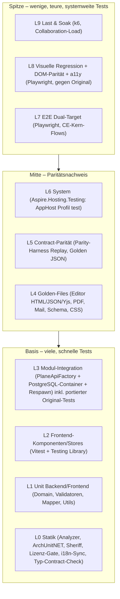
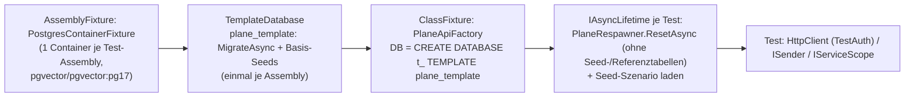
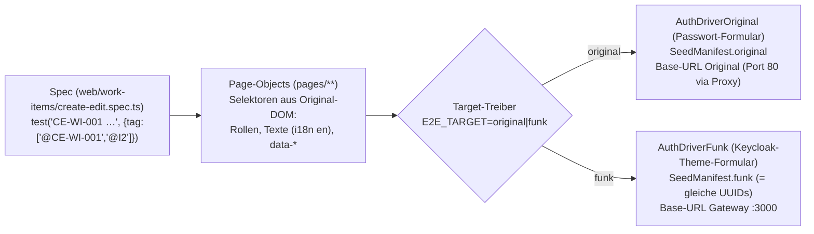
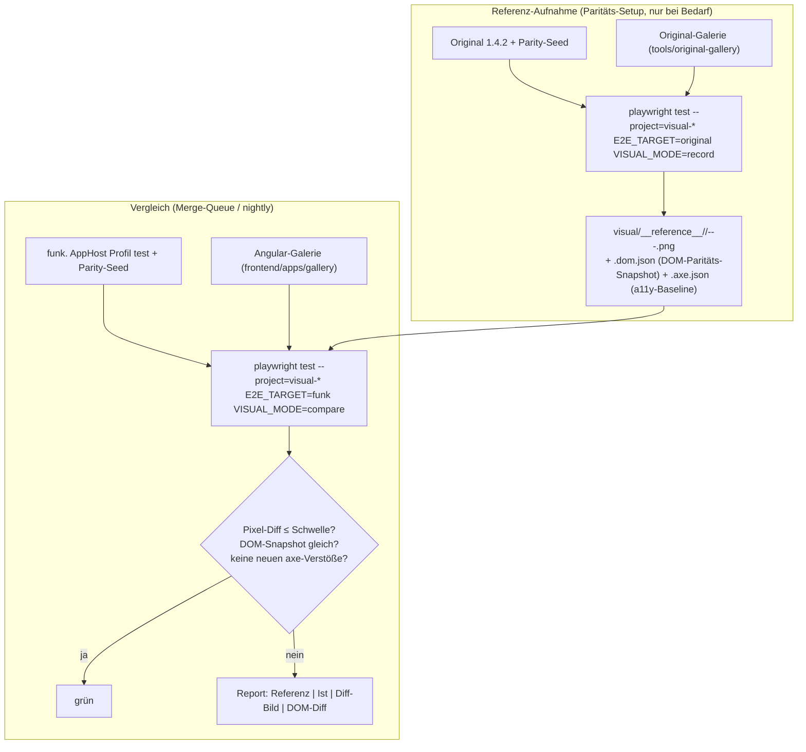

# 15 – Teststrategie, Qualitätssicherung und Paritätsnachweis

> **Status:** Entwurf zur Abnahme (Fachdokument D15). Verbindlich innerhalb seines Themas; nachrangig zu `00-grundsatzentscheidungen.md` (ADR-000 … ADR-009) und `01-zielarchitektur-und-tech-stack.md` (ADR-010 … ADR-052). Bei Widerspruch gilt 00 > 01 > dieses Dokument.
> **Stand:** 23.10.2026. Versionsangaben mit „⚠“ werden in Spike S0 per NuGet-/npm-Metadaten bestätigt und in `Directory.Packages.props` bzw. im pnpm-Catalog gepinnt (Regel aus 01 §8).
> **Zielrepository:** Alle Pfade für Zielcode sind relativ zur Wurzel des neuen Repositorys **`funk.`** (ADR-009, O-07 in 01). Wo 01 §5.1 noch den Arbeitstitel `plane-net/` zeigt, ist `funk.` gemeint. Pfade des Originals beginnen mit `apps/…` bzw. `packages/…` und beziehen sich auf `/home/user/plane` (Referenz, ADR-006).
> **Sprache:** Fließtext Deutsch, Bezeichner Englisch.
> **Kürzel:** `API/` = `apps/api/plane/`, `T/` = `apps/api/plane/tests/`, `LIVE/` = `apps/live/`, `WEB/` = `apps/web/`, `PKG/` = `packages/`; `A01` … `A13b` = Analyse-Dokumente unter `migration/analysis/`; `F10` = `migration/features/10-ce-feature-katalog.md`, `F30` = `migration/features/30-paid-auswahlliste.md`.

## Inhaltsverzeichnis

1. [Ziel & Scope](#1-ziel--scope)
2. [Entscheidungen (D15-ADR-01 ff.)](#2-entscheidungen-d15-adr-01-ff)
3. [Detaildesign](#3-detaildesign)
   - 3.1 Testebenen und Testpyramide
   - 3.2 Test-Projekte und Ordnerstruktur in `funk.`
   - 3.3 Backend-Unit- und Integrationstests (xUnit v3, Testcontainers, Respawn)
   - 3.4 Systemtests mit `Aspire.Hosting.Testing` und Testumgebungen
   - 3.5 Port der 771 Original-Tests als Akzeptanztests (Ledger)
   - 3.6 API-Contract-Paritätstests gegen das laufende Original (Parity-Harness)
   - 3.7 Golden-File-Tests (Editor/HTML/JSON/Yjs, PDF, E-Mail, Schema)
   - 3.8 Frontend-Unit- und Komponententests (Vitest)
   - 3.9 E2E-Tests (Playwright) für alle CE-Kern-Flows
   - 3.10 Visuelle Regression gegen das Original
   - 3.11 Accessibility
   - 3.12 Last- und Performancetests
   - 3.13 Sicherheitstests
   - 3.14 Testdaten
   - 3.15 Quality-Gates, CI-Stufen und Definition of Done für KI-Agenten
   - 3.16 Zuordnung zu Inkrementen (was wird wann gebraucht)
4. [Vollständige Mapping-Tabellen Original → Ziel](#4-vollständige-mapping-tabellen-original--ziel)
5. [Code-Skelette](#5-code-skelette)
6. [Erweiterungspunkte für Bezahl-Pakete](#6-erweiterungspunkte-für-bezahl-pakete)
7. [Akzeptanzkriterien & Tests dieses Dokuments](#7-akzeptanzkriterien--tests-dieses-dokuments)
8. [Risiken & offene Punkte](#8-risiken--offene-punkte)
9. [Abhängigkeiten zu anderen Dokumenten (02–16)](#9-abhängigkeiten-zu-anderen-dokumenten-0216)
- [Anhang A – Ledger der Original-Tests (Datei-Ebene, 113 + 25 Dateien)](#anhang-a--ledger-der-original-tests-datei-ebene)
- [Anhang B – Testmatrix aller 507 CE-Features](#anhang-b--testmatrix-aller-507-ce-features)

---

## 1. Ziel & Scope

### 1.1 Ziel

Dieses Dokument legt fest, **wie** die Portierung von Plane CE 1.4.2 nach .NET 10 / Angular 22 nachweisbar korrekt, paritätisch und sicher wird – und zwar so, dass KI-Implementierungs-Agenten jedes Arbeitspaket ohne Rückfrage testen, selbst prüfen und abschließen können. Es konkretisiert ADR-048 (Test-Stack), Spike S11 (Paritäts-Harness), Prinzip P1 (Parität vor Eleganz), P2 (Contracts first) und P7 (Erweiterbar ohne Umbau) aus 01.

Messbare Ziele:

| Nr. | Ziel | Messgröße | Nachweis |
|---|---|---|---|
| Z1 | **Funktionale Parität** zu CE 1.4.2 | 100 % der nicht entfallenen CE-IDs (480 von 507; 27 entfallen nach ADR-008) haben mindestens die in Anhang B geforderten Testebenen grün | `tools/ci/ce-coverage-check` (§3.15.4) |
| Z2 | **Vertragsparität** der HTTP-API | Jeder Endpunkt des Endpunktkatalogs (Dokument 04) hat ≥ 1 aufgezeichnetes Golden-Szenario vom Original; Replay gegen `funk.` ohne nicht genehmigte Abweichung | Parity-Harness-Report (§3.6) |
| Z3 | **Übernahme des Original-Testwissens** | Alle 771 pytest-Funktionen und 288 relevanten Vitest-Fälle des Originals sind im Ledger einem Status zugeordnet (portiert / angepasst / entfällt mit Ersatz); 0 Einträge „offen“ bei Abnahme des zugehörigen Inkrements | `tools/ci/original-test-ledger` (§3.5) |
| Z4 | **Visuelle Parität** (ADR-005) | Pixelabweichung je Prüfpunkt unter Schwellwert (§3.10.5), DOM-Parität 100 % für Komponenten-Galerie | Visual-Report |
| Z5 | **Qualität des Neucodes** | Zeilenabdeckung ≥ 85 % in `Domain/` + `Application/` je Modul, ≥ 80 % je Frontend-Lib; 0 Analyzer-Warnungen; Architekturtests grün | Coverage-Gate |
| Z6 | **Last-Fähigkeit** | Kennzahlen aus §3.12 (Listen mit 10 000+ Work Items, 50 parallele Editoren) erfüllt | Lastbericht je Inkrement I2/I4/I7 |
| Z7 | **Sicherheit** | Alle Mechanismen S-01 … S-26 aus `A06` §2.14 haben Tests; Berechtigungsmatrix Rolle × Endpunkt 100 % grün; ZAP-Baseline ohne High/Medium | Security-Report |
| Z8 | **Zugänglichkeit** | Keine *neuen* axe-Verstöße gegenüber dem Original (Baseline-Diff) und 0 `critical`-Verstöße in Neucode | a11y-Report |

### 1.2 Im Scope

- Teststrategie aller Ebenen für Backend (`src/**`), Frontend (`frontend/**`), Realtime, Gateway, Migrator, Deployment-Artefakte.
- Paritätsverfahren gegen das **laufende Original** (API-Verträge, Screens, Editor-Konvertierung, PDF, E-Mails).
- Port des Original-Testbestands (`T/**`, `LIVE/tests/**`, `PKG/blocks/src/**/*.test.*`, `PKG/services/src/helpers/url.test.ts`).
- Testdaten (deterministische Seeds, Volumendaten), Testumgebungen (Aspire-Profil `test`, CI), Quality-Gates und Definition of Done (DoD) je Arbeitspaket-Typ.
- **Erweiterungspunkte** der Test-Infrastruktur für die 🧱-Pakete A1, A2, A9, A17, B1, B6, C1, C3, D1, D2, E3, E5, F1, F2, G1, H1, H6 (§6) – ohne Fachdesign der Bezahl-Features.

### 1.3 Nicht im Scope

- Fachliche Testfälle der Bezahl-Pakete (EE-*) – entstehen kurz vor der jeweiligen Welle W1 … W9.
- Konkrete CI-Workflow-Syntax (GitHub Actions vs. Forgejo Actions) und Runner-Infrastruktur → Dokument 14. Dieses Dokument definiert die **Stufen, Kommandos und Gates** plattformneutral als Skripte unter `tools/ci/`.
- Entscheidungen zu einzelnen Abweichungen vom Original (Bugfix ja/nein) → Entscheidungstabelle in Dokument 04; hier nur der Mechanismus (`tests/contracts/deviations.yaml`).

### 1.4 Ausgangslage im Original (Fakten)

| Bereich | Bestand im Original | Quelle |
|---|---|---|
| Backend-Tests | 113 Dateien, **771** `def test_*`: `contract/app` 50/381, `contract/api` 21/98, `unit/utils` 14/98, `unit/bg_tasks` 8/87, `unit/middleware` 3/31, `unit/settings` 5/29, `unit/serializers` 5/24, `unit/views` 4/12, `unit/models` 2/9, `smoke` 1/2 (per AST nachgezählt am 23.10.2026) | `A01` §2.25.1, `T/**` |
| Test-Infrastruktur Backend | pytest + pytest-django, Marker `unit/contract/smoke/slow`, factory-boy (5 Factories), Fixtures `api_client`, `session_client` (`force_authenticate`), `api_key_client`, `workspace`; Docker-Stack `docker-compose-test.yml` (Postgres 15.7, Valkey, RabbitMQ, silo) | `apps/api/pytest.ini`, `T/conftest.py`, `T/factories.py` |
| TS-Tests | `LIVE/tests` 32 (PDF 21, Effect-Utils 11), `PKG/blocks` 21 Dateien/251 Fälle, `PKG/services` 5, `PKG/codemods` 33 | `A01` §2.25.2 (Fallzahlen per `it(`/`test(` nachgezählt) |
| Frontend-App-Tests | **keine** (web, admin, space haben keine Test-Skripte) | `A01` §2.25.2 |
| E2E / Visual / Last | **keine** | – |
| CI | kein Workflow führt Tests aus | `A01` §2.24 |
| Editor | `packages/editor` ohne Unit-Tests | `A12` O14 |

Konsequenz: Das Original liefert wertvolle **Regressions- und Sicherheitsfälle** (viele Tests sind GHSA-/SECUR-Regressionen), aber keinen Paritätsnachweis für UI, Editor und Gesamtverhalten. Diesen Nachweis liefern Parity-Harness, Golden-Files, Dual-Target-E2E und visuelle Regression **gegen das laufende Original**.

---

## 2. Entscheidungen (D15-ADR-01 ff.)

| ADR | Belang | Entscheidung | Alternativen (verworfen) | Begründung | Lizenz / Paket | ab |
|---|---|---|---|---|---|---|
| D15-ADR-01 | Testpyramide | **Zehn Ebenen L0–L9** (§3.1) mit festen Zuständigkeiten; Breite unten (Unit, Komponenten), Paritätsnachweis in der Mitte (Contract, Golden), schmale Spitze (E2E, Visual). Jede Ebene hat ein eigenes Test-Projekt-Muster und eigenen CI-Job | „Testing Trophy“ ohne Unit-Ebene; nur E2E | Agenten brauchen schnelles, lokales Feedback (L0/L1 < 2 min je Modul); Parität ist nur mit Contract/Golden objektiv messbar | – | I0 |
| D15-ADR-02 | Backend-Testframework | **xUnit v3** auf **Microsoft.Testing.Platform** (`dotnet test` .NET 10), **Shouldly**, **NSubstitute**, **Verify.XunitV3**, **Bogus**; Assembly-Fixtures (`[assembly: AssemblyFixture]`) für Container | NUnit/MSTest; FluentAssertions ≥ 8 (kommerziell) | Bindend aus ADR-048; v3 hat native Assembly-Fixtures, `TestContext.Current.CancellationToken`, `ValueTask`-Lifetime | Apache-2.0, BSD-3, MIT; `xunit.v3` 4.x ⚠ (Kopplung an `Verify.XunitV3` 33.x und `TngTech.ArchUnitNET.xUnitV3` 0.13.x in S0 prüfen, 01 §8.1) | I0 |
| D15-ADR-03 | Integrationstests Backend | **In-Process** `PlaneApiFactory : WebApplicationFactory<Program>` gegen **echtes PostgreSQL** (Testcontainers, Image identisch zum AppHost `pgvector/pgvector:pg17`) – **ein Container je Test-Assembly**, **eine Datenbank je Testklasse** (Klon per `CREATE DATABASE … TEMPLATE plane_template`), **Respawn** setzt vor jedem Test zurück; Valkey/Objektspeicher/Mailpit nur dort, wo das Modul sie braucht | SQLite/InMemory-Provider; ein DB-Reset nach jedem Test über alle Klassen; Datenbank je Test | Nur echtes PostgreSQL deckt `pg_trgm`, `jsonb`, partielle Indizes, `FOR UPDATE SKIP LOCKED`, Advisory Locks ab; Template-Klon erlaubt parallele Testklassen ohne Migrationskosten | Testcontainers MIT, Respawn Apache-2.0 | I0 |
| D15-ADR-04 | Authentisierung in Modul-Integrationstests | **Test-Authentisierungsschema** `TestAuth` (Header `X-Test-Principal: <seed-user-key>`), registriert **ausschließlich** von `PlaneApiFactory` in Test-Assemblies; echte Keycloak-Flows nur in `Plane.Identity.Tests` (Testcontainers.Keycloak), `Plane.AppHost.Tests` und E2E | Keycloak in jedem Modultest; Mock-JWT | Modultests bleiben schnell (kein IdP-Roundtrip), Auth-Pipeline (Permission-Filter, Scope-Binding) läuft trotzdem vollständig; Architekturtest verhindert, dass `TestAuth` in Hosts gelangt (§3.3.5) | – | I0 |
| D15-ADR-05 | Systemtests | **`Aspire.Hosting.Testing`** startet den echten AppHost im Profil `test` (alle Container inkl. Keycloak, Forgejo, Mailpit, SeaweedFS, gebaute Angular-Assets im Gateway) für `Plane.AppHost.Tests`, Parity-Replay, E2E, Visual, Last | Eigenes Docker-Compose für Tests; Testcontainers für alles | Eine Topologie für Dev, Test, CI (gleiche Ressourcen, Health-Checks, `WaitFor`-Kette); ersetzt `docker-compose-test.yml` des Originals (01 §10) | MIT; `Aspire.Hosting.Testing` 13.x | I0 |
| D15-ADR-06 | Port der Original-Tests | **Ledger-gestützter Port**: Jede der 771 pytest-Funktionen (und 288 TS-Fälle) ist eine Zeile in `tests/original-tests/ledger.yaml` mit Status `ported` \| `adapted` \| `obsolete` und Ziel-Test (`Trait("origin", "<pfad>::<klasse>::<funktion>")`); CI-Gate erzwingt Vollständigkeit und Existenz | Freie Neuschreibung ohne Rückverfolgung; automatische Übersetzung Python→C# | Rückverfolgbarkeit für Abnahme; Sicherheits-Regressionen (GHSA) gehen nicht verloren; Agent erkennt sofort, welche Fälle sein Arbeitspaket portieren muss | – | I0 (Ledger), je Inkrement (Fälle) |
| D15-ADR-07 | Contract-Parität | **Parity-Harness `Plane.Tools.ParityHarness`** mit **Record (gegen Original) → Golden-Files im Repo → Replay (gegen `funk.`) → normalisierter JSON-Diff** mit Ausnahmekatalog `tests/contracts/deviations.yaml`; **identische deterministische IDs** in beiden Systemen (UUIDv5 aus Seed-Schlüsseln) | Nur Schema-Vergleich (OpenAPI); Proxy-Mitschnitt manueller Klicks; Vergleich gegen Doku | Inhaltliche Gleichheit (Werte, Reihenfolge, Fehlercodes, `null` vs. fehlend) ist nur mit identischen Daten prüfbar; gleiche UUIDs machen IDs vergleichbar statt nur maskierbar | – | I0 (S11) |
| D15-ADR-08 | Golden-Files | **Verify.XunitV3** für alle .NET-Snapshots; Golden-Erzeugung aus dem Original ausschließlich mit Dev-Werkzeugen (`tools/golden/generate.mjs` für Editor; `tools/golden/original-render.py` im Original-API-Container für E-Mail-Templates); Goldens sind eingecheckt, nie zur Testlaufzeit erzeugt | Snapshots ohne Original-Bezug („first run wins“); Laufzeit-Node | Erfüllt P5 (kein Node zur Laufzeit) und P2 (Contracts first); „first run wins“ würde Fehler des Ports zementieren | MIT | I0 (Mechanik), I1/I2/I4 (Korpora) |
| D15-ADR-09 | Frontend-Unit/Komponenten | **Vitest** über `@angular/build:unit-test` (Angular-22-Default), Umgebung **jsdom** (wie `PKG/blocks`), `@testing-library/angular` + `user-event`; **Vitest-Browser-Modus** (Playwright-Provider, Chromium) nur für Tests, die echte Layout-Berechnung brauchen (floating-ui-Positionierung, Virtualisierung, DnD-Hitbox) | Jest; Karma; happy-dom | Bindend aus ADR-048; jsdom entspricht dem Original (`PKG/blocks/vitest.config.ts`), damit portierte Fälle unverändert gelten | MIT | I0 |
| D15-ADR-10 | E2E | **Playwright Test (TypeScript)** in `frontend/apps/e2e`, **Dual-Target**: dieselben Specs laufen gegen das Original (Referenz) und gegen `funk.`; Ziel-spezifische Unterschiede nur in Treibern (`AuthDriver`, `SeedManifest`); jeder Test trägt CE-ID-Tags (`@CE-WI-001`) | Cypress; Selenium; getrennte Specs je System | Gleiches DOM (ADR-005, 01 §7.17) erlaubt gleiche Selektoren; Dual-Target beweist Verhaltensgleichheit statt sie zu behaupten | Apache-2.0; `@playwright/test` 1.5x ⚠ | I0 |
| D15-ADR-11 | Visuelle Regression | **Referenz = Screenshots des laufenden Originals**, aufgenommen von denselben Playwright-Specs (`--target=original`), versioniert unter `frontend/apps/e2e/visual/__reference__/`; Vergleich mit `toHaveScreenshot` (pixelmatch) **plus DOM-Paritäts-Snapshot**; feste Uhrzeit, deterministischer Zufall, eingefrorene Animationen, Playwright-Container mit gebündelten Fonts für Aufnahme **und** Vergleich | Applitools/Percy (SaaS, verletzt ADR-004); Storybook-Chromatic; manuelle Sichtprüfung | Verfahren aus `A13a` §5.7 und `A09` §5.5/§5.6; objektiv, airgapped, reproduzierbar | Apache-2.0 | I0 (Shell, S10) |
| D15-ADR-12 | Accessibility | **`@axe-core/playwright`** in jedem E2E-Zustand mit Prüfpunkt (Tags `wcag2a`, `wcag2aa`, `wcag21aa`, `wcag22aa`), **Baseline-Diff gegen das Original**: Ziel darf keine Regel-Verletzung haben, die das Original an derselben Stelle nicht hat; Tastatur-Szenarien aus `PKG/blocks`-Tests als Pflicht | Absolute WCAG-Konformität (würde ADR-005 an Stellen brechen, an denen das Original abweicht); nur manuelles Audit | Vereinbar mit 1:1-UI; verhindert Regressionen; bekannte Original-Verstöße werden als Abweichungsentscheidung sichtbar | MPL-2.0 (nur Dev, 01 §2.3 zulässig) | I0 |
| D15-ADR-13 | Lasttests HTTP | **k6** (eigenständiges Werkzeug, Container `grafana/k6`) mit Skripten unter `tests/load/k6/`, Daten aus dem Volumen-Seed (§3.14.3) | NBomber (Gratis-Lizenz nur privat, Organisationen brauchen Kauflizenz – [NBomber-Lizenz](https://nbomber.com/docs/getting-started/license)); Gatling (Apache-2.0, JVM-Toolchain); Locust (MIT, Python) | De-facto-Standard, Schwellwerte als Code (`thresholds`), läuft airgapped als Container; AGPL-3.0 ist als **eigenständiges Werkzeug ohne Linking** unbedenklich (wie Forgejo/Garage in 01 §2.3) | AGPL-3.0 (Werkzeug, kein Paket im Build; [k6](https://en.wikipedia.org/wiki/K6_(software))); Version 2.x ⚠ | I2 |
| D15-ADR-14 | Lasttests Kollaboration | **`Plane.LoadTests.Collaboration`** (C#-Konsole): synthetische Editor-Clients mit YDotNet + Client-Seite des Hocuspocus-Codecs aus `Plane.Collaboration` (gleiche Wire-Implementierung, eigene Testdoppel-Schicht), plus **2 echte Browser-Zeugen** (Playwright mit unverändertem `@hocuspocus/provider` 2.15.2), die Konvergenz und End-zu-End-Latenz messen | 50 Playwright-Browser (zu teuer pro Lauf); k6-WebSocket mit gebündeltem `yjs` (Goja/Sobek-Kompatibilität unsicher) | Skaliert auf 50+ Clients pro Runner; Browser-Zeugen sichern, dass das Messobjekt der echte Client ist (Kriterium aus S1) | MIT | I4 (S1 bereits I0-Spike-Track) |
| D15-ADR-15 | Sicherheitstests | Vier Säulen: (1) **generierte Berechtigungsmatrix** Rolle × Endpunkt aus Permission-Katalog + Endpunkt-Metadaten; (2) **Mechanismus-Tests** S-01 … S-26 (`A06` §2.14) + Ported-GHSA-Fälle; (3) **DAST**: OWASP **ZAP** Baseline + API-Scan (OpenAPI) gegen das Test-System; (4) **Supply Chain**: Trivy (Images, SBOM), gitleaks (Secrets), Lizenz-Gate (ADR-050) | Nur Pen-Test vor Go-Live; kommerzielle SAST/DAST | Matrix deckt die Masse der IDOR-/Scope-Fehler ab, die im Original die meisten GHSA-Meldungen verursacht haben; alle Werkzeuge Open Source und airgapped betreibbar | ZAP Apache-2.0, Trivy Apache-2.0, gitleaks MIT | I0 (Matrix-Gerüst), I6/I7 (DAST voll) |
| D15-ADR-16 | Testdaten | **Eine kanonische Seed-Spezifikation** `tests/seed/parity-seed.yaml` (Schlüssel-basiert, UUIDv5, feste Zeitstempel) mit zwei Ladern: `seed_plane.py` (Django-ORM im Original-Container, ohne Änderung am Original-Repo) und `ParitySeedLoader` (EF Core im Ziel); Volumendaten per **Bogus mit festem Seed**; Keycloak-Testbenutzer mit festen IDs im Realm-Import | Getrennte Seeds je System; Seeds über die öffentliche API; Datenbank-Dump | Nur identische Daten machen Contract-Diffs und Screenshots vergleichbar; API-Seeding wäre langsam und würde Zeitstempel nicht fixieren (Fallback laut S11) | MIT (Bogus) | I0 |
| D15-ADR-17 | Quality-Gates | **Stufenmodell G0–G6** (§3.15) mit harten Schwellwerten; Gates sind Skripte unter `tools/ci/` und lokal identisch ausführbar (`./tools/ci/gate.sh <stufe>`); DoD je Arbeitspaket-Typ als Checkliste in der PR-Vorlage | Nur Review-basierte Abnahme | KI-Agenten brauchen maschinelles, eindeutiges „fertig“; lokale Ausführbarkeit verhindert CI-Ping-Pong | – | I0 |
| D15-ADR-18 | Flaky-Tests | **Null-Toleranz mit Quarantäne**: ein als flaky erkannter Test (Retry nötig) wird mit `[Trait("quarantine","<ticket>")]` bzw. `test.fixme` + Ablaufdatum (max. 10 Arbeitstage) markiert; Quarantäne zählt **nicht** zur CE-Abdeckung; Retries nur in E2E/Visual (max. 1) und nur mit Report | Pauschale Retries; Ignorieren | Retries verdecken Nebenläufigkeitsfehler (Outbox, Realtime); Quarantäne macht Schuld sichtbar | – | I0 |
| D15-ADR-19 | Abdeckungsmessung | **Coverlet über Microsoft.Testing.Platform (`Microsoft.Testing.Extensions.CodeCoverage`)** für .NET, `@vitest/coverage-v8` für Frontend; Gate auf **geänderte Zeilen** (Diff-Coverage ≥ 90 %) und Modul-Untergrenzen (Z5); Mutationstests (**Stryker.NET**, Apache-2.0) nur nightly für `Domain/`-Ordner, informativ | Globale Gesamtquote; keine Messung | Diff-Coverage ist für parallel arbeitende Agenten fair und wirksam; Original verlangte `--fail-under=90` (`apps/api/run_tests.py`) | MIT/Apache-2.0 ⚠ (Paketwahl `Microsoft.Testing.Extensions.CodeCoverage` vs. `coverlet.MTP` in S0 festlegen; Lizenz-Gate) | I0 |
| D15-ADR-20 | Testumgebungen | **Vier Umgebungen**: `local` (Agent/Entwickler, `aspire run` Profil `dev`), `ci-fast` (Testcontainers, kein AppHost), `ci-system` (AppHost Profil `test`, Images gebaut), `parity` (Original 1.4.2 per `docker-compose-local.yml` + `funk.` Profil `test` nebeneinander); dazu `airgap` ab I7 (Egress gesperrt) | Gemeinsame, langlebige Test-Instanz | Reproduzierbar, parallelisierbar, keine geteilten Zustände; Original-Umgebung nur, wo sie gebraucht wird | – | I0 |

---
## 3. Detaildesign

### 3.1 Testebenen und Testpyramide



| Ebene | Prüfgegenstand | Werkzeuge | Ort in `funk.` | Laufzeitbudget (CI) | Wer schreibt | Auslöser |
|---|---|---|---|---|---|---|
| **L0 Statik** | Abhängigkeitsregeln R1–R10 (01 §5.2), Banned APIs (R8), Sheriff-Grenzen, Lizenzen, AGPL-Header, i18n-Schlüssel-Sync, OpenAPI↔`libs/shared/types`-Kompatibilität (ADR-047), keine Plan-/Upsell-Bezeichner (01 §7.18), kein Node in Images (P5) | Roslyn-Analyzer, `Meziantou.Analyzer`, `BannedApiAnalyzers`, ArchUnitNET, Sheriff/ESLint, `tools/ci/license-gate`, `tools/ci/license-header-check`, `frontend/tools/i18n-sync-check`, `frontend/tools/contract-check`, `tools/ci/assert-no-node.sh` | `tests/Plane.ArchitectureTests/`, `tools/ci/`, `frontend/tools/` | < 4 min | Infrastruktur-Agent (I0), danach automatisch | jeder Push |
| **L1 Unit** | reine Logik ohne I/O: `Domain/`-Regeln, FluentValidation-Validatoren, Mapperly-Mapper, JSON-Converter (01 §7.2/7.3), Fehlerfabrik, Cursor-Codec, Filter-AST-Parser, TS-Utils/Helpers aus `libs/shared/utils` | xUnit v3 + Shouldly; Vitest (node) | `tests/modules/Plane.<M>.Tests/Unit/`, `tests/Plane.BuildingBlocks.Tests/`, `frontend/libs/**/src/**/*.spec.ts` | < 2 min je Modul | Fach-Agent je WP | jeder Push |
| **L2 Frontend-Komponenten & Stores** | Signal-Stores (strukturgleich zu MobX-Stores, 01 ADR-040), Services (HttpClient-Mock), Komponenten-Verhalten (Öffnen/Schließen, Tastatur, ARIA, Outside-Click), Pipes/Direktiven | Vitest (jsdom), `@testing-library/angular`, `@testing-library/user-event`, `HttpTestingController`; Browser-Modus für Layout-Fälle | `frontend/libs/**/*.spec.ts` | < 5 min gesamt (sharded) | Fach-Agent je WP | jeder Push |
| **L3 Modul-Integration** | Handler + Endpunkte + DB je Modul: Validierung, Berechtigung (401/403/404 exakt wie Original), Tenant-Isolation, Soft-Delete-Kaskaden, Activity-Einträge, Outbox-Einträge, OwnershipGuard (R3); **portierte Original-Tests** (`Acceptance/Original/`) | xUnit v3, `PlaneApiFactory`, Testcontainers PostgreSQL (+Valkey/SeaweedFS/Mailpit nach Bedarf), Respawn, Verify, WireMock.Net | `tests/modules/Plane.<M>.Tests/Integration/`, `…/Acceptance/Original/` | < 6 min je Modul (parallel je Modul) | Fach-Agent je WP | jeder Push |
| **L4 Golden-Files** | Byte-/Strukturgleichheit mit Original-Ausgaben: Tiptap-Schema-Snapshot, PM-JSON↔HTML↔Yjs (≥ 200 Dokumente, S2), PDF-Text + Raster (S3), E-Mail-HTML/Text je Template, Export CSV/XLSX-Spalten, kompiliertes CSS (Selektor-/Deklarationsmenge, `A13a` §5.7 Punkt 5) | Verify.XunitV3, AngleSharp-Normalisierer, PdfPig (Text), SkiaSharp (Raster-Diff), Vitest-Snapshots (Schema im Browser-Build) | `tests/Plane.Documents.Tests/Golden/`, `tests/Plane.Documents.Pdf.Tests/`, `tests/Plane.Platform.Tests/Mail/`, `tests/modules/Plane.Exports.Tests/Golden/`, `frontend/tools/css-parity/` | < 5 min | Fach-Agent (Editor/Docs/Mail) | Push in betroffenen Pfaden |
| **L5 Contract-Parität** | Request/Response-Verträge aller Endpunkte gegen aufgezeichnete Original-Goldens (Status, Header-Auswahl, Body normalisiert) | `Plane.Tools.ParityHarness replay` gegen `PlaneApiFactory` (schnell) **und** gegen AppHost (voll, nightly) | `tests/contracts/scenarios/**`, `tests/contracts/golden/**`, Runner `tests/Plane.Contracts.Tests/` | < 8 min (In-Process) | Fach-Agent je Endpunkt (P2: zuerst Golden, dann Code) | jeder Push (betroffene Module), nightly alle |
| **L6 System** | Start/Health aller Ressourcen, Gateway-Routing (`A01` §2.8.1), Keycloak-Login/Logout/Back-Channel, Outbox → Worker → Mail (Mailpit-API), Realtime-Verbindung, Forgejo-SSO-Smoke, Migrator idempotent | `Aspire.Hosting.Testing`, xUnit v3, Microsoft.Playwright (.NET) für Browser-Protokolltests | `tests/Plane.AppHost.Tests/`, `tests/Plane.Gateway.Tests/`, `tests/Plane.Migrator.Tests/`, `tests/Plane.Collaboration.Tests/` | < 12 min | Infrastruktur-Agent + Fach-Agent | PR-Merge-Queue, nightly |
| **L7 E2E** | CE-Kern-Flows Ende-zu-Ende in web/admin/space (Anhang B Spalte „E2E“) | `@playwright/test`, Page-Objects, Dual-Target | `frontend/apps/e2e/{web,admin,space}/` | < 25 min (8 Shards) | Fach-Agent je WP (Spec gehört zum Schnitt) | Merge-Queue (betroffene Tags), nightly voll |
| **L8 Visual/DOM/a11y** | Pixel- und DOM-Parität zum Original; axe-Baseline-Diff | Playwright `toHaveScreenshot`, `dom-parity`-Helfer, `@axe-core/playwright` | `frontend/apps/e2e/visual/`, `frontend/apps/e2e/a11y/`, Galerie `frontend/apps/gallery/` | < 30 min (Chromium, sharded); Firefox/WebKit nightly | Fach-Agent je WP; Referenzen vom Paritäts-Agenten | Merge-Queue (betroffene Tags), nightly voll |
| **L9 Last/Soak** | Durchsatz/Latenz/Speicher (§3.12) | k6, `Plane.LoadTests.Collaboration`, PostgreSQL `EXPLAIN (ANALYZE, BUFFERS)`-Assertions | `tests/load/` | 30–75 min | Performance-Agent | nightly ab I2, Release-Kandidat |

**Verhältnis (Richtwert, je Modul gemessen, nicht erzwungen):** L1+L2 ≈ 60 %, L3 ≈ 25 %, L4+L5 ≈ 10 %, L6–L8 ≈ 5 % der Testfälle. Erzwungen werden nur die Mindestabdeckungen je CE-ID (Anhang B) und die Gates (§3.15).

### 3.2 Test-Projekte und Ordnerstruktur in `funk.`

Ergänzt 01 §5.1 (dort bereits: `Plane.ArchitectureTests`, `Plane.AppHost.Tests`, `Plane.BuildingBlocks.Tests`, `Plane.Platform.Tests`, `Plane.Gateway.Tests`, `Plane.Migrator.Tests`, `modules/Plane.<M>.Tests`, `Plane.Documents.Tests`, `Plane.Documents.Pdf.Tests`, `Plane.Collaboration.Tests`, `contracts/`). **Neu durch dieses Dokument** (mit ★ markiert):

```text
funk./
├── src/building-blocks/Plane.BuildingBlocks.Testing/      # (01) Basis aller .NET-Tests – Inhalt §5.1
│   ├── Hosting/        PlaneApiFactory.cs, TestAuthHandler.cs, TestPrincipalHeader.cs, ModuleScopeAssertions.cs
│   ├── Database/       PostgresContainerFixture.cs, TemplateDatabase.cs, PlaneRespawner.cs, SqlPlanAssertions.cs
│   ├── Containers/     ValkeyFixture.cs, SeaweedFsFixture.cs, MailpitFixture.cs (+ MailpitClient), KeycloakFixture.cs, ForgejoFixture.cs (W1-Vorbereitung)
│   ├── Seed/           SeedSpec.cs (YAML-Modell), SeedKey.cs (UUIDv5), ParitySeedLoader.cs, DeterministicIdGenerator.cs, FixedClock.cs, VolumeSeeder.cs (Bogus)
│   ├── Builders/       WorkspaceBuilder.cs, ProjectBuilder.cs, WorkItemBuilder.cs, … (Fluent, nutzen Commands statt DbContext)
│   ├── Golden/         GoldenSettings.cs (Verify-Konventionen), JsonNormalizer.cs, HtmlNormalizer.cs
│   ├── Contracts/      ContractScenarioRunner.cs (In-Process-Replay für L5)
│   ├── Original/       OriginAttribute.cs ([Origin("T/…::Klasse::test_x")]), LedgerReader.cs
│   └── Auth/           KeycloakHeadlessLogin.cs (Authorization-Code-Flow per HttpClient gegen Keycloak-Login-Formular)
├── src/tools/Plane.Tools.ParityHarness/                   # (01) S11 – Kommandos §3.6.3
├── tests/
│   ├── Plane.ArchitectureTests/                           # (01) + Test-Regeln T1–T6 (§3.3.5)
│   ├── Plane.AppHost.Tests/                               # (01) L6
│   ├── Plane.BuildingBlocks.Tests/                        # (01)
│   ├── Plane.Platform.Tests/                              # (01)
│   ├── Plane.Gateway.Tests/                               # (01)
│   ├── Plane.Migrator.Tests/                              # (01)
│   ├── Plane.Worker.Tests/                          ★     # Cron-Registrierungen (13 Beat-Einträge, A01 §2.17), Cleanup-/Retention-Jobs, Leader-Lock
│   ├── Plane.Contracts.Tests/                       ★     # L5-Runner: lädt tests/contracts/** und spielt In-Process ab
│   ├── Plane.Security.Tests/                        ★     # generierte Berechtigungsmatrix, Tenant-Isolation über alle Module, Header/Cookie-Regeln
│   ├── Plane.Documents.Tests/  Plane.Documents.Pdf.Tests/  Plane.Collaboration.Tests/   # (01)
│   ├── modules/Plane.<M>.Tests/{Unit,Integration,Contract,Acceptance/Original}/        # (01) + Acceptance/Original ★
│   ├── contracts/                                         # (01) Parity-Daten
│   │   ├── scenarios/<modul>/<szenario>.yaml       ★     # Schritte (Request-Vorlagen, Akteur, Captures)
│   │   ├── golden/<modul>/<szenario>/<nn>-<schritt>.golden.json ★
│   │   ├── deviations.yaml                                # (01 §7.20) Ausnahmekatalog
│   │   └── normalization.yaml                       ★     # globale Pfad-Regeln (Zeitstempel, Secrets, URLs)
│   ├── seed/                                        ★
│   │   ├── parity-seed.yaml                               # kanonischer Seed (§3.14.1)
│   │   ├── volume-profiles.yaml                           # Volumen-Profile S/M/L/XL (§3.14.3)
│   │   └── original/seed_plane.py                         # Django-Lader (läuft im Original-Container)
│   ├── original-tests/                              ★
│   │   ├── ledger.yaml                                    # 771 + 288 + 33 Einträge (Anhang A ist die Datei-Sicht)
│   │   └── extract/extract_pytest.py, extract_vitest.mjs  # Dev-Werkzeuge: erzeugen/aktualisieren die Ledger-Rohliste aus dem Original
│   └── load/                                        ★
│       ├── k6/{work-item-lists,kanban-groups,spreadsheet,search,public-api,auth-session}.js
│       ├── Plane.LoadTests.Collaboration/                 # C#-Konsole (§3.12.3)
│       └── thresholds.yaml                                # Zielwerte (Single Source für k6 + C#)
├── frontend/
│   ├── apps/gallery/                                ★     # Komponenten-Galerie (A13a §5.7 Punkt 2), base href /__gallery/ – nur in Test-Builds
│   ├── apps/e2e/                                          # (01) Playwright
│   │   ├── playwright.config.ts                           # Projekte web-chromium, admin-chromium, space-chromium, gallery-{chromium,firefox,webkit}, visual-*, a11y
│   │   ├── drivers/{target.ts,auth-driver.original.ts,auth-driver.funk.ts,seed-manifest.ts,clock.ts,determinism.ts}
│   │   ├── pages/                                         # Page-Objects (Dual-Target, Selektoren aus Original-DOM)
│   │   ├── web/<domäne>/*.spec.ts  admin/*.spec.ts  space/*.spec.ts
│   │   ├── visual/{gallery,web,admin,space,editor,keycloak}/*.visual.ts  + __reference__/  + __diff__/ (gitignored)
│   │   └── a11y/baseline/{original}.json                  # axe-Baseline des Originals je Prüfpunkt
│   ├── tools/css-parity/                            ★     # CSS-Selektor/Deklarations-Diff Original-Build vs. Angular-Build
│   └── tools/original-gallery/                      ★     # React-Galerie-Seite für das Original (läuft nur im Paritäts-Setup gegen PKG/propel, PKG/blocks)
└── tools/ci/
    ├── gate.sh                                            # ./tools/ci/gate.sh g0|g1|…|g6 (§3.15)
    ├── ce-coverage-check/                           ★     # prüft Anhang-B-Matrix gegen Test-Tags/Traits
    ├── original-test-ledger/                        ★     # prüft ledger.yaml gegen Test-Assemblies und Vitest-Listen
    └── parity/{start-original.sh,pin.env}           ★     # Original v1.4.2 (Commit-Pin) per docker-compose-local.yml starten
```

**Namens- und Trait-Konventionen (verbindlich, maschinell ausgewertet):**

| Element | Konvention | Beispiel |
|---|---|---|
| Testklasse | `<Gegenstand>Tests` | `CreateLabelTests`, `LabelEndpointsTests` |
| Testmethode | `<Situation>_<Erwartung>` (englisch) | `Create_WithDuplicateName_Returns400WithFieldError` |
| CE-Bezug | `[Trait("ce", "CE-PRJ-029")]` (mehrfach erlaubt) | – |
| Inkrement | `[Trait("inc", "I1")]` | – |
| Ebene | `[Trait("level", "L3")]` (L1/L3/L4/L5/L6) | – |
| Original-Herkunft | `[Origin("T/contract/app/test_project_app.py::TestProjectAPIPost::test_create_project_empty_data")]` (setzt Trait `origin`) | §5.4 |
| Playwright | Titel beginnt mit CE-ID; `tag: ['@CE-WI-001', '@I2', '@web']` | `test('CE-WI-001 create work item via modal', { tag: [...] }, …)` |
| Vitest | `describe('CE-PRJ-029 label form', …)` oder Kommentar `// @ce CE-PRJ-029` am `describe` | – |
| Quarantäne | `[Trait("quarantine", "FUNK-1234:2026-11-06")]` / `test.fixme(true, 'FUNK-1234:2026-11-06')` | D15-ADR-18 |

### 3.3 Backend-Unit- und Integrationstests (xUnit v3, Testcontainers, Respawn)

#### 3.3.1 Unit (L1)

- Gegenstand: alles unter `Plane.<M>/Domain/`, Validatoren (`*Validator`), Mapper (`Mapping/`), BuildingBlocks-Primitive (`CursorCodec`, `PlaneJsonOptions`, `PlaneErrors`, `SnakeCaseEnumConverter`, `MicrosecondDateTimeConverter`, `SequenceAllocator`-Logik ohne DB), `Plane.Documents`-Konverter einzelner Nodes.
- Keine DB, kein `HttpClient`, kein Container; Zeit nur über `FixedClock` (R8), IDs nur über `DeterministicIdGenerator`.
- Pflichtfälle je Validator: jede Regel positiv und negativ, Fehlertext **wörtlich** wie Original (Quelle: Serializer/Model des Originals, Fehlertexte-Katalog in Dokument 04).
- Pflichtfälle Converter (01 §7.2/§7.3): Mikrosekunden-Format `yyyy-MM-ddTHH:mm:ss.ffffffZ`, `DateOnly` `yyyy-MM-dd`, `null`-Ausgabe, `double`-Ausgabe mit Dezimalteil, wo das Original `float` liefert (z. B. `sort_order: 65535.0` – siehe Risiko R-04), Enum-Zahlenwerte (`role: 20`).

#### 3.3.2 Modul-Integration (L3)

**Fixture-Kaskade:**



| Baustein | Regel |
|---|---|
| `PostgresContainerFixture` | Image `pgvector/pgvector:pg17` (gleiches Tag wie AppHost), `max_connections=400`, Extensions `vector`, `pg_trgm`, `unaccent`; `tmpfs` für `/var/lib/postgresql/data` (wie Original-Test-Stack) |
| `TemplateDatabase` | führt `PlaneDbContext.Database.MigrateAsync()` **und** die Basis-Seeds des Migrators (System-Rollen 20/15/5, Instanz-Datensatz, Relationstyp-Katalog A9, Event-Katalog) aus; danach `ALTER DATABASE plane_template IS_TEMPLATE true` |
| Klon je Testklasse | `CREATE DATABASE "t_<hash(klasse)>" TEMPLATE plane_template` (≈ 0,1–0,4 s); Löschen in `DisposeAsync` |
| `PlaneRespawner` | Respawn 7, `DbAdapter.Postgres`, `SchemasToInclude = ["public"]`, `TablesToIgnore` = `__EFMigrationsHistory`, `roles`, `work_item_relation_types`, `data_protection_keys`, `instances` (Basis-Seeds); Reset **vor** jedem Test (nicht danach – erleichtert Fehleranalyse) |
| Parallelität | Testklassen parallel (eigene DB), Tests innerhalb einer Klasse sequenziell; `xunit.runner.json`: `parallelizeTestCollections=true`, `maxParallelThreads = 2 × CPU` |
| Zusatzcontainer | nur per `[Collection]`-Fixture, wenn Modul sie benötigt: `SeaweedFsFixture` (Assets, Exports, Pages), `MailpitFixture` (Notifications, Webhooks-Deaktivierungs-Mail, Instance-Test-Mail), `ValkeyFixture` (Caching, Rate-Limit, Collaboration-Fan-out), `KeycloakFixture` (nur Identity) |
| Externe HTTP-Ziele | WireMock.Net (LLM-Provider, Unsplash, Webhook-Ziele, Link-Unfurl-Ziele, Forgejo-Simulation); **kein** realer Internetzugriff (Test schlägt fehl, wenn `SocketsHttpHandler` ein nicht registriertes Ziel anwählt – `DenyExternalNetworkHandler`) |
| Hintergrundverarbeitung | `PlaneApiFactory` registriert `InlineOutboxDispatcher` (verarbeitet Outbox synchron nach `SaveChanges` auf Anforderung: `await factory.DrainOutboxAsync()`); echte Worker-Semantik (SKIP LOCKED, Retry, Dead-Letter) in `Plane.BuildingBlocks.Tests` und `Plane.Worker.Tests` |
| OwnershipGuard | immer aktiv (R3): jeder Integrationstest schlägt fehl, wenn ein Handler fremde Entitäten schreibt |
| Abfrage-Budget | `SqlPlanAssertions.AssertMaxQueries(n)` für Listen-Endpunkte (N+1-Schutz), `AssertNoSeqScan("work_items")` für Projekt-gefilterte Listen (Kriterium aus S9) |

**Pflicht-Testfälle je Endpunkt (L3, unabhängig von Original-Tests):**

| Nr. | Fall | Erwartung |
|---|---|---|
| E1 | anonym | 401 mit Original-Körper (`{"detail": "Authentication credentials were not provided."}` bzw. endpunktspezifisch) oder Erfolg bei `.AllowAnonymous()` |
| E2 | fremder Workspace-Slug (Mitglied eines anderen Workspace) | 403/404 exakt wie Original (01 §7.9) |
| E3 | jede Rolle Admin 20 / Member 15 / Guest 5 + Nicht-Projektmitglied + Ersteller-Bypass | Ergebnis gemäß Permission-Matrix (Dokument 05) |
| E4 | ungültiger Body (fehlendes Pflichtfeld, falscher Typ, nicht-Objekt-JSON) | 400 im DRF-Format (`{"feld": ["…"]}`) bzw. Original-Form |
| E5 | Pfad-ID aus anderem Projekt/Workspace (IDOR) | 404 wie Original (Muster der `*_project_scope_*`-Tests) |
| E6 | Trailing Slash mit/ohne | identisches Ergebnis (01 §7.11) |
| E7 | Seiteneffekte | Activity-Einträge (Feld, `old_value`, `new_value`, `verb`), Outbox-Nachrichten (Typ `plane.<aggregat>.<ereignis>.v1`), Cache-Tags invalidiert |
| E8 | Soft-Delete | gelöschte Objekte nicht sichtbar; Kaskade gemäß `SoftDeleteCascadeRegistry` |

#### 3.3.3 Contract-Ordner je Modul

`tests/modules/Plane.<M>.Tests/Contract/` enthält keine eigenen Goldens, sondern nur die Testklasse `<M>ContractTests`, die über `ContractScenarioRunner` alle Szenarien `tests/contracts/scenarios/<modul>/*.yaml` In-Process abspielt (`[Theory]` mit `MemberData` je Szenario-Schritt). Dadurch läuft L5 im Modul-Testlauf mit, ohne zweite Implementierung.

#### 3.3.4 Messaging-, Scheduler- und Nebenläufigkeitstests

| Test | Kriterium | Projekt |
|---|---|---|
| Outbox atomar | Rollback der Fach-Transaktion ⇒ keine Outbox-Zeile | `Plane.BuildingBlocks.Tests/Messaging` |
| Dispatcher exakt-einmal-wirksam | 3 Dispatcher-Instanzen, 10 000 Nachrichten ⇒ jede Inbox-Zeile genau einmal; `kill -9` während Verarbeitung ⇒ kein Verlust (S12) | dto. |
| Retry/Backoff/Dead-Letter | Webhook-Policy: 5 Versuche, Backoff ab 600 s mit Jitter (mit `FixedClock` gesteuert) | `Plane.Webhooks.Tests` |
| Cron-Leader | 2 Worker, Leader-Kill ⇒ Übernahme < 30 s, kein Doppellauf; alle 13 Beat-Einträge des Originals registriert mit gleicher UTC-Zeit | `Plane.Worker.Tests` |
| SequenceAllocator | 100 parallele Creates ⇒ `sequence_id` lückenlos 1…100 (01 §7.6) | `Plane.WorkItems.Tests` |
| Erst-Einrichtung atomar | 10 parallele Setup-Requests ⇒ genau eine Instanz-Initialisierung (S-16, GHSA-p548-28jp-wr4p) | `Plane.Instance.Tests` |

#### 3.3.5 Architekturtests für Tests (Ergänzung zu R1–R10)

| Nr. | Regel | Prüfung |
|---|---|---|
| T1 | `TestAuthHandler`, `InlineOutboxDispatcher`, `DeterministicIdGenerator`, `FixedClock` liegen nur in `Plane.BuildingBlocks.Testing`; kein Projekt unter `src/hosts/**` oder `src/modules/**` referenziert `Plane.BuildingBlocks.Testing` | ArchUnitNET (Assembly-Referenzen) |
| T2 | Jede Testmethode in `tests/modules/**` trägt `[Trait("ce", …)]` **oder** `[Trait("level","L1")]` mit Begründung `[Trait("ce","n/a:<grund>")]` | Reflection-Test über alle Test-Assemblies |
| T3 | Jede Methode in `Acceptance/Original/` trägt genau ein `[Origin]` | dto. |
| T4 | Kein `Thread.Sleep`/`Task.Delay` > 50 ms in Tests (Polling nur über `Eventually.Async(…)` mit Timeout) | Analyzer `BannedSymbols.Tests.txt` |
| T5 | Keine Test-Abhängigkeit von Ausführungsreihenfolge (`[TestCaseOrderer]` verboten außer in `Plane.LoadTests.*`) | ArchUnitNET |
| T6 | Jede `Endpoint`-Registrierung (alle `Map*`-Aufrufe) ist in mindestens einem Contract-Szenario **oder** einem L3-Test per Route-Template referenziert | `Plane.Contracts.Tests/EndpointCoverageTests` (Endpunktliste aus `EndpointDataSource`) |

### 3.4 Systemtests mit `Aspire.Hosting.Testing` und Testumgebungen

#### 3.4.1 AppHost-Profil `test`

Das Profil `test` (01 §3.4: `Plane:Profile=test`) unterscheidet sich von `dev` wie folgt (verbindlich für Dokument 14):

| Aspekt | `test` |
|---|---|
| Angular | **keine** Dev-Server; Gateway liefert die in CI gebauten Bundles (`frontend/dist/{web,admin,space}` + `gallery`) aus |
| Keycloak | Realm-Import `deploy/keycloak/realms/plane-realm.test.json`: feste Benutzer-IDs und Passwörter der Testbenutzer (§3.14.2), `bruteForceProtected=true` mit Test-Schwellwerten, Token-Lebensdauern verkürzt (Access 60 s), Back-Channel-Logout-URL auf `http://gateway/auth/oidc/backchannel-logout/` |
| Forgejo | Container + `forgejo-init` aktiv (ADR-007); in CE-Tests nur SSO-Smoke |
| Persistenz | keine Daten-Volumes (`WithDataVolume` entfällt), PostgreSQL mit `tmpfs` |
| Zeit | `Plane__Testing__FixedUtcNow` optional (nur Visual/Parity-Läufe) – wirkt über `IClock`-Registrierung `ConfigurableClock`, die **nur** existiert, wenn `Plane:Profile=test` (Startfehler sonst) |
| Ports | dynamisch, außer Gateway 3000 und Keycloak 8180 (Redirect-URIs); parallele Systemläufe auf einem Runner per `Plane__Testing__PortOffset` (Keycloak/Gateway +N) |
| Images | aus gespiegeltem Registry-Präfix `Plane__Testing__ImageRegistry` (Airgap-CI) |
| Egress | im Job `airgap` (ab I7) per Netzwerk-Policy gesperrt; Test `NoExternalEgressTests` prüft, dass kein Container DNS-Anfragen außerhalb des Stacks stellt (P6) |

#### 3.4.2 Systemtest-Fixture

`Plane.AppHost.Tests` nutzt eine Assembly-Fixture `PlaneSystemFixture` (Skelett §5.2), die den AppHost einmal je Test-Assembly startet, auf `WaitForResourceHealthyAsync` aller Ressourcen wartet, den Parity-Seed lädt (`migrator`-Ressource mit Argument `--seed parity`) und `HttpClient`s für `gateway` bereitstellt. Tests mit Zustandsänderung legen eigene, eindeutig benannte Workspaces an (`sys-<guid8>`), statt Daten zurückzusetzen.

| Testklasse | Inhalt | Inkr. |
|---|---|---|
| `ResourceHealthTests` | alle Ressourcen aus 01 §3.3 (Profil `test`) erreichen `Healthy` < 180 s; `/health/live`, `/health/ready`, `GET /` (Original-Health) und `/live/health/` liefern 200 | I0 |
| `GatewayRoutingTests` | jede Pfadregel aus `A01` §2.8.1 inkl. 301 `/spaces`→`/spaces/`, `/god-mode`→`/god-mode/`, SPA-Fallback, 413-JSON bei Überschreitung von `FILE_SIZE_LIMIT`, Security-Header | I0 |
| `OidcLoginFlowTests` | Login web/admin/space per `KeycloakHeadlessLogin`; Cookie `session-id` HttpOnly/SameSite=Lax/Secure-Regel; `next_path`-Weiterleitung inkl. Open-Redirect-Abwehr (S-10); RP-Logout; Back-Channel-Logout beendet Session < 2 s (S7); `email_verified=false` ⇒ kein Benutzer; Rolle `plane-instance-admin` ⇒ God-Mode-Zugriff | I0 |
| `OutboxToMailTests` | Workspace-Einladung ⇒ Mailpit erhält Mail mit Original-Betreff/-Text (Golden) < 5 s | I1 |
| `RealtimeSmokeTests` | WebSocket `/live/` über Gateway mit Session-Cookie: `Authenticated`; ohne Cookie: `PermissionDenied` | I4 (Hub-Smoke `/live/events/` I0) |
| `ForgejoSsoSmokeTests` | Forgejo-Login über denselben Keycloak, gleiche `sub` (ADR-007/-008) | I0 |
| `MigratorIdempotencyTests` | Migrator zweimal ⇒ keine Änderungen, Exit 0; Drift-Check `dotnet ef migrations has-pending-model-changes` = false | I0 |
| `NoExternalEgressTests` | kein ausgehender Verkehr außerhalb des Stacks (ADR-004) | I0 (Allowlist), I7 (gesperrter Egress) |

#### 3.4.3 Testumgebungen (D15-ADR-20)

| Umgebung | Zweck | Start | Daten | Wer/wann |
|---|---|---|---|---|
| `local` | Entwicklung, Agent-Selbstprüfung | `aspire run` (Profil `dev`) bzw. `./tools/ci/gate.sh g1` | Demo-Seed + Parity-Seed auf Wunsch (`migrator --seed parity`) | Agent vor jedem Push |
| `ci-fast` | L0–L4, L5 In-Process | `dotnet test` / `pnpm test` (Testcontainers) | Template-DB + Szenario-Seeds | jeder Push |
| `ci-system` | L6–L8 gegen `funk.` | `Aspire.Hosting.Testing` Profil `test` | Parity-Seed | Merge-Queue, nightly |
| `parity` | Aufnahme/Prüfung gegen Original (Record, Visual-Referenzen, a11y-Baseline, Dual-Target-E2E auf Original) | `tools/ci/parity/start-original.sh` (Original 1.4.2 per `docker-compose-local.yml` + gebaute Original-Frontends) | Parity-Seed via `seed_plane.py` | bei Golden-Änderung (manuell ausgelöst), nightly Drift-Check |
| `perf` | L9 | AppHost Profil `prodlike` (Keycloak auf PostgreSQL, Release-Builds) auf dediziertem Runner (≥ 8 vCPU, 16 GB) | Volumen-Seed L/XL | nightly ab I2, Release-Kandidat |
| `airgap` | P6-Nachweis | wie `ci-system`, Egress gesperrt, Images nur aus Spiegel | Parity-Seed | ab I7 nightly |

### 3.5 Port der 771 Original-Tests als Akzeptanztests (Ledger)

#### 3.5.1 Verfahren

1. **Extraktion (einmalig in I0, wiederholbar):** `tests/original-tests/extract/extract_pytest.py` liest per Python-AST alle `def test_*` unter `T/` (Original-Repo, gepinnter Commit) und schreibt die Rohliste mit Schlüssel `T/<pfad>::<Klasse|->::<funktion>` sowie Docstring, Marker und Fixture-Namen. `extract_vitest.mjs` macht dasselbe für `LIVE/tests/**`, `PKG/blocks/src/**/*.test.*`, `PKG/services/src/**/*.test.ts`, `PKG/codemods/tests/**` (Namen aus `describe`/`it`-Ketten; `it.each` zählt als ein Eintrag).
2. **Klassifikation:** Der Paritäts-Agent ergänzt je Eintrag `status`, `target`, `ce`, `inc`, `reason` (Vorschlag aus Anhang A, Datei-Ebene; Feinzuordnung je Funktion beim Port). Status:
   - `ported` – gleicher Arrange/Act/Assert, gleiche Erwartungswerte (HTTP-Status, Fehlertext, Felder), nur Mechanik getauscht (`APIClient` → `HttpClient`, factory-boy → Builder/Seed).
   - `adapted` – fachliche Absicht bleibt, Prüfmechanik wegen Zielarchitektur anders (z. B. Django-Middleware → ASP.NET-Middleware, Celery-Task → Job/Consumer, Passwort-Login → OIDC). `reason` nennt ADR.
   - `obsolete` – Gegenstand entfällt (ADR-008: Passwort/Magic-Code/OAuth-Provider; Django-interne Mechanik ohne Gegenstück). **Pflicht:** `replacement` nennt den Ziel-Test, der das zugrunde liegende Schutzziel abdeckt, oder `replacement: none` mit Begründung (z. B. zxcvbn-Import-Regel).
3. **Port im Arbeitspaket:** Das Arbeitspaket, dessen CE-IDs ein Original-Test berührt, portiert ihn (Anhang B Spalte „Orig.“). Portierte Tests liegen unter `tests/modules/Plane.<M>.Tests/Acceptance/Original/<OriginalDateiPascalCase>Tests.cs`, eine C#-Testklasse je Original-Datei, eine Methode je Original-Funktion; `[Theory]` nur, wo das Original `pytest.mark.parametrize` nutzt.
4. **Gate:** `tools/ci/original-test-ledger` prüft (a) Ledger enthält exakt die extrahierten Schlüssel (771 + 288 + 33 = 1 092), (b) jeder `ported`/`adapted`-Eintrag hat genau einen Test mit passendem `[Origin]` bzw. Vitest-Titelpräfix `orig:`, (c) für das abzunehmende Inkrement ist kein Eintrag mit `inc ≤ aktuelles Inkrement` im Status `todo`, (d) `obsolete` ohne `replacement` nur mit Freigabe-Vermerk `approved_by`.

#### 3.5.2 Übersetzungsregeln pytest → xUnit

| Original (pytest/Django) | Ziel (xUnit v3 / funk.) |
|---|---|
| `@pytest.mark.django_db`, `db`-Fixture | Klasse erbt `ModuleIntegrationTest<TModule>` (Template-DB + Respawn) |
| `api_client` (`APIClient()`) | `Factory.CreateClient()` ohne Principal |
| `session_client` (`force_authenticate(user)`) | `Factory.CreateClientAs(SeedUsers.Owner)` (TestAuth, §3.3.2) |
| `api_key_client` (`HTTP_X_API_KEY`) | `Factory.CreateApiKeyClient(SeedApiTokens.Default)` – echter API-Key-Pfad |
| `create_user`, `workspace`, `UserFactory`, `WorkspaceFactory`, `ProjectFactory`, `ProjectMemberFactory`, `WorkspaceMemberFactory` | Builder in `Plane.BuildingBlocks.Testing/Builders` (`new WorkspaceBuilder(factory).WithOwner(u).BuildAsync()`), die **Commands** ausführen (keine direkten Inserts → Invarianten gelten) |
| `mock_celery` (`Task.delay` gepatcht) | Outbox-/Job-Assertions: `factory.Outbox.ShouldContain<WorkItemCreatedV1>()`, `factory.Jobs.ShouldContain<SendEmailJob>()` |
| `mock_redis` | echter `ValkeyFixture` oder HybridCache-L1 (je nach Gegenstand) |
| `freezegun.freeze_time` | `factory.Clock.Set(…)` (`FixedClock`) |
| `django.core.mail.outbox` (locmem) | `MailpitClient.Messages()` bzw. `InMemoryMailSender` in L3 |
| `settings`-Override (`@override_settings`) | `factory.WithConfiguration(("Plane:…", "…"))` (neue Factory-Instanz) |
| Assertions `assert response.status_code == 400` / `response.data["error"] == "…"` | `response.StatusCode.ShouldBe(HttpStatusCode.BadRequest)`; `(await response.ReadJsonAsync())["error"].ShouldBe("…")` – Texte wörtlich |
| Direktzugriff `Model.objects.get(...)` zur Prüfung | `factory.Query<PlaneDbContext>(db => db.WorkItems.IgnoreQueryFilters(...)...)` – lesend erlaubt (R3 betrifft nur Schreiben) |
| `live_server` (`plane_server`) | nicht benötigt (In-Process-`HttpClient`) |

#### 3.5.3 Zusammenfassung des Ledgers (aus Anhang A)

| Herkunft | Dateien | Fälle | `ported` | `adapted` | `obsolete` |
|---|---|---|---|---|---|
| `T/contract/api` | 21 | 98 | 96 | 2 | 0 |
| `T/contract/app` | 50 | 381 | 324 | 17 | 40 |
| `T/smoke` | 1 | 2 | 1 | 1 | 0 |
| `T/unit/bg_tasks` | 8 | 87 | 36 | 51 | 0 |
| `T/unit/middleware` | 3 | 31 | 0 | 20 | 11 |
| `T/unit/models` | 2 | 9 | 0 | 9 | 0 |
| `T/unit/serializers` | 5 | 24 | 21 | 3 | 0 |
| `T/unit/settings` | 5 | 29 | 0 | 29 | 0 |
| `T/unit/utils` | 14 | 98 | 59 | 38 | 1 |
| `T/unit/views` | 4 | 12 | 4 | 8 | 0 |
| **Summe pytest** | **113** | **771** | **541** | **178** | **52** |
| `LIVE/tests` | 2 | 32 | 0 | 32 | 0 |
| `PKG/services` | 1 | 5 | 5 | 0 | 0 |
| `PKG/blocks` | 21 | 251 | 0 | 251 | 0 |
| `PKG/codemods` | 2 | 33 | 0 | 0 | 33 |
| **Summe TS** | **26** | **321** | **5** | **283** | **33** |

Die Zahlen je Datei stehen in Anhang A; die Summenzeile wird vom Generator aus Anhang A berechnet und vom Ledger-Gate gegengeprüft. Die Feinzuordnung (welche Funktion `ported` vs. `adapted`) darf beim Port präzisiert werden, solange die Datei-Summe gleich bleibt oder die Änderung im PR begründet ist.

### 3.6 API-Contract-Paritätstests gegen das laufende Original (Parity-Harness)

#### 3.6.1 Überblick

```mermaid
sequenceDiagram
  autonumber
  participant Agent as Agent / CI (parity)
  participant H as Plane.Tools.ParityHarness
  participant O as Original 1.4.2 (docker-compose-local.yml)
  participant G as tests/contracts/golden/**
  participant F as funk. (PlaneApiFactory oder AppHost test)
  Agent->>H: seed --target original
  H->>O: seed_plane.py (Django-ORM, UUIDv5, feste Zeitstempel)
  Agent->>H: record --module projects
  H->>O: Szenario-Schritte (Session-Cookie / API-Key je Akteur)
  O-->>H: Responses
  H->>G: normalisieren + schreiben (*.golden.json) + Determinismus-Check (2. Aufnahme identisch)
  Note over G: Goldens werden eingecheckt (Review im PR)
  Agent->>H: replay --target funk (ci-fast: In-Process; nightly: AppHost)
  H->>F: gleiche Schritte, gleiche Seeds (ParitySeedLoader)
  F-->>H: Responses
  H->>H: normalisieren + Diff gegen Golden + deviations.yaml
  H-->>Agent: Report (JUnit-XML + HTML), Exit ≠ 0 bei nicht genehmigter Abweichung
```

#### 3.6.2 Szenario-Format (`tests/contracts/scenarios/<modul>/<szenario>.yaml`)

```yaml
# tests/contracts/scenarios/projects/labels-crud.yaml
id: projects.labels-crud
ce: [CE-PRJ-028, CE-PRJ-029, CE-PRJ-032]
inc: I1
seed: parity            # Basis-Seed; optional zusätzliche Fragmente: seed_fragments: [labels-hierarchy]
steps:
  - name: list-labels
    as: member@acme                         # Akteur = Seed-Benutzer-Schlüssel
    request:
      method: GET
      path: /api/workspaces/{ws:acme}/projects/{prj:acme/WEB}/issue-labels/
    expect: { status: 200 }
  - name: create-label
    as: admin@acme
    request:
      method: POST
      path: /api/workspaces/{ws:acme}/projects/{prj:acme/WEB}/issue-labels/
      json: { name: "parity-label", color: "#ff0000" }
    capture: { label1: $.id }               # neu erzeugte ID → Token <id:label1>
    expect: { status: 201 }
  - name: create-label-duplicate
    as: admin@acme
    request: { method: POST, path: /api/workspaces/{ws:acme}/projects/{prj:acme/WEB}/issue-labels/, json: { name: "parity-label" } }
    expect: { status: 400 }
  - name: create-label-as-guest
    as: guest@acme
    request: { method: POST, path: /api/workspaces/{ws:acme}/projects/{prj:acme/WEB}/issue-labels/, json: { name: "x" } }
    expect: { status: 403 }
  - name: delete-label
    as: admin@acme
    request: { method: DELETE, path: "/api/workspaces/{ws:acme}/projects/{prj:acme/WEB}/issue-labels/{id:label1}/" }
    expect: { status: 204 }
compare:
  headers: [content-type]                   # zusätzlich zu den globalen Header-Regeln
  unordered: []                             # JSONPaths, deren Array-Reihenfolge im Original nicht deterministisch ist
```

Platzhalter: `{ws:<slug-key>}`, `{prj:<ws-key>/<identifier>}`, `{wi:<ws-key>/<IDENT-n>}`, `{user:<key>}`, `{cycle:<key>}`, `{module:<key>}`, `{page:<key>}`, `{view:<key>}`, `{id:<capture>}`, `{apikey:<key>}`. Auflösung über das Seed-Manifest (§3.14.1) – in beiden Systemen identische UUIDs.

#### 3.6.3 Kommandos `Plane.Tools.ParityHarness`

| Kommando | Wirkung | Optionen |
|---|---|---|
| `seed --target original\|funk [--profile parity\|volume-M]` | lädt `tests/seed/parity-seed.yaml` (Original: `docker compose exec api python manage.py shell -c "exec(open('/parity/seed_plane.py').read())"` mit gemountetem Ordner; funk.: `ParitySeedLoader` über Migrator) | `--reset` (Original: `flush` + Migrationen; funk.: DB neu) |
| `record --module <m> [--scenario <id>]` | spielt Szenarien gegen das Original, normalisiert, schreibt Goldens; nimmt **zweimal** auf (zweiter Lauf nach erneutem Seed) und bricht bei Unterschied ab (Determinismus-Nachweis) | `--update` (überschreibt; nur mit PR-Label `golden-update`) |
| `replay --target funk-inprocess\|funk-system --module <m>` | spielt gegen funk., vergleicht | `--junit <pfad>`, `--html <pfad>` |
| `diff --a <golden> --b <response>` | Einzel-Diff (Debugging) | – |
| `coverage` | listet Endpunkte des Endpunktkatalogs (Dokument 04, `migration/architecture/_data/endpoints.json`) ohne Szenario | `--fail-under 100` (ab I7) |
| `drift` | nightly: Record gegen Original in temporären Ordner und Vergleich mit eingecheckten Goldens (erkennt nicht-deterministische Goldens und versehentliche Golden-Änderungen) | – |

#### 3.6.4 Normalisierung und Diff-Regeln

| Regel | Original-Response | Ziel-Response | Vergleich |
|---|---|---|---|
| N1 Seed-IDs | UUIDv5 aus Seed (identisch) | identisch | **strikt gleich** |
| N2 zur Laufzeit erzeugte IDs | UUIDv4 | UUIDv7 | Ersetzung durch `<id:capture>` bzw. `<uuid#n>` (Reihenfolge des ersten Auftretens); geprüft: gültiges UUID-Format lowercase mit Bindestrichen |
| N3 Zeitstempel aus Seed | fest | fest | **strikt gleich** (Format `yyyy-MM-ddTHH:mm:ss.ffffffZ`) |
| N4 Laufzeit-Zeitstempel (`created_at`, `updated_at`, `responded_at`, …) | jetzt | jetzt | `<ts>`; Format-Regex muss passen; Reihenfolgebeziehungen (`updated_at ≥ created_at`) geprüft |
| N5 Secrets/Tokens (`token`, `secret_key`, API-Key-Klartext, Presigned-Signaturen) | zufällig | zufällig | `<secret:len=<n>>` – Länge und Präfix (`plane_api_`) geprüft |
| N6 Hosts in URLs | `http://localhost:8000` u. a. | `http://localhost:3000` | Basis-URL → `<base>`; Pfad + Query-Schlüssel strikt |
| N7 Presigned-Upload (`upload_data.url`, `fields`) | silo | SeaweedFS | Feldnamen-Menge strikt, Werte maskiert (01 ADR-026: Vertrag unverändert) |
| N8 Array-Reihenfolge | deterministisch durch Seed + `order_by` | – | strikt, außer JSONPath in `compare.unordered` (dann als Multimenge) |
| N9 Zahlen | DRF/Python | System.Text.Json | Wertgleichheit **und** lexikalische Klasse (Ganzzahl vs. Dezimal, z. B. `65535.0` ≠ `65535`) – Abweichung der Klasse = Fehler (R-04) |
| N10 `null` vs. fehlend | – | – | strikt unterschieden (01 §7.2) |
| N11 Header | – | – | `content-type` (inkl. `charset`), `content-disposition`, `location` (normalisiert per N6), `x-ratelimit-*`, `retry-after`, `set-cookie` (Name + Attribute HttpOnly/SameSite/Path/Secure, Wert maskiert); alle übrigen ignoriert |
| N12 Fehlerkörper | – | – | strikt (`error`, `detail`, `error_code`, `error_message`, Feldfehler-Listen, Texte wörtlich) |
| N13 Gzip/Encoding | – | – | Vergleich nach Dekompression |

#### 3.6.5 Ausnahmekatalog `tests/contracts/deviations.yaml`

```yaml
# Jede Abweichung braucht eine Entscheidung (ADR oder Zeile der Entscheidungstabelle in Dokument 04).
- id: DEV-0001
  scope: "GET /api/instances/"
  path: "$.config.is_google_enabled"       # JSONPath
  kind: removed-field                      # ignore | replace | removed-field | added-field | status-change | type-change | order-change
  reason: "ADR-008: keine OAuth-Provider-Logins"
  decision: "04#DT-AUTH-03"
  approved_by: "auftraggeber/2026-10-23"
- id: DEV-0002
  scope: "GET /api/instances/"
  path: "$.instance.latest_version"
  kind: replace
  with: "$.instance.current_version"
  reason: "ADR-004: keine GitHub-API-Abfrage (CE-INST-001)"
  decision: "04#DT-INST-01"
- id: DEV-0003
  scope: "POST /api/workspaces/{slug}/projects/{project_id}/pages/"
  kind: status-change
  from: 500
  to: 400
  reason: "dokumentierter Bugfix (01 §7.20)"
  decision: "04#DT-PAGE-07"
```

Regeln: (1) `kind: ignore` ist nur für Felder erlaubt, die im Original nicht deterministisch sind und deren Ziel-Wert anderweitig getestet wird (Verweis `tested_by`); (2) jede Abweichung mit Bezug zu einem Bezahl-Feature ist unzulässig (in der CE gibt es keine EE-Felder; ADR-001-Effekte wie entfallene Upsell-Felder sind `removed-field`); (3) der Report listet alle genutzten Abweichungen; ungenutzte Einträge brechen das Gate (verhindert Altlasten).

#### 3.6.6 Anmeldung im Harness

| Akteur-Typ | Original | funk. |
|---|---|---|
| Benutzer (Session) | CSRF-Token holen (`GET /auth/get-csrf-token/`), `POST /auth/sign-in/` mit Seed-Passwort (Original hat Passwort-Login) → Cookie `session-id` | **ci-fast:** TestAuth-Header (§3.3.2); **ci-system:** `KeycloakHeadlessLogin` (`/auth/oidc/login/?app=web` → Keycloak-Formular `username`/`password` → Callback) → Cookie `session-id` |
| API-Key | Seed legt `APIToken` mit festem Klartext-Token an | Seed legt API-Key mit demselben Klartext an (gespeichert gemäß Dokument 05, z. B. Hash) |
| Instanz-Admin | Seed legt `InstanceAdmin` an; Admin-Login `POST /api/instances/admins/sign-in/` | Keycloak-Rolle `plane-instance-admin` am Testbenutzer |
| anonym | ohne Cookie | ohne Cookie |

Endpunkte unter `/auth/` (Login-Varianten) werden **nicht** gegen das Original verglichen, soweit sie nach ADR-008 entfallen; die verbleibenden (`/auth/sign-out/`, `/auth/get-csrf-token/`, Session-Status `GET /api/users/session/`) haben eigene Szenarien mit Abweichungseinträgen für Cookie-Herkunft.

#### 3.6.7 I0-Umfang des Harness (Abnahmekriterium S11)

Fünf Endpunkte mit je ≥ 3 Schritten (Erfolg, Berechtigungsfehler, Validierungsfehler):

| Nr. | Endpunkt (Original) | CE-ID | Szenario |
|---|---|---|---|
| 1 | `GET /api/instances/` | CE-INST-003 | `instance.public-config` (anonym, eingeloggt; Abweichungen DEV-0001 ff.) |
| 2 | `GET /api/users/me/` | CE-AUTH-025, CE-PROF-001 | `identity.me` (anonym 401, Benutzer 200) |
| 3 | `GET /api/workspace-slug-check/?slug=…` | CE-WS-001 | `workspaces.slug-check` (frei, vergeben, reserviert) |
| 4 | `POST /api/workspaces/` | CE-WS-001 | `workspaces.create` (Erfolg, Slug-Konflikt 409, Name mit URL 400) |
| 5 | `POST /api/workspaces/{slug}/projects/` | CE-PRJ-004 | `projects.create` (Erfolg inkl. Default-States, Identifier-Konflikt, Gast 403) |

### 3.7 Golden-File-Tests (Editor/HTML/JSON/Yjs, PDF, E-Mail, Schema)

#### 3.7.1 Korpora und Erzeugung

| Korpus | Inhalt | Erzeugung aus dem Original (nur Dev-Zeit) | Ablage in `funk.` | Prüfung | Inkr. |
|---|---|---|---|---|---|
| **G-SCHEMA** Tiptap-Schema | `editor.schema.spec` als JSON (Nodes, Marks, Attribute inkl. Defaults, Content-Expressions, Gruppen) je Variante Rich, Lite, Document, Title sowie Server-Schema (`CoreEditorExtensionsWithoutProps`) | `tools/golden/generate.mjs schema` (importiert `packages/editor` des Originals per Node, ESM) | `tests/Plane.Documents.Tests/Golden/schema/<variante>.schema.json` | (a) C#-Schema von `Plane.Documents` serialisiert ⇒ identisch; (b) Vitest im Angular-Build serialisiert Browser-Schema ⇒ identisch (S5) | I2 |
| **G-DOC** Dokumente | ≥ 200 Dokumente (S2): je Node aus `A12` §2.5.1 (23 Nodes) und Mark aus §2.5.2 (8 Marks) mindestens 3 Fälle (Minimal, alle Attribute, verschachtelt), dazu 40 Mischdokumente aus `API/seeds/data/pages.json`, `issues.json` und realen Demo-Inhalten, 20 Fehlerfälle (ungültige Kinder, unbekannte Attribute, XSS-Vektoren) | `tools/golden/generate.mjs docs`: für jedes Eingabe-HTML erzeugt das Original-Tooling `generateJSON` → `*.pm.json`, `generateHTML` → `*.html`, `prosemirrorJSONToYDoc` → `*.yjs.bin`, `yXmlFragmentToProseMirrorRootNode` (Rückweg) → `*.roundtrip.json` | `tests/Plane.Documents.Tests/Golden/docs/<nnn>-<name>/{input.html,pm.json,output.html,state.yjs.bin,roundtrip.json}` | HTML: byte-gleich nach Normalisierung (Whitespace zwischen Block-Tags, Attribut-Reihenfolge) in ≥ 99 %, Rest nur dokumentierte Attribut-Reihenfolge; JSON: strukturgleich 100 %; Yjs: `state.yjs.bin` von .NET dekodiert ⇒ `roundtrip.json` gleich; .NET-erzeugter Yjs-State im Browser (Playwright, Original-`yjs`) dekodiert ⇒ gleiches PM-JSON | I2 (HTML↔JSON), I4 (Yjs) |
| **G-SANITIZE** | Eingaben mit unerlaubten Tags/Attributen/URLs (`javascript:`, `data:`, `vbscript:` – GHSA-v2vv-7wq3-8w2j), Allowlist-Grenzfälle aus `API/utils/content_validator.py` | `tools/golden/original-render.py sanitize` im Original-API-Container (`nh3` mit Original-Konfiguration) | `tests/Plane.Platform.Tests/Golden/sanitize/*.{in,out}.html` | Ausgabe `HtmlSanitizer`-Profil = `nh3`-Ausgabe nach Normalisierung (S-07) | I2 |
| **G-PDF** | 20 Referenz-Seiten (S3) + 21 Fälle aus `LIVE/tests/lib/pdf/pdf-rendering.test.ts` | Original-Live-Server `POST /live/pdf-export/` im Paritäts-Setup | `tests/Plane.Documents.Pdf.Tests/Golden/{cases,pages}/*.pdf` + `*.txt` | Textextraktion (PdfPig) identisch; Rasterung mit 150 dpi über PDFium (Paket `Docnet.Core`, MIT; PDFium BSD-3 ⚠ – Paketwahl und Lizenzprüfung in S3, nur Test-Abhängigkeit) und Pixel-Diff mit SkiaSharp ≤ 2 % je Seite | I4 |
| **G-MAIL** | jedes Template aus `apps/api/templates/emails/**` mit Beispielkontext (Einladung Workspace/Projekt, Benachrichtigungs-Bündel, Webhook-Deaktivierung, Export-Link, Analytics-Export, Test-Mail, Magic-/Passwort-Mails entfallen nach ADR-008) | `tools/golden/original-render.py mail` (Django `render_to_string` + `html2text`-Pfad wie `T/unit/utils/test_email.py`) im Original-Container | `tests/Plane.Platform.Tests/Golden/mail/<template>.{html,txt,subject}` | Fluid-Rendering = Golden nach HTML-Normalisierung; Text-Teil byte-gleich | I1 (Einladung), I5 (Notifications), I6 (Webhook/Export) |
| **G-EXPORT** | CSV/XLSX/JSON-Export eines Seed-Projekts (alle Spalten aus `API/bgtasks/export_task.py`) inkl. Formel-Injection-Fälle (S-20) | Original-Export im Paritäts-Setup | `tests/modules/Plane.Exports.Tests/Golden/*.{csv,xlsx.json,json}` (XLSX als Zell-JSON gespeichert) | Spalten, Reihenfolge, Werte identisch | I6 |
| **G-CSS** | kompiliertes CSS web/admin/space des Originals | Original-Build (`pnpm build`) im Paritäts-Setup | `frontend/tools/css-parity/golden/<app>.selectors.json` | Menge (Selektor, Deklaration) des Angular-Builds = Golden, Abweichungen nur in `css-deviations.yaml` (`A13a` §5.7 Punkt 5) | I0 (Shell), danach je Inkrement |
| **G-I18N** | Schlüsselmenge je Locale aus `packages/i18n/src/locales` | Kopie | `frontend/libs/shared/i18n/locales/**` | `i18n-sync-check`: identische Schlüsselmenge zum Original-Commit, keine verwaisten Schlüssel (ausgenommen ADR-001/-008-Entfall, Liste `i18n-removed-keys.json`) | I0 |
| **G-ICONS** | 919 Propel-Icons (`A13a`) | `tools/icons/codegen.mjs` | `frontend/libs/shared/propel/icons/__golden__/*.svg` | SVG-Markup der Angular-Komponente = Original-SVG | I0 |

#### 3.7.2 Normalisierer (verbindlich, beidseitig angewendet)

| Normalisierer | Regeln |
|---|---|
| `HtmlNormalizer` | AngleSharp-Parse; Attribute alphabetisch; Klassenliste in Originalreihenfolge (Reihenfolge ist Teil der Parität, weil `tailwind-merge` sie bestimmt) – **nicht** sortiert; Whitespace-Knoten zwischen Block-Elementen entfernt; `style`-Deklarationen normalisiert (`;`-Ende, Leerzeichen); Entities ausgeschrieben |
| `JsonNormalizer` | Schlüssel nicht sortiert vergleichen (Reihenfolge irrelevant), Arrays strikt; Zahlen per N9 |
| `YjsNormalizer` | Vergleich nie binär, sondern über dekodiertes PM-JSON (Client-IDs/Clocks sind zufällig) |
| `PdfNormalizer` | Text: Zeilen getrimmt, Seitenumbrüche markiert; Metadaten (`CreationDate`, `Producer`) ignoriert, `Author`/`Subject`/`Title` strikt |

#### 3.7.3 Verify-Konventionen

- `GoldenSettings.Initialize()` (Modul-Initializer in `Plane.BuildingBlocks.Testing`): `UseDirectory("Golden")`, `DontScrubGuids()` (Seed-IDs sind Teil der Parität), `ScrubInlineDateTimes("yyyy-MM-ddTHH:mm:ss.ffffffZ")` nur für Laufzeit-Zeitstempel, `AutoVerify` **verboten** in CI (Umgebungsvariable `CI` ⇒ `Verify` wirft bei neuer Datei).
- `*.received.*` wird nie eingecheckt (`.gitignore`); Golden-Updates nur mit PR-Label `golden-update` und Begründung je Datei im PR-Text (Gate G3).

### 3.8 Frontend-Unit- und Komponententests (Vitest)

#### 3.8.1 Konfiguration

- `frontend/angular.json`: Target `test` je Projekt mit Builder `@angular/build:unit-test`, `runner: "vitest"`, `environment: jsdom`; Setup-Datei `frontend/tools/test-setup/setup.dom.ts` (entspricht `PKG/blocks/vitest.setup.dom.ts`: `ResizeObserver`/`IntersectionObserver`-Polyfills, `matchMedia`, `@testing-library/jest-dom`-Matcher für Vitest).
- Libraries ohne eigenes Angular-Projekt (01 §6.1: keine Lib-Builds) werden über `frontend/vitest.workspace.ts` als Vitest-Projekte eingebunden: `shared-node` (`libs/shared/{types,constants,utils,services,state-kit}/**/*.spec.ts`, Umgebung `node`), `shared-dom` (`libs/shared/{propel,blocks,editor,cdk,dnd}/**/*.spec.ts`, jsdom), `web` (`libs/web/**/*.spec.ts`), `admin`, `space`, `browser` (`**/*.browser.spec.ts`, Vitest-Browser-Modus mit Playwright-Provider, Chromium headless).
- Zeit: `vi.useFakeTimers({ now: new Date('2026-02-01T10:00:00Z') })` in Store-/Komponententests mit Datumsbezug; Zufall: `determinism.ts` ersetzt `Math.random` durch Mulberry32 mit Seed `0x504c414e` („PLAN“) – gleicher Helfer wie in E2E (§3.10.3), damit Skeleton-Breiten (`getRandomLength`, `A09` O11) reproduzierbar sind.

#### 3.8.2 Pflicht-Testgegenstände

| Gegenstand | Pflichtfälle | Vorlage im Original |
|---|---|---|
| Kopierte Pakete `libs/shared/{types,constants,utils}` | Original-Quelltext bleibt unverändert ⇒ eigene Tests nur für die in S0 mechanisch angepassten Stellen (TS 6.0, O-10) und für Helfer, die Backend-Parität betreffen (Datumsformat, Cursor, Gruppierungs-Spalten) | – |
| `libs/shared/services` | URL-Normalisierung (Port von `PKG/services/src/helpers/url.test.ts`), jede Service-Methode: Methode, Pfad mit Trailing Slash, Query-Parameter, Body – geprüft mit `HttpTestingController`, Erwartungswerte aus dem Original-Service-Code | `PKG/services/src/**` |
| Signal-Stores | je MobX-Store gleiche Actions/Computeds: optimistische Updates inkl. Rollback, Gruppierungs-/Sortierlogik (`getGroupByColumns`, Sort-Order oben/unten/zwischen), Display-Filter-Regeln (`A09` §5.5 Punkt 3), Layoutwechsel leert Cache (Punkt 4) | `A09` §5.6 „Unit (TS-Core)“ |
| Propel-/Blocks-Komponenten | Verhalten (Öffnen, Anker, Tastatur, Fokusfalle, Dismissal, ARIA) – die 251 Fälle aus `PKG/blocks` werden als `orig:`-Tests portiert; zusätzlich je Komponente ein **DOM-Snapshot** (normalisierte Struktur, Klassen, `data-*`, ARIA) gegen den Snapshot der Original-Galerie (§3.10.4) | `PKG/blocks/src/**/*.test.tsx` |
| Editor (`libs/shared/editor`) | Schema-Snapshot (G-SCHEMA), Input-Regeln (Typografie, Markdown-Shortcuts), Keymaps (`Mod-a` zweistufig, Listen-Tab), Slash-Command-Liste je Variante, Paste-Verhalten (Markdown-Erkennung), `isDangerousHref` | `A12` §2.5–§2.10 |
| Guards/Interceptors | 401 → `/?next_path=…`, Trailing-Slash-Normalisierung, `withCredentials`, CSRF-Header für Formular-Flows (ADR-047) | `WEB/` Wrapper-Komponenten |
| Permission-Fassade | `PermissionService.allowPermissions(...)` – Matrix aller Aufrufvarianten des Original-Stores (`user.permission`) | `WEB/store/user/permission.store.ts` |

### 3.9 E2E-Tests (Playwright) für alle CE-Kern-Flows

#### 3.9.1 Dual-Target-Architektur



- **Ziel:** Ein Flow gilt als paritätisch, wenn dieselbe Spec gegen beide Targets grün ist. Gegen das Original wird nur im Paritäts-Setup gelaufen (nightly + bei Spec-Änderung); gegen `funk.` in der Merge-Queue.
- **Selektor-Regel:** Page-Objects nutzen ausschließlich `getByRole`, `getByText` (Englisch, Original-Locale `en`), `getByPlaceholder`, `data-*`-Attribute **des Originals**. Neue `data-testid` sind verboten (würden DOM-Parität brechen); wo das Original keinen stabilen Anker hat, wird ein Locator über Struktur + Text verwendet und im Page-Object dokumentiert.
- **Anmeldung:** `globalSetup` erzeugt je Seed-Benutzer einen `storageState` (`.auth/<target>/<user>.json`): Original per UI-Passwortlogin, `funk.` per UI-Login im Keycloak-Plane-Theme (prüft das Theme mit). Die Specs der Domäne `auth` nutzen frische Kontexte.
- **ADR-008-Unterschiede:** Specs, die nur in `funk.` gelten (Keycloak-Login, Back-Channel-Logout), tragen `@funk-only`; Specs nur für Original (keine) sind verboten. Vom Original entfallene Flows (Passwort, Magic-Code) haben **keine** Specs.
- **Netzwerk:** `page.route('**/*')`-Wächter in `funk.`-Läufen: jede Anfrage an einen Host außerhalb der Base-URL ⇒ Testfehler (P6).

#### 3.9.2 Spec-Inventar

Jede nicht entfallene CE-ID mit Frontend-Anteil ist genau einer Spec-Datei zugeordnet (Anhang B Spalte „E2E“). Inventar (Dateien relativ zu `frontend/apps/e2e/`):

| Spec-Datei | CE-IDs | Inkr. |
|---|---|---|
| `web/auth/keycloak-login.spec.ts` | CE-AUTH-001, -012, -014, -015, -016, -022, -023, -024, -025, -027, -028, -029 | I0/I1 |
| `web/auth/onboarding.spec.ts` | CE-AUTH-030 | I1 |
| `web/workspace/create-workspace.spec.ts` | CE-WS-001, -002 | I0/I1 |
| `web/workspace/workspace-shell.spec.ts` | CE-WS-005, -013, -014, -015, -016, -017, -018, -019, -020 | I0/I1 |
| `web/workspace/workspace-settings.spec.ts` | CE-WS-003, -004, -024 | I1 |
| `web/workspace/members-invitations.spec.ts` | CE-WS-008, -009, -010, -011, -012 | I1 |
| `web/workspace/sidebar-navigation.spec.ts` | CE-WS-021, -022 | I1 |
| `web/workspace/favorites.spec.ts` | CE-WS-023 | I1 |
| `web/projects/project-list.spec.ts` | CE-PRJ-001, -002, -003 | I1 |
| `web/projects/create-project.spec.ts` | CE-PRJ-004, -005 | I0/I1 |
| `web/projects/project-access.spec.ts` | CE-PRJ-006, -007, -010 | I1 |
| `web/projects/project-archive-delete.spec.ts` | CE-PRJ-008, -009 | I1 |
| `web/projects/project-sidebar.spec.ts` | CE-PRJ-011, -012, -013, -014, -015 | I1 |
| `web/projects/project-settings.spec.ts` | CE-PRJ-016, -017, -018, -019, -020, -021, -022 | I1 |
| `web/projects/states.spec.ts` | CE-PRJ-023, -024, -025, -026, -027 | I1 |
| `web/projects/labels.spec.ts` | CE-PRJ-028, -029, -030, -031, -032, -033 | I1 |
| `web/projects/estimates.spec.ts` | CE-PRJ-034, -035, -036, -037, -038 | I1 |
| `web/projects/automations.spec.ts` | CE-PRJ-039, -040 | I3 |
| `web/work-items/create-edit.spec.ts` | CE-WI-001 … -008 | I2 |
| `web/work-items/detail.spec.ts` | CE-WI-009 … -014 | I2 |
| `web/work-items/peek.spec.ts` | CE-WI-015 … -019 | I2 |
| `web/work-items/properties.spec.ts` | CE-WI-020 … -030 | I2 |
| `web/work-items/hierarchy-relations.spec.ts` | CE-WI-031 … -034 | I2 |
| `web/work-items/links-attachments.spec.ts` | CE-WI-035, -036 | I2 |
| `web/work-items/comments-reactions-mentions.spec.ts` | CE-WI-037, -038, -044 | I2 |
| `web/work-items/activity-history.spec.ts` | CE-WI-039 … -043 | I2 |
| `web/work-items/archive-delete.spec.ts` | CE-WI-045 … -048 | I2 |
| `web/work-items/drafts.spec.ts` | CE-WI-049 | I2 |
| `web/layouts/layout-switch.spec.ts` | CE-LV-001 … -004 | I2 |
| `web/layouts/filters.spec.ts` | CE-LV-005 … -013 | I2 |
| `web/layouts/display.spec.ts` | CE-LV-014 … -016 | I2 |
| `web/layouts/list.spec.ts` | CE-LV-017 … -019 | I2 |
| `web/layouts/kanban.spec.ts` | CE-LV-020 … -024 | I2 |
| `web/layouts/calendar.spec.ts` | CE-LV-025 … -028 | I2 |
| `web/layouts/gantt.spec.ts` | CE-LV-029 … -033 | I2 |
| `web/layouts/spreadsheet.spec.ts` | CE-LV-034 … -037 | I2 |
| `web/layouts/quick-actions.spec.ts` | CE-LV-038 … -041 | I2 |
| `web/layouts/layout-states.spec.ts` | CE-LV-042 … -045 | I2 |
| `web/views/archives.spec.ts` | CE-LV-046 | I3 |
| `web/views/project-views.spec.ts` | CE-LV-047 … -051 | I3 |
| `web/views/workspace-views.spec.ts` | CE-LV-052 … -054 | I3 |
| `web/cycles/cycle-list.spec.ts` | CE-CYC-001 … -004 | I3 |
| `web/cycles/cycle-crud.spec.ts` | CE-CYC-005, -006, -012, -013, -014, -015 | I3 |
| `web/cycles/cycle-detail.spec.ts` | CE-CYC-007, -008, -009 | I3 |
| `web/cycles/cycle-assign-transfer.spec.ts` | CE-CYC-010, -011 | I3 |
| `web/modules/module-list.spec.ts` | CE-MOD-001, -002, -011 | I3 |
| `web/modules/module-crud.spec.ts` | CE-MOD-003 … -006, -009, -010 | I3 |
| `web/modules/module-detail.spec.ts` | CE-MOD-007, -008 | I3 |
| `web/intake/intake.spec.ts` | CE-INT-001 … -012 | I3 |
| `web/pages/page-list.spec.ts` | CE-PAGE-001, -002, -003, -010 | I4 |
| `web/pages/page-actions.spec.ts` | CE-PAGE-004 … -009, -012 | I4 |
| `web/pages/page-export.spec.ts` | CE-PAGE-011 | I4 |
| `web/pages/page-editor-shell.spec.ts` | CE-PAGE-013 … -020 | I4 |
| `web/editor/editor-variants.spec.ts` | CE-PAGE-021, -022, -023 | I2/I4 |
| `web/editor/editor-menus.spec.ts` | CE-PAGE-024, -025, -026 | I4 |
| `web/editor/editor-blocks.spec.ts` | CE-PAGE-027 … -033 | I4 |
| `web/editor/editor-inline.spec.ts` | CE-PAGE-034 … -038 | I2/I4 |
| `web/editor/editor-config.spec.ts` | CE-PAGE-039, -040 | I4 |
| `web/realtime/collaboration.spec.ts` | CE-RT-001 … -009 (Frontend-sichtbare Teile; Server-Teile in `Plane.Collaboration.Tests`) | I4 |
| `web/analytics/analytics.spec.ts` | CE-ANA-001 … -009 | I5 |
| `web/home/home.spec.ts` | CE-HOME-001 … -007 | I5 |
| `web/home/stickies.spec.ts` | CE-HOME-008, -009, -010 | I5 |
| `web/notifications/inbox.spec.ts` | CE-NOTIF-001 … -009 | I5 |
| `web/search/search.spec.ts` | CE-SRCH-001, -002, -003 | I5 |
| `web/search/power-k.spec.ts` | CE-SRCH-004 … -009 | I5 |
| `web/profile/profile-settings.spec.ts` | CE-PROF-001 … -006 | I1 |
| `web/profile/your-work.spec.ts` | CE-PROF-008 … -011 | I5 |
| `web/settings/webhooks.spec.ts` | CE-WH-001 … -011 | I6 |
| `web/settings/api-tokens.spec.ts` | CE-WH-012, -013, -014 | I6 |
| `web/settings/exports.spec.ts` | CE-EXP-001, -002 | I6 |
| `web/ai/ai-unsplash.spec.ts` | CE-AI-001, -002 | I6 |
| `web/i18n/language-timezone.spec.ts` | CE-I18N-001 … -004 | I1 |
| `web/i18n/themes.spec.ts` | CE-I18N-005 … -010 | I1 |
| `gallery/design-system.spec.ts` | CE-I18N-011 … -026 | I0…I3 |
| `web/uix/ui-crosscutting.spec.ts` | CE-UIX-001 … -013, CE-OPS-013 (Upload-UI) | I1 |
| `admin/instance-setup.spec.ts` | CE-INST-001 … -006 | I0/I6 |
| `admin/admin-shell.spec.ts` | CE-INST-008 … -016 | I6 |
| `admin/admin-settings.spec.ts` | CE-INST-017, -018, -019, -025, -026 | I6 |
| `admin/admin-workspaces.spec.ts` | CE-INST-027 … -030 | I6 |
| `web/space/publish.spec.ts` | CE-SPACE-001, -002 | I6 |
| `space/board.spec.ts` | CE-SPACE-003 … -007, -012 … -024, -029 … -032 | I6 |
| `space/interactions.spec.ts` | CE-SPACE-025 … -028 | I6 |
| `ops/deployment-smoke.spec.ts` | CE-OPS-005 … -009 (sichtbare Teile: Statik, Base-Paths, robots.txt, 413) | I0/I7 |

Backend-only-CE-IDs (z. B. CE-API-*, CE-WH-007 … -011, CE-OPS-010 ff.) haben **keine** Browser-Spec; ihre oberste Ebene ist L5/L6 (Anhang B).

#### 3.9.3 Pflichtszenarien je Kern-Flow (Mindestinhalt einer Spec)

1. **Happy Path** mit sichtbarer Bestätigung (Toast-Text wörtlich, Liste aktualisiert ohne Reload).
2. **Persistenz:** Reload ⇒ Zustand bleibt (prüft Server statt nur Store).
3. **Rollen-Variante:** Gast/Member sieht bzw. darf die Aktion gemäß Original (deaktivierte Buttons, ausgeblendete Menüeinträge).
4. **Fehler-Variante:** mindestens ein serverseitiger Validierungsfehler mit Original-Meldung.
5. **Tastatur:** Kernaktion ohne Maus erreichbar, wo das Original es erlaubt (Shortcuts aus CE-SRCH-009).
6. **Visual-Prüfpunkte** (`await visual.check(page, '<punkt>')`) an den in §3.10.2 festgelegten Zuständen.
7. **a11y-Prüfpunkt** an denselben Stellen (§3.11).

#### 3.9.4 Spezialfälle

| Thema | Vorgehen |
|---|---|
| DnD (Kanban, Gantt, Listen-Reorder, Labels/States) | `pragmatic-drag-and-drop` reagiert auf native DnD-Events ⇒ Helfer `dragAndDrop(source, target, {steps: 10})` mit `page.mouse` + `dispatchEvent('dragstart'…)`, identisch für beide Targets; Assertion auf `sort_order`-Reihenfolge per API-Lesen |
| Realtime/Kollaboration | zwei Browser-Kontexte (`ctxA`, `ctxB`) auf derselben Page: Tippen in A ⇒ Text in B < 1 s; Offline-Modus (`context.setOffline(true)`) ⇒ Änderungen werden nach Reconnect synchronisiert (CE-RT-002); Sperren/Archivieren ⇒ Force-Close-Code 4000–4003 beim zweiten Client |
| E-Mail-Flows (Einladung, Notifications) | Mailpit-API (`GET /api/v1/messages`) aus dem Test lesen, Link aus Mail öffnen |
| Datei-Uploads | `setInputFiles` mit Dateien aus `frontend/apps/e2e/fixtures/files/` (PNG, JPEG, PDF, 0-Byte, > `FILE_SIZE_LIMIT`) |
| Zeitabhängiges (Cycles aktiv/abgeschlossen, Snooze, „überfällig“) | Browser-Uhr `page.clock.setFixedTime('2026-02-01T10:00:00Z')`, Server-Uhr im Profil `test` über `Plane__Testing__FixedUtcNow` (nur in Visual-/Parity-Läufen); Seed-Daten relativ zu diesem Fixpunkt |
| Space (anonym + angemeldet) | anonymer Kontext ohne storageState; Kommentieren ⇒ Weiterleitung zu Keycloak (ADR-008), danach Rückkehr per `next_path` |
| God Mode | Testbenutzer mit Keycloak-Rolle `plane-instance-admin`; Step-up Default aus (ADR-009) – zusätzliche Spec `admin/step-up.spec.ts @funk-only` mit `Plane__Auth__AdminStepUpMaxAgeSeconds=300` |

### 3.10 Visuelle Regression gegen das Original

#### 3.10.1 Verfahren (konkretisiert `A13a` §5.7 und `A09` §5.5/§5.6)



Regeln:

1. **Gleiche Spec, gleicher Prüfpunkt:** Visual-Prüfpunkte sind Teil der E2E-Specs (`visual.check(page, 'wi-peek-side')`) bzw. eigene `*.visual.ts` für reine Zustandskataloge (Galerie, Empty-States, Skeletons). Die Referenz entsteht durch Ausführung **derselben Datei** gegen das Original.
2. **Determinismus (beide Targets, `drivers/determinism.ts`):**
   - Browser-Uhr fest (`page.clock.install({ time: new Date('2026-02-01T10:00:00Z') })`), Server-Uhr fest (Profil `test`), Seed-Zeitstempel fest ⇒ relative Zeitangaben („2 days ago“) identisch.
   - `Math.random` per `addInitScript` durch Mulberry32 (Seed `0x504c414e`) ersetzt (Skeletons, Avatar-Farben falls zufällig).
   - CSS-Override: `*, *::before, *::after { animation-duration: 0s !important; animation-delay: 0s !important; transition-duration: 0s !important; caret-color: transparent !important; }`, `prefers-reduced-motion: reduce`.
   - Fonts: Ausführung **im Container** `mcr.microsoft.com/playwright:v1.5x-noble` ⚠ (gleiches Tag für Aufnahme und Vergleich), Inter/IBM Plex Mono/Material Symbols aus den App-Bundles, Emoji-Font `Noto Color Emoji` fest im Image (`A13a` §5.7 Punkt 4).
   - Warten auf Stabilität: `document.fonts.ready`, keine offenen Requests (`page.waitForLoadState('networkidle')` + App-eigener Idle-Indikator: keine aktiven Loader-Signals), zwei aufeinanderfolgende identische Screenshots (Playwright-Standard bei `toHaveScreenshot`).
   - Masken nur für Inhalte, die zwischen Systemen **fachlich** abweichen dürfen und anderweitig getestet sind: Laufzeit-IDs in URLs/Kopiertexten, Versionsnummer im Hilfe-Menü, QR/Secret-Anzeigen. Masken stehen zentral in `visual/masks.ts` mit Begründung (Review-Pflicht).
3. **Browser/Viewport/Theme-Matrix:**

| Suite | Browser | Viewports | Themes | DPR |
|---|---|---|---|---|
| `gallery` (Propel 68 Komponenten, 57 Elemente, Blocks-Bausteine × Varianten/Größen/Zustände aus `variants.js`) | Chromium, Firefox, WebKit | 1280×800 | `light`, `dark`, `light-contrast`, `dark-contrast`, `custom` (Light, `#3f76ff`/`#1a1a1a`), `custom` (Dark) | 1 und 2 |
| `web` (Seiten/Zustände aus den Specs) | Chromium (Merge-Queue); Firefox + WebKit nightly für Teilmenge `@visual-xbrowser` | 1440×900 (Standard); Layouts zusätzlich `sm` 640, `md` 768, `lg` 1024, `xl` 1280, `2xl` 1536, `3xl` 1920 (`A09` §5.5 Punkt 8) | `light`, `dark`; High-Contrast für Shell, Settings, Work-Item-Detail | 1 |
| `admin`, `space` | Chromium; nightly Firefox | 1440×900, `md` 768 | `light`, `dark` | 1 |
| `editor` | Chromium, Firefox | 1440×900 | `light`, `dark` | 1 und 2 |
| `keycloak` (Login-Theme vs. Original-Sign-in web/space) | Chromium | 1440×900, 390×844 | `light`, `dark` (soweit Original unterstützt) | 1 |

#### 3.10.2 Pflicht-Prüfpunkte (Zustandskatalog)

| Bereich | Zustände (je Theme der Matrix) | Quelle der Pflichtliste |
|---|---|---|
| Galerie | jede Komponente × Variante × Größe × Zustand (`default`, `hover`, `focus-visible`, `active`, `disabled`, `open`, `invalid`, `loading`) | `A13a` §2, §5.7 |
| Shell/Navigation | Sidebar ein/aus/Peek, Extended-Sidebar „More“, Top-Navigation, Workspace-Switcher offen, User-Menü offen, Hilfe-Menü offen | `A10a` §1.5, §2.2/2.3 |
| Work-Item-Layouts | alle 5 Layouts × Gruppierungen (`state`, `priority`, `labels`, `assignees`, `cycle`, `module`, `target_date`, `created_by`, ohne) × Display-Properties (alle an / Minimal) × Sub-Gruppierung (Kanban); Skeletons je Layout; Empty-States je Kontext; Peek side/modal/full; Detailseite; Modal (leer, ausgefüllt, Draft-Rückfrage); jede Dropdown-Variante offen | `A09` §5.6, §2.9, §2.19, §2.22 |
| Planung | Cycle-Liste (aktiv/kommend/abgeschlossen), Inline-Dashboard, Burndown, Modul-Layouts (Liste/Karten/Gantt), Intake Open/Closed/Detail, Views-Liste | `A10b` |
| Pages/Editor | Page-Liste je Tab, Editor mit Korpus-Dokument „alle Nodes“ (aus G-DOC), Toolbar, Outline, Info-/Assets-Panel, Versionshistorie, Slash-/Bubble-/Block-Menü offen, Tabelle mit Zellen-Menü, Callout-Farben, Code-Block mit Highlighting | `A12`, `A10b` |
| Überblick | Home (alle Widgets), Stickies, Inbox (leer, gefüllt, Detail), Analytics-Tabs, Power-K offen (Startseite, Suche, Unterseite), Your Work | `A10a` §2.5–§2.9 |
| Settings | Workspace- und Projekt-Settings jede Seite, Webhooks (Liste, Formular, Secret-Dialog), API-Tokens, Exporte | `A10a` §2.10/2.11 |
| Admin | alle Zustände aus `A11` §5.7 „Admin“ **ohne** entfallene Auth-Provider-Seiten und Admin-Sign-in (ADR-008); stattdessen Keycloak-Status-Seite (`libs/admin/authentication`) als neue Referenz (keine Original-Referenz ⇒ Abnahme per Auftraggeber-Freigabe des ersten Screenshots, Datei `visual/__reference__/admin/_approved-new.yaml`) | `A11` §5.7 |
| Space | alle Zustände aus `A11` §5.7 „Space“ **ohne** Passwort-/Unique-Code-/OAuth-Varianten (ADR-008); Hinweis „Sign in to comment“ führt zu Keycloak | `A11` §5.7 |
| Fehlerseiten | 404 web/admin/space, Instanzfehler, Zugriff verweigert, Disabled-Feature | `A08` §2.12 |

#### 3.10.3 Schwellwerte

| Suite | `maxDiffPixelRatio` | `threshold` (YIQ je Pixel) | DOM-Parität | Herkunft |
|---|---|---|---|---|
| `gallery` | 0,001 (0,1 %) | 0,1 | **muss gleich sein** | S10 |
| `web`, `admin`, `space` (Seiten) | 0,005 (0,5 %) | 0,1 | gleich für Regionen `header`, `sidebar`, `main` (Strukturebene ≤ 6) | ADR-005 |
| `editor` | 0,005 | 0,1 | gleich für `.ProseMirror`-Inhalt | S5 |
| Charts | 0,005 | 0,1 | SVG-Struktur gleich (Pfaddaten auf 1 Dezimalstelle gerundet) | S6 |
| `keycloak` | 0,01 (1 %) | 0,15 | nicht gefordert (anderes Rendering-System) | S7 |
| PDF (L4) | 0,02 (2 %) je Seite | – | – | S3 |

Eine Überschreitung ist nur mit Eintrag in `visual/deviations.yaml` (Prüfpunkt, Fläche als Rechteck, Grund, Entscheidung) zulässig; ADR-001-Entfall (Upsell-Badges, „Upgrade“-Buttons) ist der häufigste genehmigte Grund und wird als **Maske mit Leerfläche** dokumentiert, nicht als Schwellwert-Erhöhung.

#### 3.10.4 DOM-Paritäts-Snapshot (`drivers/dom-parity.ts`)

Serialisiert eine Region als Baum `{tag, classes[], attrs{data-*, aria-*, role, type, href-Muster}, text}` mit folgenden Regeln: Angular-Artefakte entfernt (`_ngcontent-*`, `_nghost-*`, `ng-version`, `ng-reflect-*`, Kommentarknoten); **Custom-Elemente mit berechnetem `display: contents` werden „ausgepackt“** (Kinder steigen auf), damit die Konvention 01 §7.17 nicht als Abweichung zählt; Custom-Elemente mit anderem `display` gelten als Abweichung (Gate-Fehler „Host-Element sichtbar“); Klassenliste wird **in Reihenfolge** verglichen; Texte normalisiert (Whitespace); Inhalte von `<svg>` nur bis Tiefe 1 (Icons über G-ICONS geprüft). Snapshot-Dateien `.dom.json` liegen neben der Referenz-PNG.

#### 3.10.5 Referenzpflege

- Referenzen werden **nur** im Paritäts-Setup aufgenommen (`pnpm visual:record --suite <s>`), niemals aus `funk.`.
- Ändert sich das Original nicht (gepinnter Commit), sind Referenzen stabil; der nightly `visual:drift`-Lauf nimmt gegen das Original erneut auf und meldet nicht-deterministische Prüfpunkte (Toleranz 0).
- Speicher: PNGs im Repo über Git LFS (`*.png` unter `visual/__reference__/`); Größenbudget 2 GB, gemessen im Gate G0.

### 3.11 Accessibility

| Nr. | Prüfung | Werkzeug/Verfahren | Kriterium |
|---|---|---|---|
| AX1 | Automatisierte Regelprüfung an jedem Visual-Prüfpunkt | `@axe-core/playwright` (`withTags(['wcag2a','wcag2aa','wcag21a','wcag21aa','wcag22aa'])`), Ausschluss nur für Fremd-iframes | Ergebnis `funk.` ⊆ Ergebnis Original am selben Prüfpunkt (gleiche Regel-ID + gleicher normalisierter Selektor); Baseline `a11y/baseline/original.json` |
| AX2 | Neue Oberflächen ohne Original-Referenz (Keycloak-Status im God Mode, Keycloak-Login-Theme) | wie AX1 | 0 Verstöße `critical`/`serious` |
| AX3 | Tastaturbedienung | portierte `PKG/blocks`-Tests (`common-a11y`, `search-a11y`, `tab-index`, Select/Context-Menu-Tastatur) + E2E-Pflichtpunkt 5 (§3.9.3) | Fokusreihenfolge = Original (`A13a`, CE-UIX-005), Escape/Enter/Pfeile wie Original |
| AX4 | Fokus-Management von Overlays | Vitest-Browser-Tests für Dialog, Popover, Menu, Combobox (Angular Aria/CDK) | Fokus springt beim Öffnen hinein, beim Schließen zurück zum Auslöser; Fokusfalle in modalen Dialogen |
| AX5 | Screenreader-Semantik | DOM-Parität (ARIA-Attribute identisch) | Teil von §3.10.4 |
| AX6 | Kontrast der Themes | Gallery-Lauf mit axe `color-contrast` nur informativ (Design ist 1:1); High-Contrast-Themes müssen 0 Kontrastverstöße haben, sofern das Original 0 hat | Baseline-Diff |

Original-Verstöße werden nicht stillschweigend übernommen: Der Report „Original-Baseline“ wird je Inkrement dem Auftraggeber vorgelegt; beschlossene Korrekturen werden zu Abweichungen (Visual + a11y) mit Entscheidung.

### 3.12 Last- und Performancetests

#### 3.12.1 Zielwerte (`tests/load/thresholds.yaml`, Single Source)

| ID | Szenario | Datenprofil | Last | Zielwert (muss) | Herkunft | ab |
|---|---|---|---|---|---|---|
| LT-01 | Gruppierte Work-Item-Liste `GET …/issues/?group_by=state&sub_group_by=priority` (erste Seite, `per_page=50`) | M (10 000 Items/Projekt) | 20 VU, 10 min | p95 < 200 ms, p99 < 400 ms, Fehler < 0,1 % | Auftrag „Issue-Listen 10k+“ | I2 |
| LT-02 | wie LT-01 | L (50 000 Items/Projekt, 20 Labels, 30 Mitglieder) | 20 VU | p95 < 300 ms | S9 | I2 |
| LT-03 | Spreadsheet 100 Zeilen, sortiert nach `-priority` | L | 20 VU | p95 < 200 ms | S9 | I2 |
| LT-04 | Rich-Filter AND/OR/NOT mit 6 Bedingungen (`filters`-Query, CE-LV-006) | L | 20 VU | p95 < 400 ms; Ergebnis identisch zu Golden (Stichprobe 20 Abfragen) | S9 | I2 |
| LT-05 | Delta-Sync `GET …/issues/?updated_at__gt=<ts>` (CE-WI-012) | L | 50 VU | p95 < 150 ms | – | I2 |
| LT-06 | Work-Item-Detail + Activity (CE-WI-009/-039) | M | 50 VU | p95 < 250 ms | – | I2 |
| LT-07 | Work-Item-Update (State/Assignee/Labels) inkl. Activity + Outbox | M | 20 VU schreibend | p95 < 300 ms; Outbox-Latenz p95 < 500 ms (S12) | S12 | I2 |
| LT-08 | Gemischte Last „Team-Tag“ (60 % Listen/Details, 25 % Updates, 10 % Kommentare, 5 % Suche) | XL (200 000 Items, 20 Projekte, 500 Benutzer) | 200 VU, 30 min | p95 < 500 ms, p99 < 1 s, Fehler < 0,1 %, CPU `api` < 70 % (2 vCPU-Instanz × 2), DB-Verbindungen < 60 % von `max_connections` | – | I7 |
| LT-09 | Globale Suche (CE-SRCH-001) | XL | 30 VU | p95 < 300 ms | ADR-024 | I5 |
| LT-10 | Public API v1 mit API-Key-Limit (`API_KEY_RATE_LIMIT`, CE-API-002) | M | 1 Key, 2× Limit | genau Limit-Anzahl 2xx je Fenster, Rest 429 mit Original-Körper/-Headern | CE-API-002 | I6 |
| LT-11 | Notification-Fan-out: Update eines Items mit 50 Abonnenten (CE-NOTIF-001) | M | 10 Updates/s | alle Notifications < 2 s nach Commit; SignalR-Zähler-Push < 1 s | – | I5 |
| LT-12 | Job-Queue-Durchsatz (Webhooks/Mails) | – | 3 Worker | 1 000 Jobs/s ohne Doppelverarbeitung | S12 | I1 |
| LT-13 | Login-Sturm (OIDC-Callback + Session-Anlage) | 500 Testbenutzer | 50 Logins/s | p95 Callback < 300 ms (ohne Keycloak-Zeit) | – | I7 |
| LT-14 | Frontend-Rendering List-Layout mit 10 000 Items (virtualisiert) | M | 1 Browser | erste Gruppenzeilen < 1,5 s nach API-Antwort; Scrollen 10 000 Zeilen ≥ 55 fps (Median), JS-Heap < 300 MB | S4, `A09` §5.5 Punkt 11 | I2 |
| LT-15 | Kanban 1 000 Karten in 8 Spalten, Drag mit Auto-Scroll | S | 1 Browser | ≥ 55 fps beim Drag | S4 | I2 |
| LT-16 | Editor mit 5 000 Blöcken tippen | – | 1 Browser | Eingabe-Latenz < 50 ms (p95) | S5 | I4 |
| LT-17 | **50 parallele Editoren** auf einer Page | 1 Dokument (Korpus „alle Nodes“, 20 KB) | 48 synthetische + 2 Browser-Zeugen, 10 min, je Client 2 Ops/s | Update-Propagation p95 < 150 ms, p99 < 300 ms; Konvergenz 100 % (Endzustand aller Clients = Server-State, Vergleich PM-JSON); keine Verbindungsabbrüche | S1 | I4 (Spike I0-Track) |
| LT-18 | Viele Dokumente über 2 Realtime-Instanzen | 500 Pages × 2 Editoren | 1 000 Clients | p95 < 250 ms; Valkey-Fan-out konvergiert | S1, CE-RT-007 | I4 |
| LT-19 | Reconnect-Sturm nach Neustart einer Realtime-Instanz | 200 Clients | – | alle wieder `Authenticated` + synchron < 15 s | CE-RT-002 | I4 |
| LT-20 | Soak Realtime 1 h (LT-17-Last) | – | – | Speicherwachstum `realtime` < 5 %, keine nativen Abstürze (YDotNet), Persistenz ≤ 1 Schreibvorgang je 10 s je Dokument (Debounce) | S1, ADR-022 | I4 |

Zielwerte gelten auf dem Referenz-Runner `perf` (8 vCPU, 16 GB RAM, lokale SSD; AppHost `prodlike`, Release-Build, je Host eine Instanz außer LT-08/LT-18). Abweichende Hardware ⇒ Werte nur informativ.

#### 3.12.2 HTTP-Last mit k6

- Skripte `tests/load/k6/<szenario>.js`, gemeinsame Bibliothek `tests/load/k6/lib/{auth.js,seed-manifest.js,checks.js}`; Anmeldung per API-Key (Public API) bzw. per vorab erzeugten Session-Cookies (`Plane.Tools.ParityHarness sessions --users 500 --out sessions.json`, nutzt `KeycloakHeadlessLogin`).
- Schwellwerte werden aus `thresholds.yaml` in `options.thresholds` generiert (`tools/ci/k6-thresholds.mjs`); Ergebnis als JSON-Summary + JUnit für das Gate.
- Ausführung: `docker run --network <aspire-netz> -v ./tests/load:/load grafana/k6:<pin> run /load/k6/work-item-lists.js`.
- Zusätzlich SQL-Assertions je Szenario LT-01…LT-05: `SqlPlanAssertions` (L3) prüfen vorab die Pläne (`EXPLAIN (ANALYZE, BUFFERS)` mit Volumenprofil L in `Plane.WorkItems.Tests/Performance/`): kein Seq-Scan auf `work_items` bei Projektfilter, Index-Nutzung `pg_trgm` bei `search`.

#### 3.12.3 Kollaborations-Last (`tests/load/Plane.LoadTests.Collaboration`)

- **Synthetischer Client** `SyntheticEditor`: baut WebSocket zu `/live/` (über Gateway, Session-Cookie aus `sessions.json`), spricht das Hocuspocus-Protokoll über `Plane.Collaboration.Protocol.HocuspocusCodec` (dieselbe Codec-Implementierung wie der Server; die Codec-Konformität selbst ist durch S1-Tests gegen den Original-Provider belegt), hält ein lokales `YDotNet.Document`, erzeugt Text-Einfügungen/Löschungen in Absätzen per `XmlText`, misst je eigener Operation die Zeit bis zur Rückmeldung über andere Clients (Marker-Text mit Zeitstempel).
- **Browser-Zeugen** (`witness.spec.ts`, Playwright): 2 Chromium-Kontexte mit dem echten Angular-Page-Editor; messen Sichtbarkeit von Markern der synthetischen Clients (`MutationObserver` im Browser).
- **Auswertung:** HDR-Histogramm (Latenzen), Konvergenzprüfung am Ende (alle Clients `encodeStateVector` + Server-State → PM-JSON-Vergleich), Ressourcenmessung über OpenTelemetry-Metriken der Aspire-Ressourcen (`process.runtime.dotnet.gc.heap.size`, `process.memory.usage`).

### 3.13 Sicherheitstests

#### 3.13.1 Berechtigungsmatrix (generiert)

- **Quelle:** `tests/security/permission-matrix.yaml` (Inhalt fachlich aus Dokument 05; Struktur hier): je Route-Template + Methode die erwartete Antwort je Akteur-Klasse.
- **Akteur-Klassen:** `anon`, `ws-guest`, `ws-member`, `ws-admin`, `prj-guest`, `prj-member`, `prj-admin`, `ws-member-not-in-project`, `creator` (Ersteller-Bypass), `foreign-ws-admin`, `instance-admin`, `deactivated-user`, `bot`, `apikey-member`, `apikey-deactivated`.
- **Test** `Plane.Security.Tests/PermissionMatrixTests`: liest alle Endpunkte aus `EndpointDataSource` (In-Process-App), verlangt für jede Route einen Matrix-Eintrag (fehlender Eintrag ⇒ Fehler, d. h. jeder neue Endpunkt muss die Matrix ergänzen), ersetzt Pfadparameter mit Seed-Objekten des passenden Scopes und prüft Status (+ Fehlerkörper-Klasse). Ergebnis ist zusätzlich eine generierte Tabelle `artifacts/permission-matrix.md` für Review/Abnahme.
- **Tenant-Isolation** `TenantIsolationTests`: für jede Route mit `{slug}` zusätzlich Aufruf mit Slug von `globex` (Akteur `acme`-Admin) ⇒ 403/404 wie Original; für jeden ID-Pfadparameter Ersatz durch gleichartige ID aus fremdem Projekt/Workspace ⇒ 404 (verallgemeinert die vielen `*_scope_*`-Tests des Originals).

#### 3.13.2 Mechanismen aus `A06` §2.14 → Tests

| ID | Mechanismus | Status in funk. | Test (Ziel) | Inkr. |
|---|---|---|---|---|
| S-01 | SSRF-IP-Blockliste | übernommen | `Plane.Platform.Tests/Security/SsrfIpBlocklistTests` (+ Port `T/unit/bg_tasks/test_url_security.py`, `test_ssrf_advisories.py`) | I2 |
| S-02 | DNS-Rebinding/IP-Pinning | übernommen | `SsrfSafeHttpHandlerTests` mit Test-DNS-Resolver (zweite Auflösung liefert interne IP ⇒ Verbindung zur ersten, validierten IP) | I2 |
| S-03 | Webhook-URL-Validierung | übernommen | `Plane.Webhooks.Tests/WebhookUrlValidationTests` | I6 |
| S-04 | Link-Vorschau | übernommen | Port `test_work_item_link_task.py` | I2 |
| S-05 | OAuth-Avatar-Download | **angepasst** (Avatar aus Keycloak-Claim `picture`, CE-AUTH-012) | `Plane.Identity.Tests/AvatarImportTests` (S-02-Regeln, Größen-/MIME-Limit) | I1 |
| S-06 | OAuth-E-Mail-Verifizierung | **ersetzt** durch `email_verified`-Pflicht (ADR-008) | `OidcProvisioningTests.EmailNotVerified_IsRejected` | I0 |
| S-07 | HTML-Sanitizing | übernommen | G-SANITIZE (§3.7) + XSS-Korpus `tests/security/xss/*.html` | I2 |
| S-08 | Binärdaten-Prüfung Yjs | übernommen | `Plane.Pages.Tests/DescriptionBinaryValidationTests` | I4 |
| S-09 | Upload-Validierung | übernommen | `Plane.Assets.Tests/UploadPolicyTests` (Dateiname, MIME, Größe, `content-length-range`) | I1 |
| S-10 | Open-Redirect | übernommen (`next_path` im OIDC-Login) | Port `test_path_validator.py` + `OidcLoginFlowTests.NextPath_*` | I0 |
| S-11 | Origin-Check | übernommen | Port `test_session_origin_check*.py` | I0 |
| S-12 | CSRF für Formular-POSTs | übernommen (nur noch wenige Formular-Flows) | `CsrfFormPostTests` (`GET /auth/get-csrf-token/`) | I0 |
| S-13 | OAuth-State | **ersetzt** durch OIDC-State/Nonce/PKCE des ASP.NET-Handlers | `OidcCallbackStateTests` (Ersatz für `test_oauth_callback_state_app.py`) | I0 |
| S-14 | Brute-Force-Schutz | **teilweise ersetzt**: Login-Brute-Force in Keycloak (`bruteForceProtected`); E-Mail-Änderungscodes bleiben in Plane, falls CE-PROF-004 in Plane bleibt (O-D15-03) | `KeycloakRealmConfigTests` (Realm-JSON-Assertion) + Port `test_user_email_change_app.py` | I0/I1 |
| S-15 | Kontosperren (Bot, deaktiviert) | angepasst | `OidcProvisioningTests.BotUser_CannotLogin`, `DeactivatedUser_CannotLogin` | I0 |
| S-16 | Erst-Einrichtung atomar | angepasst (ohne Admin-Konto, CE-INST-006) | `InstanceBootstrapConcurrencyTests` (§3.3.4) | I0 |
| S-17 | Passwortstärke | **entfällt** (Keycloak-Passwort-Richtlinie) | `KeycloakRealmConfigTests.PasswordPolicy_IsConfigured` | I0 |
| S-18 | Sitzungsbindung an Passwort | **ersetzt**: Sperre/Passwortänderung in Keycloak ⇒ Back-Channel-Logout | `OidcLoginFlowTests.BackChannelLogout_EndsSessionWithin2s` | I0 |
| S-19 | ORM-Injection-Schutz | übernommen | Port `test_order_by_sanitize.py`, `test_order_queryset.py`, `test_*_order_by_allowlist_app.py` + Property-Test `OrderByFuzzTests` (FsCheck: beliebige Strings ⇒ 400 oder Default-Sortierung, nie 500) | I2 |
| S-20 | CSV-/XLSX-Formel-Injection | übernommen | Port `test_csv_export_sanitization.py`, `test_xlsx_export_sanitization.py` | I6 |
| S-21 | URL-Verbot in Namen | übernommen | Port `test_url.py` | I0 |
| S-22 | Reservierte Slugs | übernommen | `WorkspaceSlugRulesTests` | I0 |
| S-23 | Secret-Hygiene | angepasst (Data Protection statt Fernet) | `InstanceSecretEncryptionTests`, `LogRedactionTests` (01 §7.16) | I1 |
| S-24 | Einladungsannahme nur durch Eingeladenen | übernommen | Port `test_workspace_invitation_update_app.py`, `test_project_join_cross_project_activation.py` | I1 |
| S-25 | Body-Größenlimit 413 | übernommen (Gateway + API) | `GatewayRoutingTests.BodyTooLarge_Returns413Json` | I0 |
| S-26 | Scope-Prüfungen (IDOR) | übernommen | `TenantIsolationTests` + Ports aller `*_scope_*`-Tests | ab I1 je Modul |

#### 3.13.3 Weitere Sicherheitsprüfungen

| ID | Prüfung | Werkzeug | Kriterium | Stufe |
|---|---|---|---|---|
| SEC-01 | Session-Sicherheit: neue Session-ID nach Login (Fixation), serverseitiges Ticket gelöscht nach Logout, Idle-/Absolut-Timeout, Cookie-Attribute aus `WEB_URL` abgeleitet (Port `test_cookie_secure.py`) | xUnit + Keycloak-Container | alle grün | G1 (Identity) |
| SEC-02 | Security-Header des Gateways (01 ADR-033) | `GatewayRoutingTests` | Header-Menge exakt | G1 |
| SEC-03 | Hocuspocus-Protokoll robust gegen fehlerhafte Nachrichten | FsCheck-Property-Tests (zufällige Byte-Folgen, abgeschnittene `varUint`, übergroße Nachrichten) | Server stürzt nie ab, schließt Verbindung mit Code; keine Fremd-Dokumente lesbar (`documentName` anderer Workspaces ⇒ `PermissionDenied`) | G1 (Collaboration) |
| SEC-04 | DAST passiv | OWASP ZAP `zap-baseline.py` gegen Gateway mit Session-Cookie (Replacer-Regel), Spider + Ajax-Spider über web/admin/space | 0 High/Medium außer `tests/security/zap/baseline.rules.tsv` (begründete Ausnahmen) | G4 nightly ab I1 |
| SEC-05 | DAST aktiv API | `zap-api-scan.py` mit OpenAPI `/api/schema/` (v1) und API-Key | 0 High; Medium nur begründet | G4 ab I6 |
| SEC-06 | Image-Schwachstellen + SBOM | Trivy (`trivy image`, `trivy fs --scanners vuln,license`), SBOM CycloneDX je Image | keine Critical/High mit verfügbarem Fix | G2 (Images), G6 |
| SEC-07 | Abhängigkeiten | `dotnet list package --vulnerable --include-transitive`, `pnpm audit --prod` | keine High/Critical | G1 |
| SEC-08 | Secrets im Repo | gitleaks (`gitleaks detect --no-git` + Historie in G4) | 0 Treffer | G0/G1 |
| SEC-09 | Webhook-Signatur `X-Plane-Signature` | Golden aus Original (gleiches Secret + Payload ⇒ gleiche HMAC-SHA256) | identisch | G1 (Webhooks) |
| SEC-10 | Rate-Limits (`A06` §2.9, 01 ADR-034) | L3-Tests je Policy + LT-10 | Original-Körper `{"error_code": 5900, "error_message": "RATE_LIMIT_EXCEEDED"}`, Header | G1 |
| SEC-11 | Keycloak-Realm-Härtung | `KeycloakRealmConfigTests` (JSON-Assertions auf `plane-realm.json`-Prod-Template): PKCE `S256` Pflicht, keine Direct-Access-Grants in Prod, Redirect-URIs exakt, Back-Channel-Logout-URL gesetzt, Brute-Force-Schutz, Passwort-Policy, Token-Lebensdauern | alle Assertions grün | G1 |

### 3.14 Testdaten

#### 3.14.1 Kanonischer Parity-Seed (`tests/seed/parity-seed.yaml`)

| Element | Inhalt (verbindlich) |
|---|---|
| Zeitanker | `T0 = 2026-02-01T10:00:00Z`; alle Zeitstempel relativ (`T0-30d`, `T0-2h`); `created_at < updated_at` |
| ID-Schema | `id = UUIDv5(ns=a3c1f0c8-6d2e-5b7a-9e1f-0f00f00f0015, key)` mit Schlüsseln wie `user:member@acme`, `ws:acme`, `prj:acme/WEB`, `state:acme/WEB/In Progress`, `wi:acme/WEB-12`, `cycle:acme/WEB/Sprint 3` |
| Instanz | `is_setup_done=true`, Instanz-Name `Parity`, SMTP auf Mailpit, KI-Schlüssel leer (WireMock bei Bedarf), Unsplash leer |
| Benutzer (Plane + Keycloak-Realm-Test-Import, `sub` = Plane-UUID) | `owner@acme` (WS-Admin, Instanz-Admin), `admin@acme`, `member@acme`, `guest@acme`, `nonmember@acme` (WS-Member, in keinem Projekt), `deactivated@acme` (`is_active=false`, `last_logout_time` gesetzt), `outsider@globex` (WS-Admin `globex`), `bot@acme` (`is_bot=true`, Original-Bot „Plane“), 20 weitere `user01…user20@acme` für Listen/Mentions; Passwort aller Testbenutzer `Parity!2026` (nur Test-Realm/Original-Seed) |
| Workspaces | `acme` (Haupt-Tenant), `globex` (Fremd-Tenant für Isolation) |
| Projekte | `acme/WEB` (alle Features an, öffentlich, `guest_view_all_features=true`, veröffentlicht als Space-Board), `acme/API` (privat, `guest_view_all_features=false`, Intake an), `acme/OPS` (archiviert), `acme/E2E` (leer, für mutierende E2E-Specs, je Worker ein Unterprojekt `E2E<n>` zur Laufzeit), `globex/GLX` |
| States/Labels/Estimates | Default-States des Originals (Backlog, Todo, In Progress, Done, Cancelled; Triage für Intake) + 2 eigene; Labels mit 2 Hierarchieebenen (10 Stück); Estimates: Punkte (`1,2,3,5,8,13`) in WEB, Kategorien in API |
| Work Items `acme/WEB` | 120 Stück: jede Kombination State-Gruppe × Priorität (`urgent/high/medium/low/none`) mind. 1×; mit/ohne Start-/Zieldatum (inkl. überfällig relativ zu T0); 3-stufige Sub-Items; je Relationstyp (Katalog A9) ein Paar; Links; Anhänge (PNG 1 KB, PDF 5 KB aus `tests/seed/files/`); Kommentare mit Mentions und Reaktionen; Beschreibungen aus G-DOC-Korpus (6 Dokumente); archivierte und gelöschte (soft) Items; Drafts |
| Planung | Cycles: abgeschlossen (T0-60d…T0-30d), laufend (T0-7d…T0+7d), kommend, Entwurf (ohne Daten); Module: je Status (`backlog, planned, in-progress, paused, completed, cancelled`); Intake: pending, accepted, declined, snoozed (bis T0+1d), duplicate |
| Pages | öffentlich, privat (fremder Besitzer), gesperrt, archiviert, Korpus-Seite „alle Nodes“, Seite mit 3 Versionen |
| Views/Home/Sonstiges | 2 Projekt-Views, 2 Workspace-Views, Favoriten (inkl. Ordner), Stickies (5), Quick Links (3), Recents, Notifications (gelesen/ungelesen/archiviert/gesnoozed), Webhook (Ziel WireMock), API-Tokens mit festem Klartext `plane_api_parity0000000000000000000000000001` ff., Exporte (1 abgeschlossen) |
| Activities | explizit im Seed (gleiche Einträge in beiden Systemen), da Original-ORM-Anlage keine Activities erzeugt |

**Lader:**

| Lader | Ablauf | Konsistenzprüfung |
|---|---|---|
| `tests/seed/original/seed_plane.py` | wird mit `docker compose -f docker-compose-local.yml exec -T api python manage.py shell` ausgeführt (Datei per Volume nach `/parity` gemountet; **keine Änderung am Original-Repo**); legt Objekte per Django-ORM mit explizitem `id` an, setzt Zeitstempel anschließend per `QuerySet.update(created_at=…, updated_at=…)` (umgeht `auto_now`), erzeugt `sequence_id` in Schlüsselreihenfolge, setzt Passwörter per `set_password`, legt `InstanceAdmin` für `owner@acme` an; schreibt `manifest.original.json` | Manifest-Abgleich |
| `ParitySeedLoader` (`Plane.BuildingBlocks.Testing/Seed`) | im Migrator (`--seed parity`) bzw. in `TemplateDatabase`: lädt dieselbe YAML, nutzt `DeterministicIdGenerator` + `FixedClock`, schreibt über die **Commands der Module** (Invarianten gelten) und für Activities/Notifications über die Recorder-Schnittstellen; schreibt `manifest.funk.json` | `tools/ci/seed-manifest-diff`: beide Manifeste müssen schlüssel- und UUID-gleich sein |

#### 3.14.2 Keycloak-Testdaten

`deploy/keycloak/realms/plane-realm.test.json` (nur Profil `test`/`dev`): alle Seed-Benutzer mit `id` = Plane-UUID, `emailVerified=true` (außer `unverified@acme` für S-06-Ersatztest), Rolle `plane-instance-admin` für `owner@acme`, Gruppen `team-a`, `team-b` (E3-Vorbereitung, §6), Client `plane-harness` **nur im Test-Realm** (Direct Access Grants für k6-Session-Erzeugung ist **nicht** nötig, weil `KeycloakHeadlessLogin` das Formular nutzt – Direct Grants bleiben deaktiviert).

#### 3.14.3 Volumendaten (`tests/seed/volume-profiles.yaml`)

| Profil | Inhalt | Erzeugung | Dauer (Ziel) |
|---|---|---|---|
| S | 1 Projekt, 1 000 Items, 1 000 Kanban-Karten in 8 Gruppen | `VolumeSeeder` (Bogus, `Randomizer.Seed = new Random(1337)`) | < 10 s |
| M | 1 Projekt, 10 000 Items, 20 Labels, 30 Mitglieder, 5 Cycles, 10 Module | dto., Bulk über Npgsql `COPY … (FORMAT BINARY)` in die Tabellen der Entitäten (Konfiguration aus `PlaneDbContext`-Modell) + anschließend `ANALYZE` | < 60 s |
| L | 1 Projekt mit 50 000 Items (S9) + M-Beiwerk | dto. | < 4 min |
| XL | 20 Projekte, 200 000 Items, 500 Benutzer, 2 000 Pages (je 10 KB), 1 Mio. Activities | dto. | < 20 min; als PostgreSQL-Dump zwischengespeichert (`pg_dump -Fc`, Cache-Schlüssel = Hash von Schema-Migrationen + Profil) |

Volumendaten sind **nicht** paritätsrelevant (kein Original-Gegenstück); sie gelten nur für L9 und CE-OPS-024 (`Plane.Cli create-dummy-data` nutzt denselben `VolumeSeeder`).

#### 3.14.4 Datenisolation je Ebene

| Ebene | Isolation |
|---|---|
| L3 | DB je Testklasse + Respawn je Test |
| L5 In-Process | DB je Szenario-Datei (Template-Klon + Parity-Seed), Schritte sequenziell |
| L6/L7 | ein System je CI-Job; mutierende Specs nur in eigenem Projekt `acme/E2E<workerIndex>` oder eigenem Workspace `e2e-<worker>-<hash>`; lesende Specs und alle Visual-Prüfpunkte nur auf unveränderten Seed-Objekten; Reihenfolge-Unabhängigkeit wird nightly mit `--shard`-Permutation geprüft |
| L9 | eigenes System je Lauf, Volumen-Dump wiederhergestellt |

### 3.15 Quality-Gates, CI-Stufen und Definition of Done für KI-Agenten

#### 3.15.1 Gate-Stufen (D15-ADR-17)

Alle Gates sind lokal identisch ausführbar: `./tools/ci/gate.sh <g0|g1|g2|g3|g4|g5|g6> [--affected]`. Die CI-Workflow-Definition (Dokument 14) ruft ausschließlich diese Skripte auf.

| Gate | Auslöser | Inhalt | Harte Kriterien (Abbruch bei Verletzung) | Budget |
|---|---|---|---|---|
| **G0 Lokal/Pre-Commit** | vor jedem Commit (Agent) | `dotnet format --verify-no-changes`, `prettier --check`, `dotnet build -warnaserror`, ESLint/Sheriff der geänderten Libs, gitleaks (Arbeitsbaum), Visual-Referenz-Größenbudget | 0 Fehler, 0 Warnungen | < 2 min |
| **G1 PR-Schnell** | jeder Push auf PR | L0 vollständig; L1/L2/L3/L4 der **betroffenen** Module/Libs (Abhängigkeitsgraph aus Solution + Sheriff); L5 In-Process der betroffenen Module; Diff-Coverage; Ledger-Strukturprüfung; `ce-coverage-check --structure`; Lizenz-Gate; `dotnet list package --vulnerable`; OpenAPI↔Types-Contract-Check | alle Tests grün; Diff-Coverage ≥ 90 % (Zeilen) auf `src/**` und `frontend/libs/**`; Modul-Untergrenzen Z5 nicht unterschritten; keine neue `deviations.yaml`-Zeile ohne `decision`; keine Quarantäne ohne Ticket/Ablaufdatum | < 15 min |
| **G2 Merge-Queue** | vor Merge in `main` | Images bauen (inkl. `assert-no-node.sh`), Trivy; L6 System; L7 E2E für Tags der geänderten CE-IDs + `@smoke`-Satz (30 Specs); L8 Visual Chromium + a11y für dieselben Tags; L5 gegen AppHost für betroffene Module | alles grün; keine Visual-/a11y-Überschreitung ohne genehmigte Abweichung | < 40 min |
| **G3 Golden-Änderung** | PR mit Label `golden-update` oder Änderungen unter `tests/contracts/golden/**`, `**/__reference__/**`, `**/Golden/**` | Parity-Harness-Aufnahmeprotokoll (Artefakt aus Umgebung `parity`) mit bestandenem Determinismus-Check; Begründung je geänderter Datei; Review durch Paritäts-Agent **und** einen Menschen | Protokoll vorhanden, Commit des Originals = Pin (`tools/ci/parity/pin.env`) | – |
| **G4 Nightly** | täglich 02:00 UTC | L5 vollständig gegen AppHost; L7 vollständig **Dual-Target** (Original + funk.); L8 alle Browser/Themes/Viewports; Drift-Checks (`record`/`visual:drift`/a11y-Baseline); L9 (ab I2: LT-01…LT-07, LT-14/15; ab I4: LT-16…LT-20; ab I5: LT-09/11; ab I6: LT-10; ab I7: LT-08/13); ZAP Baseline; Stryker (informativ); Shard-Permutation | Rot ⇒ Ticket automatisch an Eigentümer-Modul (CODEOWNERS); zwei aufeinanderfolgende rote Nächte im selben Test ⇒ Merge-Sperre für das Modul | < 4 h |
| **G5 Inkrement-Abnahme** | Ende eines Inkrements I0…I7 | `ce-coverage-check --inc <In> --strict`; `original-test-ledger --inc <In>`; Parity-Report (alle Szenarien des Inkrements, 0 ungenehmigte Abweichungen, `coverage` der Endpunkte des Inkrements 100 %); alle Visual-Prüfpunkte und a11y des Inkrements; Lastziele des Inkrements; Security-Report (Matrix 100 % für Endpunkte des Inkrements, ZAP); Demo-Skript als Playwright-Video (`--video on`) der Kern-Flows | alle Kriterien erfüllt; Abnahmebericht `docs/acceptance/<In>.md` generiert (`tools/ci/acceptance-report`) | – |
| **G6 Release** | Release-Kandidat | G5 aller Inkremente; Lauf `airgap`; Upgrade-Test (Migrator auf Dump der Vorversion); Backup/Restore-Test (`Plane.Cli backup`/`restore`); SBOM; Lizenzbericht (`NOTICE`); Helm-/Compose-Smoke | keine Critical/High-CVE mit Fix; alle Smokes grün | – |

#### 3.15.2 Arbeitsablauf eines KI-Agenten je Arbeitspaket (verbindlich)

```mermaid
flowchart LR
  A["1 Lesen: Analyse-Dok + F10-Einträge + Original-Code<br/>(ADR-006)"] --> B["2 Contract zuerst:<br/>Szenario-YAML schreiben,<br/>Golden vom Original aufnehmen (G3)"]
  B --> C["3 Ledger: Original-Tests der CE-IDs<br/>auf 'in_progress' setzen"]
  C --> D["4 Backend: Tests L1/L3 rot → Code → grün;<br/>Original-Tests portieren"]
  D --> E["5 Frontend: Store/Service/Komponente<br/>+ Vitest (L2), DOM-Snapshot"]
  E --> F["6 E2E-Spec + Visual-/a11y-Prüfpunkte;<br/>gegen Original laufen lassen (Referenz)"]
  F --> G["7 ./tools/ci/gate.sh g1 lokal"]
  G --> H["8 PR mit DoD-Checkliste<br/>→ G1 → G2 → Merge"]
```



Kann ein Agent Schritt 2 oder 6 nicht im Paritäts-Setup ausführen (fehlende Ressourcen), beantragt er die Aufnahme beim **Paritäts-Agenten** (Rolle, die das Paritäts-Setup betreibt und G3 reviewt) über das Ticket-Label `needs-golden`; Implementierung darf parallel beginnen, Merge erst mit Golden.

#### 3.15.3 Definition of Done je Arbeitspaket-Typ

**Gemeinsamer Kern (alle Typen):**

- [ ] G1 und G2 grün; keine neuen Analyzer-/ESLint-Ausnahmen ohne Begründung im Code (`// justification:`).
- [ ] Jeder neue/geänderte Test trägt `ce`/`inc`/`level`-Traits bzw. Tags (§3.2).
- [ ] Ledger: alle Original-Tests der bearbeiteten CE-IDs mit Status ≠ `todo`.
- [ ] Anhang-B-Mindestebenen der bearbeiteten CE-IDs erfüllt (`ce-coverage-check --ids <liste>`).
- [ ] Keine Abweichung vom Original ohne Eintrag in `deviations.yaml` (Contract), `visual/deviations.yaml` (Visual), `css-deviations.yaml` (CSS) mit Entscheidungsverweis.
- [ ] Inkrement-Kennzeichnung (01 §7.19) im PR-Titel `[I2] …`.

| Typ | Zusätzliche DoD-Punkte |
|---|---|
| **V – Vertikaler Schnitt** (Endpunkt(e) + Screen(s), 01 §1.3 Schnittregel) | (1) je Endpunkt ≥ 1 Contract-Szenario mit Golden vom Original (Erfolg + Berechtigungsfehler + Validierungsfehler), Replay grün; (2) L3-Pflichtfälle E1–E8 (§3.3.2); (3) Permission-Matrix-Einträge für alle neuen Routen; (4) Signal-Store strukturgleich zum MobX-Store mit Vitest für jede Action; (5) E2E-Spec gemäß §3.9.2 mit Pflichtszenarien §3.9.3, **grün gegen Original und funk.**; (6) Visual-Prüfpunkte aller Zustände aus §3.10.2 des Screens grün; (7) a11y ohne neue Verstöße; (8) i18n-Schlüssel nur aus Original-Locales |
| **B – Backend-only** (Jobs, Consumer, Public API, Webhooks) | (1) Contract-Szenarien (falls HTTP); (2) Job/Consumer-Tests: Idempotenz (Inbox), Retry/Backoff, Zeitsteuerung mit `FixedClock`; (3) Outbox-Ereignistyp im Event-Katalog-Snapshot (§6 C3); (4) bei Cron: Registrierung in `Plane.Worker.Tests/CronRegistrationTests` mit Original-Zeit (UTC) |
| **F – Frontend-only** (Shell, Designsystem, Layout-Komponenten, i18n) | (1) Galerie-Eintrag mit allen Varianten/Zuständen; (2) DOM-Snapshot = Original-Galerie; (3) Visual Galerie alle Themes, Chromium/Firefox/WebKit; (4) portierte `PKG/blocks`-Tests (falls vorhanden) grün; (5) Tastatur/Fokus (AX3/AX4) |
| **I – Infrastruktur/BuildingBlock** | (1) Unit-Tests ≥ 90 % Zeilen; (2) Architekturtest für neue Regel (falls Regel); (3) AppHost-Test, falls Ressource/Topologie betroffen; (4) Doku in `docs/` (Kurzreferenz) |
| **D – Editor/Dokumente** | (1) G-SCHEMA unverändert (Schema-Freeze, ADR-042) oder genehmigte Änderung; (2) G-DOC-Fälle für jeden betroffenen Node/Mark; (3) Browser-Roundtrip-Test (Playwright) für Yjs; (4) Visual Editor-Prüfpunkte |
| **S – Spike** (S0…S12) | Ergebnisbericht `docs/spikes/S<n>-ergebnis.md` mit Messwerten **als Test-Artefakte** (k6-Summary, Visual-Report, Benchmark-JSON) – die Messungen sind als automatisierte Tests im Repo hinterlegt und laufen danach dauerhaft in G4 |
| **X – Erweiterungspunkt 🧱** (§6) | (1) Contract (Interface/Schema) + CE-Default-Implementierung; (2) Test, dass die CE-Default-Implementierung das Original-Verhalten nicht verändert (Contract-Replay unverändert grün); (3) Test mit einer **Test-Erweiterung** (Fake-Implementierung in `Plane.BuildingBlocks.Testing/Extensions`), die beweist, dass der Punkt ohne CE-Änderung erweiterbar ist (P7) |

#### 3.15.4 Prüfwerkzeuge der Gates

| Werkzeug | Eingaben | Prüfung | Ausgabe |
|---|---|---|---|
| `tools/ci/ce-coverage-check` | `migration`-Kopie `docs/migration/features/_data/ce-features.json` (gespiegelt, 01 §5.1), `tests/ce-matrix.yaml` (maschinenlesbare Fassung von Anhang B), Trait-Listen aller Test-Assemblies (`dotnet test --list-tests` mit Trait-Ausgabe über MTP-Erweiterung `--list-tests --output json` ⚠), Playwright `--list --reporter=json`, Vitest `--reporter=json` | je CE-ID: geforderte Ebenen vorhanden und im letzten Lauf grün; entfallene IDs ohne Tests; Quarantäne zählt nicht | `artifacts/ce-coverage.{json,md}` |
| `tools/ci/original-test-ledger` | `tests/original-tests/ledger.yaml`, Extrakt des gepinnten Original-Commits, Test-Listen | §3.5.1 Punkt 4 | `artifacts/ledger-report.md` |
| `tools/ci/seed-manifest-diff` | `manifest.original.json`, `manifest.funk.json` | Schlüssel- und UUID-Gleichheit | Exit-Code |
| `tools/ci/acceptance-report` | alle Reports eines G5-Laufs | Zusammenfassung je CE-ID, Abweichungsliste, Lastwerte, offene Quarantäne | `docs/acceptance/<In>.md` |

### 3.16 Zuordnung zu Inkrementen (was wird wann gebraucht)

| Inkrement | Test-Infrastruktur, die **fertig** sein muss | Erstmals abgenommene Ebenen/Suiten | Gate-Erweiterungen |
|---|---|---|---|
| **I0 Walking Skeleton** | `Plane.BuildingBlocks.Testing` (PlaneApiFactory, TestAuth, PostgresContainerFixture, TemplateDatabase, Respawn, FixedClock, DeterministicIdGenerator, Golden-Settings, KeycloakHeadlessLogin, `[Origin]`), `Plane.ArchitectureTests` inkl. T1–T6, `Plane.AppHost.Tests` (Profil `test`), Parity-Harness mit `seed`/`record`/`replay` und den 5 I0-Endpunkten (§3.6.7), `parity-seed.yaml` (Basis: Instanz, Benutzer, 2 Workspaces, 2 Projekte, States), `seed_plane.py`, Ledger-Extraktion (alle 1 092 Einträge, Status-Vorschläge aus Anhang A), Playwright-Gerüst Dual-Target mit `AuthDriver` beider Targets, Galerie-Gerüst (web + Original), Visual-Pipeline (Shell, Keycloak-Theme), axe-Baseline-Mechanik, `ce-coverage-check`, `original-test-ledger`, `gate.sh` G0–G2, Lizenz-Gate, gitleaks, Trivy | L0, L1, L3 (Identity, Workspaces, Projects-Kern, Instance-Setup), L5 (5 Endpunkte), L6 (Health, Routing, OIDC, Forgejo-SSO-Smoke), L7 (`keycloak-login`, `create-workspace`, `create-project`, `workspace-shell` Grundzustand), L8 (Galerie der ersten Primitive Button/Input/Menu/Tooltip/Avatar + Shell; S10) | G0, G1, G2, G3; G4 ohne Last |
| **I1 Workspace/Projekte/Konto** | MailpitFixture + MailpitClient, SeaweedFsFixture, ValkeyFixture, Permission-Matrix-Test-Gerüst + Tenant-Isolation, G-MAIL (Einladung), G-I18N, G-CSS je App, ZAP-Baseline-Job | alle CE-IDs I1 laut Anhang B; Ledger-Einträge `inc: I1` | G4 + ZAP |
| **I2 Work Items & Layouts** | Volumen-Seeder S/M/L, k6-Gerüst + `perf`-Runner, `SqlPlanAssertions`, G-DOC (HTML↔JSON), G-SANITIZE, G-SCHEMA, DnD-Helfer, Perf-Trace-Helfer (LT-14/15), Vitest-Browser-Modus | LT-01…LT-07, LT-14, LT-15 | G4 + Last (Teil) |
| **I3 Planung** | Chart-Visual-Prüfpunkte (S6), Zeit-Fixierung serverseitig (`FixedUtcNow`) für Cycle-Status | Visual Charts | – |
| **I4 Pages & Realtime** | `Plane.Collaboration.Tests` mit Original-Provider im Browser (S1), `Plane.LoadTests.Collaboration`, G-DOC (Yjs), G-PDF, Multi-Instanz-Setup (2 × `realtime`) im Profil `test` | LT-16…LT-20 | G4 + Kollaborationslast |
| **I5 Überblick** | SignalR-Testclient (`Microsoft.AspNetCore.SignalR.Client`) für Zähler-Push, Volumenprofil XL | LT-09, LT-11 | – |
| **I6 Außenwirkung & Admin** | ZAP-API-Scan, WireMock-Ziele für Webhooks/LLM/Unsplash, G-EXPORT, Space-Anonym-Kontexte | LT-10; SEC-05 | G4 + DAST aktiv |
| **I7 Härtung** | `airgap`-Umgebung, Upgrade-/Backup-Tests, Helm-/Compose-Smokes, vollständige Endpunkt-Abdeckung (`coverage --fail-under 100`) | LT-08, LT-13; G6 | G6 |

---

## 4. Vollständige Mapping-Tabellen Original → Ziel

### 4.1 Test-Infrastruktur des Originals → `funk.`

| Original (Pfad) | Zweck | Ziel in `funk.` | Art |
|---|---|---|---|
| `apps/api/pytest.ini` (`DJANGO_SETTINGS_MODULE=plane.settings.test`, Muster `test_*.py`, `--reuse-db --nomigrations`) | Testlauf-Konfiguration | `tests/Directory.Build.props` (gemeinsame Test-Pakete, `IsTestProject`), `xunit.runner.json` je Projekt, `global.json` (Test-Runner MTP); Migrationen laufen **einmal** in `TemplateDatabase` statt `--nomigrations` | angepasst |
| Marker `unit` | Unit | Trait `level=L1` | 1:1 |
| Marker `contract` | HTTP-Verträge | Trait `level=L3` (Acceptance/Original) bzw. `L5` (Golden) | 1:1 |
| Marker `smoke` | Erreichbarkeit | `tests/Plane.AppHost.Tests/Smoke*` (`level=L6`), `@smoke`-Tag in Playwright | 1:1 |
| Marker `slow` | lange Tests | Trait `speed=slow` ⇒ nur G2/G4 | 1:1 |
| `API/settings/test.py` (`EMAIL_BACKEND=locmem`, `INSTALLED_APPS += plane.tests`) | Test-Settings | `PlaneApiFactory.ConfigureWebHost` (InMemoryMailSender bzw. Mailpit, `Plane:Profile=test`) | angepasst |
| `T/conftest.py`: `django_db_setup`, `api_client`, `user_data`, `create_user`, `api_token`, `api_key_client`, `session_client`, `create_bot_user`, `api_token_data`, `create_api_token_for_user`, `plane_server`, `workspace` | Fixtures | `PostgresContainerFixture`/`TemplateDatabase`; `Factory.CreateClient()`; `SeedUsers.*` (Parity-Seed); `UserBuilder`; `SeedApiTokens.Default`; `Factory.CreateApiKeyClient`; `Factory.CreateClientAs`; `SeedUsers.Bot`; `ApiTokenBuilder`; dto.; entfällt (In-Process); `SeedWorkspaces.Acme` | angepasst |
| `T/conftest_external.py`: `mock_redis`, `mock_elasticsearch`, `mock_celery` | Mocks | `ValkeyFixture` (echt); entfällt (Elasticsearch ist keine Abhängigkeit); Outbox-/Job-Assertions | angepasst / entfällt |
| `T/factories.py`: `UserFactory`, `WorkspaceFactory`, `WorkspaceMemberFactory`, `ProjectFactory`, `ProjectMemberFactory` | Testdaten | `UserBuilder`, `WorkspaceBuilder`, `WorkspaceMemberBuilder`, `ProjectBuilder`, `ProjectMemberBuilder` in `Plane.BuildingBlocks.Testing/Builders` (über Commands) | angepasst |
| `docker-compose-test.yml` (Postgres 15.7, Valkey, RabbitMQ, silo, `api-tests`) | isolierter Stack | Testcontainers (L3) bzw. AppHost-Profil `test` (L6+); RabbitMQ entfällt (ADR-020), silo → SeaweedFS (ADR-026) | ersetzt |
| `apps/api/run_tests.py` (`-u/-c/-s/-o/-p`, `--fail-under=90`) | Runner | `./tools/ci/gate.sh g1` bzw. `dotnet test --filter "level=L1"`; Coverage-Gate D15-ADR-19 | ersetzt |
| `apps/api/run_tests.sh` (verweist auf fehlende Datei) | defekt | entfällt | entfällt |
| `T/README.md`, `T/TESTING_GUIDE.md`, `apps/api/tests/RUNNING_TESTS.md` | Doku | `docs/testing/README.md` (Kurzfassung dieses Dokuments + Kommandos) | neu |
| `LIVE/vitest.config.ts` (node, Coverage v8) | Live-Tests | `tests/Plane.Documents.Pdf.Tests`, `tests/Plane.Collaboration.Tests` (.NET) | ersetzt |
| `PKG/blocks/vitest.config.ts` (Projekte `unit`/`dom`, jsdom, `vitest.setup.dom.ts`) | Komponententests | `frontend/vitest.workspace.ts` Projekte `shared-node`/`shared-dom`, `frontend/tools/test-setup/setup.dom.ts` | 1:1 übertragen |
| `PKG/services` Default-Vitest | Unit | Projekt `shared-node` | 1:1 |
| `PKG/codemods` Vitest | Werkzeug-Tests | entfällt | entfällt |
| `.github/workflows/*` (10 Workflows, keiner führt Tests aus; u. a. Copyright-Check mit `addlicense`, CodeQL, i18n-Sync, react-doctor) | CI | `tools/ci/gate.sh` G0–G6; `license-header-check` (AGPL-Header), `i18n-sync-check`; react-doctor → angular-eslint + Sheriff; CodeQL optional (Plattformwahl Dokument 14) | ersetzt |
| `API/db/management/commands/create_dummy_data.py` (Faker) | Dummy-Daten (CE-OPS-024) | `Plane.Cli create-dummy-data` mit `VolumeSeeder` (Bogus) | angepasst |
| `API/seeds/data/*.json` (Demo-Seed CE-WS-002) | Demo-Inhalte | Migrator-Seeds; zugleich Eingabe für G-DOC (Beschreibungen) und Contract-Szenario `workspaces.demo-seed` | 1:1 Daten |

### 4.2 Original-Testdateien → Ziel-Testklassen

Vollständig in **Anhang A** (113 pytest-Dateien, 26 TS-Dateien, mit Status-Zählung je Datei). Verdichtung in §3.5.3.

### 4.3 CE-Features → Testebenen, Test-Projekte, Specs

Vollständig in **Anhang B** (507 Zeilen). Spec-Inventar in §3.9.2.

### 4.4 Sicherheitsmechanismen des Originals → Tests

Vollständig in §3.13.2 (S-01 … S-26) und §3.13.3 (SEC-01 … SEC-11).

### 4.5 Pflicht-Spikes (01 §9) → dauerhafte Test-Artefakte

Jeder Spike hinterlässt seine Messung als dauerhaften Test (DoD Typ S):

| Spike | Dauerhafter Test nach Spike-Ende | Ebene | Gate |
|---|---|---|---|
| S0 Toolchain | `Plane.AppHost.Tests/ResourceHealthTests`, `ToolchainVersionTests` (gepinnte Versionen = `Directory.Packages.props`/Catalog), TS-6-Kompilierung der kopierten Quellen (`pnpm check:types`), `Pgvector`-EF-10-Smoke (`Plane.Platform.Tests/Search/PgvectorSmokeTests`), SignalR-Backplane-Smoke | L0/L6 | G1/G2 |
| S1 YDotNet + Hocuspocus | `Plane.Collaboration.Tests/Protocol/*` (Playwright .NET mit Original-`@hocuspocus/provider` 2.15.2: Auth, Sync, Awareness, Stateless, Close-Codes, lib0-Property-Tests), LT-17 … LT-20 | L6/L9 | G2/G4 |
| S2 Yjs/JSON/HTML ohne Node | G-DOC-Korpus (≥ 200 Dokumente), Durchsatz-Benchmark (`BenchmarkDotNet`, ≥ 200 Dok./s) als `[Trait("speed","slow")]` | L4 | G1/G4 |
| S3 PDF | G-PDF (20 Seiten + 21 Fälle), Renderzeit < 3 s | L4 | G1 |
| S4 DnD | `kanban.spec.ts`/`gantt.spec.ts` + LT-15 | L7/L9 | G2/G4 |
| S5 NodeViews | G-SCHEMA, `editor-*.spec.ts`, LT-16 | L4/L7/L9 | G2 |
| S6 Charts | Visual-Prüfpunkte Charts (hell/dunkel) | L8 | G2 |
| S7 Keycloak-BFF | `OidcLoginFlowTests`, `KeycloakRealmConfigTests`, Visual-Suite `keycloak`, `ForgejoSsoSmokeTests` | L3/L6/L8 | G1/G2 |
| S8 Objektspeicher | `Plane.Platform.Tests/Storage/ObjectStorageContractTests` (abstrakte Testklasse, je Backend eine Ableitung: SeaweedFS, FileSystem; Garage/Ceph optional nightly) | L3 | G1/G4 |
| S9 Listen-Performance | `Plane.WorkItems.Tests/Performance/*` (`SqlPlanAssertions` mit Profil L) + LT-01 … LT-04 | L3/L9 | G4 |
| S10 Designsystem | Galerie-Suite (DOM + Visual, 3 Browser) | L8 | G2 |
| S11 Parity-Harness | `Plane.Contracts.Tests`, `drift`-Lauf | L5 | G1/G4 |
| S12 Outbox/Queue | `Plane.BuildingBlocks.Tests/Messaging/*` (exakt-einmal, Kill-Test, Leader-Failover), LT-12 | L3/L9 | G1/G4 |

### 4.6 Analyse-Dokumente → Test-Pflichtlisten

| Analyse | Abschnitt | wird verwendet als |
|---|---|---|
| `A01` §2.8.1 | Proxy-Pfadregeln | Testfälle `GatewayRoutingTests` (eine `[InlineData]`-Zeile je Regel) |
| `A01` §2.17 | 48 Celery-Tasks, 13 Beat-Einträge | `CronRegistrationTests` (13 Einträge mit Original-Zeit), Job-Tests je Task (Dokument 06 Task→Job-Tabelle) |
| `A01` §2.25 | Test-Inventar | Anhang A |
| `A06` §2.3, §2.12 | Fehlercodes, Standardtexte | `ErrorCatalogTests` (jeder Code/Text genau einmal in `PlaneErrorCodes`) |
| `A06` §2.14 | S-01 … S-26 | §3.13.2 |
| `A06` §3.19 | Berechtigungsmodell | `permission-matrix.yaml`-Struktur |
| `A09` §5.5, §5.6 | Fallstricke, Teststrategie Work Items | §3.8.2, §3.9.4, §3.10.2 |
| `A11` §5.7 | Visual-Pflichtzustände Admin/Space | §3.10.2 |
| `A12` §2.5 | Node-/Mark-Inventar | G-DOC/G-SCHEMA |
| `A12` §5.4 | Konvertierungsabsicherung | §3.7 |
| `A13a` §5.7 | Visual-Verfahren | §3.10 |
| `A13b` | i18n-Pakete | G-I18N |
| `F10`/`ce-features.json` | 507 CE-IDs | Anhang B, `tests/ce-matrix.yaml` |

---

## 5. Code-Skelette

> Skelette legen Struktur, Namen und Verantwortlichkeiten fest; exakte API-Signaturen von Fremdbibliotheken (Aspire 13, xUnit v3, Respawn 7, Testcontainers 4) werden in S0 gegen die gepinnten Versionen verifiziert.

### 5.1 Datenbank-Fixture, Template-DB und Respawn

```csharp
// src/building-blocks/Plane.BuildingBlocks.Testing/Database/PostgresContainerFixture.cs
using Npgsql;
using Testcontainers.PostgreSql;

namespace Plane.BuildingBlocks.Testing.Database;

/// <summary>Ein PostgreSQL-Container je Test-Assembly (xUnit v3: [assembly: AssemblyFixture(typeof(PostgresContainerFixture))]).</summary>
public sealed class PostgresContainerFixture : IAsyncLifetime
{
    public const string TemplateName = "plane_template";
    private readonly PostgreSqlContainer _container = new PostgreSqlBuilder()
        .WithImage(TestImages.Postgres)                 // "pgvector/pgvector:pg17" – gleiche Quelle wie AppHost (TestImages.g.cs wird aus AppHost-Konstanten generiert)
        .WithCommand("-c", "max_connections=400", "-c", "fsync=off", "-c", "full_page_writes=off")
        .WithTmpfsMount("/var/lib/postgresql/data")
        .Build();

    public string AdminConnectionString => _container.GetConnectionString();

    public async ValueTask InitializeAsync()
    {
        await _container.StartAsync(TestContext.Current.CancellationToken);
        await TemplateDatabase.CreateAsync(AdminConnectionString, TemplateName, TestContext.Current.CancellationToken);
    }

    /// <summary>Klont die Template-DB für eine Testklasse (≈ 0,1–0,4 s).</summary>
    public async Task<string> CloneAsync(string databaseName, CancellationToken ct)
    {
        await using var conn = new NpgsqlConnection(AdminConnectionString);
        await conn.OpenAsync(ct);
        await using var cmd = new NpgsqlCommand($"""CREATE DATABASE "{databaseName}" TEMPLATE "{TemplateName}" """, conn);
        await cmd.ExecuteNonQueryAsync(ct);
        return new NpgsqlConnectionStringBuilder(AdminConnectionString) { Database = databaseName }.ConnectionString;
    }

    public async ValueTask DisposeAsync() => await _container.DisposeAsync();
}

// src/building-blocks/Plane.BuildingBlocks.Testing/Database/TemplateDatabase.cs
public static class TemplateDatabase
{
    public static async Task CreateAsync(string adminCs, string name, CancellationToken ct)
    {
        await PgAdmin.ExecuteAsync(adminCs, $"""CREATE DATABASE "{name}" """, ct);
        var cs = PgAdmin.WithDatabase(adminCs, name);
        await using (var db = PlaneDbContextFactory.Create(cs))          // gleiche Modellkonfiguration wie Plane.Data
        {
            await db.Database.MigrateAsync(ct);                            // inkl. CREATE EXTENSION vector, pg_trgm, unaccent
            await BaseSeeds.ApplyAsync(db, new FixedClock(SeedClock.T0), ct); // Rollen 20/15/5, Relationstyp-Katalog, Event-Katalog, Instanz
        }
        NpgsqlConnection.ClearAllPools();
        await PgAdmin.ExecuteAsync(adminCs, $"""ALTER DATABASE "{name}" WITH IS_TEMPLATE true ALLOW_CONNECTIONS false""", ct);
    }
}

// src/building-blocks/Plane.BuildingBlocks.Testing/Database/PlaneRespawner.cs
using Respawn;
using Respawn.Graph;

public sealed class PlaneRespawner
{
    private static readonly Table[] Ignored =
        ["__EFMigrationsHistory", "roles", "work_item_relation_types", "data_protection_keys", "instances", "event_types"];
    private Respawner? _respawner;

    public async Task ResetAsync(string connectionString, CancellationToken ct)
    {
        await using var conn = new NpgsqlConnection(connectionString);
        await conn.OpenAsync(ct);
        _respawner ??= await Respawner.CreateAsync(conn, new RespawnerOptions
        {
            DbAdapter = DbAdapter.Postgres,
            SchemasToInclude = ["public"],
            TablesToIgnore = Ignored,
            WithReseed = true,
        });
        await _respawner.ResetAsync(conn);
    }
}
```

### 5.2 `PlaneApiFactory`, Test-Authentisierung und Basisklasse

```csharp
// src/building-blocks/Plane.BuildingBlocks.Testing/Hosting/PlaneApiFactory.cs
using Microsoft.AspNetCore.Authentication;
using Microsoft.AspNetCore.Hosting;
using Microsoft.AspNetCore.Mvc.Testing;
using Microsoft.AspNetCore.TestHost;

namespace Plane.BuildingBlocks.Testing.Hosting;

public class PlaneApiFactory(string connectionString) : WebApplicationFactory<Program>   // Program aus Plane.Api (public partial class Program)
{
    public FixedClock Clock { get; } = new(SeedClock.T0);
    public OutboxProbe Outbox { get; } = new();
    public JobProbe Jobs { get; } = new();
    private readonly List<(string Key, string? Value)> _config = [];

    public PlaneApiFactory WithConfiguration(params (string Key, string? Value)[] values) { _config.AddRange(values); return this; }

    protected override void ConfigureWebHost(IWebHostBuilder builder)
    {
        builder.UseEnvironment("Test");
        builder.UseSetting("Plane:Profile", "test");
        builder.UseSetting("ConnectionStrings:plane", connectionString);
        foreach (var (k, v) in _config) builder.UseSetting(k, v);

        builder.ConfigureTestServices(services =>
        {
            services.Replace(ServiceDescriptor.Singleton<IClock>(Clock));
            services.Replace(ServiceDescriptor.Singleton<IIdGenerator, DeterministicIdGenerator>());
            services.AddSingleton<IOutboxObserver>(Outbox);
            services.AddSingleton<IJobObserver>(Jobs);
            services.AddSingleton<IOutboxDrainer, InlineOutboxDispatcher>();
            services.AddSingleton<IMailSender, InMemoryMailSender>();
            services.AddSingleton<DenyExternalNetworkHandler>();
            services.ConfigureAll<HttpClientFactoryOptions>(o =>
                o.HttpMessageHandlerBuilderActions.Add(b => b.AdditionalHandlers.Insert(0, b.Services.GetRequiredService<DenyExternalNetworkHandler>())));

            // D15-ADR-04: TestAuth ersetzt das Cookie-Schema im Policy-Scheme "Plane" (ApiKey bleibt echt)
            services.AddAuthentication()
                    .AddScheme<AuthenticationSchemeOptions, TestAuthHandler>(TestAuthHandler.SchemeName, _ => { });
            services.PostConfigure<PolicySchemeOptions>(PlaneAuthSchemes.Policy, o =>
            {
                var inner = o.ForwardDefaultSelector;
                o.ForwardDefaultSelector = ctx => ctx.Request.Headers.ContainsKey(TestPrincipalHeader.Name)
                    ? TestAuthHandler.SchemeName
                    : inner?.Invoke(ctx);
            });
        });
    }

    public HttpClient CreateClientAs(SeedUser user)
    {
        var c = CreateClient(new WebApplicationFactoryClientOptions { AllowAutoRedirect = false, BaseAddress = new Uri("http://localhost:3000") });
        c.DefaultRequestHeaders.Add(TestPrincipalHeader.Name, user.Key);   // z. B. "member@acme"
        c.DefaultRequestHeaders.Add("Origin", "http://localhost:3000");    // Origin-Check (S-11) wie Browser
        return c;
    }

    public HttpClient CreateApiKeyClient(SeedApiToken token)
    {
        var c = CreateClient(new() { AllowAutoRedirect = false });
        c.DefaultRequestHeaders.Add("X-Api-Key", token.Plaintext);
        return c;
    }

    public Task DrainOutboxAsync() => Services.GetRequiredService<IOutboxDrainer>().DrainAsync(TestContext.Current.CancellationToken);
}

// src/building-blocks/Plane.BuildingBlocks.Testing/Hosting/TestAuthHandler.cs
internal sealed class TestAuthHandler(IOptionsMonitor<AuthenticationSchemeOptions> o, ILoggerFactory l, UrlEncoder e, ISeedDirectory seeds)
    : AuthenticationHandler<AuthenticationSchemeOptions>(o, l, e)
{
    public const string SchemeName = "TestAuth";
    protected override Task<AuthenticateResult> HandleAuthenticateAsync()
    {
        var key = Request.Headers[TestPrincipalHeader.Name].ToString();
        var user = seeds.FindUser(key);
        if (user is null) return Task.FromResult(AuthenticateResult.Fail($"unknown seed user '{key}'"));
        // Gleiche Claims wie Plane.Identity nach OIDC-Login (sub, sid, groups, instance-admin) → PlanePrincipal entsteht über den echten Mapper
        var identity = PlaneClaims.ForUser(user.Id, user.Email, sessionId: $"test-{user.Id:N}", groups: user.Groups, isInstanceAdmin: user.IsInstanceAdmin);
        return Task.FromResult(AuthenticateResult.Success(new AuthenticationTicket(new ClaimsPrincipal(identity), SchemeName)));
    }
}

// src/building-blocks/Plane.BuildingBlocks.Testing/Hosting/ModuleIntegrationTest.cs
public abstract class ModuleIntegrationTest : IAsyncLifetime
{
    private static readonly PlaneRespawner Respawner = new();
    protected PlaneApiFactory Factory { get; private set; } = default!;
    protected PostgresContainerFixture Postgres { get; }
    private string _cs = "";

    protected ModuleIntegrationTest(PostgresContainerFixture postgres) => Postgres = postgres;

    /// <summary>Optional: zusätzliche Seed-Fragmente aus tests/seed/parity-seed.yaml (z. B. "labels-hierarchy").</summary>
    protected virtual string[] SeedFragments => ["base"];

    public async ValueTask InitializeAsync()
    {
        var ct = TestContext.Current.CancellationToken;
        _cs = await ClassDatabases.GetOrCloneAsync(Postgres, GetType(), ct);   // DB je Testklasse
        await Respawner.ResetAsync(_cs, ct);                                    // Reset VOR jedem Test
        Factory = new PlaneApiFactory(_cs);
        await ParitySeedLoader.LoadAsync(Factory.Services, SeedFragments, ct);
    }

    public async ValueTask DisposeAsync() => await Factory.DisposeAsync();
}
```

### 5.3 Portierter Original-Test (Beispiel `T/contract/api/test_labels.py`)

```csharp
// tests/modules/Plane.PublicApi.Tests/Acceptance/Original/LabelsTests.cs
namespace Plane.PublicApi.Tests.Acceptance.Original;

[Trait("level", "L3"), Trait("inc", "I6"), Trait("ce", "CE-API-010")]
public sealed class LabelsTests(PostgresContainerFixture pg) : ModuleIntegrationTest(pg)
{
    private static string Url(SeedProject p) => $"/api/v1/workspaces/{p.WorkspaceSlug}/projects/{p.Id}/labels/";

    [Fact, Origin("T/contract/api/test_labels.py::TestLabelListCreateAPIEndpoint::test_create_label_success")]
    public async Task CreateLabel_Success_Returns201WithLabel()
    {
        using var client = Factory.CreateApiKeyClient(SeedApiTokens.AdminAcme);
        var response = await client.PostAsJsonAsync(Url(SeedProjects.AcmeWeb), new { name = "Bug", color = "#ff0000" }, PlaneJson.Options);

        response.StatusCode.ShouldBe(HttpStatusCode.Created);
        var body = await response.ReadJsonObjectAsync();
        body["name"]!.GetValue<string>().ShouldBe("Bug");
        body["color"]!.GetValue<string>().ShouldBe("#ff0000");
        Factory.Query(db => db.Labels.Count(l => l.ProjectId == SeedProjects.AcmeWeb.Id && l.Name == "Bug")).ShouldBe(1);
    }

    [Fact, Origin("T/contract/api/test_labels.py::TestLabelListCreateAPIEndpoint::test_create_label_duplicate_external_id")]
    public async Task CreateLabel_DuplicateExternalId_Returns409()
    {
        // Arrange wie Original: erstes Label direkt angelegt (hier über den Builder → Command des Eigentümer-Moduls Projects)
        await new LabelBuilder(Factory).InProject(SeedProjects.AcmeWeb).Named("First Label")
            .WithExternal(id: "ext-123", source: "github").BuildAsync();
        using var client = Factory.CreateApiKeyClient(SeedApiTokens.AdminAcme);

        var response = await client.PostAsJsonAsync(Url(SeedProjects.AcmeWeb),
            new { name = "Second Label", external_id = "ext-123", external_source = "github" }, PlaneJson.Options);

        response.StatusCode.ShouldBe(HttpStatusCode.Conflict);
        (await response.ReadJsonObjectAsync())["error"]!.GetValue<string>().ShouldContain("same external id");   // Assertion wörtlich wie Original
    }
}
```

> Regel: Status, Texte und Assertion-Art (`==` vs. `in`) werden **wörtlich aus der Original-Funktion** übernommen; der Ledger-Schlüssel im `[Origin]` muss exakt passen, sonst schlägt `original-test-ledger` fehl. Die erste Methode zeigt den Erfolgsfall (`test_create_label_success`; Body-Felder aus der Original-Fixture `label_data`).

### 5.4 `[Origin]`-Attribut und Ledger-Eintrag

```csharp
// src/building-blocks/Plane.BuildingBlocks.Testing/Original/OriginAttribute.cs
using Xunit.v3;

/// <summary>Verknüpft einen Test mit genau einer Original-Testfunktion (Ledger-Schlüssel).</summary>
[AttributeUsage(AttributeTargets.Method, AllowMultiple = false)]
public sealed class OriginAttribute(string key) : Attribute, ITraitAttribute
{
    public string Key { get; } = key;          // "T/contract/api/test_labels.py::TestLabelListCreateAPIEndpoint::test_create_label_success"
    public IReadOnlyCollection<KeyValuePair<string, string>> GetTraits() => [new("origin", Key)];
}
```

```yaml
# tests/original-tests/ledger.yaml (Ausschnitt)
- key: "T/contract/app/test_authentication.py::TestBotUserLoginBlocked::test_bot_password_sign_in_blocked"
  status: adapted
  target: "tests/modules/Plane.Identity.Tests/Acceptance/Original/AuthenticationTests.cs::BotUser_OidcLogin_IsRejected"
  ce: [CE-AUTH-027]
  inc: I0
  reason: "ADR-008: Login nur per OIDC; Schutzziel 'Bots nie interaktiv' (S-15) bleibt"
- key: "T/contract/app/test_authentication.py::TestMagicLinkGenerate::test_magic_generate"
  status: obsolete
  replacement: "tests/modules/Plane.Identity.Tests/KeycloakRealmConfigTests.cs::MagicLinkFlows_AreNotExposed"
  ce: [CE-AUTH-006]
  reason: "ADR-008: Magic-Code entfällt"
  approved_by: "adr-008"
- key: "PKG/blocks/src/select/select.test.tsx::Select > opens on click"
  status: adapted
  target: "frontend/libs/shared/blocks/src/select/select.spec.ts::orig: Select > opens on click"
  ce: [CE-I18N-020, CE-UIX-004]
  inc: I0
```

### 5.5 Systemtest-Fixture mit `Aspire.Hosting.Testing`

```csharp
// tests/Plane.AppHost.Tests/PlaneSystemFixture.cs
using Aspire.Hosting;
using Aspire.Hosting.Testing;

[assembly: AssemblyFixture(typeof(Plane.AppHost.Tests.PlaneSystemFixture))]
namespace Plane.AppHost.Tests;

public sealed class PlaneSystemFixture : IAsyncLifetime
{
    private static readonly string[] Resources =
        ["postgres", "valkey", "objectstore", "mailpit", "keycloak", "forgejo", "migrator", "api", "worker", "realtime", "gateway"];
    public DistributedApplication App { get; private set; } = default!;
    public HttpClient Gateway { get; private set; } = default!;

    public async ValueTask InitializeAsync()
    {
        var ct = TestContext.Current.CancellationToken;
        var builder = await DistributedApplicationTestingBuilder.CreateAsync<Projects.Plane_AppHost>(
            ["--Plane:Profile=test", "--Plane:Testing:Seed=parity"], ct);
        builder.Services.ConfigureHttpClientDefaults(c => c.AddStandardResilienceHandler());
        App = await builder.BuildAsync(ct);
        await App.StartAsync(ct);

        using var timeout = CancellationTokenSource.CreateLinkedTokenSource(ct);
        timeout.CancelAfter(TimeSpan.FromMinutes(3));                       // Kriterium ResourceHealthTests
        await App.ResourceNotifications.WaitForResourceAsync("migrator", KnownResourceStates.Finished, timeout.Token);
        foreach (var r in Resources.Where(r => r != "migrator"))
            await App.ResourceNotifications.WaitForResourceHealthyAsync(r, timeout.Token);

        Gateway = App.CreateHttpClient("gateway");
    }

    public async ValueTask DisposeAsync() => await App.DisposeAsync();
}

// tests/Plane.AppHost.Tests/OidcLoginFlowTests.cs (Ausschnitt)
public sealed class OidcLoginFlowTests(PlaneSystemFixture sys)
{
    [Fact, Trait("ce", "CE-AUTH-022"), Trait("level", "L6")]
    public async Task BackChannelLogout_EndsSessionWithin2s()
    {
        var ct = TestContext.Current.CancellationToken;
        var session = await KeycloakHeadlessLogin.LoginAsync(sys.Gateway, app: "web", SeedUsers.Member, ct);
        (await session.Client.GetAsync("/api/users/me/", ct)).StatusCode.ShouldBe(HttpStatusCode.OK);

        await KeycloakAdmin.For(sys.App).LogoutUserAsync(SeedUsers.Member.Id, ct);   // löst Back-Channel-Logout aus

        await Eventually.Async(async () =>
            (await session.Client.GetAsync("/api/users/me/", ct)).StatusCode.ShouldBe(HttpStatusCode.Unauthorized),
            timeout: TimeSpan.FromSeconds(2), ct);
    }
}
```

### 5.6 Parity-Harness: Szenario-Runner (Kern)

```csharp
// src/tools/Plane.Tools.ParityHarness/Replay/ScenarioReplayer.cs
public sealed class ScenarioReplayer(IActorClientFactory clients, SeedManifest manifest, ResponseNormalizer normalizer, DeviationCatalog deviations)
{
    public async Task<ScenarioResult> ReplayAsync(Scenario scenario, GoldenSet golden, CancellationToken ct)
    {
        var captures = new CaptureTable();
        var results = new List<StepResult>();
        foreach (var (step, index) in scenario.Steps.Select((s, i) => (s, i)))
        {
            var request = RequestTemplate.Resolve(step.Request, manifest, captures);   // {ws:acme}, {id:label1}, …
            using var client = await clients.ForAsync(step.As, ct);                    // TestAuth | KeycloakHeadlessLogin | ApiKey | anonym
            using var response = await client.SendAsync(request, ct);
            var actual = await normalizer.NormalizeAsync(response, captures, step.Capture, ct);  // N1–N13
            var expected = golden.Load(scenario.Id, index, step.Name);
            var diff = JsonContractDiff.Compare(expected, actual, scenario.Compare);
            var unexplained = deviations.Filter(diff, scenario.Endpoint(step));       // genehmigte Abweichungen entfernen, Nutzung protokollieren
            results.Add(new StepResult(step.Name, unexplained));
        }
        return new ScenarioResult(scenario.Id, results, deviations.UsedIn(scenario.Id));
    }
}
```

### 5.7 Original-Seed-Lader (läuft im Original-Container)

```python
# tests/seed/original/seed_plane.py  – ausgeführt via:
#   docker compose -f docker-compose-local.yml exec -T api python manage.py shell < /parity/seed_plane.py
# Ändert NICHTS am Original-Repo; liest /parity/parity-seed.yaml, schreibt /parity/out/manifest.original.json
import json, uuid, yaml
from datetime import datetime, timedelta, timezone
from django.db import transaction
from plane.db.models import User, Workspace, WorkspaceMember, Project, ProjectMember, State, Label, Issue
from plane.license.models import Instance, InstanceAdmin

NS = uuid.UUID("a3c1f0c8-6d2e-5b7a-9e1f-0f00f00f0015")
T0 = datetime(2026, 2, 1, 10, 0, 0, tzinfo=timezone.utc)
spec = yaml.safe_load(open("/parity/parity-seed.yaml"))
manifest = {}

def sid(key: str) -> uuid.UUID:
    manifest[key] = str(uuid.uuid5(NS, key))
    return uuid.UUID(manifest[key])

def ts(expr: str) -> datetime:          # "T0-30d", "T0-2h", "T0"
    if expr == "T0": return T0
    sign = -1 if "-" in expr else 1
    amount, unit = expr.split("-" if sign < 0 else "+")[1][:-1], expr[-1]
    return T0 + sign * {"d": timedelta(days=int(amount)), "h": timedelta(hours=int(amount)), "m": timedelta(minutes=int(amount))}[unit]

def stamp(model, pk, created, updated=None):  # umgeht auto_now/auto_now_add
    model.objects.filter(pk=pk).update(created_at=ts(created), updated_at=ts(updated or created))

with transaction.atomic():
    for u in spec["users"]:
        user = User.objects.create(id=sid(f"user:{u['email']}"), email=u["email"], username=u["email"].split("@")[0],
                                   first_name=u.get("first_name", ""), last_name=u.get("last_name", ""),
                                   is_active=u.get("is_active", True), is_bot=u.get("is_bot", False))
        user.set_password(spec["password"]); user.save()
        stamp(User, user.pk, u.get("created", "T0-90d"))
    # … Workspaces, Mitgliedschaften (Rollen 20/15/5), Projekte (identifier, Feature-Flags), States, Labels,
    #   Work Items in Schlüsselreihenfolge (sequence_id deterministisch), Cycles, Modules, Pages, Activities …
    instance = Instance.objects.first(); instance.is_setup_done = True; instance.save()
    InstanceAdmin.objects.get_or_create(instance=instance, user_id=sid("user:owner@acme"), defaults={"role": 20})

json.dump(manifest, open("/parity/out/manifest.original.json", "w"), indent=1, sort_keys=True)
```

### 5.8 Vitest-Komponententest (portierter `PKG/blocks`-Fall)

```typescript
// frontend/libs/shared/blocks/src/toast/toast-manager.spec.ts
import { describe, expect, it, vi } from 'vitest';
import { ToastManager } from './toast-manager';

// @ce CE-I18N-021
describe('orig: toast-manager', () => {          // Präfix "orig:" ⇒ Ledger-Abgleich (Titelkette = Original-describe/it)
  it('orig: adds a toast and auto-dismisses after the default duration', () => {
    vi.useFakeTimers({ now: new Date('2026-02-01T10:00:00Z') });
    const manager = new ToastManager();
    const id = manager.add({ type: 'success', title: 'Saved' });
    expect(manager.toasts().map((t) => t.id)).toEqual([id]);   // Signal statt Subscribe
    vi.advanceTimersByTime(manager.defaultDuration);
    expect(manager.toasts()).toEqual([]);
    vi.useRealTimers();
  });
});
```

### 5.9 Playwright: Dual-Target-Treiber, Spec und Visual-Check

```typescript
// frontend/apps/e2e/drivers/target.ts
export type Target = 'original' | 'funk';
export const target: Target = (process.env.E2E_TARGET as Target) ?? 'funk';
export const baseURL = target === 'original' ? process.env.ORIGINAL_BASE_URL ?? 'http://localhost' : 'http://localhost:3000';

// frontend/apps/e2e/drivers/auth-driver.funk.ts
import { Page, expect } from '@playwright/test';
export async function signIn(page: Page, email: string, password: string) {
  await page.goto('/');                                                   // geschützte Route ⇒ /auth/oidc/login/ ⇒ Keycloak
  await page.waitForURL(/\/realms\/plane\/protocol\/openid-connect\/auth/);
  await page.getByLabel(/email/i).fill(email);                            // Plane-Theme behält Original-Labels
  await page.getByLabel(/password/i).fill(password);
  await page.getByRole('button', { name: /continue|sign in/i }).click();
  await expect(page).toHaveURL(/\/(acme|create-workspace|onboarding)/);
}

// frontend/apps/e2e/drivers/determinism.ts
import { Page } from '@playwright/test';
export async function makeDeterministic(page: Page) {
  await page.clock.install({ time: new Date('2026-02-01T10:00:00Z') });
  await page.addInitScript(() => {
    let a = 0x504c414e;                                                    // Mulberry32, Seed "PLAN"
    Math.random = () => { a |= 0; a = (a + 0x6d2b79f5) | 0; let t = Math.imul(a ^ (a >>> 15), 1 | a);
      t = (t + Math.imul(t ^ (t >>> 7), 61 | t)) ^ t; return ((t ^ (t >>> 14)) >>> 0) / 4294967296; };
  });
  await page.addStyleTag({ content: '*,*::before,*::after{animation-duration:0s!important;animation-delay:0s!important;transition-duration:0s!important;caret-color:transparent!important}' }).catch(() => {});
}

// frontend/apps/e2e/web/work-items/create-edit.spec.ts
import { test, expect } from '../../fixtures';                            // fixtures: storageState je Seed-Benutzer, visual, a11y, api
test.describe('work item create', () => {
  test('CE-WI-001 create work item via modal', { tag: ['@CE-WI-001', '@I2', '@web', '@smoke'] }, async ({ page, visual, a11y, project }) => {
    await project.open('acme', 'E2E');                                     // Page-Object, gleiche Selektoren für beide Targets
    await page.keyboard.press('c');                                        // Shortcut wie Original (CE-SRCH-009)
    const modal = page.getByRole('dialog', { name: /create new work item/i });
    await visual.check(modal, 'wi-create-modal-empty');
    await a11y.check(page, 'wi-create-modal-empty');
    await modal.getByPlaceholder('Title').fill('Parity item');
    await modal.getByRole('button', { name: 'Save' }).click();
    await expect(page.getByText(/work item created successfully/i)).toBeVisible();   // Toast-Text wörtlich
    await page.reload();
    await expect(page.getByText('Parity item')).toBeVisible();             // Persistenz
  });
});

// frontend/apps/e2e/fixtures/visual.ts (Kern)
export async function check(target: Locator | Page, name: string) {
  const suite = currentSuite();                                           // web | admin | space | editor | gallery
  await waitForAppIdle(target);
  await expect(target).toHaveScreenshot(`${name}.png`, { ...thresholdsFor(suite), mask: masksFor(name) });
  const dom = await domParitySnapshot(target);                            // §3.10.4
  expect(dom).toEqual(await loadReferenceDom(suite, name));               // Referenz = Original-Aufnahme
}
```

`playwright.config.ts` setzt `snapshotPathTemplate: '{testDir}/../visual/__reference__/{projectName}/{arg}-{platform}{ext}'` und im Modus `VISUAL_MODE=record` (nur Target `original`) `updateSnapshots: 'all'`; im Modus `compare` ist `updateSnapshots: 'none'` erzwungen.

### 5.10 k6-Szenario (LT-01)

```javascript
// tests/load/k6/work-item-lists.js
import http from 'k6/http';
import { check } from 'k6';
import { sessionFor } from './lib/auth.js';
import { ids } from './lib/seed-manifest.js';
import { thresholdsFor } from './lib/thresholds.js';   // generiert aus tests/load/thresholds.yaml

export const options = {
  scenarios: { grouped: { executor: 'constant-vus', vus: 20, duration: '10m' } },
  thresholds: thresholdsFor('LT-01'),                    // { 'http_req_duration{lt:LT-01}': ['p(95)<200','p(99)<400'], 'http_req_failed': ['rate<0.001'] }
};

export default function () {
  const s = sessionFor(__VU);
  const p = ids.project('volume-M/PRF');
  const res = http.get(
    `${__ENV.BASE_URL}/api/workspaces/${p.ws}/projects/${p.id}/issues/?group_by=state&sub_group_by=priority&per_page=50&cursor=50:0:0`,
    { cookies: { 'session-id': s }, tags: { lt: 'LT-01' } });
  check(res, { 'status 200': (r) => r.status === 200, 'grouped': (r) => r.json('grouped_by') === 'state' });
}
```

### 5.11 Generierte Berechtigungsmatrix

```csharp
// tests/Plane.Security.Tests/PermissionMatrixTests.cs
public sealed class PermissionMatrixTests(PostgresContainerFixture pg) : ModuleIntegrationTest(pg)
{
    protected override string[] SeedFragments => ["base", "security-matrix"];

    public static TheoryData<MatrixCase> Cases() => PermissionMatrix.Load("tests/security/permission-matrix.yaml").ExpandCases();

    [Fact, Trait("level", "L3")]
    public void EveryEndpoint_HasMatrixEntry()
    {
        var endpoints = Factory.Services.GetRequiredService<EndpointDataSource>().Endpoints.OfType<RouteEndpoint>()
            .Where(e => e.Metadata.GetMetadata<PlaneSurfaceMetadata>() is not null)   // App, V1, Space, Instance, Auth
            .Select(EndpointKey.From);
        PermissionMatrix.Load("tests/security/permission-matrix.yaml").MissingFor(endpoints).ShouldBeEmpty();
    }

    [Theory, MemberData(nameof(Cases)), Trait("level", "L3")]
    public async Task Endpoint_ReturnsExpectedStatus_ForActor(MatrixCase c)
    {
        using var client = c.Actor.CreateClient(Factory);            // TestAuth / ApiKey / anonym
        using var response = await client.SendAsync(c.BuildRequest(SeedManifest.Current), TestContext.Current.CancellationToken);
        ((int)response.StatusCode).ShouldBe(c.ExpectedStatus, c.ToString());
        if (c.ExpectedErrorShape is { } shape) (await response.ReadJsonObjectAsync()).ShouldMatchErrorShape(shape);
    }
}
```

---

