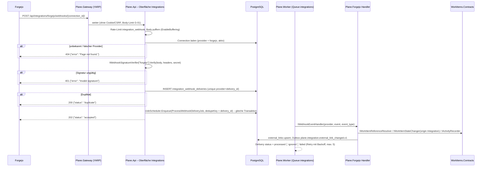
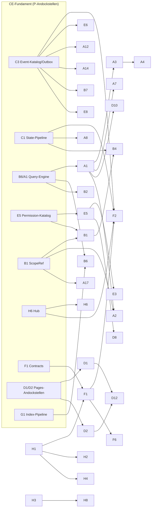

# 16 – Erweiterungspunkte für Bezahl-Features (Andockstellen im CE-Fundament)

> **Stand:** 23.10.2026. **Verbindlichkeit:** bindend für alle CE-Arbeitspakete, die eine hier als **P** (CE-Pflicht) markierte Andockstelle berühren; für die Bezahl-Pakete ist es die Vorgabe, **wo** sie andocken – **nicht wie** sie fachlich funktionieren. Rangfolge bei Widersprüchen: `00-grundsatzentscheidungen.md` > `01-zielarchitektur-und-tech-stack.md` > Themen-Dokumente 02–15 > dieses Dokument. Dieses Dokument detailliert 01 §1.4, §5.5 und §6.4 und darf ihnen nicht widersprechen.
>
> **Zielrepository:** `funk.` (ADR-009). Alle Zielpfade sind relativ zu dessen Wurzel; der frühere Arbeitstitel `plane-net/` ist in 01 §5.1 durch `funk.` ersetzt (ABG-018 g), die Struktur darunter gilt unverändert. Projekt-/Namespace-Präfix bleibt `Plane.*`.
>
> **Kürzel:** Original: `API/` = `apps/api/plane/`, `WEB/` = `apps/web/`, `ADM/` = `apps/admin/`, `SPC/` = `apps/space/`, `LIVE/` = `apps/live/src/`, `PKG/` = `packages/`. Ziel: `BE/` = `funk./src/`, `FE/` = `funk./frontend/`, `EXT/` = `FE/libs/web/extensions/src/`. Feature-Dokumente: `F20` … `F30` = `migration/features/20-…` … `30-…`. Analyse-Dokumente: `A02a` … `A13b` = `migration/analysis/…`. Architektur-Dokumente: `D01` … `D15` = `migration/architecture/01-…` … `15-…`. Die Stub-Nummern `S1`…`S66` beziehen sich auf F20 §6, `PF-xx` auf F20 §4, `EE-Pxx-nnn` auf F29/F30.

---

## Inhaltsverzeichnis

1. Ziel & Scope
   - 1.1 Ziel · 1.2 Im Scope · 1.3 Nicht im Scope · 1.4 Was wird in welchem Inkrement gebraucht · 1.5 Legende
2. Entscheidungen (D16-ADR-01 ff.)
3. Detaildesign
   - 3.1 Arten von Andockstellen und ihre Standardmechanik
   - 3.2 Querschnitts-Reservierungen (Permission-Namensräume, Routen-Präfixe, Activity-Felder, Queues, Event-Typen, Feature-Toggles)
   - 3.3 Paketkatalog: Andockstellen je Paket (55 Pakete, Bereiche A–H)
   - 3.4 Paket F2 Forgejo: Andockstellen im Detail (Verbindungen, Webhook-Empfang, Sync-Mappings, Commit-/PR-Verknüpfungen, API-Client)
4. Vollständige Mapping-Tabellen Original → Ziel (inkl. 4.6 Träger-CE-IDs)
5. Code-Skelette (je 🧱-Paket C# und TypeScript; F2 erweitert)
6. Erweiterungspunkte für Bezahl-Pakete – Verfahren für die Detailplanung je Welle
7. Akzeptanzkriterien & Tests
8. Risiken & offene Punkte
9. Abhängigkeiten zu anderen Dokumenten (02–16)

---

## 1. Ziel & Scope

### 1.1 Ziel

Die Community Edition wird zuerst vollständig portiert; die 52 vom Auftraggeber gewählten Bezahl-Pakete (Wellen W1–W9, F30 „Priorisierung“) folgen danach und werden **erst kurz vor ihrer Umsetzung** fachlich geplant. Damit diese Pakete später **ohne Umbau der CE** andocken können, legt dieses Dokument fest:

1. **je Paket** die benötigten Andockstellen im CE-Fundament – Datenmodell, Domain-/Integration-Events, Permission-Katalog, Query-/Filter-Engine, UI-Registries (Routen, Sidebar, Settings, Property-Renderer, Detail-Widgets, Activity, Editor-Blöcke), API-Erweiterung, Jobs/Scheduler, Realtime;
2. **ob** die Andockstelle in der CE-Phase gebaut werden **muss** (alle 🧱-Pakete: ja, mit konkreter Schnittstelle, CE-Default-Implementierung und Test – 01 P7) oder später additiv ergänzt werden kann, und **in welchem CE-Inkrement** sie entsteht;
3. **wer** zuständig ist (Architektur-Dokument 02–15);
4. für jedes 🧱-Paket eine **Interface-/Schema-Skizze** in C# und TypeScript, die die CE-Arbeitspakete wörtlich umsetzen;
5. für **F2 Forgejo** (ADR-007, keine EE-Vorlage) zusätzlich die konkreten Andockstellen für Verbindungen, Webhook-Empfang, Sync-Mappings, Commit-/PR-Verknüpfungen am Work Item und den typisierten Forgejo-API-Client.

### 1.2 Im Scope

| Gruppe | Pakete | Anzahl |
|---|---|---|
| Gewählt, 🧱 strukturrelevant | A1, A2, A9, A17, B1, B6, D1, D2, E3, E5, F1, F2, H1, H6 | 14 |
| Gewählt, nicht strukturrelevant | A3, A4, A5, A6, A7, A8, A10, A11, A12, A13, A14, A15, A16, B2, B3, B4, B5, B7, B8, D3, D4, D5, D6, D7, D8, D9, D10, D11, D12, E6, E7, E8, F6, H2, H3, H4, H7, H8 | 38 |
| Nicht gewählt, aber 🧱 (Andockstelle trotzdem Pflicht, F30 Hinweis) | C1, C3, G1 | 3 |
| **Summe** | | **55** |

Prüfsumme: 14 + 38 = 52 gewählte Pakete (F30: „Ausgewählt: 52 Pakete“; A1–A17, B1–B8, D1–D12, E3/E5/E6/E7/E8, F1/F2/F6, H1/H2/H3/H4/H6/H7/H8), zuzüglich der drei nicht gewählten 🧱-Pakete. Die 17 🧱-Pakete aus F30 (A1, A2, A9, A17, B1, B6, C1, C3, D1, D2, E3, E5, F1, F2, G1, H1, H6) sind vollständig enthalten.

### 1.3 Nicht im Scope

- **Fachdesign** der Bezahl-Pakete (Felder, Regeln, Screens, Texte, Endpunkt-Verträge). Es entsteht je Welle in `migration/plan/waves/W<n>-<paket>.md` (§6). Ausnahme F2: die **Andockstellen** (nicht das Sync-Verhalten im Detail) werden in §3.4 konkret skizziert.
- **Nicht gewählte, nicht strukturrelevante Pakete** C2, C4, C5, C6, F5, F7, F8, F9, F10, F11, G2, G3, H5: keine Andockstellen über die der 🧱-Pakete hinaus. Sie bleiben dennoch nachrüstbar, weil sie auf C1/C3/G1/F1/A1-Andockstellen aufsetzen (Merkposten §8, R-16-09).
- **Entfallene Funktionen** (F30 „Entfällt“: Lizenz/Billing/Seats/Kontingente nach ADR-001/-004, GitHub/GitLab/Bitbucket nach ADR-007, SSO/LDAP/2FA/Passkeys/Password Policy/Domains nach ADR-008). Für sie gibt es **keine** Andockstelle; Upsell-Elemente des Originals entfallen in der CE ersatzlos (ADR-001), die echte Funktion erscheint mit dem Paket.
- Implementierungsdetails der CE-Bausteine selbst (Filter-Engine, Permission-Evaluator, Outbox, Job-Queue, Realtime-Hub, Registries) – sie stehen in D02, D05, D08, D14; hier wird nur festgelegt, **welche Form** sie haben müssen, damit Pakete andocken.

### 1.4 Was wird in welchem Inkrement gebraucht

Die Inkremente folgen 01 §1.3; Spalte „ab“ in 01 §1.4 ist bindend. Diese Tabelle listet **alle P-Andockstellen** (CE-Pflicht) nach Inkrement – sie ist die Checkliste für die CE-Arbeitspakete. Jede Zeile ist erst „fertig“, wenn Contract + CE-Default + Test-Erweiterung (§7) grün sind und die Andockstelle im Inventar `tests/extension-points.yaml` steht (D15 EP-T09, geprüft durch `Plane.ArchitectureTests/ExtensionPointInventoryTests` bzw. `frontend/tools/extension-registry-check`).

| Inkrement | P-Andockstellen, die in diesem Inkrement fertig sein müssen | Pakete | Zuständiges Dok. |
|---|---|---|---|
| **I0 Walking Skeleton** | Event-Katalog-Gerüst (`IIntegrationEvent`, `EventType`-Schema, Snapshot-Test), Outbox/Inbox-Gerüst, `IEventConsumer`-Registrierung, `IRecurringJobRegistry`, benannte Queues (§3.2.5); `ScopeLevel`/`ScopeRef`/`IScopeResolver` (CE: Workspace/Project); Permission-Katalog mit `Permission(Key, Scope, ApiScope)`, `roles`-Tabelle + System-Rollen-Seeds, `role_id` in Mitgliedschaften, `IRoleDefinitionProvider`, `IVisibilityFilter<T>` (+ `CompositeVisibilityFilter<T>`), reservierte Permission-Namensräume (§3.2.1) in `ReservedPermissionKeys` (D05 §6.1); `PlanePrincipal` mit `Kind`/`Groups`/`ApiScopes`, Policy-Scheme `Cookies│ApiKey│Bearer` (Bearer aus), `users.is_bot`; `IUserProvisioningStep`-Kette mit freien `Order`-Slots; Oberfläche `Integrations` (`/api/integrations/{provider}/webhooks/{connection_id}/`, 404 ohne Verifier), `IWebhookSignatureVerifier`-Registry, `IWebhookIngress` (E-25), Inbox-Idempotenz, leere Tabellen `integration_connections`/`external_links`; Reservierungen §3.2 + Kollisionstests (E-17), Regeln R11/R12; `IScopeAncestorContributor` (E-20), `IRealtimeGroupAuthorizer` (E-22), `ISystemRoleGrantContributor` (E-09), `ProvisioningOrder`-Slots; Platzhalter-Projekte `Plane.Integrations.Contracts`, `Plane.Forgejo.Contracts`, `Plane.Forgejo.Client` (nur Interface + DTOs), `Plane.Apps.Contracts`, `Plane.Properties.Contracts`, `Plane.Teamspaces.Contracts`; Forgejo-Container + Keycloak-Client `plane-forgejo` + `forgejo-init`; SignalR-Hub `/live/events/` mit Gruppen, `IRealtimePublisher`; Frontend: `PermissionService` + `PERMISSION_EVALUATOR`, `SCOPE_LEVELS`, `ROUTE_EXTENSIONS` + `mergeRoutes`, `SIDEBAR_ITEMS` (statisch), `ADMIN_SETTINGS_PAGES`, `ADMIN_ROUTE_EXTENSIONS`, `ADMIN_HEADER_SEGMENT_LABELS` (S41), `APP_RAIL_ENABLED`, `LiveEventsService` + `LIVE_EVENT_HANDLERS`, `RouterStore.teamspaceId` | C3, B1, E5, H1, E3, F1, F2, H6, A1/A2 (nur Platzhalter) | D02, D05, D08, D14, D15 |
| **I1 Workspace, Projekte, Konto** | `IStateCatalog`/`ILabelCatalog` als einzige Lesewege (A17), `IScopedCatalogEntry` an `State`/`Label`; Feature-Toggle-Kataloge `IProjectFeatureCatalog`/`IWorkspaceFeatureCatalog` + Frontend `PROJECT_FEATURES`/`WORKSPACE_FEATURES` (§3.2.6); `SETTINGS_PAGES`, `SIDEBAR_ITEMS` (dynamisch), `FAVORITE_ENTITY_RENDERERS`, `MEMBER_ROW_DECORATORS`, `ROLE_OPTIONS`; Activity-Grundgerüst mit `IActivityFieldResolver`-Registry und reservierten Feldnamen (§3.2.3); nullable `teamspace_id` in den in §3.3 B1 genannten Tabellen | A17, B1, E3, E5, H1, F2, C3 | D02, D03, D05, D08 |
| **I2 Work Items & Layouts** | Filter-AST + `IFilterParser`-Liste (legacy, rich), `IFilterFieldProvider`/`IGroupKeyProvider`/`IOrderKeyProvider`, `IWorkItemPayloadExtension`, erweiterbarer Operator-Katalog; `work_items.type_id` + Minimal-Tabelle `work_item_types`; Relationstyp-Katalog `work_item_relation_types` (10 Seeds); State-Change-Pipeline `IWorkItemStateChanger` + Guard/Hook; `IWorkItemReferenceResolver` (Identifier → Work Item, F2/D6); `IIntegrationLinkProvider` (E-13, `[]`); `IWorkItemCommands` (E-18); Frontend: `PROPERTY_RENDERERS`, `WORK_ITEM_IDENTIFIER_DECORATORS` (A1, ABG-030), `SPREADSHEET_COLUMNS`, `GROUP_BY_OPTIONS`, `FILTER_FIELDS`, `FILTER_OPERATORS`, `RELATION_TYPES`, `TIMELINE_FLAGS`, `ISSUE_MODAL_CONTEXT`, `WORK_ITEM_PROPERTIES_LOADER`, `WORK_ITEM_DETAIL_WIDGETS`, `WORK_ITEM_ACTIONS`, `ACTIVITY_RENDERERS`, `WORKFLOW_GUARD`, `INTEGRATION_LINK_PREVIEWS`, `DUPLICATE_DETECTION`, `EDITOR_EXTENSIONS`/`EDITOR_FLAGS` (Lite) | A1, A2, A9, B6, C1, F1, F2, G1 | D02, D03, D08, D10 |
| **I3 Planung** | keine zusätzliche P-Andockstelle; die I2-Registries werden von Cycles/Modules/Intake/Views mitbenutzt (Filter-AST in Views, State-Pipeline bei Cycle-Transfer und Intake-Annahme) | (C1, B6) | D02 |
| **I4 Pages & Realtime** | Pages ohne Projektpflicht (`pages.workspace_id`, `project_pages`), `pages.parent_id`, `IPageHierarchy` (flach), `IPageAccessExtension` (Default `false`), Dokumenttyp-Registry `ICollaborationDocumentType` (CE: `project_page`), Realtime-Event `affectedPages` erzeugbar; Frontend: `PAGE_STORES`, `PAGE_TREE`, `PAGE_FLAGS`, `PAGE_PANE_EXTENSIONS`, `EDITOR_BLOCKS`, `EDITOR_MENTION_TYPES`, `APP_RAIL_ENABLED` | D1, D2 (D8) | D07, D08, D10 |
| **I5 Überblick** | `ISearchProvider`, `IIndexingPipeline` als `IEventConsumer`, `search_documents` (`tsvector`), Extension `vector` aktiv, `IEmbeddingGenerator<string, Embedding<float>>` mit `NullEmbeddingGenerator`; erste Nutzung `LIVE_EVENT_HANDLERS` (Notification-Zähler); `SEARCH_RESULT_RENDERERS`, `POWER_K_COMMANDS` | G1, B6, H6 | D11, D08 |
| **I6 Außenwirkung** | Public-API-Adapter-Erweiterung `IV1PayloadExtension` (Typ-/Property-Felder in v1-Antworten), `IV1FilterParameterBinding` (E-19, Original-400 für `pql`/`filters`), OpenAPI-Dokumentgruppen erweiterbar, Webhook-Event-Katalog erweiterbar (`IWebhookEventSource`), `IExportTypeProvider` (E-16); Frontend: `SPACE_ROUTE_EXTENSIONS`, `EDITOR_EXTENSIONS` im Space-Scope (S44) | A1, B5, B6, A10, D5, H3 (Vorbereitung), C3 | D04, D06, D08 |
| **I7 Härtung** | Contract-Snapshot aller Erweiterungs-Interfaces (`ExtensionContractsSnapshotTests`), Architekturtest R11/R12 (§2), Airgap-Test mit gebündeltem Forgejo | alle | D15, D14 |
| **W1** | Implementierung F1, H1, H6 (Vollausbau), F2 – auf den obigen Andockstellen; **keine** CE-Änderung außer additiven Migrationen | F1, F2, H1, H6 | Wellenplan W1 |

Die Ergänzungen E-01…E-26 aus §3.3.0 sind in dieser Tabelle enthalten bzw. fallen in das Inkrement ihrer Spalte „ab“ (I1: E-01, E-02, E-12, E-14 (Estimates, Modals), E-21, E-26; I2: E-03…E-06, E-11, E-13, E-18; I3: E-14 (Quick Actions, Cycles), E-15; I4: E-10, E-23; I5: E-14 (Home), E-24; I6: E-07 (v1), E-08, E-16, E-19).

### 1.5 Legende

| Symbol / Begriff | Bedeutung |
|---|---|
| **P** | **CE-Pflicht.** Contract (Interface, Schema, Token) + CE-Default-Implementierung + Test „Default = Original-Verhalten“ + Test mit Fake-Erweiterung (D15 §3.15.3 Typ X). Muss im genannten Inkrement fertig sein. |
| **V** | **Durch den 1:1-Port bereits vorhanden.** Feld/Store/Konstante existiert im Original-CE (Vertrag, ADR-003/-005) und wird ohnehin portiert; einzige Pflicht: nicht entfernen, nicht umdeuten (Review-Checkliste, §7 AK-16-12). |
| **R** | **Reserviert.** Nur Name/Präfix/Wert wird festgeschrieben (Permission-Namensraum, Routen-Präfix, Activity-Feld, Queue, Event-Typ); keine Implementierung. Ein Test verhindert Kollisionen. |
| **S** | **Später additiv.** Keine CE-Vorleistung; das Paket ergänzt neue Tabellen, Module, Registrierungen und Routen. CE-Code wird höchstens **additiv** angefasst (neue Datei, neue Registrierung). |
| 🧱 | strukturrelevantes Paket laut F30 |
| W1…W9 | Welle laut F30 „Priorisierung (Wellen)“ |
| I0…I7 | CE-Inkrement laut 01 §1.3 |

---

## 2. Entscheidungen (D16-ADR-01 ff.)

| ID | Belang | Entscheidung | Alternativen (verworfen) | Begründung | ab |
|---|---|---|---|---|---|
| **D16-ADR-01** | Klassifikation | Jede Andockstelle trägt genau eine Klasse **P/V/R/S** (§1.5). **P** nur (a) für 🧱-Pakete, (b) für Andockstellen, die ein 🧱-Paket mitbenutzt (z. B. Feature-Kataloge für A1/B1/D1), und (c) für **Kleinst-Andockstellen** (ein Token bzw. Interface mit trivialem Default), ohne die ein nicht-🧱-Paket eine CE-Komponente ändern müsste (abschließende Liste §3.3.0); alle anderen gewählten Pakete docken über P/V/R-Stellen oder additiv (S) an. | Alle 52 Pakete mit eigenen P-Andockstellen; nur 🧱-Pakete betrachten | Hält die CE schlank (Strategie „schlanker Gesamtrahmen“) und erfüllt trotzdem „Ausbau ohne Umbau“: jedes S-Paket hat eine benannte, additive Andockstelle. | I0 |
| **D16-ADR-02** | Modulschnitt der Pakete | Paket **mit eigenen Entitäten** → eigenes Modul `Plane.<Name>` + `Plane.<Name>.Contracts` unter `BE/modules/extensions/<Name>/` (Modul-Schablone 01 §5.3). Paket, das **nur Verhalten** eines CE-Moduls erweitert (A8, A11, A16, B4, B5, D3, D4, D5, D6, E7) → im **Eigentümer-Modul** in einem eigenen Ordner `Extensions/<Paket>/` (Regel R3 Schreib-Eigentum bleibt gewahrt). Zuordnung je Paket in §3.3. | Ein Sammelmodul `Plane.Enterprise`; jedes Paket als eigenes Modul | Eigentümerregel R3 verbietet fremde Schreibzugriffe; ein Sammelmodul würde R1/R3 aushebeln. | W1 |
| **D16-ADR-03** | Abhängigkeitsrichtung | Neue Architekturregeln: **R11** CE-Module (`BE/modules/*` außer `extensions/*`) dürfen **keine** Paket-Module referenzieren – auch nicht deren Contracts, außer den sechs in der CE angelegten Platzhalter-Contracts (`Plane.Properties.Contracts`, `Plane.Teamspaces.Contracts`, `Plane.Integrations.Contracts`, `Plane.Forgejo.Contracts`, `Plane.Forgejo.Client`, `Plane.Apps.Contracts`). **R12** Paket-Module referenzieren CE-Module nur über `*.Contracts` (wie R1). Frontend analog per Sheriff: `scope:web` (CE-Libs) importiert nie `domain:package-*`; Pakete importieren nur `libs/web/extensions` und `public-api.ts` der CE-Libs. | Nur Konvention | Pakete müssen ohne CE-Änderung ein- und ausbaubar sein; Agenten erhalten maschinelles Feedback (ADR-050). | I0 |
| **D16-ADR-04** | Registrierung | Paket-Module werden über die Modul-Liste `PlaneModuleCatalog` in `BE/hosts/Plane.Hosting/` registriert (eine Zeile je Modul, Reihenfolge = Abhängigkeit). Kein Assembly-Scanning, keine Plug-in-DLLs zur Laufzeit. Im Frontend registriert jedes Paket genau einen `provide<Paket>Extensions()` in `apps/web/src/app.config.ts` **hinter** `provideWebExtensions()` (D08 §6); Admin- bzw. Space-Erweiterungen analog in `apps/admin`/`apps/space` hinter `provideAdminExtensions()` bzw. `provideSpaceExtensions()` (ABG-023). | Plug-in-Loader (`AssemblyLoadContext`); Feature-Flags je Paket | ADR-001: alles ist immer aktiv; statische Registrierung ist AOT-/Trim-fähig und testbar. | I0 |
| **D16-ADR-05** | Fachliche Schalter statt Plan-Gates | Paketfunktionen, die das Original per **Projekt-/Workspace-Feature-Toggle** steuert (`is_issue_type_enabled`, `is_time_tracking_enabled`, `is_epic_enabled`, `is_workflow_enabled`, `is_project_updates_enabled`, `is_milestone_enabled`, Workspace-Features `teams`, `wiki`, `initiatives`, `customers`, `project_grouping`, `pi`), werden über **Feature-Kataloge** angeboten (`IProjectFeatureCatalog`, `IWorkspaceFeatureCatalog`, Frontend `PROJECT_FEATURES`, `WORKSPACE_FEATURES`; §3.2.6, §5.1). CE-Katalog = die fünf CE-Toggles (`cycle_view`, `module_view`, `issue_views_view`, `page_view`, `intake_view`) bzw. leer. | Toggles hart in `Project`-Entität und `features-list.tsx` (Original) | ADR-001 erlaubt fachliche Toggles; ohne Katalog müsste jedes Paket CE-Entität, Serializer und Settings-Liste ändern. Bedient A1 (🧱), B1 (🧱), D1 (🧱) → Klasse P. | I1 |
| **D16-ADR-06** | Schemaerweiterung | Pakete erweitern das Schema **nur additiv** (neue Tabellen, neue nullable Spalten, neue Indizes; Expand/Contract laut D14 §3.17). Spalten, die das Original-CE-Modell bereits besitzt und die im JSON-Vertrag erscheinen (`projects.is_time_tracking_enabled`, `projects.is_issue_type_enabled`, `projects.default_assignee_id`, `work_items.type_id`, `work_item_comments.parent_id`, `intake_work_items.source/source_email/extra`, `pages.parent_id`/`is_global`/`moved_to_page`/`moved_to_project`, `cycles.progress_snapshot`), legt **die CE** an (Klasse V, D03). Paket-Tabellen tragen `[OwnedBy("<Paketmodul>")]`; ihre Entitäts- und Konfigurationsklassen liegen nach Regel R3 als **neue Dateien** in `BE/data/Plane.Data/Entities/<Paket>/` bzw. `Configurations/<Paket>/` (Aufnahme über `ApplyConfigurationsFromAssembly`, kein `DbSet`-Eintrag in einer CE-Datei nötig); Migrationen `W<n>_<Paket>_<Beschreibung>` liegen in `Plane.Data/Migrations/`, die dabei neu generierte `PlaneDbContextModelSnapshot.cs` ist die einzige zulässige, generierte Änderung einer bestehenden CE-Datei. | Paketeigene Schemas (`pg schema` je Paket) | Ein `PlaneDbContext` (ADR-037) erlaubt Joins der Work-Item-Listen auch mit Property-Werten; Präfix-freie Tabellennamen wie Original-EE-API (`work_item_properties`, `teamspaces`). | I0 |
| **D16-ADR-07** | Vertrags-Stabilität der Andockstellen | Alle Erweiterungs-Interfaces (C#) und Tokens (TS) sind **öffentlicher Vertrag**: C#-Snapshot per `PublicApiGenerator` (MIT ⚠ Lizenz-Gate) + Verify, TS-Snapshot per `api-extractor`-Report von `EXT/public-api.ts` (MIT). Änderung nur additiv; Breaking Change braucht ADR-Änderung in diesem Dokument. | Keine Snapshots | Pakete werden Monate nach der CE gebaut; stille Signaturänderungen würden sie brechen. | I7 (Snapshot), Contracts ab Entstehung |
| **D16-ADR-08** | Test-Erweiterungen | Jede P-Andockstelle hat eine **Fake-Erweiterung** in `BE/building-blocks/Plane.BuildingBlocks.Testing/Extensions/` (z. B. `FakeFilterFieldProvider`, `FakeStateTransitionGuard`, `FakeWebhookSignatureVerifier`) bzw. `FE/libs/web/extensions/testing/` (`provideFakeExtensions(config?: FakeExtensionConfig)`; Admin/Space: `provideFakeAdminExtensions(config?)` in `FE/libs/admin/extensions/testing/`, `provideFakeSpaceExtensions(config?)` in `FE/libs/space/extensions/testing/`; ABG-032), die in mindestens einem Test zeigt, dass der Punkt ohne CE-Änderung wirkt (D15 Typ X). | Tests erst mit dem Paket | Nur so ist „ohne Umbau erweiterbar“ in der CE messbar (01 P7). | jeweiliges Inkrement |
| **D16-ADR-09** | Integrationen (F1/F2) | `Plane.Integrations` (Framework: Verbindungen, Webhook-Eingang, Inbox, Sync-Lauf, External Links, Token-Tresor) und `Plane.Forgejo` (Provider) sind **Module im Monolithen** (ADR-049); externe Pfade: Webhook `POST /api/integrations/forgejo/webhooks/{connection_id}/`, OAuth-Callbacks `GET /api/integrations/forgejo/oauth/callback/` (Workspace-Verbindung) und `GET /api/integrations/forgejo/oauth/user-callback/` (persönliches Konto). Damit ist der in D14 §3.4.3 Schritt 8 mit ⚠ markierte Redirect-Pfad festgelegt; für die persönliche Verknüpfung registriert `forgejo-init` den zweiten Redirect-URI zusätzlich. Beide Callbacks liegen auf der Oberfläche `Integrations` mit opt-in `.WithSessionAuthentication()` (D02 §3.3.2; ABG-049). | Pfade `/silo/api/…` wie EE | Es gibt keine EE-Vorlage für Forgejo; einheitliche Oberfläche `Integrations` (D02-ADR-06) mit eigener Rate-Limit-Policy und Roh-Body. | I0 (Route), W1 |
| **D16-ADR-10** | Forgejo-Webhook-Signatur | `ForgejoSignatureVerifier` prüft HMAC-SHA256 (Hex, lowercase, ohne Präfix) über den **rohen** Body mit dem Verbindungs-Secret, Header-Reihenfolge `X-Forgejo-Signature` → `X-Gitea-Signature` → `X-Hub-Signature-256` (Präfix `sha256=`); Vergleich `CryptographicOperations.FixedTimeEquals`. Die Header-Map, die `IWebhookIngress` an den Verifier übergibt, ist **case-insensitiv** (`StringComparer.OrdinalIgnoreCase`, HTTP-Header-Semantik). **Fachlicher Dispatch-Schlüssel** ist der feine Ereignistyp aus `X-Forgejo-Event-Type` (Fallback `X-Gitea-Event-Type`); `X-Forgejo-Event` (Fallback `X-Gitea-Event`) ist nur die grobe Familie (z. B. `issues` für `issue_label`, `issue_comment` für `pull_request_comment`, §3.4.3). Idempotenz-Schlüssel `X-Forgejo-Delivery` (Fallback `X-Gitea-Delivery`). | Nur ein Header; Dispatch über `X-*-Event` | Forgejo ist Gitea-kompatibel und sendet die Gitea-/GitHub-kompatiblen Header mit (Gitea `services/webhook/deliver.go`: `X-Gitea-Signature` = HMAC-SHA256-Hex ohne Präfix, `X-Hub-Signature-256` = `sha256=`-Präfix; Familien-Abbildung `HookEventType.Event()` in Gitea `modules/webhook/type.go`, Zweig `release/v1.24`, im Review abgerufen). Für `X-Forgejo-Signature` (Hex ohne Präfix, zusätzlich `X-Gitea-Signature`/`X-Gogs-Signature`, `X-Hub-Signature-256` mit `sha256=`) gibt es im Review nur einen **mittelbaren** Beleg (Commit-Spiegel eines Forgejo-Derivats, Websuche 23.10.2026; forgejo.org/codeberg.org aus der Planungsumgebung nicht erreichbar) → ⚠ Bestätigung im Spike S-F2-1 gegen eine Test-Delivery des gepinnten Forgejo-15-Containers bleibt Pflicht. | W1 (Verifier), I0 (Registry) |
| **D16-ADR-11** | Work-Item-Referenzen in Texten | Ein zentraler Dienst `IWorkItemReferenceResolver` (`Plane.WorkItems.Contracts`, CE-Pflicht ab I2) löst `<IDENTIFIER>-<sequence>` (case-insensitiv, Identifier ≤ 12 Zeichen wie `API/db/models/project.py` `identifier max_length=12`) innerhalb eines Workspace auf. Nutzer: F2 (Branch/PR/Commit), D6 (Mentions), H4 (MCP), B6 (PQL-Literale). Erkennungsmuster (Präfix-Schlüsselwörter, Branch-Konventionen) gehören **nicht** in die CE, sondern in das Paket. | Jedes Paket parst selbst | Eine Auflösungsregel (Archiv, Löschung, Gast-Sichtbarkeit) statt mehrerer; die CE nutzt sie selbst für `browse/:workItem` (`WEB/app/(all)/[workspaceSlug]/(projects)/browse/[workItem]/page.tsx`). | I2 |
| **D16-ADR-12** | Aktor für Integrations-Aktionen | Schreibaktionen aus Integrationen laufen mit einem **Bot-Benutzer** je Verbindung (`users.is_bot = true`, `bot_type = "integration"`) oder – falls verknüpft – im Namen des verknüpften Plane-Nutzers; `ICurrentActor` im Worker wird aus `EventContext`/Job-Kontext gesetzt; `StateChangeOrigin.Integration`. Echo-Unterdrückung erkennt Änderungen dieses Aktors. | Systemaktor ohne Benutzerzeile | Activity, Notifications und Webhooks des Originals setzen immer einen Akteur voraus (`actor_id`); `is_bot` existiert im Original. | I0 (Feld), W1 |
| **D16-ADR-13** | Sekrete der Pakete | Alle Secrets werden mit **ASP.NET Core Data Protection** verschlüsselt in `integration_secrets` gespeichert; Klartext nie in Logs, Activity oder API-Antworten. Purposes **wie D05 §6.1** (Rang D05 > D16): `Plane.Integrations.ConnectionSecret.v1` für Secrets einer Workspace-Verbindung (`oauth_client_secret`, `webhook_secret`, Access-/Refresh-Token der Verbindung, `bot_token`) und `Plane.Forgejo.UserToken.v1` für Tokens der **persönlichen** Konto-Verknüpfung (`user_integration_connections`). Konstanten in `IntegrationSecretPurposes` (§5.10). | Klartext-JSON in `config` (EE `app_config`); ein gemeinsamer Purpose | D14-ADR-09 (Key-Ring in PostgreSQL); Schlüsselrotation ohne Re-Encryption-Skript; getrennte Purposes verhindern, dass ein Nutzer-Token als Verbindungs-Secret entschlüsselt werden kann. | I0 (Purposes reserviert), W1 |
| **D16-ADR-14** | Upsell-Stellen in der CE | Upsell-Elemente des Originals entfallen in der CE ersatzlos (ADR-001); die echte Funktion erscheint erst mit dem Paket über die Registries. Ausnahme, bereits in D08 (Routen-Zeile 11) entschieden: Workspace-Active-Cycles (EE-P05-022, Paket B4) wird in der CE (I3) aus CE-Bausteinen gebaut. Weitere Vorziehungen nur per Eintrag in §4.1. | Platzhalterseiten „kommt später“ | Ehrliche CE ohne tote Navigation; Paritätstests vergleichen CE-Screens ohne Upsell. | I0 |
| **D16-ADR-15** | Original-`extended.ts`-Dateien | Die TS-Dateien des Originals, die genau als EE-Override-Punkt existieren, werden mit gleichem Pfad übernommen (Klasse V) und sind – neben je einer Registrierungszeile in `PlaneModuleCatalog` und `app.config.ts` (D16-ADR-04), additiven Migrationen/Seeds und neuen Entitätsdateien in `Plane.Data` (D16-ADR-06) – die **einzigen** CE-Dateien, die ein Paket-PR ändern darf, ausschließlich additiv (Liste und Prüfung §3.1, Absatz „D16-ADR-15“; §6.2 Punkt 4). | Alles per DI | TS-Unions sind nicht per DI erweiterbar; das Original nutzt genau diese Dateien. | I0 |

---

## 3. Detaildesign

### 3.1 Arten von Andockstellen und ihre Standardmechanik

Jede Paket-Andockstelle in §3.3 ist eine Instanz einer der folgenden Arten. Die Mechanik ist in der CE **einmal** gebaut; Pakete nutzen sie ausschließlich additiv.

| Nr. | Art | Mechanik in der CE (Contract) | Ort in `funk.` | Erweiterung durch ein Paket | Zuständig |
|---|---|---|---|---|---|
| X1 | **Datenmodell – Scope** | `ScopeLevel { Instance, Workspace, Teamspace, Project }`, `ScopeRef(Level, WorkspaceId, TeamspaceId?, ProjectId?)`; Katalog-Entitäten (`State`, `Label`, künftig Typen/Properties) implementieren `IScopedCatalogEntry`; `IScopeResolver.ResolveAncestorsAsync` | `BE/building-blocks/Plane.BuildingBlocks/Scoping/` | neue Scope-Ebene nur Teamspace (B1); Katalog-Entitäten der Pakete implementieren `IScopedCatalogEntry` | D02 §3.1, D03 |
| X2 | **Datenmodell – reservierte Spalten/Tabellen** | nullable FKs/Spalten, die der 1:1-Vertrag ohnehin braucht (Klasse V) bzw. 01 §1.4 fordert (`work_items.type_id`, `work_item_types` minimal, `work_item_relation_types`, `pages.parent_id`, `project_pages`, `teamspace_id`-Spalten, `roles`/`role_permissions`, `users.is_bot`, `external_links`, `integration_connections`) | `BE/data/Plane.Data/Entities/<Modul>/` | additive Migration `W<n>_<Paket>_<Beschreibung>` im Paketmodul; nie Umbenennung/Typänderung einer CE-Spalte | D03, D14 §3.17 |
| X3 | **Integration-Events** | `IIntegrationEvent` mit `static abstract string EventType` (`plane.<objekt>.<ereignis>.v<n>`), transaktionale Outbox, `IEventConsumer<T>` über `IModule.RegisterMessaging`, Inbox-Idempotenz je Consumer, Event-Katalog-Snapshot | `BE/building-blocks/Plane.BuildingBlocks.Messaging/`, `*.Contracts/Events/` | Pakete **konsumieren** CE-Events und **veröffentlichen** eigene (`plane.<paketobjekt>.<ereignis>.v1`); Mindestmenge der CE-Events §3.2.4 | D02 §3.2, D06 |
| X4 | **Synchrone Contracts-Services** | Lese-/Schreibfassaden der Eigentümer-Module (`IStateCatalog`, `ILabelCatalog`, `IWorkItemStateChanger`, `IWorkItemReferenceResolver`, `IActivityRecorder`, `IPageHierarchy`, `IPageDocumentStore`) | `BE/modules/<M>/Plane.<M>.Contracts/Services/` | Pakete rufen sie auf (R5) oder implementieren Erweiterungs-Interfaces daneben (`IStateTransitionGuard`) | D02 |
| X5 | **Pipelines mit Ordnungsslots** | `IUserProvisioningStep.Order` (100…900, Lücken für Pakete), `IStateTransitionGuard`/`IStateTransitionHook` (Reihenfolge `Order`), `IActivityFieldResolver` je Feld | `Plane.Identity/Provisioning/`, `Plane.WorkItems/Application/Services/` | neue Schritte/Guards/Resolver per DI-Registrierung im Paketmodul | D05 §3.7.3, D02 |
| X6 | **Permission-Katalog** | `Permission(Key, Scope, ApiScope?)`, `IModule.Permissions`, `IPermissionEvaluator`, `IRoleDefinitionProvider`, `IVisibilityFilter<T>`, `PermissionRule`-Bausteine; reservierte Namensräume §3.2.1 | `Plane.Authorization(.Contracts)` | Paket deklariert neue Keys in seinem `<Paket>Permissions.cs`; System-Rollen-Grants für neue Keys über `ISystemRoleGrantContributor` (§5.6) | D05 §3.13 |
| X7 | **Query-Engine** | Filter-AST (`And/Or/Not/Condition`), `IFilterParser` (legacy, rich), `IFilterFieldProvider` + `IWorkItemFilterTranslator`, `IGroupKeyProvider` + `IWorkItemGroupExpressionProvider`, `IOrderKeyProvider` + `IWorkItemOrderExpressionProvider`, `IWorkItemPayloadExtension` | `Plane.WorkItems.Contracts/Query/`, `Plane.Data/Querying/WorkItems/` | neue Felder/Gruppen/Sortierungen/Parser (PQL) und Payload-Felder | D02 §3.11 |
| X8 | **API-Erweiterung** | Oberflächen `ApiSurface` (`App`, `V1`, `Space`, `Instance`, `Auth`, `Integrations`, `Root`), reservierte Routen-Präfixe §3.2.2, `IWorkItemPayloadExtension` (App), `IV1PayloadExtension` (Public API), `expand`-Registry `IExpandProvider`, Webhook-Event-Quellen `IWebhookEventSource`, OpenAPI-Gruppen je Modul | `Plane.BuildingBlocks.Web/Surfaces/`, `Plane.PublicApi`, `Plane.Webhooks.Contracts` | Paket mappt eigene Endpunkte unter seinem Präfix; neue Oberfläche `V2` nur mit H3 | D02 §3.3, D04 |
| X9 | **Jobs & Scheduler** | `IJob`, `IJobScheduler.EnqueueAsync(runAt, dedupeKey)`, `IRecurringJobRegistry.Register(name, cronUtc)`, benannte Queues §3.2.5, benannte Worker-Pools (`Plane__Worker__Queues`) | `Plane.BuildingBlocks.Messaging/Jobs/`, `Plane.Worker` | Paket registriert Jobs/Crons im `RegisterMessaging`; eigene Queue nur aus §3.2.5 | D06, D14 §6.1 |
| X10 | **Realtime-Events (H6)** | SignalR-Hub `/live/events/`, Gruppen `ws:{id}`, `project:{id}`, `user:{id}` (+ reserviert `teamspace:{id}`, `page:{id}`), `IRealtimePublisher`, Event-Namen `<objekt>.<ereignis>` | `Plane.RealtimeEvents(.Contracts)`, `FE/libs/web/core/live-events` | Paket-Consumer veröffentlichen eigene Event-Namen; Frontend registriert `LIVE_EVENT_HANDLERS` | D07, D08 §6 |
| X11 | **Kollaborations-Dokumenttypen** | `ICollaborationDocumentType` (Name, Autorisierung, Laden/Speichern) – CE: `project_page` (`LIVE/types/index.ts` `TDocumentTypes`) | `Plane.Collaboration.Contracts` | D1/B1 registrieren `workspace_page`, `teamspace_page` | D07 |
| X12 | **Frontend-Registries** | Tokens in drei Token-Libs (D08 §6.1, vollständig; ABG-023): Web-Tokens in `EXT/` mit CE-Defaults per `provideWebExtensions()`; `ADMIN_SETTINGS_PAGES`, `ADMIN_ROUTE_EXTENSIONS`, `ADMIN_HEADER_SEGMENT_LABELS` in `FE/libs/admin/extensions` mit `provideAdminExtensions()`; `SPACE_ROUTE_EXTENSIONS` in `FE/libs/space/extensions` mit `provideSpaceExtensions()`; app-neutrale Mechanik (`RouteExtension<K>`, `mergeRoutes`, `injectRegistry`) in `FE/libs/shared/cdk/src/extensions` (Import `@plane/cdk/extensions`; Sheriff-Tag `domain:extensions` importiert nur `scope:shared`); Store-Override per DI (D08 §6.3), Original-`extended.ts`-Dateien (D16-ADR-15); Decorator-Tokens `WORK_ITEM_IDENTIFIER_DECORATORS` (A1, ab I2) und `MEMBER_ROW_DECORATORS` (E3, ab I1) per `NgComponentOutlet` ohne Wrapper, CE-Default `[]` (ABG-030) | `FE/libs/{web,admin,space}/extensions/src/` (Mechanik `@plane/cdk/extensions`) | `provide<Paket>Extensions()` hinter `provideWebExtensions()` / `provideAdminExtensions()` / `provideSpaceExtensions()` | D08 §6 |
| X13 | **Editor** | Client: `EDITOR_EXTENSIONS`, `EDITOR_BLOCKS`, `EDITOR_MENTION_TYPES`, `EDITOR_FLAGS`, `PAGE_PANE_EXTENSIONS`; Server: Schema aus DI-Sammlung `IEnumerable<IDocumentNodeSpec>`/`IDocumentMarkSpec` (eine Klasse je Tiptap-Extension, ADR-031) | `FE/libs/shared/editor`, `BE/documents/Plane.Documents/Schema/` | neue Nodes/Marks client- **und** serverseitig, Golden-Files je Node; Schema-Freeze (ADR-042) gilt nur für CE-Nodes | D10, D07 |
| X14 | **Suche & Index** | `ISearchProvider`, `IIndexingPipeline`, `search_documents`, `IEmbeddingGenerator` (Null-Provider) | `Plane.Platform.Search`, `Plane.Platform.Ai` | weitere Entitätstypen indexieren, Provider tauschen (B6), Embeddings (G1) | D11 |

**D16-ADR-15 (Ergänzung zu §2) – Original-`extended.ts`-Dateien.** Die TS-Dateien des Originals, die genau für EE-Erweiterungen existieren (abschließend, per `find apps packages -iname '*extended*'` am 23.10.2026 erhoben und um zwei gleichartige Dateien ergänzt: `PKG/types/src/page/extended.ts` (S51), `PKG/types/src/base-layouts/gantt/extended.ts` (S54), `PKG/types/src/rich-filters/derived/extended.ts`, `…/field-types/extended.ts`, `…/operator-configs/extended.ts`, `…/operators/extended.ts` (S55), `PKG/constants/src/rich-filters/operator-labels/extended.ts` (S55), `PKG/editor/src/types/editor-extended.ts` (S48), `PKG/types/src/issues/issue-property-values.ts` (S56), `WEB/store/pages/extended-base-page.ts` (S21), `WEB/components/workspace-notifications/notification-card/content.ts` (S20). **Nicht** dazu gehören: `ADM/components/common/header/extended.ts` (S41; ersetzt durch Token `ADMIN_HEADER_SEGMENT_LABELS` in `libs/admin/extensions`, D08 §6.1 – Rang D08 > D16), `PKG/constants/src/auth/extended.ts`, `WEB/hooks/oauth/extended.tsx`, `SPC/hooks/oauth/extended.tsx` (entfallen, ADR-008), `ADM/providers/extended.tsx` (Lizenz-Provider, ADR-001), `WEB/app/routes/extended.ts` und `…/redirects/extended` (ersetzt durch `ROUTE_EXTENSIONS`), die React-Hooks `WEB/hooks/**/use-extended-*.ts`/`use-workspace-issue-properties-extended.tsx` (ersetzt durch Tokens `EDITOR_EXTENSIONS`, `WORKSPACE_ISSUE_PROPERTIES_EXTENDED`), die CE-Funktionsdateien `WEB/app/(all)/[workspaceSlug]/(projects)/extended-*.tsx`, `WEB/components/common/extended-app-header.tsx`, `WEB/components/workspace/sidebar/extended-sidebar-item.tsx`, `WEB/hooks/use-extended-sidebar-overview-outside-click.tsx` (CE-Funktion „erweiterte Sidebar“, normale Portierung), `LIVE/services/page/extended.service.ts` (ersetzt durch `ICollaborationDocumentType`), `API/utils/instance_config_variables/extended.py` (ersetzt durch `IInstanceConfigKeyProvider`, §3.3.0)), werden **1:1 mit gleichem Pfad** nach `FE/libs/shared/*` bzw. `FE/libs/web/*` übernommen (Klasse V) und sind neben den Registrierungszeilen (D16-ADR-04) und den neuen Dateien/generierten Snapshots in `Plane.Data` (D16-ADR-06) die **einzigen** CE-Dateien, die Pakete ändern dürfen – ausschließlich additiv (neue Union-Mitglieder, Map-Einträge). Grund: Typ-Unions sind nicht per DI erweiterbar; das Original nutzt genau diese Dateien als Override-Punkt. Ein Lint-Check (`tools/ci/extended-files-check`) listet sie; jede andere Änderung an CE-Libs durch einen Paket-PR schlägt fehl.

### 3.2 Querschnitts-Reservierungen

**Einzige Quelle** aller Reservierungen ist `funk./docs/extensions/reservations.yaml` (Inhalt = §3.2.1 ff., u. a. 95 Permission-Präfixe + 1 Key; ABG-054). Daraus generiert `tools/ci/reservations-gen` die C#-Konstanten `BE/building-blocks/Plane.BuildingBlocks/Extensions/Reservations.cs` und `BE/modules/Authorization/Plane.Authorization.Contracts/ReservedPermissionKeys.cs`; Frontend-/CI-Checks lesen die YAML-Datei direkt. Der Test `ReservationCollisionTests` (I0) prüft: keine CE-Permission, keine CE-Route, kein CE-Activity-Feld, keine CE-Queue und kein CE-Event-Typ kollidiert mit einer Reservierung. **Verhältnis zu D05 (entschieden, ABG-054):** Für Permission-Keys ist `ReservedPermissionKeys` (`src/modules/Authorization/Plane.Authorization.Contracts/ReservedPermissionKeys.cs`, D05 §6.1) der C#-Ort; er wird aus `reservations.yaml` **generiert** und enthält damit **alle** Präfixe aus §3.2.1 (die bisherigen 10 Präfixe aus D05 sind Teilmenge). `Reservations.PermissionPrefixes` verweist darauf (`= ReservedPermissionKeys.Prefixes`). Architekturtests 2, `ReservedKeysUnusedInCe` und `ReservationCollisionTests` lesen dieselbe Liste.

#### 3.2.1 Permission-Namensräume (Klasse R)

Key-Schema `<ebene>.<ressource>.<aktion>` (D05 §3.13.2). Die CE nutzt 258 Keys (D05 Anhang A, `_data/05-permission-matrix.json`); keine davon beginnt mit einem der folgenden Präfixe (geprüft gegen den Katalog am 23.10.2026). Neue Ebene `teamspace` wird vom Katalog-Validator ab I0 akzeptiert (B1).

| Präfix (reserviert) | Paket | Hinweis |
|---|---|---|
| `project.work_item_type.`, `project.work_item_property.`, `project.work_item_property_value.` | A1 | Typen/Properties je Projekt |
| `workspace.work_item_type.`, `workspace.work_item_property.`, `workspace.property_context.` | A2 | Workspace-Typen/-Properties, Property Contexts |
| `project.epic.`, `project.epic_update.` | A3 | – |
| `workspace.initiative.`, `workspace.initiative_label.`, `workspace.initiative_update.` | A4 | – |
| `project.milestone.` | A5 | – |
| `workspace.release.`, `project.release.` | A6 | – |
| `workspace.customer.`, `workspace.customer_request.`, `workspace.customer_property.` | A7 | – |
| `project.work_item.bulk_`, `project.work_item.copy_cross_project`, `project.work_item.move_cross_project` | A8 | Aktions-Präfix innerhalb der CE-Ressource `work_item` |
| `workspace.relation_type.` | A9 | Custom Relations |
| `project.worklog.`, `workspace.worklog.`, `workspace.timesheet.` | A10 | – |
| `project.module_assignment_rule.` | A12 | – |
| `workspace.project_state.`, `workspace.project_label.`, `project.project_update.`, `project.join_request.` | A13 | Secret/Private-Beitrittsanfragen |
| `project.baseline.`, `workspace.sla.`, `project.sla.` | A14 | – |
| `project.intake_form.`, `project.intake_email.`, `public.intake_form.` | A15 | – |
| `project.work_item_vote.`, `project.comment_reply.` | A16 | – |
| `workspace.state.`, `workspace.label.`, `workspace.governance.` | A17 | CE liest Workspace-Labels über `workspace.project_metadata.read` |
| `teamspace.`, `workspace.teamspace.` | B1 | neue Ebene |
| `workspace.dashboard.`, `workspace.dashboard_widget.` | B2 | – |
| `workspace.report.`, `workspace.insight.` | B3 | – |
| `workspace.view_share.`, `project.view_share.`, `project.view_publish.` | B5 | – |
| `workspace.pql.`, `workspace.advanced_search.` | B6 | – |
| `workspace.scheduled_comm.` | B7 | – |
| `project.workflow.`, `workspace.workflow.` | C1 | nicht gewählt, trotzdem reserviert |
| `project.automation.`, `workspace.automation.` | C3 | nicht gewählt, trotzdem reserviert |
| `workspace.wiki.`, `workspace.page.`, `workspace.collection.` | D1 | Workspace-Pages |
| `project.page.move`, `workspace.page.move` | D2 | Aktion |
| `project.page_comment.`, `workspace.page_comment.` | D7 | – |
| `project.page_share.`, `workspace.page_share.`, `workspace.page_label.` | D8 | – |
| `workspace.database.` | D10 | – |
| `workspace.page_analytics.` | D11 | – |
| `instance.scim.`, `workspace.group_sync.` | E3 | – |
| `workspace.role.`, `project.role.`, `workspace.permission_scheme.`; Einzel-Key `project.work_item.read_all` | E5 | Einzel-Key aus D05 §6.1/§6.3 (Gast-Sichtbarkeit als Grant statt Level-Prädikat), in der CE unbenutzt |
| `workspace.audit_log.`, `workspace.activity_log.` | E6 | – |
| `instance.user.`, `instance.session_settings.`, `instance.system_check.`, `instance.organization.` | E7 | – |
| `workspace.pii.` | E8 | – |
| `workspace.integration.`, `user.integration_connection.`, `project.integration_mapping.` | F1 | gemeinsam für alle Provider |
| `workspace.forgejo.`, `project.forgejo.`, `workspace.forgejo_connection.`, `project.forgejo_mapping.` | F2 | provider-spezifische Aktionen (z. B. Importer); die beiden letzten Präfixe stammen aus D05 §6.1 und werden hier übernommen (ohne sie wäre `workspace.forgejo_connection.read` nicht durch `workspace.forgejo.` gedeckt) |
| `workspace.ai.`, `project.ai_search.` | G1 | nicht gewählt, trotzdem reserviert |
| `workspace.app.`, `workspace.app_installation.`, `user.app_authorization.` | H1 | – |
| `workspace.agent_run.` | H2 | – |
| `workspace.access_token.`, `workspace.webhook_v2.` | H3 | – |
| `workspace.mcp.` | H4 | – |

API-Scopes (`Permission.ApiScope`, Format `<ressource>:<aktion>` wie Katalog-Feld `api_scope`, z. B. `instance.admins:read`) für Paket-Keys legt das jeweilige Paket fest; H1 übernimmt die App-Scope-Liste aus F28 Anhang E.

#### 3.2.2 Routen-Präfixe (Klasse R)

Präfixe unter der Oberfläche `App` (`/api/`), sofern nicht anders angegeben. `RouteReservationTests` (I0) prüft gegen `EndpointDataSource`, dass keine CE-Route darunter liegt; Einträge mit Zusatz „(schreibend)“ reservieren nur `POST`/`PUT`/`PATCH`/`DELETE`, weil die CE dort lesende Original-Routen hat (`GET workspaces/{slug}/states/`, `GET workspaces/{slug}/labels/` laut `API/app/urls/*.py`). Pfade mit Platzhaltern wie im Original (`{slug}`, `{project_id}`). Abgleich mit den Original-URL-Konfigurationen am 23.10.2026: keine weitere Überschneidung.

| Präfix | Paket | Herkunft |
|---|---|---|
| `workspaces/{slug}/projects/{project_id}/work-item-types/`, `…/work-item-properties/`, `…/issues/{issue_id}/property-values/` | A1 | F21 F08/F09 |
| `workspaces/{slug}/work-item-types/`, `workspaces/{slug}/work-item-properties/` | A2 | F21 F43 |
| `workspaces/{slug}/projects/{project_id}/epics/`, `…/epics-detail/`, `…/v2/epics/`, `…/epics-user-properties/` | A3 | Original-Frontend-URLs (F20 §9.3, S36) |
| `workspaces/{slug}/initiatives/` | A4 | F21 F02 |
| `workspaces/{slug}/projects/{project_id}/milestones/` | A5 | F21 F06 |
| `workspaces/{slug}/releases/` | A6 | F21 F24 |
| `workspaces/{slug}/customers/` | A7 | F21 F04 |
| `workspaces/{slug}/projects/{project_id}/bulk-operation-issues/`, `…/issues/{issue_id}/duplicate/`, `…/issues/{issue_id}/transfer/` | A8 | F20 §9.3 (6), S65 |
| `workspaces/{slug}/relation-types/`, `workspaces/{slug}/projects/{project_id}/issues/{issue_id}/dependencies/` | A9 | F21 F22/F39 |
| `workspaces/{slug}/projects/{project_id}/issues/{issue_id}/worklogs/`, `workspaces/{slug}/worklogs/`, `workspaces/{slug}/timesheets/` | A10 | F21 F07 |
| `workspaces/{slug}/projects/{project_id}/modules/{module_id}/assignment-rules/` | A12 | – |
| `workspaces/{slug}/project-states/`, `workspaces/{slug}/project-labels/`, `workspaces/{slug}/projects/{project_id}/updates/`, `…/join-requests/` | A13 | F21 F18/F27 |
| `workspaces/{slug}/projects/{project_id}/baselines/`, `workspaces/{slug}/slas/` | A14 | – |
| `workspaces/{slug}/projects/{project_id}/intake-forms/`, `…/intake-email/`; Space: `/api/public/intake-forms/{anchor}/` | A15 | F21 F28 |
| `workspaces/{slug}/projects/{project_id}/issues/{issue_id}/votes/`, `…/comments/{comment_id}/replies/` | A16 | – |
| `workspaces/{slug}/states/` (schreibend), `workspaces/{slug}/labels/` (schreibend), `workspaces/{slug}/governance/` | A17 | CE: nur `GET` (Lesen) |
| `workspaces/{slug}/teamspaces/` | B1 | D02 §6 B1 |
| `workspaces/{slug}/dashboards/` | B2 | F24 P05-09 |
| `workspaces/{slug}/reports/`, `workspaces/{slug}/insights/`, `…/cycles/{cycle_id}/cycle-progress/` | B3/B4 | F20 §9.3 (8) |
| `workspaces/{slug}/views/{view_id}/shares/`, `workspaces/{slug}/projects/{project_id}/views/{view_id}/shares/` | B5 | – |
| `workspaces/{slug}/pql/`, `workspaces/{slug}/advanced-search/` | B6 | – |
| `workspaces/{slug}/scheduled-comms/` | B7 | – |
| `workspaces/{slug}/projects/{project_id}/workflows/` | C1 | F21 F42 |
| `workspaces/{slug}/automations/`, `workspaces/{slug}/projects/{project_id}/automations/` | C3 | F21 F35 |
| `workspaces/{slug}/wiki/`, `workspaces/{slug}/pages/`, `workspaces/{slug}/collections/` | D1 | F21 F14 |
| `workspaces/{slug}/projects/{project_id}/pages/{page_id}/move/`, `workspaces/{slug}/pages/{page_id}/move/` | D2 | F20 §9.3 (7) |
| `workspaces/{slug}/projects/{project_id}/pages/{page_id}/comments/` | D7 | – |
| `workspaces/{slug}/projects/{project_id}/pages/{page_id}/shares/`, `workspaces/{slug}/page-labels/` | D8 | – |
| `workspaces/{slug}/databases/` | D10 | – |
| `workspaces/{slug}/page-analytics/` | D11 | – |
| `/api/scim/v2/` (eigene Auth), `workspaces/{slug}/group-sync/` | E3 | – |
| `workspaces/{slug}/roles/`, `workspaces/{slug}/permission-schemes/`, `workspaces/{slug}/permissions/me/` | E5 | D05 §3.13.8 |
| `workspaces/{slug}/audit-logs/`, `workspaces/{slug}/activity-logs/` | E6 | F21 |
| Instance: `/api/instances/users/`, `/api/instances/session-settings/`, `/api/instances/system-checks/`, `/api/instances/organizations/` | E7 | – |
| `workspaces/{slug}/pii/` | E8 | – |
| `workspaces/{slug}/integrations/`, `users/me/integration-connections/`, `workspaces/{slug}/projects/{project_id}/integrations/`, `workspaces/{slug}/projects/{project_id}/issues/{issue_id}/external-links/`; Oberfläche `Integrations`: `/api/integrations/{provider}/…` | F1 | D16-ADR-09 |
| `workspaces/{slug}/integrations/forgejo/…`, `/api/integrations/forgejo/…` | F2 | §3.4 |
| `workspaces/{slug}/ai/` | G1 | – |
| `workspaces/{slug}/apps/`, `users/me/app-authorizations/`, `/api/marketplace/` | H1 | F28 P09-F47 |
| `workspaces/{slug}/agent-runs/` | H2 | – |
| `/api/v2/` (neue Oberfläche `V2`), `workspaces/{slug}/access-tokens/`, `workspaces/{slug}/webhooks-v2/`, `/graphql/` | H3 | F21 |
| `/mcp/` (eigener Host `Plane.Mcp`, Gateway-Route) | H4 | 01 §4.2 |

#### 3.2.3 Activity-Feldnamen (Klasse R)

Activity-Einträge (`work_item_activities.field`, D02-ADR-25) mit diesen Feldnamen erzeugt die CE nie; `ACTIVITY_RENDERERS` (Frontend) und `IActivityFieldResolver` (Backend) akzeptieren sie für Pakete.

| Feld | Paket | Feld | Paket |
|---|---|---|---|
| `type` (Work-Item-Typ), `property:<property_id>` | A1/A2 | `milestone` | A5 |
| `epic`, `converted_to_epic`, `converted_to_work_item` | A3 | `release` | A6 |
| `customer`, `customer_request` | A7 | `worklog` | A10 |
| `transferred_from_project`, `copied_from` | A8 | `relation:<relation_type_key>` (zusätzlich zu CE-Feldern der Relationen) | A9 |
| `sla`, `baseline` | A14 | `intake_form`, `intake_email` | A15 |
| `teamspace` | B1 | `workflow`, `approval` | C1 (C2) |
| `automation` (Aktor-Hinweis) | C3 | `page_link` | D6 |
| `forgejo_branch`, `forgejo_commit`, `forgejo_pull_request`, `forgejo_issue`, `forgejo_check` | F2 | `app` (Aktor-Hinweis), `agent_run` | H1/H2 |

D02 §6 nennt für F2 bereits `forgejo_branch`, `forgejo_commit`, `forgejo_pull_request`; `forgejo_issue` (verknüpftes Forgejo-Issue beim Sync) und `forgejo_check` (Status-Wechsel eines Commit-Status) werden hier ergänzt.

#### 3.2.4 Integration-Events – Mindestmenge, die die CE veröffentlichen muss (P, ab Entstehung des Aggregats)

Pakete (C3, E6, F2, G1, H3, H6, A12, A14, B7) hängen an diesen Ereignissen. Namen nach D02 (`plane.<objekt>.<ereignis>.v1`); D06 ist für den vollständigen Katalog führend und darf Namen nur **ergänzen**, nicht ändern. Payload = IDs + `changed_fields` + `actor_id` + `origin` (`StateChangeOrigin` bzw. Oberfläche), keine Entitäten.

| Aggregat | Event-Typen (alle `.v1`) | ab | Konsumenten (Pakete) |
|---|---|---|---|
| Work Item | `plane.work_item.created`, `.updated` (mit `changed_fields`), `.state_changed` (alt/neu, Origin), `.assignees_changed`, `.labels_changed`, `.archived`, `.unarchived`, `.deleted`, `.restored`, `.moved` (Projektwechsel, CE nicht ausgelöst; reserviert für A8), `.cycle_changed`, `.module_changed`, `.relation_added`, `.relation_removed`, `.parent_changed` | I2/I3 | C3, E6, F2 (Ausgangs-Sync), G1 (Index), H3 (Webhooks v2), H6, A12 (Auto-Assignment), A14 (SLA), B3 (Snapshots) |
| Kommentar | `plane.work_item_comment.created`, `.updated`, `.deleted` | I2 | F2, C3, E6, G1, H6, A16 |
| Reaktion | `plane.work_item_reaction.created`, `.deleted` | I2 | H6 |
| Link/Anhang | `plane.work_item_link.created`, `.deleted`, `plane.work_item_attachment.created`, `.deleted` | I2 | E6, H6 |
| State / Label / Estimate | `plane.state.created`, `.updated`, `.deleted`; `plane.label.created`, `.updated`, `.deleted` (D02 §5.2.12); `plane.estimate.updated` | I1 | F2 (Mapping-Validierung), A17, H6 |
| Projekt / Mitglied | `plane.project.created`, `.updated`, `.archived`, `.deleted`; `plane.project_member.added`, `.updated`, `.removed`; `plane.workspace_member.added`, `.updated`, `.removed` | I1 | E3, E5, E6, B1, F2 |
| Cycle / Modul | `plane.cycle.created`, `.updated`, `.completed`, `.deleted`; `plane.module.created`, `.updated`, `.deleted` | I3 | B4, A12, B7, E6 |
| Intake | `plane.intake_work_item.created`, `.status_changed` | I3 | A15, C3, G1 |
| Page | `plane.page.created`, `.updated`, `.description_updated`, `.archived`, `.deleted`, `.moved` (reserviert D2) | I4 | D1, D2, D8, D11, G1, H6 |
| View | `plane.view.created`, `.updated`, `.deleted` | I3 | B5 |
| Benutzer / Session (Namensraum `plane.identity.` wie D05 §3.17.8) | `plane.identity.user_provisioned` (nach jeder Provisioning-Kette mit `is_new_user`), `plane.identity.user_deactivated` (CE-PROF-005), `plane.identity.user_disabled_in_idp` (D05 `IdpUserStateSyncJob`); Sicherheitsereignisse `plane.identity.<ereignis>` (Login, Logout, Session-Revoke, D05 §3.17.8) nur bei `Plane:Audit:Enabled=true` (Default `false`) | I0/I1 | E3, E6, E7 |
| Instanz | `plane.instance_configuration.updated` | I1 | E7 |

Reservierte Event-Namensräume für Pakete (Klasse R): `plane.work_item_type.`, `plane.work_item_property.`, `plane.epic.`, `plane.initiative.`, `plane.milestone.`, `plane.release.`, `plane.customer.`, `plane.worklog.`, `plane.teamspace.`, `plane.dashboard.`, `plane.workflow.`, `plane.automation.`, `plane.collection.`, `plane.role.`, `plane.audit.`, `plane.integration.`, `plane.forgejo.`, `plane.app.`, `plane.agent_run.`.

#### 3.2.5 Queues, Cron-Namen und Worker-Pools (Klasse R)

| Queue | Paket | Cron-Jobs (Name-Präfix) | Hinweis |
|---|---|---|---|
| `integrations` | F1, F2, F6 | `integrations.` (z. B. `integrations.token_refresh`, `integrations.sync_resume`) | Webhook-Verarbeitung, Ausgangs-Sync |
| `importers` | F2 (Forgejo-Importer) | – | 01 §4.2 `worker-importers` |
| `automations` | C3 | `automations.` | nicht gewählt, reserviert |
| `exports` | D5 (CE nutzt sie für CE-EXP-001) | `exports.` | CE-Queue, Paket teilt sie |
| `sla` | A14 | `sla.`, `baselines.` | Timer per `runAt` |
| `scheduled_comms` | B7 | `scheduled_comms.` | – |
| `indexing` | G1, B6 | `indexing.` | CE-Index (I5) läuft schon hier |
| `pii` | E8 | `pii.` | – |
| `agents` | H2 | `agents.` | – |
| `snapshots` | B3 (Time Capsule), B4 (Progress v2), A14 (Baselines) | `snapshots.` | – |

Benannte Worker-Pools (`Plane__Worker__Queues`, D14 §6.1) erlauben es, `integrations`/`importers`/`automations` auf eigene Worker-Replikate zu legen, ohne CE-Code zu ändern.

#### 3.2.6 Feature-Kataloge (P, ab I1; D16-ADR-05)

| Katalog | CE-Einträge (Original-Spalte / Schlüssel) | Reservierte Paket-Schlüssel |
|---|---|---|
| `IProjectFeatureCatalog` / `PROJECT_FEATURES` | `cycle_view`, `module_view`, `issue_views_view`, `page_view`, `intake_view` (`API/db/models/project.py` Z. 95–99; UI `WEB/components/project/settings/features-list.tsx`, S31) | `is_issue_type_enabled` (A1, Spalte existiert als V), `is_time_tracking_enabled` (A10, V), `is_epic_enabled` (A3), `is_milestone_enabled` (A5), `is_project_updates_enabled` (A13), `is_workflow_enabled` (C1) – Activity-Texte dafür stehen bereits in `WEB/components/common/activity/helper.tsx` Z. 67–71/266–285 (S66) |
| `IWorkspaceFeatureCatalog` / `WORKSPACE_FEATURES` | leer (CE kennt keine Workspace-Feature-Schalter) | `teams` (B1), `wiki` (D1), `initiatives` (A4), `customers` (A7), `project_grouping` (A13), `pi` (G1) – Schlüssel aus F21 (EE-P02-003) |

Gespeichert werden Paket-Schalter nicht als neue Spalten an `projects`/`workspaces`, sondern in `project_feature_settings(project_id, key, enabled, config jsonb)` bzw. `workspace_feature_settings(workspace_id, key, enabled, config jsonb)` (CE legt beide Tabellen leer an, Eigentümer `Projects` bzw. `Workspaces`). Ausnahme: die zwei V-Spalten `is_issue_type_enabled`/`is_time_tracking_enabled`, die der Original-Vertrag (`API/api/serializers/project.py` Z. 93–94) in Projekt-Antworten enthält – die CE liefert sie als `false` und der Katalog liest/schreibt sie direkt. Projekt-Antworten werden über `IProjectPayloadExtension` um Paket-Schalter ergänzt (Feldname = Katalogschlüssel), damit `PKG/types` `IProject`-Felder des Originals (`is_epic_enabled` …) ohne CE-Änderung gefüllt werden.

---

### 3.3 Paketkatalog: Andockstellen je Paket

#### 3.3.0 Ergänzungen gegenüber 01 §5.5 / §6.4, D02 §6, D05 §6, D08 §6 (abschließende Liste)

Die folgenden Andockstellen sind in den bisherigen Dokumenten noch nicht benannt und werden hiermit **verbindlich** in den genannten CE-Arbeitspaketen gebaut (Klasse P; Begründung D16-ADR-01 a–c). Alle übrigen in §3.3 genannten Andockstellen existieren bereits in 01/D02/D05/D08/D14.

| Nr. | Andockstelle | Art | CE-Default | Nutzer (Pakete) | Begründung D16-ADR-01 | Eigentümer-Modul / Lib | ab | Detail-Dok. |
|---|---|---|---|---|---|---|---|---|
| E-01 | `IProjectFeatureCatalog`, `IWorkspaceFeatureCatalog`, Tabellen `project_feature_settings`, `workspace_feature_settings`, `IProjectPayloadExtension` | X2/X4/X8 | die 5 CE-Toggles bzw. leer | A1, A3, A5, A10, A13, B1, D1, A4, A7, G1, C1, H3 | (b) A1/B1/D1 | `Plane.Projects`, `Plane.Workspaces` | I1 | D03, D04 |
| E-02 | Tokens `PROJECT_FEATURES`, `WORKSPACE_FEATURES` (Settings-Liste „Features“, Feature-Gating der Sidebar) | X12 | `PROJECT_FEATURES_LIST` des Originals (S31) bzw. leer | wie E-01 | (b) | `EXT/features.ts` | I1 | D08 |
| E-03 | `IWorkItemTypeResolver` (`ResolveDefaultAsync(projectId)`, `ResolveAsync(typeId)`) | X4 | liefert `null` (leere Tabelle) – Port der Default-Typ-Logik `API/api/serializers/issue.py` Z. 190–197 | A1, A2, A3 | (a) A1 | `Plane.WorkItems.Contracts` | I2 | D02 |
| E-04 | `IWorkItemBaseSetFilter` (zusätzliches Prädikat je Basismenge `WorkItemBaseSets`, z. B. „keine Epics“ wie `API/app/views/issue/archive.py` Z. 99) | X7 | keines | A1, A3, B1 | (a) A1 | `Plane.WorkItems.Contracts/Query` | I2 | D02 §3.11.4 |
| E-05 | `IWorkItemHierarchyPolicy` (Parent-Regeln: gleiches Projekt, Zyklenfreiheit) | X5 | Original-Regel „Parent im selben Projekt, kein Zyklus“ | A9 (projektübergreifende Sub-Items EE-P04-044), A2 (Typ-Hierarchie) | (a) A9 | `Plane.WorkItems.Contracts` | I2 | D02 |
| E-06 | `IWorkItemReferenceResolver` | X4 | Identifier-Auflösung je Workspace | F2, D6, H4, B6 | (a) F2, D16-ADR-11 | `Plane.WorkItems.Contracts` | I2 | D02 |
| E-07 | `IV1PayloadExtension`, `IExpandProvider` (Public API v1 und `expand`-Parameter) | X8 | keine | A1, A9, A5, A7, D12 | (a) A1/A9 | `Plane.PublicApi`, `Plane.WorkItems.Contracts` | I6 (V1), I2 (`expand`) | D04 |
| E-08 | `IWebhookEventSource` (zusätzliche Webhook-Ereignisarten der v1-Webhooks) | X3/X8 | CE-Ereignisarten (`project`, `issue`, `module`, `cycle`, `issue_comment`) | H3, A1, F2 | (a) C3 | `Plane.Webhooks.Contracts` | I6 | D06 |
| E-09 | `ISystemRoleGrantContributor` (Pakete ergänzen Grants der System-Rollen für ihre neuen Keys, ohne `SystemRoleProvider` zu ändern) | X6 | keine Beiträge | alle Pakete mit Permissions | (a) E5 | `Plane.Authorization.Contracts` | I0 | D05 §3.13.3 |
| E-10 | `ICollaborationDocumentType` (Registry der `documentType`-Werte des Hocuspocus-Protokolls) | X11 | `ProjectPageDocumentType` (`project_page`) | D1, B1, D10 | (a) D1 | `Plane.Collaboration.Contracts` | I4 | D07 |
| E-11 | Server-Schema aus `IEnumerable<IDocumentNodeSpec>`/`IEnumerable<IDocumentMarkSpec>` | X13 | alle CE-Nodes/-Marks (Schema-Freeze) | D6, D7, D9, D10, B2 | (c) | `Plane.Documents/Schema/` | I2 | D07, D10 |
| E-12 | `IInstanceConfigKeyProvider` (zusätzliche Instanz-Konfigurationsschlüssel, ersetzt `API/utils/instance_config_variables/extended.py`, S47) | X2 | keine | F2 (Forgejo-Standardinstanz), E7, H1, G1 | (b) F2/H1/G1 | `Plane.Instance.Contracts` | I1 | D02 §4.9, D14 |
| E-13 | `IIntegrationLinkProvider` (Lesefassade „externe Verknüpfungen eines Work Items“, CE-Default `NullIntegrationLinkProvider` → `[]`) + leere Tabellen `integration_connections`, `external_links` (Schema §3.4.2, Eigentümer `Integrations`, FK-Kaskade beim Löschen von Work Items). Die CE mappt **keine** neue Route; `GET …/issues/{issue_id}/external-links/` kommt mit W1 unter dem reservierten Präfix. | X2/X4 | leere Liste | F1, F2, F6 | (a) F1 | `Plane.Integrations.Contracts`, `Plane.Data/Entities/Integrations/` | I0 (Tabellen), I2 (Fassade) | D03, D04 |
| E-14 | Tokens `GLOBAL_MODALS` (Multi, `{ key, component, scope }`, ersetzt S30/S61), `ESTIMATE_SYSTEM_FLAGS` (`{ points: true, categories: true, time: false }`, ersetzt S26 `isEstimateSystemEnabled`), `ENTITY_QUICK_ACTIONS` (Multi je `entity: 'cycle'│'module'│'view'│'layout'│'intake-header'`, ersetzt die `{items, modals}`-Muster aus S59), `HOME_WIDGETS` (Multi, CE-Widgets aus `WEB/components/home/widgets`), `CYCLE_FLAGS` (`{ parallelCycles: false }`) | X12 | Original-Verhalten | A11, A12, B4, B8, A16 | (c) | `EXT/` | I1 (Estimates), I3 (Quick Actions, Cycles), I5 (Home) | D08 |
| E-15 | `ICycleSchedulingPolicy` (Datumsüberschneidung/aktive Cycles je Projekt) | X5 | Original-Regel (keine Überschneidung, CE-CYC) | B4 (Parallel Cycles, Auto-Schedule) | (c) | `Plane.Cycles.Contracts` | I3 | D02 |
| E-16 | `IExportTypeProvider` (zusätzliche Exporttypen; Original-Choice `issue_worklogs` in `API/db/models/exporter.py` Z. 31) | X9 | CE-Typen | A10, D5 | (c) | `Plane.Exports.Contracts` | I6 | D06 |
| E-17 | `ReservationCollisionTests`, `RouteReservationTests`, `Reservations.cs`, `reservations.yaml` (§3.2) | – | – | alle | (a) | `Plane.BuildingBlocks/Extensions/`, `tests/Plane.ArchitectureTests` | I0 | D15 |
| E-18 | `IWorkItemCommands` (Contracts-Fassade: Work Item anlegen/ändern, Kommentar anlegen/ändern/löschen, Labels/Assignees setzen – mit `ICurrentActor` und `StateChangeOrigin`) | X4 | wird von der CE selbst genutzt (Intake-Annahme CE-INT, Public-API-Adapter R6) | F2, A15, B7, H2, H4 | (a) F2 | `Plane.WorkItems.Contracts/Services/` | I2 | D02 |
| E-19 | `IV1FilterParameterBinding` (v1-Parameter `pql`/`filters` → Parser) | X7/X8 | keine Bindung → Original-400 | B6 | (a) B6 | `Plane.WorkItems.Contracts/Query` | I6 | D04 |
| E-20 | `IScopeAncestorContributor` (Beiträge zur Scope-Vorfahrenkette) | X1 | keine | B1, A2 | (a) B1 | `Plane.BuildingBlocks/Scoping` | I0 | D02 |
| E-21 | `IStateCatalogSource`, `ILabelCatalogSource` (Quellen hinter `IStateCatalog`/`ILabelCatalog`) | X4 | Projekt-Quelle (Order 100) | A17, A4, A6, A13 | (a) A17 | `Plane.Projects.Contracts` | I1 | D02 §5.2.4 |
| E-22 | `IRealtimeGroupAuthorizer` (Gruppen-Präfix → Join-Prüfung) | X10 | `ws:`, `project:`, `user:` | B1, D7, D8, H6 | (a) H6 | `Plane.RealtimeEvents.Contracts` | I0 | D07 |
| E-23 | `IPageHierarchyQueries` (Vorfahren/Kinder, ergänzt `IPageHierarchy`) | X4 | `[]` | D2, D1 | (a) D2 | `Plane.Pages.Contracts` | I4 | D07 |
| E-24 | `IIndexDocumentEnricher` (Anreicherung von Index-Dokumenten) | X14 | keine | G1, B6, A1 | (a) G1 | `Plane.Platform.Search` | I5 | D11 |
| E-25 | `IWebhookIngress` (ASP.NET-gebunden, daher in `Plane.BuildingBlocks.Web/Integrations/`) + `IWebhookEventHandler`, `IIntegrationProvider` | X8 | nicht registriert → 404 | F1, F2, F6 | (a) F1 | `Plane.BuildingBlocks.Web`, `Plane.Integrations.Contracts` | I0 | D02 |
| E-26 | `IProjectFeatureContributor`, `IWorkspaceFeatureContributor` (Paket-Schalter in die Kataloge E-01) | X2 | keine | wie E-01 | (b) | `Plane.Projects.Contracts`, `Plane.Workspaces.Contracts` | I1 | D03 |

#### 3.3.1 A – Work Management

Spalten: **DM** Datenmodell · **EV** Events · **PERM** Permission-Katalog · **QE** Query-/Filter-Engine · **UI** Frontend-Registries · **API** · **JOB** Jobs/Realtime. Klassen P/V/R/S siehe §1.5. „§3.2.x“ = Reservierung.

| Paket | Ziel-Modul (BE · FE) | Andockstellen | CE-Pflicht? (Klasse, Inkrement) | Dok. |
|---|---|---|---|---|
| **A1** Work-Item-Types & Custom Properties (W2, 🧱) | `Plane.Properties` (+ `Plane.Properties.Contracts` schon in CE) · `FE/libs/web/properties` | **DM:** P `work_items.type_id` (nullable FK, `ON DELETE SET NULL` wie `API/db/models/issue.py` Z. 164), P `draft_work_items.type_id` (Original `DraftIssue.type`), P Minimal-Tabelle `work_item_types` (`id`, `workspace_id`, `project_id` NULL, `name`, `is_default`, Audit, leer), V `projects.is_issue_type_enabled`; S fachliche Typ-Spalten (`description`, `logo_props`, `is_epic`, `is_active`, `level`, `external_source`, `external_id` – Original `IssueType`), `project_work_item_types` (Original `ProjectIssueType`), `work_item_properties`, `work_item_property_options`, `work_item_property_values`. **EV:** P Konsum `plane.work_item.created/.updated/.deleted`; R `plane.work_item_type.*`, `plane.work_item_property.*`. **PERM:** R §3.2.1. **QE:** P `IFilterFieldProvider` (`Source = "property:<id>"`), `IGroupKeyProvider`, `IOrderKeyProvider`, `IWorkItemPayloadExtension`, E-04 `IWorkItemBaseSetFilter`; Feld `type_id` als Filter/Gruppe reserviert (in CE nicht registriert). **UI:** P `PROPERTY_RENDERERS`, `SPREADSHEET_COLUMNS`, `GROUP_BY_OPTIONS`, `FILTER_FIELDS`, `ISSUE_MODAL_CONTEXT` (S7), `WORK_ITEM_PROPERTIES_LOADER` (S11), `ACTIVITY_RENDERERS`, `SETTINGS_PAGES` (Projekt), `PROJECT_FEATURES`, `WORK_ITEM_IDENTIFIER_DECORATORS` (Multi, Registry-Ausgang im Original-`div.flex.shrink-0.items-center.space-x-2` vor `IdentifierText`, CE-Default `[]`, ab I2; ABG-030); V `IssueTypeSwitcher` (S6), `type_id` in `TIssue`, `AdditionalFilterValueInput` (S62), `TIssuePropertyValues` (S56). **API:** P E-03 `IWorkItemTypeResolver`, E-07 `IV1PayloadExtension`; R §3.2.2; V `type_id` in v1-`RelatedIssueSerializer` (`API/api/serializers/issue.py` Z. 655–683). **JOB:** S | **ja – P, I2** (fachliche Spalten S, W2) | D02 §3.11/§6, D03, D04, D08 §6.4 |
| **A2** Workspace-Types, Hierarchie, Roll-ups, Property Contexts (W6, 🧱) | `Plane.Properties` · `FE/libs/web/properties` | **DM:** P `work_item_types.project_id` nullable (keine Projektpflicht), P `ScopeRef` als Scope jeder Typ-/Property-Definition (`IScopedCatalogEntry`); S `work_item_type_hierarchy_rules`, `workspace_work_item_type_links`, `property_rollups`, `property_contexts`. **EV:** S Konsum `plane.work_item.parent_changed`, `.updated` (Roll-up-Neuberechnung). **PERM:** R. **QE:** P Registry-Abfragen immer mit `ScopeRef` des Requests (`Fields(ScopeRef)`, `GroupKeys(ScopeRef)`); Roll-up-Werte über `IWorkItemPayloadExtension`; P E-05 `IWorkItemHierarchyPolicy` (Typ-Hierarchie-Regeln). **UI:** P `PropertyRendererDefinition.scope`, `SCOPE_LEVELS`, `WORKSPACE_ISSUE_PROPERTIES_EXTENDED` (S12). **API:** R `workspaces/{slug}/work-item-types/`, `…/work-item-properties/`. **JOB:** S `snapshots` (Roll-up-Neuberechnung) | **ja – P, I2** | D02 §6, D08 §6.4 |
| **A3** Epics (W2) | `Plane.Epics` · `FE/libs/web/epics` | **DM:** S `work_item_types.is_epic` (mit A1), Epic-Updates über gemeinsames Modul `Plane.Updates` (mit A4/A13). **EV:** R `plane.epic.*`. **PERM:** R `project.epic.*`. **QE:** P (über A1) E-04 Basismengen-Filter „ohne Epics“. **UI:** V `EIssueServiceType.EPICS`, `IssueRootStore.projectEpics`/`epicDetail` (S23), `CreateUpdateEpicModal` (S3), `ProjectEpicsEmptyState` (S4), Epic-URLs in `issue.service.ts`/`issue_filter.service.ts` (S36); Andocken über `ROUTE_EXTENSIONS` (`LPRJ`), `SIDEBAR_ITEMS` (Projekt), `PROJECT_FEATURES` (`is_epic_enabled`), `WORK_ITEM_ACTIONS` (Konvertierung). **API:** R `…/epics/`, `…/epics-detail/`, `…/v2/epics/`, `…/epics-user-properties/`. **JOB:** – | nein – S (nutzt A1-P) | D08 |
| **A4** Initiatives (W6) | `Plane.Initiatives`, `Plane.Updates` · `FE/libs/web/initiatives` | **DM:** S eigene Tabellen; Initiative-Labels mit `ScopeRef`-fähigem Label-Katalog (A17). **EV:** R `plane.initiative.*`. **PERM:** R. **QE:** S eigener Filter-Kontext über Filter-AST. **UI:** V `ThemeStore.initiativesSidebarCollapsed`/`toggleInitiativesSidebar` (S24), `EXTENDED_GANTT_TIMELINE_TYPE` (S54, `extended.ts`); `ROUTE_EXTENSIONS` (`LWS`), `SIDEBAR_ITEMS`, `WORKSPACE_FEATURES` (`initiatives`), `FAVORITE_ENTITY_RENDERERS`. **API:** R. **JOB:** – | nein – S | D08 |
| **A5** Milestones (W2) | `Plane.Milestones` · `FE/libs/web/milestones` | **DM:** S `milestones`, `milestone_work_items`. **EV:** R `plane.milestone.*`; Konsum `plane.work_item.deleted`. **PERM:** R. **QE:** S Filterfeld `milestone_id` per `IFilterFieldProvider`, Gruppierung per `IGroupKeyProvider`. **UI:** V `ProjectOverviewCollapsible`/`openCollapsibleSection = ["milestones"]` (S25); `PROJECT_FEATURES` (`is_milestone_enabled`), `SPREADSHEET_COLUMNS`, `PROPERTY_RENDERERS`, `ACTIVITY_RENDERERS` (`milestone`). **API:** R; `IWorkItemPayloadExtension` für `milestone_id`. **JOB:** – | nein – S | D08 |
| **A6** Releases (W6) | `Plane.Releases` · `FE/libs/web/releases` | **DM:** S; Release-Labels über Label-Scope `release` (S39) im `ILabelCatalog`. **EV:** R. **PERM:** R. **QE:** S. **UI:** `ROUTE_EXTENSIONS` (`LWS`), `SIDEBAR_ITEMS`, `SETTINGS_PAGES`, `PROPERTY_RENDERERS` (Release-Picker). **API:** R. **JOB:** – | nein – S | D08 |
| **A7** Customers (W7) | `Plane.Customers` · `FE/libs/web/customers` | **DM:** S; Customer-Properties über die A1-Property-Engine (Owner-Typ wird im A1-Fachdesign festgelegt); V `display_properties` (jsonb) reicht unbekannte Schlüssel unverändert durch (Seed-Schlüssel `customer_count`, `customer_request_count`, `API/bgtasks/workspace_seed_task.py` Z. 145–164). **EV:** R. **PERM:** R. **QE:** S Filter-/Spaltenfelder. **UI:** `ROUTE_EXTENSIONS`, `SIDEBAR_ITEMS`, `WORKSPACE_FEATURES` (`customers`), `WORK_ITEM_DETAIL_WIDGETS`, `SPREADSHEET_COLUMNS`. **API:** R. **JOB:** – | nein – S | D03, D08 |
| **A8** Bulk Ops, Transfers, projektübergreifende Kopien (W2) | `Plane.WorkItems` (`Extensions/BulkOps/`) · `FE/libs/web/work-items` (`extensions/bulk-ops/`) | **DM:** – (S optional Herkunftsfeld `copied_from_id`). **EV:** R `plane.work_item.moved`; Bulk erzeugt je Item die CE-Events. **PERM:** R `project.work_item.bulk_*`, `…copy_cross_project`, `…move_cross_project`. **QE:** – (Auswahl = ID-Liste). Pipeline: P `IWorkItemStateChanger` (C1) für jeden State-Wechsel, `IActivityRecorder`. **UI:** P `BULK_OPERATIONS_ENABLED` (S8), `WORK_ITEM_ACTIONS` (S65 `createCopyMenuWithDuplication`); V `bulkUpdateProperties` im Store (`WEB/store/issue/helpers/base-issues.store.ts` Z. 718–753) und Service-URL. **API:** R `…/bulk-operation-issues/`, `…/duplicate/`, `…/transfer/`. **JOB:** S Queue `exports`/Default für große Bulks | nein – S (Token P) | D02, D08 |
| **A9** Relationen & Abhängigkeiten (W2, 🧱) | `Plane.WorkItems` (`Relations/`) · `FE/libs/web/work-items` | **DM:** P Katalog `work_item_relation_types` (10 Seeds §5.3), `work_item_relations.relation_type` referenziert Katalogschlüssel, Relationen **projektübergreifend** zulässig (nur `workspace_id` gleich); S Workspace-eigene Typen (`workspace_id` gesetzt, `is_system=false`). **EV:** P `plane.work_item.relation_added/.relation_removed`. **PERM:** R `workspace.relation_type.*`. **QE:** P Relationsfelder registry-fähig, `expand=issue_relation,issue_related` katalogbasiert (E-07 `IExpandProvider`); P E-05 `IWorkItemHierarchyPolicy`. **PERM:** P Regel-Hook `IRelatedScopeCheck` (D05 §6.1: CE verlangt `project.work_item.read` im Projekt jedes referenzierten Work Items bei `POST …/issue-relation/` und Sub-Item-Zuordnung). **UI:** P `RELATION_TYPES` (CE: 4 aus `ISSUE_RELATION_OPTIONS`, S29), `TIMELINE_FLAGS` (S63 `isDependencyEnabled=false`), Gantt-Slot `ganttDependencyLayer`. **API:** V CE-Backend akzeptiert alle 10 Original-Werte (`IssueRelationChoices`), R `…/dependencies/`, `workspaces/{slug}/relation-types/`. **JOB:** S abhängige Verschiebung | **ja – P, I2** | D02 §6, D03, D08 §6.4 |
| **A10** Time Tracking, Worklogs, Timesheets (W2) | `Plane.TimeTracking` · `FE/libs/web/time-tracking` | **DM:** V `projects.is_time_tracking_enabled`; S `worklogs`, `timesheet_approvals`. **EV:** R `plane.worklog.*`. **PERM:** R. **QE:** S Spalte „Tracked time“ (`IOrderKeyProvider`, `IWorkItemPayloadExtension`). **UI:** `WORK_ITEM_DETAIL_WIDGETS` (Worklogs-Tab), `ACTIVITY_RENDERERS` (`worklog`), `SETTINGS_PAGES` (Workspace „Worklogs“), `SPREADSHEET_COLUMNS`, `PROJECT_FEATURES`; V Benachrichtigungs-Map (S20). **API:** R. **JOB:** P E-16 `IExportTypeProvider` (`issue_worklogs`) | nein – S | D06, D08 |
| **A11** Advanced Estimates (W2) | `Plane.Projects` (`Extensions/Estimates/`) · `FE/libs/web/project-settings` | **DM:** V `estimates.type` kennt `time` (Original `EEstimateSystem.TIME`). **UI:** P E-14 `ESTIMATE_SYSTEM_FLAGS` (statt S26), V `case TIME` in `estimates/inputs/root.tsx` (S27), `onEditClick` (S28). **API:** V Estimate-Endpunkte; S Systemwechsel-Endpunkt. **EV/PERM/QE/JOB:** – (CE-Keys `project.estimate.*`) | nein – S (Token P) | D08 |
| **A12** Module Overview & Auto-Assignment (W6) | `Plane.ProjectModules` (`Extensions/`) · `FE/libs/web/modules` | **DM:** S `module_assignment_rules`. **EV:** P Konsum `plane.work_item.module_changed`, `.created`. **PERM:** R. **UI:** `ROUTE_EXTENSIONS` (`LPRJ`, Modul-Overview), P E-14 `ENTITY_QUICK_ACTIONS` (`module`). **API:** R. **JOB:** S | nein – S | D06, D08 |
| **A13** Projekt-Organisation (W6) | `Plane.Projects` (`Extensions/Organization/`), `Plane.Updates` · `FE/libs/web/project` | **DM:** V `projects.network` (0 = Secret, 2 = Public, `API/db/models/project.py` Z. 71); S `project_states`, `project_labels` (Label-Scope `project`), `project_updates`, `project_join_requests`. **EV:** R. **PERM:** P `IVisibilityFilter<Project>` (E5/B1) für Secret/Private; R. **UI:** `ROUTE_EXTENSIONS` (Projekt-Overview), `PROJECT_FEATURES` (`is_project_updates_enabled`), `WORKSPACE_FEATURES` (`project_grouping`); V S25, S66. **API:** P E-01 `IProjectPayloadExtension`; R. **JOB:** – | nein – S | D05, D08 |
| **A14** Baselines & Deviations, Custom SLAs (W7) | `Plane.Baselines` · `FE/libs/web/baselines` | **DM:** S. **EV:** P Konsum `plane.work_item.state_changed`, `.updated`. **PERM:** R. **QE:** S Filterfelder (SLA-Status). **UI:** `WORK_ITEM_DETAIL_WIDGETS`, `SPREADSHEET_COLUMNS`, `SETTINGS_PAGES`. **API:** R. **JOB:** R Queues `sla`, `snapshots`; `IJobScheduler.EnqueueAsync(runAt, dedupeKey)` als SLA-Timer | nein – S | D06 |
| **A15** Intake-Erweiterungen (W7) | `Plane.Intake` (`Extensions/`), ggf. Host `Plane.MailIntake` · `FE/libs/web/intake` | **DM:** V `intake_work_items.source` (Default `IN_APP`), `source_email`, `extra` (jsonb), `projects.default_assignee_id`, Deploy-Board-Typ `intake`; S `intake_forms`, `intake_email_addresses`. **EV:** P `plane.intake_work_item.created`. **PERM:** R. **UI:** `SETTINGS_PAGES` (Projekt-Intake), V `useIntakeState()` (S39), P E-14 `ENTITY_QUICK_ACTIONS` (`intake-header`, S59). **API:** R Space-Route `/api/public/intake-forms/{anchor}/` (Oberfläche `Space`, anonym, Rate-Limit). **JOB:** S `IntakeMailPollJob` (IMAP, MailKit) bzw. SMTP-Listener-Host (D14 §6.3) | nein – S | D06, D14 |
| **A16** Votes und Kommentar-Antworten (W6) | `Plane.WorkItems` (`Extensions/Engagement/`) · `FE/libs/web/work-items` | **DM:** V `work_item_votes` (CE nutzt sie für Space-Votes), V `work_item_comments.parent_id`. **EV:** R. **PERM:** R `project.work_item_vote.*`, `project.comment_reply.*`. **UI:** `WORK_ITEM_DETAIL_WIDGETS` (Vote-Leiste, `placement: 'header'`), `ACTIVITY_RENDERERS` (Reply-Thread im Kommentar). **API:** V Kommentar-Antworten liefern `parent_id` unverändert; R `…/votes/`, `…/replies/`. **JOB:** – | nein – S | D04, D08 |
| **A17** Workspace-Governance States/Labels (W6, 🧱) | `Plane.Projects` · `FE/libs/web/project-settings` | **DM:** P `IScopedCatalogEntry` an `State`/`Label`; V `labels.project_id` nullable (Original `WorkspaceBaseModel`); P `states.project_id` bleibt NOT NULL, W6 darf es per Expand-Migration lockern (additiv); P Unique-Index Workspace-Labels `(workspace_id, name) WHERE project_id IS NULL` (D02 `DEV-LBL-04`). **EV:** P `plane.state.*`, `plane.label.*`. **PERM:** R `workspace.state.*`, `workspace.label.*`, `workspace.governance.*`. **QE:** P Gruppierung/Filter nach State/Label lesen über `IStateCatalog`/`ILabelCatalog`. **UI:** P Store-Getter-only-Regel (Lint), `SETTINGS_PAGES` (Workspace), Label-Scope-Eingaben der Dropdowns (S39) als optionale Inputs. **API:** R schreibende Workspace-Routen. **JOB:** – | **ja – P, I1** | D02 §5.2.4/§6, D08 §6.4 |

#### 3.3.2 B – Planung, Insights, Teams

| Paket | Ziel-Modul (BE · FE) | Andockstellen | CE-Pflicht? | Dok. |
|---|---|---|---|---|
| **B1** Teamspaces (W5, 🧱) | `Plane.Teamspaces` (+ `.Contracts` schon in CE) · `FE/libs/web/teamspaces` | **DM:** P `ScopeLevel.Teamspace`; P nullable `teamspace_id` (ohne FK, Index) in `issue_views`, `pages`, `work_item_comments` (01 §1.4) und `user_favorites` (Favoriten auf Teamspaces/Teamspace-Views); S `teamspaces`, `teamspace_members`, `teamspace_projects`, `teamspace_updates`; das Legacy-Modell `Team` (`API/db/models/workspace.py` Z. 261) wird **nicht** portiert. **EV:** R `plane.teamspace.*`; P Konsum `plane.project_member.*`. **PERM:** P Ebene `teamspace` im Katalog-Validator, `roles.namespace` akzeptiert `teamspace` (D05 §6.1), `IScopeResolver` (CE: Teamspace → `NotSupported`), `IVisibilityFilter<T>` mit `ScopeRef` und komponierbar über `CompositeVisibilityFilter<T>` (D05 §6.1), `PERMISSION_EVALUATOR`/`SCOPE_LEVELS`. **QE:** S Basismenge „Teamspace-Work-Items“ über E-04; P `GROUP_BY_OPTIONS` (`team_project`). **UI:** P `ROUTE_EXTENSIONS` (`LWS`), `SIDEBAR_ITEMS`, `PAGE_STORES`, `FAVORITE_ENTITY_RENDERERS`, `WORKSPACE_FEATURES` (`teams`); V `RouterStore.teamspaceId`, Team-Stores im `IssueRootStore` (`teamIssues`, `teamViewIssues`, `teamProjectWorkItems`, S23), Dropdown-Inputs `teamspaceId`/`scopedProjectIds` (S39, optional, ignoriert). **API:** R `workspaces/{slug}/teamspaces/`; P Scope-Binder kennt `teamspace_id` (D02 §6). **JOB:** R Realtime-Gruppe `teamspace:{id}`; S Dokumenttyp `teamspace_page` (E-10) | **ja – P, I0 (Scope/Router), I1 (Schema/Permissions), I2 (Stores)** | D02 §6, D03, D05, D08 §6.4 |
| **B2** Dashboards & Widgets (W5) | `Plane.Dashboards` · `FE/libs/web/dashboards` | **DM:** S. **EV:** R. **PERM:** R. **QE:** P (B6) Widget-Quellen als Filter-AST; S Aggregations-Queries im eigenen Modul (Lesen über `IWorkItemQueryService`). **UI:** `ROUTE_EXTENSIONS` (`LWS`), `SIDEBAR_ITEMS` (Original S32 „Dashboards“), V Chart-Bausteine `FE/libs/shared/blocks/charts` (ADR-044), `EDITOR_BLOCKS` (Widget-Embed in Pages, P05-13). **API:** R. **JOB:** – | nein – S | D08, D09 |
| **B3** Analytics-Erweiterungen, Reports, Time Capsule (W5) | `Plane.Analytics` (`Extensions/`) · `FE/libs/web/analytics` | **DM:** V `cycles.progress_snapshot`; S Report-Definitionen, Snapshots. **EV:** P Konsum Work-Item-Events. **UI:** V Store-Override `BaseAnalyticsStore` (D08 §6.3) für zusätzliche Tabs. **API:** R `reports/`, `insights/`. **JOB:** R Queue `snapshots` | nein – S | D08 |
| **B4** Cycle-Erweiterungen (W5) | `Plane.Cycles` (`Extensions/`) · `FE/libs/web/cycles` | **DM:** V `cycles.progress_snapshot`. **QE:** –. **Pipeline:** P E-15 `ICycleSchedulingPolicy`; P `IWorkItemStateChanger` (Auto-Rollover). **UI:** P E-14 `CYCLE_FLAGS`, `ENTITY_QUICK_ACTIONS` (`cycle`); Workspace-Active-Cycles bereits CE (D16-ADR-14). **API:** R `…/cycle-progress/` (Original-Frontend `workspaceActiveCyclesProgressPro`). **JOB:** `IRecurringJobRegistry` (Auto-Schedule, Auto-Rollover); Teamspace-Cycles setzt B1 voraus | nein – S (Policy/Flags P) | D02, D08 |
| **B5** Shared Views und Publish Views (W5) | `Plane.Views`, `Plane.PublicSpace` (`Extensions/`) · `FE/libs/web/views`, `FE/libs/space/views` | **DM:** V Deploy-Board-Typ `view` (`API/db/models/deploy_board.py` Z. 20–28); S `view_shares`. **PERM:** R; P `IVisibilityFilter<View>` (geteilte Views). **UI:** `SPACE_ROUTE_EXTENSIONS` (`SPC_ROOT`/`SPC_ANCHOR`, `libs/space/extensions`, D08 §6.1), `ENTITY_QUICK_ACTIONS` (`view`). **API:** R. **JOB:** – | nein – S | D05, D08 |
| **B6** Erweiterte Filter, PQL, Advanced Search (W5, 🧱) | `Plane.WorkItems` (`Query/Parsing/PqlParser`), `Plane.Search` · `FE/libs/web/work-items` (`rich-filters`) | **DM:** –. **QE:** P Filter-AST als einzige Abfragesprache, `IFilterParser`-Liste (`legacy`, `rich`), erweiterbarer Operator-Katalog (`FilterOperator` + Compiler-`default → invalid_filterset`), P Ablehnung der v1-Parameter `pql`/`filters` (Original `API/api/views/issue.py` Z. 324–335, Antwort `{"pql": "…", "unsupported_parameters": […]}`) **über die Bindungs-Registry** `IV1FilterParameterBinding` (CE leer → Original-400; B6 registriert Bindungen), P `ISearchProvider`; P Pflicht „Sichtbarkeit nach AST“: jede Query-Engine-Ausführung wendet `IVisibilityFilter<WorkItem>` **nach** dem Filter-AST an (Architekturtest `WorkItemQueriesApplyVisibility`, D05 §6.1) – auch für künftige Parser. **UI:** P `FILTER_OPERATORS` (CE `CORE_OPERATORS`, `allowNegative: false`, S18), `FILTER_FIELDS`, Slot `filterInputMode` in `WorkItemFiltersRow` (S19), `SEARCH_RESULT_RENDERERS`; V Rich-Filter-`extended.ts` (S55). **API:** R `pql/`, `advanced-search/`. **JOB:** R Queue `indexing`. Text-to-PQL (EE-P05-032) entfällt ohne G1 | **ja – P, I2 (AST), I5 (Suche)** | D02 §3.11, D11, D08 |
| **B7** Scheduled Comms (W7) | `Plane.ScheduledComms` · `FE/libs/web/scheduled-comms` | **DM:** S. **EV:** P Konsum. **JOB:** R Queue `scheduled_comms`, `IRecurringJobRegistry`; V `IMailSender` + Fluid-Templates (ADR-027). **UI:** `SETTINGS_PAGES`. **API:** R | nein – S | D06 |
| **B8** Home-/Navigations-Erweiterungen, Product Tour (W7) | `Plane.Home` (`Extensions/`) · `FE/libs/web/home` | **UI:** P E-14 `HOME_WIDGETS`; `SIDEBAR_ITEMS`; V i18n-Namespace `tour` (Locales 1:1), `SidebarUserMenu` (S32). **DM:** S Tour-Status im Profil (`profiles` jsonb). **Sonst:** – | nein – S (Token P) | D08 |

#### 3.3.3 C – Workflows, Automationen (nur die 🧱-Pakete; C2, C4, C5, C6 nicht gewählt)

| Paket | Ziel-Modul (BE · FE) | Andockstellen | CE-Pflicht? | Dok. |
|---|---|---|---|---|
| **C1** Workflows (nicht gewählt, 🧱) | `Plane.Workflows` (später) · `FE/libs/web/workflows` | **Pipeline:** P `IWorkItemStateChanger` mit `IStateTransitionGuard`/`IStateTransitionHook`, `StateChangeOrigin` (`User`, `PublicApi`, `Intake`, `CycleTransfer`, `AutoClose`, `AutoArchive`, `Integration`, `Automation`); **alle** State-Wechsel (App, v1, Intake-Annahme, Cycle-Transfer, Auto-Close, Bulk, Forgejo) laufen hindurch; `AutoArchive` bleibt als Enum-Wert (01 §5.5) reserviert, erzeugt in der CE aber **keinen** State-Wechsel (Original `API/bgtasks/issue_automation_task.py` `archive_old_issues` setzt nur `archived_at`; `close_old_issues` setzt den State); Architekturtest: kein Schreiben von `WorkItem.StateId` außerhalb `WorkItemStateChanger`. **Fehler:** P Fehlercode `invalid_state_transition` (400) generisch im Frontend-Toast. **DM:** S. **PERM:** R `project.workflow.*`. **UI:** P `WORKFLOW_GUARD` (S5), `PlBlkStateSelect.allowedStateIds` (D09), `ACTIVITY_RENDERERS` (`workflow`), `PROJECT_FEATURES` (`is_workflow_enabled`). **API:** R `…/workflows/`. **JOB:** – | **ja – P, I2** | D02 §6, D08 §6.4, D09 |
| **C3** Automation-Engine (nicht gewählt, 🧱) | `Plane.Automations` (später) · `FE/libs/web/automations` | **EV:** P versionierter Event-Katalog (§3.2.4), transaktionale Outbox, `IEventConsumer<T>` + Inbox, `IJobScheduler`, `IRecurringJobRegistry`, Event-Katalog-Snapshot-Test, `EventContext` mit `ActorId`/`Origin`/`CorrelationId`; Rekursionsschutz: `EventContext.CausationDepth` (CE setzt 0, Consumer erhöhen; > 5 → verwerfen + Log). **Pipeline:** `StateChangeOrigin.Automation`. **PERM:** R. **UI:** `SETTINGS_PAGES`, `ACTIVITY_RENDERERS` (Aktor „Automation“). **JOB:** R Queue `automations`; Scripting (C4) nur später mit Jint-Sandbox | **ja – P, I0 (Gerüst), I1 (produktiv)** | D02 §3.2/§6, D06, D14 §6.1 |

#### 3.3.4 D – Wissen: Pages & Wiki

| Paket | Ziel-Modul (BE · FE) | Andockstellen | CE-Pflicht? | Dok. |
|---|---|---|---|---|
| **D1** Wiki & Collections (W3, 🧱) | `Plane.Pages` (Workspace-Pages), `Plane.Wiki` (Collections) · `FE/libs/web/wiki` | **DM:** P `pages.workspace_id` NOT NULL, Projektzuordnung **nur** über `project_pages` (Original `ProjectPage`), V `pages.is_global`; P `ScopeRef` für spätere Collections; S `collections`, `collection_pages`, `collection_members`. **EV:** P `plane.page.*`. **PERM:** P `PageAccessRule` arbeitet für Projekt-Pages; R `workspace.page.*`, `workspace.wiki.*`, `workspace.collection.*`. **Realtime:** P E-10 `ICollaborationDocumentType` (CE `project_page`); S `workspace_page`. **UI:** P `ROUTE_EXTENSIONS` (`LWS`), `APP_RAIL_ENABLED`, `SIDEBAR_ITEMS`, `PAGE_STORES` + `injectPageStore(type)`, `WorkspacePathsService.isWikiPath`, `WORKSPACE_FEATURES` (`wiki`), Editor-Tokens; V `ExtendedBasePage.asJSONExtended` (S21), `TPageExtended` (S51). **API:** R `wiki/`, `pages/`, `collections/`. **JOB:** – | **ja – P, I4** | D07, D08 §6.4, D10 |
| **D2** Nested Pages & Verschieben (W3, 🧱) | `Plane.Pages` · `FE/libs/web/pages` | **DM:** P/V `pages.parent_id` (nullable, CE immer `null`), V `moved_to_page`, `moved_to_project`, `page_versions.sub_pages_data`; P Soft-Delete-Kaskade `Page → Page (parent_id)` als Deferred-Eintrag (D02 §6). **EV:** R `plane.page.moved`. **PERM:** R `*.page.move`. **Pipeline:** P `IPageHierarchy` (CE flach). **Realtime:** P Event `affectedPages` serverseitig erzeugbar. **UI:** P `PAGE_TREE`, `PAGE_FLAGS.isMovePageEnabled` (S9); V `movePage` im Store + Service-URL `…/pages/{id}/move/` (F20 §9.3 (7)). **API:** R `…/move/`. **JOB:** – | **ja – P, I4** | D02 §6, D07, D08 §6.4 |
| **D3** Page-Versionen erweitert (W3) | `Plane.Pages` (`Extensions/Versions/`) · `FE/libs/web/pages` | **DM:** V `page_versions`; Versionslimit 20 (`API/bgtasks/page_version_task.py` Z. 72–74) wird Instanz-Einstellung (ADR-001) über E-12. **UI:** S Vergleichsansicht im Versions-Panel (`PAGE_PANE_EXTENSIONS`). **JOB:** V Cleanup-Job, S Aufbewahrung | nein – S | D07 |
| **D4** Realtime-Presence (W3) | `Plane.Collaboration` · `FE/libs/shared/editor/collaboration` | **Realtime:** V Awareness-Weiterleitung (CE-Pflicht für den Provider, S1). **UI:** P `EDITOR_FLAGS` (CE `disabled: ["ai", "collaboration-cursor"]`, S10) – D4 entfernt nur den Eintrag | nein – S (Flag P) | D07, D10 |
| **D5** Page-Publish & Exporte (W3) | `Plane.Pages`, `Plane.Exports`, `Plane.Documents.Pdf` · `FE/libs/web/pages` | **DM:** V Deploy-Board-Typ `page`. **JOB:** R Queue `exports`; V PDF-Renderer (ADR-029) und Markdown-Export (CE-PAGE-011); S DOCX (`DocumentFormat.OpenXml`, MIT – in der CE bewusst nicht enthalten, 01 K-07), ZIP mit Unterseiten (braucht D2). **API:** P E-16 `IExportTypeProvider`; R Space-Routen für Pages | nein – S | D06, D07 |
| **D6** Work-Item-Verknüpfung (W3) | `Plane.Pages`, `Plane.WorkItems` (`Extensions/PageLinks/`) · `FE/libs/web/pages` | **Pipeline:** P E-06 `IWorkItemReferenceResolver`; V `page_logs` (Entitätsreferenzen aus dem Editor, CE-PAGE). **Editor:** P `EDITOR_MENTION_TYPES` (CE `["user_mention"]`, S14), `EDITOR_BLOCKS` (Work-Item-Embed, S50), E-11 Server-NodeSpecs. **UI:** `WORK_ITEM_DETAIL_WIDGETS` (Pages-Sektion). **API:** R | nein – S | D07, D10 |
| **D7** Kommentare in Pages (W8) | `Plane.PageComments` · `FE/libs/web/page-comments` | **Editor:** E-11 Mark `comment`; P `PAGE_PANE_EXTENSIONS` (S58 `INavigationPaneExtension`). **Realtime:** Stateless-Events der Collaboration (V). **EV/PERM/API:** R | nein – S | D07, D10 |
| **D8** Page-Sharing, Labels, Benachrichtigungen (W8) | `Plane.Pages` (`Extensions/Sharing/`) · `FE/libs/web/pages` | **PERM:** P `IPageAccessExtension.HasPrivateAccessAsync` (D05 §3.13.5, CE `false`); setzt E5 voraus. **UI:** P `PAGE_FLAGS.isPageSharingEnabled`; V `ADDITIONAL_NOTIFICATION_CONTENT_MAP` (S20). **DM:** S `page_shares`, `page_labels`, `page_subscribers`. **JOB:** S Mail-Templates | nein – S | D05, D06 |
| **D9** Erweiterte Editor-Blöcke (W8) | `Plane.Documents` (NodeSpecs), Editor-Lib · `FE/libs/shared/editor` (`extensions/<block>/`) | **Editor:** P E-11 (Server), `EDITOR_EXTENSIONS`, `EDITOR_BLOCKS`; V Slash-Registry `coreEditorAdditionalSlashCommandOptions` (S49), `document-extensions.tsx` (S50), File-Handler `getExtendedEditorFileHandlers` (S15), `useExtendedEditorProps` (S16), `TExtendedEditorCommands` (S48). **Infra:** S Draw.io-Container hinter `/drawio/`, Link-Preview über `SsrfSafeHttpHandler` | nein – S | D10, D14 §6.3 |
| **D10** Databases + Formulas (W8) | `Plane.Databases` · `FE/libs/web/databases` | setzt A1-Property-Typen voraus; **Editor:** E-11; E-10 Dokumenttyp; **DM/EV/PERM/API:** S/R | nein – S | D10 |
| **D11** Advanced Pages Analytics (W8) | `Plane.Analytics` (`Extensions/Pages/`) | **EV:** P Konsum `plane.page.*`; **JOB:** R `snapshots`; **UI:** `ROUTE_EXTENSIONS` | nein – S | D06 |
| **D12** Pages-Public-API (W8) | `Plane.PublicApi` | **API:** additive v1-Ressourcen (Regel R6: Adapter ohne Logik) bzw. v2 mit H3; setzt D1/D2 voraus | nein – S | D04 |

#### 3.3.5 E – Sicherheit & Administration

| Paket | Ziel-Modul (BE · FE) | Andockstellen | CE-Pflicht? | Dok. |
|---|---|---|---|---|
| **E3** IdP Group Sync, SCIM (W4, 🧱) | `Plane.Identity` (`Provisioning/Steps/GroupSync…`), `Plane.Scim` · `FE/libs/admin/group-sync` | **Identity:** P `PlanePrincipal.Groups` aus Claim `groups` (Client-Scope `plane-groups`, D14 §3.3.2), P `IUserProvisioningStep`-Kette mit freiem Slot `Order = 750` (D05 §3.7.3), V `AccountStateGuardStep` aktiviert vorprovisionierte Konten (`is_active=false`, `last_logout_time = null`). P In-Process-Ereignis `IdentityClaimsChanged(userId, oldGroups, newGroups)` aus dem `SessionRevalidator` (D05 §6.2, CE ohne Konsument), P `MembershipSource` (`Invitation`│`Manual`│`IdpSync`) an `IWorkspaceMembershipService`/`IProjectMembershipService.AddOrActivateAsync` (D05 §6.2). **DM:** S `idp_group_mappings` (Name wie D05 §6.2). **EV:** P `plane.identity.user_provisioned`. **PERM:** R. **UI:** P `ADMIN_SETTINGS_PAGES`, `ADMIN_ROUTE_EXTENSIONS` (`ADM_DASHBOARD`, D08 §6.1), `MEMBER_ROW_DECORATORS` („synced“-Badge; Multi in `EXT/`, hinter der Rollen-Spalte der Mitgliederzeilen, `NgComponentOutlet` ohne Wrapper, CE-Default `[]`, ab I1; ABG-030). **API:** R `/api/scim/v2/` (eigenes Schema `ScimBearer`, keine Session). **JOB:** S periodischer Abgleich über Keycloak-Admin-API | **ja – P, I0 (Claims/Pipeline), I1 (UI)** | D05 §3.7/§6, D14 §6.1, D08 |
| **E5** Rollenmodell RBAC/Custom Roles/GAC (W4, 🧱) | `Plane.Authorization` · `FE/libs/web/core/permissions`, `FE/libs/web/roles` | **PERM:** P Katalog (258 CE-Keys, eingefroren per Snapshot `SystemRolePermissionsSnapshotTests`), `roles` (sechs System-Rollen `workspace.admin/member/guest`, `project.admin/member/guest` mit Level 20/15/5, `is_system`, Grants aus `SystemRoleGrants.g.cs`, D05 §3.13.3), `role_permissions` (CE leer, für Custom Roles), `workspace_members.role_id`/`project_members.role_id`, API liefert `role: 20│15│5` (= `roles.level`), `IRoleDefinitionProvider` (`SystemRoleProvider`), E-09 `ISystemRoleGrantContributor`, `IPermissionEvaluator`, `IVisibilityFilter<T>`, Analyzer `PLANE0001` (keine Rollenzahlen außerhalb `SystemRoles`). **UI:** P `PermissionService.allowPermissions(...)` als einzige Prüf-API, `PERMISSION_EVALUATOR`, `ROLE_OPTIONS`, `SETTINGS_PAGES`. **API:** R `permissions/me/`, `roles/`, `permission-schemes/`. **EV:** P `plane.project_member.*`, `plane.workspace_member.*` | **ja – P, I0** | D05 §3.13/§6, D02 §6, D08 §6.4 |
| **E6** Admin Interface, Activity Logs, Audit Logs (W4) | `Plane.Audit` · `FE/libs/web/audit` | **EV:** P Konsum aller Events §3.2.4 (Payload enthält `actor_id`, `origin`, `principal_kind`); V `mutateWorkspaceMembersActivity` (S22, no-op). **DM:** S `audit_log_entries` (append-only). **UI:** `SETTINGS_PAGES`. **API:** R `audit-logs/`, `activity-logs/` | nein – S (nutzt C3-P) | D06 |
| **E7** God-Mode-Erweiterungen (W4) | `Plane.Instance` (`Extensions/`) · `FE/libs/admin/*` | **UI:** P `ADMIN_SETTINGS_PAGES`, `ADMIN_ROUTE_EXTENSIONS`, `ADMIN_HEADER_SEGMENT_LABELS` (ersetzt S41 `EXTENDED_HEADER_SEGMENT_LABELS`, D08 §6.1). **Konfig:** P E-12 `IInstanceConfigKeyProvider` (Session-Laufzeiten). **API:** R `/api/instances/users/`, `…/session-settings/`, `…/system-checks/`; V Health-Endpunkte `/health/live`, `/health/ready`, `/live/health/`. **Identity:** S Benutzerverwaltung über Keycloak-Admin-API (ADR-008) | nein – S | D05, D14 |
| **E8** PII-Scanner (W9) | `Plane.Pii` | **EV:** P Konsum `plane.work_item.updated`, `plane.work_item_comment.*`, `plane.page.description_updated`; **JOB:** R Queue `pii`; **DM/API/UI:** S/R | nein – S | D06 |

#### 3.3.6 F – Integrationen

| Paket | Ziel-Modul (BE · FE) | Andockstellen | CE-Pflicht? | Dok. |
|---|---|---|---|---|
| **F1** Integrations-Framework (W1, 🧱) | `Plane.Integrations` (+ `.Contracts` schon in CE) · `FE/libs/web/integrations` | vollständig in §3.4.1–§3.4.4: P Oberfläche `Integrations` + Route `/api/integrations/{provider}/webhooks/{connection_id}/` (404 ohne Verifier), P `IWebhookSignatureVerifier`-Registry, P Inbox-Idempotenz, P `IIntegrationProvider`-Contract, P `ExternalLinkDto` + E-13 Lesepfad, P Purpose `Plane.Integrations.ConnectionSecret.v1` (D05 §6.1), P SSRF-Client `AddSsrfSafeHttpClient("integrations", …)` für nutzerkonfigurierte Ziel-URLs (D05 §6.1), R Queues `integrations`/`importers`, R Activity-/Event-/Permission-Präfixe; UI P `SETTINGS_PAGES` (Workspace „Integrations“, Profil „Connections“, Projekt „Integrations“), `WORK_ITEM_DETAIL_WIDGETS`, `INTEGRATION_LINK_PREVIEWS`, `ACTIVITY_RENDERERS`, `ROUTE_EXTENSIONS` (`LWSET`) | **ja – P, I0 (Contracts/Route), I2 (UI-Registries, Lesepfad)**; Implementierung W1 | §3.4, D02 §6, D14 §6.1, D08 §6.4 |
| **F2** Forgejo (W1, 🧱) | `Plane.Forgejo`, `Plane.Forgejo.Client` (+ `.Contracts` schon in CE) · `FE/libs/web/forgejo` | vollständig in §3.4: P Forgejo-Container/Keycloak-Client `plane-forgejo`/Init (D14, D05 §3.15.1), P `IForgejoClient` + DTOs (R10), P Options `PlaneForgejoOptions` (D02 §6), P SSRF-Client `AddSsrfSafeHttpClient("forgejo", …)` mit Allowlist `Plane:Forgejo:AllowedHosts` (D05 §6.1, gebündeltes Forgejo vorbelegt), P Purpose `Plane.Forgejo.UserToken.v1` (D05 §6.1), P Smoke-Test `ForgejoSsoSmokeTests` (D05/D15), P reservierte Activity-Felder, `StateChangeOrigin.Integration`, P `IWorkItemReferenceResolver`, P `WORK_ITEM_ACTIONS`/`LIVE_EVENT_HANDLERS`; S Verbindungen, Mappings, Sync, PR-Automation, Importer (W1) | **ja – P, I0 (Infra/Contracts), I2 (Registries)** | §3.4, D14 §3.4, D02 §6 |
| **F6** Sentry (W9) | `Plane.Sentry` (Provider auf F1) | **F1:** Provider `sentry` als `IIntegrationProvider`, `IWebhookSignatureVerifier` (Header `Sentry-Hook-Signature`), `external_links.external_type = "sentry_issue"`; **Infra:** Egress nur bei konfiguriertem `SENTRY_BASE_URL` (Self-hosted, ADR-004) | nein – S (auf F1) | D14 §6.3 |

#### 3.3.7 G – Plane AI (nur G1 als 🧱; G2/G3 nicht gewählt)

| Paket | Ziel-Modul (BE · FE) | Andockstellen | CE-Pflicht? | Dok. |
|---|---|---|---|---|
| **G1** AI-Basis (nicht gewählt, 🧱) | `Plane.Platform.Ai`, `Plane.Platform.Search`, `Plane.Search` | **DM:** P `search_documents` (`tsvector`, `unaccent`), `CREATE EXTENSION vector` per Migration (Spalte `embedding vector(n)` **nicht** in CE), Instanz-Keys `LLM_API_KEY`, `LLM_MODEL`, `LLM_PROVIDER` (V, CE-AI) + `LLM_BASE_URL` (ADR-025). **EV:** P `IIndexingPipeline` als `IEventConsumer` der Work-Item-/Page-/Kommentar-Events. **Platform:** P `IEmbeddingGenerator<string, Embedding<float>>` = `NullEmbeddingGenerator`, `IChatClient` (CE-AI), Option `PlaneAiOptions.EmbeddingDimensions` (D02 §6), ausgehende LLM-Aufrufe nur über `AddSsrfSafeHttpClient("llm", …)` (D05 §6.1). **PERM:** P `SearchVisibilityFilter` – Such-/Embedding-Treffer laufen durch die Sichtbarkeitsprüfung (D05 §3.14, CE-Pflicht). **UI:** P `DUPLICATE_DETECTION` (S64, liefert `[]`), `EDITOR_FLAGS` (`ai` deaktiviert), `SEARCH_RESULT_RENDERERS`, `APP_RAIL_ENABLED`, `WORKSPACE_FEATURES` (`pi`). **JOB:** R Queue `indexing` | **ja – P, I5** | D11, D14 §6.1 |

#### 3.3.8 H – Plattform, API & Betrieb

| Paket | Ziel-Modul (BE · FE) | Andockstellen | CE-Pflicht? | Dok. |
|---|---|---|---|---|
| **H1** OAuth-App-Plattform (W1, 🧱) | `Plane.Apps` (+ `.Contracts` schon in CE) · `FE/libs/web/apps` | **Auth:** P Policy-Scheme `Plane` mit `Cookies│ApiKey│Bearer`, Bearer = Keycloak-JWT (Audience `plane-api`, `Plane:Auth:Bearer:Enabled=false`), `PlanePrincipal.Kind ∈ {User, ApiKey, App, Bot}`, `PlanePrincipal.ApiScopes`, Scope-Prüfung im Evaluator nur für `App`/`Bot` (D02 §6), `Permission.ApiScope`. **DM:** P `users.is_bot`, `users.bot_type` (V), V `api_tokens.user_type` (Bot); S `apps`, `app_installations`, `app_bot_users`. **Keycloak:** P Client `plane-api` (D14 §3.3.2); S App-Clients per Keycloak-Admin-REST (ADR-018). **UI:** `SETTINGS_PAGES` (Workspace „Apps“, Profil „Authorized apps“), `EDITOR_MENTION_TYPES` (App-Mentions), Bot-Darstellung `is_bot` im Avatar-/Member-Baustein (CE). **API:** R `apps/`, `app-authorizations/`, `/api/marketplace/`. **EV:** R `plane.app.*` | **ja – P, I0** | D05 §3.12/§6, D02 §6, D14 §6.1 |
| **H2** Agents-Plattform (W9) | `Plane.Agents` | auf H1 (Bot-User, Bearer); **JOB:** R Queue `agents`; **EV:** R `plane.agent_run.*`; **UI:** `ACTIVITY_RENDERERS` (`agent_run`), `LIVE_EVENT_HANDLERS` | nein – S | D06 |
| **H3** Public API v2 & API-Erweiterungen (W9) | `Plane.PublicApi` (`V2/`), `Plane.Webhooks` (`Extensions/V2/`) | **API:** S neue Oberfläche `ApiSurface.V2` (`/api/v2/`, D02 §6: Enum-Wert erst mit H3), Fehlerprofil `problem+json`; P E-08 `IWebhookEventSource`; P E-01 Feature-Kataloge als Quelle der Feature-APIs (EE-P02-002/-003); V `api_tokens.workspace_id` (CE ungenutzt) für Workspace-Tokens; R `/graphql/` | nein – S | D02 §6, D04, D06 |
| **H4** MCP-Server (W9) | Host `Plane.Mcp` | **Infra:** neuer Host nach D14 §6.2 (Ports, Probe, Image, Gateway-Route `/mcp/`); **Auth:** Bearer (H1); **API:** nutzt `IWorkItemQueryService`, `IWorkItemReferenceResolver` | nein – S | D14 §6.2 |
| **H6** Realtime-Event-Server (W1, 🧱) | `Plane.RealtimeEvents` · `FE/libs/web/core/live-events` | **Realtime:** P SignalR-Hub `/live/events/` (Valkey-Backplane), Gruppen `ws:{id}`, `project:{id}`, `user:{id}` + R `teamspace:{id}`, `page:{id}`; P `IRealtimePublisher`, `RealtimeFanOutConsumer` (Outbox-Consumer), Gruppen-Autorisierung über `IPermissionEvaluator`. **EV:** P alle Events §3.2.4 als Quelle; `IPostCommitAction` für latenzkritische Hinweise. **UI:** P `LiveEventsService`, `LIVE_EVENT_HANDLERS`; V Store-Methoden mit `shouldSync=false`. **Infra:** P Route G-07, Metrik `plane.realtime.connections{channel="events"}` | **ja – P, I0 (Hub), I5 (erste Nutzung)** | D02 §6, D07, D08 §6.4, D14 §6.1 |
| **H7** Betrieb (W9) | Infrastruktur | V Read-Replica (`ENABLE_READ_REPLICA`, ADR-037), V Airgap (ADR-004), V Compose/Helm (D14); S FIPS-Images, External Secrets, separater API-Pool (Gateway-Route `/api/v1/` auf eigenes Replika-Set) | nein – S | D14 §6.3 |
| **H8** Desktop-/Mobile-Clients (später) | externe Produkte | **Auth:** R Keycloak-Client-IDs `plane-desktop`, `plane-mobile` (öffentliche Clients, PKCE); **API:** Public API v1/v2 + Bearer (H1/H3). Keine CE-Andockstelle darüber hinaus | nein – R | D05, D14 |

### 3.4 Paket F2 Forgejo: Andockstellen im Detail

F2 hat keine EE-Vorlage (F30: „Kein EE-Gegenstück, daher ohne EE-IDs“). Der Mindestumfang steht in `00` (ADR-007, Konsequenzen); die fachliche Orientierung liefern die GitHub-/GitLab-Abschnitte P09-F01…F07 in F28. Dieser Abschnitt legt **die Andockstellen und Strukturen** fest, die W1 umsetzt; das fachliche Verhalten (Feldabbildungen im Detail, Konflikt-UX, Texte) plant der Wellenplan W1. Alles mit „CE“ markierte entsteht in der CE-Phase, alles mit „W1“ erst in der Welle.

**OAuth-Callbacks (verbindlich, ABG-049):** `GET /api/integrations/forgejo/oauth/callback/` (Workspace-Verbindung) und `GET /api/integrations/forgejo/oauth/user-callback/` (persönliches Konto), beide mit abschließendem Slash auf der Oberfläche `Integrations`. Anders als die Webhook-Route (anonym + Signaturpflicht, §3.4.3) verlangen sie eine Plane-Sitzung und nutzen dafür den opt-in `.WithSessionAuthentication()` aus D02 §3.3.2 (Schema `Session`, ohne Origin-Check, weil der Aufruf als Top-Level-Redirect von Forgejo kommt). `forgejo-init` registriert die OAuth2-App mit `redirect_uris: ["<WEB_URL>/api/integrations/forgejo/oauth/callback/", "<WEB_URL>/api/integrations/forgejo/oauth/user-callback/"]` (D14 §3.4.3 Schritt 8).

#### 3.4.1 Modul- und Projektschnitt

```text
funk./src/modules/extensions/
├── Integrations/
│   ├── Plane.Integrations.Contracts/        # CE (I0): IIntegrationProvider, IWebhookSignatureVerifier, IWebhookEventHandler,
│   │                                        #          IIntegrationLinkProvider, ExternalLinkDto, IntegrationProviderDescriptor,
│   │                                        #          IntegrationPermissions (reserviert), IntegrationQueues, Events (reserviert)
│   └── Plane.Integrations/                  # W1: Verbindungen, Webhook-Eingang, Delivery-Store, Sync-Läufe, Token-Tresor,
│                                            #     ExternalLink-Schreibpfad, Endpunkte App + Integrations-Oberfläche
└── Forgejo/
    ├── Plane.Forgejo.Contracts/             # CE (I0): ForgejoProvider (Key "forgejo"), ForgejoEvents (Header-/Eventnamen),
    │                                        #          ForgejoActivityFields, Mapping-Konfig-DTOs (ForgejoRepositoryMappingConfig)
    ├── Plane.Forgejo.Client/                # CE (I0): IForgejoClient + Request/Response-DTOs (nur Typen, Regel R10)
    │                                        # W1:      ForgejoHttpClient, ForgejoOAuthClient, Paging, Fehlerabbildung
    └── Plane.Forgejo/                       # W1: ForgejoIntegrationProvider, ForgejoSignatureVerifier, Webhook-Handler,
                                             #     Inbound-/Outbound-Sync, PR-Automation, Importer-Job, Link-Preview, Endpunkte
funk./frontend/libs/web/
├── extensions/                              # CE: alle Tokens (D08 §6.1) – F1/F2 nutzen SETTINGS_PAGES, ROUTE_EXTENSIONS,
│                                            #     WORK_ITEM_DETAIL_WIDGETS, WORK_ITEM_ACTIONS, ACTIVITY_RENDERERS,
│                                            #     INTEGRATION_LINK_PREVIEWS, LIVE_EVENT_HANDLERS
├── integrations/                            # W1: Integrations-Übersicht, Profil „Connections“, Projekt „Integrations“, Stores
└── forgejo/                                 # W1: Forgejo-Detailseite, Mapping-Dialoge, Development-Widget, Aktionen
funk./tests/
├── modules/Plane.Integrations.Tests/        # CE: Route-/Verifier-Registry-/Inbox-Tests mit Fake-Provider; W1: Rest
└── modules/Plane.Forgejo.Tests/             # W1: gegen echten Forgejo-Container (Aspire, D14 §3.4, ForgejoDevFixture)
```

Abhängigkeiten (R12): `Plane.Forgejo` → `Plane.Forgejo.Client`, `Plane.Forgejo.Contracts`, `Plane.Integrations.Contracts`, `Plane.WorkItems.Contracts`, `Plane.Projects.Contracts`, `Plane.Identity.Contracts`, `Plane.RealtimeEvents.Contracts`, `Plane.BuildingBlocks*`. `Plane.Forgejo.Client` → nur `Plane.BuildingBlocks` und (W1) `Microsoft.Extensions.Http(.Resilience)`; kein EF Core, kein ASP.NET Core (damit `Plane.Tools.ForgejoInit` und Tests ihn wiederverwenden). `Plane.Integrations` kennt **keinen** Provider konkret.

#### 3.4.2 Datenmodell (Eigentümer `Integrations`; CE legt nur die zwei markierten Tabellen leer an)

| Tabelle | CE/W1 | Spalten (Auszug, verbindlich für die Form) | Schlüssel/Indizes | Zweck |
|---|---|---|---|---|
| `integration_connections` | **CE (I0, leer)** | `id`, `workspace_id`, `provider` (`forgejo`), `base_url`, `external_account_id` (Forgejo-Org-ID bzw. Instanz-Kennung), `external_account_name`, `status` (`active`│`disconnected`│`error`), `bot_user_id` (FK `users`, `is_bot=true`, `bot_type="integration"`), `config` jsonb (nicht geheim), `connected_by_id`, `connected_at`, `last_error`, Audit, `deleted_at` | unique `(provider, base_url, external_account_id)` WHERE `deleted_at IS NULL` (Regel „ein externes Konto ↔ ein Workspace“, F28 P09-F01 `cannot_create_multiple_connections`); Index `(workspace_id, provider)` | Workspace-Verbindung zu einer Forgejo-Instanz/-Organisation (mehrere je Workspace erlaubt) |
| `external_links` | **CE (I0, leer)** | `id`, `workspace_id`, `project_id`, `work_item_id` (FK, `ON DELETE CASCADE`), `comment_id` (nullable, FK `work_item_comments`), `connection_id`, `provider`, `external_type` (`issue`│`pull_request`│`branch`│`commit`│`check`│`comment`), `external_id` (Forgejo-ID bzw. SHA bzw. Branch-Name), `external_key` (`owner/repo#12`, `owner/repo@sha`, `owner/repo:branch`), `url`, `title`, `state` (`open`│`draft`│`merged`│`closed`│`success`│`failure`│`pending`│`deleted`), `metadata` jsonb, `sync_hash`, `external_updated_at`, `last_synced_at`, Audit | unique `(connection_id, external_type, external_id, work_item_id, comment_id)` (NULLS NOT DISTINCT); Index `(work_item_id)`, `(connection_id, external_type, external_id)` | Verknüpfung Work Item ↔ Branch/Commit/PR/Issue/Check (ersetzt EE-`ExternalLink` bzw. CE-Alt `GithubIssueSync`/`GithubCommentSync`) |
| `integration_secrets` | W1 | `id`, `connection_id`, `user_connection_id` (nullable), `kind` (`oauth_client_secret`│`webhook_secret`│`access_token`│`refresh_token`│`bot_token`), `protected_value` bytea (Data Protection; Purpose `Plane.Integrations.ConnectionSecret.v1` bei `user_connection_id IS NULL`, sonst `Plane.Forgejo.UserToken.v1`, D16-ADR-13), `expires_at`, `rotated_at` | unique `(connection_id, user_connection_id, kind)` | Token-Tresor (D16-ADR-13) |
| `user_integration_connections` | W1 | `id`, `workspace_id`, `connection_id`, `user_id`, `external_user_id`, `external_login`, `status`, `connected_at` | unique `(connection_id, user_id)`, `(connection_id, external_user_id)` | persönliche Konto-Verknüpfung (ADR-007), Nutzerzuordnung für Assignees/Autoren |
| `integration_entity_mappings` | W1 | `id`, `connection_id`, `project_id`, `external_entity_type` (`repository`), `external_entity_id` (Repo-ID), `external_entity_name` (`owner/repo`), `direction` (`bidirectional`│`to_plane`│`to_external`│`links_only`), `config` jsonb (`ForgejoRepositoryMappingConfig`, §5.10), `external_webhook_id`, `enabled`, `last_synced_at`, `sync_cursor` | unique `(connection_id, external_entity_id, project_id)` | Repository ↔ Projekt-Mapping inkl. State-/Label-/Prioritäts-/Nutzer-Abbildung und PR-Automation |
| `integration_webhook_deliveries` | W1 | `id`, `connection_id`, `provider`, `delivery_id`, `event`, `event_type`, `received_at`, `payload` jsonb, `status` (`received`│`processed`│`ignored`│`failed`), `attempts`, `error`, `processed_at` | unique `(provider, delivery_id)`; Retention-Job `integrations.deliveries_cleanup` (Default 14 Tage) | Idempotenter Eingang, Wiederholung, Diagnose |
| `integration_sync_runs` | W1 | `id`, `mapping_id`, `kind` (`initial`│`resume`│`import`│`outbound`), `status`, `started_at`, `finished_at`, `counters` jsonb, `cursor`, `error` | Index `(mapping_id, started_at desc)` | Wiederaufnahme nach Ausfällen, Importer-Historie |

Zusätzlich (Klasse V, bereits CE): `work_items.external_source`/`external_id` (Original-Felder `API/db/models/issue.py` Z. 162–163) werden beim Import bzw. bei aus Forgejo angelegten Work Items mit `external_source = "forgejo"`, `external_id = "<connection_id>:<repo_id>#<index>"` gefüllt; dasselbe gilt für Labels/States/Kommentare mit `external_*`-Feldern (`IExternallyReferenced`, D02).

#### 3.4.3 Webhook-Empfang



| Regel | Festlegung | CE/W1 |
|---|---|---|
| Route, Oberfläche, Rate-Limit | `PlaneEndpointRouteBuilder.Integrations("{provider}/webhooks/{connection_id:guid}")`, `AllowAnonymous` + Signaturpflicht, Policy `integration_webhook` (Partition `connection_id`, Default 600/min), kein Session-/Origin-Check | CE (Route + 404) |
| Body | roh gepuffert, max. 5 MiB (`Plane:Integrations:MaxWebhookBodyBytes`), Content-Type `application/json` | CE |
| Antwortzeit | Eingang < 200 ms p95 (keine Fachlogik im Request) | W1 |
| Signatur | D16-ADR-10 | W1 (Verifier), CE (Registry) |
| Idempotenz | `X-Forgejo-Delivery` (Fallback `X-Gitea-Delivery`) als Schlüssel; zusätzlich Inbox des Consumers (ADR-020) | W1 |
| Ereignisse | Dispatch über den **feinen Typ** `X-Forgejo-Event-Type` (Fallback `X-Gitea-Event-Type`); in Klammern die grobe Familie im Header `X-Forgejo-Event` nach Gitea `HookEventType.Event()`: `push` (`push`); `create`, `delete` (`create`/`delete`, nur `ref_type = branch` relevant); `pull_request`, `pull_request_assign`, `pull_request_label`, `pull_request_milestone`, `pull_request_sync`, `pull_request_review_request` (alle Familie `pull_request`); `pull_request_review_approved` (`pull_request_approved`), `pull_request_review_rejected` (`pull_request_rejected`), `pull_request_review_comment` (`pull_request_comment`); `pull_request_comment` (Familie `issue_comment`!); `issues`, `issue_assign`, `issue_label`, `issue_milestone` (alle Familie `issues`); `issue_comment` (`issue_comment`); `status` (`status`, Commit-Status/Forgejo-Actions-Checks – in Gitea 1.24 vorhanden, ⚠ im Forgejo-15-Container prüfen; Fallback: Abfrage `GetCombinedStatusAsync` bei `pull_request_sync`); `repository` (`repository`, Umbenennen/Löschen). Abonniert werden beim Anlegen des Hooks genau diese Typen (`CreateForgejoHook.Events`). `IWebhookEventHandler.CanHandle(event, eventType)` entscheidet primär über `eventType`; fehlt der Header, wird `event` verwendet | W1 |
| Unbekannte Ereignisse | Delivery `ignored`, 202 | W1 |
| Echo-Unterdrückung | Ereignisse, deren `sender.id` dem Bot-Konto der Verbindung entspricht, oder deren berechneter `sync_hash` dem gespeicherten entspricht, ändern nichts (nur `last_synced_at`) | W1 |
| Registrierung der Webhooks | beim Anlegen eines Mappings per `IForgejoClient.CreateRepositoryHookAsync` (Typ `forgejo`, Fallback `gitea` – die Gitea-Swagger-Aufzählung `CreateHookOption.type` kennt `forgejo` **nicht** (nur `gitea`, `gogs`, `slack` …), der Wert ist Forgejo-spezifisch ⚠ S-F2-1; beide Typen liefern dasselbe JSON-Payload-Format; `config.content_type: json`, `config.url`, `config.secret` aus `integration_secrets`, `branch_filter: "*"`); Org-Webhook optional über `CreateOrganizationHookAsync` | W1 |
| Forgejo-seitige Freigabe | `FORGEJO__webhook__ALLOWED_HOST_LIST` enthält den Plane-Host (D14 §3.4.1) | CE (Dev/Test), Betreiber (Prod) |

#### 3.4.4 Sync-Mappings und Automationen

| Andockstelle | Ort | Verhalten (Rahmen) | CE/W1 |
|---|---|---|---|
| States/Labels lesen | `IStateCatalog`, `ILabelCatalog` (A17-P) | Mapping-Dialoge und Sync nutzen **nur** diese Kataloge; `plane.state.deleted`/`plane.label.deleted` invalidieren Mapping-Einträge (Consumer in `Plane.Forgejo`) | CE (Kataloge), W1 |
| State-Wechsel | `IWorkItemStateChanger.ChangeAsync(…, StateChangeOrigin.Integration)` (C1-P) | PR-Ereignis → gemappter State aller referenzierten Work Items; Option `skip_backward_state_movement` vergleicht über State-Gruppen-Rang `backlog < unstarted < started < completed < cancelled`, bei gleicher Gruppe über `sequence` (Vorschlag F28 P09-F03) | CE (Pipeline), W1 |
| PR-Zustände | `ForgejoPrStateKey`: `DRAFT_PR_OPENED`, `PR_OPENED`, `PR_REVIEW_REQUESTED`, `PR_READY_FOR_MERGE`, `PR_MERGED`, `PR_CLOSED` | aus ADR-007 (Draft, Open, Review requested, Merged, Closed) + „Ready for merge“ (EE-Vorbild `MR_READY_FOR_MERGE`). Ableitung (Rahmen): Draft = API-Feld `draft` des PR (in Forgejo/Gitea = Titel mit WIP-Präfix aus `[repository.pull-request] WORK_IN_PROGRESS_PREFIXES`, kein eigenes Flag); Merged = `merged = true`; Closed = `state = closed` ∧ ¬`merged`; Review requested = Ereignistyp `pull_request_review_request`; Ready for merge = mindestens eine Approval-Review und kein offener Rejected-Review (`ListPullRequestReviewsAsync`) | W1 |
| Work-Item-Referenzen | `IWorkItemReferenceResolver` (E-06) | Kandidaten aus Branch-Name, PR-Titel, PR-Beschreibung, Commit-Nachricht; Schlüsselwörter für „schließt“ (`close(s\|d)`, `fix(es\|ed)`, `resolve(s\|d)`, case-insensitiv) markieren nur die Absicht – der State-Wechsel folgt ausschließlich dem PR-State-Mapping; Muster liegen in `Plane.Forgejo` (nicht CE) | CE (Resolver), W1 |
| Issue-Sync eingehend | `IWorkItemCommands` (Contracts-Fassade für Anlegen/Ändern, D02 R5) | Titel, Beschreibung (Markdown → HTML über `Plane.Documents`), State (über `ISSUE_OPEN`/`ISSUE_CLOSED`-Mapping), Labels, Assignees (über `user_integration_connections`), Kommentare, Abhängigkeiten (`/issues/{index}/dependencies`, `/blocks` → Relationstyp `blocked_by`/`blocking`, A9-Katalog); Forgejo kennt keine Sub-Issues – Parent-Beziehungen bleiben Plane-intern | W1 |
| Issue-Sync ausgehend | `IEventConsumer<WorkItemUpdatedV1>` u. a. (§3.2.4) in `Plane.Forgejo` | nur wenn `origin ≠ Integration` und Mapping-Richtung erlaubt; Debounce 5 s je Work Item (`dedupeKey = work_item_id`); HTML → Markdown | CE (Events), W1 |
| Konflikte | `ForgejoRepositoryMappingConfig.ConflictPolicy` | `last_writer_wins` (Default, Vergleich `external_updated_at` vs. `updated_at` je Feld), `plane_wins`, `forgejo_wins`; unidirektional `to_plane` = Forgejo überschreibt (wie EE-Warntext F28 P09-F04) | W1 |
| Wiederaufnahme | Cron `integrations.sync_resume` (alle 15 min) + `integration_sync_runs` | `GET /repos/{owner}/{repo}/issues?since=<last_synced_at>&state=all` je Mapping; Commits/PRs über `GET /repos/{owner}/{repo}/pulls?state=all&sort=recentupdate` | CE (Cron-Registry), W1 |
| Token-Erneuerung | Cron `integrations.token_refresh` | OAuth-Refresh-Grant vor Ablauf; Fehler → Verbindung `error`, Notification an verbindenden Admin | W1 |
| Importer | Queue `importers`, `ImportForgejoRepositoryJob` | einmalige Übernahme von Issues, Labels, Milestones (→ Plane-Modules oder -Cycles, Entscheidung W1) eines Repositories; nutzt denselben Inbound-Mapper; Fortschritt in `integration_sync_runs(kind=import)` | CE (Queue reserviert), W1 |
| Link-Previews | `INTEGRATION_LINK_PREVIEWS` (Frontend), `GET /api/workspaces/{slug}/integrations/forgejo/link-preview/?url=` (W1) | URL-Muster aus `integration_connections.base_url`; Abruf serverseitig über `IForgejoClient` (kein SSRF, nur konfigurierte Hosts) | CE (Token), W1 |
| Realtime | `IRealtimePublisher` (H6) | Event `work_item.external_links.updated` an `project:{project_id}`; Frontend-Handler aktualisiert das Development-Widget | CE (Hub/Publisher), W1 |

#### 3.4.5 Commit-/PR-Verknüpfungen am Work Item

| Ebene | Andockstelle | CE-Default | W1-Erweiterung |
|---|---|---|---|
| Daten | `external_links` (§3.4.2) | Tabelle leer | Upsert je Branch/Commit/PR/Issue/Check |
| Lesen (Backend) | `IIntegrationLinkProvider.ListAsync(workItemId)` (E-13) | `[]` | `IntegrationLinkProvider` liest `external_links`, gruppiert je Verbindung/Repository |
| API | reservierter Pfad `…/issues/{issue_id}/external-links/` (§3.2.2) | nicht gemappt | `GET` (Liste), `DELETE {link_id}/` (manuelles Entfernen, nur Admin/Member) |
| Activity | reservierte Felder `forgejo_branch`, `forgejo_commit`, `forgejo_pull_request`, `forgejo_issue`, `forgejo_check` (§3.2.3), geschrieben über `IActivityRecorder` mit Aktor = Bot bzw. verknüpfter Nutzer | – | `ForgejoActivityFieldResolver` (Anzeige-Werte) |
| Frontend-Widget | `WORK_ITEM_DETAIL_WIDGETS` (`key: 'forgejo-development'`, `order: 450` nach Links/Attachments) | CE-Widgets | Liste Branches/PRs/Commits mit Status-Badges und Checks |
| Frontend-Activity | `ACTIVITY_RENDERERS` | CE-Felder | Renderer je `forgejo_*`-Feld |
| Aktionen | `WORK_ITEM_ACTIONS` | CE-Einträge | „Branch-Namen kopieren“, „Branch in Forgejo anlegen“ (`CreateBranchAsync`), „Pull Request öffnen“ (Link `{base_url}/{owner}/{repo}/compare/{default_branch}...{branch}`) |
| Branch-Namen | `BranchNameTemplate` in `Plane.Forgejo.Contracts` + TS-Pendant in `FE/libs/web/forgejo` (identische Testfälle) | – | Default `{identifier}-{sequence}-{title_slug}` (Kleinbuchstaben, ASCII-Slug, max. 60 Zeichen), je Mapping überschreibbar |
| Live-Update | `LIVE_EVENT_HANDLERS` (`work_item.external_links.updated`) | – | Store-Update ohne Reload |

#### 3.4.6 Forgejo-API-Client (`Plane.Forgejo.Client`)

Gitea-kompatible REST-API unter `{base_url}/api/v1`. Die Pfade unten sind gegen die Gitea-Swagger-Spezifikation (`templates/swagger/v1_json.tmpl`, Zweig `release/v1.24`, abgerufen am 23.10.2026) geprüft, deren API Forgejo teilt; der Spike **S-F2-1** (W1-Start) validiert jede Methode gegen `{base_url}/swagger.v1.json` des gepinnten Forgejo-15-Containers (⚠).

| Methode (`IForgejoClient`) | HTTP | Pfad | Nutzung |
|---|---|---|---|
| `GetVersionAsync` | GET | `/version` | Verbindungstest, Mindestversion |
| `GetCurrentUserAsync` | GET | `/user` | persönliche Verknüpfung, Bot-Identität |
| `ListMyOrganizationsAsync` | GET | `/user/orgs` | Org-Auswahl |
| `ListOrganizationRepositoriesAsync` | GET | `/orgs/{org}/repos` | Repo-Auswahl |
| `ListMyRepositoriesAsync` | GET | `/user/repos` | persönliche Repos |
| `SearchRepositoriesAsync` | GET | `/repos/search` | Suche im Mapping-Dialog |
| `ListIssuesAsync` (`since`, `state`, `type=issues`) | GET | `/repos/{owner}/{repo}/issues` | Sync/Resume/Import |
| `GetIssueAsync` / `CreateIssueAsync` / `EditIssueAsync` | GET / POST / PATCH | `/repos/{owner}/{repo}/issues/{index}`, `/repos/{owner}/{repo}/issues` | Issue-Sync |
| `ListIssueCommentsAsync` / `CreateIssueCommentAsync` | GET / POST | `/repos/{owner}/{repo}/issues/{index}/comments` | Kommentar-Sync |
| `EditIssueCommentAsync` / `DeleteIssueCommentAsync` | PATCH / DELETE | `/repos/{owner}/{repo}/issues/comments/{id}` | Kommentar-Sync |
| `ReplaceIssueLabelsAsync` | PUT | `/repos/{owner}/{repo}/issues/{index}/labels` | Label-Sync |
| `ListLabelsAsync` / `CreateLabelAsync` | GET / POST | `/repos/{owner}/{repo}/labels` | Label-Mapping, Import |
| `ListMilestonesAsync` | GET | `/repos/{owner}/{repo}/milestones` | Import |
| `ListIssueDependenciesAsync` / `AddIssueDependencyAsync` / `RemoveIssueDependencyAsync` | GET / POST / DELETE | `/repos/{owner}/{repo}/issues/{index}/dependencies` | Relation `blocked_by` |
| `ListIssueBlocksAsync` / `AddIssueBlockAsync` / `RemoveIssueBlockAsync` | GET / POST / DELETE | `/repos/{owner}/{repo}/issues/{index}/blocks` | Relation `blocking` |
| `ListPullRequestsAsync` / `GetPullRequestAsync` / `CreatePullRequestAsync` | GET / GET / POST | `/repos/{owner}/{repo}/pulls`, `/repos/{owner}/{repo}/pulls/{index}` | PR-Status, „PR öffnen“ |
| `ListPullRequestCommitsAsync` | GET | `/repos/{owner}/{repo}/pulls/{index}/commits` | Commit-Verknüpfung |
| `ListPullRequestReviewsAsync` | GET | `/repos/{owner}/{repo}/pulls/{index}/reviews` | „Ready for merge“ |
| `RequestReviewersAsync` | POST | `/repos/{owner}/{repo}/pulls/{index}/requested_reviewers` | optional |
| `ListBranchesAsync` / `CreateBranchAsync` | GET / POST | `/repos/{owner}/{repo}/branches` | „Branch anlegen“ |
| `GetCombinedStatusAsync` | GET | `/repos/{owner}/{repo}/commits/{ref}/status` | Checks (Forgejo Actions) |
| `ListStatusesAsync` | GET | `/repos/{owner}/{repo}/statuses/{sha}` | Checks im Detail |
| `ListActionTasksAsync` | GET | `/repos/{owner}/{repo}/actions/tasks` | optional: Laufdetails (⚠ Forgejo-Unterstützung prüfen) |
| `ListRepositoryHooksAsync` / `CreateRepositoryHookAsync` / `DeleteRepositoryHookAsync` | GET / POST / DELETE | `/repos/{owner}/{repo}/hooks`, `/repos/{owner}/{repo}/hooks/{id}` | Webhook-Registrierung |
| `CreateOrganizationHookAsync` | POST | `/orgs/{org}/hooks` | optional Org-Webhook |
| OAuth (`IForgejoOAuthClient`): `BuildAuthorizeUrl`, `ExchangeCodeAsync`, `RefreshAsync` | GET / POST | `/login/oauth/authorize`, `/login/oauth/access_token` | Verbindungen (Authorization Code + PKCE) |

Konventionen: HTTP-Basis ist der SSRF-geschützte Named Client `forgejo` (`AddSsrfSafeHttpClient("forgejo", …)`, D05 §6.1) – jede `base_url` einer Verbindung muss beim Anlegen gegen `Plane:Forgejo:AllowedHosts` geprüft werden (gebündeltes Forgejo vorbelegt; Airgap: nur interne Hosts); `IForgejoClientFactory.Create(baseUrl, credential)` setzt `BaseAddress` je Aufruf, nicht je registriertem Client. Authentisierung `Authorization: token <access_token>` (OAuth-Tokens zusätzlich als `Bearer`); Paginierung `page`/`limit` mit Antwort-Headern `Link` und `X-Total-Count` → `IAsyncEnumerable<T>`-Helfer `PageAllAsync`; Fehler → `ForgejoApiException(int Status, string? Message, string? Url)`; Resilienz (W1): `AddResilienceHandler("forgejo")` mit Retry nur für idempotente Methoden (GET/PUT/DELETE) bei 429/5xx/Timeouts, Circuit-Breaker je `base_url`; Timeout 15 s; Named-Client-Muster **ohne** Standard-Resilience des ServiceDefaults (D14 §6.1 F1), Resilienz-Pipeline-Schlüssel je `base_url`; TLS mit Betreiber-CA (Airgap, ADR-004). JSON: `snake_case` wie die Forgejo-API (eigener `JsonSerializerContext`, Source-Generated).

#### 3.4.7 Login und Nutzerzuordnung

- Kein Forgejo-Login in Plane; beide Systeme hängen an Keycloak (ADR-007/-008). Der Keycloak-Client `plane-forgejo` und die Forgejo-Auth-Source `keycloak` existieren ab I0 (D14 §3.3.2, §3.4.2).
- Zuordnung Plane-Nutzer ↔ Forgejo-Nutzer (W1), in dieser Reihenfolge: (1) persönliche OAuth-Verknüpfung (`user_integration_connections`); (2) gleiche Keycloak-Identität – Forgejo legt OIDC-Konten mit `login_name = sub` an (D14 §3.4.3 Schritt 2), lesbar über die Admin-API nur mit Admin-Token der Verbindung; Plane-seitig ist der Schlüssel `user_identities.subject` = Forgejo „external login user id“ der Auth-Source `keycloak` (D05 §6.1 F2); (3) verifizierte E-Mail. Treffer aus (2)/(3) werden als **vorgeschlagene** Zuordnung gespeichert und erst nach erster persönlicher Verknüpfung für Schreibaktionen im Namen des Nutzers verwendet; bis dahin handelt der Bot.

#### 3.4.8 Was entsteht wann (F1/F2)

| Baustein | CE-Inkrement | W1 |
|---|---|---|
| Forgejo-, Forgejo-DB-, Bootstrap- und Init-Ressourcen im AppHost, Keycloak-Client, Testdaten (`artifacts/dev/forgejo.json`) | I0 (D14 §3.4) | Redirect-URIs aus D16-ADR-09 in `forgejo-init` Schritt 8 |
| Oberfläche `Integrations`, Route mit 404, `IWebhookSignatureVerifier`-Registry, Rate-Limit-Policy, Body-Puffer | I0 | Forgejo-Verifier, Delivery-Store |
| Contracts-Projekte (`Plane.Integrations.Contracts`, `Plane.Forgejo.Contracts`, `Plane.Forgejo.Client` nur Typen) | I0 | Implementierungen |
| Tabellen `integration_connections`, `external_links` (leer) | I0 | übrige Tabellen §3.4.2 |
| `IWorkItemStateChanger`, `IWorkItemReferenceResolver`, `IIntegrationLinkProvider`, Activity-Reservierungen | I2 | Nutzung |
| Frontend-Registries (`SETTINGS_PAGES`, `ROUTE_EXTENSIONS`, `WORK_ITEM_DETAIL_WIDGETS`, `WORK_ITEM_ACTIONS`, `ACTIVITY_RENDERERS`, `INTEGRATION_LINK_PREVIEWS`, `LIVE_EVENT_HANDLERS`) | I0–I2 | Forgejo-Komponenten |
| Queues `integrations`, `importers`, Crons `integrations.*` reserviert | I0 | Jobs |
| Airgap-E2E mit gebündeltem Forgejo | I7 | Sync-E2E |

---

## 4. Vollständige Mapping-Tabellen Original → Ziel

### 4.1 CE-Stubs und Extension-Points des Originals (F20 §6, S1–S66) → Andockstelle im Ziel

Jede Stelle, an der das Original den EE-Code andocken lässt, hat genau eine Zielstelle. Spalte „Kl.“ = Klasse der Zielstelle (§1.5); „entfällt“ = ADR-001/-008.

| # | Original (Pfad) | Zielstelle in `funk.` | Kl. | Paket(e) | ab |
|---|---|---|---|---|---|
| S1 | `WEB/app/routes/extended.ts` (`extendedRoutes = []`) | `ROUTE_EXTENSIONS` (`EXT/routes.ts`) + `mergeRoutes` (`@plane/cdk/extensions`, ABG-023) | P | alle mit Routen | I0 |
| S2 | `WEB/app/routes/redirects/extended/index.ts` | `ROUTE_EXTENSIONS` mit `parentKey: 'L0'`, `position: 'before-dynamic'` | P | alle | I0 |
| S3 | `WEB/components/epic-modal/modal.tsx` (`CreateUpdateEpicModal` → `<></>`) | 1:1 portierte Stub-Komponente `CreateUpdateEpicModalComponent` (leer) in `FE/libs/web/work-items`; A3 ersetzt per `ISSUE_MODAL_CONTEXT`/`ROUTE_EXTENSIONS` | V | A3 | I2 |
| S4 | `WEB/components/issues/issue-layouts/empty-states/project-epic.tsx` | Stub-Komponente (leer); A3 liefert echte Komponente über Store-Override | V | A3 | I2 |
| S5 | `WEB/components/workflow/use-workflow-drag-n-drop.ts` | `WORKFLOW_GUARD` (Default = Stub-Werte) | P | C1 | I2 |
| S6 | `WEB/components/issues/issue-type-switcher.tsx` | `IssueTypeSwitcherComponent` (zeigt Identifier), A1 ersetzt über `PROPERTY_RENDERERS` (`propertyType: 'TYPE'`, Kontext `detail`) | V | A1 | I2 |
| S7 | `WEB/components/issues/issue-modal/provider.tsx` | `ISSUE_MODAL_CONTEXT` (CE-Stubs, D08 §6.1) | P | A1, A3 | I2 |
| S8 | `WEB/hooks/use-bulk-operation-status.ts` | `BULK_OPERATIONS_ENABLED` (`false`) | P | A8 | I2 |
| S9 | `WEB/hooks/use-page-flag.ts` | `PAGE_FLAGS` (`isMovePageEnabled: false`, `isPageSharingEnabled: false`) | P | D2, D8 | I4 |
| S10 | `WEB/hooks/use-editor-flagging.ts` | `EDITOR_FLAGS` (`disabled: ["ai", "collaboration-cursor"]`) | P | D4, G1 | I2 |
| S11 | `WEB/hooks/use-issue-properties.tsx` | `WORK_ITEM_PROPERTIES_LOADER` (no-op) | P | A1 | I2 |
| S12 | `WEB/hooks/use-workspace-issue-properties-extended.tsx` | `WORKSPACE_ISSUE_PROPERTIES_EXTENDED` (no-op) | P | A2 | I2 |
| S13 | `WEB/hooks/use-additional-favorite-item-details.tsx` | `FAVORITE_ENTITY_RENDERERS` | P | B1, D1, A4 | I1 |
| S14 | `WEB/hooks/use-additional-editor-mention.tsx` | `EDITOR_MENTION_TYPES` (`["user_mention"]`) + Mention-Sektionen-Provider | P | D6, H1 | I2 |
| S15 | `WEB/hooks/editor/use-extended-editor-config.ts` | `EDITOR_EXTENSIONS` (File-Handler-Beiträge) | P | D9 | I2 |
| S16 | `WEB/hooks/pages/use-extended-editor-extensions.ts` | `EDITOR_EXTENSIONS` (Pages-Kontext) | P | D6, D7, D9 | I4 |
| S17 | `WEB/hooks/oauth/extended.tsx` | entfällt (ADR-008; SSO in Keycloak) | – | – | – |
| S18 | `WEB/hooks/rich-filters/use-filters-operator-configs.ts` | `FILTER_OPERATORS` (`CORE_OPERATORS`, `allowNegative: false`) | P | B6 | I2 |
| S19 | `WEB/components/work-item-filters/filters-row.tsx` | Slot `filterInputMode` in `WorkItemFiltersRowComponent` | P | B6 | I2 |
| S20 | `WEB/components/workspace-notifications/notification-card/content.ts` (`ADDITIONAL_NOTIFICATION_CONTENT_MAP = {}`) | gleiche Datei 1:1 (D16-ADR-15) | V | A1, A10, D8, F2 | I5 |
| S21 | `WEB/store/pages/extended-base-page.ts` (`asJSONExtended → {}`) | gleiche Datei 1:1 (D16-ADR-15) | V | D1, D2, D8 | I4 |
| S22 | `WEB/store/workspace/index.ts` Z. 386–390 (`mutateWorkspaceMembersActivity` no-op) | gleiche Methode im `WorkspaceRootStore` (no-op), E6 überschreibt per Store-Override (D08 §6.3) | V | E6 | I1 |
| S23 | `WEB/store/issue/root.store.ts` (Team-/Epic-Stores als Projekt-Klassen) | `IssueRootStore` mit denselben Feldern; Pakete registrieren Unterklassen per DI | V | B1, A3 | I2 |
| S24 | `WEB/store/theme.store.ts` (`initiativesSidebarCollapsed`) | `ThemeStore` 1:1 | V | A4 | I0 |
| S25 | `WEB/store/project/project.store.ts` Z. 21, 86 (`ProjectOverviewCollapsible`) | `ProjectStore` 1:1 | V | A5, A13 | I1 |
| S26 | `WEB/components/estimates/create/helper.tsx` (`isEstimateSystemEnabled`) | `ESTIMATE_SYSTEM_FLAGS` (E-14) | P | A11 | I1 |
| S27 | `WEB/components/estimates/inputs/root.tsx` (`case TIME: <></>`) | 1:1 (leerer Zweig), A11 liefert Eingabe über `PROPERTY_RENDERERS` (`propertyType: 'ESTIMATE_TIME'`) | V | A11 | I1 |
| S28 | `WEB/components/estimates/estimate-list-item-buttons.tsx` (`onEditClick` ungenutzt) | 1:1 (Input vorhanden, ungenutzt) | V | A11 | I1 |
| S29 | `WEB/components/relations/index.tsx` (`ISSUE_RELATION_OPTIONS`, `useTimeLineRelationOptions`) | `RELATION_TYPES` (Default 4 Typen) | P | A9 | I2 |
| S30 | `WEB/components/modals/{workspace-level,project-level,work-item-level}.tsx` | globale Modal-Hosts in `FE/libs/web/core/modals` mit Multi-Token `GLOBAL_MODALS` (D08 `modals/`) | P | A3, B1, B2 | I1 |
| S31 | `WEB/components/project/settings/features-list.tsx` | `PROJECT_FEATURES` (E-02) | P | A1, A3, A5, A10, A13, C1 | I1 |
| S32 | `WEB/components/workspace/sidebar/user-menu.tsx` | `SIDEBAR_ITEMS` (`scope: 'workspace-static'`) | P | B2, (G2 nicht gewählt) | I1 |
| S33 | `WEB/components/workspace/sidebar/sidebar-item.tsx` Z. 51–58 (`"pi_chat"`) | `SIDEBAR_ITEMS`; CE-Default ohne `pi_chat` | P | (G2) | I1 |
| S34 | `WEB/components/integration/*`, `WEB/components/project/integration-card.tsx`, `…/settings/(workspace)/integrations/page.tsx`, `WEB/services/integrations/*` (Legacy GitHub/Slack) | **nicht portiert** (ADR-007); Ersatz `FE/libs/web/integrations` + `FE/libs/web/forgejo` über `SETTINGS_PAGES` (W1) | S | F1, F2 | W1 |
| S35 | `WEB/services/cycle.service.ts` Z. 64–78 (`workspaceActiveCycles`) | CE-Endpunkt `GET /api/workspaces/{slug}/active-cycles/` (D16-ADR-14, D08 Zeile 11) | V | B4 | I3 |
| S36 | `WEB/services/issue/issue.service.ts`, `WEB/services/issue_filter.service.ts` (Epic-URLs) | Service-Klassen 1:1 inkl. `EIssueServiceType.EPICS`; Routen reserviert §3.2.2 | V/R | A3 | I2 |
| S37 | `WEB/components/projects/create/root.tsx` Z. 33, `…/create-project-modal.tsx` Z. 27 (`templateId`) | Input 1:1 (ungenutzt); C5 nicht gewählt | V | (C5) | I1 |
| S38 | `WEB/components/issues/issue-modal/modal.tsx` Z. 33, 51 (`templateId`) | Input 1:1 (ungenutzt) | V | (C5) | I2 |
| S39 | `WEB/components/dropdowns/{member,label,project,module,cycle,state,intake-state}/*-select.tsx` („CE change: EE …“) | Dropdown-Komponenten mit optionalen Inputs `teamspaceId`, `scopedProjectIds`, `labelScope`, `typeId`, `isForWorkItemCreation`; CE ignoriert sie | V | B1, A4, A6, A13, C1 | I2 |
| S40 | `WEB/components/workspace/edition-badge.tsx` | entfällt (ADR-001) | – | – | – |
| S41 | `ADM/components/common/header/extended.ts` (`EXTENDED_HEADER_SEGMENT_LABELS`) | Token `ADMIN_HEADER_SEGMENT_LABELS` (`libs/admin/extensions`, CE-Default `{}`, D08 §6.1) + `ADMIN_SETTINGS_PAGES`/`ADMIN_ROUTE_EXTENSIONS` | P | E3, E7 | I0 |
| S42 | `ADM/providers/extended.tsx` | entfällt (Lizenz-/Flag-Provider, ADR-001) | – | – | – |
| S43 | `SPC/hooks/oauth/extended.tsx` | entfällt (ADR-008) | – | – | – |
| S44 | `SPC/components/editor/{rich-text,lite-text}-editor.tsx` (`extendedEditorProps={{}}`) | `EDITOR_EXTENSIONS` im Space-Scope (`FE/libs/space/editor`) | P | D5, D7 | I6 |
| S45 | `LIVE/services/page/extended.service.ts` | `ICollaborationDocumentType` (E-10) | P | D1, B1 | I4 |
| S46 | `LIVE/types/index.ts` Z. 26 (`TDocumentTypes = "project_page"`), `LIVE/services/page/handler.ts` Z. 12–21 | Registry E-10; unbekannter Typ → Original-Fehler „Invalid document type …“ | P | D1, B1, D10 | I4 |
| S47 | `API/utils/instance_config_variables/extended.py` | `IInstanceConfigKeyProvider` (E-12) | P | F2, E7, H1, G1 | I1 |
| S48 | `PKG/editor/src/types/editor-extended.ts` | gleiche Datei 1:1 (D16-ADR-15) | V | D9, D6, D7 | I2 |
| S49 | `PKG/editor/src/extensions/additional-slash-command-options.tsx` | `EDITOR_BLOCKS` (Slash-Beiträge) | P | D9 | I2 |
| S50 | `PKG/editor/src/extensions/document-extensions.tsx` | `EDITOR_EXTENSIONS` (Document-Editor) + Server E-11 | P | D6, D4, D9 | I4 |
| S51 | `PKG/types/src/page/extended.ts` (`TPageExtended = object`) | gleiche Datei 1:1 | V | D1, D2, D8 | I4 |
| S52 | `PKG/types/src/instance/auth-ee.ts` | entfällt (ADR-008) | – | – | – |
| S53 | `PKG/constants/src/auth/extended.ts` | entfällt (ADR-008) | – | – | – |
| S54 | `PKG/types/src/base-layouts/gantt/extended.ts` (`EXTENDED_GANTT_TIMELINE_TYPE = {}`) | gleiche Datei 1:1 | V | A4, B1 | I2 |
| S55 | `PKG/types/src/rich-filters/*/extended.ts`, `PKG/constants/src/rich-filters/operator-labels/extended.ts` | gleiche Dateien 1:1 + `FILTER_OPERATORS` | V/P | B6, A1 | I2 |
| S56 | `PKG/types/src/issues/issue-property-values.ts` | gleiche Datei 1:1 | V | A1 | I2 |
| S57 | `PKG/blocks/src/context-menu/context-menu-item.tsx` Z. 8–11 („CE deviation from EE“) | CE-Verhalten 1:1 (Beschreibung **nicht** im Trailing-Slot), D09-Paritätstest | V | – | I2 |
| S58 | `WEB/hooks/pages/use-pages-pane-extensions.ts` (`INavigationPaneExtension`) | `PAGE_PANE_EXTENSIONS` | P | D7, D3 | I4 |
| S59 | `WEB/components/common/quick-actions-helper.tsx` (`{items, modals}`) | `ENTITY_QUICK_ACTIONS` (E-14) | P | A12, B4, B5, A15 | I3 |
| S60 | `PKG/editor/src/components/document-editor-side-effects.ts` (`→ null`) | `EDITOR_EXTENSIONS` (Seiteneffekt-Komponenten, CE leer) | P | D2, D10 | I4 |
| S61 | `WEB/components/common/modal/global.tsx` (`GlobalModals`) | `GLOBAL_MODALS` (siehe S30) | P | A3, B1 | I1 |
| S62 | `WEB/components/rich-filters/filter-value-input/root.tsx` (`AdditionalFilterValueInput`) | `PROPERTY_RENDERERS` mit Kontext `filter-value`; Fallback-Text „Filter type not supported“ 1:1 | P | A1, B6 | I2 |
| S63 | `WEB/store/timeline/base-timeline.store.ts` Z. 85 (`isDependencyEnabled = false`) | `TIMELINE_FLAGS` | P | A9 | I2 |
| S64 | `WEB/hooks/use-debounced-duplicate-issues.tsx` | `DUPLICATE_DETECTION` (`[]`) | P | G1 | I2 |
| S65 | `WEB/components/issues/issue-layouts/quick-action-dropdowns/copy-menu-helper.tsx` | `WORK_ITEM_ACTIONS` (Kopie in anderes Projekt) | P | A8 | I2 |
| S66 | `WEB/components/common/activity/helper.tsx` Z. 67–71, 266–285 (Felder `is_project_updates_enabled`, `is_epic_enabled`, `is_workflow_enabled`) | `ACTIVITY_RENDERERS` + `PROJECT_FEATURES`; Texte 1:1 im Helper behalten | V/P | A13, A3, C1 | I1 |

Ergänzung durch dieses Dokument: der in S30/S61 benötigte Multi-Token `GLOBAL_MODALS` (`EXT/modals.ts`, `{ key, component, scope: 'workspace'│'project'│'work-item' }`) ist in D08 §6.1 noch nicht aufgeführt und wird hiermit als P (I1) festgelegt (E-14-Gruppe).

### 4.2 Backend-Spuren (F20 §9.1/§9.2) → Zielschema der CE

| Original (Model.Feld bzw. Logik) | Datei | CE-Zielschema / -Verhalten | Kl. | Paket |
|---|---|---|---|---|
| `Instance.edition` | `API/license/models/instance.py` Z. 29 | entfällt (ADR-001); `GET /api/instances/` liefert keinen Edition-Wert außer Vertragsfeld, falls Original-Frontend ihn liest (D04) | – | – |
| `IssueType` (komplett) | `API/db/models/issue_type.py` Z. 14–32 | `work_item_types` **minimal** (01 §1.4); fachliche Spalten mit W2 | P/S | A1, A3 |
| `ProjectIssueType` | `API/db/models/issue_type.py` Z. 35–55 | nicht in CE; W2 `project_work_item_types` | S | A1 |
| `Issue.type` | `API/db/models/issue.py` Z. 164–170 | `work_items.type_id` nullable FK | P | A1 |
| `DraftIssue.type` | `API/db/models/draft.py` Z. 70–74 | `draft_work_items.type_id` nullable FK | P | A1 |
| `Project.is_issue_type_enabled`, `is_time_tracking_enabled` | `API/db/models/project.py` Z. 100–101 | Spalten vorhanden, Default `false`, über `IProjectFeatureCatalog` | V | A1, A10 |
| `Project.NETWORK_CHOICES` (0 Secret, 2 Public) | `API/db/models/project.py` Z. 71 | `projects.network` smallint mit beiden Werten (CE nutzt beide wie Original) | V | A13 |
| `Project.default_assignee` | `API/db/models/project.py` Z. 79 | `projects.default_assignee_id` (CE: wie Original genutzt/ungenutzt) | V | A15 |
| `IssueRelationChoices` inkl. `START_BEFORE`, `FINISH_BEFORE`, `IMPLEMENTED_BY` + Reverse | `API/db/models/issue.py` Z. 272–293 | Katalog `work_item_relation_types` (10 Seeds) | P | A9 |
| `IssueComment.parent` | `API/db/models/issue.py` Z. 475–476 | `work_item_comments.parent_id` | V | A16 |
| `IssueVote` | `API/db/models/issue.py` Z. 654 | `work_item_votes` (Space-Votes CE-SPACE) | V | A16 |
| `IntakeIssue.source`, `source_email`, `extra` | `API/db/models/intake.py` Z. 76–80 | Spalten vorhanden (`source` Default `IN_APP`) | V | A15 |
| `DeployBoard.TYPE_CHOICES` (`project`, `issue`, `module`, `cycle`, `page`, `view`, `intake`) | `API/db/models/deploy_board.py` Z. 20–28 | Enum mit allen sieben Werten (CE nutzt `project`) | V | B5, D5, A15 |
| `Page.parent`, `is_global`, `moved_to_page`, `moved_to_project` | `API/db/models/page.py` Z. 40–55 | Spalten vorhanden (CE: `parent_id` immer `null`) | V/P | D1, D2 |
| `PageVersion.sub_pages_data` | `API/db/models/page.py` Z. 167 | Spalte vorhanden (jsonb, Default `{}` wie Original `default=dict`) | V | D2, D3 |
| `Cycle.progress_snapshot` | `API/db/models/cycle.py` Z. 74 | Spalte vorhanden (CE-CYC-011 nutzt sie) | V | B3, B4 |
| `ExporterHistory.type = "issue_worklogs"` | `API/db/models/exporter.py` Z. 31 | Export-Typ-Enum erweiterbar über `IExportTypeProvider` (E-16); CE registriert nur CE-Typen | P | A10 |
| `Integration`, `WorkspaceIntegration`, `GithubRepository`, `GithubRepositorySync`, `GithubIssueSync`, `GithubCommentSync`, `SlackProjectSync` | `API/db/models/integration/{base,github,slack}.py` | **nicht portiert** (ADR-003/-007); Ersatz §3.4.2 | – | F1, F2 |
| `Importer` | `API/db/models/importer.py` | nicht portiert; Forgejo-Importer über `integration_sync_runs` (W1) | – | F2 |
| `Team` | `API/db/models/workspace.py` Z. 261–284 | nicht portiert; `teamspaces` mit B1 | S | B1 |
| `WorkspaceUserPreference.UserPreferenceKeys.ACTIVE_CYCLES` | `API/db/models/workspace.py` Z. 417–427 | Enum-Wert vorhanden (CE nutzt Active Cycles, D16-ADR-14) | V | B4 |
| `WorkspaceMember.role`, `ProjectMember.role` (smallint 20/15/5) | `API/db/models/workspace.py` Z. 205, `project.py` Z. 269 | `role_id` → `roles` (System-Seeds); API `role` = `roles.level` | P | E5 |
| `User.is_bot`, `bot_type` | `API/db/models/user.py` Z. 115–116 | Spalten vorhanden | P/V | H1, F2 |
| Logik: PQL-Ablehnung (400 bei `pql`/`filters`) | `API/api/views/issue.py` Z. 324–335 | `IV1FilterParameterBinding`-Registry leer → identische 400 (`pql`, `unsupported_parameters`) | P | B6 |
| Logik: Default-Typ beim Anlegen | `API/api/serializers/issue.py` Z. 190–197 | `IWorkItemTypeResolver.ResolveDefaultAsync` (E-03) | P | A1 |
| Logik: Archiv ohne Epics | `API/app/views/issue/archive.py` Z. 99 | `IWorkItemBaseSetFilter` (E-04), CE ohne Beitrag (Bedingung ist ohne Typen immer wahr) | P | A3 |
| Logik: `RelatedIssueSerializer` (`type_id`, `is_epic`) | `API/api/serializers/issue.py` Z. 655–683 | v1-Projektion liefert `type_id` (CE `null`) und `is_epic` (`false`) | V | A1, A3 |
| Logik: öffentlicher Projekt-Serializer (`is_time_tracking_enabled`, `is_issue_type_enabled`) | `API/api/serializers/project.py` Z. 93–94 | Felder in v1-Projekt-Antwort | V | A1, A10 |
| Logik: Versionslimit 20/Page | `API/bgtasks/page_version_task.py` Z. 72–74, `API/bgtasks/cleanup_task.py` Z. 107–124 | Instanz-Einstellung mit Default 20 (ADR-001: großzügiger Default, CE-Wert bleibt für Parität) | V | D3 |
| Logik: Seed-Display-Properties (`issue_type`, `customer_count`, `customer_request_count`) | `API/bgtasks/workspace_seed_task.py` Z. 145–164, `API/seeds/data/views.json` Z. 10 | Seeds 1:1 (unbekannte Schlüssel werden durchgereicht) | V | A1, A7 |
| Logik: Silo-Hinweis `WEBHOOK_ALLOWED_HOSTS` | `API/settings/common.py` Z. 75 | entfällt (kein Silo); Webhook-SSRF-Allowlist bleibt CE (D06) | – | – |
| Logik: `extended_config_variables = []` | `API/utils/instance_config_variables/extended.py` | `IInstanceConfigKeyProvider` (E-12) | P | E7, F2, H1, G1 |

### 4.3 Vom CE-Frontend aufgerufene, im CE-Backend fehlende Endpunkte (F20 §9.3) → Ziel

| Endpunkt (Original-Frontend) | Ziel in der CE | Ziel mit Paket |
|---|---|---|
| `GET /api/workspaces/{slug}/active-cycles/` | **gebaut** (D16-ADR-14, D08 Zeile 11, I3) | B4 erweitert |
| `…/projects/{pid}/epics/…`, `…/epics-detail/`, `…/v2/epics/` | nicht gemappt, Präfix reserviert; Service-Methoden 1:1 portiert, im CE-UI nicht aufgerufen | A3 (W2) |
| `…/projects/{pid}/epics-user-properties/` | dto. | A3 |
| `GET /api/integrations/`, `…/workspace-integrations/…` (Legacy) | nicht portiert (S34) | F1 neue Pfade §3.2.2 |
| `/api/workspaces/{slug}/dashboard/…`, `/api/dashboard/{id}/widgets/{widgetId}/` (veraltet) | nicht portiert (kein Bezahl-Feature, toter Code) | – |
| `POST …/projects/{pid}/bulk-operation-issues/` | nicht gemappt, Präfix reserviert; Store-Methode `bulkUpdateProperties` 1:1 portiert | A8 (W2) |
| `POST …/projects/{pid}/pages/{pageId}/move/` | nicht gemappt, reserviert; Store-Methode `movePage` 1:1 | D2 (W3) |
| `GET …/projects/{pid}/cycles/{cycleId}/cycle-progress/` | nicht gemappt, reserviert | B4 (W5) |
| `POST /api/workspaces/{slug}/rephrase-grammar/` | nicht gemappt (G3 nicht gewählt); Aufrufer `WEB/components/pages/editor/ai/menu.tsx` hinter `EDITOR_FLAGS.ai` | – |
| Legacy-Importer (`…/importers/…`) und Legacy-Integrationen | nicht portiert | F2-Importer (W1) |
| tote Aufrufe ohne EE-Bezug (`bulk-subscribe-issues`, `archived-pages`, `my-issues`, `/api/release-notes/`, `/api/configs/`, `…/views/{viewId}/issues/`) | nicht portiert (Abweichungsliste D04) | – |

### 4.4 EE-Konzepte der Code-Hosting-Integrationen (F28 P09-F01…F07) → Forgejo-Ziel

| EE-Konzept (GitHub/GitLab) | Quelle | Forgejo-Ziel | Ort |
|---|---|---|---|
| Silo-Dienst (Node) | F28 P09-F01, 01 §4.2 `silo.deployment` | Module `Plane.Integrations` + `Plane.Forgejo` in Api/Worker | §3.4.1 |
| `WorkspaceConnection` (`provider`, `external_account_id`, `base_url`, `app_config`, `credentials`, `bot_user_id`) | F28 P09-F01 Datenmodell | `integration_connections` + `integration_secrets` | §3.4.2 |
| `UserConnection` (persönliches Konto) | F28 P09-F01/F02 | `user_integration_connections` | §3.4.2 |
| `EntityConnection` (`entity_type = repository`, `config.pr_state_map`, `issue_sync`, `skip_backward_state_movement`) | F28 P09-F02…F04 | `integration_entity_mappings` + `ForgejoRepositoryMappingConfig` | §3.4.2, §5.10 |
| `ExternalLink` (`entity_type ∈ {work_item, comment, pull_request}`, `sync_hash`) | F28 P09-F01 | `external_links` (`external_type ∈ {issue, pull_request, branch, commit, check, comment}`) | §3.4.2 |
| `InboundWebhookEvent` | F28 P09-F01 | `integration_webhook_deliveries` | §3.4.2 |
| GitHub-App-Installation (`/silo/api/github/auth/callback`) | F28 P09-F02 | Forgejo-OAuth2-App (Authorization Code + PKCE), Callback `/api/integrations/forgejo/oauth/callback/` | D16-ADR-09 |
| Persönlicher OAuth-User-Flow (`/silo/api/github/auth/user/callback`) | F28 P09-F02 | `/api/integrations/forgejo/oauth/user-callback/` | D16-ADR-09 |
| GitHub-Enterprise-/GitLab-Self-managed-Formular (Base URL, App-ID, Client-ID/-Secret, Webhook-Secret) | F28 P09-F05/F07 | Verbindungsformular „Forgejo-Instanz“ (Base URL, Client-ID, Client-Secret; Webhook-Secret erzeugt Plane) – mehrere Instanzen je Workspace | §3.4.2 |
| Webhook `X-Hub-Signature-256` | F28 P09-F02 | `X-Forgejo-Signature`/`X-Gitea-Signature`/`X-Hub-Signature-256` | D16-ADR-10 |
| PR-Ereignisse `DRAFT_MR_OPENED`, `MR_OPENED`, `MR_REVIEW_REQUESTED`, `MR_READY_FOR_MERGE`, `MR_MERGED`, `MR_CLOSED` | F28 P09-F03/F06 | `DRAFT_PR_OPENED`, `PR_OPENED`, `PR_REVIEW_REQUESTED`, `PR_READY_FOR_MERGE`, `PR_MERGED`, `PR_CLOSED` | §3.4.4 |
| Issue-Sync `ISSUE_OPEN`/`ISSUE_CLOSED`, bidirektional/unidirektional | F28 P09-F04 | gleiche Schlüssel; Richtungen `bidirectional`, `to_plane`, `to_external`, `links_only` | §3.4.4 |
| Repository-Sub-Issues (GitHub) | F28 P09-F04 | Forgejo-Abhängigkeiten (`dependencies`/`blocks`) ↔ A9-Relationen; keine Sub-Issues | §3.4.4 |
| Fehlercodes `silo_errors.*` (`connection_not_found`, `cannot_create_multiple_connections`, …) | F28 P09-F01, Anhang A | gleiche Schlüssel in `integration.json` übernehmen (Texte 1:1, Provider-Name „Forgejo“) | W1-Plan |
| i18n `github_integration.*`, `gitlab_integration.*` | F28 Anhang A | neuer Namensraum `forgejo_integration.*` nach Muster der GitHub-Schlüssel (Locales aller Sprachen, Skill `translate`) | W1-Plan |
| Integrationskarten-Zustände „Not configured“/„not enabled“ | F28 P09-F01 | „nicht konfiguriert“ = keine Verbindung; „nicht freigeschaltet“ entfällt (ADR-001) | W1-Plan |

### 4.5 EE-Workloads → Ziel

Vollständig in 01 §4.2. Ergänzungen aus diesem Dokument: `silo` → §3.4; `outbox-poller`/`automation-consumer` → C3-Andockstelle §3.3.3; `worker-importers` → Queue `importers` (§3.2.5); `mcp-server` → Host `Plane.Mcp` (H4, Route `/mcp/` reserviert §3.2.2); `email` (E-Mail-Intake) → A15 (§3.3.1).

### 4.6 Träger-CE-IDs: in welchem CE-Arbeitspaket jede P-Andockstelle entsteht (Review-Ergänzung)

Eine P-Andockstelle wird **im Arbeitspaket der CE-ID gebaut, die sie zuerst benutzt** (kein eigenes Arbeitspaket „Erweiterungspunkte“, Schnittregel 01 §1.3). Die Tabelle ist die Brücke zu `migration/plan/_data/wp-ce.json`; jede Zeile ist dort als DoD-Bestandteil Typ X (D15 §3.15.3) des genannten Arbeitspakets einzutragen.

| P-Andockstelle (Kurzname) | Träger-CE-ID(s) (CE-Katalog `10-ce-feature-katalog.md`) | Inkrement |
|---|---|---|
| Event-Katalog, Outbox/Inbox, `IEventConsumer`, `IRecurringJobRegistry`, `EventContext` (C3) | CE-OPS-021, CE-OPS-022 (Walking-Skeleton-Gerüst); erste produktive Events mit CE-WS-001, CE-PRJ-004 | I0 |
| Permission-Katalog, `roles`/`role_permissions`, `role_id`, `ISystemRoleGrantContributor`, `ReservedPermissionKeys` (E5, E-09) | CE-WS-008, CE-WS-012 | I0 |
| `PlanePrincipal` (`Kind`, `Groups`, `ApiScopes`), Policy-Scheme inkl. deaktiviertem Bearer, `users.is_bot` (H1, E3) | CE-AUTH-001, CE-AUTH-024, CE-AUTH-025 (angepasst, ADR-008) | I0 |
| `IUserProvisioningStep`-Kette mit Slots 750/760 (E3) | CE-AUTH-028, CE-AUTH-029 | I0/I1 |
| Oberfläche `Integrations`, Webhook-Route, Verifier-Registry, `IWebhookIngress`, leere Tabellen `integration_connections`/`external_links`, Platzhalter-Contracts (F1, F2, E-13, E-25) | CE-OPS-021 (AppHost inkl. Forgejo/Keycloak), CE-OPS-022 | I0 |
| SignalR-Hub `/live/events/`, `IRealtimePublisher`, `IRealtimeGroupAuthorizer` (H6, E-22) | CE-OPS-021 (Hub-Gerüst); erste Nutzung CE-NOTIF-001 (Zähler) | I0 / I5 |
| `ScopeRef`/`IScopeResolver`/`IScopeAncestorContributor` (B1, E-20), `RouterStore.teamspaceId` | CE-WS-001, CE-PRJ-006 | I0 |
| Feature-Kataloge, `project_feature_settings`/`workspace_feature_settings`, `IProjectPayloadExtension`, `PROJECT_FEATURES` (E-01, E-02, E-26) | CE-PRJ-019, CE-PRJ-020 | I1 |
| `IStateCatalog`/`ILabelCatalog` + Sources (A17, E-21) | CE-PRJ-023 … CE-PRJ-033 | I1 |
| `ESTIMATE_SYSTEM_FLAGS` (E-14) | CE-PRJ-034, CE-PRJ-035 | I1 |
| `IInstanceConfigKeyProvider` (E-12) | CE-INST-002 | I1 |
| `SETTINGS_PAGES`, `SIDEBAR_ITEMS` (dynamisch), `FAVORITE_ENTITY_RENDERERS`, `MEMBER_ROW_DECORATORS` (E3, ABG-030), `ROLE_OPTIONS`, `GLOBAL_MODALS` | CE-WS-023 (Favoriten), CE-WS-010 (Mitglieder/Rollen), CE-PRJ-019 (Settings) | I1 |
| Activity-Grundgerüst + `IActivityFieldResolver` + reservierte Felder | CE-WI-039, CE-WI-040 (Gerüst ab I1 laut D02-ADR-25) | I1/I2 |
| Filter-AST, Parser-Liste, Feld-/Gruppen-/Sortier-Registries, `IWorkItemPayloadExtension`, `IWorkItemBaseSetFilter` (B6, A1, E-04) | CE-LV-006 … CE-LV-010, CE-LV-017, CE-LV-046 (Archiv-Basismenge) | I2 |
| `work_items.type_id`, `work_item_types` (minimal), `IWorkItemTypeResolver` (A1, E-03) | CE-WI-001, CE-WI-049 (Drafts) | I2 |
| Relationstyp-Katalog, `IWorkItemHierarchyPolicy`, `IRelatedScopeCheck`, `RELATION_TYPES`, `TIMELINE_FLAGS` (A9, E-05) | CE-WI-031, CE-WI-032, CE-WI-033, CE-LV-033, CE-API-024 | I2 |
| `IWorkItemStateChanger` + Guards/Hooks (C1) | CE-WI-021, CE-WI-003; weitere Origins: CE-API-017 (`PublicApi`, I6), CE-INT-006 (`Intake`, I3), CE-CYC-011/CE-API-028 (`CycleTransfer`, I3/I6), CE-PRJ-040 (`AutoClose`, I3) | I2 (Pipeline), Origins im jeweiligen Inkrement |
| `IWorkItemReferenceResolver` (E-06) | CE-WI-009, CE-WI-002; v1: CE-API-018 | I2 / I6 |
| `IWorkItemCommands` (E-18) | CE-WI-001, CE-WI-003, CE-WI-037; Nutzung CE-INT-006 | I2 / I3 |
| `IIntegrationLinkProvider` (E-13, Lesefassade) | CE-WI-010 (Detaildaten) | I2 |
| Server-Schema per `IDocumentNodeSpec` (E-11), `EDITOR_*` (Lite) | CE-WI-037, CE-WI-044 | I2 |
| Work-Item-UI-Registries (`PROPERTY_RENDERERS` … `DUPLICATE_DETECTION`, S5–S19, S29, S62–S65; `WORK_ITEM_IDENTIFIER_DECORATORS` (A1, ABG-030)) | CE-WI-001 (Modal), CE-WI-010/-014/-034 (Detail), CE-LV-017 … CE-LV-037 (Layouts), CE-LV-008 (Filterwerte) | I2 |
| `ICycleSchedulingPolicy`, `CYCLE_FLAGS`, `ENTITY_QUICK_ACTIONS` (E-14, E-15) | CE-CYC-002 … CE-CYC-013, CE-MOD-011, CE-LV-050 | I3 |
| Pages ohne Projektpflicht, `parent_id`, `IPageHierarchy(+Queries)`, `IPageAccessExtension`, `ICollaborationDocumentType`, `affectedPages`, `PAGE_*` (D1, D2, E-10, E-23) | CE-PAGE-001, CE-PAGE-003, CE-PAGE-004, CE-PAGE-006, CE-PAGE-007, CE-RT-001, CE-RT-004, CE-RT-005 | I4 |
| `ISearchProvider`, `IIndexingPipeline`, `search_documents`, `vector`, `NullEmbeddingGenerator`, `IIndexDocumentEnricher`, `SearchVisibilityFilter` (G1, B6, E-24) | CE-SRCH-001, CE-SRCH-002, CE-SRCH-003 | I5 |
| `HOME_WIDGETS` (E-14), `POWER_K_COMMANDS`, `SEARCH_RESULT_RENDERERS`, `LIVE_EVENT_HANDLERS` (erste Nutzung) | CE-HOME-001, CE-HOME-002, CE-NOTIF-001, CE-SRCH-004 | I5 |
| `IV1PayloadExtension`, `IV1FilterParameterBinding` (E-07, E-19) | CE-API-017, CE-API-019 | I6 |
| `IWebhookEventSource` (E-08) | CE-WH-001, CE-WH-007, CE-WH-008 | I6 |
| `IExportTypeProvider` (E-16) | CE-EXP-001, CE-EXP-002 | I6 |
| `ADMIN_SETTINGS_PAGES`, `ADMIN_ROUTE_EXTENSIONS`, `ADMIN_HEADER_SEGMENT_LABELS` (E3, E7) | CE-INST-003, CE-INST-025 (Admin-Navigation); Gerüst ab I0 mit CE-INST-006 | I0 / I6 |
| `SPACE_ROUTE_EXTENSIONS`, `EDITOR_EXTENSIONS` (Space) (B5, S44) | CE-SPACE-001, CE-SPACE-018, CE-SPACE-025 | I6 |
| Contract-Snapshots, R11/R12, Airgap mit Forgejo | CE-OPS-023 (CI) | I0 (R11/R12), I7 (Snapshots, Airgap) |

**Bewusst ohne Träger-CE-ID** (reine Reservierungen, Klasse R): Permission-Präfixe §3.2.1, Routen-Präfixe §3.2.2, Activity-Felder §3.2.3, Event-Namensräume §3.2.4, Queues §3.2.5 – sie entstehen mit `ReservationCollisionTests` im Arbeitspaket CE-OPS-022 (I0).

---

## 5. Code-Skelette (je 🧱-Paket C# und TypeScript; F2 erweitert)

Die Skelette sind **Vertrag** für die CE-Arbeitspakete (Namen, Namespaces, Signaturen, Dateiorte). Methodenrümpfe zeigen nur das CE-Default-Verhalten. Signaturen, die bereits in 01 §5.5 oder D02 stehen, werden unverändert übernommen (Verweis im Kommentar); neu sind nur die mit `// D16` markierten Typen. Alle C#-Dateien tragen den AGPL-Header (ADR-050), TS-Dateien ebenso.

### 5.0 Gemeinsame Bausteine (I0)

```csharp
// src/building-blocks/Plane.BuildingBlocks/Extensions/Reservations.cs                     // D16 (E-17) – generiert aus docs/extensions/reservations.yaml (ABG-054)
namespace Plane.BuildingBlocks.Extensions;

public static class Reservations
{
    public static readonly IReadOnlyDictionary<string, string> PermissionPrefixes = new Dictionary<string, string>
    {
        ["project.work_item_type."] = "A1", ["project.work_item_property."] = "A1", ["project.work_item_property_value."] = "A1",
        ["workspace.work_item_type."] = "A2", ["workspace.work_item_property."] = "A2", ["workspace.property_context."] = "A2",
        ["project.epic."] = "A3", ["teamspace."] = "B1", ["workspace.teamspace."] = "B1",
        ["project.workflow."] = "C1", ["project.automation."] = "C3", ["workspace.automation."] = "C3",
        ["workspace.role."] = "E5", ["project.role."] = "E5", ["workspace.permission_scheme."] = "E5",
        ["workspace.integration."] = "F1", ["user.integration_connection."] = "F1", ["project.integration_mapping."] = "F1",
        ["workspace.forgejo."] = "F2", ["project.forgejo."] = "F2", ["workspace.app."] = "H1",
        // … vollständige Liste = Tabelle §3.2.1 (Generator: tools/ci/reservations-gen liest docs/extensions/reservations.yaml)
    };
    public static readonly IReadOnlySet<string> ActivityFields = new HashSet<string>
    {
        "type", "milestone", "epic", "converted_to_epic", "converted_to_work_item", "release", "customer", "customer_request",
        "worklog", "transferred_from_project", "copied_from", "sla", "baseline", "intake_form", "intake_email", "teamspace",
        "workflow", "approval", "automation", "page_link", "forgejo_branch", "forgejo_commit", "forgejo_pull_request",
        "forgejo_issue", "forgejo_check", "app", "agent_run",
    };                                                    // zusätzlich Präfixe "property:" und "relation:" (§3.2.3)
    public static readonly IReadOnlySet<string> Queues = new HashSet<string>
        { "integrations", "importers", "automations", "sla", "scheduled_comms", "indexing", "pii", "agents", "snapshots" };
    public static readonly IReadOnlyList<string> EventTypePrefixes =
        ["plane.work_item_type.", "plane.work_item_property.", "plane.epic.", "plane.initiative.", "plane.milestone.", "plane.release.",
         "plane.customer.", "plane.worklog.", "plane.teamspace.", "plane.dashboard.", "plane.workflow.", "plane.automation.",
         "plane.collection.", "plane.role.", "plane.audit.", "plane.integration.", "plane.forgejo.", "plane.app.", "plane.agent_run."];
}

// src/hosts/Plane.Hosting/PlaneModuleCatalog.cs                                          // D16-ADR-04
public static class PlaneModuleCatalog
{
    public static IReadOnlyList<IModule> All { get; } =
    [
        new IdentityModule(), new AuthorizationModule(), new InstanceModule(), new WorkspacesModule(), new ProjectsModule(),
        new WorkItemsModule(), /* … alle CE-Module laut 01 §5.4 … */
        // Paket-Module werden hier ab W1 ergänzt (eine Zeile je Modul), z. B.:
        // new IntegrationsModule(), new ForgejoModule(), new AppsModule(),
    ];
}
```

```csharp
// tests/Plane.ArchitectureTests/ExtensionRules.cs                                          // D16-ADR-03 (R11, R12)
// Assembly-Mengen werden aus dem Verzeichnisbaum abgeleitet (01 §5.1), nicht per Namensmuster:
//   PackageAssemblies           = alle Projekte unter src/modules/extensions/**           (inkl. Contracts/Client)
//   CePlaceholderContracts      = die sechs in der CE angelegten Platzhalter (R10)
//   CeAssemblies                = src/building-blocks/**, src/platform/**, src/documents/**, src/data/**,
//                                 src/modules/** ohne extensions/**, src/hosts/** ohne Plane.Hosting (Modulliste, D16-ADR-04)
//                                 und ohne die ausführbaren Hosts Plane.Api/Plane.Worker/Plane.Realtime (referenzieren Plane.Hosting)
//   CeImplementationAssemblies  = CeAssemblies ohne *.Contracts und ohne Plane.BuildingBlocks*/Plane.Platform.*/Plane.Documents*
public sealed class ExtensionRules
{
    static readonly string[] CePlaceholderContracts =
        ["Plane.Properties.Contracts", "Plane.Teamspaces.Contracts", "Plane.Integrations.Contracts",
         "Plane.Forgejo.Contracts", "Plane.Forgejo.Client", "Plane.Apps.Contracts"];

    [Fact] public void R11_CeAssemblies_DoNotReferencePackageModules() =>
        Types().That().ResideInAssembly(CeAssemblies())
               .Should().NotDependOnAny(Types().That().ResideInAssembly(PackageAssemblies().Except(CePlaceholderContracts)))
               .Check(Architecture);

    [Fact] public void R12_PackageModules_UseOnlyContractsOfCeModules() =>
        Types().That().ResideInAssembly(PackageAssemblies().Except(CePlaceholderContracts))
               .Should().NotDependOnAny(Types().That().ResideInAssembly(CeImplementationAssemblies()))
               .Check(Architecture);
    // Ausnahme für R12 (zulässig nach 01 §5.2): Plane.Data (Entitäten, R3), Plane.BuildingBlocks*, Plane.Platform.*, Plane.Documents*.
    // Hilfsfunktionen liefern System.Reflection.Assembly[] aus Architecture.Assemblies (ArchUnitNET-Overload ResideInAssembly(Assembly, params Assembly[])).
}
```

```ts
// frontend/libs/web/extensions/testing/provide-fake-extensions.ts                        // D16-ADR-08, ABG-032
// Ein Provider je Registry-Satz: Admin/Space analog provideFakeAdminExtensions(config?) (frontend/libs/admin/extensions/testing/)
// und provideFakeSpaceExtensions(config?) (frontend/libs/space/extensions/testing/).
export function provideFakeExtensions(config?: FakeExtensionConfig): EnvironmentProviders {
  if (config?.mode === 'empty') return makeEnvironmentProviders([]);            // Neutralitätstest (D09 H-17)
  if (config) return makeEnvironmentProviders(fakeProvidersFrom(config));       // gezielte Einträge, z. B. { propertyRenderers: [TEST_PROPERTY_RENDERER] }
  return makeEnvironmentProviders([                                             // ohne config: je Token genau ein Standard-Fake
    { provide: SIDEBAR_ITEMS, multi: true, useValue: [FAKE_SIDEBAR_ITEM] },
    { provide: SETTINGS_PAGES, multi: true, useValue: [FAKE_SETTINGS_PAGE] },
    { provide: PROPERTY_RENDERERS, multi: true, useValue: [FAKE_PROPERTY_RENDERER] },
    { provide: WORK_ITEM_DETAIL_WIDGETS, multi: true, useValue: [FAKE_DETAIL_WIDGET] },
    { provide: WORK_ITEM_IDENTIFIER_DECORATORS, multi: true, useValue: FAKE_IDENTIFIER_DECORATOR },   // A1, ABG-030
    { provide: MEMBER_ROW_DECORATORS, multi: true, useValue: FAKE_MEMBER_ROW_DECORATOR },             // E3, ABG-030
    { provide: ROUTE_EXTENSIONS, multi: true, useValue: [{ parentKey: 'LPRJ', routes: [FAKE_ROUTE] }] },
    // … je Token aus D08 §6.1 und §5.x dieses Dokuments genau ein Fake
  ]);
}
// Name, Signatur und Ort verbindlich nach D08 AK-D08-36 (ABG-032); D15 EP-T08 ist angeglichen, `provideTestExtensions`
// und frontend/libs/shared/testing/extensions/ entfallen.
```

### 5.1 A1 / A2 – Typen, Properties, Feature-Kataloge (I1/I2)

```csharp
// src/data/Plane.Data/Entities/Properties/WorkItemType.cs  – Minimal-Schema (01 §1.4)
[OwnedBy("Properties")]                                                    // in der CE schreibt niemand (Tabelle leer); W2-Modul Plane.Properties ist Eigentümer
public sealed class WorkItemType : WorkspaceEntity, IScopedCatalogEntry
{
    public Guid? ProjectId { get; private set; }                          // A2: keine Projektpflicht
    public string Name { get; private set; } = "";
    public bool IsDefault { get; private set; }
    [NotMapped] public ScopeRef Scope => ProjectId is { } p
        ? new(ScopeLevel.Project, WorkspaceId, null, p) : new(ScopeLevel.Workspace, WorkspaceId, null, null);
}
// WorkItem: public Guid? TypeId { get; private set; }  (FK work_item_types, OnDelete SetNull); DraftWorkItem analog

// src/modules/WorkItems/Plane.WorkItems.Contracts/Services/IWorkItemTypeResolver.cs       // D16 (E-03)
public interface IWorkItemTypeResolver
{
    ValueTask<Guid?> ResolveDefaultAsync(Guid projectId, CancellationToken ct);           // CE: null
    ValueTask<WorkItemTypeRef?> ResolveAsync(Guid typeId, CancellationToken ct);
}
public sealed record WorkItemTypeRef(Guid Id, Guid WorkspaceId, Guid? ProjectId, string Name, bool IsDefault);

// src/modules/WorkItems/Plane.WorkItems.Contracts/Query/ (aus 01 §5.5 / D02 §3.11 – unverändert)
public interface IFilterFieldProvider      { IEnumerable<FilterFieldDefinition> Fields(ScopeRef scope); }
public interface IGroupKeyProvider         { IEnumerable<GroupKeyDefinition> GroupKeys(ScopeRef scope); }
public interface IOrderKeyProvider         { IEnumerable<OrderKeyDefinition> OrderKeys(ScopeRef scope); }
public interface IWorkItemPayloadExtension { ValueTask ExtendAsync(IReadOnlyList<Guid> ids, IDictionary<Guid, JsonObject> payloads, CancellationToken ct); }

// D16 (E-04): zusätzliche Prädikate je Basismenge; Implementierung liefert ein EF-übersetzbares Prädikat
public interface IWorkItemBaseSetFilter
{
    WorkItemBaseSet AppliesTo { get; }                                    // z. B. WorkItemBaseSet.Archived
    LambdaExpression? Predicate(ScopeRef scope);                          // Expression<Func<WorkItem,bool>>, gebunden in Plane.Data
}

// src/modules/Projects/Plane.Projects.Contracts/Features/IProjectFeatureCatalog.cs         // D16 (E-01)
public sealed record FeatureDefinition(string Key, string I18nLabel, bool DefaultEnabled, string? Package);  // Package null = CE
public interface IProjectFeatureCatalog
{
    IReadOnlyList<FeatureDefinition> Definitions { get; }                  // CE: cycle_view, module_view, issue_views_view, page_view, intake_view
    ValueTask<bool> IsEnabledAsync(Guid projectId, string key, CancellationToken ct);
    ValueTask<IReadOnlyDictionary<string, bool>> GetAllAsync(Guid projectId, CancellationToken ct);
}
public interface IProjectFeatureContributor { IEnumerable<FeatureDefinition> Features(); }   // Pakete registrieren z. B. "is_epic_enabled"
public interface IProjectPayloadExtension  { ValueTask ExtendAsync(IReadOnlyList<Guid> projectIds, IDictionary<Guid, JsonObject> payloads, CancellationToken ct); }
// Workspaces.Contracts: IWorkspaceFeatureCatalog / IWorkspaceFeatureContributor analog (CE: leer)
```

```sql
-- Migration I1_ProjectFeatureSettings (Plane.Data) – Tabellen leer, CE-Toggles bleiben Spalten an projects
CREATE TABLE project_feature_settings (
  project_id uuid NOT NULL REFERENCES projects(id) ON DELETE CASCADE,
  key        text NOT NULL,
  enabled    boolean NOT NULL DEFAULT false,
  config     jsonb  NOT NULL DEFAULT '{}'::jsonb,
  updated_at timestamptz NOT NULL, updated_by_id uuid NULL,
  PRIMARY KEY (project_id, key));
CREATE TABLE workspace_feature_settings ( workspace_id uuid NOT NULL REFERENCES workspaces(id) ON DELETE CASCADE,
  key text NOT NULL, enabled boolean NOT NULL DEFAULT false, config jsonb NOT NULL DEFAULT '{}'::jsonb,
  updated_at timestamptz NOT NULL, updated_by_id uuid NULL, PRIMARY KEY (workspace_id, key));
-- Migration I2_WorkItemTypesMinimal
CREATE TABLE work_item_types ( id uuid PRIMARY KEY, workspace_id uuid NOT NULL REFERENCES workspaces(id) ON DELETE CASCADE,
  project_id uuid NULL REFERENCES projects(id) ON DELETE CASCADE, name text NOT NULL, is_default boolean NOT NULL DEFAULT false,
  created_at timestamptz NOT NULL, updated_at timestamptz NOT NULL, created_by_id uuid NULL, updated_by_id uuid NULL, deleted_at timestamptz NULL);
ALTER TABLE work_items       ADD COLUMN type_id uuid NULL REFERENCES work_item_types(id) ON DELETE SET NULL;
ALTER TABLE draft_work_items ADD COLUMN type_id uuid NULL REFERENCES work_item_types(id) ON DELETE SET NULL;
CREATE INDEX ix_work_items_type_id ON work_items(type_id) WHERE type_id IS NOT NULL;
```

```ts
// frontend/libs/web/extensions/src/features.ts                                            // D16 (E-02)
export interface ProjectFeatureDefinition {
  key: string;                        // = Feldname in IProject (z. B. 'cycle_view', 'is_epic_enabled')
  i18nTitle: string; i18nDescription: string;
  icon: Type<unknown>;
  sortOrder: number;
  isEnabled: (project: IProject) => boolean;
}
export const PROJECT_FEATURES = new InjectionToken<ProjectFeatureDefinition[][]>('PROJECT_FEATURES');
export const WORKSPACE_FEATURES = new InjectionToken<WorkspaceFeatureDefinition[][]>('WORKSPACE_FEATURES');
// CE-Default: die fünf Einträge aus PROJECT_FEATURES_LIST (WEB/components/project/settings/features-list.tsx), WORKSPACE_FEATURES = []

// Property-Renderer-Vertrag: D08 §6.5 (PropertyRendererDefinition / PropertyRenderer) – unverändert übernommen.
// Fake-Test: FAKE_PROPERTY_RENDERER { propertyType: 'FAKE_TEXT', contexts: ['spreadsheet','peek'] } erscheint als Spalte/Sidebar-Zeile.
```

### 5.2 A17 – States/Labels-Kataloge (I1)

```csharp
// Plane.BuildingBlocks/Scoping/IScopedCatalogEntry.cs (D02 §3.1)
public interface IScopedCatalogEntry { Guid WorkspaceId { get; } Guid? ProjectId { get; } ScopeRef Scope { get; } }

// Plane.Projects.Contracts/Services/ (01 §5.5, unverändert)
public interface IStateCatalog
{
    ValueTask<IReadOnlyList<StateDto>> ListAsync(ScopeRef scope, CancellationToken ct);   // CE: nur Projekt-States; A17: + geerbte
    ValueTask<StateDto?> GetDefaultAsync(Guid projectId, CancellationToken ct);
}
public interface ILabelCatalog { ValueTask<IReadOnlyList<LabelDto>> ListAsync(ScopeRef scope, CancellationToken ct); }

// D16: Erweiterung durch A17 ohne CE-Änderung – Dekorator-Kette per DI
public interface IStateCatalogSource { int Order { get; } ValueTask<IReadOnlyList<StateDto>> ListAsync(ScopeRef scope, CancellationToken ct); }
public interface ILabelCatalogSource { int Order { get; } ValueTask<IReadOnlyList<LabelDto>> ListAsync(ScopeRef scope, CancellationToken ct); }
// CE: StateCatalog/LabelCatalog vereinigen alle registrierten Sources (CE nur ProjectStateSource/ProjectLabelSource, Order 100);
// A17 registriert WorkspaceStateSource (Order 50) – geerbte Einträge erscheinen ohne Änderung an StateCatalog.
```

```ts
// Lint-Regel (eslint, frontend/tools/eslint-rules/no-direct-catalog-maps.ts): verbietet .stateMap/.labelMap außerhalb
// libs/web/project-settings/state/{state,label}.store.ts; Komponenten nutzen getStateById, getProjectStates, getProjectLabels …
```

### 5.3 A9 – Relationstyp-Katalog (I2)

```csharp
// src/data/Plane.Data/Entities/WorkItems/WorkItemRelationType.cs                         // D16
[OwnedBy("WorkItems")]
public sealed class WorkItemRelationType
{
    public string Key { get; private set; } = "";            // PK, z. B. "blocked_by"
    public string ReverseKey { get; private set; } = "";     // "blocking"; symmetrisch: = Key
    public Guid? WorkspaceId { get; private set; }           // null = System (Seed); A9: workspace-eigene Typen
    public bool IsSystem { get; private set; }
    public RelationCategory Category { get; private set; }   // Relation | Dependency | Implementation
    public string Label { get; private set; } = "";
    public int SortOrder { get; private set; }
}
public enum RelationCategory { Relation = 0, Dependency = 1, Implementation = 2 }

// src/data/Plane.Data/Seeds/WorkItemRelationTypeSeed.cs – Werte aus API/db/models/issue.py IssueRelationChoices + _RELATION_PAIRS
internal static class WorkItemRelationTypeSeed
{
    public static readonly (string Key, string Reverse, RelationCategory Cat, string Label)[] Rows =
    [
        ("blocked_by", "blocking", RelationCategory.Relation, "Blocked By"),     ("blocking", "blocked_by", RelationCategory.Relation, "Blocking"),
        ("relates_to", "relates_to", RelationCategory.Relation, "Relates To"),   ("duplicate", "duplicate", RelationCategory.Relation, "Duplicate"),
        ("start_before", "start_after", RelationCategory.Dependency, "Start Before"), ("start_after", "start_before", RelationCategory.Dependency, "Start After"),
        ("finish_before", "finish_after", RelationCategory.Dependency, "Finish Before"), ("finish_after", "finish_before", RelationCategory.Dependency, "Finish After"),
        ("implemented_by", "implements", RelationCategory.Implementation, "Implemented By"), ("implements", "implemented_by", RelationCategory.Implementation, "Implements"),
    ];
}

// Plane.WorkItems.Contracts/Services/IWorkItemHierarchyPolicy.cs                          // D16 (E-05)
public interface IWorkItemHierarchyPolicy
{
    ValueTask<Result> CanSetParentAsync(Guid workItemId, Guid parentId, CancellationToken ct);  // CE: gleiches Projekt + zyklenfrei
}
// Plane.WorkItems.Contracts/Query/IExpandProvider.cs                                       // D16 (E-07)
public interface IExpandProvider { string Key { get; } ValueTask ExpandAsync(IReadOnlyList<Guid> ids, IDictionary<Guid, JsonObject> payloads, CancellationToken ct); }
```

```ts
// frontend/libs/web/extensions/src/relations.ts (D08 §6.1 RELATION_TYPES, Felder dort festgelegt)
export interface RelationTypeDefinition {
  key: TIssueRelationTypes | string; reverseKey: string; i18nLabel: string;
  icon: Type<unknown>; className: string;
  category: 'relation' | 'dependency' | 'implementation';   // D16: für Gantt-Dependencies (A9) und Implements
}
export const RELATION_TYPES = new InjectionToken<RelationTypeDefinition[][]>('RELATION_TYPES');
export const TIMELINE_FLAGS = new InjectionToken<{ isDependencyEnabled: boolean }>('TIMELINE_FLAGS',
  { factory: () => ({ isDependencyEnabled: false }) });
```

### 5.4 B1 – Teamspace-Scope (I0/I1/I2)

```csharp
// Plane.BuildingBlocks/Scoping/ (01 §5.5, unverändert)
public enum ScopeLevel { Instance = 0, Workspace = 1, Teamspace = 2, Project = 3 }
public readonly record struct ScopeRef(ScopeLevel Level, Guid WorkspaceId, Guid? TeamspaceId, Guid? ProjectId);
public interface IScopeResolver { ValueTask<IReadOnlyList<ScopeRef>> ResolveAncestorsAsync(ScopeRef scope, CancellationToken ct); }

// D16: Teamspace-Beitrag ohne Änderung des CE-Resolvers
public interface IScopeAncestorContributor
{
    ValueTask<IReadOnlyList<ScopeRef>> ContributeAsync(ScopeRef scope, CancellationToken ct);  // B1: Projekt → seine Teamspaces
}
// CE ScopeResolver: Project → [Project, Workspace] ∪ Beiträge aller IScopeAncestorContributor (CE: keine);
//                   Level == Teamspace ohne Contributor → PlaneErrors.NotSupported("teamspace")

// Schema (I1): nullable teamspace_id ohne FK (FK kommt mit B1), Index je Tabelle
//   issue_views.teamspace_id, pages.teamspace_id, work_item_comments.teamspace_id, user_favorites.teamspace_id
```

```ts
// frontend/libs/web/extensions/src/scope.ts (D08 §6.1)
export type ScopeLevel = 'workspace' | 'teamspace' | 'project';
export const SCOPE_LEVELS = new InjectionToken<readonly ScopeLevel[]>('SCOPE_LEVELS',
  { factory: () => ['workspace', 'project'] as const });
// RouterStore (Port WEB/store/router.store.ts): teamspaceId = computed(() => this.query()['teamspaceId'] as string | undefined)
```

### 5.5 B6 – Parser-Registry und Operator-Katalog (I2/I5)

```csharp
// Plane.WorkItems.Contracts/Query/IFilterParser.cs (D02 §6 B6)
public interface IFilterParser
{
    string Name { get; }                                                 // "legacy" | "rich" | (B6) "pql"
    bool TryParse(string input, out FilterExpression? expression, out PlaneError? error);
}
// D16: v1-Work-Item-Liste (Port API/api/views/issue.py Z. 324–335) lehnt "pql"/"filters" nur ab, solange kein Paket
// eine v1-Bindung registriert. CE: keine Bindung → Original-Antwort 400
//   {"pql": "PQL and structured filters are not supported on this Plane edition. …", "unsupported_parameters": ["pql", …]}
// Plane.WorkItems.Contracts/Query/IV1FilterParameterBinding.cs (nur BCL-Typen, R2)
public interface IV1FilterParameterBinding { string QueryParameter { get; } string ParserName { get; } }   // B6: ("pql","pql"), ("filters","rich")

// src/modules/PublicApi/Plane.PublicApi/V1/WorkItems/V1FilterParameterGuard.cs – ASP.NET-Typen, daher NICHT in *.Contracts (R2)
// Reihenfolge der Kandidaten und Text exakt wie Original; Prüfung nur bei nicht-leerem Wert (request.GET.get(param) truthy)
internal static class V1FilterParameterGuard
{
    static readonly string[] Candidates = ["pql", "filters"];
    public static IResult? Check(IEnumerable<IV1FilterParameterBinding> bindings, IQueryCollection q)
    {
        var bound = bindings.Select(b => b.QueryParameter).ToHashSet();
        var unsupported = Candidates.Where(p => !string.IsNullOrEmpty(q[p]) && !bound.Contains(p)).ToArray();
        return unsupported.Length == 0 ? null
            : TypedResults.BadRequest(new { pql = OriginalTexts.PqlNotSupported, unsupported_parameters = unsupported });
    }
}
// FilterOperator (D02 §3.11.2) bleibt Enum; neue Werte nur additiv am Ende; Compiler-default → PlaneErrors.FilterError("invalid_filterset")

// Plane.Platform.Search (01 §5.5)
public interface ISearchProvider { ValueTask<SearchResult> SearchAsync(SearchQuery query, CancellationToken ct); }
```

```ts
// frontend/libs/web/extensions/src/filters.ts (D08 §6.1)
export interface FilterOperatorConfig { operators: readonly TSupportedOperators[]; allowNegative: boolean; }
export const FILTER_OPERATORS = new InjectionToken<FilterOperatorConfig>('FILTER_OPERATORS',
  { factory: () => ({ operators: CORE_OPERATORS, allowNegative: false }) });   // S18
export type FilterInputMode = 'chips' | (string & {});                  // B6 ergänzt 'pql'
export const FILTER_INPUT_MODES = new InjectionToken<FilterInputModeDefinition[][]>('FILTER_INPUT_MODES'); // CE: [] → nur Chips
```

### 5.6 E5 – Rollenmodell (I0)

```csharp
// Plane.Authorization.Contracts (01 §5.5, unverändert)
public sealed record Permission(string Key, ScopeLevel Scope, string? ApiScope = null);
public interface IPermissionEvaluator { ValueTask<bool> HasAsync(PlanePrincipal principal, Permission permission, ScopeRef scope, CancellationToken ct); }
public interface IRoleDefinitionProvider { ValueTask<RoleDefinition?> GetAsync(Guid roleId, CancellationToken ct); }
public sealed record RoleDefinition(Guid Id, string Namespace, string Slug, string Name, int Level, bool IsSystem, IReadOnlySet<string> Grants);

// D16 (E-09): Pakete ergänzen System-Rollen-Grants für ihre Keys
public interface ISystemRoleGrantContributor
{
    IEnumerable<(string RoleNamespace, int Level, string PermissionKey)> Grants();   // z. B. ("project", 15, "project.worklog.create")
}
// SystemRoleProvider: Grants = generierte CE-Grants (SystemRoleGrants.g.cs, D05 §3.13.3) ∪ alle Contributor-Beiträge;
// SystemRolePermissionsSnapshotTests friert nur den CE-Teil ein; ein Contributor-Key außerhalb der reservierten Präfixe (§3.2.1) → Startfehler.

// src/data/Plane.Data/Entities/Authorization/Role.cs (D05 §3.13.3) + RolePermission (CE leer)
[OwnedBy("Authorization")] public sealed class RolePermission { public Guid RoleId { get; private set; } public string PermissionKey { get; private set; } = ""; }
```

```ts
// frontend/libs/web/core/permissions/src/permission-evaluator.ts (D05 §3.13.8, D08 §6.1)
// Name und Grundform verbindlich nach ABG-055 (= D08 §6.5 / D05 §3.13.8: `PermissionEvaluatorFn`, `PermissionCheck`); D16 ergänzt nur das optionale Feld teamspaceId (B1).
export interface PermissionCheck {
  allowed: EUserPermissions[]; level: EUserPermissionsLevel;
  workspaceRole?: EUserPermissions; projectRole?: EUserPermissions;
  workspaceSlug?: string; projectId?: string;
  teamspaceId?: string;                                                 // D16, additiv: B1 (CE setzt es nie)
}
export type PermissionEvaluatorFn = (ctx: PermissionCheck) => boolean;
export const PERMISSION_EVALUATOR = new InjectionToken<PermissionEvaluatorFn>('PERMISSION_EVALUATOR',
  { factory: () => roleBasedEvaluator });
// PermissionService.allowPermissions(allowPermissions, level, workspaceSlug?, projectId?, onPermissionAllowed?) – Signatur 1:1
// zu WEB/store/user/base-permissions.store.ts Z. 46–52; ruft intern PERMISSION_EVALUATOR.
export interface RoleOptionDefinition { value: number; i18nLabel: string; scope: 'workspace' | 'project'; roleId?: string; } // roleId: E5 (Custom Roles), CE leer
export const ROLE_OPTIONS = new InjectionToken<RoleOptionDefinition[]>('ROLE_OPTIONS', { factory: () => CE_ROLE_OPTIONS }); // Admin/Member/Guest (D08 §6.5)
```

### 5.7 E3 – Gruppen-Claims und Provisioning-Slot (I0/I1)

```csharp
// Plane.Identity.Contracts/Provisioning/ (01 §5.5, D05 §3.7.3)
public interface IUserProvisioningStep { int Order { get; } ValueTask ExecuteAsync(ProvisioningContext ctx, CancellationToken ct); }
public sealed class ProvisioningContext
{
    public required string Issuer { get; init; }
    public required string Subject { get; init; }
    public required string Email { get; init; }
    public required IReadOnlyList<string> Groups { get; init; }          // Claim "groups" (Mapper plane-groups)
    public required IReadOnlyList<string> Roles { get; init; }
    public Guid? UserId { get; set; }
    public bool IsNewUser { get; set; }
    public string App { get; init; } = "web";                             // web | admin | space
}
public static class ProvisioningOrder                                     // D16: reservierte Slots
{
    public const int GroupSync = 750;                                     // E3 – nach MirrorInstanceAdminStep (700), vor JoinAcceptedInvitations (800)
    public const int ScimReconcile = 760;                                 // E3 (SCIM)
}
// Test (I0): FakeProvisioningStep(Order = ProvisioningOrder.GroupSync) wird zwischen 700 und 800 ausgeführt.
```

### 5.8 H1 – Prinzipal und Schemata (I0)

```csharp
// Plane.BuildingBlocks/Security/PlanePrincipal.cs (01 §5.5-Hinweis)
public enum PrincipalKind { User = 0, ApiKey = 1, App = 2, Bot = 3 }
public sealed record PlanePrincipal(
    Guid? UserId, PrincipalKind Kind, bool IsInstanceAdmin, string? Email,
    IReadOnlyList<string> Groups,        // E3
    IReadOnlyList<string> ApiScopes,     // H1: Scopes aus Bearer-Token (Keycloak), CE leer
    Guid? ApiTokenId, string? ClientId); // H1: azp des App-Clients
public readonly record struct PrincipalRef(Guid UserId, PrincipalKind Kind);

// Plane.BuildingBlocks.Web/Security/AuthSchemes.cs (D05 §3.12.1)
public static class PlaneAuthSchemes { public const string Policy = "Plane", Cookies = "Cookies", ApiKey = "ApiKey", Bearer = "Bearer", Oidc = "oidc"; }
public sealed class PlaneBearerOptions { public bool Enabled { get; set; } /* Default false (H1) */ public string Audience { get; set; } = "plane-api"; }
// Evaluator-Schritt 0 (D02 §6 H1): principal.Kind is App or Bot && permission.ApiScope is { } s && !principal.ApiScopes.Contains(s) → DENY
```

### 5.9 C1 – State-Change-Pipeline (I2)

```csharp
// Plane.WorkItems.Contracts/Services/ (01 §5.5, unverändert)
public interface IWorkItemStateChanger { ValueTask<Result> ChangeAsync(Guid workItemId, Guid targetStateId, StateChangeOrigin origin, CancellationToken ct); }
public enum StateChangeOrigin { User, PublicApi, Intake, CycleTransfer, AutoClose, AutoArchive, Integration, Automation }
public interface IStateTransitionGuard { ValueTask<Result> CheckAsync(StateTransition t, CancellationToken ct); }
public interface IStateTransitionHook  { ValueTask OnChangedAsync(StateTransition t, CancellationToken ct); }

// D16: Payload der Pipeline
public sealed record StateTransition(Guid WorkItemId, Guid WorkspaceId, Guid ProjectId, Guid? TypeId,
                                     Guid? FromStateId, Guid ToStateId, StateChangeOrigin Origin,
                                     PlanePrincipal Actor);   // D05 §6.1 C1: Guards brauchen den vollen Prinzipal (Rollen, Gruppen, Kind);
                                                              // Worker-Pfade (AutoClose, AutoArchive, Integration, Automation) übergeben den Bot-/System-Prinzipal aus ICurrentActor
// Reihenfolge: alle Guards (nach Order, erster Fehler gewinnt → 400 {"error_code": …, "error": "invalid_state_transition"}
// Text/Code im W-Plan von C1) → Zustand setzen → Activity → Event plane.work_item.state_changed.v1 → Hooks (gleiche Transaktion).
// Architekturtest: Setter WorkItem.SetState(...) ist internal und wird nur von WorkItemStateChanger aufgerufen.
```

```ts
// frontend/libs/web/extensions/src/workflow.ts (D08 §6.1 WORKFLOW_GUARD; Werte = Stub S5)
export interface WorkflowGuard {
  workflowDisabledSource?: string;
  isWorkflowDropDisabled: (ctx: { fromStateId?: string; toStateId?: string; projectId: string; typeId?: string }) => boolean;
  getIsWorkflowWorkItemCreationDisabled: (projectId: string, stateId?: string) => boolean;
  handleWorkFlowState: (...args: unknown[]) => void;
  allowedStateIds: (ctx: { projectId: string; currentStateId?: string; typeId?: string }) => string[] | undefined; // undefined = alle
}
export const WORKFLOW_GUARD = new InjectionToken<WorkflowGuard>('WORKFLOW_GUARD', { factory: () => CE_WORKFLOW_GUARD });
```

### 5.10 F1 / F2 – Integrations-Framework und Forgejo (CE: I0/I2; Implementierung W1)

```csharp
// src/modules/extensions/Integrations/Plane.Integrations.Contracts/ – CE (I0), nur Typen (R10)
namespace Plane.Integrations.Contracts;

public sealed record IntegrationProviderDescriptor(
    string Key,                         // "forgejo"
    string I18nName, string I18nDescription,
    IntegrationCapabilities Capabilities,
    bool SupportsMultipleConnectionsPerWorkspace);
[Flags] public enum IntegrationCapabilities { None = 0, WorkspaceConnection = 1, PersonalConnection = 2, EntityMapping = 4,
                                             InboundWebhooks = 8, IssueSync = 16, PullRequests = 32, Importer = 64, LinkPreview = 128 }

public interface IIntegrationProvider                       // W1: ForgejoIntegrationProvider
{
    IntegrationProviderDescriptor Descriptor { get; }
    ValueTask<Result<Uri>> BuildAuthorizeUrlAsync(ConnectionSetupRequest request, CancellationToken ct);
    ValueTask<Result<ConnectionRef>> CompleteAuthorizationAsync(OAuthCallback callback, CancellationToken ct);
    ValueTask<Result> ValidateConnectionAsync(ConnectionRef connection, CancellationToken ct);
    ValueTask DisconnectAsync(ConnectionRef connection, CancellationToken ct);
}
public sealed record ConnectionRef(Guid ConnectionId, Guid WorkspaceId, string Provider, Uri BaseUrl);
public sealed record ConnectionSetupRequest(Guid WorkspaceId, Uri BaseUrl, string ClientId, PrincipalRef RequestedBy, bool Personal);
public sealed record OAuthCallback(string Code, string State, string? Error);

// 01 §5.5 (unverändert): Header als einfache Map, Body roh
public interface IWebhookSignatureVerifier
{ string Provider { get; } bool Verify(ReadOnlySpan<byte> body, IReadOnlyDictionary<string, string> headers, ReadOnlySpan<byte> secret); }

public sealed record WebhookDelivery(Guid DeliveryRowId, ConnectionRef Connection, string DeliveryId, string Event, string? EventType,
                                     JsonElement Payload, DateTimeOffset ReceivedAt);
public interface IWebhookEventHandler                       // W1: z. B. ForgejoPullRequestHandler
{
    string Provider { get; }
    bool CanHandle(string @event, string? eventType);
    ValueTask<WebhookHandlingResult> HandleAsync(WebhookDelivery delivery, CancellationToken ct);
}
public enum WebhookHandlingResult { Processed, Ignored, RetryLater }

// 01 §5.5 (unverändert); zusätzliche Anzeige-Felder liegen in Metadata unter festen Schlüsseln (D16):
//   "key" (owner/repo#12 │ owner/repo@sha │ owner/repo:branch), "title", "state", "repository", "connection_name", "checks"
public sealed record ExternalLinkDto(Guid Id, Guid WorkItemId, string Provider, string ExternalType, string ExternalId, string Url, JsonObject Metadata);
public static class ExternalLinkTypes { public const string Issue = "issue", PullRequest = "pull_request", Branch = "branch", Commit = "commit", Check = "check", Comment = "comment"; }

public interface IIntegrationLinkProvider                   // D16 (E-13) – CE: NullIntegrationLinkProvider
{ ValueTask<IReadOnlyList<ExternalLinkDto>> ListAsync(Guid workItemId, CancellationToken ct); }

public static class IntegrationQueues { public const string Integrations = "integrations", Importers = "importers"; }
public static class IntegrationSecretPurposes                                  // D16-ADR-13, Werte wie D05 §6.1
{
    public const string ConnectionSecret = "Plane.Integrations.ConnectionSecret.v1";   // Workspace-Verbindung (F1)
    public const string ForgejoUserToken = "Plane.Forgejo.UserToken.v1";              // persönliche Verknüpfung (F2)
}
```

```csharp
// src/modules/extensions/Forgejo/Plane.Forgejo.Contracts/ – CE (I0)
public static class ForgejoProvider { public const string Key = "forgejo"; }
public static class ForgejoHeaders                          // D16-ADR-10
{
    public static readonly string[] Signature = ["X-Forgejo-Signature", "X-Gitea-Signature", "X-Hub-Signature-256"];
    public static readonly string[] Event     = ["X-Forgejo-Event", "X-Gitea-Event"];
    public static readonly string[] EventType = ["X-Forgejo-Event-Type", "X-Gitea-Event-Type"];
    public static readonly string[] Delivery  = ["X-Forgejo-Delivery", "X-Gitea-Delivery"];
}
public static class ForgejoActivityFields
{ public const string Branch = "forgejo_branch", Commit = "forgejo_commit", PullRequest = "forgejo_pull_request", Issue = "forgejo_issue", Check = "forgejo_check"; }
public enum ForgejoPrStateKey { DRAFT_PR_OPENED, PR_OPENED, PR_REVIEW_REQUESTED, PR_READY_FOR_MERGE, PR_MERGED, PR_CLOSED }
public enum ForgejoIssueStateKey { ISSUE_OPEN, ISSUE_CLOSED }
public enum SyncDirection { Bidirectional, ToPlane, ToExternal, LinksOnly }
public enum ConflictPolicy { LastWriterWins, PlaneWins, ForgejoWins }

public sealed record ForgejoRepositoryMappingConfig(        // = integration_entity_mappings.config (jsonb), Version 1
    int Version,
    SyncDirection Direction,
    IReadOnlyDictionary<ForgejoIssueStateKey, Guid> IssueStateMap,      // Forgejo open/closed → Plane-State
    IReadOnlyDictionary<string, string> PlaneStateGroupToForgejo,       // "completed" → "closed" …
    IReadOnlyDictionary<ForgejoPrStateKey, Guid?> PrStateMap,           // null = kein Wechsel
    bool SkipBackwardStateMovement,
    IReadOnlyDictionary<long, Guid> LabelMap,                            // Forgejo-Label-ID → Plane-Label-ID
    bool CreateMissingLabels,
    IReadOnlyDictionary<string, string> PriorityLabelMap,               // Forgejo-Label-Name → urgent│high│medium│low│none
    bool SyncComments, bool SyncDependencies,
    ConflictPolicy ConflictPolicy,
    string BranchNameTemplate);                                         // Default "{identifier}-{sequence}-{title_slug}"

public static class BranchNameTemplate                     // identische Testfälle in TS (frontend/libs/web/forgejo/src/branch-name.ts)
{
    public const string Default = "{identifier}-{sequence}-{title_slug}";
    public static string Render(string template, string identifier, int sequence, string title, int maxLength = 60) => /* W1 */ throw new NotImplementedException();
}
```

```csharp
// src/modules/extensions/Forgejo/Plane.Forgejo.Client/IForgejoClient.cs – CE (I0): nur Interface + DTOs
namespace Plane.Forgejo.Client;

public interface IForgejoClientFactory { IForgejoClient Create(Uri baseUrl, ForgejoCredential credential); }
public abstract record ForgejoCredential { public sealed record Token(string Value) : ForgejoCredential; public sealed record OAuth(string AccessToken) : ForgejoCredential; }

public interface IForgejoClient
{
    // Instanz / Nutzer / Orgs / Repos
    Task<ForgejoVersion> GetVersionAsync(CancellationToken ct = default);
    Task<ForgejoUser> GetCurrentUserAsync(CancellationToken ct = default);
    IAsyncEnumerable<ForgejoOrganization> ListMyOrganizationsAsync(CancellationToken ct = default);
    IAsyncEnumerable<ForgejoRepository> ListOrganizationRepositoriesAsync(string org, CancellationToken ct = default);
    IAsyncEnumerable<ForgejoRepository> ListMyRepositoriesAsync(CancellationToken ct = default);
    Task<IReadOnlyList<ForgejoRepository>> SearchRepositoriesAsync(string query, int limit, CancellationToken ct = default);
    // Issues, Kommentare, Labels, Milestones, Abhängigkeiten
    IAsyncEnumerable<ForgejoIssue> ListIssuesAsync(RepoRef repo, ForgejoIssueQuery query, CancellationToken ct = default);
    Task<ForgejoIssue> GetIssueAsync(RepoRef repo, long index, CancellationToken ct = default);
    Task<ForgejoIssue> CreateIssueAsync(RepoRef repo, CreateForgejoIssue body, CancellationToken ct = default);
    Task<ForgejoIssue> EditIssueAsync(RepoRef repo, long index, EditForgejoIssue body, CancellationToken ct = default);
    IAsyncEnumerable<ForgejoComment> ListIssueCommentsAsync(RepoRef repo, long index, DateTimeOffset? since, CancellationToken ct = default);
    Task<ForgejoComment> CreateIssueCommentAsync(RepoRef repo, long index, string body, CancellationToken ct = default);
    Task<ForgejoComment> EditIssueCommentAsync(RepoRef repo, long commentId, string body, CancellationToken ct = default);
    Task DeleteIssueCommentAsync(RepoRef repo, long commentId, CancellationToken ct = default);
    Task<IReadOnlyList<ForgejoLabel>> ReplaceIssueLabelsAsync(RepoRef repo, long index, IReadOnlyList<long> labelIds, CancellationToken ct = default);
    IAsyncEnumerable<ForgejoLabel> ListLabelsAsync(RepoRef repo, CancellationToken ct = default);
    Task<ForgejoLabel> CreateLabelAsync(RepoRef repo, CreateForgejoLabel body, CancellationToken ct = default);
    IAsyncEnumerable<ForgejoMilestone> ListMilestonesAsync(RepoRef repo, CancellationToken ct = default);
    Task<IReadOnlyList<ForgejoIssue>> ListIssueDependenciesAsync(RepoRef repo, long index, CancellationToken ct = default);
    Task AddIssueDependencyAsync(RepoRef repo, long index, IssueRef dependsOn, CancellationToken ct = default);
    Task RemoveIssueDependencyAsync(RepoRef repo, long index, IssueRef dependsOn, CancellationToken ct = default);
    Task<IReadOnlyList<ForgejoIssue>> ListIssueBlocksAsync(RepoRef repo, long index, CancellationToken ct = default);
    Task AddIssueBlockAsync(RepoRef repo, long index, IssueRef blocks, CancellationToken ct = default);
    Task RemoveIssueBlockAsync(RepoRef repo, long index, IssueRef blocks, CancellationToken ct = default);
    // Pull Requests, Branches, Status
    IAsyncEnumerable<ForgejoPullRequest> ListPullRequestsAsync(RepoRef repo, ForgejoPullRequestQuery query, CancellationToken ct = default);
    Task<ForgejoPullRequest> GetPullRequestAsync(RepoRef repo, long index, CancellationToken ct = default);
    Task<ForgejoPullRequest> CreatePullRequestAsync(RepoRef repo, CreateForgejoPullRequest body, CancellationToken ct = default);
    IAsyncEnumerable<ForgejoCommit> ListPullRequestCommitsAsync(RepoRef repo, long index, CancellationToken ct = default);
    IAsyncEnumerable<ForgejoReview> ListPullRequestReviewsAsync(RepoRef repo, long index, CancellationToken ct = default);
    Task RequestReviewersAsync(RepoRef repo, long index, IReadOnlyList<string> reviewers, CancellationToken ct = default);
    IAsyncEnumerable<ForgejoBranch> ListBranchesAsync(RepoRef repo, CancellationToken ct = default);
    Task<ForgejoBranch> CreateBranchAsync(RepoRef repo, string newBranch, string fromRef, CancellationToken ct = default);
    Task<ForgejoCombinedStatus> GetCombinedStatusAsync(RepoRef repo, string gitRef, CancellationToken ct = default);
    IAsyncEnumerable<ForgejoCommitStatus> ListStatusesAsync(RepoRef repo, string sha, CancellationToken ct = default);
    // Webhooks
    IAsyncEnumerable<ForgejoHook> ListRepositoryHooksAsync(RepoRef repo, CancellationToken ct = default);
    Task<ForgejoHook> CreateRepositoryHookAsync(RepoRef repo, CreateForgejoHook body, CancellationToken ct = default);
    Task DeleteRepositoryHookAsync(RepoRef repo, long hookId, CancellationToken ct = default);
    Task<ForgejoHook> CreateOrganizationHookAsync(string org, CreateForgejoHook body, CancellationToken ct = default);
}
public interface IForgejoOAuthClient
{
    Uri BuildAuthorizeUrl(Uri baseUrl, string clientId, Uri redirectUri, string state, string codeChallenge, IReadOnlyList<string> scopes);
    Task<ForgejoTokenResponse> ExchangeCodeAsync(Uri baseUrl, string clientId, string clientSecret, string code, Uri redirectUri, string codeVerifier, CancellationToken ct = default);
    Task<ForgejoTokenResponse> RefreshAsync(Uri baseUrl, string clientId, string clientSecret, string refreshToken, CancellationToken ct = default);
}

public readonly record struct RepoRef(string Owner, string Name);
public readonly record struct IssueRef(string Owner, string Repo, long Index);
public sealed record ForgejoIssueQuery(string State = "all", DateTimeOffset? Since = null, string Type = "issues", int Limit = 50);
public sealed record ForgejoPullRequestQuery(string State = "all", string Sort = "recentupdate", int Limit = 50);
public sealed record CreateForgejoHook(string Type /* "forgejo", Fallback "gitea" ⚠ */, IReadOnlyDictionary<string, string> Config /* url, content_type=json, secret */,
                                       IReadOnlyList<string> Events, bool Active = true, string BranchFilter = "*");
public sealed record ForgejoTokenResponse(string AccessToken, string TokenType, int ExpiresIn, string? RefreshToken);
public sealed class ForgejoApiException(int status, string? message, string? url) : Exception(message) { public int Status { get; } = status; public string? Url { get; } = url; }
// DTOs ForgejoUser, ForgejoOrganization, ForgejoRepository, ForgejoIssue, ForgejoComment, ForgejoLabel, ForgejoMilestone,
// ForgejoPullRequest (inkl. Draft, Merged, Head/Base-Ref, HtmlUrl), ForgejoCommit, ForgejoReview, ForgejoBranch,
// ForgejoCombinedStatus, ForgejoCommitStatus, ForgejoHook, ForgejoVersion: Felder snake_case 1:1 zur Swagger-Definition,
// Source-Generated JsonSerializerContext ForgejoJsonContext.
```

```csharp
// CE (I0): Route + Registry + 404. Der Endpunkt ist provider- und paketneutral (er delegiert nur an IWebhookIngress) und bleibt
// DAUERHAFT in Plane.BuildingBlocks.Web; Plane.Api mappt ihn einmal (app.MapIntegrationWebhooks()). W1 registriert nur
// IWebhookIngress + Verifier per DI – keine Datei wird verschoben oder geändert (D16-ADR-15, AK-16-07).
// src/building-blocks/Plane.BuildingBlocks.Web/Integrations/IntegrationWebhookEndpoint.cs
public static class IntegrationWebhookEndpoint
{
    public static void Map(PlaneEndpointRouteBuilder e) =>
        e.Integrations("{provider}/webhooks/{connection_id:guid}")
         .MapPost("", Handle)
         .AllowAnonymousSurface()                      // Signatur statt Session
         .RequireRateLimiting(PlaneRateLimitPolicies.IntegrationWebhook)
         .WithRawBody(maxBytes: 5 * 1024 * 1024);

    static async Task<IResult> Handle(string provider, Guid connection_id, HttpRequest req,
        IEnumerable<IWebhookSignatureVerifier> verifiers, [FromServices] IWebhookIngress? ingress, CancellationToken ct)
    {
        var verifier = verifiers.FirstOrDefault(v => v.Provider == provider);
        if (verifier is null || ingress is null) return PlaneErrors.NotFound();          // CE: immer 404 {"error": "Page not found."}
        return await ingress.AcceptAsync(provider, connection_id, req, verifier, ct);    // W1: Plane.Integrations
    }
}
public interface IWebhookIngress   // Plane.BuildingBlocks.Web/Integrations/ (R2: ASP.NET-Typen) – CE: keine Implementierung registriert
{ ValueTask<IResult> AcceptAsync(string provider, Guid connectionId, HttpRequest request, IWebhookSignatureVerifier verifier, CancellationToken ct); }
```

Hinweis zu `IWebhookIngress`: Weil Regel R2 ASP.NET-Typen in `*.Contracts` verbietet, liegt dieses Interface **nicht** in `Plane.Integrations.Contracts`, sondern in `Plane.BuildingBlocks.Web/Integrations/IWebhookIngress.cs` (darf ASP.NET referenzieren). `Plane.Integrations` (W1) implementiert es und referenziert dafür `Plane.BuildingBlocks.Web` (zulässig, Modul → BuildingBlocks laut 01 §5.2). Pflichten der W1-Implementierung, die die CE-Tests mit `FakeWebhookIngress` bereits festschreiben (AK-16-07): Header-Map case-insensitiv aufbauen, Body vor dem Lesen mit `EnableBuffering()` puffern und als `byte[]` an den Verifier geben (kein `Span` über `await` hinweg), Secret per `IntegrationSecretPurposes.ConnectionSecret` entschlüsseln, Antworten 401 `{"error": "Invalid signature"}` / 200 `{"status": "duplicate"}` / 202 `{"status": "accepted"}`. Die Rate-Limit-Policy `integration_webhook` muss ab I0 **registriert** sein, weil `RequireRateLimiting` auf eine unbekannte Policy beim ersten Request mit `InvalidOperationException` scheitert (D02-ADR-17 nennt „ab W1“ – Konflikt §9).

```csharp
// W1 (Skizze, kein CE-Code): Signaturprüfung nach D16-ADR-10
internal sealed class ForgejoSignatureVerifier : IWebhookSignatureVerifier
{
    public string Provider => ForgejoProvider.Key;
    public bool Verify(ReadOnlySpan<byte> body, IReadOnlyDictionary<string, string> headers, ReadOnlySpan<byte> secret)
    {
        var expected = Convert.ToHexStringLower(HMACSHA256.HashData(secret, body));       // .NET 9+: ToHexStringLower
        foreach (var name in ForgejoHeaders.Signature)
            if (headers.TryGetValue(name, out var v) && !string.IsNullOrEmpty(v))
            {
                var given = v.StartsWith("sha256=", StringComparison.Ordinal) ? v[7..] : v;
                return CryptographicOperations.FixedTimeEquals(Encoding.ASCII.GetBytes(given.ToLowerInvariant()), Encoding.ASCII.GetBytes(expected));
            }
        return false;
    }
}
```

```ts
// frontend/libs/web/extensions/src/work-item.ts (D08 §6.1 – Felder dort festgelegt, hier vollständig typisiert)
export interface DetailWidgetDefinition {
  key: string; order: number;                          // CE: sub-work-items 100, relations 200, links 300, attachments 400
  placement?: 'body' | 'header' | 'sidebar';           // D16: A16 nutzt 'header'
  component: Type<unknown>;                            // Inputs: workspaceSlug, projectId, workItemId, disabled
  visible: (ctx: WorkItemExtensionContext) => boolean;
}
export interface WorkItemActionDefinition {
  key: string; order: number; i18nLabel: string; icon: Type<unknown>;
  menus: ReadonlyArray<'quick-action' | 'context-menu' | 'peek-header'>;
  visible: (ctx: WorkItemExtensionContext) => boolean;
  run: (ctx: WorkItemExtensionContext, injector: Injector) => Promise<void> | void;
}
export interface ActivityRendererDefinition { field: string; verb?: string; component: Type<unknown>; }
export interface IntegrationLinkPreviewDefinition { provider: string; matches: (url: URL) => boolean; component: Type<unknown>; }
export interface WorkItemExtensionContext {
  workspaceSlug: string; projectId: string; workItemId: string; issue: TIssue; isArchived: boolean; canEdit: boolean;
}
export const WORK_ITEM_DETAIL_WIDGETS = new InjectionToken<DetailWidgetDefinition[][]>('WORK_ITEM_DETAIL_WIDGETS');
export const WORK_ITEM_ACTIONS = new InjectionToken<WorkItemActionDefinition[][]>('WORK_ITEM_ACTIONS');
export const ACTIVITY_RENDERERS = new InjectionToken<ActivityRendererDefinition[][]>('ACTIVITY_RENDERERS');
export const INTEGRATION_LINK_PREVIEWS = new InjectionToken<IntegrationLinkPreviewDefinition[][]>('INTEGRATION_LINK_PREVIEWS');

// W1 (Skizze): frontend/libs/web/forgejo/src/provide-forgejo-extensions.ts
export function provideForgejoExtensions(): EnvironmentProviders {
  return makeEnvironmentProviders([
    { provide: SETTINGS_PAGES, multi: true, useValue: FORGEJO_SETTINGS_PAGES },               // workspace „Integrations › Forgejo“, profile „Connections“, project „Integrations“
    { provide: ROUTE_EXTENSIONS, multi: true, useValue: [{ parentKey: 'LWSET', routes: FORGEJO_SETTINGS_ROUTES }] },
    { provide: WORK_ITEM_DETAIL_WIDGETS, multi: true, useValue: [{ key: 'forgejo-development', order: 450, placement: 'body',
        component: ForgejoDevelopmentWidgetComponent, visible: (c) => !c.isArchived }] },
    { provide: WORK_ITEM_ACTIONS, multi: true, useValue: [COPY_BRANCH_NAME_ACTION, CREATE_BRANCH_ACTION, OPEN_PULL_REQUEST_ACTION] },
    { provide: ACTIVITY_RENDERERS, multi: true, useValue: FORGEJO_ACTIVITY_RENDERERS },        // forgejo_branch/_commit/_pull_request/_issue/_check
    { provide: INTEGRATION_LINK_PREVIEWS, multi: true, useValue: [FORGEJO_LINK_PREVIEW] },
    { provide: LIVE_EVENT_HANDLERS, multi: true, useValue: [FORGEJO_EXTERNAL_LINKS_HANDLER] }, // 'work_item.external_links.updated'
  ]);
}
```

### 5.11 C3 – Event-Katalog, Consumer, Jobs (I0)

```csharp
// Plane.BuildingBlocks/Messaging/ (01 §5.5, unverändert)
public interface IIntegrationEvent { static abstract string EventType { get; } }
public interface IEventConsumer<in TEvent> where TEvent : IIntegrationEvent { ValueTask HandleAsync(TEvent @event, EventContext ctx, CancellationToken ct); }
public interface IJobScheduler { ValueTask EnqueueAsync<TJob>(TJob job, DateTimeOffset? runAt = null, string? dedupeKey = null, CancellationToken ct = default) where TJob : IJob; }
public interface IRecurringJobRegistry { void Register<TJob>(string name, string cronUtc) where TJob : IJob, new(); }

// D16: Pflichtfelder des Kontexts (für C3/E6/F2/H6)
public sealed record EventContext(
    Guid MessageId, string EventType, DateTimeOffset OccurredAt,
    Guid? ActorId, PrincipalKind? ActorKind, string Origin,           // Origin = StateChangeOrigin bzw. ApiSurface-Name bzw. "worker"
    Guid? WorkspaceId, Guid? ProjectId,
    string? CorrelationId, string? TraceParent,
    int CausationDepth);                                              // CE: 0; jede durch einen Consumer ausgelöste Folgeänderung +1; > 5 → verwerfen
// Persistenz: outbox_messages (D02 §3.2.2 Nr. 5: Typ, Payload, traceparent, occurred_at) erhält zusätzlich die Spalten
//   actor_id uuid NULL, actor_kind smallint NULL, origin text NOT NULL, workspace_id uuid NULL, project_id uuid NULL,
//   correlation_id text NULL, causation_depth int NOT NULL DEFAULT 0  – der OutboxInterceptor füllt sie aus ICurrentActor/ICommandOrigin,
//   der Dispatcher rekonstruiert daraus EventContext; Folgeänderungen mit causation_depth > 5 werden verworfen
//   (I0; entschieden ABG-053, Spaltenliste in D02 §3.2.2 Nr. 5 übernommen).

// Beispiel CE-Event (Plane.WorkItems.Contracts/Events/WorkItemStateChangedV1.cs)
public sealed record WorkItemStateChangedV1(Guid WorkItemId, Guid WorkspaceId, Guid ProjectId, Guid? FromStateId, Guid ToStateId,
                                            StateChangeOrigin Origin, Guid? ActorId) : IIntegrationEvent
{ public static string EventType => "plane.work_item.state_changed.v1"; }
```

```csharp
// tests/Plane.Contracts.Tests/EventCatalogSnapshotTests.cs (I0; Ort und Name wie D15 EP-T11)
[Fact] public Task Catalog_is_stable() => Verify(EventCatalog.All.Select(e => new { e.EventType, Schema = JsonSchemaOf(e.ClrType) }));
[Fact] public void Catalog_contains_minimum_set_of_D16() =>
    D16MinimumEvents.All.ShouldBeSubsetOf(EventCatalog.All.Select(e => e.EventType));   // nur die bis zum laufenden Inkrement fälligen Einträge (§3.2.4 Spalte „ab“)
[Fact] public void No_CE_event_uses_reserved_prefix() =>
    EventCatalog.All.ShouldAllBe(e => !Reservations.EventTypePrefixes.Any(p => e.EventType.StartsWith(p)));
```

### 5.12 H6 – Realtime-Events (I0/I5)

```csharp
// Plane.RealtimeEvents.Contracts (01 §5.5, unverändert)
public interface IRealtimePublisher { ValueTask PublishAsync(string group, string eventName, JsonObject payload, CancellationToken ct); }
public static class RealtimeGroups                                                                   // D16: reservierte Präfixe
{
    public static string Workspace(Guid id) => $"ws:{id}";
    public static string Project(Guid id)   => $"project:{id}";
    public static string User(Guid id)      => $"user:{id}";
    public static string Teamspace(Guid id) => $"teamspace:{id}";   // B1 (CE: Join wird abgelehnt)
    public static string Page(Guid id)      => $"page:{id}";        // D7/D8 (CE: Join wird abgelehnt)
}
public interface IRealtimeGroupAuthorizer { string Prefix { get; } ValueTask<bool> CanJoinAsync(PlanePrincipal p, string group, CancellationToken ct); }
// CE: Authorizer für ws:/project:/user:; unbekanntes Präfix → false. Pakete registrieren eigene Authorizer.
```

```ts
// frontend/libs/web/core/live-events/src/live-event-handler.ts (D08 §6.1)
export interface LiveEvent<T = unknown> { event: string; group: string; payload: T; occurred_at: string; }
export interface LiveEventHandler { eventType: string; handle: (evt: LiveEvent, injector: Injector) => void; }
export const LIVE_EVENT_HANDLERS = new InjectionToken<LiveEventHandler[][]>('LIVE_EVENT_HANDLERS');
// LiveEventsService: @microsoft/signalr 10.x, Hub '/live/events/', joinGroup(group) / leaveGroup(group), Reconnect-Strategie wie D08.
```

### 5.13 D1 / D2 – Pages ohne Projektpflicht, Hierarchie, Dokumenttypen (I4)

```csharp
// Plane.Pages.Contracts (01 §5.5, unverändert)
public interface IPageHierarchy { ValueTask<IReadOnlyList<Guid>> DescendantsAsync(Guid pageId, CancellationToken ct); }   // CE: []
// D16: Ergänzungen (additiv, CE-Defaults)
public interface IPageHierarchyQueries
{
    ValueTask<IReadOnlyList<Guid>> AncestorsAsync(Guid pageId, CancellationToken ct);      // CE: []
    ValueTask<IReadOnlyList<Guid>> ChildrenAsync(Guid pageId, CancellationToken ct);       // CE: []
}
public interface IPageAccessExtension { ValueTask<bool> HasPrivateAccessAsync(Guid pageId, PlanePrincipal p, CancellationToken ct); } // D05 §3.13.5, CE false

// Plane.Collaboration.Contracts (D16, E-10)
public interface ICollaborationDocumentType
{
    string Name { get; }                                                               // "project_page" (CE), "workspace_page", "teamspace_page"
    ValueTask<CollaborationAccess> AuthorizeAsync(PlanePrincipal p, IReadOnlyDictionary<string, string> query, string documentName, CancellationToken ct);
    ValueTask<ReadOnlyMemory<byte>?> LoadAsync(string documentName, PrincipalRef user, CancellationToken ct);
    ValueTask SaveAsync(string documentName, ReadOnlyMemory<byte> yjsState, string? title, PrincipalRef user, CancellationToken ct);
}
public enum CollaborationAccess { None, Read, Write }
// CE: ProjectPageDocumentType nutzt IPageDocumentStore; unbekannter documentType → Original-Fehler "Invalid document type …" (LIVE/services/page/handler.ts)

// Realtime-Event "affectedPages" (D08 §6.4 D2): BroadcastedEvent { action, affectedPages: { currentPage, parentPage?, descendantPages[] } }
```

```ts
// frontend/libs/web/extensions/src/pages.ts (D08 §6.1)
export const PAGE_STORES = new InjectionToken<Partial<Record<EPageStoreType, ProviderToken<unknown>>>[]>('PAGE_STORES');
export interface PageHierarchyClient { getChildren(pageId: string): Promise<string[]>; getAncestors(pageId: string): Promise<string[]>; }
export const PAGE_TREE = new InjectionToken<PageHierarchyClient>('PAGE_TREE', { factory: () => FLAT_PAGE_TREE });
export const PAGE_FLAGS = new InjectionToken<{ isMovePageEnabled: boolean; isPageSharingEnabled: boolean }>('PAGE_FLAGS',
  { factory: () => ({ isMovePageEnabled: false, isPageSharingEnabled: false }) });               // S9
export function injectPageStore(type: EPageStoreType) { /* liest PAGE_STORES, Default PROJECT → ProjectPageStore */ }
```

### 5.14 G1 – Indexierung und Embeddings (I5)

```csharp
// Plane.Platform.Search (01 §5.5, unverändert)
public interface IIndexingPipeline { ValueTask IndexAsync(IndexDocument doc, CancellationToken ct); ValueTask RemoveAsync(string entityType, Guid id, CancellationToken ct); }
public sealed record IndexDocument(string EntityType, Guid Id, Guid WorkspaceId, Guid? ProjectId, string Title, string? Body,
                                   IReadOnlyDictionary<string, string> Facets, DateTimeOffset UpdatedAt);
public interface IIndexDocumentEnricher { string EntityType { get; } ValueTask EnrichAsync(IndexDocument doc, CancellationToken ct); } // D16: G1 hängt Embeddings an
// Plane.Platform.Ai
internal sealed class NullEmbeddingGenerator : IEmbeddingGenerator<string, Embedding<float>>
{
    public Task<GeneratedEmbeddings<Embedding<float>>> GenerateAsync(IEnumerable<string> values, EmbeddingGenerationOptions? options = null, CancellationToken ct = default)
        => Task.FromResult(new GeneratedEmbeddings<Embedding<float>>());   // leer: Aufrufer prüfen Count
    public object? GetService(Type serviceType, object? serviceKey = null) => null;
    public void Dispose() { }
}
```

```ts
// frontend/libs/web/extensions/src/ai.ts (D08 §6.1)
// DuplicateDetectionFn: Signatur siehe §5.16 (getreuer Port des Original-Hooks)
export const DUPLICATE_DETECTION = new InjectionToken<DuplicateDetectionFn>('DUPLICATE_DETECTION',
  { factory: () => () => signal<TDeDupeIssue[]>([]) });                                         // S64
```

### 5.15 Weitere Kleinst-Andockstellen (E-12, E-14, E-15, E-16)

```csharp
public interface IInstanceConfigKeyProvider { IEnumerable<InstanceConfigKeyDefinition> Keys(); }        // Plane.Instance.Contracts (E-12)
public sealed record InstanceConfigKeyDefinition(string Key, string Category, bool IsEncrypted, string? EnvAlias, string? DefaultValue);
public interface ICycleSchedulingPolicy { ValueTask<Result> ValidateAsync(CycleScheduleCandidate c, CancellationToken ct); }   // Plane.Cycles.Contracts (E-15)
public sealed record CycleScheduleCandidate(Guid ProjectId, Guid? CycleId, DateOnly? StartDate, DateOnly? EndDate);
public interface IExportTypeProvider { IEnumerable<ExportTypeDefinition> Types(); }                    // Plane.Exports.Contracts (E-16)
public sealed record ExportTypeDefinition(string Key /* z. B. "issue_worklogs" */, string Queue, Type JobType);
```

```ts
export const ESTIMATE_SYSTEM_FLAGS = new InjectionToken<Record<TEstimateSystemKeys, boolean>>('ESTIMATE_SYSTEM_FLAGS',
  { factory: () => ({ points: true, categories: true, time: false }) });                        // S26
export interface EntityQuickActionDefinition {
  entity: 'cycle' | 'module' | 'view' | 'layout' | 'intake-header';
  key: string; order: number; i18nLabel: string; icon?: Type<unknown>;
  visible: (ctx: Record<string, unknown>) => boolean; run: (ctx: Record<string, unknown>, injector: Injector) => void;
  modal?: Type<unknown>;                                                                       // ersetzt "modals" aus S59
}
export const ENTITY_QUICK_ACTIONS = new InjectionToken<EntityQuickActionDefinition[][]>('ENTITY_QUICK_ACTIONS');
export const HOME_WIDGETS = new InjectionToken<HomeWidgetDefinition[][]>('HOME_WIDGETS');           // CE-Widgets aus WEB/components/home/widgets
export const CYCLE_FLAGS = new InjectionToken<{ parallelCycles: boolean }>('CYCLE_FLAGS', { factory: () => ({ parallelCycles: false }) });
export const GLOBAL_MODALS = new InjectionToken<GlobalModalDefinition[][]>('GLOBAL_MODALS');        // S30/S61
```

### 5.16 Work-Item-Fassaden für Pakete (E-06, E-18) und fehlende Registry-Typen (Review-Ergänzung)

Die in §3.3.0 als P geführten Fassaden `IWorkItemReferenceResolver` (E-06) und `IWorkItemCommands` (E-18) hatten in der Erstfassung keine Signatur. Sie sind Pflicht ab I2, weil F2 (W1) ohne sie die CE ändern müsste.

```csharp
// src/modules/WorkItems/Plane.WorkItems.Contracts/Services/IWorkItemReferenceResolver.cs        // D16 (E-06, D16-ADR-11)
public interface IWorkItemReferenceResolver
{
    /// Löst "<IDENTIFIER>-<sequence>" (case-insensitiv, Identifier 1–12 Zeichen wie projects.identifier) im Workspace auf.
    /// Liefert null für unbekannte, gelöschte (deleted_at) Work Items und für Projekte, die der Prinzipal nicht sehen darf
    /// (IVisibilityFilter<WorkItem>, Gast-Regel); archivierte Work Items werden geliefert (IsArchived = true) wie browse/:workItem.
    ValueTask<WorkItemReference?> ResolveAsync(Guid workspaceId, string identifier, int sequence, PlanePrincipal principal, CancellationToken ct);
    /// Mehrfachauflösung für Texte (Branch, PR-Titel, Commit-Nachricht): Kandidaten liefert das Paket, nicht die CE.
    ValueTask<IReadOnlyList<WorkItemReference>> ResolveManyAsync(Guid workspaceId, IReadOnlyList<(string Identifier, int Sequence)> keys,
                                                                 PlanePrincipal principal, CancellationToken ct);
}
public sealed record WorkItemReference(Guid WorkItemId, Guid ProjectId, string ProjectIdentifier, int SequenceId, string Name,
                                       Guid StateId, bool IsArchived);
// CE-Nutzer: Endpunkt browse/:workItem (CE-WI-009, `GET …/work-items/{IDENTIFIER}-{seq}/`) und v1 „Work Item per Identifier“ (CE-API-018).

// src/modules/WorkItems/Plane.WorkItems.Contracts/Services/IWorkItemCommands.cs                  // D16 (E-18)
// Synchrone Schreibfassade (R5) – läuft im Modul-Scope von WorkItems, schreibt Activity, Outbox-Events und Notifications genau wie
// die App-Endpunkte; Akteur aus ICurrentActor, Herkunft explizit. State-Wechsel laufen intern IMMER über IWorkItemStateChanger (C1).
public interface IWorkItemCommands
{
    ValueTask<Result<Guid>> CreateAsync(CreateWorkItemCommand cmd, StateChangeOrigin origin, CancellationToken ct);
    ValueTask<Result> UpdateAsync(Guid workItemId, WorkItemPatch patch, StateChangeOrigin origin, CancellationToken ct);
    ValueTask<Result> SetLabelsAsync(Guid workItemId, IReadOnlyList<Guid> labelIds, StateChangeOrigin origin, CancellationToken ct);
    ValueTask<Result> SetAssigneesAsync(Guid workItemId, IReadOnlyList<Guid> userIds, StateChangeOrigin origin, CancellationToken ct);
    ValueTask<Result<Guid>> AddCommentAsync(Guid workItemId, string commentHtml, ExternalRef? external, StateChangeOrigin origin, CancellationToken ct);
    ValueTask<Result> UpdateCommentAsync(Guid commentId, string commentHtml, StateChangeOrigin origin, CancellationToken ct);
    ValueTask<Result> DeleteCommentAsync(Guid commentId, StateChangeOrigin origin, CancellationToken ct);
    ValueTask<Result> AddRelationAsync(Guid workItemId, Guid relatedWorkItemId, string relationTypeKey, StateChangeOrigin origin, CancellationToken ct);
    ValueTask<Result> RemoveRelationAsync(Guid workItemId, Guid relatedWorkItemId, string relationTypeKey, StateChangeOrigin origin, CancellationToken ct);
}
public sealed record CreateWorkItemCommand(Guid ProjectId, string Name, string? DescriptionHtml, Guid? StateId, string? Priority,
                                           IReadOnlyList<Guid> LabelIds, IReadOnlyList<Guid> AssigneeIds, Guid? ParentId, Guid? TypeId,
                                           ExternalRef? External);
public sealed record WorkItemPatch(Optional<string> Name, Optional<string?> DescriptionHtml, Optional<Guid> StateId,
                                   Optional<string> Priority, Optional<DateOnly?> StartDate, Optional<DateOnly?> TargetDate);
public sealed record ExternalRef(string Source, string Id);   // → external_source/external_id (IExternallyReferenced, §3.4.2)
// Validierung, Fehlercodes und Felder folgen 1:1 den App-Endpunkten (CE-WI-001/-003/-037/-033); die CE nutzt die Fassade selbst
// für Intake-Annahme (CE-INT-006) und die v1-Adapter (R6), damit sie nicht ungetestet bleibt.
```

```ts
// frontend/libs/web/extensions/src/features.ts, home.ts, modals.ts, filters.ts, ai.ts – Typen, die §5.1/§5.5/§5.14/§5.15 nur benannt hatten
export interface WorkspaceFeatureDefinition {
  key: string;                                  // 'teams' | 'wiki' | 'initiatives' | 'customers' | 'project_grouping' | 'pi' (§3.2.6)
  i18nTitle: string; i18nDescription: string; icon: Type<unknown>; sortOrder: number;
  isEnabled: (features: Record<string, boolean>) => boolean;   // Quelle: workspace_feature_settings (E-01)
}
export interface HomeWidgetDefinition {
  key: string;                                  // CE: THomeWidgetKeys aus PKG/types/src/home.ts ('quick_links' | 'recents' | 'my_stickies' | 'quick_tutorial' | 'new_at_plane')
  i18nTitle: string; component: Type<unknown>; sortOrder: number;
}
export interface GlobalModalDefinition { key: string; scope: 'workspace' | 'project' | 'work-item'; component: Type<unknown>; }
export interface FilterInputModeDefinition { mode: FilterInputMode; i18nLabel: string; component: Type<unknown>; }
// DUPLICATE_DETECTION – getreuer Port der Original-Signatur WEB/hooks/use-debounced-duplicate-issues.tsx (D08 §6.1 kürzt sie):
export type DuplicateDetectionFn = (input: {
  workspaceSlug?: string; workspaceId?: string; projectId?: string;
  formData: { name?: string; description_html?: string; issueId?: string };
}) => Signal<TDeDupeIssue[]>;
```

Akzeptanz: `WorkItemCommandsParityTests` (I2) – derselbe Änderungsfall über App-Endpunkt und über `IWorkItemCommands` erzeugt identische Zeilen in `work_items`, `work_item_activities` und `outbox_messages` (außer `origin`); `ReferenceResolverTests` (§7.2).

---

## 6. Erweiterungspunkte für Bezahl-Pakete – Verfahren für die Detailplanung je Welle

Dieses ganze Dokument ist der Katalog der Erweiterungspunkte. Dieser Abschnitt regelt, **wie** die Wellen W1–W9 später auf ihm aufsetzen.

### 6.1 Definition of Ready je Welle

Regel für die Spalte „CE-Voraussetzung“: Standard ist die abgenommene CE (I7, Strategie „CE zuerst vollständig“). F30 („Wellen laufen ab dem Zeitpunkt, an dem die nötigen CE-Teile stehen“) erlaubt einen früheren Start; der **frühestmögliche** Start ist das in Klammern genannte Inkrement – er setzt eine ausdrückliche Freigabe des Auftraggebers voraus und ändert nichts an der CE-Abnahme (D15 EP-T14).

| Welle | Pakete | CE-Voraussetzung (abgenommen) | P-Andockstellen, die grün sein müssen | Spikes vor Start |
|---|---|---|---|---|
| W1 | F1, H1, H6, F2 | CE vollständig (I7); frühestens I5 (Pipeline/Resolver/Fassaden aus I2, erste H6-Nutzung I5) | §3.4.8 vollständig; H1 §5.8; H6 §5.12 inkl. erster Nutzung (I5); C1 (`StateChangeOrigin.Integration`); E-06, E-13, E-18, E-25 | **S-F2-1** Forgejo-API-/Webhook-Header-Abgleich gegen gepinnten Forgejo-15-Container (Swagger, `X-Forgejo-Signature`, Hook-Typ `forgejo`, Ereignis `status`, `actions/tasks`), **S-H1-1** Keycloak-Admin-REST für App-Clients + Token-Exchange/Client-Credentials mit Audience `plane-api` |
| W2 | A1, A3, A5, A8, A9, A10, A11 | CE (I7); frühestens I3, A10 (Export `issue_worklogs`, E-16) frühestens I6 | §5.1 (A1/A2), §5.3 (A9), E-01…E-05, E-07, E-14 (`ESTIMATE_SYSTEM_FLAGS`), E-16 | S-A1-1 Abfrage-Performance Property-Filter/-Gruppierung auf 50 000 Work Items (EF-Ausdrücke vs. SQL-CTE) |
| W3 | D1, D2, D3, D4, D5, D6 | CE (I7); frühestens I4, D5 (Space-Publish) frühestens I6 | §5.13, E-10, E-11, E-23, `EDITOR_*`, `PAGE_*` | S-D5-1 DOCX-Erzeugung mit `DocumentFormat.OpenXml` (MIT) aus PM-JSON |
| W4 | E5, E3, E6, E7 | CE (I7); frühestens I6 (God Mode vollständig, alle Event-Aggregate vorhanden) | §5.6, §5.7, E-09, E-12, Event-Mindestmenge §3.2.4 | S-E5-1 Evaluator-Latenz mit Custom Roles (p95 < 2 ms je Prüfung, Cache) |
| W5 | B1, B4, B5, B6, B2, B3 | CE (I7) + W2 (A1) + W4 (E5); B5 setzt I6 (Space) voraus | §5.4, §5.5, E-15, E-19, E-20, E-22 | S-B6-1 PQL-Grammatik (Parser-Bibliothek: handgeschrieben vs. Parlot (MIT) ⚠) |
| W6 | A2, A4, A6, A12, A13, A16, A17 | W2, W4 | §5.2, E-21 | – |
| W7 | A7, A14, A15, B7, B8 | W2 | E-14 (`HOME_WIDGETS`), Queues `sla`, `scheduled_comms` | S-A15-1 E-Mail-Eingang (IMAP-Poll vs. SMTP-Listener, Airgap) |
| W8 | D7, D8, D9, D10, D11, D12 | W3, W4, W2 | E-11 (Schema-Erweiterung je Block), `PAGE_PANE_EXTENSIONS` | S-D9-1 Draw.io-Container offline |
| W9 | H3, H4, H2, F6, E8, H7 | W1 | E-08, H1 | S-H4-1 MCP-Transport (Streamable HTTP) mit Keycloak-Bearer |
| später | H8 | H3 | Keycloak-Client-IDs reserviert | – |

### 6.2 Inhalt eines Wellenplans (`migration/plan/waves/W<n>-<paket>.md`)

1. **Fachdesign** je EE-ID (bzw. ADR-007-Umfang bei F2): Verhalten, Felder, Regeln, Texte (Quelle F21–F28 bzw. Developer-Docs), Screens.
2. **Benutzte Andockstellen** – ausschließlich aus §3.3/§3.3.0 dieses Dokuments; jede mit Verweis auf Zeile und Klasse.
3. **Neue Artefakte** im Paketmodul: Tabellen + additive Migration (`W<n>_<Paket>_<Beschreibung>`), Permission-Keys (nur innerhalb der reservierten Präfixe §3.2.1) + `ISystemRoleGrantContributor`, Routen (nur unter reservierten Präfixen §3.2.2), Events (reservierte Namensräume §3.2.4), Activity-Felder (§3.2.3), Queues/Crons (§3.2.5), Feature-Schlüssel (§3.2.6), Frontend-Provider `provide<Paket>Extensions()`.
4. **Erlaubte CE-Berührungen:** nur (a) die `extended.ts`-Dateien (D16-ADR-15), (b) eine Zeile in `PlaneModuleCatalog` und in `app.config.ts`, (c) Seeds/Migrationen additiv, (d) **neue** Entitäts-/Konfigurationsdateien unter `Plane.Data/Entities/<Paket>/`, `Configurations/<Paket>/` samt generiertem `PlaneDbContextModelSnapshot.cs` (D16-ADR-06), (e) neue i18n-Schlüssel in den Locale-Dateien (additiv, Skill `translate`), (f) neue Einträge in `tests/extension-points.yaml`, `docs/extensions/reservations.yaml` nur per §6.3. Alles andere braucht ein Änderungsverfahren (§6.3); `tools/ci/extended-files-check` erzwingt die Liste.
5. **Tests:** Contract-Tests gegen die EE-Developer-Docs (wo vorhanden: `/home/user/makeplane/developer-docs/docs/api-reference`), Visual-Tests gegen EE-Screenshots (wo vorhanden; sonst Gestaltungsregeln D09 §6), die CE-Regressionssuite **unverändert grün**.
6. **i18n:** Schlüssel aus den Original-Locales, sofern vorhanden (F20 §7, Anhang A), sonst neue Schlüssel nach Skill `translate`.

### 6.3 Änderungsverfahren bei fehlender Andockstelle

Stellt ein Wellenplan fest, dass eine Andockstelle fehlt: (1) Eintrag „E-xx“ in §3.3.0 mit Begründung und Klasse, (2) ADR-Notiz in §2 (D16-ADR-nn), (3) additive CE-Änderung als eigener PR **vor** dem Paket-PR (Contract + CE-Default + Fake-Test, D15 Typ X), (4) Snapshot-Aktualisierung (D16-ADR-07). Breaking Changes an bestehenden Andockstellen sind ausgeschlossen; stattdessen neue Version des Interfaces (`…V2`) neben der alten.

### 6.4 Paketabhängigkeiten (Andockstellen-Sicht)



---

## 7. Akzeptanzkriterien & Tests

### 7.1 Akzeptanzkriterien (messbar)

| ID | Kriterium | Messung | Inkrement |
|---|---|---|---|
| AK-16-01 | Jede P-Andockstelle aus §1.4 und §3.3.0 existiert mit Contract (Interface/Token/Schema), CE-Default und Fake-Erweiterungstest (D15 Typ X). | Inventar `tests/extension-points.yaml` (D15 EP-T09; maschinenlesbare Fassung von §1.4 + §3.3.0 + §5, je Eintrag `id` (z. B. `E-06`, `X7.IFilterFieldProvider`), `contract`, `owner`, `ce_default`, `inc`, `tests`) wird von `Plane.ArchitectureTests/ExtensionPointInventoryTests` (Reflection: Typ existiert, genau eine CE-Default-Registrierung, Test mit Trait `extension-point=<id>` existiert und ist grün) bzw. `frontend/tools/extension-registry-check` (Tokens) geprüft; 0 fehlende Einträge für Inkremente ≤ aktuellem | je Inkrement laut Spalte „ab“ |
| AK-16-02 | Die CE-Defaults verändern kein Original-Verhalten. | Contract-Replay (S11/D15) und Visual-Suite mit aktivierten CE-Defaults = ohne Andockstellen-Registrierung (0 Abweichungen) | I2, I4, I7 |
| AK-16-03 | Keine Kollision mit Reservierungen. | `ReservationCollisionTests`, `RouteReservationTests`: 0 CE-Keys/-Routen/-Activity-Felder/-Queues/-Event-Typen unter reservierten Präfixen | I0 ff. (jeder Build) |
| AK-16-04 | Abhängigkeitsrichtung. | ArchUnitNET R11/R12 + Sheriff-Regel `scope:web ↛ domain:package-*`: 0 Verstöße | I0 ff. |
| AK-16-05 | Vertragsstabilität. | `ExtensionContractsSnapshotTests` (PublicApiGenerator + Verify) und `api-extractor`-Report von `EXT/public-api.ts`: Diff nur additiv; ein entfernter/geänderter Member bricht den Build | I7 (danach dauerhaft) |
| AK-16-06 | State-Wechsel nur über die Pipeline. | Architekturtest: `WorkItem.SetState` nur aus `WorkItemStateChanger`; Integrationstest je Origin (`User`, `PublicApi`, `Intake`, `CycleTransfer`, `AutoClose`) ruft einen registrierten `FakeStateTransitionGuard` genau einmal auf, `AutoArchive`-Lauf ruft ihn **nicht** auf (kein State-Wechsel); Guard-Ablehnung → 400 `invalid_state_transition` und kein Event, im Auto-Close-Job → Eintrag übersprungen + Log | I2/I3 |
| AK-16-07 | Integrations-Route. | `POST /api/integrations/forgejo/webhooks/{uuid}/` ohne Cookie: CE → 404 `{"error": "Page not found."}`; `…/webhooks/not-a-guid/` → 404; mit `FakeWebhookSignatureVerifier` + `FakeWebhookIngress`: gültige Signatur → 202, ungültig → 401, gleiche Delivery-ID zweimal → 200 `duplicate`, Header-Name in Kleinbuchstaben (`x-forgejo-signature`) wird erkannt; Body > 5 MiB → 413; 601. Request/min derselben `connection_id` → 429; Endpunkt-Datei liegt in `Plane.BuildingBlocks.Web/Integrations/` und wird in W1 nicht geändert (Git-Diff-Check im W1-PR) | I0 |
| AK-16-08 | Forgejo im Stack. | `aspire run` (dev/test): Forgejo erreichbar (`/api/healthz` 200), SSO-Login `member@plane.local` in Forgejo über Keycloak erfolgreich, `artifacts/dev/forgejo.json` enthält OAuth-App mit **beiden** Redirect-URIs aus D16-ADR-09 (D14 AK-14-08/-09) | I0 |
| AK-16-09 | Event-Mindestmenge. | `EventCatalogSnapshotTests.Catalog_contains_minimum_set_of_D16`: alle Event-Typen aus §3.2.4, deren Aggregat im Inkrement entsteht, sind registriert und werden im zugehörigen Integrationstest genau einmal je Änderung in die Outbox geschrieben | I1–I4 |
| AK-16-10 | Feature-Kataloge. | `GET …/projects/{id}/` liefert die fünf CE-Toggles wie Original; mit `FakeProjectFeatureContributor("is_fake_enabled")` erscheint das Feld in der Antwort und in der Settings-Liste „Features“ (DOM-Snapshot), ohne CE-Codeänderung | I1 |
| AK-16-11 | Query-Engine-Erweiterbarkeit. | Fake-Provider registriert Feld `fake_field`, Gruppe `fake_group`, Sortierung `fake_order`, Payload-Feld `fake_payload`: Rich-Filter akzeptiert Feld, Legacy-Parameter nicht; Gruppierte Liste enthält Gruppe; Spreadsheet zeigt Fake-Spalte | I2 |
| AK-16-12 | V-Elemente erhalten. | Review-Checkliste + Test `ReservedContractFieldsTests`: Spalten/Felder aus §4.2 mit Klasse V existieren mit Original-Default; Stores/Services aus §4.1 mit Klasse V existieren mit Original-Member-Namen (TS-Compiler-API) | I1–I4 |
| AK-16-13 | Relationstyp-Katalog. | Seed enthält exakt die 10 Schlüssel aus §5.3; CE-API akzeptiert alle 10 `relation_type`-Werte wie Original; UI zeigt nur 4 (DOM-Snapshot = Original) | I2 |
| AK-16-14 | Scope-/Rollen-Andockstellen. | Katalog-Validator akzeptiert Fake-Permission `teamspace.fake.read` (Scope Teamspace); `IScopeResolver` mit `FakeScopeAncestorContributor` liefert Teamspace in der Kette; ohne Contributor → `NotSupported`; `ISystemRoleGrantContributor`-Fake gewährt Member `project.fake.read` | I0/I1 |
| AK-16-15 | Dokumenttyp-Registry. | Hocuspocus-Verbindung mit `documentType=fake_page` und registriertem `FakeCollaborationDocumentType` synchronisiert; ohne Registrierung Original-Fehler „Invalid document type …“ | I4 |
| AK-16-16 | Frontend-Registries. | je Token aus D08 §6.1 und §5 (`PROJECT_FEATURES`, `WORKSPACE_FEATURES`, `GLOBAL_MODALS`, `ESTIMATE_SYSTEM_FLAGS`, `ENTITY_QUICK_ACTIONS`, `HOME_WIDGETS`, `CYCLE_FLAGS`, `FILTER_INPUT_MODES`) zwei Vitest-Fälle: CE-Default = Original-DOM, Fake erscheint an der richtigen Stelle | I0–I5 |
| AK-16-17 | Kein Paket-Code in der CE. | `tools/ci/assert-no-package-code`: Platzhalter-Projekte (R10) enthalten nur Interfaces/DTOs/Enums/Konstanten; keine Tabellen außer den in §3.3/§3.4.2 als „CE“ markierten | jeder Build |

### 7.2 Testinventar der Andockstellen (Backend, `tests/…`)

| Test (Klasse) | Projekt | Andockstelle(n) | ab |
|---|---|---|---|
| `ReservationCollisionTests`, `RouteReservationTests` | `Plane.ArchitectureTests` | §3.2 | I0 |
| `ExtensionPointInventoryTests` (D15 EP-T09) | `Plane.ArchitectureTests` | alle P-Einträge §1.4/§3.3.0 | I0 ff. |
| `ReservedKeysUnusedInCe` (D05) – deckt alle Präfixe aus §3.2.1 ab (liest wie `ReservationCollisionTests` die aus `reservations.yaml` generierte Liste, ABG-054) | `Plane.ArchitectureTests` | §3.2.1 | I0 |
| `ForgejoSsoSmokeTests` (D05/D15, Keycloak + Forgejo-Container) | `Plane.AppHost.Tests` | F2 | I0 |
| `ExtensionRules` (R11, R12) | `Plane.ArchitectureTests` | D16-ADR-03 | I0 |
| `ExtensionContractsSnapshotTests` | `Plane.ArchitectureTests` | D16-ADR-07 | I7 |
| `EventCatalogSnapshotTests` | `Plane.Contracts.Tests` (D15 EP-T11) | C3, §3.2.4 | I0 |
| `ConsumerRegistrationTests` (Fake-Consumer erhält Event genau einmal, Inbox) | `Plane.BuildingBlocks.Tests` | C3 | I0 |
| `RecurringJobRegistryTests` (Fake-Cron registrierbar, Leader-Lock) | `Plane.Worker.Tests` | C3 | I0 |
| `PermissionCatalogExtensionTests` (Teamspace-Scope, Grant-Contributor, `ApiScope`) | `Plane.Authorization.Tests` | E5, B1, H1 | I0 |
| `ScopeResolverTests` | `Plane.BuildingBlocks.Tests` | B1, E-20 | I0 |
| `ProvisioningPipelineOrderTests` (Fake-Step Order 750) | `Plane.Identity.Tests` | E3 | I0 |
| `BearerSchemeDisabledTests` (Bearer → 401 bei `Enabled=false`; Kind `App` mit fehlendem Scope → 403 bei aktivem Fake-Bearer) | `Plane.Identity.Tests` | H1 | I0 |
| `IntegrationWebhookRouteTests` | `Plane.Integrations.Tests` (CE-Teil) | F1, E-25 | I0 |
| `RealtimeGroupAuthorizationTests` (Fake-Präfix) | `Plane.RealtimeEvents.Tests` | H6, E-22 | I0 |
| `StateCatalogSourceTests`, `LabelCatalogSourceTests` | `Plane.Projects.Tests` | A17, E-21 | I1 |
| `FeatureCatalogTests` | `Plane.Projects.Tests`, `Plane.Workspaces.Tests` | E-01, E-26 | I1 |
| `InstanceConfigKeyProviderTests` | `Plane.Instance.Tests` | E-12 | I1 |
| `FilterRegistryExtensionTests` (D02), `GroupOrderRegistryExtensionTests`, `PayloadExtensionTests` | `Plane.WorkItems.Tests` | A1, A2, B6 | I2 |
| `FilterParserRegistryTests` (genau `legacy`, `rich`), `V1FilterParameterGuardTests` (Original-400-Körper) | `Plane.WorkItems.Tests`, `Plane.PublicApi.Tests` | B6, E-19 | I2/I6 |
| `StateChangerPipelineTests` (alle Origins), `StateWriteArchitectureTest` | `Plane.WorkItems.Tests`, `Plane.ArchitectureTests` | C1 | I2 |
| `RelationTypeSeedTests`, `CrossProjectRelationTests` | `Plane.Migrator.Tests`, `Plane.WorkItems.Tests` | A9 | I2 |
| `WorkItemTypeMinimalSchemaTests` (`type_id` nullable, Resolver `null`) | `Plane.WorkItems.Tests` | A1, E-03 | I2 |
| `BaseSetFilterTests`, `HierarchyPolicyTests`, `ReferenceResolverTests` (Identifier case-insensitiv, archiviert/gelöscht, Gast-Sichtbarkeit) | `Plane.WorkItems.Tests` | E-04, E-05, E-06 | I2 |
| `IntegrationLinkProviderNullTests` | `Plane.WorkItems.Tests` | E-13 | I2 |
| `WorkItemCommandsParityTests` (App-Endpunkt vs. Fassade: identische Zeilen außer `origin`) | `Plane.WorkItems.Tests` | E-18 | I2 |
| `RelatedScopeCheckTests` (Relation/Sub-Item in fremdes Projekt ohne Leserecht → Original-Fehler) | `Plane.Authorization.Tests` | A9, `IRelatedScopeCheck` (D05) | I2 |
| `CycleSchedulingPolicyTests` | `Plane.Cycles.Tests` | E-15 | I3 |
| `PageHierarchyDefaultsTests`, `PageAccessExtensionTests`, `CollaborationDocumentTypeRegistryTests` | `Plane.Pages.Tests`, `Plane.Collaboration.Tests` | D1, D2, D8, E-10, E-23 | I4 |
| `DocumentSchemaRegistryTests` (Fake-Node roundtrip HTML↔JSON↔Yjs) | `Plane.Documents.Tests` | E-11 | I2/I4 |
| `IndexingPipelineConsumerTests`, `NullEmbeddingGeneratorTests`, `IndexEnricherTests` | `Plane.Search.Tests`, `Plane.Platform.Tests` | G1, E-24 | I5 |
| `WebhookEventSourceTests`, `ExportTypeProviderTests`, `V1PayloadExtensionTests` | `Plane.Webhooks.Tests`, `Plane.Exports.Tests`, `Plane.PublicApi.Tests` | E-07, E-08, E-16 | I6 |

Frontend: je Token ein Spec `*.extension.spec.ts` in `FE/libs/web/extensions/src/**` bzw. bei der lesenden Komponente; E2E-Fall `e2e/web/extensions.spec.ts` startet die Web-App mit `provideFakeExtensions()` (Build-Konfiguration `fake-extensions`, nur CI) und prüft Fake-Route, Fake-Sidebar-Eintrag, Fake-Settings-Seite, Fake-Detail-Widget, Fake-Spreadsheet-Spalte.

---

## 8. Risiken & offene Punkte

### 8.1 Risiken

| ID | Risiko | Wahrscheinlichkeit / Wirkung | Gegenmaßnahme |
|---|---|---|---|
| R-16-01 | **Überplanung der CE**: zu viele Andockstellen verlängern I0–I4 und verwässern „schlanker Gesamtrahmen“. | mittel / mittel | Abschließende Liste §3.3.0 (26 Ergänzungen, fast alle Ein-Interface-mit-Default); jede weitere nur per §6.3; Aufwand je E-Eintrag ≤ 0,5 PT (Schätzung, in `wp-ce.json` je Inkrement verbucht). |
| R-16-02 | **Unterplanung**: ein Paket braucht beim Fachdesign eine Andockstelle, die fehlt (insbesondere A1-Property-Engine für A7/D10, B1-Sichtbarkeit in allen Listen). | mittel / hoch | Spikes in §6.1, Änderungsverfahren §6.3 (additiv, eigener PR), Fake-Tests zeigen früh, ob die Form trägt. |
| R-16-03 | Forgejo-Webhook-Header/Hook-Typ/`status`-Ereignis weichen in Forgejo 15 von Gitea ab. | mittel / mittel | D16-ADR-10 akzeptiert drei Header; Spike S-F2-1 vor W1; Fallback Polling von Commit-Status. |
| R-16-04 | YDotNet-Reife (ADR-022) blockiert Dokumenttyp-Erweiterungen D1/B1. | mittel / hoch | E-10 ist protokollneutral (nur Laden/Speichern/Autorisieren); Fallback-Kette S1 in 01 §9 gilt unverändert. |
| R-16-05 | Bidirektionaler Issue-Sync erzeugt Echo-Schleifen oder Datenverlust. | mittel / hoch | Bot-Aktor (D16-ADR-12), `sync_hash`, `CausationDepth`, Konfliktpolitik je Mapping, Integrationstests gegen echten Forgejo-Container (W1). |
| R-16-06 | Lizenzwechsel von Hilfsbibliotheken (PublicApiGenerator, Parlot, DocumentFormat.OpenXml). | niedrig / mittel | Lizenz-Gate (ADR-050) für jede Version; Alternativen: Roslyn-eigener API-Dump, handgeschriebener Parser. |
| R-16-07 | Store-Overrides per Unterklasse (D08 §6.3) brechen bei Refactorings der CE-Stores. | mittel / mittel | Store-Unit-Tests laufen auch gegen Fake-Unterklassen; Store-Klassen der Tabelle D08 §6.3 sind Vertrag (Snapshot AK-16-05). |
| R-16-08 | D16-ADR-14 (Active Cycles in CE) widerspricht der Strategie „Bezahl-Features erst nach CE“. | niedrig / niedrig | bewusst entschieden in D08 (ADR-001: echte Funktion statt Upsell); weitere Vorziehungen nur per Eintrag in §4.1. |
| R-16-09 | Nicht gewählte Pakete (C2, C4, C5, C6, F5, F7–F11, G2, G3, H5) werden später doch gewünscht und brauchen Andockstellen jenseits C1/C3/G1/F1. | niedrig / mittel | C5 (Templates) braucht A1/C1 (vorhanden); F8–F11 brauchen Queue `importers` (reserviert) und `IWorkItemCommands`; G2/G3 brauchen G1 + H4; Restbedarf über §6.3. |
| R-16-10 | Rollen-Snapshot (258 Keys) und E5-Custom-Roles divergieren (neue CE-Keys nach Snapshot). | niedrig / mittel | Snapshot ist Teil der CE-Abnahme; neue CE-Keys erfordern Grant-Entscheidung im selben PR. |
| R-16-11 | Gemeinsamer `PlaneDbContext` (ADR-037): Paket-Entitäten aus mehreren parallel laufenden Paketen einer Welle kollidieren im generierten `PlaneDbContextModelSnapshot.cs` und in der Migrationsreihenfolge. | mittel / niedrig | Paket-Migrationen werden seriell gemergt (Merge-Queue); bei Snapshot-Konflikt Rebase und Migration neu erzeugen (`dotnet ef migrations add` erneut), nie Snapshot von Hand mergen; `Plane.Migrator.Tests` (Drift-Check) im Gate. |
| R-16-12 | Fehlinterpretation der Forgejo-Webhook-Familien (`X-Forgejo-Event`) statt der feinen Typen führt zu verpassten Label-/Assignee-/Review-Ereignissen. | mittel / mittel | D16-ADR-10 legt `X-Forgejo-Event-Type` als Dispatch-Schlüssel fest; W1-Test je feinem Typ aus §3.4.3 mit aufgezeichneter Delivery des Forgejo-Containers. |

### 8.2 Offene Punkte (mit Empfehlung)

| Nr. | Offener Punkt | Empfehlung | Entscheidung bis |
|---|---|---|---|
| O-16-01 | Header-Name `X-Forgejo-Signature` und Hook-Typ `forgejo` im gepinnten Forgejo 15 | Review: mittelbarer Beleg für `X-Forgejo-Signature` (Hex ohne Präfix) gefunden, Hook-Typ `forgejo` fehlt in der Gitea-Aufzählung (Forgejo-spezifisch); per S-F2-1 gegen `/swagger.v1.json` und eine Test-Delivery prüfen; Verifier akzeptiert ohnehin drei Header | Start W1 |
| O-16-02 | Forgejo-OAuth2-Scopes für App-Tokens (granulare Scopes `read:repository`, `write:issue` …) | in S-F2-1 klären; Fallback: volle Scopes, Einschränkung über Forgejo-Org-Rechte des Bot-Kontos | Start W1 |
| O-16-03 | Zuordnung Forgejo-Milestones beim Import (→ Plane-Module, -Cycles oder A5-Milestones) | A5 (W2) läuft nach W1 → W1 importiert Milestones als Plane-**Module**; Umstellung auf A5 nach W2 per Option | W1-Plan |
| O-16-04 | `states.project_id` NOT NULL vs. Workspace-States (A17) | CE NOT NULL; W6 lockert per Expand-Migration; Alternative: getrennte Tabelle `workspace_states` – Entscheidung im W6-Plan | W6-Plan |
| O-16-05 | `teamspace_id` in `work_item_comments` (01 §1.4) – fachlich betreffen Teamspace-Kommentare Teamspace-Updates, nicht Work-Item-Kommentare | Spalte trotzdem anlegen (01 bindend, kostenlos), Nutzung entscheidet B1-Plan | W5-Plan |
| O-16-06 | ~~Name des Evaluator-Typs und Feldname der Rollenliste~~ | **entschieden (ABG-055):** `PermissionCheck { allowed; level; workspaceRole?; projectRole?; workspaceSlug?; projectId?; teamspaceId? }`, `PermissionEvaluatorFn = (ctx: PermissionCheck) => boolean`, `PERMISSION_EVALUATOR` mit `factory: () => roleBasedEvaluator` in `frontend/libs/web/core/permissions/`; Feldname `allowed` (nicht `roles`) – §5.6 entspricht dem | – |
| O-16-07 | `ExternalLinkDto` (01 §5.5) hat keine Felder für Titel/Status | 01-Signatur bleibt; Anzeige-Felder in `Metadata` mit festen Schlüsseln (§5.10); bei 01-Überarbeitung als additive Felder aufnehmen | nächste 01-Revision |
| O-16-08 | Event-Namen der Mindestmenge (§3.2.4) vs. künftiges D06 | D06 übernimmt die Namen; Abweichung nur additiv | Erstellung D06 |
| O-16-09 | ~~00 ADR-004 nennt noch „Integrationen wie GitHub/Slack“~~ | **im Review geprüft:** 00 ADR-004 nennt inzwischen „Integrationen wie Forgejo (ADR-007)“ – erledigt | – |
| O-16-10 | ~~D02-ADR-17 führt die Rate-Limit-Policy `integration_webhook` „ab W1“, die CE-Route nutzt sie ab I0~~ | **entschieden (ABG-051):** Policy `integration_webhook` (`600/minute`, Partition `connection_id`) wird ab **I0** registriert, weil die CE-Route `/api/integrations/{provider}/webhooks/{connection_id:guid}/` ab I0 `RequireRateLimiting("integration_webhook")` nutzt; D02-ADR-17 angeglichen | – |
| O-16-11 | ~~`ReservedPermissionKeys` (D05 §6.1) enthält nur 10 Präfixe + 1 Key, §3.2.1 reserviert 95 Präfixe + 1 Key~~ | **entschieden (ABG-054):** einzige Quelle `docs/extensions/reservations.yaml` (Inhalt = §3.2.1, 95 Präfixe + 1 Key); `src/modules/Authorization/Plane.Authorization.Contracts/ReservedPermissionKeys.cs` wird daraus generiert; Architekturtests 2, `ReservedKeysUnusedInCe` und `ReservationCollisionTests` lesen dieselbe Liste | – |
| O-16-12 | ~~`outbox_messages` (D02 §3.2.2) hat keine Spalten für `EventContext` (Akteur, Origin, Kausaltiefe)~~ | **entschieden (ABG-053):** `outbox_messages` erhält ab I0 `actor_id uuid NULL`, `actor_kind smallint NULL`, `origin text NOT NULL`, `workspace_id uuid NULL`, `project_id uuid NULL`, `correlation_id text NULL`, `causation_depth int NOT NULL DEFAULT 0`; `OutboxInterceptor` füllt sie aus `ICurrentActor`/`ICommandOrigin`, der Dispatcher rekonstruiert `EventContext`; `causation_depth > 5` ⇒ verwerfen (§5.11) | – |
| O-16-13 | ~~Fake-Bausteine Frontend: D08 `provideFakeExtensions()` in `libs/web/extensions/testing/`, D15 `provideTestExtensions({...})` in `libs/shared/testing/extensions/`~~ | **entschieden (ABG-032):** `provideFakeExtensions(config?: FakeExtensionConfig)` in `frontend/libs/web/extensions/testing/`, `provideFakeAdminExtensions(config?)`/`provideFakeSpaceExtensions(config?)` in `libs/{admin,space}/extensions/testing/`; `config` erlaubt gezielte Einträge und `{ mode: 'empty' }`; `provideTestExtensions` entfällt (Skelett §5.0 angepasst) | – |

---

## 9. Abhängigkeiten zu anderen Dokumenten (02–16)

| Dokument | Beziehung | Was D16 von dort nutzt | Was D16 dorthin liefert / verlangt |
|---|---|---|---|
| `00-grundsatzentscheidungen.md` | bindend | ADR-001 (keine Gates, fachliche Toggles), ADR-004 (Airgap), ADR-007 (Forgejo-Umfang), ADR-008 (Keycloak, entfallene Pakete), ADR-009 (`funk.`) | – (O-16-09 erledigt) |
| `01-zielarchitektur-und-tech-stack.md` | bindend | §1.3 Inkremente, §1.4 🧱-Andockstellen, §5.1 Baum (`extensions/`), §5.2 Regeln R1–R10, §5.5 Signaturen, §6.4 Registries, ADR-018/-020/-049 | Regeln R11/R12 (D16-ADR-03), O-16-07 |
| `02-backend-solution-und-konventionen.md` | nutzt | Modul-Schablone, `ApiSurface.Integrations`, Query-Engine (§3.11, `FilterValue`), Activity (`IActivityFieldResolver`), Event-Namensschema, §6 | E-03…E-07, E-18…E-21, E-25 in die Schablone/Engine aufnehmen; `IWebhookIngress` **und** `IntegrationWebhookEndpoint` dauerhaft in `Plane.BuildingBlocks.Web/Integrations/`; Rate-Limit-Policy `integration_webhook` ab I0 registrieren (O-16-10, entschieden ABG-051); `outbox_messages` um `EventContext`-Spalten erweitern (O-16-12, entschieden ABG-053); Signaturen `IWorkItemReferenceResolver`/`IWorkItemCommands` (§5.16) |
| `03-datenmodell-efcore.md` (noch nicht vorhanden) | liefert an | – | Tabellen/Spalten der Klassen P/V aus §3.3, §4.2, §5.1, §5.3, §3.4.2 (`integration_connections`, `external_links`), `project_feature_settings`, `workspace_feature_settings`, `teamspace_id`-Spalten |
| `04-api-design-und-endpunktkatalog.md` (noch nicht vorhanden) | liefert an | – | Routen-Reservierungen §3.2.2, v1-Guard E-19, `IV1PayloadExtension`, Abweichungsliste für nicht portierte tote Aufrufe (§4.3) |
| `05-auth-sicherheit-berechtigungen.md` | nutzt | Permission-Katalog (258 Keys), System-Rollen, Evaluator, Provisioning-Pipeline (Order-Slots), Schemata, `IPageAccessExtension`, §6 | Permission-Präfixe §3.2.1 vollständig in `ReservedPermissionKeys` (O-16-11, entschieden ABG-054: generiert aus `reservations.yaml`), `ISystemRoleGrantContributor` (E-09), Slot 750/760, Feldname `allowed` statt `roles` in `PermissionEvaluatorFn` (O-16-06, entschieden ABG-055); D16 übernimmt aus D05: DP-Purposes `Plane.Integrations.ConnectionSecret.v1`/`Plane.Forgejo.UserToken.v1`, SSRF-Clients `integrations`/`forgejo`/`llm`, `IRelatedScopeCheck`, `CompositeVisibilityFilter<T>`, `SearchVisibilityFilter`, `IdentityClaimsChanged`, `MembershipSource`, `idp_group_mappings`, Event-Namensraum `plane.identity.*`, `StateTransition` mit `PlanePrincipal` |
| `06-hintergrundjobs-events-benachrichtigungen.md` (noch nicht vorhanden) | liefert an | – | Event-Mindestmenge §3.2.4, `EventContext.CausationDepth`, Queues/Crons §3.2.5, `IWebhookEventSource`, `IExportTypeProvider` |
| `07-realtime-kollaboration-dokumente.md` (noch nicht vorhanden) | liefert an | – | `ICollaborationDocumentType` (E-10), `IDocumentNodeSpec`-Registry (E-11), Gruppen-Präfixe/`IRealtimeGroupAuthorizer` (E-22), `affectedPages` |
| `08-frontend-angular-architektur.md` | nutzt | §6.1 Registries, §6.2 `ROUTE_EXTENSIONS`, §6.3 Store-Overrides, §6.4 🧱-Tabelle, §6.5 Typen | zusätzliche Tokens `PROJECT_FEATURES`, `WORKSPACE_FEATURES`, `GLOBAL_MODALS`, `ESTIMATE_SYSTEM_FLAGS`, `ENTITY_QUICK_ACTIONS`, `HOME_WIDGETS`, `CYCLE_FLAGS`, `FILTER_INPUT_MODES`; D16-ADR-15 (`extended.ts`-Dateien); D16 übernimmt aus D08: `ADMIN_HEADER_SEGMENT_LABELS` statt 1:1-Datei S41, `ADMIN_ROUTE_EXTENSIONS`, `SPACE_ROUTE_EXTENSIONS`, `PermissionCheck`/`RoleOptionDefinition`; Bitte an D08: `DUPLICATE_DETECTION`-Signatur auf den getreuen Port §5.16 erweitern |
| `09-ui-paritaet-designsystem.md` | nutzt | `PlBlkStateSelect.allowedStateIds` (C1), Gestaltungsregeln für Screens ohne Original (§6) | Visual-Prüfpunkte „CE-Default = Original“ für alle Registries (AK-16-02/-16) |
| `10-editor-angular.md` (noch nicht vorhanden) | liefert an | – | `EDITOR_*`-Tokens, Server-/Client-Schema-Erweiterung je Node (E-11), `EDITOR_FLAGS`-Defaults |
| `11-suche-und-ai-basis.md` (noch nicht vorhanden) | liefert an | – | `ISearchProvider`, `IIndexingPipeline`, `IIndexDocumentEnricher` (E-24), Null-Embeddings, Queue `indexing` |
| `12-…`, `13-…` | – | in 01 Anhang A nicht vergeben | – |
| `14-infrastruktur-deployment-betrieb.md` | nutzt | §3.4 Forgejo (Container, Bootstrap, Init, Testdaten), §3.3 Keycloak-Clients/Scopes, §6 Infrastruktur-Andockstellen, benannte Worker-Pools | Redirect-URIs D16-ADR-09 für `forgejo-init` Schritt 8 (löst dessen ⚠), Keycloak-Client-IDs `plane-desktop`/`plane-mobile` reserviert (H8), Merkposten W1–W9; Keycloak-Client für Forgejo heißt `plane-forgejo` (01 §4.1, D05) – D14 §3.3.2 nennt noch `forgejo` |
| `15-teststrategie-qualitaet-paritaet.md` | nutzt | Testtyp X (§3.15.3), Fake-Ort `Plane.BuildingBlocks.Testing/Extensions`, Quality-Gates | Testinventar §7.2 (Einträge in `tests/extension-points.yaml`, EP-T09), `assert-no-package-code`, Build-Konfiguration `fake-extensions`; ~~Bitte an D15: `provideFakeExtensions()` (D08) statt `provideTestExtensions`, `AutoArchive` aus `StateChangeOriginTests` nehmen~~ – entschieden durch ABG-032 (`provideFakeExtensions(config?)`) und ABG-056 (Auto-Archive ist kein State-Wechsel, §3.3.3 C1) |
| `migration/plan/01-roadmap-ce.md`, `migration/plan/_data/wp-ce.json` (noch nicht vorhanden) | liefert an | – | P-Andockstellen je Inkrement (§1.4, §3.3.0 Spalte „ab“) als Arbeitspaket-Bestandteile |
| `migration/plan/waves/W<n>-<paket>.md` (später) | Vorgabe | – | §6 (DoR, Inhalt, Änderungsverfahren) |
| `features/29-paid-feature-matrix.md`, `30-paid-auswahlliste.md`, `20`–`28` | Quelle | Paketzuschnitt, Wellen, EE-IDs, Stubs S1–S66, EE-API/-Konzepte | – |

---

## Prüfprotokoll (Erstellung 23.10.2026)

| Prüfung | Verfahren | Ergebnis |
|---|---|---|
| Paketabdeckung | Skript: Paket-IDs der Tabellen §3.3.1–§3.3.8 gegen die 52 gewählten Pakete aus F30 + C1, C3, G1 | 55/55, keine Lücke, keine fremde ID |
| 🧱-Pakete | Abgleich der 17 🧱-Pakete (F30) mit §1.4, §3.3 (Klasse P) und §5 (Skizze C# + TS) | 17/17 mit P-Andockstelle und Skizze (A1/A2 §5.1, A17 §5.2, A9 §5.3, B1 §5.4, B6 §5.5, E5 §5.6, E3 §5.7, H1 §5.8, C1 §5.9, F1/F2 §5.10, C3 §5.11, H6 §5.12, D1/D2 §5.13, G1 §5.14) |
| Stub-Inventar | Skript: Zeilen S1–S66 in §4.1 gegen F20 §6 | 66/66 |
| `extended`-Dateien | `find apps packages -iname '*extended*'` im Original | 27 Treffer; jede Datei in D16-ADR-15 (§3.1) als übernommen oder ersetzt/entfallen eingeordnet |
| Permission-Präfixe | Skript: 93 reservierte Präfixe §3.2.1 (Erstfassung; nach Review 95 Präfixe + 1 Einzel-Key, erneut 0 Kollisionen) gegen 258 CE-Keys aus `architecture/_data/05-permission-matrix.json` | 0 Kollisionen |
| Routen-Präfixe | Abgleich mit `API/app/urls/*.py`, `API/api/urls/*.py` | Überschneidung nur bei lesenden CE-Routen `workspaces/{slug}/states/`, `…/labels/` → als „(schreibend)“ reserviert |
| Original-Bezüge | Stichproben: `API/db/models/{issue,issue_type,project,page,intake,user}.py`, `API/api/views/issue.py` Z. 324–335, `WEB/store/user/base-permissions.store.ts` Z. 46–52 | Feldnamen, Relationstypen (6 Choices + Paare → 10 Schlüssel), Toggles, PQL-Antwortform, `allowPermissions`-Signatur bestätigt |
| Forgejo-API | Gitea-Swagger `release/v1.24` (`templates/swagger/v1_json.tmpl`): alle Pfade aus §3.4.6; Gitea `services/webhook/deliver.go`: Signatur-Header | alle Pfade vorhanden (Ausnahme `actions/runs` – nicht verwendet); Header-Semantik `X-Gitea-Signature`/`X-Hub-Signature-256` bestätigt; Forgejo-spezifische Header-Namen (`X-Forgejo-*`) laut Forgejo-Doku für `Delivery`/`Event` belegt, `X-Forgejo-Signature` offen (O-16-01) |

---

## Review-Protokoll

**Review:** adversarialer Review am 23.10.2026 gegen `00`, `01` (§1.3, §1.4, §5.1–§5.5, §6.4), D02 §6, D05 §3.7.3/§3.13/§3.17.8/§6, D08 §6.1–§6.5, D14 §3.3/§3.4/§6.1, D15 §3.15.3/§6, F30 („Priorisierung“), den CE-Katalog (`_data/ce-features.json`, 507 IDs), die Permission-Matrix (`_data/05-permission-matrix.json`, 258 Keys) und den Original-Code. Externe Belege: Gitea `release/v1.24` (`templates/swagger/v1_json.tmpl`, `modules/webhook/type.go`) per raw.githubusercontent.com abgerufen; Forgejo-Quellen und -Doku (codeberg.org, forgejo.org) aus der Planungsumgebung gesperrt, Ersatz: eine Websuche (Treffer: Forgejo-Doku-Versionen v15–v17 und ein Commit-Spiegel eines Forgejo-Derivats mit den Signatur-Headern).

### Prüfmethode

| Prüfung | Verfahren | Ergebnis |
|---|---|---|
| Paket- und 🧱-Abdeckung | Abgleich §1.2/§3.3 mit F30 (52 gewählt + C1, C3, G1; 68 Pakete nach Wegfall E1/E2/E4/F3/F4) | 55/55, 17/17 🧱 mit P-Andockstelle und Skizze – bestätigt |
| Permission-Reservierungen | Skript gegen 258 CE-Keys, nach Ergänzung um die D05-Präfixe | 95 Präfixe + 1 Einzel-Key, 0 Kollisionen |
| Routen-Reservierungen | `grep` der URL-Muster in `API/app/urls`, `API/api/urls`, `API/space/urls` | keine neue Überschneidung (Space-`anchor/…/votes/` liegt auf anderer Oberfläche) |
| Original-Zeilenbezüge | Stichproben `project.py` Z. 71/79/95–101, `issue.py` Z. 162–170/272–293/475/654, `draft.py` Z. 70, `page.py` Z. 40–55/167, `intake.py` Z. 76–80, `deploy_board.py` Z. 20–28, `exporter.py` Z. 31, `user.py` Z. 115–116, `api/views/issue.py` Z. 324–335, `api/serializers/issue.py` Z. 190–197, `app/views/issue/archive.py` Z. 99, `issue_automation_task.py` | bestätigt; ein Fehler (`sub_pages_data`-Default), eine semantische Lücke (Auto-Archive) |
| `extended`-Dateien | `find apps packages -iname '*extended*'` | 27 Treffer bestätigt; S41 abweichend von D08 eingeordnet (korrigiert) |
| CE-IDs | alle im Dokument genannten `CE-*`-IDs gegen `ce-features.json` | 0 unbekannte IDs; Träger-Zuordnung fehlte (ergänzt §4.6) |
| Forgejo-API | 15 Pfade aus §3.4.6 gegen Gitea-Swagger 1.24 maschinell geprüft, Schemas `PullRequest.draft`, `CreateHookOption.type`, `CreateBranchRepoOption`, `IssueMeta` | Pfade vorhanden (inkl. `actions/tasks`, `requested_reviewers`, `blocks`); Hook-Typ `forgejo` fehlt in der Gitea-Aufzählung (vermerkt) |
| Querverweise | Namensabgleich aller Tokens/Interfaces mit D02/D05/D08/D14/D15 | 14 Abweichungen, davon 11 in D16 korrigiert, 6 als Konflikt an andere Dokumente gemeldet |

### Korrekturen im Dokument

| Nr. | Stelle | Befund | Korrektur |
|---|---|---|---|
| K-01 | D16-ADR-13, §3.3.6 F1/F2, §3.4.2, §5.10 | DP-Purpose `Plane.Integrations.Secrets.v1` widersprach D05 §6.1 (`Plane.Integrations.ConnectionSecret.v1`, `Plane.Forgejo.UserToken.v1`; Rang D05 > D16) | Purposes von D05 übernommen, Zuordnung je Secret-Art, `IntegrationSecretPurposes` mit zwei Konstanten |
| K-02 | §3.2.1, §3.2 | D05 reserviert `workspace.forgejo_connection.`, `project.forgejo_mapping.` und `project.work_item.read_all`; D16-Präfix `workspace.forgejo.` deckt die ersten beiden nicht ab; zwei getrennte Listen (`Reservations.cs` vs. `ReservedPermissionKeys`) | Präfixe/Key ergänzt; `ReservedPermissionKeys` (D05) als einziger C#-Ort, `Reservations` verweist darauf (O-16-11) |
| K-03 | §3.2.4, §3.3.5 E3 | Event-Namen `plane.user.*` kollidierten mit D05-Namensraum `plane.identity.*` | auf `plane.identity.user_provisioned/_deactivated/_disabled_in_idp` umgestellt, Sicherheitsereignisse hinter `Plane:Audit:Enabled` |
| K-04 | D16-ADR-15, §4.1 S41, §3.3.5 E7 | S41 als 1:1-Datei geführt, D08 ersetzt sie durch Token `ADMIN_HEADER_SEGMENT_LABELS` | Einordnung „ersetzt“, Klasse P, Token und `ADMIN_ROUTE_EXTENSIONS` ergänzt |
| K-05 | §3.3.2 B5, §1.4 I6 | Space-Routen über `ROUTE_EXTENSIONS` (`SPC_ROOT`), D08 hat `SPACE_ROUTE_EXTENSIONS` | korrigiert, I6-Zeile um E-16/E-19/Space-Tokens ergänzt |
| K-06 | §5.9, D05 §6.1 C1 | `StateTransition.Actor` als `PrincipalRef`; D05 verlangt `PlanePrincipal` für rollenbasierte Guards | auf `PlanePrincipal` umgestellt, Worker-Prinzipal beschrieben |
| K-07 | §3.3.3 C1, AK-16-06 | `AutoArchive` als State-Wechsel-Origin getestet, das Original archiviert ohne State-Wechsel (`archive_old_issues` setzt nur `archived_at`) – Test wäre nie grün | Enum-Wert bleibt (01), Test erwartet **keinen** Guard-Aufruf |
| K-08 | D16-ADR-10, §3.4.3 | Dispatch über `X-*-Event` unterstellt; Gitea fasst feine Typen zu Familien zusammen (`issue_label` → `issues`, `pull_request_comment` → `issue_comment`, Reviews → `pull_request_approved/rejected`) | feiner Typ `X-Forgejo-Event-Type` als Dispatch-Schlüssel, vollständige Typ-/Familien-Tabelle, case-insensitive Header-Map, Beleglage zu `X-Forgejo-Signature` aktualisiert |
| K-09 | §3.4.3, §3.4.4 | Hook-Typ `forgejo` unbelegt; Draft-Erkennung offen | Swagger-Befund vermerkt; Draft = Feld `draft` (WIP-Präfix), Ableitungsregeln aller sechs PR-Zustände |
| K-10 | §3.4.6 | HTTP-Client ohne SSRF-Schutz beschrieben; D05 verlangt `AddSsrfSafeHttpClient("forgejo")` mit `Plane:Forgejo:AllowedHosts` | ergänzt, `BaseAddress` je Aufruf |
| K-11 | §5.10, AK-16-07 | Webhook-Endpunkt im Host mit geplanter „Verschiebung“ in W1 – widerspricht „Ausbau ohne Umbau“ | Endpunkt dauerhaft in `Plane.BuildingBlocks.Web/Integrations/`, W1 registriert nur DI; Rate-Limit-Policy ab I0 (O-16-10) |
| K-12 | §5.5 | `V1FilterParameterGuard` (ASP.NET-Typen) im Contracts-Codeblock – Verstoß gegen R2 | Ort `Plane.PublicApi/V1/WorkItems/` festgelegt |
| K-13 | §5.0 R11 | Regex-Auswahl `^Plane\.[A-Za-z]+(\.Contracts)?$` erfasste BuildingBlocks/Platform/Data nicht | Assembly-Mengen aus dem Verzeichnisbaum, Ausnahmen für Hosts/`Plane.Hosting` |
| K-14 | D16-ADR-06, §6.2 | Paket-Entitäten liegen nach R3 in `Plane.Data` (CE-Projekt), die Liste erlaubter CE-Berührungen kannte das nicht | neue Dateien in `Plane.Data/Entities/<Paket>/` bzw. `Configurations/<Paket>/`, generierter ModelSnapshot, i18n-Schlüssel ergänzt; Risiko R-16-11 |
| K-15 | §5.6 | TS-Evaluator `PermissionEvaluator` mit `ETempUserRole`/`TUserPermissionsLevel`, `RoleOption.namespace` – weicht von D08 §6.5 ab | `PermissionCheck`/`PermissionEvaluatorFn`/`RoleOptionDefinition` wie D08, `teamspaceId` als einzige additive Ergänzung; O-16-06 geschlossen |
| K-16 | §3.3.0 E-06/E-18 | P-Fassaden ohne Signatur – für W1 nicht umsetzbar | neuer §5.16 mit `IWorkItemReferenceResolver`, `IWorkItemCommands`, DTOs, Paritätstest |
| K-17 | §5.1/§5.14/§5.15 | Typen `WorkspaceFeatureDefinition`, `HomeWidgetDefinition`, `GlobalModalDefinition`, `FilterInputModeDefinition` nur benannt; `DUPLICATE_DETECTION` nicht originalgetreu | Typen in §5.16, getreue Hook-Signatur |
| K-18 | §5.11 | `EventContext` ohne Persistenzort (Outbox hat keine Akteur-/Origin-Spalten) | Spalten festgelegt, Auftrag an D02/D06 (O-16-12); Snapshot-Test-Ort nach D15 (`Plane.Contracts.Tests`) |
| K-19 | AK-16-01, §1.4 | eigenes Inventar `docs/extensions/extension-points.yaml` + Trait `ExtensionPoint=` neben D15 `tests/extension-points.yaml` + `extension-point=` | auf D15 EP-T09 vereinheitlicht |
| K-20 | §6.1 | jede Welle verlangte I7, F30 erlaubt Start, sobald nötige CE-Teile stehen | Standard I7 + frühestmögliches Inkrement je Welle mit Freigabevorbehalt |
| K-21 | §3.3 A9/B1/B6/G1/E3/E5 | D05-Andockstellen fehlten (`IRelatedScopeCheck`, `CompositeVisibilityFilter<T>`, `roles.namespace=teamspace`, Sichtbarkeit nach AST, `SearchVisibilityFilter`, SSRF `llm`, `IdentityClaimsChanged`, `MembershipSource`, `idp_group_mappings`, `SystemRoleGrants.g.cs`) | ergänzt |
| K-22 | §4 | keine Zuordnung P-Andockstelle → CE-ID/Arbeitspaket (Forderung „welcher Teil in welchem Inkrement“) | §4.6 Träger-CE-IDs (35 Zeilen), alle IDs gegen den Katalog validiert |
| K-23 | §4.2 | `PageVersion.sub_pages_data` „CE `[]`“, Original `default=dict` | Default `{}` |
| K-24 | §8.2 | O-16-09 bereits erledigt (00 nennt Forgejo); O-16-06 erledigt | als erledigt markiert, neue O-16-10…13, Risiken R-16-11/-12 |
| K-25 | §3.4.4 (Work-Item-Referenzen) | unmaskierte Pipe-Zeichen in Regex-Code-Spans zerbrachen die Tabellenzeile (GFM) | mit Backslash maskiert; Tabellen maschinell auf Spaltenzahl geprüft (0 Abweichungen) |

### Machbarkeitsbewertung (geprüfte Technik)

- `HMACSHA256.HashData(ReadOnlySpan<byte>, ReadOnlySpan<byte>)` (.NET 6+), `Convert.ToHexStringLower` (.NET 9+), `CryptographicOperations.FixedTimeEquals` – in .NET 10 verfügbar.
- `IEmbeddingGenerator<string, Embedding<float>>` aus `Microsoft.Extensions.AI.Abstractions` (MIT): `GenerateAsync(IEnumerable<string>, EmbeddingGenerationOptions?, CancellationToken)`, `GetService(Type, object?)`, `IDisposable` – das Null-Skelett entspricht der Schnittstelle.
- Minimal-API-Parameter `[FromServices] IWebhookIngress?` ist optional (nicht registriert → `null`); `RequireRateLimiting` mit nicht registrierter Policy scheitert zur Laufzeit → Policy ab I0 registrieren.
- System.Text.Json serialisiert `Dictionary`-Schlüssel vom Typ Enum/`long` (für `ForgejoRepositoryMappingConfig`) auch im Source-Generator-Modus.
- Lizenzen unverändert: PublicApiGenerator (MIT), api-extractor (MIT), ArchUnitNET (Apache-2.0), Parlot ⚠ weiter im Lizenz-Gate prüfen (S-B6-1), DocumentFormat.OpenXml (MIT). Forgejo GPL-3.0-or-later als eigenständiger Dienst (kein Linking).

### Verbleibende Punkte (nicht im Dokument lösbar)

- Forgejo-spezifische Header-/Hook-Typ-Belege nur mittelbar (O-16-01) – Spike S-F2-1 bleibt Startbedingung W1.
- Gegenläufige Festlegungen in D02 (Rate-Limit-Policy ab W1, Outbox-Spalten), D05 (`ReservedPermissionKeys` unvollständig, Feld `roles`), D14 (Client `forgejo`), D15 (`provideTestExtensions`, `AutoArchive` in `StateChangeOriginTests`, `Plane__Auth__BearerEnabled`) – als Konflikte gemeldet; inzwischen durch Dokument 17 entschieden (ABG-051, ABG-053, ABG-054, ABG-055, ABG-003, ABG-032, ABG-056, ABG-035), Umsetzung in den jeweiligen Dokumenten.

## Abgleich-Protokoll (Dokument 17)

Umgesetzt sind die verbindlichen Entscheidungen aus `17-abgleich-dokumentuebergreifend.md` §3 (`_data/17-abgleich.json`), deren Ziel dieses Dokument ist. Die zugehörigen Aufträge aus 17 §5 sind damit erledigt.

| ABG | Umgesetzt in | Änderung |
|---|---|---|
| ABG-023 | §3.1 X12, D16-ADR-04, §4.1 S1 | Es gibt drei Token-Libs, `FE/libs/{web,admin,space}/extensions/src/`, die Mechanik (`RouteExtension<K>`, `mergeRoutes`, `injectRegistry`) kommt aus `@plane/cdk/extensions`. Genannt sind jetzt die Provider `provideWebExtensions()`, `provideAdminExtensions()`, `provideSpaceExtensions()` und die Sheriff-Regel für `domain:extensions`. |
| ABG-030 | §3.1 X12, §1.4 (I2), §3.3.1 A1 (UI), §3.3.5 E3 (UI), §4.6, §5.0 Skelett | Neue Multi-Tokens: `WORK_ITEM_IDENTIFIER_DECORATORS` (A1, ab I2, Registry-Ausgang vor `IdentifierText`) und `MEMBER_ROW_DECORATORS` (E3, ab I1, hinter der Rollen-Spalte). Beide nutzen `NgComponentOutlet` ohne Wrapper, CE-Default `[]`. |
| ABG-032 | D16-ADR-08, §5.0 Skelett, O-16-13, §9 (Zeile 15) | Neue Signatur `provideFakeExtensions(config?: FakeExtensionConfig)` mit `{ mode: 'empty' }`, gezielten Einträgen und Standard-Fake. Der Pfad ist jetzt `frontend/libs/web/extensions/testing/` statt `…/src/testing/`. Dazu die Varianten `provideFakeAdminExtensions`/`provideFakeSpaceExtensions`. Der Konflikthinweis zu `provideTestExtensions` ist entfernt, O-16-13 ist entschieden. |
| ABG-049 | §3.4 (neuer Absatz „OAuth-Callbacks“), D16-ADR-09 | Beide Callback-Pfade mit abschließendem Slash liegen auf der Oberfläche `Integrations` mit opt-in `.WithSessionAuthentication()` (Verweis D02 §3.3.2, Schema `Session`, ohne Origin-Check). Dazu die `redirect_uris` von `forgejo-init`. |
| ABG-051 | O-16-10, §9 (Zeile 02) | Als entschieden markiert: Die Policy `integration_webhook` wird ab I0 registriert. |
| ABG-053 | O-16-12, §5.11 Skelett, §9 (Zeile 02) | Als entschieden markiert, die sieben `outbox_messages`-Spalten sind festgeschrieben. Neue Regel: `causation_depth > 5` ⇒ verwerfen. |
| ABG-054 | §3.2 (Einleitung), §5.0 Skelett-Kopf, §7.2 (`ReservedKeysUnusedInCe`), O-16-11, §9 (Zeile 05) | `docs/extensions/reservations.yaml` ist die einzige Quelle. `Reservations.cs` und `src/modules/Authorization/Plane.Authorization.Contracts/ReservedPermissionKeys.cs` werden daraus generiert, alle Prüfungen lesen dieselbe Liste. O-16-11 ist entschieden. |
| ABG-055 | O-16-06, §5.6 Skelett-Kommentar, §9 (Zeile 05) | Als entschieden markiert: `PermissionCheck` (Feld `allowed`, + `teamspaceId?`), `PermissionEvaluatorFn`, `PERMISSION_EVALUATOR` in `frontend/libs/web/core/permissions/`. |

Zusätzlich vermerkt die Liste „Verbleibende Punkte“ des Review-Protokolls, dass die dort gemeldeten Konflikte jetzt durch Dokument 17 entschieden sind.
