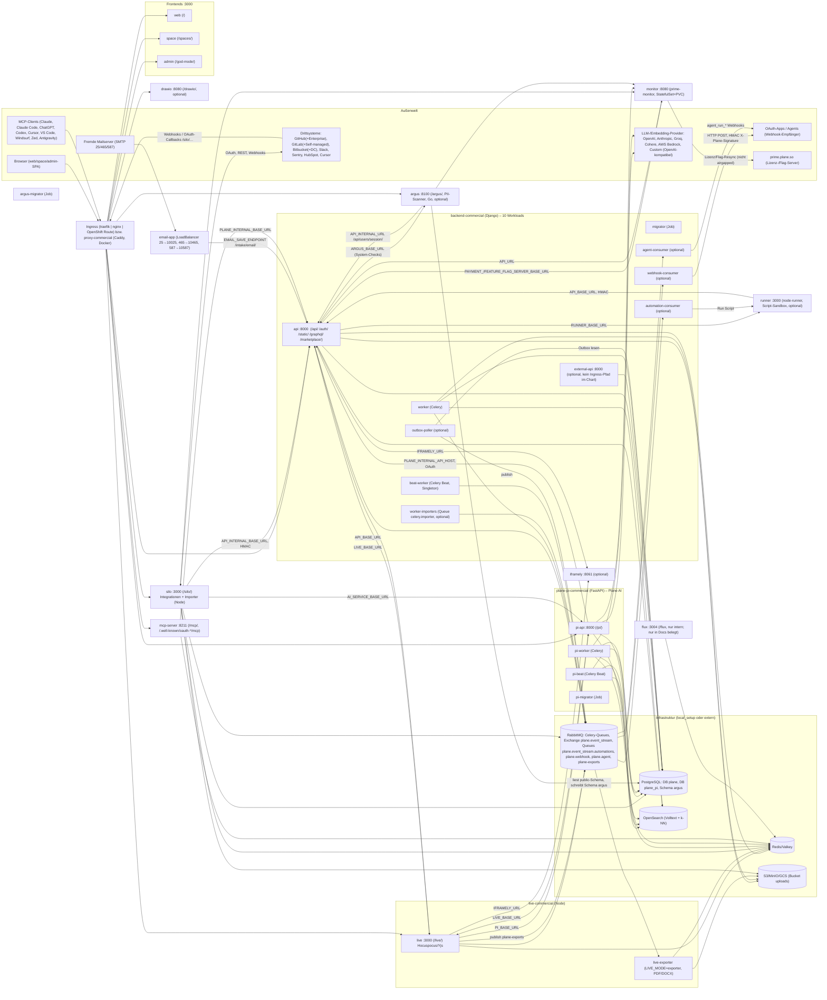

# 22 – Architektur der Commercial/Enterprise Edition: Dienste, Self-Hosting, Lizenz, SSO/LDAP, Plane AI, Suche, Integrationen, Agents, OAuth-Apps – IST-Analyse (Cluster P03)

> **Status:** IST-Analyse, keine Implementierung. Bindend sind die Grundsatzentscheidungen in `migration/architecture/00-grundsatzentscheidungen.md` (ADR-000 … ADR-006). Besonders relevant für dieses Dokument: **ADR-001** (eine Edition, kein Lizenz-/Seat-/Billing-System), **ADR-002** (Realtime in reinem .NET, kein Node.js zur Laufzeit), **ADR-003** (Greenfield-Schema, fachliche Semantik bleibt), **ADR-004** (Self-hosted inkl. Airgapped, keine Pflicht-Abhängigkeit zu externen Diensten, Vektor-DB = PostgreSQL/pgvector), **ADR-005** (UI 1:1).
>
> **Abkürzungen für Quellpfade**
>
> | Kürzel | Bedeutung |
> |---|---|
> | `HC/` | `/home/user/makeplane/helm-charts/charts/` (offizielle Helm-Charts, offline) – v. a. `HC/plane-enterprise/` (Commercial/Enterprise), `HC/plane-ce/` (Community), `HC/plane-mcp-server/` |
> | `DD/` | `/home/user/makeplane/developer-docs/docs/` (Developer-Docs, offline) |
> | `IMG/` | `/home/user/makeplane/developer-docs/docs/public/images/` (Screenshots der Commercial-UI, offline, gesichtet) |
> | ohne Präfix | Pfad relativ zum Repo-Root `/home/user/plane` (Community Edition v1.4.2) |
> | `WEB:` | per WebSearch gefundene öffentliche Quelle (URL). `docs.plane.so`/`plane.so` sind aus der Umgebung **nicht abrufbar** (`getaddrinfo ENOTFOUND docs.plane.so`); es liegen nur Such-Snippets vor → Konfidenz entsprechend reduziert |
> | `P02` | Schwesterdokument `migration/features/21-paid-api-referenz-developer-docs.md` (vollständige REST-API-Referenz der Commercial Edition inkl. Scope-Inventar). Dieses Dokument wiederholt API-Felder nur, wo sie für Architektur/Konfiguration nötig sind, und verweist sonst auf P02 |
>
> **Status-Legende CE-Abgleich** (Wertebereich laut Rückgabeschema)
>
> | Wert | Bedeutung |
> |---|---|
> | **fehlt** | Weder Modell noch Route noch UI im CE-Repo |
> | **Stub/UI-Hülle im CE** | Nur i18n-Texte, Menüeinträge, Leerzustände, Upsell-Komponenten oder ungenutzte Altmodelle; keine lauffähige Funktion |
> | **teilweise im CE** | Ein fachlicher Kern existiert (Modell/Endpunkt/Variante), die Commercial-Funktion geht deutlich darüber hinaus |
> | **im CE vorhanden (nur Cloud-Gating)** | Funktion vollständig im CE, nur in Plane Cloud plangebunden |

---

## Inhaltsverzeichnis

1. Überblick & Quellenlage
2. Feature-Tabelle (Bezahl-Features dieses Clusters)
3. Dienst-Landkarte der Commercial/Enterprise Edition (EE) und .NET-Zielabbildung
   - 3.1 Mermaid-Landkarte
   - 3.2 Vollständiges Dienst-Inventar (Workloads)
   - 3.3 Ingress-/Proxy-Routing (EE vs. CE)
   - 3.4 Konfigurations-Inventar (alle ConfigMaps/Secrets und ihre Schlüssel)
   - 3.5 Schlüssel-/Geheimnis-Hierarchie (wer signiert, wer prüft)
   - 3.6 Messaging-Topologie (Queues, Exchanges, Broker)
   - 3.7 Datenbanken und Schemata
   - 3.8 Vergleich Helm-Chart CE ↔ EE
   - 3.9 Helm-Chart `plane-mcp-server`
   - 3.10 Betriebsmerkmale (HA, Sicherheit, Secrets, Observability, Storage, Ingress)
   - 3.11 .NET-/Aspire-Zielabbildung je Dienst
   - 3.12 UI-Navigationsstruktur der EE (God Mode, Workspace-Settings)
4. Feature-Abschnitte (P03-F01 … P03-F45)
5. Offene Punkte / Unklarheiten

---

## 1. Überblick & Quellenlage

### 1.1 Zweck und Umfang

Dieses Dokument beschreibt die **Architektur der closed-source Commercial Edition** (Pro/Business/Enterprise bzw. „Enterprise Grid“) ausschließlich aus öffentlichen Quellen, so dass Implementierungs-Agenten die Dienste und Querschnittsfunktionen clean-room in .NET nachbauen können. Schwerpunkte laut Auftrag: Dienst-Landkarte (alle Workloads des Helm-Charts `plane-enterprise`), Lizenzmechanik (Monitor/Prime, Seats, Aktivierung – nur dokumentarisch, entfällt nach ADR-001), SSO/LDAP/IdP-Group-Sync, Plane-AI-Architektur (LLM-Provider, Embeddings, Vektorsuche), OpenSearch-Nutzung, Integrations-Framework „Silo“, Agents/Runner, OAuth-App-Plattform, MCP-Server, Webhooks v2, Airgapped/FIPS/HA.

### 1.2 Quellen

| # | Quelle | Pfad / URL | Umfang | gelesen |
|---|---|---|---|---|
| Q1 | Helm-Chart Commercial: Metadaten | `HC/plane-enterprise/Chart.yaml` (`version: 3.10.12`, `appVersion: "3.3.3"`, `sources: https://github.com/makeplane/plane-ee`) | vollständig | ja |
| Q2 | Helm-Values Commercial | `HC/plane-enterprise/values.yaml` (1 479 Zeilen) | vollständig | ja |
| Q3 | Rancher-Fragenkatalog | `HC/plane-enterprise/questions.yml` (2 275 Zeilen; 39 Gruppen) | Gruppen/Labels/Beschreibungen per Extraktion | ja |
| Q4 | Chart-README | `HC/plane-enterprise/README.md` (1 963 Zeilen) | alle Dienst-Abschnitte, Secrets, OTel, Ingress | ja |
| Q5 | Workload-Templates (31 Dateien) | `HC/plane-enterprise/templates/workloads/*.yaml` | **jede Datei** | ja |
| Q6 | Config-/Secret-Templates (20 Dateien) | `HC/plane-enterprise/templates/config-secrets/*.yaml` | **jede Datei** | ja |
| Q7 | Ingress-Templates, Helpers, Validierungen | `HC/plane-enterprise/templates/{ingress-nginx,ingress-traefik,ingress-openshift,validations}.yaml`, `templates/_helpers.tpl` | Routing, Helper-Definitionen, Credential-Helper | ja |
| Q8 | Beispiele | `HC/plane-enterprise/examples/{garage,external-secrets}/README.md`, `examples/values-openshift.yaml` | README | ja |
| Q9 | Helm-Chart Community | `HC/plane-ce/` (`Chart.yaml` `version: 1.8.5`, `appVersion: "1.4.2"`; `values.yaml`; 12 Workload-Templates; Config-Templates) | Vergleich | ja |
| Q10 | Helm-Chart MCP-Server | `HC/plane-mcp-server/` (`Chart.yaml` `version: 1.0.0`, `appVersion: "v0.3.0"`) | vollständig | ja |
| Q11 | Editionen | `DD/self-hosting/editions-and-versions.md` | vollständig | ja |
| Q12 | Architektur | `DD/self-hosting/plane-architecture.md`, Bild `IMG/airgapped/plane-architecture.webp` | vollständig | ja |
| Q13 | Upgrade CE → Commercial | `DD/self-hosting/upgrade-from-community.md`, `DD/self-hosting/manage/community-to-airgapped.md` | vollständig | ja |
| Q14 | Authentifizierung/SSO/LDAP | `DD/self-hosting/govern/{authentication,saml-sso,oidc-sso,ldap}.md`, Bilder `IMG/custom-sso/{saml-oauth,oidc-oauth}.png`, `IMG/ldap/{ldap-configuration,enable-ldap}.webp` | vollständig | ja |
| Q15 | OpenSearch | `DD/self-hosting/govern/advanced-search.md`, Bild `IMG/open-search/opensearch-flow.webp` | vollständig | ja |
| Q16 | Plane AI | `DD/self-hosting/govern/plane-ai/{configure-plane-ai,configure-embedding-model,aws-opensearch-embedding}.md` | vollständig | ja |
| Q17 | Integrationen | `DD/self-hosting/govern/integrations/{github,gitlab,bitbucket,slack,sentry}.md` | vollständig | ja |
| Q18 | God Mode / Admin | `DD/self-hosting/govern/{instance-admin,communication}.md`, `DD/self-hosting/govern/god-mode/session-expiry.md`, `DD/self-hosting/manage/manage-instance-users.md`, Bilder `IMG/instance-admin/user-management.webp`, `IMG/activate-license/activate-enterprise-plan.webp` | vollständig | ja |
| Q19 | Betrieb | `DD/self-hosting/govern/{environment-variables,external-secrets,high-availability,private-bucket,configure-dns-email-service,reverse-proxy}.md`, `DD/self-hosting/manage/health-checks.md`, `DD/self-hosting/telemetry.md` | vollständig | ja |
| Q20 | Lizenzen | `DD/self-hosting/manage/manage-licenses/{activate-pro-and-business,activate-enterprise,activate-airgapped,activate-airgapped-enterprise}.md`, `DD/self-hosting/troubleshoot/license-errors.md`, `DD/self-hosting/manage/prime-cli.md` | vollständig | ja |
| Q21 | Installationsmethoden | `DD/self-hosting/methods/{airgapped-requirements,airgapped-edition,clone-docker-images,fips-deployment,docker-aio,docker-compose}.md`, `DD/self-hosting/methods/install-methods-commercial/docker-compose.md`, `DD/self-hosting/methods/kubernetes.md` (Routing-Tabelle) | relevante Teile | ja |
| Q22 | OAuth-App-Plattform | `DD/dev-tools/build-plane-app/{overview,create-oauth-application,choose-token-flow,oauth-scopes,webhooks,examples,sdks}.md` | vollständig | ja |
| Q23 | Agents | `DD/dev-tools/agents/{overview,building-an-agent,signals-content-payload,best-practices}.md` | vollständig | ja |
| Q24 | Webhooks v2 | `DD/dev-tools/intro-webhooks.md`, Bild `IMG/webhooks/create-webhook.webp` | vollständig | ja |
| Q25 | MCP | `DD/dev-tools/{mcp-server,mcp-server-self-host}.md` (Tool-Referenz `mcp-server-tools.md` ist in P02 ausgewertet) | vollständig | ja |
| Q26 | Plane Compose, OpenAPI | `DD/dev-tools/{plane-compose,openapi-specification}.md` | Struktur + relevante Teile | ja |
| Q27 | CE-Repo: UI-Texte/Plan-Matrix der Bezahl-Features | `packages/i18n/src/locales/en/{auth,integration,workspace-settings,automation}.json`, `apps/web/components/workspace/billing/comparison/plans.tsx`, `packages/constants/src/subscription.ts` | gezielt | ja |
| Q28 | CE-Repo: Gegenprüfung (grep) | `apps/api/plane/**`, `apps/admin/app/routes.ts`, `apps/web/app/routes/{core,extended}.ts`, `apps/live/src/controllers/*`, `apps/proxy/Caddyfile.ce`, `packages/constants/src/settings/workspace.ts`, `packages/editor/src/types/extensions.ts` | gezielt | ja |
| Q29 | WebSearch-Snippets | `WEB:` https://docs.plane.so/authentication/group-sync, https://plane.so/blog/introducing-granular-access-control-gac-ldap-idp-group-sync, https://docs.plane.so/automations/plane-runner, https://plane.so/blog/introducing-plane-runner-and-scheduled-automations, https://docs.plane.so/authentication/sso, https://docs.plane.so/ai/plane-ai-credits, https://docs.plane.so/ai/ai-usage, https://forum.plane.so/t/plane-v2-4-0-plane-ai-now-available-for-self-hosted/53, https://docs.plane.so/workspaces-and-users/audit-logs, https://docs.plane.so/importers/github, https://www.idenhq.com/scim-tax/plane | Snippets | – |

### 1.3 Editionen- und Planmodell (Kontext, entfällt nach ADR-001)

| Begriff | Bedeutung | Quelle |
|---|---|---|
| Community Edition (CE) | AGPL-3.0, eigener Codebase/Release-Zyklus; „at par with the Free tier of the Cloud edition“; Upgrade auf Bezahlpläne nur über Wechsel auf Commercial Edition | `DD/self-hosting/editions-and-versions.md` |
| Commercial Edition | closed-source (`github.com/makeplane/plane-ee`, `HC/plane-enterprise/Chart.yaml`), „Full feature parity with our Cloud“, enthält Free-Plan mit **12 freien Seats je Workspace**, Upgrade-Flow berechnet Seats aus Nutzern mit bezahlten Rollen | `DD/self-hosting/editions-and-versions.md` |
| Airgapped Edition | Commercial Edition ohne Internet: Offline-Lizenzdatei, keine Telemetrie, Images aus eigener Registry; **nur Enterprise Grid, Mindestabnahme 100 Seats** | `DD/self-hosting/methods/airgapped-requirements.md` |
| Pläne | Free · One · Pro · Business · Enterprise (Matrix im CE-Repo); in Self-Hosting-Docs heißt der höchste Plan „Enterprise Grid“ (Badges `<Badge type="warning" text="Enterprise Grid" />`) | `apps/web/components/workspace/billing/comparison/plans.tsx`, `DD/self-hosting/govern/ldap.md` |
| Lizenzbindung | Pro/Business: **Workspace**-Lizenz (Workspace Settings → Billing and plans); Enterprise Grid: **Instanz**-Lizenz (God Mode → Billing), gilt für alle Workspaces | `DD/self-hosting/manage/manage-licenses/activate-pro-and-business.md`, `.../activate-enterprise.md` |
| Schema-Kompatibilität | CE-Datenbank und Uploads werden 1:1 in eine Commercial-Instanz zurückgespielt (Postgres-Datenverzeichnis, Redis, MinIO-Bucket) → das Commercial-Schema ist eine **Obermenge** des CE-Schemas, Migrationen laufen beim Start | `DD/self-hosting/upgrade-from-community.md` |

### 1.4 Versionsstände der Quellen

| Artefakt | Version | Quelle |
|---|---|---|
| Commercial-Applikation (`planeVersion`, Image-Tag aller `-commercial`-Images) | `v3.3.3` | `HC/plane-enterprise/values.yaml:1` |
| Chart `plane-enterprise` | `3.10.12` | `HC/plane-enterprise/Chart.yaml` |
| Community-Applikation / Chart `plane-ce` | `v1.4.2` / `1.8.5` | `HC/plane-ce/values.yaml:1`, `HC/plane-ce/Chart.yaml` |
| MCP-Server-Image im EE-Chart / eigener Chart | `makeplane/plane-mcp-server:v0.3.2` / Chart `1.0.0` (`appVersion v0.3.0`) | `HC/plane-enterprise/values.yaml` (`services.mcp_server.image`), `HC/plane-mcp-server/Chart.yaml` |
| Plane AI für Self-Hosted verfügbar seit | Commercial v2.4.0 (31.07.2026) | `WEB:` https://forum.plane.so/t/plane-v2-4-0-plane-ai-now-available-for-self-hosted/53 |

### 1.5 Kernaussagen

1. Die Commercial Edition besteht aus **28 Anwendungs-Workloads** (davon 3 Jobs: `migrator`, `pi-migrator`, `argus-migrator`) plus **5 optionalen Infrastruktur-StatefulSets** und einem MinIO-Bucket-Job (Kap. 3.2). Die CE besteht aus 8 Anwendungs-Workloads plus 4 Infrastruktur-Diensten (Kap. 3.8). Neu gegenüber CE: `external-api`, `worker-importers`, `live-exporter`, `silo`, `email`, `monitor`, `pi-api`/`pi-worker`/`pi-beat`/`pi-migrator`, `agent-consumer`, `automation-consumer`, `webhook-consumer`, `outbox-poller`, `runner`, `argus`/`argus-migrator`, `mcp-server`, `drawio`, `iframely`, `opensearch`; nur in Docs: `proxy-commercial`, `flux`, `plane-aio-commercial`.
2. Der Django-Backend-Image `makeplane/backend-commercial` wird für **10** Workloads mit unterschiedlichen Entrypoints wiederverwendet (`api`, `external-api`, `worker`, `worker-importers`, `beat-worker`, `migrator`, `agent-consumer`, `automation-consumer`, `webhook-consumer`, `outbox-poller`) (Q5).
3. **Lizenz/Feature-Gating** läuft über den Go-Dienst `monitor` (`prime-monitor`, StatefulSet mit PVC), der Lizenzen und Feature-Flags beim Prime-Server (`https://prime.plane.so`) resynchronisiert; API, Silo, PI und Argus fragen ihn als `PAYMENT_SERVER_BASE_URL`/`FEATURE_FLAG_SERVER_BASE_URL` (`http://<release>-monitor:8080/`) (Q6 `app-env.yaml`, `silo.yaml`, `pi-api-env.yaml`, `argus-env.yaml`, `monitor.yaml`). Nach ADR-001 entfällt das vollständig.
4. **Plane AI** ist ein eigener Python/FastAPI-Dienst („pi“) mit **eigener Datenbank** (`plane_pi`), **Lesezugriff auf die Haupt-DB** (`FOLLOWER_POSTGRES_URI`), **Redis als Celery-Broker**, **OpenSearch als Such-/Vektorindex** (k-NN, ML-Commons-Embedding-Modelle) und mehreren LLM-Providern (OpenAI, Anthropic, Groq, Cohere, Bedrock, „Custom LLM“ OpenAI-kompatibel) (Q16, `pi-api-env.yaml`).
5. **Suche** (Advanced Search) läuft über OpenSearch mit 9 Indizes, signal-getriebener Synchronisierung über eine Redis-Queue und einen Celery-Batch alle 5 s (Q15). Nach ADR-004 ist PostgreSQL (FTS + `pg_trgm` + `pgvector`) das Ziel.
6. **Integrationen und Importer** laufen im Node-Dienst „Silo“ (`/silo`), der als OAuth-Client gegenüber GitHub/GitLab/Bitbucket/Slack/Sentry/HubSpot agiert, Webhooks empfängt, AES-verschlüsselte Tokens in der Haupt-DB speichert und Plane über die interne API (HMAC-signiert) beschreibt (Q6 `silo.yaml`, Q17, Q19).
7. **Event-Architektur:** Transactional Outbox (`outbox-poller`, Polling der DB) → RabbitMQ-Exchange `plane.event_stream` → Queues `plane.event_stream.automations` (Automations), `plane.webhook` (Webhooks v2), `plane.agent` (Agent Runs); Exporte über Queue `plane-exports` an `live-exporter` (Q2, Q6).
8. Die **OAuth-App-Plattform** (Applications, Consent-Screen, Bot-/User-Tokens, granulare Scopes, App-Installationen, Bot-User, Mentions, Marketplace) ist Grundlage für Agents, MCP-OAuth, PI und Silo (`reset_marketplace_app_secrets`, Redis-Schlüssel `plane_app_details_github`) (Q17 `github.md`, Q22, Q25).

---

## 2. Feature-Tabelle (Bezahl-Features dieses Clusters)

> Plan-Angaben: „Cloud-Matrix“ = `apps/web/components/workspace/billing/comparison/plans.tsx` (CE-Repo, vom Hersteller gepflegte Vergleichstabelle); „Badge“ = Plan-Badge in den Self-Hosting-Docs. Bei Widerspruch sind beide genannt. „Commercial Edition“ = in jeder Commercial-Installation enthalten, Plan nicht dokumentiert.

| ID | Feature | ab Plan | Abstufung je Plan | CE-Status | Quelle |
|---|---|---|---|---|---|
| P03-F01 | Lizenz-, Seat- und Billing-Mechanik (Monitor/Prime, Lizenzschlüssel, Lizenzdatei, Sync/Delink) | Commercial Edition (Mechanik aller Bezahlpläne) | Pro/Business: Workspace-Lizenz; Enterprise Grid: Instanz-Lizenz; Airgapped: Lizenzdatei | Stub/UI-Hülle im CE | `DD/self-hosting/manage/manage-licenses/*.md`, `HC/plane-enterprise/templates/workloads/monitor.stateful.yaml` |
| P03-F02 | Feature-Flag-Server (Monitor) und Plan-Synchronisation | Commercial Edition | – | fehlt | `HC/plane-enterprise/templates/config-secrets/{app-env,silo,pi-api-env,argus-env}.yaml`, `DD/self-hosting/manage/health-checks.md` |
| P03-F03 | God-Mode-Erweiterungen (Billing, User Management, Session-Einstellungen, System-Checks) | Commercial Edition | – | teilweise im CE | `DD/self-hosting/govern/instance-admin.md`, `DD/self-hosting/manage/manage-instance-users.md`, `DD/self-hosting/govern/god-mode/session-expiry.md`, `apps/admin/app/routes.ts` |
| P03-F04 | SAML-SSO (instanzweit, God Mode) | One (Cloud-Matrix) / Pro (Badge) | One…Enterprise: ja | fehlt | `DD/self-hosting/govern/saml-sso.md`, `plans.tsx:1060` |
| P03-F05 | OIDC-SSO (instanzweit, God Mode) | One (Cloud-Matrix) / Pro (Badge) | One…Enterprise: ja | fehlt | `DD/self-hosting/govern/oidc-sso.md`, `plans.tsx:1071` |
| P03-F06 | Workspace-Identity: Domain-Verifizierung + Workspace-SSO (SAML/OIDC, ein aktiver Provider) | unklar (Cloud) | – | Stub/UI-Hülle im CE | `packages/i18n/src/locales/en/auth.json:1-215`, `WEB:` https://docs.plane.so/authentication/sso |
| P03-F07 | LDAP-Authentifizierung | Enterprise Grid | nur Enterprise | Stub/UI-Hülle im CE | `DD/self-hosting/govern/ldap.md`, `plans.tsx:1117`, `packages/i18n/src/locales/en/auth.json:361-366` |
| P03-F08 | IdP Group Sync (IdP-Gruppen → Workspace-/Projektrollen) | Enterprise Grid (Blog) / „Commercial Edition, nur OIDC“ (Docs) | – | Stub/UI-Hülle im CE | `packages/i18n/src/locales/en/workspace-settings.json` (`group_syncing`), P02 §2.6/§4.8, `WEB:` https://docs.plane.so/authentication/group-sync |
| P03-F09 | OAuth Bridge (externe IdP-JWTs als API-Credentials) | unklar | – | Stub/UI-Hülle im CE | `packages/i18n/src/locales/en/integration.json` (`oauth_bridge_integration`) |
| P03-F10 | Domain Security, 2FA/Passkeys, Passwort-Policy | Pro (Cloud-Matrix) | Pro…Enterprise: ja | fehlt | `plans.tsx:1083-1115` |
| P03-F11 | Advanced Search (OpenSearch; Volltext, Fuzzy, Autocomplete, Multi-Entity) | Pro (Badge) | – | teilweise im CE | `DD/self-hosting/govern/advanced-search.md`, P02 §4.14 |
| P03-F12 | Plane AI (PI-Dienst: Chat, Modelle, Voice, Anhänge, Usage-Budget) | Commercial Edition (Self-hosted: eigene Provider-Keys); Cloud: Credits je Plan | Cloud-Credits je Seat/Plan (Beträge unbestätigt) | Stub/UI-Hülle im CE | `DD/self-hosting/govern/plane-ai/configure-plane-ai.md`, `HC/plane-enterprise/templates/config-secrets/pi-api-env.yaml`, `apps/web/components/workspace/sidebar/user-menu.tsx:55-61` |
| P03-F13 | Semantische Suche, Embeddings, Duplikaterkennung (Vektorsuche) | Commercial Edition (optional) | ohne Embedding-Modell: BM25 | fehlt | `DD/self-hosting/govern/plane-ai/configure-embedding-model.md` |
| P03-F14 | Integrations-Framework „Silo“ (Connections, OAuth zu Drittsystemen, Webhook-Empfang, Sync-Jobs) | Pro | – | Stub/UI-Hülle im CE | `HC/plane-enterprise/templates/workloads/silo.deployment.yaml`, `apps/api/plane/db/models/integration/*` |
| P03-F15 | GitHub (Cloud, Enterprise Cloud, Enterprise Server) | Pro | Importer: Free ohne / Pro+ mit Custom Props | Stub/UI-Hülle im CE | `DD/self-hosting/govern/integrations/github.md`, `plans.tsx:951,969` |
| P03-F16 | GitLab (Cloud, Self-managed) | Pro (Badge) | – | fehlt | `DD/self-hosting/govern/integrations/gitlab.md` |
| P03-F17 | Bitbucket (Cloud, Data Center) | Pro (Badge) | – | fehlt | `DD/self-hosting/govern/integrations/bitbucket.md` |
| P03-F18 | Slack | Pro | – | Stub/UI-Hülle im CE | `DD/self-hosting/govern/integrations/slack.md`, `plans.tsx:981` |
| P03-F19 | Sentry | Pro (Badge) | – | fehlt | `DD/self-hosting/govern/integrations/sentry.md` |
| P03-F20 | HubSpot-Connector | unklar | – | fehlt | `HC/plane-enterprise/values.yaml` (`services.silo.connectors.hubspot`) |
| P03-F21 | Cursor-Agent-Integration | unklar | – | fehlt | `HC/plane-enterprise/values.yaml` (`env.silo_envs.cursor_webhook_secret`) |
| P03-F22 | Importer (Jira Cloud/Server, Linear, Asana, ClickUp, Notion, Confluence, CSV/Flatfile, GitHub) | Free (eingeschränkt) | Jira/GitHub: Free/One „Without custom props“, Pro+ „With custom props“ | Stub/UI-Hülle im CE | `plans.tsx:940-951`, `packages/i18n/src/locales/en/integration.json` (`import_status`), `WEB:` https://docs.plane.so/importers/github |
| P03-F23 | Intake per E-Mail (eigener SMTP-Dienst) | Business | Business/Enterprise: ja | teilweise im CE | `DD/self-hosting/govern/configure-dns-email-service.md`, `plans.tsx:458`, `apps/api/plane/db/models/intake.py:76-77` |
| P03-F24 | Webhooks v2 (Dot-Events, PQL-Filter, Delivery-Log, Auto-Disable) | unklar | – | teilweise im CE | `DD/dev-tools/intro-webhooks.md`, `apps/api/plane/db/models/webhook.py` |
| P03-F25 | OAuth-App-Plattform (Applications, Consent, Bot-/User-Token, Scopes, Installationen, Marketplace) | Commercial Edition (Beta) | – | fehlt | `DD/dev-tools/build-plane-app/*.md`, `packages/i18n/src/locales/en/workspace-settings.json` (`applications`) |
| P03-F26 | Agents (Agent Runs, Activities, Signals) | Commercial Edition (Beta) | „Agents do not count as billable users“ | fehlt | `DD/dev-tools/agents/*.md` |
| P03-F27 | MCP-Server (OAuth- und PAT-Transport, 28 Tools) | Commercial Edition für OAuth-Transport | CE nur stdio/PAT | teilweise im CE | `DD/dev-tools/mcp-server*.md`, `HC/plane-mcp-server/` |
| P03-F28 | Plane Runner (Scripts/Functions in Sandbox, geplante Automationen, Transition-Bedingungen) | Enterprise Grid | – | Stub/UI-Hülle im CE | `HC/plane-enterprise/templates/workloads/runner.deployment.yaml`, `packages/i18n/src/locales/en/workspace-settings.json` (`runners`), `WEB:` https://docs.plane.so/automations/plane-runner |
| P03-F29 | Automations-Infrastruktur (Outbox, Event-Stream, Automation-Consumer) | Pro | Pro: Trigger & Action, 5 000 Automationen; Business: Decisions & Loops, 10 000; Enterprise: unbegrenzt | fehlt | `plans.tsx:769-805`, `HC/plane-enterprise/templates/config-secrets/{outbox-poller,automations-consumer}.yaml` |
| P03-F30 | Hintergrund-Export Pages PDF/DOCX (`live-exporter`) | Pro | Pro: „One download at a time“; Business/Enterprise: „Queued downloads“ | teilweise im CE | `plans.tsx:876`, `HC/plane-enterprise/templates/workloads/live-exporter.deployment.yaml`, `apps/live/src/controllers/pdf-export.controller.ts` |
| P03-F31 | draw.io-Diagramme im Wiki-Editor (self-hosted draw.io) | unklar | – | fehlt | `HC/plane-enterprise/templates/workloads/drawio.deployment.yaml` |
| P03-F32 | Link-Vorschauen/Embeds über Iframely | unklar | – | fehlt | `HC/plane-enterprise/templates/workloads/iframely.deployment.yaml` |
| P03-F33 | Argus – Sensitive-Data-/PII-Scanner | unklar (Feature-Flag `PII_SCANNER`) | – | fehlt | `HC/plane-enterprise/values.yaml` (`services.argus`), `HC/plane-enterprise/templates/config-secrets/argus-env.yaml` |
| P03-F34 | Health-Probes (`/api/live/`, `/api/ready/`, `/api/health/`) und God-Mode-System-Checks | Commercial Edition | – | teilweise im CE | `DD/self-hosting/manage/health-checks.md`, `HC/plane-enterprise/templates/config-secrets/app-env.yaml` |
| P03-F35 | Session-Expiry-Einstellungen im God Mode | Commercial Edition | – | teilweise im CE | `DD/self-hosting/govern/god-mode/session-expiry.md`, `apps/api/plane/settings/common.py:425-432` |
| P03-F36 | Airgapped Edition (Offline-Lizenz, keine Telemetrie, interne Registry) | Enterprise Grid (≥ 100 Seats) | – | teilweise im CE | `DD/self-hosting/methods/airgapped-requirements.md` |
| P03-F37 | FIPS-140-3-Images | Enterprise Grid | – | fehlt | `DD/self-hosting/methods/fips-deployment.md` |
| P03-F38 | Betriebsfeatures (HA/PDB, Read-Replica, External Secrets, Custom CA, Storage-Proxy, GCS, OTel inkl. Browser-Tracing, PSA/OpenShift) | Commercial Edition | – | teilweise im CE | `HC/plane-enterprise/values.yaml`, `DD/self-hosting/govern/high-availability.md` |
| P03-F39 | Dedizierte External-API-Instanz | Commercial Edition | – | fehlt | `HC/plane-enterprise/templates/workloads/external-api.deployment.yaml` |
| P03-F40 | GraphQL- und Marketplace-Endpunkte (`/graphql/`, `/marketplace/`) | Commercial Edition | – | fehlt | `HC/plane-enterprise/templates/ingress-nginx.yaml:83-94`, `HC/plane-enterprise/README.md:1897-1898` |
| P03-F41 | „Flux“ – Realtime-Event-Server | Commercial Edition | – | fehlt | `DD/self-hosting/manage/health-checks.md` |
| P03-F42 | Prime CLI und Commercial-Installationsmethoden (AIO, Swarm, Podman, Coolify, Portainer, One-click) | Commercial Edition (One-click Deployment, Digital Ocean Marketplace app, Heroku Platform app, AWS AMI: ab One laut Matrix) | – | teilweise im CE | `DD/self-hosting/manage/prime-cli.md`, `plans.tsx:1136-1191` |
| P03-F43 | Plane Compose („project as code“-CLI) | nutzt Commercial-API (Typen, Workflows, Milestones) | – | fehlt | `DD/dev-tools/plane-compose.md` |
| P03-F44 | Workspace-Audit-Log (Querbezug) | Business (Cloud-Matrix) / Enterprise Grid (`WEB:`) | – | fehlt | `plans.tsx:740-751`, `WEB:` https://docs.plane.so/workspaces-and-users/audit-logs |
| P03-F45 | GAC – Granular Access Control / Custom Roles (Querbezug) | Enterprise (Cloud-Matrix „GAC“) | Pro: Pre-defined roles; Business: RBAC; Enterprise: GAC | fehlt | `plans.tsx:695-702`, `WEB:` https://plane.so/blog/introducing-granular-access-control-gac-ldap-idp-group-sync |

---

## 3. Dienst-Landkarte der Commercial/Enterprise Edition (EE) und .NET-Zielabbildung

### 3.1 Mermaid-Landkarte (Helm-Chart `plane-enterprise` v3.10.12, `planeVersion v3.3.3`)

Quellen: `HC/plane-enterprise/templates/workloads/*.yaml`, `HC/plane-enterprise/templates/config-secrets/*.yaml`, `HC/plane-enterprise/templates/ingress-nginx.yaml`, `HC/plane-enterprise/templates/ingress-traefik.yaml`, `DD/self-hosting/manage/health-checks.md` (flux, monitor), `DD/self-hosting/plane-architecture.md`.

### 3.2 Vollständiges Dienst-Inventar (Workloads)

Gemeinsame Merkmale aller Plane-eigenen Workloads (nicht pro Zeile wiederholt): `imagePullPolicy` default `Always`, `stdin/tty: true`, ServiceAccount `<release>-srv-account`, optionale `securityContext`-Härtung (uid 1000, `runAsNonRoot`, `seccompProfile: RuntimeDefault`, `capabilities.drop: [ALL]`), Pod-Annotation mit Config-Checksumme statt Zeitstempel (`global.forceRedeploy: false`), `extraEnv` global, optionale `nodeSelector`/`tolerations`/`affinity`/`topologySpreadConstraints`/`podDisruptionBudget` (`HC/plane-enterprise/values.yaml`, `HC/plane-enterprise/templates/_helpers.tpl:26-140`). Services sind standardmäßig **headless** (`clusterIP: None`, außer `assign_cluster_ip: true`).

| # | Workload (K8s-Name) | Art · Default | Image (Tag = `planeVersion`, sofern nicht anders) | Start / Entrypoint | Port | Ingress-Pfad | Konfig-Quellen (envFrom/env) | Abhängigkeiten | Zweck | Quelle |
|---|---|---|---|---|---|---|---|---|---|---|
| 1 | `web` (`<rel>-web-wl`) | Deployment · immer | `makeplane/web-commercial` | Image-Default | 3000 | `/` (Catch-all) | nur `extraEnv` (Konfiguration zur Build-Zeit; belegt ist `VITE_ARGUS_BASE_PATH`, Default `/argus`) | api (aus dem Browser) | Haupt-SPA inkl. aller Bezahl-UIs | `templates/workloads/web.deployment.yaml`; `README.md:1090-1147` |
| 2 | `space` | Deployment · immer | `makeplane/space-commercial` | Image-Default | 3000 | `/spaces/` | `otel-vars` (wenn OTel), `OTEL_SERVICE_NAME=space` | api | Öffentliche Freigaben (Projekte, Views, Pages) | `templates/workloads/space.deployment.yaml`; `DD/self-hosting/plane-architecture.md` |
| 3 | `admin` | Deployment · immer | `makeplane/admin-commercial` | Image-Default | 3000 | `/god-mode/` | nur `extraEnv` | api | God Mode inkl. Billing, User Management | `templates/workloads/admin.deployment.yaml` |
| 4 | `live` | Deployment · immer | `makeplane/live-commercial` | Image-Default; Init-Container `prepare-ca-bundle` (busybox, nur bei Custom-CA) | 3000 | `/live/` | `ai-providers`-Secret (optional), `<rel>-live-vars`, `<rel>-live-secrets`, `otel`, `app-keys`; env: `RABBITMQ_*`, `REDIS_*`, Node-CA-Variablen | api, Redis, RabbitMQ, iframely, pi-api | Echtzeit-Kollaboration (Hocuspocus/Yjs), Health `/live/health/`, Memory-Metriken `/live/health/memory` (Header `live-server-secret-key`), OpenAI-kompatibler AI-Proxy (`AI_OPENAI_API_KEY`, `AI_OPENAI_BASE_URL`), Producer für Export-Jobs | `templates/workloads/live.deployment.yaml`; `values.yaml` (`ai_providers_existingSecret`-Kommentar); `DD/self-hosting/manage/health-checks.md` |
| 5 | `live-exporter` | Deployment · **an** (`services.live_exporter.enabled: true`) · kein Service | `makeplane/live-commercial` (muss = live sein) | `LIVE_MODE=exporter` | – | – | `<rel>-live-vars`, `<rel>-live-secrets`, `otel`, `app-keys`; env `RABBITMQ_*`, `REDIS_*` | RabbitMQ (Queue `plane-exports`), Redis (Job-Status, „shares live's RedisManager“), S3 | Hintergrund-Export PDF/DOCX; Speicherbedarf 500 MB–2 GB pro Render (Limit 2000Mi) | `templates/workloads/live-exporter.deployment.yaml`; `values.yaml` (`live_exporter`) |
| 6 | `api` | Deployment · immer | `makeplane/backend-commercial` | `exec ./bin/docker-entrypoint-api-ee.sh` (nach optionalem CA-Init-Skript) | 8000 | `/api/`, `/auth/`, `/static/`, `/graphql/`, `/marketplace/` | `app-vars`, `app-secrets`, `doc-store-secrets`, `opensearch-secrets`, `silo-secrets` (wenn Silo), `runner-secrets` (wenn Runner), `app-keys`, `silo-connectors`, `otel`; env: Infra-Credentials (`POSTGRES_*`, `POSTGRES_READ_REPLICA_*`, `RABBITMQ_*`, `REDIS_*`, `OPENSEARCH_USERNAME/PASSWORD`, Storage-Keys) | PG, Redis, RabbitMQ, OpenSearch, S3, monitor, live, runner, argus, iframely | Django-REST-API inkl. Commercial-Endpunkte; prüft Silo-HMAC und Runner-HMAC; empfängt Intake-E-Mails `/intake/email/`; Readiness `GET /` (failureThreshold 30, period 10 s) | `templates/workloads/api.deployment.yaml` |
| 7 | `external-api` | Deployment · aus | `makeplane/backend-commercial` (Image/PullPolicy von `services.api`) | `exec ./bin/docker-entrypoint-api-ee.sh` | 8000 | **keiner** (Chart rendert keine Route) | wie `api`, `OTEL_SERVICE_NAME=external-api` | wie api | „dedicated API workload … for serving external/public API traffic“ (Lasttrennung der Public API `/api/v1/`) | `templates/workloads/external-api.deployment.yaml`; `README.md:1015-1030` |
| 8 | `worker` | Deployment · immer | `makeplane/backend-commercial` | `exec ./bin/docker-entrypoint-worker.sh` | – | – | wie `api` | RabbitMQ, PG, Redis, OpenSearch, S3 | Celery-Worker (Standard-Queues) | `templates/workloads/worker.deployment.yaml` |
| 9 | `worker-importers` | Deployment · aus | `makeplane/backend-commercial` | `exec ./bin/docker-entrypoint-worker.sh celery.importer`; Readiness `pgrep -f "celery.*worker"` | – | – | wie `api` | wie worker | Dedizierter Worker für Queue `celery.importer` („imports run on their own worker“) | `templates/workloads/worker-importers.deployment.yaml`; `README.md:1247-1262` |
| 10 | `beat-worker` | Deployment · immer · **Singleton** | `makeplane/backend-commercial` | `./bin/docker-entrypoint-beat.sh` | – | – | wie `api` | RabbitMQ, PG | Celery Beat (periodische Jobs) | `templates/workloads/beat-worker.deployment.yaml`; `DD/self-hosting/govern/high-availability.md` |
| 11 | `migrator` (`<rel>-api-migrate-<yyyyMMdd-HHmmss>`) | Job · je Release · `backoffLimit: 3`, `restartPolicy: OnFailure`, kein Helm-Hook | `makeplane/backend-commercial` | `./bin/docker-entrypoint-migrator.sh` | – | – | wie `api` | PG | Django-Migrationen | `templates/workloads/migrator.job.yaml` |
| 12 | `silo` | Deployment · **an** (`services.silo.enabled: true`) | `makeplane/silo-commercial` (`imagePullPolicy: Always` fest) | Image-Default; Init-Container `wait-for-rabbitmq` (busybox: `nslookup <rel>-rabbitmq…` in Schleife, nur bei lokalem RabbitMQ) und `prepare-ca-bundle` | 3000 | `/silo/` (Traefik mit Body-Limit-Middleware) | `<rel>-silo-vars`, `<rel>-silo-secrets`, `doc-store-secrets`, `app-keys`, `silo-connectors`, `otel`; env: Silo-Infra-Credentials, Node-CA | PG (Haupt-DB!), Redis, RabbitMQ, S3, api (intern), pi-api, monitor, Drittsysteme | Integrationen + Importer (Node.js), OAuth zu Drittsystemen, Webhook-Empfang; Health `/silo/health/`, `/silo/health/check-hmac`, `/silo/health/check-db` | `templates/workloads/silo.deployment.yaml`; `templates/config-secrets/silo.yaml`; `DD/self-hosting/manage/health-checks.md` |
| 13 | `email` (`<rel>-email-app`, Service `<rel>-email-service`) | Deployment · aus | `makeplane/email-commercial` (`runAsUser: 100`, eigener UID) | Image-Default; Readiness `nc -zv localhost 10025` (initialDelay 30 s) | Service **type LoadBalancer**, `externalTrafficPolicy: Local`: 25→10025 (smtp), 465→10465 (smtps), 587→10587 (submission) | – (eigener LB) | `<rel>-email-vars`; Volumes: TLS-Zertifikat `<rel>-mail-tls-secret` (cert-manager, `cert.pem`/`key.pem` → `/opt/email/keys`), `spam.txt` und `domain-blacklist.txt` aus ConfigMap → `/opt/email/` | api (`EMAIL_SAVE_ENDPOINT`) | SMTP-Eingang für Intake-E-Mails | `templates/workloads/email.deployment.yaml`; `templates/config-secrets/email-env.yaml`; `templates/certs/email-certs.yaml` |
| 14 | `monitor` | **StatefulSet** · immer · Singleton | `makeplane/monitor-commercial` | Standard; airgapped: `command: prime-monitor`, `args: start-airgapped` | 8080 | – | `<rel>-monitor-vars`; PVC `pvc-<rel>-monitor-vol` 100Mi → `/app` | api, prime.plane.so | Lizenz-, Feature-Flag- und „Payment“-Server; Health-Prober (Cron 5 min); Flag/Lizenz-Resync (Cron 300 min) | `templates/workloads/monitor.stateful.yaml`; `templates/config-secrets/monitor.yaml`; `DD/self-hosting/manage/health-checks.md` |
| 15 | `pi-api` | Deployment · aus (`services.pi.enabled`) | `makeplane/plane-pi-commercial` | `exec ./bin/entrypoint-api.sh` | 8000 | `/pi/` (Traefik: `/pi/api/v1/attachments/` mit Body-Limit; `/pi/api/v1/chat/stream-answer/` und Rest ohne Buffering für SSE) | `ai-providers`-Secret, `<rel>-pi-api-vars`, `<rel>-pi-api-secrets`, `doc-store-secrets`, `opensearch-secrets`, `app-keys`; env: `PLANE_PI_POSTGRES_*`, `FOLLOWER_POSTGRES_*`, `REDIS_*` | PG (`plane_pi` + Follower auf `plane`), Redis, OpenSearch, live, api, monitor, LLM | Plane-AI-API (FastAPI); Readiness `GET /pi/` | `templates/workloads/pi-api.deployment.yaml`; `templates/config-secrets/pi-api-env.yaml` |
| 16 | `pi-worker` | Deployment · mit pi | `makeplane/plane-pi-commercial` | `exec ./bin/entrypoint-celery-worker.sh` | – | – | wie pi-api | wie pi-api | Celery-Worker der KI (Vektor-Sync, Doc-Sync, Ingest) | `templates/workloads/pi-worker.deployment.yaml` |
| 17 | `pi-beat` | Deployment · mit pi · Singleton | `makeplane/plane-pi-commercial` | `exec ./bin/entrypoint-celery-beat.sh` | – | – | wie pi-api | Redis | Celery Beat der KI (`CELERY_*_SYNC_*`) | `templates/workloads/pi-beat.deployment.yaml` |
| 18 | `pi-migrator` | Job · mit pi | `makeplane/plane-pi-commercial` | `exec ./bin/entrypoint-migrator.sh` | – | – | wie pi-api | PG, OpenSearch | Migration der PI-DB; laut Docs auch Embedding-Modell-Deployment, Index- und Pipeline-Anlage in OpenSearch | `templates/workloads/pi-migrator.job.yaml`; `DD/self-hosting/govern/plane-ai/configure-embedding-model.md` |
| 19 | `agent-consumer` | Deployment · aus | `makeplane/backend-commercial` | `./bin/docker-entrypoint-agent-consumer.sh`; Readiness `pgrep -f "python"` | – | – | `<rel>-agent-consumer-vars`, `app-vars`, `app-secrets`, `doc-store`, `opensearch`, `silo-secrets`, `runner-secrets`, `app-keys`, `silo-connectors` | RabbitMQ (`plane.agent`) | Zustellung von Agent-Run-Ereignissen an Agent-Apps | `templates/workloads/agent-consumer.deployment.yaml`; `templates/config-secrets/agent-consumer.yaml` |
| 20 | `automation-consumer` | Deployment · aus | `makeplane/backend-commercial` | `./bin/docker-entrypoint-automation-consumer.sh` | – | – | `<rel>-automation-consumer-vars`, `app-vars`, `app-secrets`, `doc-store`, `opensearch`, `app-keys` | RabbitMQ (`plane.event_stream` → `plane.event_stream.automations`) | Ausführung von Automationen auf Ereignissen (Typ `issue`) | `templates/workloads/automation-consumer.deployment.yaml`; `templates/config-secrets/automations-consumer.yaml` |
| 21 | `webhook-consumer` | Deployment · aus | `makeplane/backend-commercial` | `./bin/docker-entrypoint-webhook-consumer.sh`; Readiness `pgrep -f "python"` | – | – | `<rel>-webhook-consumer-vars`, `app-vars`, `app-secrets`, `doc-store`, `opensearch`, `silo-secrets`, `runner-secrets`, `app-keys`, `silo-connectors` | RabbitMQ (`plane.webhook`) | Zustellung von Webhooks v2 | `templates/workloads/webhook-consumer.deployment.yaml`; `templates/config-secrets/webhook-consumer.yaml` |
| 22 | `outbox-poller` | Deployment · aus | `makeplane/backend-commercial` (`imagePullPolicy: Always` fest) | `./bin/docker-entrypoint-outbox-poller.sh` | – | – | `<rel>-outbox-poller-vars`, `app-vars`, `app-secrets`, `app-keys` | PG (Outbox), RabbitMQ | Transactional-Outbox-Relay (Polling 0,25–2 s, Batch 250, eigener Connection-Pool, Speicherwächter) | `templates/workloads/outbox-poller.deployment.yaml`; `templates/config-secrets/outbox-poller.yaml` |
| 23 | `runner` | Deployment · aus | `makeplane/node-runner-commercial` | Image-Default; Readiness TCP 3000 | 3000 | – (intern) | `<rel>-runner-vars`, `<rel>-runner-secrets`, `app-keys` | api (`API_BASE_URL`) | Sandbox-Ausführung von Plane-Runner-Scripts (Isolates, 128 MB, 10 s) | `templates/workloads/runner.deployment.yaml`; `templates/config-secrets/runner-env.yaml` |
| 24 | `argus` | Deployment · aus · **genau 1 Replik**, `strategy: Recreate`, `terminationGracePeriodSeconds: 60` | `makeplane/argus-commercial` (FIPS: `makeplane/argus-commercial-fips`, `data_dir=/app/data`) | Image-Default (Go, distroless, statisches Binary); Startup/Liveness/Readiness `GET <base_path>/healthz` | 8100 | `<base_path>/` (Default `/argus/`), Präfix wird **nicht** entfernt | `<rel>-argus-vars`, `<rel>-argus-secrets`; Volume `emptyDir` → `ARGUS_DATA_DIR` | PG (liest `public`, schreibt Schema `argus`), api (Session-Prüfung), monitor (Flag `PII_SCANNER`) | Sensitive-Data-/PII-Scanner mit Findings, Fingerprints, Exporten | `templates/workloads/argus.deployment.yaml`; `templates/config-secrets/argus-env.yaml`; `README.md:1090-1147` |
| 25 | `argus-migrator` | Job · mit argus | `makeplane/argus-commercial` | `args: [migrate]` (Entrypoint bleibt) | – | – | wie argus | PG | `CREATE SCHEMA IF NOT EXISTS <ARGUS_SCHEMA>` + eingebettete Migrationen mit gepinntem `search_path` | `templates/workloads/argus-migrator.job.yaml` |
| 26 | `mcp-server` | Deployment · aus | `makeplane/plane-mcp-server:v0.3.2` (eigene Version, nicht `planeVersion`) | Image-Default | 8211 (`http`) | `<path_prefix>/` (Default `/mcp/`), `/.well-known/oauth-protected-resource/mcp`, `/.well-known/oauth-authorization-server/mcp` | `<rel>-mcp-server-vars`, `<rel>-mcp-server-secrets`; env `REDIS_*` | api (intern), Redis (OAuth-Token-Store) | MCP-Server (Streamable HTTP + OAuth über Plane-OAuth-App) | `templates/workloads/mcp-server.deployment.yaml`; `templates/config-secrets/mcp-server-env.yaml` |
| 27 | `drawio` | Deployment · aus (`services.drawio.local_setup`) | `makeplane/drawio:v2.5.0` (Tomcat-basiert, eigene Version) | Image-Default; Readiness TCP 8080 | 8080 | `/drawio/` (Präfix wird entfernt: nginx `path: /drawio/(.*)`) | – | – | Selbst gehostetes draw.io für die Diagramm-Erweiterung des Wiki-Editors | `templates/workloads/drawio.deployment.yaml`; `README.md:1409-1432` |
| 28 | `iframely` | Deployment · aus (`services.iframely.enabled`, nur wenn kein `external_iframely_url`) | `makeplane/iframely:v2.5.4` | `node server.js` | 8061 | – (intern) | – | Internet (Metadaten der verlinkten Seiten) | Link-Vorschauen/oEmbed für Editor-Embeds | `templates/workloads/iframely.deployment.yaml` |
| 29 | `postgres` (`<rel>-pgdb`) | StatefulSet · `local_setup: true` | `postgres:15.7-alpine` | Init-Skript `init-dbs.sql` (dblink; legt DB `plane` und DB `plane_pi` an) | 5432 | – | `<rel>-pgdb-secrets` (`POSTGRES_USER/PASSWORD/DB`), `<rel>-pgdb-vars`; `PGDATA=/var/lib/postgresql/data/plane`; PVC 2Gi | – | Primäre DB (+ PI-DB) | `templates/workloads/postgres.stateful.yaml`; `templates/config-secrets/pgdb.yaml` |
| 30 | `redis` | StatefulSet · `local_setup: true` | `valkey/valkey:7.2.11-alpine` | – | 6379 | – | PVC 500Mi | – | Cache, Sessions, Job-Status, Such-Batch-Queue, PI-Celery-Broker, MCP-Token-Store | `templates/workloads/redis.stateful.yaml` |
| 31 | `rabbitmq` | StatefulSet · `local_setup: true` | `rabbitmq:3.13.6-management-alpine` | Probe `rabbitmq-diagnostics check_port_connectivity` | 5672, 15672 (Mgmt; optional `ingress.rabbitmqHost`) | – | `<rel>-rabbitmq-secrets` (`RABBITMQ_DEFAULT_USER/PASS`, Default `plane`/`plane`); PVC 100Mi | – | Celery-Broker und Event-Bus | `templates/workloads/rabbitmq.stateful.yaml` |
| 32 | `opensearch` | StatefulSet · `local_setup: false` (!) | `opensearchproject/opensearch:3.3.2` | `/docker-entrypoint-init.d/create-user.sh` (legt Benutzer `plane` mit Backend-Rolle `admin` in `internal_users.yml` an, startet dann Original-Entrypoint) | 9200 | – | `<rel>-opensearch-secrets`; env `discovery.type=single-node`, `bootstrap.memory_lock=false`, `OPENSEARCH_JAVA_OPTS=-Xms768m -Xmx768m`; PVC 5Gi; uid/gid 1000 | – | Such- und Vektorindex (Advanced Search, Plane AI) | `templates/workloads/opensearch.stateful.yaml`; `templates/config-secrets/opensearchdb.yaml` |
| 33 | `minio` (+ Job `…-minio-bucket`) | StatefulSet · `local_setup: true` | `docker.io/pgsty/silo:RELEASE.2026-09-16T00-00-00Z` (MinIO-Fork „silo“ – **nicht** der Plane-Dienst Silo!), `pgsty/mc` für den Bucket-Job | Bucket-Job: busybox wartet per `nslookup`, dann `mc` legt Bucket an | 9000 (S3), 9090 (Konsole; optional `ingress.minioHost`) | `/<docstore_bucket>` (Default `/uploads`) | `doc-store-secrets`; optional `MINIO_IDLE_TIMEOUT`; PVC 3Gi | – | Objektspeicher | `templates/workloads/minio.stateful.yaml`; `values.yaml` (`services.minio`) |
| 34 | `proxy` | nur Docker/AIO | `makeplane/proxy-commercial` (Caddy) | – | 80/443 (+ 20025/20465/20587 im AIO) | übernimmt Ingress-Routing | `SITE_ADDRESS`, `CERT_*`, `TRUSTED_PROXIES`, `LISTEN_*` | alle | Reverse Proxy + TLS (Docker-Installationen) | `DD/self-hosting/methods/clone-docker-images.md`, `DD/self-hosting/govern/environment-variables.md` |
| 35 | `flux` | nicht im Chart; nur in Docs | `makeplane/flux-commercial(-fips)` | – | 3004 (`PORT`), Basis `FLUX_BASE_PATH=/flux` | intern | – | Redis | „WebSocket server for real-time collaborative events, backed by Redis“; `/flux/live`, `/flux/ready`, `/flux/health` (`connections.total`, `connections.channels`) | `DD/self-hosting/manage/health-checks.md`, `DD/self-hosting/methods/fips-deployment.md` |
| 36 | `plane-aio-commercial` | Docker-Einzelcontainer | `makeplane/plane-aio-commercial:stable` | – | 80, 443, 20025, 20465, 20587 | intern | `DOMAIN_NAME`, `DATABASE_URL`, `REDIS_URL`, `AMQP_URL`, `AWS_*`, optional Secrets | externe PG/Redis/RabbitMQ/S3 | Web, Space, Admin, API, Live, Silo, Monitor („Feature flags and payments“), Email, Proxy, Worker, Beat in einem Container; Volumes `/app/logs`, `/app/data`, `/app/monitor` („Workspace license DB“), `/app/email/tls` | `DD/self-hosting/methods/docker-aio.md` |

**Docker-Compose-Service-Namen der Commercial Edition** (für Abgleich mit Kubernetes): `web`, `api`, `worker`, `beat-worker`, `migrator`, `importer-worker`, `automation-consumer`, `webhook-consumer`, `outbox-poller`, `space`, `admin`, `live`, `live-exporter`, `monitor`, `silo`, `email`, `pi-api`, `pi-beat`, `pi-worker`, `pi-migrator`, `runner`, `iframely` (`makeplane/iframely:v2.5.3`), `proxy` (`DD/self-hosting/methods/airgapped-edition.md`). Replikas werden in Docker über `*_REPLICAS` gesteuert (`WEB_REPLICAS` … `PI_MIGRATOR_REPLICAS`; `EMAIL_REPLICAS` Default 0, `PI_*_REPLICAS` Default 0) (`DD/self-hosting/govern/environment-variables.md`).

### 3.3 Ingress-/Proxy-Routing (EE vs. CE)

| Pfad (Host = `license.licenseDomain`) | Ziel-Service:Port | Bedingung | CE vorhanden? | Besonderheit | Quelle |
|---|---|---|---|---|---|
| `/` | `web:3000` | immer | ja | Catch-all (zuletzt) | `templates/ingress-nginx.yaml:29-38`; `apps/proxy/Caddyfile.ce` |
| `/spaces/` | `space:3000` | immer | ja | | dto. |
| `/god-mode/` | `admin:3000` | immer | ja | | dto. |
| `/api/` | `api:8000` | immer | ja | | dto. |
| `/auth/` | `api:8000` | immer | ja | SAML/OIDC/LDAP-Callbacks liegen hier (`/auth/saml/…`, `/auth/oidc/…`, `/auth/mobile/…`) | `DD/self-hosting/govern/saml-sso.md` |
| `/static/` | `api:8000` | immer | ja | | |
| `/live/` | `live:3000` | immer | ja | WebSocket; OpenShift-Timeout 300 s | `values.yaml` (`ingress.openshift.timeout`) |
| `/graphql/` | `api:8000` | immer | **nein** | GraphQL-Schnittstelle der Commercial-API | `templates/ingress-nginx.yaml:83-87` |
| `/marketplace/` | `api:8000` | immer | **nein** | App-Marketplace-Endpunkte | `templates/ingress-nginx.yaml:88-94` |
| `/silo/` | `silo:3000` | `services.silo.enabled` | nein | Traefik: Body-Limit-Middleware | `templates/ingress-traefik.yaml:92-99` |
| `<argus base_path>/` (Default `/argus/`) | `argus:8100` | `services.argus.enabled` | nein | Präfix nicht entfernen | `templates/ingress-traefik.yaml:101-110` |
| `/pi/api/v1/attachments/` | `pi-api:8000` | `services.pi.enabled` | nein | Body-Limit (Uploads) | `templates/ingress-traefik.yaml:113-120` |
| `/pi/api/v1/chat/stream-answer/` | `pi-api:8000` | dto. | nein | SSE, ohne Buffering | `templates/ingress-traefik.yaml:121-126` |
| `/pi/` | `pi-api:8000` | dto. | nein | ohne Buffering (Streaming) | `templates/ingress-traefik.yaml:127-132` |
| `<mcp path_prefix>/` (Default `/mcp/`) | `mcp-server:8211` | `services.mcp_server.enabled` | nein | | `templates/ingress-nginx.yaml:125-133` |
| `/.well-known/oauth-protected-resource<prefix>` | `mcp-server:8211` | dto. | nein | OAuth-Discovery (RFC 9728) „path-inserted“ | `templates/ingress-nginx.yaml:134-142` |
| `/.well-known/oauth-authorization-server<prefix>` | `mcp-server:8211` | dto. | nein | OAuth-Discovery (RFC 8414) | `templates/ingress-nginx.yaml:143-149` |
| `/<docstore_bucket>` (Default `/uploads`) | `minio:9000` | MinIO lokal + Bucket gesetzt | ja | | `templates/ingress-nginx.yaml:151-158` |
| `/drawio/` | `drawio:8080` | `services.drawio.local_setup` | nein | Präfix wird entfernt (eigene Ingress-Ressource `<rel>-drawio`) | `templates/ingress-nginx.yaml:217-247` |
| Host `ingress.minioHost` `/` | `minio:9090` | optional | ja | MinIO-Konsole | |
| Host `ingress.rabbitmqHost` `/` | `rabbitmq:15672` | optional | ja | RabbitMQ-Konsole | |
| `/pi/live/`, `/pi/ready/`, `/pi/health/`, `/live/health/`, `/silo/health/*`, `/api/live/`, `/api/ready/`, `/api/health/` | jeweilige Dienste | – | nur `/` im CE | Probe-Endpunkte | `DD/self-hosting/manage/health-checks.md` |

Ingress-Varianten: `ingress.controller` = `traefik` (IngressRoute-CRD + Middleware `<rel>-body-limit`, `maxRequestBodyBytes` Default 20 MiB), `nginx` (Standard-Ingress, `ingressClass` wörtlich), `openshift` (eine Route je Pfad, `timeout: 300s`, `termination: edge`) (`values.yaml` `ingress.*`). Upload-Limit Docker-Proxy über `FILE_SIZE_LIMIT` (`apps/proxy/Caddyfile.ce`).

### 3.4 Konfigurations-Inventar (alle ConfigMaps/Secrets und Schlüssel)

#### 3.4.1 `<rel>-app-vars` (ConfigMap; api, external-api, worker, worker-importers, beat-worker, migrator, agent-/automation-/webhook-consumer, outbox-poller)

| Schlüssel | Wert / Herleitung | CE-Pendant | Quelle |
|---|---|---|---|
| `PRIME_HOST` | `license.licenseServer` (Default `https://prime.plane.so`) | – | `templates/config-secrets/app-env.yaml` |
| `MACHINE_SIGNATURE` | `sha256(licenseServer + licenseDomain + Namespace + Release-Name)` (Helper `hashString`) | – | `templates/_helpers.tpl:5-7` |
| `APP_DOMAIN` | `license.licenseDomain` | – | |
| `APP_VERSION` | `planeVersion` | – | |
| `PAYMENT_SERVER_BASE_URL` | `http://<rel>-monitor.<ns>.svc.<domain>:8080/` | – | |
| `FEATURE_FLAG_SERVER_BASE_URL` | dto. | – | |
| `DEFAULT_API_RATE_LIMIT` | `env.api_key_rate_limit` (Values-Default `60/minute`, Template-Fallback `120/minute`) | CE: `API_KEY_RATE_LIMIT` | |
| `SKIP_ENV_VAR` | `env.skip_env_var` (Default `1`): SMTP/OAuth/LLM/LDAP-Secrets aus Tabelle `instance_configuration` (nur beim Erststart aus ENV geseedet); `0` = bei jedem Start aus ENV überschreiben | CE: gleiche Semantik (`apps/api/plane/settings/common.py:401`) | `values.yaml`, `README.md:1688-1699` |
| `MINIO_ENDPOINT_SSL` | `1`/`0` | CE ja | |
| `USE_STORAGE_PROXY` | `1`/`0` – Uploads/Downloads laufen über die API (Bucket privat, kein CORS nötig) | **nein** | `values.yaml`, `examples/garage/README.md` |
| `ALLOW_ALL_ATTACHMENT_TYPES` | `1`/`0` | nein | |
| `ENABLE_DRF_SPECTACULAR` | `1`/`0` (OpenAPI) | CE ja | `DD/dev-tools/openapi-specification.md` |
| `ENABLE_READ_REPLICA` | `1`/`0` | CE ja (`common.py:228`) | |
| `INTAKE_EMAIL_DOMAIN` | `env.email_service_envs.smtp_domain` (muss = `SMTP_DOMAIN` sein) | nein | `DD/self-hosting/govern/configure-dns-email-service.md` |
| `DRAWIO_EMBED_URL` | `<scheme>://<licenseDomain>/drawio` (lokal) · `env.drawio_remote_url` · leer (= diagrams.net-Cloud) | nein | |
| `SENTRY_DSN`, `SENTRY_ENVIRONMENT` | Fehler-Monitoring | CE ja | |
| `DEBUG` = `0`, `DOCKERIZED` = `1` | fest | CE ja | |
| `GUNICORN_WORKERS`, `GUNICORN_MAX_REQUESTS` (1000), `GUNICORN_MAX_REQUESTS_JITTER` (150) | Prozess-Tuning | teilw. | |
| `CELERY_TASK_PUBLISH_RETRY` (`1`), `CELERY_BROKER_POOL_LIMIT` (10) | Broker-Robustheit | nein | |
| `WEB_URL` | `env.web_url` oder `<scheme>://<licenseDomain>` | CE ja | |
| `LIVE_BASE_URL` = `http://<rel>-live:3000/`, `LIVE_BASE_PATH` = `/live` | | CE ja | |
| `PI_BASE_URL` = `<scheme>://<licenseDomain>`, `PI_BASE_PATH` = `/pi` | PI-URL = Basis + Pfad | nein | `DD/self-hosting/govern/plane-ai/configure-plane-ai.md` |
| `RUNNER_BASE_URL` | `http://<rel>-runner:3000` (nur wenn Runner aktiv) | nein | |
| `SPACE_BASE_URL` | `http://<rel>-space:3000` („Read only by god-mode's system checks“) | CE: Bedeutung anders (öffentliche URL) | |
| `EXPORT_QUEUE_NAME` (`plane-exports`), `AUTOMATION_EVENT_STREAM_QUEUE_NAME` (`plane.event_stream.automations`), `AGENT_QUEUE_NAME` (`plane.agent`), `WEBHOOK_QUEUE_NAME` (`plane.webhook`) | nur für System-Checks in der API | nein | |
| `IFRAMELY_URL` | extern oder `http://<rel>-iframely:8061` | nein | |
| `ARGUS_BASE_URL` = `http://<rel>-argus:8100<base_path>`, `ARGUS_INTERNAL_SECRET` | System-Check `/admin-health` von Argus | nein | |
| `INTAKE_EMAIL_SMTP_HOST` = `<rel>-email-service…`, `INTAKE_EMAIL_SMTP_PORT` = `25` | nur System-Check (SMTP-Probe) | nein | |
| `IS_AIRGAPPED` = `1` | wenn `airgapped.enabled` | nein | |
| `CORS_ALLOWED_ORIGINS` | `*` oder `http(s)://<licenseDomain>[,<zusätzliche>]` | CE ja | |
| `WEBHOOK_ALLOWED_IPS`, `WEBHOOK_ALLOWED_HOSTS` (Default licenseDomain; nackte Hostnamen) | SSRF-Ausnahmen | CE ja (`common.py:60-80`) | |
| `AI_USAGE_AGENT_MAX_TOKENS_BUDGET` | Token-Budget für KI-Agenten | nein | |

#### 3.4.2 `<rel>-app-secrets` (Secret; gleiche Konsumenten wie 3.4.1)

| Schlüssel | Wert | Quelle |
|---|---|---|
| `SECRET_KEY` | Django-Secret; leitet Fernet-Schlüssel für verschlüsselte `instance_configuration`-Zeilen ab; **nie rotieren** | `values.yaml` (`env.secret_key`-Kommentar) |
| `AES_SECRET_KEY` | AES-Schlüssel (geteilt api/silo/pi) für gespeicherte OAuth-/MCP-/Connector-Tokens; **nie rotieren** | `values.yaml` (`app_keys_existingSecret`-Kommentar) |
| `AES_SALT` | optional, Default intern `aes-salt` | dto. |
| `LIVE_SERVER_SECRET_KEY` | geteiltes Geheimnis api ↔ live ↔ pi | dto. |
| `PI_INTERNAL_SECRET` | geteiltes Geheimnis api ↔ pi (OAuth, interne APIs) | dto. |
| `REDIS_URL`, `DATABASE_URL`, `DATABASE_READ_REPLICA_URL`, `AMQP_URL` | Verbindungen (leer, wenn diskrete Credentials aus `external_secrets.*`) | `templates/config-secrets/app-env.yaml` |
| `AWS_CA_BUNDLE` | `/etc/ssl/certs/ca-certificates.crt` bei Custom-CA | dto. |

Diskrete Alternativen (bei `external_secrets.{database,rabbitmq,redis,opensearch,storage}.secretName`): `POSTGRES_HOST`, `POSTGRES_PORT`, `POSTGRES_DB`, `POSTGRES_USER`, `POSTGRES_PASSWORD`; `POSTGRES_READ_REPLICA_HOST|PORT|DB|USER|PASSWORD`; `RABBITMQ_HOST|PORT|VHOST|SSL|USER|PASSWORD`; `REDIS_HOST|PORT|SSL|PASSWORD`; `OPENSEARCH_USERNAME|PASSWORD`; `AWS_ACCESS_KEY_ID`, `AWS_SECRET_ACCESS_KEY`, `GCS_CREDENTIALS_JSON`; für PI zusätzlich `PLANE_PI_POSTGRES_HOST|PORT|DB|USER|PASSWORD`, `FOLLOWER_POSTGRES_HOST|PORT|DB|USER|PASSWORD` (`templates/_helpers.tpl:750-1037`).

#### 3.4.3 `<rel>-live-vars` / `<rel>-live-secrets` (live, live-exporter)

| Schlüssel | Wert | Quelle |
|---|---|---|
| `API_BASE_URL` | `http://<rel>-api:8000/` | `templates/config-secrets/live-env.yaml` |
| `LIVE_SENTRY_DSN`, `LIVE_SENTRY_ENVIRONMENT`, `LIVE_SENTRY_TRACES_SAMPLE_RATE` | Sentry | dto. |
| `LIVE_BASE_PATH` | `/live` | dto. |
| `PI_BASE_URL`, `PI_BASE_PATH` (`/pi`) | KI-Dienst | dto. |
| `IFRAMELY_URL` | extern oder `http://<rel>-iframely:8061/` (wird **immer** gesetzt) | dto. |
| `EXPORT_DOWNLOAD_BASE_URL` | Default `<scheme>://<licenseDomain>` (Basis für Download-Redirects der Exporte) | dto. |
| `EXPORT_QUEUE_NAME` | `plane-exports` | dto. |
| `LIVE_SERVER_SECRET_KEY`, `REDIS_URL`, `AMQP_URL` | Secret | dto. |
| `AI_OPENAI_API_KEY`, `AI_OPENAI_BASE_URL` | nur über `external_secrets.ai_providers_existingSecret` bzw. Values; „The live server's OpenAI-compatible proxy … validates AI_OPENAI_BASE_URL as a URL and exits on an empty string“ | `values.yaml` (`ai_providers_existingSecret`) |
| `LIVE_MODE` | `exporter` (nur live-exporter) | `templates/workloads/live-exporter.deployment.yaml` |

#### 3.4.4 `<rel>-silo-vars` / `<rel>-silo-secrets` (silo; Secret zusätzlich in api-Familie)

| Schlüssel | Wert | Quelle |
|---|---|---|
| `PORT` | `3000` | `templates/config-secrets/silo.yaml` |
| `BATCH_SIZE` | 100 (Values; README nennt 60) | dto.; `README.md` Silo-Tabelle |
| `MQ_PREFETCH_COUNT` | 1 (Values; README 10) | dto. |
| `IMPORTERS_QUEUE_NAME` | `celery` | dto. |
| `REQUEST_INTERVAL` | 400 (ms, Drossel für Fremd-APIs) | dto. |
| `SILO_BASE_PATH` | `/silo` | dto. |
| `CORS_ALLOWED_ORIGINS` | wie API | dto. |
| `APP_BASE_URL` | `<scheme>://<licenseDomain>` | dto. |
| `API_BASE_URL`, `API_INTERNAL_BASE_URL` | `http://<rel>-api:8000/` | dto. |
| `SILO_API_BASE_URL` | `<scheme>://<licenseDomain>` (öffentliche Silo-Basis für Callbacks) | dto. |
| `PAYMENT_SERVER_BASE_URL`, `FEATURE_FLAG_SERVER_BASE_URL` | monitor | dto. |
| `AI_SERVICE_BASE_URL` | `http://<rel>-pi-api:8000/` | dto. |
| `JIRA_SERVER_ISSUES_PAGE_SIZE` (50), `JIRA_SERVER_ISSUES_PARALLEL_PAGES` (1) | Jira-Server-Import | dto. |
| `SENTRY_DSN`, `SENTRY_ENVIRONMENT` (Default `development`), `SENTRY_TRACES_SAMPLE_RATE` (0.1) | Fehler-Monitoring von Silo selbst | dto. |
| `SILO_HMAC_SECRET_KEY` | Silo signiert, API prüft | dto.; `values.yaml` |
| `AES_SECRET_KEY`, `AES_SALT` | Verschlüsselung gespeicherter Connector-Tokens | dto. |
| `CURSOR_WEBHOOK_SECRET` | Cursor-Agent-Integration | dto. |
| `DATABASE_URL` | **Haupt-DB `plane`** (gleiche DSN wie API) | dto. |
| `REDIS_URL`, `AMQP_URL` | | dto. |
| `SLACK_CLIENT_ID`, `SLACK_CLIENT_SECRET`, `SLACK_BASE_URL`, `SLACK_SIGNING_SECRET` | wenn Slack-Connector | dto. |
| `GITHUB_CLIENT_ID`, `GITHUB_CLIENT_SECRET`, `GITHUB_APP_NAME`, `GITHUB_APP_ID`, `GITHUB_PRIVATE_KEY` (Base64), `GITHUB_WEBHOOK_SECRET` | wenn GitHub-Connector | dto.; `DD/self-hosting/govern/integrations/github.md` |
| `GITLAB_CLIENT_ID`, `GITLAB_CLIENT_SECRET` | GitLab.com | dto. |
| `SENTRY_BASE_URL`, `SENTRY_CLIENT_ID`, `SENTRY_CLIENT_SECRET`, `SENTRY_INTEGRATION_SLUG` | Sentry-Connector | dto. |
| `BITBUCKET_CLIENT_ID`, `BITBUCKET_CLIENT_SECRET`, `BITBUCKET_WEBHOOK_SECRET` | Bitbucket Cloud | dto. |
| `HUBSPOT_CLIENT_ID`, `HUBSPOT_CLIENT_SECRET` | HubSpot | dto. |
| `WEBHOOK_SECRET` (Default `plane-silo`), `DEDUP_INTERVAL` (3 s), `INTEGRATION_CALLBACK_BASE_URL` (Default `WEB_URL`) | nur in Docker-Doku | `DD/self-hosting/govern/environment-variables.md` |

#### 3.4.5 `<rel>-pi-api-vars` / `<rel>-pi-api-secrets` (pi-api, pi-worker, pi-beat, pi-migrator)

| Schlüssel | Wert / Bedeutung | Quelle |
|---|---|---|
| `DEBUG` | `0`/`1` | `templates/config-secrets/pi-api-env.yaml` |
| `LOG_LEVEL` | Default `DEBUG` | dto. |
| `FASTAPI_APP_HOST` = `0.0.0.0`, `FASTAPI_APP_WORKERS` = `1` | | dto. |
| `LIVE_BASE_URL` = `http://<rel>-live:3000/`, `LIVE_BASE_PATH` = `/live` | KI greift auf Live-Dokumente zu | dto. |
| `PLANE_FRONTEND_URL` | `<scheme>://<licenseDomain>` | dto. |
| `PLANE_API_HOST` | öffentliche API-Basis (überschreibbar `env.pi_envs.plane_api_host`) | dto. |
| `PLANE_INTERNAL_API_HOST` | `http://<rel>-api:8000` | dto. |
| `FEATURE_FLAG_SERVER_BASE_URL` | monitor | dto. |
| `PI_BASE_PATH` | `/pi` | dto. |
| `CORS_ALLOWED_ORIGINS` | wie API | dto. |
| `PLANE_OAUTH_REDIRECT_URI` | `<scheme>://<licenseDomain>/pi/api/v1/oauth/callback/` (PI ist OAuth-Client der Plane-OAuth-Plattform) | dto.; `DD/self-hosting/govern/plane-ai/configure-plane-ai.md` |
| `PLANE_OAUTH_STATE_EXPIRY_SECONDS` | 82800 | dto. |
| `OPENAI_BASE_URL`, `CLAUDE_BASE_URL`, `COHERE_BASE_URL`, `GROQ_BASE_URL` | Provider-Basis-URLs (Gateways/Proxys) | dto. |
| `CUSTOM_LLM_ENABLED` (`true`/`false`), `CUSTOM_LLM_MODEL_KEY` (Default `gpt-oss-120b`), `CUSTOM_LLM_BASE_URL`, `CUSTOM_LLM_NAME` (Default `GPT-OSS-120B`; Docs: `Custom LLM`), `CUSTOM_LLM_MAX_TOKENS` (Default 128000; Docs: 64000), `CUSTOM_LLM_PROVIDER` (`openai` Default \| `bedrock`), `CUSTOM_LLM_AWS_REGION`, `CUSTOM_LLM_DESCRIPTION` (Docs-Default „A self-hosted OpenAI-compatible model“) | ein zusätzliches Modell | dto.; `DD/self-hosting/govern/environment-variables.md` |
| `BEDROCK_INFERENCE_PROFILE_ARN`, `BEDROCK_INFERENCE_PROFILE_ID`, `BEDROCK_REGION` | Bedrock-Inference-Profile (IRSA/Pod-Identity) | dto. |
| `EMBEDDING_MODEL`, `OPENSEARCH_ML_MODEL_ID`, `OPENSEARCH_EMBEDDING_DIMENSION` (1536), `BR_AWS_REGION` | Embeddings | dto. |
| `AI_USAGE_AGENT_MAX_TOKENS_BUDGET`, `AI_USAGE_ENFORCEMENT_ENABLED` (`1`) | Nutzungsbudget/Durchsetzung | dto. |
| `CELERY_VECTOR_SYNC_ENABLED` (0), `CELERY_VECTOR_SYNC_INTERVAL` (3 s) | periodische Vektor-Synchronisierung | dto. |
| `CELERY_WORKSPACE_PLAN_SYNC_ENABLED` (0), `CELERY_WORKSPACE_PLAN_SYNC_INTERVAL` (86400 s) | Plan-Sync (Lizenz) – entfällt | dto. |
| `CELERY_DOCS_SYNC_ENABLED` (0), `CELERY_DOCS_SYNC_INTERVAL` (86400 s) | Doku-Index-Sync | dto. |
| `PLANE_PI_DATABASE_URL` | eigene DB `plane_pi` (darf **nicht** die Haupt-DB sein) | dto.; `configure-plane-ai.md` |
| `FOLLOWER_POSTGRES_URI` | Lesezugriff auf Haupt-DB `plane` (auch Read-Replica) | dto. |
| `AMQP_URL` | RabbitMQ | dto. |
| `CELERY_BROKER_URL` | **Redis** als Celery-Broker der KI (Vorrang vor `AMQP_URL`) | dto. |
| `OPENAI_API_KEY`, `CLAUDE_API_KEY`, `GROQ_API_KEY` (Spracheingabe), `COHERE_API_KEY`, `CUSTOM_LLM_API_KEY`, `AWS_BEARER_TOKEN_BEDROCK`, `BR_AWS_ACCESS_KEY_ID`, `BR_AWS_SECRET_ACCESS_KEY`, `BR_AWS_SESSION_TOKEN` | Provider-Schlüssel | dto. |
| `AES_SECRET_KEY`, `AES_SALT`, `PI_INTERNAL_SECRET`, `LIVE_SERVER_SECRET_KEY` | geteilte Schlüssel | dto. |
| Docker: `PI_API_REPLICAS`, `PI_BEAT_REPLICAS`, `PI_WORKER_REPLICAS`, `PI_MIGRATOR_REPLICAS`; Datei-Uploads: `AWS_S3_BUCKET_NAME`, `AWS_S3_REGION`, `AWS_ACCESS_KEY_ID`, `AWS_SECRET_ACCESS_KEY`, `AWS_S3_ENDPOINT_URL`, `USE_MINIO` | | `configure-plane-ai.md` |

#### 3.4.6 Übrige ConfigMaps/Secrets

| Name | Konsument | Schlüssel (vollständig) | Quelle |
|---|---|---|---|
| `<rel>-monitor-vars` | monitor | `PRIME_HOST`, `MACHINE_SIGNATURE`, `APP_DOMAIN`, `APP_VERSION`, `DEPLOY_PLATFORM=KUBERNETES`, `API_URL`, `API_HOSTNAME` (beide `http://<rel>-api:8000/`), `IS_AIRGAPPED` (optional) | `templates/config-secrets/monitor.yaml` |
| (Docs) monitor | monitor | `SERVICE_<METHOD>_<NAME>=host:port/path` (z. B. `SERVICE_HTTP_WEB=web:3000`, `SERVICE_HTTP_API=api:8000`, `SERVICE_HTTP_LIVE=live:3000/live/health`, `SERVICE_HTTP_PROXY=proxy:80`, `SERVICE_HTTP_MINIO=plane-minio:9090`, `SERVICE_TCP_REDIS=plane-redis:6379`, `SERVICE_TCP_POSTGRES=plane-db:5432`); CLI-Flags `--health-check-interval` (5 min), `--resync-flags-interval` (300 min) | `DD/self-hosting/manage/health-checks.md` |
| `<rel>-email-vars` | email | `SMTP_DOMAIN`, `MAX_ATTACHMENT_SIZE` (10485760), `EMAIL_SAVE_ENDPOINT` und `WEBHOOK_URL` (beide `http://<rel>-api:8000/intake/email/`), `domain-blacklist.txt` (`10minutemail.com`, `10minutemail.net`, `10minutemail.org`), `spam.txt` (`casino`, `lottery`, `jackpot`); Docker zusätzlich `TLS_CERT_PATH`, `TLS_PRIV_KEY_PATH`, `INTAKE_EMAIL_DOMAIN`, `LISTEN_SMTP_PORT_25/465/587` | `templates/config-secrets/email-env.yaml`; `DD/self-hosting/govern/environment-variables.md` |
| `<rel>-mcp-server-vars` / `-secrets` | mcp-server | `MCP_PATH_PREFIX` (`/mcp`), `PLANE_BASE_URL`, `PLANE_INTERNAL_BASE_URL`, `PLANE_OAUTH_PROVIDER_BASE_URL`; `PLANE_OAUTH_PROVIDER_CLIENT_ID`, `PLANE_OAUTH_PROVIDER_CLIENT_SECRET` (Pflicht – Render bricht sonst ab), `REDIS_URL` | `templates/config-secrets/mcp-server-env.yaml` |
| `<rel>-argus-vars` / `-secrets` | argus, argus-migrator | `ARGUS_SCHEMA` (`argus`), `ARGUS_BASE_PATH` (`/argus`, ohne Slash am Ende), `ARGUS_PORT` (8100), `ARGUS_DATA_DIR`, `API_INTERNAL_URL` (Session-Prüfung `GET /api/users/session/`), `ARGUS_METRICS_ADDR` (`127.0.0.1:9100`), `CORS_ALLOWED_ORIGINS` (leer; `*` wird abgelehnt), `ARGUS_TRUSTED_PROXIES`, `ARGUS_WORKER_POOL` (leer = `min(8, NumCPU)`), `ARGUS_DEFAULT_RATE_RPS` (500), `ARGUS_MAX_RATE_RPS` (10000), `FEATURE_FLAG_SERVER_BASE_URL`; `ARGUS_DATABASE_URL`, `ARGUS_CONTENT_DATABASE_URL`, `ARGUS_FINGERPRINT_SECRET` (≥ 32 Zeichen, Pflicht), `ARGUS_INTERNAL_SECRET` | `templates/config-secrets/argus-env.yaml` |
| `<rel>-runner-vars` / `-secrets` | runner (Secret auch api-Familie) | `NODE_ENV=production`, `PORT=3000`, `EXECUTION_TIMEOUT_MS` (10000), `INIT_TIMEOUT_MS` (5000), `ISOLATE_MEMORY_MB` (128), `API_BASE_URL` (`http://<rel>-api:8000`), `CONTROL_SERVICE_BASE_URL` (leer); `RUNNER_HMAC_SECRET_KEY` | `templates/config-secrets/runner-env.yaml` |
| `<rel>-agent-consumer-vars` | agent-consumer | `AGENT_QUEUE_NAME` (`plane.agent`), `AGENT_PREFETCH_COUNT` (10) | `templates/config-secrets/agent-consumer.yaml` |
| `<rel>-automation-consumer-vars` | automation-consumer | `AUTOMATION_EVENT_STREAM_QUEUE_NAME` (`plane.event_stream.automations`), `AUTOMATION_EVENT_STREAM_PREFETCH` (10), `AUTOMATION_EXCHANGE_NAME` (`plane.event_stream`), `AUTOMATION_EVENT_TYPES` (`issue`) | `templates/config-secrets/automations-consumer.yaml` |
| `<rel>-webhook-consumer-vars` | webhook-consumer | `WEBHOOK_QUEUE_NAME` (`plane.webhook`), `WEBHOOK_PREFETCH_COUNT` (10) | `templates/config-secrets/webhook-consumer.yaml` |
| `<rel>-outbox-poller-vars` | outbox-poller | `OUTBOX_POLLER_MEMORY_LIMIT_MB` (400; Docs 512), `OUTBOX_POLLER_INTERVAL_MIN` (0.25), `OUTBOX_POLLER_INTERVAL_MAX` (2), `OUTBOX_POLLER_BATCH_SIZE` (250), `OUTBOX_POLLER_MEMORY_CHECK_INTERVAL` (30), `OUTBOX_POLLER_POOL_SIZE` (4), `OUTBOX_POLLER_POOL_MIN_SIZE` (2), `OUTBOX_POLLER_POOL_MAX_SIZE` (10), `OUTBOX_POLLER_POOL_TIMEOUT` (30.0), `OUTBOX_POLLER_POOL_MAX_IDLE` (300.0), `OUTBOX_POLLER_POOL_MAX_LIFETIME` (3600), `OUTBOX_POLLER_POOL_RECONNECT_TIMEOUT` (5.0), `OUTBOX_POLLER_POOL_HEALTH_CHECK_INTERVAL` (60; Docs 30). Einheit der Intervalle: README „minutes“, Docs „seconds“ (Widerspruch, s. Kap. 5) | `templates/config-secrets/outbox-poller.yaml`; `README.md:1300-1330`; `DD/self-hosting/govern/environment-variables.md` |
| `<rel>-doc-store-secrets` (als `data`, base64) | api-Familie, silo, pi, minio | `FILE_SIZE_LIMIT` (Default 5242880; Template-Fallback 20971520), `AWS_S3_BUCKET_NAME` (`uploads`), `STORAGE_PROVIDER` (`S3` \| `GCS`), `USE_MINIO`, `GCS_BUCKET_NAME`, `GCS_PROJECT_ID`, `GCS_CREDENTIALS_PATH`, `GCS_CREDENTIALS_JSON`, `MINIO_ROOT_USER`, `MINIO_ROOT_PASSWORD`, `AWS_ACCESS_KEY_ID`, `AWS_SECRET_ACCESS_KEY`, `AWS_S3_ENDPOINT_URL`, `AWS_REGION` (Schlüssel werden **weggelassen** statt leer, damit Cloud-Identitäten greifen) | `templates/config-secrets/doc-store.yaml` |
| `<rel>-opensearch-secrets` | api-Familie, pi, opensearch | `OPENSEARCH_ENABLED` (`1`/`0`), `OPENSEARCH_URL`, `OPENSEARCH_USERNAME`, `OPENSEARCH_PASSWORD`, `OPENSEARCH_INITIAL_ADMIN_PASSWORD` (lokal), `OPENSEARCH_INDEX_PREFIX`, `OPENSEARCH_EMBEDDING_DIMENSION` (1536) | `templates/config-secrets/opensearchdb.yaml` |
| `<rel>-opensearch-init` | opensearch | `create-user.sh` | dto. |
| `<rel>-pgdb-secrets` / `-vars` | postgres | `POSTGRES_USER`, `POSTGRES_PASSWORD`, `POSTGRES_DB`; `init-dbs.sql` | `templates/config-secrets/pgdb.yaml` |
| `<rel>-rabbitmq-secrets` | rabbitmq | `RABBITMQ_DEFAULT_USER`, `RABBITMQ_DEFAULT_PASS` | `templates/config-secrets/rabbitmqdb.yaml` |
| `<rel>-otel-vars` / `-secrets` | api, external-api, worker, worker-importers, beat-worker, automation-/agent-/webhook-consumer, outbox-poller, silo, live, live-exporter, space, pi-api, pi-beat, pi-worker | `OTEL_ENABLED=1`, `OTEL_EXPORTER_OTLP_ENDPOINT`, `OTEL_EXPORTER_OTLP_PROTOCOL` (`grpc` \| `http/protobuf`), `OTEL_ENVIRONMENT`, `OTEL_RESOURCE_ATTRIBUTES`, `OTEL_DEBUG_CONSOLE`, `OTEL_TRACES_SAMPLER` (`always_on`), `OTEL_TRACES_SAMPLER_ARG` (`1.0`), `FRONTEND_OTEL_ENABLED`, `FRONTEND_OTLP_ENDPOINT`, `FRONTEND_OTLP_HEADERS` (`x-otlp-browser=1`); Secret `OTEL_EXPORTER_OTLP_HEADERS`; je Workload `OTEL_SERVICE_NAME=<dienst>` | `templates/config-secrets/otel.yaml`; `templates/_helpers.tpl:454-506` |
| `<rel>-docker-registry-credentials` | alle | `.dockerconfigjson` | `templates/config-secrets/docker-registry.yaml` |

### 3.5 Schlüssel-/Geheimnis-Hierarchie

| Geheimnis | Erzeuger/Signierer | Prüfer/Nutzer | Zweck | Rotation | Quelle |
|---|---|---|---|---|---|
| `SECRET_KEY` | – | api-Familie | Django-Signaturen, Fernet-Schlüssel für `instance_configuration` (SMTP-Passwort, OAuth-Secrets, LLM-Keys, LDAP-Bind-Passwort, SAML-Zertifikat) | **nie** | `values.yaml` (`env.secret_key`, `app_keys_existingSecret`) |
| `AES_SECRET_KEY` (+`AES_SALT`) | api, silo, pi | dto. | Verschlüsselung gespeicherter OAuth-, MCP- und Connector-Tokens | **nie** | dto. |
| `LIVE_SERVER_SECRET_KEY` | api, pi | live (Header `live-server-secret-key`; öffentlich belegt für `/live/health/memory`) | Server-zu-Server-Auth api ↔ live ↔ pi; „must agree or live-server auth fails with nothing logged“ | koordiniert | `templates/workloads/live.deployment.yaml` (Kommentar), `DD/self-hosting/manage/health-checks.md` |
| `PI_INTERNAL_SECRET` | api | pi | interne PI-APIs, OAuth | koordiniert | `README.md` (pi_api_env) |
| `SILO_HMAC_SECRET_KEY` | silo („silo signs“) | api („API verifies“) | Authentisierung Silo → API | koordiniert | `values.yaml` |
| `RUNNER_HMAC_SECRET_KEY` | runner | api-Familie (inkl. agent-/webhook-consumer, migrator) | Authentisierung Runner → API | koordiniert | `templates/config-secrets/runner-env.yaml` |
| `CURSOR_WEBHOOK_SECRET` | Cursor | silo | Webhook-Signatur der Cursor-Agent-Integration | | `values.yaml` |
| `ARGUS_FINGERPRINT_SECRET` | argus | argus | HKDF-Master-Key für HMAC-Fingerprints gefundener PII; Rotation invalidiert alle Fingerprints (Dedup, Staling, `group_by=fingerprint`, Triage) | **nie** | `templates/config-secrets/argus-env.yaml` |
| `ARGUS_INTERNAL_SECRET` | api | argus | `/admin-health` (System-Check), Fehler-Rückmeldung an API | | `templates/config-secrets/app-env.yaml` |
| Webhook-Secret (`plane_wh_…`) | Plane | Empfänger | HMAC-SHA256 über Rohbody → `X-Plane-Signature` | Re-generate | `DD/dev-tools/intro-webhooks.md` |
| OAuth-App Client-Secret | Plane | App | Token-Endpunkt (Basic-Auth) | Regenerate | `DD/dev-tools/build-plane-app/choose-token-flow.md` |

**Migrationshinweis (.NET):** Alle geteilten Geheimnisse bündeln sich in ADR-konformer Architektur auf wenige Schlüssel: ASP.NET Core Data Protection (Key-Ring in PostgreSQL, z. B. `PersistKeysToDbContext`) ersetzt `SECRET_KEY`/Fernet/AES für ruhende Geheimnisse; Dienst-zu-Dienst-Aufrufe innerhalb des Aspire-Verbunds über mTLS oder signierte interne Tokens (ein gemeinsamer Schlüssel je Vertrauensbeziehung). Wo Dienste zu Bibliotheken/Modulen der API zusammengelegt werden (Silo, Runner, Exporter), entfällt das HMAC-Geheimnis ganz.

### 3.6 Messaging-Topologie

| Broker | Name | Typ | Produzent | Konsument | Prefetch | Quelle |
|---|---|---|---|---|---|---|
| RabbitMQ | Celery-Standard-Queue(s) | Queue | api, beat-worker | worker | – | `templates/workloads/worker.deployment.yaml` |
| RabbitMQ | `celery.importer` | Celery-Queue | api / silo | worker-importers (falls aktiv, sonst worker) | – | `templates/workloads/worker-importers.deployment.yaml` |
| RabbitMQ | `celery` (`IMPORTERS_QUEUE_NAME`) | Celery-Queue, die Silo für Importer-Jobs verwendet | silo | worker | Silo `MQ_PREFETCH_COUNT` | `templates/config-secrets/silo.yaml` |
| RabbitMQ | `plane.event_stream` | **Exchange** | outbox-poller | Bindungen für Automationen | – | `templates/config-secrets/automations-consumer.yaml` |
| RabbitMQ | `plane.event_stream.automations` | Queue (Event-Typen `issue`) | via Exchange | automation-consumer | 10 | dto. |
| RabbitMQ | `plane.webhook` | Queue | (outbox-poller/api) | webhook-consumer | 10 | `templates/config-secrets/webhook-consumer.yaml` |
| RabbitMQ | `plane.agent` | Queue | (outbox-poller/api) | agent-consumer | 10 | `templates/config-secrets/agent-consumer.yaml` |
| RabbitMQ | `plane-exports` | Queue | live (bzw. api) | live-exporter | – | `templates/config-secrets/live-env.yaml` |
| Redis | Such-Update-Queue (Batch, `LPOP count`, Redis ≥ 6.2) | Liste | Django-Signale (api/worker) | Celery-Task alle 5 s | – | `DD/self-hosting/govern/advanced-search.md` |
| Redis | PI-Celery-Broker (`CELERY_BROKER_URL`) | Celery | pi-api, pi-beat | pi-worker | – | `templates/config-secrets/pi-api-env.yaml` |

Hinweis: Welche Queues `plane.webhook`/`plane.agent` direkt vom outbox-poller befüllt werden, ist nicht belegt; belegt ist nur die Exchange/Queue-Benennung (Kap. 5, O5).

### 3.7 Datenbanken und Schemata

| Datenbank/Schema | Eigentümer | Lesende Dienste | Inhalt | Quelle |
|---|---|---|---|---|
| DB `plane` (Schema `public`) | api/migrator | alle Django-Workloads, silo (`DATABASE_URL`), pi (`FOLLOWER_POSTGRES_URI`, read-only), argus (liest Inhalte) | Kern- und Commercial-Tabellen (Superset des CE-Schemas, s. 1.3); Silo-Tabellen (Connections, Credentials, Jobs) liegen ebenfalls hier (gleiche DSN) | `templates/config-secrets/{app-env,silo,pi-api-env,argus-env}.yaml` |
| DB `plane_pi` | pi-migrator | pi-api/-worker/-beat | KI-eigene Daten (Schema nicht öffentlich; aus Funktionen abgeleitet: Chats, Nachrichten, Anhänge, Nutzungszähler, OAuth-State) | `templates/config-secrets/pgdb.yaml` (`init-dbs.sql`), `DD/self-hosting/govern/plane-ai/configure-plane-ai.md` |
| Schema `argus` in DB `plane` | argus-migrator | argus | Scans, Scan-Runs, Findings (`argus.finding`), Fingerprints, Exporte, Audit-Zeilen | `templates/config-secrets/argus-env.yaml`, `README.md:1136-1147` |
| Read-Replica | – | api (`DATABASE_READ_REPLICA_URL`/`POSTGRES_READ_REPLICA_*`), argus (`ARGUS_CONTENT_DATABASE_URL`), pi (Follower) | Lastverteilung lesender Abfragen; API fällt **nicht** auf den Primary zurück | `templates/config-secrets/app-env.yaml` |
| `django_celery_beat`-Tabellen | beat-worker | – | DB-Scheduler (wie CE) | `migration/analysis/01-gesamtarchitektur-infrastruktur.md` §2.17 |
| OpenSearch-Indizes `{prefix}_issues`, `_issue_comments`, `_projects`, `_cycles`, `_modules`, `_pages`, `_workspaces`, `_issue_views`, `_teamspaces` (+ k-NN-Felder `knn_vector`, Ingest-Pipelines) | api / pi-migrator | api, pi | Suche, Vektoren | `DD/self-hosting/govern/advanced-search.md`, `DD/self-hosting/govern/environment-variables.md` |

### 3.8 Vergleich Helm-Chart CE ↔ EE

| Aspekt | `plane-ce` 1.8.5 (App v1.4.2) | `plane-enterprise` 3.10.12 (App v3.3.3) | Quelle |
|---|---|---|---|
| Images | `artifacts.plane.so/makeplane/plane-{frontend,space,admin,live,backend}` | `makeplane/{web,space,admin,live,backend,silo,email,monitor,plane-pi,argus,node-runner}-commercial`, `makeplane/{iframely,drawio,plane-mcp-server}` | `HC/plane-ce/values.yaml`; `HC/plane-enterprise/values.yaml` |
| Anwendungs-Workloads | web, space, admin, live, api, worker, beat-worker, migrator (8) | + external-api, worker-importers, live-exporter, silo, email, monitor, pi-api, pi-worker, pi-beat, pi-migrator, agent-consumer, automation-consumer, webhook-consumer, outbox-poller, runner, argus, argus-migrator, mcp-server, drawio, iframely (28) | `HC/plane-ce/templates/workloads/`; `HC/plane-enterprise/templates/workloads/` |
| API-Entrypoint | `./bin/docker-entrypoint-api.sh` | `./bin/docker-entrypoint-api-ee.sh` | `HC/plane-ce/templates/workloads/api.deployment.yaml:58-59` |
| Infrastruktur | postgres 15.7, valkey 7.2.11, rabbitmq 3.13.6, MinIO-Fork | + OpenSearch 3.3.2 (optional), 2. DB `plane_pi` | |
| Lizenz | keine (`ingress.appHost`) | `license.licenseServer`, `license.licenseDomain` (= Ingress-Host), `MACHINE_SIGNATURE`, `airgapped.enabled` | |
| Ingress-Pfade | `/`, `/api`, `/auth`, `/static/`, `/live/`, `/spaces`, `/god-mode`, `/<bucket>` | + `/graphql/`, `/marketplace/`, `/silo/`, `/pi/…`, `/argus/`, `/mcp/`, `/.well-known/oauth-*`, `/drawio/` | `HC/plane-ce/templates/ingress.yaml`; Kap. 3.3 |
| Ingress-Controller | traefik, nginx | traefik, nginx, openshift (`ingress.controller`) | |
| Externe Secrets | `app_keys_existingSecret`, `ssl_token_existingSecret`, `storage`, `*_existingSecret` (5) | + diskrete DB/RabbitMQ/Redis/OpenSearch-Credentials inkl. Read-Replica, `ai_providers_existingSecret`, `silo_connectors_existingSecret`, 13 `*_existingSecret` | `HC/plane-ce/values.yaml`; `HC/plane-enterprise/values.yaml` |
| Storage | S3/MinIO | + GCS-nativ, Storage-Proxy, Custom-CA (`customCA.s3Secrets`) | |
| Härtung/HA | – | PSA-`securityContext`, OpenShift-Rezept, PDB, `topologySpreadConstraints`, Rolling-Update-Strategie | |
| Observability | Sentry | + OpenTelemetry (Backend + Browser) | |
| Gunicorn/Celery-Tuning | `GUNICORN_WORKERS: "1"` fest | Worker/Max-Requests/Jitter, Celery-Publish-Retry/Pool-Limit | |

### 3.9 Helm-Chart `plane-mcp-server`

| Schlüssel | Default | Bedeutung | Quelle |
|---|---|---|---|
| `services.api.image` / `tag` | `makeplane/plane-mcp-server` / `v0.3.0` | Image | `HC/plane-mcp-server/values.yaml` |
| `services.api.plane_base_url`, `plane_internal_base_url`, `path_prefix` | leer | → `PLANE_BASE_URL`, `PLANE_INTERNAL_BASE_URL`, `MCP_PATH_PREFIX` (z. B. `/plane` → `/plane/http/mcp`) | `HC/plane-mcp-server/templates/config-secrets/app-env.yaml` |
| `services.api.plane_oauth.{enabled,client_id,client_secret,provider_base_url}` | `false`/leer | → `PLANE_OAUTH_PROVIDER_CLIENT_ID/SECRET/BASE_URL` | dto. |
| `services.valkey.local_setup` | `true` | Valkey-Subchart (`valkey-helm ~0.11.0`, `valkey/valkey:9.1.1`, Auth an, Passwort `pleasechangeme`, 500Mi) → `REDIS_HOST/PORT/PASSWORD`; extern `remote_host/port/password/ssl` → `REDIS_SSL` | dto.; `HC/plane-mcp-server/Chart.yaml` |
| Ingress | `ingress.host: mcp.example.com`, `ingressController: traefik` oder `nginx`, `ssl.*` (cert-manager) | eigener Host statt Pfad | `HC/plane-mcp-server/values.yaml` |
| Port | 8211 | | `HC/plane-mcp-server/templates/workloads/plane-mcp-server.deployment.yaml` |

### 3.10 Betriebsmerkmale (Commercial)

| Merkmal | Beschreibung | .NET/Aspire-Hinweis | Quelle |
|---|---|---|---|
| Workload-Tiers | Tier 1 zustandslos skalierbar (api, web, space, admin, live, worker, silo, email, outbox-poller, automation-consumer, pi, pi-worker, runner, iframely); Tier 2 Singletons (monitor, beat-worker, pi-beat, migrator, pi-migrator; zusätzlich argus fix 1); Tier 3 lokal zustandsbehaftet, nicht HA (postgres, redis, rabbitmq, opensearch, minio) | Scheduler-Singletons per Leader-Election/DB-Lock (z. B. Quartz-Clustering oder `pg_advisory_lock`) | `DD/self-hosting/govern/high-availability.md`; `templates/_helpers.tpl:26-50` |
| PodDisruptionBudgets/Spread | `podDisruptionBudget.enabled`, nur Workloads mit ≥ 2 Repliken; Validierung verbietet PDB für Singletons/Stateful | Deployment-Artefakte (Helm/Kustomize) aus Aspire-Manifest generieren | `templates/pdb.yaml`, `templates/validations.yaml` |
| PSA „restricted“ / OpenShift | `securityContext.enabled`; uid 1000 bzw. `null` für OpenShift `restricted-v2`; email uid 100 | .NET-Images non-root (`app`-User, uid 1654 in Microsoft-Images) | `values.yaml` (`securityContext`), `examples/values-openshift.yaml` |
| External Secrets | ESO/Vault/Sealed Secrets über Secret-Namen; diskrete Credentials für Rotation ohne URL-Neubau; Reloader-Annotation für Neustart | `IConfiguration`-Provider + `IOptionsMonitor` | `README.md:1494-1700`, `DD/self-hosting/govern/external-secrets.md` |
| Secrets in der DB | `SKIP_ENV_VAR=1`: ca. 20 Einstellungen (SMTP, Google/GitHub/GitLab/OIDC-Secrets, `LLM_API_KEY`, `LDAP_BIND_PASSWORD`, SAML-Zertifikat) stammen aus `instance_configuration` | Instanz-Konfigurationstabelle mit Data-Protection-Verschlüsselung | `README.md:1688-1699` |
| Read-Replica | API, Argus, PI | EF Core: zweiter `DbContext`/Connection-String für Lesepfade | `values.yaml` (`read_replica`) |
| Custom CA | `customCA.s3Secrets` → Mount `/s3-custom-ca/<key>`, Init-Skript baut CA-Bundle (Python: `AWS_CA_BUNDLE`; Node: `NODE_EXTRA_CA_CERTS`-artiges Bundle) | .NET: CA in System-Trust des Images oder `SocketsHttpHandler.SslOptions` | `templates/_helpers.tpl:240-453` |
| Storage | `STORAGE_PROVIDER` S3/GCS; `USE_STORAGE_PROXY`; private Buckets seit Commercial v1.4.0 (`python manage.py update_bucket`); Alternative Garage | `IObjectStorage`-Abstraktion (S3-kompatibel + Dateisystem für Airgapped) | `templates/config-secrets/doc-store.yaml`, `DD/self-hosting/govern/private-bucket.md`, `examples/garage/README.md` |
| OpenTelemetry | Backend-Traces/Logs/Metriken über OTLP; Browser-Tracing-Konfiguration wird über den unauthentifizierten Instanz-Endpunkt an web/admin/space ausgeliefert (`FRONTEND_*`) | Aspire ServiceDefaults (OTel eingebaut); Angular: `@opentelemetry/sdk-trace-web` gebündelt (ADR-004) | `values.yaml` (`observability`), `README.md:1763-1795` |
| Webhook-SSRF-Schutz | `WEBHOOK_ALLOWED_IPS`/`WEBHOOK_ALLOWED_HOSTS` | wie CE | `values.yaml` |
| `requireExplicitSecrets` | Render schlägt fehl, wenn öffentliche Beispielschlüssel verwendet würden | Startprüfung in .NET (fail fast) | `values.yaml` |

### 3.11 .NET-/Aspire-Zielabbildung je Dienst (Empfehlung, nicht bindend)

> Rahmen: ADR-000 (Aspire, ASP.NET Core .NET 10, EF Core 10 + Npgsql, PostgreSQL/pgvector, Angular), ADR-001 (Lizenz entfällt), ADR-002 (kein Node.js zur Laufzeit), ADR-004 (Airgapped, keine Pflicht-SaaS). Ziel ist eine **kleinere Zahl** von .NET-Prozessen; fachliche Trennung erfolgt über Module/Projekte. Bibliotheksnennungen sind Kandidaten; Lizenzen vor Einsatz prüfen.

| EE-Workload | .NET-Entsprechung | Begründung / Hinweise |
|---|---|---|
| web, space, admin | Drei Angular-Anwendungen (ein Angular-Workspace, drei Projekte), statisch ausgeliefert über das Gateway | ADR-005; `VITE_*`-Build-Variablen → `environment.ts`/Runtime-Config-Endpunkt; Pfade `/`, `/spaces/`, `/god-mode/` beibehalten |
| proxy / Ingress | YARP-Gateway (`Plane.Gateway`) als Aspire-Ressource; in K8s zusätzlich Ingress | Pfadrouting aus Kap. 3.3; SSE ohne Buffering; WebSocket für `/live/`; Body-Limit je Route |
| api + external-api | `Plane.Api` (ASP.NET Core) – eine Codebasis, optional zweiter Deployment-Pool für `/api/v1/` | `docker-entrypoint-api-ee.sh` ≙ gleicher Prozess; Rate-Limiting `DEFAULT_API_RATE_LIMIT` |
| migrator | `Plane.MigrationService` (Aspire-Worker, der `Database.MigrateAsync()` ausführt und endet; API wartet per `WaitForCompletion`) | ersetzt Job + `wait_for_migrations` |
| worker, worker-importers, beat-worker | `Plane.Worker` (Worker Service) mit Job-Framework (Kandidaten: Quartz.NET mit ADO-JobStore auf PostgreSQL, Hangfire mit PostgreSQL-Storage) und getrennten Queues (`default`, `importer`, `export`) | Beat-Singleton über Cluster-Locking des Schedulers |
| outbox-poller, automation-consumer, webhook-consumer, agent-consumer | Module in `Plane.Worker`: Transactional Outbox in PostgreSQL (Outbox-Tabelle im selben EF-Core-`SaveChanges`), Verteilung an In-Process-Handler oder optional RabbitMQ (Aspire `AddRabbitMQ`) | ADR-004 erlaubt RabbitMQ als selbst gehosteten Dienst; einfachste airgapped-taugliche Variante ist eine reine PostgreSQL-Queue (`FOR UPDATE SKIP LOCKED`). Webhook-Retry-Semantik (5 Versuche, Backoff ~10 min, Auto-Disable) übernehmen |
| live | `Plane.Live` (ASP.NET Core WebSockets + YDotNet) | ADR-002; Health `/live/health/`, Memory-Endpunkt mit `live-server-secret-key` optional |
| live-exporter | Export-Modul in `Plane.Worker` (PDF/DOCX in .NET; Kandidaten: PDFsharp/MigraDoc, DocumentFormat.OpenXml) | ADR-002 Konsequenz; Queue „export“ mit „one download at a time“-Semantik entfällt (ADR-001) → immer „queued“ |
| silo | `Plane.Integrations` (eigenes ASP.NET-Core-Projekt unter Pfad `/silo/` wegen registrierter Callback-URLs) + Worker-Module für Sync/Import | Node-Dienst darf nicht übernommen werden (ADR-002/Konsequenz „kein Node.js zur Laufzeit“) |
| email | `Plane.IntakeMail` (Kandidaten: `SmtpServer` (.NET SMTP-Server-Bibliothek) + MimeKit zum Parsen); Ports 25/465/587 | Aspire: Endpunkte als TCP; TLS-Zertifikat aus Konfiguration |
| monitor | **entfällt** (ADR-001); Health-Prober → ASP.NET-Core-HealthChecks + Aspire-Dashboard; „System checks“-Seite im God Mode liest HealthCheck-Ergebnisse | |
| pi-api, pi-worker, pi-beat, pi-migrator | `Plane.Ai` (ASP.NET Core, `Microsoft.Extensions.AI`-Abstraktion für Chat/Embeddings) + Worker-Module; eigenes Schema `ai` (oder eigene DB) in PostgreSQL; Vektoren in `pgvector` | ADR-004: mindestens ein OpenAI-kompatibler lokaler Provider (Ollama/vLLM); SSE-Streaming `/pi/api/v1/chat/stream-answer/` |
| runner | `Plane.Runner` mit eingebetteter JS-Engine (Kandidaten: Jint – reiner .NET-Interpreter mit Speicher-/Zeit-/Rekursionslimits; Microsoft ClearScript V8) | ADR-002-Konsequenz verbietet Node; TypeScript → JavaScript-Transpilation offen (Kap. 5) |
| argus | `Plane.Argus` (Worker + API unter `/argus/`), eigenes Schema `argus`, HKDF über `System.Security.Cryptography.HKDF` | Single-Instance-Semantik (Reaper) beibehalten oder Lease-basiert neu |
| mcp-server | `Plane.Mcp` mit dem offiziellen C#-SDK `ModelContextProtocol` (ASP.NET-Core-Transport, Streamable HTTP); OAuth gegen den eigenen Authorization-Server | Pfade `/mcp/http/mcp`, `/mcp/http/api-key/mcp`, `.well-known`-Discovery |
| drawio | Statisch ausgelieferte draw.io-Webapp (Apache-2.0) unter `/drawio/` über das Gateway oder als Container-Ressource | Airgapped: niemals auf `diagrams.net` zurückfallen (ADR-004) |
| iframely | Link-Preview-Modul in `Plane.Api` (OpenGraph/oEmbed-Fetcher, HTML-Parsing z. B. mit AngleSharp), mit SSRF-Schutz wie Webhooks | Node-Dienst entfällt |
| flux | ASP.NET Core SignalR-Hub (Redis-Backplane optional) für Echtzeit-Ereignisse | Zweck nur grob belegt (Kap. 5) |
| opensearch | **entfällt** → PostgreSQL FTS (`tsvector`, `websearch_to_tsquery`), `pg_trgm` (Fuzzy/Autocomplete), `pgvector` (k-NN, HNSW-Index) | ADR-004 |
| redis | Aspire `AddRedis` (Valkey-Image) für Cache, Locks, Presence; optional Garnet | |
| rabbitmq | optional (Aspire `AddRabbitMQ`) – nur wenn Outbox-Verteilung nicht rein über PostgreSQL läuft | |
| postgres | Aspire `AddPostgres` mit pgvector-Image; Datenbanken `plane` (+ Schema `argus`, `ai`) | ADR-000 |
| minio | Aspire-Container (MinIO-kompatibel, z. B. MinIO/Garage) oder Dateisystem-Provider | ADR-004 |
| OAuth-Provider (Applications, Bot-Tokens, MCP-OAuth) | Authorization-Server in `Plane.Api` (Kandidat: OpenIddict) | Kap. 4 P03-F25 |

### 3.12 UI-Navigationsstruktur der EE (God Mode und Workspace-Settings)

**God Mode („Instance admin“)** – linke Navigation in der Commercial Edition (Reihenfolge und Untertitel laut Screenshots): `General` – „Identify your instances and get key details.“; `Email` – „Configure your SMTP controls.“; `Authentication` – „Configure authentication modes.“; `Workspaces` – „Manage all workspaces on this instance.“; `Billing` – „Active plans“ (**entfällt**, ADR-001); `User Management` – „Instance user management“; `Artificial intelligence` mit Badge „(deprecated)“ – „Configure your OpenAI creds.“; `Images in Plane` – „Allow third-party image libraries.“; Fußzeile „Redirect to Plane“, Hilfe-Icon, Einklapp-Pfeil; Kopf „Instance admin“ + Avatar (`IMG/instance-admin/user-management.webp`, `IMG/activate-license/activate-enterprise-plan.webp`). Ältere Screenshots zeigen die Reihenfolge General, Workspaces, Email, Authentication, Artificial intelligence, Images in Plane (`IMG/custom-sso/saml-oauth.png`). Zusätzlich dokumentiert: `System Configurations` → Abschnitt „Session settings“ (`DD/self-hosting/govern/god-mode/session-expiry.md`) und „System checks“ (`HC/plane-enterprise/templates/config-secrets/app-env.yaml`, Kommentare „god-mode > System checks“). CE-Routen: `general`, `workspace`, `workspace/create`, `email`, `authentication` (+ `github`, `gitlab`, `google`, `gitea`), `ai`, `image` (`apps/admin/app/routes.ts`).

**Workspace-Settings** (Commercial, Screenshot `IMG/webhooks/create-webhook.webp`): Kopf „Workspace settings“ mit Workspace-Name, **Plan-Badge** (z. B. „Business“ – entfällt nach ADR-001) und Rolle („Owner“); oberhalb abgeschnitten, sichtbar ist zuletzt „Project roles & schemes“; Gruppe **Features**: Projects, Integrations, Plane Runner, Connections, Teamspaces, Initiatives, Customers, Releases, Templates, Relations, Plane AI, Automations; Gruppe **Developer**: Webhooks, Access Tokens (weitere Einträge außerhalb des Screenshots). i18n-Schlüssel aller Commercial-Settings-Seiten sind im CE vorhanden: `workspace_settings.settings.{general,members,billing_and_plans,exports,webhooks,api_tokens,integrations,imports,worklogs,group_syncing,identity,project_states,projects,templates,relations,cancel_trial,applications,plane-intelligence,runners}` (`packages/i18n/src/locales/en/workspace-settings.json`). CE-Routen nur: `settings`, `settings/members`, `settings/billing`, `settings/exports`, `settings/webhooks`, `settings/webhooks/:webhookId`, Projekt-Settings (`apps/web/app/routes/core.ts:263-345`); `extendedRoutes` ist der leere Erweiterungspunkt für Commercial-Routen (`apps/web/app/routes/extended.ts`).

---

## 4. Feature-Abschnitte

> Aufbau je Feature: **Funktionsbeschreibung** (UI & Verhalten, soweit belegbar) · **Datenmodell-Hinweise** · **API-Hinweise** · **UI-Hinweise** (exakte Texte für ADR-005) · **Quellen** · **Konfidenz** · **Migrationshinweis (.NET, ADR-konform)**. Wo eine Information nicht öffentlich belegt ist, steht „nicht belegt“ bzw. ein als solcher gekennzeichneter **Vorschlag**.

### 4.1 P03-F01 – Lizenz-, Seat- und Billing-Mechanik (Monitor/Prime) – *entfällt nach ADR-001*

**Funktionsbeschreibung.**
- **Bezugsquelle:** Lizenzen werden im Prime-Portal `https://prime.plane.so/licenses` gekauft/verwaltet („Manage licenses“, „Get more licenses“ unter `/licenses/plans`) (`DD/self-hosting/manage/manage-licenses/activate-pro-and-business.md`).
- **Pro/Business (Workspace-Lizenz):** Workspace Settings → **Billing and plans** → Button **„Activate this Workspace“** → Feld **„Enter license key“** → **„Activate“** → Bestätigung. Eine Lizenz ist an **einen Workspace und eine Instanz/Maschine** gebunden. **„Sync plan“** zieht Plan-Typ, Seat-Anzahl, Ablaufdaten und Feature-Zugriff vom Prime-Server nach. **„Delink license key“** gibt die Lizenz frei (danach `prime-cli restart`; Reaktivierung erfordert Internet) (dto.).
- **Enterprise Grid (Instanz-Lizenz):** God Mode → **Billing** → Karte „Activate Enterprise license“ → Lizenzschlüssel → „Activate“; gilt für **alle Workspaces** der Instanz (`DD/self-hosting/manage/manage-licenses/activate-enterprise.md`).
- **Airgapped:** Lizenz**datei** im Prime-Portal herunterladen („Download license“) und hochladen: Pro/Business im Workspace („Billing and plans“ → „Activate this workspace“ → Datei), Enterprise Grid im God Mode → Billing → Upload → „Activate“ (`DD/self-hosting/manage/manage-licenses/activate-airgapped.md`, `…/activate-airgapped-enterprise.md`).
- **Seats:** Free-Plan der Commercial Edition mit **12 freien Seats je Workspace**; Upgrade-Flow berechnet benötigte Seats aus Nutzern mit bezahlten Rollen (`DD/self-hosting/editions-and-versions.md`); Gäste „5 per paid member“ (`plans.tsx:706-713`); Agents zählen nicht als abrechenbare Nutzer (`DD/dev-tools/agents/overview.md`). Telemetrie zählt Workspaces, Mitglieder und Rollen „to bill you correctly“ (`DD/self-hosting/telemetry.md`).
- **Maschinenbindung:** `MACHINE_SIGNATURE = sha256(licenseServer + licenseDomain + Namespace + Release)` (`HC/plane-enterprise/templates/_helpers.tpl:5-7`); `license.licenseDomain` ist zugleich Ingress-Host (`HC/plane-enterprise/README.md` „License“).
- **Laufzeit:** `monitor` (Go, `prime-monitor`) resynchronisiert Lizenzen/Flags alle 300 min und speichert sie auf einem PVC (`/app`; AIO: „Workspace license DB“ `/app/monitor`); API/Silo nutzen `PAYMENT_SERVER_BASE_URL` (`DD/self-hosting/manage/health-checks.md`, `DD/self-hosting/methods/docker-aio.md`); PI hat zusätzlich einen täglichen `CELERY_WORKSPACE_PLAN_SYNC` (`templates/config-secrets/pi-api-env.yaml`).
- **Fehlermeldungen:** „Your license is invalid or already in use.“; „Something went wrong please try again later“; „Payment server is not configured“ (fehlende Variable `payment_server_url` → `prime-cli repair`) (`DD/self-hosting/troubleshoot/license-errors.md`).

**Datenmodell-Hinweise.** Nicht öffentlich. CE besitzt `Instance.edition` (Enum `InstanceEdition.PLANE_COMMUNITY`), `Instance.is_verified`, `instance_id`, `last_checked_at` (`apps/api/plane/license/models/instance.py:18-50`).

**API-Hinweise.** Nicht öffentlich. CE-Instanz-Endpunkt setzt `data["is_activated"] = True` (`apps/api/plane/license/api/views/instance.py:48`).

**UI-Hinweise.** God Mode → Billing: Überschrift „Billings and plans“, Untertitel „Manage your instance license, view billing details, and upgrade your plan.“, Karte „Activate Enterprise license“ mit Text „If you possess an enterprise plan, please enter your license key to activate it here. This activation will apply to all workspaces within this instance.“, Input-Placeholder „License key“, Button „Activate“ (`IMG/activate-license/activate-enterprise-plan.webp`). CE enthält die Upsell-/Billing-UI (`apps/web/components/license/`, `apps/web/components/workspace/billing/`).

**Quellen.** wie oben. **Konfidenz:** hoch (Ablauf), niedrig (interne Datenstrukturen).

**Migrationshinweis.** Vollständig **nicht portieren** (ADR-001, Konsequenzen). Konkret: kein `monitor`, kein `PRIME_HOST`/`MACHINE_SIGNATURE`/`PAYMENT_SERVER_BASE_URL`, keine Billing-Seiten im God Mode und in den Workspace-Settings, kein Plan-Badge im Settings-Kopf, keine Seat-Zählung. Angular: Plan-/Feature-Abfragen aus den Original-Stores durch eine Konstante „alle Features aktiv“ ersetzen. Die vom Original in Plan-Antworten erwarteten Felder (z. B. für die Anzeige von Grenzen) werden mit großzügigen Instanz-Defaults belegt.

### 4.2 P03-F02 – Feature-Flag-Server und Plan-Synchronisation – *entfällt nach ADR-001*

**Funktionsbeschreibung.** API, Silo, PI und Argus fragen Feature-Flags beim `monitor` ab (`FEATURE_FLAG_SERVER_BASE_URL=http://<rel>-monitor:8080/`) (`templates/config-secrets/{app-env,silo,pi-api-env,argus-env}.yaml`). Beispiel eines Produkt-Flags: `PII_SCANNER` („Product gate (PII_SCANNER flag) is answered by the in-cluster monitor“) (`templates/config-secrets/argus-env.yaml`). Der Monitor lädt Flags/Lizenzen alle 300 min vom Prime-Server (`--resync-flags-interval`), airgapped aus der Lizenzdatei (`prime-monitor start-airgapped`) (`DD/self-hosting/manage/health-checks.md`, `templates/workloads/monitor.stateful.yaml`). MCP-Fehlerbild bei nicht lizenziertem Feature: „not available on your plan“ oder HTTP **402** (`DD/dev-tools/mcp-server.md`).

**Datenmodell/API/UI:** nicht öffentlich. **Konfidenz:** mittel.

**Migrationshinweis.** Entfällt. **Fachliche** Toggles (Projekt-/Workspace-Features wie „Cycles aktivieren“) bleiben gemäß ADR-001 als Einstellungen erhalten; reine Lizenz-Flags werden zu Konstanten. Optional: Instanz-Einstellungen für „experimentelle“ Module (z. B. PII-Scanner aktiv/inaktiv) als God-Mode-Schalter, nicht als Lizenzgate. Kein HTTP-402 im .NET-API.

### 4.3 P03-F03 – God-Mode-Erweiterungen (User Management, System Configurations, System Checks)

**Funktionsbeschreibung.**
- **User Management** (`DD/self-hosting/manage/manage-instance-users.md`, `IMG/instance-admin/user-management.webp`): Tabelle aller Nutzer der Instanz mit Spalten **Full Name**, **Display Name**, **Email**, **Account Type** (`User` \| `Instance Admin`), **Status** (`Active` \| `Suspended`), **Joining Date**; Suchfeld („Search…“); Sortier-Chevrons je Spalte; „…“-Menü je Zeile mit **Grant admin access**, **Remove admin access**, **Remove** (Nutzer aus der Instanz entfernen). Button **„Invite members“** → Modal mit E-Mail und Passwort, Optionen **„Generate random password“**, **„Prompt user to change password after onboarding“**, Button **„Invite“**; **es wird keine Einladungs-E-Mail versendet** (Zugangsdaten manuell weitergeben). Instance Admins werden **nicht** automatisch Workspace-Mitglieder. Status „Suspended“ = Konto existiert, kein Zugriff.
- **System Configurations → Session settings** – siehe P03-F35.
- **System checks** – Health-Übersicht aller Dienste aus Sicht der API (Adressen `SPACE_BASE_URL`, `LIVE_BASE_URL`, `RUNNER_BASE_URL`, `ARGUS_BASE_URL`+`ARGUS_INTERNAL_SECRET`, `INTAKE_EMAIL_SMTP_HOST/PORT`, Queue-Namen `EXPORT_QUEUE_NAME`, `AUTOMATION_EVENT_STREAM_QUEUE_NAME`, `AGENT_QUEUE_NAME`, `WEBHOOK_QUEUE_NAME`); nicht konfigurierte Dienste werden als „skip“ gemeldet; Argus-Zeile entfällt ohne Secret (`templates/config-secrets/app-env.yaml`, Kommentare).
- **Authentication** – zusätzlich OIDC, SAML, LDAP (P03-F04/05/07); „Once SSO is configured, instance admins can also use SSO to log in to God Mode.“ (`DD/self-hosting/govern/instance-admin.md`).
- **Artificial intelligence** – in der Commercial Edition als **„(deprecated)“** markiert (CE-Funktion LLM-Key für den alten GPT-Assistenten; ersetzt durch Plane AI) (`IMG/instance-admin/user-management.webp`).
- **Billing** – entfällt (P03-F01).

**Datenmodell-Hinweise.** CE: `InstanceAdmin(user, instance, role=20 "Admin", is_verified)`, `User.is_active` (`apps/api/plane/license/models/instance.py:52-68`, `apps/api/plane/db/models/user.py:97`). Für „Suspended“ genügt `is_active=false` (Vorschlag); „Prompt user to change password after onboarding“ → CE-Feld `User.is_password_reset_required` (`apps/api/plane/db/models/user.py:101`); „Generate random password“ → `is_password_autoset` (`…/user.py:100`) (Vorschlag, Semantik prüfen).

**API-Hinweise.** CE: `api/instances/admins/` (Liste), `admins/<uuid:pk>/`, `admins/me/`, `admins/session/`, `admins/sign-in/`, `admins/sign-up/`, `admins/sign-out/`, `configurations/`, `email-credentials-check/`, `workspaces/`, `workspace-slug-check/` (`apps/api/plane/license/urls.py`). Commercial-Endpunkte für Nutzerliste/Einladen/Rollenwechsel/Entfernen: nicht öffentlich → neu definieren (Vorschlag: `GET/POST /api/instances/users/`, `PATCH /api/instances/users/{id}/` mit `is_instance_admin`, `is_active`; `DELETE …`).

**UI-Hinweise.** Seitentitel „User Management“, Untertitel „View and manage seats for all the members active in this instance“ (Wort „seats“ ist Lizenzsprache, bleibt aber als Text 1:1 – ADR-005; Entscheidung s. Kap. 5), Breadcrumb „Settings > User Management“, Navigationseintrag „User Management – Instance user management“.

**Konfidenz:** hoch (UI), niedrig (API).

**Migrationshinweis.** Angular-Admin-App um Routen `user-management`, `system-configurations` (Session settings), `system-checks`, `authentication/oidc`, `authentication/saml`, `authentication/ldap` erweitern. System-Checks aus ASP.NET-Core-`HealthCheckService` speisen (je registrierter Abhängigkeit/Modul).

### 4.4 P03-F04 – SAML-SSO (instanzweit)

**Funktionsbeschreibung.** Instanzweiter SAML-2.0-Login über beliebige IdPs (Beispiele Okta). Konfiguration in `/god-mode/authentication/saml/`. Plane ist SP, **HTTP-POST-Binding** für ACS; Plane stellt **kein eigenes Signaturzertifikat** bereit; der IdP muss Assertions ggf. signieren, das IdP-Signaturzertifikat wird in Plane hinterlegt. NameID-Format **emailAddress** (E-Mail = Benutzername). Attribute: `first_name` ← `user.firstName`, `last_name` ← `user.lastName`, `email` ← `user.email`; Vor-/Nachname optional (sonst Konto nur mit E-Mail). Auf Login/Sign-up-Seite erscheint ein Button „Continue with <IdP-Name>“ (`DD/self-hosting/govern/saml-sso.md`).

**Datenmodell-Hinweise.** Speicherung als Instanz-Konfiguration (verschlüsselt, „SAML certificate“ gehört zu den DB-residenten Secrets laut `HC/plane-enterprise/README.md:1688-1699`). Schlüsselnamen nicht öffentlich – **Vorschlag** analog CE-Schema (`apps/api/plane/utils/instance_config_variables/core.py`): `IS_SAML_ENABLED`, `SAML_ENTITY_ID`, `SAML_SSO_URL`, `SAML_LOGOUT_URL`, `SAML_CERTIFICATE`, `SAML_PROVIDER_NAME`.

**API-Hinweise (SP-Endpunkte, aus UI belegt).** Web: `GET {base}/auth/saml/metadata/` (SP-Metadaten/Entity ID), `POST {base}/auth/saml/callback/` (ACS, HTTP-POST), `{base}/auth/saml/logout/` (SLS, HTTP-Redirect). Mobile: `/auth/mobile/saml/metadata/`, `/auth/mobile/saml/callback/`, `/auth/mobile/saml/logout/` (`IMG/custom-sso/saml-oauth.png`). Doku nennt als Entity ID `http(s)://domain.tld/auth/saml/` (Abweichung zur UI, s. Kap. 5). Login-Initiierung vermutlich `GET /auth/saml/` (nicht belegt). Instanz-Config-Antwort muss ein Flag für die Login-Seite liefern (CE-Vorbild: `is_google_enabled` … in `apps/api/plane/license/api/views/instance.py:120-127`; Vorschlag `is_saml_enabled`, `saml_provider_name`).

**UI-Hinweise (exakt, `IMG/custom-sso/saml-oauth.png`).** Kopf: Icon, Titel „SAML“, Untertitel „Authenticate your users via Security Assertion Markup Language protocol.“, Toggle rechts. Linke Spalte „IdP-provided details for Plane“: **Entity ID** (Help: „A unique ID for this Plane app that you register on your IdP“), **SSO URL** (Placeholder `https://example.com/sso`; Help: „The URL that brings up your IdP's authentication screen when your users click the **Continue with** button“), **Logout URL** (Placeholder `https://example.com/logout`; Help: „Optional field that tells your IdP your users have logged out of this Plane app“), **IdP's name** (Placeholder `Okta`; Help: „Optional field for the name that your users see on the **Continue with** button“), **SAML certificate** (Textarea; Placeholder `---BEGIN CERTIFICATE---\n2yWn1gc7DhOFB9\nr0gbE+\n---END CERTIFICATE---`; Help: „IdP-generated certificate for signing this Plane app as an authorized service provider for your IdP“); Buttons **„Save changes“** (primär), **„Go back“**. Rechte Spalte „Plane-provided details for your IdP“ mit grauen Karten **WEB**, **MOBILE**, **MAPPING**: je Feld Label, Read-only-URL mit Copy-Icon und Hilfetext: „Entity ID | Audience | Metadata information“ – „We will generate this bit of the metadata that identifies this Plane app as an authorized service on your IdP.“; „Callback URI“ – „We will generate this **http-post request** URL that you should paste into your **ACS URL** or **Sign-in call back URL** field on your IdP.“; „Logout URI“ – „We will generate this **http-redirect request** URL that you should paste into your **SLS URL** or **Logout URL** field on your IdP.“; MAPPING-Tabelle „IdP | Plane“: Name ID format → emailAddress, first_name → user.firstName, last_name → user.lastName, email → user.email. Breadcrumb „Settings > Authentication > SAML“. In der Liste „Authentication“: Zeile „SAML – Authenticate your users via the Security Assertion Markup Language protocol.“ mit „Configure“ bzw. „Edit“ + Toggle (`IMG/ldap/enable-ldap.webp`).

**Konfidenz:** hoch (UI/Endpunkte), mittel (interne Speicherung).

**Migrationshinweis.** SAML-SP-Bibliothek für ASP.NET Core (Kandidaten: ITfoxtec.Identity.Saml2, Sustainsys.Saml2 – Lizenz prüfen), Signaturprüfung mit hinterlegtem Zertifikat, HTTP-POST-ACS, Single-Logout via Redirect. Benutzerabgleich per E-Mail (Neuanlage, wenn Sign-up erlaubt – `ENABLE_SIGNUP` wie CE). God-Mode-Login per SSO ermöglichen.

### 4.5 P03-F05 – OIDC-SSO (instanzweit)

**Funktionsbeschreibung.** Authorization-Code-Flow gegen beliebigen OIDC-IdP (Doku nennt Keycloak, Okta, Auth0). Konfiguration in `/god-mode/authentication/oidc/`. Pflicht-Claim `email`; `first_name`/`last_name` optional. Login-Button „Login with <IdP-Name>“ / „Sign up with <IdP-Name>“ leitet auf die Authorize-URL (`DD/self-hosting/govern/oidc-sso.md`).

**Datenmodell-Hinweise.** Instanz-Konfiguration (Client-Secret verschlüsselt, „OIDC client secrets“ laut `HC/plane-enterprise/README.md:1688-1699`). **Vorschlag** Schlüssel: `IS_OIDC_ENABLED`, `OIDC_CLIENT_ID`, `OIDC_CLIENT_SECRET`, `OIDC_AUTHORIZE_URL`, `OIDC_TOKEN_URL`, `OIDC_USERINFO_URL`, `OIDC_LOGOUT_URL`, `OIDC_PROVIDER_NAME`. Für IdP Group Sync (P03-F08) wird zusätzlich der Gruppen-Claim ausgewertet.

**API-Hinweise.** Web: Origin `{base}/auth/oidc/`, Callback `{base}/auth/oidc/callback/`, Logout `{base}/auth/oidc/logout/`; Mobile: `/auth/mobile/oidc/`, `/auth/mobile/oidc/callback/`, `/auth/mobile/oidc/logout/` (`IMG/custom-sso/oidc-oauth.png`, `DD/self-hosting/govern/oidc-sso.md`). Kein Discovery-Dokument: Authorize/Token/UserInfo-URLs werden einzeln eingetragen.

**UI-Hinweise (exakt, `IMG/custom-sso/oidc-oauth.png`).** Kopf „OIDC“ – „Authenticate your users via the OpenID connect protocol.“ + Toggle. „IdP-provided details for Plane“: **Client ID** (Placeholder `abc123xyz789`; „A unique ID for this Plane app that you register on your IdP“), **Client secret** (Placeholder `s3cr3tK3y123!`, Auge-Icon; „The secret key that authenticates this Plane app to your IdP“), **Authorize URL** (`https://example.com/`; „The URL that brings up your IdP's authentication screen when your users click the **Continue with**“), **Token URL** (`https://example.com/oauth/token`; „The URL that talks to the IdP and persists user authentication on Plane“), **Users' info URL** (`https://example.com/userinfo`; „The URL that fetches your users' info from your IdP“), **Logout URL** (`https://example.com/logout`; „Optional field that controls where your users go after they log out of Plane“), **IdP's name** (`Okta`; „Optional field for the name that your users see on the **Continue with** button“); Buttons „Save changes“, „Go back“. „Plane-provided details for your IdP“: WEB/MOBILE je **Origin URI** („We will generate this for this Plane app. Add this as a trusted origin on your IdP's corresponding field.“), **Callback URI** („We will generate this for you. Add this in the **Sign-in redirect URI** field of your IdP.“), **Logout URI** („We will generate this for you. Add this in the **Logout redirect URI** field of your IdP.“). Listenzeile „OIDC – Authenticate your users via the OpenID Connect protocol.“

**Konfidenz:** hoch.

**Migrationshinweis.** `Microsoft.AspNetCore.Authentication.OpenIdConnect` mit expliziten Endpunkten (ohne Metadata-Discovery) bzw. eigener Code-Flow-Handler, weil Plane Cookie-Sessions (Django-Session-Semantik) statt JWT nutzt; Abbildung auf die bestehende Session-Mechanik der .NET-API.

### 4.6 P03-F06 – Workspace-Identity: Domain-Verifizierung und Workspace-SSO

**Funktionsbeschreibung.** Neben der instanzweiten SSO (F04/F05) gibt es eine **workspace-bezogene** Identity-Seite (Workspace Settings → **Identity**): (1) **Domain management** – Organisation verifiziert E-Mail-Domains per **DNS-TXT-Record**; Status `Pending` → `Verified` oder `Failed`; „Each domain can only be verified in one workspace at a time“ (`WEB:` https://docs.plane.so/authentication/sso). (2) **Single sign-on** – erst nach mindestens einer verifizierten Domain konfigurierbar („Add a verified domain to configure SSO“); Provider **SAML** oder **OIDC**; **nur ein Provider aktiv** – Umschalten deaktiviert den bisherigen („This action will automatically disable {activeProviderLongName} ({activeProviderShortName}). Users attempting to sign in via {activeProviderShortName} will no longer be able to access the platform until they switch to the new method.“). Speichern mit „Configure only“ oder „Configure and enable“ (`packages/i18n/src/locales/en/auth.json:1-215`).

**Datenmodell-Hinweise (Vorschlag).** `WorkspaceDomain(id, workspace_id, domain unique-wenn-verifiziert, txt_record_value, status ∈ {pending, verified, failed}, verified_at)`; `WorkspaceSsoProvider(id, workspace_id, provider ∈ {saml, oidc}, config jsonb (verschlüsselt), is_enabled; Constraint: max. ein is_enabled je Workspace)`.

**API-Hinweise.** Nicht öffentlich. Setup-Details-Endpunkt liefert je Provider Web- und Mobile-URLs (SAML: Entity ID, SSO URL, SLO URL; OIDC: Origin URL, Redirect URL, Logout URL) – Pfade nicht belegt (Kap. 5).

**UI-Hinweise (alle Texte aus `packages/i18n/src/locales/en/auth.json`, Abschnitt `sso`).** Seitentitel „Identity“ – „Configure your domain to access security features including single sign-on.“; Abschnitt „Domain management“ → „Verified domains“ – „Verify the ownership of an email domain to enable single-sign on.“, Button „Add domain“; Tabelle „Domain name“, „Status“ (Badges „Verified“, „Failed“, „Pending“). Modal „Add domain“ – „Add your domain to configure SSO and verify it.“; Feld „Domain“ (Placeholder `plane.so`; Fehler „Domain is required“, „Enter a valid domain name (e.g., plane.so)“); Buttons „Add domain“/„Adding“; Toasts „Success!“ / „Domain added successfully. Please verify it by adding the DNS TXT record.“ / „Failed to add domain. Please try again.“ Modal „Verify your domain“ – „Follow these steps to verify your domain.“; „Instructions“: 1 „Go to the DNS settings for your domain host.“, 2 „Create a **TXT record** and paste the complete record value provided below.“, 3 „This update usually takes a few minutes but may take up to 72 hours to complete.“, 4 „Click "Verify domain" to confirm once your DNS record is updated.“; „TXT record value“ – „Add this record to your DNS settings“; Buttons „Verify domain“/„Verifying“, „I'll do it later“; Toasts „Domain verified successfully.“/„Failed to verify domain. Please try again.“ Modal „Delete domain“ – „Are you sure you want to delete {domain}? This action cannot be undone.“ – „Delete“/„Deleting“/„Cancel“. Abschnitt „Single sign-on“; Buttons „Configure“/„Edit“; Switch-Modal-Titel „Switch SSO Method to {newProviderShortName}?“, Buttons „Switch“/„Switching“/„Cancel“; Formular-Überschrift „IdP-provided details for {workspaceName}“; Setup-Abschnitt „{workspaceName} provided details for you IdP“ (Tippfehler original) mit Button „Get setup details“; SAML-Karte „Enable SAML“ – „Configure your SAML identity provider to enable single sign-on.“; Toasts „SAML provider created successfully.“, „SAML provider updated successfully.“, „Failed to save SAML provider. Please try again.“; OIDC analog („Enable OIDC“ – „Configure your OIDC identity provider to enable single sign-on.“; Toasts „OIDC provider created successfully.“, „OIDC provider updated successfully.“, „Failed to save OIDC provider. Please try again.“). Setup-Modal-Sektionen „Web details“, „Mobile details“, „Mapping details“ (Tabelle „IdP“/„Plane“).

**Konfidenz:** hoch (UI-Texte), niedrig (Plan, API, Login-Routing nach Domain).

**Migrationshinweis.** DNS-TXT-Prüfung via `DnsClient.NET` o. ä.; airgapped: interner DNS. Login-Routing: E-Mail-Domain → Workspace-IdP (Vorschlag), sonst Instanz-Authentifizierung.

### 4.7 P03-F07 – LDAP-Authentifizierung

**Funktionsbeschreibung (`DD/self-hosting/govern/ldap.md`).** Anmeldung mit Verzeichnis-Zugangsdaten (Active Directory, OpenLDAP, FreeIPA – `WEB:` Blog GAC/LDAP). Konfiguration im God Mode → Authentication → „LDAP“ → „Configure“. Ablauf je Login: (1) Verbindung zur Server-URI, **Bind mit Service-Account** (Bind DN/Passwort; scheitert dieser, kann sich niemand anmelden), (2) **Suche** ab User Search Base mit User Search Filter, Platzhalter `{username}` wird durch die Eingabe ersetzt → DN, (3) **Bind als Nutzer** mit dessen DN und Passwort (Passwort wird nie gespeichert), (4) Attribute lesen → Profil anlegen (Erst-Login) oder **bei jedem Login aktualisieren**, (5) Session wie jede andere. „Save changes“ **validiert die Verbindung**.

| Feld | Pflicht | Default | Beispiele/Regeln |
|---|---|---|---|
| Server URI | ja | – | `ldap://hostname:389`, `ldaps://hostname:636` (empfohlen) |
| Bind DN | ja | – | `cn=PlaneService,ou=Service Accounts,dc=company,dc=com`, `plane-svc@company.com`, `cn=readonly,ou=services,dc=example,dc=com`; nur Lesezugriff nötig |
| Bind Password | ja | – | verschlüsselt in der DB gespeichert (`LDAP_BIND_PASSWORD`, `HC/plane-enterprise/README.md:1688-1699`) |
| User Search Base | ja | – | `ou=users,dc=example,dc=com` |
| User Search Filter | nein | `(uid={username})` | `(sAMAccountName={username})`, `(userPrincipalName={username})`, `(mail={username})`, `(\|(uid={username})(mail={username}))`, Gruppen-Einschränkung `(&(uid={username})(memberOf=cn=plane-users,ou=groups,dc=company,dc=com))` |
| User Attributes | nein | `mail,cn,givenName,sn` | empfohlen `mail,cn,givenName,sn,userPrincipalName,displayName` |
| Provider Name | nein | `LDAP` | Button „Sign in with [Provider Name]“ |

Attribut-Mapping: E-Mail ← `mail`, sonst `userPrincipalName` (Pflicht); Vorname ← `givenName`, sonst erster Teil von `cn`; Nachname ← `sn`, sonst letzter Teil von `cn`.

**Datenmodell-Hinweise.** Instanz-Konfiguration; belegter Schlüssel `LDAP_BIND_PASSWORD`; weitere **Vorschlag**: `IS_LDAP_ENABLED`, `LDAP_SERVER_URI`, `LDAP_BIND_DN`, `LDAP_USER_SEARCH_BASE`, `LDAP_USER_SEARCH_FILTER`, `LDAP_USER_ATTRIBUTES`, `LDAP_PROVIDER_NAME`. Verknüpfung Nutzer ↔ LDAP über E-Mail (CE-Tabelle `Account` mit `provider` ∈ {google, github, gitlab}, `provider_account_id`, `unique_together(provider, provider_account_id)` – `apps/api/plane/db/models/user.py:271-291`; Vorschlag: Erweiterung um `ldap`, `oidc`, `saml`).

**API-Hinweise.** Rechte Spalte zeigt „Authentication Endpoint“ (URL in Screenshot unkenntlich gemacht) → eigener Login-Endpunkt unter `/auth/…` (genauer Pfad nicht belegt; Vorschlag `POST /auth/ldap/sign-in/` mit Form-Feldern `username`, `password`, analog CE-Formular-Posts `apps/web/components/account/auth-forms/password.tsx:143`).

**UI-Hinweise.** God Mode (`IMG/ldap/ldap-configuration.webp`): Kopf „LDAP“ – „Authenticate your users via LDAP directory services.“ + Toggle; „IdP-provided details for Plane“: „Server URI“ (Placeholder `ldap://ldap.example.com:389`; Help „The URI of your LDAP server (e.g., ldap://ldap.example.com:389)“), „Bind DN“ (`cn=admin,dc=example,dc=com`; „The distinguished name to bind to the LDAP server“), „Bind Password“ (Placeholder „Enter bind password“, Auge; „The password for the bind DN“), „User Search Base“ (`ou=users,dc=example,dc=com`; „The base DN to search for users“), „User Search Filter“ (`(uid={username})`; „The LDAP filter to find users (e.g., (uid={username}))“), „User Attributes“, „Provider Name“. „Plane-provided details for your IdP“ → Karte WEB → „Authentication Endpoint“ + Copy, Hilfetext „The endpoint where users authenticate with their LDAP credentials. Ensure your LDAP server is accessible from Plane. Standard ports: **389** for LDAP, **636** for LDAPS (LDAP over SSL).“ Authentication-Liste: Zeile „LDAP – Authenticate your users via LDAP directory services.“, Link „Edit“ + Toggle (`IMG/ldap/enable-ldap.webp`). Login-Seite (`packages/i18n/src/locales/en/auth.json:361-366`, `:278-281`): Kopf „Continue with {ldapProviderName}“, Unterzeile „Enter your {ldapProviderName} credentials“, Feld „Username“ (Placeholder „Enter your username“) + Passwort; Button laut Docs „Sign in with LDAP“ (`IMG/ldap/sign-in-ldap.webp`).

**Konfidenz:** hoch.

**Migrationshinweis.** `System.DirectoryServices.Protocols` (`LdapConnection`, plattformübergreifend; Linux benötigt `libldap`) oder `Novell.Directory.Ldap.NETStandard`. **Sicherheitspflicht:** `{username}` gemäß RFC 4515 escapen (Filter-Injection), leere Passwörter ablehnen (Anonymous-Bind-Falle), LDAPS-Zertifikatsprüfung mit Custom-CA (P03-F38).

### 4.8 P03-F08 – IdP Group Sync

**Funktionsbeschreibung.** Workspace-Admins verknüpfen IdP-Gruppen mit Projekten (und Workspace-Rollen) und Rollen; Zugang wird automatisch beim Login vergeben. Nur Self-hosted Commercial, **nur OIDC** (Gruppen-Claim), SAML und LDAP „coming soon“ (`WEB:` https://docs.plane.so/authentication/group-sync). Einstellungen: **Sync on login**, **Offline sync** (alle 6 h, ohne Login), **Auto remove** (Nutzer verlieren Projektzugang, wenn sie nicht mehr in der Gruppe sind), **Group attribute key** (Default `groups`; übliche Werte `groups`, `roles`, `memberOf`, `custom:groups`). Projekt-Mapping mit Rolle Admin/Member/Guest; ist ein Nutzer noch kein Workspace-Mitglied, wird er **als Member** in den Workspace und dann in die Projekte aufgenommen (`WEB:` dto.). Löschen eines Mappings: neue Nutzer werden nicht mehr hinzugefügt, bestehende behalten ihre Rolle (`workspace-settings.json` `group_syncing.delete_modal`). Blog ordnet das Feature **Enterprise Grid** zu (`WEB:` https://plane.so/blog/introducing-granular-access-control-gac-ldap-idp-group-sync).

**Datenmodell- und API-Hinweise.** Vollständig in P02 §2.6 (12 Endpunkte `workspaces/{ws}/group-sync/config/`, `…/workspace-mappings/`, `…/project-mappings/`) und §4.8 (Felder `is_enabled`, `sync_on_login`, `auto_remove`, `sync_offline`, `group_attribute_key`, `default_workspace_role`; Mappings `idp_group_name`, `role`, `project` (Projekt-Identifier) xor `all_projects`).

**UI-Hinweise.** Workspace Settings → „Group syncing“ (Texte `packages/i18n/src/locales/en/workspace-settings.json` → `group_syncing`): „Link identity provider groups to projects and roles. User access updates automatically when group membership changes in your IdP, simplifying onboarding and offboarding.“; „Enable group syncing“ – „Automatically add users to projects based on identity provider groups.“; „Configure group sync“ – „Set up how identity provider groups are mapped to projects and roles.“; Schalter „Sync on login“ („Update group membership and project access when a user signs in.“), „Offline sync“ („Runs sync every six hours automatically, without waiting for users to log in.“), „Auto remove“ („Automatically remove users from projects when they no longer match the group.“); Feld „Group attribute key“ („The identity provider attribute used to identify and sync user groups.“, Placeholder „Groups“); „Group mapping“ – „Link identity provider groups to projects and roles.“ + „Add new group sync“; Modal-Felder „User group“ (Placeholder „Enter the IdP group names“), „Project“ („Select a project“), „Project role“ („Select a project role“) mit Pflichtmeldungen; Toasts „Updating group syncing feature“, „Group syncing feature updated successfully.“, „Failed to update group syncing feature!“.

**Konfidenz:** hoch (Konfig/UI), mittel (Offline-Sync: Bei reinem OIDC ist ohne Login keine Gruppenabfrage möglich – Mechanik unbelegt, Kap. 5).

**Migrationshinweis.** Hook nach erfolgreichem OIDC-Login: Claim lesen (konfigurierter Schlüssel; String oder Array), Mappings anwenden, bei `auto_remove` Differenz entfernen; Offline-Sync als periodischer Job (6 h) nur möglich, wenn der IdP eine Admin-API/SCIM bietet oder Refresh-Tokens gespeichert werden → als Instanz-Option mit klarer Einschränkung umsetzen. Optional SAML-Attribut und LDAP-`memberOf` als Quelle (Erweiterung über das Original hinaus nur nach Freigabe).

### 4.9 P03-F09 – OAuth Bridge (externe IdP-Tokens als API-Credentials)

**Funktionsbeschreibung.** Integration „OAuth Bridge“ – „Validate external IdP tokens for API access.“ / „Validate externally-issued OIDC/JWT tokens from your IdP (Azure AD, Okta, etc.) for Plane API access.“ Workspace installiert die Integration („Connect“/„Uninstall“), konfiguriert **Token Providers** („Configure external IdPs whose JWTs are accepted as API credentials.“). Ein JWT wird gegen den JWKS des Providers geprüft (Issuer, Audience, Algorithmus), der Nutzer wird über konfigurierte **User claims** (erste Übereinstimmung gewinnt) auf die **Plane-E-Mail** abgebildet; je Provider eigenes Rate-Limit. „Test“ prüft die JWKS-Erreichbarkeit („JWKS Reachable“/„JWKS Unreachable“/„Could not fetch JWKS from the configured URL.“) (`packages/i18n/src/locales/en/integration.json` → `oauth_bridge_integration`).

**Datenmodell-Hinweise (aus Formularfeldern).** `TokenProvider(name*, issuer* (erwarteter iss), jwks_url* (nur HTTPS), audience (kommagetrennt, erwartete aud), user_claims* (kommagetrennt, z. B. email, preferred_username, upn), allowed_algorithms* (asymmetrisch, Mehrfachauswahl), jwks_cache_ttl (Sekunden, min 60, Default 24 h = 86400), rate_limit (z. B. `120/minute`; leer = Default), is_enabled)`; Zuordnung vermutlich je Workspace-Installation.

**API-Hinweise.** Nicht öffentlich. Request-Seite: `Authorization: Bearer <externes JWT>` gegen `/api/v1/…` (Vorschlag, aus Zweck abgeleitet).

**UI-Hinweise.** Liste „Token Providers“, „Add provider“/„Edit Provider“, Status „Enabled“/„Disabled“, „Test“, Leerzustand „No providers configured.“ – „Add an IdP to enable external token authentication.“, Toasts „Provider added.“, „Provider updated.“, „Provider deleted.“, „Failed to save provider.“, „Failed to delete provider.“, „Failed to update provider.“, „OAuth Bridge installed successfully.“, „Failed to install OAuth Bridge.“, „OAuth Bridge uninstalled.“, „Failed to uninstall OAuth Bridge.“, „Uninstalling…“; Formular-Labels/Hilfen exakt laut i18n (Name „Human-readable label for this identity provider“, Placeholder „e.g. Azure AD Production“; Issuer `https://login.microsoftonline.com/tenant-id/v2.0`, „Expected iss claim value in the JWT“; JWKS URL `https://login.microsoftonline.com/tenant-id/discovery/v2.0/keys`, „HTTPS endpoint serving the provider's JSON Web Key Set“, Fehler „JWKS URL must use HTTPS.“; Audience `api://my-app-id`, „Expected aud claim(s) in the JWT, comma-separated.“; User claims `email, preferred_username, upn`, „Comma-separated JWT claims to match against the Plane email (first match wins)“; Allowed signing algorithms „Asymmetric algorithms accepted for JWT signature verification“, „Select algorithms“; JWKS cache TTL „How long to cache the provider's JWKS keys (minimum 60s, default 24 hours)“, „Cache TTL must be at least 60 seconds.“; Rate limit `120/minute`, „Request throttle as count/period (e.g. 120/minute). Leave blank for the default rate limit.“; Checkbox „Enable this provider“; Buttons „Saving...“/„Update“).

**Konfidenz:** hoch (UI), niedrig (Plan/API).

**Migrationshinweis.** Eigenes Authentication-Scheme „ExternalJwt“ in ASP.NET Core: `JwtSecurityTokenHandler`/`JsonWebTokenHandler` mit `IssuerSigningKeyResolver` aus gecachtem JWKS (`ConfigurationManager<JsonWebKeySet>`-artig), Partitioned Rate Limiter je Provider. Airgapped: JWKS-URL muss intern erreichbar sein.

### 4.10 P03-F10 – Domain Security, 2FA/Passkeys, Passwort-Policy (Querbezug)

**Funktionsbeschreibung (nur Matrix-Texte belegt, `plans.tsx:1083-1115`).** „Domain Security – Choose other domains that can authenticate into your Plane workspace or restrict all but one domain.“; „Two-factor authentication and passkeys – Secure your Plane workspace with device-dependent two-factor authentication and passkeys.“; „Password Policy – Set custom password policies in line with your compliance requirements.“ Alle ab Pro (Cloud-Matrix).

**Datenmodell/API/UI:** nicht öffentlich. **Konfidenz:** niedrig. **Migrationshinweis.** Detailspezifikation gehört in den Sicherheits-/Account-Cluster; .NET-Kandidaten: TOTP (RFC 6238) und WebAuthn/Passkeys (z. B. Fido2NetLib); Passwort-Policy als Workspace-/Instanz-Einstellung mit Prüfung beim Setzen (CE nutzt zxcvbn-Stärkeprüfung, `apps/api/plane/authentication/utils/password.py`).

### 4.11 P03-F11 – Advanced Search (OpenSearch)

**Funktionsbeschreibung (`DD/self-hosting/govern/advanced-search.md`).** Volltextsuche über Work Items, Projekte, Cycles, Module, Pages „and more“; **Fuzzy Matching** (Tippfehler, z. B. „authentcation“ findet „authentication“), **Autocomplete**, **Multi-Entity** in einer Anfrage; Zugang über Cmd/Ctrl+K und Suchen in Projekten/Bereichen. Gewichtung: Titel > Beschreibung; Filter nach State; Projekte nach Metadaten (Datum, Zähler, Status); Pages mit Langtext-Analyse.
- **Indizes** (`{prefix}` = `OPENSEARCH_INDEX_PREFIX`): `{prefix}_issues`, `{prefix}_issue_comments`, `{prefix}_projects`, `{prefix}_cycles`, `{prefix}_modules`, `{prefix}_pages`, `{prefix}_workspaces`, `{prefix}_issue_views`, `{prefix}_teamspaces`.
- **Synchronisierung:** Django-Signal bei jeder Änderung → Eintrag in Redis-Queue → Celery-Task **alle 5 s** verarbeitet Batches (`LPOP count`, Redis ≥ 6.2) → Bulk-Update OpenSearch; bis zu 5 s Verzögerung; bei OpenSearch-Ausfall sammeln sich Updates in Redis (`IMG/open-search/opensearch-flow.webp`).
- **Abfrage:** Web → API → OpenSearch direkt (DB nicht beteiligt).
- **Verwaltung:** `python manage.py manage_search_index index rebuild --force` (Indizes anlegen/neu), `… document index --force` (alles indizieren), `--background` (über Celery), `--vectorize` (Embeddings, P03-F13), `… list` (Indizes auflisten).
- **Voraussetzung:** OpenSearch ≥ 2.19; Helm-Chart bündelt 3.3.2 (`values.yaml`).

**Datenmodell-Hinweise.** Keine Relationaltabellen; Indexstrukturen nicht öffentlich.

**API-Hinweise.** Public-API „Advanced search work items“ (P02 §4.14: Body `query`, `filters`, `limit`, `workspace_search`, `project_id`). CE-Suche: `workspaces/<slug>/search/`, `workspaces/<slug>/projects/<project_id>/search-issues/`, `workspaces/<slug>/entity-search/` mit `icontains`-Filtern (`apps/api/plane/app/urls/search.py`, `apps/api/plane/app/views/search/base.py`).

**UI-Hinweise.** Power-K/Suche wie CE; keine eigene Settings-UI (Konfiguration nur über ENV).

**Konfidenz:** hoch.

**Migrationshinweis (ADR-004).** Kein OpenSearch: je Entität eine generierte `tsvector`-Spalte (gewichtet `setweight(title,'A')`, `setweight(description,'B')`) mit GIN-Index, `websearch_to_tsquery`; `pg_trgm` (GIN `gin_trgm_ops`) für Fuzzy/Autocomplete; Ranking `ts_rank_cd` + `similarity`. Synchronität entfällt (Transaktion), der 5-s-Batch ist nicht nötig. Mehrsprachigkeit: Textsuchkonfiguration `simple` oder je Workspace-Sprache.

### 4.12 P03-F12 – Plane AI (PI-Dienst)

**Funktionsbeschreibung.**
- **Funktionen (Self-hosted, `DD/self-hosting/govern/plane-ai/configure-plane-ai.md`):** „natural language chat, duplicate detection, and search across work items, pages, and projects“; optionale **Spracheingabe** (Speech-to-Text über Groq, `GROQ_API_KEY`); optionale **Datei-Anhänge** im Chat (S3-Konfiguration). Weitere öffentlich angekündigte Fähigkeiten: Chat durchsucht das Web, Antworten regenerieren (Changelog Juni 2026), KI-Antworten in Pages umwandeln (Mai 2026), „Autopilot mode and Skills“ (v2.4.0), Zugriff auf offizielle Plane-Dokumentation, projektübergreifende Suche; „action execution“ teils als Roadmap bezeichnet (`WEB:` https://docs.plane.so/ai/ai-usage, https://forum.plane.so/t/plane-v2-4-0-plane-ai-now-available-for-self-hosted/53).
- **Nutzungslimits:** Monatliches KI-Kontingent je Workspace abhängig vom Plan; Warnung bei ca. 80 %; bei Erschöpfung pausieren KI-Funktionen bis zum Monatsreset; Nutzungsübersicht nach Funktionen („chat, page actions, or predictions“) (`WEB:` https://docs.plane.so/ai/ai-usage). Credits gelten nur in der Cloud; Self-hosted nutzt eigene Provider-Keys (`WEB:` https://docs.plane.so/ai/plane-ai-credits). Self-hosted Durchsetzung: `AI_USAGE_ENFORCEMENT_ENABLED`, `AI_USAGE_AGENT_MAX_TOKENS_BUDGET` (`templates/config-secrets/pi-api-env.yaml`).
- **Modelle:** OpenAI GPT‑5.4, GPT‑5.2; Anthropic Claude Sonnet 4.5, Claude Sonnet 4.6; plus **genau ein** Custom-LLM (OpenAI-kompatibel – Ollama, Groq, Cerebras, LiteLLM-Proxy – oder AWS Bedrock inkl. Inference-Profile-Modus bei vorhandenen Ambient-Credentials `AWS_ROLE_ARN`/`AWS_WEB_IDENTITY_TOKEN_FILE`/`AWS_CONTAINER_CREDENTIALS_FULL_URI`/`AWS_CONTAINER_AUTHORIZATION_TOKEN_FILE`); Empfehlung ≥ 1 Billion Parameter. Nutzer sehen nur Modelle der konfigurierten Provider (`configure-plane-ai.md`).
- **Voraussetzungen:** LLM-Key, OpenSearch ≥ 2.19 (Suche über Indizes), **eigene DB** (`PLANE_PI_DATABASE_URL`, „must not share the main Plane application database“), **Lesezugriff auf Haupt-DB** (`FOLLOWER_POSTGRES_URI`, Read-Replica möglich); beide beim Start geprüft (dto.).
- **Anbindung:** API kennt PI über `PI_BASE_URL`+`PI_BASE_PATH` (`/pi`); PI ist **OAuth-Client** der Plane-OAuth-Plattform (`PLANE_OAUTH_REDIRECT_URI=<base>/pi/api/v1/oauth/callback/`, State-Ablauf 82800 s) und ruft die API öffentlich (`PLANE_API_HOST`) bzw. intern (`PLANE_INTERNAL_API_HOST`) auf; Zugriff auf Live-Dokumente über `LIVE_BASE_URL` (`templates/config-secrets/pi-api-env.yaml`).
- **Hintergrundjobs:** `CELERY_VECTOR_SYNC` (alle 3 s), `CELERY_DOCS_SYNC` (täglich), `CELERY_WORKSPACE_PLAN_SYNC` (täglich, Lizenz) (dto.).
- **Live-Server-Proxy:** live enthält einen OpenAI-kompatiblen Proxy (`AI_OPENAI_API_KEY`, `AI_OPENAI_BASE_URL`), vermutlich für Editor-KI in Pages (`values.yaml`, Kommentar `ai_providers_existingSecret`).

**Datenmodell-Hinweise.** PI-Schema nicht öffentlich. **Vorschlag** (Greenfield): `ai_chat(id, workspace_id, user_id, title, model_key, created_at, updated_at)`, `ai_message(id, chat_id, role ∈ {user, assistant, tool}, content, citations jsonb, tokens_in, tokens_out, created_at)`, `ai_attachment(id, message_id, asset_id)`, `ai_usage(workspace_id, user_id, feature ∈ {chat, page_action, prediction, agent}, tokens, cost_units, period)`, `ai_provider_config` (Instanz), `ai_embedding` (P03-F13).

**API-Hinweise (belegte Pfade).** `GET /pi/live/` → `{ "alive": true }`; `GET /pi/ready/` → `{ "ready": true }` bzw. 503 `{ "ready": false, "reason": "database unavailable" }`; `GET /pi/health/` → `{ status, timestamp, uptime, database: { connected } }` (5-s-Cache je Worker); veraltet `GET /pi/api/v1/health/`, `GET /pi/api/v2/health/` → `{ "status": "alive" }` mit Deprecation-Headern (RFC 8594) (`DD/self-hosting/manage/health-checks.md`); `POST /pi/api/v1/attachments/…` (Upload, Body-Limit), `…/pi/api/v1/chat/stream-answer/` (SSE-Stream), `/pi/api/v1/oauth/callback/` (`templates/ingress-traefik.yaml:113-132`, `pi-api-env.yaml`). Restliche Endpunkte nicht öffentlich.

**UI-Hinweise.** Sidebar-Eintrag „Plane AI“ (i18n `sidebar.pi_chat` = „Plane AI“, Icon `PiChatLogo` aus `@plane/blocks/icons`) → Route `/{workspaceSlug}/pi-chat/`, sichtbar für Admin/Member/Guest, statisch angeheftet (`apps/web/components/workspace/sidebar/user-menu.tsx:55-61`, `apps/web/components/workspace/sidebar/sidebar-item.tsx:50-57`, `packages/i18n/src/locales/en/navigation.json:28`); `isAiPath` erkennt `/pi-chat` (`apps/web/hooks/use-workspace-paths.ts:19`). Workspace-Settings „Plane AI“ – „See your work get smarter and faster with AI that is natively connected to your work and knowledge base.“ (`workspace-settings.json` → `plane-intelligence`). God-Mode-Eintrag „Artificial intelligence (deprecated)“. **CE-Status:** Sidebar-Link ohne Route (Stub); separater CE-Assistent `POST /api/workspaces/<slug>/ai-assistant/` bzw. `…/projects/<id>/ai-assistant/` mit `LLM_PROVIDER` ∈ {openai, anthropic, gemini} (`apps/api/plane/app/urls/external.py`, `apps/api/plane/app/views/external/base.py:26-120`).

**Konfidenz:** hoch (Architektur/Konfiguration), mittel (Funktionsumfang), niedrig (Datenmodell/API).

**Migrationshinweis.** `Plane.Ai` mit `Microsoft.Extensions.AI` (`IChatClient`, `IEmbeddingGenerator`), Provider-Registry aus Instanz-Konfiguration (OpenAI, Anthropic, OpenAI-kompatibel als Pflicht für Airgapped; Bedrock/Cohere/Groq optional). Werkzeuge (Tool-Calling) greifen über interne Service-Schnittstellen statt OAuth-Roundtrip auf Plane-Daten zu (Autorisierung = Rechte des Nutzers). SSE über `IAsyncEnumerable` + `text/event-stream`. Kein Web-Search-Zwang (airgapped).

### 4.13 P03-F13 – Semantische Suche, Embeddings, Duplikaterkennung

**Funktionsbeschreibung (`DD/self-hosting/govern/plane-ai/configure-embedding-model.md`).** Optional; ohne Embedding-Modell nutzt Plane AI **BM25**-Keyword-Suche; mit Modell: Vektorähnlichkeitssuche, **Duplikaterkennung** von Work Items, semantisches Retrieval über Work Items und Pages. Neue Inhalte werden automatisch vektorisiert; Bestand per `python manage.py manage_search_index --background --vectorize document index --force`. Modellwechsel gleicher Dimension → nur neu vektorisieren; Dimensionswechsel → `index rebuild --force` + Re-Vektorisierung; Dimension muss exakt zum Modell passen (sonst bricht Indexierung).

| Provider | Modell (`EMBEDDING_MODEL`) | Dimension |
|---|---|---|
| Cohere | `cohere/embed-v4.0` | 1536 |
| Cohere | `cohere/embed-english-v3.0` | 1024 |
| Cohere | `cohere/embed-english-v2.0` | 4096 |
| OpenAI | `openai/text-embedding-ada-002` | 1536 |
| OpenAI | `openai/text-embedding-3-small` | 1536 |
| OpenAI | `openai/text-embedding-3-large` | 3072 |
| AWS Bedrock | `bedrock/amazon.titan-embed-text-v1` | 1536 |
| AWS Bedrock | `bedrock/amazon.titan-embed-text-v2` | 1024 |
| AWS Bedrock | `bedrock/cohere.embed-english-v3` | 1024 |
| AWS Bedrock | `bedrock/cohere.embed-multilingual-v3` | 1024 |

Betriebsvarianten: **A** vorhandenes OpenSearch-ML-Modell (`OPENSEARCH_ML_MODEL_ID`, z. B. manuell auf AWS OpenSearch über ML-Commons-Connector, Register, Deploy bis `"model_state": "DEPLOYED"`, `_predict`-Test – `DD/self-hosting/govern/plane-ai/aws-opensearch-embedding.md`); **B** automatische Modellanlage durch den pi-migrator (nur selbst gehostetes OpenSearch) mit `COHERE_API_KEY` / `OPENAI_API_KEY` / `BR_AWS_*`. Registry-Einträge unterscheiden sich in `supports_batch` (Titan: einzelnes `inputText`; Cohere: Arrays) (`HC/plane-enterprise/README.md:1701-1740`).

**Datenmodell-Hinweise (Vorschlag, pgvector).** `search_embedding(id, workspace_id, project_id, entity_type ∈ {issue, page} (belegt: „work items and pages“), entity_id, chunk_no, content_hash, embedding vector(<dim>), model_key, updated_at)`; HNSW-Index (`vector_cosine_ops`); Dimension als Instanz-Konfiguration, Spalte bei Wechsel neu anlegen.

**API-Hinweise.** Duplikat-Endpunkt nicht öffentlich (Vorschlag: `POST /api/workspaces/{slug}/projects/{id}/issues/similar/` mit `name`, `description` → Top-k mit Score).

**UI-Hinweise.** Duplikat-Hinweise beim Anlegen von Work Items – genaue UI nicht belegt (Kap. 5).

**Konfidenz:** hoch (Konfiguration), niedrig (UI/API).

**Migrationshinweis.** ADR-004: pgvector statt OpenSearch-k-NN; Embedding-Erzeugung asynchron im Worker (Outbox-Ereignis „issue/page changed“), lokales Embedding-Modell über OpenAI-kompatiblen Endpunkt (Ollama/vLLM) muss möglich sein; Hybrid-Ranking = FTS-Score (F11) + Vektor-Score (RRF).

### 4.14 P03-F14 – Integrations-Framework „Silo“

**Funktionsbeschreibung.** Silo ist der Integrations- und Import-Dienst („integrations engine (ETL, OAuth, webhooks, and sync for GitHub, Jira, Linear, Asana, Slack, etc.)“) unter `/silo` (`DD/self-hosting/manage/health-checks.md`). Konzepte (aus UI-Texten/Fehlermeldungen, `packages/i18n/src/locales/en/integration.json`):
- **Workspace-Connection** („Connect Organization“; pro Organisation genau eine Workspace-Verbindung: „You have already connected your organization with a workspace. Please disconnect the existing connection before connecting a new one.“) und **persönliche Verbindung** („Connect Personal Account“, „Disconnect personal {providerName} account“).
- **Installationen** (Fehler „installation_not_found“, „invalid_installation_account“, „invalid_app_installation_id“ – „Failed to install the app“), **App-Credentials** („invalid_app_credentials“), Token-Abruf („error_fetching_token“).
- **Instanz- vs. Workspace-Konfiguration:** Cloud-Connectoren (GitHub.com, GitLab.com, Slack, Sentry, Bitbucket Cloud, HubSpot) über Instanz-ENV (`services.silo.connectors.*`); „Enterprise“-Varianten (GitHub Enterprise Server/Cloud, GitLab Self-managed, Bitbucket Data Center) über **Formular im Workspace** (P03-F15/F16/F17). Nicht konfiguriert: „{name} integration is not configured. Please contact your instance admin to configure it.“ bzw. „{name} integration is not configured. Please contact support to configure it.“; „{name} is not enabled for this workspace.“
- **Import-Jobs** mit Status `queued`, `created`, `initiated`, `pulling`, `timed_out`, `pulled`, `progressing`, `transforming`, `transformed`, `pushing`, `finished`, `error`, `cancelled` (Anzeige „Queued“, „Created“, „Initiated“, „Pulling“, „Timed Out“, „Pulled“, „Progressing“, „Transforming“, „Transformed“, „Pushing“, „Finished“, „Error“, „Cancelled“).
- **Kopplung an die Plane-API:** Silo registriert seine Connectoren als **Marketplace-/OAuth-Apps** in Plane; Troubleshooting nennt Redis-Schlüssel `plane_app_details_github`, Management-Command `python manage.py reset_marketplace_app_secrets`, Variable `SILO_BASE_URL` in der API (`DD/self-hosting/govern/integrations/github.md`); Silo signiert Aufrufe an die API per `SILO_HMAC_SECRET_KEY`; gespeicherte Fremd-Tokens AES-verschlüsselt (`AES_SECRET_KEY`); Drosselung `REQUEST_INTERVAL` 400 ms, `BATCH_SIZE`, Deduplizierung `DEDUP_INTERVAL` 3 s (`templates/config-secrets/silo.yaml`, `DD/self-hosting/govern/environment-variables.md`).
- **Health:** `/silo/health/` → 201 `{ "message": "Welcome to Silo health check" }`, `/silo/health/check-hmac` (prüft API-Konnektivität) → 201 `{ "message": "Welcome to Silo API health check" }`, `/silo/health/check-db` → 200 `{ "message": "Silo DB is up and running" }` bzw. 500 `{ "status": 500, "message": "Internal Server Error", "errors": { "message": "Database is not running" } }`.

**Belegte Silo-Routen (öffentlich, unter `/silo`).**

| Provider | Route | Zweck | Quelle |
|---|---|---|---|
| GitHub | `/silo/api/github/auth/callback` | OAuth-Callback + Setup-URL nach App-Installation | `DD/self-hosting/govern/integrations/github.md` |
| GitHub | `/silo/api/github/auth/user/callback` | Callback persönliches Konto | dto. |
| GitHub | `/silo/api/github/github-webhook` | Webhook-Empfang | dto. |
| GitHub Enterprise | `/silo/api/oauth/github-enterprise/auth/callback`, `/silo/api/oauth/github-enterprise/auth/user/callback` | OAuth-Callbacks | dto. |
| GitHub Enterprise | `/silo/api/github-enterprise/github-webhook` | Webhook | dto. |
| GitLab | `/silo/api/gitlab/auth/callback` | OAuth-Callback | `…/gitlab.md` |
| GitLab Self-managed | `/silo/api/oauth/gitlab-enterprise/auth/callback` | OAuth-Callback | dto. |
| Bitbucket Cloud | `/silo/api/oauth/bitbucket/auth/callback` | OAuth-Callback | `…/bitbucket.md` |
| Bitbucket DC | `/silo/api/oauth/bitbucket-dc/auth/callback` | OAuth-Callback | dto. |
| Slack | `/silo/api/slack/team/auth/callback/`, `/silo/api/slack/user/auth/callback/` | OAuth (Team/User) | `…/slack.md` |
| Slack | `/silo/api/slack/events` | Event-Subscription | dto. |
| Slack | `/silo/api/slack/command/` | Slash-Command `/plane` | dto. |
| Slack | `/silo/api/slack/action/` | Interaktivität | dto. |
| Slack | `/silo/api/slack/options/` | Menü-Optionen | dto. |
| Sentry | `/silo/api/oauth/sentry/auth/callback` | OAuth-Redirect | `…/sentry.md` |
| Sentry | `/silo/api/sentry/sentry-webhook/` | Webhook | dto. |
| Sentry (Schema-relativ `/api/sentry/…`) | `issues/link`, `issues`, `issues/create`, `users`, `priorities`, `labels`, `states`, `modules`, `cycles`, `projects`, `alert-rule` | UI-Komponenten-Endpunkte der Sentry-Integration | dto. |
| alle | `/silo/health/`, `/silo/health/check-hmac`, `/silo/health/check-db` | Health | `DD/self-hosting/manage/health-checks.md` |

**Datenmodell-Hinweise.** CE enthält nur **Altmodelle** ohne Routen: `Integration`, `WorkspaceIntegration` (`apps/api/plane/db/models/integration/base.py:16,41`), `GithubRepository`, `GithubRepositorySync` (`…/integration/github.py:14,32`), `SlackProjectSync` (`…/integration/slack.py:14`), `Importer(service ∈ {github, jira}, status ∈ {queued, processing, completed, failed}, metadata, config, data, token→APIToken, imported_data)` (`apps/api/plane/db/models/importer.py:13-36`). **Vorschlag** Greenfield: `integration_connection(id, workspace_id, provider, scope ∈ {workspace, user}, user_id?, external_account_id, external_account_name, credentials (verschlüsselt), config jsonb, connected_by, connected_at)`, `integration_entity_mapping(connection_id, plane_project_id, external_entity_id, direction ∈ {bidirectional, unidirectional}, state_mapping jsonb)`, `integration_link(issue_id, provider, external_id, external_url)`, `import_job(id, workspace_id, source, status, config, report jsonb, started_at, finished_at, initiator_id)`, `provider_app_config(workspace_id?, provider, base_url, app_id, client_id, client_secret_enc, webhook_secret_enc, private_key_enc)`.

**UI-Hinweise.** Workspace Settings → „Integrations“ – „Connect with popular tools and services to sync your work across your entire workflow ecosystem.“; Seitentitel „Work with your Plane data in available apps or your own.“ – „View all the integrations in use by this workspace or you.“; „Imports“ – „Connect and import data from your existing project management tools to streamline your workflow integration.“ (`workspace-settings.json`); allgemeine Texte „Back to integrations“, „Select State“, „Set State“, „Choose Project...“, „Not able to access the external API. Please try again later.“, „Not able to fetch supported integrations. Please try again later.“ (`integration.json` → `integrations`). Architektur-Bild ordnet „Integrations + importers“, „Plane embeds“, „Intake“, „Monitoring (Go)“, „Real-time collab“ als Zusatzdienste ein (`IMG/airgapped/plane-architecture.webp`).

**Konfidenz:** hoch (Routen/Konfiguration/UI-Texte), niedrig (internes Datenmodell).

**Migrationshinweis.** `Plane.Integrations` als ASP.NET-Core-Dienst unter `/silo` (Callback-URLs bleiben kompatibel), Provider-Abstraktion `IIntegrationProvider` (OAuth-Flow, Webhook-Verifizierung, Mapping, Sync), Jobs im Worker. Kein Marketplace-App-Umweg nötig: Integrationen schreiben über interne Domänendienste (Bot-Nutzer je Integration bleibt für Aktivitäts-Attribution). Airgapped: nur interne Provider-Instanzen (GHES, GitLab Self-managed, Bitbucket DC), keine SaaS-Fallbacks (`DD/self-hosting/methods/airgapped-requirements.md`).

### 4.15 P03-F15 – GitHub-Integration (Cloud, Enterprise Cloud, Enterprise Server)

**Funktionsbeschreibung.** Verknüpfung einer GitHub-**App** mit einem Workspace: Organisation verbinden („Connect Organization“), persönliches Konto verbinden (für Attribution), **Repository-Mapping** auf Plane-Projekte, **Project Issue Sync** (bidirektional „Sync issues and comments both ways between GitHub and Plane“ oder unidirektional „from GitHub to Plane only“ mit Warnung „Data from GitHub Issue will replace data in Linked Plane Work Item (GitHub → Plane only)“), **Pull-Request-State-Mapping** (PR-Ereignis → Plane-State), Schalter „Prevent issues from moving to an earlier state due to PR updates“ (`packages/i18n/src/locales/en/integration.json` → `github_integration`, `integrations.skip_backward_state_movement`). Importer „GitHub“ zusätzlich (P03-F22).

| Mapping-Schlüssel | Anzeige | Quelle |
|---|---|---|
| `DRAFT_MR_OPENED` | Draft Open | `integration.json` (`github_integration`) |
| `MR_OPENED` | Open | dto. |
| `MR_REVIEW_REQUESTED` | Review Requested | dto. |
| `MR_READY_FOR_MERGE` | Ready for Merge | dto. |
| `MR_MERGED` | Merged | dto. |
| `MR_CLOSED` | Closed | dto. |
| `ISSUE_OPEN` | Issue Open | dto. |
| `ISSUE_CLOSED` | Issue Closed | dto. |

**GitHub-App-Einrichtung (Instanz, GitHub.com)** (`DD/self-hosting/govern/integrations/github.md`): Callback-URLs `https://<domain>/silo/api/github/auth/callback` und `…/auth/user/callback`; **„Expire user authorization tokens“ deaktivieren**; Setup-URL `…/silo/api/github/auth/callback`; „Redirect on update“ an; Webhook-URL `…/silo/api/github/github-webhook`. Repository-Rechte: Issues RW, Metadata R, Pull requests RW; Account-Rechte: Email addresses R, Profile RW. Events: Installation target, Meta, Issue comment, Issues, Pull request, Pull request review, Pull request review comment, Pull request review thread, Push, Repository sub issues. Instanz-ENV: `GITHUB_CLIENT_ID`, `GITHUB_CLIENT_SECRET`, `GITHUB_APP_NAME`, `GITHUB_APP_ID`, `GITHUB_PRIVATE_KEY` (**Base64** von `private_key.pem`), optional `GITHUB_WEBHOOK_SECRET`.
**Enterprise Server/Cloud (GHE.com):** App unter `https://<github-domain>/…/settings/apps` bzw. `https://<x>.ghe.com/enterprises/<slug>/settings/apps`; Callbacks `/silo/api/oauth/github-enterprise/auth/callback`, `…/auth/user/callback`; Webhook `/silo/api/github-enterprise/github-webhook`; Konfiguration **im Workspace** per Formular (i18n `github_enterprise_integration`): „GitHub Enterprise Configuration“ – „Configure GitHub Enterprise to connect with Plane.“; Felder **App ID** (Placeholder `e.g., "1234567890"`), **App Slug** (`e.g., "plane-github-enterprise"`), **Base URL** (`e.g., "https://gh.plane.town"`, „Invalid base URL“), **Client ID**, **Client Secret**, **Webhook Secret**, **Private Key (Base64 encoded)** (`e.g., "MIIEpAIBAAKCAQEA...`); Button „Connect App“; alle Pflicht.
**Fehlerbilder:** „Failed to create GitHub connection: Invalid keyData“ (Private Key nicht korrekt Base64); „Invalid request callback URL.“ (Callback falsch oder App nicht öffentlich); „Application secret value not found for key: x-github-id“ (Redis-Schlüssel `plane_app_details_github` löschen, `SILO_BASE_URL` setzen, `python manage.py reset_marketplace_app_secrets`); Integration bricht nach Zeit ab → Token-Ablauf nicht deaktiviert.

**Datenmodell/API.** Siehe P03-F14 (Connection, Mapping, Links). **Konfidenz:** hoch (Konfiguration/UI), niedrig (Sync-Algorithmus). **Migrationshinweis.** GitHub-App-JWT (RS256 mit Private Key) → Installation-Token; Webhook-Prüfung `X-Hub-Signature-256`; Octokit.NET o. ä.; Callback-Pfade unverändert.

### 4.16 P03-F16 – GitLab-Integration (GitLab.com, Self-managed)

**Funktionsbeschreibung.** Organisation verbinden, **Project Connections** („Sync merge requests from Gitlab to Plane projects.“), **Pull Request Automation** (State je MR-Ereignis: „On draft MR open, set the state to“, „On MR open, set the state to“, „On MR review requested, set the state to“, „On MR ready for merge, set the state to“, „On MR merged, set the state to“, „On MR closed, set the state to“), Project Issue Sync bi-/unidirektional (wie GitHub) (`integration.json` → `gitlab_integration`). GitLab.com: OAuth-Anwendung mit Redirect `https://<domain>/silo/api/gitlab/auth/callback`, „Confidential“, Scopes `api`, `read_api`, `read_user`, `read_repository`, `profile`, `email`; ENV `GITLAB_CLIENT_ID`, `GITLAB_CLIENT_SECRET`. Self-managed: Redirect `/silo/api/oauth/gitlab-enterprise/auth/callback`, gleiche Scopes; Konfiguration im Workspace (i18n `gitlab_enterprise_integration`): „Gitlab Enterprise Configuration“; Felder **Base URL** (`e.g., "https://glab.plane.town"`), **App ID** (`e.g., "7cd732xxxxxxxxxxxxxx"`), **Client Secret** (`e.g., "gloas-xxxxxxxxxxxxxxxxxxxxxxxxxxxxxxxx"`), **Webhook Secret** („A random webhook secret that will be used to verify the webhook from Gitlab Enterprise instance.“); „Connect App“ (`DD/self-hosting/govern/integrations/gitlab.md`).

**Konfidenz:** hoch (Konfig/UI). **Migrationshinweis.** GitLab-REST + Webhooks (`X-Gitlab-Token`), Self-managed-Basis-URL je Workspace.

### 4.17 P03-F17 – Bitbucket-Integration (Cloud, Data Center)

**Funktionsbeschreibung (`DD/self-hosting/govern/integrations/bitbucket.md`).** Synchronisation von Pull Requests und Commits. **Cloud:** OAuth-Consumer (Workspace Settings → Apps & Features → OAuth Consumers), Callback `https://<domain>/silo/api/oauth/bitbucket/auth/callback`; Scopes: Account `email`, `read`; Repositories `read`, `write`; Pull requests `read`, `write`; Projects `read`; Issues `read`, `write`; Webhooks `read`, `write`. ENV `BITBUCKET_CLIENT_ID`, `BITBUCKET_CLIENT_SECRET`, `BITBUCKET_WEBHOOK_SECRET` (Zufallswert). **Data Center:** Application Link (Settings → Application Links → Create link), Redirect `…/silo/api/oauth/bitbucket-dc/auth/callback`, Rechte Projects Admin, Repositories Read/Write/Admin. UI-Name „Bitbucket Data Center“ – „Connect and sync your Bitbucket Data Center repositories with Plane.“ (`integration.json` → `bitbucket_dc_integration`).

**Konfidenz:** mittel (Funktionsumfang nur „PRs und Commits“). **Migrationshinweis.** Analog GitLab; DC-Konfigurationsformular im Workspace (Felder nicht belegt → analog GitLab Enterprise).

### 4.18 P03-F18 – Slack-Integration

**Funktionsbeschreibung (`DD/self-hosting/govern/integrations/slack.md`, `integration.json` → `slack_integration`).** Slack-Workspace verbinden („Connect your Slack workspace with Plane.“), persönliches Konto verknüpfen, **Thread-Sync** (Nachrichten in Kanälen/DMs ↔ Work-Item-Kommentare), **Message-Shortcuts** „Create new issue“ (`callback_id: issue_shortcut`) und „Link Work Item“ (`link_work_item`), **Slash-Command** `/plane` („Create issue in Plane“), **Link-Unfurling** für Work Items, Cycles, Module (Domain = Plane-Domain), **DM-Benachrichtigungen** („Get notified in Slack DMs for important updates, reminders, and alerts just for you.“), **Projekt-Benachrichtigungen** in Kanälen („Receive project notifications in selected Slack channel when work item is created“).

Slack-App-Manifest (vollständig): Bot `display_name`, `always_online: false`; Redirects `/silo/api/slack/team/auth/callback/`, `/silo/api/slack/user/auth/callback/`; User-Scopes `chat:write`, `identify`, `im:read`, `im:write`, `links:write`, `links:read`; Bot-Scopes `channels:join`, `channels:read`, `users:read`, `users:read.email`, `chat:write`, `chat:write.customize`, `channels:history`, `groups:history`, `mpim:history`, `im:history`, `links:read`, `links:write`, `groups:read`, `im:read`, `mpim:read`, `reactions:read`, `reactions:write`, `files:read`, `files:write`, `im:write`, `commands`; Events `link_shared`, `message.channels`, `message.im` an `/silo/api/slack/events`; Interaktivität `/silo/api/slack/action/`, Optionen `/silo/api/slack/options/`; `token_rotation_enabled: true`, `socket_mode_enabled: false`, `org_deploy_enabled: false`. ENV `SLACK_CLIENT_ID`, `SLACK_CLIENT_SECRET`, `SLACK_SIGNING_SECRET`, `SLACK_BASE_URL`.

**UI-Hinweise.** „Connected Slack workspaces“, „Connected on {date}“, „Disconnect {name} workspace“; „Project Notifications“ – „Configure Slack channels for project notifications“, „Add new project notifications“, Leerzustand „Projects connected with Slack Channels will appear here.“, Formular „Configure Slack Channel“ mit „Plane Project“ (Placeholder „Select a project“, „No projects available“) und „Slack Channel“ („Select a channel“, „No channels available“), Hinweise „All projects are already connected to Slack channels.“, „All Slack channels are already connected to projects.“, Toasts „Project connection created successfully“, „… updated successfully“, „… deleted successfully“, Fehler „Failed to load channels from Slack“, „Failed to delete project connection“, „Failed to create project connection“, „Failed to upsert project connection“, „We couldn't load your project connections. This could be due to a network issue or a problem with the integration.“ CE besitzt Altkomponenten `apps/web/components/integration/slack/` und Instanz-Feld `slack_client_id` (`apps/api/plane/license/api/views/instance.py:133`).

**Konfidenz:** hoch. **Migrationshinweis.** Slack-Signaturprüfung (`X-Slack-Signature`, v0-HMAC mit Signing Secret, 5-Minuten-Fenster), Token-Rotation (Refresh-Token speichern).

### 4.19 P03-F19 – Sentry-Integration

**Funktionsbeschreibung (`DD/self-hosting/govern/integrations/sentry.md`).** Public Integration in Sentry: Webhook `/silo/api/sentry/sentry-webhook/`, Redirect `/silo/api/oauth/sentry/auth/callback`, „Verify Installation“ aus, „Alert Rule Action“ an. **Schema** (UI-Komponenten in Sentry): (1) `issue-link` – „link“ (`uri /api/sentry/issues/link`, Pflichtfeld `identifier` Select aus `/api/sentry/issues`, `skip_load_on_open`) und „create“ (`uri /api/sentry/issues/create`; Pflicht `title` (Default `issue.title`), `description` (Textarea, Default `issue.description`), `project_id` (Select `/api/sentry/projects`); optional `assignee_ids` (multi, `/api/sentry/users`), `priorities` (`/api/sentry/priorities`), `labels` (multi, `/api/sentry/labels`), `state` (`/api/sentry/states`), `module` (`/api/sentry/modules`), `cycle` (`/api/sentry/cycles`), jeweils `depends_on: ["project_id"]`); (2) `alert-rule-action` „Create Plane Work Item or Intake Issue“ (`uri /api/sentry/alert-rule`; Pflicht `type` ∈ {`intake` „Intake“, `work_item` „Work Item“}, `project_id` (`depends_on: ["type"]`); optional `assignee_ids`, `state`, `labels`). Rechte: Project R, Team R, Release –, Distribution –, Issue & Event RW, Organization R, Member R, Alerts R. Webhook-Events (Issue): `created`, `resolved`, `assigned`, `archived`, `unresolved`. ENV `SENTRY_BASE_URL` (Default `https://sentry.io`, self-hosted Sentry möglich), `SENTRY_CLIENT_ID`, `SENTRY_CLIENT_SECRET` (einmalig angezeigt), `SENTRY_INTEGRATION_SLUG`.

**UI-Hinweise (`integration.json` → `sentry_integration`).** „Connected Sentry workspaces“, „Connected on {date}“, „Disconnect {name} workspace“; „State Mapping“ – „Map Sentry issue states to your project states. Configure which states to use when a Sentry issue is resolved or unresolved.“, „Add new state mapping“, Leerzustand „No state mappings configured. Create your first mapping to sync Sentry issue states with your project states.“, Fehler „We couldn't load your state mappings. …“, „Loading project states...“, „Error loading states“, „No states available“, „You don't have permission to access states for this project“, „Project states not found“, „Server error while loading states“.

**Konfidenz:** hoch. **Migrationshinweis.** Sentry-Webhook-Signatur (`Sentry-Hook-Signature`, HMAC-SHA256 mit Client-Secret) prüfen; die `/api/sentry/*`-Endpunkte relativ zur Silo-Basis anbieten.

### 4.20 P03-F20 – HubSpot-Connector

**Funktionsbeschreibung.** Nur Konfiguration belegt: `services.silo.connectors.hubspot.{enabled, client_id, client_secret}` → `HUBSPOT_CLIENT_ID`, `HUBSPOT_CLIENT_SECRET` („HubSpot OAuth Client ID/Secret“) (`HC/plane-enterprise/values.yaml`, `templates/config-secrets/silo.yaml`, `README.md` Silo-Tabelle). Funktionsumfang (vermutlich Kunden-/Deal-Bezug zum Customers-Feature) **nicht belegt**. **Konfidenz:** niedrig. **Migrationshinweis.** Erst nach Klärung (Kap. 5) spezifizieren; OAuth-Grundgerüst über Provider-Abstraktion.

### 4.21 P03-F21 – Cursor-Agent-Integration

**Funktionsbeschreibung.** Nur `CURSOR_WEBHOOK_SECRET` – „Webhook secret for the Cursor agent integration“, Teil der Silo-Secrets, mit Beispielwert vorbelegt (`HC/plane-enterprise/values.yaml`, `README.md` Silo-Tabelle und External-Secrets-Tabelle). Vermutlich Delegation von Work Items an Cursor-Hintergrund-Agenten mit Rückmeldung per Webhook – **nicht belegt**. **Konfidenz:** niedrig. **Migrationshinweis.** Abhängig von Klärung; airgapped nicht nutzbar (SaaS).

### 4.22 P03-F22 – Importer

**Funktionsbeschreibung.** Importe aus Jira Cloud (Projekte, Issues, Nutzer), Jira Server/Data Center (Projekte, Issues, Nutzer, Workflows; seitenweises Lesen `JIRA_SERVER_ISSUES_PAGE_SIZE` 50, parallel `JIRA_SERVER_ISSUES_PARALLEL_PAGES` 1), Linear (Issues, States, Labels, Prioritäten, Nutzer; geführtes State-Mapping), Asana (Projekte, Tasks, Nutzer, Workflows), ClickUp (Projekte, Tasks, Teams), Notion und Confluence (Pages inkl. Hierarchien, Tabellen, Embeds; große Confluence-`entities.xml` – MinIO-`idle_timeout` erhöhen), CSV über Flatfile (interaktives Feld-Mapping), GitHub (`WEB:` https://docs.plane.so/importers/github, `HC/plane-enterprise/values.yaml` (`minio.idle_timeout`-Kommentar), `templates/config-secrets/silo.yaml`). Planabstufung (Cloud-Matrix): Jira und GitHub „Without custom props“ (Free/One) bzw. „With custom props“ (Pro+) (`plans.tsx:940-951`). Verarbeitung: Silo ETL (Pull → Transform → Push) mit Jobstatus (P03-F14), Celery-Queue `celery.importer`/`celery` (`templates/workloads/worker-importers.deployment.yaml`).

**Datenmodell/API.** Siehe P03-F14 (`import_job`). CE-Altmodell `Importer` ohne Route. **UI.** Workspace Settings → „Imports“ (Text s. P03-F14); Statusanzeigen laut `import_status`.

**Konfidenz:** mittel. **Migrationshinweis.** Je Quelle eigener Adapter im Worker; Flatfile ist SaaS → für Airgapped eigener CSV-Mapping-Dialog in Angular (Abweichung von ADR-005 nur in diesem SaaS-Teil, Entscheidung s. Kap. 5).

### 4.23 P03-F23 – Intake per E-Mail

**Funktionsbeschreibung.** Jedes Projekt erhält eine Intake-E-Mail-Adresse; eingehende Mails werden zu Intake-Work-Items bzw. Kommentaren („Email ingestion service that converts incoming emails into work items or comments“) (`DD/self-hosting/plane-architecture.md`, `plans.tsx:458-466` „Get an email address for reporting work items directly into a project's Intake.“). Adressformat-Beispiel `issue+id@example.com` bei `INTAKE_EMAIL_DOMAIN=example.com` (`DD/self-hosting/govern/environment-variables.md`). Eigener SMTP-Dienst `email` (Ports 25/465/587; Docker: Host-Ports `LISTEN_SMTP_PORT_*`, AIO 20025/20465/20587), TLS-Zertifikat für die Mail-Domain (Docker: `/opt/plane/data/email/tls/cert.pem`, `key.pem`; K8s: cert-manager-Secret `<rel>-mail-tls-secret`), Anhang-Limit `MAX_ATTACHMENT_SIZE` 10 MB, **Spam-Wortliste** (`spam.txt`) und **Domain-Blacklist** (`domain-blacklist.txt`); Weitergabe an API `POST /intake/email/` (`EMAIL_SAVE_ENDPOINT`). DNS: A-Record, **MX** (Priorität 10), **SPF** `v=spf1 ip4:<ip> -all`, **DMARC** `v=DMARC1; p=reject; rua=mailto:…`; `SMTP_DOMAIN` und `INTAKE_EMAIL_DOMAIN` müssen identisch sein (`DD/self-hosting/govern/configure-dns-email-service.md`).

**Datenmodell-Hinweise.** CE: `IntakeIssue.source` (Default `IN_APP`), `IntakeIssue.source_email`, `external_source` vorhanden; `SourceType` kennt nur `IN_APP` (`apps/api/plane/db/models/intake.py:40-78`); Serializer liefern `source_email` bereits aus (`apps/api/plane/app/serializers/issue.py:354`). **Vorschlag:** `SourceType.EMAIL = "EMAIL"`, Projekt-/Intake-Einstellung „email address“ (lokaler Teil + Token), Nachrichten-ID für Thread-Zuordnung (Antworten → Kommentare).

**API-Hinweise.** Intern `POST /intake/email/` (vom SMTP-Dienst); Payload nicht öffentlich.

**Konfidenz:** hoch (Infrastruktur), mittel (Verhalten).

**Migrationshinweis.** `Plane.IntakeMail` (SMTP-Server-Bibliothek + MimeKit), Spam-/Blacklist-Filter als Konfiguration, Anhänge → Asset-Speicher; Zuordnung Adresse → Projekt; Rate-Limit; Airgapped: interner MX.

### 4.24 P03-F24 – Webhooks v2

**Funktionsbeschreibung (`DD/dev-tools/intro-webhooks.md`).** Workspace-weite Webhooks (kein Projekt-Webhook), verwaltet nur von Owner/Admin. **v2** mit Punkt-Notation, `delivery_id`/`event_id` (Dedup), `previous_attributes` (Diff). v1-Webhooks bleiben mit Tag „(deprecated)“ lauffähig, kein In-place-Upgrade.
- **Anlegen:** Workspace Settings → Webhooks → „Add webhook“ → „Webhook title“*, „Payload URL“* (öffentliche http/https-Adresse; localhost/private IPs abgelehnt) → Events wählen → optional „Advanced configurations“ (Filter) → „Create webhook“ → **Secret wird als CSV heruntergeladen** (nicht angezeigt). Später: Edit → Secret-Bereich → Auge (anzeigen), Copy, „Re-generate key“ (altes sofort ungültig, neues als CSV). Secret-Format `plane_wh_<random>`.
- **Filter (nur Work-Item-Events):** Modus **Basic** (Picker) oder **PQL** (Text), verlustfrei umschaltbar; Auswertung zur Zustellzeit; Filterfehler ⇒ Zustellung **übersprungen**. Felder: `type_id`, `state_group` (`backlog`, `unstarted`, `started`, `completed`, `cancelled`), `assignee_id`, `label_id`, `project_id`, `priority` (`none`, `low`, `medium`, `high`, `urgent`), `start_date`, `target_date`; Syntax `feld = "wert"`, `feld in ["a", "b"]`. Abschnittstitel „Work item v2 filters“.
- **Verwalten:** „···“ → Edit / „Disable webhook“ / „Enable webhook“ / „Delete webhook“; deaktiviert ⇒ Ereignisse werden **nicht** gepuffert.
- **Zustellung:** asynchron, 2xx = Erfolg; 5xx/nicht erreichbar ⇒ exponentieller Backoff (~10 min Basis, Jitter), nach **5** Fehlversuchen **automatische Deaktivierung + E-Mail an den Ersteller**; 4xx wird **nicht** wiederholt; kein manueller Retry.
- **Delivery-Log** (Detailseite): Kennzahlen „Total deliveries“, „Successful“, „Failed“, „Success rate“; Tabelle „Events“, „Status“ (Successful/Failed), „Response time“ (ms), „Event time“.
- **Header:** `Content-Type: application/json`, `User-Agent: Autopilot`, `X-Plane-Delivery` (= `delivery_id`), `X-Plane-Event` (z. B. `workitem.created`), `X-Plane-Signature` (HMAC-SHA256 hex des **Rohbodys**); reserviert/nicht überschreibbar: `host`, `content-length`, `content-type`, `user-agent`, `x-plane-delivery`, `x-plane-event`, `x-plane-signature` (impliziert konfigurierbare Zusatz-Header – nicht weiter belegt).
- **Payload:** `{ "version": "v2", "delivery_id", "event_id", "entity_id", "entity_type" (z. B. issue, cycle, issue_comment, issue_link), "event", "webhook_id", "workspace_id", "data" ({} bei delete), "previous_attributes" (update: alte Werte geänderter Felder; delete: vollständiger alter Datensatz; sonst {}) }`. Beispiel-Work-Item-`data`-Felder: `id, name, point, type_id, is_draft, priority, state_id, label_ids, parent_id, created_at, deleted_at, project_id, sort_order, start_date, updated_at, archived_at, external_id, sequence_id, target_date, assignee_ids, completed_at, workspace_id, created_by_id, updated_by_id, external_source, description_json, last_activity_at, estimate_point_id`; Kommentar-Event-`data`: `{ id, name, comment: { id, access ("INTERNAL"), actor_id, issue_id, edited_at, comment_stripped } }`.

| Gruppe | Events |
|---|---|
| Projects | `project.created`, `project.updated`, `project.archived`, `project.deleted` |
| Cycles | `cycle.created`, `cycle.updated`, `cycle.archived`, `cycle.deleted` |
| Modules | `module.created`, `module.updated`, `module.archived`, `module.deleted` |
| Milestones | `milestone.created`, `milestone.updated`, `milestone.deleted` |
| Pages | `page.created`, `page.updated`, `page.archived`, `page.deleted` |
| Page comments | `page.comment.created`, `page.comment.updated`, `page.comment.deleted` |
| Work items | `workitem.created`, `workitem.updated`, `workitem.archived`, `workitem.deleted` |
| Work item comments | `workitem.comment.created`, `workitem.comment.updated`, `workitem.comment.deleted` |
| Work item links | `workitem.link.created`, `workitem.link.updated`, `workitem.link.deleted` |
| Work item votes | `workitem.vote.created`, `workitem.vote.deleted` |
| Work item attachments | `workitem.attachment.created`, `workitem.attachment.updated`, `workitem.attachment.deleted` |
| Work item relations | `workitem.relation.created`, `workitem.relation.deleted` |
| Work item dependencies | `workitem.dependency.created`, `workitem.dependency.deleted` |
| Work item page links | `workitem.page_link.created`, `workitem.page_link.deleted` |

**CE-Abgleich.** CE hat v1: `Webhook(url, is_active, secret_key, project, issue, module, cycle, issue_comment (Booleans), is_internal, version="v1")`, `WebhookLog(… retry_count)`, `ProjectWebhook`; Celery `autoretry_for=RequestException, retry_backoff=600, max_retries=5, retry_jitter=True`; Header `User-Agent: Autopilot`, `X-Plane-Delivery`, `X-Plane-Event`, `X-Plane-Signature` (`apps/api/plane/db/models/webhook.py:34-100`, `apps/api/plane/bgtasks/webhook_task.py:237-304`). Fehlt im CE: v2-Ereignisse, Filter, Delivery-Log-UI mit Kennzahlen, CSV-Secret-Download, Auto-Disable-E-Mail (CE deaktiviert explizit nicht bei Nicht-Retry-Fehlern, `webhook_task.py:370`).

**UI-Hinweise (`IMG/webhooks/create-webhook.webp`).** Breadcrumb „Webhooks > Create“, Titel „Create webhook“, Felder „Webhook title *“ (Placeholder „Give title for the webhook“), „Payload URL *“ (Placeholder `https://example.com/post`), Frage „Which events would do you like to trigger this webhook for?“ (Original-Tippfehler); Abschnitt „V1 scopes (deprecated)“ mit Checkboxen „Projects – Project created, updated, or deleted“, „Cycles – Cycle created, updated, or deleted“, „Work items – Work item created, updated, deleted, added to a cycle or module“, „Modules – Module created, updated, or deleted“, „Work item comments – Comment posted, updated, or deleted“; Abschnitt „V2 scopes“ mit Gruppen-Checkbox je Gruppe und Unter-Checkboxen je Aktion der Gruppe laut Event-Tabelle („Created“, „Updated“, „Archived“, „Deleted“ – sichtbar im Screenshot sind „Created“ und „Updated“ für Projects und Modules) (Baumdarstellung). CE-i18n: `workspace_settings.settings.webhooks.*` (vollständig: „Webhooks“, „Automate notifications to external services when project events occur.“, „Add webhook“, Modal „Create webhook“, „Webhook details“, „Payload URL“, „Which events would you like to trigger this webhook?“, „URL is required“, „Secret key“ – „Generate a token to sign-in to the webhook payload“, Optionen „Send me everything“/„Select individual events“, Toasts „Webhook created/not created/updated/not updated/removed/not removed“ mit Meldungen, „Secret key copied to clipboard.“, „Error occurred while copying secret key.“).

**Konfidenz:** hoch.

**Migrationshinweis.** Outbox-Ereignis je Domänenänderung → Webhook-Fan-out-Handler (Filterauswertung mit PQL-Teilmenge) → Zustell-Job mit Retry-Policy; `WebhookDelivery`-Tabelle für Log/Kennzahlen; v1-Kompatibilität ist für Greenfield **optional** (ADR-003) – Empfehlung: nur v2 implementieren, v1-UI-Abschnitt aber 1:1 darstellen, falls ADR-005 strikt gilt (Kap. 5).

### 4.25 P03-F25 – OAuth-App-Plattform („Build a Plane App“, Applications)

**Funktionsbeschreibung (`DD/dev-tools/build-plane-app/*.md`).** OAuth 2.0 für Apps, Agents, Integrationen, Dashboards, Webhook-Handler; Status **Beta**. App-Bestandteile: OAuth-Application (Client ID/Secret), **Setup URL** (Einstieg der Installation), **Redirect URI(s)**, **Webhook URL**, API-Nutzung. Registrierung: Workspace Settings → Integrations → **„Build your own“**; optional **„Enable App Mentions“** (macht die App zu einem erwähnbaren Agent); Scopes unter „Scopes & Permissions“.
- **Bot-Token-Flow (Client Credentials, empfohlen):** `GET /auth/o/authorize-app/?client_id&response_type=code&redirect_uri&scope=a b c` → Consent → Redirect mit `app_installation_id` (und `code`, im Bot-Flow ungenutzt) → `POST /auth/o/token/` (`application/x-www-form-urlencoded`, `Authorization: Basic base64(client_id:client_secret)`, `grant_type=client_credentials`, `app_installation_id`, `scope`) → `{ "access_token": "pln_bot_…", "token_type": "Bearer", "expires_in": 86400, "scope": "…" }`; Workspace-Details `GET /auth/o/app-installation/?id=<id>` (Bearer) → `[{ id, workspace, workspace_detail: { name, slug }, app_bot (Bot-User-UUID), status: "installed" }]`; Erneuerung durch erneuten Client-Credentials-Aufruf.
- **User-Token-Flow (Authorization Code):** `GET /auth/o/authorize-app/?…&state=<random>&scope=…` → Redirect mit `code`, `state` → `POST /auth/o/token/` (`grant_type=authorization_code`, `code`, `client_id`, `client_secret`, `redirect_uri`) → `{ access_token: "pln_…", refresh_token: "pln_refresh_…", token_type: "Bearer", expires_in: 86400, scope }`; Refresh `grant_type=refresh_token`.
- **API-Aufruf:** `Authorization: Bearer <token>` gegen `/api/v1/…`.
- **App-Webhooks:** an die Webhook-URL der App; Header `X-Plane-Delivery`, `X-Plane-Event` (z. B. `issue`, `issue_comment`), `X-Plane-Signature` (HMAC-SHA256 mit **Webhook Secret** der App); Payload `{ event, action, webhook_id, workspace_id, data, activity: { actor: { id, display_name } } }` (`webhooks.md`, `examples.md` `PLANE_WEBHOOK_SECRET`).
- **Scopes:** vollständige Liste siehe P02 §6 und `DD/dev-tools/build-plane-app/oauth-scopes.md` (Gruppen: Projects (inkl. `projects.work_items.*`, `projects.work_item_types/properties/property_options/property_values`, `projects.milestones`, `projects.epics`, `projects.intakes`, `projects.features`), Wiki (`wiki.pages`), Customers, Initiatives, Workspaces (`workspaces.members`, `workspaces.features`), Stickies, Teamspaces, Profile (`profile:read`), Assets, Agent Run (`agents.runs`, `agents.run_activities`)); zusätzlich **globale** Scopes `read`/`write` (vom MCP-Server genutzt), die laut UI auslaufen: „Global scopes are expiring soon. Use granular scopes instead. For example, use project:read instead of a global read.“
- **SDKs:** `@makeplane/plane-node-sdk`, `plane-sdk` (Python) (`DD/dev-tools/agents/building-an-agent.md`). Marketplace-Listung über Support (`examples.md`).

**Datenmodell-Hinweise (aus UI-Feldern, `workspace-settings.json` → `applications`).** `Application(id, name*, slug* (eindeutig; „Slug already exists“), short_description*, long_description* (Rich-Text, „Press ‘/’ for commands“), logo, attachments (Bilder), categories*, website, app_maker* („The person or organization creating the app.“), setup_url*, configuration_url, redirect_uris* (leerzeichengetrennt), authorized_javascript_origins (leerzeichengetrennt), webhook_url*, webhook_secret, privacy_policy_url, terms_of_service_url, support_url, video_url, contact_email, supported_plans (entfällt, ADR-001), authorization_grant_type („Connection Type“: einmal je Workspace oder je Nutzer), is_mentionable („Enable App Mentions“), scopes[], client_id, client_secret (regenerierbar), is_internal („Internal“), owner_workspace)`; `AppInstallation(id, application_id, workspace_id, app_bot → User(is_bot=true), status, installed_by, scopes)`; `AccessToken/RefreshToken (Präfix pln_bot_/pln_/pln_refresh_, expires_in 86400)`. CE: `User.is_bot`, `User.bot_type` (nur `WORKSPACE_SEED`), `APIToken.user_type (0 Human, 1 Bot)`, `APIToken.workspace` (`apps/api/plane/db/models/user.py:52-116`, `apps/api/plane/db/models/api.py:23-37`).

**UI-Hinweise (Texte `workspace-settings.json` → `applications`).** Tabs/Listen „Installed apps“, „All apps“, „Internal apps“, „Third-party apps“, „Your apps“; Aktionen „Connect“/„Connected“/„Disconnect“/„Install“/„Installed“/„Configure“/„Go to app“; „Build your own app“, „Create app“, „Update app“, „Edit app details“; Credentials-Dialog „Client ID and Secret“ – „Copy and save this secret key in Pages. You can't see this key again after you hit Close.“, „You can download a CSV with the key from here.“, „Export as CSV“, Toasts „Application ID copied to clipboard“, „Client ID copied to clipboard“, „Client Secret copied to clipboard“; „Regenerate client secret“ (+ Bestätigung „Sure you want to regenerate the client secret?“ – „App using this secret will stop working. You will need to update the secret in the app.“, Buttons „Cancel“/„Regenerate“; Ergebnis „App credentials successfully re-generated“ – „Replace the client secret everywhere it's used. The previous secret is no longer valid.“); **Consent-Screen**: „{app} is requesting access to your Plane workspace and profile.“, „Choose a workspace to connect the app with“, „Connect {app} to your workspace {workspace}“, „{app} would like“ (Workspace-Permissions) bzw. „{app} can also request a user's permission to the following resources. These permissions will be requested and authorized of and by a user only.“, Rechte-Zeilen „Read-only access to your workspace“, „Write access to your workspace“, „Read-only access to your user profile“, „Write access to your user profile“, „By accepting, you“ – „Grant the app access to your Plane data wherever you can use the app in or outside Plane“, „Agree to {app}'s Privacy Policy and Terms Of Use“, Buttons „Accept“/„Accepting...“; Sonderfälle „Request to install“ – „This app can only be installed after a workspace admin installs it. Contact your workspace admin to proceed.“ und „This app hasn't been reviewed or approved by Plane yet.“ – „Make sure you trust this app before connecting it to your workspace.“; Scope-Auswahl „Scopes“, „Select Scopes“, „{count} selected“, „Read“/„Write“, Gruppenbeschreibungen („Access to projects, and all project related entities“, „Access to wiki, and all wiki related entities“, „Access to workspaces, and all workspace related entities“, „Access to stickies, and all sticky related entities“, „Access to user profile information“, „Access to agents, and all agent related entities“, „Access to assets, and all asset related entities“); „Enable App Mentions“ Tooltip „When this is enabled, Users can mention or assign Work Items to this application.“

**Konfidenz:** hoch (Flows/UI), mittel (Datenmodell).

**Migrationshinweis.** Authorization-Server mit OpenIddict (Endpoints `/auth/o/authorize-app/`, `/auth/o/token/`, `/auth/o/app-installation/` pfadgleich), Custom-Grant-Parameter `app_installation_id` im Client-Credentials-Flow, Token-Präfixe beibehalten (für Kompatibilität mit SDKs), Scope-Policies je Endpunkt (P02 §6). Bot-Nutzer je Installation anlegen. Marketplace-Freigabe („reviewed or approved by Plane“) entfällt (keine SaaS).

### 4.26 P03-F26 – Agents (Agent Runs)

**Funktionsbeschreibung (`DD/dev-tools/agents/*.md`).** Agents sind OAuth-Apps mit „Enable App Mentions“; Installation erzeugt einen **Bot-User** im Workspace (erscheint im @-Mention-Picker, kann zugewiesen/delegiert werden); Agents zählen nicht als abrechenbare Nutzer. Ablauf: Nutzer @erwähnt Agent in einem Work-Item-Kommentar → Plane erzeugt **AgentRun** (`created`) + **AgentRunActivity** `prompt` → Webhook an Agent → Agent sendet Activities (`thought`, `action` ephemer; `response`/`elicitation` erzeugen Kommentar-Antworten) → Status-Updates. Antwort des Nutzers im Thread mit aktivem Run → neue `prompt`-Activity + erneuter Webhook (Mehrrunden). **Stale** nach 5 min ohne Aktivität; Best Practice: `thought` innerhalb weniger Sekunden senden, Webhook sofort mit HTTP 200 beantworten.

| Objekt | Feld | Typ | Bedeutung |
|---|---|---|---|
| AgentRun | `id` | UUID | |
| | `agent_user` | UUID | Bot-User des Agents |
| | `issue`, `project`, `workspace` | UUID | Kontext |
| | `comment` | UUID | Kommentar-Thread des Runs |
| | `source_comment` | UUID | auslösender Kommentar |
| | `creator` | UUID | auslösender Nutzer |
| | `status` | String | `created`, `in_progress`, `awaiting`, `completed`, `stopping`, `stopped`, `failed`, `stale` |
| | `started_at`, `ended_at`, `stopped_at` | DateTime | |
| | `stopped_by` | UUID | |
| | `external_link` | URL | externes Dashboard/Logs |
| | `error_metadata` | JSON | |
| | `type` | String | derzeit `comment_thread` |
| AgentRunActivity | `id`, `agent_run` | UUID | |
| | `type` | String | `prompt`, `thought`, `action`, `response`, `elicitation`, `error` |
| | `content` | JSON | `{type, body}`; `action`: `{type, action, parameters{…, result?}}` |
| | `content_metadata` | JSON | strukturierte Zusatzdaten |
| | `ephemeral` | Boolean | automatisch für `thought`, `action`, `error` |
| | `signal` | String | `continue` (Default), `stop`, `auth_request` (benötigt `signal_metadata.url`, muss `https://` sein), `select` (`signal_metadata.options[{id,label}]`) |
| | `signal_metadata` | JSON | |
| | `actor` | UUID | |
| | `comment` | UUID | bei nicht-ephemeren Activities |

Statusübergänge laut Doku: `elicitation` → Run `awaiting`; `error` → Run `failed` (und laut `building-an-agent.md` „Creates a comment“ – Widerspruch zu „error ist automatisch ephemer“, Kap. 5); `stop`-Signal vom Nutzer → `stopping`/`stopped`.

**Webhooks an den Agent.** `agent_run_create` (Payload `{ action: "created", agent_run{ id, agent_user, issue, project, workspace, status, type, started_at }, agent_user_id, app_client_id, issue_id, project_id, workspace_id, comment_id, type: "agent_run" }`) und `agent_run_user_prompt` (Payload `{ action: "prompted", agent_run_activity{ id, agent_run, type: "prompt", content{type, body}, ephemeral, signal, actor, workspace }, agent_run{…, status: "in_progress"}, agent_user_id, app_client_id, comment_id, issue_id, project_id, workspace_id, type: "agent_run_activity" }`). Zustellung über `agent-consumer` (Queue `plane.agent`).

**API-Hinweise.** SDK-Methode `agentRuns.activities.create(workspaceSlug, agentRunId, {type, content, content_metadata?, signal?, signal_metadata?})`; REST-Pfade nicht dokumentiert (Kap. 5); Scopes `agents.runs:read|write`, `agents.run_activities:read|write`.

**UI-Hinweise.** Ephemere Activities werden temporär angezeigt und durch die nächste ersetzt (Beispiel: „Analyzing your request...“ → `getCoordinates("Tokyo")` → endgültige Antwort als Kommentar). Genaue UI-Komponenten nicht belegt.

**Konfidenz:** hoch (Modell/Flow), niedrig (REST-Pfade, UI-Darstellung).

**Migrationshinweis.** Domänenmodul „Agents“ in `Plane.Api`; Mention-Erkennung im Kommentar-Speicherpfad; Webhook-Zustellung über denselben Delivery-Mechanismus wie Webhooks v2 (signiert mit App-Webhook-Secret); Stale-Erkennung per periodischem Job (5 min).

### 4.27 P03-F27 – MCP-Server

**Funktionsbeschreibung (`DD/dev-tools/mcp-server.md`, `…/mcp-server-self-host.md`).** MCP-Server v0.3.x (Python/FastMCP) mit **28 Tools / 183 Actions** (ein Tool je Ressource, Parameter `action`; `readOnlyHint`/`destructiveHint`), PQL-Filter (`get_pql_reference`), agiert als angemeldeter Nutzer (Rollen gelten). Endpunkte: `/http/mcp` (OAuth, Streamable HTTP, empfohlen), `/http/api-key/mcp` (PAT: `Authorization: Bearer <PAT>` + `x-workspace-slug`), `/sse` (deprecated), lokal `uvx plane-mcp-server stdio` mit `PLANE_API_KEY`, `PLANE_WORKSPACE_SLUG`, `PLANE_BASE_URL`. OAuth-Transport erfordert eine Plane-OAuth-App (nur Cloud/Commercial; CE nur stdio) mit Redirects `<MCP_URL>/http/auth/callback` und `<MCP_URL>/auth/callback`, Scopes **read** und **write**; Workspace wird beim Consent gebunden. Tokens in Redis/Valkey (sonst In-Memory). Redirect-Allowlist eingebaut: `http://localhost:*`, `http://localhost:*/*`, `http://127.0.0.1:*`, `http://127.0.0.1:*/*`, `cursor://anysphere.cursor-mcp/oauth/*`, `https://www.cursor.com/*`, `https://vscode.dev/redirect`, `https://insiders.vscode.dev/redirect`, `https://antigravity.google/oauth-callback`, `https://claude.ai/*`, `https://chatgpt.com/connector/oauth/*`, `https://chatgpt.com/connector_platform_oauth_redirect`; erweiterbar `PLANE_OAUTH_ALLOWED_REDIRECT_URIS` (`*` für Port/Pfadsegment/Subdomain). Weitere ENV: `PLANE_OAUTH_PROVIDER_ENABLE_CIMD` (Client-ID-Metadata-Documents), `LOG_USER_INFO` (Display-Name ist PII), `ELASTICACHE_SECRET_ARN`, `AWS_REGION`, `REDIS_AUTH_TOKEN_KEY`. Strukturierte JSON-Logs (Tool, Dauer, Status, opake User-ID, Workspace-Slug). Fehler: 401/403/404/400, „not available on your plan“/402. Im EE-Chart unter `/mcp` mit `.well-known`-Discovery (Kap. 3.3). Tool-/Action-Inventar: P02 (Q3).

**Konfidenz:** hoch. **Migrationshinweis.** `Plane.Mcp` mit C#-SDK `ModelContextProtocol` (AspNetCore-Paket), Tools 1:1 nach P02-Inventar, Auth über den eigenen OAuth-Server (Protected-Resource-Metadata RFC 9728 + Authorization-Server-Metadata RFC 8414 unter den belegten `.well-known`-Pfaden), PAT-Variante gegen bestehende API-Tokens; kein 402.

### 4.28 P03-F28 – Plane Runner (Scripts, Functions, geplante Automationen)

**Funktionsbeschreibung.** „Secure, sandboxed execution engine that lets you write custom logic in JavaScript or TypeScript“; nur **Enterprise Grid**; Aktivierung durch Workspace-Admin unter Workspace Settings → Plane Runner (`WEB:` https://docs.plane.so/automations/plane-runner). **Scripts** werden durch **Ereignisse**, **Zeitpläne** oder **Workflow-Transitionen** ausgelöst; **Functions** sind wiederverwendbare Logik, die Scripts aufrufen. Eingebaute Funktionen (belegt): `Functions.getSiblings` (Geschwister-Work-Items unter demselben Parent, ohne das Item selbst), `getChildren`, `addComment`, `addLabel`, `Functions.postToSlack` (Slack-Incoming-Webhook, Text und Block Kit), `Functions.httpRequest({ url, method?, headers?, body? })` → `{ status, headers, data }`, wirft bei Nicht-2xx. Ausgehende Requests nur an eine **pro Script konfigurierte Allowlist**. Geplante Scripts erhalten nur Variablen (kein Event-Payload); Scheduler prüft ca. alle 5 min. Transition-Bedingungen: **Pre-Validation** (Erfolg erlaubt, Fehlschlag blockiert die State-Änderung) und **Post-Action** nach der Änderung (`WEB:` https://plane.so/blog/introducing-plane-runner-and-scheduled-automations, https://docs.plane.so/workflows-and-approvals/workflows). Automations-Aktion „Run Script“ (`packages/i18n/src/locales/en/automation.json:75,96-98`); Automationen mit Cron-Ausdruck („This Cron expression runs "{description}".“, `automation.json:50-51`).
**Laufzeit (Chart):** Dienst `node-runner-commercial` mit Isolates (`ISOLATE_MEMORY_MB` 128, `EXECUTION_TIMEOUT_MS` 10 000, `INIT_TIMEOUT_MS` 5 000), ruft API über `API_BASE_URL` mit HMAC (`RUNNER_HMAC_SECRET_KEY`), optional `CONTROL_SERVICE_BASE_URL`; Health intern `GET /health` → `{ "status": "ok" }`; über API `GET /api/workspaces/{slug}/runnerctl/health/` (Session, Workspace-Admin) → `{ "is_available": <bool> }` (`templates/config-secrets/runner-env.yaml`, `DD/self-hosting/manage/health-checks.md`). Laut Health-Doku „build, validate, sandboxed execution“.

**Datenmodell-Hinweise (Vorschlag).** `RunnerScript(id, workspace_id, name, language ∈ {js, ts}, source, compiled_js, trigger ∈ {event, schedule, transition}, trigger_config jsonb (Event-Typen | Cron | Workflow-Transition + Phase pre/post), variables jsonb, outbound_allowlist text[], is_enabled)`, `RunnerFunction(id, workspace_id, name, source, is_system)`, `RunnerExecution(id, script_id, trigger_ref, status, started_at, duration_ms, logs, error)`.

**API-Hinweise.** Nur `runnerctl/health/` belegt; übrige Pfade nicht öffentlich.

**UI-Hinweise.** Workspace Settings → „Plane Runner“; Seitenüberschrift „Scripts“, Button „New Script“, Beschreibung „Automate your workflows with custom scripts and automation rules.“ (`workspace-settings.json` → `runners`). Editor-UI nicht belegt.

**Konfidenz:** mittel (Funktion), niedrig (Limits-Tabelle der Doku nicht abrufbar, API).

**Migrationshinweis.** ADR-002-Konsequenz (kein Node.js zur Laufzeit) → .NET-Sandbox: Jint (Limits `MaxStatements`, `TimeoutInterval`, `LimitMemory`, `LimitRecursion`) oder ClearScript-V8 (Isolate-Heap-Limits); Built-in-Functions als .NET-Host-Objekte; `httpRequest` mit Allowlist + SSRF-Schutz; TypeScript → Transpilation im Angular-Editor (TypeScript-Compiler im Browser gebündelt) und Speicherung von `compiled_js` (Vorschlag).

### 4.29 P03-F29 – Automations-Infrastruktur (Outbox, Event-Stream, Consumer)

**Funktionsbeschreibung.** Domänenereignisse werden in einer **Transactional Outbox** in PostgreSQL abgelegt und vom `outbox-poller` (adaptives Polling 0,25–2, Batch 250, eigener Pool 2–10 Verbindungen, Neustart bei > 400 MB) an den RabbitMQ-Exchange `plane.event_stream` publiziert; der `automation-consumer` liest Queue `plane.event_stream.automations` (Prefetch 10) für Event-Typ `issue` und führt Automationen aus (Trigger & Action; Decisions & Loops; Aktionen „Add comment“, „Change property“, „Run Script“) (`templates/config-secrets/{outbox-poller,automations-consumer}.yaml`, `packages/i18n/src/locales/en/automation.json:66-98`). Plan-Matrix: Trigger & Action ab Pro, Decisions & Loops ab Business, Anzahl Automationen Pro 5 000 / Business 10 000 / Enterprise unbegrenzt (`plans.tsx:769-805`). Fachliche Semantik der Automationen gehört in den Automations-Cluster.

**Konfidenz:** mittel. **Migrationshinweis.** Outbox-Tabelle (`id, aggregate_type, aggregate_id, event_type, payload jsonb, occurred_at, published_at, attempts`) im selben EF-Core-Commit; Relay als `BackgroundService` mit `FOR UPDATE SKIP LOCKED`; Limits nach ADR-001 als konfigurierbare Instanzwerte mit großzügigem Default.

### 4.30 P03-F30 – Hintergrund-Export Pages PDF/DOCX

**Funktionsbeschreibung.** `live-exporter` = `live`-Image im Modus `LIVE_MODE=exporter`, reiner Queue-Consumer (`plane-exports`), rendert PDF/DOCX (500 MB–2 GB Speicher je Render), Job-Status in Redis, Ergebnis in S3, Download über Redirect auf `EXPORT_DOWNLOAD_BASE_URL` (`templates/workloads/live-exporter.deployment.yaml`, `templates/config-secrets/live-env.yaml`, `values.yaml`). Plan-Matrix „Exports“: Pro „One download at a time“, Business/Enterprise „Queued downloads“; „Nested Pages“ Business: „Word-compatible + other format downloads“ (`plans.tsx:876-932`). **CE:** synchroner PDF-Export im Live-Server (`@Controller("/pdf-export")`, Antwort `application/pdf`) (`apps/live/src/controllers/pdf-export.controller.ts:16-140`).

**Konfidenz:** mittel. **Migrationshinweis.** Export-Job im Worker (PDF + DOCX), Status-Polling-Endpunkt, Download über signierte Asset-URL; immer „queued“ (ADR-001).

### 4.31 P03-F31 – draw.io-Diagramme im Wiki-Editor

**Funktionsbeschreibung.** Diagramm-Erweiterung des Wiki-/Page-Editors bettet draw.io ein; Quelle `DRAWIO_EMBED_URL`: lokal `<scheme>://<licenseDomain>/drawio` (Chart-Deployment `makeplane/drawio:v2.5.0`, Tomcat, Präfix-Strip), remote `env.drawio_remote_url`, sonst **diagrams.net-Cloud** (`HC/plane-enterprise/templates/workloads/drawio.deployment.yaml`, `templates/config-secrets/app-env.yaml`, `README.md:1409-1432`). CE: keine Editor-Erweiterung (`packages/editor/src/types/extensions.ts:7`), nur CSS-Selektor `.editor-drawio-component` im Drag-Handle-Plugin (`packages/editor/src/plugins/drag-handle.ts:32`).

**Konfidenz:** mittel (Einbettungsprotokoll nicht belegt). **Migrationshinweis.** draw.io-Webapp (Apache-2.0) statisch unter `/drawio/` bündeln (ADR-004: kein Cloud-Fallback); Tiptap-Node für Diagramme (XML + SVG-Vorschau als Asset) – Details im Editor-Cluster.

### 4.32 P03-F32 – Link-Vorschauen/Embeds (Iframely)

**Funktionsbeschreibung.** `IFRAMELY_URL` wird API und Live übergeben (intern `http://<rel>-iframely:8061` oder extern `env.external_iframely_url`); Dienst `makeplane/iframely:v2.5.4` (`node server.js`) liefert oEmbed/Metadaten für Embeds/Link-Previews („Plane embeds“ im Architekturbild) (`templates/config-secrets/{app-env,live-env}.yaml`, `templates/workloads/iframely.deployment.yaml`, `IMG/airgapped/plane-architecture.webp`). Braucht Internetzugang zu den verlinkten Seiten.

**Konfidenz:** mittel. **Migrationshinweis.** .NET-Modul „LinkPreview“ (OpenGraph/Twitter-Card/oEmbed-Discovery, Caching, SSRF-Schutz analog Webhook-Validierung `apps/api/plane/utils/ip_address.py`); airgapped funktioniert es nur für interne Ziele.

### 4.33 P03-F33 – Argus: Sensitive-Data-/PII-Scanner

**Funktionsbeschreibung.** Go-Dienst, der Plane-Inhalte (Work Items, Pages, Kommentare) aus dem `public`-Schema **liest** und Funde (Findings) sensibler Daten/PII im eigenen Schema `argus` speichert (`templates/config-secrets/argus-env.yaml`). Merkmale (README/Chart-Kommentare): **Scans** und **Scan-Runs** (belegte Status: `running`, `pausing`; weitere nicht belegt), Rate-Limit je Scan (Default 500 rps, Max 10 000), Worker-Pool (`min(8, NumCPU)`), **Findings** mit **Fingerprints** (HMAC, Schlüssel per HKDF aus `ARGUS_FINGERPRINT_SECRET`) für **Deduplizierung**, **Staling**, Gruppierung `group_by=fingerprint` und **Triage-Entscheidungen**; **CSV-Exporte** der Findings (asynchron, lokal im Pod `ARGUS_DATA_DIR/exports/<id>.csv`, **einmalige Download-Tokens mit 15 min Gültigkeit**); **Audit-Zeilen** mit Client-IP (`ARGUS_TRUSTED_PROXIES`); Startup-Reaper `ReapInterruptedExports` (alle `running`-Exporte → failed) und `ReapInterruptedScanRuns` (alle `running`/`pausing`-Runs → re-queue); Session-Prüfung über `GET <API_INTERNAL_URL>/api/users/session/`; `/healthz` unter Basis-Pfad; `/admin-health` nur mit `ARGUS_INTERNAL_SECRET`; `/metrics` auf privatem Listener; Produkt-Flag `PII_SCANNER`; Web-Build-Variable `VITE_ARGUS_BASE_PATH` (Default `/argus`) (`HC/plane-enterprise/values.yaml`, `README.md:1090-1147`, `templates/workloads/argus*.yaml`).

**Datenmodell-Hinweise (Vorschlag aus Merkmalen).** Schema `argus`: `scan(id, workspace_id, scope, detectors[], rate_rps, created_by, created_at)`, `scan_run(id, scan_id, status ∈ {queued, running, pausing, paused, completed, failed}, progress, started_at, finished_at)`, `finding(id, scan_run_id, workspace_id, entity_type, entity_id, field, detector, fingerprint (HMAC), snippet_redacted, first_seen_at, last_seen_at, is_stale, triage_state, triaged_by, triaged_at)`, `export(id, status, file_path, token_hash, token_expires_at)`, `audit(id, actor_id, action, client_ip, at)`.

**API/UI-Hinweise.** Alle Routen unter `/argus/…`, Detailpfade nicht öffentlich; UI im Web-Client (Ort nicht belegt).

**Konfidenz:** mittel (Architektur), niedrig (Detektoren, UI, Plan).

**Migrationshinweis.** `Plane.Argus` als .NET-Worker + Endpunkte unter `/argus`; Detektoren (Regex/Prüfsummen für E-Mail, IBAN, Kreditkarte (Luhn), Telefonnummern, Ausweisnummern als Vorschlag) → Liste fachlich festlegen (Kap. 5); HKDF via `System.Security.Cryptography.HKDF.DeriveKey`; Exporte im Objektspeicher statt Pod-Dateisystem (macht Mehrfach-Replikas möglich).

### 4.34 P03-F34 – Health-Probes und System-Checks

**Funktionsbeschreibung (`DD/self-hosting/manage/health-checks.md`).** Drei Stufen: **Liveness** (Prozess lebt, keine Abhängigkeitsprüfung), **Readiness** (DB + Cache erreichbar, sonst 503), **Health** (Details). API: `GET /api/live/` → 200 `{ "alive": true }`; `GET /api/ready/` → 200 `{ "ready": true }` / 503 `{ "ready": false, "reason": "<sanitized>" }` (DB `SELECT 1`, Cache set+verify eines Probe-Keys; Fehlerdetails nur im Log); `GET /api/health/` → 200/503 `{ "status": "ok"|"degraded", "timestamp": <ms>, "uptime": <s>, "database": { "connected": bool }, "cache": { "connected": bool } }`; Ergebnisse **5 s je Prozess gecacht** (`_RESULT_TTL_SECONDS=5`). CE hat nur `GET /` → `{ "status": "OK" }` und `/robots.txt`. Weitere Dienste: siehe Kap. 3.2 (pi, live, silo, flux, node-runner; monitor als Prober ohne eigenen Endpunkt). Empfohlene K8s-Probes: Liveness `/api/live/` (initialDelay 30 s, period 30 s, timeout 5 s, failureThreshold 3), Readiness `/api/ready/`. God-Mode-„System checks“ aggregieren Erreichbarkeit aller Dienste und Queues (P03-F03).

**Konfidenz:** hoch. **Migrationshinweis.** ASP.NET Core HealthChecks (`MapHealthChecks("/api/live/", predicate: none)`, `/api/ready/` mit Tags `db`, `cache`, `/api/health/` mit JSON-Writer exakt im obigen Format, Ergebnis-Caching 5 s); Aspire `WithHttpHealthCheck`.

### 4.35 P03-F35 – Session-Expiry-Einstellungen (God Mode)

**Funktionsbeschreibung (`DD/self-hosting/govern/god-mode/session-expiry.md`).** God Mode → **System Configurations** → Abschnitt **„Session settings“** mit zwei Ganzzahl-Feldern: **„Session expiry“** (Tage, Default 7, Minimum 1; gilt instanzweit für alle Workspaces/Nutzer; **inaktivitätsbasiert**: aktive Sessions werden im Hintergrund höchstens einmal pro Tag verlängert) und **„Admin session expiry“** (Stunden, Default 1, Minimum 1; nur God Mode; **absolut**, keine Verlängerung). Werte unter Minimum werden abgelehnt; Änderungen gelten für neue/erneuerte Sessions. ENV-Fallback `SESSION_COOKIE_AGE` (604800 s), `ADMIN_SESSION_COOKIE_AGE` (3600 s); Wert aus der UI hat Vorrang. CE: nur ENV (`apps/api/plane/settings/common.py:425-432`, Cookie `admin-session-id`).

**Datenmodell-Hinweise.** Instanz-Konfiguration (Vorschlag Schlüssel `SESSION_COOKIE_AGE`, `ADMIN_SESSION_COOKIE_AGE` in Sekunden, UI rechnet Tage/Stunden um).

**Konfidenz:** hoch. **Migrationshinweis.** Cookie-Authentifizierung mit `SlidingExpiration` (Erneuerung max. 1×/Tag) für App-Sessions, absolute Ablaufzeit für Admin-Sessions; Werte aus `IOptionsMonitor` der Instanz-Konfiguration.

### 4.36 P03-F36 – Airgapped Edition

**Funktionsbeschreibung (`DD/self-hosting/methods/airgapped-requirements.md`, `airgapped-edition.md`, `airgapped-edition-kubernetes.md`, `clone-docker-images.md`).** Enterprise Grid, ≥ 100 Seats. Garantien: **keine Telemetrie**, **Offline-Lizenz** (Datei), **keine externen Abhängigkeiten** nach Image-Import, **nur interne Kommunikation** (keine CDNs/SaaS). Integrationen nur mit internen Systemen (GitHub Enterprise Server, GitLab Self-managed – Beispiele der Doku), „No SaaS fallback“. K8s 1.31–1.33, IngressClass, StorageClass, cert-manager mit interner CA; Images aus interner Registry (Liste: `admin-`, `web-`, `space-`, `live-`, `monitor-`, `backend-`, `silo-`, `email-`, `plane-pi-`, `node-runner-`, `proxy-commercial`, `makeplane/iframely:v2.5.3`; Infrastruktur-Images separat). Chart: `airgapped.enabled` → `IS_AIRGAPPED=1` (API, Monitor), Monitor `prime-monitor start-airgapped`. Secrets-Stores müssen intern erreichbar sein (AWS SM in privater VPC, Vault, Bitwarden, K8s Secrets, SOPS, sealed-secrets). CE → Airgapped-Migration per Backup/Restore (`DD/self-hosting/manage/community-to-airgapped.md`).

**Konfidenz:** hoch. **Migrationshinweis.** ADR-004 ist strenger als das Original (gilt immer): Fonts/Icons/Emoji/Editor-Assets/draw.io gebündelt, kein Iframely-Internetzwang, kein Flatfile, keine diagrams.net-Fallbacks, Telemetrie standardmäßig aus.

### 4.37 P03-F37 – FIPS-140-3-Images

**Funktionsbeschreibung (`DD/self-hosting/methods/fips-deployment.md`).** FIPS-Varianten aller Images (`-fips`-Suffix: backend, web, admin, space, live, silo, monitor, email, plane-pi, proxy, flux, node-runner; Argus `argus-commercial-fips`), Basis Red Hat UBI 10, systemweite FIPS-Krypto-Policy, OpenSSL-FIPS-Provider (Python/statisch), Go-FIPS-140-3-Modul (Go-Dienste); **FIPS-Modus ist Host-Eigenschaft** (`/proc/sys/crypto/fips_enabled` = 1); `PLANE_REQUIRE_FIPS=1` verweigert Start auf Nicht-FIPS-Host; kein AIO-FIPS-Image (Alpine); K8s: FIPS-Node-Pool mit Label/Taint, alle Workloads mit `nodeSelector`/`toleration`, `securityContext` mit `runAsGroup: 0`, `fsGroup: 0`.

**Konfidenz:** hoch. **Migrationshinweis.** .NET auf Linux nutzt OpenSSL → auf FIPS-Host FIPS-Provider; keine eigene Kryptografie, keine nicht-FIPS-Algorithmen in Sicherheitsfunktionen (MD5/SHA1 nur für Nicht-Sicherheitszwecke kennzeichnen); Images auf UBI-basiertem .NET-Runtime-Image als Variante; Startprüfung `PLANE_REQUIRE_FIPS`.

### 4.38 P03-F38 – Betriebsfeatures (HA, Secrets, CA, Storage, OTel, Ingress)

Vollständig in Kap. 3.10 und 3.4 inventarisiert. Zusätzlich: Garage als alternativer Objektspeicher mit `use_storage_proxy: true` (Bucket privat, kein CORS) (`HC/plane-enterprise/examples/garage/README.md`); privater Bucket seit Commercial v1.4.0 mit `python manage.py update_bucket` (erzeugt bei fehlenden Rechten `permissions.json`; CORS-Policy-Beispiel mit `GET, POST, PUT, DELETE, HEAD`, `ExposeHeaders: ETag, x-amz-server-side-encryption, x-amz-request-id, x-amz-id-2`, `MaxAgeSeconds 3000`) (`DD/self-hosting/govern/private-bucket.md`; CE besitzt `update_bucket` ebenfalls: `apps/api/plane/db/management/commands/update_bucket.py`). **Konfidenz:** hoch. **Migrationshinweis:** siehe Kap. 3.10/3.11.

### 4.39 P03-F39 – Dedizierte External-API-Instanz

Siehe Kap. 3.2 Zeile 7: gleiche Codebasis/Entrypoint wie `api`, eigener Service ohne Chart-Route, zur Trennung von externem/öffentlichem API-Verkehr (`HC/plane-enterprise/README.md:1015-1030`). **Konfidenz:** hoch (Existenz), niedrig (Routing-Absicht). **Migrationshinweis:** Kein eigener Code; optional zweiter Deployment-Pool von `Plane.Api` mit Gateway-Route `/api/v1/`.

### 4.40 P03-F40 – GraphQL- und Marketplace-Endpunkte

`/graphql/` und `/marketplace/` werden auf die API geroutet (alle drei Ingress-Varianten, Pflicht-Routen der Custom-Ingress-Tabelle) (`HC/plane-enterprise/templates/ingress-nginx.yaml:83-94`, `templates/ingress-openshift.yaml:52-53`, `README.md:1897-1898`, `DD/self-hosting/methods/kubernetes.md:720-721`). Inhalt nicht dokumentiert; Marketplace steht im Zusammenhang mit App-Registrierung/-Listing (`reset_marketplace_app_secrets`, `plane.so/marketplace`). **Konfidenz:** niedrig. **Migrationshinweis:** Nur implementieren, wenn ein Client (Angular-Port, Mobile-App) sie nachweislich nutzt (Kap. 5).

### 4.41 P03-F41 – Flux (Realtime-Event-Server)

WebSocket-Server für Echtzeit-Ereignisse, Redis-gestützt, intern Port 3004, Basis `FLUX_BASE_PATH=/flux`; `GET /flux/live` → `{ "alive": true }`, `/flux/ready` → `{ "ready": true }` / 503 `{ "ready": false, "reason": "Redis not connected" }`, `/flux/health` → `{ status, timestamp, uptime, connections: { total, channels }, redis: { connected } }`; FIPS-Image `makeplane/flux-commercial-fips`; nicht im Helm-Chart (`DD/self-hosting/manage/health-checks.md`, `DD/self-hosting/methods/fips-deployment.md`). **Konfidenz:** niedrig (Zweck). **Migrationshinweis:** SignalR-Hub für Live-Updates (Work-Item-Änderungen, Benachrichtigungen) – Abgleich mit Frontend-Port nötig (Kap. 5).

### 4.42 P03-F42 – Prime CLI und Commercial-Installationsmethoden – *entfällt/ersetzt*

**Prime CLI** (nur Docker, `sudo prime-cli`): `start`, `stop`, `restart`, `monitor` (TUI mit Container-Liste ID/Name/Status/Image und Live-Logs), `healthcheck`, `repair` (setzt `plane.env` auf Defaults), `update-cli`, `configure` (Listening port 80, Max file-upload size 5 MB, External Postgres URL, External Redis URL, External storage: AWS Access Key ID/Secret/Bucket), `upgrade` (Bestätigung `YES`/`NO`), `uninstall` (behält `/opt/plane/data`, `/opt/plane/logs`). Installation `curl -fsSL https://prime.plane.so/install/ | sh -` mit „Express“/„Advanced“; Konfiguration `/opt/plane/plane.env` (`DD/self-hosting/manage/prime-cli.md`, `DD/self-hosting/methods/docker-compose.md`, `IMG/view-logs/container-logs.webp`). Weitere Methoden: Docker AIO, Swarm, Podman Quadlets, Coolify, Portainer, One-click/DigitalOcean/Heroku/AWS AMI (Matrix ab One). **Migrationshinweis:** Kein Port; Aspire erzeugt Deployment-Artefakte (Compose/Helm via `aspire publish`), Betriebsdoku ersetzt CLI.

### 4.43 P03-F43 – Plane Compose („project as code“)

Python-CLI (`pipx install plane-compose`), authentifiziert per API-Token, verwaltet Projekte als YAML: Befehle `plane init`, `plane auth login|logout|list-connections|connect-workspace|disconnect-workspace`, `plane schema validate|push|import|diff`, `plane push [--dry-run|--schema-only|--work-only]`, `plane pull [--merge|--force]`, `plane clone`, `plane diff`, `plane validate`, `plane status`, `plane upgrade`, `plane state show|reset|clear-items|remove`, `plane ws clone|pull|push|diff|upgrade`, `plane ws state show|reset|clear|remove`, `plane rate stats|reset`; Dateien `plane.yaml`, `workspace.yaml`, `schema/types.yaml`, `schema/states.yaml`, `schema/workflows.yaml` (Workflows mit `is_active`, `work_item_types`, `states`, `transitions.<State>[].{to, type ∈ {transition, approval}, required_approvals, approvers (E-Mails)}`), `schema/labels.yaml`, `schema/features.yaml`, `work/workitems.yaml`, `work/cycles.yaml`, `work/modules.yaml`, `work/milestones.yaml` (`DD/dev-tools/plane-compose.md`). **Migrationshinweis:** Kein Port; die .NET-Public-API muss die genutzten Ressourcen vertragskompatibel bedienen (Contract-Tests mit Plane Compose als Testclient).

### 4.44 P03-F44 – Workspace-Audit-Log (Querbezug)

Matrix: „Workspace Activity Logs – See filterable activity logs for your entire workspace.“ und „API-enabled Audit Logs – See a full-workspace audit log and use APIs to flag Plane activity in compliance systems.“ ab Business (`plans.tsx:740-759`); öffentliche Doku ordnet „Workspace Audit Logs“ Enterprise Grid zu; nur Admins/Owner sehen/exportieren; belegt sind die Ereignisse Erstellen/Widerrufen von API-Tokens und Anlegen/Löschen von Webhooks (vollständige Ereignisliste nicht abrufbar) (`WEB:` https://docs.plane.so/workspaces-and-users/audit-logs); MCP-Doku verweist auf „audit API token events in the workspace audit log“ (`DD/dev-tools/mcp-server.md`). CE: `APIActivityLog` (Request-Log je Token) (`apps/api/plane/db/models/api.py:49-67`). **Konfidenz:** mittel. **Migrationshinweis:** Spezifikation im Governance-Cluster; Audit-Ereignisse aus derselben Outbox speisen.

### 4.45 P03-F45 – GAC / Custom Roles (Querbezug)

Rollenmodell je Plan: Free/One „Basic“, Pro „Pre-defined roles“, Business „RBAC“, Enterprise „GAC“ („Choose from one of four pre-defined roles or create custom ones with RBAC.“) (`plans.tsx:695-702`); GAC = Custom Roles aus **Permission Schemes**, effektive Rechte = **Vereinigung** aller angehängten Schemes (`WEB:` https://plane.so/blog/introducing-granular-access-control-gac-ldap-idp-group-sync); Settings-Eintrag „Project roles & schemes“ (`IMG/webhooks/create-webhook.webp`); IdP Group Sync verwendet Rollen-**Slugs** (P02 §4.8). **Konfidenz:** mittel. **Migrationshinweis:** Spezifikation im Rollen-/Berechtigungs-Cluster; ASP.NET-Core-Authorization mit Policy-Provider über Permission-Schemes.

---

## 5. Offene Punkte / Unklarheiten

| # | Thema | Befund | Auswirkung / Vorschlag | Quelle |
|---|---|---|---|---|
| O1 | Plan-Zuordnungen widersprüchlich | SAML/OIDC: Matrix „One“, Docs-Badges „Pro“+„Business“; IdP Group Sync: Blog „Enterprise Grid“, Docs „Commercial Edition“; Audit-Log: Matrix „Business“, Docs „Enterprise Grid“; LDAP in Matrix `comingSoon: true`, in Docs verfügbar | Für die Migration irrelevant (ADR-001); nur dokumentarisch | `plans.tsx:1060-1129`, `DD/self-hosting/govern/{saml-sso,oidc-sso,ldap}.md`, `WEB:` group-sync/audit-logs |
| O2 | SAML Entity ID | Docs: `http(s)://domain.tld/auth/saml/`; UI: `…/auth/saml/metadata/` | Metadaten unter `/auth/saml/metadata/` ausliefern und Entity ID = diese URL (UI ist neuer); beide Pfade akzeptieren | `DD/self-hosting/govern/saml-sso.md`, `IMG/custom-sso/saml-oauth.png` |
| O3 | Schlüsselnamen der Instanz-Konfiguration für SAML/OIDC/LDAP | Nur `LDAP_BIND_PASSWORD`, `LLM_API_KEY` belegt | Eigenes Namensschema festlegen (Vorschläge in F04/F05/F07) | `HC/plane-enterprise/README.md:1688-1699` |
| O4 | Workspace-SSO (F06) vs. Instanz-SSO (F04/F05) | Zusammenspiel, Login-Routing nach E-Mail-Domain, API-Pfade und Planbindung nicht öffentlich; evtl. Cloud-only | Fachentscheidung: beide Ebenen umsetzen (UI-Texte vorhanden) oder nur Instanz-SSO | `packages/i18n/src/locales/en/auth.json`, `WEB:` https://docs.plane.so/authentication/sso |
| O5 | Messaging-Produzenten | Belegt sind Exchange `plane.event_stream` und Queues `plane.event_stream.automations`, `plane.webhook`, `plane.agent`, `plane-exports`; wer `plane.webhook`/`plane.agent` befüllt (Outbox-Poller über Exchange-Bindings oder API direkt), ist unbelegt | In .NET ohnehin eigener Outbox-Relay; nicht relevant für Verträge | Kap. 3.6 |
| O6 | Outbox-Poller-Einheiten/Defaults | README: Intervalle „minutes“; Docs: „seconds“; Memory 400 (Chart) vs. 512 (Docs); Health-Check 60 vs. 30 | Sekunden annehmen (0,25–2 s plausibel); Werte konfigurierbar | `README.md:1300-1330`, `DD/self-hosting/govern/environment-variables.md` |
| O7 | Silo-Defaults | `BATCH_SIZE` 100 (Values) vs. 60 (README/Docs); `MQ_PREFETCH_COUNT` 1 vs. 10 | konfigurierbar, Default frei wählbar | `values.yaml`, `README.md` Silo-Tabelle |
| O8 | Custom-LLM-Defaults | Chart: Name `GPT-OSS-120B`, Max-Tokens 128000; Docs: Name `Custom LLM`, Max-Tokens 64000 | Nur Anzeige/Limit; konfigurierbar | `templates/config-secrets/pi-api-env.yaml`, `DD/self-hosting/govern/environment-variables.md` |
| O9 | Offline-Group-Sync mit reinem OIDC | Ohne Login keine Gruppeninformation im Token; Mechanik (Refresh-Token? IdP-API?) unbelegt | Mit IdP-spezifischem Adapter oder SCIM lösen; sonst Option deaktivieren | P03-F08 |
| O10 | Agent-Runs | REST-Pfade für Runs/Activities nicht dokumentiert (nur SDK); Widerspruch: `error` „automatically ephemeral“ vs. „Creates a comment and sets run to failed“ | Pfade aus SDK-Quellen (`@makeplane/plane-node-sdk`, öffentlich auf npm) ableiten – erfordert Freigabe zum Lesen externer Pakete; `error` als Kommentar + `failed` umsetzen | `DD/dev-tools/agents/building-an-agent.md`, `…/signals-content-payload.md` |
| O11 | `/graphql/`, `/marketplace/` | Routen existieren, Inhalt unbekannt (vermutlich Mobile-App bzw. App-Listing) | Nur bei nachgewiesener Nutzung durch Web/Space/Admin implementieren | Kap. 3.3 |
| O12 | Flux | Zweck nur als „real-time collaborative events“ beschrieben, nicht im Helm-Chart | Prüfen, ob der Angular-Port einen Event-Kanal braucht (SignalR) | `DD/self-hosting/manage/health-checks.md` |
| O13 | HubSpot, Cursor | Nur Secrets/ENV belegt | Funktionsumfang klären; ggf. zurückstellen (SaaS, nicht airgapped) | `values.yaml` |
| O14 | Plane Runner | Limits-Tabelle der Doku nicht abrufbar; API/Editor-UI unbelegt; TypeScript-Transpilation ohne Node | Jint/ClearScript + Browser-Transpilation; UI-Spezifikation nachliefern (Screenshots der Commercial-Instanz nötig) | `WEB:` https://docs.plane.so/automations/plane-runner |
| O15 | Argus | Detektorliste, UI-Ort, Plan unbekannt | Fachliche Detektorliste definieren; UI-Referenz-Screenshots beschaffen | Kap. 4.33 |
| O16 | Plane-AI-UI und -API | Keine CE-Route `/pi-chat`, keine öffentlichen Screenshots/Endpunkte außer Health/Stream/Attachments/OAuth-Callback; „Autopilot mode“, „Skills“ nur als Release-Stichwort | Für ADR-005 Referenz-Screenshots einer Commercial-Instanz erforderlich | P03-F12 |
| O17 | Flatfile-CSV-Import | SaaS-Komponente, airgapped nicht nutzbar | ADR-004 vs. ADR-005: eigener CSV-Mapping-Dialog nötig → Abweichung von 1:1 dokumentieren | `WEB:` https://docs.plane.so/importers/github |
| O18 | Lizenzsprache in Nicht-Billing-UI | „View and manage seats for all the members active in this instance“ (User Management), Plan-Badge im Settings-Kopf, „Supported Plans“ im App-Formular, MCP-Fehler 402 | ADR-001 sagt „Upsell-Elemente entfallen“; Text-Entscheidung je Stelle nötig (Vorschlag: Badge/„Supported Plans“ entfernen, Texte unverändert lassen) | Kap. 3.12, P03-F03, P03-F25 |
| O19 | Webhooks v1 | UI zeigt „V1 scopes (deprecated)“ neben „V2 scopes“ | Greenfield: nur v2 fachlich; v1-Abschnitt nur, falls 1:1-Abbild verlangt | P03-F24 |
| O20 | Iframely/Link-Previews airgapped | Benötigt Zugriff auf verlinkte Seiten | Interne Ziele zulassen, externe ohne Vorschau (Fallback-Darstellung) | P03-F32 |
| O21 | Broker-Entscheidung | Original: RabbitMQ (Celery, Event-Stream) + Redis (PI-Celery, Such-Batch) | Architektur-ADR nötig: PostgreSQL-Queue vs. RabbitMQ (beides ADR-004-konform) | Kap. 3.11 |
| O22 | KI-Proxy im Live-Server | `AI_OPENAI_API_KEY`/`AI_OPENAI_BASE_URL` – welche Editor-Funktionen ihn nutzen, ist unbelegt | Editor-Cluster klären; in .NET über `Plane.Ai` bedienen | `values.yaml` (`ai_providers_existingSecret`) |
| O23 | Settings-Eintrag „Connections“ | Im Commercial-Screenshot unter „Features“ sichtbar, Bedeutung (persönliche Integrations-Verbindungen?) unbelegt | Referenz-Screenshot nötig | `IMG/webhooks/create-webhook.webp` |
| O24 | `external-api`-Routing | Kein Ingress-Pfad im Chart; Zweck nur „external/public API traffic“ | In .NET optionaler Pool; keine Fachlogik | Kap. 3.2 |
| O25 | Bibliothekslizenzen | Genannte .NET-Kandidaten (SAML, PDF, JS-Engine, SMTP) | Vor Auswahl Lizenzprüfung (Airgapped/On-Prem-Weitergabe) | Kap. 3.11 |
| O26 | Web-Quellen | `docs.plane.so`/`plane.so` nicht abrufbar; nur Such-Snippets (Group Sync, Runner, AI-Usage, Audit-Log, Importer, Workspace-SSO) | Inhalte mit niedriger/mittlerer Konfidenz markiert; bei Netzzugang verifizieren | Q29 |
| O27 | `SPACE_BASE_URL` | EE setzt interne Adresse (`http://<rel>-space:3000`, nur für System-Checks), CE nutzt den Namen für die öffentliche Space-URL (`apps/api/plane/license/api/views/instance.py:149`) | Im .NET-Port getrennte Konfigurationsschlüssel verwenden | `templates/config-secrets/app-env.yaml` |
| O28 | Silo-Tabellen | Silo schreibt in die Haupt-DB `plane` (gleiche DSN), Tabellennamen/Struktur unbekannt | Greenfield-Modell (Vorschlag P03-F14) | `templates/config-secrets/silo.yaml` |
| O29 | Name „silo“ doppelt belegt | MinIO-Fork-Image `pgsty/silo` (Objektspeicher) vs. Plane-Dienst „Silo“ (Integrationen) | Bei Übernahme von Konfigurationen strikt unterscheiden | `values.yaml` (`services.minio.image`), `migration/analysis/01-gesamtarchitektur-infrastruktur.md` |
| O30 | Domain Security / 2FA / Passwort-Policy | Nur Ein-Satz-Beschreibungen | Spezifikation im Sicherheits-Cluster | P03-F10 |
