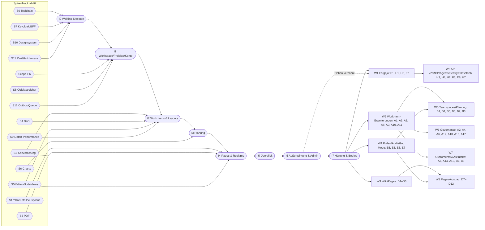
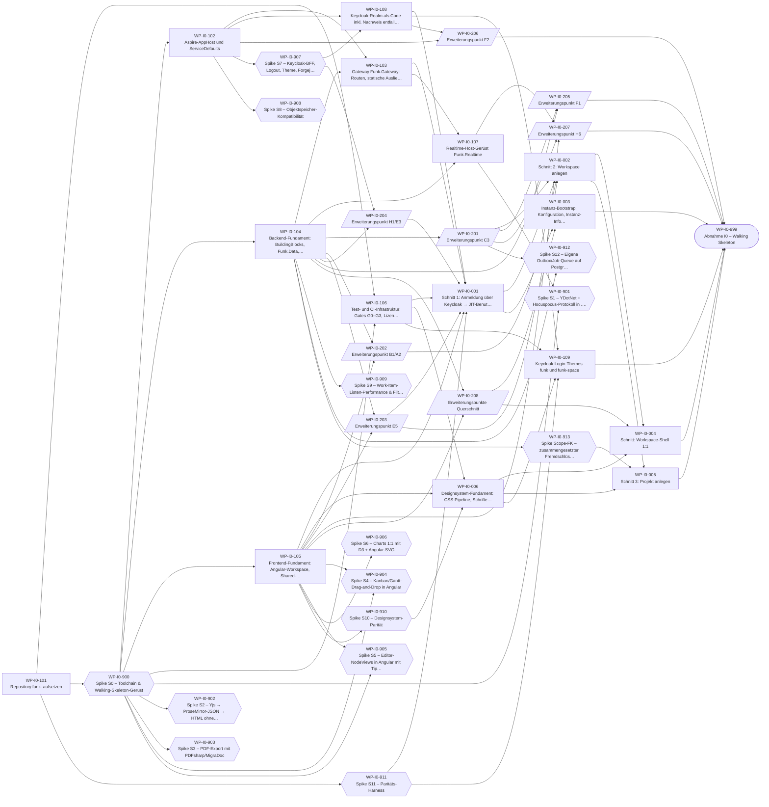
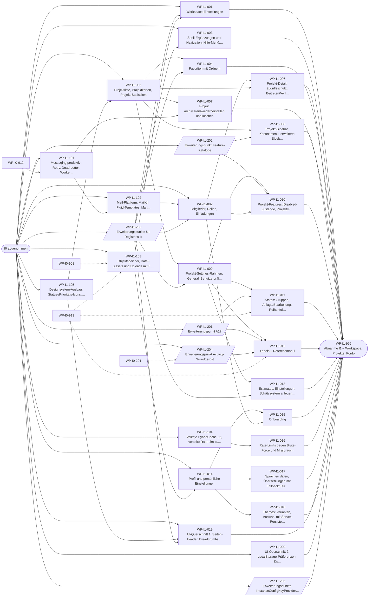
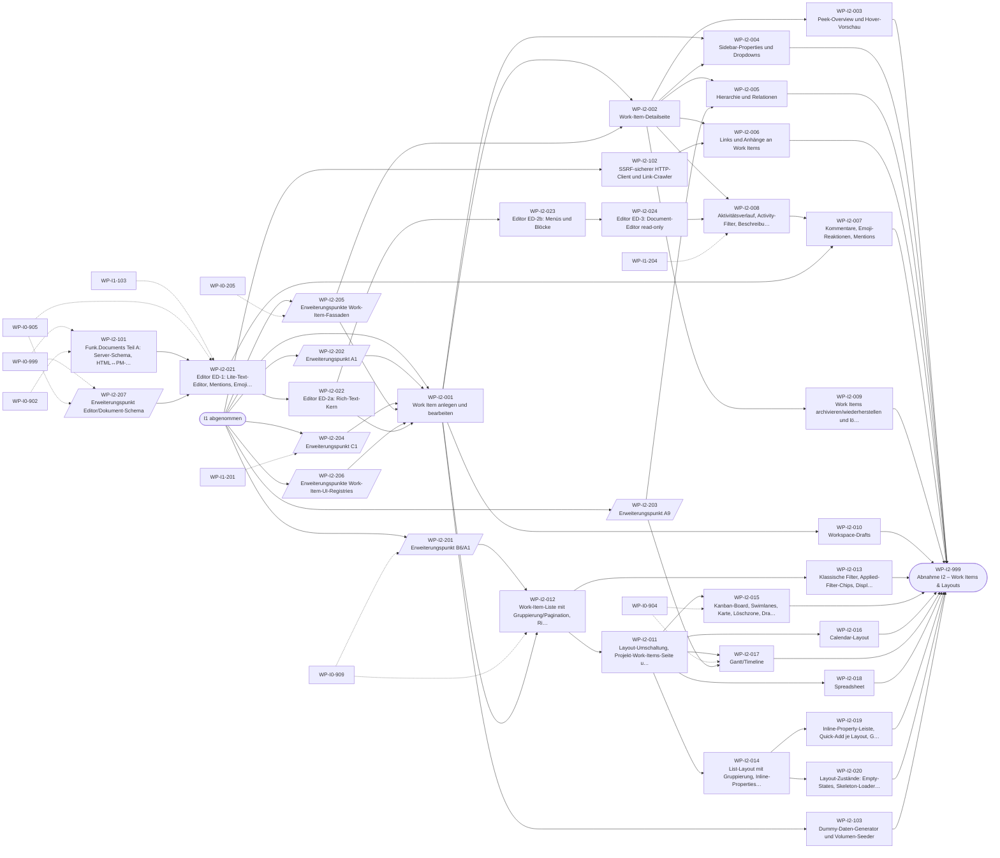
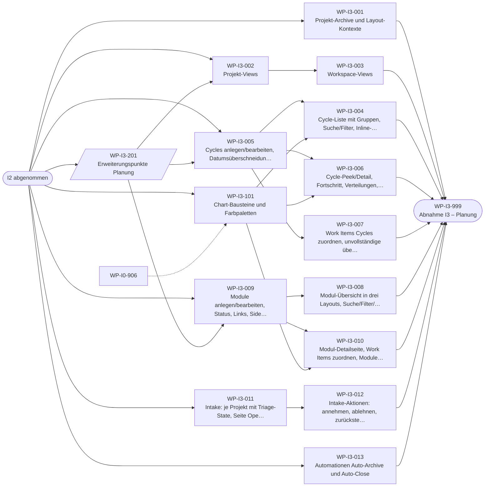
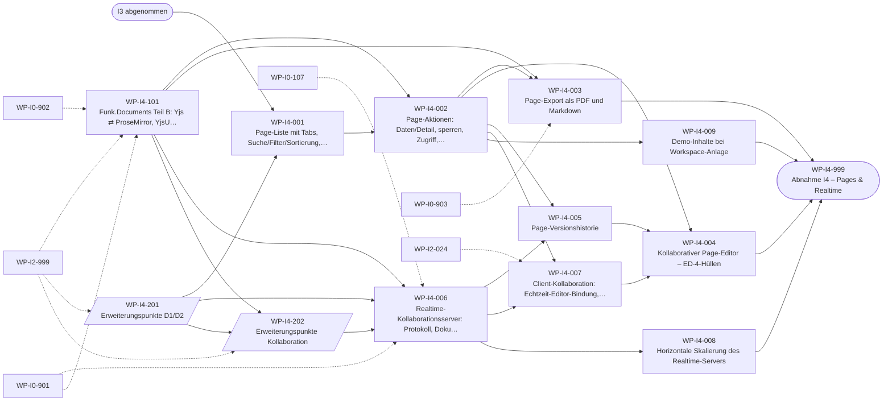
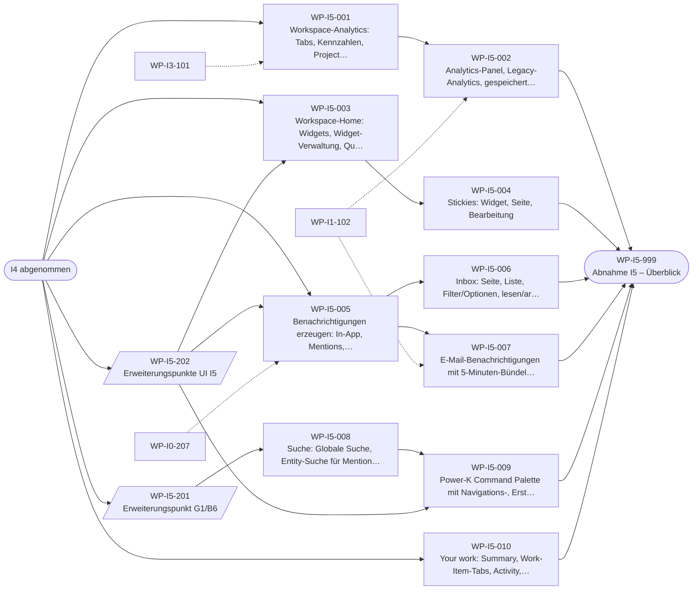
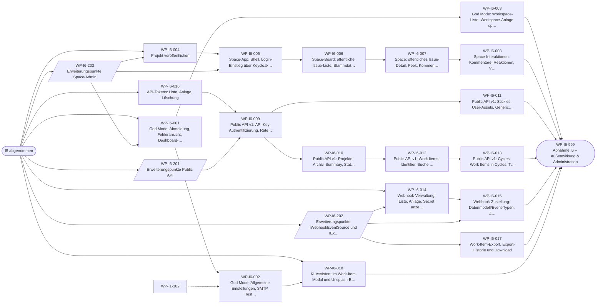
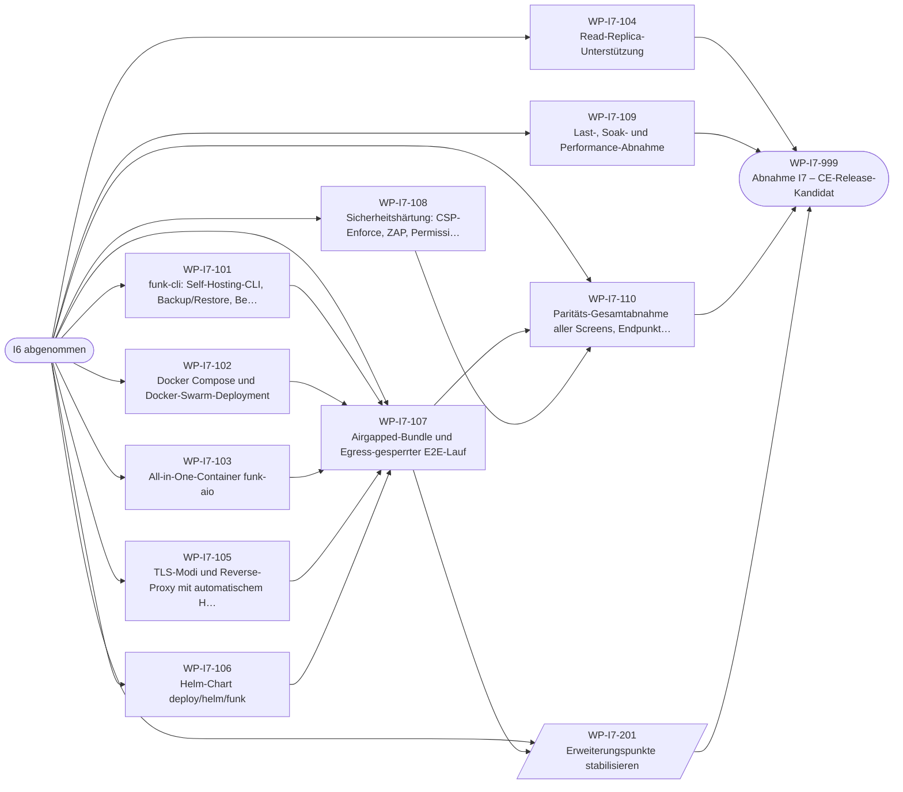

# 01 – Roadmap der CE-Portierung und der Bezahl-Wellen (funk.)

> **Stand:** 23.10.2026. **Verbindlichkeit:** bindend für Planung und Abnahme der Umsetzung im Repository `funk.` (Hauptbranch `develop`). Rangfolge: `architecture/00-grundsatzentscheidungen.md` > `architecture/17-abgleich-dokumentuebergreifend.md` > `architecture/01-zielarchitektur-und-tech-stack.md` > Themen-Dokumente 02–16 > Plan-Dokumente. Dieses Dokument konkretisiert den Rahmen aus 01 §1.3 (Inkremente), §1.4 (🧱-Andockstellen) und §9 (Spikes); es ändert keine Architekturentscheidung. Bewusste Abweichungen der Planung stehen in `plan/04-risiken-offene-punkte.md` §3 (OP-PLAN-*).
>
> **Zugehörige Plan-Dokumente:** `02-arbeitspakete-ce.md` (180 Arbeitspakete, erzeugt), `_data/wp-ce.json` (maschinenlesbar), `03-agenten-leitfaden.md` (Betriebsanleitung für Implementierungs-Agenten), `04-risiken-offene-punkte.md` (Risikoregister, offene Entscheidungen). Die Abhängigkeitsgraphen in §3 erzeugt `migration/_werkzeuge/plan/build.py` aus den Arbeitspaket-Spezifikationen.
>
> **Namen:** Zielbezeichner nach ADR-009C (`Funk.*`, `@funk/*`, `Funk:`, Realm `funk`, Clients `funk-*`); Architektur-Dokumente mit `Plane.*`-Schreibweise sind über die Umbenennungstabelle in 17 zu lesen. Sprachen: nur `de` (Standard) und `en` (ADR-009D).

## Inhaltsverzeichnis

1. Leitlinien des iterativen Vorgehens
2. Gesamtbild: Inkremente, Spike-Track, Wellen
3. Inkremente im Detail (I0 … I7) mit Abhängigkeitsgraph der Arbeitspakete
4. Meilensteine M0 … M7 und Abnahmekriterien
5. Bezahl-Wellen W1 … W9 (grobe Inkrement-Blöcke)
6. Fahrplan der Erweiterungspunkte (🧱) über die Inkremente
7. Steuerung: Gates, Spike-Entscheidungen, Re-Planung, Kennzahlen
8. Welcher Teil welches Dokuments wird in welchem Inkrement gebraucht

---

## 1. Leitlinien des iterativen Vorgehens

| Nr. | Leitlinie | Wirkung auf die Planung |
|---|---|---|
| L-1 | **CE zuerst, vollständig.** Alle 507 CE-Features (davon 27 durch ADR-008 entfallen, 26 angepasst) werden in I0–I7 umgesetzt bzw. als entfallen nachgewiesen. Bezahl-Pakete folgen in Wellen W1–W9 und werden erst kurz vor ihrer Umsetzung detailliert geplant. | Jede CE-ID gehört zu genau einem Arbeitspaket (`check_wp.py`); für Wellen gibt es nur grobe Blöcke (§5). |
| L-2 | **Kleine, lauffähige, abnehmbare Inkremente.** Jedes Inkrement endet mit einem deploybaren Stand (`aspire run` und generierte Docker-Compose-Datei), der fachlich vorgeführt und über Gate G5 abgenommen wird. | Inkrement-Abnahme als eigenes Paket `WP-In-999` (§4). |
| L-3 | **Vertikale Schnitte.** Ein fachliches Arbeitspaket liefert Endpunkt(e) + Angular-Screen(s) + Contract-/E2E-/Visual-Tests eines Feature-Clusters (Schnittregel 01 §1.3). | Typ V in 02; Bausteine (1xx) nur, wo mehrere Schnitte sie teilen. |
| L-4 | **Risiko zuerst.** Die 14 Spikes (S0–S12 und Scope-FK) laufen ab I0 als paralleler Spike-Track; jeder gatet nur das abhängige Inkrement (01 §9). | Spikes sind Arbeitspakete `WP-I0-9nn`; Folgepakete hängen von ihnen ab. |
| L-5 | **Ausbau ohne Umbau.** Alle 17 🧱-Pakete (A1, A2, A9, A17, B1, B6, C1, C3, D1, D2, E3, E5, F1, F2, G1, H1, H6) bekommen ihre Andockstellen als eigene Arbeitspakete (Nummernkreis 2xx) in dem Inkrement, in dem sie laut 01 §1.4/16 §1.4 entstehen müssen. | 29 X-Pakete (§6); Wellen ändern CE-Code nur additiv (16 D16-ADR-06/-15). |
| L-6 | **Parität messbar.** Optisch 1:1, funktionale Fehler des Originals werden korrigiert und dokumentiert (17 Z-12); nur Chromium ist Test-Gate (17 Z-10). | Dual-Target-E2E, Visual-Diff gegen das Original, `deviations.yaml`/`ui-deviations.yaml`. |
| L-7 | **Nutzungskette.** Reihenfolge nach dem Arbeitsfluss eines Teams: anmelden → Workspace/Projekt → Work Items in allen Layouts → Planung → Wissen (Pages, Realtime) → Überblick → Außenwirkung → Härtung (01 §1.3). | Inkremente I0–I7. |
| L-8 | **Vorlauf-Tracks** für lange technische Ketten, die keinen Screen registrieren: Editor-Track (Funk.Documents Teil A, ED-1/ED-2a/ED-2b/ED-3) darf während I1 beginnen, Dokument-/Realtime-Track (Funk.Documents Teil B, Page-Schema/-Zugriffsregel WP-I4-201, Kollaborations-Andockstellen, Kollaborationsserver, Backplane) während I3. Abgenommen werden sie mit ihrem Inkrement. | Abhängigkeiten dieser Pakete zeigen nicht auf den Vorgänger-Meilenstein (02 §1.2); die Pakete sind in 02 §3.3 gelistet und mit „Vorlauf“ markiert, `build.py` prüft die Liste gegen `wp_spec.VORLAUF`. |

---

## 2. Gesamtbild: Inkremente, Spike-Track, Wellen

### 2.1 Übersicht der Inkremente

| Inkrement | abnehmbares Ergebnis | Pakete | CE-IDs | kritischer Pfad¹ | gatende Spikes | Meilenstein |
|---|---|---|---|---|---|---|
| **I0 Walking Skeleton** | `aspire run` startet alles; Anmeldung über Keycloak mit funk.-Login-Theme im Original-Layout; JIT-Benutzer; Workspace und Projekt anlegen; leere Workspace-Shell pixelgleich; God-Mode-Einstieg; CI mit Gates G0–G3; Paritäts-Harness vergleicht 5 Endpunkte gegen das Original; alle I0-Andockstellen (C3, B1/A2, E5, H1/E3, F1, F2, H6, Reservierungen) | 38 (davon 14 Spikes) | 66 | 49 Tage | S0, S7, S10 (Shell), S11 | M0 |
| **I1 Workspace, Projekte, Konto** | vollständige Workspace- und Projektverwaltung: Einstellungen, Mitglieder, Einladungen (Mail), Favoriten, Navigation, States, Labels, Estimates, Feature-Toggles, Profil, Onboarding, Sprachen de/en, Themes, UI-Querschnitt, Datei-Assets | 31 | 95 | 27 Tage | S8, S12 | M1 |
| **I2 Work Items & Layouts** | Work Items anlegen/bearbeiten, Detail/Peek, Properties, Hierarchie/Relationen, Links/Anhänge, Kommentare/Reaktionen/Mentions, Activity/Versionen, Archiv/Löschen, Drafts; alle fünf Layouts mit Rich-Filter, Gruppierung, Pagination, DnD; Lite-, Rich- und Document-Editor (read-only) | 35 | 114 | 62 Tage (42 ab M1) | S2 (HTML/JSON), S4, S5, S9 | M2 |
| **I3 Planung** | Cycles, Modules, Intake, Projekt- und Workspace-Views, Archive, Automationen, Chart-Bausteine | 16 | 55 | 24 Tage | S6 | M3 |
| **I4 Pages & Realtime** | kollaborativer Page-Editor in reinem .NET (Hocuspocus-Protokoll), Versionen, Sperren/Archiv/Zugriff, PDF-/Markdown-Export, Offline-Cache, Mehrinstanz-Sync, vollständiger Demo-Seed | 13 | 29 | 44 Tage (37 ab M3) | S1, S2 (Yjs), S3, S5-Rest | M4 |
| **I5 Überblick** | Home mit Widgets/Quick Links/Recents/Stickies, Notifications (In-App, E-Mail-Bündelung, Live-Zähler), Analytics, globale Suche, Power-K, Your Work | 13 | 41 | 22 Tage | – | M5 |
| **I6 Außenwirkung & Administration** | God Mode vollständig, Space (öffentliche Boards inkl. Kommentare/Votes mit Keycloak-Login), Public API v1 + API-Tokens + OpenAPI, Webhooks, Exporte, KI-Assistent/Unsplash | 22 | 100 | 39 Tage | – | M6 |
| **I7 Härtung & Betrieb** | Paritätsabnahme aller Screens, Last-/Sicherheitstests, Airgapped-Bundle, Docker Compose/Swarm, Helm, AIO, Backup/Restore, Upgrade-Pfad, Contract-Snapshots der Andockstellen; CE-Release-Kandidat | 12 | 7 | 22 Tage | – | M7 (CE-Release) |
| **W1 … W9** | Bezahl-Pakete nach `features/30-paid-auswahlliste.md` (§5) | – | EE-* | – | Paket-Spikes (z. B. S-F2-1) | MW1 … MW9 |

¹ Längste Abhängigkeitskette innerhalb des Inkrements mit S = 2, M = 5, L = 10 Agenten-Arbeitstagen (02 §3.2); „ab M<n>“ = Kette ab Abnahme des Vorgänger-Inkrements, wenn die Vorlauf-Pakete bereits erledigt sind (02 §3.2, Spalte „ab Meilenstein“). Die Dauer eines Inkrements ist ungefähr `max(kritischer Pfad, Summe der Pakettage / Zahl paralleler Agenten)`; bei fünf parallelen Agenten liegt die CE bei rund 240–280 Agenten-Arbeitstagen Durchlaufzeit (Schätzung, keine Zusage; Nachkalibrierung nach I0, §7.3).

### 2.2 Abhängigkeitsgraph der Inkremente, Spikes und Wellen

### 2.3 Zeitliche Abfolge (relativ, Schätzung in Agenten-Arbeitstagen bei fünf parallelen Agenten)

```mermaid
gantt
  title CE-Inkremente und Vorlauf-Tracks (relativ, Arbeitstage)
  dateFormat  X
  axisFormat %s
  section Fundament
  I0 Walking Skeleton + Spike-Track      :i0, 0, 49
  section CE-Inkremente
  I1 Workspace/Projekte/Konto            :i1, 49, 28
  Vorlauf Editor-Track (I2-101, -207, ED-1…ED-3) :v2, 49, 37
  I2 Work Items & Layouts                :i2, 77, 42
  I3 Planung                             :i3, 119, 24
  Vorlauf Dokument-/Realtime-Track (I4-101, -201, -202, -006, -008) :v4, 119, 24
  I4 Pages & Realtime                    :i4, 143, 37
  I5 Überblick                           :i5, 180, 22
  I6 Außenwirkung & Administration       :i6, 202, 39
  I7 Härtung & Betrieb                   :i7, 241, 22
  section Bezahl-Wellen (Beginn)
  W1 Forgejo (Option: verzahnt ab Ende I6) :w1, 263, 30
```

Die Wellen W2–W9 schließen sich nach Auswahl und Detailplanung an (§5); ihre Dauer wird erst mit dem jeweiligen Wellenplan geschätzt (Aufwandsrahmen aus 30: S 2–5, M 5–15, L 15–40, XL 40–100 PT je Paket).

---

## 3. Inkremente im Detail

Legende der Graphen: Rechteck = fachlicher Schnitt oder Baustein, Parallelogramm = Erweiterungspunkt (Typ X), Sechseck = Spike, Stadion = Abnahme; gestrichelte Kanten = Abhängigkeit auf ein Paket eines früheren Inkrements (außer dem Vorgänger-Meilenstein).

### 3.1 I0 – Walking Skeleton

**Ziel:** Das gesamte technische Fundament steht einmal Ende-zu-Ende: Repository `funk.`, Aspire-AppHost, Keycloak-Anmeldung, Workspace und Projekt anlegen, Angular-Shell 1:1, CI mit Gates, Paritäts-Harness – und alle Andockstellen, die 01 §1.4 für I0 verlangt.

**Vertikale Schnitte (01 §1.3):** Schnitt 1 „Login → JIT-Benutzer → leere Shell“ (WP-I0-001), Schnitt 2 „Workspace anlegen“ (WP-I0-002), Schnitt 3 „Projekt anlegen“ (WP-I0-005); dazu Workspace-Shell (WP-I0-004) und Instanz-Bootstrap/God-Mode-Einstieg (WP-I0-003).

**Bausteine:** Repository-Grundgerüst (WP-I0-101), AppHost/ServiceDefaults (WP-I0-102), Gateway (WP-I0-103), Backend-Fundament mit Modul-Schablone und Architekturtests R1–R12 (WP-I0-104), Frontend-Fundament (WP-I0-105), Test-/CI-Infrastruktur (WP-I0-106), Realtime-Host-Gerüst (WP-I0-107), Keycloak-Realm (WP-I0-108), Login-Themes (WP-I0-109), Designsystem-Fundament (WP-I0-006).

**Erweiterungspunkte:** C3 (WP-I0-201), B1/A2 (WP-I0-202), E5 (WP-I0-203), H1/E3 (WP-I0-204), F1 (WP-I0-205), F2 (WP-I0-206), H6 (WP-I0-207), Reservierungen/Registries/R11/R12 (WP-I0-208).

**Spike-Track:** S0 und S11 starten an Tag 0, S7 nach S0, die übrigen ab Tag 3 parallel (01 §9 Gantt). S0, S7, S10 (Shell-Teil) und S11 gaten die Abnahme von I0; S8, S12 und der Scope-FK-Spike gaten I1; S2 (HTML/JSON), S4, S5, S9 gaten I2; S6 gatet I3; S1, S2 (Yjs), S3 und das S5-Restkriterium gaten I4.

**Einrichtung nach ADR-006 (Teil von WP-I0-101):** Plan nach `funk./docs/plan/`, `AGENTS.md` mit Verweis auf `docs/plan/` und `mlwr/plane@funk-referenz-1.4.2`; jede Implementierungs-Session erhält `funk.` schreibend und `mlwr/plane` lesend.

<!-- GEN:GRAPH:I0 -->

<!-- /GEN:GRAPH:I0 -->

### 3.2 I1 – Workspace, Projekte, Konto

**Ziel:** Ein Team kann einen Workspace vollständig einrichten und verwalten: Mitglieder einladen (E-Mail), Rollen vergeben, Projekte anlegen, konfigurieren und organisieren, persönliche Einstellungen, Sprache (de/en) und Theme wählen.

**Reihenfolge:** Erweiterungspunkte A17-Kataloge (WP-I1-201), Feature-Kataloge (WP-I1-202), UI-Registries (WP-I1-203), Activity-Gerüst (WP-I1-204) sowie die Bausteine Messaging produktiv (WP-I1-101), Mail (WP-I1-102), Assets (WP-I1-103) zuerst; das **Referenzmodul Labels** (WP-I1-012, 02 §5.2) wird früh umgesetzt und ist danach Vorlage für States, Estimates und alle späteren Module.

**Vorlauf:** Ab Mitte I1 (sobald WP-I1-103 abgenommen ist) beginnt der Editor-Track des Inkrements I2 (WP-I2-101, WP-I2-207, WP-I2-021 … WP-I2-024).

<!-- GEN:GRAPH:I1 -->

<!-- /GEN:GRAPH:I1 -->

### 3.3 I2 – Work Items & Layouts

**Ziel:** Kernnutzen des Produkts: Work Items vollständig bearbeiten und in allen fünf Layouts (List, Kanban, Calendar, Gantt, Spreadsheet) mit Rich-Filter, Gruppierung, Sortierung, Pagination und Drag-and-Drop arbeiten; Editor in Kommentaren, Beschreibungen und Versionsansicht.

**Reihenfolge:** Erweiterungspunkte zuerst (Filter-AST WP-I2-201, Typ-Spalte WP-I2-202, Relationstyp-Katalog WP-I2-203, State-Change-Pipeline WP-I2-204, Work-Item-Fassaden WP-I2-205, UI-Registries WP-I2-206, Editor-Schema WP-I2-207); danach Work-Item-Kern (WP-I2-001/-002), parallel Properties, Hierarchie, Links, Activity, Archiv, Drafts; die Layouts setzen auf der Listen-Engine (WP-I2-012) und dem Layout-Rahmen (WP-I2-011) auf.

**Hinweis Abgrenzung:** Cycle- und Module-Dropdown (CE-WI-025/-026), die Layout-Kontexte (CE-LV-004), „View speichern“ (CE-LV-011) und die Anzeige je Cycle/Modul (CE-LV-016) folgen mit I3, weil die Fachobjekte erst dort existieren (OP-PLAN-03).

<!-- GEN:GRAPH:I2 -->

<!-- /GEN:GRAPH:I2 -->

### 3.4 I3 – Planung

**Ziel:** Planungsobjekte: Cycles (inkl. Burndown, Transfer, workspace-weite Active Cycles), Modules, Intake (inkl. Annahme über die State-Change-Pipeline), Projekt- und Workspace-Views, Archive, Auto-Archive/Auto-Close.

**Vorlauf:** Während I3 beginnt der Dokument-/Realtime-Track von I4 (WP-I4-101 Funk.Documents Teil B, WP-I4-201 Page-Schema mit zentraler Zugriffsregel `IPageAccessPolicy`, WP-I4-202 Kollaborations-Andockstellen, WP-I4-006 Kollaborationsserver, WP-I4-008 Backplane), sobald S1 und S2 grün sind. Die Client-Kollaboration (WP-I4-007) gehört nicht zum Vorlauf, weil ihr REST-Fallback die Page-Endpunkte aus WP-I4-002 nutzt.

<!-- GEN:GRAPH:I3 -->

<!-- /GEN:GRAPH:I3 -->

### 3.5 I4 – Pages & Realtime

**Ziel:** Kollaborative Pages ohne Node-Laufzeit (ADR-002): Hocuspocus-kompatibler Server in .NET mit YDotNet, Client-Kollaboration mit Offline-Cache, Page-Liste und -Aktionen, Versionen, PDF/Markdown-Export, Skalierung über Valkey; vollständiger Demo-Seed (CE-WS-002), weil er Cycles, Module, Views und Pages enthält.

<!-- GEN:GRAPH:I4 -->

<!-- /GEN:GRAPH:I4 -->

### 3.6 I5 – Überblick

**Ziel:** Orientierung im Workspace: Home mit Widgets, Stickies, Notifications (In-App, E-Mail-Bündelung, Live-Zähler über SignalR – erste Nutzung von H6), Analytics, globale Suche mit Indexierungs-Pipeline (G1/B6-Andockstelle), Power-K und „Your work“.

<!-- GEN:GRAPH:I5 -->

<!-- /GEN:GRAPH:I5 -->

### 3.7 I6 – Außenwirkung & Administration

**Ziel:** Alles, was nach außen wirkt oder die Instanz verwaltet: God Mode vollständig, Space-App (öffentliche Boards; Lesen anonym, Kommentieren/Reagieren/Abstimmen mit Keycloak-Login), Public API v1 mit API-Tokens und OpenAPI (Default aus, im God Mode einschaltbar, 17 Z-112), Webhooks (`X-Funk-Signature`, `X-Funk-Delivery`, ADR-009C), Exporte, KI-Assistent und Unsplash.

<!-- GEN:GRAPH:I6 -->

<!-- /GEN:GRAPH:I6 -->

### 3.8 I7 – Härtung & Betrieb

**Ziel:** Release-Fähigkeit der CE: Betriebs-CLI und Backup/Restore, Compose/Swarm, AIO, Helm, Read-Replica, TLS/ACME, Airgap-Bundle mit egress-gesperrtem E2E-Lauf, CSP-Enforce und Sicherheitsscans, Last/Soak, Paritäts-Gesamtabnahme, Contract-Snapshots der Erweiterungs-Interfaces.

<!-- GEN:GRAPH:I7 -->

<!-- /GEN:GRAPH:I7 -->

---

## 4. Meilensteine M0 … M7 und Abnahmekriterien

Ein Meilenstein ist erreicht, wenn das Abnahme-Paket `WP-In-999` abgeschlossen ist. Für **jeden** Meilenstein gelten die gemeinsamen Kriterien G-1 … G-10; danach folgen die inkrementspezifischen Kriterien.

### 4.1 Gemeinsame Kriterien jedes Meilensteins

| Nr. | Kriterium (messbar) | Nachweis |
|---|---|---|
| G-1 | Alle Arbeitspakete des Inkrements sind nach `develop` gemergt (G1 und G2 grün); keine offenen „vorab“-Endpunkte ohne Abnahme im Paket ihrer CE-ID. | `wp-ce.json`, PR-Liste |
| G-2 | `ce-coverage-check --inc <In> --strict`: jede CE-ID des Inkrements erfüllt die Mindestebenen aus 15 Anhang B im letzten Lauf grün; Quarantäne zählt nicht. | `artifacts/ce-coverage.md` |
| G-3 | `original-test-ledger --inc <In>`: alle Original-Tests der CE-IDs des Inkrements mit Status ≠ `todo`. | `artifacts/ledger-report.md` |
| G-4 | Parity-Report: alle Contract-Szenarien des Inkrements grün, **0 ungenehmigte Abweichungen**, Endpunkt-Abdeckung der registrierten Endpunkte des Inkrements 100 % (`_data/wp-endpoints.json`). | Parity-Harness-Bericht |
| G-5 | Visual-/DOM-/a11y-Prüfpunkte aller Screens des Inkrements innerhalb der Schwellwerte (15 §3.10.3, Chromium); keine neuen a11y-Verstöße gegenüber der Original-Baseline. | Visual-Report |
| G-6 | Security-Report: Permission-Matrix für 100 % der Endpunkte des Inkrements; ZAP-Baseline ohne „High“. | Security-Report |
| G-7 | Lastziele des Inkrements aus `tests/load/thresholds.yaml` erfüllt (Zuordnung 15 §3.15.1 G4). | k6-/Load-Report |
| G-8 | G-BRAND: 0 Treffer außerhalb der Allowlist über alle gebauten Artefakte des Inkrements. | `artifacts/brand-gate.md` |
| G-9 | Der Stand startet über die generierte Docker-Compose-Datei auf einer frischen Maschine ohne Internetzugang (ab I7 als Airgap-Bundle) und besteht den `@smoke`-Satz. | Compose-Smoke |
| G-10 | Demo der Kern-Flows als Playwright-Video, Abnahmebericht `docs/acceptance/<In>.md` (`tools/ci/acceptance-report`) und fachliche Abnahme durch den Auftraggeber; die in plan/04 mit Frist „<In>“ markierten Entscheidungen sind getroffen. | Abnahmebericht |

### 4.2 Inkrementspezifische Kriterien

| Meilenstein | zusätzliche Abnahmekriterien (messbar) | Demo-Szenario |
|---|---|---|
| **M0 – Walking Skeleton** | (1) `aspire run` (Profil `dev`) bringt alle Ressourcen in < 3 min auf „healthy“, ohne externe Netzwerkzugriffe (Allowlist-Test). (2) Anmeldung über Keycloak mit PKCE für `funk-web`, `funk-admin`, `funk-space`; Back-Channel-Logout beendet die Session < 2 s; Sperre in Keycloak wirkt beim nächsten Request; JIT verweigert `email_verified=false`. (3) Login-Themes `funk`/`funk-space` Visual ≤ 1 % gegen die Original-Sign-in-Seiten (hell/dunkel). (4) Workspace und Projekt werden über die UI angelegt; Default-States wie Original; `funk.workspace.created.v1` und `funk.project.created.v1` stehen in der Outbox und werden von einem Fake-Consumer empfangen. (5) Leere Workspace-Shell Visual ≤ 0,2 %, DOM gleich. (6) Benutzer mit `funk-instance-admin` erreicht God Mode (`general`), andere sehen `NO_ADMIN_ROLE`. (7) Paritäts-Harness: die 5 Endpunkte aus 15 §3.6.7 mit je ≥ 3 Schritten aufgezeichnet und gegen funk. grün, CI-Lauf < 15 min. (8) G0–G3 laufen auf `develop`; Lizenz-Gate, gitleaks, Trivy, Images amd64/arm64 grün. (9) Architekturtests R1–R12 grün; `tests/extension-points.yaml` enthält alle I0-Andockstellen (16 §1.4) mit Typ-X-Test. (10) Forgejo-SSO-Smoke: dieselbe Keycloak-Identität in funk. und Forgejo. (11) Spike-Berichte S0, S7, S10, S11 abgenommen; alle übrigen Spikes laufen mit Enddatum vor dem jeweils gegateten Inkrement. | Testbenutzer meldet sich an, legt Workspace „Acme“ und Projekt „Website“ an, sieht die Shell; Instanz-Admin öffnet God Mode; gleicher Benutzer meldet sich an Forgejo an. |
| **M1 – Workspace, Projekte, Konto** | (1) Einladungsfluss Ende-zu-Ende mit Mailpit: Einladung → Mail M5 (G-MAIL) → Keycloak-Login → automatischer Beitritt. (2) Referenzmodul Labels entspricht 02 §5.2 (Review-Checkliste) und dient als Vorlage weiterer Module. (3) Permission-Matrix inkl. HARM-00 für alle I1-Endpunkte grün. (4) S12 und S8 grün; `CronRegistrationTests` grün; Kill-Test des Workers ohne Nachrichtenverlust. (5) Avatar-, Cover- und Logo-Upload über das Default-Backend aus S8. (6) Sprachauswahl zeigt genau Deutsch und Englisch, Standard Deutsch; `i18n-sync-check` ohne fehlende `de`-Schlüssel. (7) Themes inkl. High Contrast und Custom; Visual aller Workspace-/Projekt-Settings-Screens. (8) Typ-X-Tests der I1-Andockstellen (A17-Kataloge, Feature-Kataloge, Registries, Activity-Gerüst, E-12) grün. | Admin lädt zwei Kollegen ein, richtet States, Labels und Estimates ein, schaltet Features, wechselt Sprache und Theme. |
| **M2 – Work Items & Layouts** | (1) LT-01 … LT-07, LT-14, LT-15 mit Volumenprofil L (50 000 Work Items) im Zielbereich. (2) G-SCHEMA (`rich`, `lite`, `document`, `server`, `server-document`) identisch; G-DOC (HTML↔JSON) und G-SANITIZE grün. (3) Activity-Goldens aller 38 Varianten; jede der 78 Aufrufstellen getestet. (4) Concurrency-Test `sequence_id` (100 parallele Anlagen). (5) Dual-Target-E2E aller Specs unter `web/work-items/`, `web/layouts/`, `web/editor/` grün. (6) Visual aller Layouts hell/dunkel. (7) Entscheidungen Z-114 (`work_item_versions`) und Z-115 (Gruppensummen-Quirk) getroffen. | Team legt Work Items an, kommentiert mit Mentions, filtert mit AND/OR, zieht Karten im Kanban, verschiebt im Gantt, bearbeitet im Spreadsheet. |
| **M3 – Planung** | (1) Chart-Visual ≤ 0,5 % (S6). (2) Cron-Jobs Auto-Archive/-Close, Intake-Unsnooze, Cycle-Abschluss-Erkennung mit `FixedClock` und Original-Zeiten. (3) Intake-Annahme und Cycle-Transfer laufen über `IWorkItemStateChanger` mit den Origins `Intake`/`CycleTransfer`. (4) Views speichern Filter-AST und liefern dieselben Treffer wie das Original. | Projektleitung plant einen Cycle, ordnet Work Items und Module zu, sieht Burndown, triagiert Intake, speichert eine View. |
| **M4 – Pages & Realtime** | (1) Protokollfälle P-01 … P-30 mit unverändertem `@hocuspocus/provider` grün; LT-16 … LT-20 im Zielbereich. (2) Zwei Realtime-Instanzen konvergieren über Valkey; Einzelknoten ohne Valkey lauffähig. (3) G-PDF, G-PDF-web, G-MD, Yjs-Browser-Roundtrip grün. (4) `assert-no-node.sh` für alle Laufzeit-Images grün (ADR-002). (5) `collaboration-cursor` aktiv, Abweichung FE-ED-01 vom Auftraggeber abgenommen (Z-109). (6) Demo-Seed gegen gebrandetes Golden, `NOT ILIKE '%plane%'` auf allen Seed-Textspalten. | Zwei Personen bearbeiten gleichzeitig eine Page (eine davon offline und wieder online), sperren, versionieren und exportieren sie als PDF. |
| **M5 – Überblick** | (1) Notification-Zähler-Push < 2 s mit und ohne Valkey (`LiveEventLatencyTests`). (2) Notification-Daten byte-gleich zum Original-Golden; E-Mail-Digest M12 (G-MAIL). (3) LT-09, LT-11 im Zielbereich. (4) Such-SQL-Pläne ohne Seq-Scan bei Workspace-Filter; `indexing.reconcile` repariert den Index. (5) Power-K Visual und Tastaturverhalten wie Original. | Nutzer startet auf Home, arbeitet die Inbox ab, findet ein Work Item über Power-K, prüft Analytics. |
| **M6 – Außenwirkung & Administration** | (1) OpenAPI gegen `v1.original.json`; Contract-Szenarien aller v1-Endpunkte; HARM-03/-04/-06 dokumentiert. (2) Webhooks: `WebhookTriggerCoverageTests`, Signatur `X-Funk-Signature`, stabile `X-Funk-Delivery`, 6 Versuche, Deaktivierung + Mail M10, SSRF-Tests. (3) Space: anonymes Lesen, Interaktionen nur nach Keycloak-Login, OG-Meta. (4) G-EXPORT grün. (5) God Mode vollständig, Secrets maskiert (`MaskInstanceSecrets = true`), OpenAPI per Default aus. (6) LT-10, ZAP-API-Scan, D15-SEC-05 grün. | Admin konfiguriert SMTP und KI-Endpunkt im God Mode, veröffentlicht ein Board, externer Nutzer kommentiert nach Login; Integrator legt API-Token und Webhook an und empfängt signierte Ereignisse. |
| **M7 – CE-Release** | (1) G6: G5 aller Inkremente, Lauf `airgap`, Upgrade-Test, Backup/Restore, SBOM, Lizenzbericht (`NOTICE`), Helm-/Compose-/AIO-/Swarm-Smoke, G-BRAND inkl. Container-Labels und Helm-`NOTES.txt`; keine Critical/High-CVE mit Fix. (2) 480 umgesetzte CE-IDs grün, 27 entfallene mit Ersatznachweis. (3) `coverage --fail-under 100` für alle 564 registrierten Endpunkte. (4) Visual-Abnahme aller Einträge des Screenshot-Katalogs (09 §4.14); konsolidierte Abweichungsliste vom Auftraggeber abgenommen. (5) CSP im Enforce-Modus mit leerem Report. (6) Contract-Snapshots aller Erweiterungs-Interfaces. (7) LT-08, LT-13, LT-21 im Zielbereich. | Installation aus dem Airgap-Bundle auf einer isolierten VM, Backup, Upgrade auf einen Folgestand, Restore. |

---

## 5. Bezahl-Wellen W1 … W9 (grobe Inkrement-Blöcke)

**Grundsätze.** (a) In dieser Phase gibt es für die Wellen **keine** Detail-Arbeitspakete. Jede Welle wird kurz vor ihrem Start nach 16 §6 geplant: Definition of Ready (16 §6.1), Wellenplan `migration/plan/waves/W<n>-<paket>.md` mit Inhalt nach 16 §6.2, danach Arbeitspakete `WP-W<n>-<NNN>` nach den Regeln dieses Plans. (b) Wellen ändern CE-Code **nur additiv** (neue Module unter `src/modules/extensions/`, Registrierungszeile in `FunkModuleCatalog` bzw. `provide<Paket>Extensions()`, additive Migrationen `W<n>_<Paket>_<Beschreibung>`, freigegebene `extended.ts`-Dateien; 16 D16-ADR-04/-06/-15). (c) Jede Welle endet mit Meilenstein MW<n>: Paket-Abnahme (Screens ohne Original-Referenz nach 09 §6.4) **und** unveränderte CE-Paritätssuiten (keine neue Abweichung in CE-Verträgen). (d) Standard ist die Abfolge **nach M7**; Option „verzahnt“ siehe OP-PLAN-08.

| Welle | Pakete (Umfang laut 30) | genutzte CE-Andockstellen (X-Pakete) | technisch frühester Start | geplanter Start | Vorarbeiten / Entscheidungen vor Start | Abnahme MW<n> (Kern) |
|---|---|---|---|---|---|---|
| **W1** | F1 Integrations-Framework, H1 OAuth-App-Plattform, H6 Realtime-Event-Server, **F2 Forgejo** (ADR-007-Mindestumfang) | WP-I0-204 (Bearer/App-Prinzipal), WP-I0-205 (Ingress, Verifier, `integration_connections`), WP-I0-206 (Forgejo-Container, SSO), WP-I0-207 (Hub), WP-I1-205 (`IInstanceConfigKeyProvider`), WP-I2-204 (State-Pipeline, Origin `Integration`), WP-I2-205 (Resolver, `IWorkItemCommands`, `external_links`), WP-I2-206 (`WORK_ITEM_ACTIONS`, `INTEGRATION_LINK_PREVIEWS`, `ACTIVITY_RENDERERS`), WP-I5-202 (`LIVE_EVENT_HANDLERS`), WP-I6-202 (`IWebhookEventSource`) | nach M6 | nach M7 (Option verzahnt ab M6) | Spike **S-F2-1** gegen gepinnten Forgejo-Container (Header `X-Forgejo-Signature`, Hook-Typ, `status`-Event, OAuth2-Scopes; 17 Z-13, O-16-01/-02); O-14-02 (Forgejo unter eigener Subdomain); O-16-03 (Milestone-Import → Module); Keycloak als Autorisierungsserver für H1-Tokens bestätigen | Verbindung mehrerer Forgejo-Instanzen, persönliche Konto-Verknüpfung, Repo↔Projekt-Mapping, bidirektionaler Issue-Sync mit Wiederaufnahme, PR-/Commit-Automation, Status inkl. Actions-Checks, Branch aus Work Item, signierte Webhooks idempotent, Importer; Integrationstests gegen echten Forgejo-Container, Airgap mit Forgejo |
| **W2** | A1 Typen & Custom Properties, A3 Epics, A5 Milestones, A8 Bulk/Transfers, A9 Relationen & Abhängigkeiten, A10 Time Tracking, A11 Advanced Estimates | WP-I1-202 (Feature-Kataloge), WP-I1-203 (`ESTIMATE_SYSTEM_FLAGS`), WP-I2-201 (Filter/Gruppen/Sortier-Registries, Payload-Extension), WP-I2-202 (`type_id`, `IWorkItemTypeResolver`), WP-I2-203 (Relationstyp-Katalog, `IWorkItemHierarchyPolicy`), WP-I2-206 (Property-Renderer, Spreadsheet-Spalten), WP-I6-201 (`IV1PayloadExtension`), WP-I6-202 (`IExportTypeProvider` für Worklogs) | nach M6 | nach MW1 | Z-16/O-D15-10 (Additiv-Regel bei Pflicht-Properties) | Typ-/Property-Engine in allen Layouts, Filtern und der v1-API ohne CE-Vertragsänderung |
| **W3** | D1 Wiki & Collections, D2 Nested Pages, D3 Page-Versionen erweitert, D4 Realtime-Presence, D5 Publish & Exporte, D6 Work-Item-Verknüpfung | WP-I1-202 (`WORKSPACE_FEATURES`), WP-I2-207 (Server-Schema, Editor-Tokens), WP-I4-201 (Pages ohne Projektpflicht, Hierarchie), WP-I4-202 (Dokumenttyp-Registry, `affectedPages`, `EDITOR_BLOCKS`) | nach M4 | nach MW2 | DOCX-Renderer (D5) Lizenzprüfung; Presence-Darstellung (D4) auf Basis S1 | Workspace-Pages und Seitenbaum kollaborativ, Exporte inkl. Word |
| **W4** | E5 Rollenmodell, E3 IdP Group Sync, E6 Audit/Activity-Logs, E7 God-Mode-Erweiterungen | WP-I0-201 (Event-Katalog für Audit), WP-I0-203 (Permission-Katalog, `roles`, `ISystemRoleGrantContributor`), WP-I0-204 (`Groups`-Claim, Provisioning-Slots 750/760), WP-I0-208 (Admin-Registries), WP-I1-203 (`ROLE_OPTIONS`, `MEMBER_ROW_DECORATORS`), WP-I6-203 (Admin-Registries mit CE-Inhalt) | nach M6 | nach MW3 | Z-16 (geänderte Default-Rechte); SCIM optional ja/nein | Custom Roles ohne Änderung an CE-Rollenlogik; Keycloak-Gruppen → Rollen |
| **W5** | B1 Teamspaces, B4 Cycle-Erweiterungen, B5 Shared/Publish Views, B6 PQL/Advanced Search, B2 Dashboards, B3 Analytics-Erweiterungen | WP-I0-202 (`ScopeLevel.Teamspace`), WP-I1-205 (`teamspace_id`), WP-I2-201 (Parser-Liste), WP-I3-201 (`ICycleSchedulingPolicy`, `CYCLE_FLAGS`), WP-I5-201 (Suche/Index), WP-I6-201 (`IV1FilterParameterBinding`), WP-I6-203 (`SPACE_ROUTE_EXTENSIONS`) | nach MW2 und MW4 | nach MW4 | O-16-05 (`teamspace_id` an Kommentaren); Text-to-PQL entfällt ohne G1 | Teamspace-Sichtbarkeit über `IScopeResolver`; PQL auf demselben AST |
| **W6** | A2 Workspace-Types/Hierarchie, A4 Initiatives, A6 Releases, A12 Module Overview, A13 Projekt-Organisation, A16 Votes/Antworten, A17 Governance States/Labels | WP-I0-202 (`ScopeRef`), WP-I1-201 (Catalog-Sources), WP-I2-202 (Typ-Tabelle), WP-I2-203 (Hierarchie-Policy) | nach MW2 | nach MW5 | O-16-04 (`states.project_id` NOT NULL vs. Workspace-States) | Workspace-States/-Labels ohne Änderung der Lesewege |
| **W7** | A7 Customers, A14 Baselines/SLAs, A15 Intake-Erweiterungen (inkl. E-Mail-Intake), B7 Scheduled Comms, B8 Home-/Navigations-Erweiterungen | WP-I0-201 (Event-Katalog, `IRecurringScheduleStore`), WP-I2-205 (`IWorkItemCommands`), WP-I5-202 (`HOME_WIDGETS`) | nach MW2 | nach MW6 | E-Mail-Empfang für E-Mail-Intake (neue Komponente, Airgap-tauglich) | – |
| **W8** | D7 Kommentare in Pages, D8 Sharing/Labels/Benachrichtigungen, D9 Editor-Blöcke, D10 Databases, D11 Pages Analytics, D12 Pages-Public-API | WP-I0-203 (Rechte für D8), WP-I2-207 (Server-Schema E-11), WP-I4-202 (`EDITOR_BLOCKS`), WP-I6-201 (OpenAPI-Gruppen) | nach MW3 und MW4 | nach MW7 | Schema-Änderungsverfahren für Paket-Blöcke (10 §3.2.5) | Golden je neuem Block |
| **W9** | H3 Public API v2, H4 MCP-Server, H2 Agents, F6 Sentry, E8 PII-Scanner, H7 Betriebsausbau | WP-I0-204 (Prinzipal-Arten App/Bot), WP-I0-205 (Integrations), WP-I6-201/-202 (v1-Erweiterungen, Webhook-Quellen), WP-I7-201 (Contract-Snapshots) | nach MW1 | nach MW8 | MCP-Transport und Tool-Gates über Keycloak-Tokens | – |
| **später** | H8 Desktop-/Mobile-Clients | – | nach W9 (H3) | vom Auftraggeber zurückgestellt | – | – |

**Nicht gewählt:** C1–C6, F5, F7–F11, G1–G3, H5. Für C1, C3 und G1 existieren trotzdem die Andockstellen (WP-I2-204, WP-I0-201, WP-I5-201); die übrigen bleiben über diese nachrüstbar (16 §1.3).

---

## 6. Fahrplan der Erweiterungspunkte (🧱) über die Inkremente

| 🧱-Paket | Welle | Erweiterungspunkt-Pakete (Inkrement) | Andockstellen (Kurz) |
|---|---|---|---|
| A1 Work-Item-Types & Custom Properties | W2 | WP-I1-202 (I1), WP-I2-201, WP-I2-202, WP-I2-206 (I2), WP-I6-201 (I6) | Feature-Kataloge, Filter-/Gruppen-/Sortier-Registries, `type_id` + `work_item_types`, `IWorkItemTypeResolver`, `PROPERTY_RENDERERS`, `SPREADSHEET_COLUMNS`, `IV1PayloadExtension` |
| A2 Workspace-Types, Hierarchie | W6 | WP-I0-202 (I0), WP-I2-202 (I2) | `ScopeRef`, keine Projektpflicht in `work_item_types` |
| A9 Relationen & Abhängigkeiten | W2 | WP-I2-203 (I2) | Relationstyp-Katalog, `IWorkItemHierarchyPolicy`, `RELATION_TYPES`, `TIMELINE_FLAGS` |
| A17 Governance States/Labels | W6 | WP-I1-201 (I1) | `IStateCatalog`/`ILabelCatalog` + Sources |
| B1 Teamspaces | W5 | WP-I0-202 (I0), WP-I1-202, WP-I1-205 (I1) | `ScopeLevel.Teamspace`, `IScopeResolver`, `RouterStore.teamspaceId`, `teamspace_id`-Spalten, Workspace-Feature-Katalog |
| B6 Erweiterte Filter/PQL | W5 | WP-I2-201 (I2), WP-I5-201 (I5), WP-I6-201 (I6) | Filter-AST + Parser-Liste, `ISearchProvider`, `IV1FilterParameterBinding` |
| C1 Workflows (nicht gewählt) | – | WP-I2-204 (I2) | `IWorkItemStateChanger` + Guards/Hooks, `WORKFLOW_GUARD` |
| C3 Automation-Engine (nicht gewählt) | – | WP-I0-201 (I0) | Event-Katalog, Outbox/Inbox, `IEventConsumer`, `IRecurringJobRegistry`, Queues |
| D1 Wiki & Collections | W3 | WP-I4-201, WP-I4-202 (I4) | Pages ohne Projektpflicht, Dokumenttyp-Registry |
| D2 Nested Pages | W3 | WP-I4-201, WP-I4-202 (I4) | `parent_id`, `IPageHierarchy(+Queries)`, `affectedPages` |
| E3 IdP Group Sync | W4 | WP-I0-204 (I0), WP-I1-203 (I1) | `Groups`-Claim, Provisioning-Slots, `MEMBER_ROW_DECORATORS` |
| E5 Rollenmodell | W4 | WP-I0-203 (I0), WP-I1-203 (I1) | Permission-Katalog, `roles`, `role_id`, `ISystemRoleGrantContributor`, `PermissionService`, `ROLE_OPTIONS` |
| F1 Integrations-Framework | W1 | WP-I0-205 (I0), WP-I2-205 (I2) | Oberfläche `Integrations`, Verifier-Registry, `IWebhookIngress`, `integration_connections`, `external_links`, `IIntegrationLinkProvider` |
| F2 Forgejo | W1 | WP-I0-205, WP-I0-206 (I0), WP-I2-205, WP-I2-206 (I2) | Container + SSO, `IForgejoClient`-Platzhalter (`Funk.Forgejo.Contracts`/`Funk.Forgejo.Client` in WP-I0-205), Resolver, `WORK_ITEM_ACTIONS`, `INTEGRATION_LINK_PREVIEWS` |
| G1 AI-Basis (nicht gewählt) | – | WP-I5-201 (I5) | Indexierungs-Pipeline, `search_documents`, `vector`, `NullEmbeddingGenerator` |
| H1 OAuth-App-Plattform | W1 | WP-I0-204 (I0), WP-I1-205 (I1) | Policy-Scheme mit Bearer (aus), `FunkPrincipal.Kind`, `users.is_bot`, `IInstanceConfigKeyProvider` |
| H6 Realtime-Event-Server | W1 | WP-I0-207 (I0), WP-I5-202 (I5) | Hub `/live/events/`, Gruppen, `IRealtimePublisher`, `LIVE_EVENT_HANDLERS` |
| Querschnitt (alle Pakete) | – | WP-I0-208 (I0), WP-I1-203, WP-I1-204 (I1), WP-I2-207 (I2), WP-I3-201 (I3), WP-I6-202, WP-I6-203 (I6), WP-I7-201 (I7) | Reservierungen + Kollisionstests, R11/R12, Registries, Activity-Felder, Editor-Schema, Quick Actions, Webhook-/Export-Erweiterungen, Space/Admin-Registries, Contract-Snapshots |

---

## 7. Steuerung

### 7.1 Start- und Endbedingungen

- Ein Inkrement `In` beginnt, wenn `WP-I(n-1)-999` abgeschlossen ist; ausgenommen sind die Vorlauf-Pakete (L-8), deren Abhängigkeiten das ausdrücklich erlauben.
- Ein Paket beginnt erst, wenn alle `depends_on`-Pakete gemergt sind und kein abhängiger Spike rot ist (01 P8).
- Ein Inkrement wird nicht „teilweise“ abgenommen; offene Pakete verschieben den Meilenstein. Ein Paket darf nur mit Auftraggeber-Freigabe in ein späteres Inkrement verschoben werden (Eintrag OP-PLAN in plan/04).

### 7.2 Spike-Entscheidungen

Bestanden = alle Erfolgskriterien aus 01 §9 als automatisierte Tests grün. Bei Abbruchkriterium wird die dort genannte Fallback-Entscheidung ohne weitere Diskussion aktiviert, außer sie berührt ADR-000 … ADR-009D – dann entscheidet der Auftraggeber (besonders relevant: S1-Fallback 3 „Node-Sidecar“ würde ADR-002 ändern). Jede Spike-Entscheidung wird in `docs/spikes/S<n>-ergebnis.md` und als Zeile in plan/04 §4 festgehalten; betroffene Pakete werden vor ihrem Start angepasst.

### 7.3 Re-Planung nach jedem Meilenstein

1. Ist-Aufwand je Paket gegen die Größe vergleichen; Faktor je Typ nachkalibrieren und die Schätzung in §2.1 aktualisieren.
2. Pakete der nächsten zwei Inkremente mit voraussichtlich > 12 Tagen teilen.
3. Neue Erkenntnisse aus dem Original (Defekte, fehlende Endpunkte) als Planfrage aufnehmen (plan/03 §10).
4. `build.py` und `check_wp.py` laufen lassen; `docs/plan/` in `funk.` aktualisieren.

### 7.4 Kennzahlen (im Abnahmebericht je Inkrement)

| Kennzahl | Definition | Ziel bei M7 |
|---|---|---|
| CE-Abdeckung | grüne CE-IDs / 480 umgesetzte CE-IDs (+ 27 entfallene mit Ersatznachweis) | 100 % |
| Endpunkt-Abdeckung | implementierte und per Contract geprüfte registrierte Endpunkte / 564 | 100 % |
| Paritätsabweichungen | Einträge in `deviations.yaml`/`ui-deviations.yaml` mit Entscheidung / ohne Entscheidung | ohne Entscheidung = 0 |
| Visual-Quote | Prüfpunkte innerhalb Schwellwert / alle Prüfpunkte des Katalogs | 100 % |
| Quarantäne | Tests in Quarantäne (mit Ticket und Ablaufdatum) | 0 |
| Durchlaufzeit je Paket | Start bis Merge, je Größe | S ≤ 3, M ≤ 7, L ≤ 12 Tage |
| Andockstellen | P-Andockstellen aus 16 §1.4 mit grünem Typ-X-Test / alle | 100 % |

### 7.5 Stände und Kennzeichnung

Abgenommene Inkremente werden auf `develop` mit einem Tag `funk-ce-I<n>` markiert (Setzen durch den Auftraggeber oder die CI mit Freigabe); der CE-Release-Kandidat erhält die Version aus `Directory.Build.props` (`check-version.yml`). `main` bleibt unangetastet (ADR-009).

---

## 8. Welcher Teil welches Dokuments wird in welchem Inkrement gebraucht

Die Tabelle fasst die Inkrement-Zuordnungen der Architektur-Dokumente zusammen (Quelle jeweils der genannte Abschnitt); sie ist die Pflichtlektüre-Liste je Inkrement zusätzlich zu den in 02 je Paket genannten Abschnitten.

| Inkrement | 02 Backend | 03 Datenmodell | 04 API | 05 Auth/Sicherheit | 06 Jobs/Events | 07 Realtime/Dokumente | 08 Frontend | 09 UI/Designsystem | 10 Editor | 11 Suche/AI | 14 Infrastruktur | 15 Tests | 16 Andockstellen |
|---|---|---|---|---|---|---|---|---|---|---|---|---|---|
| **I0** | §3.1–§3.10, §3.14–§3.18 | §3.1–§3.4.4 (Kern), §3.13, §5.1–§5.8 | §3.1–§3.7, §4.1–§4.4 (I0-Zeilen), §4.23 | §3.1–§3.9, §3.11–§3.13, §3.15, §3.16, §3.17.1–§3.17.8 | §3.2–§3.8 (Gerüst) | §3.2 (Host), §3.16 (Hub-Gerüst), §7.6 (S1–S3) | §3.1–§3.5, §3.7, §3.8, §3.11, §3.14, §6 | §3.1–§3.10, §3.13, §3.14 | §3.1, §3.2, §3.20, §7.3 (S5) | – | §3.1–§3.7, §3.9–§3.11, §3.15, §3.19–§3.21 | §3.1–§3.6, §3.14–§3.16 | §1.4 I0, §3.1, §3.2, §5.0, §5.4, §5.6–§5.8, §5.10–§5.12 |
| **I1** | §3.10, §3.12, §3.13, §5.2 (Labels) | §3.4.1–§3.4.4, §3.4.11, §3.5, §3.14 | §4.1, §4.3, §4.4, §4.13 | §3.10, §3.13, §3.14, §3.17.4–§3.17.6, §3.18 | §3.5, §3.6, §3.13, §3.16 | – | §3.6–§3.8, §4.1, §4.5 | §4.2–§4.13 | – | – | §3.7 (Uploads), §3.9, §3.22 | §3.14.1, §3.16 I1 | §1.4 I1, §3.2.6, §5.1, §5.2 |
| **I2** | §3.10.4, §3.11, §3.19 | §3.4.5, §3.6–§3.9 | §4.5, §3.8, §3.10 | §3.17.2, §3.17.3 | §3.9, §3.18 | §3.12, §3.13 | §3.4.6, §3.9, §3.13, §5.10–§5.12 | §3.11, §4.14 (Work Items, Layouts) | §3.3–§3.14, §3.17–§3.24 | §3.2 | – | §3.7, §3.12, §3.16 I2 | §1.4 I2, §5.1, §5.3, §5.5, §5.9, §5.16 |
| **I3** | §3.11.4 | §3.4.6–§3.4.9 | §4.6–§4.9 | – | §3.17 | – | §4.1 (Planung) | §3.12 | – | – | – | §3.16 I3 | §5.15 |
| **I4** | – | §3.4.10, §3.9.3 | §4.10, §4.11 | §3.11, §3.13.5 | §1.3 Zeile I4 | §3.1–§3.11, §3.12.5, §3.14, §3.15, §5 | §3.12 | – | §3.15, §3.16, §3.21 | – | §3.1.2 I4 | §3.16 I4 | §5.13 |
| **I5** | – | §3.4.12–§3.4.14, §3.10 | §4.14–§4.17 | – | §3.10–§3.12 | §3.16 | §3.10 | §3.12 | §3.17 (Stickies) | §3.1–§3.12 | §3.1.2 I5 | §3.16 I5 | §5.14 |
| **I6** | §3.18 | §3.4.15–§3.4.17 | §3.11–§3.17, §4.2, §4.18–§4.22 | §3.12, §3.17.2 | §3.14, §3.15 | – | §4.2, §4.3 | §4.14 (Admin, Space) | §3.21 (Space) | §3.13–§3.17 | §3.7.5 | §3.13, §3.16 I6 | §1.4 I6 |
| **I7** | – | §3.13.2 | §4.29 | §3.17.7 (CSP-Enforce) | §3.19, §3.20 | §3.8.4, §3.10.5 | §3.13 | §3.14.8 | §3.20.4 | – | §3.8, §3.12–§3.18 | §3.10, §3.12, §3.15 (G6) | §1.4 I7, D16-ADR-07 |

---

## Review-Protokoll

**Adversarialer Review vom 23.10.2026** (gemeinsam mit plan/02–04 und `_data/wp-ce.json`; vollständige Prüfmethode und Korrekturliste R-01 … R-19 im Review-Protokoll von plan/02).

| Nr. | Stelle in diesem Dokument | Befund | Korrektur |
|---|---|---|---|
| 01-R1 | §2.1 Spalte „kritischer Pfad“ | „37 nach Vorlauf“ (I2) und „22 nach Vorlauf“ (I4) stimmten nicht mit dem Graphen überein (tatsächlich 42 bzw. 29); I7 und I6 änderten sich durch neue Abhängigkeiten (Airgap-Bundle, Space-Andockstellen). | Werte aus 02 §3.2 übernommen: I2 62 (42 ab M1), I4 44 (37 ab M3), I6 39, I7 22 Tage; Fußnote ¹ erklärt „ab M<n>“. |
| 01-R2 | §2.3 Gantt | Dauern und Startpunkte folgten den alten Werten; der Dokument-/Realtime-Vorlauf nannte nicht WP-I4-201/-008, der Editor-Track nicht WP-I2-207. | Gantt neu berechnet (CE-Ende bei Tag 263, Spanne 240–280 eingehalten). |
| 01-R3 | L-8, §3.5 „Vorlauf“ | Vorlauf-Pakete nicht abschließend benannt; der Kollaborationsserver brauchte Page-Schema und Zugriffsregel vor M3; die Client-Kollaboration (WP-I4-007) nutzt den REST-Fallback aus WP-I4-002. | Vorlauf = 11 Pakete (02 §3.3, `wp_spec.VORLAUF`, von `build.py` geprüft); WP-I4-201 im Vorlauf mit `IPageAccessPolicy`; WP-I4-007 kein Vorlauf (plan/04 OP-PLAN-13, R-P31). |
| 01-R4 | §3 Graphen I0, I2, I4, I6, I7 | neue Kanten (CI/Harness vor dem ersten Schnitt, Scope-FK-Spike vor Projektanlage, Page-Kette, Webhook-/Space-Andockstellen, Airgap-Bundle) | durch `build.py` neu erzeugt. |
| 01-R5 | §6 Zeile F2 | Platzhalter-Projekte `Funk.Forgejo.Contracts`/`Funk.Forgejo.Client` entstehen in WP-I0-205, die Zeile nannte nur WP-I0-206. | WP-I0-205 ergänzt. |
| 01-R6 | §7.3 Nr. 3 | Verweis „plan/03 §9“ (Eskalation steht in §10). | korrigiert. |

Geprüft und ohne Befund: Leitlinien L-1 … L-7 gegen 00/17; Spike-Gating §2.2 gegen 01 §9 (inkl. Scope-FK); Meilensteinkriterien §4 (messbar, mit Nachweis); Wellen W1 … W9 gegen `features/30-paid-auswahlliste.md` (52 Pakete, nicht gewählt C1–C6, F5, F7–F11, G1–G3, H5); Fahrplan §6 deckt alle 17 🧱-Pakete ab; Pflichtlektüre §8.
