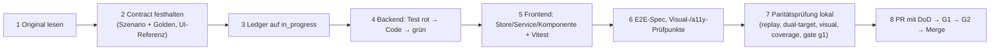

# 03 – Leitfaden für Implementierungs-Agenten (Betriebsanleitung funk.)

> **Stand:** 23.10.2026. **Verbindlichkeit:** bindend für jeden KI-Implementierungs-Agenten und jeden menschlichen Beitragenden im Repository `funk.`. Der Leitfaden fasst die verbindlichen Regeln aus `architecture/00`, `01`, `02`, `08`, `09`, `15`, `16`, `17` zusammen und ergänzt die dort offenen Arbeitsregeln (Paketauswahl, Branches, Commits, Eskalation). Bei Widerspruch gilt die Rangfolge `00` > `17` > `01` > Themen-Dokumente > Plan-Dokumente; ein gefundener Widerspruch wird als Planfrage gemeldet (§10), nicht stillschweigend aufgelöst.
>
> **Ort im Zielrepository:** Dieser Plan liegt in `funk./docs/plan/` (Spiegel von `migration/plan/`), die Architektur- und Feature-Dokumente in `funk./docs/migration/`. `funk./AGENTS.md` verweist auf diesen Leitfaden.

## Inhaltsverzeichnis

1. Arbeitsumgebung und Grundsätze
2. Rollen
3. Auswahl eines Arbeitspakets
4. Pflichtlektüre
5. Vorgehen je Arbeitspaket (Original lesen → Contract festhalten → implementieren → Tests → Paritätsprüfung)
6. Konventionen (Kurzreferenz)
7. Branch-, Commit- und Pull-Request-Regeln
8. Definition of Done
9. Umgang mit Fehlern und Eigenheiten des Originals
10. Eskalation offener Fragen
11. Sonderfälle: Spikes, Erweiterungspunkte, Vorab-Endpunkte, Plan-Änderungen
12. Checklisten

---

## 1. Arbeitsumgebung und Grundsätze

| Thema | Regel | Quelle |
|---|---|---|
| Repositories | `github.com/mlwr/funk.` **schreibend** (Hauptbranch `develop`; `main` bleibt unangetastet), `mlwr/plane` am Stand `funk-referenz-1.4.2` (Commit `053b2c0`) **nur lesend**. Am Original wird nichts geändert. | ADR-006, ADR-009 |
| Referenz | Das Original ist die maßgebliche Referenz für Verhalten, Texte, Styles und Edge-Cases. Erst die Analyse in `docs/migration/analysis/` bzw. `features/` lesen, dann den referenzierten Original-Code. | ADR-006 |
| Stack | .NET 10, Aspire 13, ASP.NET Core, EF Core 10 + Npgsql, PostgreSQL 17 (pg_trgm, unaccent, vector), Angular 22 (zoneless, Signals, Signal Forms, Vitest), Tailwind 4.1, Tiptap 2.27, YDotNet; Versionen ausschließlich aus `Directory.Packages.props` bzw. dem pnpm-Catalog. | ADR-000, 01 §8 |
| Namen | Alle Zielbezeichner heißen `funk`: `Funk.*`, `FunkDbContext`, `Funk:`/`Funk__`/`FUNK_`, `X-Funk-*`, `funk_api_`/`funk_wh_`, Realm `funk`, Clients `funk-*`, Cookie `funk-session`, Metriken `funk.*`, Events `funk.<aggregat>.<ereignis>.v<n>`, Pakete `@funk/*`. Architektur-Dokumente mit `Plane.*` werden über die Umbenennungstabelle in 17 gelesen. Verweise auf das Original bleiben unverändert. | ADR-009C, 17 |
| Marke | Sichtbar ist nur „funk.“ (Logo `assets/funk_logo.svg`); Layout bleibt 1:1. | ADR-009B, 01 §7.21 |
| Sprachen | Nur `de` (Standard) und `en`. Deutsche Texte aus `packages/i18n/src/locales/de` übernehmen und branden; fehlende Schlüssel ergänzen. | ADR-009D |
| Anmeldung | Ausschließlich Keycloak (OIDC, Code + PKCE, BFF-Session). Keine Passwort-, Magic-Code- oder Provider-Logins bauen. | ADR-008 |
| Editionen | Keine Plan-Stufen, kein Billing, keine Upsell-Elemente; fachliche Feature-Toggles bleiben. | ADR-001 |
| Betrieb | Self-hosted inkl. Airgapped: keine CDNs, keine Telemetrie nach außen, alle Assets gebündelt, kein Node zur Laufzeit. | ADR-002, ADR-004 |
| Lizenz | `funk.` steht unter AGPL-3.0; jede Quelldatei trägt den AGPL-Header; neue Abhängigkeiten nur nach Lizenz-Gate (MIT/Apache/BSD bevorzugt). | 17 Z-11, 01 §8 |
| Test-Browser | Nur Chromium ist Gate. | 17 Z-10 |
| Parität | Optisch 1:1; funktionale Fehler des Originals werden korrigiert und dokumentiert; Sicherheitslücken immer korrigiert. | 17 Z-12, 01 §7.20 |

**Lokale Werkzeuge:** `aspire run` (Profil `dev`), `./tools/ci/gate.sh g0|g1|g2 [--affected]`, `tools/parity/start-original.sh` (Original v1.4.2 unter `http://localhost:13000`), `Funk.Tools.ParityHarness seed|record|replay|diff`, `pnpm --dir frontend test|e2e|visual`, `tools/ci/ce-coverage-check --ids …`.

## 2. Rollen

| Rolle | Aufgabe | Quelle |
|---|---|---|
| **Implementierungs-Agent** (Fach-Agent) | setzt genau ein Arbeitspaket um, von der Original-Lektüre bis zum gemergten PR | 15 §3.1 |
| **Infrastruktur-Agent** | Pakete Typ I (AppHost, Gateway, CI, Gates), betreut L0/L6 | 15 §3.1 |
| **Paritäts-Agent** | betreibt das Paritäts-Setup (Original-Instanz, Seeds, Referenz-Screenshots), nimmt Goldens auf Anfrage auf (`needs-golden`), reviewt G3 | 15 §3.15.2 |
| **Performance-Agent** | Lasttests L9, Volumenprofile, SQL-Plan-Assertions | 15 §3.12 |
| **Architektur-Review** (Mensch oder beauftragter Agent) | beantwortet technische Planfragen innerhalb der ADRs, reviewt Typ-X-Pakete, Abweichungen und Plan-Änderungen | §10 |
| **Auftraggeber** | entscheidet ADR-relevante, produkt-sichtbare und lizenzrechtliche Fragen; nimmt Inkremente fachlich ab | 00, 17 |

## 3. Auswahl eines Arbeitspakets

1. **Aktuelles Inkrement bestimmen:** das niedrigste Inkrement `In`, dessen Abnahme `WP-In-999` noch offen ist. Pakete eines späteren Inkrements sind nur erlaubt, wenn sie als Vorlauf-Paket gekennzeichnet sind (plan/01 L-8) oder alle ihre Abhängigkeiten erfüllt sind und sie keine Route registrieren.
2. **Kandidaten filtern** (`docs/plan/_data/wp-ce.json`): alle `depends_on`-Pakete gemergt; kein abhängiger Spike rot oder offen; Paket nicht vergeben (Tracking-Issue `WP-…` ohne Assignee); keine offene Planfrage mit Label `blocker` am Paket.
3. **Priorität:** (a) Pakete auf dem kritischen Pfad des Inkrements (02 §3.2), (b) Erweiterungspunkt-Pakete (2xx) und Bausteine (1xx), von denen viele Schnitte abhängen, (c) übrige Schnitte nach Nummer.
4. **Parallelität:** Pakete mit „parallelisierbar = nein“ bearbeitet nur ein Agent, und in derselben Zeit arbeitet kein anderer Agent am selben Backend-Modul oder an derselben Frontend-Lib. Ein Agent bearbeitet **höchstens ein** Paket gleichzeitig (WIP-Limit 1).
5. **Paket übernehmen:** Tracking-Issue `WP-In-NNN – <Titel>` (Labels `wp`, `inc:In`, `type:<V|B|F|I|D|S|X|A>`, `size:<S|M|L>`) sich zuweisen, Branch nach §7.1 anlegen, Start im Issue vermerken.
6. **Nicht starten**, wenn eine Abhängigkeit nur „fast fertig“ ist oder ein Architektur-Dokument dem Paket widerspricht – stattdessen Planfrage (§10).

## 4. Pflichtlektüre

### 4.1 Für jedes Paket (einmalig je Agent, bei Änderungen erneut)

| Dokument | Abschnitte |
|---|---|
| `architecture/00-grundsatzentscheidungen.md` | vollständig |
| `architecture/17-abgleich-dokumentuebergreifend.md` | §1 (Entscheidungsregeln), Entscheidungen des Auftraggebers (Teil 1 und Teil 2), Umbenennungstabelle |
| `architecture/01-zielarchitektur-und-tech-stack.md` | §1.3, §1.4, §5.1–§5.3 (Struktur, Regeln R1–R10, Modul-Schablone), §6.1, §7 (Querschnittskonventionen), §9 |
| `architecture/15-teststrategie-qualitaet-paritaet.md` | §3.1, §3.15 (Gates, Arbeitsablauf, DoD) |
| `architecture/16-erweiterungspunkte-bezahl-features.md` | §1.4, §1.5, D16-ADR-03/-06/-15 |
| dieser Leitfaden, `plan/01-roadmap-ce.md` §1–§4, `plan/02-arbeitspakete-ce.md` §1–§2 | vollständig |

### 4.2 Je nach Paket-Typ

| Typ | zusätzlich |
|---|---|
| Backend (V, B, X mit Backend-Anteil) | 02 §3.1–§3.11, §3.15, §3.19, **§5.2 Referenzmodul Labels** (Dateinamen und Aufbau sind Vorlage), 03 §3.1–§3.5 und die Tabellen des eigenen Moduls (§3.4.x), 04 §3.1–§3.13 und die Katalogzeilen der Endpunkte, 05 §3.13 (Permissions), 06 §3.8–§3.9 (Events, Activity) |
| Frontend (V, F) | 08 §3.1–§3.6, §4 (Routen-/Store-Mapping des Bereichs), §7.8 (Frontend-DoD), 09 §3.3–§3.5, §3.14, §7.3 (DoD je Baustein) |
| Editor/Dokumente (D) | 10 §3 (vollständig für den Schnitt), 07 §3.12–§3.13 |
| Realtime | 07 §3.1–§3.11, §7.3 |
| Infrastruktur (I) | 14 §3 (betroffene Abschnitte), 15 §3.4, §3.21 |
| Erweiterungspunkt (X) | 16 §3.1, der genannte Abschnitt aus §5 (Code-Skelett ist Vertrag), 15 §6, 08 §6 |
| Spike (S) | 01 §9 Zeile des Spikes, präzisierte Kriterien (07 §7.6, 10 §7.3, 15 §3.6.7) |

### 4.3 Je Paket

Die im Paket genannten Referenzdokumente (02 §4), die Einträge der CE-IDs in `features/10-ce-feature-katalog.md`, die genannten Analyse-Abschnitte, die Original-Pfade, die Endpunktzeilen in `architecture/_data/endpoints.json`, die Matrix-Zeilen in `architecture/_data/05-permission-matrix.json`, die betroffenen Einträge in `_data/06-event-catalog.json`/`06-jobs.json` und die Original-Tests der CE-IDs im Ledger (`tests/original-tests/ledger.yaml`).

## 5. Vorgehen je Arbeitspaket

Der Ablauf konkretisiert 15 §3.15.2 und ist verbindlich.



### 5.1 Original lesen

1. Analyse-Abschnitte und Feature-Einträge der CE-IDs lesen; offene Fragen der Analyse notieren.
2. Backend des Originals: URL-Konfiguration, View, Serializer, Model, Permission-Klasse/Decorator, Background-Task; Frontend: Route, Page, Komponenten, Store (MobX), Service, Konstanten, i18n-Schlüssel.
3. Original-Tests der CE-IDs (Ledger) und Playwright-/Vitest-Tests des Originals lesen.
4. Die Entscheidungen der Architektur zu genau diesen Stellen nachschlagen: Endpunktzeilen (04, inkl. `decision`, `dt`, `deviations`), DT-Tabelle (04 §3.13), Quirk-Listen (03 §4.3, 06 §4.10, 07 §3.20, 08 §4.9, 09 §7.4, 10 §3.22), Sicherheitskorrekturen (05 §3.18).
5. Ergebnis in der PR-Beschreibung unter „Original-Analyse“ kurz festhalten (Dateien, Verhalten, Edge-Cases, Entscheidungen).

### 5.2 Contract festhalten (vor dem Code)

1. Für jeden Endpunkt des Pakets ein Szenario `tests/contracts/scenarios/<modul>/<szenario>.yaml` mit mindestens Erfolg, Berechtigungsfehler und Validierungsfehler (15 §3.6.2).
2. Goldens vom laufenden Original aufnehmen (`Funk.Tools.ParityHarness record`), Determinismus-Check bestehen; der PR erhält das Label `golden-update` (Gate G3). Fehlen Ressourcen: Label `needs-golden` an den Paritäts-Agenten; Implementierung darf parallel beginnen, Merge erst mit Golden.
3. Routen, die im Original fehlschlagen und laut Entscheidung korrigiert werden: Ziel-Golden mit `golden_source: target` und Verweis auf die `DEV-*`-Zeile (04 §5.7, O-D04-06).
4. UI: Prüfpunkte des Screens im Katalog `frontend/apps/e2e/visual/catalog/` eintragen und Referenz-Screenshots/DOM-Verträge des Originals aufnehmen (`capture-reference`, Referenz-Branding BR-13).
5. Typen: `libs/shared/types` bleiben die Original-Typen; der Contract-Check (`frontend/tools/contract-check`) muss gegen das Ziel-OpenAPI grün sein.

### 5.3 Ledger

Alle Original-Tests der CE-IDs des Pakets in `tests/original-tests/ledger.yaml` auf `in_progress` setzen; am Ende auf `ported`, `replaced` (mit Ziel-Test) oder `obsolete` (mit Begründung, z. B. ADR-008).

### 5.4 Backend implementieren

1. Modul-Schablone (01 §5.3, 02 §3.1.2) und Referenzmodul Labels (02 §5.2) wörtlich folgen: `Domain/`, `Application/Commands|Queries/`, `Validation/`, `Mapping/`, `Endpoints/App|V1|Space/`, `Activity/`, `<M>Module.cs`; Entitäten in `src/data/Funk.Data/Entities/<Modul>/` mit `[OwnedBy("<Modul>")]`.
2. Zuerst Tests: L1 (Domänenregeln, Validatoren, Mapper) und L3 (Endpunkt + DB, Pflichtfälle E1–E8 aus 15 §3.3.2) rot schreiben, dann implementieren.
3. Permissions nur über den Katalog (`.RequirePermission(...)`, Deskriptoren aus `Funk.PermissionGen`), Fehler nur über `FunkErrors`, Zeit nur über `IClock`, IDs über `IIdGenerator`, keine Rollenwerte im Fachcode.
4. Modulübergreifendes Schreiben nur über Contracts-Services des Eigentümers oder Integration-Events (R5); States/Labels nur über `IStateCatalog`/`ILabelCatalog`; State-Wechsel nur über `IWorkItemStateChanger`.
5. Migrationen: `dotnet ef migrations add <YYYYMMDDHHmm>_<Modul>_<Beschreibung>`; bei Konflikt eigene Migration löschen, rebasen, neu erzeugen (01 §7.14); `has-pending-model-changes` muss leer sein.
6. Integration-Events neu im Event-Katalog anlegen (`funk.<aggregat>.<ereignis>.v1`), Payload nur IDs und geänderte Felder.
7. Original-Tests portieren (15 §3.5.2) nach `tests/modules/Funk.<M>.Tests/Acceptance/Original/` mit Trait `[Origin("…")]`.

### 5.5 Frontend implementieren

1. Stores mechanisch nach der Übersetzungstabelle MobX → Signals (08 §3.4.2) portieren; Struktur, Methoden- und Feldnamen wie Original (Store-Paritätsprüfung 08 §7.3).
2. Services 1:1 (HttpClient statt Axios, Promise-API), Interceptor-Kette nicht umgehen.
3. Komponenten mit DOM-Parität: Primitive als Attribut-Komponenten an nativen Elementen, Composite mit `:host { display: contents }`, Klassen über `cn()` identisch, `data-*`/ARIA identisch, Portale an `document.body` (01 §7.17, 09 §3.3–§3.5).
4. Texte nur über i18n-Schlüssel des Originals (`t`-Pipe); neue Schlüssel nur, wenn das Original keinen hat (dann in `de` **und** `en`, Eintrag in `ui-deviations.yaml`).
5. Erweiterbare Stellen ausschließlich über die Registries aus `libs/web/extensions` (CE-Einträge wie Original).
6. Routen erst registrieren, wenn der Screen vollständig ist (01 §7.19).
7. Vitest (L2) für jede Store-Action und jedes Komponentenverhalten (Öffnen/Schließen, Tastatur, Outside-Click, ARIA).

### 5.6 E2E und Visual

1. Spec unter `frontend/apps/e2e/<app>/<bereich>/<datei>.spec.ts` nach Inventar 15 §3.9.2 mit den Pflichtszenarien 15 §3.9.3; Page-Objects; Tags `@ce:<ID>`, `@inc:<In>`.
2. Spec läuft **gegen das Original und gegen funk.** (Dual-Target); Unterschiede nur über dokumentierte Abweichungen.
3. Visual-, DOM- und a11y-Prüfpunkte aller Zustände (15 §3.10.2) – Chromium, hell/dunkel, Viewports laut Katalog.

### 5.7 Paritätsprüfung (lokal, vor dem PR)

```text
Funk.Tools.ParityHarness replay --scenarios tests/contracts/scenarios/<modul>/   # L5 grün
pnpm --dir frontend e2e --grep "@ce:CE-…"                                        # gegen funk. und Original
pnpm --dir frontend visual --grep "@ce:CE-…"                                     # Chromium
tools/ci/ce-coverage-check --ids CE-…,CE-…                                       # Mindestebenen 15 Anhang B
./tools/ci/gate.sh g1 --affected                                                  # wie CI
```

Jede verbleibende Differenz ist entweder ein Fehler (beheben) oder eine **entschiedene** Abweichung mit Eintrag in `tests/contracts/deviations.yaml` (API/Contract) bzw. `frontend/apps/e2e/visual/ui-deviations.yaml` (Visual, DOM, CSS, Routen, Verhalten, Assets; Feld `kind`).

### 5.8 Pull Request

PR nach §7.3 öffnen, DoD-Checkliste ausfüllen, CI (G1, danach G2 in der Merge-Queue) abwarten, Review-Anmerkungen umsetzen, Tracking-Issue schließen, Ledger und Abweichungslisten sind Teil des PR.

## 6. Konventionen (Kurzreferenz)

| Bereich | Regel (Detail in) |
|---|---|
| Benennung | C# PascalCase/`I`-Präfix/Async-Suffix; Use-Cases `<Verb><Objekt>Command/Query/Handler/Validator`; neue Typen heißen `WorkItem…`, JSON/URLs behalten Original-Namen (`issue_id`, `/issues/`); DB `snake_case`, Tabellen Plural; TS-Dateien kebab-case wie Original; Angular-Präfix `pl-`/`pl…` (01 §7.1) |
| Architekturregeln | R1–R12 (01 §5.2, 16 D16-ADR-03); Platzhalter-Projekte nur Interfaces/DTOs/Enums/Konstanten (R10) |
| JSON | `snake_case`, Feldnamen/Enums exakt wie Original-Serializer, `null` ausgeben, unbekannte Felder ignorieren, Zahlen bleiben Zahlen (01 §7.2) |
| Zeit | `timestamptz` UTC, Ausgabe mit Mikrosekunden `yyyy-MM-ddTHH:mm:ss.ffffffZ`, `DateOnly` für Datumsfelder, Cron in UTC (01 §7.3) |
| Fehler | nur `FunkErrors` (`Plain`, `Detail`, `Coded`, `Fields`), Texte aus A06 §2.12, 401/403 exakt wie Original (01 §7.4, 02 §3.8) |
| Pagination | Cursor `"<per_page>:<page>:<is_prev>"`, Antwortfelder exakt (01 §7.5, 02 §3.10) |
| IDs | UUIDv7 über `IIdGenerator`; `sequence_id` über `SequenceAllocator`; Space-Anchors 32 Hex (01 §7.6) |
| Soft-Delete/Audit | `ISoftDeletable`, Kaskaden-Registry, partielle Unique-Indizes; Audit über Interceptor aus `ICurrentActor`; Activity synchron in derselben Transaktion (01 §7.7–§7.8, 03 §3.5) |
| Mandanten | `IRequestScope`/`IWorkspaceContext`, Filter `workspace_tenant` (01 §7.9, 02 §3.5) |
| Berechtigungen | genau eine `.RequirePermission(...)` oder `.AllowAnonymous()` je Route; Harmonisierungen HARM-00/-03/-04/-06 gelten (01 §7.10, 05 §3.13, 17 Z-09) |
| Routen | ohne abschließenden Slash im Template, beide Varianten akzeptiert, kein Redirect (01 §7.11) |
| Konfiguration | Options-Klassen `Funk<Bereich>Options` unter `Funk:<Bereich>`, ENV-Alias je Original-Variable, `ValidateOnStart`, keine Secrets in `appsettings.json` (01 §7.13, 02 §3.15) |
| Events | Domain-Events in-process; Integration-Events über Outbox, versioniert und unveränderlich nach Merge (01 §7.15, 06 §3.8) |
| Logging | strukturierte Logs, Kategorien `funk.api.request`, `funk.worker`, `funk.realtime`, `funk.exception`; keine PII/Secrets (01 §7.16) |
| Frontend-Daten | keine Build-Zeit-ENV; `runtime-config.json` (01 §7.12) |
| Feature-Toggles | fachliche Toggles bleiben, keine Plan-Gates; Lint verbietet `isPro`, `plan`, `subscription` (01 §7.18) |
| Inkrement-Kennzeichnung | jeder PR-Titel `[In]`; keine Platzhalter-Routen (01 §7.19) |
| Branding | eine Quelle `Brand.cs`/`BRAND.productName`; Logos nur aus `assets/funk_logo.svg`; jede Ersetzung als `BRAND-<Bereich>-<nn>` (01 §7.21, ADR-009B); G-BRAND muss grün sein |
| Bibliotheken | nur aus 01 §8; neue Abhängigkeit = Planfrage + Lizenz-Gate. Verboten bzw. nur mit Freigabe: MediatR ≥ 13, AutoMapper ≥ 15, MassTransit v9, FluentAssertions ≥ 8, Duende IdentityServer, QuestPDF, ImageSharp, MinIO-Community-Distribution |
| Header | AGPL-Header in jeder C#- und TS-Datei (`license-header-check`) |

## 7. Branch-, Commit- und Pull-Request-Regeln

### 7.1 Branches

| Art | Muster | Beispiel |
|---|---|---|
| Arbeitspaket | `wp/<wp-id-klein>-<slug>` | `wp/wp-i2-012-rich-filter-liste` |
| Teil eines L-Pakets (gestapelt) | `wp/<wp-id-klein>-teil-<n>-<slug>` | `wp/wp-i2-008-teil-1-activity-recorder` |
| Spike | `spike/s<nn>-<slug>` | `spike/s01-ydotnet-hocuspocus` |
| Fehlerbehebung nach Merge | `fix/<wp-id-klein oder issue>-<slug>` | `fix/wp-i1-012-label-sortierung` |
| Planänderung (nur `docs/plan/`) | `plan/<slug>` | `plan/split-wp-i2-008` |

Regeln: Abzweig immer von aktuellem `develop`; Slug kleinbuchstabig, ASCII, Bindestriche, Branchname ≤ 60 Zeichen; regelmäßig auf `develop` rebasen; keine direkten Commits auf `develop` oder `main`; kein Force-Push auf Branches anderer; keine Tags setzen (Inkrement-Tags setzt nur der Auftraggeber bzw. die freigegebene CI, plan/01 §7.5).

### 7.2 Commits

- Format **Conventional Commits**: `<typ>(<scope>): <zusammenfassung im Imperativ, deutsch oder englisch, ≤ 72 Zeichen>`.
- Typen: `feat`, `fix`, `test`, `refactor`, `perf`, `docs`, `build`, `ci`, `chore`; `test(golden)` für Golden-Aufnahmen.
- Scope = Backend-Modul (`identity`, `workspaces`, `projects`, `workitems`, `cycles`, …), Frontend-Lib (`web-work-items`, `shared-propel`, …) oder Bereich (`apphost`, `gateway`, `ci`, `parity`).
- Pflicht-Trailer am Ende der Nachricht:
  ```text
  WP: WP-I2-012
  CE: CE-LV-005, CE-LV-006
  Deviation: DEV-GRP-001        (nur wenn eine Abweichung eingeführt oder geändert wird)
  ```
  zusätzlich die Attribution-Zeilen, die die jeweilige Agenten-Umgebung vorschreibt.
- Kleine, in sich lauffähige Commits; Tests und Code im selben Commit oder Test zuerst. Keine Secrets, keine Build-Artefakte; generierte Dateien nur, wenn sie eingecheckt gehören (EF-Snapshot, `funk-realm.test.json`, Goldens über G3, generierte Icon-/Varianten-Konstanten).

### 7.3 Pull Requests

- **Ein Arbeitspaket = ein PR.** L-Pakete dürfen in gestapelte Teil-PRs zerlegt werden; jeder Teil-PR ist für sich grün und registriert keine unfertige Route.
- Titel: `[<In>] <WP-ID> <Titel des Pakets>` (z. B. `[I2] WP-I2-012 Work-Item-Liste mit Rich-Filter`).
- Beschreibung (Vorlage `.github/pull_request_template.md`): Zusammenfassung; CE-IDs; Endpunkte (EP-IDs); Original-Analyse (§5.1); Abweichungen (neue/geänderte `DEV-*`, `BRAND-*`, `ui-deviations`-Einträge mit Entscheidungsverweis); Testnachweis (Gates, Replay, Dual-Target, Visual-Report); DoD-Checkliste des Typs (§8).
- Labels: `wp`, `inc:<In>`, `type:<T>`, ggf. `golden-update`, `needs-golden`, `deviation`, `extension-point`.
- Merge nur über die Merge-Queue nach grünem G1 und G2, mit mindestens einem Review (Architektur-Review für Typ X, Abweichungen und Änderungen an Erweiterungs-Interfaces; Paritäts-Agent und ein Mensch für G3). Merge-Art: Squash; die Squash-Nachricht trägt die Trailer aus §7.2.

## 8. Definition of Done

Ein Arbeitspaket ist fertig, wenn **alle** folgenden Punkte erfüllt sind.

### 8.1 Gemeinsamer Kern (alle Typen; 15 §3.15.3 ergänzt)

- [ ] Alle paketspezifischen Akzeptanzkriterien und die Standardkriterien des Typs aus `plan/02-arbeitspakete-ce.md` erfüllt.
- [ ] G1 und G2 grün; keine neuen Analyzer-/ESLint-Ausnahmen ohne `// justification:`.
- [ ] Jeder neue/geänderte Test trägt `ce`/`inc`/`level`-Traits bzw. Tags.
- [ ] Ledger: alle Original-Tests der CE-IDs mit Status ≠ `todo`.
- [ ] `ce-coverage-check --ids <CE-IDs des Pakets>` grün.
- [ ] Keine Abweichung vom Original ohne Eintrag in `deviations.yaml` bzw. `ui-deviations.yaml` mit Entscheidungsverweis (ADR, DT-Zeile, Z-Nummer oder beantwortete Planfrage).
- [ ] Inkrement-Kennzeichnung im PR-Titel; nur abgenommene Routen registriert.
- [ ] Namen nach ADR-009C (keine neuen `Plane.*`-, `X-Plane-*`-, `plane_*`-Zielbezeichner); G-BRAND grün.
- [ ] Texte in `de` und `en` vollständig; keine weiteren Locales.
- [ ] Genutzte Andockstellen verwendet (z. B. States/Labels über Kataloge, State-Wechsel über die Pipeline, Rechte über `PermissionService`); keine Umgehung.
- [ ] Keine `TODO`/`FIXME` ohne verlinktes Issue; Kurzreferenz in `docs/` aktualisiert, falls ein Baustein neu ist.

### 8.2 Zusätzlich je Typ

Die Punkte für **V, B, F, I, D, S, X** stehen in 15 §3.15.3 (wiedergegeben als Standardkriterien in 02 je Paket); für Frontend-Pakete zusätzlich 08 §7.8, für portierte UI-Bausteine 09 §7.3. **Typ A (Abnahme):** die gemeinsamen Meilensteinkriterien G-1 … G-10 und die inkrementspezifischen Kriterien aus plan/01 §4.

## 9. Umgang mit Fehlern und Eigenheiten des Originals

### 9.1 Entscheidungsregel

| Art des Befunds | Behandlung | Dokumentation |
|---|---|---|
| **Sicherheitslücke** (Rechte, SSRF, XSS, Secrets, Session) | immer korrigieren (01 §7.20, 05 §3.18) | `deviations.yaml` mit `DEV-SEC-*`/Verweis auf 05 |
| **Funktionaler Fehler** (falsches Ergebnis, 500, Datenverlust, falsche Information) | korrigieren (17 Z-12) | `deviations.yaml` (API) bzw. `ui-deviations.yaml` (`kind: behavior`), Ziel-Golden `golden_source: target` |
| **Optische Eigenheit** (Abstände, Farben, tote Klassen, Schreibweisen) | 1:1 übernehmen | keine Abweichung; bei bewusst übernommenen Defekten Vermerk „bekannt, nicht korrigiert“ in `ui-deviations.yaml` |
| **Funktionaler Fehler mit sichtbarer Wirkung** (Korrektur ändert Text, Layout oder Bedienung) | nicht selbst entscheiden → Planfrage an den Auftraggeber (Beispiele: FE-ED-04 Tooltip-Kürzel, O-D11-04 Power-K-Identifier) | bis zur Entscheidung 1:1, Eintrag mit Status `pending` |
| **Leistungsproblem** (N+1, fehlender Index) | korrigieren, solange der Vertrag gleich bleibt | Kommentar im Code, keine Abweichung |
| **Fehlende Funktion, die das Frontend aufruft** (Endpunkt fehlt im CE-Backend) | nach 04 §4.26 bzw. 16 §4.3 behandeln | wie dort entschieden |

### 9.2 Vorgehen bei einem neuen Befund

1. Prüfen, ob der Befund bereits entschieden ist (04 §3.13 DT-Tabelle, 03 §4.3, 06 §4.10, 07 §3.20, 08 §4.9, 09 §7.4, 10 §3.22, 11 §4.7, `deviations.yaml`). Wenn ja: Entscheidung umsetzen.
2. Im Paritäts-Setup reproduzieren und als Szenario bzw. E2E-Schritt festhalten (Original-Verhalten belegt).
3. Nach §9.1 einordnen; Korrektur mit Test, der das korrigierte Verhalten prüft.
4. Abweichungseintrag mit ID (`DEV-<Bereich>-<nn>` bzw. `FE-<Bereich>-<nn>`), Beschreibung Original/Ziel, Entscheidungsverweis, betroffene Goldens/Masken; ohne Feld `decision` scheitert G1.
5. Bei Unsicherheit über die Einordnung: Planfrage (§10), bis zur Antwort 1:1.

## 10. Eskalation offener Fragen

### 10.1 Stufen

1. **Nachschlagen** in Rangfolge `00` > `17` > `01` > Themen-Dokument (fachliche Zuständigkeit nach 17 §1 Regel 2) > Plan. Die zuständige Quelle entscheidet.
2. **Original als Schiedsrichter** für fachliche Semantik (ADR-006): Was das Original tut, gilt – außer eine dokumentierte Entscheidung sagt etwas anderes.
3. **Planfrage stellen**, wenn 1. und 2. keine eindeutige Antwort liefern oder sich Dokumente widersprechen: GitHub-Issue mit Label `question` (zusätzlich `blocker`, wenn das Paket nicht weiterkann) und Vorlage:
   ```text
   Paket: WP-…        CE-IDs: …        Dokumente/Abschnitte: …
   Frage: …
   Befund (mit Original-Pfad/Zeile bzw. Dokumentstelle): …
   Optionen: A … / B … (je Auswirkung auf Vertrag, UI, Aufwand, Bezahl-Pakete)
   Empfehlung: …      Umkehrbar: ja/nein      Frist (spätestens bis): …
   ```
4. **Entscheidung** durch das Architektur-Review (technische Fragen innerhalb der ADRs) oder den Auftraggeber (alles, was eine Grundsatzentscheidung berührt, sichtbares Verhalten jenseits der Regel §9.1, Rechteumfang, Lizenzen, neue externe Dienste, Reihenfolge der Inkremente/Wellen).
5. **Festhalten:** Die Antwort wird im Issue dokumentiert und in `docs/plan/04-risiken-offene-punkte.md` (Tabelle §4 bzw. §3) nachgetragen; betroffene Dokumente werden per `plan/<slug>`-PR angepasst.

### 10.2 Was ein Agent nicht selbst entscheidet

Änderungen an ADRs oder an Entscheidungen des Auftraggebers; Rechteerweiterungen; Abweichungen mit sichtbarer Wirkung jenseits §9.1; neue Bibliotheken oder Dienste außerhalb 01 §8; Änderungen an CE-API-Verträgen ohne Original-Grundlage; nicht additive Änderungen an Erweiterungs-Interfaces (16 D16-ADR-07); Verschieben von CE-IDs zwischen Paketen oder Inkrementen; Änderungen am Schema-Freeze des Editors (10 §3.2.5).

### 10.3 Verhalten bis zur Antwort

- Nicht blockierte Teile des Pakets weiterbearbeiten; blockierte Teile mit Test `Skip = "Planfrage #<n>"` markieren (zählt nicht als erfüllt).
- Eine **vorläufige Festlegung** nur verwenden, wenn plan/04 oder ein Architektur-Dokument sie ausdrücklich als „gilt bis zur Entscheidung“ nennt, und sie in der PR-Beschreibung kennzeichnen.
- Zeitbox: Wer länger als einen halben Arbeitstag an einer Unklarheit hängt, stellt die Planfrage.

## 11. Sonderfälle

### 11.1 Spikes (Typ S)

Eigener Branch `spike/…`; Erfolgs- und Abbruchkriterien aus 01 §9 sind der Testplan; jede Messung wird als automatisierter Test hinterlegt, der danach in G4 läuft; Ergebnisbericht `docs/spikes/S<nn>-ergebnis.md` (Ergebnis, Messwerte, Entscheidung, Folgearbeitspakete). Bei Abbruch wird der Fallback aus 01 §9 aktiviert; berührt er eine Grundsatzentscheidung (z. B. S1-Fallback „Node-Sidecar“ gegen ADR-002), entscheidet der Auftraggeber. Spike-Code ist Prototyp: Er wird im Folgepaket übernommen, sofern er die Konventionen erfüllt, sonst neu geschrieben.

### 11.2 Erweiterungspunkte (Typ X)

Das Code-Skelett aus 16 §5 bzw. 01 §5.5 ist **Vertrag** (Namen, Namespaces nach Umbenennungstabelle, Signaturen, Dateiorte). Pflicht: CE-Default-Implementierung = Original-Verhalten, Eintrag in `tests/extension-points.yaml`, Fake-Erweiterung in `Funk.BuildingBlocks.Testing/Extensions/` bzw. `provideFakeExtensions()`, Test „ohne CE-Änderung erweiterbar“. Kein Fachdesign der Bezahl-Pakete vorwegnehmen; keine Paket-Logik in CE-Module (R11). Ab dem Contract-Snapshot (WP-I7-201) sind nur noch additive Änderungen erlaubt.

### 11.3 Vorab-Endpunkte

Steht ein Endpunkt in 02 mit „(vorab)“, baut ihn das frühere Paket in dem Umfang, den es braucht, inklusive Contract-Szenario für diesen Umfang; das Paket der CE-ID erweitert ihn und nimmt die CE-ID ab. Doppelte Implementierungen sind verboten.

### 11.4 Plan-Änderungen

Nur über Planfrage und `plan/<slug>`-PR: Spezifikation in `migration/_werkzeuge/plan/wp_spec*.py` ändern (im Planungs-Repository) bzw. `docs/plan/` in `funk.` nach Freigabe aktualisieren, `build.py` und `check_wp.py` ausführen; `check_wp.py` muss „OK“ melden.

## 12. Checklisten

### 12.1 Start eines Pakets

- [ ] Paket im aktuellen Inkrement (oder Vorlauf), alle Abhängigkeiten gemergt, keine `blocker`-Planfrage.
- [ ] Tracking-Issue zugewiesen, Branch nach §7.1 angelegt.
- [ ] Pflichtlektüre §4 gelesen; Original-Code und -Tests gelesen; Entscheidungen zu bekannten Defekten nachgeschlagen.
- [ ] Paritäts-Setup läuft (`tools/parity/start-original.sh`), Seeds geladen.

### 12.2 Vor dem PR

- [ ] Szenarien + Goldens (G3) bzw. `needs-golden` gestellt; Visual-Referenzen aufgenommen.
- [ ] L1/L2/L3 grün, Original-Tests portiert, Ledger aktualisiert.
- [ ] Replay, Dual-Target-E2E, Visual (Chromium), `ce-coverage-check --ids …`, `./tools/ci/gate.sh g1 --affected` grün.
- [ ] Abweichungen eingetragen und begründet; Branding und i18n (de/en) geprüft.
- [ ] Commit-Trailer `WP:`/`CE:` gesetzt; PR-Titel `[In] WP-…`; DoD-Checkliste ausgefüllt.
